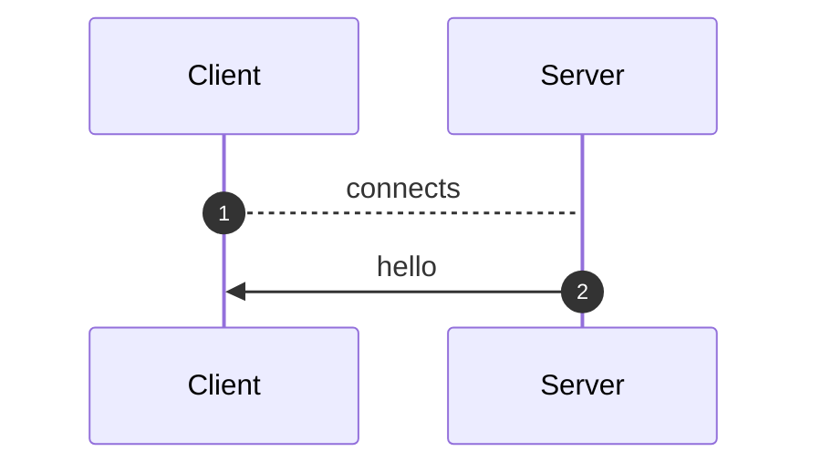
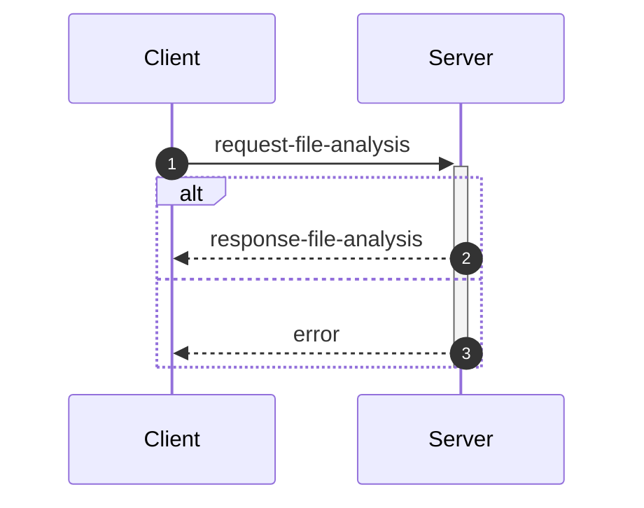
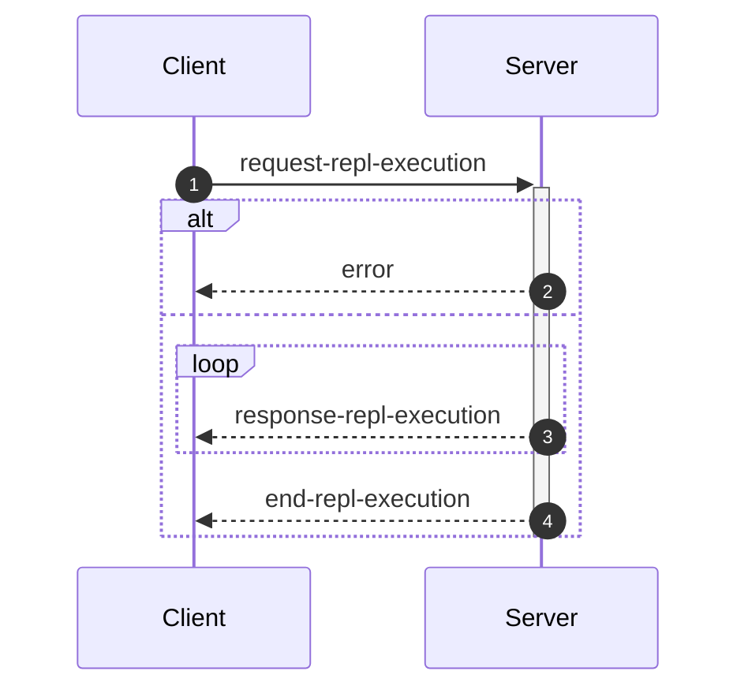
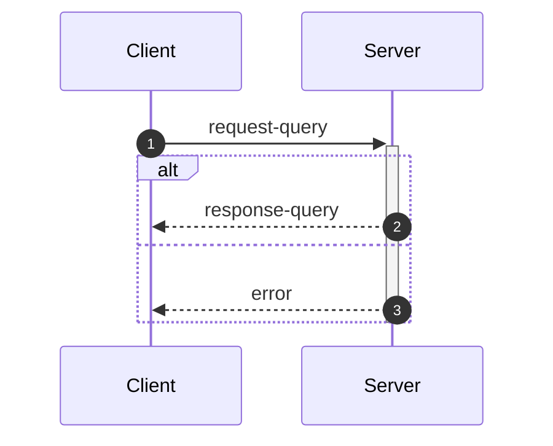

_<span title="an overview of flowR's interface">Generated</span> from '[wiki-interface.ts](https://github.com/flowr-analysis/flowr/tree/main/src/documentation/wiki-interface.ts "src/documentation/wiki-interface.ts")' on 2026-11-23, 15:23:58 UTC (v2.17.11, R v4.5.0), do not edit directly._

Although far from being as detailed as the in-depth explanation of [_flowR_](https://github.com/flowr-analysis/flowr/wiki/Core),
this wiki page explains how to interface with _flowR_ in more detail.
In general, command line arguments and other options provide short descriptions on hover over.

* [💻 Using the REPL](#using-the-repl)
* [⚙️ Configuring FlowR](#configuring-flowr)
* [⚒️ Writing Code](#writing-code)
* [💬 Communicating with the Server](#communicating-with-the-server)

<a id='using-the-repl'></a>
## 💻 Using the REPL

> [!NOTE]
> To execute arbitrary R commands with a repl request, _flowR_ has to be started explicitly with <span title="Description (Command Line Argument): Allow to access the underlying R session when using flowR (security warning: this allows the execution of arbitrary R code!)">`--r-session-access`</span>.
> Please be aware that this introduces a security risk and note that this relies on the [`r-shell` engine](https://github.com/flowr-analysis/flowr/wiki/Engines) .

Although primarily meant for users to explore,
there is nothing which forbids calling _flowR_ as a subprocess to use standard-in, -output, and -error
for communication (although you can access the REPL using the server as well,
with the [REPL Request](#message-request-repl-execution) message).

The read-eval-print loop&nbsp;(REPL) works relatively simple.
You can submit an expression (using <kbd>Enter</kbd>),
which is interpreted as an R&nbsp;expression by default but interpreted as a *command* if it starts with a colon (`:`).
The best command to get started with the REPL is <span title="Description (Repl Command): Show help information (aliases: :h, :?)">`:help`</span>.
Besides, you can leave the REPL either with the command <span title="Description (Repl Command): End the repl (aliases: :q, :exit)">`:quit`</span> or by pressing <kbd>Ctrl</kbd>+<kbd>C</kbd> twice.
When writing a *command*, you may press <kbd>Tab</kbd> to get a list of completions, if available.
Multiple commands can be entered in a single line by separating them with a semicolon (`;`), e.g. `:parse "x<-2"; :df*`.
If a command is given without R code, the REPL will re-use R code given in a previous command.
The prior example will hence return first the parsed AST of the program and then the dataflow graph for `"x <- 2"`.

> [!NOTE]
> If you develop flowR, you may want to launch the repl using the `npm run main-dev` command, this way, you get a non-minified version of flowR with debug information and hot-reloading of source files.

<details>
<summary>Available Commands</summary>

We currently offer the following commands (this with a `[*]` suffix are available with and without the star):

| Command | Description |
| ------- | ----------- |
| **<span title="Description (Repl Command): End the repl (aliases: :q, :exit)">:quit</span>** | End the repl (aliases: **:<span title="Alias of ':quit'. End the repl">q</span>**, **:<span title="Alias of ':quit'. End the repl">exit</span>**) |
| **<span title="Description (Repl Command): Execute the given code as R code. This requires the `--r-session-access` flag to be set and requires the r-shell engine. (aliases: :e, :r)">:execute</span>** | Execute the given code as R code. This requires the `--r-session-access` flag to be set and requires the r-shell engine. (aliases: **:<span title="Alias of ':execute'. Execute the given code as R code. This requires the `--r-session-access` flag to be set and requires the r-shell engine.">e</span>**, **:<span title="Alias of ':execute'. Execute the given code as R code. This requires the `--r-session-access` flag to be set and requires the r-shell engine.">r</span>**) |
| **<span title="Description (Repl Command): Get mermaid code for the control-flow graph of R code (aliases: :cfg, :cf)">:controlflow[*]</span>** | Get mermaid code for the control-flow graph of R code (star: Returns the URL to mermaid.live) (aliases: **:<span title="Alias of ':controlflow'. Get mermaid code for the control-flow graph of R code">cfg</span>**, **:<span title="Alias of ':controlflow'. Get mermaid code for the control-flow graph of R code">cf</span>**) |
| **<span title="Description (Repl Command): Get mermaid code for the control-flow graph with basic blocks (aliases: :cfgb, :cfb)">:controlflowbb[*]</span>** | Get mermaid code for the control-flow graph with basic blocks (star: Returns the URL to mermaid.live) (aliases: **:<span title="Alias of ':controlflowbb'. Get mermaid code for the control-flow graph with basic blocks">cfgb</span>**, **:<span title="Alias of ':controlflowbb'. Get mermaid code for the control-flow graph with basic blocks">cfb</span>**) |
| **<span title="Description (Repl Command): Get mermaid code for the dataflow graph (aliases: :d, :df)">:dataflow[*]</span>** | Get mermaid code for the dataflow graph (star: Returns the URL to mermaid.live) (aliases: **:<span title="Alias of ':dataflow'. Get mermaid code for the dataflow graph">d</span>**, **:<span title="Alias of ':dataflow'. Get mermaid code for the dataflow graph">df</span>**) |
| **<span title="Description (Repl Command): Get mermaid code for the normalized AST of R code (aliases: :n)">:normalize[*]</span>** | Get mermaid code for the normalized AST of R code (star: Returns the URL to mermaid.live) (alias: **:<span title="Alias of ':normalize'. Get mermaid code for the normalized AST of R code">n</span>**) |
| **<span title="Description (Repl Command): Get mermaid code for the simplified dataflow graph (aliases: :ds, :dfs)">:dataflowsimple[*]</span>** | Get mermaid code for the simplified dataflow graph (star: Returns the URL to mermaid.live) (aliases: **:<span title="Alias of ':dataflowsimple'. Get mermaid code for the simplified dataflow graph">ds</span>**, **:<span title="Alias of ':dataflowsimple'. Get mermaid code for the simplified dataflow graph">dfs</span>**) |
| **<span title="Description (Repl Command): Inspect and extend the signature database: `query` (identical to :query @signature), `info <name>` for where a function comes from (identical to :query @function-info), `add <path>` to mount another database/source, `download` to fetch the full-history database. (aliases: :sig)">:signature</span>** | Inspect and extend the signature database: `query` (identical to :query @signature), `info <name>` for where a function comes from (identical to :query @function-info), `add <path>` to mount another database/source, `download` to fetch the full-history database. (alias: **:<span title="Alias of ':signature'. Inspect and extend the signature database: `query` (identical to :query @signature), `info <name>` for where a function comes from (identical to :query @function-info), `add <path>` to mount another database/source, `download` to fetch the full-history database.">sig</span>**) |
| **<span title="Description (Repl Command): Just calculates the DFG, but only prints summary info (aliases: :d#, :df#)">:dataflowsilent</span>** | Just calculates the DFG, but only prints summary info (aliases: **:<span title="Alias of ':dataflowsilent'. Just calculates the DFG, but only prints summary info">d#</span>**, **:<span title="Alias of ':dataflowsilent'. Just calculates the DFG, but only prints summary info">df#</span>**) |
| **<span title="Description (Repl Command): Prints ASCII Art of the parsed, unmodified AST (aliases: :p)">:parse</span>** | Prints ASCII Art of the parsed, unmodified AST (alias: **:<span title="Alias of ':parse'. Prints ASCII Art of the parsed, unmodified AST">p</span>**) |
| **<span title="Description (Repl Command): Prints the version of flowR as well as the current version of R">:version</span>** | Prints the version of flowR as well as the current version of R
| **<span title="Description (Repl Command): Query the given R code (use 'help' for more information)">:query[*]</span>** | Query the given R code (use 'help' for more information) (star: Similar to query, but returns the output in json format.)
| **<span title="Description (Repl Command): Returns an ASCII representation of the dataflow graph (aliases: :df!)">:dataflowascii</span>** | Returns an ASCII representation of the dataflow graph (alias: **:<span title="Alias of ':dataflowascii'. Returns an ASCII representation of the dataflow graph">df!</span>**) |
| **<span title="Description (Repl Command): Returns summarization stats for the normalized AST (aliases: :n#)">:normalize#</span>** | Returns summarization stats for the normalized AST (alias: **:<span title="Alias of ':normalize#'. Returns summarization stats for the normalized AST">n#</span>**) |
| **<span title="Description (Repl Command): Show help information (aliases: :h, :?)">:help</span>** | Show help information (aliases: **:<span title="Alias of ':help'. Show help information">h</span>**, **:<span title="Alias of ':help'. Show help information">?</span>**) |

</details>

> [!TIP]
> 
> As indicated by the examples before, all REPL commands that operate on code keep track of the state.
> Hence, if you run a command like <span title="Description (Repl Command, starred version): Returns the URL to mermaid.live; Base Command: Get mermaid code for the dataflow graph (aliases: :d*, :df*)">`:dataflow*`</span> without providing R code,
> the REPL will re-use the R code provided in a previous command.
> Likewise, doing this will benefit from incrementality!
> If you request the dataflow graph with `:df* x <- 2 * y` and then want to see the parsed AST with `:parse`,
> the REPL will re-use previously obtained information and not re-parse the code again.
> 		

Generally, many commands offer shortcut versions in the REPL. Many queries, for example, offer a shortened format (see the example below).
Of special note, the [Config Query](https://github.com/flowr-analysis/flowr/wiki/%5BQuery%5D-Config)
can be used to also modify the currently active configuration of _flowR_ within the REPL (see the [wiki page](https://github.com/flowr-analysis/flowr/wiki/%5BQuery%5D-Config) for more information).

### Example: Retrieving the Dataflow Graph

To retrieve a URL to the [mermaid](https://mermaid.js.org/) diagram of the dataflow of a given expression,
use <span title="Description (Repl Command, starred version): Returns the URL to mermaid.live; Base Command: Get mermaid code for the dataflow graph (aliases: :d*, :df*)">`:dataflow*`</span> (or <span title="Description (Repl Command): Get mermaid code for the dataflow graph (aliases: :d, :df)">`:dataflow`</span> to get the mermaid code in the cli):

```shell
$ docker run -it --rm eagleoutice/flowr # or npm run flowr 
flowR repl v2.17.11, R grammar v14 (tree-sitter engine)
R> :dataflow* y <- 1 + x
```

<details>
<summary style='color:gray'>Output</summary>

```text
https://mermaid.live/view#base64:eyJjb2RlIjoiZmxvd2NoYXJ0IFREXG4gICAgMXt7XCJgKiM5MTtSTnVtYmVyIzkzOyogKioxKipcbiAgICAgICoxLjYqICgqKmlkOiAxKiopYFwifX1cbiAgICAyKFtcImAqIzkxO1JTeW1ib2wjOTM7KiAqKngqKlxuICAgICAgKjEuMTAqICgqKmlkOiAyKiopYFwiXSlcbiAgICAzW1tcImAqIzkxO1JCaW5hcnlPcCM5MzsqIGJhc2UjNTg7IzU4OyoqIzQzOyoqXG4gICAgICAqMS42LTEwKiAoKippZDogMyoqKVxuICAgIGFyZzogKDEsIDIpYFwiXV1cbiAgICBidWlsdC1pbjpfNDNfW1wiYEJ1aWx0LUluOlxuIzQzO2BcIl1cbiAgICBzdHlsZSBidWlsdC1pbjpfNDNfIHN0cm9rZTpncmF5LGZpbGw6Z3JheSxzdHJva2Utd2lkdGg6MnB4LG9wYWNpdHk6Ljg7XG4gICAgMFtcImAqIzkxO1JTeW1ib2wjOTM7KiAqKnkqKlxuICAgICAgKjEuMSogKCoqaWQ6IDAqKiwgdjogMylgXCJdXG4gICAgNFtbXCJgKiM5MTtSQmluYXJ5T3AjOTM7KiBiYXNlIzU4OyM1ODsqKiM2MDsjNDU7KipcbiAgICAgICoxLjEtMTAqICgqKmlkOiA0KiopXG4gICAgYXJnOiAoMCwgMylgXCJdXVxuICAgIGJ1aWx0LWluOl82MF8tW1wiYEJ1aWx0LUluOlxuIzYwOyM0NTtgXCJdXG4gICAgc3R5bGUgYnVpbHQtaW46XzYwXy0gc3Ryb2tlOmdyYXksZmlsbDpncmF5LHN0cm9rZS13aWR0aDoycHgsb3BhY2l0eTouODtcbiAgICAxIC0uLT58XCJmbG93XCJ8IDJcbiAgICBsaW5rU3R5bGUgMCBzdHJva2U6Z3JheSxjb2xvcjpncmF5O1xuICAgIDIgLS4tPnxcImZsb3dcInwgM1xuICAgIGxpbmtTdHlsZSAxIHN0cm9rZTpncmF5LGNvbG9yOmdyYXk7XG4gICAgMyAtLT58XCJyZWFkcywgYXJnXCJ8IDFcbiAgICAzIC0tPnxcInJlYWRzLCBhcmdcInwgMlxuICAgIDMgLS4tPnxcImZsb3dcInwgMFxuICAgIGxpbmtTdHlsZSA0IHN0cm9rZTpncmF5LGNvbG9yOmdyYXk7XG4gICAgMyAtLi0+fFwicmVhZHMsIGNhbGxzXCJ8IGJ1aWx0LWluOl80M19cbiAgICBsaW5rU3R5bGUgNSBzdHJva2U6Z3JheTtcbiAgICAwIC0tPnxcImRlZmluZWQtYnksIGZsb3dcInwgNFxuICAgIDAgLS0+fFwiZGVmaW5lZC1ieVwifCAzXG4gICAgNCAtLT58XCJyZWFkcywgYXJnXCJ8IDNcbiAgICA0IC0tPnxcInJldHVybnMsIGFyZ1wifCAwXG4gICAgNCAtLi0+fFwicmVhZHMsIGNhbGxzXCJ8IGJ1aWx0LWluOl82MF8tXG4gICAgbGlua1N0eWxlIDEwIHN0cm9rZTpncmF5OyIsIm1lcm1haWQiOiJ7XCJhdXRvU3luY1wiOnRydWV9In0=
```

Retrieve the dataflow graph of the expression `y <- 1 + x`. It looks like this:


<details>

<summary style="color:gray">R Code of the Dataflow Graph</summary>

The analysis ran (parse and normalize with the [tree-sitter](https://github.com/flowr-analysis/flowr/wiki/Engines) engine) in the generation environment. No [signature database](https://github.com/flowr-analysis/flowr/wiki/Signature-Database) is mounted, so `library()` attaches no exports (base-R names are still qualified, e.g., `stats::acf`). 
We encountered no unknown side effects during the analysis.

```r
y <- 1 + x
```

</details>

</details>

For small graphs like this, <span title="Description (Repl Command): Returns an ASCII representation of the dataflow graph (aliases: :df!)">`:dataflowascii`</span> also provides an ASCII representation directly in the REPL:

```shell
$ docker run -it --rm eagleoutice/flowr # or npm run flowr 
flowR repl v2.17.11, R grammar v14 (tree-sitter engine)
R> :df! y <- 1 + x
```

<details open>
<summary style='color:gray'>Output</summary>

```text
                        v<0>v
 c<4>c──────────────────| y |
 |<- |     ┌────────────v---v
 c---c     │
    │   c<3>c   0<1>0
    └───| + |───| 1 |───u<2>u
        c---c   0---0   | x |
           └────────────u---u
Edges:
3 -> 1: reads, arg          3 -> 2: reads, arg
3 -> 0: flows-to            1 -> 2: flows-to
2 -> 3: flows-to            4 -> 3: reads, arg
4 -> 0: returns, arg        0 -> 4: defined-by, flows-to
0 -> 3: defined-by
```

Retrieve the dataflow graph of the expression `y <- 1 + x` as ASCII art.

</details>

For the slicing with <span title="Description (Repl Command): Static backwards executable slicer for R">`:slicer`</span>, you have access to the same [magic comments](#slice-magic-comments) as with the [slice request](#message-request-slice).
Pass `--inline` to splice resolvable `source()` calls into the reconstruction so the slice is a single self-contained R text (the same as the static slice query's `inlineSources` flag).
See `--help` for more flags!

### Example: Interfacing with the File System

Many commands that allow for an R-expression (like <span title="Description (Repl Command, starred version): Returns the URL to mermaid.live; Base Command: Get mermaid code for the dataflow graph (aliases: :d*, :df*)">`:dataflow*`</span>) allow for a file as well
if the argument starts with `file://`.
If you are working from the root directory of the _flowR_ repository, the following gives you the parsed AST of the example file using the <span title="Description (Repl Command): Prints ASCII Art of the parsed, unmodified AST (aliases: :p)">`:parse`</span> command:

> **Watch mode**: Replace `file://` with `watch://` to enter watch mode.
> flowR runs the command immediately and then re-runs it every time the file (or any file inside the folder) changes.
> Enter any other command to leave watch mode.
> For example: `:df watch://analysis.R`

```shell
$ docker run -it --rm eagleoutice/flowr # or npm run flowr 
flowR repl v2.17.11, R grammar v14 (tree-sitter engine)
R> :parse file://test/testfiles/example.R
```

<details>
<summary style='color:gray'>Output</summary>

```text
File: test/testfiles/example.R

program
├ binaryoperator
│ ├ identifier "sum" (1:1─4)
│ ├ <- "<-" (1:5─7)
│ ╰ float "0" (1:8─9)
├ binaryoperator
│ ├ identifier "product" (2:1─8)
│ ├ <- "<-" (2:9─11)
│ ╰ float "1" (2:12─13)
├ binaryoperator
│ ├ identifier "w" (3:1─2)
│ ├ <- "<-" (3:3─5)
│ ╰ float "7" (3:6─7)
├ binaryoperator
│ ├ identifier "N" (4:1─2)
│ ├ <- "<-" (4:3─5)
│ ╰ float "10" (4:6─8)
├ forstatement
│ ├ for "for" (6:1─4)
│ ├ ( "(" (6:5─6)
│ ├ identifier "i" (6:6─7)
│ ├ in "in" (6:8─10)
│ ├ binaryoperator
│ │ ├ float "1" (6:11─12)
│ │ ├ : ":" (6:12─13)
│ │ ╰ parenthesizedexpression
│ │   ├ ( "(" (6:13─14)
│ │   ├ binaryoperator
│ │   │ ├ identifier "N" (6:14─15)
│ │   │ ├ - "-" (6:15─16)
│ │   │ ╰ float "1" (6:16─17)
│ │   ╰ ) ")" (6:17─18)
│ ├ ) ")" (6:18─19)
│ ╰ bracedexpression
│   ├ { "{" (6:20─21)
│   ├ binaryoperator
│   │ ├ identifier "sum" (7:3─6)
│   │ ├ <- "<-" (7:7─9)
│   │ ╰ binaryoperator
│   │   ├ binaryoperator
│   │   │ ├ identifier "sum" (7:10─13)
│   │   │ ├ + "+" (7:14─15)
│   │   │ ╰ identifier "i" (7:16─17)
│   │   ├ + "+" (7:18─19)
│   │   ╰ identifier "w" (7:20─21)
│   ├ binaryoperator
│   │ ├ identifier "product" (8:3─10)
│   │ ├ <- "<-" (8:11─13)
│   │ ╰ binaryoperator
│   │   ├ identifier "product" (8:14─21)
│   │   ├  "" (8:22─23)
│   │   ╰ identifier "i" (8:24─25)
│   ╰ } "}" (9:1─2)
├ call
│ ├ identifier "cat" (11:1─4)
│ ╰ arguments
│   ├ ( "(" (11:4─5)
│   ├ argument
│   │ ╰ string
│   │   ├ stringopen "\"" (11:5─6)
│   │   ├ stringcontent "Sum:" (11:6─10)
│   │   ╰ stringclose "\"" (11:10─11)
│   ├ comma "," (11:11─12)
│   ├ argument
│   │ ╰ identifier "sum" (11:13─16)
│   ├ comma "," (11:16─17)
│   ├ argument
│   │ ╰ string
│   │   ├ stringopen "\"" (11:18─19)
│   │   ├ stringcontent
│   │   │ ╰ escapesequence "\\n" (11:19─21)
│   │   ╰ stringclose "\"" (11:21─22)
│   ╰ ) ")" (11:22─23)
╰ call
  ├ identifier "cat" (12:1─4)
  ╰ arguments
    ├ ( "(" (12:4─5)
    ├ argument
    │ ╰ string
    │   ├ stringopen "\"" (12:5─6)
    │   ├ stringcontent "Product:" (12:6─14)
    │   ╰ stringclose "\"" (12:14─15)
    ├ comma "," (12:15─16)
    ├ argument
    │ ╰ identifier "product" (12:17─24)
    ├ comma "," (12:24─25)
    ├ argument
    │ ╰ string
    │   ├ stringopen "\"" (12:26─27)
    │   ├ stringcontent
    │   │ ╰ escapesequence "\\n" (12:27─29)
    │   ╰ stringclose "\"" (12:29─30)
    ╰ ) ")" (12:30─31)
```

Retrieve the parsed AST of the example file.

<details>

<summary>File Content</summary>

```r
sum <- 0
product <- 1
w <- 7
N <- 10

for (i in 1:(N-1)) {
  sum <- sum + i + w
  product <- product * i
}

cat("Sum:", sum, "\n")
cat("Product:", product, "\n")
```

</details>

As _flowR_ directly transforms this AST the output focuses on being human-readable instead of being machine-readable.
		
</details>

### Example: Run a Query

You can run any query supported by _flowR_ using the <span title="Description (Repl Command): Query the given R code (use 'help' for more information)">`:query`</span> command.
For example, to obtain the shapes of all data frames in a given piece of code, you can run:

```shell
$ docker run -it --rm eagleoutice/flowr # or npm run flowr 
flowR repl v2.17.11, R grammar v14 (tree-sitter engine)
R> :query @absint df-shape "x <- data.frame(a = 1:10, b = 1:10)\ny <- x$a"
```

<details open>
<summary style='color:gray'>Output</summary>

```text
Query: absint (4 ms)
   ╰ $12: (colnames: [{"a", "b"}, {}], cols: [2, 2], rows: [10, 10])
   ╰ $0: (colnames: [{"a", "b"}, {}], cols: [2, 2], rows: [10, 10])
```

Retrieve the shapes of all data frames in the given code.

</details>

To run the linter on a file, you can use (in this example, we just issue the `dead-code` linter on a small piece of code):

```shell
$ docker run -it --rm eagleoutice/flowr # or npm run flowr 
flowR repl v2.17.11, R grammar v14 (tree-sitter engine)
R> :query @linter rules:dead-code "if(FALSE) x <- 2"
```

<details open>
<summary style='color:gray'>Output</summary>

```text
Query: linter (5 ms)
   ╰ Dead Code (dead-code):
       ╰ certain:
           ╰ Code at 1.11-16 (1 quick fix(es) available)
```

Run the linter on the given code, with only the `dead-code` rule enabled.

</details>

For more information on the available queries, please check out the [Query API](https://github.com/flowr-analysis/flowr/wiki/Query-API).

<a id='configuring-flowr'></a>
## ⚙️ Configuring FlowR

When running _flowR_, you may want to specify some behaviors with a dedicated configuration file.
By default, flowR looks for a file named `flowr.json` in the current working directory (or any higher directory).
You can also specify a different file with <span title="Description (Command Line Argument): The name of the configuration file to use">`--config-file`</span> or pass the configuration inline using <span title="Description (Command Line Argument): The flowR configuration to use, as a JSON string">`--config-json`</span>.
A `flowr.json` found this way belongs to the analyzed project, so flowR ignores its options that decide what flowR executes or loads
(`defaultPlugins.*.1`, `repl.plugins.*.1`, `engines.*.wasmPath`, `engines.*.treeSitterWasmPath`, `engines.*.rPath`, `solver.sigdb.additionalPaths`, `solver.sigdb.downloadRepo`, `solver.sigdb.autoSync`, `solver.sigdb.installedLibrary.paths`, `solver.sigdb.onDemand.enabled`, `solver.sigdb.onDemand.repositories`, `solver.sigdb.onDemand.cranMirror`, `solver.sigdb.onDemand.bioconductorMirror`, `solver.sigdb.onDemand.cacheDir`, `solver.instrument.dataflowExtractors`),
unless you pass <span title="Description (Command Line Argument): Keep the security-sensitive options (e.g., the R executable) of the flowr.json found in the working directory or a parent. Only use this for projects you trust.">`--trust-config`</span>.
To analyze code you do not trust, use the secure mode (<span title="Description (Command Line Argument): Run in secure mode for analyzing untrusted code: flowR does not start R (or any other process), does not access the network, does not search for project configs, and ignores security-sensitive options in every config. Cannot be disabled once enabled. Can also be enabled with the environment variable {italic FLOWR_SECURE_MODE=1}.">`--secure`</span>, see the [security policy](https://github.com/flowr-analysis/flowr/blob/main/.github/SECURITY.md)).
To inspect the current configuration, you can run flowr with the <span title="Description (Command Line Argument): Run with verbose logging (will be passed to the corresponding script)">`--verbose`</span> flag, or use the `config` [Query](https://github.com/flowr-analysis/flowr/wiki/Query-API).
Within the REPL this works by running the following:

```shell
:query @config
```

To work with the <a href="https://github.com/flowr-analysis/flowr/tree/main/src/config.ts#L131"><code><span title="The configuration file format for flowR.">FlowrConfig</span></code></a> you can use the provided helper objects alongside its methods like
<a href="https://github.com/flowr-analysis/flowr/tree/main/src/config.ts#L980"><code><span title="Creates a new flowr config that has the updated values.">FlowrConfig::<b>amend</b></span></code></a>.
The schema below documents every option; the ones you most likely want are:

- <a href="https://github.com/flowr-analysis/flowr/wiki/Interface#configuring-flowr" title="Configuration Option (boolean): Whether source calls should be ignored, causing {@link processSourceCall}&#39;s behavior to be skipped.">ignoreSourceCalls</a>: ignore source calls when analyzing the code, i.e., ignore the inclusion of other files.
- <a href="https://github.com/flowr-analysis/flowr/wiki/Interface#configuring-flowr" title="Configuration Option (boolean): Whether load calls should be ignored, causing {@link processLoadCall}&#39;s behavior to be skipped.">ignoreLoadCalls</a>: ignore load calls when analyzing the code, i.e., ignore the loading of r-data files.
- <a href="https://github.com/flowr-analysis/flowr/wiki/Interface#configuring-flowr" title="Configuration Option (object): Do you want to overwrite (parts) of the builtin definition?">semantics.environment.overwriteBuiltIns</a>: overwrite _flowR_'s handling of built-in functions, or clear the preset definitions entirely.
  See [Configure BuiltIn Semantics](#configure-builtin-semantics) for more information.
- <a href="https://github.com/flowr-analysis/flowr/wiki/Interface#configuring-flowr" title="Configuration Option (boolean): Whether calls drawing on a graphics device (e.g., `plot`) count as writing to it, which the ambient state queries then report.">semantics.ambient.drawingWritesDevice</a>: whether calls drawing on a graphics device (e.g., `plot`) count as writing the device in the ambient state queries.
- <a href="https://github.com/flowr-analysis/flowr/wiki/Interface#configuring-flowr" title="Configuration Option (string): How to resolve variables and their values. (one of &quot;disabled&quot;, &quot;alias&quot;, &quot;builtin&quot;)">solver.variables</a>: how to resolve variables and their values (`disabled`, `alias`, `builtin`).
- <a href="https://github.com/flowr-analysis/flowr/wiki/Interface#configuring-flowr" title="Configuration Option (array): The engine or set of engines to use for interacting with R code. An empty array means all available engines will be used.">engines</a> and <a href="https://github.com/flowr-analysis/flowr/wiki/Interface#configuring-flowr" title="Configuration Option (string): The default engine to use for interacting with R code. If this is undefined, an arbitrary engine from the specified list will be used. (one of &quot;tree-sitter&quot;, &quot;r-shell&quot;)">defaultEngine</a>: the engines used to interact with R code, see the [Engines wiki page](https://github.com/flowr-analysis/flowr/wiki/Engines).
- <a href="https://github.com/flowr-analysis/flowr/wiki/Interface#configuring-flowr" title="Configuration Option (array): Files a framework loads on its own, without any source() call (e.g. global.R in a shiny app), in the order they are loaded; flowR orders the matching project files accordingly and analyzes them as one program. Entries are case-insensitive globs matched against the file path, a plain name matches any file with that name, and entries matching no project file are warned about. Usually set per project kind via specializeConfig.">project.implicitSources</a>: the files a framework loads without any `source()` call, in the order in which they are
  loaded. Entries are globs (e.g. `R/*.R`) matched against the file path ignoring capitalization; one matching no file is reported.
- <a href="https://github.com/flowr-analysis/flowr/wiki/Interface#configuring-flowr" title="Configuration Option (object): Overwrite (parts of) the configuration depending on the project kind flowR detects, e.g. to give a shiny app its implicit sources.">specializeConfig</a>: overwrite (parts of) the configuration depending on the kind of project _flowR_ detects
  (e.g. `shiny-app`), which is how a shiny app gets its implicit sources by default. What you configure directly wins.
- <a href="https://github.com/flowr-analysis/flowr/wiki/Interface#configuring-flowr" title="Configuration Option (string): Overwrite the project kind flowR would otherwise infer from the analyzed files, e.g. when auto-detection guesses wrong. (one of &quot;package&quot;, &quot;script&quot;, &quot;shiny-app&quot;, &quot;notebook&quot;, &quot;project&quot;, &quot;unknown&quot;)">project.useProjectType</a>: skip that detection and force a project kind yourself, when auto-detection guesses wrong.
- <a href="https://github.com/flowr-analysis/flowr/wiki/Interface#configuring-flowr" title="Configuration Option (array): The default plugins to load when creating a new instance of FlowrAnalyzer">defaultPlugins</a> and <a href="https://github.com/flowr-analysis/flowr/wiki/Interface#configuring-flowr" title="Configuration Option (array): The plugins to load in REPL mode">repl.plugins</a>: the plugins to load for a new <a href="https://github.com/flowr-analysis/flowr/tree/main/src/project/flowr-analyzer.ts#L237"><code><span title="Central class for conducting analyses with FlowR. Use the FlowrAnalyzerBuilder to create a new instance. If you want the original pattern of creating a pipeline and running all steps, you can still do this with FlowrAnalyzer#runFull . To inspect the context of the analyzer, use FlowrAnalyzer#inspectContext (if you are a plugin and need to modify it, use FlowrAnalyzer#context instead).">FlowrAnalyzer</span></code></a> and in the REPL
  (use `flowr:default` to reference the former).

So you can configure _flowR_ by adding a file like the following:

<details>

<summary>Example Configuration File</summary>

```json
{
  "ignoreSourceCalls": true,
  "ignoreLoadCalls": true,
  "semantics": {
    "environment": {
      "overwriteBuiltIns": {
        "definitions": [
          {
            "type": "function",
            "names": [
              "foo"
            ],
            "processor": "builtin:assign",
            "config": {}
          }
        ]
      }
    }
  },
  "defaultPlugins": [
    "file:description",
    "versions:description"
  ],
  "repl": {
    "quickStats": false,
    "dfProcessorHeat": false,
    "hints": true,
    "plugins": [
      "flowr:default"
    ]
  },
  "project": {
    "resolveUnknownPathsOnDisk": true,
    "implicitSources": [
      "global.R",
      "app.R"
    ]
  },
  "linter": {
    "disabledRules": []
  },
  "specializeConfig": {
    "shiny-app": {
      "project": {
        "implicitSources": [
          "global.R",
          "ui.R",
          "server.R",
          "app.R"
        ]
      }
    }
  },
  "engines": [
    {
      "type": "r-shell"
    }
  ],
  "solver": {
    "variables": "alias",
    "evalStrings": true,
    "trackEnvironments": true,
    "sigdb": {
      "enabled": true,
      "loadProjectDependencies": true,
      "eagerlyLoad": false,
      "eagerlyLoadExports": false,
      "linkBaseR": false,
      "linkDescriptionDependencies": false
    },
    "resolveSource": {
      "dropPaths": "no",
      "ignoreCapitalization": true,
      "inferWorkingDirectory": "active-script",
      "searchPath": []
    },
    "instrument": {},
    "slicer": {
      "threshold": 50
    }
  },
  "abstractInterpretation": {
    "wideningThreshold": 4,
    "followCalls": true,
    "dataFrame": {
      "maxColNames": 20,
      "readLoadedData": {
        "readExternalFiles": true,
        "maxReadLines": 1000000
      }
    }
  },
  "incremental": {
    "alwaysIncremental": false,
    "parsing": {
      "activated": false,
      "heuristics": {
        "activated": true,
        "mtime": true,
        "linesFrom": 500,
        "bytesFrom": 50000,
        "alwaysWithEdits": false,
        "minFiles": 1
      }
    },
    "dataflow": {
      "reuse": true,
      "activated": false,
      "checkpoints": 2,
      "minStatements": 0
    }
  },
  "gas": {
    "thresholds": {
      "memory": {
        "problematic": 0.7,
        "critical": 0.9
      },
      "timeMs": {
        "problematic": 100000,
        "critical": 120000
      }
    },
    "features": {}
  }
}
```

</details>

<details>
<a id='configure-builtin-semantics'></a>
<summary>Configure Built-In Semantics</summary>

`semantics/environment/overwriteBuiltins` accepts two keys:

- `loadDefaults` (boolean, initially `true`): If set to `true`, the default built-in definitions are loaded before applying the custom definitions. Setting this flag to `false` explicitly disables the loading of the default definitions.
- `definitions` (array, initially empty): Allows to overwrite or define new built-in elements. Each object within must have a `type` which is one of the below. Furthermore, they may define a string array of `names` which specifies the identifiers to bind the definitions to. You may use `assumePrimitive` to specify whether _flowR_ should assume that this is a primitive non-library definition (so you probably just do not want to specify the key).

  | Type            | Description                                                                                                                                                                                                                                                                                              | Example                                                                                                    |
  | --------------- | -------------------------------------------------------------------------------------------------------------------------------------------------------------------------------------------------------------------------------------------------------------------------------------------------------- | ---------------------------------------------------------------------------------------------------------- |
  | `constant`    | Additionally allows for a `value` this should resolve to.                                                                                                                                                                                                                                                | `{ type: 'constant', names: ['NULL', 'NA'],  value: null }`                                                |
  | `function`    | Is a rather flexible way to define and bind built-in functions. For the time, we do not have extensive documentation to cover all the cases, so please either consult the sources with the `default-builtin-config/` folder or open a [new issue](https://github.com/flowr-analysis/flowr/issues/new/choose). | `{ type: 'function', names: ['next'], processor: 'builtin:d', config: { cfg: ExitPointType.Next } }` |
  | `replacement` | A comfortable way to specify replacement functions like `$<-` or `names<-`. `suffixes` describes the... suffixes to attach automatically. | `{ type: 'replacement', suffixes: ['<-', '<<-'], names: ['[', '[['] }` |

</details>

<details>

<summary style='color:gray'>Full Configuration-File Schema</summary>

- _The configuration file format for flowR._ (object)
    - **logLevel** [optional] _flowR's global minimum log level, applied when the config is loaded._ (string)
        Only allows: 'silly', 'trace', 'debug', 'info', 'warn', 'error', 'fatal'
    - **ignoreSourceCalls** [optional] _Whether source calls should be ignored, causing {@link processSourceCall}'s behavior to be skipped._ (boolean)
    - **ignoreLoadCalls** [optional] _Whether load calls should be ignored, causing {@link processLoadCall}'s behavior to be skipped._ (boolean)
    - **semantics** _Configure language semantics and how flowR handles them._ (object)
        - **environment** [optional] _Semantics regarding how to handle the R environment._ (object)
            - **overwriteBuiltIns** [optional] _Do you want to overwrite (parts) of the builtin definition?_ (object)
                - **loadDefaults** [optional] _Should the default configuration still be loaded?_ (boolean)
                - **definitions** [optional] _The definitions to load/overwrite._ (array)
                Valid item types:
                    - (object)
        - **ambient** [optional] _Semantics regarding the global state (options, devices, files, ...) calls access._ (object)
            - **drawingWritesDevice** [optional] _Whether calls drawing on a graphics device (e.g., `plot`) count as writing to it, which the ambient state queries then report._ (boolean)
    - **defaultPlugins** [optional] _The default plugins to load when creating a new instance of FlowrAnalyzer_ (array)
    Valid item types:
        - (alternatives)
            - (string)
            - (array)
    - **repl** _Configuration options for the REPL._ (object)
        - **quickStats** [optional] _Whether to show quick stats in the REPL after each evaluation._ (boolean)
        - **dfProcessorHeat** [optional] _This instruments the dataflow processors to count how often each processor is called._ (boolean)
        - **hints** [optional] _Whether to show dim inline hints on the empty prompt (automatically disabled on non-interactive terminals)._ (boolean)
        - **plugins** [optional] _The plugins to load in REPL mode_ (array)
        Valid item types:
            - (alternatives)
                - (string)
                - (array)
        - **autoUseFileProtocol** [optional] _Prepend the file protocol to a repl input that looks like a path, instead of only warning about it._ (boolean)
        - **queryStats** [optional] _Whether `:query` closes with the line stating how long the queries took (`:query*` never prints it)._ (boolean)
        - **showPlugins** [optional] _Whether `:version` grays out the plugins that did not activate during the last analysis._ (boolean)
    - **project** _Project specific configuration options._ (object)
        - **resolveUnknownPathsOnDisk** [optional] _Whether to resolve unknown paths loaded by the r project disk when trying to source/analyze files._ (boolean)
        - **failOnInaccessiblePath** [optional] _Whether a directory that cannot be traversed during file discovery (e.g. due to permissions) aborts the analysis; when false (the default) such paths are logged and skipped._ (boolean)
        - **basePackages** [optional] _The packages considered part of R itself (base and recommended); if unset, flowR uses its built-in list._ (array)
        Valid item types:
            - (string)
        - **implicitSources** [optional] _Files a framework loads on its own, without any source() call (e.g. global.R in a shiny app), in the order they are loaded; flowR orders the matching project files accordingly and analyzes them as one program. Entries are case-insensitive globs matched against the file path, a plain name matches any file with that name, and entries matching no project file are warned about. Usually set per project kind via specializeConfig._ (array)
        Valid item types:
            - (string)
        - **useProjectType** [optional] _Overwrite the project kind flowR would otherwise infer from the analyzed files, e.g. when auto-detection guesses wrong._ (string)
            Only allows: 'package', 'script', 'shiny-app', 'notebook', 'project', 'unknown'
        - **assumeImplicitEcho** [optional] _Whether the top level of the analyzed code is echoed, so that every visible result printed there is collected as an output by the dependencies query (default true, false for a package)._ (boolean)
        - **discovery** [optional] _Scoping options for the default project discovery._ (object)
            - **full** [optional] _Collect every file below the project root (greedy) instead of only the files the detected project kind needs (default false)._ (boolean)
            - **perKind** [optional] _Per-kind include/exclude glob overrides layered on the default scoping._ (object)
            - **ignore** [optional] _Case-insensitive globs that drop matching files from the intelligent discovery, regardless of kind (e.g. .Renviron to ignore environment files)._ (array)
            Valid item types:
                - (string)
        - **classification** [optional] _Overrides for the signals flowR uses to classify the project kind._ (object)
            - **shinyDescriptionTypes** [optional] _DESCRIPTION Type: values that mark a shiny app._ (array)
            Valid item types:
                - (string)
            - **shinyEntryFiles** [optional] _File names a shiny app is assembled from._ (array)
            Valid item types:
                - (string)
            - **shinyUsagePattern** [optional] _Regex source evidencing shiny usage in an entry file._ (string)
            - **notebookExtensions** [optional] _File extensions marking a notebook._ (array)
            Valid item types:
                - (string)
    - **linter** _Linter configuration options._ (object)
        - **disabledRules** _Linting rule names excluded from the default rule set (a rule requested explicitly via a linter query still runs). Usually set per project kind via specializeConfig._ (array)
        Valid item types:
            - (string)
        - **disabledTags** [optional] _Linting rule tags whose rules are excluded from the default rule set (a rule requested explicitly via a linter query still runs). By default the cmd-check rules are disabled for everything but a package; a configured list replaces that default._ (array)
        Valid item types:
            - (string)
    - **inputSources** [optional] _Further frameworks the input-sources analysis should know about; entries are added to flowR's defaults._ (object)
        - **pure** [optional] _Functions that only pass the constantness of their arguments on._ (array)
        Valid item types:
            - (string)
        - **param** [optional] _Functions whose result is a 'param' input._ (array)
        Valid item types:
            - (string)
        - **file** [optional] _Functions whose result is a 'file' input._ (array)
        Valid item types:
            - (string)
        - **tempfile** [optional] _Functions whose result is a 'tempfile' input._ (array)
        Valid item types:
            - (string)
        - **glob** [optional] _Functions whose result is a 'glob' input._ (array)
        Valid item types:
            - (string)
        - **net** [optional] _Functions whose result is a 'net' input._ (array)
        Valid item types:
            - (string)
        - **rand** [optional] _Functions whose result is a 'rand' input._ (array)
        Valid item types:
            - (string)
        - **system** [optional] _Functions whose result is a 'system' input._ (array)
        Valid item types:
            - (string)
        - **ffi** [optional] _Functions whose result is a 'ffi' input._ (array)
        Valid item types:
            - (string)
        - **lang** [optional] _Functions whose result is a 'lang' input._ (array)
        Valid item types:
            - (string)
        - **options** [optional] _Functions whose result is a 'options' input._ (array)
        Valid item types:
            - (string)
        - **cmdline** [optional] _Functions whose result is a 'cmdline' input._ (array)
        Valid item types:
            - (string)
        - **user** [optional] _Functions whose result is a 'user' input._ (array)
        Valid item types:
            - (string)
        - **const** [optional] _Functions whose result is a 'const' input._ (array)
        Valid item types:
            - (string)
        - **scope** [optional] _Functions whose result is a 'scope' input._ (array)
        Valid item types:
            - (string)
        - **dconst** [optional] _Functions whose result is a 'dconst' input._ (array)
        Valid item types:
            - (string)
        - **unknown** [optional] _Functions whose result is a 'unknown' input._ (array)
        Valid item types:
            - (string)
        - **linkedObjects** [optional] _Objects a framework provides without a definition in the code, e.g. shiny's input._ (array)
        Valid item types:
            - (object)
        - **linkedEntryPoints** [optional] _Calls that hand a function to a framework, which binds its objects to the parameters by position._ (array)
        Valid item types:
            - (object)
    - **specializeConfig** [optional] _Overwrite (parts of) the configuration depending on the project kind flowR detects, e.g. to give a shiny app its implicit sources._ (object)
    - **engines** _The engine or set of engines to use for interacting with R code. An empty array means all available engines will be used._ (array)
    Valid item types:
        - (alternatives)
            - _The configuration for the tree sitter engine._ (object)
                - **type** [required] _Use the tree sitter engine._ (string)
                    Only allows: 'tree-sitter'
                - **wasmPath** [optional] _The path to the tree-sitter-r WASM binary to use. If this is undefined, this uses the default path._ (string)
                - **treeSitterWasmPath** [optional] _The path to the tree-sitter WASM binary to use. If this is undefined, this uses the default path._ (string)
                - **lax** [optional] _Whether to use the lax parser for parsing R code (allowing for syntax errors). If this is undefined, the strict parser will be used._ (boolean)
            - _The configuration for the R shell engine._ (object)
                - **type** [required] _Use the R shell engine._ (string)
                    Only allows: 'r-shell'
                - **rPath** [optional] _The path to the R executable to use. If this is undefined, this uses the default path._ (string)
                - **pipeBind** [optional] _Whether to enable R's experimental pipe-bind operator "=>" by setting _R_USE_PIPEBIND_ for the R session (default false); R itself keeps this off by default, as it is experimental and has never shipped in a release version of R._ (boolean)
    - **defaultEngine** [optional] _The default engine to use for interacting with R code. If this is undefined, an arbitrary engine from the specified list will be used._ (string)
        Only allows: 'tree-sitter', 'r-shell'
    - **solver** _How to resolve constants, constraints, cells, ..._ (object)
        - **variables** _How to resolve variables and their values._ (string)
            Only allows: 'disabled', 'alias', 'builtin'
        - **evalStrings** _Should we include eval(parse(text="...")) calls in the dataflow graph?_ (boolean)
        - **trackEnvironments** [optional] _Track user-created environments (new.env, assign/get/local with envir=, dollar-assign, attach). When false, all envir-style calls fall through conservatively._ (boolean)
        - **sigdb** _Resolving library exports from a signature database._ (object)
            - **enabled** [optional] _Resolve library()/use() exports from a signature database (default true); when false no database is consulted._ (boolean)
            - **loadProjectDependencies** [optional] _Load the project's declared dependencies from its metadata files (DESCRIPTION Imports/Depends, rproject.toml, uvr.toml, rig rproj.toml and script blocks, renv.lock, rv.lock, uvr.lock, rig lockfiles) (default true); when false these files are not read for dependencies._ (boolean)
            - **eagerlyLoad** [optional] _Parse the database up front rather than on the first package load (default false, ignored if disabled)._ (boolean)
            - **eagerlyLoadExports** [optional] _Add a vertex for every export on load rather than on demand (default false); keeps the dataflow graph small._ (boolean)
            - **assumedRVersion** [optional] _R version assumed when resolving versioned (base-R) exports: a pin like "4.5" or "auto" to detect the installed R (default "auto")._ (string)
            - **linkBaseR** [optional] _Eagerly attach base-R namespaces so bare base calls resolve without library() (default false)._ (boolean)
            - **linkBaseRCalls** [optional] _Add a lightweight Reads edge from a bare base-R call to its signature-database function vertex (default false; base-R qualification is edge-free otherwise)._ (boolean)
            - **linkPackageCalls** [optional] _Add a lightweight Reads edge from a resolved package call to its signature-database function vertex (default false)._ (boolean)
            - **linkDescriptionDependencies** [optional] _Eagerly attach the namespaces of the project's declared DESCRIPTION dependencies (Imports/Depends) so their exports resolve without an explicit library() (default false)._ (boolean)
            - **warmInBackground** [optional] _Decompress the hot shards (base + most-downloaded) in a background task on startup so the first library() lookup is warm (default false; for long-running servers/REPLs)._ (boolean)
            - **additionalPaths** [optional] _Extra directories or bundle/manifest files searched for signature databases (alongside the shipped default and $FLOWR_SIGDB_DIR); a downloaded full-history bundle placed here is mounted automatically._ (array)
            Valid item types:
                - (string)
            - **downloadRepo** [optional] _GitHub owner/repo the full-history bundle is downloaded from via ":signature download" (default "flowr-analysis/flowr"; the release tag comes from the committed sigdb.remote.json unless a version is given)._ (string)
            - **autoSync** [optional] _On startup, re-download shards whose committed sigdb.remote.json hash no longer matches the cache, in the background (default false; opt-in network sync after a git pull)._ (boolean)
            - **installedLibrary** [optional] _Recovering packages no signature database knows from the copy installed on this machine._ (object)
                - **enabled** [required] _Recover packages no signature database knows from their installed copy (default false)._ (boolean)
                - **paths** [optional] _Library directories to search; when empty they are discovered from the environment and the project._ (array)
                Valid item types:
                    - (string)
                - **useEnvironment** [optional] _Search the libraries R_LIBS_USER/R_LIBS/R_LIBS_SITE name (default true)._ (boolean)
                - **useProjectLibrary** [optional] _Search a project-local renv/packrat library (default true)._ (boolean)
                - **maxDepth** [optional] _How far to descend into the nested layout of a project-local library (default 3)._ (number)
                - **packages** [optional] _Only recover packages whose name matches one of these regular expressions; empty means any._ (array)
                Valid item types:
                    - (string)
            - **onDemand** [optional] _Recovering packages no signature database knows from their sources on CRAN, Bioconductor, or GitHub._ (object)
                - **enabled** [required] _Fetch and recover the sources of packages no signature database knows when the analyzed code uses them (default false, accesses the network)._ (boolean)
                - **sources** [optional] _Where to look, in order: github, cran, bioconductor, or a source a plugin adds (default ["github", "cran", "bioconductor"])._ (array)
                Valid item types:
                    - (string)
                - **repositories** [optional] _GitHub repositories (owner/repo[/subdir][@ref]) to fetch packages from, by package name. The analyzed project may name more (DESCRIPTION Remotes, install_github calls)._ (object)
                - **packages** [optional] _Only recover packages whose name matches one of these regular expressions, empty means any._ (array)
                Valid item types:
                    - (string)
                - **cranMirror** [optional] _The CRAN src/contrib/ to fetch from, over https (default https://cloud.r-project.org/src/contrib/). It may be on the local network._ (string)
                - **bioconductorMirror** [optional] _The Bioconductor host, over https (default https://bioconductor.org). It may be on the local network._ (string)
                - **bioconductorRelease** [optional] _The Bioconductor release to fetch from: release, devel, or a number like 3.20 (default release)._ (string)
                - **githubMirrors** [optional] _Use the GitHub mirrors of CRAN (cran/<pkg>) and Bioconductor (bioc/<pkg>) (default true)._ (boolean)
                - **maxPackages** [optional] _The most packages to fetch for one analysis (default 25)._ (number)
                - **maxArchiveMb** [optional] _The most MiB a package archive may have (default 32). It may unpack to three times that, at most 128 MiB._ (number)
                - **offline** [optional] _Only use what was fetched before, never the network (default false)._ (boolean)
                - **retryAfterHours** [optional] _How many hours to wait before asking again for a package no source had (default 24)._ (number)
                - **cacheDir** [optional] _Where to cache what was fetched (default the on-demand directory of the signature cache)._ (string)
            - **blobCacheBudgetMb** [optional] _How many MiB of decoded package blobs every open bundle may hold together (default 16)._ (number)
            - **versionSelection** [optional] _When a project constrains a dependency, resolve to the newest (default), oldest, or system-installed version satisfying it; system needs R and falls back to newest. Base-R packages always resolve against the assumed R version._ (string)
                Only allows: 'newest', 'oldest', 'system'
            - **versionOverrides** [optional] _Force an exact version for specific packages (name -> version), overriding both the project constraint and the versionSelection policy (default {})._ (object)
        - **versionManagement** _Policies for reasoning about dependency versions._ (object)
            - **linkedVersionGroups** [optional] _Groups of packages that must resolve to the same version; version guessing intersects each group so its members stay mutually compatible (default [])._ (array)
            Valid item types:
                - (array)
                Valid item types:
                    - (string)
        - **assumeAttachedPackages** [optional] _Packages to treat as attached without a `library()` call, so what the built-in configuration states about them applies to the analyzed code. The base packages R attaches on startup already resolve without it._ (array)
        Valid item types:
            - (string)
        - **transitiveSideEffectRounds** [optional] _How many rounds the transitive side-effect fixpoint may run before it is cut off (default 32); the propagation stops on its own as soon as a round adds nothing._ (number)
        - **maxOverlayDepth** [optional] _How many binding overlays may stack on one environment frame before a write flattens them (default 4); a pure performance knob, trading lookup cost against copy cost without changing any result._ (number)
        - **instrument** (object)
            - **dataflowExtractors** [optional] _These keys are only intended for use within code, allowing to instrument the dataflow analyzer!_ (any)
        - **resolveSource** [optional] _If lax source calls are active, flowR searches for sourced files much more freely, based on the configurations you give it. This option is only in effect if `ignoreSourceCalls` is set to false._ (object)
            - **dropPaths** _Allow to drop the first or all parts of the sourced path, if it is relative._ (string)
                Only allows: 'no', 'once', 'all'
            - **ignoreCapitalization** _Search for filenames matching in the lowercase._ (boolean)
            - **inferWorkingDirectory** _Try to infer the working directory from the main or any script to analyze._ (string)
                Only allows: 'no', 'main-script', 'active-script', 'any-script'
            - **searchPath** _Additionally search in these paths._ (array)
            Valid item types:
                - (string)
            - **repeatedSourceLimit** [optional] _How often the same file can be sourced within a single run? Please be aware: in case of cyclic sources this may not reach a fixpoint so give this a sensible limit._ (number)
            - **applyReplacements** _Provide name replacements for loaded files_ (array)
            Valid item types:
                - (object)
            - **assumeFilesExist** [optional] _Assume a sourced file is always there, making what it defines certain instead of conditional on the source call._ (boolean)
        - **slicer** [optional] _The configuration for the slicer._ (object)
            - **threshold** [optional] _The maximum number of iterations to perform on a single function call during slicing._ (number)
            - **autoExtend** [optional] _If set, the slicer will gain an additional post-pass._ (boolean)
    - **abstractInterpretation** _The configuration options for abstract interpretation._ (object)
        - **wideningThreshold** _The threshold for the number of visitations of a node at which widening should be performed to ensure the termination of the fixpoint iteration._ (number)
        - **followCalls** _Whether the abstract interpretation is interprocedural, i.e. whether it steps into the functions a call may dispatch to._ (boolean)
        - **dataFrame** _The configuration of the shape inference for data frames._ (object)
            - **maxColNames** _The maximum number of columns names to infer for data frames before over-approximating the column names to top._ (number)
            - **readLoadedData** _Configuration options for reading data frame shapes from loaded external data files, such as CSV files._ (object)
                - **readExternalFiles** _Whether data frame shapes should be extracted from loaded external files, such as CSV files._ (boolean)
                - **maxReadLines** _The maximum number of lines to read when extracting data frame shapes from loaded files, such as CSV files._ (number)
    - **incremental** (object)
        - **alwaysIncremental** _Always take the incremental path, regardless of heuristics._ (boolean)
        - **parsing** (object)
            - **activated** _If set, incremental parsing will be used._ (boolean)
            - **heuristics** (object)
                - **activated** [optional] _If set, the heuristics for incremental parsing will be used._ (boolean)
                - **mtime** [optional] _Skip reparsing entirely if the file's modification time is unchanged since the last parse._ (boolean)
                - **linesFrom** [optional] _Only consider incremental parsing for files with at least this many lines._ (number)
                - **bytesFrom** [optional] _Only consider incremental parsing for files with at least this many bytes._ (number)
                - **alwaysWithEdits** [optional] _Always take the incremental path whenever there is a computed edit region, regardless of the other thresholds._ (boolean)
                - **minFiles** [optional] _Only apply these heuristics once the project has at least this many files loaded._ (number)
        - **dataflow** (object)
            - **reuse** [optional] _Hand out the last dataflow analysis again if the files did not change besides their comments._ (boolean)
            - **activated** _Resume the analysis of a file after its last unchanged top-level statement, from checkpoints the analysis before kept._ (boolean)
            - **checkpoints** [optional] _After how many of the last top-level statements to keep a checkpoint to resume from (each copies the graph)._ (number)
            - **minStatements** [optional] _Keep checkpoints only for files with at least this many top-level statements._ (number)
    - **gas** [optional] _Resource-usage guard (gas) configuration. All feature factors default to 0 (disabled). See https://github.com/flowr-analysis/flowr/wiki/Core#gas-resource-guard._ (object)
        - **thresholds** [optional] _Thresholds for all gas checks (scaled by per-feature factor), boundable per feature._ (object)
            - **memory** [optional] _Heap-usage fraction thresholds (0-1), either shared or given per feature key (with `default` covering the rest)._ (object)
                - **problematic** [optional] _Heap fraction (0-1) above which Problematic is returned, for every feature without an entry of its own._ (number)
                - **critical** [optional] _Heap fraction (0-1) above which Critical is returned, for every feature without an entry of its own._ (number)
            - **timeMs** [optional] _Elapsed analysis time thresholds in milliseconds, either shared or given per feature key (with `default` covering the rest)._ (object)
                - **problematic** [optional] _Elapsed ms above which Problematic is returned, for every feature without an entry of its own._ (number)
                - **critical** [optional] _Elapsed ms above which Critical is returned, for every feature without an entry of its own._ (number)
            - **steps** [optional] _Processed-AST-node thresholds, counted rather than sampled; only a key that arms a budget (`dataflow`) reads them._ (object)
                - **problematic** [optional] _Processed AST nodes above which Problematic is returned, for every feature without an entry of its own._ (number)
                - **critical** [optional] _Processed AST nodes above which the extraction is cut short, for every feature without an entry of its own._ (number)
            - **vertices** [optional] _Created-dataflow-vertex thresholds, counted like `steps`._ (object)
                - **problematic** [optional] _Created dataflow vertices above which Problematic is returned, for every feature without an entry of its own._ (number)
                - **critical** [optional] _Created dataflow vertices above which the extraction is cut short, for every feature without an entry of its own._ (number)
        - **features** [optional] _Per-feature sensitivity factors. 0 or absent disables gas checking for that feature. A factor of 2 makes the feature twice as sensitive. Recognised keys: `source`, `side-effect-linking`, `linter`, `slicer`, `dataflow`._ (object)
        - **countedCheckEvery** [optional] _How many counted steps pass between two accountings of an armed check, be it a dataflow budget or the slicer's traversal (default 128); trades overshoot against the cost of the check._ (number)
        - **heapProvider** [optional] _Custom heap statistics source (programmatic configs only), overriding the built-in v8/performance.memory detection._ (function)

</details>

<a id='writing-code'></a>
## ⚒️ Writing Code

_flowR_ can be used as a [module](https://www.npmjs.com/package/@eagleoutice/flowr) and offers several main classes and interfaces that are interesting for extension writers 
(see the [Visual Studio Code extension](https://marketplace.visualstudio.com/items?itemName=code-inspect.vscode-flowr) or the [Core](https://github.com/flowr-analysis/flowr/wiki/Core) wiki page for more information).

### Creating Analyses with _flowR_

Nowadays, instances of the <a href="https://github.com/flowr-analysis/flowr/tree/main/src/project/flowr-analyzer.ts#L237"><code><span title="Central class for conducting analyses with FlowR. Use the FlowrAnalyzerBuilder to create a new instance. If you want the original pattern of creating a pipeline and running all steps, you can still do this with FlowrAnalyzer#runFull . To inspect the context of the analyzer, use FlowrAnalyzer#inspectContext (if you are a plugin and need to modify it, use FlowrAnalyzer#context instead).">FlowrAnalyzer</span></code></a> should be used as central frontend to get analysis results from _flowR_.
The entry points an analysis is written against are re-exported from the package root (`import { FlowrAnalyzerBuilder } from '@eagleoutice/flowr'`);
everything else stays reachable under its own path, as in `@eagleoutice/flowr/dataflow/graph/graph`.
For example, a program slice can be created like this:

```ts
const analyzer = await new FlowrAnalyzerBuilder()
    .setEngine('tree-sitter')
    .build();
analyzer.addRequest('x <- 1\ny <- x\nx');
const { slice, reconstruct } = await analyzer.query({ type: 'static-slice', criteria: ['3@x'] });
```

For more information, please have a look at the [Analyzer](https://github.com/flowr-analysis/flowr/wiki/Analyzer) wiki page, which explains how to construct and use the <a href="https://github.com/flowr-analysis/flowr/tree/main/src/project/flowr-analyzer.ts#L237"><code><span title="Central class for conducting analyses with FlowR. Use the FlowrAnalyzerBuilder to create a new instance. If you want the original pattern of creating a pipeline and running all steps, you can still do this with FlowrAnalyzer#runFull . To inspect the context of the analyzer, use FlowrAnalyzer#inspectContext (if you are a plugin and need to modify it, use FlowrAnalyzer#context instead).">FlowrAnalyzer</span></code></a> in more detail.
To work with specific perspectives, you can also consult the respective pages like the [Dataflow Graph](https://github.com/flowr-analysis/flowr/wiki/Dataflow-Graph) or the [Abstract Interpretation](https://github.com/flowr-analysis/flowr/wiki/Abstract-Interpretation) wiki pages.
### The Pipeline Executor (Low-Level Interface)

Once, in the beginning, _flowR_ was meant to produce a dataflow graph merely to provide *program slices*. 
However, with continuous updates, the [Dataflow Graph](https://github.com/flowr-analysis/flowr/wiki/Dataflow-Graph) repeatedly proves to be the more interesting part.
With this, we restructured _flowR_'s originally *hardcoded* pipeline to be far more flexible. 
Now, it can be theoretically extended or replaced with arbitrary steps, optional steps, and what we call 'decorations' of these steps. 
In short, a slicing pipeline using the <a href="https://github.com/flowr-analysis/flowr/tree/main/src/core/pipeline-executor.ts#L97"><code><span title="**Please note:** The PipelineExecutor is now considered to be a rather low-level API for flowR. While it still works and is the basis for all other layers, we strongly recommend using the FlowrAnalyzer and its builder to create and use an analyzer instance that is pre-configured for your use-case. The pipeline executor allows to execute arbitrary pipelines in a step-by-step fashion. If you are not...">PipelineExecutor</span></code></a> looks like this:

```ts

const slicer = new PipelineExecutor(DEFAULT_SLICING_PIPELINE, {
  parser:    new RShell(),
  request:   requestFromInput('x <- 1\nx + 1'),
  criterion: ['2@x']
})
const slice = await slicer.allRemainingSteps()
// console.log(slice.reconstruct.code)
```

<details><summary>More Information</summary>

If you compare this, with what you would have done with the old (and removed) `SteppingSlicer`, 
this essentially just requires you to replace the `SteppingSlicer` with the <a href="https://github.com/flowr-analysis/flowr/tree/main/src/core/pipeline-executor.ts#L97"><code><span title="**Please note:** The PipelineExecutor is now considered to be a rather low-level API for flowR. While it still works and is the basis for all other layers, we strongly recommend using the FlowrAnalyzer and its builder to create and use an analyzer instance that is pre-configured for your use-case. The pipeline executor allows to execute arbitrary pipelines in a step-by-step fashion. If you are not...">PipelineExecutor</span></code></a>
and to pass the <a href="https://github.com/flowr-analysis/flowr/tree/main/src/core/steps/pipeline/default-pipelines.ts#L15"><code>DEFAULT_SLICING_PIPELINE</code></a> as the first argument.
The <a href="https://github.com/flowr-analysis/flowr/tree/main/src/core/pipeline-executor.ts#L97"><code><span title="**Please note:** The PipelineExecutor is now considered to be a rather low-level API for flowR. While it still works and is the basis for all other layers, we strongly recommend using the FlowrAnalyzer and its builder to create and use an analyzer instance that is pre-configured for your use-case. The pipeline executor allows to execute arbitrary pipelines in a step-by-step fashion. If you are not...">PipelineExecutor</span></code></a>...

1. Provides structures to investigate the results of all intermediate steps
2. Can be executed step-by-step
3. Can repeat steps (e.g., to calculate multiple slices on the same input)

See the in-code documentation for more information.

</details>

### Using the <a href="https://github.com/flowr-analysis/flowr/tree/main/src/r-bridge/shell.ts#L133"><code><span title="The RShell represents an interactive session with the R interpreter. You can configure it by RShellOptions . At the moment we are using a live R session (and not networking etc.) to communicate with R easily, which allows us to install packages etc. However, this might and probably will change in the future (leaving this as a legacy mode :D)">RShell</span></code></a> to Interact with R

The <a href="https://github.com/flowr-analysis/flowr/tree/main/src/r-bridge/shell.ts#L133"><code><span title="The RShell represents an interactive session with the R interpreter. You can configure it by RShellOptions . At the moment we are using a live R session (and not networking etc.) to communicate with R easily, which allows us to install packages etc. However, this might and probably will change in the future (leaving this as a legacy mode :D)">RShell</span></code></a> class allows interfacing with the `R`&nbsp;ecosystem installed on the host system.
Please have a look at [flowR's Engines](https://github.com/flowr-analysis/flowr/wiki/Engines) for more information on alternatives (for example, the <a href="https://github.com/flowr-analysis/flowr/tree/main/src/r-bridge/lang-4.x/tree-sitter/tree-sitter-executor.ts#L26"><code><span title="Synchronous and (way) faster alternative to the RShell using tree-sitter.">TreeSitterExecutor</span></code></a>).

> [!IMPORTANT]
> 
> Each <a href="https://github.com/flowr-analysis/flowr/tree/main/src/r-bridge/shell.ts#L133"><code><span title="The RShell represents an interactive session with the R interpreter. You can configure it by RShellOptions . At the moment we are using a live R session (and not networking etc.) to communicate with R easily, which allows us to install packages etc. However, this might and probably will change in the future (leaving this as a legacy mode :D)">RShell</span></code></a> controls a new instance of the R&nbsp;interpreter, 
> make sure to call <code><a href="https://github.com/flowr-analysis/flowr/tree/main/src/r-bridge/shell.ts#L328"><span title="Close the current R session, makes the object effectively invalid (can no longer be reopened etc.)">RShell::<i>close</i></span></a>()</code> when you are done.

You can start a new "session" by constructing a new object with <code>new <a href="https://github.com/flowr-analysis/flowr/tree/main/src/r-bridge/shell.ts#L133"><span title="The RShell represents an interactive session with the R interpreter. You can configure it by RShellOptions . At the moment we are using a live R session (and not networking etc.) to communicate with R easily, which allows us to install packages etc. However, this might and probably will change in the future (leaving this as a legacy mode :D)">RShell</span></a>()</code>.

However, there are several options that may be of interest 
(e.g., to automatically revive the shell in case of errors or to control the name location of the R process on the system).

With a shell object (let's call it `shell`), you can execute R code by using <a href="https://github.com/flowr-analysis/flowr/tree/main/src/r-bridge/shell.ts#L199"><code><span title="sends the given command directly to the current R session will not do anything to alter input markers!">RShell::<i>sendCommand</i></span></code></a>,
for example <code>shell.<a href="https://github.com/flowr-analysis/flowr/tree/main/src/r-bridge/shell.ts#L199"><span title="sends the given command directly to the current R session will not do anything to alter input markers!">sendCommand</span></a>("1 + 1")</code>.
However, this does not return anything, so if you want to collect the output of your command, use
<a href="https://github.com/flowr-analysis/flowr/tree/main/src/r-bridge/shell.ts#L279"><code><span title="Send a command and collect the output">RShell::<i>sendCommandWithOutput</i></span></code></a> instead.

<a id='communicating-with-the-server'></a>
## 💬 Communicating with the Server

As explained in the [Overview](https://github.com/flowr-analysis/flowr/wiki/Overview), you can run the [TCP](https://de.wikipedia.org/wiki/Transmission_Control_Protocol)&nbsp;server by adding the <span title="Description (Command Line Argument): Do not drop into a repl, but instead start a server on the given port (default: 1042) and listen for messages.">`--server`</span> flag (and, due to the interactive mode, exit with the conventional <kbd>CTRL</kbd>+<kbd>C</kbd>).
Currently, every connection is handled by the same underlying `RShell` - so the server is not designed to handle many clients at a time.
Additionally, the server is not well guarded against attacks (e.g., you can theoretically spawn an arbitrary number of&nbsp;RShell sessions on the target machine).

Every message has to be given in a single line (i.e., without a newline in-between) and end with a newline character. Nevertheless, we will pretty-print example given in the following segments for the ease of reading.

> [!NOTE]
> 
> The default <span title="Description (Command Line Argument): Do not drop into a repl, but instead start a server on the given port (default: 1042) and listen for messages.">`--server`</span> uses a simple [TCP](https://de.wikipedia.org/wiki/Transmission_Control_Protocol)
> connection. If you want _flowR_ to expose a [WebSocket](https://de.wikipedia.org/wiki/WebSocket) server instead, add the <span title="Description (Command Line Argument): If the server flag is set, use websocket for messaging">`--ws`</span> flag (i.e., <span title="Description (Command Line Argument): Do not drop into a repl, but instead start a server on the given port (default: 1042) and listen for messages.">`--server`</span> <span title="Description (Command Line Argument): If the server flag is set, use websocket for messaging">`--ws`</span>) when starting _flowR_ from the command line.

<ul><li>
<a id="message-hello"></a>
<b>Hello</b> Message (<code>hello</code>) 
<details>

<summary style="color:gray"> View Details. <i>The server informs the client about the successful connection and provides Meta-Information.</i> </summary>



After launching _flowR_, for example, with <code>docker run -it --rm eagleoutice/flowr <span title="Description (Command Line Argument): Do not drop into a repl, but instead start a server on the given port (default: 1042) and listen for messages.">-<span/>-server</span></code>&nbsp;(🐳️), connecting should present you with a `hello` message, that amongst others should reveal the versions of&nbsp;_flowR_ and&nbsp;R, using the [semver 2.0](https://semver.org/spec/v2.0.0.html) versioning scheme.
The message looks like this:

```json
{
  "type": "hello",
  "clientName": "client-0",
  "versions": {
    "flowr": "2.17.11",
    "r": "4.5.0",
    "engine": "r-shell"
  }
}
```

There are currently a few messages that you can send after the hello message.
If you want to _slice_ a piece of R code you first have to send an [analysis request](#message-request-file-analysis), so that you can send one or multiple slice requests afterward.
Requests for the [REPL](#message-request-repl-execution) are independent of that.
	
<hr>

<details>
<summary style="color:gray">Message schema (<code>hello</code>)</summary>

For the definition of the hello message, please see it's implementation at [`./src/cli/repl/server/messages/message-hello.ts`](https://github.com/flowr-analysis/flowr/tree/main/src/cli/repl/server/messages/message-hello.ts).

- [required] (object)
    - **type** [required] _The type of the hello message._ (string)
        Only allows: 'hello'
    - **id** [forbidden] _The id of the message is always undefined (as it is the initial message and not requested)._ (any)
    - **clientName** [required] _A unique name that is assigned to each client. It has no semantic meaning and is only used/useful for debugging._ (string)
    - **versions** [required] (object)
        - **flowr** [required] _The version of the flowr server running in semver format._ (string)
        - **r** [required] _The version of the underlying R shell running in semver format._ (string)
        - **engine** [required] _The parser backend that is used to parse the R code._ (string)

</details>

<hr>

</details>
	</li>

<li>
<a id="message-request-file-analysis"></a>
<b>Analysis</b> Message (<code>request-file-analysis</code>) 
<details>

<summary style="color:gray"> View Details. <i>The server builds the dataflow graph for a given input file (or a set of files).</i> </summary>



The request allows the server to analyze a file and prepare it for slicing.
The message can contain a `filetoken`, which is used to identify the file in later slice or query requests (if you do not add one, the request will not be stored and therefore, it is not available for subsequent requests).

> **Please note!**\
> If you want to send and process a lot of analysis requests, but do not want to slice them, please do not pass the `filetoken` field. This will save the server a lot of memory allocation.

Furthermore, the request must contain either a `content` field to directly pass the file's content or a `filepath` field which contains the path to the file (this path must be accessible for the server to be useful).
If you add the `id` field, the answer will use the same `id` so you can match requests and the corresponding answers.
See the implementation of the request-file-analysis message for more information.

You can drop one or more stored file tokens by adding the `invalidateToken` field (a single token or an array of tokens).
The server frees the corresponding analyses _after_ it has answered the request.

> **Tip!**\
> If you only want to drop tokens, you do not need a separate message: send a `request-file-analysis` that contains _just_ the `invalidateToken` field (and no `content` or `filepath`).
> Such a request behaves like an empty file analysis and the server replies with an empty `results` object.
> Because invalidation happens after the response, you may even pass the _current_ `filetoken` in `invalidateToken` to analyze a file once and have the server forget it right after you received the results.

<details>
<summary>Example of the <code>request-file-analysis</code> Message</summary>

_Note:_ even though we pretty-print these messages, they are sent as a single line, ending with a newline.

The following lists all messages that were sent and received in case you want to reproduce the scenario:

<ol>
<li> <code>hello</code> (response)
<details> 

<summary> Show Details </summary>

The first message is always a hello message.

```json
{"type":"hello","clientName":"client-0","versions":{"flowr":"2.17.11","r":"4.5.0","engine":"r-shell"}}
```

</details>
</li>

<li> <b><code>request-file-analysis</code> (request)</b>
<details open> 

<summary> Show Details </summary>

Let's suppose you simply want to analyze the following script:
 
```r
x <- 1
x + 1
```

 For this, you can send the following request:

```json
{"type":"request-file-analysis","id":"1","filetoken":"x","content":"x <- 1\nx + 1"}
```

</details>
</li>

<li> <code>response-file-analysis</code> (response)
<details> 

<summary> Show Details </summary>

The `results` field of the response effectively contains three keys of importance:

- `parse`: which contains 1:1 the parse result in CSV format that we received from the `RShell` (i.e., the AST produced by the parser of the R interpreter).
- `normalize`: which contains the normalized AST, including ids (see the `info` field and the [Normalized AST](https://github.com/flowr-analysis/flowr/wiki/Normalized-AST) wiki page).
- `dataflow`: especially important is the `graph` field which contains the dataflow graph as a set of root vertices (see the [Dataflow Graph](https://github.com/flowr-analysis/flowr/wiki/Dataflow-Graph) wiki page).
			
_As the code is pretty long, we inhibit pretty printing and syntax highlighting (JSON, hiding built-in):_

```text
{"type":"response-file-analysis","format":"json","id":"1","results":{"parse":{"files":[{"parsed":"[1,1,1,6,7,0,\"expr\",false,\"x <- 1\"],[1,1,1,1,1,3,\"SYMBOL\",true,\"x\"],[1,1,1,1,3,7,\"expr\",false,\"x\"],[1,3,1,4,2,7,\"LEFT_ASSIGN\",true,\"<-\"],[1,6,1,6,4,5,\"NUM_CONST\",true,\"1\"],[1,6,1,6,5,7,\"expr\",false,\"1\"],[2,1,2,5,16,0,\"expr\",false,\"x + 1\"],[2,1,2,1,10,12,\"SYMBOL\",true,\"x\"],[2,1,2,1,12,16,\"expr\",false,\"x\"],[2,3,2,3,11,16,\"'+'\",true,\"+\"],[2,5,2,5,13,14,\"NUM_CONST\",true,\"1\"],[2,5,2,5,14,16,\"expr\",false,\"1\"]","filePath":"/tmp/tmp-5512-4TieyMW560dd-.R"}],".meta":{}},"normalize":{"ast":{"type":"RProject","files":[{"root":{"type":"RExpressionList","children":[{"type":"RBinaryOp","location":[1,3,1,4],"lhs":{"type":"RSymbol","location":[1,1,1,1],"content":"x","lexeme":"x","info":{"fullRange":[1,1,1,1],"adToks":[],"id":0,"parent":2,"role":"bin-l","index":0,"nest":0,"file":"/tmp/tmp-5512-4TieyMW560dd-.R"}},"rhs":{"location":[1,6,1,6],"lexeme":"1","info":{"fullRange":[1,6,1,6],"adToks":[],"id":1,"parent":2,"role":"bin-r","index":1,"nest":0,"file":"/tmp/tmp-5512-4TieyMW560dd-.R"},"type":"RNumber","content":{"num":1,"complexNumber":false,"markedAsInt":false}},"operator":"<-","lexeme":"<-","info":{"fullRange":[1,1,1,6],"adToks":[],"id":2,"parent":6,"nest":0,"file":"/tmp/tmp-5512-4TieyMW560dd-.R","index":0,"role":"el-c"}},{"type":"RBinaryOp","location":[2,3,2,3],"lhs":{"type":"RSymbol","location":[2,1,2,1],"content":"x","lexeme":"x","info":{"fullRange":[2,1,2,1],"adToks":[],"id":3,"parent":5,"role":"bin-l","index":0,"nest":0,"file":"/tmp/tmp-5512-4TieyMW560dd-.R"}},"rhs":{"location":[2,5,2,5],"lexeme":"1","info":{"fullRange":[2,5,2,5],"adToks":[],"id":4,"parent":5,"role":"bin-r","index":1,"nest":0,"file":"/tmp/tmp-5512-4TieyMW560dd-.R"},"type":"RNumber","content":{"num":1,"complexNumber":false,"markedAsInt":false}},"operator":"+","lexeme":"+","info":{"fullRange":[2,1,2,5],"adToks":[],"id":5,"parent":6,"nest":0,"file":"/tmp/tmp-5512-4TieyMW560dd-.R","index":1,"role":"el-c"}}],"info":{"adToks":[],"id":6,"nest":0,"file":"/tmp/tmp-5512-4TieyMW560dd-.R","role":"root","index":0}},"filePath":"/tmp/tmp-5512-4TieyMW560dd-.R"}],"info":{"id":7}},".meta":{}},"dataflow":{"unknownReferences":[],"in":[{"nodeId":2,"name":"<-","type":2},{"nodeId":5,"name":"+","type":2}],"out":[{"nodeId":0,"name":"x","type":4,"definedAt":2,"value":[1]}],"environment":{"level":0,"current":{"id":1153,"parent":"<BuiltInEnvironment>","memory":[["x",[{"nodeId":0,"name":"x","type":4,"definedAt":2,"value":[1]}]],["#sink:output",[{"nodeId":5,"name":"#sink:output","type":4,"definedAt":5,"cds":[]}]]],"globalEnv":true}},"graph":{"rootVertices":[1,0,2,3,4,5],"vertexInformation":[[1,{"tag":"value","id":1}],[0,{"tag":"vdef","id":0,"source":[1]}],[2,{"tag":"fcall","id":2,"name":"<-","onlyBuiltin":true,"args":[{"nodeId":0,"type":32},{"nodeId":1,"type":32}],"origin":["builtin:assign"]}],[3,{"tag":"use","id":3}],[4,{"tag":"value","id":4}],[5,{"tag":"fcall","id":5,"name":"+","onlyBuiltin":true,"args":[{"nodeId":3,"type":32},{"nodeId":4,"type":32}],"origin":["builtin:d"]}]],"edgeInformation":[[2,[[1,{"types":65}],[0,{"types":72}],["built-in:<-",{"types":5}],[3,{"types":4096}]]],[1,[[0,{"types":4096}]]],[0,[[2,{"types":4098}],[1,{"types":2}]]],[5,[[3,{"types":65}],[4,{"types":65}],["built-in:+",{"types":5}]]],[3,[[0,{"types":1}],[4,{"types":4096}]]],[4,[[5,{"types":4096}]]]],"_unknownSideEffects":[],"_ambientAccess":[[5,{"reads":["#options","#sink"],"writes":["#sink:output"],"assumed":[],"local":[],"kills":[]}]]},"entryPoint":2,"cfgEntry":1,"exitPoints":[{"type":0,"nodeId":5}],"hooks":[],".meta":{}}}}
```

</details>
</li>
</ol>

The complete round-trip covers validating the messages as well as starting and stopping the internal mock server.

</details>

You receive an error if, for whatever reason, the analysis fails (e.g., the message or code you sent contained syntax errors).
It contains a human-readable description *why* the analysis failed (see the error message implementation for more details).

<details>
<summary>Example Error Message</summary>

_Note:_ even though we pretty-print these messages, they are sent as a single line, ending with a newline.

The following lists all messages that were sent and received in case you want to reproduce the scenario:

<ol>
<li> <code>hello</code> (response)
<details> 

<summary> Show Details </summary>

The first message is always a hello message.

```json
{"type":"hello","clientName":"client-0","versions":{"flowr":"2.17.11","r":"4.5.0","engine":"r-shell"}}
```

</details>
</li>

<li> <code>request-file-analysis</code> (request)
<details> 

<summary> Show Details </summary>

```json
{"type":"request-file-analysis","id":"1","filename":"sample.R","content":"x <-"}
```

</details>
</li>

<li> <b><code>error</code> (response)</b>
<details open> 

<summary> Show Details </summary>

```json
{"id":"1","type":"error","fatal":false,"reason":"Error while analyzing file sample.R: GuardError: unable to parse R code (see the log for more information) for request {\"request\":\"text\",\"content\":\"x <-\"}}\n Report a Bug: https://github.com/flowr-analysis/flowr/issues/new?body=%3C!%2D%2D%20Please%20describe%20your%20issue%20in%20more%20detail%20below!%20%2D%2D%3E%0A%0A%0A%3C!%2D%2D%20Automatically%20generated%20issue%20metadata%2C%20please%20do%20not%20edit%20or%20delete%20content%20below%20this%20line%20%2D%2D%3E%0A%2D%2D%2D%0A%0AflowR%20version%3A%202.17.11%0Anode%20version%3A%20v25.6.1%0Anode%20arch%3A%20x64%0Anode%20platform%3A%20linux%0Amessage%3A%20%60unable%20to%20parse%20R%20code%20%28see%20the%20log%20for%20more%20information%29%20for%20request%20%7B%22request%22%3A%22text%22%2C%22content%22%3A%22x%20%3C%2D%22%7D%7D%60%0Astack%20trace%3A%0A%60%60%60%0A%20%20%20%20at%20guard%20%28%3C%3E%2Fsrc%2Futil%2Fassert.ts%3A125%3A9%29%0A%20%20%20%20at%20guardRetrievedOutput%20%28%3C%3E%2Fsrc%2Fr%2Dbridge%2Fretriever.ts%3A137%3A7%29%0A%20%20%20%20at%20%2Fhome%2Frunner%2Fwork%2Fflowr%2Fflowr%2Fsrc%2Fr%2Dbridge%2Fretriever.ts%3A106%3A4%0A%20%20%20%20at%20processTicksAndRejections%20%28node%3Ainternal%2Fprocess%2Ftask_queues%3A104%3A5%29%0A%20%20%20%20at%20async%20Object.parseRequests%20%5Bas%20processor%5D%20%28%3C%3E%2Fsrc%2Fr%2Dbridge%2Fparser.ts%3A110%3A19%29%0A%20%20%20%20at%20async%20PipelineExecutor.nextStep%20%28%3C%3E%2Fsrc%2Fcore%2Fpipeline%2Dexecutor.ts%3A189%3A25%29%0A%20%20%20%20at%20async%20FlowrAnalyzerCache.stepTapeUntil%20%28%3C%3E%2Fsrc%2Fproject%2Fcache%2Fflowr%2Danalyzer%2Dcache.ts%3A124%3A4%29%0A%60%60%60%0A%0A%2D%2D%2D%0A%09"}
```

</details>
</li>
</ol>

The complete round-trip covers validating the messages as well as starting and stopping the internal mock server.

</details>

&nbsp;

<a id="analysis-include-cfg"></a>
**Including the Control Flow Graph**

The control flow graph is a view on the dataflow graph: the dataflow analysis records the control flow while it walks
the program, and the graph projects those edges on demand. The server can expose that structure as well (please create
a [new issue](https://github.com/flowr-analysis/flowr/issues/new/choose) for any bug you may encounter).
For this, the analysis request may add `cfg: true` to its list of options.

<details>
<summary>Requesting a Control Flow Graph</summary>

_Note:_ even though we pretty-print these messages, they are sent as a single line, ending with a newline.

The following lists all messages that were sent and received in case you want to reproduce the scenario:

<ol>
<li> <code>hello</code> (response)
<details> 

<summary> Show Details </summary>

The first message is always a hello message.

```json
{"type":"hello","clientName":"client-0","versions":{"flowr":"2.17.11","r":"4.5.0","engine":"r-shell"}}
```

</details>
</li>

<li> <b><code>request-file-analysis</code> (request)</b>
<details open> 

<summary> Show Details </summary>

```json
{"type":"request-file-analysis","id":"1","filetoken":"x","content":"if(unknown > 0) { x <- 2 } else { x <- 5 }\nfor(i in 1:x) { print(x); print(i) }","cfg":true}
```

</details>
</li>

<li> <code>response-file-analysis</code> (response)
<details> 

<summary> Show Details </summary>

The response looks basically the same as a response sent without the `cfg` flag. However, additionally it contains a `cfg` field. 
If you are interested in a visual representation of the control flow graph, see the 
[visualization with mermaid](https://mermaid.live/view#base64:eyJjb2RlIjoiZmxvd2NoYXJ0IFREXG4gICAgbjAoW1wiYFJTeW1ib2wgKDApXG4qKnVua25vd24qKmBcIl0pXG4gICAgbjEoW1wiYFJOdW1iZXIgKDEpXG4qKjAqKmBcIl0pXG4gICAgbjIoW1wiYFJCaW5hcnlPcCAoMilcbioqdW5rbm93biAjNjI7IDAqKmBcIl0pXG4gICAgbjYoW1wiYFJOdW1iZXIgKDYpXG4qKjIqKmBcIl0pXG4gICAgbjUoW1wiYFJTeW1ib2wgKDUpXG4qKngqKmBcIl0pXG4gICAgbjdbXCJgUkJpbmFyeU9wICg3KVxuKip4ICM2MDsjNDU7IDIqKmBcIl1cbiAgICBuOChbXCJgUkV4cHJlc3Npb25MaXN0ICg4KWBcIl0pXG4gICAgbjEyKFtcImBSTnVtYmVyICgxMilcbioqNSoqYFwiXSlcbiAgICBuMTEoW1wiYFJTeW1ib2wgKDExKVxuKip4KipgXCJdKVxuICAgIG4xM1tcImBSQmluYXJ5T3AgKDEzKVxuKip4ICM2MDsjNDU7IDUqKmBcIl1cbiAgICBuMTQoW1wiYFJFeHByZXNzaW9uTGlzdCAoMTQpYFwiXSlcbiAgICBuMTVbXCJgUklmVGhlbkVsc2UgKDE1KVxuKippZih1bmtub3duICM2MjsgMCkgIzEyMzsgeCAjNjA7IzQ1OyAyICMxMjU7IGVsc2UgIzEyMzsgeCAjNjA7IzQ1OyA1ICMxMjU7KipgXCJdXG4gICAgbjE2KFtcImBSU3ltYm9sICgxNilcbioqaSoqYFwiXSlcbiAgICBuMTcoW1wiYFJOdW1iZXIgKDE3KVxuKioxKipgXCJdKVxuICAgIG4xOChbXCJgUlN5bWJvbCAoMTgpXG4qKngqKmBcIl0pXG4gICAgbjE5KFtcImBSQmluYXJ5T3AgKDE5KVxuKioxIzU4O3gqKmBcIl0pXG4gICAgbjIzKFtcImBSU3ltYm9sICgyMylcbioqeCoqYFwiXSlcbiAgICBuMjVbXCJgUkZ1bmN0aW9uQ2FsbCAoMjUpXG4qKnByaW50KHgpKipgXCJdXG4gICAgbjI3KFtcImBSU3ltYm9sICgyNylcbioqaSoqYFwiXSlcbiAgICBuMjlbXCJgUkZ1bmN0aW9uQ2FsbCAoMjkpXG4qKnByaW50KGkpKipgXCJdXG4gICAgbjMwKFtcImBSRXhwcmVzc2lvbkxpc3QgKDMwKWBcIl0pXG4gICAgbjMxW1wiYFJGb3JMb29wICgzMSlcbioqZm9yKGkgaW4gMSM1ODt4KSAjMTIzOyBwcmludCh4KTsgcHJpbnQoaSkgIzEyNTsqKmBcIl1cbiAgICBuMiAtLi0+fFwiYnJhbmNoIG9uIHVua25vd24gIzYyOyAwICgyKSBpZiBUXCJ8IG42XG4gICAgbjIgLS4tPnxcImJyYW5jaCBvbiB1bmtub3duICM2MjsgMCAoMikgaWYgRlwifCBuMTJcbiAgICBuMCAtLT58XCJmbG93cyB0b1wifCBuMVxuICAgIG4xIC0tPnxcImZsb3dzIHRvXCJ8IG4yXG4gICAgbjcgLS0+fFwiZmxvd3MgdG9cInwgbjhcbiAgICBuNiAtLT58XCJmbG93cyB0b1wifCBuNVxuICAgIG41IC0tPnxcImZsb3dzIHRvXCJ8IG43XG4gICAgbjggLS0+fFwiZmxvd3MgdG9cInwgbjE1XG4gICAgbjE1IC0tPnxcImZsb3dzIHRvXCJ8IG4xN1xuICAgIG4xMyAtLT58XCJmbG93cyB0b1wifCBuMTRcbiAgICBuMTIgLS0+fFwiZmxvd3MgdG9cInwgbjExXG4gICAgbjExIC0tPnxcImZsb3dzIHRvXCJ8IG4xM1xuICAgIG4xNCAtLT58XCJmbG93cyB0b1wifCBuMTVcbiAgICBuMTkgLS0+fFwiZmxvd3MgdG9cInwgbjE2XG4gICAgbjE4IC0tPnxcImZsb3dzIHRvXCJ8IG4xOVxuICAgIG4xNyAtLT58XCJmbG93cyB0b1wifCBuMThcbiAgICBuMjUgLS0+fFwiZmxvd3MgdG9cInwgbjI3XG4gICAgbjIzIC0tPnxcImZsb3dzIHRvXCJ8IG4yNVxuICAgIG4yOSAtLT58XCJmbG93cyB0b1wifCBuMzBcbiAgICBuMjcgLS0+fFwiZmxvd3MgdG9cInwgbjI5XG4gICAgbjMwIC0tPnxcImZsb3dzIHRvXCJ8IG4xNlxuICAgIG4xNiAtLi0+fFwiYnJhbmNoIG9uIGkgKDE2KSBpZiBUXCJ8IG4yM1xuICAgIG4xNiAtLi0+fFwiYnJhbmNoIG9uIGkgKDE2KSBpZiBGXCJ8IG4zMVxuICAgIHN0eWxlIG4wIHN0cm9rZTpjeWFuLHN0cm9rZS13aWR0aDo2LjVweDsgICAgc3R5bGUgbjMxIHN0cm9rZTpncmVlbixzdHJva2Utd2lkdGg6Ni41cHg7IiwibWVybWFpZCI6IntcImF1dG9TeW5jXCI6dHJ1ZX0ifQ==).
			
_As the code is pretty long, we inhibit pretty printing and syntax highlighting (JSON, hiding built-in):_

```text
{"type":"response-file-analysis","format":"json","id":"1","cfg":{"graph":{"roots":[0,1,2,6,5,7,8,12,11,13,14,15,16,17,18,19,23,25,27,29,30,31],"vtxInfos":[[0,[2,0]],[1,[2,1]],[2,[2,2]],[6,[2,6]],[5,[2,5]],[7,[1,7]],[8,[2,8]],[12,[2,12]],[11,[2,11]],[13,[1,13]],[14,[2,14]],[15,[1,15]],[16,[2,16]],[17,[2,17]],[18,[2,18]],[19,[2,19]],[23,[2,23]],[25,[1,25]],[27,[2,27]],[29,[1,29]],[30,[2,30]],[31,[1,31]]],"bbChildren":[],"edgeInfos":[[2,[[6,{"id":15,"when":true}],[12,{"id":15,"when":false}]]],[0,[[1,0]]],[1,[[2,0]]],[7,[[8,0]]],[6,[[5,0]]],[5,[[7,0]]],[8,[[15,0]]],[15,[[17,0]]],[13,[[14,0]]],[12,[[11,0]]],[11,[[13,0]]],[14,[[15,0]]],[19,[[16,0]]],[18,[[19,0]]],[17,[[18,0]]],[25,[[27,0]]],[23,[[25,0]]],[29,[[30,0]]],[27,[[29,0]]],[30,[[16,0]]],[16,[[23,{"id":31,"when":true}],[31,{"id":31,"when":false}]]]],"mayHaveBasicBlocks":false},"entryPoints":[0],"exitPoints":[31],"returns":[],"breaks":[],"nexts":[]},"results":{"parse":{"files":[{"parsed":"[1,1,1,42,38,0,\"expr\",false,\"if(unknown > 0) { x <- 2 } else { x <- 5 }\"],[1,1,1,2,1,38,\"IF\",true,\"if\"],[1,3,1,3,2,38,\"'('\",true,\"(\"],[1,4,1,14,9,38,\"expr\",false,\"unknown > 0\"],[1,4,1,10,3,5,\"SYMBOL\",true,\"unknown\"],[1,4,1,10,5,9,\"expr\",false,\"unknown\"],[1,12,1,12,4,9,\"GT\",true,\">\"],[1,14,1,14,6,7,\"NUM_CONST\",true,\"0\"],[1,14,1,14,7,9,\"expr\",false,\"0\"],[1,15,1,15,8,38,\"')'\",true,\")\"],[1,17,1,26,22,38,\"expr\",false,\"{ x <- 2 }\"],[1,17,1,17,12,22,\"'{'\",true,\"{\"],[1,19,1,24,19,22,\"expr\",false,\"x <- 2\"],[1,19,1,19,13,15,\"SYMBOL\",true,\"x\"],[1,19,1,19,15,19,\"expr\",false,\"x\"],[1,21,1,22,14,19,\"LEFT_ASSIGN\",true,\"<-\"],[1,24,1,24,16,17,\"NUM_CONST\",true,\"2\"],[1,24,1,24,17,19,\"expr\",false,\"2\"],[1,26,1,26,18,22,\"'}'\",true,\"}\"],[1,28,1,31,23,38,\"ELSE\",true,\"else\"],[1,33,1,42,35,38,\"expr\",false,\"{ x <- 5 }\"],[1,33,1,33,25,35,\"'{'\",true,\"{\"],[1,35,1,40,32,35,\"expr\",false,\"x <- 5\"],[1,35,1,35,26,28,\"SYMBOL\",true,\"x\"],[1,35,1,35,28,32,\"expr\",false,\"x\"],[1,37,1,38,27,32,\"LEFT_ASSIGN\",true,\"<-\"],[1,40,1,40,29,30,\"NUM_CONST\",true,\"5\"],[1,40,1,40,30,32,\"expr\",false,\"5\"],[1,42,1,42,31,35,\"'}'\",true,\"}\"],[2,1,2,36,84,0,\"expr\",false,\"for(i in 1:x) { print(x); print(i) }\"],[2,1,2,3,41,84,\"FOR\",true,\"for\"],[2,4,2,13,53,84,\"forcond\",false,\"(i in 1:x)\"],[2,4,2,4,42,53,\"'('\",true,\"(\"],[2,5,2,5,43,53,\"SYMBOL\",true,\"i\"],[2,7,2,8,44,53,\"IN\",true,\"in\"],[2,10,2,12,51,53,\"expr\",false,\"1:x\"],[2,10,2,10,45,46,\"NUM_CONST\",true,\"1\"],[2,10,2,10,46,51,\"expr\",false,\"1\"],[2,11,2,11,47,51,\"':'\",true,\":\"],[2,12,2,12,48,50,\"SYMBOL\",true,\"x\"],[2,12,2,12,50,51,\"expr\",false,\"x\"],[2,13,2,13,49,53,\"')'\",true,\")\"],[2,15,2,36,81,84,\"expr\",false,\"{ print(x); print(i) }\"],[2,15,2,15,54,81,\"'{'\",true,\"{\"],[2,17,2,24,64,81,\"expr\",false,\"print(x)\"],[2,17,2,21,55,57,\"SYMBOL_FUNCTION_CALL\",true,\"print\"],[2,17,2,21,57,64,\"expr\",false,\"print\"],[2,22,2,22,56,64,\"'('\",true,\"(\"],[2,23,2,23,58,60,\"SYMBOL\",true,\"x\"],[2,23,2,23,60,64,\"expr\",false,\"x\"],[2,24,2,24,59,64,\"')'\",true,\")\"],[2,25,2,25,65,81,\"';'\",true,\";\"],[2,27,2,34,77,81,\"expr\",false,\"print(i)\"],[2,27,2,31,68,70,\"SYMBOL_FUNCTION_CALL\",true,\"print\"],[2,27,2,31,70,77,\"expr\",false,\"print\"],[2,32,2,32,69,77,\"'('\",true,\"(\"],[2,33,2,33,71,73,\"SYMBOL\",true,\"i\"],[2,33,2,33,73,77,\"expr\",false,\"i\"],[2,34,2,34,72,77,\"')'\",true,\")\"],[2,36,2,36,78,81,\"'}'\",true,\"}\"]","filePath":"/tmp/tmp-5512-QdWzA72ptYUF-.R"}],".meta":{}},"normalize":{"ast":{"type":"RProject","files":[{"root":{"type":"RExpressionList","children":[{"type":"RIfThenElse","condition":{"type":"RBinaryOp","location":[1,12,1,12],"lhs":{"type":"RSymbol","location":[1,4,1,10],"content":"unknown","lexeme":"unknown","info":{"fullRange":[1,4,1,10],"adToks":[],"id":0,"parent":2,"role":"bin-l","index":0,"nest":1,"file":"/tmp/tmp-5512-QdWzA72ptYUF-.R"}},"rhs":{"location":[1,14,1,14],"lexeme":"0","info":{"fullRange":[1,14,1,14],"adToks":[],"id":1,"parent":2,"role":"bin-r","index":1,"nest":1,"file":"/tmp/tmp-5512-QdWzA72ptYUF-.R"},"type":"RNumber","content":{"num":0,"complexNumber":false,"markedAsInt":false}},"operator":">","lexeme":">","info":{"fullRange":[1,4,1,14],"adToks":[],"id":2,"parent":15,"nest":1,"file":"/tmp/tmp-5512-QdWzA72ptYUF-.R","role":"if-c"}},"then":{"type":"RExpressionList","children":[{"type":"RBinaryOp","location":[1,21,1,22],"lhs":{"type":"RSymbol","location":[1,19,1,19],"content":"x","lexeme":"x","info":{"fullRange":[1,19,1,19],"adToks":[],"id":5,"parent":7,"role":"bin-l","index":0,"nest":1,"file":"/tmp/tmp-5512-QdWzA72ptYUF-.R"}},"rhs":{"location":[1,24,1,24],"lexeme":"2","info":{"fullRange":[1,24,1,24],"adToks":[],"id":6,"parent":7,"role":"bin-r","index":1,"nest":1,"file":"/tmp/tmp-5512-QdWzA72ptYUF-.R"},"type":"RNumber","content":{"num":2,"complexNumber":false,"markedAsInt":false}},"operator":"<-","lexeme":"<-","info":{"fullRange":[1,19,1,24],"adToks":[],"id":7,"parent":8,"nest":1,"file":"/tmp/tmp-5512-QdWzA72ptYUF-.R","index":0,"role":"el-c"}}],"grouping":[{"type":"RSymbol","location":[1,17,1,17],"content":"{","lexeme":"{","info":{"fullRange":[1,17,1,26],"adToks":[],"id":3,"parent":8,"role":"el-g","index":0,"nest":1,"file":"/tmp/tmp-5512-QdWzA72ptYUF-.R"}},{"type":"RSymbol","location":[1,26,1,26],"content":"}","lexeme":"}","info":{"fullRange":[1,17,1,26],"adToks":[],"id":4,"parent":8,"role":"el-g","index":0,"nest":1,"file":"/tmp/tmp-5512-QdWzA72ptYUF-.R"}}],"info":{"adToks":[],"id":8,"parent":15,"nest":1,"file":"/tmp/tmp-5512-QdWzA72ptYUF-.R","index":1,"role":"if-then"}},"location":[1,1,1,2],"lexeme":"if","info":{"fullRange":[1,1,1,42],"adToks":[],"id":15,"parent":32,"nest":1,"file":"/tmp/tmp-5512-QdWzA72ptYUF-.R","index":0,"role":"el-c"},"otherwise":{"type":"RExpressionList","children":[{"type":"RBinaryOp","location":[1,37,1,38],"lhs":{"type":"RSymbol","location":[1,35,1,35],"content":"x","lexeme":"x","info":{"fullRange":[1,35,1,35],"adToks":[],"id":11,"parent":13,"role":"bin-l","index":0,"nest":1,"file":"/tmp/tmp-5512-QdWzA72ptYUF-.R"}},"rhs":{"location":[1,40,1,40],"lexeme":"5","info":{"fullRange":[1,40,1,40],"adToks":[],"id":12,"parent":13,"role":"bin-r","index":1,"nest":1,"file":"/tmp/tmp-5512-QdWzA72ptYUF-.R"},"type":"RNumber","content":{"num":5,"complexNumber":false,"markedAsInt":false}},"operator":"<-","lexeme":"<-","info":{"fullRange":[1,35,1,40],"adToks":[],"id":13,"parent":14,"nest":1,"file":"/tmp/tmp-5512-QdWzA72ptYUF-.R","index":0,"role":"el-c"}}],"grouping":[{"type":"RSymbol","location":[1,33,1,33],"content":"{","lexeme":"{","info":{"fullRange":[1,33,1,42],"adToks":[],"id":9,"parent":14,"role":"el-g","index":0,"nest":1,"file":"/tmp/tmp-5512-QdWzA72ptYUF-.R"}},{"type":"RSymbol","location":[1,42,1,42],"content":"}","lexeme":"}","info":{"fullRange":[1,33,1,42],"adToks":[],"id":10,"parent":14,"role":"el-g","index":0,"nest":1,"file":"/tmp/tmp-5512-QdWzA72ptYUF-.R"}}],"info":{"adToks":[],"id":14,"parent":15,"nest":1,"file":"/tmp/tmp-5512-QdWzA72ptYUF-.R","index":2,"role":"if-other"}}},{"type":"RForLoop","variable":{"type":"RSymbol","location":[2,5,2,5],"content":"i","lexeme":"i","info":{"adToks":[],"id":16,"parent":31,"role":"for-var","index":0,"nest":1,"file":"/tmp/tmp-5512-QdWzA72ptYUF-.R"}},"vector":{"type":"RBinaryOp","location":[2,11,2,11],"lhs":{"location":[2,10,2,10],"lexeme":"1","info":{"fullRange":[2,10,2,10],"adToks":[],"id":17,"parent":19,"role":"bin-l","index":0,"nest":1,"file":"/tmp/tmp-5512-QdWzA72ptYUF-.R"},"type":"RNumber","content":{"num":1,"complexNumber":false,"markedAsInt":false}},"rhs":{"type":"RSymbol","location":[2,12,2,12],"content":"x","lexeme":"x","info":{"fullRange":[2,12,2,12],"adToks":[],"id":18,"parent":19,"role":"bin-r","index":1,"nest":1,"file":"/tmp/tmp-5512-QdWzA72ptYUF-.R"}},"operator":":","lexeme":":","info":{"fullRange":[2,10,2,12],"adToks":[],"id":19,"parent":31,"nest":1,"file":"/tmp/tmp-5512-QdWzA72ptYUF-.R","index":1,"role":"for-vec"}},"body":{"type":"RExpressionList","children":[{"type":"RFunctionCall","named":true,"location":[2,17,2,21],"lexeme":"print","functionName":{"type":"RSymbol","location":[2,17,2,21],"content":"print","lexeme":"print","info":{"fullRange":[2,17,2,24],"adToks":[],"id":22,"parent":25,"role":"call-name","index":0,"nest":1,"file":"/tmp/tmp-5512-QdWzA72ptYUF-.R"}},"arguments":[{"type":"RArgument","location":[2,23,2,23],"lexeme":"x","value":{"type":"RSymbol","location":[2,23,2,23],"content":"x","lexeme":"x","info":{"fullRange":[2,23,2,23],"adToks":[],"id":23,"parent":24,"role":"arg-v","index":0,"nest":1,"file":"/tmp/tmp-5512-QdWzA72ptYUF-.R"}},"info":{"fullRange":[2,23,2,23],"adToks":[],"id":24,"parent":25,"nest":1,"file":"/tmp/tmp-5512-QdWzA72ptYUF-.R","index":1,"role":"call-arg"}}],"info":{"fullRange":[2,17,2,24],"adToks":[],"id":25,"parent":30,"nest":1,"file":"/tmp/tmp-5512-QdWzA72ptYUF-.R","index":0,"role":"el-c"}},{"type":"RFunctionCall","named":true,"location":[2,27,2,31],"lexeme":"print","functionName":{"type":"RSymbol","location":[2,27,2,31],"content":"print","lexeme":"print","info":{"fullRange":[2,27,2,34],"adToks":[],"id":26,"parent":29,"role":"call-name","index":0,"nest":1,"file":"/tmp/tmp-5512-QdWzA72ptYUF-.R"}},"arguments":[{"type":"RArgument","location":[2,33,2,33],"lexeme":"i","value":{"type":"RSymbol","location":[2,33,2,33],"content":"i","lexeme":"i","info":{"fullRange":[2,33,2,33],"adToks":[],"id":27,"parent":28,"role":"arg-v","index":0,"nest":1,"file":"/tmp/tmp-5512-QdWzA72ptYUF-.R"}},"info":{"fullRange":[2,33,2,33],"adToks":[],"id":28,"parent":29,"nest":1,"file":"/tmp/tmp-5512-QdWzA72ptYUF-.R","index":1,"role":"call-arg"}}],"info":{"fullRange":[2,27,2,34],"adToks":[],"id":29,"parent":30,"nest":1,"file":"/tmp/tmp-5512-QdWzA72ptYUF-.R","index":1,"role":"el-c"}}],"grouping":[{"type":"RSymbol","location":[2,15,2,15],"content":"{","lexeme":"{","info":{"fullRange":[2,15,2,36],"adToks":[],"id":20,"parent":30,"role":"el-g","index":0,"nest":1,"file":"/tmp/tmp-5512-QdWzA72ptYUF-.R"}},{"type":"RSymbol","location":[2,36,2,36],"content":"}","lexeme":"}","info":{"fullRange":[2,15,2,36],"adToks":[],"id":21,"parent":30,"role":"el-g","index":0,"nest":1,"file":"/tmp/tmp-5512-QdWzA72ptYUF-.R"}}],"info":{"adToks":[],"id":30,"parent":31,"nest":1,"file":"/tmp/tmp-5512-QdWzA72ptYUF-.R","index":2,"role":"for-b"}},"lexeme":"for","info":{"fullRange":[2,1,2,36],"adToks":[],"id":31,"parent":32,"nest":1,"file":"/tmp/tmp-5512-QdWzA72ptYUF-.R","index":1,"role":"el-c"},"location":[2,1,2,3]}],"info":{"adToks":[],"id":32,"nest":0,"file":"/tmp/tmp-5512-QdWzA72ptYUF-.R","role":"root","index":0}},"filePath":"/tmp/tmp-5512-QdWzA72ptYUF-.R"}],"info":{"id":33}},".meta":{}},"dataflow":{"unknownReferences":[],"in":[{"nodeId":15,"name":"if","type":2},{"nodeId":0,"name":"unknown","type":1024},{"nodeId":2,"name":">","type":2},{"nodeId":7,"name":"<-","cds":[{"id":15,"when":true}],"type":2},{"nodeId":13,"name":"<-","cds":[{"id":15,"when":false}],"type":2},{"nodeId":8,"name":"{","cds":[{"id":15,"when":true}],"type":2},{"nodeId":14,"name":"{","cds":[{"id":15,"when":false}],"type":2},{"nodeId":31,"name":"for","type":2},{"nodeId":19,"name":":","type":2},{"nodeId":25,"name":"print","type":2},{"nodeId":29,"name":"print","type":2}],"out":[{"nodeId":5,"name":"x","type":4,"definedAt":7,"cds":[{"id":15,"when":true}],"value":[6]},{"nodeId":11,"name":"x","type":4,"definedAt":13,"cds":[{"id":15,"when":false}],"value":[12]},{"nodeId":16,"name":"i","type":1}],"environment":{"level":0,"current":{"id":1181,"parent":"<BuiltInEnvironment>","memory":[["x",[{"nodeId":5,"name":"x","type":4,"definedAt":7,"cds":[{"id":15,"when":true}],"value":[6]},{"nodeId":11,"name":"x","type":4,"definedAt":13,"cds":[{"id":15,"when":false}],"value":[12]}]],["#sink:output",[{"nodeId":15,"name":"#sink:output","type":4,"definedAt":15,"cds":[]},{"nodeId":25,"name":"#sink:output","type":4,"definedAt":25,"cds":[]},{"nodeId":29,"name":"#sink:output","type":4,"definedAt":29,"cds":[]}]],["i",[{"nodeId":16,"name":"i","type":1,"definedAt":31,"value":[19],"iterated":true}]]],"globalEnv":true}},"graph":{"rootVertices":[0,1,2,6,5,7,8,12,11,13,14,15,16,17,18,19,23,25,27,29,30,31],"vertexInformation":[[0,{"tag":"use","id":0}],[1,{"tag":"value","id":1}],[2,{"tag":"fcall","id":2,"name":">","onlyBuiltin":true,"args":[{"nodeId":0,"type":32},{"nodeId":1,"type":32}],"origin":["builtin:d"]}],[6,{"tag":"value","id":6}],[5,{"tag":"vdef","id":5,"cds":[{"id":15,"when":true}],"source":[6]}],[7,{"tag":"fcall","id":7,"name":"<-","onlyBuiltin":true,"cds":[{"id":15,"when":true}],"args":[{"nodeId":5,"type":32},{"nodeId":6,"type":32}],"origin":["builtin:assign"]}],[8,{"tag":"fcall","id":8,"name":"{","onlyBuiltin":true,"cds":[{"id":15,"when":true}],"args":[{"nodeId":7,"type":32}],"origin":["builtin:el"]}],[12,{"tag":"value","id":12}],[11,{"tag":"vdef","id":11,"cds":[{"id":15,"when":false}],"source":[12]}],[13,{"tag":"fcall","id":13,"name":"<-","onlyBuiltin":true,"cds":[{"id":15,"when":false}],"args":[{"nodeId":11,"type":32},{"nodeId":12,"type":32}],"origin":["builtin:assign"]}],[14,{"tag":"fcall","id":14,"name":"{","onlyBuiltin":true,"cds":[{"id":15,"when":false}],"args":[{"nodeId":13,"type":32}],"origin":["builtin:el"]}],[15,{"tag":"fcall","id":15,"name":"if","onlyBuiltin":true,"args":[{"nodeId":2,"type":32},{"nodeId":8,"type":32},{"nodeId":14,"type":32}],"origin":["builtin:ite"]}],[16,{"tag":"vdef","id":16,"source":[19]}],[17,{"tag":"value","id":17}],[18,{"tag":"use","id":18}],[19,{"tag":"fcall","id":19,"name":":","onlyBuiltin":true,"args":[{"nodeId":17,"type":32},{"nodeId":18,"type":32}],"origin":["builtin:d"]}],[23,{"tag":"use","id":23,"cds":[{"id":31,"when":true}]}],[25,{"tag":"fcall","id":25,"name":"print","onlyBuiltin":true,"cds":[{"id":31,"when":true}],"args":[{"nodeId":23,"type":32}],"origin":["builtin:d"]}],[27,{"tag":"use","id":27,"cds":[{"id":31,"when":true}]}],[29,{"tag":"fcall","id":29,"name":"print","onlyBuiltin":true,"cds":[{"id":31,"when":true}],"args":[{"nodeId":27,"type":32}],"origin":["builtin:d"]}],[30,{"tag":"fcall","id":30,"name":"{","onlyBuiltin":true,"cds":[{"id":31,"when":true}],"args":[{"nodeId":25,"type":32},{"nodeId":29,"type":32}],"origin":["builtin:el"]}],[31,{"tag":"fcall","id":31,"name":"for","onlyBuiltin":true,"args":[{"nodeId":16,"type":32},{"nodeId":19,"type":32},{"nodeId":30,"type":32}],"origin":["builtin:fl"]}]],"edgeInformation":[[2,[[0,{"types":65}],[1,{"types":65}],[6,{"types":8192,"cd":{"id":15,"when":true}}],[12,{"types":8192,"cd":{"id":15,"when":false}}],["built-in:>",{"types":5}]]],[0,[[1,{"types":4096}]]],[1,[[2,{"types":4096}]]],[7,[[6,{"types":65}],[5,{"types":72}],["built-in:<-",{"types":5}],[8,{"types":4096}]]],[6,[[5,{"types":4096}]]],[5,[[7,{"types":4098}],[6,{"types":2}]]],[8,[[7,{"types":72}],["built-in:{",{"types":5}],[15,{"types":4096}]]],[15,[[8,{"types":72}],[14,{"types":72}],[2,{"types":65}],["built-in:if",{"types":5}],[17,{"types":4096}]]],[13,[[12,{"types":65}],[11,{"types":72}],["built-in:<-",{"types":5}],[14,{"types":4096}]]],[12,[[11,{"types":4096}]]],[11,[[13,{"types":4098}],[12,{"types":2}]]],[14,[[13,{"types":72}],["built-in:{",{"types":5}],[15,{"types":4096}]]],[19,[[17,{"types":65}],[18,{"types":65}],[16,{"types":4096}],["built-in::",{"types":5}]]],[18,[[5,{"types":1}],[11,{"types":1}],[19,{"types":4096}]]],[17,[[18,{"types":4096}]]],[25,[[23,{"types":73}],["built-in:print",{"types":5}],[27,{"types":4096}]]],[23,[[5,{"types":1}],[11,{"types":1}],[25,{"types":4096}]]],[29,[[27,{"types":73}],["built-in:print",{"types":5}],[30,{"types":4096}]]],[27,[[16,{"types":1}],[29,{"types":4096}]]],[30,[[25,{"types":64}],[29,{"types":72}],["built-in:{",{"types":5}],[16,{"types":4096}]]],[16,[[19,{"types":2}],[23,{"types":8192,"cd":{"id":31,"when":true}}],[31,{"types":8192,"cd":{"id":31,"when":false}}]]],[31,[[16,{"types":64}],[19,{"types":65}],[30,{"types":320}],["built-in:for",{"types":5}]]]],"_unknownSideEffects":[],"_ambientAccess":[[15,{"reads":["#options","#sink"],"writes":["#sink:output"],"assumed":[],"local":[],"kills":[]}],[25,{"reads":["#option:digits","#option:width","#option:max.print","#option:digits.secs","#option:useFancyQuotes","#option:scipen","#option:OutDec","#option:*","#sink"],"writes":["#sink:output"],"assumed":[],"local":[],"kills":[]}],[29,{"reads":["#options","#sink"],"writes":["#sink:output"],"assumed":[],"local":[],"kills":[]}]]},"entryPoint":15,"cfgEntry":0,"exitPoints":[{"type":0,"nodeId":31}],"hooks":[],".meta":{}}}}
```

</details>
</li>
</ol>

The complete round-trip covers validating the messages as well as starting and stopping the internal mock server.

</details>

&nbsp;

<a id="analysis-format-n-quads"></a>
**Retrieve the Output as RDF N-Quads**

The default response is formatted as JSON.
However, by specifying `format: "n-quads"`, you can retrieve the individual results (e.g., the [Normalized AST](https://github.com/flowr-analysis/flowr/wiki/Normalized-AST)),
as [RDF N-Quads](https://www.w3.org/TR/n-quads/).
This works with and without the control flow graph as described [above](#analysis-include-cfg).

<details>
<summary>Requesting RDF N-Quads</summary>

_Note:_ even though we pretty-print these messages, they are sent as a single line, ending with a newline.

The following lists all messages that were sent and received in case you want to reproduce the scenario:

<ol>
<li> <code>hello</code> (response)
<details> 

<summary> Show Details </summary>

The first message is always a hello message.

```json
{"type":"hello","clientName":"client-0","versions":{"flowr":"2.17.11","r":"4.5.0","engine":"r-shell"}}
```

</details>
</li>

<li> <b><code>request-file-analysis</code> (request)</b>
<details open> 

<summary> Show Details </summary>

```json
{"type":"request-file-analysis","id":"1","filetoken":"x","content":"x <- 1\nx + 1","format":"n-quads","cfg":true}
```

</details>
</li>

<li> <code>response-file-analysis</code> (response)
<details> 

<summary> Show Details </summary>

The base message format is still JSON, only the individual results get converted.
While the context is derived from the `filename`, we currently offer no way to customize other parts of the quads 
(please open a [new issue](https://github.com/flowr-analysis/flowr/issues/new/choose) if you require this).

_As the code is pretty long, we inhibit pretty printing and syntax highlighting (JSON, hiding built-in):_

```text
{"type":"response-file-analysis","format":"n-quads","id":"1","cfg":"<https://uni-ulm.de/r-ast/unknown/0> <https://uni-ulm.de/r-ast/rootIds> \"1\"^^<http://www.w3.org/2001/XMLSchema#integer> <unknown> .\n<https://uni-ulm.de/r-ast/unknown/0> <https://uni-ulm.de/r-ast/rootIds> \"0\"^^<http://www.w3.org/2001/XMLSchema#integer> <unknown> .\n<https://uni-ulm.de/r-ast/unknown/0> <https://uni-ulm.de/r-ast/rootIds> \"2\"^^<http://www.w3.org/2001/XMLSchema#integer> <unknown> .\n<https://uni-ulm.de/r-ast/unknown/0> <https://uni-ulm.de/r-ast/rootIds> \"3\"^^<http://www.w3.org/2001/XMLSchema#integer> <unknown> .\n<https://uni-ulm.de/r-ast/unknown/0> <https://uni-ulm.de/r-ast/rootIds> \"4\"^^<http://www.w3.org/2001/XMLSchema#integer> <unknown> .\n<https://uni-ulm.de/r-ast/unknown/0> <https://uni-ulm.de/r-ast/rootIds> \"5\"^^<http://www.w3.org/2001/XMLSchema#integer> <unknown> .\n<https://uni-ulm.de/r-ast/unknown/0> <https://uni-ulm.de/r-ast/vertices> <https://uni-ulm.de/r-ast/unknown/1> <unknown> .\n<https://uni-ulm.de/r-ast/unknown/1> <https://uni-ulm.de/r-ast/next> <https://uni-ulm.de/r-ast/unknown/2> <unknown> .\n<https://uni-ulm.de/r-ast/unknown/1> <https://uni-ulm.de/r-ast/id> \"1\"^^<http://www.w3.org/2001/XMLSchema#integer> <unknown> .\n<https://uni-ulm.de/r-ast/unknown/0> <https://uni-ulm.de/r-ast/vertices> <https://uni-ulm.de/r-ast/unknown/2> <unknown> .\n<https://uni-ulm.de/r-ast/unknown/2> <https://uni-ulm.de/r-ast/next> <https://uni-ulm.de/r-ast/unknown/3> <unknown> .\n<https://uni-ulm.de/r-ast/unknown/2> <https://uni-ulm.de/r-ast/id> \"0\"^^<http://www.w3.org/2001/XMLSchema#integer> <unknown> .\n<https://uni-ulm.de/r-ast/unknown/0> <https://uni-ulm.de/r-ast/vertices> <https://uni-ulm.de/r-ast/unknown/3> <unknown> .\n<https://uni-ulm.de/r-ast/unknown/3> <https://uni-ulm.de/r-ast/next> <https://uni-ulm.de/r-ast/unknown/4> <unknown> .\n<https://uni-ulm.de/r-ast/unknown/3> <https://uni-ulm.de/r-ast/id> \"2\"^^<http://www.w3.org/2001/XMLSchema#integer> <unknown> .\n<https://uni-ulm.de/r-ast/unknown/0> <https://uni-ulm.de/r-ast/vertices> <https://uni-ulm.de/r-ast/unknown/4> <unknown> .\n<https://uni-ulm.de/r-ast/unknown/4> <https://uni-ulm.de/r-ast/next> <https://uni-ulm.de/r-ast/unknown/5> <unknown> .\n<https://uni-ulm.de/r-ast/unknown/4> <https://uni-ulm.de/r-ast/id> \"3\"^^<http://www.w3.org/2001/XMLSchema#integer> <unknown> .\n<https://uni-ulm.de/r-ast/unknown/0> <https://uni-ulm.de/r-ast/vertices> <https://uni-ulm.de/r-ast/unknown/5> <unknown> .\n<https://uni-ulm.de/r-ast/unknown/5> <https://uni-ulm.de/r-ast/next> <https://uni-ulm.de/r-ast/unknown/6> <unknown> .\n<https://uni-ulm.de/r-ast/unknown/5> <https://uni-ulm.de/r-ast/id> \"4\"^^<http://www.w3.org/2001/XMLSchema#integer> <unknown> .\n<https://uni-ulm.de/r-ast/unknown/0> <https://uni-ulm.de/r-ast/vertices> <https://uni-ulm.de/r-ast/unknown/6> <unknown> .\n<https://uni-ulm.de/r-ast/unknown/6> <https://uni-ulm.de/r-ast/id> \"5\"^^<http://www.w3.org/2001/XMLSchema#integer> <unknown> .\n<https://uni-ulm.de/r-ast/unknown/0> <https://uni-ulm.de/r-ast/edges> <https://uni-ulm.de/r-ast/unknown/7> <unknown> .\n<https://uni-ulm.de/r-ast/unknown/7> <https://uni-ulm.de/r-ast/next> <https://uni-ulm.de/r-ast/unknown/8> <unknown> .\n<https://uni-ulm.de/r-ast/unknown/7> <https://uni-ulm.de/r-ast/from> \"2\"^^<http://www.w3.org/2001/XMLSchema#integer> <unknown> .\n<https://uni-ulm.de/r-ast/unknown/7> <https://uni-ulm.de/r-ast/to> \"3\"^^<http://www.w3.org/2001/XMLSchema#integer> <unknown> .\n<https://uni-ulm.de/r-ast/unknown/7> <https://uni-ulm.de/r-ast/type> \"0\"^^<http://www.w3.org/2001/XMLSchema#integer> <unknown> .\n<https://uni-ulm.de/r-ast/unknown/0> <https://uni-ulm.de/r-ast/edges> <https://uni-ulm.de/r-ast/unknown/8> <unknown> .\n<https://uni-ulm.de/r-ast/unknown/8> <https://uni-ulm.de/r-ast/next> <https://uni-ulm.de/r-ast/unknown/9> <unknown> .\n<https://uni-ulm.de/r-ast/unknown/8> <https://uni-ulm.de/r-ast/from> \"1\"^^<http://www.w3.org/2001/XMLSchema#integer> <unknown> .\n<https://uni-ulm.de/r-ast/unknown/8> <https://uni-ulm.de/r-ast/to> \"0\"^^<http://www.w3.org/2001/XMLSchema#integer> <unknown> .\n<https://uni-ulm.de/r-ast/unknown/8> <https://uni-ulm.de/r-ast/type> \"0\"^^<http://www.w3.org/2001/XMLSchema#integer> <unknown> .\n<https://uni-ulm.de/r-ast/unknown/0> <https://uni-ulm.de/r-ast/edges> <https://uni-ulm.de/r-ast/unknown/9> <unknown> .\n<https://uni-ulm.de/r-ast/unknown/9> <https://uni-ulm.de/r-ast/next> <https://uni-ulm.de/r-ast/unknown/10> <unknown> .\n<https://uni-ulm.de/r-ast/unknown/9> <https://uni-ulm.de/r-ast/from> \"0\"^^<http://www.w3.org/2001/XMLSchema#integer> <unknown> .\n<https://uni-ulm.de/r-ast/unknown/9> <https://uni-ulm.de/r-ast/to> \"2\"^^<http://www.w3.org/2001/XMLSchema#integer> <unknown> .\n<https://uni-ulm.de/r-ast/unknown/9> <https://uni-ulm.de/r-ast/type> \"0\"^^<http://www.w3.org/2001/XMLSchema#integer> <unknown> .\n<https://uni-ulm.de/r-ast/unknown/0> <https://uni-ulm.de/r-ast/edges> <https://uni-ulm.de/r-ast/unknown/10> <unknown> .\n<https://uni-ulm.de/r-ast/unknown/10> <https://uni-ulm.de/r-ast/next> <https://uni-ulm.de/r-ast/unknown/11> <unknown> .\n<https://uni-ulm.de/r-ast/unknown/10> <https://uni-ulm.de/r-ast/from> \"3\"^^<http://www.w3.org/2001/XMLSchema#integer> <unknown> .\n<https://uni-ulm.de/r-ast/unknown/10> <https://uni-ulm.de/r-ast/to> \"4\"^^<http://www.w3.org/2001/XMLSchema#integer> <unknown> .\n<https://uni-ulm.de/r-ast/unknown/10> <https://uni-ulm.de/r-ast/type> \"0\"^^<http://www.w3.org/2001/XMLSchema#integer> <unknown> .\n<https://uni-ulm.de/r-ast/unknown/0> <https://uni-ulm.de/r-ast/edges> <https://uni-ulm.de/r-ast/unknown/11> <unknown> .\n<https://uni-ulm.de/r-ast/unknown/11> <https://uni-ulm.de/r-ast/from> \"4\"^^<http://www.w3.org/2001/XMLSchema#integer> <unknown> .\n<https://uni-ulm.de/r-ast/unknown/11> <https://uni-ulm.de/r-ast/to> \"5\"^^<http://www.w3.org/2001/XMLSchema#integer> <unknown> .\n<https://uni-ulm.de/r-ast/unknown/11> <https://uni-ulm.de/r-ast/type> \"0\"^^<http://www.w3.org/2001/XMLSchema#integer> <unknown> .\n<https://uni-ulm.de/r-ast/unknown/0> <https://uni-ulm.de/r-ast/entryPoints> \"1\"^^<http://www.w3.org/2001/XMLSchema#integer> <unknown> .\n<https://uni-ulm.de/r-ast/unknown/0> <https://uni-ulm.de/r-ast/exitPoints> \"5\"^^<http://www.w3.org/2001/XMLSchema#integer> <unknown> .\n","results":{"parse":"<https://uni-ulm.de/r-ast/unknown/0> <https://uni-ulm.de/r-ast/token> \"exprlist\" <unknown> .\n<https://uni-ulm.de/r-ast/unknown/0> <https://uni-ulm.de/r-ast/text> \"\" <unknown> .\n<https://uni-ulm.de/r-ast/unknown/0> <https://uni-ulm.de/r-ast/id> \"0\"^^<http://www.w3.org/2001/XMLSchema#integer> <unknown> .\n<https://uni-ulm.de/r-ast/unknown/0> <https://uni-ulm.de/r-ast/parent> \"0\"^^<http://www.w3.org/2001/XMLSchema#integer> <unknown> .\n<https://uni-ulm.de/r-ast/unknown/0> <https://uni-ulm.de/r-ast/line1> \"1\"^^<http://www.w3.org/2001/XMLSchema#integer> <unknown> .\n<https://uni-ulm.de/r-ast/unknown/0> <https://uni-ulm.de/r-ast/col1> \"1\"^^<http://www.w3.org/2001/XMLSchema#integer> <unknown> .\n<https://uni-ulm.de/r-ast/unknown/0> <https://uni-ulm.de/r-ast/line2> \"2\"^^<http://www.w3.org/2001/XMLSchema#integer> <unknown> .\n<https://uni-ulm.de/r-ast/unknown/0> <https://uni-ulm.de/r-ast/col2> \"5\"^^<http://www.w3.org/2001/XMLSchema#integer> <unknown> .\n<https://uni-ulm.de/r-ast/unknown/0> <https://uni-ulm.de/r-ast/children> <https://uni-ulm.de/r-ast/unknown/1> <unknown> .\n<https://uni-ulm.de/r-ast/unknown/1> <https://uni-ulm.de/r-ast/next> <https://uni-ulm.de/r-ast/unknown/2> <unknown> .\n<https://uni-ulm.de/r-ast/unknown/1> <https://uni-ulm.de/r-ast/line1> \"1\"^^<http://www.w3.org/2001/XMLSchema#integer> <unknown> .\n<https://uni-ulm.de/r-ast/unknown/1> <https://uni-ulm.de/r-ast/col1> \"1\"^^<http://www.w3.org/2001/XMLSchema#integer> <unknown> .\n<https://uni-ulm.de/r-ast/unknown/1> <https://uni-ulm.de/r-ast/line2> \"1\"^^<http://www.w3.org/2001/XMLSchema#integer> <unknown> .\n<https://uni-ulm.de/r-ast/unknown/1> <https://uni-ulm.de/r-ast/col2> \"6\"^^<http://www.w3.org/2001/XMLSchema#integer> <unknown> .\n<https://uni-ulm.de/r-ast/unknown/1> <https://uni-ulm.de/r-ast/id> \"7\"^^<http://www.w3.org/2001/XMLSchema#integer> <unknown> .\n<https://uni-ulm.de/r-ast/unknown/1> <https://uni-ulm.de/r-ast/parent> \"0\"^^<http://www.w3.org/2001/XMLSchema#integer> <unknown> .\n<https://uni-ulm.de/r-ast/unknown/1> <https://uni-ulm.de/r-ast/token> \"expr\" <unknown> .\n<https://uni-ulm.de/r-ast/unknown/1> <https://uni-ulm.de/r-ast/terminal> \"false\"^^<http://www.w3.org/2001/XMLSchema#boolean> <unknown> .\n<https://uni-ulm.de/r-ast/unknown/1> <https://uni-ulm.de/r-ast/text> \"x <- 1\" <unknown> .\n<https://uni-ulm.de/r-ast/unknown/1> <https://uni-ulm.de/r-ast/children> <https://uni-ulm.de/r-ast/unknown/3> <unknown> .\n<https://uni-ulm.de/r-ast/unknown/3> <https://uni-ulm.de/r-ast/next> <https://uni-ulm.de/r-ast/unknown/4> <unknown> .\n<https://uni-ulm.de/r-ast/unknown/3> <https://uni-ulm.de/r-ast/line1> \"1\"^^<http://www.w3.org/2001/XMLSchema#integer> <unknown> .\n<https://uni-ulm.de/r-ast/unknown/3> <https://uni-ulm.de/r-ast/col1> \"1\"^^<http://www.w3.org/2001/XMLSchema#integer> <unknown> .\n<https://uni-ulm.de/r-ast/unknown/3> <https://uni-ulm.de/r-ast/line2> \"1\"^^<http://www.w3.org/2001/XMLSchema#integer> <unknown> .\n<https://uni-ulm.de/r-ast/unknown/3> <https://uni-ulm.de/r-ast/col2> \"1\"^^<http://www.w3.org/2001/XMLSchema#integer> <unknown> .\n<https://uni-ulm.de/r-ast/unknown/3> <https://uni-ulm.de/r-ast/id> \"3\"^^<http://www.w3.org/2001/XMLSchema#integer> <unknown> .\n<https://uni-ulm.de/r-ast/unknown/3> <https://uni-ulm.de/r-ast/parent> \"7\"^^<http://www.w3.org/2001/XMLSchema#integer> <unknown> .\n<https://uni-ulm.de/r-ast/unknown/3> <https://uni-ulm.de/r-ast/token> \"expr\" <unknown> .\n<https://uni-ulm.de/r-ast/unknown/3> <https://uni-ulm.de/r-ast/terminal> \"false\"^^<http://www.w3.org/2001/XMLSchema#boolean> <unknown> .\n<https://uni-ulm.de/r-ast/unknown/3> <https://uni-ulm.de/r-ast/text> \"x\" <unknown> .\n<https://uni-ulm.de/r-ast/unknown/3> <https://uni-ulm.de/r-ast/children> <https://uni-ulm.de/r-ast/unknown/5> <unknown> .\n<https://uni-ulm.de/r-ast/unknown/5> <https://uni-ulm.de/r-ast/line1> \"1\"^^<http://www.w3.org/2001/XMLSchema#integer> <unknown> .\n<https://uni-ulm.de/r-ast/unknown/5> <https://uni-ulm.de/r-ast/col1> \"1\"^^<http://www.w3.org/2001/XMLSchema#integer> <unknown> .\n<https://uni-ulm.de/r-ast/unknown/5> <https://uni-ulm.de/r-ast/line2> \"1\"^^<http://www.w3.org/2001/XMLSchema#integer> <unknown> .\n<https://uni-ulm.de/r-ast/unknown/5> <https://uni-ulm.de/r-ast/col2> \"1\"^^<http://www.w3.org/2001/XMLSchema#integer> <unknown> .\n<https://uni-ulm.de/r-ast/unknown/5> <https://uni-ulm.de/r-ast/id> \"1\"^^<http://www.w3.org/2001/XMLSchema#integer> <unknown> .\n<https://uni-ulm.de/r-ast/unknown/5> <https://uni-ulm.de/r-ast/parent> \"3\"^^<http://www.w3.org/2001/XMLSchema#integer> <unknown> .\n<https://uni-ulm.de/r-ast/unknown/5> <https://uni-ulm.de/r-ast/token> \"SYMBOL\" <unknown> .\n<https://uni-ulm.de/r-ast/unknown/5> <https://uni-ulm.de/r-ast/terminal> \"true\"^^<http://www.w3.org/2001/XMLSchema#boolean> <unknown> .\n<https://uni-ulm.de/r-ast/unknown/5> <https://uni-ulm.de/r-ast/text> \"x\" <unknown> .\n<https://uni-ulm.de/r-ast/unknown/1> <https://uni-ulm.de/r-ast/children> <https://uni-ulm.de/r-ast/unknown/4> <unknown> .\n<https://uni-ulm.de/r-ast/unknown/4> <https://uni-ulm.de/r-ast/next> <https://uni-ulm.de/r-ast/unknown/6> <unknown> .\n<https://uni-ulm.de/r-ast/unknown/4> <https://uni-ulm.de/r-ast/line1> \"1\"^^<http://www.w3.org/2001/XMLSchema#integer> <unknown> .\n<https://uni-ulm.de/r-ast/unknown/4> <https://uni-ulm.de/r-ast/col1> \"3\"^^<http://www.w3.org/2001/XMLSchema#integer> <unknown> .\n<https://uni-ulm.de/r-ast/unknown/4> <https://uni-ulm.de/r-ast/line2> \"1\"^^<http://www.w3.org/2001/XMLSchema#integer> <unknown> .\n<https://uni-ulm.de/r-ast/unknown/4> <https://uni-ulm.de/r-ast/col2> \"4\"^^<http://www.w3.org/2001/XMLSchema#integer> <unknown> .\n<https://uni-ulm.de/r-ast/unknown/4> <https://uni-ulm.de/r-ast/id> \"2\"^^<http://www.w3.org/2001/XMLSchema#integer> <unknown> .\n<https://uni-ulm.de/r-ast/unknown/4> <https://uni-ulm.de/r-ast/parent> \"7\"^^<http://www.w3.org/2001/XMLSchema#integer> <unknown> .\n<https://uni-ulm.de/r-ast/unknown/4> <https://uni-ulm.de/r-ast/token> \"LEFT_ASSIGN\" <unknown> .\n<https://uni-ulm.de/r-ast/unknown/4> <https://uni-ulm.de/r-ast/terminal> \"true\"^^<http://www.w3.org/2001/XMLSchema#boolean> <unknown> .\n<https://uni-ulm.de/r-ast/unknown/4> <https://uni-ulm.de/r-ast/text> \"<-\" <unknown> .\n<https://uni-ulm.de/r-ast/unknown/1> <https://uni-ulm.de/r-ast/children> <https://uni-ulm.de/r-ast/unknown/6> <unknown> .\n<https://uni-ulm.de/r-ast/unknown/6> <https://uni-ulm.de/r-ast/line1> \"1\"^^<http://www.w3.org/2001/XMLSchema#integer> <unknown> .\n<https://uni-ulm.de/r-ast/unknown/6> <https://uni-ulm.de/r-ast/col1> \"6\"^^<http://www.w3.org/2001/XMLSchema#integer> <unknown> .\n<https://uni-ulm.de/r-ast/unknown/6> <https://uni-ulm.de/r-ast/line2> \"1\"^^<http://www.w3.org/2001/XMLSchema#integer> <unknown> .\n<https://uni-ulm.de/r-ast/unknown/6> <https://uni-ulm.de/r-ast/col2> \"6\"^^<http://www.w3.org/2001/XMLSchema#integer> <unknown> .\n<https://uni-ulm.de/r-ast/unknown/6> <https://uni-ulm.de/r-ast/id> \"5\"^^<http://www.w3.org/2001/XMLSchema#integer> <unknown> .\n<https://uni-ulm.de/r-ast/unknown/6> <https://uni-ulm.de/r-ast/parent> \"7\"^^<http://www.w3.org/2001/XMLSchema#integer> <unknown> .\n<https://uni-ulm.de/r-ast/unknown/6> <https://uni-ulm.de/r-ast/token> \"expr\" <unknown> .\n<https://uni-ulm.de/r-ast/unknown/6> <https://uni-ulm.de/r-ast/terminal> \"false\"^^<http://www.w3.org/2001/XMLSchema#boolean> <unknown> .\n<https://uni-ulm.de/r-ast/unknown/6> <https://uni-ulm.de/r-ast/text> \"1\" <unknown> .\n<https://uni-ulm.de/r-ast/unknown/6> <https://uni-ulm.de/r-ast/children> <https://uni-ulm.de/r-ast/unknown/7> <unknown> .\n<https://uni-ulm.de/r-ast/unknown/7> <https://uni-ulm.de/r-ast/line1> \"1\"^^<http://www.w3.org/2001/XMLSchema#integer> <unknown> .\n<https://uni-ulm.de/r-ast/unknown/7> <https://uni-ulm.de/r-ast/col1> \"6\"^^<http://www.w3.org/2001/XMLSchema#integer> <unknown> .\n<https://uni-ulm.de/r-ast/unknown/7> <https://uni-ulm.de/r-ast/line2> \"1\"^^<http://www.w3.org/2001/XMLSchema#integer> <unknown> .\n<https://uni-ulm.de/r-ast/unknown/7> <https://uni-ulm.de/r-ast/col2> \"6\"^^<http://www.w3.org/2001/XMLSchema#integer> <unknown> .\n<https://uni-ulm.de/r-ast/unknown/7> <https://uni-ulm.de/r-ast/id> \"4\"^^<http://www.w3.org/2001/XMLSchema#integer> <unknown> .\n<https://uni-ulm.de/r-ast/unknown/7> <https://uni-ulm.de/r-ast/parent> \"5\"^^<http://www.w3.org/2001/XMLSchema#integer> <unknown> .\n<https://uni-ulm.de/r-ast/unknown/7> <https://uni-ulm.de/r-ast/token> \"NUM_CONST\" <unknown> .\n<https://uni-ulm.de/r-ast/unknown/7> <https://uni-ulm.de/r-ast/terminal> \"true\"^^<http://www.w3.org/2001/XMLSchema#boolean> <unknown> .\n<https://uni-ulm.de/r-ast/unknown/7> <https://uni-ulm.de/r-ast/text> \"1\" <unknown> .\n<https://uni-ulm.de/r-ast/unknown/0> <https://uni-ulm.de/r-ast/children> <https://uni-ulm.de/r-ast/unknown/2> <unknown> .\n<https://uni-ulm.de/r-ast/unknown/2> <https://uni-ulm.de/r-ast/line1> \"2\"^^<http://www.w3.org/2001/XMLSchema#integer> <unknown> .\n<https://uni-ulm.de/r-ast/unknown/2> <https://uni-ulm.de/r-ast/col1> \"1\"^^<http://www.w3.org/2001/XMLSchema#integer> <unknown> .\n<https://uni-ulm.de/r-ast/unknown/2> <https://uni-ulm.de/r-ast/line2> \"2\"^^<http://www.w3.org/2001/XMLSchema#integer> <unknown> .\n<https://uni-ulm.de/r-ast/unknown/2> <https://uni-ulm.de/r-ast/col2> \"5\"^^<http://www.w3.org/2001/XMLSchema#integer> <unknown> .\n<https://uni-ulm.de/r-ast/unknown/2> <https://uni-ulm.de/r-ast/id> \"16\"^^<http://www.w3.org/2001/XMLSchema#integer> <unknown> .\n<https://uni-ulm.de/r-ast/unknown/2> <https://uni-ulm.de/r-ast/parent> \"0\"^^<http://www.w3.org/2001/XMLSchema#integer> <unknown> .\n<https://uni-ulm.de/r-ast/unknown/2> <https://uni-ulm.de/r-ast/token> \"expr\" <unknown> .\n<https://uni-ulm.de/r-ast/unknown/2> <https://uni-ulm.de/r-ast/terminal> \"false\"^^<http://www.w3.org/2001/XMLSchema#boolean> <unknown> .\n<https://uni-ulm.de/r-ast/unknown/2> <https://uni-ulm.de/r-ast/text> \"x + 1\" <unknown> .\n<https://uni-ulm.de/r-ast/unknown/2> <https://uni-ulm.de/r-ast/children> <https://uni-ulm.de/r-ast/unknown/8> <unknown> .\n<https://uni-ulm.de/r-ast/unknown/8> <https://uni-ulm.de/r-ast/next> <https://uni-ulm.de/r-ast/unknown/9> <unknown> .\n<https://uni-ulm.de/r-ast/unknown/8> <https://uni-ulm.de/r-ast/line1> \"2\"^^<http://www.w3.org/2001/XMLSchema#integer> <unknown> .\n<https://uni-ulm.de/r-ast/unknown/8> <https://uni-ulm.de/r-ast/col1> \"1\"^^<http://www.w3.org/2001/XMLSchema#integer> <unknown> .\n<https://uni-ulm.de/r-ast/unknown/8> <https://uni-ulm.de/r-ast/line2> \"2\"^^<http://www.w3.org/2001/XMLSchema#integer> <unknown> .\n<https://uni-ulm.de/r-ast/unknown/8> <https://uni-ulm.de/r-ast/col2> \"1\"^^<http://www.w3.org/2001/XMLSchema#integer> <unknown> .\n<https://uni-ulm.de/r-ast/unknown/8> <https://uni-ulm.de/r-ast/id> \"12\"^^<http://www.w3.org/2001/XMLSchema#integer> <unknown> .\n<https://uni-ulm.de/r-ast/unknown/8> <https://uni-ulm.de/r-ast/parent> \"16\"^^<http://www.w3.org/2001/XMLSchema#integer> <unknown> .\n<https://uni-ulm.de/r-ast/unknown/8> <https://uni-ulm.de/r-ast/token> \"expr\" <unknown> .\n<https://uni-ulm.de/r-ast/unknown/8> <https://uni-ulm.de/r-ast/terminal> \"false\"^^<http://www.w3.org/2001/XMLSchema#boolean> <unknown> .\n<https://uni-ulm.de/r-ast/unknown/8> <https://uni-ulm.de/r-ast/text> \"x\" <unknown> .\n<https://uni-ulm.de/r-ast/unknown/8> <https://uni-ulm.de/r-ast/children> <https://uni-ulm.de/r-ast/unknown/10> <unknown> .\n<https://uni-ulm.de/r-ast/unknown/10> <https://uni-ulm.de/r-ast/line1> \"2\"^^<http://www.w3.org/2001/XMLSchema#integer> <unknown> .\n<https://uni-ulm.de/r-ast/unknown/10> <https://uni-ulm.de/r-ast/col1> \"1\"^^<http://www.w3.org/2001/XMLSchema#integer> <unknown> .\n<https://uni-ulm.de/r-ast/unknown/10> <https://uni-ulm.de/r-ast/line2> \"2\"^^<http://www.w3.org/2001/XMLSchema#integer> <unknown> .\n<https://uni-ulm.de/r-ast/unknown/10> <https://uni-ulm.de/r-ast/col2> \"1\"^^<http://www.w3.org/2001/XMLSchema#integer> <unknown> .\n<https://uni-ulm.de/r-ast/unknown/10> <https://uni-ulm.de/r-ast/id> \"10\"^^<http://www.w3.org/2001/XMLSchema#integer> <unknown> .\n<https://uni-ulm.de/r-ast/unknown/10> <https://uni-ulm.de/r-ast/parent> \"12\"^^<http://www.w3.org/2001/XMLSchema#integer> <unknown> .\n<https://uni-ulm.de/r-ast/unknown/10> <https://uni-ulm.de/r-ast/token> \"SYMBOL\" <unknown> .\n<https://uni-ulm.de/r-ast/unknown/10> <https://uni-ulm.de/r-ast/terminal> \"true\"^^<http://www.w3.org/2001/XMLSchema#boolean> <unknown> .\n<https://uni-ulm.de/r-ast/unknown/10> <https://uni-ulm.de/r-ast/text> \"x\" <unknown> .\n<https://uni-ulm.de/r-ast/unknown/2> <https://uni-ulm.de/r-ast/children> <https://uni-ulm.de/r-ast/unknown/9> <unknown> .\n<https://uni-ulm.de/r-ast/unknown/9> <https://uni-ulm.de/r-ast/next> <https://uni-ulm.de/r-ast/unknown/11> <unknown> .\n<https://uni-ulm.de/r-ast/unknown/9> <https://uni-ulm.de/r-ast/line1> \"2\"^^<http://www.w3.org/2001/XMLSchema#integer> <unknown> .\n<https://uni-ulm.de/r-ast/unknown/9> <https://uni-ulm.de/r-ast/col1> \"3\"^^<http://www.w3.org/2001/XMLSchema#integer> <unknown> .\n<https://uni-ulm.de/r-ast/unknown/9> <https://uni-ulm.de/r-ast/line2> \"2\"^^<http://www.w3.org/2001/XMLSchema#integer> <unknown> .\n<https://uni-ulm.de/r-ast/unknown/9> <https://uni-ulm.de/r-ast/col2> \"3\"^^<http://www.w3.org/2001/XMLSchema#integer> <unknown> .\n<https://uni-ulm.de/r-ast/unknown/9> <https://uni-ulm.de/r-ast/id> \"11\"^^<http://www.w3.org/2001/XMLSchema#integer> <unknown> .\n<https://uni-ulm.de/r-ast/unknown/9> <https://uni-ulm.de/r-ast/parent> \"16\"^^<http://www.w3.org/2001/XMLSchema#integer> <unk
... [23500 more characters cut, run the example to see the whole response]
```

</details>
</li>
</ol>

The complete round-trip covers validating the messages as well as starting and stopping the internal mock server.

</details>

<a id="analysis-format-compact"></a>
**Retrieve the Output in a Compacted Form**

The default JSON response can get very big quickly.
By specifying `format: "compact"`, you can retrieve the results heavily compacted (using [lz-string](https://www.npmjs.com/package/lz-string)).
This works with and without the control flow graph as described [above](#analysis-include-cfg).

<details>
<summary>Requesting Compacted Results</summary>

_Note:_ even though we pretty-print these messages, they are sent as a single line, ending with a newline.

The following lists all messages that were sent and received in case you want to reproduce the scenario:

<ol>
<li> <code>hello</code> (response)
<details> 

<summary> Show Details </summary>

The first message is always a hello message.

```json
{"type":"hello","clientName":"client-0","versions":{"flowr":"2.17.11","r":"4.5.0","engine":"r-shell"}}
```

</details>
</li>

<li> <b><code>request-file-analysis</code> (request)</b>
<details open> 

<summary> Show Details </summary>

```json
{"type":"request-file-analysis","id":"1","filetoken":"x","content":"x <- 1\nx + 1","format":"compact","cfg":true}
```

</details>
</li>

<li> <code>response-file-analysis</code> (response)
<details> 

<summary> Show Details </summary>

The base message format is still JSON, only the individual results are printed as binary objects.
			
_As the code is pretty long, we inhibit pretty printing and syntax highlighting (JSON, hiding built-in):_

```text
{"type":"response-file-analysis","format":"compact","id":"1","cfg":"ᯡ࡙䂼ࢀܠ墠⹰ₛ⨢灓䤦栱䀭&℡ᤨ೨‶™堥樲Wؠ㰤䠧〬檧ᅎŢ尵礻ᬅᜲ╌⋈夥峴獊嗳䧊彬⢳ʰfጡ䊐ŌŒlဢ䲙獑җ㘱瞠傱▊祵ᄨ咸䕍ᖳ䮦嗵㢔ᤉ㛎άᜀג䀢㰠ተ噧0䨫րٔᓺ僪ö⅞ᐭ䬱怫熆㢀⃒*呋བ༲⻱拐挗笧䉬ᙇؠᗢϧ玑ᥙℋ⹌ṧܴ眱䋴  ","results":"ᯡࠣ䄬Ԁ朥ᢠ⹰ڀ■㚑䤦檲ⲐŒ≎ĸó⻀ᬵǸ吠拀ຨ㠠禥Ꮚᐰᨀ㢦瀠‣怫₱⧠ᝪ劭᫺⨡䲂ƴŔƄ¤Ȅ„Ƞ峀˙憮牲凃㮓✾㸢䉧溔㤦⫋㗈L⨠ጳ౬怪ဣࠠ吡稠䄽ຠበเβ嫹籡㉮唦㴵᱀૦ᗨˈ඲â፼仂⃎晀吮㥳䰚呕睎⽟аⱊᔁ甥⏈兕ਦᬧ䲛敔Ⲱͳ敫玱畖Դ㎿Ⲏ㔊瀍吮❔ٕ垤柺㹃㻲䒦椾†犍倅㦩嬻䛈声←厯⩔ⵖ䏁᭸崹䰸㥍憅䱩玭፿ᯄ偬ₔଠH₶\"晠ȉᘠ᛬φᥒᕪ兘撆ㄦʈv䬠ࣀhŽ壈⚡䠠㨠।\"綴ဴ彫䅌࠲ਤ声空#堡晨Ծ⾵⡀Ềߒ䈉愺\"硁䠰ȣɹ᪰ዠʙ䁮䠦ⵅ₶潎#෽獩ᶣ慠℅弎㯝役͍䓦氬ڤ嬕㌺܊፣䪆ౢ䄀㵬㨉笝ᥱ俎䃝ጸѨ慍僥ᖿᜰ悺䨲⩐䩮ࢺ噳ᴷ彨­ᚬ᧚濗姜ף⅋∌狦ⱇ抆枧ˊ撎ࢿ品ᚯ┣むᠹ∨㕛⨷ॱ̱५‭㐾灪娴䑡夀㐽㩡∰йげ๛甹൛䶝Ⱡ硄Й疌¸罈歨᥆⚦妖Ⅎ㦎⟪ձ⹊╹⃉䵀ၘ㴶曻㖙旸⪚߻㝽梠䀪™畃抙伫斘഻杧窛椘彗戙㾊చ䭝₺Ā᠉䃝⍁⁖ጧ睤ไᄜ渚⍬ࠋᦔዩ央◨禞ⱉ䔩ⵉ敲ᒻ⭼䎀❘Ӈ䴵敇羇⟋洃ⴆⵦ▣㡛ᄅᓤଓ氰உ₇扢券঱Ⓞȶ䶓⦊絈ūⵒୁ㞎ϙ絬唧夃洊侓榛⼥滀ԓℙί枢䒠Ẋࡗრⵤᜧ㒰᳥瓝ᦥ೼᪄ࢫᱧ犵ỵÉ栉怬͂䌲ᕡ㖁泤歚攠ᭆ溊⣙槺灏䢒㑞湥ބ擖䜩敘杊ᇹ瀣体᝵朆㜭壥綝澴㣂嗦䫾ᶖ湅敵Ӻ嗻櫤වⓗ፳䛮刣撨᳆惍᫶㔄Ꮖ僦⏶ഌᲅ烓ᡦⳙ噦ݰৗ⤍優ᘦᶵᢶᛧ廴ਔ碻晭١፴䓈ᘛ䉐㜶ဨ㭆䄐ᔄ䂈Ἧ哖催僎嚧凌Ꭴ䴜ẅ࣋Ẉ沴怷䝧ၻ漎㨠㴚☄䀵氄硕㇏˭事䋨屣⋸傸ዲᲶ᳔吴䂍䖴狒܍廢坬䪦㐔ᚆ䀖姚廭ဨ㓷㦶凅Ⴎ寅▬ᆮ昌㡖ᗘ㫇䓞㳥⚹剤㼢刋⬁ᨽ׏洽䘄㔯㫤獍ㆡ働爓▿䜘溽惤屨甒╪初ᘢ竬㿷旼㱦ᖏ㈊㽄࣠㮵⛈㕤揋畃⸘㰂Ũ‴˸—߃ㄕ㐅㓗廃ᔀਨ狫⢍ಡ繱ⳍహ䣟‷呀ᕗ䭋ㇱ࣭໙㘏堁޿啒算犔倄咶䎀িM࠙怣禭)㵂ⅶ䐩晐⺠ࡺ淄峰䕐䇸̄⡑猀㵢ᒈи窵⧕䐡〨六ᣵػʠ䥀䳀ड़橢䀠Ꮄൃ妦䮸殮ඤ恫֪墬Ⅸ಩ⅵ⨉᫱㴾̀ࠠ_Ӣ䄄क़!杔㐿呱⇙籐⊄ὲ၂䞙㬳₅甠䮊䡰ˆ〺ᐬᗱⶹ̨␱l晾尧ᅒ᫠䄬ᒀ㈨≂䅊ἦ╡晸䴪冼悈㘺Ǚϲᒓ劶■ポ⑆怸᳁ˡ汎䅭ϙʅ磠ద婼䆞㥀ᄸ෈窱ƨᅨ㕙偀帠⣂✼坠䁪䞝か私哆ⱞ䑴抬⪏ଖ攸媊ᇃ⟫⍐㐩㩯♀ဩ㦔͑瀤ಀȲ琽Ꮴ嗦摷ˑ╠倶ˈ漷1őℷ㐖⥲⊔Ⓞ寖㪛३㠪扽䬸瀠ļɔ塲⬐撃攫℁糉◶䝆䃓☜㽌䄓ੰ嬡儢炠⪙唥晎֦映繶੸㠇䅧䮾ˀႫレ࠭竬█੠ી࠴⑔ɤ䔬堩Ӑ䭡ᄒ⽸ሱ浲嚶בȆ␤塢拞焲ׅ䬓⑊絠ᐄ⬾ㆢ䰧糎ቄ䭢䂄໪竤ઈ䮡ນ割ᔁ䔇⌵ѱᖸ崂㋎⪕ຊ䀲ᘞᤠ~᧎䫹⬌⨶Ⱖ䏼䪶䩝ॶ๵埴嘤ᨧⵔᱶઘ偫偁┆㫲浘熀㥌エ̔ᰡ儼兩峐㦙⸷祻攪䯃橏䪡⭣慺堓㫍殸幵ගᘜ宂拥ⴌ整⒊冠ᫍ௥㉵ㅲ⭺䠤ᛤ唠ᝲ啀ൻ㗖歝㪳ᢴ䉺狔ᔳ℥፺ⰹ⑚‿⪍⏷涕ቚ俖亪涕⛾疖嘋઴䕵὇煿只䰠䢂υ⳱ზ䗫ᒦ䭉ภ␼畲ፉ⁆⼼ხ౤仪〳䰃ⱦੁۚ矮⛡⤙瓺ᘈ友癰஡⸴玘ᙢ瑎丰⺣ॴ䕈傧₁尀柴睬Ȏ夢ኹŅ㉱☀㕄㓎䨹㖉ᥪ⭛ᰍ䚫樅ῴ䵏ኺ䂃ᬋ㭷儞㓖懏ᛒߙ⫾啉ᢦ᲍㨫㮭䝯䥕㧊亹殱㯰巣崊⯛㏇㫶擦瑎矎滟Ⱄ㱔ൖ䄡⇆節ᕉ⍭ಞ岎庤梃➰ᘏ᡽䂛狓⊙僾㒩圸⫴῍勿ΐ匋䪛嬤旭╻他伾枟ᠳ੎厳咢⏍娭䉮䵠睩檽眙済佤嶞㾺檏嬢፮熎砚䈊ẳ澬㏱㍷厚犁窿☔⌷ྐྵ崺姛˽潈搰ὧ⶜梄ი恀᪠Ἷ细ᰣ筚揥冫悔䭀涭續ຶ橈䷄ᢳᑕ͡㙻ᢛ➐筓烴渱單ሊⷅ穲婾䥦仵䫬琖ⴗ瞕䶾㇑夣竺獊り૗晷㏔̓佝災㷱ᤓ㡾ᶞ䆊㦍ᘽⅯᴧ㖣岿旖帕⋓卛㟆⇌ᮬ牗⎃⽽坻䁞⤻㭓㤮㦻ⷳ⯶潷ᮈⷍ垺㣥座啹௄簗ෟ矼棕槷㑓兖䘄嶫捯௠猶⊗៲熖ᔏຖ䲿έᾧⱓ䌠碛䟂Ⅿ㴖ଵ⻾窽嗫⚝ム氏嶮⶗ີပ⁠ళ烊ᏹ岻啭᮫㑇玆ଡ଼綯ᄌਜ਼溊䪹㫻䉳嬤㨹懒䯷ᒬ伓硱獎冸檋⿸䂩得⎐俦桬廬盓塺洞᧍䃔栄眖䗀⾸吽״岅及䏅ᦧ棐ℾ碯宐ᯓओ甁侦䦼揝㣓Თ䟖㪺⋑晩狽䄓ᵇ敝矉✓媚〔纾㾝䜳抽䓧漑䑸倇▧ẙ߃启ং㩷耏פẅ壟ג篫ଙ孵罏▉⿪敾⽵፵䛙䫚姷⯚漦缮䣓噿糰5࿌܊㼭䞙ㆳ泇柖᧒ⶤᕍԪו㯂ᑶ挎⪖f泔檞õ淕帖瀎ቖᷙ೮樾䯗ߞ嶎殮䙐ƒ淞₾㿐࿗ഇ涼⿔玸χ涾纐澨ᱲ滚␔䏛㕞梞ᆐᖢ᷐瀊嵕埐㐬暮ࣵ᧞ο桡眐㶼㶏䏾稨偬紡摞ሑ⟊瑙棞∐だ᳹旡爑盒綪՚挓⿑喸ᡎ渔ៈ屫湎測溩縘Ὶᵠ⮹ⷉ▞㖑嗝糕潶⠖㖴䊭撒耑䢙布搶㐭}局ᜦ宓⇓帗ഡ㼐憲̼ᵾ吨䆿崮栾氯ᶫᗲ䅁㼪䟕䲠侮伐客䐛擁列侺㲛⹡બ゘䴹Ҷဧ柅䎁涁丮呡㷺ᯡ妐࢒Ფ὾優㟏䍃派抩ႌ䏛涺㊔燀糠᫁樭⟞䉓悡ⴑ梜ⷒ拑⣓斶籬ᓡ⚬澱䌌὆㸑塡線Ṿ庬篛䱼ᆞ㜬喭緵柺䶖毋瘒ᙑ῱窻糷Ȟအ刯紎ℒ᎑ᒀ˨ᘱࡑ䒝㘍搆ᔭ䂜␀ᜎ䐬ᖪ⋝汪ဨ摵ᓒ᪖Ძ޶ᵄᡱ㯐䲐⋳⨱䴓䱵͚፡᪭Ⱳ᏶Ჾ䚬䦾㵸᭚猐炒疌ᦑ␖岒̤ၴ↪ᦸ䎻武侪኉嵪Ṗ❔㎺扉᳁֩厺䎈ᧁ犯劜揹渖☖珑捷悑♮橻⋹ᚑ⩬嚷ኘ᥾呭岙綵椑毶㲜畾ᐁྩ巁ጭ溈掑䞹嵩ᐡ㞗Ѵᏸ挩㽩ᛜጣᥖ摫灼屰ᐎ䱨޶ʑᮡ㲯扡⏦ṉな䂽⍵ᥩ๨屦䎊᭑ვ侹䌮ዡᎪា⳧悉湯ᩤ㌙᝾咔੨抽᛾戩ቷ㶩捑牯晼劤棑捫燖揅ᝩ奭桷⊓ኲ䌬໏᳴䯉暨争厗汾廮⧄岚ᕹ拖㡵协掉少㱷䋾ᯎᅮ㪏ᗞᅆ砒䢙倠߈үℭ䐳ጲए╻刲ाèћ儲〴㘤█㷼฽ⴏ㢂⢬墻ഀ礀⪬砸䳱┰⏲ኰ糤䔮ㅲ㒹ὡ暖❝昼撲撔⭒⚱ⳓ✞㿂㘏據晗䌽⌸㳂䓆㒢涴䋰撆⯓㄰哅䟈⍳徿⢭䑁㿒崋夝⠌ㆲ㎲撽窼→塾儅敼㖒丿⑛䝺⌔ḷ㽧殘㈝඲缠䑶ʪ匶䲨⓻娒Ƽ糘䒦⸫扺䣈昡♒撇೐ᑆ◜䦾⋰♱▫㑵⤌村╳灻拃䛔㑫水㔁ᕎ㕌⮷䋄㠱㛒∿Ⲳᕉⴓ偺䴏珖♲⡿எ摑㆓ࡰᲺᛙㆪఀネ⛮ⴃ☰䭂摸㏪⌎操䔁㻣䤱ಲ婋婫⬄磯ߩ⾓⑶澃撕堂枲 ʳ嫊秮䇜摵況⇞仲呥⁝秫㔜纴㣰斈䭨瓻⍓Ɔ⤢湇䃊新⺰沛潜ऽ䦇⮊ᣉ⧙䫺攥敗ṍဂ喧૏⇅⺷v剅แ⹂碤⃌䖂䷒窷⋚䖐⮪溶ዘ▛ⷄ橶㻗㗩ⴂ穹癎ᚎⷪ⧷婜疼䳚屛⻌繵⳼䲶櫎┯瞘揵ᫍ榡ො䮅䩜䆣ⴺ䰇≗◡亜庉⛒ᤠ⡛ဴᛑ䬑䮅ȅ᭏嗏⦒屷勈෌滺䆅狏⤾Ⱂ懅ӄ喥⭊䩅罈ᗢ࢏㩘ễ㕯⪢煇囋槳ྚ点㧎䗴獍㭔㣓䶧⸼厵桜㧦ଦ笛狋㻢氲妄䝌涐潊嬆Ⓝ㤯๦淅櫍ป䢯Ⳗ忤种⦔椳嫆䡽⧙㽹ŕ╏⣺䚶绠䵣燲慕瓌䵟䧖恴曝ƹย嵔ⳁ䶎檆糖㵕娖⾢恕㗝ᦉⱌ潖⇀ⴶ滄崅⻞ᵗⰸ儵◘⤹椟㍖䏍畉⤚櫕ୡᔺ渌濷ᗛℬ修椄癄෼⩖熕磃װ棎汗࿺崨涐䕺ᷛ㨖䷼揄㇙╸渮帆ᗌᷠࢮ堥⏎ਃⶮ墅穁ᷦ⻆榵ϵᴷ㓒捕ᯋᵐ⳺汴㯍ℹⰚ箔痚㨎ⵎ垶ל奶涾棗烆㓕毚綖᫁綊⦎琨拙׏欚瞔糃䶥栦創㗀涳䷪燷㋐ͳ湸䴔祂榵⡾箤凇㨕⭾䳕᫔䑟ஏ๩̯ሥአᅩ⦷⊅ၑᕪ动䢕ᇕဩ᩾9㎉ᰫᢽ䏽ၑᯓ穥⁀؋ઠᚸ瑃ᆍᣨふၚኹƪ撁ᙆၹၫᙸ棋ᆀ㫪䱳㊝䥙Ứ๥⪆᭙㧀⹪]囙ナϚ秠于众㽟㶱ග汄ᙔ䶤潆籖⧜ᆓ⩛ⵔ䏭ᶰᢪ搕⋛ⶵྂ儕寅⵿漦咺⟛昌琡儭䗔Τ⼡僄⊛淭䡶亖悏嶪࢈璗㻝⦔ൡ䈮ߙ斸᧴牮䷟䶟潎瘴㊂䵄Ῐ挔櫉淈桲穗⢃㶵刨六燓╠傺戔粘綞ᮮ瀯俊䴸ऩ瘕䊖縉桀䅮岘单ᬞ曗抗ᶈᨆ獥种䅥⭩䀬媗֓楠淶●ᐁ⫹呯竊⦧᷉䪦⪜姮ⷹ汭心䴭᧪研⇕ᐟ泖嗬䗜᧖檲剖窙㸗啾抷域懔ᴖ厄撛喣㆑珬姟൯䱆瓯㭗揙棆常⿙㏸䱺絗犙᥁殑䱮ᡎ叵ᯬ篯ງ絀安䢷䆊崫᧎乯溁奨媙琭榕琔宂䕭ႊ只䨙祬篟獹ⱖ彙᪟⦘ᣙ䱔㪀፽Ị瘙窂䍎滅埦㟔㏹漹碕熒ᷣ⮜列ᅮǤ堩楍ᚙ᷁ᴢ竬඙痻槹獍皝̧ᬵ䄗䟍䮵浌缘ࢃ⭗᧌䓗ٌᖢ姅䟍䩔⭒張䟮▋獬塚濯皞匪嫡偌ો䯡彘梏玈ΰ墲瑌ᷖ஖侥攮ᆈ㏨律ᠢ佀區ܟ–翷嗸妡湍㓟ஶ弑慎暎氁怜偬䳞㗋ᦕ湤㚀䧑左奄忛歟⥡埌㎀ᯥ䨭昷劘容ᤡ巭⎚⸗沩烏ઁᭋ嶵糄历෿᭝劍ឃϹ岉燕畗ϥ忡杍亂இ殛㦌窇⮐峝Ɏڐ篾楲燍ῗ㵞何䈕箂㕑殹樔湁毃峞礏㉊䮯ᶽ壯枞Ϋ奊瘏厜篧ⵙ歆媄ᮝ䱁䥌ُ䰛墎曮㄄殲侰抏綂篾ᯣ媌ផ㯨῝圷㋇䕯墾䜍得政弅榏㾞淟嶲廌ڕ涔㬘䩌嫍ଠ䮍傕䄚ᏽ岹僵㲖ݤ妒政兙ࠄ奮嫭➍殒湝槎㤁䮒塎丌夈䟟潙桏⟌᭜庺弎䋀箭橝浌侉䠖㾸垕夂瘘㻓渍▓ᗜ㱵唇ᖅ篂㡍涼⤓Ⰻ䱦䖍羊嬠㧍值約ݦ姦嘾惒⨾᭣Ŏ扏➥桓抖緬㭋᭣硬ㄆ斑廣翶忓ᬼ㧣圾ᴝ䮄㤳䤿⺝柗ᬡ罏⎎孢尓粌̀䟗師掴ࢌួ㽝笿ᕀజ㭽庌ጓ㮷᳻伍䮒➄᷵䬗㌎❓塳䎍ᮑᩀӜ檿᲋㶓婋俙⚆݄氽线涄㰉෋䕌濌枭㾕緿ῑ㜻ಅ瓎̛䷽㨳嫎崛㭵㴓緶椔砟㱋勔ኟ嵡㿂昏⟁㟍㩩䡝⌄㶜㬾歏ƒཎ㾉䱜匎涉㪳礭༟⮟㶔䣬ଁ䜯㤠叼甅睖嬜寿ސ枿㥣嵿䳕欬筺䭞ȇ࿑ᾋ桟✁枈⥚佾ஜ䞎㼳䞿܆䠆㴷砾寍珘繭䡼䝛྿欃狿爇峀橵䂽๞᠝㾼䝍笀◶氻囌憃៮涳䛟᫑孾泛杴㆏绬竷䃵ℓ揤溮䕾晊垄媕䔍ᛎ緙㿃悟ᤇ㕩㱗扭㬎⿤㢗囿喂俜绩灴䜛栒㩧壝⣕྅ᦻ䙟瘋༽㢷勾䌟⴯尥屽ᴖ澄㢷⺝ḕោ᫼晼ᵖ寠㩜繿㚊枰㨍䗌㨌῏㳋篽稖㕿㥓攍煌㜩磳塟廧毉筧硜㐕怆渋䘶眗䬥罷䣞ઔ忺簕穟嗚怓㷏凟氀澭纫二封⽞幷堏柛匧䀝羜猘彣㤴猗䴶律緈燛㙸婹拷ᠸ▖䉹睉糙為忦㴙␃⚬㼈㣦擷\\႓埸༴縏獯傮帛怇㷒⺙秣愣᨜␔㇮͜ɸ疻乆⸘Ⰲ揄⺃䥗曗ㅜᮑ寿㽥㱛燻叆漘耋澻席⢫樧œ氓᫼㾈ᵇ盕喌⇺܄䏟Ủ㭚欿㔍噱៱ᾕ紆睃妡噊昂㛜廄移梟ⱜ欒秡཭Ɍ炻嚡劸ఽ㾳岿ᥟ浏㡽Ⱝ⛥㜮ʩ燡侞䓛㤎⁷㹴礗擝ᾝ‘᷺悯㒴熟Ʀ因㌨⥑⒳ረ䧣㕨㱐⑆橭తㆉᛄᠰ䒉椾䐺ᮂ丂㠘牖¸栨䇴≱崤洲ሶ⥔擥ֈ潒߁㩑ⲭ㊓⁖⌌๤区乡㇑擽޼䔲ᶬ坃篣守͹玠㿲Ч搻㖯Ṫҝ潟Ý徕᧹㽡緐๧圡ࠛ瀶₞䄮⬆溥ণ渓ᡖ㾜絃㓐⍾琚Њ㶬庮Ҷ䴀䶝⸪Ͻ惋涿灇䙎氹昍㞶㺏尐Ꮰ揜⬔婺使絢๛䏾戚㮇◆丱વ楐䳬䠩Ὡᅹ䌇牮崡竛؅䁶䅲טᲿ㾣嬪ᝫ䃝䊇嘳儁ਤⰿ޹慔ר❠䛢ప執℗瘌৸〆Ṙ帺翅幄砲ᔯᆌȬ叧筠⍤ુ䖁囒㸁㮣ഈ壽揵ᐣ㘫ౘὈ⌄তⅡᦥ縼傜懊Ҁჷᩂ㘮㗵伧͓ᎀ㺱層∎摹Ἇ夜ቻ᠜䎖凴焊ˡဓ励∦Ⰳ㿎䇝殷淈峅㪬橥罧淶皉厎⾥स࡯ᅂࠔ晀竃㿆捼䤑㶀ິ㸡奤ދҜ༐䙊ᝐ剂埱≗眰揮ࣤ∁Ɽ丁纽冦ҷ⩠僕Ḕ♜ⴡ╩૔㒁ᒘ瘅揃Ų簍⦨睔㦮ཬ潱瑍猔╶埸㤴埑ㆆ䝛溷㒼甗㯼℀Υ་ז憤┹呤㇥㥦ᅐ䲃斖俢ὃ䋰६⡾㓤堊塥繷礊ჿ㷣琯䱠棵ⲭ༘⭞␚嘁㒙㈉䞦ᙿ㖃柕噀䃝拉୴垑厛筪沌⻌䞐ᨐ垂➪塬礟䎢್侱ț搈㖳ỷ䟘歘峹傭䙞⢹絰ಕ失㗧ᘺʚም⥇揘䮣疪晇㽃͓獚䯑箙缾づ煴վᶈ擽㚮濭ⵇ͑珟刑㳧ἵ䊛ľ䝗樘矂⚬ቃ㮟挛ে儎櫻樂౰凾碪዇Т檔䡝ҩ䵁ຬ㑞⦧㨏ɢᇵ㬤棐匝䭰੃⢼Ώ೸ⷱ浇猲㧏䇹筣旨煃⑨㳼䓪抏໼⚩ᮥ梴拁Ǵ✋ⶥᚍⱬ灇惢扎唟䜂幆礴ಟᇈ♓漉Բ〩乆₰籦垲㤡禸䬼剢纊ڀᇘ娲㣑桑䣿ⱐ䩚䒡綦ᘄ⊟䫆Ⓙ榈䖳ኪ噚擮璉൪✱⎹ᬾ璓ᆾ䘂ᇸ促ѫ穏炿ጣ঳塑䓅>㮨䦃䝽湄淽檒䥚⃍ᶛ㞼⯬焛䥉࿂ো䙲曈䝳ᬔ晟㣬ጎ໢ㆉ೅炸㊏凼⒱ᾴ昂獨晅獉尻৒ㄴ宧Ჰ牫Ŭ❍ዤ䵲汯㙃炢Ꭿઊ㟑℧㖀ᱠ䥣䔩ᨨ斳ၫՆ⣙ጅຸㅩᣄ场䏒ਊ␥ὔ惲䝭剙㭋䎐䡌⭉ဘ笸䎵๛▱។䐲╖㩁䢩ⶏ珰㴉ᝥᲿ䚇䇎➘ἐ䛳൪浛䤝嵺䰼㷉െ∲拞禪ᦫ᷼欩絘㒩縞䶢〹◤Ⴔ㏔㻉䓁ᠠ摓䥫䍃㽍䈩䧦㷑籅⇃米楈暶᝽㦲ᣮՂ䣝⊮㟜⩹نᲹ墫燷ⓖᡯᮂ畯嵞⳧勉䧙䗉Ⴇ°‚ạ▦Ọ甃ྖ槧䲥挃౰㠹⧆䆳᪊ᆊ枝ቴ祳勯橓ᓣ⍬ೖ⥩䨦喰暞楌橼ᴬ籴敫噗ᣝ㊣䥆✉㝇䦱牸ᙆ⠚፬䷒繩Ŕⴁ፠ఖ䊑皅㜱қẎ断ᣘ䓳䮮筐⽿㏷ম㌹瓆ᴻ٢㧪姫ᙽǢᇩ䕊Ს⸝䩊⫩眆Ꮀ瑳ǡ晵ႌ玂澮ᭃ磛剉䣖⁁曄庲瞻楹㨩᝔䒢淮䥚岨刡䡲㾹╄䆴湯湂査ᙌ垌⥮❓Ⲷ⴯ഌ⣱᳅䓄㢀秃㫗ᔌ椒⥬⃯೚⏑䷤⫉悉ය碎戕⚑ᥬ䬓佪ј₢狺倒㣙ᇧ㪻䜬Ⅼᯤᛣᝩ䤮烶剔䌄⟈㍁ℸ爱椸䚕شᵃD┩⢼僱䣊ࢹᑦ甸⩮Ⅳ⇦᭚೰纭⴩㢹䌗শዑ䟁ᶳ䲏梅搾䁘挈Ꭽ抨坛⃁劄䮼⛙➓䚳ᓄ榢敁᳼䘒ᄭ䝚粩㉛䯓䍥倴箺⎿ƪ朒⪬䧣㭨罀ᴘ犐乚⤬叇治噥榭䓯ᵴ瀪Ⲭ⽛ᴃቭਂ⶙绦樎窝ᤰ攏᨜杒剎䅔㓹ଋ侱⇙䔷⚾㺘ᧂ旈帨专ᰒ佞糰犯༮㈥▇ึⲚᧆᒯᦟᤒ㿩䍋⋎玏䲑⺙ဵ怈䚟䅾❀ⶌ倳׫孂Ⴒ猞ᘋᖹ羚瞹ᆞ祶娿ᔴ䈽ٌ≆圥䌷睰ⲱ¶η䞪㦖ᗍႬ墒緯Ⓩ勬䩵䨾❅⧥㾽兡△書塬绒伯❉拺叼䳉⮖崆垽Ƌ槾ᚏሔ眒彭擈὿厄䡞㞹␇殰ᙪ䅢斣᜿Ⱬ浈❄勝ሯ३㈙㒷⩱㒤㙹ᝧᄬ屪㚫彗⽶ᴪ⭪㰙ᾶ௮㞢秆敏ᠪ牒㕌磏䓟糢ग儥㑺宇橸䔣➫៝ᐲめ䅝泘Ꭿ䬖㉅ᾇ≱禅礰嚯櫔暪烋ⳝ䔃ʆ⿱㿙㍤䅸妛稀嚃Ẃ䭋揭兏ೇ⎞⿑➅埤ⱉ乱䆆朗ᷪ峫䑔拗擘ફ䳞㿥ą⮺癣斴嘓ᴒ䨓෭⥘㊪抎⬾ℵ粴㥻冓予圼寪冫⃊Ⳑ⫱䮥⪜㮺涆x๺㥒啂圐糋⣈ῧ䬏፵ⷆ⟥砶㕷䕿抂⒨夠碪୬䙎猉କⷎ⏹դᵿ楪䥣ᑅ᳒嚲捈㹅㔗⫆⡒㗥犛浱䥻祥穒告懲ᙍᕂ㴑䫁⹗䇥‵䩼煪ᗅ场᪘患❏⽜猟緢ൺ䭵獵瞻啷▯ᔔ傸䚋ㅬೞᓹ厓⤆㽕汥ችգ礭╟ႂ灋໏狊嫵ઋ⫂㊅竵䕻ե⥌妚嫗ᥒnj盙糪旉䠤ⱕஶ籰䅷⦈嬕ᬺ䒲彋࿫䳹ʄ⨬䱅䇨ᑺ祲䘔咈᫕ፊⅫ歑嬟犮㍽㰥昅ŵ䧅㕶֡忚厊瞪❀媩䫖⣹㟵矧絼緀㕪呁唫㺒畏⫁勁毎⥹ぅ亷箏啳昁ᓜ峈寫䩉䓚嫱䩍Ⱪ㎅ᦅ檳㕻㻹⚎墦䥃奉㫌拺橥⽹㋵硵㣻䎜稘㘩旪剓旈拗嫏ఘ䲝≕䚵⍶檫ᦤ嗓ᱪ窫Ⓤ⛘ዿ機፭⠹槶侲㕮㗂㒮巂吻ዎᛐ᭥᫨ใ⅚⑔䙶፡痸㜃᫪樋働楑૜᭠⡵⽥ⓙ峱Ꮭ痐ᗳᧆ攻恨燔㪱卬欺峭橶⳼㖖㘓囹嵦匊廊嫖Ⳣ᪴澑㮉挴䓹禋嘂㔶咚涳㿬睎嬍䬕嗹ⷕ綵㎸㦖滥㗾堤毝界ໝ浆䪔歎㗅ᆥ泴㎗瘁➮彦攋壂㇙ᣚ⪶ஃ⾕ӗ泹䍺෗嫡帘簻棊滙⳼䶽⽋⯭嗗⤰浪淰㖾勺偺犉א囷᫖棊呕棗䍱喃╴㘆及剺⧍ӕᛣ⪉⨣⩅秔᥸宖唩ᝎ左䢓歮廐⛽涤欥㾍᮵嵸执唸㒣塺䉛⺨硖✒䩙⴫㛵⃷ᕷ㮊䵸唢ᗜ䍓綎筥˘䉸㍨⽁ุ⩥憭␶䄀怑⍩䵀თ簺䏤め㒥㤲⽁←摴ᙴṒ⪭洎䲧仆ઔ㉹ׁ䌹娹憇⇻ᄐ嵃⬈㱈࣐チ௫䡓㹅ີ䝷⎊㕴垝庶浊柯緔ܗ㗠櫴➁ݗ㵽㖕浧ᒕ垴楺ㄏ㇀盳寁ⴕ㴍糔疱䞛㔧ᓙ厎瞋ᶉ䃌䚸媾殫⡉ₖ㗾筤浚琺壦凊܎始ᛸ㪒洃㤽ⱔ磾季榖囻夼瑚箌㯎໪孱滋┉㭅羸獱ᧅ瑽妮䮪涉杋ẳ䨣࢛⍭愕竽厓㙍ᘉ囲勻⎊Ӝ䪰䬟⬛♝ῗ᣼ͱ嶾㒭彶䗛漏⟜沮⶟෪㭝㍆珸ޞ㷾㔑嬎瓋⨈Ü皫橭众㕅妴⋽羹昊㐮刨籺戎矖䛽ḟ⵪倭戕绶剠ᵈ㖗兞䲻ᰉ䇟猕歓気⻽❴ո佾㘐盇ᰆ俋瀋ᷙ䓹玅ⳝ₭ࢗͲ卣㶡癝兦䮚⿋籠䬗氚䲲⒵⿴篱ᔹ⹱瑑倦䑫㾋䷑缃㭓僟㘝ྕ䁚嶇綐㛯央箺㨏翏Ẽ媠ᱝ㑵᫕糲嶓㔻癠㠊嗻᷋俅糋㐎池槝搮㇎㾘綯䬹対牻䐃䣈䆹娦⥴㡹חΌ⃨啲㟒偶氦礊䏑㺶޷殀惝怭瘂㵯ί穕娎䭺埉埛ᥣ稠䠯㯍牖竳⇊΍⣦宒☧῍䢌㛟剞瀏㝽䈗痲℁嶄ද咾灛Ɗ俎䆭娸ᮠ箍ֶ盼ㄆ䍋瘽嶐熛拋嗂⚫㪗湥⾝t࿻㭩൱㞨㪞碢⾌⻍眎㊢᭓⑃攮揾ज㶞摎奼䱧椉傝ᾐ㨼ᴄ⻝槴㳶㖉䏋眂Ở䶧崾增䓻ގ䤍⿃滧ᓲ啡ᶊ唧奁犵⸌巭窿ک⫠热ᰭ⿹柃⏗眰㾞椧⛌ᕚህ寈᳨縹ዷ晜ᄍ痟甎岦䧛⢎㯆壄㮂ẳ㬃劵⁛律ⵞ皙ᩱ廽攽㢕㈗ަ㔯♣䓴ɟ㦄㶿㔼ゅ১㎈䒜爁獎Ἑ⸝ᮭ᳾巀Ꮥ生僞婒༉ᢐǓ٘Ჳ⬳瞭♜♬排哠㽑上Η埔䛐⚰ᢤ绖Ẋ䜴₧⬀Ҁ㏑徦ソ悈䶚䙲汤犊摮呒捨൱ໝ姱弦咻ⷞᆬ穪ᱸ桭⌮睾䣨揸䴷喂嶲ዌ寄盶欞᱈怳縕ࣼԄ⵽㒏ᥱ柳券抟㇍㯏栿⧃∔党棫㧹㛪㖑幻弾俑⫂娩ᠾ㦣൮幑⮈捺暜㗱盆ඎ䲐洆宆ᩈ氝岕ᱛ⦋ጲ࿒㈧ۦ⊫M⻽䙕泟ㇳ䎯⏲瓸⏇ໂ㎆䀦㔻䪊甈柛仗⠳啮౔⓲綺亲㸹䭍挻ᵔ༉琅ᩔ恣વ煖熀㍰ᑀ㚹䷆坋媋榢晃滷ℳ拯๒僶㖓嗔㨉喇庺䚁⨝Ꮌ歔恓扆徼೫挴಄㧙噧㪽嗈匚孠 硍Ǭ睕⥥卧瘖办之䎬碌仲ᆒ⃇㖦኱ሻ❪⇸ᕑ෮獛ɕ㒰䌁㨬ⓜ䩦㤲縋杢䜜皈䋃᪭礨咦ב㪺ࢷⶥ⦔㡶煌川޸惎斬紩壠ㄛඓᠴ瑉塯፿Ԑ␓䵂㣙屳⪩⺒妮䟷Ḍ想幗歓促㍬࿊㢙吭䞻៓䈌䟘Ἄ簣᫮繟泶ᶼ⴮㟙梧䬸㻜㦲㯊ᦂ窓㪯⣐植ం俱㭚挶Ếㆂ⋬♳淌櫽紭᱗斊⍁䴾㗉䨇ऎ᷈斻ᛱ梠扫ᯭⓚ㋣珮༿嶪灃⾼犉˲ᇻ氄罭㳮㶎ེ䯓䳱㡡䌇䴻᚝榵୻᭼烫⾮瑑拰䎬༿澎䮇↺㯐▪⚞᧪罃⼧繟㄀玅听㈺粷ฌ⦏挅ᘬ墔暓❭䕒䂔⮎亅哥欦厺傇樄圝ᬫ㼓湏勗羅䰜⽹㾵䖦垸㦜弙⵩䩊纳ዌᙖ⬜͌佺㌙傲妻๝ȍ䚢彂旹竍୙૽௭⹪㉞摧䌸疛⇣⟸娊朽獯竞㲓㎉අぅ笷ᶹ壅༓ܒ峏⯽卯੓㫢歫ຮ㳕瞷㚺䊞樟ڥῠ溓緍㓘㫲珚ⷥ㤕桖喏ඔ㖴嘹᭪漋ೌổ㋻㏦ⶭ㏁煫ᒻ皅昊笆岄琖狌ǟ浪毻旍㷩瞧≊涅绐㘮ᱠ㇋棆䭒欒玚⿕サ杶漍窉⦹穵ᰚ浳篍ۛ玨毯⹦㛥篛ƈᒞ⛋㷄嵊碓ઍᛕ⛰ᬳ䲣㚕惆⳼䕎उ媁墂絣⠔ᇝ圁㷨湽㡍翆絹உ姬㟥弻剻瞔廑⾌嬻䴳㦖渆㽽溞㼆❡ᰦ碽㼶槚∶挬溗嗁仗ֽ㎓◆坽ᩚ戝㑯婛⬙欿ⷤ㯱島༺㊐ㆣ暅ᱽ㶣ὕ燑㫻完⿫㡁緧棸禉秏ᜣ幎⛋Ӵ⣞ۥᔤ൭垞杖烸梔淾㙳嬊悻咎䧑⼙䮥稑ㅍ乖፺ঌ秫ݤ堫㷻俍汛᫽獥䛽㥽媻嗼峄伀短׳か焏⅐漎寽᠋㫽粖朸嚇䶵᜙妶恻甌័洍孜ⶫ㱝揗⏹⎅瘝➫弲揻⬕晑以㯉䰧㛝畷Ꮊ瞒᷽埃媦癛ຏ࿞Ⳣ㶇潇㒭繗ឹᦍහ䝥忖爛嘘຾泫已汬㮭綷Ὼ綘喻砑ᶲ潙羏嗓⼄㖏䴛桖䞛䎌⎏㷈眕徬⃻㤎懜㜙ϣⶻ㤦冖埾䳘䎹ឝ廮瞫崍㜿仺絘ᶖ㜕祆վ䶄槂࿝姛⦛䀌⢐ȍ㭠᾿㳭匮߹ㄈ縖࿾ⴁ撛怿䷐䇾⎚ཀ炁縖桝ं烒☫妥⋻砎捝㴇寎ⱸ犹墦掾厝㸊ຟ❇㽄㐴罓➅┟䱓堥佇䁺摚ɖ㬈⹢焠徙⃑檹㧐ⵚࣃȷ唭䔖傣࢓ṑᇁᘴブ刡䙦ᤁ㷢睢ѻ憚挰ƌ㕂梍䧧㢖柖䜳嘿ㅉ纯ⲉᮛฃຘ㵮澧㮬習䇽宣⿀秘涮塘粎旄垛家烋礿柘刏巄ḛ㖉檮俌櫎巈㌊嬪懋ᤏ姑䥵䷍⾓㉩杮᰽ᤉේ曼婾炛吘⹜维尃ᳯ㔃䵆熾᪁ⷖ∤䀈敻䗏䢜糦孞Ἑ㚫w᭹澁䎽坖㯺旛ᚽැ㇭䠕涔煓戯晛甒採垾ấ猧㰾忛䤉柒ᲇᴡ䊺潚盁㎱曵弙犧柔㒗ȃ߀ὐ稌搯ⵞ䪔痃他⥙系㎿岞猅朥⟂㎓珗ቜ㴏Г毆㦙民敬ӿ槨፫Ჲ盃售罛₌䗆㙠㴥氧灿㓖僴ᜬ庈缣漯嵺宗嘙交㣍❛畼䚞䘏ត澜㕓岮䋘煁ሁ㙞䀚碷嘌嚖◶孧ᾬኆ䣇ਹ忀痖ཁ㮉烧⠎ᦞ㞁᮶潿㝓筺盝ℐ㏴⼃䯑执㮽᳒䛠垶嶷㿽壏ᚹ㢟緇⺧⣾榽媿捾姶䝴崈獫滮ᦊ玞ථ乕㥑歷弍⻟掘⸌徎内僮䥩䃼⏑䝭㳥斷汽癰䴗歩伝ㄻ奦ዜ㬖ᛞ嫶㻠烗䕿⦞䶉㞑砌煻圯Ǜ杸ᯔ砘㬭撧絿晴ᤕ枙滦燻粏㡛ྂ淲盝堽査ᄭ䢒ᷱᵲ嶉尃佲狘䞒䰉澫㶽纅㶿䮑漅㜴廢翭盏⇟Ἁ⏛瞱㺍穗㛿瞑ഁ睲Ṭㄷ㜛˙✟௬矩崙笗宄㍔Ῑᝐ屔瑻卯㩘䌇▮໠翬挛⏼凗⸏ķ幜㡩疮䛞䓽寨ᾯⲑ糷ᨎ侖爊㝨幞㋝与姙₆⮽ᮙᰥ级窽嶟ყ垐㢶缛妏淿㔉㯊澟㳞耗痾ė嘅睡䲨筧婏䟙’㼆ṫ徣洗種涘☊孿Ắ糾咦⻛䨛޷澐碳祃࿿┟痦޳床羣䢎䪜ᨔ⮮῭࢞梯䡵㔘⻻伯ᱷ嫧䥗磛ᎌ❂⽬缃沗༭礜涮㎙忋刵檶㿋ਉ⇈嚝㡃海巽ⴔ旭㠐帗㢧䄖䷚ྏ柪ቭ㪣瘋ᡞḱ缌箝屈糇渖䏟ଃᰅ侂粤燹⟼䆖䰚䯂侌篲綾劜ሃ➷Ή㨫柇淬㞘焃㝛㖵穗砿⍟⇊執㞔絃经㩭熝ᰛ柦㳁盷擎㲛䘎䎈䉟ᲁ䰓⪕䒉䆝ᷜ᭡㲳瑐ⴍƆᐊ㩙澩泙䒾㿬⡰撐ⱴẳ洫供呞僙䦸⡀Çਣᠭ䋩䚒疴称愷籍ḖႠ佉潡㠓Ⴝぶ৭灍娀儗癢侞Ⴠ戯廙湐Ⰿ咿惜冦⠟㰸䫱ၟ挎ҳ؂佁磉瞥▗ࣘᆓ僀煅簵噉䕪঴硝⇣˚Ṍ碕䬢ℹѴ切Γ㤈禦昢†Hᛀ2䅀Ẁሣ2梜䣰᭐డ仧⽙ᓔ匊ͷề䐥庯ᡃ壋ƍ獩旽姀⯹䝥㾍火圏䤹漋䯝溶翔ㆯᵟዑ㗮ᝓⶍ瓷圷䂜爐仔ữ泓珜⺞噾捏“翮ࡏ䆛䌝Ⴛᡑ䀟ಷ惄㵢昐埲徧勋经曞窦氂⁽㻲䁗粴⎜世琭ᔆ羵焦燯⯜丗ਐ幪箻欇ឝ䒑ϧ㏜廍瘏䬿窛㈑忔溣祸涳屷澝擠¤䭰㨝妤㾙ᗁ䴿䥐䗂ఘ䉤翨⠜՟ฑ☞俬弳繋糏亟ᦣ栀忂耕籃೟ఢ丙』倶絿ᱧ瞖翝圇Ⰻ嘻㣙瓏᜝Ꮧ␛㿸ᵵ皋瞞窞✀枻⺣嶖篺皫房䫃☾䌀㐙ㆲྯῠ⾨ᑅ繂粳秏烆䪿婿㜞㍱㰛㐓Ⰰ㿬ᨶ弽㻶䄕礙՟沏崟֞ᭁ堚䷶㭋⿢㟂佾伝緜碒煑⫙䷟ᯞ⏔Ἑ氕耎寴ៗ箚ľ᱊塴㜑搽咟⤰ 粯崜煠ྦྷ⬠㙟㰡礝䰚䘖‰঵v缱Ƹɵ简ࣷ殠㽟㸡⠡Ф䰒帢⁂翙ēᴆ䄗䎊ڼ೤ᑀᓀ⬢Ⱒᛦứ၀廔䄒悑綍ࡇ灰᜴נ狔ᠠ探✧䆫ၖ棊䈴Ļ糳竫異ᖿ嵠溞ⴢ䠘࠮᠌⁜徹彋繆ɘ⨓琔ր⛠嶡帍犙欓⼇⁞澲ཨ带巴笅癕怷䇧⟞䦼炛耓砇䡗緇䝬渽㸜ၮ瘵Ā㛱Ꭱ䘜爦ိ、灈ႁ扭绁˴ࠏ瓰᎚༠憞ᢢ⠚ดᠶ⁊徣ṳŲ⅐ưͨᕈᛠ丞᪑崙栓漣࿹悟䄅㒎ʰޔ஥༮寠姰㼢ܤ௴д偘ၺÐ䆛籔ؿ燰ៀ⹀椡ң冠昮␹㸡ゕ䃅䄹Ρ㭰਎桷岯ᾢ䘍Ș紑刌⡃翋ó曣燌⦗烈Ⴛ䎏⹎䖍杛ĩ⤀㯡傆㎁Ȇ䁤ٯ珁杳䣆ୡ斈洦㰨⓫塋傛傕绝ɢӫ狤ၐ㜀呡箣ㄤ☯䐹㿥炚兹䈆ɞ߄ॸᾨⅆ⅁涣䒧搫氶⑏䡰籃䇞ϺФࡴ䏰゠ὡ⩢ᠧ䈬ష㡔ゎ䂦⇅絆ݜࣗ济䕀䝁⾢⬧᥵㨇׶澠Ⴣዪ涠٦煥惗䑶⠞ㆽ氧㪔瀽ϥ掷筤暾㶿筂ைỷ峯❾糼㝃㤩䀱塁㾱Ⴡ硄䎳祪ຠ͈㪰糁婣䌧㐪⨰硑䡳愆℺䉠Ƹྸᦀ㐀狡ࡴ㺥䁅爺㡕恠僲∂䋜Ԙཚ8⇧ࢁ剱ᒧ䌩尹ࡊᢔ℅∃͵Ւ๐ᬐ㍐ᛁ哣Ღ⠯ⱎᯯ炁僧缕岍壕焣潗䰰暾᠍ḙ㮗㶄䷧澬束㻮䐛ں฽濗䳯᫦๭䞙嫂䠮၃歆ゾ㺞䌀Ԇ৸ី㡐䗡੢栥␡刽ⱉ䩔㄃繤̃Ըຸ᫨⥐峡ଢ•ᘯ☽ῢ悄㽟䣹䎇篶䈬Რ⾐䉬兣䖧ԭᘴ㱚⢅ჳ愱䏯Ҭ૜῀ⴟ⸁䒣䶧甧㰶汇⡧メᜅОܖࣃ搧䂐䙖⣼ᚧ紕฽翼㡬䜫囼ʽؠঔᮤ㦛ゞổ∙㬐䠾籛硴㼽慒Пئ࡜ᣀ≿◡⸜ၥ⬩怳ⱞ䢝ィƭ䌏ҕᎄኸ㨐媁澢ⶱ㜯ⰷ柿梐ࣁᣟ䐖ݑఙࠤ─媱慍撥䂩Ḷ㱀⑥烺懑䈻ߦઌᾘ◐爱⥃涧㛕簿㧾循♖⹏綻窒瞟托㜇ශ滢壛Ηᄿ淶㡰ᄊᅈ䊷߁獛伷匎Ԅ⨝嚩撯嚥籚xȵᅢ䍠䚦༢ᝈ㾨僡䍂䉧⼩᤿Ʌ䢘䢧戌䉰䛞ಪᓤ㙈省Ճ㮥㒨䪯ੀ塠ࣂ憺≪䖵ፌፈゔ㺱㓃健䘬攲ቔ摸䢭ኺ䍌䓞লᖏ䷎ෞ⽂眛縔ऊ司⏏伢ᄵ㵪҂烜殏寿⾎䷝ࢧ䯐ဃ≈㿚㎚ᅾ䎺ܵર᫤⮀笱㣃ᱧ㨬┾ⱄ硪⣌Ű⍏ߕජᛈ⅐剡擢侧窪爻婑悞椊儼⍚ܦౚᑆͨ䟱၃屧༭焱㩂ၡ䣖冕䉚䗡સႤ㳨刱咣剦甩堏䯦䁣缠ẞ⏣㯮૑澤㢐䲎ࡣ㙸㲫夷㑏䯓䭷ກ㸍硥瘘┷唯ᴱὍ⮧彔㔦㯱࿗玖㩷㵲த疈侢刏㭨灌ᕂ䇤━Ῡ≜䘲㹟㳩稝珧慲x湮悝ୂ樔ᔎ慽傷Վ䌘ⲁ穓癷⏺ᶿแ淂⺡⊩ㄶ⩍䑥⣉⁵⊔䕅ୠᦿ啈拁ᡃ༧㊨倳㉙ౡ傱兦䍖䡐ඟ挄㦠䥡≂Ӥᔕ䈷⯧撃⾔ㄡ簢䗚൤ለ㇀䐡潣⽦娯㴲ⱙ⒑梤冠掔䖏獖ᦔⰸ痱ࢃ㝦䒩䌺濧篍䣘⅙ˆ禭৻椏䳰栾槂瘪暫฿ᩄ㒄烅儨䍾㮳෈ῠ⯧࿮℣Ⅴ䔰଱ਫ਼恤㢢ⅱ抴䗁䉖ᣴ㊰伞䡂⧥಩⨹橚沕㽓㩋嶍ۃओ楤✨晑䇢瀙嶯ȹ⯳沖⃕弖䉩䙚ฒ὜╯ᔾ䖽த挑ܷ䮬ᱮ梭㉜䊛䔝ఎᬼ㱿⃼攣㌙ޯᬷ⑆ᡸ磈㈊䍇䕰௖ᡬ㚘湡̃獻⢬〶⭶ϊ礒煋㱨䟸盎Ἱ妈嶑耂ᓦ䴱ᨍ♍憨罶熃䓤җಂᆜ㟰廑ςۧ箭ᴶ౅呥墻其揁䔅ਊ឴㉨珱ೢ左⾩悿穆ᱷ棟愦挞䝧ࢊၢ⋐儩᠃ᛤ漫Ⴘ䱂撜ᤋሒ峛߿瓢ᚬ⾘獾䘂硧䴩挸寭㱷̼ᩕ㵎䦏ࡁ杝䚐䒩Ă則嚨⦈ၝ⎸㼯䡚损տ௡ᮜ㣸姱ᔢ屆ҭ㼼ቝ粝棷䆯⏕صഎᖢ⭐熩竂㾦䱭眿ⴵ䉷䓦ḣ拎ٸ佪ᶂ㈸己㍃㥤Ѭ㢰ᩏឰ㜴ㆂጇ䒪瓃施僀哱夳ᚥ熬壅ф庤ҾᩰᎾ㡁矎ᛔえ爑旣梦偮犅䑃㢌䣺৸ፖѐ䧞ᓢ┈粑ᎂ⨤䆨⨽慄䊏ү爖ጿ٤䦚ጂ㓈浩㘲Ṅᩪ਽㹛抍⣚䤳昜ⓔ䰩Ḭ㣨礑㸲䤤≨ᔵज़Თ磏㆑ጟ䠛༺ႜ㊈桁ⴃ⁄㶨⢱䉁㒅⃉慶峠⢈䧹ᒲ⾏➶抳䅦Բ㐽噚劋䔚ॣᏸ搀䪉Ẃ㑀歩䣢䅄硪攸奛办⣋ᇈ⋿ࠔ侲ᡒ㟤忨缂捇壡碷Ձ⊔撿䧓፳䟬䷑ᘲ⊤狩偲乆㈩朾寯ᱣ㼢䧮掼䕐࿲梒㷨燩ร廧Ზ漸⇶㎼Ҧ熴涣䒴䩜䎻嶐䘩䷢⽄٬⤸䕜ੇ攛煜⎅稑๮᫴ⴴ少傳嵤ʰ䤴穁౭Ҩ⧱⋼⑀ॿ渔▤䓩瞲䣄㡫椼Ṍ⪈碻ল卓䖂䮦᯲⴨湺儲㶧䑨⒰幈屠朹धዼ䔒療᥼㯗ᤱ弜擧羯搹♑ɱ磐Ǡ永䖒䡵ᯌ⨴彉䫃ṅ㕭焺䕏⩨⒬爄Ꮕ♰䶵ᑂ㧤嫡䕲潇Ⅿ犹煄ᩴ値⤦揮֜䪊᤺⍈窑⻃ۅ据抽⅖汬⓯ᅎ卦䞌䱎ᅔ㥄绩坃㣧摮椼既㡯㽊䈎压␠䫱ᑲ㟴䵖ౣ䜲㥪咸ൈ把㓬椢匞࡟ষ泴❴焩㔃⑅㩯帰煅㉿┄楡厙Ⓒ䤹ᥒ㸴竉㓲ᏹ䱪㔻祊瑴㓂椳挰䛖৥᫒⬯㫩ฃ㐧玮皹畁ʖ督⻉ጨ䙲䶍᱔㫔拱栳㗧֒஄F檋⽛䨝労妿ນᩚ㰴౱敳渥掬઴٘⪑璱熥匷◸乽Ᏺ㖔糉痲揇ͪ溲啙䊛䓽槧ʗ⚊䯭Ჴ⃔灩㏲䃆憬庾ⵘ≶⃺⦄㳐䘢ࣦᐦ⦘毑牲໇㹑㮍䥋㺼ჿㄬ叛⟠䤑⣼㻀䨑㙳䈧粖レ晓Ꮩ⑴㻷㴹橫࿛戥䜿㝑奓區֬┆၅Ꮉℱㅔᒥ毉䡑ෆ⴫㹮妃䬣斩䯊⧹Ⱪ劆㹵ᱨ壄䃶ᷝ䡯ṁ湳჆㝬ᆳՌ᩹ೳㅨ㎕Ⓛ䴉ᚦ㻴壾ٓ喙炔㬰噭㑰Ԃ✑ⱸӖ䡝ኒ⫘姩ᬃ㼘嚬⌇恙䩰⣍凩㴬╡䩵ᇰ㼬捩硒৤㐕禿ᵝ੡哸榼㎢栂䲃ἇ䮄嗩㫳㭄᭮挴୎≸ԕ燕㎢祭㝙ᾲㆴ慩℃ᦆ榭⋧碽岆夌姎㉳✁䤓Ẻ㮔戉䈃▇婨⺰୓੪碢漚䏭⑛຃ᲈ⇿㶉៲䔦嫫Ⓑ୓ቮ⎇⨍匟礕䠠ᖊ㾘䷩ဢ䡇䅒方柢㙦甒凳㍣⛭乥Ạ⊬䁉ֲ䯄໩☂⏳嚝䤜⋜Ά磄㈼᠖⚈凩俳ㅆ乯熶畇䂑ᔔ央帎Ⓚ䯆ᦗᴤ壹䟓ႄ╦䆿䭖ٽ磉楢勉֝䤉ᠪ㠌䔩ᗲ埅坨縻䭜㩾ജ㤺叡⎆䶛Ზ₼姂槳圦䕫ᖱᕆ᪟ԃ⦸㉋❯࿖ᵺ㱌曺❂愇ឪ営歊ຜⳏ榇㊝䟣䣂ᖖ㉤嬹䈜㩇᮫梿畄㪖೺㥳㊀昪இ᎑μ䥙◒攆˨厱䍊乶಺㥘猒朆ྛᦺ㦼籚峲䖇ᩯ琷ᵑ㚙⳾㥫ᐙ敻䰷ᶏ䘼曹䭲†ቮ∄矵穤᳒煒獹救牆ሷ兼漑斓ᯚ盭嶳畆䲊歡椵Ꭷⓙ仧ᕈ᜼緙˒炆২↻ᑄ湷崂榵㐍䣪䥕Ḫ❼淙㪒ⴆ慫⪼⍑乡璯妵䋙暛䨇ᅾ⾼洹㥳缅ک伹奁穣ⲽ奭㌖擄䲯ᮾ㸋ᳱ㙴㓆䋫劶兕ᚑ⾞姂㏽ے䬢⿂㈠叹᱓溇痯昷ᭊ灢泋৿㉑╪䰠⵾⁼共崓稇眨㮼潌⢋㲸稍环栜䵇ᐖ㳼榉徒璇㬑喼♉䚐㴋㜞⋔╥䳪減䊴揉໓耇壕撹ያ媈紁ᥝ呒擃䨻ᔰ䶐敩ᴒ瘅珫宷㽐庁崄ӳ剥⚣ఓᥦ㔬䫹ఓ燄毮徵䃖纟ᄛ祌犽於಴Ḻ㡴妙漓柄棫甿潞䙿粿统执敇仙ᘾ㣘硙⛳匄㽭䮴ὖ๢峮椨牝╒乧ᨦ〧᜙焂㠄灋偷䃐繤㒯㥇珿斿䥍ᅡ㊼候䰲㐷呌紹僟㩶㓝榹剽朷之ፚⶢ绉澒ៅ㡌⚷䕖窀ᴛ楤匚撲䢷ᇦ␤圹擌㲆仭ᄶ珠⚚䓡֭㊎栃噠品㨕ᥩ剁慦㇭垳㝛ţ㴝禧䏜朣ಐ崺⟜䏱䮓䘴ͭ᡾䣏๡峇禬੅ֶ䄛᭚㨘溥厒 䡊垶硐≸ᒾԾ਷搠⾩ሾ㫴䪙ᄫጄɎ㚾歊䩴䋤娇㎲杮๿፰㖜汥甓᫹㗬恺䣖䆙䊦㧵୿旬侀嵦㝈冥渪䧆ᙋᡴ㩞䆁愋ՙ厸ᖄⱣᎱ⪬祙〒縅屉簾棆࢐紏բ㊻稘⭅ၑ㱢搥憪嗇旭喾࣒ㅯ䋄㧀Ά᜜獧᠃帿⨪⒜䅙擫叆晃࿑䳮㇊㎒஫ౠـ⭬儈抝㪇⡴௄䋫Ꭵ␪䥲抉稈掶ᖥ䅸渶㸵筃䪗ተथ侪嵖㻸䊼朂໮䎶㻜廙努ࠄ㻪✼⃛乳䋜䗅拇䐧丷ἕ呼扦弫伙䑌ᶴᣚ຀勰䕟匒♽伈嶖㡢䌁ၓ䂷ᑏ䱴擇㺎峝禌䭒ᛛ伙ᝏ䶂磉Ṫᰵ⟪缹ⵇ粃抧ሌ㳬壛஘墓噌擅䤫弴效皱㭚偠጗᚝卵៤ⴤ噘和䍅ⶃ⬥癉ᑰ⽅ㅫ˯奚૿柴⿰奾㻲嫩獪᭄⵪瑴Å⺏⋻⥅拿♣䢰匾⅌砉ⓓ㿄勭䂸絁ⅰጄ਀ɴឿ่嫩㑒奥࿒俦㯫呾⽄榘匟妗經䔣䴅∮㱼壅嗓̷⏩癨ཏ᥼᳹ժ爵ᛑ䭬尦⫛ਥഒशㄨ恱响Ⅸ㋼ց䫮ᜳ䲬廑㣲曥ஒ⃆੎殼೚妒狺斮玮ᓓ䷐廮⢼杙⹪帆㝊山⃌婮挗ԩ䬏⠐⪘婞⨔耂倪壺攗㬽䳀㦔勨ਙ䬅៚⹌嵑ㅢ矅喽悅᬴͈壀煥䌐斷䫺♖⣸宙⧂盥宪箷⃏汸慂憑状禶૯ᔻ䣜冑Ⲣ稙⚫瞷僌഻䎢楲㌚妱છ⛋䤤ዶ◒嚅侪劷⣍౵恁ṿ墤Յ䬎术畠哬䷊ᚙ撫吷睎橳ⳝ䦜ૣ◇剨吸ⵢ偱−入ㅊ⾄㉈ᆴ㣏խ䋳䖚䫣ݩ〓ᚎ㇂疢廂ⴶ煫屴糅≽ⲡփ䭔⑑ⴜ儍姯ߥ湓ᷘ䉈Ŷᣀ奤拂斏䮘嗇䭌堊げ獅㒪޴㑉⹽勂墎䫲׫㍨嘹Ⳁ喞㞂昵◪䅵཈㾴ɓ╵⋉ᗤ⩂嗩⪪幥㗂瀙箫㲄㿴{嗼㦘紐稛㎸啧东崨㽊墶循屶ө煺˔妝没ᕼ䴲៮⼯槉▲碵䏫ቶ坊ၸ䋊ᥳ㋍斑勰唅⥐峅㽸掙ೲ䥵檮㮵勎慻岧؋䪭ᜄ⺌嶑㗢壵半䌄㛩வ孉汭勲⧠ጃᑠⲒ唊⺜慾奪瀵摉Ž珫楯䫙䖞⭚吥⼊債㟊䡵浳㔶ێⅹ罐慢䪪ᔫ䫋ᓝ⹸墵↢䨅㧋⥵竏╿勒ᖄ੃ᕴஒ喹⺠塪⫲垅恣㙴涫ڄ㭏禛ુ於⩧ᙇ䫒南奧ù槪φ杊າዖᕫᲸᗸ⮢呍⿴危⇒埵ᯪ㽷擉湸勃֕ᫌᘕነ哭⥃᷄㖂呕ڪヶ旃䍳૑禖櫤敡玳ᔵ⻒兙㶬巅ᣒ㾶壊㩳嫇照⌘↥䰟Ⓠ⮶創♂堵篊悄⭈䆸ۅ╮勎ሏ⯒ᝍ⦲况㙒汕棊缆䓋䕸૘ඛዼᖯ琐埭⽜剾ㆺ嘅⑊⳴೏孽䫄斝❜嗮⫳樍⢡ₕ㘂凵▊❵Ɉ圾㫚↍⬜㗼⬈噀〗⋉ヺ䮑彫䡋䅏Ḍ䟸Ꭼአᚐ䫇⁂⺩曆⊿ṅ䭱ज़圩榶刴俞䲼╏㴋咹䤧暆⣇㓚ኼ䫤⥉⬵ⓍⱣ䴚▢㴹ᒕⱼ匍㘪嵕澋瘶㥈൱峕㖐櫉㧗緶敫ⷺ塵⨟ཥ㶋榶䑍癰狁ᵹ欟᫜಄ᗚ⾠坥㸒別΋䵶糏බỈ൤竺昁䪇嘜䮾妑㖺燵㗒≇孊硲䛑ຈᲾ斫毿Ⓥ⧬嵪⌊毅熪ᝇㇳ瘼Á䕽櫫疄殓嚱ࠔ屝㈊丕㎊ቶ畏即ᑞ奿嬆㘓橰嗟⻋ự⾢旅悒匶䕈䞾⫚㺈⋹礧毉ᰊ㐘刅㔚垵ⴋさා⩺Ổ涄櫵ᖥ㉐㟭䨶匹⌺䉕䦊ӄ㭋燍䉊Μ嬉ह䭭ᛄ⦿ᢽ⚦氾懫䟷⻈㕻㫄䵼⌉⼐ᬇជ䠦兕㜤哵矓灵碈喸䱔㕨㪥䗮殏図⤦廅⏺䩵㼣ٗⷋ楼ᛓᕰ㬏礼歈噫掷ᨱ㡲冾ᭋ㚶揌瞀瓟妕䕂෩橕埰滶孍⡢䅡宲厷咎㬆懀扳檺㕜歇嘱⥏Ⴅ⨚䫵᠋Ƕ䗈㭻峜捷ᬘ嗎歵⚣⣲劑∺旕瞓ί῍䥷㛏᎐㬋樏橢摜⧂妅❺兕㒋繗⋬Ӽ囔畴˶䴼⩳啈洼凳⩂勅䧪岛抎有佈㵸㮇ᥚᩌ㛀樊庣⪚拵༓塖檍孲㇏疆櫮㖛⎪㗿⮖埭⨜䄵Ȫ឵䋍ᾼ㇇湭拝䴾᪌炬⵾卍㶚担ᢻ╶⟨僵䃖⎞立ت᪯喠渋᎕〲張䷃斶኎澲䇓䎙嬎උᰕᒌ涾嶳⻆仭皋罷墍棿曍皏᫒䷖ᩊ㟸浼弫⭆䷕梊⹔᪋㣺䗆窂᫡䵯ᮈ嘳⼹圓⿂羥簻㯶篖Ѵ仈㎔ʨ䷶巳啐殩帥⼗㥕๳ᓷ䛊⳵׍ͥ媾ി⪹喌湅彳✼☙䞊哴ຏཱུ㇘玖ᜄ嗘尐ᑺ⑀咃㧢朥捊䵔ࢌ⍺৚⵭ᛑ䶃珂ᖏ〈哫≲灭㵭啷⟕㥴˄綍ᜓⴳ᯳㭐瀂喝⬼䜭㴺展௭䋿䵑掘⪹ⷨ嫈⟘汹味㥶橭欺؈⩎⭦㧋⭱ᴞ喤媼㠐槙凕⳦瑩℻Ḵ彎罱瓛妙ڽ畖孊善伮埦⼺䣭ʊ曔㏋䦃ᣛᵯ匁妋䌆㗦回吋⌶懑⽒啔杬峷僚玐ᓐ渄婁㗖檟ᓾ⵶泵☫ᕔ▊孳⧑஖朔渚嬱䠒ⰿ’≚嬕䠻⦶㟊挷㕓獬䛊൮⫹㜃⽒姫㌄挭䛊⃕⫔殼䇘㮅䋩椡寨攦櫙寋⮂滭䳺棔䖍竽ה㉩曯㖳嬏㞽৵審⽶籕ঊʴ燊੹ໃ㫄ⴎ䶀௟៧⦅坃㠆浾憺×敎図旊㍿ᚹ䴩ૄ昤熆᠙䴿෾抡ᅚ姴坼䓝㢍㬔╢捑ᐫ呢揬ㄠ㙴檝桸㯈妽滊࿕䳥㩤ⴌ曓甠आ⤦殍瑺⏖㮊仲⭀ݺ欟疚䉟坞⹁姹㒦璕䀋漷஌ý䛅㶚嫚ඕ⩂ᓚ歞妽㞶綍ࡋ䛵⃌䛹㇚᭻欁ᴦ䭤瑏⡳嫹㦚炭《⑗玊瓸㫇厘ˠ䘐㯠▶樌慻┮瀵ᔻ䃗㳉ン仑宓㙤ณᩧ啄沥创ⱶ䱍璻瘵よ⋴◙掌囸ᷭᮘ៺樈洓㶖滕୺寕⒉滰㙛獴̃⶧寢㟉瀘含㏲媭䱛揚⃏祲䧘㉼૵旑㩳㜦桫偃␮猍せ幔ℎ翂Úݷ狃๡ᩫ㞾そ廍㹜檕立峕例秹痎΀⼔㨍⫢睾梽ᑇ〖䖩߻㷕ᾎ湰᷎獤㛅ⵦ㬊瓌⾖廋㔒埕棛歗䴋惺燖王皪ⷹ婕坃⯓噷⃖奵⋺W窊籶囅榃囋嗃᫂㒺ມ具㝮䉭⯺ʔ澎ⷺ㯎ங滷瘖歬㐺泌刯⦎懥壺惴➋拵淓፩瓴涝媠瞫⫺娧㐚溍ߚ㺖翌᛾Ꮒ啲今嘎㪊咒楋僣◶䶍⯼厖䆉乹凄P䪠昜㯿㟖淝帯❪摝岺狗犏۶緐枒曷嗅᪌㔽漦媯㓮䅍ಛ䶕厉㡰巔檒㴵涀痲疨棽喷ⅺ䁭杚綶܉঍ᇥ斟曗ᘀ᪵嫚濅峉❮羽䯺ᴔ䘍૲姜⭪溴⦋㯃ᖃ溝劫㮎烝巛⌔䪋⥴䟜厑滿浜筢嘓椶偏㇆挍㍫㞕⦏Ƕ巃⾒㳭淺窼畅毷幯㓖烽俛Ẕ丌˴⟘䵺粶⤯ፚ䠪澻呛㸾絙簋ჴ帊൱㯏፬Ἂ㦼笤癃淔✻ⅆʍࣩ嫕Ⰾ絿柀游媥ⶍ㫈哉洋圿▬晽㝻቗㟍ᏹ⇞揕ۤᷪᎪ疭棳嚋⭮涍ఋ厖墎ϰ濔ཡ䛪絓専瑋潣ሏ㬎榝业कㆈ䯾᷒冔廇㵫⮗皃棻廕⥾䄙Ț㚔ਉ䧿㏐ʏ⻛ᗣᴀ瘵疅彃⤮畝؛▖琍㨿俐㚓ỹ嵂䒲៓漕噿㽦絽⻻㻵挋忸ϝ潶滃緊ଶ瞷浵废㷖宝罱д箍㯿㿎祹ᛯ㵗㬑畩殉嬙㔖夭柛ᐕ㺋滳秊㷁竃浔筂㓜泷噟㭤敶崲窗䆌恗殆圖絩媨ཷ檧孿☖汝ᎊ䈮㾏㛲濌㗀嫮紡櫣甗溈尧㜾筽粛劖䒉࿹槃羃亸ḝ㬚㘏⠹媷㪳⣽䫺槵樏⇻≐ྲྀ༘൘㭁ᘁ澳ᬩ㻄㙴猋䉑ࡷ像⏆嶕ገᚿ烚号⭩橌⃬喕碼䄮㖦棤揈䦙䲲▶㍾䏐䜑ਂ᥁䄕ཡ浱∽㓊券ᖤ亾弃㗢墉㞨䀳Ւዘဨ㒡扄⽪┻䀭်ँ䂂Ы斋唍䴬㨈檦乪㱥端ݵ僺˜䑚ᕮ刓睚ಈ⏁擘㵠䆠瞦㺾秞滒暋繪䇦挟䤳枡䧛⑖嘼暪䨹管⢞व↾䏕ڕ恔Ẹ㊢㱲᠀㤱⽠䀡䢧㨭Ɲᢹ㄰䪄杝疆ች㻄♣悧䪅⊖硗⏑焁ᾖ唚䆢ಂ⢎埆㬲寣⾧儭犗㝷ࢋ嶆摄䏾ᇵȹ䂸ڰ暲侈侦窢祕杴渭⠲␴䣦̰şެரᕀᒤ沰೤ሖ䦱㯣˞ລᨁᰱ൜ᬐ㘥僬䨶䁧ज़ᢡј滟热ᇤ,䛻哫ந㝠ౄѐ剫䒡̣欥ⓚ⌳咞疐䙲⍑։⊠ᾱ囑䌩碶Ƅ෥箾縭ⰬΛೇ㬕瑈㿷䨻ↀ栠ဣ䌠欬粽漥ᨼ⍔䂪⌄ة䶪ሼẆᥦ⁋攸ⱈ咃⹒凅痯峵ඌ瓴㥨᭱滃╁窬᫄ᩚ䠸棤s⏕㥸㭂Ṉ䢲ਠ㉨འ᢬並撯仉䲑ᆴ㻥毱篴䎄㕨眿⾣晁糦֭ᑋ碋঍ຶ⎃粡ཫඁⱩ㺿ݢ䟁㚇⪑⒯䲛ᄀ㋒䑶㪽ఴᦔㅕᕈ༐㛐䓺婆អ怢䵞值इ維硏昼˵⤥੃僧憭ຢ弧‥吰昳5冚མ᧘㦗咱箣᭱禯䴡♚⏗愞㇤丠ș᦮⡳籛䲂ხ熢┾䆙ถ₨հຠ⼪珧ឬ絤纋ಐ嶔ደ交㪯െཐᎠஸ剅弦㮮母䣣碔ჳ㫚ᶏ愸睚Ό߈࣠ᰠᐁ䣀甹攭昼∡ᇮ⏁Oජᵌ㬔ῤ㒬Ủ硁ᠠңಈ䣣熣࣎䅼⎶ߘず፦⯣ᙧᥢኔ凵䲟礓ᆨ䍳冠伺䋜ฤ爩䘠框挘嵇䅒桩Ӥἴጳð䷨䃢゠଩渃䚃㡭⅏慞埠栱৤掙炘㍲ᯂ㡯䩠Ṱ㿦䲬༻ᇴʖ幔墸Vr䍥т㻤温䇐♆ၭ怢䅙㸠攁ᎌᗘ伒ᵢ㸂ၩ䓠䘡塬ा屗ಘᎡ৳ࣲ➘㌴Ξ٤扁劳廑क़搦榲功㤙ᾄ◡☫ౌ䆠לȠᠠᴡ恁․弪䠨濂‪⢊䄨ፙْ㋤涩宰䍆䖮ᠤī撁擶ਉಖ♤串ᷣ孆≩愳◦㉓೫祑કॠ√十⛈瞆ᧃ帴矡灳捒౬屡楘爯┇䦫፽|⋥ᾪ㢴祉橳瓆ঢಽŜ抔攋ਓ᎙❌䲒᰼ࡴ礩圪዆乭䪻煜犊烡㬑ጵၜ䵩ᯊ㏴湩檃㢽杮ነ&⇚㯘澽ᡳㆃ㸭溺䕑∢]偏䢦✀ĖᦴX 㫕瑮愙❡禒ᵱϨ煁燨ಱ䤯⒄碮䤽䉊䒊╼㮉ᚠ֚㴈א䇀Ⱐ⟣㒻ᒩ䪄᣺ᆨ捵絑ුᕍഠ්⁎Ყ摸⇐洊編☡冠䳽䜍̻琘෠က㍁▝樘妸䠧㪂‷偟䁒ݫ娭搘Ͷ೴ዘ㚇窠␡⸨爴ᠧだ磢望ル烀ཏ徹澝⬣ᨠ甭䱓Ⲅᓕ᧵⏖㳠Ᏻ᧙䣬矑䒠㾠糯妸䭕暇䳿ᧂ⁻悡佚䚍ʐ烾≠ᥠ產戡ᄣ㿰⳿憁㌺煥上ܶ㺿䩹剳妇䞃斺磨嚙⳱ႛ昊枌޺ז㙸ỹ开䱽仮嶿㭑⼮㣻䧙ᥐ„ɮݺ̈́湤⯳嗧夘⯌繗৵甂✠^猆཯㼑晕檎Ꮕ㧗卫灞䶝ᵺ㐔硠ῳᠡï掻ᬯ䐭㔞䚎⎻➮ൣᾁ̬揤ㄓ䒇椯ᴠ㝞䚉㰶ᨌ‡䆆仍ᡩl沑愀⋇⓭ʤ巡⚋⳱⸽㌪嶉䷁䁖㡗ࣹ栀ᎇ⳯䶼獙ဲ崏᨞㌾栀礫ᤶ㙌掹擓䭡勯λ努ຎ٘㦵㌺ݳݧὔ㪐枙甂㸇疮⛲穓炫夑ц㍆曭䳹ڞ㗬笙痓夆盭⇠㭙䗾၊⁓Zý倂ᶑ䨌泱㟓ឩ㻯綹㽖纚⾨㦸⓿权䷘瀞㲢篙箈㐷ᗤぺ惓䆓♞ᆣ吗䚮乀ˮ㎼榑岨܇׬哮ᝓ炞峵㧻叵枥䛷ẚ㩼燙児朇煣䶣睜Ⲑ㳵䲽厝櫬ㅙᲾ㪬擞畹֧䊹笔笌瓼੓㈅⺣㦐႖ѝ࠘ᎆ婉ᾐ吢潣盤攷₅∎絆وྈᫀ㊋㷆濽玚廄⟬㚲篅䕻滖ᖣ窭痐ᨠ㭯⦞嶣ෂៗ砺Ù江ᄀ⌣ం㳠Ⴘ庉掓᳥皀䬷▣ⱺ᤻㆞拷䙧୏束ቨ᷷勈竮亍崦朗樋⨁秀ዹỀ䯊檔ඤ櫐㘇㧶娽䧚ổᨉ䷱㢒眵㨍෹挔Ⲡ幩㑆ᕅ帾璶恰Ɀڣ㴹ìボ䭐䤪⽘孰㬂祎愭ଧ઻ࠎ涼忚䞳૚䭳笃㠵歹〠浮硫ฦᦗ⊍磚体勬◀㷩㴒ཹ皔㘫娒⣫㭜ᆰ㉾⒥ᦇጝ惙䬮ᘨٌ奅婲燱䭭䎶罈㙺煇ₖ勣ǽ淳稰瓐᳐㷶㗅犭৛⩕䀽፲ӒċⲔ玘♊ℐ幪ߢ搠㷳䄶⼯撾≿㪂峤䘊ᷟ㷢ག⫎㲘槙柳Է㷭ି䑒ⲑⱻ໕ୖ㎖⊈崴㈈Ἁ罫ⱝ͍ᘸ䖄沂+㇑䮆ᙆ⺄夙㍒睿㟫ʷ㽎㘹㣐෫ᮅȓᘗ㫿癝梓匽㥞狫唚്Œ㳺叞ଖ㻴᷾ᛖ⸿૙㟠朅湣ᬜˍ篲ᑜᖔ⫫星⢏ᛒ⽬媋半搢ᶫ禷狏੼⫟㋐૿粸絣篵砈ᯅ冒憶拕庺䀖渓翻Ὴ⪶㻇ⶨ垌ಔ嫗囟⁎佫ᅤ絍։簻㖁⇐旔ᣯ᛿㡺↕㕊緵䄡奶炀ᙸ⫔妉⬜㋻嶥㮃璦峹㌑㹮痍埚是弉ӓ䥐֗滊淆囂⿋䵅戾䁡奫倶炻唼ᣖᓰ嫥䴻䑅囌⽪彍㨊罅斋ὶ崐䩹⟺ᶈଅỺۀ囃圳激㦇ぅ䞋悶〔䂌⣰䖇瞇Ƥ絺竵朐᣷ᇃ㴵底ᝇݮ尹招亐䝭ᘇ䍄㩫伂Ⱡق旉筴䭡弯媹兖劗愀෇䎝⚹Ⳉ堠ǃқ戾䂘ᬵ❼䶂宐㱤稫ျ扚ᾬ䑽绑΃焗€᯴❴䷷ᷣて癥劫ᙶ牁惺倪ẄBයᰛ✏ඩᶐジ炮筴㉗ӏ㽹懒篽䛷⩤仺⟧Ϡ¬਴橥啋弦ʍӿᇑㄪ戭䐸–ሚ悰ґຘ᭙䐨ᤡ栢怠㖤斜࿚傋कᇌžƠ୹୙嬐畠ᦂ沸䰨䚚⌴傋ᬶ㜸溩᫊㮐皽ṋॖ᥮㣾懗⏅曹Ⴖ吚㞲⋶❅ㇴ犵玕榰㺎೾ڥ᎚S火ࣶᆌ⏸䑳㳤৤઻溱檏猢奖刻✞ᑗ悾䅲䌙席ಆ綘ᦻ䭓䤠䳹咩㎎≕䷉⃖㞰泞廊㔆紭噻͖纍峼≽掘᜖ⷰ孖䄩筻䜚ࣨ樉墻㢼嶍ҿ㉓厓ᛨⷃ᭒ƪ沅䊅㋴᳭垨墆ጠ堦碮⮞㛽䷪华ڊ淁寮㰊૤⃻㗦㿌弐ෘ⟿ਡ偲怦䁉ĩᤳ㧴穥瀋⏖➍仿ᇜᮏ⛻ⷑ嬳㜢⊣ᥱ㬔ƍ喻᭖幁⫼烒掉礃ᴻ宐Ů淎Ү㻈ዠ㰃曖璕ǹϐ䀿䜚偰惯䈜溡奃㌗䷰ໃ⒗㓍㔠旘箁圎⸑尙㝾沗⾛㳖氍䕻ῖ㡬᳸⹑宐䞚ᷤ㭤䁀⊀ҧ㱂揭䉛⒗ख़瞣叙䞂眀ⷚᶼ盹濽姧㎊ᒍ繛ៗ⦍ㄡ煕慣眂渏嬫㞞潑彻㫦熽㽛ಖ഍强燗枙ሠ帞ᯨ僰̩夣㱦欍婛嶖ඁ窸㷜ញ眈巢㰂矆湣ᶻ㝂ᙴ㷛ᛰ䭂䧻ᗛច㛪෎୪矢㢞䝟惶ឍ䭻̱㼍痼ᐎ礭椒〾寂㚢永䌯㜴炍姛↖牀䗹娧䮔曲偾⌳㚽洀䕺Ӝᗽ䠠ᅡ罃੦䚩箉Ữ偖獮溷ۯ㞾琐㆛䡦昍毾䣢ⰷ૳帖⣅䆊╛塢לੰᣣ䌖㯁珿䀮娲弐㶨悒睉淍岓㍮熽ⲛख⹃䇾㏘檗惬緘㭍♀ð䙧㢎濍痻瘖夎㴤⟟⮇ᛪ㶢㮉癩浛婻㔎繀ᵠ岡䮏旺叒⒊㼘❕箣㟱汣壷㋨樝慞亖✌㟽痝ྂ刷緟㮢瞔汻寧㒞汽擛Ň㡁Ҽ埘瞒弓㷁笾矊湯弗ㆯ䀣䢛⛖ⴌ夻ₕ玀牏#Ų䆮湯ү㦖殝䯾伡砾࡝ါ徜滲㷫㮀࿍池㹴༎穦 楸䃑ũŪŐݰᅀᓀ咡णᶹ栠ᾚ怲硹ᰑ•໒䏏㮞抝畛ᐯ畃䡚ᰀ℔䨵Ϗ氎㙹ై㹀Ӂ犘≮ఠʬ移ї羑N䐒ᯰ㜗漠㮱̞瓿၈暗㲮歃ḣ⤮Ȟ⷇㮾㜓涏ΠંኰⰛ伖အ┠䢕㨩漊偊 愓浨䆢तዝ瓛㧖伏Ṡ埝焣ഝ䏈r䁿ȇ妒࿆淰⎛㤰㋀値䧖㾝演䐙搗眄Ữ䀴㝞抰̛扷㸯౜┉䚏⇡巿箔㪊Ჸ㴧泌ᾝ斧㝡嘼ૹᔇㄕ䓾㷁Ú䇕稇峯㥾淣䞧⼯䐌氤৚玒弓硿ܽ瞧濊ʠਫ਼愄㫀璗଼䉙堪変㈔䙌䝙ཋ滄㸢ȱ矤ࡧ㕠櫁⡘䒗侓扐緅瀩າẃ寸竘ᕈ㩧㴗栍䟾㻗箑⻠Ḑ亭໺௯実㄰燃扮紝凃瑘Œ撈৳⏓᥍࿬Ẵ㻴໱瑐ට䭓崼ᱞ碤ᤎᇢ揍䞒ሖ᾽ʗ㱀ð㗀㶗ᒠԼ域厝炓䎩䟛࿜€㡔ਁ捃䍚妮ఘɚᲔ瞛㰦塇㭚♲䍜㯨繞惃粃侮ᤛ䅙粖⤏爒ጐ➩ᶱ⋗ـ篮斱磇厗ᩬᙡ㼦ȭ搴ў䞸Þ⎠ƌöݱ匬㈡潁唡怢ԥ⧠搆Ⴄ©Ɗ㣬ω渠Ѐ絮烂൛⪙+E䁰㭵ⅣΊ㺂੸૳䀫ᨯ伌䕺杜㮎ᓱ゘➽࿡౬Àʰ摓䳛犗↽৺ቱ࠴ၗᎬ玼ᤑ⳪㹃垨Ḡᪧࢧ䦾ንج‹ᨄ厣ޔ㯓ἆ㾄ド洠዇吠⿢啛ဤⴌ樞␫❢㟍ᾶ䀈瞉油珇坯䔰㵘᪑ⴈ樏瀧❮乽Ú㽔眉狳䱨䈰庼䬡窓ု槸 木乪㫝Ԭ癮籓璇㘆熽幘⯜䄏ଁ㎭❤䃇ᳮ㦘৐ᵓ牅ⷯⷢኑ樣䌯ᨈᎨ䎇俚洭徔禀ᩈ㱠㵠䴢嘯ᚙ㸲恒ࠎ倬慭ˠӄߴই㋯䒡㭛媝崕娀玷⃤‚⇰崌ઠᖩ猐ࡏ␣拥媕ⴔ؟㏖柚仜ᱞૠ୹棈᰷䜱ၽ୦↜㔅姺ఐ᠎乧ᳺ㸢畹硠ᫀ㻮㖾繧ᆟ唑橞縑杻憝ễڼ燱絝巛׮漎⍚⍔Ⲗ᨜㏴ᭊ༨睾㰻㯙揃檇㠡޾簿ঘ⟲㡏pᝀ侈佂Ⱳ瑹泽帇߮侼彚Ɩ紃稒䏏栊懯‹ࠜ煘ᓓ睐敮呿൝↟⌟״ர‘暀弲Ϣ缶悫刷歏檼╝ᆓ䌘兝㎦㰙紧ỡ㿥྅炫枷፮恾糜㆘嬨䗯㏺ឣ㜌崮㤌糥稳欷癏纽㣝Ί按䈟అ朠ⅷᲐ彼筁漵窷呏ቾ͞䦛ጎᏉ⮳杍⟔俑Ƅ甠ᝓ䪷ざ煛櫜漩㐭懳⯴ឝ☠幹㲌祹曫瞷䓎繽留䖞଄䗨氈垽亻ά㸌炵悓呷懮䱽⅜旖䬒㧧௝柼⼇ᾦ㱼瓘ཋ晃ˎ䲍濿䙜玏㰧⯎坥俪彦䄪յ砕筷䛏ᦼ媺ᘢ䮅嘊ḉ䡏⾅᳤᧙຅瀫汷櫯୼ᣞ怦ᬆ㘀殩჆伡屺㤌祥皋焷秎ჿ僞⶙甅䘓㈔垼⼣ᾍ㸬研ྫ匇哖䉽坙ᶔ⻏ଇ殽枻⻄廽㪧㋨撻嚇嗡६翺䟐ⴖ䷣Ғᮝ⽀‭㼌瀭焻羷傎᳾⛜䎔䬂䘛ᰆ栐潂崣㹪竕组㫷毎䆾碾掓䬗ෲ䘜㞥⼩形⳼瓭灸㓗䫏ᓼ∽⒗✌⨃䠯椔湨Ḹ㥪ࢍ瞝歗ૡ罾泟玚ᬕ绯ᰆ枢惆嵃㿖睕繋䉗㉏仼勛⶚䜃㗦⮬㝹⹃᱋㰲璕续䲧䊮䦼ෝ杙圂丆ά枱潚淋炠Ъ᧋嵧ڎⲭ⑦憬伇嗼叢烟〚崡㶦瘅獳䷗౎඼௛Αଇ旸寡㠅澙岫㫎甭撓埗䦎㻿◜掛᜛ᘙ緈枘湣廍娄瑭滍䚗┏↡⻛᎑⬆Ḃ縞宩滓廵㭤穪ఠᛃ㖮ើ哟৒ᄁ㷻凅知伓巓㷎爥碋䦗悎盼懘垗朑ดᯁ㟎漽ᱍ㭞瓽扻䷈⦎揾杚掙漛眗㯥㟝潝泑库㛝熛䍸椎޿㗞≶琾㸏篢㸿僔⃇㩃㽱斱砯р᩼珙綘唟᷵尝睼湡弿㸆礍愛稗帏៽棞愛㼌戗宩枍渣帍㮞簽硫埛杖怠ₛᖘ缟㨏䁛埦眈㻯㺱䤠ᒤぇ唏䛽椈焛%世篫㠁⿍巀穞熝碫嘯ᰎ旿给冕㼝淲民㝤ṻ岰碁绽橽滷᲏筼篚儕缎囿߬㤟溸㸠縐㿃慫娠䠾箭变䑖ȾЗ氁⢢῞⃀繎穃穧䓷䤾Ỽ炙䤟⼉渂䟑柍潴㶰糱煣惇዗揎懾仛嗓㈕׫綻圠ᾃ巉㽑緙羭梀勡୬╛㶔㞚㈬4侐ò㶝㸤㌈ǧ喷䌏᳼㷞玑䈁渜䠊矎Ṫ㻨翡畃礻橷缾绽Ῐ瞘་␛箽ྪ瞼洄篩瘮桳囗碿抎窚㶝焩剗Ⱄ俼ễὸ纠ஃ惇疠䭯瞼怤㺜紋俋珕…⽸⋩䜜犅瀓椰ஏ๟ҝ℞́砣䯇ᝇ䅼屁㬪牳摧奯㇏㌧ベ⒩帤ᗻ䯤ᝎ湄㵴粎獳攛瞯Ⱦ⭽ᒟ徜樝ซ⟎૷兦ᲈ羶燳犧䅗炾Ͼ㛿ചἅ吃ߔ柦Ὴ廬穩狴晳翨㠠㯣៝㖛綋௷㶡ཨẗ嵘紙瑙糇碯炏⋽㺟ඛ⨗珣⟱杈湴㵂筱炕畤ᝯ෮穜㕞挛䘊厣ߡ侳温㴒穅碳䒰ᘠ䴯㫿᧛挞笀托垲ªೄ䇳㽖瑳檷楯●ᓞ炘紓☀⸗柚瞎溕㿖㱁砃斷灏ᦏ橝旜碭䬞栤᠎ć簥྅㬔ྋ户緀松狿⡢䴭഻ᘀ⮺ࡂA㳎ƌࢱ绳䇏泎ǜ↚挝吲怨࡙㝸幀΅̕縂ቈៀ⥡ᇟ⎞斔丗戜㞨⼹彇Ǹ斄綵痰㫰泏尡掘✛ڔ寤៶ᎅ弄⇦禘ᶵ牱煨⥡㦼忝斚䮃䯬᠞矊漊濪粵绍璻剏䅾ᔽ抑眘嘖䩓ᯤ仼ƣ汁ɖ絓礲攏嶗叜喙ጔሆ琑枭〈ỵ㺿㤑獽毧䇏܏㫞᪞ᄖ挗淹埕ལ杍㱢禠฾桩癷䞀䑯㋝ᘦ$∴ఌ埌⹁㼆禢Ԅᑗ癇᛾䇼ગ㜜圖௷㟭尓忯穎者灛抛儏忷₝㑤ᐅ䘉৬砜柲亙㹁穽熅璷凯朾睝䒚欝☟㯱埝⿢漗㴘繕糫礗椯䘮巼ӟ缙昘嘗᠘悙玣⏸䀍皋炗旳慿ಞᄚ暐愧㻦⟲߳ለⅠǿ㮙熇皷喾ᘧ嚟㺙紖㨮柿栙ナ䋊篣绋砄⧯䲑杞烙㴕㨃昊砌​彐帏ҙ熓歯槯殾⟿岘⤓市㗣᠍瀟ṭ㱱砩磡朰я䥦㹠↞੝瘂ఉ俙㝊愅徐ωࠇ疩礀ࡾ仜೤圑¶毻埿潰很粖硬筶玍傿ᅟٜ冚ഗ৩៪綴⠑䅠㳪糩秣᭏䜗粿勤ພᔑ⼖琞係ῴ⹌罴篅琓撯忯䏿䩜ᴝ㌘ਊ䈮栊瀜忠∈掶炈፝渏ᐡ夾峸᜗吾簗䐲濼C϶絪ૈৗ样泏Ⴣ綝䄣ฒ恐籅忹⿷屢硔Ǘ湻礀⍠狼Λ摭䬀校濏濾ၐ½粫碊๻淀絡ᆝ䌜嬔ంకဖ⾔㿣巵幝ƚᨠ‗ž傜㤙㸁簔Ђ➓栶Ἶ䵸繤尯筛嶯Ⳗ抟ᚙ榖娏◦枹Ώᾬ忩筒糛焇溿牾ࡿ唙⃜ଞ؉侽ᾅ㻷㴣䀒焓桋䮷፟湿废戚␒埼ᰚ徬徻帢絕痕痏嗏䡦ί朞稩⸋㰵Й待䄙羘䛻縛爨⢏㗞捝眞᜘簁砝濉㽷㼽㵥筛焷湻甿椹废㋙傥2㡀䘸忒戠綤納碹炛䕀䑾沞缟⹟殄濦៘䝲ሃɲǰդඐᎰ繟ؼ急尕␡濥၇㿤幐糎穇矇撿䜏敞寞ⴛ吗଎␁堉坬缄 㦋磡纓墇㦎窣撧㼐か㱇瀾焛㻇ͭ積縂ᒁ櫞絠帼ᾛ⨥䵊㐮岟ࠋ㼫ɍ硯絃౗便㨯柀Ⱊఖ埲恉ိ❢䅍̈́㰫筏敁瓟㦞ໞ簟䰖ᰂ尅垱翱㾢㸋綛焳玍察伞἞ḝ㊑Ќ濼⟁⾈矽翻硿稈旉珨枰ℜ殹焒撇㿼栂彪㻩㹧籞瘿狛浟嫟竜␘ሕဎ緬㿀⿌考粥缭珫紣哟἟ロ簟㔝縝䐤ᐯ槍ж㾠eᐢ㞫澼⾨䮾ᖱ翔⟏換ྥ忏疬{޼䑘灏2࿅玺䮺š྿殶ྶΈ㮭翅⟙翇䟕侣῍促⿓ΐ⿉瞪䖭垲㾡⾤៚㿑F㾦忔#s—䑘д㞼࿍e琾㳊⡌桛埒忖⮧矞㞰忔'⾣㞬濓㟗䐺呉ᑝ偊瀬ᐼ宵灈澺御ூ䂄澼⎺呗㶢Ч⿄\"ࠦ>㳇ߚ䂛޵瀴栤ᑋ倱䁰➭࿄翄•߄➶r羾珜~淔摊sあ✡ো〾翄䖡群↧䁨範ᾡ➩⾺埙⿀㿎ྫྷ䟕⿍៕ῐ㞽翕羳ឳ➫ῆ⯋羶㿈徼⏄IᏖ⮭濒䂑懏羯羯㾤€࿁徢⿁຿䂉心䂙忓䁭⧇䂕忔䘱瀣б瀭㐷䁥ᗒྤ⇍⁴]㎠⁩翚Έ⾧ᮨ⁽㎰㿘⁾“宥➾ߕ箹|ⁱ瞺᮫羬涨忁濗䐼摀埅矅䁀忔䙘⠴ᐶ䐺矗䑆⁤៝။俎ឦ=㾤羱ዞ忈㯁₅␾ᗋₛ₉ₙ᮪翔ྫ潍悚呈柛ޯៗG䐫忏ާ恧⇏⯉翎™翆埀恱u保៉ˆ㿙s羢₟寜㿛ᾰ凇ᾰ徵㿛埗ῒₛ矄応悘忔䘦Oᾳ濋箵䂙恴羼េຶះ悋ྐྵ₃恿濔摉ၬ䐸厯ឺФ\"秚j箼✶ឣၳ႖’߀ႝ羥羡u⾰悑˜ၬ⁣⾤恳⾴悂悂㿖⯏俟㾨⿂忖ႀ䁹澮倪否⁲㯆恠䶽濐⾬徶傐濆悍㟘䂔澼L澤叚澩䂞䂒ⶥ䂏瀾䁹䁪ⶡ㞹寑㟉涸F㞸呅埃傓偧⿓澻㞱႐ྩႝႉ硃ႎ᦭䘯濅ၢk漻႟偳ၽႃྫྷࡍ⧎⾠価䑘れぶ篗ₐₑ῟⁸⁻䞠偸ၽ⿐傃ῃ翗叅”息ழ傗䑏ἤឿ⾿翀羠羹⦮⁧䑍へ⠺偷俟ⱍ垼㟅傞傍埖偝᷎忁ၭ䂎䟆淂ょ䧙ၣ恱䞺⿇ྪ澬む炜ᶸ䂓႞ឺᶢ揆ᱟ恪を便⁥ហ悆よႅ羽➸悄ႈ健˜傌ႄ偭ₐⱖ⯖➭த៊⡛ᐦ揅㟛⿘⿅框▤ៈ懇⮣炉恹濜㦼宦㟅ࡖ㞼R㞰⿇垷炒㟏J悖⁰羯羨ࡣ巙缳傏灿垼寋௉㾡倵ᐧ⾠㞼ࡢ࢟垴瀶㓜炊࢞䁸྽㟗䑛ぼ室䁱側䁺悃ぼ宦傗㾮傏㿗翆Ꮆႌ䱎ၪႜ႑憸0ࡣら澪䂓ࡱࢅ䂞⁡応⿕恽ⷊ採䟐と炊羶➦࡭ᯃ⁠ⷓⁱ珒⡇ₜ厠ႆᾰၺ炍➤⁡瞴⁶灶ぽ俙࿞灨ឣ巓ྯ⎬ࡳ䎱澺-о倴偀䦮䁹備炇⯂ࡴ灝䡘㇉ࢆ䁡α䡻灨忘㟒ၰ䂔4偎濆偼偵࢟⧀䶪⟙䞱㿎ࡽ垭灲㿝䡚塋ࢆ⏆忋ৎ㾭へࢉ懜傇ࡷ傏゗➽ⶪ灝悘箨づ⁥⑚⢕⁼䑁㾳塆惑傞嶴޸ᾼ䯋䠿iᡑ⡯微œ䡯႐ႚ灯ႀ偮ゝ⟘悔㾡ぶ䢙埑憾㲤䎼恰冿q偰䁝⇄⡿䯊归␮恱炆恬傋炏࠱彛侠桹䂑䮫侯⇂䷙࡯䡥࢈࢕れ䱊ၫ䡬㞻䡸澳ࢅ㟐᷇䡦႖႑梘瀮桸濇ゆ᷑㟋ぷ侶㞪忞ၷࢅ息࢈䯃ᴡ⢅⡧さ⢀厷䏙₀㶥␧桿䏖さ⢂✳忏䡄柉⡯䂒ኸᢑ翌䡲灹翝⢂䢙俚䡿ႝ῎ほ⢞れ㾵ƒψ⏐‹瞡䡡摜䃘㞷澺P䀯㷖1Σ瞭䁉桲㷃䡄䩅瞤梖⁡䰧⿈⿀䷞恩ࡨ循㞽ᡯῆ䎸ᢆࢉ㿅㟗倠墛埏ῐ墇᡽䱞澭࢘^梍㾺ࡻ徻–ၰ墜墕၉ࢎ䁶㓝ဢ塭㟓ぼ宦揀梏⢂⎧埔ࡩ炚羼傜⡧ࡡ緛ⷝဴ倭㾲⡲䖥恿㯋桾ᖬᢌ`枿桽໓墒˜E偁㾷߄ᢌ瞩䟗塴䠢灢޶倶䯌ᾤ侩灔৔俁䯌侪Έ䯞枼䢟徶Ὰ俊ᡭᾨ偨恺ᢋ⡮炛⡶ᡱの毃梋㟇➪⡷៟む㢆ப⾬䯊ឡឹ㡳ல偦䠬炌垥⑖࢐㡴ᾢ枥ၘ俎䮰梂ᾬ㢒ᾯ珜㢂俜ᢗၨ殪㢊䢒䢁࿊㢔⁶㡭⿎炔ႁつ傑゙ޡၪ珗偱忆淓㡰炆⡰䡳悔摚碈ᡯ)⢅䞴ᢏ䆺瀤濝涸㡪柇㡴㢆枱憻⾼㡾枠碏徦ᾲ㢁垨硦㡺㢃ុ碄碖炔确㢓翜碞㢘羲碞⮪硱₃ᴩ碗濄ྶ⢟桴㱞碁Ἦ羵倧ⶼめ䏜Ѹⷕϙ硼ῄ侢῔㡶柍硿㢝碁⟀硽⢐碄ெ灸碔毇硺䡦灴ၧ⡩瞾㢆搣ࢄឹ悒碑㢝࿆涪҂ѬᏌ➶硵ၡ䑛Ѣ呆ឯ៚㾱弳灲ѯ悃ྰ䒑琿ំ䮬ᾥ碜ᾷ㢖ѭ硴ࢊᾢ㢁ғ硡࿋碆瞹Ґ悆瞭俖㢆᡿硡炂⇂⡢⢜⡢濂䂝傅ん档塴cྪ澤䑨䑣䂐炊⿐䡢む䒔࠳炛䂈㐷—悛綷䒘࿔䒛㢘㢅碞䮲῎Ҏ枢価҃硯⁾箠㿝䯉Ѫᢊ䢎䑯碞䑬႖䡫偛瞤ឪ塦忙炐᷊ࢉ砤ឹ䃃巀ѵ䒇篊⢆涨䈷ƒ䒆碓䒖碞ি䒆⾺悘ѣ㡾⾥␦墌ѺѬ䑦҄㡨⑯㡸⒒䑣碍⡺䒑Җゆޢ⑥Ѳ⒄₏碊⑷⢇偛⑩炇灃ᡵз矇Ⱘ桥့俑Oၑᢆ撕㿆࡫俊瀾ႁ㡱㇝墉⑩㢁ົ⒉硰やҗ҈ゔ搥摮ι梌桵ί䑤↶3摹碇⑤㡱⠵碈⑲䒟㢄⒀撏⁺る柜⑵҂⑤႒①៌碇⡹矃桃垱梛撞ࢆ*₌塪ᑪ•假矀塣Ѯႛ࡬塭㟁债㞪Ꮉうぅ梔䘥档ѷ䡮濅偗$ᐽࡰ䂕ᑤᑉᒚᑭᑫ炛ު濅ᑸ徭墘*濅砷ᑸ*澮ᒍ埏ဦ揅偷偐咍偸澴倧桥䒌ᦴ呥⡬呭㞮摯俞硴偋v⒄ᆪ咋ᒍᡤ澳ྼ⡕濃䡗ⷔ偠梛義偾㾶呧᱌䂛侾巁ᒔ䙞倮⏑㟁桯俕呱備咊㞱偣瀶摳呴㞫呴塻咎咅傜!偀ˆ澩⑲ϋҁົ摠徦硷ѭ⑯ѳ㢐ᶴ㒈ᢓ咓⒜づ␻呧撀⒌䒆Ҝ䒕硱䮾Ѥ⑰ₒ炐ᒖᾤ硨㿔碘摤ᒄ摪⑼碁䑩✾悉ࡤ揗䢖傅㟒撛Š撁摿矕䁡₃塽ⷚ㑵撒羭撖⡴㱒㒛䂗+偫撒ኼ㞫傈俆㑷⒗摯⑮ѿ撞ҁ㑢ᢐ撈ᑳ⡨撑࿚᡾䑴ᑭ҅࿏ᇆ〬࠷俅側ࡧ⿕桫㒂矚澺弤ឧh䁭⁡撝࡯ᡯᡪ㞰ᑍ⠺႒璂ᶧ⾻冲咉傏璗䐻側瑧偳梒⢗㑭䒙⑸瑠䢕撌㒍撞ৄಜྴ瀷倾Ꮁত瑠㢖归౦㑲架㒗⒗㢂瑼俟摪瑰硭宦䒐㾶䒓⢍羴硵㒎璎㢟碓箩び㷑ᑾ嶣ѯ࠭咚ᑾ㞨梙呹␣Ҋ徣巒ᑩ䁄ௌ⁑䢇㑯へ಍䂉㢚ಜ灟㑥ႀ璔Ҋ弤䲓䃆ែಇᐪ墊ಋၲ䱥ဪ塬瑶౼瑴俎㒌㢞㑺ᾴ⒊れ⑨ᒉ㑹ಆ璈恢⑴摭㑺⑷ᑥᑦᑽ璆Ꭿ瞹澳ᑰ࠹灂撇偽塨ҏ࢘䱯倦䲔㒒ៅ㢈灸゚䱯㠸叉㎪㑩室Ⱨ⒌瑷撎䲏撞ಒ璂㡰ᑩ䱩㒈硸摮䒅㑪䢕䱬ᒋ⿉瑤ឩOࠧ⾥灺5炞濅ࡓ灚㾮忖⯞倾巏䎡ᒂ摬ࡒ␳౷侣Ȿ摵ᒛ౶ᒛᢍ澡㢐䲀瀩摸㑻濟ゔⱵ⑬㑰Ⱬ䑥⑍ޣ⑼䑛㶡碈ᾱ硼❌沆౧㡼䑯撏⑲瑡㒒ⱬ⒒㡩ѹ䱦Ⲑ㾤撖ⲕ㒎Ⲝ㾶*H咄灃去便俉ᑕᏈ咍ᑌ⡬㿃ಋ䱫ಂ撙咐䁨桷౳璏ⲗゟⲗ䱻梘✲汴䱳䒘沍⑥␲沟ැᶪ࢈䑬޴Ლ瀫㢜柚ѼⱶѾ䲏㢘⒁䲀ᒖ汫碎沚ⱸᑥ㒖璄ᒝ侩沍䦬㧃埉ᱸ濖摃埅Ნ悓䲂墖ᑽᒅ䒈ಗ࢘಍ᶼᱰ㡠ⱳ䂔Ҁ㑪࢛䂃е䢄Ⲕᶿᱻ௒汰⒊汢璂䒂Ⲇ沊䑪Ɱ汥䲖垦璆炁沘硬硾璃侩ᱨ⿙ᱹ⧕᲌᧖屣幂䁻ⱶ㾱璛瑷῝Დࢇ䲑撟汾ᗑ䱟ᲐᲕ⒈ᱼ㒂U岐岟෍⣏墁碟塻⯋屨岖ಜ璎౤屽硴山䱱㒊Ⱪ౨ၢ岉㑲屣翕ౡ䒍䱻翞濉шざ௅矋搿灑Ɱ屋汧⿟࢛俕琭倯䠺倡寛矕ᑬ厧⾲ࢭ求䂊䂝㞭ᢔᠵ㱨⡦桽わ䢝㒌偣濜⢙岌⿈䱿ろᶷ岍屸沓޶➷岂✮翖ࡠ岁翓搰籬Ⲗ䲒ᱮ㑢Ⱡ㱦ᱷၱґ౮ᱥҙ䲂屶Ⲓ屮ⲍҍಉㆣґ⶷ᒛ琨䏟УᏚ澰〻᡼寓摔梂碈㒛掹撃ᵀ粅⑬⟀ⲏ㲏҈籼࿂❃掳忆⁍偗ⷊ䲏疻粃䠧粙玶䱪沖㑺汾౬籪䑰㲊瑢籼岛碘悞ᲅ౱沔㲔撌ᒜ䯀⿉砥沜ぞ彍埍沇䎨⾣沋Ⲇᧂ摧桼䱽涯汳Ѳ 汵粘㒔緙䁿粇籤䯀䡬౰璏籴_粗桋粕ᢐ籤⇍䀾激ʈ岐ʘ屾㒚Იʆᱪ௑㒈㲃⢌⁼ʗ硵౱ᱦ粍㑽౰凋璆ぃ偅瞢撗沎梖⮠吰濃ᱷ䱫Ѱ沁໗ɧᱻ填ᇁ䊕⏁䮬Ჟ揙䊏ɯ岜Ⲛ沄岌粆࿜类㏘䉲䢞沎瞡ᱬ䊆䡼䉺⑾倷ᒐ౑屫䲉屡Ⱡ呄ᐧ⾾偁㾹䁂傅籱⯞䊃ᵇ珗㱣籵㡫潇珂❂䯇ɺ䯕ᒗ屮䱪Ე籡䲐䉼籰摴ʚ璄䊆Ⱨ䉢ʌ䊞璅䳍妰ᑚ命ᱧ㒏沙ʅ岄⟆≢⊇ᱽ຺≶㎤࢚⊏䇂㲙䞶⊄籨ʟ屾≠摡≬岖Ეɵ翚㢉⊜ɺ粑沗䉬撗N岘䀪偪↲扷倪抔≪寊碁໏≴㮣ʝ岌౮⡷≰ᾩ徭㢗⊅必䀡㿛Ი籰ɮౢ䒀䊟①ᒈ扶Ლ䒂粆䑻䉩y⊌抂ɭ䱢扼㲔傂ၽ≨墎ᒍ≳䱺ᒃѰ҂%ɬ⊔翙撉扯塱䉴ѽ໐Ᾱ扩抇㡥䊘ᾥၚ硭承ɽ把᱿②౶沈䉨㱻抉౧扰偬扴㱥≺屢硸禯俀ኖ桰≾梈ቢⱘኋ㱷㒓ᱸ䱼ኚቫႥ㢃粋⒖ቶ䑍㢔䘬彙抏疸劎緄⡉䦴ⷁ氩䀤оᦴ涠禲₅✥ㆧ倸劕ㆰᡍ᭐熪禫倠幛妾䊌ትᵄ劐Ⲕ搸劋粊ᆸ㇘剫潒禵劎緈〪R硘䡔剸L創ᑜ劂秈槎墔⡀お淋䇍劔䦲劘ᦪ䖩⦹搳≬䧞ᦽ劉剬㷅剢䱸柛受ᶴ柄䢏䇘瀢㊙෗剬O剤ዋ䇊㊅叆ᶡ塃剣⠥මᦧ節汱剻غ㉲≫䁺㊀Ꮫ⒗籫漢ࡅ撛ᆣ劒砷шᦸ⑉㊅ʌ≵ᡃ㉣Ⱔ沂O㊁ὈF኏䇐犛ᆰ㉤ᦩ❙総ぞ⎯࢐d㉸犟㊈B✼䐨牼❊牶䲌⡛ᐾ⑔⠮䀨䏁倣ᗈ䁑㉫ຶᯍෙ綤秗ᗓ值䑆劌Ʃ绖ǘ廟座媠♌乍ⰼיⷘ⃉瑇䶴ᇔ㞤Ʀ㖦ᗗ䱶厽⦦犟㉼䐪犊犝㊔搷՘籶牰ᑖN犞犒砨⠪ᆡ␦-ќ⁉㎭㑂劈ᦩ犌容犗涥犒᦯㐷ԭ牪⊽牸皨䇓喾牋牵〤䁛犒彇犙Ꮝந⩊᳃痛ַኋ䇀ઑ৙P੸Ᲊ㇂✠)᫲㪄ၪ㨪⣿ᘪ㙭侒㒴Ē⎩俫䪐പ〉Ⱀй妮䅁彘㚭䁏嬑䤹䵲㧰ၪ⒪ⷂ實î䒅䱐Ƥፐᶝ勢垰䂤Fᾪ㵡᱀䔙壿4仁剣䖪〒⨕巜㶍厪≒⑪㩒⋄ၪㅇ h╀房敔╛㥎Ն2╗Ủ╝爮╎=Պ㐱╕㓢㥔续╁Ⴒဢ磳╞晣栿敄ӵ䕓૫䋽敛擨ᕋ救?敞䣡䣢Հ戵䣼䛣瑙簢恩Ց䇬9砯㟿䓱ᣲဲ॔ሼሻ晙ሦ‮旫䕒啊奂啝ᣥ哵䣬啉᥃Mᣯ啝䣺商ਦ╗䣡啉問ῥᕟ戠痽啓奆क़Ꭻ啇啂ᥘ㕂瓰煘㕐㕛戭1滼啀౑滽䣷䣥搪䇾೶䛥搲呬〯㓭⿬到汮畇盦滣奒祅䈺樣庢畚⣫⤶⣿ㄦ棼䬹⾮棥焱栨ᠠ⳾糯炩焢畏⻶Ⳮ棰稦嘤⁾›䋯幢ြ䃣栨ƣ⠣尬梷⠽⾰栢‰ⓢ‮᳻ዹᳶဦ䠹䋻˩⸷ᏦХ⇾祵ു棸匪棲㤳簳᩹簢䕏栧ൃ೿ൊǰ䵇Ṇ稤䵌䵓ˢ䵁Ф䀵㑐⽮䵚㚭䕅瑕ۯ⻰㛻擰畇㕈㩞ⵂ峭哯汙ᥞ峷哤ᱜ<揮-忺ӻ娱搦烹ဴ槲ⓧᠰ琮啀᥌怬浑⋷䣿堺ᨴ因䰸爽ᕛ䝤<峣๻ݻ晖䏶㻻擵流ⵚɇ浌⯽瑭㥗竭偷㻷䣢䨩灯䓭ᕁ⺹畜磠䕈ᥕ㕋ㅂ別<㛿ቋ䕄ᵈ啐䡥哽䀠‸畑;ᵜ䛬ᵊ戢ᵕᕒ磺ᵏ䀲ᵂ㳻晙ᵍȮ哿ᵟ啂刿ᵌ⯯ᄷᵎ帢৳䣳‽䈨哲智廵ᕞ浞9爢〿㐬嵉搩㕝畘䠽ᐵ劺建簥戥爣㽮潢ᝡ潵⑼䕔獤睹Ķ敉⡦⾱⾥堹ᐢ‿嵎怫⡫㨲ⵚ手䋳㰮哵嵞嵘ᐽᐢ楗栽㉈ᵆ楔擱㏭嵅㈣嵋嵛嵹畟㐶㥕۪9戻擱篱終絏絝㉑Ꮊ党᯷ᵄ͞ỳⵉ⥓嵅⋻畒债೷Ǽ嵕啋⋱旨堳含畛ᠨ烯˷畚棯炫眨൑稦嘴൘砮糹᮰㜪ൃ͆൚⾮൏弱൙☶䵍൝搬憳െ猣䵉㰫䵃.性䵜簢‿䵜䵖ဲ䵄ⵆ䵍捼ⵒὪȱ䵒ู䵏᝹䍀ጵ䍏ീ䵈䵏䵅泴䵏䍀⍚䵀ᗽ䵤⍍᳻晋㰧絊亼͗济䝿⍀╙⓴㕅䡗竿䕃⓪࿼䗦Տሰ祔ᐸ片砫╔\"捀஬ᶲ䳩浾㵁⃯㩹祊䕞縭祚曣祜嘫祙䕘㢣尤瓴䡱堵欤䓶ਣ敀捅䣥捐侢捄捕ⵌ㕎Ꭹፓ⌯哺捌╖捇峨祁捌㵁ፗ║⭭瑰獷瑻捝ዷ捑稿捊⠰ፚ䨸ፚࣴ፟㏤浝楜ጠ㨢䓫䕓敟奝ፐ侷教፝湍ⵗ竷千ፓⵋፄᕐ㠮啟ፐ䕅ሰ千庽捘卒ᱴ卍ا执捞嘺䕗栶䕀፞䕈ፑ䕑槤ፕ㖬ፙ卝㠲ፌ机ፔ䐠啎ፂშ㍇區ᓠᕂ刷卒捀叴㍜╎捍寱捃ᕛ╓ᐨ単⭳捜兼卌拲卝䳮䕐稡䕒ㇷ㍁卟㍉卟ⓨ獕升擰ᓫ䕐啟奞獐ᓥ哠 滵అỵʫᮓᢠګᆫᖫᵡ拥檄滾暖橠ਝᘎ柩晠஫ᦫᆓᲩ╫ᖫᢳ佰ڀڀဆ櫒ٴᜳ䣫ᳫᶢԡ撠ொݶ懫ᖦ憝Ύძᮨ潽⫫ზᰚ推摨Ą沠ړᣮ䥋ᆡ濹᥋᱋ᲰtᯤԠҍᩋ᪢S጗䎨拋ᬄۋᇋι淫ፋ៫᪰ߋᛘ‹။ᑵᯋ᫋ᤄҍ᳋Ἁ憠Njᐐ晋ሎᅋᚋᤋᢋᵋᰠୋḳ䯋ᨋᖋᣋላᦉ攋ᡯ䯋ᜱഋỴ欋᷋ᵒ฻Ἡ؋᲋ᐋ᪋ᲰĻᠻᯥ᜻ᨙྋዴ渻ᇝ慁枋ያᗋ᪳Ἃኻᮻለ悻ᇣᔈһ᧖掻Ἀ攏梋ှ杧⍻ᥴΆძ 恻᛫ᅋ᛻ᗫᅻᏫᗤ߫ᗻ᫁桋᛻ᢳ䕈ධ˸ӲƠɂɈ໻ṋ጗䩛ṛ᱀՛ᕋᢻᰋᆯ佛ᗎࣛᩂËᯥớᅛᓛቛᒀೲน了জӛ᧋ᇻ᝛ᢛἠಛ᷐᚛ᒋᏻኋ᧖效֛ᜠΛᴤ枛჻የ洛ᒛᑾ殛ᩂ›ᳲڛጋ᡻ᚃᦛᠧᗛᾛអछᡧ⸛ἠțᑼ濹ᬧᜠ࿛ዴ扭፛ᜋ጗䚧᷻ᔧᢄ桧▧ᡛᑵᚧᢳ䢰ວጻႂɧᶧᔈ஧ᣮ䅧ၧΌቧᢳ䟣ᩧᑻ጗䓧ᥧጓ᧖曧ᝧᯥᓧᣧ᳧ᨧᵒ༰೛ᄛ᝵ᡧ⑇ᷛᄎᑇᢳ䬴ҕᔻሧ᭘ᵒ͇᱇ᔧᯫ᧖擇ᅇᯕᓇᐴ滇ᰧᆛᵒ̀໇ᤧᔈેᡧ₇ỤڻᄎᚇᭊึῧჇႸᚠೇᔈ໌慠ʒհ৽ᝠհীհૂ໢࣠ৢ߃愇ᇇᑚ᭣桯䜰A欰͈с溛᭛ᵒطᢰķᔷᒇὲɋሠҀѨӰѨ Ʉ␦皎㐮Ꮂ-䠤␤ᐤ␩䠤␠%ቄƀ牄ԅ䤠PɄ۟㝔ŐɄՄɄ4Ʉδݔѫ䷃䯈Ʉ Ͳሧ絒ሦ凓凒ሠ\"椨打凥摅摹服╭晥昳班㰐筥撁攏ߥ㥍故擺䏳冊лǞ䄲ȭ媽┐⚉䘥撠ʚ䒠І❘䂴㭩ᬾɕIJ/╗ɧ᥀䁓奪擻ᤲ¼ᢔ᣺竔䉓前暃䊞曜䗍撪◨䅨䅩ɲ̘㮮Ɗ܉擥搸䄣敲ʣ枍杪旨䆵敾IJϤǠ΍旸䈫˄ɀ曵晦䎵昏̃杘䋄⚕暹ᤲ¸σ⌄ɺͮ枺ʅ斦m枤獣撣搹䎍朝枣竎ɓ斣摇㬣昗宽姩昉散旓枓晙柴䉃撙϶̓曃書ƫ枺σ杂Ҡʃ暲䍘䇸䂔ᦵ昏ȭ壋搬㮺ȳ晤䃅墠Ĉʹ᧎ȥʳ柴ᡥߵ晳攎»杳斦λ暹㨯㠫搥箑摛䑓昫暣ނ攵稲⢤䏅孢㭇婩⌿墊ˢ䑢ᦲ栝報榠䓭攮䑜䗨䉞܂笇♧敟⠋ƚ㬧䆬ᦇᦠ؜⓰ƒ娪惧祽砱ᅘ摺Ƭᢚˊ˚P䅿zƑ͑▼斦筚Ї枉ᠳ䌷枾ʷ枺̄ê¸ȭ摷智㥷攷撃ᢡʱ̄Ô͒擗搷杷撗旣嬅┧斲ᰒ㬇攥杠䓧昢㧷筧旷箮❔㬎䑇敹ޕⓩ壇斣煃᦭悇撴㯫ᎇ擧昗旗朜䌊䇷摺η枸䋗昷昿撷杢ᦗ晗杗斿栗柗曯᧣寷攗昇枿搯敟携⛙❀㡲擺䀬᭘䃓朘ᰟ斦替枂摗敗曧旉ІՏ朾筇栛撦㧇暏曓䅝ƙ⌏朇栏摿朁䅿暗更䊿朚䁟晿曷板柷暠ᒀᒟ旕䖗曟新ᙟ摰ᜯ撜㬧昚暠ᑯ晖暠ᑒ曟旿⛦某៯晢㩏敛䕇曏柠ᛇ撏朡憏斎ˀៜ攋π៿搿斀ᔰᔀᒿ枽Ͱᘰᔥ篨ហᗿ栀ᓨᝑȯ擤林枸ǟ搰ᖰΈᔿ⚼䛨㬟旨䌈ᓵ映្曟攈㭥䂐ᐸ䋣䌏奭寐叧昐ᓏ有娨៏杀杏䍨 ᖈ᚟暱ȶ䎅❙┊▦ᯂᤳᰟ΂ᬂᣩⓎƸਃ᥮ᣮᰃ΢䎔᫉£炰͢䊣孚ƚſΤ䊤Õɇ䐱ᢰŞȵʈdɐǰͯÂᢗ䃿ࠎĚ䍓㐄珄ᕱɶ暼᥿ϼϊ㩖Ӥᕶ篠ĩ´ᖴᑴᚱȼ᯴䋴᜸ᖶ┷⦸ᘷ䍐ᓒ᫣䉄父䏸ᛳ劇敡宁▁㋘ᔫ䠐ᒘᖅ㧇枇攘ᒈᘘᝄ࠰ⓤ攤᜷→㊤ᚮᤫਮɤᙸɪ擤ហ䋡ᫍᡄᙇᢗ̈́ᑲǔᡔណ◽妄ᔄᚤȄ᝙Ɣᔴᚗ祀ʴ឴ᙴᙟ⃴ᑤ䟴ᗄᗜᚄᚠ΄ᒤ䈡š᫽窔ᘴᔔᐢᘔᜢᘬᓺ䌬ᗰᔟ摐ᒃ独ᑛ服⛖䃕ᥜᒨ㫝̇✲ᗔᥘᕌឩÌᙇ柘ᛧ䔨មន䌘ឰ᠌ᘤᘺ䌤ᘩ⩥⛦➤ᙄओ΄ቼᝤᗭ᣼ᚚ⚥ϼᝑ̔ᥡj䃄េ㉔ៜᝢ᚜វᐻ̜ᝂᒣ˂ᐬᒴ⊢ᗴᔋ㋜ᒄ᝔ᓢᖴቕˑᡂᗭᭊ᜴ᓂᔢ៊᝴ᔬᗣ䐝䞬ឲᔔᪧ杠䟺᜴ᠽ┋㇬ᙀ͓㉲ᝉ❲᠏壠ᗌ៲ᖘᖯ➌ᙷ朌ᔸᓦ䈋’᜼ᙦ⚼ᛄ䎧Вᕼᔪᗤᓩ▪ᚎɜᕪ᝜ᑚᔊᕔᒚЊᕢ▜᠄ᚺ᠜ᛊᑺᕴᓆ䊊ᚱ΢ᙌ䋪ᕢᓔᛢᘺᒔᒺᕂᖺ᜶᠔ᚶᘪ䎶ᖂᚸᔂ៴䊚᠂ᙋ♧フ᧩䇛䟭䓍摘៉䁃䘶ᥲᝠᗘᗠᒌម䌋ޓ杦䊈Ÿ⛺ពᔐᄝ摁朑┮ᘳ琝↲ៗ≌ᒗ⭊⓲ᝏ曮ᕄئᕬ杙䂑䆆ᗪᛶ᠋Đh㧕⏂ᔯᦊᚹ܌ᤥbᜊᔆᑊᓕϢᜣᨘ牪ᜯ䊶枛签ᓶᜆᚴᗚ₶竞䍖慞ᚎÞᐦ₡ᘊᕿȡϾᕡᙽ惡ᜬᐡᗔࡁᖞូᗔᓁᒪᖅ᧨ᕱ撪Ꮑᖢᘀ㊻烪ᙢᙁᘮǝ⚬^ᝡᒊ᝺ᓞ᜾䁬㧀敶ᕱᔁឰ②៱ᗁᙑᒂᖱᗪ䑺暻žឆᒜᗄ䎑ᕡᑞ࠴᠄䉉婺ᖶᕑᑶᒊᩱ᚞ᖩ᠈恩ᒪᗩ៖ᑉᐡᒸ宁ᛉᙀƪ栁ᙞᘑ᝞ᙉᖆ䪟斜擌値懠媐ȯ暐hȏĊú慲䂰͟᥹Ě䊱ᗇᨺ▬ᗎ᠅ߗⅸ᜞嬼㋚ᘡᛶ曒㨎ᒥ᝖昫>ៗ✦✐ᛌᗲᗏ暌ᑨᘮ∉៪ᒤ䏉᜹ᕺ᠑ᓞᑙ⑯⒩ᓾᜆᜄᔞᔺᘞᒂ堡ᙏ㨆柞៑ᓉᗅᓂᒅᑑᖅᚹᐡ១᠅ᚡᕁ៵ᜑᙕᛡᖹᖁᛕ᝱ឧȁᙡᐱᔹᤱᚅ៩ចᖹᑧ⛅᛾ᒣΤ䂕ᒱᒹផᐡᓑᝢ᭭ᘵ៭ᖮኙᖹ᛺敵ᘐͶ᠕ᓀ䏵ᕩᝊᓤ斍឵ᜦ⇍ᛔᓕĹᑕឭᕕᘜ䌉ᘕᚑᐹᚓýᚕᗽᕍ៉ࡹ᛬旤孹ᓱ⛹ᕟ柹ᙙᔻÙ᜻火ᯙᚉᚶ–ᛎᚯ攖ᕁ䄡ᙏ砥ᓝ牂䁃ᖏ笥ᐦ⏚ᚩ灈ސᓥᑣ̾ᛠᐨᗮᝀ曅≽ៅᗱᛁᑍᖕᒁᘜ䌅ᜍᕣᓵᓭᔵ៶᜺᠞ᒶ䋃ᝉᚩᛵᛊᒍធㆽ៚獭╝᠉ᝁᔭᖭᖉᑭᚁ៝ળᐭᜫᔑᛍᮙ䍑⛽ᖫ៽ᓡ䁱ᕫ᛭ᛝᒫᙋᕣញᘜ䃍ᗑᘍᒑ᠉ᑴᇝᙳᒝᝳអ䄍ᒓᐵᕿ‹៱᜽ᕂᚽᙍុᕉᗋᑫ墻ᚍᕛᐩᙝ᝵ᚓᓭᘹᚋ៝ᕋ᚝ᕓ䮝ត㇬撯ም៌搣ᑕ䔣ឤ⒣៎˙ឣᛐ熍ᚖᘴ㧺ᙌᤉ扬ᕾ㢇ᜳℲᖕⰘ㮥ះ❥᝟⛥᠃᠚ᙅᕛⓃᣅᘫᖓឩϛᜓ᚛ᔅᗞᕻᗕ᠕䠆ᝓᚵᝀ厵៓ᗋឡឳᒉᗖឋឫ᠓ 䐻ᑓᜆᓫᑳᒛᕳᐩ᜕ᔛ᝻ᜁᙯᜭ៫ᛍᘧᔯᝋឱᚉ÷ᓭᛱ៷ᙣᗥ墏ᕪȋ᝔ᖯ᜛៍᠗ᚫ៏ᜧᑪ䉻ᗋ᛻ᙩᒌࢽ᠏ាួឭ⋛᝽ᐧᚻᔧ᝛ᔗ墪壗ᐽ᠛᛫ᝯᖻᐩឈᙹᔀቧᓾ䍧ᐰ⛧ᕙᖀʣᗙᝇᙗᒬᖖ✒㬙ᜏ䰘㨖ᕚ᠇ᛧ爇ᑢ䁱ᚃᚏᗛ曤ᢷᘃ᜚ᓮᘳᖾᕅ᝛⒳តᜆᗷ᚟ᜠ垟ᐩᛳ᠟᝝ᕓ។ᓓᖵᗓᚥᗳ᠍᝝ᘗᘏᘯᐿ᝿᠈媯៳ᖿ៕ᑿᖋᒨ唟ᗯᚿᑏᝫᔓᘱᓈᜱᕐ啿ᔟᕭᗰ啿̏ᙐ呗ᓯᝑហ䋍ឈ堕䔓᝟ᔋᑻ᠊朩៯ᛗᕀϿᒎɟᑛី圯៺察ᖸ在哟ᑝᘟᗋᘠ啯᠈咠哞ᖠ唝᛼墆䉠周͠喀ˠ埧ᛙƣះ灣ᒘ呉ᛇᗀ団ᓺ䃋ᔋ敃ᝬ䇄垧朋ᔸ嚠暸旹搣Ѫ䌿ᙠ៕▰坢㨚ᑅᚘᝰ啷ᛰ哸吽ᑐ唠堘坐啗ᜭא唻ៗᚐ嚗ᗆᑥᙵᗔ喓ᘨ嘈坘嘿ᓕᗴ坝ᕏᙿᛨ囯ᙫᒸ啈坨嗭ᥘ䁋ᗏᙬ嗡ᛋᓬ埋៘咢ᑸ唴圄咿ᑨ噈啢⒌嘓ᙸ唩ᘐ嘻ᖓ៸喰ɘ哩ᙁ㡄哘哛ᗌ嗛ᘬ囼嘿លᑈ囸哝ᘼ址吡ᔤ喧᜝ᓼ惹ᘌᙤ咠Yᗧ᝙ᑇᛤ周Ϥ嚌呭ᕄ唙ᓄ嘙ᔿᔌ噚ᗱ殢䌴嚾㣿ᕸ坛簄噗Қᒂ咼咴喣ᦴ嚅塴嚾ᓬݴ圆ⅾᑜ嚜吸喹ᛐ嗋ᒐ圞ᘂᮗᜐ嘔唏ឬ哨嚘喃ឨ堐唫ᝲ吤唕ᝬ嚬堉ᖁ͈咭ᛈ呬嚒唰囒喡ᗭᗬ喟ᒈ吩᜴埲嘒坔垍ᚂ坪哻ᔽᕼ垔ᙛᓲ囟ᕀᇘ嗪埈坌喹ᛜ嘌埜團启ᝢ嘿ᔜ垏ᢤ嗵М堝ᘢ嗠Ť喢哤噀埣䃇ᓣᘂ嬼呆䘫„吸䌚嗊攎ᕉᘰ噮奍礃ᚰ坮៥ᚲ唑㮲嘥䉲唪囷ᓊ告哔噽䏲咔噒喳卒噥ᒊ哱្啌噪喨嘆唶┨坺嚨埨垺吽ᒪ唺嚥Ïᚕȶ喌堀喏ᕆ唏ᛪ営唼垌囑ᜌ唒喓᜻ᕜ垶唟᛿ᗌ呼坑Ί囩᝜嚨嘉∺咖喜喘唏Ę嚮噖嗼垹ᗕ䞠嗌ᆤ呤哚圢圣ᗚ嗎b啢喚垙ᙞᯀ基
... [47562 more characters cut, run the example to see the whole response]
```

</details>
</li>
</ol>

The complete round-trip covers validating the messages as well as starting and stopping the internal mock server.

</details>

<hr>

<details>
<summary style="color:gray">Message schema (<code>request-file-analysis</code>)</summary>

For the definition of the hello message, please see it's implementation at [`./src/cli/repl/server/messages/message-analysis.ts`](https://github.com/flowr-analysis/flowr/tree/main/src/cli/repl/server/messages/message-analysis.ts).

- (object)
    - **type** [required] _The type of the message._ (string)
        Only allows: 'request-file-analysis'
    - **id** [optional] _You may pass an id to link requests with responses (they get the same id)._ (string)
    - **filetoken** [optional] _A unique token to identify the file for subsequent requests. Only use this if you plan to send more queries!_ (string)
    - **filename** [optional] _A human-readable name of the file, only for debugging purposes._ (string)
    - **content** [optional] _The content of the file or an R expression (either give this or the filepath)._ (string)
    - **filepath** [optional] _The path to the file(s) on the local machine (either give this or the content)._ (alternatives)
        - (string)
        - (array)
        Valid item types:
            - (string)
    - **cfg** [optional] _If you want to extract the control flow information of the file._ (boolean)
    - **format** [optional] _The format of the results, if missing we assume json._ (string)
        Only allows: 'json', 'n-quads', 'compact'
    - **invalidateToken** [optional] _One or more file tokens to drop from the server store after this request has been answered._ (alternatives)
        - (string)
        - (array)
        Valid item types:
            - (string)

</details>

<details>
<summary style="color:gray">Message schema (<code>response-file-analysis</code>)</summary>

For the definition of the hello message, please see it's implementation at [`./src/cli/repl/server/messages/message-analysis.ts`](https://github.com/flowr-analysis/flowr/tree/main/src/cli/repl/server/messages/message-analysis.ts).

- [required] _The response to a file analysis request (based on the `format` field)._ (alternatives)
    - _The response in JSON format._ (object)
        - **type** [required] _The type of the message._ (string)
            Only allows: 'response-file-analysis'
        - **id** [optional] _The id of the message, if you passed one in the request._ (string)
        - **format** [required] _The format of the results in json format._ (string)
            Only allows: 'json'
        - **results** [required] _The results of the analysis (one field per step)._ (object)
        - **cfg** [optional] _The control flow information of the file, only present if requested._ (object)
    - _The response as n-quads._ (object)
        - **type** [required] _The type of the message._ (string)
            Only allows: 'response-file-analysis'
        - **id** [optional] _The id of the message, if you passed one in the request._ (string)
        - **format** [required] _The format of the results in n-quads format._ (string)
            Only allows: 'n-quads'
        - **results** [required] _The results of the analysis (one field per step). Quads are presented as string._ (object)
        - **cfg** [optional] _The control flow information of the file, only present if requested._ (string)
    - (object)
        - **type** [required] _The type of the message._ (string)
            Only allows: 'response-file-analysis'
        - **id** [optional] _The id of the message, if you passed one in the request._ (string)
        - **format** [required] _The format of the results in compact format._ (string)
            Only allows: 'compact'
        - **results** [required] _The results of the analysis (one field per step)._ (string)
        - **cfg** [optional] _The control flow information of the file, only present if requested._ (string)

</details>

<hr>

</details>
	</li>

<li>
<a id="message-request-slice"></a>
<b>Slice</b> Message (<code>request-slice</code>) 
<details>

<summary style="color:gray"> View Details. <i>(<a href="https://github.com/flowr-analysis/flowr/wiki/Query%20API">deprecated</a>) The server slices a file based on the given criteria.</i> </summary>


**We deprecated the slice request in favor of the `static-slice` [Query](https://github.com/flowr-analysis/flowr/wiki/Query-API).**

To slice, you have to send a file analysis request first. The `filetoken` you assign is of use here as you can re-use it to repeatedly slice the same file.
Besides that, you only need to add an array of slicing criteria, using one of the formats described on the [terminology wiki page](https://github.com/flowr-analysis/flowr/wiki/Terminology#slicing-criterion) 
(however, instead of using `;`, you can pass separate array elements).
See the implementation of the request-slice message for more information.

Additionally, you may pass `"noMagicComments": true` to disable the automatic selection of elements based on magic comments (see below).

<details>
<summary>Example of the <code>request-slice</code> Message</summary>

_Note:_ even though we pretty-print these messages, they are sent as a single line, ending with a newline.

The following lists all messages that were sent and received in case you want to reproduce the scenario:

<ol>
<li> <code>hello</code> (response)
<details> 

<summary> Show Details </summary>

The first message is always a hello message.

```json
{"type":"hello","clientName":"client-0","versions":{"flowr":"2.17.11","r":"4.5.0","engine":"r-shell"}}
```

</details>
</li>

<li> <code>request-file-analysis</code> (request)
<details> 

<summary> Show Details </summary>

Let's assume you want to slice the following script:

```r
x <- 1
x + 1
```

For this we first request the analysis, using a `filetoken` of `x` to slice the file in the next request.

```json
{"type":"request-file-analysis","id":"1","filetoken":"x","content":"x <- 1\nx + 1"}
```

</details>
</li>

<li> <code>response-file-analysis</code> (response)
<details> 

<summary> Show Details </summary>

See [above](#message-request-file-analysis) for the general structure of the response.
			
_As the code is pretty long, we inhibit pretty printing and syntax highlighting (JSON, hiding built-in):_

```text
{"type":"response-file-analysis","format":"json","id":"1","results":{"parse":{"files":[{"parsed":"[1,1,1,6,7,0,\"expr\",false,\"x <- 1\"],[1,1,1,1,1,3,\"SYMBOL\",true,\"x\"],[1,1,1,1,3,7,\"expr\",false,\"x\"],[1,3,1,4,2,7,\"LEFT_ASSIGN\",true,\"<-\"],[1,6,1,6,4,5,\"NUM_CONST\",true,\"1\"],[1,6,1,6,5,7,\"expr\",false,\"1\"],[2,1,2,5,16,0,\"expr\",false,\"x + 1\"],[2,1,2,1,10,12,\"SYMBOL\",true,\"x\"],[2,1,2,1,12,16,\"expr\",false,\"x\"],[2,3,2,3,11,16,\"'+'\",true,\"+\"],[2,5,2,5,13,14,\"NUM_CONST\",true,\"1\"],[2,5,2,5,14,16,\"expr\",false,\"1\"]","filePath":"/tmp/tmp-5512-5A66ws4O3DJl-.R"}],".meta":{}},"normalize":{"ast":{"type":"RProject","files":[{"root":{"type":"RExpressionList","children":[{"type":"RBinaryOp","location":[1,3,1,4],"lhs":{"type":"RSymbol","location":[1,1,1,1],"content":"x","lexeme":"x","info":{"fullRange":[1,1,1,1],"adToks":[],"id":0,"parent":2,"role":"bin-l","index":0,"nest":0,"file":"/tmp/tmp-5512-5A66ws4O3DJl-.R"}},"rhs":{"location":[1,6,1,6],"lexeme":"1","info":{"fullRange":[1,6,1,6],"adToks":[],"id":1,"parent":2,"role":"bin-r","index":1,"nest":0,"file":"/tmp/tmp-5512-5A66ws4O3DJl-.R"},"type":"RNumber","content":{"num":1,"complexNumber":false,"markedAsInt":false}},"operator":"<-","lexeme":"<-","info":{"fullRange":[1,1,1,6],"adToks":[],"id":2,"parent":6,"nest":0,"file":"/tmp/tmp-5512-5A66ws4O3DJl-.R","index":0,"role":"el-c"}},{"type":"RBinaryOp","location":[2,3,2,3],"lhs":{"type":"RSymbol","location":[2,1,2,1],"content":"x","lexeme":"x","info":{"fullRange":[2,1,2,1],"adToks":[],"id":3,"parent":5,"role":"bin-l","index":0,"nest":0,"file":"/tmp/tmp-5512-5A66ws4O3DJl-.R"}},"rhs":{"location":[2,5,2,5],"lexeme":"1","info":{"fullRange":[2,5,2,5],"adToks":[],"id":4,"parent":5,"role":"bin-r","index":1,"nest":0,"file":"/tmp/tmp-5512-5A66ws4O3DJl-.R"},"type":"RNumber","content":{"num":1,"complexNumber":false,"markedAsInt":false}},"operator":"+","lexeme":"+","info":{"fullRange":[2,1,2,5],"adToks":[],"id":5,"parent":6,"nest":0,"file":"/tmp/tmp-5512-5A66ws4O3DJl-.R","index":1,"role":"el-c"}}],"info":{"adToks":[],"id":6,"nest":0,"file":"/tmp/tmp-5512-5A66ws4O3DJl-.R","role":"root","index":0}},"filePath":"/tmp/tmp-5512-5A66ws4O3DJl-.R"}],"info":{"id":7}},".meta":{}},"dataflow":{"unknownReferences":[],"in":[{"nodeId":2,"name":"<-","type":2},{"nodeId":5,"name":"+","type":2}],"out":[{"nodeId":0,"name":"x","type":4,"definedAt":2,"value":[1]}],"environment":{"level":0,"current":{"id":1198,"parent":"<BuiltInEnvironment>","memory":[["x",[{"nodeId":0,"name":"x","type":4,"definedAt":2,"value":[1]}]],["#sink:output",[{"nodeId":5,"name":"#sink:output","type":4,"definedAt":5,"cds":[]}]]],"globalEnv":true}},"graph":{"rootVertices":[1,0,2,3,4,5],"vertexInformation":[[1,{"tag":"value","id":1}],[0,{"tag":"vdef","id":0,"source":[1]}],[2,{"tag":"fcall","id":2,"name":"<-","onlyBuiltin":true,"args":[{"nodeId":0,"type":32},{"nodeId":1,"type":32}],"origin":["builtin:assign"]}],[3,{"tag":"use","id":3}],[4,{"tag":"value","id":4}],[5,{"tag":"fcall","id":5,"name":"+","onlyBuiltin":true,"args":[{"nodeId":3,"type":32},{"nodeId":4,"type":32}],"origin":["builtin:d"]}]],"edgeInformation":[[2,[[1,{"types":65}],[0,{"types":72}],["built-in:<-",{"types":5}],[3,{"types":4096}]]],[1,[[0,{"types":4096}]]],[0,[[2,{"types":4098}],[1,{"types":2}]]],[5,[[3,{"types":65}],[4,{"types":65}],["built-in:+",{"types":5}]]],[3,[[0,{"types":1}],[4,{"types":4096}]]],[4,[[5,{"types":4096}]]]],"_unknownSideEffects":[],"_ambientAccess":[[5,{"reads":["#options","#sink"],"writes":["#sink:output"],"assumed":[],"local":[],"kills":[]}]]},"entryPoint":2,"cfgEntry":1,"exitPoints":[{"type":0,"nodeId":5}],"hooks":[],".meta":{}}}}
```

</details>
</li>

<li> <b><code>request-slice</code> (request)</b>
<details open> 

<summary> Show Details </summary>

The second slice criterion `2:1` is redundant for the input, as they refer to the same variable. It is only for demonstration purposes.

```json
{"type":"request-slice","id":"2","filetoken":"x","criterion":["2@x","2:1"]}
```

</details>
</li>

<li> <code>response-slice</code> (response)
<details> 

<summary> Show Details </summary>

The `results` field of the response contains two keys of importance:

- `slice`: which contains the result of the slicing (e.g., the ids included in the slice in `result`).
- `reconstruct`: contains the reconstructed code, as well as additional meta information. 
                   The automatically selected lines correspond to additional filters (e.g., magic comments) which force the unconditional inclusion of certain elements.

```json
{"type":"response-slice","id":"2","results":{"slice":{"timesHitThreshold":0,"result":[3,0,2,1],"slicedFor":[3,3],"freeNames":[],".meta":{}},"reconstruct":{"code":"x <- 1\nx","files":[{"path":"/tmp/tmp-5512-5A66ws4O3DJl-.R","code":"x <- 1\nx"}],"linesWithAutoSelected":0,".meta":{}}}}
```

</details>
</li>
</ol>

The complete round-trip covers validating the messages as well as starting and stopping the internal mock server.

</details>

The semantics of the error message are similar. If, for example, the slicing criterion is invalid or the `filetoken` is unknown, _flowR_ will respond with an error.

&nbsp;

<a id="slice-magic-comments"></a>
**Magic Comments**

Within a document that is to be sliced, you can use magic comments to influence the slicing process:

- `# flowr@include_next_line` will cause the next line to be included, independent of if it is important for the slice.
- `# flowr@include_this_line` will cause the current line to be included, independent of if it is important for the slice.
- `# flowr@include_start` and `# flowr@include_end` will cause the lines between them to be included, independent of if they are important for the slice. These magic comments can be nested but should appear on a separate line.

<hr>

<details>
<summary style="color:gray">Message schema (<code>request-slice</code>)</summary>

For the definition of the hello message, please see it's implementation at [`./src/cli/repl/server/messages/message-slice.ts`](https://github.com/flowr-analysis/flowr/tree/main/src/cli/repl/server/messages/message-slice.ts).

- (object)
    - **type** [required] _The type of the message._ (string)
        Only allows: 'request-slice'
    - **id** [optional] _The id of the message, if you passed one in the request._ (string)
    - **filetoken** [required] _The filetoken of the file to slice must be the same as with the analysis request._ (string)
    - **criterion** [required] _The slicing criteria to use._ (array)
    Valid item types:
        - (string)
    - **direction** _The direction to slice in. Defaults to backward slicing if unset._ (string)
        Only allows: 'backward', 'forward'

</details>

<details>
<summary style="color:gray">Message schema (<code>response-slice</code>)</summary>

For the definition of the hello message, please see it's implementation at [`./src/cli/repl/server/messages/message-slice.ts`](https://github.com/flowr-analysis/flowr/tree/main/src/cli/repl/server/messages/message-slice.ts).

- _The response to a slice request._ (object)
    - **type** [required] _The type of the message._ (string)
        Only allows: 'response-slice'
    - **id** [optional] _The id of the message, if you passed one in the request._ (string)
    - **results** [required] _The results of the slice (one field per step slicing step)._ (object)

</details>

<hr>

</details>
	</li>

<li>
<a id="message-request-repl-execution"></a>
<b>REPL</b> Message (<code>request-repl-execution</code>) 
<details>

<summary style="color:gray"> View Details. <i>Access the read evaluate print loop of flowR.</i> </summary>



> [!WARNING]
> To execute arbitrary R commands with a request, the server has to be started explicitly with <span title="Description (Command Line Argument): Allow to access the underlying R session when using flowR (security warning: this allows the execution of arbitrary R code!)">`--r-session-access`</span>.
> Please be aware that this introduces a security risk.

The REPL execution message allows to send a REPL command to receive its output. 
For more on the REPL, see the [introduction](https://github.com/flowr-analysis/flowr/wiki/Overview#the-read-eval-print-loop-repl), or the [description below](#using-the-repl).
You only have to pass the command you want to execute in the `expression` field. 
Furthermore, you can set the `ansi` field to `true` if you are interested in output formatted using [ANSI escape codes](https://en.wikipedia.org/wiki/ANSI_escape_code).
We strongly recommend you to make use of the `id` field to link answers with requests as you can theoretically request the execution of multiple scripts at the same time, which then happens in parallel.

> [!WARNING]
> There is currently no automatic sandboxing or safeguarding against such requests. They execute the respective&nbsp;R code on your machine.
> Please be very careful (and do not use <span title="Description (Command Line Argument): Allow to access the underlying R session when using flowR (security warning: this allows the execution of arbitrary R code!)">`--r-session-access`</span> if you are unsure).

The answer on such a request is different from the other messages as the `response-repl-execution` message may be sent multiple times. 
This allows to better handle requests that require more time but already output intermediate results.
You can detect the end of the execution by receiving the `end-repl-execution` message.

The semantics of the error message are similar to that of the other messages.

<details>
<summary>Example of the <code>request-slice</code> Message</summary>

_Note:_ even though we pretty-print these messages, they are sent as a single line, ending with a newline.

The following lists all messages that were sent and received in case you want to reproduce the scenario:

<ol>
<li> <code>hello</code> (response)
<details> 

<summary> Show Details </summary>

The first message is always a hello message.

```json
{"type":"hello","clientName":"client-0","versions":{"flowr":"2.17.11","r":"4.5.0","engine":"r-shell"}}
```

</details>
</li>

<li> <b><code>request-repl-execution</code> (request)</b>
<details open> 

<summary> Show Details </summary>

```json
{"type":"request-repl-execution","id":"1","expression":":help"}
```

</details>
</li>

<li> <code>response-repl-execution</code> (response)
<details> 

<summary> Show Details </summary>

The `stream` field (either `stdout` or `stderr`) informs you of the output's origin: either the standard output or the standard error channel. After this message follows the end marker.

<details>
<summary>Pretty-Printed Result</summary>

```text

If enabled ('--r-session-access' and if using the 'r-shell' engine), you can just enter R expressions which get evaluated right away:
R> 1 + 1
[1] 2

Besides that, you can use the following commands. The scripts can accept further arguments. In general, those ending with [*] may be called with and without the star. 
There are the following basic commands:
  :controlflow[*]     Get mermaid code for the control-flow graph of R code (star: Returns the URL to mermaid.live) (aliases: :cfg, :cf)
     variants: :controlflowbb[*] (:cfgb, :cfb)
  :dataflow[*]        Get mermaid code for the dataflow graph (star: Returns the URL to mermaid.live) (aliases: :d, :df)
     variants: :dataflowascii (:df!), :dataflowsilent (:d#, :df#), :dataflowsimple[*] (:ds, :dfs)
  :execute            Execute the given code as R code. This requires the `--r-session-access` flag to be set and requires the r-shell engine. (aliases: :e, :r)
  :help               Show help information (aliases: :h, :?)
  :normalize[*]       Get mermaid code for the normalized AST of R code (star: Returns the URL to mermaid.live) (alias: :n)
     variants: :normalize# (:n#)
  :parse              Prints ASCII Art of the parsed, unmodified AST (alias: :p)
  :query[*]           Query the given R code (use 'help' for more information) (star: Similar to query, but returns the output in json format.)
  :quit               End the repl (aliases: :q, :exit)
  :signature          Inspect and extend the signature database: `query` (identical to :query @signature), `info <name>` for where a function comes from (identical to :query @function-info), `add <path>` to mount another database/source, `download` to fetch the full-history database. (alias: :sig)
  :version            Prints the version of flowR as well as the current version of R

Furthermore, you can directly call the following scripts which accept arguments. If you are unsure, try to add --help after the command.
  :benchmark          Benchmark the static backwards slicer
  :slicer             Static backwards executable slicer for R
  :summarizer         Summarize the results of the benchmark

You can combine commands by separating them with a semicolon ;.

Commands that accept a file path support two path prefixes:
  file://<path>   run the command once on the given file or folder
  watch://<path>  re-run the command whenever the file (or any file in the folder) changes
                     Press Ctrl+C or enter any other command to leave watch mode.

You are running flowR v2.17.11 (use :version for details). Check for newer releases and per-install upgrade steps (Docker, npm, source) at:
  https://github.com/flowr-analysis/flowr/releases
```

</details>
				
```json
{"type":"response-repl-execution","id":"1","result":"\nIf enabled ('--r-session-access' and if using the 'r-shell' engine), you can just enter R expressions which get evaluated right away:\nR> 1 + 1\n[1] 2\n\nBesides that, you can use the following commands. The scripts can accept further arguments. In general, those ending with [*] may be called with and without the star. \nThere are the following basic commands:\n  :controlflow[*]     Get mermaid code for the control-flow graph of R code (star: Returns the URL to mermaid.live) (aliases: :cfg, :cf)\n     variants: :controlflowbb[*] (:cfgb, :cfb)\n  :dataflow[*]        Get mermaid code for the dataflow graph (star: Returns the URL to mermaid.live) (aliases: :d, :df)\n     variants: :dataflowascii (:df!), :dataflowsilent (:d#, :df#), :dataflowsimple[*] (:ds, :dfs)\n  :execute            Execute the given code as R code. This requires the `--r-session-access` flag to be set and requires the r-shell engine. (aliases: :e, :r)\n  :help               Show help information (aliases: :h, :?)\n  :normalize[*]       Get mermaid code for the normalized AST of R code (star: Returns the URL to mermaid.live) (alias: :n)\n     variants: :normalize# (:n#)\n  :parse              Prints ASCII Art of the parsed, unmodified AST (alias: :p)\n  :query[*]           Query the given R code (use 'help' for more information) (star: Similar to query, but returns the output in json format.)\n  :quit               End the repl (aliases: :q, :exit)\n  :signature          Inspect and extend the signature database: `query` (identical to :query @signature), `info <name>` for where a function comes from (identical to :query @function-info), `add <path>` to mount another database/source, `download` to fetch the full-history database. (alias: :sig)\n  :version            Prints the version of flowR as well as the current version of R\n\nFurthermore, you can directly call the following scripts which accept arguments. If you are unsure, try to add --help after the command.\n  :benchmark          Benchmark the static backwards slicer\n  :slicer             Static backwards executable slicer for R\n  :summarizer         Summarize the results of the benchmark\n\nYou can combine commands by separating them with a semicolon ;.\n\nCommands that accept a file path support two path prefixes:\n  file://<path>   run the command once on the given file or folder\n  watch://<path>  re-run the command whenever the file (or any file in the folder) changes\n                     Press Ctrl+C or enter any other command to leave watch mode.\n\nYou are running flowR v2.17.11 (use :version for details). Check for newer releases and per-install upgrade steps (Docker, npm, source) at:\n  https://github.com/flowr-analysis/flowr/releases\n","stream":"stdout"}
```

</details>
</li>

<li> <code>end-repl-execution</code> (response)
<details> 

<summary> Show Details </summary>

```json
{"type":"end-repl-execution","id":"1"}
```

</details>
</li>
</ol>

The complete round-trip covers validating the messages as well as starting and stopping the internal mock server.

</details>

<hr>

<details>
<summary style="color:gray">Message schema (<code>request-repl-execution</code>)</summary>

For the definition of the hello message, please see it's implementation at [`./src/cli/repl/server/messages/message-repl.ts`](https://github.com/flowr-analysis/flowr/tree/main/src/cli/repl/server/messages/message-repl.ts).

- (object)
    - **type** [required] _The type of the message._ (string)
        Only allows: 'request-repl-execution'
    - **id** [optional] _The id of the message, will be the same for the request._ (string)
    - **ansi** [optional] _Should ansi formatting be enabled for the response? Is `false` by default._ (boolean)
    - **expression** [required] _The expression to execute._ (string)

</details>

<details>
<summary style="color:gray">Message schema (<code>response-repl-execution</code>)</summary>

For the definition of the hello message, please see it's implementation at [`./src/cli/repl/server/messages/message-repl.ts`](https://github.com/flowr-analysis/flowr/tree/main/src/cli/repl/server/messages/message-repl.ts).

- (object)
    - **type** [required] _The type of the message._ (string)
        Only allows: 'response-repl-execution'
    - **id** [optional] _The id of the message, will be the same for the request._ (string)
    - **stream** [required] _The stream the message is from._ (string)
        Only allows: 'stdout', 'stderr'
    - **result** [required] _The output of the execution._ (string)

</details>

<details>
<summary style="color:gray">Message schema (<code>end-repl-execution</code>)</summary>

For the definition of the hello message, please see it's implementation at [`./src/cli/repl/server/messages/message-repl.ts`](https://github.com/flowr-analysis/flowr/tree/main/src/cli/repl/server/messages/message-repl.ts).

- (object)
    - **type** [required] _The type of the message._ (string)
        Only allows: 'end-repl-execution'
    - **id** [optional] _The id of the message, will be the same for the request._ (string)

</details>

<hr>

</details>
	</li>

<li>
<a id="message-request-query"></a>
<b>Query</b> Message (<code>request-query</code>) 
<details>

<summary style="color:gray"> View Details. <i>Query an analysis result for specific information.</i> </summary>



To send queries, you have to send an [analysis request](#message-request-file-analysis) first. The `filetoken` you assign is of use here as you can re-use it to repeatedly query the same file.
This message provides direct access to _flowR_'s Query API. Please consult the [Query API documentation](https://github.com/flowr-analysis/flowr/wiki/Query-API) for more information.

<details>
<summary>Example of the <code>request-query</code> Message</summary>

_Note:_ even though we pretty-print these messages, they are sent as a single line, ending with a newline.

The following lists all messages that were sent and received in case you want to reproduce the scenario:

<ol>
<li> <code>hello</code> (response)
<details> 

<summary> Show Details </summary>

The first message is always a hello message.

```json
{"type":"hello","clientName":"client-0","versions":{"flowr":"2.17.11","r":"4.5.0","engine":"r-shell"}}
```

</details>
</li>

<li> <code>request-file-analysis</code> (request)
<details> 

<summary> Show Details </summary>

Let's assume you want to query the following script:

```r
library(ggplot)
library(dplyr)
library(readr)

# read data with read_csv
data <- read_csv('data.csv')
data2 <- read_csv('data2.csv')

m <- mean(data$x) 
print(m)

data %>%
	ggplot(aes(x = x, y = y)) +
	geom_point()
	
plot(data2$x, data2$y)
points(data2$x, data2$y)
	
print(mean(data2$k))
```
.

For this we first request the analysis, using a dummy `filetoken` of `x` to slice the file in the next request.

```json
{"type":"request-file-analysis","id":"1","filetoken":"x","content":"library(ggplot)\nlibrary(dplyr)\nlibrary(readr)\n\n# read data with read_csv\ndata <- read_csv('data.csv')\ndata2 <- read_csv('data2.csv')\n\nm <- mean(data$x) \nprint(m)\n\ndata %>%\n\tggplot(aes(x = x, y = y)) +\n\tgeom_point()\n\t\nplot(data2$x, data2$y)\npoints(data2$x, data2$y)\n\t\nprint(mean(data2$k))"}
```

</details>
</li>

<li> <code>response-file-analysis</code> (response)
<details> 

<summary> Show Details </summary>

See [above](#message-request-file-analysis) for the general structure of the response.
			
_As the code is pretty long, we inhibit pretty printing and syntax highlighting (JSON, hiding built-in):_

```text
{"type":"response-file-analysis","format":"json","id":"1","results":{"parse":{"files":[{"parsed":"[1,1,1,15,10,0,\"expr\",false,\"library(ggplot)\"],[1,1,1,7,1,3,\"SYMBOL_FUNCTION_CALL\",true,\"library\"],[1,1,1,7,3,10,\"expr\",false,\"library\"],[1,8,1,8,2,10,\"'('\",true,\"(\"],[1,9,1,14,4,6,\"SYMBOL\",true,\"ggplot\"],[1,9,1,14,6,10,\"expr\",false,\"ggplot\"],[1,15,1,15,5,10,\"')'\",true,\")\"],[2,1,2,14,23,0,\"expr\",false,\"library(dplyr)\"],[2,1,2,7,14,16,\"SYMBOL_FUNCTION_CALL\",true,\"library\"],[2,1,2,7,16,23,\"expr\",false,\"library\"],[2,8,2,8,15,23,\"'('\",true,\"(\"],[2,9,2,13,17,19,\"SYMBOL\",true,\"dplyr\"],[2,9,2,13,19,23,\"expr\",false,\"dplyr\"],[2,14,2,14,18,23,\"')'\",true,\")\"],[3,1,3,14,36,0,\"expr\",false,\"library(readr)\"],[3,1,3,7,27,29,\"SYMBOL_FUNCTION_CALL\",true,\"library\"],[3,1,3,7,29,36,\"expr\",false,\"library\"],[3,8,3,8,28,36,\"'('\",true,\"(\"],[3,9,3,13,30,32,\"SYMBOL\",true,\"readr\"],[3,9,3,13,32,36,\"expr\",false,\"readr\"],[3,14,3,14,31,36,\"')'\",true,\")\"],[5,1,5,25,42,-59,\"COMMENT\",true,\"# read data with read_csv\"],[6,1,6,28,59,0,\"expr\",false,\"data <- read_csv('data.csv')\"],[6,1,6,4,45,47,\"SYMBOL\",true,\"data\"],[6,1,6,4,47,59,\"expr\",false,\"data\"],[6,6,6,7,46,59,\"LEFT_ASSIGN\",true,\"<-\"],[6,9,6,28,57,59,\"expr\",false,\"read_csv('data.csv')\"],[6,9,6,16,48,50,\"SYMBOL_FUNCTION_CALL\",true,\"read_csv\"],[6,9,6,16,50,57,\"expr\",false,\"read_csv\"],[6,17,6,17,49,57,\"'('\",true,\"(\"],[6,18,6,27,51,53,\"STR_CONST\",true,\"'data.csv'\"],[6,18,6,27,53,57,\"expr\",false,\"'data.csv'\"],[6,28,6,28,52,57,\"')'\",true,\")\"],[7,1,7,30,76,0,\"expr\",false,\"data2 <- read_csv('data2.csv')\"],[7,1,7,5,62,64,\"SYMBOL\",true,\"data2\"],[7,1,7,5,64,76,\"expr\",false,\"data2\"],[7,7,7,8,63,76,\"LEFT_ASSIGN\",true,\"<-\"],[7,10,7,30,74,76,\"expr\",false,\"read_csv('data2.csv')\"],[7,10,7,17,65,67,\"SYMBOL_FUNCTION_CALL\",true,\"read_csv\"],[7,10,7,17,67,74,\"expr\",false,\"read_csv\"],[7,18,7,18,66,74,\"'('\",true,\"(\"],[7,19,7,29,68,70,\"STR_CONST\",true,\"'data2.csv'\"],[7,19,7,29,70,74,\"expr\",false,\"'data2.csv'\"],[7,30,7,30,69,74,\"')'\",true,\")\"],[9,1,9,17,98,0,\"expr\",false,\"m <- mean(data$x)\"],[9,1,9,1,81,83,\"SYMBOL\",true,\"m\"],[9,1,9,1,83,98,\"expr\",false,\"m\"],[9,3,9,4,82,98,\"LEFT_ASSIGN\",true,\"<-\"],[9,6,9,17,96,98,\"expr\",false,\"mean(data$x)\"],[9,6,9,9,84,86,\"SYMBOL_FUNCTION_CALL\",true,\"mean\"],[9,6,9,9,86,96,\"expr\",false,\"mean\"],[9,10,9,10,85,96,\"'('\",true,\"(\"],[9,11,9,16,91,96,\"expr\",false,\"data$x\"],[9,11,9,14,87,89,\"SYMBOL\",true,\"data\"],[9,11,9,14,89,91,\"expr\",false,\"data\"],[9,15,9,15,88,91,\"'$'\",true,\"$\"],[9,16,9,16,90,91,\"SYMBOL\",true,\"x\"],[9,17,9,17,92,96,\"')'\",true,\")\"],[10,1,10,8,110,0,\"expr\",false,\"print(m)\"],[10,1,10,5,101,103,\"SYMBOL_FUNCTION_CALL\",true,\"print\"],[10,1,10,5,103,110,\"expr\",false,\"print\"],[10,6,10,6,102,110,\"'('\",true,\"(\"],[10,7,10,7,104,106,\"SYMBOL\",true,\"m\"],[10,7,10,7,106,110,\"expr\",false,\"m\"],[10,8,10,8,105,110,\"')'\",true,\")\"],[12,1,14,20,158,0,\"expr\",false,\"data %>%\\n\\tggplot(aes(x = x, y = y)) +\\n\\tgeom_point()\"],[12,1,13,33,149,158,\"expr\",false,\"data %>%\\n\\tggplot(aes(x = x, y = y))\"],[12,1,12,4,116,118,\"SYMBOL\",true,\"data\"],[12,1,12,4,118,149,\"expr\",false,\"data\"],[12,6,12,8,117,149,\"SPECIAL\",true,\"%>%\"],[13,9,13,33,147,149,\"expr\",false,\"ggplot(aes(x = x, y = y))\"],[13,9,13,14,120,122,\"SYMBOL_FUNCTION_CALL\",true,\"ggplot\"],[13,9,13,14,122,147,\"expr\",false,\"ggplot\"],[13,15,13,15,121,147,\"'('\",true,\"(\"],[13,16,13,32,142,147,\"expr\",false,\"aes(x = x, y = y)\"],[13,16,13,18,123,125,\"SYMBOL_FUNCTION_CALL\",true,\"aes\"],[13,16,13,18,125,142,\"expr\",false,\"aes\"],[13,19,13,19,124,142,\"'('\",true,\"(\"],[13,20,13,20,126,142,\"SYMBOL_SUB\",true,\"x\"],[13,22,13,22,127,142,\"EQ_SUB\",true,\"=\"],[13,24,13,24,128,130,\"SYMBOL\",true,\"x\"],[13,24,13,24,130,142,\"expr\",false,\"x\"],[13,25,13,25,129,142,\"','\",true,\",\"],[13,27,13,27,134,142,\"SYMBOL_SUB\",true,\"y\"],[13,29,13,29,135,142,\"EQ_SUB\",true,\"=\"],[13,31,13,31,136,138,\"SYMBOL\",true,\"y\"],[13,31,13,31,138,142,\"expr\",false,\"y\"],[13,32,13,32,137,142,\"')'\",true,\")\"],[13,33,13,33,143,147,\"')'\",true,\")\"],[13,35,13,35,148,158,\"'+'\",true,\"+\"],[14,9,14,20,156,158,\"expr\",false,\"geom_point()\"],[14,9,14,18,151,153,\"SYMBOL_FUNCTION_CALL\",true,\"geom_point\"],[14,9,14,18,153,156,\"expr\",false,\"geom_point\"],[14,19,14,19,152,156,\"'('\",true,\"(\"],[14,20,14,20,154,156,\"')'\",true,\")\"],[16,1,16,22,184,0,\"expr\",false,\"plot(data2$x, data2$y)\"],[16,1,16,4,163,165,\"SYMBOL_FUNCTION_CALL\",true,\"plot\"],[16,1,16,4,165,184,\"expr\",false,\"plot\"],[16,5,16,5,164,184,\"'('\",true,\"(\"],[16,6,16,12,170,184,\"expr\",false,\"data2$x\"],[16,6,16,10,166,168,\"SYMBOL\",true,\"data2\"],[16,6,16,10,168,170,\"expr\",false,\"data2\"],[16,11,16,11,167,170,\"'$'\",true,\"$\"],[16,12,16,12,169,170,\"SYMBOL\",true,\"x\"],[16,13,16,13,171,184,\"','\",true,\",\"],[16,15,16,21,179,184,\"expr\",false,\"data2$y\"],[16,15,16,19,175,177,\"SYMBOL\",true,\"data2\"],[16,15,16,19,177,179,\"expr\",false,\"data2\"],[16,20,16,20,176,179,\"'$'\",true,\"$\"],[16,21,16,21,178,179,\"SYMBOL\",true,\"y\"],[16,22,16,22,180,184,\"')'\",true,\")\"],[17,1,17,24,209,0,\"expr\",false,\"points(data2$x, data2$y)\"],[17,1,17,6,188,190,\"SYMBOL_FUNCTION_CALL\",true,\"points\"],[17,1,17,6,190,209,\"expr\",false,\"points\"],[17,7,17,7,189,209,\"'('\",true,\"(\"],[17,8,17,14,195,209,\"expr\",false,\"data2$x\"],[17,8,17,12,191,193,\"SYMBOL\",true,\"data2\"],[17,8,17,12,193,195,\"expr\",false,\"data2\"],[17,13,17,13,192,195,\"'$'\",true,\"$\"],[17,14,17,14,194,195,\"SYMBOL\",true,\"x\"],[17,15,17,15,196,209,\"','\",true,\",\"],[17,17,17,23,204,209,\"expr\",false,\"data2$y\"],[17,17,17,21,200,202,\"SYMBOL\",true,\"data2\"],[17,17,17,21,202,204,\"expr\",false,\"data2\"],[17,22,17,22,201,204,\"'$'\",true,\"$\"],[17,23,17,23,203,204,\"SYMBOL\",true,\"y\"],[17,24,17,24,205,209,\"')'\",true,\")\"],[19,1,19,20,235,0,\"expr\",false,\"print(mean(data2$k))\"],[19,1,19,5,215,217,\"SYMBOL_FUNCTION_CALL\",true,\"print\"],[19,1,19,5,217,235,\"expr\",false,\"print\"],[19,6,19,6,216,235,\"'('\",true,\"(\"],[19,7,19,19,230,235,\"expr\",false,\"mean(data2$k)\"],[19,7,19,10,218,220,\"SYMBOL_FUNCTION_CALL\",true,\"mean\"],[19,7,19,10,220,230,\"expr\",false,\"mean\"],[19,11,19,11,219,230,\"'('\",true,\"(\"],[19,12,19,18,225,230,\"expr\",false,\"data2$k\"],[19,12,19,16,221,223,\"SYMBOL\",true,\"data2\"],[19,12,19,16,223,225,\"expr\",false,\"data2\"],[19,17,19,17,222,225,\"'$'\",true,\"$\"],[19,18,19,18,224,225,\"SYMBOL\",true,\"k\"],[19,19,19,19,226,230,\"')'\",true,\")\"],[19,20,19,20,231,235,\"')'\",true,\")\"]","filePath":"/tmp/tmp-5512-1HquAAKJFVr7-.R"}],".meta":{}},"normalize":{"ast":{"type":"RProject","files":[{"root":{"type":"RExpressionList","children":[{"type":"RFunctionCall","named":true,"location":[1,1,1,7],"lexeme":"library","functionName":{"type":"RSymbol","location":[1,1,1,7],"content":"library","lexeme":"library","info":{"fullRange":[1,1,1,15],"adToks":[],"id":0,"parent":3,"role":"call-name","index":0,"nest":0,"file":"/tmp/tmp-5512-1HquAAKJFVr7-.R"}},"arguments":[{"type":"RArgument","location":[1,9,1,14],"lexeme":"ggplot","value":{"type":"RSymbol","location":[1,9,1,14],"content":"ggplot","lexeme":"ggplot","info":{"fullRange":[1,9,1,14],"adToks":[],"id":1,"parent":2,"role":"arg-v","index":0,"nest":0,"file":"/tmp/tmp-5512-1HquAAKJFVr7-.R"}},"info":{"fullRange":[1,9,1,14],"adToks":[],"id":2,"parent":3,"nest":0,"file":"/tmp/tmp-5512-1HquAAKJFVr7-.R","index":1,"role":"call-arg"}}],"info":{"fullRange":[1,1,1,15],"adToks":[],"id":3,"parent":90,"nest":0,"file":"/tmp/tmp-5512-1HquAAKJFVr7-.R","index":0,"role":"el-c"}},{"type":"RFunctionCall","named":true,"location":[2,1,2,7],"lexeme":"library","functionName":{"type":"RSymbol","location":[2,1,2,7],"content":"library","lexeme":"library","info":{"fullRange":[2,1,2,14],"adToks":[],"id":4,"parent":7,"role":"call-name","index":0,"nest":0,"file":"/tmp/tmp-5512-1HquAAKJFVr7-.R"}},"arguments":[{"type":"RArgument","location":[2,9,2,13],"lexeme":"dplyr","value":{"type":"RSymbol","location":[2,9,2,13],"content":"dplyr","lexeme":"dplyr","info":{"fullRange":[2,9,2,13],"adToks":[],"id":5,"parent":6,"role":"arg-v","index":0,"nest":0,"file":"/tmp/tmp-5512-1HquAAKJFVr7-.R"}},"info":{"fullRange":[2,9,2,13],"adToks":[],"id":6,"parent":7,"nest":0,"file":"/tmp/tmp-5512-1HquAAKJFVr7-.R","index":1,"role":"call-arg"}}],"info":{"fullRange":[2,1,2,14],"adToks":[],"id":7,"parent":90,"nest":0,"file":"/tmp/tmp-5512-1HquAAKJFVr7-.R","index":1,"role":"el-c"}},{"type":"RFunctionCall","named":true,"location":[3,1,3,7],"lexeme":"library","functionName":{"type":"RSymbol","location":[3,1,3,7],"content":"library","lexeme":"library","info":{"fullRange":[3,1,3,14],"adToks":[],"id":8,"parent":11,"role":"call-name","index":0,"nest":0,"file":"/tmp/tmp-5512-1HquAAKJFVr7-.R"}},"arguments":[{"type":"RArgument","location":[3,9,3,13],"lexeme":"readr","value":{"type":"RSymbol","location":[3,9,3,13],"content":"readr","lexeme":"readr","info":{"fullRange":[3,9,3,13],"adToks":[],"id":9,"parent":10,"role":"arg-v","index":0,"nest":0,"file":"/tmp/tmp-5512-1HquAAKJFVr7-.R"}},"info":{"fullRange":[3,9,3,13],"adToks":[],"id":10,"parent":11,"nest":0,"file":"/tmp/tmp-5512-1HquAAKJFVr7-.R","index":1,"role":"call-arg"}}],"info":{"fullRange":[3,1,3,14],"adToks":[],"id":11,"parent":90,"nest":0,"file":"/tmp/tmp-5512-1HquAAKJFVr7-.R","index":2,"role":"el-c"}},{"type":"RBinaryOp","location":[6,6,6,7],"lhs":{"type":"RSymbol","location":[6,1,6,4],"content":"data","lexeme":"data","info":{"fullRange":[6,1,6,4],"adToks":[],"id":12,"parent":17,"role":"bin-l","index":0,"nest":0,"file":"/tmp/tmp-5512-1HquAAKJFVr7-.R"}},"rhs":{"type":"RFunctionCall","named":true,"location":[6,9,6,16],"lexeme":"read_csv","functionName":{"type":"RSymbol","location":[6,9,6,16],"content":"read_csv","lexeme":"read_csv","info":{"fullRange":[6,9,6,28],"adToks":[],"id":13,"parent":16,"role":"call-name","index":0,"nest":0,"file":"/tmp/tmp-5512-1HquAAKJFVr7-.R"}},"arguments":[{"type":"RArgument","location":[6,18,6,27],"lexeme":"'data.csv'","value":{"type":"RString","location":[6,18,6,27],"content":{"str":"data.csv","quotes":"'"},"lexeme":"'data.csv'","info":{"fullRange":[6,18,6,27],"adToks":[],"id":14,"parent":15,"role":"arg-v","index":0,"nest":0,"file":"/tmp/tmp-5512-1HquAAKJFVr7-.R"}},"info":{"fullRange":[6,18,6,27],"adToks":[],"id":15,"parent":16,"nest":0,"file":"/tmp/tmp-5512-1HquAAKJFVr7-.R","index":1,"role":"call-arg"}}],"info":{"fullRange":[6,9,6,28],"adToks":[],"id":16,"parent":17,"nest":0,"file":"/tmp/tmp-5512-1HquAAKJFVr7-.R","index":1,"role":"bin-r"}},"operator":"<-","lexeme":"<-","info":{"fullRange":[6,1,6,28],"adToks":[{"type":"RComment","location":[5,1,5,25],"lexeme":"# read data with read_csv","info":{"fullRange":[6,1,6,28],"adToks":[]}}],"id":17,"parent":90,"nest":0,"file":"/tmp/tmp-5512-1HquAAKJFVr7-.R","index":3,"role":"el-c"}},{"type":"RBinaryOp","location":[7,7,7,8],"lhs":{"type":"RSymbol","location":[7,1,7,5],"content":"data2","lexeme":"data2","info":{"fullRange":[7,1,7,5],"adToks":[],"id":18,"parent":23,"role":"bin-l","index":0,"nest":0,"file":"/tmp/tmp-5512-1HquAAKJFVr7-.R"}},"rhs":{"type":"RFunctionCall","named":true,"location":[7,10,7,17],"lexeme":"read_csv","functionName":{"type":"RSymbol","location":[7,10,7,17],"content":"read_csv","lexeme":"read_csv","info":{"fullRange":[7,10,7,30],"adToks":[],"id":19,"parent":22,"role":"call-name","index":0,"nest":0,"file":"/tmp/tmp-5512-1HquAAKJFVr7-.R"}},"arguments":[{"type":"RArgument","location":[7,19,7,29],"lexeme":"'data2.csv'","value":{"type":"RString","location":[7,19,7,29],"content":{"str":"data2.csv","quotes":"'"},"lexeme":"'data2.csv'","info":{"fullRange":[7,19,7,29],"adToks":[],"id":20,"parent":21,"role":"arg-v","index":0,"nest":0,"file":"/tmp/tmp-5512-1HquAAKJFVr7-.R"}},"info":{"fullRange":[7,19,7,29],"adToks":[],"id":21,"parent":22,"nest":0,"file":"/tmp/tmp-5512-1HquAAKJFVr7-.R","index":1,"role":"call-arg"}}],"info":{"fullRange":[7,10,7,30],"adToks":[],"id":22,"parent":23,"nest":0,"file":"/tmp/tmp-5512-1HquAAKJFVr7-.R","index":1,"role":"bin-r"}},"operator":"<-","lexeme":"<-","info":{"fullRange":[7,1,7,30],"adToks":[],"id":23,"parent":90,"nest":0,"file":"/tmp/tmp-5512-1HquAAKJFVr7-.R","index":4,"role":"el-c"}},{"type":"RBinaryOp","location":[9,3,9,4],"lhs":{"type":"RSymbol","location":[9,1,9,1],"content":"m","lexeme":"m","info":{"fullRange":[9,1,9,1],"adToks":[],"id":24,"parent":32,"role":"bin-l","index":0,"nest":0,"file":"/tmp/tmp-5512-1HquAAKJFVr7-.R"}},"rhs":{"type":"RFunctionCall","named":true,"location":[9,6,9,9],"lexeme":"mean","functionName":{"type":"RSymbol","location":[9,6,9,9],"content":"mean","lexeme":"mean","info":{"fullRange":[9,6,9,17],"adToks":[],"id":25,"parent":31,"role":"call-name","index":0,"nest":0,"file":"/tmp/tmp-5512-1HquAAKJFVr7-.R"}},"arguments":[{"type":"RArgument","location":[9,11,9,16],"lexeme":"data$x","value":{"type":"RAccess","location":[9,15,9,15],"lexeme":"$","accessed":{"type":"RSymbol","location":[9,11,9,14],"content":"data","lexeme":"data","info":{"fullRange":[9,11,9,14],"adToks":[],"id":26,"parent":29,"role":"acc","index":0,"nest":0,"file":"/tmp/tmp-5512-1HquAAKJFVr7-.R"}},"operator":"$","access":[{"type":"RArgument","location":[9,16,9,16],"lexeme":"x","value":{"type":"RSymbol","location":[9,16,9,16],"content":"x","lexeme":"x","info":{"fullRange":[9,16,9,16],"adToks":[],"id":27,"parent":28,"role":"arg-v","index":0,"nest":0,"file":"/tmp/tmp-5512-1HquAAKJFVr7-.R"}},"info":{"fullRange":[9,16,9,16],"adToks":[],"id":28,"parent":29,"nest":0,"file":"/tmp/tmp-5512-1HquAAKJFVr7-.R","index":1,"role":"idx-acc"}}],"info":{"fullRange":[9,11,9,16],"adToks":[],"id":29,"parent":30,"nest":0,"file":"/tmp/tmp-5512-1HquAAKJFVr7-.R","index":0,"role":"arg-v"}},"info":{"fullRange":[9,11,9,16],"adToks":[],"id":30,"parent":31,"nest":0,"file":"/tmp/tmp-5512-1HquAAKJFVr7-.R","index":1,"role":"call-arg"}}],"info":{"fullRange":[9,6,9,17],"adToks":[],"id":31,"parent":32,"nest":0,"file":"/tmp/tmp-5512-1HquAAKJFVr7-.R","index":1,"role":"bin-r"}},"operator":"<-","lexeme":"<-","info":{"fullRange":[9,1,9,17],"adToks":[],"id":32,"parent":90,"nest":0,"file":"/tmp/tmp-5512-1HquAAKJFVr7-.R","index":5,"role":"el-c"}},{"type":"RFunctionCall","named":true,"location":[10,1,10,5],"lexeme":"print","functionName":{"type":"RSymbol","location":[10,1,10,5],"content":"print","lexeme":"print","info":{"fullRange":[10,1,10,8],"adToks":[],"id":33,"parent":36,"role":"call-name","index":0,"nest":0,"file":"/tmp/tmp-5512-1HquAAKJFVr7-.R"}},"arguments":[{"type":"RArgument","location":[10,7,10,7],"lexeme":"m","value":{"type":"RSymbol","location":[10,7,10,7],"content":"m","lexeme":"m","info":{"fullRange":[10,7,10,7],"adToks":[],"id":34,"parent":35,"role":"arg-v","index":0,"nest":0,"file":"/tmp/tmp-5512-1HquAAKJFVr7-.R"}},"info":{"fullRange":[10,7,10,7],"adToks":[],"id":35,"parent":36,"nest":0,"file":"/tmp/tmp-5512-1HquAAKJFVr7-.R","index":1,"role":"call-arg"}}],"info":{"fullRange":[10,1,10,8],"adToks":[],"id":36,"parent":90,"nest":0,"file":"/tmp/tmp-5512-1HquAAKJFVr7-.R","index":6,"role":"el-c"}},{"type":"RBinaryOp","location":[13,35,13,35],"lhs":{"type":"RFunctionCall","named":true,"infixSpecial":true,"lexeme":"data %>%\n\tggplot(aes(x = x, y = y))","location":[12,6,12,8],"functionName":{"type":"RSymbol","location":[12,6,12,8],"lexeme":"%>%","content":"%>%","info":{"id":37,"parent":52,"role":"call-name","index":0,"nest":0,"file":"/tmp/tmp-5512-1HquAAKJFVr7-.R"}},"arguments":[{"type":"RArgument","location":[12,1,12,4],"value":{"type":"RSymbol","location":[12,1,12,4],"content":"data","lexeme":"data","info":{"fullRange":[12,1,12,4],"adToks":[],"id":38,"parent":39,"role":"arg-v","index":0,"nest":0,"file":"/tmp/tmp-5512-1HquAAKJFVr7-.R"}},"lexeme":"data","info":{"id":39,"parent":52,"nest":0,"file":"/tmp/tmp-5512-1HquAAKJFVr7-.R","index":1,"role":"call-arg"}},{"type":"RArgument","location":[13,9,13,14],"value":{"type":"RFunctionCall","named":true,"location":[13,9,13,14],"lexeme":"ggplot","functionName":{"type":"RSymbol","location":[13,9,13,14],"content":"ggplot","lexeme":"ggplot","info":{"fullRange":[13,9,13,33],"adToks":[],"id":40,"parent":50,"role":"call-name","index":0,"nest":0,"file":"/tmp/tmp-5512-1HquAAKJFVr7-.R"}},"arguments":[{"type":"RArgument","location":[13,16,13,32],"lexeme":"aes(x = x, y = y)","value":{"type":"RFunctionCall","named":true,"location":[13,16,13,18],"lexeme":"aes","functionName":{"type":"RSymbol","location":[13,16,13,18],"content":"aes","lexeme":"aes","info":{"fullRange":[13,16,13,32],"adToks":[],"id":41,"parent":48,"role":"call-name","index":0,"nest":0,"file":"/tmp/tmp-5512-1HquAAKJFVr7-.R"}},"arguments":[{"type":"RArgument","location":[13,20,13,20],"lexeme":"x","name":{"type":"RSymbol","location":[13,20,13,20],"content":"x","lexeme":"x","info":{"fullRange":[13,20,13,20],"adToks":[],"id":42,"parent":44,"role":"arg-n","index":0,"nest":0,"file":"/tmp/tmp-5512-1HquAAKJFVr7-.R"}},"value":{"type":"RSymbol","location":[13,24,13,24],"content":"x","lexeme":"x","info":{"fullRange":[13,24,13,24],"adToks":[],"id":43,"parent":44,"role":"arg-v","index":1,"nest":0,"file":"/tmp/tmp-5512-1HquAAKJFVr7-.R"}},"info":{"fullRange":[13,20,13,20],"adToks":[],"id":44,"parent":48,"nest":0,"file":"/tmp/tmp-5512-1HquAAKJFVr7-.R","index":1,"role":"call-arg"}},{"type":"RArgument","location":[13,27,13,27],"lexeme":"y","name":{"type":"RSymbol","location":[13,27,13,27],"content":"y","lexeme":"y","info":{"fullRange":[13,27,13,27],"adToks":[],"id":45,"parent":47,"role":"arg-n","index":0,"nest":0,"file":"/tmp/tmp-5512-1HquAAKJFVr7-.R"}},"value":{"type":"RSymbol","location":[13,31,13,31],"content":"y","lexeme":"y","info":{"fullRange":[13,31,13,31],"adToks":[],"id":46,"parent":47,"role":"arg-v","index":1,"nest":0,"file":"/tmp/tmp-5512-1HquAAKJFVr7-.R"}},"info":{"fullRange":[13,27,13,27],"adToks":[],"id":47,"parent":48,"nest":0,"file":"/tmp/tmp-5512-1HquAAKJFVr7-.R","index":2,"role":"call-arg"}}],"info":{"fullRange":[13,16,13,32],"adToks":[],"id":48,"parent":49,"nest":0,"file":"/tmp/tmp-5512-1HquAAKJFVr7-.R","index":0,"role":"arg-v"}},"info":{"fullRange":[13,16,13,32],"adToks":[],"id":49,"parent":50,"nest":0,"file":"/tmp/tmp-5512-1HquAAKJFVr7-.R","index":1,"role":"call-arg"}}],"info":{"fullRange":[13,9,13,33],"adToks":[],"id":50,"parent":51,"nest":0,"file":"/tmp/tmp-5512-1HquAAKJFVr7-.R","index":0,"role":"arg-v"}},"lexeme":"ggplot","info":{"id":51,"parent":52,"nest":0,"file":"/tmp/tmp-5512-1HquAAKJFVr7-.R","index":2,"role":"call-arg"}}],"info":{"adToks":[],"id":52,"parent":55,"nest":0,"file":"/tmp/tmp-5512-1HquAAKJFVr7-.R","role":"bin-l"}},"rhs":{"type":"RFunctionCall","named":true,"location":[14,9,14,18],"lexeme":"geom_point","functionName":{"type":"RSymbol","location":[14,9,14,18],"content":"geom_point","lexeme":"geom_point","info":{"fullRange":[14,9,14,20],"adToks":[],"id":53,"parent":54,"role":"call-name","index":0,"nest":0,"file":"/tmp/tmp-5512-1HquAAKJFVr7-.R"}},"arguments":[],"info":{"fullRange":[14,9,14,20],"adToks":[],"id":54,"parent":55,"nest":0,"file":"/tmp/tmp-5512-1HquAAKJFVr7-.R","index":1,"role":"bin-r"}},"operator":"+","lexeme":"+","info":{"fullRange":[12,1,14,20],"adToks":[],"id":55,"parent":90,"nest":0,"file":"/tmp/tmp-5512-1HquAAKJFVr7-.R","index":7,"role":"el-c"}},{"type":"RFunctionCall","named":true,"location":[16,1,16,4],"lexeme":"plot","functionName":{"type":"RSymbol","location":[16,1,16,4],"content":"plot","lexeme":"plot","info":{"fullRange":[16,1,16,22],"adToks":[],"id":56,"parent":67,"role":"call-name","index":0,"nest":0,"file":"/tmp/tmp-5512-1HquAAKJFVr7-.R"}},"arguments":[{"type":"RArgument","location":[16,6,16,12],"lexeme":"data2$x","value":{"type":"RAccess","location":[16,11,16,11],"lexeme":"$","accessed":{"type":"RSymbol","location":[16,6,16,10],"content":"data2","lexeme":"data2","info":{"fullRange":[16,6,16,10],"adToks":[],"id":57,"parent":60,"role":"acc","index":0,"nest":0,"fi
... [1010409 more characters cut, run the example to see the whole response]
```

</details>
</li>

<li> <b><code>request-query</code> (request)</b>
<details open> 

<summary> Show Details </summary>

```json
{"type":"request-query","id":"2","filetoken":"x","query":[{"type":"compound","query":"call-context","commonArguments":{"kind":"visualize","subkind":"text","callTargets":"global"},"arguments":[{"callName":"^mean$"},{"callName":"^print$","callTargets":"local"}]}]}
```

</details>
</li>

<li> <code>response-query</code> (response)
<details> 

<summary> Show Details </summary>

```json
{"type":"response-query","id":"2","results":{"call-context":{".meta":{},"kinds":{"visualize":{"subkinds":{"text":[{"id":31,"name":"mean","calls":["built-in"]},{"id":87,"name":"mean","calls":["built-in"]}]}}}},".meta":{}}}
```

</details>
</li>
</ol>

The complete round-trip covers validating the messages as well as starting and stopping the internal mock server.

</details>

<hr>

<details>
<summary style="color:gray">Message schema (<code>request-query</code>)</summary>

For the definition of the hello message, please see it's implementation at [`./src/cli/repl/server/messages/message-query.ts`](https://github.com/flowr-analysis/flowr/tree/main/src/cli/repl/server/messages/message-query.ts).

- _Request a query to be run on the file analysis information._ (object)
    - **type** [required] _The type of the message._ (string)
        Only allows: 'request-query'
    - **id** [optional] _If you give the id, the response will be sent to the client with the same id._ (string)
    - **filetoken** [required] _The filetoken of the file/data retrieved from the analysis request._ (string)
    - **query** [required] _The query to run on the file analysis information._ (array)
    Valid item types:
        - _A virtual or an active query!_ (alternatives)
            - _Supported queries_ (alternatives)
                - _Call context query used to find calls in the dataflow graph_ (object)
                    - **type** [required] _The type of the query._ (string)
                        Only allows: 'call-context'
                    - **callName** [required] _Regex regarding the function name!_ (string)
                    - **callNameExact** [optional] _Should we automatically add the `^` and `$` anchors to the regex to make it an exact match?_ (boolean)
                    - **kind** [optional] _The kind of the call, this can be used to group calls together (e.g., linking `plot` to `visualize`). Defaults to `.`_ (string)
                    - **subkind** [optional] _The subkind of the call, this can be used to uniquely identify the respective call type when grouping the output (e.g., the normalized name, linking `ggplot` to `plot`). Defaults to `.`_ (string)
                    - **callTargets** [optional] _Call targets the function may have. This defaults to `any`. Request this specifically to gain all call targets we can resolve._ (string)
                        Only allows: 'global', 'must-include-global', 'local', 'must-include-local', 'any'
                    - **callTargetNamespace** [optional] _Only keep calls that resolve to (or are explicitly qualified with) this package (e.g. `bar` to find `bar::foo`)._ (string)
                    - **ignoreParameterValues** [optional] _Should we ignore default values for parameters in the results?_ (boolean)
                    - **includeAliases** [optional] _Consider a case like `f <- function_of_interest`, do you want uses of `f` to be included in the results?_ (boolean)
                    - **fileFilter** [optional] _Filter that, when set, a node's file attribute must match to be considered_ (object)
                        - **fileFilter** [required] _Regex that a node's file attribute must match to be considered_ (string)
                        - **includeUndefinedFiles** [optional] _If `fileFilter` is set, but a nodes `file` attribute is `undefined`, should we include it in the results? Defaults to `true`._ (boolean)
                    - **linkTo** [optional] _Links the current call to the last call of the given kind. This way, you can link a call like `points` to the latest graphics plot etc._ (alternatives)
                        - (alternatives)
                            - _Links the current call to the last call of the given kind. This way, you can link a call like `points` to the latest graphics plot etc._ (object)
                                - **type** [required] _The type of the linkTo sub-query._ (string)
                                    Only allows: 'link-to-last-call'
                                - **callName** [required] _Test regarding the function name of the last call. Similar to `callName`, strings are interpreted as a regular expression, and string arrays are checked for containment._ (alternatives)
                                    - (string)
                                    - (array)
                                    Valid item types:
                                        - (string)
                                - **ignoreIf** [optional] _Should we ignore this (source) call? Currently, there is no well working serialization for this._ (function)
                                - **cascadeIf** [optional] _Should we continue searching after the link was created? Currently, there is no well working serialization for this._ (function)
                                - **attachLinkInfo** [optional] _Additional information to attach to the link._ (object)
                            - _Allows to link nested calls to their parent calls. This way, you can link an `assert_equal` call to the parent `test_that` call etc._ (object)
                                - **type** [required] _The type of the linkTo sub-query._ (string)
                                    Only allows: 'link-to-nested-call'
                                - **callName** [required] _Test regarding the function name of the last call. Similar to `callName`, strings are interpreted as a regular expression, and string arrays are checked for containment._ (alternatives)
                                    - (string)
                                    - (array)
                                    Valid item types:
                                        - (string)
                                - **ignoreIf** [optional] _Should we ignore this (source) call? Currently, there is no well working serialization for this._ (function)
                                - **attachLinkInfo** [optional] _Additional information to attach to the link._ (object)
                        - (array)
                        Valid item types:
                            - (alternatives)
                                - _Links the current call to the last call of the given kind. This way, you can link a call like `points` to the latest graphics plot etc._ (object)
                                    - **type** [required] _The type of the linkTo sub-query._ (string)
                                        Only allows: 'link-to-last-call'
                                    - **callName** [required] _Test regarding the function name of the last call. Similar to `callName`, strings are interpreted as a regular expression, and string arrays are checked for containment._ (alternatives)
                                        - (string)
                                        - (array)
                                        Valid item types:
                                            - (string)
                                    - **ignoreIf** [optional] _Should we ignore this (source) call? Currently, there is no well working serialization for this._ (function)
                                    - **cascadeIf** [optional] _Should we continue searching after the link was created? Currently, there is no well working serialization for this._ (function)
                                    - **attachLinkInfo** [optional] _Additional information to attach to the link._ (object)
                                - _Allows to link nested calls to their parent calls. This way, you can link an `assert_equal` call to the parent `test_that` call etc._ (object)
                                    - **type** [required] _The type of the linkTo sub-query._ (string)
                                        Only allows: 'link-to-nested-call'
                                    - **callName** [required] _Test regarding the function name of the last call. Similar to `callName`, strings are interpreted as a regular expression, and string arrays are checked for containment._ (alternatives)
                                        - (string)
                                        - (array)
                                        Valid item types:
                                            - (string)
                                    - **ignoreIf** [optional] _Should we ignore this (source) call? Currently, there is no well working serialization for this._ (function)
                                    - **attachLinkInfo** [optional] _Additional information to attach to the link._ (object)
                - _The config query retrieves the current configuration of the flowR instance and optionally also updates it._ (object)
                    - **type** [required] _The type of the query._ (string)
                        Only allows: 'config'
                    - **update** [optional] _An optional partial configuration to update the current configuration with before returning it. Only the provided fields will be updated, all other fields will remain unchanged._ (object)
                    - **inspect** [optional] _An optional `.`-separated path (as a string array) to read a single configuration value instead of returning the whole configuration._ (array)
                    Valid item types:
                        - (string)
                    - **reset** [optional] _If true, discard every prior update and revert to the config the analyzer was created with, before returning it._ (boolean)
                - _The control flow query provides the control flow graph of the analysis, optionally simplified._ (object)
                    - **type** [required] _The type of the query._ (string)
                        Only allows: 'control-flow'
                    - **config** [optional] _Optional configuration for the control flow query._ (object)
                        - **simplificationPasses** _The simplification passes to apply to the control flow graph. If unset, the default simplification order will be used._ (array)
                        Valid item types:
                            - (string)
                                Only allows: 'unique-cf-sets', 'analyze-dead-code', 'remove-dead-code', 'to-basic-blocks'
                - _A query to compute the Call Graph of the analyzed project._ (object)
                    - **type** [required] _The type of the query._ (string)
                        Only allows: 'call-graph'
                    - **expandLibraryInternals** [optional] _Expand library/built-in leaf calls into their internal callees via the signature database (default false)._ (boolean)
                    - **reportUnreachable** [optional] _Also report the calls that top-level execution never reaches (default false)._ (boolean)
                - _The dataflow query simply returns the dataflow graph, there is no need to pass it multiple times!_ (object)
                    - **type** [required] _The type of the query._ (string)
                        Only allows: 'dataflow'
                    - **environments** [optional] _Whether to include the environments of the vertices and function definitions (default: true). They make up most of the answer, so leave them out if only the graph itself is of interest._ (boolean)
                - _Either returns all function definitions alongside whether they are recursive, or just those matching the filters._ (object)
                    - **type** [required] _The type of the query._ (string)
                        Only allows: 'does-call'
                    - **queryId** [optional] _An optional unique identifier for this query, to identify it in the output._ (string)
                    - **call** _The function from which calls are being made. This is a slicing criterion that resolves to a function definition node._ (string)
                    - **calls** [required] _The constraints on which functions are being called. This can be a combination of name-based or id-based constraints, combined with logical operators (and, or, one-of)._ (object)
                    - **expandLibraryInternals** [optional] _Expand a reached library/built-in leaf call into its internal callees via the signature database and match constraints against those too (default false)._ (boolean)
                - _The dataflow-lens query returns a simplified view on the dataflow graph_ (object)
                    - **type** [required] _The type of the query._ (string)
                        Only allows: 'dataflow-lens'
                - _The abstract interpretation query retrieves inferred abstract values_ (object)
                    - **type** [required] _The type of the query._ (string)
                        Only allows: 'absint'
                    - **inference** [required] _The type of abstract interpretation inference._ (string)
                        Only allows: 'df-shape'
                    - **criteria** [optional] _The slicing criteria of the nodes to get the inferred abstract values for._ (array)
                    Valid item types:
                        - (string)
                - _The taint query conducts taint analyses and returns their results._ (object)
                    - **type** [required] _The type of the query._ (string)
                        Only allows: 'taint'
                    - **defs** _The taint analyses to run._ (array)
                - _The file query finds files in the project based on their roles and path patterns._ (object)
                    - **type** [required] _The type of the query._ (string)
                        Only allows: 'files'
                    - **roles** [optional] _Optional roles of the files to query. If not provided, all roles are considered._ (array)
                    Valid item types:
                        - (string)
                            Only allows: 'description', 'namespace', 'news', 'vignette', 'test', 'install', 'data', 'documentation', 'license', 'virtual-env', 'manifest', 'startup', 'environment', 'source', 'other'
                    - **matchesPathRegex** [optional] _An optional regular expression to match the file paths against._ (string)
                - _The id map query retrieves the id map from the normalized AST._ (object)
                    - **type** [required] _The type of the query._ (string)
                        Only allows: 'id-map'
                - _The normalized AST query simply returns the normalized AST, there is no need to pass it multiple times!_ (object)
                    - **type** [required] _The type of the query._ (string)
                        Only allows: 'normalized-ast'
                - _The cluster query calculates and returns all clusters in the dataflow graph._ (object)
                    - **type** [required] _The type of the query._ (string)
                        Only allows: 'dataflow-cluster'
                - _Slice query used to slice the dataflow graph_ (object)
                    - **type** [required] _The type of the query._ (string)
                        Only allows: 'static-slice'
                    - **criteria** [required] _The slicing criteria to use._ (array)
                    Valid item types:
                        - (string)
                    - **direction** [optional] _The direction to slice in. Defaults to backward slicing if unset._ (string)
                        Only allows: 'backward', 'forward'
                    - **removal** [optional] _Compute the removal slice instead: the code that only exists for the criteria, which can go while the rest keeps working. The result holds the removed statements, the reconstruction the program without them._ (boolean)
                    - **name** [optional] _What to call this slice: the results are keyed by it instead of by the serialized query._ (string)
                    - **noReconstruction** [optional] _Do not reconstruct the slice into readable code._ (boolean)
                    - **noMagicComments** [optional] _Should the magic comments (force-including lines within the slice) be ignored?_ (boolean)
                    - **inlineSources** [optional] _Inline resolvable source() calls into the reconstruction so the result is a single self-contained R text; "banner" marks where each spliced file begins and ends with a banner comment naming it._ (alternatives)
                        - (boolean)
                        - (string)
                            Only allows: 'banner'
                    - **inlineFull** [optional] _Inline all files into the reconstruction, in flowR's loading order and independent of whether they are sourced explicitly; "banner" precedes every file with a banner comment naming it._ (alternatives)
                        - (boolean)
                        - (string)
                            Only allows: 'banner'
                    - **includeCallees** [optional] _If set (and slicing backward), continue the slice past a function-definition boundary, also including the definition's binding and call sites._ (boolean)
                    - **perFile** [optional] _Reconstruct the slice as the project's files, reported in `reconstruct.files` in loading order with their paths, instead of only the entry file._ (boolean)
                    - **reportPackages** [optional] _Also report the packages the slice calls into, i.e. what this selection needs installed rather than what the whole program loads._ (boolean)
                - _Provenance query definition_ (object)
                    - **type** [required] _The type of the query._ (string)
                        Only allows: 'provenance'
                    - **criterion** [required] _The slicing criterion to use._ (string)
                    - **restrictFdef** [required] _Whether to stop on fdef boundaries._ (boolean)
                - _Input Sources query definition_ (object)
                    - **type** [required] _The type of the query._ (string)
                        Only allows: 'input-sources'
                    - **criterion** [required] _The slicing criterion or array of criteria to use._ (alternatives)
                        - (string)
                        - (array)
                        Valid item types:
                            - (string)
                    - **config** [optional] (object)
                        - **pure** [optional] _Deterministic/pure functions: functions that preserve constantness of their inputs (e.g., arithmetic, parse)._ (array)
                        Valid item types:
                            - (string)
                        - **file** [optional] _Functions that read from the filesystem and produce data (e.g., read.csv, readRDS)._ (array)
                        Valid item types:
                            - (string)
                        - **tempfile** [optional] _Functions that produce a temporary file path, which on its own touches no file system (e.g., tempfile, tempdir)._ (array)
                        Valid item types:
                            - (string)
                        - **glob** [optional] _Functions that answer with the paths they match at run time (e.g., list.files, Sys.glob)._ (array)
                        Valid item types:
                            - (string)
                        - **net** [optional] _Functions that fetch data from the network (e.g., download.file, url connections)._ (array)
                        Valid item types:
                            - (string)
                        - **rand** [optional] _Functions that produce randomness (e.g., runif, rnorm)._ (array)
                        Valid item types:
                            - (string)
                        - **system** [optional] _Functions that execute system commands (e.g., system, system2, shell, pipe)._ (array)
                        Valid item types:
                            - (string)
                        - **ffi** [optional] _Functions that call native code via the R FFI (.C, .Call, .Fortran, .External, dyn.load)._ (array)
                        Valid item types:
                            - (string)
                        - **lang** [optional] _Functions that produce language objects (e.g., substitute, quote, bquote, expression)._ (array)
                        Valid item types:
                            - (string)
                        - **options** [optional] _Functions that access or set global options (e.g., options, getOption)._ (array)
                        Valid item types:
                            - (string)
                        - **cmdline** [optional] _Functions that hand back what the program was invoked with (e.g., commandArgs)._ (array)
                        Valid item types:
                            - (string)
                        - **user** [optional] _Functions that read interactive user input (e.g., file.choose, readline, menu, askYesNo)._ (array)
                        Valid item types:
                            - (string)
                        - **sanitizers** [optional] _Functions whose result counts as a derived constant whatever flows in (e.g., an escaping function)._ (array)
                        Valid item types:
                            - (string)
                        - **evaluating** [optional] _Functions that evaluate code or look up names at run time, whose result is unknown (e.g., eval, do.call, exists)._ (array)
                        Valid item types:
                            - (string)
                        - **editing** [optional] _Functions that cut or replace parts of a string, undoing what a sanitizer escaped (e.g., gsub, substr)._ (array)
                        Valid item types:
                            - (string)
                        - **linkedObjects** [optional] _Objects a framework provides without a definition in the code, e.g. shiny's input._ (array)
                        Valid item types:
                            - (object)
                                - **name** [required] _Name of the object, e.g. input._ (string)
                                - **type** [required] _How reads of the object (or of its fields) are classified._ (string)
                                    Only allows: 'param', 'file', 'tempfile', 'glob', 'net', 'rand', 'system', 'ffi', 'lang', 'options', 'cmdline', 'user', 'const', 'scope', 'dconst', 'unknown'
                                - **withParams** [optional] _Only link the object if the function binding it declares all of these parameters as well._ (array)
                                Valid item types:
                                    - (string)
                        - **linkedEntryPoints** [optional] _Calls that hand a function to a framework, which binds its objects to the parameters by position._ (array)
                        Valid item types:
                            - (object)
                                - **call** [required] _The call taking the function, e.g. shiny::shinyApp._ (string)
                                - **argName** [required] _Name of the argument holding the function._ (string)
                                - **argIdx** [required] _Index of that argument when it is passed positionally._ (number)
                                - **params** [required] _Which linkedObject the framework binds to each parameter, by position._ (array)
                                Valid item types:
                                    - (string)
                                        Only allows: 'null'
                - _The dependencies query retrieves and returns the set of all dependencies in the dataflow graph, which includes libraries, sourced files, read data, and written data._ (object)
                    - **type** [required] _The type of the query._ (string)
                        Only allows: 'dependencies'
                    - **ignoreDefaultFunctions** [optional] _Should the set of functions that are detected by default be ignored/skipped? Defaults to false._ (boolean)
                    - **libraryFunctions** [optional] _The set of library functions to search for._ (array)
                    Valid item types:
                        - (object)
                            - **name** [required] _The name of the library function._ (string)
                            - **package** [optional] _The package name of the library function_ (string)
                            - **argIdx** [optional] _The index of the argument that contains the library name._ (number)
                            - **argName** [optional] _The name of the argument that contains the library name._ (string)
                    - **remoteFunctions** [optional] _The set of remote functions to search for._ (array)
                    Valid item types:
                        - (object)
                            - **name** [required] _The name of the library function._ (string)
                            - **package** [optional] _The package name of the library function_ (string)
                            - **argIdx** [optional] _The index of the argument that contains the library name._ (number)
                            - **argName** [optional] _The name of the argument that contains the library name._ (string)
                    - **sourceFunctions** [optional] _The set of source functions to search for._ (array)
                    Valid item types:
                        - (object)
                            - **name** [required] _The name of the library function._ (string)
                            - **package** [optional] _The package name of the library function_ (string)
                            - **argIdx** [optional] _The index of the argument that contains the library name._ (number)
                            - **argName** [optional] _The name of the argument that contains the library name._ (string)
                    - **readFunctions** [optional] _The set of read functions to search for._ (array)
                    Valid item types:
                        - (object)
                            - **name** [required] _The name of the library function._ (string)
                            - **package** [optional] _The package name of the library function_ (string)
                            - **argIdx** [optional] _The index of the argument that contains the library name._ (number)
                            - **argName** [optional] _The name of the argument that contains the library name._ (string)
                    - **writeFunctions** [optional] _The set of write functions to search for._ (array)
                    Valid item types:
                        - (object)
                            - **name** [required] _The name of the library function._ (string)
                            - **package** [optional] _The package name of the library function_ (string)
                            - **argIdx** [optional] _The index of the argument that contains the library name._ (number)
                            - **argName** [optional] _The name of the argument that contains the library name._ (string)
                    - **visualizeFunctions** [optional] _The set of visualize functions to search for._ (array)
                    Valid item types:
                        - (object)
                            - **name** [required] _The name of the library function._ (string)
                            - **package** [optional] _The package name of the library function_ (string)
                            - **argIdx** [optional] _The index of the argument that contains the library name._ (number)
                            - **argName** [optional] _The name of the argument that contains the library name._ (string)
                    - **transformFunctions** [optional] _The set of transform functions to search for._ (array)
                    Valid item types:
                        - (object)
                            - **name** [required] _The name of the library function._ (string)
                            - **package** [optional] _The package name of the library function_ (string)
                            - **argIdx** [optional] _The index of the argument that contains the library name._ (number)
                            - **argName** [optional] _The name of the argument that contains the library name._ (string)
                    - **testFunctions** [optional] _The set of test functions to search for._ (array)
                    Valid item types:
                        - (object)
                            - **name** [required] _The name of the library function._ (string)
                            - **package** [optional] _The package name of the library function_ (string)
                            - **argIdx** [optional] _The index of the argument that contains the library name._ (number)
                            - **argName** [optional] _The name of the argument that contains the library name._ (string)
                    - **statisticsFunctions** [optional] _The set of statistics functions to search for._ (array)
                    Valid item types:
                        - (object)
                            - **name** [required] _The name of the library function._ (string)
                            - **package** [optional] _The package name of the library function_ (string)
                            - **argIdx** [optional] _The index of the argument that contains the library name._ (number)
                            - **argName** [optional] _The name of the argument that contains the library name._ (string)
                    - **interactiveFunctions** [optional] _The set of interactive functions to search for._ (array)
                    Valid item types:
                        - (object)
                            - **name** [required] _The name of the library function._ (string)
                            - **package** [optional] _The package name of the library function_ (string)
                            - **argIdx** [optional] _The index of the argument that contains the library name._ (number)
                            - **argName** [optional] _The name of the argument that contains the library name._ (string)
                    - **enabledCategories** [optional] _A set of flags that determines what types of dependencies are searched for. If unset, all dependency types are searched for._ (array)
                    Valid item types:
                        - (string)
                    - **focus** [optional] _Focus on the dependencies at these slicing criteria: the result names every node taking part in them in `.meta.focus`._ (array)
                    Valid item types:
                        - (string)
                    - **assumedPackages** [optional] _Also report the base packages R attaches on startup (e.g. `stats` for a bare `sd()`) that the code uses but never asks for explicitly, as `library` entries marked `implicit`. `base` is reported too, additionally marked `alwaysAttached`. Defaults to false._ (boolean)
                    - **additionalCategories** [optional] _A set of additional, user-supplied dependency categories, whose results will be included in the query return value. Using the name of a built-in category extends it instead of replacing it._ (object)
                        Only allows: '[object Object]'
                - _The location map query retrieves the location of every id in the ast._ (object)
                    - **type** [required] _The type of the query._ (string)
                        Only allows: 'location-map'
                    - **ids** [optional] _Optional list of ids to filter the results by._ (array)
                    Valid item types:
                        - (string)
                    - **span** [optional] _How much of the source the reported range covers: the token itself (default), the whole subtree of the node, or the top-level statement it belongs to._ (string)
                        Only allows: 'token', 'full', 'statement'
                - _The search query searches the normalized AST and dataflow graph for nodes that match the given search query._ (object)
                    - **type** [required] _The type of the query._ (string)
                        Only allows: 'search'
                    - **search** [required] _The search query to execute._ (object)
                - _Happens-Before tracks whether a always happens before b._ (object)
                    - **type** [required] _The type of the query._ (string)
                        Only allows: 'happens-before'
                    - **a** [required] _The first slicing criterion._ (string)
                    - **b** [required] _The second slicing criterion._ (string)
                - _Query to inspect which functions throw exceptions._ (object)
                    - **type** [required] _The type of the query._ (string)
                        Only allows: 'inspect-exception'
                    - **filter** [optional] _If given, only function definitions that match one of the given slicing criteria are considered. Each criterion can be either `line:column`, `line@variable-name`, or `$id`, where the latter directly specifies the node id of the function definition to be considered._ (array)
                    Valid item types:
                        - [required] (string)
                - _Either returns all function definitions alongside whether they are higher-order functions, or just those matching the filters._ (object)
                    - **type** [required] _The type of the query._ (string)
                        Only allows: 'inspect-higher-order'
                    - **filter** [optional] _If given, only function definitions that match one of the given slicing criteria are considered. Each criterion can be either `line:column`, `line@variable-name`, or `$id`, where the latter directly specifies the node id of the function definition to be considered._ (array)
                    Valid item types:
                        - [required] (string)
                - _Either returns all function definitions alongside whether they are recursive, or just those matching the filters._ (object)
                    - **type** [required] _The type of the query._ (string)
                        Only allows: 'inspect-recursion'
                    - **filter** [optional] _If given, only function definitions that match one of the given slicing criteria are considered. Each criterion can be either `line:column`, `line@variable-name`, or `$id`, where the latter directly specifies the node id of the function definition to be considered._ (array)
                    Valid item types:
                        - [required] (string)
                - _Either returns all function definitions alongside what they and their formals do, or just those matching the filters._ (object)
                    - **type** [required] _The type of the query._ (string)
                        Only allows: 'inspect-fn-props'
                    - **filter** [optional] _If given, only function definitions that match one of the given slicing criteria are considered. Each criterion can be either `line:column`, `line@variable-name`, or `$id`, where the latter directly specifies the node id of the function definition to be considered._ (array)
                    Valid item types:
                        - [required] (string)
                    - **natives** [optional] _The native routines of the analyzed package (as the signature database records them), whose purity and concurrency the calls to them inherit._ (array)
                    Valid item types:
                        - (object)
                    - **maxDepth** [optional] _How far a value is followed back through names and calls when deciding what a formal stands for (default 6)._ (number)
                    - **only** [optional] _Infer only what the formals do, or only what the function itself does; both are inferred when this is left out._ (string)
                        Only allows: 'arguments', 'function'
                    - **formals** [optional] _Keep only the formals written as one of these names._ (array)
                    Valid item types:
                        - (string)
                    - **props** [optional] _Keep only these properties, named as the ArgProp/CallProp/SemanticCallTag members they are._ (array)
                    Valid item types:
                        - (string)
                            Only allows: 'Forced', 'NoDefault', 'Alias', 'Value', 'Shape', 'Flag', 'Resource', 'Written', 'Nse', 'Callee', 'Presence', 'Bounds', 'Atomic', 'Handle', 'Lazy', 'Injectable', 'Deparsed', 'Optional', 'Required', 'Guarded', 'Pure', 'MayPure', 'Throws', 'Invisible', 'Generic', 'Method', 'Scope', 'NonDet', 'Ambient', 'Configures', 'Ffi', 'Lang', 'Strict', 'Concurrent', 'Primitive', 'Random', 'File', 'TempFile', 'Network', 'Process', 'User', 'Interactive', 'CommandLine', 'Glob', 'Graphics', 'Console', 'Database', 'Opens', 'Closes', 'Reads', 'Writes', 'Prints', 'Narrows', 'Edits', 'Statistics', 'Transforms', 'Deprecated', 'Eval', 'Html', 'JavaScript', 'LoadsPackage', 'AttachesPackage', 'ChecksPackage', 'DetachesPackage', 'Declares', 'Frames'
                - _Returns what function definitions ask of the calls they return from, for all of them or just those matching the filter._ (object)
                    - **type** [required] _The type of the query._ (string)
                        Only allows: 'inspect-fn-guards'
                    - **filter** [optional] _If given, only function definitions that match one of the given slicing criteria are considered. Each criterion can be either `line:column`, `line@variable-name`, or `$id`, where the latter directly specifies the node id of the function definition to be considered._ (array)
                    Valid item types:
                        - [required] (string)
                    - **kind** [optional] _Keep only the conditions the function checks itself, or only those R checks for it._ (string)
                        Only allows: 'explicit', 'implicit'
                    - **onlyPure** [optional] _Keep only the conditions failing before any side effect._ (boolean)
                    - **formals** [optional] _Keep only what is said about the formals written as one of these names._ (array)
                    Valid item types:
                        - (string)
                    - **builtIns** [optional] _Also state what these functions of R ask for, written `name` or `pkg::name`._ (array)
                    Valid item types:
                        - (string)
                    - **natives** [optional] _The native routines of the analyzed package (as the signature database records them), whose contracts the calls to them inherit._ (array)
                    Valid item types:
                        - (object)
                - _What code reads and writes of the global state (options, environment variables, devices, ...)._ (object)
                    - **type** [required] _The type of the query._ (string)
                        Only allows: 'ambient-access'
                    - **criteria** [optional] _The code to ask for, each slicing criterion with all the code its node spans. Without, every file and the whole project._ (array)
                    Valid item types:
                        - (string)
                    - **functions** [optional] _Also answer for every function definition the code writes._ (boolean)
                    - **includeCallees** [optional] _Whether what the called functions access counts as well (default true)._ (boolean)
                - _The resolve value query used to get definitions of an identifier_ (object)
                    - **type** [required] _The type of the query._ (string)
                        Only allows: 'resolve-value'
                    - **criteria** [required] _The slicing criteria to use._ (array)
                    Valid item types:
                        - (string)
                - _The project query provides information on the analyzed project._ (object)
                    - **type** [required] _The type of the query._ (string)
                        Only allows: 'project'
                    - **withDf** [optional] _Whether to include Dataflow information in the result._ (boolean)
                    - **showFiles** [optional] _Whether to include the list of files in the result._ (boolean)
                - _Inspects the loaded signature database(s): loaded databases, a package, a function, or wildcard matches (optionally filtered by parameter name or required-parameter count). Names no database records are answered from flowR's own built-in configuration instead and marked as such._ (object)
                    - **type** [required] _The type of the query._ (string)
                        Only allows: 'signature'
                    - **package** [optional] _The package to inspect (glob wildcards allowed); omit for a summary of the loaded databases._ (string)
                    - **function** [optional] _A function/symbol to inspect (glob wildcards allowed)._ (string)
                    - **version** [optional] _A version spec: an exact version, a glob (3.*), a semver range (>=3.0.0, 3.x), or a release-date bound (<=2026, >=2021.05 in YYYY.MM.DD)._ (string)
                    - **parameters** [optional] _Keep only functions that have a parameter matching every one of these names (glob wildcards allowed, position-independent)._ (array)
                    Valid item types:
                        - (string)
                    - **requiredParameters** [optional] _Keep only functions with exactly this many required (no-default) parameters, excluding `...`._ (number)
                    - **flowr** [optional] _A spec over flowR's own built-in view: name(arg, [role], name[role], *) [prop], e.g. p*([alias]) [invisible]._ (string)
                    - **callGraph** [optional] _For a single function, also render its transitive call graph as a mermaid.live link (`--cg`)._ (boolean)
                    - **callGraphMaxNodes** [optional] _How many nodes the rendered call graph may hold before the expansion stops (default 300, `--cg-max <n>`)._ (number)
                - _The resolve value query used to get definitions of an identifier_ (object)
                    - **type** [required] _The type of the query._ (string)
                        Only allows: 'origin'
                    - **criterion** [required] _The slicing criteria to use_ (string)
                - _The linter query lints for the given set of rules and returns the result._ (object)
                    - **type** [required] _The type of the query._ (string)
                        Only allows: 'linter'
                    - **format** [optional] _Print the findings in a machine-readable format instead of the human-readable summary._ (string)
                        Only allows: 'text', 'sarif', 'github'
                    - **rules** _The rules to lint for. If unset, all rules will be included._ (array)
                    Valid item types:
                        - (string)
                            Only allows: 'deprecated-functions', 'file-path-validity', 'seeded-randomness', 'absolute-file-paths', 'unused-definitions', 'naming-convention', 'network-functions', 'dataframe-access-validation', 'dead-code', 'useless-loop', 'problematic-inputs', 'stop-call', 'roxygen-arguments', 'software-has-license', 'software-has-tests', 'no-leaked-credentials', 'undefined-symbol', 'unused-import', 'syntactically-valid', 'unclosed-connection', 'overwritten-file', 'unescaped-arguments', 'namespace-access', 'class-string-comparison', 'description-metadata', 'documentation-mismatch', 'non-ascii-code', 'true-false-abbreviation', 'bogus-return', 'package-hooks', 'global-environment-modification', 'namespace-tampering', 's3-method-consistency', 'foreign-function-calls', 'dependency-declaration', 'call-arguments', 'package-structure', 'compiled-code', 'package-metafiles', 'rd-files', 'package-data', 'package-runtime', 'secret-exfiltration', 'process-state-in-session', 'code-clones', 'call-contracts', 'interactive-functions', 'autoload-files'
                        - (object)
                            - **name** [required] (string)
                                Only allows: 'deprecated-functions', 'file-path-validity', 'seeded-randomness', 'absolute-file-paths', 'unused-definitions', 'naming-convention', 'network-functions', 'dataframe-access-validation', 'dead-code', 'useless-loop', 'problematic-inputs', 'stop-call', 'roxygen-arguments', 'software-has-license', 'software-has-tests', 'no-leaked-credentials', 'undefined-symbol', 'unused-import', 'syntactically-valid', 'unclosed-connection', 'overwritten-file', 'unescaped-arguments', 'namespace-access', 'class-string-comparison', 'description-metadata', 'documentation-mismatch', 'non-ascii-code', 'true-false-abbreviation', 'bogus-return', 'package-hooks', 'global-environment-modification', 'namespace-tampering', 's3-method-consistency', 'foreign-function-calls', 'dependency-declaration', 'call-arguments', 'package-structure', 'compiled-code', 'package-metafiles', 'rd-files', 'package-data', 'package-runtime', 'secret-exfiltration', 'process-state-in-session', 'code-clones', 'call-contracts', 'interactive-functions', 'autoload-files'
                            - **config** (object)
                    - **tags** [optional] _Lint for every rule carrying one of these tags, e.g. cmd-check for the R CMD check rules._ (array)
                    Valid item types:
                        - (string)
                            Only allows: 'bug', 'deprecated', 'documentation', 'experimental', 'performance', 'robustness', 'rver3', 'rver4', 'readability', 'reproducibility', 'security', 'shiny', 'smell', 'style', 'usability', 'cmd-check', 'quickfix'
                - _Dice query: selects only paths from the given start nodes that reach the given end nodes._ (object)
                    - **type** [required] _The type of the query._ (string)
                        Only allows: 'dice'
                    - **from** [required] _Slicing criteria for the start of the dice (forward slice seeds)._ (array)
                    Valid item types:
                        - (string)
                    - **to** [required] _Slicing criteria for the end of the dice (backward slice seeds)._ (array)
                    Valid item types:
                        - (string)
                    - **name** [optional] _What to call this slice: the results are keyed by it instead of by the serialized query._ (string)
                    - **noReconstruction** [optional] _Do not reconstruct the slice into readable code._ (boolean)
                    - **noMagicComments** [optional] _Should the magic comments (force-including lines within the slice) be ignored?_ (boolean)
                    - **inlineSources** [optional] _Inline resolvable source() calls into the reconstruction so the result is a single self-contained R text; "banner" marks where each spliced file begins and ends with a banner comment naming it._ (alternatives)
                        - (boolean)
                        - (string)
                            Only allows: 'banner'
                    - **inlineFull** [optional] _Inline all files into the reconstruction, in flowR's loading order and independent of whether they are sourced explicitly; "banner" precedes every file with a banner comment naming it._ (alternatives)
                        - (boolean)
                        - (string)
                            Only allows: 'banner'
                    - **includeCallees** [optional] _If set (and slicing backward), continue the slice past a function-definition boundary, also including the definition's binding and call sites._ (boolean)
                    - **perFile** [optional] _Reconstruct the slice as the project's files, reported in `reconstruct.files` in loading order with their paths, instead of only the entry file._ (boolean)
                    - **reportPackages** [optional] _Also report the packages the slice calls into, i.e. what this selection needs installed rather than what the whole program loads._ (boolean)
                - _Guesses the possible version range of every dependency from declared constraints and signature-database usage._ (object)
                    - **type** [required] _The type of the query._ (string)
                        Only allows: 'guess-dep-versions'
                    - **packages** [optional] _Restrict the guess to these packages; omit to guess for every declared and used dependency._ (array)
                    Valid item types:
                        - (string)
                    - **date** [optional] _Only consider versions released on or before this day, written YYYY.MM.DD (also YYYY or YYYY.MM)._ (string)
                    - **maxCandidates** [optional] _Cap the number of candidate versions listed per dependency._ (number)
                    - **maxIterations** [optional] _Bound both fixpoint loops (mutual transitive refinement and arc consistency)._ (number)
                    - **clean** [optional] _Ignore the project declared constraints (DESCRIPTION/lockfile/transitive); guess purely from code usage and the date/R bounds._ (boolean)
                    - **disabled** [optional] _Exclude these evidence sources from consideration entirely (repl: --disabled followed by their one-letter codes, e.g. --disabled ds for declared+signature)._ (array)
                    Valid item types:
                        - (string)
                            Only allows: 'declared', 'transitive', 'signature', 'date', 'base-r', 'available', 'indirect'
                    - **explode** [optional] _Also explode the guessed space into concrete per-dependency version assignments._ (object)
                        - **order** [optional] _Iterate each dependency newest-first (default) or oldest-first._ (string)
                            Only allows: 'newest', 'oldest'
                        - **prefer** [optional] _A version to prefer per dependency when it survives the constraints._ (object)
                        - **limit** [optional] _Cap the number of version combinations considered. Combinations whose versions cannot be loaded together are skipped, so fewer assignments may come out._ (number)
                - _Reports which packages export a function name, its signature/details in each, and whether flowR itself carries a built-in definition for it._ (object)
                    - **type** [required] _The type of the query._ (string)
                        Only allows: 'function-info'
                    - **name** [required] _The bare function/symbol name to look up._ (string)
                    - **packages** [optional] _Restrict the package list to these names; every exporting package is considered when omitted._ (array)
                    Valid item types:
                        - (string)
                - _Finds code clones with a configurable selection of algorithms (AST, token, and fingerprint based)._ (object)
                    - **type** [required] _The type of the query._ (string)
                        Only allows: 'code-clones'
                    - **algorithms** [optional] _The clone detection algorithms to run (default: gst)._ (array)
                    Valid item types:
                        - (string)
                            Only allows: 'baxter', 'gst', 'winnowing'
                    - **perspective** [optional] _How the code is presented to the algorithms: as written (syntax), with sugar and newer R features rewritten (canonical, default), or additionally with single-use temporaries inlined along the dataflow (dataflow)._ (string)
                        Only allows: 'syntax', 'canonical', 'dataflow'
                    - **config** [optional] _Thresholds and options of the algorithms, merged into the defaults._ (object)
                        - **scope** [optional] (string)
                            Only allows: 'all', 'cross-file'
                        - **maxPairs** [optional] (number)
                        - **gst** [optional] (object)
                            - **tokens** (string)
                                Only allows: 'normalized', 'exact'
                            - **minimumMatchLength** (number)
                            - **threshold** (number)
                            - **unit** (string)
                                Only allows: 'function', 'file'
                        - **winnowing** [optional] (object)
                            - **tokens** (string)
                                Only allows: 'normalized', 'exact'
                            - **k** (number)
                            - **t** (number)
                            - **threshold** (number)
                            - **maxDocumentFrequency** (number)
                            - **unit** (string)
                                Only allows: 'function', 'file'
                        - **baxter** [optional] (object)
                            - **massThreshold** (number)
                            - **similarityThreshold** (number)
                    - **exportIndex** [optional] _Also return the clone index of the analyzed files, to search against it later._ (boolean)
                    - **against** [optional] _Previously exported clone indices to search the analyzed files against. They must use the same perspective as the query._ (array)
                    Valid item types:
                        - (object)
                            - **format** [required] (string)
                                Only allows: 'flowr-clone-index'
                            - **version** [required] (number)
                                Only allows: '1'
                            - **perspective** [required] (string)
                                Only allows: 'syntax', 'canonical', 'dataflow'
                            - **files** [required] (array)
                            Valid item types:
                                - (object)
                - _The data columns query returns the columns of a data frame that can be written at a position, after `df$` or within the arguments a call evaluates within its data._ (object)
                    - **type** [required] _The type of the query._ (string)
                        Only allows: 'data-columns'
                    - **positions** [required] _The positions to ask about, as `line:column` of the cursor._ (array)
                    Valid item types:
                        - (string)
                    - **file** [optional] _The file the positions are in, if the analysis holds more than one._ (string)
            - _Virtual queries (used for structure)_ (alternatives)
                - _Compound query used to combine queries of the same type_ (object)
                    - **type** [required] _The type of the query._ (string)
                        Only allows: 'compound'
                    - **query** [required] _The query to run on the file analysis information._ (string)
                    - **commonArguments** [required] _Common arguments for all queries._ (object)
                    - **arguments** [required] _Arguments for each query._ (array)
                    Valid item types:
                        - (object)

</details>

<details>
<summary style="color:gray">Message schema (<code>response-query</code>)</summary>

For the definition of the hello message, please see it's implementation at [`./src/cli/repl/server/messages/message-query.ts`](https://github.com/flowr-analysis/flowr/tree/main/src/cli/repl/server/messages/message-query.ts).

- _The response to a query request._ (object)
    - **type** [required] (string)
        Only allows: 'response-query'
    - **id** [optional] _The id of the message, will be the same for the request._ (string)
    - **results** [required] _The results of the query._ (object)

</details>

<hr>

</details>
	</li>

</ul>

### 📡 Ways of Connecting

If you are interested in clients that communicate with _flowR_, please check out the [R adapter](https://github.com/flowr-analysis/flowr-r-adapter)
as well as the [Visual Studio Code extension](https://github.com/flowr-analysis/vscode-flowr).

<ol>

<li>
<a id="using-netcat-without-websocket"></a>Using Netcat

<details>

<summary>Without Websocket</summary>

Suppose, you want to launch the server using a docker container. Then, start the server by (forwarding the internal default port):

```shell
docker run -p1042:1042 -it --rm eagleoutice/flowr --server
```

Now, using a tool like [_netcat_](https://linux.die.net/man/1/nc) to connect:

```shell
nc 127.0.0.1 1042
```

Within the started session, type the following message (as a single line) and press enter to see the response:

```json
{"type":"request-file-analysis","content":"x <- 1","id":"1"}
```

</details>
</li>

<li> Using Python
<details>
<summary>Without Websocket</summary>

In Python, a similar process would look like this. After starting the server as with using [netcat](#using-netcat-without-websocket), you can use the following script to connect:

```python

import socket

with socket.socket(socket.AF_INET, socket.SOCK_STREAM) as s:
    s.connect(('127.0.0.1', 1042))
    print(s.recv(4096))  # for the hello message

    s.send(b'{"type":"request-file-analysis","content":"x <- 1","id":"1"}\n')

    print(s.recv(65536))  # for the response (please use a more sophisticated mechanism)
```

</details>
</li>

</ol>
