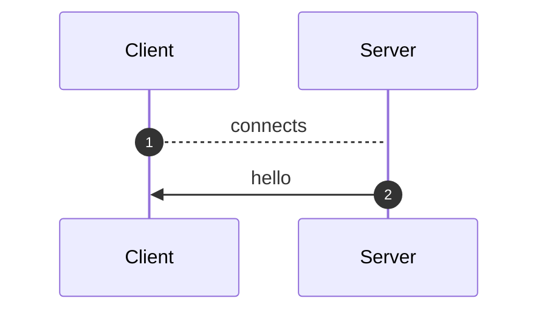
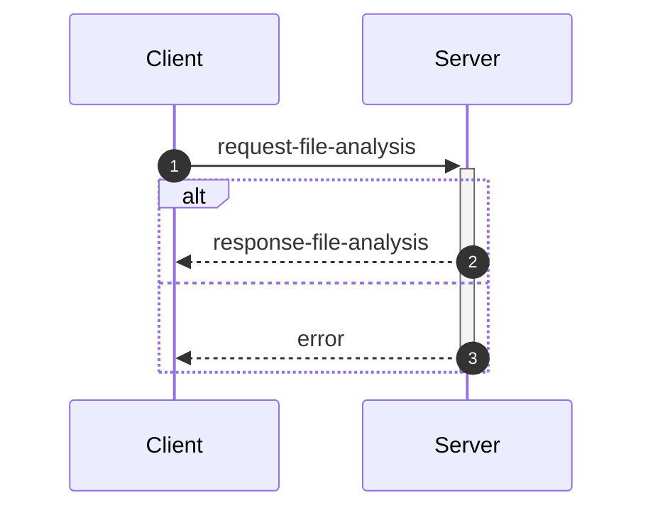
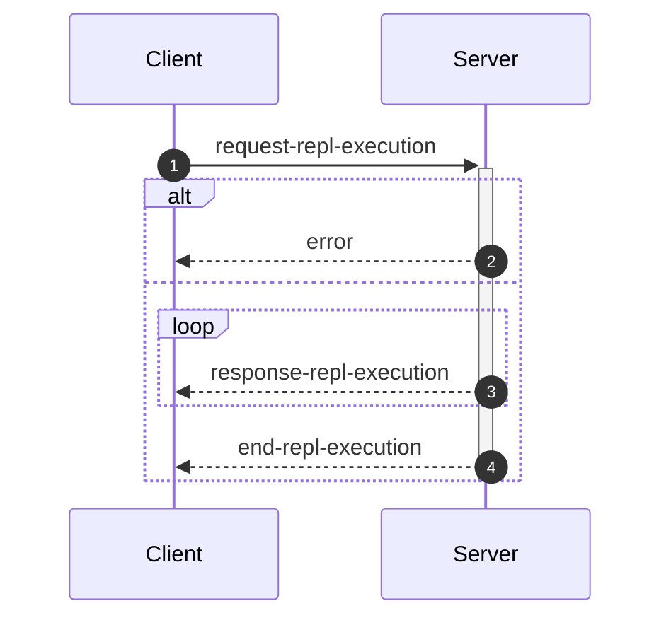
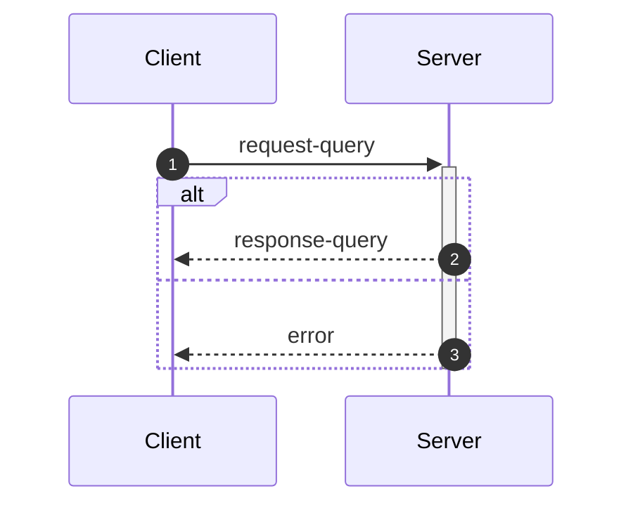

_<span title="an overview of flowR's interface">Generated</span> from '[wiki-interface.ts](https://github.com/flowr-analysis/flowr/tree/main/src/documentation/wiki-interface.ts "src/documentation/wiki-interface.ts")' on 2026-11-08, 09:20:49 UTC (v2.17.4, R v4.6.1), do not edit directly._

Although far from being as detailed as the in-depth explanation of [_flowR_](https://github.com/flowr-analysis/flowr/wiki/Core),
this wiki page explains how to interface with _flowR_ in more detail.
In general, command line arguments and other options provide short descriptions on hover over.

* [💻 Using the REPL](#using-the-repl)
* [⚙️ Configuring FlowR](#configuring-flowr)
* [⚒️ Writing Code](#writing-code)
* [💬 Communicating with the Server](#communicating-with-the-server)

<a id='using-the-repl'></a>
## 💻 Using the REPL

> [!NOTE]
> To execute arbitrary R commands with a repl request, _flowR_ has to be started explicitly with <span title="Description (Command Line Argument): Allow to access the underlying R session when using flowR (security warning: this allows the execution of arbitrary R code!)">`--r-session-access`</span>.
> Please be aware that this introduces a security risk and note that this relies on the [`r-shell` engine](https://github.com/flowr-analysis/flowr/wiki/Engines) .

Although primarily meant for users to explore,
there is nothing which forbids calling _flowR_ as a subprocess to use standard-in, -output, and -error
for communication (although you can access the REPL using the server as well,
with the [REPL Request](#message-request-repl-execution) message).

The read-eval-print loop&nbsp;(REPL) works relatively simple.
You can submit an expression (using <kbd>Enter</kbd>),
which is interpreted as an R&nbsp;expression by default but interpreted as a *command* if it starts with a colon (`:`).
The best command to get started with the REPL is <span title="Description (Repl Command): Show help information (aliases: :h, :?)">`:help`</span>.
Besides, you can leave the REPL either with the command <span title="Description (Repl Command): End the repl (aliases: :q, :exit)">`:quit`</span> or by pressing <kbd>Ctrl</kbd>+<kbd>C</kbd> twice.
When writing a *command*, you may press <kbd>Tab</kbd> to get a list of completions, if available.
Multiple commands can be entered in a single line by separating them with a semicolon (`;`), e.g. `:parse "x<-2"; :df*`.
If a command is given without R code, the REPL will re-use R code given in a previous command.
The prior example will hence return first the parsed AST of the program and then the dataflow graph for `"x <- 2"`.

> [!NOTE]
> If you develop flowR, you may want to launch the repl using the `npm run main-dev` command, this way, you get a non-minified version of flowR with debug information and hot-reloading of source files.

<details>
<summary>Available Commands</summary>

We currently offer the following commands (this with a `[*]` suffix are available with and without the star):

| Command | Description |
| ------- | ----------- |
| **<span title="Description (Repl Command): End the repl (aliases: :q, :exit)">:quit</span>** | End the repl (aliases: **:<span title="Alias of ':quit'. End the repl">q</span>**, **:<span title="Alias of ':quit'. End the repl">exit</span>**) |
| **<span title="Description (Repl Command): Execute the given code as R code. This requires the `--r-session-access` flag to be set and requires the r-shell engine. (aliases: :e, :r)">:execute</span>** | Execute the given code as R code. This requires the `--r-session-access` flag to be set and requires the r-shell engine. (aliases: **:<span title="Alias of ':execute'. Execute the given code as R code. This requires the `--r-session-access` flag to be set and requires the r-shell engine.">e</span>**, **:<span title="Alias of ':execute'. Execute the given code as R code. This requires the `--r-session-access` flag to be set and requires the r-shell engine.">r</span>**) |
| **<span title="Description (Repl Command): Get mermaid code for the control-flow graph of R code (aliases: :cfg, :cf)">:controlflow[*]</span>** | Get mermaid code for the control-flow graph of R code (star: Returns the URL to mermaid.live) (aliases: **:<span title="Alias of ':controlflow'. Get mermaid code for the control-flow graph of R code">cfg</span>**, **:<span title="Alias of ':controlflow'. Get mermaid code for the control-flow graph of R code">cf</span>**) |
| **<span title="Description (Repl Command): Get mermaid code for the control-flow graph with basic blocks (aliases: :cfgb, :cfb)">:controlflowbb[*]</span>** | Get mermaid code for the control-flow graph with basic blocks (star: Returns the URL to mermaid.live) (aliases: **:<span title="Alias of ':controlflowbb'. Get mermaid code for the control-flow graph with basic blocks">cfgb</span>**, **:<span title="Alias of ':controlflowbb'. Get mermaid code for the control-flow graph with basic blocks">cfb</span>**) |
| **<span title="Description (Repl Command): Get mermaid code for the dataflow graph (aliases: :d, :df)">:dataflow[*]</span>** | Get mermaid code for the dataflow graph (star: Returns the URL to mermaid.live) (aliases: **:<span title="Alias of ':dataflow'. Get mermaid code for the dataflow graph">d</span>**, **:<span title="Alias of ':dataflow'. Get mermaid code for the dataflow graph">df</span>**) |
| **<span title="Description (Repl Command): Get mermaid code for the normalized AST of R code (aliases: :n)">:normalize[*]</span>** | Get mermaid code for the normalized AST of R code (star: Returns the URL to mermaid.live) (alias: **:<span title="Alias of ':normalize'. Get mermaid code for the normalized AST of R code">n</span>**) |
| **<span title="Description (Repl Command): Get mermaid code for the simplified dataflow graph (aliases: :ds, :dfs)">:dataflowsimple[*]</span>** | Get mermaid code for the simplified dataflow graph (star: Returns the URL to mermaid.live) (aliases: **:<span title="Alias of ':dataflowsimple'. Get mermaid code for the simplified dataflow graph">ds</span>**, **:<span title="Alias of ':dataflowsimple'. Get mermaid code for the simplified dataflow graph">dfs</span>**) |
| **<span title="Description (Repl Command): Inspect and extend the signature database: `query` (identical to :query @signature), `info <name>` for where a function comes from (identical to :query @function-info), `add <path>` to mount another database/source, `download` to fetch the full-history database. (aliases: :sig)">:signature</span>** | Inspect and extend the signature database: `query` (identical to :query @signature), `info <name>` for where a function comes from (identical to :query @function-info), `add <path>` to mount another database/source, `download` to fetch the full-history database. (alias: **:<span title="Alias of ':signature'. Inspect and extend the signature database: `query` (identical to :query @signature), `info <name>` for where a function comes from (identical to :query @function-info), `add <path>` to mount another database/source, `download` to fetch the full-history database.">sig</span>**) |
| **<span title="Description (Repl Command): Just calculates the DFG, but only prints summary info (aliases: :d#, :df#)">:dataflowsilent</span>** | Just calculates the DFG, but only prints summary info (aliases: **:<span title="Alias of ':dataflowsilent'. Just calculates the DFG, but only prints summary info">d#</span>**, **:<span title="Alias of ':dataflowsilent'. Just calculates the DFG, but only prints summary info">df#</span>**) |
| **<span title="Description (Repl Command): Prints ASCII Art of the parsed, unmodified AST (aliases: :p)">:parse</span>** | Prints ASCII Art of the parsed, unmodified AST (alias: **:<span title="Alias of ':parse'. Prints ASCII Art of the parsed, unmodified AST">p</span>**) |
| **<span title="Description (Repl Command): Prints the version of flowR as well as the current version of R">:version</span>** | Prints the version of flowR as well as the current version of R
| **<span title="Description (Repl Command): Query the given R code (use 'help' for more information)">:query[*]</span>** | Query the given R code (use 'help' for more information) (star: Similar to query, but returns the output in json format.)
| **<span title="Description (Repl Command): Returns an ASCII representation of the dataflow graph (aliases: :df!)">:dataflowascii</span>** | Returns an ASCII representation of the dataflow graph (alias: **:<span title="Alias of ':dataflowascii'. Returns an ASCII representation of the dataflow graph">df!</span>**) |
| **<span title="Description (Repl Command): Returns summarization stats for the normalized AST (aliases: :n#)">:normalize#</span>** | Returns summarization stats for the normalized AST (alias: **:<span title="Alias of ':normalize#'. Returns summarization stats for the normalized AST">n#</span>**) |
| **<span title="Description (Repl Command): Show help information (aliases: :h, :?)">:help</span>** | Show help information (aliases: **:<span title="Alias of ':help'. Show help information">h</span>**, **:<span title="Alias of ':help'. Show help information">?</span>**) |

</details>

> [!TIP]
> 
> As indicated by the examples before, all REPL commands that operate on code keep track of the state.
> Hence, if you run a command like <span title="Description (Repl Command, starred version): Returns the URL to mermaid.live; Base Command: Get mermaid code for the dataflow graph (aliases: :d*, :df*)">`:dataflow*`</span> without providing R code,
> the REPL will re-use the R code provided in a previous command.
> Likewise, doing this will benefit from incrementality!
> If you request the dataflow graph with `:df* x <- 2 * y` and then want to see the parsed AST with `:parse`,
> the REPL will re-use previously obtained information and not re-parse the code again.
> 		

Generally, many commands offer shortcut versions in the REPL. Many queries, for example, offer a shortened format (see the example below).
Of special note, the [Config Query](https://github.com/flowr-analysis/flowr/wiki/%5BQuery%5D-Config)
can be used to also modify the currently active configuration of _flowR_ within the REPL (see the [wiki page](https://github.com/flowr-analysis/flowr/wiki/%5BQuery%5D-Config) for more information).

### Example: Retrieving the Dataflow Graph

To retrieve a URL to the [mermaid](https://mermaid.js.org/) diagram of the dataflow of a given expression,
use <span title="Description (Repl Command, starred version): Returns the URL to mermaid.live; Base Command: Get mermaid code for the dataflow graph (aliases: :d*, :df*)">`:dataflow*`</span> (or <span title="Description (Repl Command): Get mermaid code for the dataflow graph (aliases: :d, :df)">`:dataflow`</span> to get the mermaid code in the cli):

```shell
$ docker run -it --rm eagleoutice/flowr # or npm run flowr 
flowR repl v2.17.4, R grammar v14 (tree-sitter engine)
R> :dataflow* y <- 1 + x
```

<details>
<summary style='color:gray'>Output</summary>

```text
https://mermaid.live/view#base64:eyJjb2RlIjoiZmxvd2NoYXJ0IFREXG4gICAgMXt7XCJgKiM5MTtSTnVtYmVyIzkzOyogKioxKipcbiAgICAgICoxLjYqICgqKmlkOiAxKiopYFwifX1cbiAgICAyKFtcImAqIzkxO1JTeW1ib2wjOTM7KiAqKngqKlxuICAgICAgKjEuMTAqICgqKmlkOiAyKiopYFwiXSlcbiAgICAzW1tcImAqIzkxO1JCaW5hcnlPcCM5MzsqIGJhc2UjNTg7IzU4OyoqIzQzOyoqXG4gICAgICAqMS42LTEwKiAoKippZDogMyoqKVxuICAgIGFyZzogKDEsIDIpYFwiXV1cbiAgICBidWlsdC1pbjpfNDNfW1wiYEJ1aWx0LUluOlxuIzQzO2BcIl1cbiAgICBzdHlsZSBidWlsdC1pbjpfNDNfIHN0cm9rZTpncmF5LGZpbGw6Z3JheSxzdHJva2Utd2lkdGg6MnB4LG9wYWNpdHk6Ljg7XG4gICAgMFtcImAqIzkxO1JTeW1ib2wjOTM7KiAqKnkqKlxuICAgICAgKjEuMSogKCoqaWQ6IDAqKiwgdjogMylgXCJdXG4gICAgNFtbXCJgKiM5MTtSQmluYXJ5T3AjOTM7KiBiYXNlIzU4OyM1ODsqKiM2MDsjNDU7KipcbiAgICAgICoxLjEtMTAqICgqKmlkOiA0KiopXG4gICAgYXJnOiAoMCwgMylgXCJdXVxuICAgIGJ1aWx0LWluOl82MF8tW1wiYEJ1aWx0LUluOlxuIzYwOyM0NTtgXCJdXG4gICAgc3R5bGUgYnVpbHQtaW46XzYwXy0gc3Ryb2tlOmdyYXksZmlsbDpncmF5LHN0cm9rZS13aWR0aDoycHgsb3BhY2l0eTouODtcbiAgICAxIC0uLT58XCJmbG93XCJ8IDJcbiAgICBsaW5rU3R5bGUgMCBzdHJva2U6Z3JheSxjb2xvcjpncmF5O1xuICAgIDIgLS4tPnxcImZsb3dcInwgM1xuICAgIGxpbmtTdHlsZSAxIHN0cm9rZTpncmF5LGNvbG9yOmdyYXk7XG4gICAgMyAtLT58XCJyZWFkcywgYXJnXCJ8IDFcbiAgICAzIC0tPnxcInJlYWRzLCBhcmdcInwgMlxuICAgIDMgLS4tPnxcImZsb3dcInwgMFxuICAgIGxpbmtTdHlsZSA0IHN0cm9rZTpncmF5LGNvbG9yOmdyYXk7XG4gICAgMyAtLi0+fFwicmVhZHMsIGNhbGxzXCJ8IGJ1aWx0LWluOl80M19cbiAgICBsaW5rU3R5bGUgNSBzdHJva2U6Z3JheTtcbiAgICAwIC0tPnxcImRlZmluZWQtYnksIGZsb3dcInwgNFxuICAgIDAgLS0+fFwiZGVmaW5lZC1ieVwifCAzXG4gICAgNCAtLT58XCJyZWFkcywgYXJnXCJ8IDNcbiAgICA0IC0tPnxcInJldHVybnMsIGFyZ1wifCAwXG4gICAgNCAtLi0+fFwicmVhZHMsIGNhbGxzXCJ8IGJ1aWx0LWluOl82MF8tXG4gICAgbGlua1N0eWxlIDEwIHN0cm9rZTpncmF5OyIsIm1lcm1haWQiOnsiYXV0b1N5bmMiOnRydWV9fQ==
```

Retrieve the dataflow graph of the expression `y <- 1 + x`. It looks like this:


<details>

<summary style="color:gray">R Code of the Dataflow Graph</summary>

The analysis ran (parse and normalize with the [tree-sitter](https://github.com/flowr-analysis/flowr/wiki/Engines) engine) in the generation environment. No [signature database](https://github.com/flowr-analysis/flowr/wiki/Signature-Database) is mounted, so `library()` attaches no exports (base-R names are still qualified, e.g., `stats::acf`). 
We encountered no unknown side effects during the analysis.

```r
y <- 1 + x
```

</details>

</details>

For small graphs like this, <span title="Description (Repl Command): Returns an ASCII representation of the dataflow graph (aliases: :df!)">`:dataflowascii`</span> also provides an ASCII representation directly in the REPL:

```shell
$ docker run -it --rm eagleoutice/flowr # or npm run flowr 
flowR repl v2.17.4, R grammar v14 (tree-sitter engine)
R> :df! y <- 1 + x
```

<details open>
<summary style='color:gray'>Output</summary>

```text
                        v<0>v
 c<4>c──────────────────| y |
 |<- |     ┌────────────v---v
 c---c     │
    │   c<3>c   0<1>0
    └───| + |───| 1 |───u<2>u
        c---c   0---0   | x |
           └────────────u---u
Edges:
3 -> 1: reads, arg          3 -> 2: reads, arg
3 -> 0: flows-to            1 -> 2: flows-to
2 -> 3: flows-to            4 -> 3: reads, arg
4 -> 0: returns, arg        0 -> 4: defined-by, flows-to
0 -> 3: defined-by
```

Retrieve the dataflow graph of the expression `y <- 1 + x` as ASCII art.

</details>

For the slicing with <span title="Description (Repl Command): Static backwards executable slicer for R">`:slicer`</span>, you have access to the same [magic comments](#slice-magic-comments) as with the [slice request](#message-request-slice).
Pass `--inline` to splice resolvable `source()` calls into the reconstruction so the slice is a single self-contained R text (the same as the static slice query's `inlineSources` flag).
See `--help` for more flags!

### Example: Interfacing with the File System

Many commands that allow for an R-expression (like <span title="Description (Repl Command, starred version): Returns the URL to mermaid.live; Base Command: Get mermaid code for the dataflow graph (aliases: :d*, :df*)">`:dataflow*`</span>) allow for a file as well
if the argument starts with `file://`.
If you are working from the root directory of the _flowR_ repository, the following gives you the parsed AST of the example file using the <span title="Description (Repl Command): Prints ASCII Art of the parsed, unmodified AST (aliases: :p)">`:parse`</span> command:

> **Watch mode**: Replace `file://` with `watch://` to enter watch mode.
> flowR runs the command immediately and then re-runs it every time the file (or any file inside the folder) changes.
> Enter any other command to leave watch mode.
> For example: `:df watch://analysis.R`

```shell
$ docker run -it --rm eagleoutice/flowr # or npm run flowr 
flowR repl v2.17.4, R grammar v14 (tree-sitter engine)
R> :parse file://test/testfiles/example.R
```

<details>
<summary style='color:gray'>Output</summary>

```text
File: test/testfiles/example.R

program
├ binaryoperator
│ ├ identifier "sum" (1:1─4)
│ ├ <- "<-" (1:5─7)
│ ╰ float "0" (1:8─9)
├ binaryoperator
│ ├ identifier "product" (2:1─8)
│ ├ <- "<-" (2:9─11)
│ ╰ float "1" (2:12─13)
├ binaryoperator
│ ├ identifier "w" (3:1─2)
│ ├ <- "<-" (3:3─5)
│ ╰ float "7" (3:6─7)
├ binaryoperator
│ ├ identifier "N" (4:1─2)
│ ├ <- "<-" (4:3─5)
│ ╰ float "10" (4:6─8)
├ forstatement
│ ├ for "for" (6:1─4)
│ ├ ( "(" (6:5─6)
│ ├ identifier "i" (6:6─7)
│ ├ in "in" (6:8─10)
│ ├ binaryoperator
│ │ ├ float "1" (6:11─12)
│ │ ├ : ":" (6:12─13)
│ │ ╰ parenthesizedexpression
│ │   ├ ( "(" (6:13─14)
│ │   ├ binaryoperator
│ │   │ ├ identifier "N" (6:14─15)
│ │   │ ├ - "-" (6:15─16)
│ │   │ ╰ float "1" (6:16─17)
│ │   ╰ ) ")" (6:17─18)
│ ├ ) ")" (6:18─19)
│ ╰ bracedexpression
│   ├ { "{" (6:20─21)
│   ├ binaryoperator
│   │ ├ identifier "sum" (7:3─6)
│   │ ├ <- "<-" (7:7─9)
│   │ ╰ binaryoperator
│   │   ├ binaryoperator
│   │   │ ├ identifier "sum" (7:10─13)
│   │   │ ├ + "+" (7:14─15)
│   │   │ ╰ identifier "i" (7:16─17)
│   │   ├ + "+" (7:18─19)
│   │   ╰ identifier "w" (7:20─21)
│   ├ binaryoperator
│   │ ├ identifier "product" (8:3─10)
│   │ ├ <- "<-" (8:11─13)
│   │ ╰ binaryoperator
│   │   ├ identifier "product" (8:14─21)
│   │   ├  "" (8:22─23)
│   │   ╰ identifier "i" (8:24─25)
│   ╰ } "}" (9:1─2)
├ call
│ ├ identifier "cat" (11:1─4)
│ ╰ arguments
│   ├ ( "(" (11:4─5)
│   ├ argument
│   │ ╰ string
│   │   ├ stringopen "\"" (11:5─6)
│   │   ├ stringcontent "Sum:" (11:6─10)
│   │   ╰ stringclose "\"" (11:10─11)
│   ├ comma "," (11:11─12)
│   ├ argument
│   │ ╰ identifier "sum" (11:13─16)
│   ├ comma "," (11:16─17)
│   ├ argument
│   │ ╰ string
│   │   ├ stringopen "\"" (11:18─19)
│   │   ├ stringcontent
│   │   │ ╰ escapesequence "\\n" (11:19─21)
│   │   ╰ stringclose "\"" (11:21─22)
│   ╰ ) ")" (11:22─23)
╰ call
  ├ identifier "cat" (12:1─4)
  ╰ arguments
    ├ ( "(" (12:4─5)
    ├ argument
    │ ╰ string
    │   ├ stringopen "\"" (12:5─6)
    │   ├ stringcontent "Product:" (12:6─14)
    │   ╰ stringclose "\"" (12:14─15)
    ├ comma "," (12:15─16)
    ├ argument
    │ ╰ identifier "product" (12:17─24)
    ├ comma "," (12:24─25)
    ├ argument
    │ ╰ string
    │   ├ stringopen "\"" (12:26─27)
    │   ├ stringcontent
    │   │ ╰ escapesequence "\\n" (12:27─29)
    │   ╰ stringclose "\"" (12:29─30)
    ╰ ) ")" (12:30─31)
```

Retrieve the parsed AST of the example file.

<details>

<summary>File Content</summary>

```r
sum <- 0
product <- 1
w <- 7
N <- 10

for (i in 1:(N-1)) {
  sum <- sum + i + w
  product <- product * i
}

cat("Sum:", sum, "\n")
cat("Product:", product, "\n")
```

</details>

As _flowR_ directly transforms this AST the output focuses on being human-readable instead of being machine-readable.
		
</details>

### Example: Run a Query

You can run any query supported by _flowR_ using the <span title="Description (Repl Command): Query the given R code (use 'help' for more information)">`:query`</span> command.
For example, to obtain the shapes of all data frames in a given piece of code, you can run:

```shell
$ docker run -it --rm eagleoutice/flowr # or npm run flowr 
flowR repl v2.17.4, R grammar v14 (tree-sitter engine)
R> :query @absint df-shape "x <- data.frame(a = 1:10, b = 1:10)\ny <- x$a"
```

<details open>
<summary style='color:gray'>Output</summary>

```text
Query: absint (2 ms)
   ╰ $12: (colnames: [{"a", "b"}, {}], cols: [2, 2], rows: [10, 10])
   ╰ $0: (colnames: [{"a", "b"}, {}], cols: [2, 2], rows: [10, 10])
```

Retrieve the shapes of all data frames in the given code.

</details>

To run the linter on a file, you can use (in this example, we just issue the `dead-code` linter on a small piece of code):

```shell
$ docker run -it --rm eagleoutice/flowr # or npm run flowr 
flowR repl v2.17.4, R grammar v14 (tree-sitter engine)
R> :query @linter rules:dead-code "if(FALSE) x <- 2"
```

<details open>
<summary style='color:gray'>Output</summary>

```text
Query: linter (3 ms)
   ╰ Dead Code (dead-code):
       ╰ certain:
           ╰ Code at 1.11-16 (1 quick fix(es) available)
```

Run the linter on the given code, with only the `dead-code` rule enabled.

</details>

For more information on the available queries, please check out the [Query API](https://github.com/flowr-analysis/flowr/wiki/Query-API).

<a id='configuring-flowr'></a>
## ⚙️ Configuring FlowR

When running _flowR_, you may want to specify some behaviors with a dedicated configuration file.
By default, flowR looks for a file named `flowr.json` in the current working directory (or any higher directory).
You can also specify a different file with <span title="Description (Command Line Argument): The name of the configuration file to use">`--config-file`</span> or pass the configuration inline using <span title="Description (Command Line Argument): The flowR configuration to use, as a JSON string">`--config-json`</span>.
A `flowr.json` found this way belongs to the analyzed project, so flowR ignores its options that decide what flowR executes or loads
(`engines.*.wasmPath`, `engines.*.treeSitterWasmPath`, `engines.*.rPath`, `solver.sigdb.additionalPaths`, `solver.sigdb.downloadRepo`, `solver.sigdb.installedLibrary.paths`, `solver.sigdb.onDemand.enabled`, `solver.sigdb.onDemand.repositories`, `solver.sigdb.onDemand.cranMirror`, `solver.sigdb.onDemand.bioconductorMirror`, `solver.sigdb.onDemand.cacheDir`),
unless you pass <span title="Description (Command Line Argument): Keep the security-sensitive options (e.g., the R executable) of the flowr.json found in the working directory or a parent. Only use this for projects you trust.">`--trust-config`</span>.
To analyze code you do not trust, use the secure mode (<span title="Description (Command Line Argument): Run in secure mode for analyzing untrusted code: flowR does not start R (or any other process), does not access the network, does not search for project configs, and ignores security-sensitive options in every config. Cannot be disabled once enabled. Can also be enabled with the environment variable {italic FLOWR_SECURE_MODE=1}.">`--secure`</span>, see the [security policy](https://github.com/flowr-analysis/flowr/blob/main/.github/SECURITY.md)).
To inspect the current configuration, you can run flowr with the <span title="Description (Command Line Argument): Run with verbose logging (will be passed to the corresponding script)">`--verbose`</span> flag, or use the `config` [Query](https://github.com/flowr-analysis/flowr/wiki/Query-API).
Within the REPL this works by running the following:

```shell
:query @config
```

To work with the <a href="https://github.com/flowr-analysis/flowr/tree/main/src/config.ts#L119"><code><span title="The configuration file format for flowR.">FlowrConfig</span></code></a> you can use the provided helper objects alongside its methods like
<a href="https://github.com/flowr-analysis/flowr/tree/main/src/config.ts#L985"><code><span title="Creates a new flowr config that has the updated values.">FlowrConfig::<b>amend</b></span></code></a>.
The schema below documents every option; the ones you most likely want are:

- <a href="https://github.com/flowr-analysis/flowr/wiki/Interface#configuring-flowr" title="Configuration Option (boolean): Whether source calls should be ignored, causing {@link processSourceCall}&#39;s behavior to be skipped.">ignoreSourceCalls</a>: ignore source calls when analyzing the code, i.e., ignore the inclusion of other files.
- <a href="https://github.com/flowr-analysis/flowr/wiki/Interface#configuring-flowr" title="Configuration Option (boolean): Whether load calls should be ignored, causing {@link processLoadCall}&#39;s behavior to be skipped.">ignoreLoadCalls</a>: ignore load calls when analyzing the code, i.e., ignore the loading of r-data files.
- <a href="https://github.com/flowr-analysis/flowr/wiki/Interface#configuring-flowr" title="Configuration Option (object): Do you want to overwrite (parts) of the builtin definition?">semantics.environment.overwriteBuiltIns</a>: overwrite _flowR_'s handling of built-in functions, or clear the preset definitions entirely.
  See [Configure BuiltIn Semantics](#configure-builtin-semantics) for more information.
- <a href="https://github.com/flowr-analysis/flowr/wiki/Interface#configuring-flowr" title="Configuration Option (boolean): Whether calls drawing on a graphics device (e.g., `plot`) count as writing to it, which the ambient state queries then report.">semantics.ambient.drawingWritesDevice</a>: whether calls drawing on a graphics device (e.g., `plot`) count as writing the device in the ambient state queries.
- <a href="https://github.com/flowr-analysis/flowr/wiki/Interface#configuring-flowr" title="Configuration Option (string): How to resolve variables and their values. (one of &quot;disabled&quot;, &quot;alias&quot;, &quot;builtin&quot;)">solver.variables</a>: how to resolve variables and their values (`disabled`, `alias`, `builtin`).
- <a href="https://github.com/flowr-analysis/flowr/wiki/Interface#configuring-flowr" title="Configuration Option (array): The engine or set of engines to use for interacting with R code. An empty array means all available engines will be used.">engines</a> and <a href="https://github.com/flowr-analysis/flowr/wiki/Interface#configuring-flowr" title="Configuration Option (string): The default engine to use for interacting with R code. If this is undefined, an arbitrary engine from the specified list will be used. (one of &quot;tree-sitter&quot;, &quot;r-shell&quot;)">defaultEngine</a>: the engines used to interact with R code, see the [Engines wiki page](https://github.com/flowr-analysis/flowr/wiki/Engines).
- <a href="https://github.com/flowr-analysis/flowr/wiki/Interface#configuring-flowr" title="Configuration Option (array): Files a framework loads on its own, without any source() call (e.g. global.R in a shiny app), in the order they are loaded; flowR orders the matching project files accordingly and analyzes them as one program. Entries are case-insensitive globs matched against the file path, a plain name matches any file with that name, and entries matching no project file are warned about. Usually set per project kind via specializeConfig.">project.implicitSources</a>: the files a framework loads without any `source()` call, in the order in which they are
  loaded. Entries are globs (e.g. `R/*.R`) matched against the file path ignoring capitalization; one matching no file is reported.
- <a href="https://github.com/flowr-analysis/flowr/wiki/Interface#configuring-flowr" title="Configuration Option (object): Overwrite (parts of) the configuration depending on the project kind flowR detects, e.g. to give a shiny app its implicit sources.">specializeConfig</a>: overwrite (parts of) the configuration depending on the kind of project _flowR_ detects
  (e.g. `shiny-app`), which is how a shiny app gets its implicit sources by default. What you configure directly wins.
- <a href="https://github.com/flowr-analysis/flowr/wiki/Interface#configuring-flowr" title="Configuration Option (string): Overwrite the project kind flowR would otherwise infer from the analyzed files, e.g. when auto-detection guesses wrong. (one of &quot;package&quot;, &quot;script&quot;, &quot;shiny-app&quot;, &quot;notebook&quot;, &quot;project&quot;, &quot;unknown&quot;)">project.useProjectType</a>: skip that detection and force a project kind yourself, when auto-detection guesses wrong.
- <a href="https://github.com/flowr-analysis/flowr/wiki/Interface#configuring-flowr" title="Configuration Option (array): The default plugins to load when creating a new instance of FlowrAnalyzer">defaultPlugins</a> and <a href="https://github.com/flowr-analysis/flowr/wiki/Interface#configuring-flowr" title="Configuration Option (array): The plugins to load in REPL mode">repl.plugins</a>: the plugins to load for a new <a href="https://github.com/flowr-analysis/flowr/tree/main/src/project/flowr-analyzer.ts#L240"><code><span title="Central class for conducting analyses with FlowR. Use the FlowrAnalyzerBuilder to create a new instance. If you want the original pattern of creating a pipeline and running all steps, you can still do this with FlowrAnalyzer#runFull . To inspect the context of the analyzer, use FlowrAnalyzer#inspectContext (if you are a plugin and need to modify it, use FlowrAnalyzer#context instead).">FlowrAnalyzer</span></code></a> and in the REPL
  (use `flowr:default` to reference the former).

So you can configure _flowR_ by adding a file like the following:

<details>

<summary>Example Configuration File</summary>

```json
{
  "ignoreSourceCalls": true,
  "ignoreLoadCalls": true,
  "semantics": {
    "environment": {
      "overwriteBuiltIns": {
        "definitions": [
          {
            "type": "function",
            "names": [
              "foo"
            ],
            "processor": "builtin:assign",
            "config": {}
          }
        ]
      }
    }
  },
  "defaultPlugins": [
    "file:description",
    "versions:description"
  ],
  "repl": {
    "quickStats": false,
    "dfProcessorHeat": false,
    "hints": true,
    "plugins": [
      "flowr:default"
    ]
  },
  "project": {
    "resolveUnknownPathsOnDisk": true,
    "implicitSources": [
      "global.R",
      "app.R"
    ]
  },
  "linter": {
    "disabledRules": []
  },
  "specializeConfig": {
    "shiny-app": {
      "project": {
        "implicitSources": [
          "global.R",
          "ui.R",
          "server.R",
          "app.R"
        ]
      }
    }
  },
  "engines": [
    {
      "type": "r-shell"
    }
  ],
  "solver": {
    "variables": "alias",
    "evalStrings": true,
    "trackEnvironments": true,
    "sigdb": {
      "enabled": true,
      "loadProjectDependencies": true,
      "eagerlyLoad": false,
      "eagerlyLoadExports": false,
      "linkBaseR": false,
      "linkDescriptionDependencies": false
    },
    "resolveSource": {
      "dropPaths": "no",
      "ignoreCapitalization": true,
      "inferWorkingDirectory": "active-script",
      "searchPath": []
    },
    "instrument": {},
    "slicer": {
      "threshold": 50
    }
  },
  "abstractInterpretation": {
    "wideningThreshold": 4,
    "followCalls": true,
    "dataFrame": {
      "maxColNames": 20,
      "readLoadedData": {
        "readExternalFiles": true,
        "maxReadLines": 1000000
      }
    }
  },
  "incremental": {
    "alwaysIncremental": false,
    "parsing": {
      "activated": false,
      "heuristics": {
        "activated": true,
        "mtime": true,
        "linesFrom": 500,
        "bytesFrom": 50000,
        "alwaysWithEdits": false,
        "minFiles": 1
      }
    }
  },
  "gas": {
    "thresholds": {
      "memory": {
        "problematic": 0.7,
        "critical": 0.9
      },
      "timeMs": {
        "problematic": 100000,
        "critical": 120000
      }
    },
    "features": {}
  }
}
```

</details>

<details>
<a id='configure-builtin-semantics'></a>
<summary>Configure Built-In Semantics</summary>

`semantics/environment/overwriteBuiltins` accepts two keys:

- `loadDefaults` (boolean, initially `true`): If set to `true`, the default built-in definitions are loaded before applying the custom definitions. Setting this flag to `false` explicitly disables the loading of the default definitions.
- `definitions` (array, initially empty): Allows to overwrite or define new built-in elements. Each object within must have a `type` which is one of the below. Furthermore, they may define a string array of `names` which specifies the identifiers to bind the definitions to. You may use `assumePrimitive` to specify whether _flowR_ should assume that this is a primitive non-library definition (so you probably just do not want to specify the key).

  | Type            | Description                                                                                                                                                                                                                                                                                              | Example                                                                                                    |
  | --------------- | -------------------------------------------------------------------------------------------------------------------------------------------------------------------------------------------------------------------------------------------------------------------------------------------------------- | ---------------------------------------------------------------------------------------------------------- |
  | `constant`    | Additionally allows for a `value` this should resolve to.                                                                                                                                                                                                                                                | `{ type: 'constant', names: ['NULL', 'NA'],  value: null }`                                                |
  | `function`    | Is a rather flexible way to define and bind built-in functions. For the time, we do not have extensive documentation to cover all the cases, so please either consult the sources with the `default-builtin-config/` folder or open a [new issue](https://github.com/flowr-analysis/flowr/issues/new/choose). | `{ type: 'function', names: ['next'], processor: 'builtin:d', config: { cfg: ExitPointType.Next } }` |
  | `replacement` | A comfortable way to specify replacement functions like `$<-` or `names<-`. `suffixes` describes the... suffixes to attach automatically. | `{ type: 'replacement', suffixes: ['<-', '<<-'], names: ['[', '[['] }` |

</details>

<details>

<summary style='color:gray'>Full Configuration-File Schema</summary>

- _The configuration file format for flowR._ (object)
    - **logLevel** [optional] _flowR's global minimum log level, applied when the config is loaded._ (string)
        Only allows: 'silly', 'trace', 'debug', 'info', 'warn', 'error', 'fatal'
    - **ignoreSourceCalls** [optional] _Whether source calls should be ignored, causing {@link processSourceCall}'s behavior to be skipped._ (boolean)
    - **ignoreLoadCalls** [optional] _Whether load calls should be ignored, causing {@link processLoadCall}'s behavior to be skipped._ (boolean)
    - **semantics** _Configure language semantics and how flowR handles them._ (object)
        - **environment** [optional] _Semantics regarding how to handle the R environment._ (object)
            - **overwriteBuiltIns** [optional] _Do you want to overwrite (parts) of the builtin definition?_ (object)
                - **loadDefaults** [optional] _Should the default configuration still be loaded?_ (boolean)
                - **definitions** [optional] _The definitions to load/overwrite._ (array)
                Valid item types:
                    - (object)
        - **ambient** [optional] _Semantics regarding the global state (options, devices, files, ...) calls access._ (object)
            - **drawingWritesDevice** [optional] _Whether calls drawing on a graphics device (e.g., `plot`) count as writing to it, which the ambient state queries then report._ (boolean)
    - **defaultPlugins** [optional] _The default plugins to load when creating a new instance of FlowrAnalyzer_ (array)
    Valid item types:
        - (alternatives)
            - (string)
            - (array)
    - **repl** _Configuration options for the REPL._ (object)
        - **quickStats** [optional] _Whether to show quick stats in the REPL after each evaluation._ (boolean)
        - **dfProcessorHeat** [optional] _This instruments the dataflow processors to count how often each processor is called._ (boolean)
        - **hints** [optional] _Whether to show dim inline hints on the empty prompt (automatically disabled on non-interactive terminals)._ (boolean)
        - **plugins** [optional] _The plugins to load in REPL mode_ (array)
        Valid item types:
            - (alternatives)
                - (string)
                - (array)
        - **autoUseFileProtocol** [optional] _Prepend the file protocol to a repl input that looks like a path, instead of only warning about it._ (boolean)
        - **queryStats** [optional] _Whether `:query` closes with the line stating how long the queries took (`:query*` never prints it)._ (boolean)
        - **showPlugins** [optional] _Whether `:version` grays out the plugins that did not activate during the last analysis._ (boolean)
    - **project** _Project specific configuration options._ (object)
        - **resolveUnknownPathsOnDisk** [optional] _Whether to resolve unknown paths loaded by the r project disk when trying to source/analyze files._ (boolean)
        - **failOnInaccessiblePath** [optional] _Whether a directory that cannot be traversed during file discovery (e.g. due to permissions) aborts the analysis; when false (the default) such paths are logged and skipped._ (boolean)
        - **basePackages** [optional] _The packages considered part of R itself (base and recommended); if unset, flowR uses its built-in list._ (array)
        Valid item types:
            - (string)
        - **implicitSources** [optional] _Files a framework loads on its own, without any source() call (e.g. global.R in a shiny app), in the order they are loaded; flowR orders the matching project files accordingly and analyzes them as one program. Entries are case-insensitive globs matched against the file path, a plain name matches any file with that name, and entries matching no project file are warned about. Usually set per project kind via specializeConfig._ (array)
        Valid item types:
            - (string)
        - **useProjectType** [optional] _Overwrite the project kind flowR would otherwise infer from the analyzed files, e.g. when auto-detection guesses wrong._ (string)
            Only allows: 'package', 'script', 'shiny-app', 'notebook', 'project', 'unknown'
        - **assumeImplicitEcho** [optional] _Whether the top level of the analyzed code is echoed, so that every visible result printed there is collected as an output by the dependencies query (default true, false for a package)._ (boolean)
        - **discovery** [optional] _Scoping options for the default project discovery._ (object)
            - **full** [optional] _Collect every file below the project root (greedy) instead of only the files the detected project kind needs (default false)._ (boolean)
            - **perKind** [optional] _Per-kind include/exclude glob overrides layered on the default scoping._ (object)
            - **ignore** [optional] _Case-insensitive globs that drop matching files from the intelligent discovery, regardless of kind (e.g. .Renviron to ignore environment files)._ (array)
            Valid item types:
                - (string)
        - **classification** [optional] _Overrides for the signals flowR uses to classify the project kind._ (object)
            - **shinyDescriptionTypes** [optional] _DESCRIPTION Type: values that mark a shiny app._ (array)
            Valid item types:
                - (string)
            - **shinyEntryFiles** [optional] _File names a shiny app is assembled from._ (array)
            Valid item types:
                - (string)
            - **shinyUsagePattern** [optional] _Regex source evidencing shiny usage in an entry file._ (string)
            - **notebookExtensions** [optional] _File extensions marking a notebook._ (array)
            Valid item types:
                - (string)
    - **linter** _Linter configuration options._ (object)
        - **disabledRules** _Linting rule names excluded from the default rule set (a rule requested explicitly via a linter query still runs). Usually set per project kind via specializeConfig._ (array)
        Valid item types:
            - (string)
        - **disabledTags** [optional] _Linting rule tags whose rules are excluded from the default rule set (a rule requested explicitly via a linter query still runs). By default the cmd-check rules are disabled for everything but a package; a configured list replaces that default._ (array)
        Valid item types:
            - (string)
    - **inputSources** [optional] _Further frameworks the input-sources analysis should know about; entries are added to flowR's defaults._ (object)
        - **pure** [optional] _Functions that only pass the constantness of their arguments on._ (array)
        Valid item types:
            - (string)
        - **param** [optional] _Functions whose result is a 'param' input._ (array)
        Valid item types:
            - (string)
        - **file** [optional] _Functions whose result is a 'file' input._ (array)
        Valid item types:
            - (string)
        - **tempfile** [optional] _Functions whose result is a 'tempfile' input._ (array)
        Valid item types:
            - (string)
        - **glob** [optional] _Functions whose result is a 'glob' input._ (array)
        Valid item types:
            - (string)
        - **net** [optional] _Functions whose result is a 'net' input._ (array)
        Valid item types:
            - (string)
        - **rand** [optional] _Functions whose result is a 'rand' input._ (array)
        Valid item types:
            - (string)
        - **system** [optional] _Functions whose result is a 'system' input._ (array)
        Valid item types:
            - (string)
        - **ffi** [optional] _Functions whose result is a 'ffi' input._ (array)
        Valid item types:
            - (string)
        - **lang** [optional] _Functions whose result is a 'lang' input._ (array)
        Valid item types:
            - (string)
        - **options** [optional] _Functions whose result is a 'options' input._ (array)
        Valid item types:
            - (string)
        - **cmdline** [optional] _Functions whose result is a 'cmdline' input._ (array)
        Valid item types:
            - (string)
        - **user** [optional] _Functions whose result is a 'user' input._ (array)
        Valid item types:
            - (string)
        - **const** [optional] _Functions whose result is a 'const' input._ (array)
        Valid item types:
            - (string)
        - **scope** [optional] _Functions whose result is a 'scope' input._ (array)
        Valid item types:
            - (string)
        - **dconst** [optional] _Functions whose result is a 'dconst' input._ (array)
        Valid item types:
            - (string)
        - **unknown** [optional] _Functions whose result is a 'unknown' input._ (array)
        Valid item types:
            - (string)
        - **linkedObjects** [optional] _Objects a framework provides without a definition in the code, e.g. shiny's input._ (array)
        Valid item types:
            - (object)
        - **linkedEntryPoints** [optional] _Calls that hand a function to a framework, which binds its objects to the parameters by position._ (array)
        Valid item types:
            - (object)
    - **specializeConfig** [optional] _Overwrite (parts of) the configuration depending on the project kind flowR detects, e.g. to give a shiny app its implicit sources._ (object)
    - **engines** _The engine or set of engines to use for interacting with R code. An empty array means all available engines will be used._ (array)
    Valid item types:
        - (alternatives)
            - _The configuration for the tree sitter engine._ (object)
                - **type** [required] _Use the tree sitter engine._ (string)
                    Only allows: 'tree-sitter'
                - **wasmPath** [optional] _The path to the tree-sitter-r WASM binary to use. If this is undefined, this uses the default path._ (string)
                - **treeSitterWasmPath** [optional] _The path to the tree-sitter WASM binary to use. If this is undefined, this uses the default path._ (string)
                - **lax** [optional] _Whether to use the lax parser for parsing R code (allowing for syntax errors). If this is undefined, the strict parser will be used._ (boolean)
            - _The configuration for the R shell engine._ (object)
                - **type** [required] _Use the R shell engine._ (string)
                    Only allows: 'r-shell'
                - **rPath** [optional] _The path to the R executable to use. If this is undefined, this uses the default path._ (string)
                - **pipeBind** [optional] _Whether to enable R's experimental pipe-bind operator "=>" by setting _R_USE_PIPEBIND_ for the R session (default false); R itself keeps this off by default, as it is experimental and has never shipped in a release version of R._ (boolean)
    - **defaultEngine** [optional] _The default engine to use for interacting with R code. If this is undefined, an arbitrary engine from the specified list will be used._ (string)
        Only allows: 'tree-sitter', 'r-shell'
    - **solver** _How to resolve constants, constraints, cells, ..._ (object)
        - **variables** _How to resolve variables and their values._ (string)
            Only allows: 'disabled', 'alias', 'builtin'
        - **evalStrings** _Should we include eval(parse(text="...")) calls in the dataflow graph?_ (boolean)
        - **trackEnvironments** [optional] _Track user-created environments (new.env, assign/get/local with envir=, dollar-assign, attach). When false, all envir-style calls fall through conservatively._ (boolean)
        - **sigdb** _Resolving library exports from a signature database._ (object)
            - **enabled** [optional] _Resolve library()/use() exports from a signature database (default true); when false no database is consulted._ (boolean)
            - **loadProjectDependencies** [optional] _Load the project's declared dependencies from its metadata files (DESCRIPTION Imports/Depends, rproject.toml, uvr.toml, rig rproj.toml and script blocks, renv.lock, rv.lock, uvr.lock, rig lockfiles) (default true); when false these files are not read for dependencies._ (boolean)
            - **eagerlyLoad** [optional] _Parse the database up front rather than on the first package load (default false, ignored if disabled)._ (boolean)
            - **eagerlyLoadExports** [optional] _Add a vertex for every export on load rather than on demand (default false); keeps the dataflow graph small._ (boolean)
            - **assumedRVersion** [optional] _R version assumed when resolving versioned (base-R) exports: a pin like "4.5" or "auto" to detect the installed R (default "auto")._ (string)
            - **linkBaseR** [optional] _Eagerly attach base-R namespaces so bare base calls resolve without library() (default false)._ (boolean)
            - **linkBaseRCalls** [optional] _Add a lightweight Reads edge from a bare base-R call to its signature-database function vertex (default false; base-R qualification is edge-free otherwise)._ (boolean)
            - **linkPackageCalls** [optional] _Add a lightweight Reads edge from a resolved package call to its signature-database function vertex (default false)._ (boolean)
            - **linkDescriptionDependencies** [optional] _Eagerly attach the namespaces of the project's declared DESCRIPTION dependencies (Imports/Depends) so their exports resolve without an explicit library() (default false)._ (boolean)
            - **warmInBackground** [optional] _Decompress the hot shards (base + most-downloaded) in a background task on startup so the first library() lookup is warm (default false; for long-running servers/REPLs)._ (boolean)
            - **additionalPaths** [optional] _Extra directories or bundle/manifest files searched for signature databases (alongside the shipped default and $FLOWR_SIGDB_DIR); a downloaded full-history bundle placed here is mounted automatically._ (array)
            Valid item types:
                - (string)
            - **downloadRepo** [optional] _GitHub owner/repo the full-history bundle is downloaded from via ":signature download" (default "flowr-analysis/flowr"; the release tag comes from the committed sigdb.remote.json unless a version is given)._ (string)
            - **autoSync** [optional] _On startup, re-download shards whose committed sigdb.remote.json hash no longer matches the cache, in the background (default false; opt-in network sync after a git pull)._ (boolean)
            - **installedLibrary** [optional] _Recovering packages no signature database knows from the copy installed on this machine._ (object)
                - **enabled** [required] _Recover packages no signature database knows from their installed copy (default false)._ (boolean)
                - **paths** [optional] _Library directories to search; when empty they are discovered from the environment and the project._ (array)
                Valid item types:
                    - (string)
                - **useEnvironment** [optional] _Search the libraries R_LIBS_USER/R_LIBS/R_LIBS_SITE name (default true)._ (boolean)
                - **useProjectLibrary** [optional] _Search a project-local renv/packrat library (default true)._ (boolean)
                - **maxDepth** [optional] _How far to descend into the nested layout of a project-local library (default 3)._ (number)
                - **packages** [optional] _Only recover packages whose name matches one of these regular expressions; empty means any._ (array)
                Valid item types:
                    - (string)
            - **onDemand** [optional] _Recovering packages no signature database knows from their sources on CRAN, Bioconductor, or GitHub._ (object)
                - **enabled** [required] _Fetch and recover the sources of packages no signature database knows when the analyzed code uses them (default false, accesses the network)._ (boolean)
                - **sources** [optional] _Where to look, in order: github, cran, bioconductor, or a source a plugin adds (default ["github", "cran", "bioconductor"])._ (array)
                Valid item types:
                    - (string)
                - **repositories** [optional] _GitHub repositories (owner/repo[/subdir][@ref]) to fetch packages from, by package name. The analyzed project may name more (DESCRIPTION Remotes, install_github calls)._ (object)
                - **packages** [optional] _Only recover packages whose name matches one of these regular expressions, empty means any._ (array)
                Valid item types:
                    - (string)
                - **cranMirror** [optional] _The CRAN src/contrib/ to fetch from, over https (default https://cloud.r-project.org/src/contrib/). It may be on the local network._ (string)
                - **bioconductorMirror** [optional] _The Bioconductor host, over https (default https://bioconductor.org). It may be on the local network._ (string)
                - **bioconductorRelease** [optional] _The Bioconductor release to fetch from: release, devel, or a number like 3.20 (default release)._ (string)
                - **githubMirrors** [optional] _Use the GitHub mirrors of CRAN (cran/<pkg>) and Bioconductor (bioc/<pkg>) (default true)._ (boolean)
                - **maxPackages** [optional] _The most packages to fetch for one analysis (default 25)._ (number)
                - **maxArchiveMb** [optional] _The most MiB a package archive may have (default 32). It may unpack to three times that, at most 128 MiB._ (number)
                - **offline** [optional] _Only use what was fetched before, never the network (default false)._ (boolean)
                - **retryAfterHours** [optional] _How many hours to wait before asking again for a package no source had (default 24)._ (number)
                - **cacheDir** [optional] _Where to cache what was fetched (default the on-demand directory of the signature cache)._ (string)
            - **blobCacheBudgetMb** [optional] _How many MiB of decoded package blobs every open bundle may hold together (default 16)._ (number)
            - **versionSelection** [optional] _When a project constrains a dependency, resolve to the newest (default), oldest, or system-installed version satisfying it; system needs R and falls back to newest. Base-R packages always resolve against the assumed R version._ (string)
                Only allows: 'newest', 'oldest', 'system'
            - **versionOverrides** [optional] _Force an exact version for specific packages (name -> version), overriding both the project constraint and the versionSelection policy (default {})._ (object)
        - **versionManagement** _Policies for reasoning about dependency versions._ (object)
            - **linkedVersionGroups** [optional] _Groups of packages that must resolve to the same version; version guessing intersects each group so its members stay mutually compatible (default [])._ (array)
            Valid item types:
                - (array)
                Valid item types:
                    - (string)
        - **assumeAttachedPackages** [optional] _Packages to treat as attached without a `library()` call, so what the built-in configuration states about them applies to the analyzed code. The base packages R attaches on startup already resolve without it._ (array)
        Valid item types:
            - (string)
        - **transitiveSideEffectRounds** [optional] _How many rounds the transitive side-effect fixpoint may run before it is cut off (default 32); the propagation stops on its own as soon as a round adds nothing._ (number)
        - **maxOverlayDepth** [optional] _How many binding overlays may stack on one environment frame before a write flattens them (default 4); a pure performance knob, trading lookup cost against copy cost without changing any result._ (number)
        - **instrument** (object)
            - **dataflowExtractors** [optional] _These keys are only intended for use within code, allowing to instrument the dataflow analyzer!_ (any)
        - **resolveSource** [optional] _If lax source calls are active, flowR searches for sourced files much more freely, based on the configurations you give it. This option is only in effect if `ignoreSourceCalls` is set to false._ (object)
            - **dropPaths** _Allow to drop the first or all parts of the sourced path, if it is relative._ (string)
                Only allows: 'no', 'once', 'all'
            - **ignoreCapitalization** _Search for filenames matching in the lowercase._ (boolean)
            - **inferWorkingDirectory** _Try to infer the working directory from the main or any script to analyze._ (string)
                Only allows: 'no', 'main-script', 'active-script', 'any-script'
            - **searchPath** _Additionally search in these paths._ (array)
            Valid item types:
                - (string)
            - **repeatedSourceLimit** [optional] _How often the same file can be sourced within a single run? Please be aware: in case of cyclic sources this may not reach a fixpoint so give this a sensible limit._ (number)
            - **applyReplacements** _Provide name replacements for loaded files_ (array)
            Valid item types:
                - (object)
            - **assumeFilesExist** [optional] _Assume a sourced file is always there, making what it defines certain instead of conditional on the source call._ (boolean)
        - **slicer** [optional] _The configuration for the slicer._ (object)
            - **threshold** [optional] _The maximum number of iterations to perform on a single function call during slicing._ (number)
            - **autoExtend** [optional] _If set, the slicer will gain an additional post-pass._ (boolean)
    - **abstractInterpretation** _The configuration options for abstract interpretation._ (object)
        - **wideningThreshold** _The threshold for the number of visitations of a node at which widening should be performed to ensure the termination of the fixpoint iteration._ (number)
        - **followCalls** _Whether the abstract interpretation is interprocedural, i.e. whether it steps into the functions a call may dispatch to._ (boolean)
        - **dataFrame** _The configuration of the shape inference for data frames._ (object)
            - **maxColNames** _The maximum number of columns names to infer for data frames before over-approximating the column names to top._ (number)
            - **readLoadedData** _Configuration options for reading data frame shapes from loaded external data files, such as CSV files._ (object)
                - **readExternalFiles** _Whether data frame shapes should be extracted from loaded external files, such as CSV files._ (boolean)
                - **maxReadLines** _The maximum number of lines to read when extracting data frame shapes from loaded files, such as CSV files._ (number)
    - **incremental** (object)
        - **alwaysIncremental** _Always take the incremental path, regardless of heuristics._ (boolean)
        - **parsing** (object)
            - **activated** _If set, incremental parsing will be used._ (boolean)
            - **heuristics** (object)
                - **activated** [optional] _If set, the heuristics for incremental parsing will be used._ (boolean)
                - **mtime** [optional] _Skip reparsing entirely if the file's modification time is unchanged since the last parse._ (boolean)
                - **linesFrom** [optional] _Only consider incremental parsing for files with at least this many lines._ (number)
                - **bytesFrom** [optional] _Only consider incremental parsing for files with at least this many bytes._ (number)
                - **alwaysWithEdits** [optional] _Always take the incremental path whenever there is a computed edit region, regardless of the other thresholds._ (boolean)
                - **minFiles** [optional] _Only apply these heuristics once the project has at least this many files loaded._ (number)
    - **gas** [optional] _Resource-usage guard (gas) configuration. All feature factors default to 0 (disabled). See https://github.com/flowr-analysis/flowr/wiki/Core#gas-resource-guard._ (object)
        - **thresholds** [optional] _Thresholds for all gas checks (scaled by per-feature factor), boundable per feature._ (object)
            - **memory** [optional] _Heap-usage fraction thresholds (0-1), either shared or given per feature key (with `default` covering the rest)._ (object)
                - **problematic** [optional] _Heap fraction (0-1) above which Problematic is returned, for every feature without an entry of its own._ (number)
                - **critical** [optional] _Heap fraction (0-1) above which Critical is returned, for every feature without an entry of its own._ (number)
            - **timeMs** [optional] _Elapsed analysis time thresholds in milliseconds, either shared or given per feature key (with `default` covering the rest)._ (object)
                - **problematic** [optional] _Elapsed ms above which Problematic is returned, for every feature without an entry of its own._ (number)
                - **critical** [optional] _Elapsed ms above which Critical is returned, for every feature without an entry of its own._ (number)
            - **steps** [optional] _Processed-AST-node thresholds, counted rather than sampled; only a key that arms a budget (`dataflow`) reads them._ (object)
                - **problematic** [optional] _Processed AST nodes above which Problematic is returned, for every feature without an entry of its own._ (number)
                - **critical** [optional] _Processed AST nodes above which the extraction is cut short, for every feature without an entry of its own._ (number)
            - **vertices** [optional] _Created-dataflow-vertex thresholds, counted like `steps`._ (object)
                - **problematic** [optional] _Created dataflow vertices above which Problematic is returned, for every feature without an entry of its own._ (number)
                - **critical** [optional] _Created dataflow vertices above which the extraction is cut short, for every feature without an entry of its own._ (number)
        - **features** [optional] _Per-feature sensitivity factors. 0 or absent disables gas checking for that feature. A factor of 2 makes the feature twice as sensitive. Recognised keys: `source`, `side-effect-linking`, `linter`, `slicer`, `dataflow`._ (object)
        - **countedCheckEvery** [optional] _How many counted steps pass between two accountings of an armed check, be it a dataflow budget or the slicer's traversal (default 128); trades overshoot against the cost of the check._ (number)
        - **heapProvider** [optional] _Custom heap statistics source (programmatic configs only), overriding the built-in v8/performance.memory detection._ (function)

</details>

<a id='writing-code'></a>
## ⚒️ Writing Code

_flowR_ can be used as a [module](https://www.npmjs.com/package/@eagleoutice/flowr) and offers several main classes and interfaces that are interesting for extension writers 
(see the [Visual Studio Code extension](https://marketplace.visualstudio.com/items?itemName=code-inspect.vscode-flowr) or the [Core](https://github.com/flowr-analysis/flowr/wiki/Core) wiki page for more information).

### Creating Analyses with _flowR_

Nowadays, instances of the <a href="https://github.com/flowr-analysis/flowr/tree/main/src/project/flowr-analyzer.ts#L240"><code><span title="Central class for conducting analyses with FlowR. Use the FlowrAnalyzerBuilder to create a new instance. If you want the original pattern of creating a pipeline and running all steps, you can still do this with FlowrAnalyzer#runFull . To inspect the context of the analyzer, use FlowrAnalyzer#inspectContext (if you are a plugin and need to modify it, use FlowrAnalyzer#context instead).">FlowrAnalyzer</span></code></a> should be used as central frontend to get analysis results from _flowR_.
The entry points an analysis is written against are re-exported from the package root (`import { FlowrAnalyzerBuilder } from '@eagleoutice/flowr'`);
everything else stays reachable under its own path, as in `@eagleoutice/flowr/dataflow/graph/graph`.
For example, a program slice can be created like this:

```ts
const analyzer = await new FlowrAnalyzerBuilder()
    .setEngine('tree-sitter')
    .build();
analyzer.addRequest('x <- 1\ny <- x\nx');
const { slice, reconstruct } = await analyzer.query({
    type:     'static-slice',
    criteria: ['3@x']
});
```

For more information, please have a look at the [Analyzer](https://github.com/flowr-analysis/flowr/wiki/Analyzer) wiki page, which explains how to construct and use the <a href="https://github.com/flowr-analysis/flowr/tree/main/src/project/flowr-analyzer.ts#L240"><code><span title="Central class for conducting analyses with FlowR. Use the FlowrAnalyzerBuilder to create a new instance. If you want the original pattern of creating a pipeline and running all steps, you can still do this with FlowrAnalyzer#runFull . To inspect the context of the analyzer, use FlowrAnalyzer#inspectContext (if you are a plugin and need to modify it, use FlowrAnalyzer#context instead).">FlowrAnalyzer</span></code></a> in more detail.
To work with specific perspectives, you can also consult the respective pages like the [Dataflow Graph](https://github.com/flowr-analysis/flowr/wiki/Dataflow-Graph) or the [Abstract Interpretation](https://github.com/flowr-analysis/flowr/wiki/Abstract-Interpretation) wiki pages.
### The Pipeline Executor (Low-Level Interface)

Once, in the beginning, _flowR_ was meant to produce a dataflow graph merely to provide *program slices*. 
However, with continuous updates, the [Dataflow Graph](https://github.com/flowr-analysis/flowr/wiki/Dataflow-Graph) repeatedly proves to be the more interesting part.
With this, we restructured _flowR_'s originally *hardcoded* pipeline to be far more flexible. 
Now, it can be theoretically extended or replaced with arbitrary steps, optional steps, and what we call 'decorations' of these steps. 
In short, a slicing pipeline using the <a href="https://github.com/flowr-analysis/flowr/tree/main/src/core/pipeline-executor.ts#L97"><code><span title="**Please note:** The PipelineExecutor is now considered to be a rather low-level API for flowR. While it still works and is the basis for all other layers, we strongly recommend using the FlowrAnalyzer and its builder to create and use an analyzer instance that is pre-configured for your use-case. The pipeline executor allows to execute arbitrary pipelines in a step-by-step fashion. If you are not...">PipelineExecutor</span></code></a> looks like this:

```ts

const slicer = new PipelineExecutor(DEFAULT_SLICING_PIPELINE, {
  parser:    new RShell(),
  request:   requestFromInput('x <- 1\nx + 1'),
  criterion: ['2@x']
})
const slice = await slicer.allRemainingSteps()
// console.log(slice.reconstruct.code)
```

<details><summary>More Information</summary>

If you compare this, with what you would have done with the old (and removed) `SteppingSlicer`, 
this essentially just requires you to replace the `SteppingSlicer` with the <a href="https://github.com/flowr-analysis/flowr/tree/main/src/core/pipeline-executor.ts#L97"><code><span title="**Please note:** The PipelineExecutor is now considered to be a rather low-level API for flowR. While it still works and is the basis for all other layers, we strongly recommend using the FlowrAnalyzer and its builder to create and use an analyzer instance that is pre-configured for your use-case. The pipeline executor allows to execute arbitrary pipelines in a step-by-step fashion. If you are not...">PipelineExecutor</span></code></a>
and to pass the <a href="https://github.com/flowr-analysis/flowr/tree/main/src/core/steps/pipeline/default-pipelines.ts#L18"><code>DEFAULT_SLICING_PIPELINE</code></a> as the first argument.
The <a href="https://github.com/flowr-analysis/flowr/tree/main/src/core/pipeline-executor.ts#L97"><code><span title="**Please note:** The PipelineExecutor is now considered to be a rather low-level API for flowR. While it still works and is the basis for all other layers, we strongly recommend using the FlowrAnalyzer and its builder to create and use an analyzer instance that is pre-configured for your use-case. The pipeline executor allows to execute arbitrary pipelines in a step-by-step fashion. If you are not...">PipelineExecutor</span></code></a>...

1. Provides structures to investigate the results of all intermediate steps
2. Can be executed step-by-step
3. Can repeat steps (e.g., to calculate multiple slices on the same input)

See the in-code documentation for more information.

</details>

### Using the <a href="https://github.com/flowr-analysis/flowr/tree/main/src/r-bridge/shell.ts#L144"><code><span title="The RShell represents an interactive session with the R interpreter. You can configure it by RShellOptions . At the moment we are using a live R session (and not networking etc.) to communicate with R easily, which allows us to install packages etc. However, this might and probably will change in the future (leaving this as a legacy mode :D)">RShell</span></code></a> to Interact with R

The <a href="https://github.com/flowr-analysis/flowr/tree/main/src/r-bridge/shell.ts#L144"><code><span title="The RShell represents an interactive session with the R interpreter. You can configure it by RShellOptions . At the moment we are using a live R session (and not networking etc.) to communicate with R easily, which allows us to install packages etc. However, this might and probably will change in the future (leaving this as a legacy mode :D)">RShell</span></code></a> class allows interfacing with the `R`&nbsp;ecosystem installed on the host system.
Please have a look at [flowR's Engines](https://github.com/flowr-analysis/flowr/wiki/Engines) for more information on alternatives (for example, the <a href="https://github.com/flowr-analysis/flowr/tree/main/src/r-bridge/lang-4.x/tree-sitter/tree-sitter-executor.ts#L29"><code><span title="Synchronous and (way) faster alternative to the RShell using tree-sitter.">TreeSitterExecutor</span></code></a>).

> [!IMPORTANT]
> 
> Each <a href="https://github.com/flowr-analysis/flowr/tree/main/src/r-bridge/shell.ts#L144"><code><span title="The RShell represents an interactive session with the R interpreter. You can configure it by RShellOptions . At the moment we are using a live R session (and not networking etc.) to communicate with R easily, which allows us to install packages etc. However, this might and probably will change in the future (leaving this as a legacy mode :D)">RShell</span></code></a> controls a new instance of the R&nbsp;interpreter, 
> make sure to call <code><a href="https://github.com/flowr-analysis/flowr/tree/main/src/r-bridge/shell.ts#L350"><span title="Close the current R session, makes the object effectively invalid (can no longer be reopened etc.)">RShell::<i>close</i></span></a>()</code> when you are done.

You can start a new "session" by constructing a new object with <code>new <a href="https://github.com/flowr-analysis/flowr/tree/main/src/r-bridge/shell.ts#L144"><span title="The RShell represents an interactive session with the R interpreter. You can configure it by RShellOptions . At the moment we are using a live R session (and not networking etc.) to communicate with R easily, which allows us to install packages etc. However, this might and probably will change in the future (leaving this as a legacy mode :D)">RShell</span></a>()</code>.

However, there are several options that may be of interest 
(e.g., to automatically revive the shell in case of errors or to control the name location of the R process on the system).

With a shell object (let's call it `shell`), you can execute R code by using <a href="https://github.com/flowr-analysis/flowr/tree/main/src/r-bridge/shell.ts#L213"><code><span title="sends the given command directly to the current R session will not do anything to alter input markers!">RShell::<i>sendCommand</i></span></code></a>,
for example <code>shell.<a href="https://github.com/flowr-analysis/flowr/tree/main/src/r-bridge/shell.ts#L213"><span title="sends the given command directly to the current R session will not do anything to alter input markers!">sendCommand</span></a>("1 + 1")</code>.
However, this does not return anything, so if you want to collect the output of your command, use
<a href="https://github.com/flowr-analysis/flowr/tree/main/src/r-bridge/shell.ts#L296"><code><span title="Send a command and collect the output">RShell::<i>sendCommandWithOutput</i></span></code></a> instead.

<a id='communicating-with-the-server'></a>
## 💬 Communicating with the Server

As explained in the [Overview](https://github.com/flowr-analysis/flowr/wiki/Overview), you can run the [TCP](https://de.wikipedia.org/wiki/Transmission_Control_Protocol)&nbsp;server by adding the <span title="Description (Command Line Argument): Do not drop into a repl, but instead start a server on the given port (default: 1042) and listen for messages.">`--server`</span> flag (and, due to the interactive mode, exit with the conventional <kbd>CTRL</kbd>+<kbd>C</kbd>).
Currently, every connection is handled by the same underlying `RShell` - so the server is not designed to handle many clients at a time.
Additionally, the server is not well guarded against attacks (e.g., you can theoretically spawn an arbitrary number of&nbsp;RShell sessions on the target machine).

Every message has to be given in a single line (i.e., without a newline in-between) and end with a newline character. Nevertheless, we will pretty-print example given in the following segments for the ease of reading.

> [!NOTE]
> 
> The default <span title="Description (Command Line Argument): Do not drop into a repl, but instead start a server on the given port (default: 1042) and listen for messages.">`--server`</span> uses a simple [TCP](https://de.wikipedia.org/wiki/Transmission_Control_Protocol)
> connection. If you want _flowR_ to expose a [WebSocket](https://de.wikipedia.org/wiki/WebSocket) server instead, add the <span title="Description (Command Line Argument): If the server flag is set, use websocket for messaging">`--ws`</span> flag (i.e., <span title="Description (Command Line Argument): Do not drop into a repl, but instead start a server on the given port (default: 1042) and listen for messages.">`--server`</span> <span title="Description (Command Line Argument): If the server flag is set, use websocket for messaging">`--ws`</span>) when starting _flowR_ from the command line.

<ul><li>
<a id="message-hello"></a>
<b>Hello</b> Message (<code>hello</code>) 
<details>

<summary style="color:gray"> View Details. <i>The server informs the client about the successful connection and provides Meta-Information.</i> </summary>



After launching _flowR_, for example, with <code>docker run -it --rm eagleoutice/flowr <span title="Description (Command Line Argument): Do not drop into a repl, but instead start a server on the given port (default: 1042) and listen for messages.">-<span/>-server</span></code>&nbsp;(🐳️), connecting should present you with a `hello` message, that amongst others should reveal the versions of&nbsp;_flowR_ and&nbsp;R, using the [semver 2.0](https://semver.org/spec/v2.0.0.html) versioning scheme.
The message looks like this:

```json
{
  "type": "hello",
  "clientName": "client-0",
  "versions": {
    "flowr": "2.17.4",
    "r": "4.6.1",
    "engine": "r-shell"
  }
}
```

There are currently a few messages that you can send after the hello message.
If you want to _slice_ a piece of R code you first have to send an [analysis request](#message-request-file-analysis), so that you can send one or multiple slice requests afterward.
Requests for the [REPL](#message-request-repl-execution) are independent of that.
	
<hr>

<details>
<summary style="color:gray">Message schema (<code>hello</code>)</summary>

For the definition of the hello message, please see it's implementation at [`./src/cli/repl/server/messages/message-hello.ts`](https://github.com/flowr-analysis/flowr/tree/main/src/cli/repl/server/messages/message-hello.ts).

- [required] (object)
    - **type** [required] _The type of the hello message._ (string)
        Only allows: 'hello'
    - **id** [forbidden] _The id of the message is always undefined (as it is the initial message and not requested)._ (any)
    - **clientName** [required] _A unique name that is assigned to each client. It has no semantic meaning and is only used/useful for debugging._ (string)
    - **versions** [required] (object)
        - **flowr** [required] _The version of the flowr server running in semver format._ (string)
        - **r** [required] _The version of the underlying R shell running in semver format._ (string)
        - **engine** [required] _The parser backend that is used to parse the R code._ (string)

</details>

<hr>

</details>
	</li>

<li>
<a id="message-request-file-analysis"></a>
<b>Analysis</b> Message (<code>request-file-analysis</code>) 
<details>

<summary style="color:gray"> View Details. <i>The server builds the dataflow graph for a given input file (or a set of files).</i> </summary>



The request allows the server to analyze a file and prepare it for slicing.
The message can contain a `filetoken`, which is used to identify the file in later slice or query requests (if you do not add one, the request will not be stored and therefore, it is not available for subsequent requests).

> **Please note!**\
> If you want to send and process a lot of analysis requests, but do not want to slice them, please do not pass the `filetoken` field. This will save the server a lot of memory allocation.

Furthermore, the request must contain either a `content` field to directly pass the file's content or a `filepath` field which contains the path to the file (this path must be accessible for the server to be useful).
If you add the `id` field, the answer will use the same `id` so you can match requests and the corresponding answers.
See the implementation of the request-file-analysis message for more information.

You can drop one or more stored file tokens by adding the `invalidateToken` field (a single token or an array of tokens).
The server frees the corresponding analyses _after_ it has answered the request.

> **Tip!**\
> If you only want to drop tokens, you do not need a separate message: send a `request-file-analysis` that contains _just_ the `invalidateToken` field (and no `content` or `filepath`).
> Such a request behaves like an empty file analysis and the server replies with an empty `results` object.
> Because invalidation happens after the response, you may even pass the _current_ `filetoken` in `invalidateToken` to analyze a file once and have the server forget it right after you received the results.

<details>
<summary>Example of the <code>request-file-analysis</code> Message</summary>

_Note:_ even though we pretty-print these messages, they are sent as a single line, ending with a newline.

The following lists all messages that were sent and received in case you want to reproduce the scenario:

<ol>
<li> <code>hello</code> (response)
<details> 

<summary> Show Details </summary>

The first message is always a hello message.

```json
{"type":"hello","clientName":"client-0","versions":{"flowr":"2.17.4","r":"4.6.1","engine":"r-shell"}}
```

</details>
</li>

<li> <b><code>request-file-analysis</code> (request)</b>
<details open> 

<summary> Show Details </summary>

Let's suppose you simply want to analyze the following script:
 
```r
x <- 1
x + 1
```

 For this, you can send the following request:

```json
{"type":"request-file-analysis","id":"1","filetoken":"x","content":"x <- 1\nx + 1"}
```

</details>
</li>

<li> <code>response-file-analysis</code> (response)
<details> 

<summary> Show Details </summary>

The `results` field of the response effectively contains three keys of importance:

- `parse`: which contains 1:1 the parse result in CSV format that we received from the `RShell` (i.e., the AST produced by the parser of the R interpreter).
- `normalize`: which contains the normalized AST, including ids (see the `info` field and the [Normalized AST](https://github.com/flowr-analysis/flowr/wiki/Normalized-AST) wiki page).
- `dataflow`: especially important is the `graph` field which contains the dataflow graph as a set of root vertices (see the [Dataflow Graph](https://github.com/flowr-analysis/flowr/wiki/Dataflow-Graph) wiki page).
			
_As the code is pretty long, we inhibit pretty printing and syntax highlighting (JSON, hiding built-in):_

```text
{"type":"response-file-analysis","format":"json","id":"1","results":{"parse":{"files":[{"parsed":"[1,1,1,6,7,0,\"expr\",false,\"x <- 1\"],[1,1,1,1,1,3,\"SYMBOL\",true,\"x\"],[1,1,1,1,3,7,\"expr\",false,\"x\"],[1,3,1,4,2,7,\"LEFT_ASSIGN\",true,\"<-\"],[1,6,1,6,4,5,\"NUM_CONST\",true,\"1\"],[1,6,1,6,5,7,\"expr\",false,\"1\"],[2,1,2,5,16,0,\"expr\",false,\"x + 1\"],[2,1,2,1,10,12,\"SYMBOL\",true,\"x\"],[2,1,2,1,12,16,\"expr\",false,\"x\"],[2,3,2,3,11,16,\"'+'\",true,\"+\"],[2,5,2,5,13,14,\"NUM_CONST\",true,\"1\"],[2,5,2,5,14,16,\"expr\",false,\"1\"]","filePath":"/tmp/tmp-708012-PToq5LiiKHIc-.R"}],".meta":{}},"normalize":{"ast":{"type":"RProject","files":[{"root":{"type":"RExpressionList","children":[{"type":"RBinaryOp","location":[1,3,1,4],"lhs":{"type":"RSymbol","location":[1,1,1,1],"content":"x","lexeme":"x","info":{"fullRange":[1,1,1,1],"adToks":[],"id":0,"parent":2,"role":"bin-l","index":0,"nest":0,"file":"/tmp/tmp-708012-PToq5LiiKHIc-.R"}},"rhs":{"location":[1,6,1,6],"lexeme":"1","info":{"fullRange":[1,6,1,6],"adToks":[],"id":1,"parent":2,"role":"bin-r","index":1,"nest":0,"file":"/tmp/tmp-708012-PToq5LiiKHIc-.R"},"type":"RNumber","content":{"num":1,"complexNumber":false,"markedAsInt":false}},"operator":"<-","lexeme":"<-","info":{"fullRange":[1,1,1,6],"adToks":[],"id":2,"parent":6,"nest":0,"file":"/tmp/tmp-708012-PToq5LiiKHIc-.R","index":0,"role":"el-c"}},{"type":"RBinaryOp","location":[2,3,2,3],"lhs":{"type":"RSymbol","location":[2,1,2,1],"content":"x","lexeme":"x","info":{"fullRange":[2,1,2,1],"adToks":[],"id":3,"parent":5,"role":"bin-l","index":0,"nest":0,"file":"/tmp/tmp-708012-PToq5LiiKHIc-.R"}},"rhs":{"location":[2,5,2,5],"lexeme":"1","info":{"fullRange":[2,5,2,5],"adToks":[],"id":4,"parent":5,"role":"bin-r","index":1,"nest":0,"file":"/tmp/tmp-708012-PToq5LiiKHIc-.R"},"type":"RNumber","content":{"num":1,"complexNumber":false,"markedAsInt":false}},"operator":"+","lexeme":"+","info":{"fullRange":[2,1,2,5],"adToks":[],"id":5,"parent":6,"nest":0,"file":"/tmp/tmp-708012-PToq5LiiKHIc-.R","index":1,"role":"el-c"}}],"info":{"adToks":[],"id":6,"nest":0,"file":"/tmp/tmp-708012-PToq5LiiKHIc-.R","role":"root","index":0}},"filePath":"/tmp/tmp-708012-PToq5LiiKHIc-.R"}],"info":{"id":7}},".meta":{}},"dataflow":{"unknownReferences":[],"in":[{"nodeId":2,"name":"<-","type":2},{"nodeId":5,"name":"+","type":2}],"out":[{"nodeId":0,"name":"x","type":4,"definedAt":2,"value":[1]}],"environment":{"current":{"id":2990,"parent":"<BuiltInEnvironment>","memory":[["x",[{"nodeId":0,"name":"x","type":4,"definedAt":2,"value":[1]}]]],"globalEnv":true},"level":0},"graph":{"rootVertices":[1,0,2,3,4,5],"vertexInformation":[[1,{"tag":"value","id":1}],[0,{"tag":"vdef","id":0,"source":[1]}],[2,{"tag":"fcall","id":2,"name":"<-","onlyBuiltin":true,"args":[{"nodeId":0,"type":32},{"nodeId":1,"type":32}],"origin":["builtin:assign"]}],[3,{"tag":"use","id":3}],[4,{"tag":"value","id":4}],[5,{"tag":"fcall","id":5,"name":"+","onlyBuiltin":true,"args":[{"nodeId":3,"type":32},{"nodeId":4,"type":32}],"origin":["builtin:d"]}]],"edgeInformation":[[2,[[1,{"types":65}],[0,{"types":72}],["built-in:<-",{"types":5}],[3,{"types":4096}]]],[1,[[0,{"types":4096}]]],[0,[[2,{"types":4098}],[1,{"types":2}]]],[5,[[3,{"types":65}],[4,{"types":65}],["built-in:+",{"types":5}]]],[3,[[0,{"types":1}],[4,{"types":4096}]]],[4,[[5,{"types":4096}]]]],"_unknownSideEffects":[],"_ambientAccess":[[5,{"reads":["#options"],"writes":[],"assumed":[],"local":[]}]]},"entryPoint":2,"cfgEntry":1,"exitPoints":[{"type":0,"nodeId":5}],"hooks":[],".meta":{}}}}
```

</details>
</li>
</ol>

The complete round-trip covers validating the messages as well as starting and stopping the internal mock server.

</details>

You receive an error if, for whatever reason, the analysis fails (e.g., the message or code you sent contained syntax errors).
It contains a human-readable description *why* the analysis failed (see the error message implementation for more details).

<details>
<summary>Example Error Message</summary>

_Note:_ even though we pretty-print these messages, they are sent as a single line, ending with a newline.

The following lists all messages that were sent and received in case you want to reproduce the scenario:

<ol>
<li> <code>hello</code> (response)
<details> 

<summary> Show Details </summary>

The first message is always a hello message.

```json
{"type":"hello","clientName":"client-0","versions":{"flowr":"2.17.4","r":"4.6.1","engine":"r-shell"}}
```

</details>
</li>

<li> <code>request-file-analysis</code> (request)
<details> 

<summary> Show Details </summary>

```json
{"type":"request-file-analysis","id":"1","filename":"sample.R","content":"x <-"}
```

</details>
</li>

<li> <b><code>error</code> (response)</b>
<details open> 

<summary> Show Details </summary>

```json
{"id":"1","type":"error","fatal":false,"reason":"Error while analyzing file sample.R: GuardError: unable to parse R code (see the log for more information) for request {\"request\":\"text\",\"content\":\"x <-\"}}\n Report a Bug: https://github.com/flowr-analysis/flowr/issues/new?body=%3C!%2D%2D%20Please%20describe%20your%20issue%20in%20more%20detail%20below!%20%2D%2D%3E%0A%0A%0A%3C!%2D%2D%20Automatically%20generated%20issue%20metadata%2C%20please%20do%20not%20edit%20or%20delete%20content%20below%20this%20line%20%2D%2D%3E%0A%2D%2D%2D%0A%0AflowR%20version%3A%202.17.4%0Anode%20version%3A%20v26.10.0%0Anode%20arch%3A%20x64%0Anode%20platform%3A%20linux%0Amessage%3A%20%60unable%20to%20parse%20R%20code%20%28see%20the%20log%20for%20more%20information%29%20for%20request%20%7B%22request%22%3A%22text%22%2C%22content%22%3A%22x%20%3C%2D%22%7D%7D%60%0Astack%20trace%3A%0A%60%60%60%0A%20%20%20%20at%20guard%20%28%3C%3E%2Fsrc%2Futil%2Fassert.ts%3A128%3A9%29%0A%20%20%20%20at%20guardRetrievedOutput%20%28%3C%3E%2Fsrc%2Fr%2Dbridge%2Fretriever.ts%3A155%3A7%29%0A%20%20%20%20at%20%2Fhome%2Fostwind%2Fgit%2Fphd%2Fflowr%2Dfield%2Fflowr%2Fsrc%2Fr%2Dbridge%2Fretriever.ts%3A122%3A4%0A%20%20%20%20at%20processTicksAndRejections%20%28node%3Ainternal%2Fprocess%2Ftask_queues%3A104%3A5%29%0A%20%20%20%20at%20async%20Object.parseRequests%20%5Bas%20processor%5D%20%28%3C%3E%2Fsrc%2Fr%2Dbridge%2Fparser.ts%3A108%3A19%29%0A%20%20%20%20at%20async%20PipelineExecutor.nextStep%20%28%3C%3E%2Fsrc%2Fcore%2Fpipeline%2Dexecutor.ts%3A192%3A25%29%0A%20%20%20%20at%20async%20FlowrAnalyzerCache.stepTapeUntil%20%28%3C%3E%2Fsrc%2Fproject%2Fcache%2Fflowr%2Danalyzer%2Dcache.ts%3A127%3A4%29%0A%60%60%60%0A%0A%2D%2D%2D%0A%09"}
```

</details>
</li>
</ol>

The complete round-trip covers validating the messages as well as starting and stopping the internal mock server.

</details>

&nbsp;

<a id="analysis-include-cfg"></a>
**Including the Control Flow Graph**

The control flow graph is a view on the dataflow graph: the dataflow analysis records the control flow while it walks
the program, and the graph projects those edges on demand. The server can expose that structure as well (please create
a [new issue](https://github.com/flowr-analysis/flowr/issues/new/choose) for any bug you may encounter).
For this, the analysis request may add `cfg: true` to its list of options.

<details>
<summary>Requesting a Control Flow Graph</summary>

_Note:_ even though we pretty-print these messages, they are sent as a single line, ending with a newline.

The following lists all messages that were sent and received in case you want to reproduce the scenario:

<ol>
<li> <code>hello</code> (response)
<details> 

<summary> Show Details </summary>

The first message is always a hello message.

```json
{"type":"hello","clientName":"client-0","versions":{"flowr":"2.17.4","r":"4.6.1","engine":"r-shell"}}
```

</details>
</li>

<li> <b><code>request-file-analysis</code> (request)</b>
<details open> 

<summary> Show Details </summary>

```json
{"type":"request-file-analysis","id":"1","filetoken":"x","content":"if(unknown > 0) { x <- 2 } else { x <- 5 }\nfor(i in 1:x) { print(x); print(i) }","cfg":true}
```

</details>
</li>

<li> <code>response-file-analysis</code> (response)
<details> 

<summary> Show Details </summary>

The response looks basically the same as a response sent without the `cfg` flag. However, additionally it contains a `cfg` field. 
If you are interested in a visual representation of the control flow graph, see the 
[visualization with mermaid](https://mermaid.live/view#base64:eyJjb2RlIjoiZmxvd2NoYXJ0IFREXG4gICAgbjAoW1wiYFJTeW1ib2wgKDApXG4qKnVua25vd24qKmBcIl0pXG4gICAgbjEoW1wiYFJOdW1iZXIgKDEpXG4qKjAqKmBcIl0pXG4gICAgbjIoW1wiYFJCaW5hcnlPcCAoMilcbioqdW5rbm93biAjNjI7IDAqKmBcIl0pXG4gICAgbjYoW1wiYFJOdW1iZXIgKDYpXG4qKjIqKmBcIl0pXG4gICAgbjUoW1wiYFJTeW1ib2wgKDUpXG4qKngqKmBcIl0pXG4gICAgbjdbXCJgUkJpbmFyeU9wICg3KVxuKip4ICM2MDsjNDU7IDIqKmBcIl1cbiAgICBuOChbXCJgUkV4cHJlc3Npb25MaXN0ICg4KWBcIl0pXG4gICAgbjEyKFtcImBSTnVtYmVyICgxMilcbioqNSoqYFwiXSlcbiAgICBuMTEoW1wiYFJTeW1ib2wgKDExKVxuKip4KipgXCJdKVxuICAgIG4xM1tcImBSQmluYXJ5T3AgKDEzKVxuKip4ICM2MDsjNDU7IDUqKmBcIl1cbiAgICBuMTQoW1wiYFJFeHByZXNzaW9uTGlzdCAoMTQpYFwiXSlcbiAgICBuMTVbXCJgUklmVGhlbkVsc2UgKDE1KVxuKippZih1bmtub3duICM2MjsgMCkgIzEyMzsgeCAjNjA7IzQ1OyAyICMxMjU7IGVsc2UgIzEyMzsgeCAjNjA7IzQ1OyA1ICMxMjU7KipgXCJdXG4gICAgbjE2KFtcImBSU3ltYm9sICgxNilcbioqaSoqYFwiXSlcbiAgICBuMTcoW1wiYFJOdW1iZXIgKDE3KVxuKioxKipgXCJdKVxuICAgIG4xOChbXCJgUlN5bWJvbCAoMTgpXG4qKngqKmBcIl0pXG4gICAgbjE5KFtcImBSQmluYXJ5T3AgKDE5KVxuKioxIzU4O3gqKmBcIl0pXG4gICAgbjIzKFtcImBSU3ltYm9sICgyMylcbioqeCoqYFwiXSlcbiAgICBuMjVbXCJgUkZ1bmN0aW9uQ2FsbCAoMjUpXG4qKnByaW50KHgpKipgXCJdXG4gICAgbjI3KFtcImBSU3ltYm9sICgyNylcbioqaSoqYFwiXSlcbiAgICBuMjlbXCJgUkZ1bmN0aW9uQ2FsbCAoMjkpXG4qKnByaW50KGkpKipgXCJdXG4gICAgbjMwKFtcImBSRXhwcmVzc2lvbkxpc3QgKDMwKWBcIl0pXG4gICAgbjMxW1wiYFJGb3JMb29wICgzMSlcbioqZm9yKGkgaW4gMSM1ODt4KSAjMTIzOyBwcmludCh4KTsgcHJpbnQoaSkgIzEyNTsqKmBcIl1cbiAgICBuMiAtLi0+fFwiYnJhbmNoIG9uIHVua25vd24gIzYyOyAwICgyKSBpZiBUXCJ8IG42XG4gICAgbjIgLS4tPnxcImJyYW5jaCBvbiB1bmtub3duICM2MjsgMCAoMikgaWYgRlwifCBuMTJcbiAgICBuMCAtLT58XCJmbG93cyB0b1wifCBuMVxuICAgIG4xIC0tPnxcImZsb3dzIHRvXCJ8IG4yXG4gICAgbjcgLS0+fFwiZmxvd3MgdG9cInwgbjhcbiAgICBuNiAtLT58XCJmbG93cyB0b1wifCBuNVxuICAgIG41IC0tPnxcImZsb3dzIHRvXCJ8IG43XG4gICAgbjggLS0+fFwiZmxvd3MgdG9cInwgbjE1XG4gICAgbjE1IC0tPnxcImZsb3dzIHRvXCJ8IG4xN1xuICAgIG4xMyAtLT58XCJmbG93cyB0b1wifCBuMTRcbiAgICBuMTIgLS0+fFwiZmxvd3MgdG9cInwgbjExXG4gICAgbjExIC0tPnxcImZsb3dzIHRvXCJ8IG4xM1xuICAgIG4xNCAtLT58XCJmbG93cyB0b1wifCBuMTVcbiAgICBuMTkgLS0+fFwiZmxvd3MgdG9cInwgbjE2XG4gICAgbjE4IC0tPnxcImZsb3dzIHRvXCJ8IG4xOVxuICAgIG4xNyAtLT58XCJmbG93cyB0b1wifCBuMThcbiAgICBuMjUgLS0+fFwiZmxvd3MgdG9cInwgbjI3XG4gICAgbjIzIC0tPnxcImZsb3dzIHRvXCJ8IG4yNVxuICAgIG4yOSAtLT58XCJmbG93cyB0b1wifCBuMzBcbiAgICBuMjcgLS0+fFwiZmxvd3MgdG9cInwgbjI5XG4gICAgbjMwIC0tPnxcImZsb3dzIHRvXCJ8IG4xNlxuICAgIG4xNiAtLi0+fFwiYnJhbmNoIG9uIGkgKDE2KSBpZiBUXCJ8IG4yM1xuICAgIG4xNiAtLi0+fFwiYnJhbmNoIG9uIGkgKDE2KSBpZiBGXCJ8IG4zMVxuICAgIHN0eWxlIG4wIHN0cm9rZTpjeWFuLHN0cm9rZS13aWR0aDo2LjVweDsgICAgc3R5bGUgbjMxIHN0cm9rZTpncmVlbixzdHJva2Utd2lkdGg6Ni41cHg7IiwibWVybWFpZCI6eyJhdXRvU3luYyI6dHJ1ZX19).
			
_As the code is pretty long, we inhibit pretty printing and syntax highlighting (JSON, hiding built-in):_

```text
{"type":"response-file-analysis","format":"json","id":"1","cfg":{"graph":{"roots":[0,1,2,6,5,7,8,12,11,13,14,15,16,17,18,19,23,25,27,29,30,31],"vtxInfos":[[0,[2,0]],[1,[2,1]],[2,[2,2]],[6,[2,6]],[5,[2,5]],[7,[1,7]],[8,[2,8]],[12,[2,12]],[11,[2,11]],[13,[1,13]],[14,[2,14]],[15,[1,15]],[16,[2,16]],[17,[2,17]],[18,[2,18]],[19,[2,19]],[23,[2,23]],[25,[1,25]],[27,[2,27]],[29,[1,29]],[30,[2,30]],[31,[1,31]]],"bbChildren":[],"edgeInfos":[[2,[[6,{"id":15,"when":true}],[12,{"id":15,"when":false}]]],[0,[[1,0]]],[1,[[2,0]]],[7,[[8,0]]],[6,[[5,0]]],[5,[[7,0]]],[8,[[15,0]]],[15,[[17,0]]],[13,[[14,0]]],[12,[[11,0]]],[11,[[13,0]]],[14,[[15,0]]],[19,[[16,0]]],[18,[[19,0]]],[17,[[18,0]]],[25,[[27,0]]],[23,[[25,0]]],[29,[[30,0]]],[27,[[29,0]]],[30,[[16,0]]],[16,[[23,{"id":31,"when":true}],[31,{"id":31,"when":false}]]]],"mayHaveBasicBlocks":false},"entryPoints":[0],"exitPoints":[31],"returns":[],"breaks":[],"nexts":[]},"results":{"parse":{"files":[{"parsed":"[1,1,1,42,38,0,\"expr\",false,\"if(unknown > 0) { x <- 2 } else { x <- 5 }\"],[1,1,1,2,1,38,\"IF\",true,\"if\"],[1,3,1,3,2,38,\"'('\",true,\"(\"],[1,4,1,14,9,38,\"expr\",false,\"unknown > 0\"],[1,4,1,10,3,5,\"SYMBOL\",true,\"unknown\"],[1,4,1,10,5,9,\"expr\",false,\"unknown\"],[1,12,1,12,4,9,\"GT\",true,\">\"],[1,14,1,14,6,7,\"NUM_CONST\",true,\"0\"],[1,14,1,14,7,9,\"expr\",false,\"0\"],[1,15,1,15,8,38,\"')'\",true,\")\"],[1,17,1,26,22,38,\"expr\",false,\"{ x <- 2 }\"],[1,17,1,17,12,22,\"'{'\",true,\"{\"],[1,19,1,24,19,22,\"expr\",false,\"x <- 2\"],[1,19,1,19,13,15,\"SYMBOL\",true,\"x\"],[1,19,1,19,15,19,\"expr\",false,\"x\"],[1,21,1,22,14,19,\"LEFT_ASSIGN\",true,\"<-\"],[1,24,1,24,16,17,\"NUM_CONST\",true,\"2\"],[1,24,1,24,17,19,\"expr\",false,\"2\"],[1,26,1,26,18,22,\"'}'\",true,\"}\"],[1,28,1,31,23,38,\"ELSE\",true,\"else\"],[1,33,1,42,35,38,\"expr\",false,\"{ x <- 5 }\"],[1,33,1,33,25,35,\"'{'\",true,\"{\"],[1,35,1,40,32,35,\"expr\",false,\"x <- 5\"],[1,35,1,35,26,28,\"SYMBOL\",true,\"x\"],[1,35,1,35,28,32,\"expr\",false,\"x\"],[1,37,1,38,27,32,\"LEFT_ASSIGN\",true,\"<-\"],[1,40,1,40,29,30,\"NUM_CONST\",true,\"5\"],[1,40,1,40,30,32,\"expr\",false,\"5\"],[1,42,1,42,31,35,\"'}'\",true,\"}\"],[2,1,2,36,84,0,\"expr\",false,\"for(i in 1:x) { print(x); print(i) }\"],[2,1,2,3,41,84,\"FOR\",true,\"for\"],[2,4,2,13,53,84,\"forcond\",false,\"(i in 1:x)\"],[2,4,2,4,42,53,\"'('\",true,\"(\"],[2,5,2,5,43,53,\"SYMBOL\",true,\"i\"],[2,7,2,8,44,53,\"IN\",true,\"in\"],[2,10,2,12,51,53,\"expr\",false,\"1:x\"],[2,10,2,10,45,46,\"NUM_CONST\",true,\"1\"],[2,10,2,10,46,51,\"expr\",false,\"1\"],[2,11,2,11,47,51,\"':'\",true,\":\"],[2,12,2,12,48,50,\"SYMBOL\",true,\"x\"],[2,12,2,12,50,51,\"expr\",false,\"x\"],[2,13,2,13,49,53,\"')'\",true,\")\"],[2,15,2,36,81,84,\"expr\",false,\"{ print(x); print(i) }\"],[2,15,2,15,54,81,\"'{'\",true,\"{\"],[2,17,2,24,64,81,\"expr\",false,\"print(x)\"],[2,17,2,21,55,57,\"SYMBOL_FUNCTION_CALL\",true,\"print\"],[2,17,2,21,57,64,\"expr\",false,\"print\"],[2,22,2,22,56,64,\"'('\",true,\"(\"],[2,23,2,23,58,60,\"SYMBOL\",true,\"x\"],[2,23,2,23,60,64,\"expr\",false,\"x\"],[2,24,2,24,59,64,\"')'\",true,\")\"],[2,25,2,25,65,81,\"';'\",true,\";\"],[2,27,2,34,77,81,\"expr\",false,\"print(i)\"],[2,27,2,31,68,70,\"SYMBOL_FUNCTION_CALL\",true,\"print\"],[2,27,2,31,70,77,\"expr\",false,\"print\"],[2,32,2,32,69,77,\"'('\",true,\"(\"],[2,33,2,33,71,73,\"SYMBOL\",true,\"i\"],[2,33,2,33,73,77,\"expr\",false,\"i\"],[2,34,2,34,72,77,\"')'\",true,\")\"],[2,36,2,36,78,81,\"'}'\",true,\"}\"]","filePath":"/tmp/tmp-708012-4kkwtwayLCkK-.R"}],".meta":{}},"normalize":{"ast":{"type":"RProject","files":[{"root":{"type":"RExpressionList","children":[{"type":"RIfThenElse","condition":{"type":"RBinaryOp","location":[1,12,1,12],"lhs":{"type":"RSymbol","location":[1,4,1,10],"content":"unknown","lexeme":"unknown","info":{"fullRange":[1,4,1,10],"adToks":[],"id":0,"parent":2,"role":"bin-l","index":0,"nest":1,"file":"/tmp/tmp-708012-4kkwtwayLCkK-.R"}},"rhs":{"location":[1,14,1,14],"lexeme":"0","info":{"fullRange":[1,14,1,14],"adToks":[],"id":1,"parent":2,"role":"bin-r","index":1,"nest":1,"file":"/tmp/tmp-708012-4kkwtwayLCkK-.R"},"type":"RNumber","content":{"num":0,"complexNumber":false,"markedAsInt":false}},"operator":">","lexeme":">","info":{"fullRange":[1,4,1,14],"adToks":[],"id":2,"parent":15,"nest":1,"file":"/tmp/tmp-708012-4kkwtwayLCkK-.R","role":"if-c"}},"then":{"type":"RExpressionList","children":[{"type":"RBinaryOp","location":[1,21,1,22],"lhs":{"type":"RSymbol","location":[1,19,1,19],"content":"x","lexeme":"x","info":{"fullRange":[1,19,1,19],"adToks":[],"id":5,"parent":7,"role":"bin-l","index":0,"nest":1,"file":"/tmp/tmp-708012-4kkwtwayLCkK-.R"}},"rhs":{"location":[1,24,1,24],"lexeme":"2","info":{"fullRange":[1,24,1,24],"adToks":[],"id":6,"parent":7,"role":"bin-r","index":1,"nest":1,"file":"/tmp/tmp-708012-4kkwtwayLCkK-.R"},"type":"RNumber","content":{"num":2,"complexNumber":false,"markedAsInt":false}},"operator":"<-","lexeme":"<-","info":{"fullRange":[1,19,1,24],"adToks":[],"id":7,"parent":8,"nest":1,"file":"/tmp/tmp-708012-4kkwtwayLCkK-.R","index":0,"role":"el-c"}}],"grouping":[{"type":"RSymbol","location":[1,17,1,17],"content":"{","lexeme":"{","info":{"fullRange":[1,17,1,26],"adToks":[],"id":3,"parent":8,"role":"el-g","index":0,"nest":1,"file":"/tmp/tmp-708012-4kkwtwayLCkK-.R"}},{"type":"RSymbol","location":[1,26,1,26],"content":"}","lexeme":"}","info":{"fullRange":[1,17,1,26],"adToks":[],"id":4,"parent":8,"role":"el-g","index":0,"nest":1,"file":"/tmp/tmp-708012-4kkwtwayLCkK-.R"}}],"info":{"adToks":[],"id":8,"parent":15,"nest":1,"file":"/tmp/tmp-708012-4kkwtwayLCkK-.R","index":1,"role":"if-then"}},"location":[1,1,1,2],"lexeme":"if","info":{"fullRange":[1,1,1,42],"adToks":[],"id":15,"parent":32,"nest":1,"file":"/tmp/tmp-708012-4kkwtwayLCkK-.R","index":0,"role":"el-c"},"otherwise":{"type":"RExpressionList","children":[{"type":"RBinaryOp","location":[1,37,1,38],"lhs":{"type":"RSymbol","location":[1,35,1,35],"content":"x","lexeme":"x","info":{"fullRange":[1,35,1,35],"adToks":[],"id":11,"parent":13,"role":"bin-l","index":0,"nest":1,"file":"/tmp/tmp-708012-4kkwtwayLCkK-.R"}},"rhs":{"location":[1,40,1,40],"lexeme":"5","info":{"fullRange":[1,40,1,40],"adToks":[],"id":12,"parent":13,"role":"bin-r","index":1,"nest":1,"file":"/tmp/tmp-708012-4kkwtwayLCkK-.R"},"type":"RNumber","content":{"num":5,"complexNumber":false,"markedAsInt":false}},"operator":"<-","lexeme":"<-","info":{"fullRange":[1,35,1,40],"adToks":[],"id":13,"parent":14,"nest":1,"file":"/tmp/tmp-708012-4kkwtwayLCkK-.R","index":0,"role":"el-c"}}],"grouping":[{"type":"RSymbol","location":[1,33,1,33],"content":"{","lexeme":"{","info":{"fullRange":[1,33,1,42],"adToks":[],"id":9,"parent":14,"role":"el-g","index":0,"nest":1,"file":"/tmp/tmp-708012-4kkwtwayLCkK-.R"}},{"type":"RSymbol","location":[1,42,1,42],"content":"}","lexeme":"}","info":{"fullRange":[1,33,1,42],"adToks":[],"id":10,"parent":14,"role":"el-g","index":0,"nest":1,"file":"/tmp/tmp-708012-4kkwtwayLCkK-.R"}}],"info":{"adToks":[],"id":14,"parent":15,"nest":1,"file":"/tmp/tmp-708012-4kkwtwayLCkK-.R","index":2,"role":"if-other"}}},{"type":"RForLoop","variable":{"type":"RSymbol","location":[2,5,2,5],"content":"i","lexeme":"i","info":{"adToks":[],"id":16,"parent":31,"role":"for-var","index":0,"nest":1,"file":"/tmp/tmp-708012-4kkwtwayLCkK-.R"}},"vector":{"type":"RBinaryOp","location":[2,11,2,11],"lhs":{"location":[2,10,2,10],"lexeme":"1","info":{"fullRange":[2,10,2,10],"adToks":[],"id":17,"parent":19,"role":"bin-l","index":0,"nest":1,"file":"/tmp/tmp-708012-4kkwtwayLCkK-.R"},"type":"RNumber","content":{"num":1,"complexNumber":false,"markedAsInt":false}},"rhs":{"type":"RSymbol","location":[2,12,2,12],"content":"x","lexeme":"x","info":{"fullRange":[2,12,2,12],"adToks":[],"id":18,"parent":19,"role":"bin-r","index":1,"nest":1,"file":"/tmp/tmp-708012-4kkwtwayLCkK-.R"}},"operator":":","lexeme":":","info":{"fullRange":[2,10,2,12],"adToks":[],"id":19,"parent":31,"nest":1,"file":"/tmp/tmp-708012-4kkwtwayLCkK-.R","index":1,"role":"for-vec"}},"body":{"type":"RExpressionList","children":[{"type":"RFunctionCall","named":true,"location":[2,17,2,21],"lexeme":"print","functionName":{"type":"RSymbol","location":[2,17,2,21],"content":"print","lexeme":"print","info":{"fullRange":[2,17,2,24],"adToks":[],"id":22,"parent":25,"role":"call-name","index":0,"nest":1,"file":"/tmp/tmp-708012-4kkwtwayLCkK-.R"}},"arguments":[{"type":"RArgument","location":[2,23,2,23],"lexeme":"x","value":{"type":"RSymbol","location":[2,23,2,23],"content":"x","lexeme":"x","info":{"fullRange":[2,23,2,23],"adToks":[],"id":23,"parent":24,"role":"arg-v","index":0,"nest":1,"file":"/tmp/tmp-708012-4kkwtwayLCkK-.R"}},"info":{"fullRange":[2,23,2,23],"adToks":[],"id":24,"parent":25,"nest":1,"file":"/tmp/tmp-708012-4kkwtwayLCkK-.R","index":1,"role":"call-arg"}}],"info":{"fullRange":[2,17,2,24],"adToks":[],"id":25,"parent":30,"nest":1,"file":"/tmp/tmp-708012-4kkwtwayLCkK-.R","index":0,"role":"el-c"}},{"type":"RFunctionCall","named":true,"location":[2,27,2,31],"lexeme":"print","functionName":{"type":"RSymbol","location":[2,27,2,31],"content":"print","lexeme":"print","info":{"fullRange":[2,27,2,34],"adToks":[],"id":26,"parent":29,"role":"call-name","index":0,"nest":1,"file":"/tmp/tmp-708012-4kkwtwayLCkK-.R"}},"arguments":[{"type":"RArgument","location":[2,33,2,33],"lexeme":"i","value":{"type":"RSymbol","location":[2,33,2,33],"content":"i","lexeme":"i","info":{"fullRange":[2,33,2,33],"adToks":[],"id":27,"parent":28,"role":"arg-v","index":0,"nest":1,"file":"/tmp/tmp-708012-4kkwtwayLCkK-.R"}},"info":{"fullRange":[2,33,2,33],"adToks":[],"id":28,"parent":29,"nest":1,"file":"/tmp/tmp-708012-4kkwtwayLCkK-.R","index":1,"role":"call-arg"}}],"info":{"fullRange":[2,27,2,34],"adToks":[],"id":29,"parent":30,"nest":1,"file":"/tmp/tmp-708012-4kkwtwayLCkK-.R","index":1,"role":"el-c"}}],"grouping":[{"type":"RSymbol","location":[2,15,2,15],"content":"{","lexeme":"{","info":{"fullRange":[2,15,2,36],"adToks":[],"id":20,"parent":30,"role":"el-g","index":0,"nest":1,"file":"/tmp/tmp-708012-4kkwtwayLCkK-.R"}},{"type":"RSymbol","location":[2,36,2,36],"content":"}","lexeme":"}","info":{"fullRange":[2,15,2,36],"adToks":[],"id":21,"parent":30,"role":"el-g","index":0,"nest":1,"file":"/tmp/tmp-708012-4kkwtwayLCkK-.R"}}],"info":{"adToks":[],"id":30,"parent":31,"nest":1,"file":"/tmp/tmp-708012-4kkwtwayLCkK-.R","index":2,"role":"for-b"}},"lexeme":"for","info":{"fullRange":[2,1,2,36],"adToks":[],"id":31,"parent":32,"nest":1,"file":"/tmp/tmp-708012-4kkwtwayLCkK-.R","index":1,"role":"el-c"},"location":[2,1,2,3]}],"info":{"adToks":[],"id":32,"nest":0,"file":"/tmp/tmp-708012-4kkwtwayLCkK-.R","role":"root","index":0}},"filePath":"/tmp/tmp-708012-4kkwtwayLCkK-.R"}],"info":{"id":33}},".meta":{}},"dataflow":{"unknownReferences":[],"in":[{"nodeId":15,"name":"if","type":2},{"nodeId":0,"name":"unknown","type":1024},{"nodeId":2,"name":">","type":2},{"nodeId":7,"name":"<-","cds":[{"id":15,"when":true}],"type":2},{"nodeId":13,"name":"<-","cds":[{"id":15,"when":false}],"type":2},{"nodeId":8,"name":"{","cds":[{"id":15,"when":true}],"type":2},{"nodeId":14,"name":"{","cds":[{"id":15,"when":false}],"type":2},{"nodeId":31,"name":"for","type":2},{"nodeId":19,"name":":","type":2},{"nodeId":25,"name":"print","type":2},{"nodeId":29,"name":"print","type":2}],"out":[{"nodeId":5,"name":"x","type":4,"definedAt":7,"cds":[{"id":15,"when":true}],"value":[6]},{"nodeId":11,"name":"x","type":4,"definedAt":13,"cds":[{"id":15,"when":false}],"value":[12]},{"nodeId":16,"name":"i","type":1}],"environment":{"current":{"id":3025,"parent":"<BuiltInEnvironment>","memory":[["x",[{"nodeId":5,"name":"x","type":4,"definedAt":7,"cds":[{"id":15,"when":true}],"value":[6]},{"nodeId":11,"name":"x","type":4,"definedAt":13,"cds":[{"id":15,"when":false}],"value":[12]}]],["i",[{"nodeId":16,"name":"i","type":1,"definedAt":31,"value":[19],"iterated":true}]]],"globalEnv":true},"level":0},"graph":{"rootVertices":[0,1,2,6,5,7,8,12,11,13,14,15,16,17,18,19,23,25,27,29,30,31],"vertexInformation":[[0,{"tag":"use","id":0}],[1,{"tag":"value","id":1}],[2,{"tag":"fcall","id":2,"name":">","onlyBuiltin":true,"args":[{"nodeId":0,"type":32},{"nodeId":1,"type":32}],"origin":["builtin:d"]}],[6,{"tag":"value","id":6}],[5,{"tag":"vdef","id":5,"cds":[{"id":15,"when":true}],"source":[6]}],[7,{"tag":"fcall","id":7,"name":"<-","onlyBuiltin":true,"cds":[{"id":15,"when":true}],"args":[{"nodeId":5,"type":32},{"nodeId":6,"type":32}],"origin":["builtin:assign"]}],[8,{"tag":"fcall","id":8,"name":"{","onlyBuiltin":true,"cds":[{"id":15,"when":true}],"args":[{"nodeId":7,"type":32}],"origin":["builtin:el"]}],[12,{"tag":"value","id":12}],[11,{"tag":"vdef","id":11,"cds":[{"id":15,"when":false}],"source":[12]}],[13,{"tag":"fcall","id":13,"name":"<-","onlyBuiltin":true,"cds":[{"id":15,"when":false}],"args":[{"nodeId":11,"type":32},{"nodeId":12,"type":32}],"origin":["builtin:assign"]}],[14,{"tag":"fcall","id":14,"name":"{","onlyBuiltin":true,"cds":[{"id":15,"when":false}],"args":[{"nodeId":13,"type":32}],"origin":["builtin:el"]}],[15,{"tag":"fcall","id":15,"name":"if","onlyBuiltin":true,"args":[{"nodeId":2,"type":32},{"nodeId":8,"type":32},{"nodeId":14,"type":32}],"origin":["builtin:ite"]}],[16,{"tag":"vdef","id":16,"source":[19]}],[17,{"tag":"value","id":17}],[18,{"tag":"use","id":18}],[19,{"tag":"fcall","id":19,"name":":","onlyBuiltin":true,"args":[{"nodeId":17,"type":32},{"nodeId":18,"type":32}],"origin":["builtin:d"]}],[23,{"tag":"use","id":23,"cds":[{"id":31,"when":true}]}],[25,{"tag":"fcall","id":25,"name":"print","onlyBuiltin":true,"cds":[{"id":31,"when":true}],"args":[{"nodeId":23,"type":32}],"origin":["builtin:d"]}],[27,{"tag":"use","id":27,"cds":[{"id":31,"when":true}]}],[29,{"tag":"fcall","id":29,"name":"print","onlyBuiltin":true,"cds":[{"id":31,"when":true}],"args":[{"nodeId":27,"type":32}],"origin":["builtin:d"]}],[30,{"tag":"fcall","id":30,"name":"{","onlyBuiltin":true,"cds":[{"id":31,"when":true}],"args":[{"nodeId":25,"type":32},{"nodeId":29,"type":32}],"origin":["builtin:el"]}],[31,{"tag":"fcall","id":31,"name":"for","onlyBuiltin":true,"args":[{"nodeId":16,"type":32},{"nodeId":19,"type":32},{"nodeId":30,"type":32}],"origin":["builtin:fl"]}]],"edgeInformation":[[2,[[0,{"types":65}],[1,{"types":65}],[6,{"types":8192,"cd":{"id":15,"when":true}}],[12,{"types":8192,"cd":{"id":15,"when":false}}],["built-in:>",{"types":5}]]],[0,[[1,{"types":4096}]]],[1,[[2,{"types":4096}]]],[7,[[6,{"types":65}],[5,{"types":72}],["built-in:<-",{"types":5}],[8,{"types":4096}]]],[6,[[5,{"types":4096}]]],[5,[[7,{"types":4098}],[6,{"types":2}]]],[8,[[7,{"types":72}],["built-in:{",{"types":5}],[15,{"types":4096}]]],[15,[[8,{"types":72}],[14,{"types":72}],[2,{"types":65}],["built-in:if",{"types":5}],[17,{"types":4096}]]],[13,[[12,{"types":65}],[11,{"types":72}],["built-in:<-",{"types":5}],[14,{"types":4096}]]],[12,[[11,{"types":4096}]]],[11,[[13,{"types":4098}],[12,{"types":2}]]],[14,[[13,{"types":72}],["built-in:{",{"types":5}],[15,{"types":4096}]]],[19,[[17,{"types":65}],[18,{"types":65}],[16,{"types":4096}],["built-in::",{"types":5}]]],[18,[[5,{"types":1}],[11,{"types":1}],[19,{"types":4096}]]],[17,[[18,{"types":4096}]]],[25,[[23,{"types":73}],["built-in:print",{"types":5}],[27,{"types":4096}]]],[23,[[5,{"types":1}],[11,{"types":1}],[25,{"types":4096}]]],[29,[[27,{"types":73}],["built-in:print",{"types":5}],[30,{"types":4096}]]],[27,[[16,{"types":1}],[29,{"types":4096}]]],[30,[[25,{"types":64}],[29,{"types":72}],["built-in:{",{"types":5}],[16,{"types":4096}]]],[16,[[19,{"types":2}],[23,{"types":8192,"cd":{"id":31,"when":true}}],[31,{"types":8192,"cd":{"id":31,"when":false}}]]],[31,[[16,{"types":64}],[19,{"types":65}],[30,{"types":320}],["built-in:for",{"types":5}]]]],"_unknownSideEffects":[{"id":25,"linkTo":{"type":"link-to-last-call","callName":{}}},{"id":29,"linkTo":{"type":"link-to-last-call","callName":{}}}],"_ambientAccess":[[15,{"reads":["#options"],"writes":[],"assumed":[],"local":[]}],[25,{"reads":["#option:digits","#option:width","#option:max.print","#option:digits.secs","#option:useFancyQuotes","#option:*"],"writes":[],"assumed":[],"local":[]}],[29,{"reads":["#options"],"writes":[],"assumed":[],"local":[]}]]},"entryPoint":15,"cfgEntry":0,"exitPoints":[{"type":0,"nodeId":31}],"hooks":[],".meta":{}}}}
```

</details>
</li>
</ol>

The complete round-trip covers validating the messages as well as starting and stopping the internal mock server.

</details>

&nbsp;

<a id="analysis-format-n-quads"></a>
**Retrieve the Output as RDF N-Quads**

The default response is formatted as JSON.
However, by specifying `format: "n-quads"`, you can retrieve the individual results (e.g., the [Normalized AST](https://github.com/flowr-analysis/flowr/wiki/Normalized-AST)),
as [RDF N-Quads](https://www.w3.org/TR/n-quads/).
This works with and without the control flow graph as described [above](#analysis-include-cfg).

<details>
<summary>Requesting RDF N-Quads</summary>

_Note:_ even though we pretty-print these messages, they are sent as a single line, ending with a newline.

The following lists all messages that were sent and received in case you want to reproduce the scenario:

<ol>
<li> <code>hello</code> (response)
<details> 

<summary> Show Details </summary>

The first message is always a hello message.

```json
{"type":"hello","clientName":"client-0","versions":{"flowr":"2.17.4","r":"4.6.1","engine":"r-shell"}}
```

</details>
</li>

<li> <b><code>request-file-analysis</code> (request)</b>
<details open> 

<summary> Show Details </summary>

```json
{"type":"request-file-analysis","id":"1","filetoken":"x","content":"x <- 1\nx + 1","format":"n-quads","cfg":true}
```

</details>
</li>

<li> <code>response-file-analysis</code> (response)
<details> 

<summary> Show Details </summary>

The base message format is still JSON, only the individual results get converted.
While the context is derived from the `filename`, we currently offer no way to customize other parts of the quads 
(please open a [new issue](https://github.com/flowr-analysis/flowr/issues/new/choose) if you require this).

_As the code is pretty long, we inhibit pretty printing and syntax highlighting (JSON, hiding built-in):_

```text
{"type":"response-file-analysis","format":"n-quads","id":"1","cfg":"<https://uni-ulm.de/r-ast/unknown/0> <https://uni-ulm.de/r-ast/rootIds> \"1\"^^<http://www.w3.org/2001/XMLSchema#integer> <unknown> .\n<https://uni-ulm.de/r-ast/unknown/0> <https://uni-ulm.de/r-ast/rootIds> \"0\"^^<http://www.w3.org/2001/XMLSchema#integer> <unknown> .\n<https://uni-ulm.de/r-ast/unknown/0> <https://uni-ulm.de/r-ast/rootIds> \"2\"^^<http://www.w3.org/2001/XMLSchema#integer> <unknown> .\n<https://uni-ulm.de/r-ast/unknown/0> <https://uni-ulm.de/r-ast/rootIds> \"3\"^^<http://www.w3.org/2001/XMLSchema#integer> <unknown> .\n<https://uni-ulm.de/r-ast/unknown/0> <https://uni-ulm.de/r-ast/rootIds> \"4\"^^<http://www.w3.org/2001/XMLSchema#integer> <unknown> .\n<https://uni-ulm.de/r-ast/unknown/0> <https://uni-ulm.de/r-ast/rootIds> \"5\"^^<http://www.w3.org/2001/XMLSchema#integer> <unknown> .\n<https://uni-ulm.de/r-ast/unknown/0> <https://uni-ulm.de/r-ast/vertices> <https://uni-ulm.de/r-ast/unknown/1> <unknown> .\n<https://uni-ulm.de/r-ast/unknown/1> <https://uni-ulm.de/r-ast/next> <https://uni-ulm.de/r-ast/unknown/2> <unknown> .\n<https://uni-ulm.de/r-ast/unknown/1> <https://uni-ulm.de/r-ast/id> \"1\"^^<http://www.w3.org/2001/XMLSchema#integer> <unknown> .\n<https://uni-ulm.de/r-ast/unknown/0> <https://uni-ulm.de/r-ast/vertices> <https://uni-ulm.de/r-ast/unknown/2> <unknown> .\n<https://uni-ulm.de/r-ast/unknown/2> <https://uni-ulm.de/r-ast/next> <https://uni-ulm.de/r-ast/unknown/3> <unknown> .\n<https://uni-ulm.de/r-ast/unknown/2> <https://uni-ulm.de/r-ast/id> \"0\"^^<http://www.w3.org/2001/XMLSchema#integer> <unknown> .\n<https://uni-ulm.de/r-ast/unknown/0> <https://uni-ulm.de/r-ast/vertices> <https://uni-ulm.de/r-ast/unknown/3> <unknown> .\n<https://uni-ulm.de/r-ast/unknown/3> <https://uni-ulm.de/r-ast/next> <https://uni-ulm.de/r-ast/unknown/4> <unknown> .\n<https://uni-ulm.de/r-ast/unknown/3> <https://uni-ulm.de/r-ast/id> \"2\"^^<http://www.w3.org/2001/XMLSchema#integer> <unknown> .\n<https://uni-ulm.de/r-ast/unknown/0> <https://uni-ulm.de/r-ast/vertices> <https://uni-ulm.de/r-ast/unknown/4> <unknown> .\n<https://uni-ulm.de/r-ast/unknown/4> <https://uni-ulm.de/r-ast/next> <https://uni-ulm.de/r-ast/unknown/5> <unknown> .\n<https://uni-ulm.de/r-ast/unknown/4> <https://uni-ulm.de/r-ast/id> \"3\"^^<http://www.w3.org/2001/XMLSchema#integer> <unknown> .\n<https://uni-ulm.de/r-ast/unknown/0> <https://uni-ulm.de/r-ast/vertices> <https://uni-ulm.de/r-ast/unknown/5> <unknown> .\n<https://uni-ulm.de/r-ast/unknown/5> <https://uni-ulm.de/r-ast/next> <https://uni-ulm.de/r-ast/unknown/6> <unknown> .\n<https://uni-ulm.de/r-ast/unknown/5> <https://uni-ulm.de/r-ast/id> \"4\"^^<http://www.w3.org/2001/XMLSchema#integer> <unknown> .\n<https://uni-ulm.de/r-ast/unknown/0> <https://uni-ulm.de/r-ast/vertices> <https://uni-ulm.de/r-ast/unknown/6> <unknown> .\n<https://uni-ulm.de/r-ast/unknown/6> <https://uni-ulm.de/r-ast/id> \"5\"^^<http://www.w3.org/2001/XMLSchema#integer> <unknown> .\n<https://uni-ulm.de/r-ast/unknown/0> <https://uni-ulm.de/r-ast/edges> <https://uni-ulm.de/r-ast/unknown/7> <unknown> .\n<https://uni-ulm.de/r-ast/unknown/7> <https://uni-ulm.de/r-ast/next> <https://uni-ulm.de/r-ast/unknown/8> <unknown> .\n<https://uni-ulm.de/r-ast/unknown/7> <https://uni-ulm.de/r-ast/from> \"2\"^^<http://www.w3.org/2001/XMLSchema#integer> <unknown> .\n<https://uni-ulm.de/r-ast/unknown/7> <https://uni-ulm.de/r-ast/to> \"3\"^^<http://www.w3.org/2001/XMLSchema#integer> <unknown> .\n<https://uni-ulm.de/r-ast/unknown/7> <https://uni-ulm.de/r-ast/type> \"0\"^^<http://www.w3.org/2001/XMLSchema#integer> <unknown> .\n<https://uni-ulm.de/r-ast/unknown/0> <https://uni-ulm.de/r-ast/edges> <https://uni-ulm.de/r-ast/unknown/8> <unknown> .\n<https://uni-ulm.de/r-ast/unknown/8> <https://uni-ulm.de/r-ast/next> <https://uni-ulm.de/r-ast/unknown/9> <unknown> .\n<https://uni-ulm.de/r-ast/unknown/8> <https://uni-ulm.de/r-ast/from> \"1\"^^<http://www.w3.org/2001/XMLSchema#integer> <unknown> .\n<https://uni-ulm.de/r-ast/unknown/8> <https://uni-ulm.de/r-ast/to> \"0\"^^<http://www.w3.org/2001/XMLSchema#integer> <unknown> .\n<https://uni-ulm.de/r-ast/unknown/8> <https://uni-ulm.de/r-ast/type> \"0\"^^<http://www.w3.org/2001/XMLSchema#integer> <unknown> .\n<https://uni-ulm.de/r-ast/unknown/0> <https://uni-ulm.de/r-ast/edges> <https://uni-ulm.de/r-ast/unknown/9> <unknown> .\n<https://uni-ulm.de/r-ast/unknown/9> <https://uni-ulm.de/r-ast/next> <https://uni-ulm.de/r-ast/unknown/10> <unknown> .\n<https://uni-ulm.de/r-ast/unknown/9> <https://uni-ulm.de/r-ast/from> \"0\"^^<http://www.w3.org/2001/XMLSchema#integer> <unknown> .\n<https://uni-ulm.de/r-ast/unknown/9> <https://uni-ulm.de/r-ast/to> \"2\"^^<http://www.w3.org/2001/XMLSchema#integer> <unknown> .\n<https://uni-ulm.de/r-ast/unknown/9> <https://uni-ulm.de/r-ast/type> \"0\"^^<http://www.w3.org/2001/XMLSchema#integer> <unknown> .\n<https://uni-ulm.de/r-ast/unknown/0> <https://uni-ulm.de/r-ast/edges> <https://uni-ulm.de/r-ast/unknown/10> <unknown> .\n<https://uni-ulm.de/r-ast/unknown/10> <https://uni-ulm.de/r-ast/next> <https://uni-ulm.de/r-ast/unknown/11> <unknown> .\n<https://uni-ulm.de/r-ast/unknown/10> <https://uni-ulm.de/r-ast/from> \"3\"^^<http://www.w3.org/2001/XMLSchema#integer> <unknown> .\n<https://uni-ulm.de/r-ast/unknown/10> <https://uni-ulm.de/r-ast/to> \"4\"^^<http://www.w3.org/2001/XMLSchema#integer> <unknown> .\n<https://uni-ulm.de/r-ast/unknown/10> <https://uni-ulm.de/r-ast/type> \"0\"^^<http://www.w3.org/2001/XMLSchema#integer> <unknown> .\n<https://uni-ulm.de/r-ast/unknown/0> <https://uni-ulm.de/r-ast/edges> <https://uni-ulm.de/r-ast/unknown/11> <unknown> .\n<https://uni-ulm.de/r-ast/unknown/11> <https://uni-ulm.de/r-ast/from> \"4\"^^<http://www.w3.org/2001/XMLSchema#integer> <unknown> .\n<https://uni-ulm.de/r-ast/unknown/11> <https://uni-ulm.de/r-ast/to> \"5\"^^<http://www.w3.org/2001/XMLSchema#integer> <unknown> .\n<https://uni-ulm.de/r-ast/unknown/11> <https://uni-ulm.de/r-ast/type> \"0\"^^<http://www.w3.org/2001/XMLSchema#integer> <unknown> .\n<https://uni-ulm.de/r-ast/unknown/0> <https://uni-ulm.de/r-ast/entryPoints> \"1\"^^<http://www.w3.org/2001/XMLSchema#integer> <unknown> .\n<https://uni-ulm.de/r-ast/unknown/0> <https://uni-ulm.de/r-ast/exitPoints> \"5\"^^<http://www.w3.org/2001/XMLSchema#integer> <unknown> .\n","results":{"parse":"<https://uni-ulm.de/r-ast/unknown/0> <https://uni-ulm.de/r-ast/token> \"exprlist\" <unknown> .\n<https://uni-ulm.de/r-ast/unknown/0> <https://uni-ulm.de/r-ast/text> \"\" <unknown> .\n<https://uni-ulm.de/r-ast/unknown/0> <https://uni-ulm.de/r-ast/id> \"0\"^^<http://www.w3.org/2001/XMLSchema#integer> <unknown> .\n<https://uni-ulm.de/r-ast/unknown/0> <https://uni-ulm.de/r-ast/parent> \"0\"^^<http://www.w3.org/2001/XMLSchema#integer> <unknown> .\n<https://uni-ulm.de/r-ast/unknown/0> <https://uni-ulm.de/r-ast/line1> \"1\"^^<http://www.w3.org/2001/XMLSchema#integer> <unknown> .\n<https://uni-ulm.de/r-ast/unknown/0> <https://uni-ulm.de/r-ast/col1> \"1\"^^<http://www.w3.org/2001/XMLSchema#integer> <unknown> .\n<https://uni-ulm.de/r-ast/unknown/0> <https://uni-ulm.de/r-ast/line2> \"2\"^^<http://www.w3.org/2001/XMLSchema#integer> <unknown> .\n<https://uni-ulm.de/r-ast/unknown/0> <https://uni-ulm.de/r-ast/col2> \"5\"^^<http://www.w3.org/2001/XMLSchema#integer> <unknown> .\n<https://uni-ulm.de/r-ast/unknown/0> <https://uni-ulm.de/r-ast/children> <https://uni-ulm.de/r-ast/unknown/1> <unknown> .\n<https://uni-ulm.de/r-ast/unknown/1> <https://uni-ulm.de/r-ast/next> <https://uni-ulm.de/r-ast/unknown/2> <unknown> .\n<https://uni-ulm.de/r-ast/unknown/1> <https://uni-ulm.de/r-ast/line1> \"1\"^^<http://www.w3.org/2001/XMLSchema#integer> <unknown> .\n<https://uni-ulm.de/r-ast/unknown/1> <https://uni-ulm.de/r-ast/col1> \"1\"^^<http://www.w3.org/2001/XMLSchema#integer> <unknown> .\n<https://uni-ulm.de/r-ast/unknown/1> <https://uni-ulm.de/r-ast/line2> \"1\"^^<http://www.w3.org/2001/XMLSchema#integer> <unknown> .\n<https://uni-ulm.de/r-ast/unknown/1> <https://uni-ulm.de/r-ast/col2> \"6\"^^<http://www.w3.org/2001/XMLSchema#integer> <unknown> .\n<https://uni-ulm.de/r-ast/unknown/1> <https://uni-ulm.de/r-ast/id> \"7\"^^<http://www.w3.org/2001/XMLSchema#integer> <unknown> .\n<https://uni-ulm.de/r-ast/unknown/1> <https://uni-ulm.de/r-ast/parent> \"0\"^^<http://www.w3.org/2001/XMLSchema#integer> <unknown> .\n<https://uni-ulm.de/r-ast/unknown/1> <https://uni-ulm.de/r-ast/token> \"expr\" <unknown> .\n<https://uni-ulm.de/r-ast/unknown/1> <https://uni-ulm.de/r-ast/terminal> \"false\"^^<http://www.w3.org/2001/XMLSchema#boolean> <unknown> .\n<https://uni-ulm.de/r-ast/unknown/1> <https://uni-ulm.de/r-ast/text> \"x <- 1\" <unknown> .\n<https://uni-ulm.de/r-ast/unknown/1> <https://uni-ulm.de/r-ast/children> <https://uni-ulm.de/r-ast/unknown/3> <unknown> .\n<https://uni-ulm.de/r-ast/unknown/3> <https://uni-ulm.de/r-ast/next> <https://uni-ulm.de/r-ast/unknown/4> <unknown> .\n<https://uni-ulm.de/r-ast/unknown/3> <https://uni-ulm.de/r-ast/line1> \"1\"^^<http://www.w3.org/2001/XMLSchema#integer> <unknown> .\n<https://uni-ulm.de/r-ast/unknown/3> <https://uni-ulm.de/r-ast/col1> \"1\"^^<http://www.w3.org/2001/XMLSchema#integer> <unknown> .\n<https://uni-ulm.de/r-ast/unknown/3> <https://uni-ulm.de/r-ast/line2> \"1\"^^<http://www.w3.org/2001/XMLSchema#integer> <unknown> .\n<https://uni-ulm.de/r-ast/unknown/3> <https://uni-ulm.de/r-ast/col2> \"1\"^^<http://www.w3.org/2001/XMLSchema#integer> <unknown> .\n<https://uni-ulm.de/r-ast/unknown/3> <https://uni-ulm.de/r-ast/id> \"3\"^^<http://www.w3.org/2001/XMLSchema#integer> <unknown> .\n<https://uni-ulm.de/r-ast/unknown/3> <https://uni-ulm.de/r-ast/parent> \"7\"^^<http://www.w3.org/2001/XMLSchema#integer> <unknown> .\n<https://uni-ulm.de/r-ast/unknown/3> <https://uni-ulm.de/r-ast/token> \"expr\" <unknown> .\n<https://uni-ulm.de/r-ast/unknown/3> <https://uni-ulm.de/r-ast/terminal> \"false\"^^<http://www.w3.org/2001/XMLSchema#boolean> <unknown> .\n<https://uni-ulm.de/r-ast/unknown/3> <https://uni-ulm.de/r-ast/text> \"x\" <unknown> .\n<https://uni-ulm.de/r-ast/unknown/3> <https://uni-ulm.de/r-ast/children> <https://uni-ulm.de/r-ast/unknown/5> <unknown> .\n<https://uni-ulm.de/r-ast/unknown/5> <https://uni-ulm.de/r-ast/line1> \"1\"^^<http://www.w3.org/2001/XMLSchema#integer> <unknown> .\n<https://uni-ulm.de/r-ast/unknown/5> <https://uni-ulm.de/r-ast/col1> \"1\"^^<http://www.w3.org/2001/XMLSchema#integer> <unknown> .\n<https://uni-ulm.de/r-ast/unknown/5> <https://uni-ulm.de/r-ast/line2> \"1\"^^<http://www.w3.org/2001/XMLSchema#integer> <unknown> .\n<https://uni-ulm.de/r-ast/unknown/5> <https://uni-ulm.de/r-ast/col2> \"1\"^^<http://www.w3.org/2001/XMLSchema#integer> <unknown> .\n<https://uni-ulm.de/r-ast/unknown/5> <https://uni-ulm.de/r-ast/id> \"1\"^^<http://www.w3.org/2001/XMLSchema#integer> <unknown> .\n<https://uni-ulm.de/r-ast/unknown/5> <https://uni-ulm.de/r-ast/parent> \"3\"^^<http://www.w3.org/2001/XMLSchema#integer> <unknown> .\n<https://uni-ulm.de/r-ast/unknown/5> <https://uni-ulm.de/r-ast/token> \"SYMBOL\" <unknown> .\n<https://uni-ulm.de/r-ast/unknown/5> <https://uni-ulm.de/r-ast/terminal> \"true\"^^<http://www.w3.org/2001/XMLSchema#boolean> <unknown> .\n<https://uni-ulm.de/r-ast/unknown/5> <https://uni-ulm.de/r-ast/text> \"x\" <unknown> .\n<https://uni-ulm.de/r-ast/unknown/1> <https://uni-ulm.de/r-ast/children> <https://uni-ulm.de/r-ast/unknown/4> <unknown> .\n<https://uni-ulm.de/r-ast/unknown/4> <https://uni-ulm.de/r-ast/next> <https://uni-ulm.de/r-ast/unknown/6> <unknown> .\n<https://uni-ulm.de/r-ast/unknown/4> <https://uni-ulm.de/r-ast/line1> \"1\"^^<http://www.w3.org/2001/XMLSchema#integer> <unknown> .\n<https://uni-ulm.de/r-ast/unknown/4> <https://uni-ulm.de/r-ast/col1> \"3\"^^<http://www.w3.org/2001/XMLSchema#integer> <unknown> .\n<https://uni-ulm.de/r-ast/unknown/4> <https://uni-ulm.de/r-ast/line2> \"1\"^^<http://www.w3.org/2001/XMLSchema#integer> <unknown> .\n<https://uni-ulm.de/r-ast/unknown/4> <https://uni-ulm.de/r-ast/col2> \"4\"^^<http://www.w3.org/2001/XMLSchema#integer> <unknown> .\n<https://uni-ulm.de/r-ast/unknown/4> <https://uni-ulm.de/r-ast/id> \"2\"^^<http://www.w3.org/2001/XMLSchema#integer> <unknown> .\n<https://uni-ulm.de/r-ast/unknown/4> <https://uni-ulm.de/r-ast/parent> \"7\"^^<http://www.w3.org/2001/XMLSchema#integer> <unknown> .\n<https://uni-ulm.de/r-ast/unknown/4> <https://uni-ulm.de/r-ast/token> \"LEFT_ASSIGN\" <unknown> .\n<https://uni-ulm.de/r-ast/unknown/4> <https://uni-ulm.de/r-ast/terminal> \"true\"^^<http://www.w3.org/2001/XMLSchema#boolean> <unknown> .\n<https://uni-ulm.de/r-ast/unknown/4> <https://uni-ulm.de/r-ast/text> \"<-\" <unknown> .\n<https://uni-ulm.de/r-ast/unknown/1> <https://uni-ulm.de/r-ast/children> <https://uni-ulm.de/r-ast/unknown/6> <unknown> .\n<https://uni-ulm.de/r-ast/unknown/6> <https://uni-ulm.de/r-ast/line1> \"1\"^^<http://www.w3.org/2001/XMLSchema#integer> <unknown> .\n<https://uni-ulm.de/r-ast/unknown/6> <https://uni-ulm.de/r-ast/col1> \"6\"^^<http://www.w3.org/2001/XMLSchema#integer> <unknown> .\n<https://uni-ulm.de/r-ast/unknown/6> <https://uni-ulm.de/r-ast/line2> \"1\"^^<http://www.w3.org/2001/XMLSchema#integer> <unknown> .\n<https://uni-ulm.de/r-ast/unknown/6> <https://uni-ulm.de/r-ast/col2> \"6\"^^<http://www.w3.org/2001/XMLSchema#integer> <unknown> .\n<https://uni-ulm.de/r-ast/unknown/6> <https://uni-ulm.de/r-ast/id> \"5\"^^<http://www.w3.org/2001/XMLSchema#integer> <unknown> .\n<https://uni-ulm.de/r-ast/unknown/6> <https://uni-ulm.de/r-ast/parent> \"7\"^^<http://www.w3.org/2001/XMLSchema#integer> <unknown> .\n<https://uni-ulm.de/r-ast/unknown/6> <https://uni-ulm.de/r-ast/token> \"expr\" <unknown> .\n<https://uni-ulm.de/r-ast/unknown/6> <https://uni-ulm.de/r-ast/terminal> \"false\"^^<http://www.w3.org/2001/XMLSchema#boolean> <unknown> .\n<https://uni-ulm.de/r-ast/unknown/6> <https://uni-ulm.de/r-ast/text> \"1\" <unknown> .\n<https://uni-ulm.de/r-ast/unknown/6> <https://uni-ulm.de/r-ast/children> <https://uni-ulm.de/r-ast/unknown/7> <unknown> .\n<https://uni-ulm.de/r-ast/unknown/7> <https://uni-ulm.de/r-ast/line1> \"1\"^^<http://www.w3.org/2001/XMLSchema#integer> <unknown> .\n<https://uni-ulm.de/r-ast/unknown/7> <https://uni-ulm.de/r-ast/col1> \"6\"^^<http://www.w3.org/2001/XMLSchema#integer> <unknown> .\n<https://uni-ulm.de/r-ast/unknown/7> <https://uni-ulm.de/r-ast/line2> \"1\"^^<http://www.w3.org/2001/XMLSchema#integer> <unknown> .\n<https://uni-ulm.de/r-ast/unknown/7> <https://uni-ulm.de/r-ast/col2> \"6\"^^<http://www.w3.org/2001/XMLSchema#integer> <unknown> .\n<https://uni-ulm.de/r-ast/unknown/7> <https://uni-ulm.de/r-ast/id> \"4\"^^<http://www.w3.org/2001/XMLSchema#integer> <unknown> .\n<https://uni-ulm.de/r-ast/unknown/7> <https://uni-ulm.de/r-ast/parent> \"5\"^^<http://www.w3.org/2001/XMLSchema#integer> <unknown> .\n<https://uni-ulm.de/r-ast/unknown/7> <https://uni-ulm.de/r-ast/token> \"NUM_CONST\" <unknown> .\n<https://uni-ulm.de/r-ast/unknown/7> <https://uni-ulm.de/r-ast/terminal> \"true\"^^<http://www.w3.org/2001/XMLSchema#boolean> <unknown> .\n<https://uni-ulm.de/r-ast/unknown/7> <https://uni-ulm.de/r-ast/text> \"1\" <unknown> .\n<https://uni-ulm.de/r-ast/unknown/0> <https://uni-ulm.de/r-ast/children> <https://uni-ulm.de/r-ast/unknown/2> <unknown> .\n<https://uni-ulm.de/r-ast/unknown/2> <https://uni-ulm.de/r-ast/line1> \"2\"^^<http://www.w3.org/2001/XMLSchema#integer> <unknown> .\n<https://uni-ulm.de/r-ast/unknown/2> <https://uni-ulm.de/r-ast/col1> \"1\"^^<http://www.w3.org/2001/XMLSchema#integer> <unknown> .\n<https://uni-ulm.de/r-ast/unknown/2> <https://uni-ulm.de/r-ast/line2> \"2\"^^<http://www.w3.org/2001/XMLSchema#integer> <unknown> .\n<https://uni-ulm.de/r-ast/unknown/2> <https://uni-ulm.de/r-ast/col2> \"5\"^^<http://www.w3.org/2001/XMLSchema#integer> <unknown> .\n<https://uni-ulm.de/r-ast/unknown/2> <https://uni-ulm.de/r-ast/id> \"16\"^^<http://www.w3.org/2001/XMLSchema#integer> <unknown> .\n<https://uni-ulm.de/r-ast/unknown/2> <https://uni-ulm.de/r-ast/parent> \"0\"^^<http://www.w3.org/2001/XMLSchema#integer> <unknown> .\n<https://uni-ulm.de/r-ast/unknown/2> <https://uni-ulm.de/r-ast/token> \"expr\" <unknown> .\n<https://uni-ulm.de/r-ast/unknown/2> <https://uni-ulm.de/r-ast/terminal> \"false\"^^<http://www.w3.org/2001/XMLSchema#boolean> <unknown> .\n<https://uni-ulm.de/r-ast/unknown/2> <https://uni-ulm.de/r-ast/text> \"x + 1\" <unknown> .\n<https://uni-ulm.de/r-ast/unknown/2> <https://uni-ulm.de/r-ast/children> <https://uni-ulm.de/r-ast/unknown/8> <unknown> .\n<https://uni-ulm.de/r-ast/unknown/8> <https://uni-ulm.de/r-ast/next> <https://uni-ulm.de/r-ast/unknown/9> <unknown> .\n<https://uni-ulm.de/r-ast/unknown/8> <https://uni-ulm.de/r-ast/line1> \"2\"^^<http://www.w3.org/2001/XMLSchema#integer> <unknown> .\n<https://uni-ulm.de/r-ast/unknown/8> <https://uni-ulm.de/r-ast/col1> \"1\"^^<http://www.w3.org/2001/XMLSchema#integer> <unknown> .\n<https://uni-ulm.de/r-ast/unknown/8> <https://uni-ulm.de/r-ast/line2> \"2\"^^<http://www.w3.org/2001/XMLSchema#integer> <unknown> .\n<https://uni-ulm.de/r-ast/unknown/8> <https://uni-ulm.de/r-ast/col2> \"1\"^^<http://www.w3.org/2001/XMLSchema#integer> <unknown> .\n<https://uni-ulm.de/r-ast/unknown/8> <https://uni-ulm.de/r-ast/id> \"12\"^^<http://www.w3.org/2001/XMLSchema#integer> <unknown> .\n<https://uni-ulm.de/r-ast/unknown/8> <https://uni-ulm.de/r-ast/parent> \"16\"^^<http://www.w3.org/2001/XMLSchema#integer> <unknown> .\n<https://uni-ulm.de/r-ast/unknown/8> <https://uni-ulm.de/r-ast/token> \"expr\" <unknown> .\n<https://uni-ulm.de/r-ast/unknown/8> <https://uni-ulm.de/r-ast/terminal> \"false\"^^<http://www.w3.org/2001/XMLSchema#boolean> <unknown> .\n<https://uni-ulm.de/r-ast/unknown/8> <https://uni-ulm.de/r-ast/text> \"x\" <unknown> .\n<https://uni-ulm.de/r-ast/unknown/8> <https://uni-ulm.de/r-ast/children> <https://uni-ulm.de/r-ast/unknown/10> <unknown> .\n<https://uni-ulm.de/r-ast/unknown/10> <https://uni-ulm.de/r-ast/line1> \"2\"^^<http://www.w3.org/2001/XMLSchema#integer> <unknown> .\n<https://uni-ulm.de/r-ast/unknown/10> <https://uni-ulm.de/r-ast/col1> \"1\"^^<http://www.w3.org/2001/XMLSchema#integer> <unknown> .\n<https://uni-ulm.de/r-ast/unknown/10> <https://uni-ulm.de/r-ast/line2> \"2\"^^<http://www.w3.org/2001/XMLSchema#integer> <unknown> .\n<https://uni-ulm.de/r-ast/unknown/10> <https://uni-ulm.de/r-ast/col2> \"1\"^^<http://www.w3.org/2001/XMLSchema#integer> <unknown> .\n<https://uni-ulm.de/r-ast/unknown/10> <https://uni-ulm.de/r-ast/id> \"10\"^^<http://www.w3.org/2001/XMLSchema#integer> <unknown> .\n<https://uni-ulm.de/r-ast/unknown/10> <https://uni-ulm.de/r-ast/parent> \"12\"^^<http://www.w3.org/2001/XMLSchema#integer> <unknown> .\n<https://uni-ulm.de/r-ast/unknown/10> <https://uni-ulm.de/r-ast/token> \"SYMBOL\" <unknown> .\n<https://uni-ulm.de/r-ast/unknown/10> <https://uni-ulm.de/r-ast/terminal> \"true\"^^<http://www.w3.org/2001/XMLSchema#boolean> <unknown> .\n<https://uni-ulm.de/r-ast/unknown/10> <https://uni-ulm.de/r-ast/text> \"x\" <unknown> .\n<https://uni-ulm.de/r-ast/unknown/2> <https://uni-ulm.de/r-ast/children> <https://uni-ulm.de/r-ast/unknown/9> <unknown> .\n<https://uni-ulm.de/r-ast/unknown/9> <https://uni-ulm.de/r-ast/next> <https://uni-ulm.de/r-ast/unknown/11> <unknown> .\n<https://uni-ulm.de/r-ast/unknown/9> <https://uni-ulm.de/r-ast/line1> \"2\"^^<http://www.w3.org/2001/XMLSchema#integer> <unknown> .\n<https://uni-ulm.de/r-ast/unknown/9> <https://uni-ulm.de/r-ast/col1> \"3\"^^<http://www.w3.org/2001/XMLSchema#integer> <unknown> .\n<https://uni-ulm.de/r-ast/unknown/9> <https://uni-ulm.de/r-ast/line2> \"2\"^^<http://www.w3.org/2001/XMLSchema#integer> <unknown> .\n<https://uni-ulm.de/r-ast/unknown/9> <https://uni-ulm.de/r-ast/col2> \"3\"^^<http://www.w3.org/2001/XMLSchema#integer> <unknown> .\n<https://uni-ulm.de/r-ast/unknown/9> <https://uni-ulm.de/r-ast/id> \"11\"^^<http://www.w3.org/2001/XMLSchema#integer> <unknown> .\n<https://uni-ulm.de/r-ast/unknown/9> <https://uni-ulm.de/r-ast/parent> \"16\"^^<http://www.w3.org/2001/XMLSchema#integer> <unk
... [23500 more characters cut, run the example to see the whole response]
```

</details>
</li>
</ol>

The complete round-trip covers validating the messages as well as starting and stopping the internal mock server.

</details>

<a id="analysis-format-compact"></a>
**Retrieve the Output in a Compacted Form**

The default JSON response can get very big quickly.
By specifying `format: "compact"`, you can retrieve the results heavily compacted (using [lz-string](https://www.npmjs.com/package/lz-string)).
This works with and without the control flow graph as described [above](#analysis-include-cfg).

<details>
<summary>Requesting Compacted Results</summary>

_Note:_ even though we pretty-print these messages, they are sent as a single line, ending with a newline.

The following lists all messages that were sent and received in case you want to reproduce the scenario:

<ol>
<li> <code>hello</code> (response)
<details> 

<summary> Show Details </summary>

The first message is always a hello message.

```json
{"type":"hello","clientName":"client-0","versions":{"flowr":"2.17.4","r":"4.6.1","engine":"r-shell"}}
```

</details>
</li>

<li> <b><code>request-file-analysis</code> (request)</b>
<details open> 

<summary> Show Details </summary>

```json
{"type":"request-file-analysis","id":"1","filetoken":"x","content":"x <- 1\nx + 1","format":"compact","cfg":true}
```

</details>
</li>

<li> <code>response-file-analysis</code> (response)
<details> 

<summary> Show Details </summary>

The base message format is still JSON, only the individual results are printed as binary objects.
			
_As the code is pretty long, we inhibit pretty printing and syntax highlighting (JSON, hiding built-in):_

```text
{"type":"response-file-analysis","format":"compact","id":"1","cfg":"ᯡ࡙䂼ࢀܠ墠⹰ₛ⨢灓䤦栱䀭&℡ᤨ೨‶™堥樲Wؠ㰤䠧〬檧ᅎŢ尵礻ᬅᜲ╌⋈夥峴獊嗳䧊彬⢳ʰfጡ䊐ŌŒlဢ䲙獑җ㘱瞠傱▊祵ᄨ咸䕍ᖳ䮦嗵㢔ᤉ㛎άᜀג䀢㰠ተ噧0䨫րٔᓺ僪ö⅞ᐭ䬱怫熆㢀⃒*呋བ༲⻱拐挗笧䉬ᙇؠᗢϧ玑ᥙℋ⹌ṧܴ眱䋴  ","results":"ᯡࠣ䄬Ԁ朥ᢠ⹰ڀ■㚑䤦檲ⲐŒ≎ĸó⻀ᬵǸ吠拀ຨ㠠禥Ꮚᐰᨀ㢦瀠‣怫₱⧠ᝪ劭᫺⨡䲂ƴŔƄ¤Ȅ„Ƞ峀˙憮牲凃㮓✾㸢䉧溔㤦⫋㗈L⨠ጳ౬怪ဣࠠ吡稠䄽ຠበเβ嫹籡㉮唦㴵᱀૦ᗨˈ඲â፼仂⃎晀吮㥳䰚呕睎⽟аⱊᔁ甥⏈兕ਦᬧ䲛敔Ⲱͳ敫玱畖Դ㎿Ⲏ㔊瀍吮❔ٕ垤柺㹃㻲䒦椾†犍倅㦩嬻䛈声←厯⩔ⵖ䏁᭸崹䰸㥍憅䱩玭፿ᯄ偬ₔଠH₶\"晠ȉᘠ᛬φᥒ⌥䀠㡸Ꭼ䋠Ŝ晝ᝋࠡ૤Р˰ļ“ಠπ´†៹℡昔尲悡Ⴠ▭߅倠ᷔ咠䖵敵Ȣᨠ筈ẼᇀOȹĠ⁐▷⤢Ⳝ堵椠ᗄ否校ⴀQ䯵㒳塜ᐢ೺廗㟿疰૸䲍䃠栻⣶㇁Ể≙⚁䑈ฤ㟦㻟⁐唹䜈ឲㆠ䒬۱౳㧊焬৉⅕〈─⧺絓匓璠ࣦ棡嬽垏ᯠ屔᫂ᯮⲵ犜⎌碐⛌䜁০䨦演偖أt⁆毕↑唰ㄱᇔöሎۋⅨ䐻ฦ䁻䳲婁䬣ၳ壱䢓䫶᫤ޢ℟䣶惩怕䛔䆲㈸㖰牼䉁猜偱ં䩵䪪䕴婀ਦ໾巔眚䦕瘵Ấປ䄔⁀ʦṦ唗ặ嬕廲弒㈝਑㼏吖统媠ĵ䣶♱ክ両䈪ᩒਢ熐⤔⃲⤪᚟䙔怡妴慌䶴狼侰੢呰䩒干⨴㕓囙ۦ亐ᵪ嬋乪Ǝ䣵㥨ᩯ⺬䬦灎ⷯ⦨ᘇ塀Dz䂏䒥⑐ፃ䥨ੈ婶䛷穰ʳ媄ᙥ滼ᾐܙ☮熇䷰幷䜓廫嵡ॶ娕㸿伤䧠♩礬᫶ℨ⃫Ȍ㣮᧸㳫憶ォ奄㻨樐㽬⦝⮠恒ɗᅴཱི༌㻔㙰᧕㙶嚬⹝圢粧፤໴㒓✋⊖仓库函传ᴓඐ湞➕淌⁒ễ➨喜㫌य㜅⸭Ɱ㗝嗌⃺᷉▨ۅ䷪㈮䅀ᘮ䶨㯉䶈㿈憣Ⳮ战⫪ᇖ㒨㤴⪩ເྏ儧∴ⱌニㄼ⮩緈ဈਗ䚺ೂ⧈䥐㠗Ӱ祓䏀ℽ⤾㤺᪺⁊嫚┭畦㬺懘拨ᇶ㢫妄㇫ⶡ䱊伎㣑㵐琣稔䩹aⰡ՚潼䖻૵䘑㢤◩㥓┴㍏㥙≉ûÊᖄ߾縅►喌瀸Ⲽ搾獍㞺ₐ炠痲紽↦㴬㉘朮⬤粏⭪哌䯺␪⦄ภ⵫⋶纅㯴㘂㩞⏟叉䭝㢱❸浜⬹撉⮤抋ᆥ溌⛱屿杌ᵎ㞄䊶勍擫c⼽්梼䷊偞穟䤤ッ捲橚䕐᫦哳练汶橈᷐Ď潦愺㟶榿⍡⧠ᐽ晶࣮ᮣ勚嫺㡓ጞՈ桠ڂ⩕䆕暥㗍۳㿏燣䀐㌠瘡坮㒊䎈㘹ᨐᰦ⁳㣠柲ቇበ纇̈ҥ໾Ⓧ!嶤໣ᝂ䍏ᜢᩲୠფ㒺䢌曦惀ᙫፈǏ⑑ば䞄⭯์ᷣ羪㢌ጢⱒ⫤ᴪ₄⚪䵯⒖䯨砷`!籆ദ炖䡤㼩\"๔Ӎ峂Ṃ㈸椰ᵦ㲾㏀ȕ›㕨⠭ᑐࢴأ栽䲣вᤆȕ怵ੱ嘤ࡑ™◢あᅡ唿ʅआⱭބ傡∱ᬜ〦čᝀ’䦨䘧橃①戦剚䵌楏ô⢱✧偀᫂罘Ȟ灁䦶ઃ奝⍵Dφ䗍৥椝ੁ咤㇕έ࠮˜嫧㴤■ᑫ偰䌄⭥燪ᗡᱲ偈֡⨠◠Ѡ䱰䁹▽™ሹख़ዀᕄ᧑䚄妭攌剄ⰴ⦐ᩳ瀷凰⫆缨ļ嵫ᢿ㊉ᔢRǃ⭢痺⫲㪁䓴䦫ᣯ䳑湆䁖Ḡ↴㈢岆♨ͬ澁⣘ι疸姫᫓獍૖㈴㭖ツ慯ㅇ䥙㲾㤤勂⃑狪㜆⪕☲潮ʵ〈瞰t⾿ġ⏂网簬㢦Ɔ☔歍ˁ䮔ᆶᤳᵄࣇ掆ⶄ㚚ᓪ噏䒽䯥綰▯᭳䓌爪ⶨ咀噲䷨哀䷅㕴׹᫪潅⊉ඵ㒏昈睊璾䥕䐩㕢師䍊૥⸶╲ᓂ泏㲵侵䶸嗘咳磐珵㭆亞❺᥉‡⯵犽ᚦ儒住卍㳴䀠ȉ⵻⚒淌Ⴀ⯅䝵䵎儫⋆௥⪆嶂ᝪ晊ⳟ⣥呸෻᰺筀珲㱤㕴㑼澄暲䫅ͱ䆥忪晋᯳•䣧㭔纎㠜潊༇仩৿嚀婻滜孝⫕▒ᐦ峍囐䨭嶺ญ岒ᇄ䫕㼐䀲畺㗨⛛䩕ᓶㅫ幚㒲㩴ᰆ崭囮睫犥池ㇲ緫届Э㯔嘴▆瞚伏嚽滥Ҽ喍君ᷔ䯕㌔ĕ砖抌༃⸽䗰Љ峫˕叇⏅浡㞁瀈ᇠᫍ恙৆昊㗑宗ㆮ惲咦䫋ڮ浝䵽ൈ㥧梟⭐缄罠喺卉⢠؇৉椝᧺⎓幦絒⛈疖椈౶籈䆦ḕ⑰淒勦ⷈ笰殭㭬㕉缽庺⹭穽䥪㺺0䕆濝䯔⒯玜䱞癨㨅ᮕ啜夊㽧寏㯀澗甁矑爊撼䭝ṑ㵾㺇哉ᮤ泥㴚㐠ὔ䲒殹猏澽㺾䭅吇働♗㯦⃰ⴉ䰸Ἐᵵ≼㏨㆛禞ᨲ欬㴂υ婼㧂ᦳⳟ㕩㶳⦑曭䫧⣮ᔵ徹ᖹ䰫䙜௬㕶沁ࠇ⤯佱␭很৛櫓䝺尉啀ᦅ曙ⷬ狢䶸滸ᖱ⤣燞υ㗆棆㜔溎孭⾦呾爎楱叔欣呇㦄眹⁅⑇⿞晸Ḍ墕᱘䀠縇林曠狗⻴澉圥榥⺍バ射㓖ㆈ十繍㼝睹䑚䨑溅埵毠瞻ℏ土Ⓗ⇭ත崡䓘㟃⿀¼·熌稷喃䙯☌䳪ථ䵝握ῧ䝸ឳ幛䚴亡羌⨏ⴝ挊䯺㴻⢷ݓ᫮ś⣇఩⡇ᱝ憼ⷚ幻Ỷᵪ籎ᮊ佭棰◸䶰Ꮎ嫹ᱛ゛縌⚖甌㌹浿⭪¦ৗᖿ⍜ჟ堁㒆紞嚪㗾㻨庍硟㆛᯻俷፧㫶皙⻫㣍⼚幵橞玨峧㟒É纏ᚊ佳絔_Şḅ᱋戤埗㣳碗ᤱհ琷㩻淝㨜浝朻ࠃ㥱笒Hᦠ㠯຃砖⯮沢奝䯏溗㺴ƣ቗ᶨ梬ภᾥ塠Ⱆ㄄斱替⟁૾弊⫞呇庙Ҁ┪ゝ槯漓枱㈈幊妭磀⥩㻷繷⛠㺓䔔睴硖䰁Ե秏䎜ᠥ彂僣ྜ⬎ⵃ穗䭝ᄠफ祿冠㠃䕔㤗垽ဎև禃嶩Ύ羃壹倍潅ဲ僯堜㘈₨㩏墌Ⴣ;ƅᅈ倃弹਴Ꮹ㞢Øʏ宜㹥Ĕ稙嘣䴂।Ѱ䄡堅潧寿䳤堽ᐼޖ壀䁀⃶媰㐅槃ႜ宰㫝猅ℕ݋䘠柡PĈᤤ倪繴䁫ᅁ倨ች秐⳸᰾彎֠➣ျㄔ穐ũ璄䃑Ӏ㸅⠊䃘᧿佝奃კۊ坣刅❽׈㕌ᨳᜪވ㗍樸歠ޚảఴ䦌Ӑㄠ倿僣ܸⶤ昱ニ֊ᖢ崧ヵ硘㮢ဳヒ䗘⏣᪅炩䄘╤縱Ⴃ㢃塂᤻ᄐ篑ृ杈䭺稔㵔&☸喘竬䛍㔸狙䁉桪ᛨ涥怢縪䘼#啉ॸ劮䕟ȹ滨⚔榷框⋮㚗㲿䒮Ứ缭㇄䊢ᢠᠡ䠬炖䮡ᔶ䲑㰦ᕡ榯⚠Ἶᢰ㡄₽弳ᢨǬ⮂嚤夁Ì☡欹墻㐂ᨣ₉睘ݶ儂Ⱜ㤖㧌唲᜶械稻圃眹䨾䓈倳⼲欠├⒃㼷ᝩ䐳䲂ซᤙ䕥ᾜỉ侊桃䖡䴴䞙⣀㬳椋⭜⑜ゲ‫Ⓢ硻囜挵磪◯䪼㼷─⑒㛹点㮃禵唴Ჿ畬⮒㡝㲼筛䐪㿜‣ᒱ╈″䐲兑棺᩼䀅儊▫䋲樁㮅⒠ ᨳŘ䪩琵榷ࡓไ㩏幯ೝ᷄䥛癴པ䷘ɬ㫼Ӕ䏘♝昤炬氉ۥ㪥㕷ቅ╥槚瀩߄㍇䤸ಫ⒊՞ᦋビ᯦嫰娉埀唃怺ᢺব犘ৢ奵乷ᶨᱩ扐Ƒడ屽䐾៘䨨搽Ðо㼧ᠧ栰ґᅫⰶ硐՜㷁湘籚䍴Ⴅ⠢爏Ꮄ⬄☫ॺ䷬䧪Ձ奅ਬ棛䇷㥾䝭ԅപ㦖䐗අ繆樀畜稇洩姰Μ㶪ᱹ拎ᅀ㮩⼧妕᠌冁᥀ᓣ仴ᤄ筮秳俄ⴄ⤾㦮䬚㌄呵㦒䝼埇偊ℱ吴栴⽈姭㘬死僁稉哴Ω䑊祴䶬揈ࣀభ爢栀紻ᒇ䬢䐷㔶牛೼䨵絀弄⬰凄䭀丼ⵔ篃┺⠵䚴Ձ࣎ᇶ䵂硚䝐▐ز會ᗪ䘃䷂縇䃆ₓ䪂䗹栥䕗࿬绅Ⓢ╂⩄⟀⤴㸱ාẴ擀昅䣖ᨣ⭌◕便ᦨ怺斣慨䪂䝚䗘⥲媷䉣╺⴯ື絉攸ǒ昵䟪乡⤪禇㔢ᢏ䒴劘᳛ቦ⦪粷峑△係檶⃝═琒湄ˀ幩ⶪ嗃ߤ⁸⡜瀊૏䕷擊緘獾整益瑵૑ᥠㄼ瀴味攬⪢拆㓖绷ဒ瑸௱啻皊䥴䳔⥴ฺ牷卢塐ӄ↦䓊樕⷏⳷曍ᢴ⵪䠵ᓃᗾⷪ濇狆᫋⡺憷㔲愃⹔揉ໍᤉ傠⤪ᛚ᧷䢲瀊滓䗎⯴⛴㫛㔷䬊恡盏䤧⥣௴付斅⼿Ὡǝ᫵⺒屵翶幰渪䮶桛株⫺穷㻓ᖬ⧬欴ǂ笐椪缅䇌折湜淚㰶磤δ₵垶嗤㒚嶆ᵬ䴲擆吣⧅啃ㅦ柵准㤸澼忷ủ൥ᒆ䕕⧔䀤櫇თ᧍㴉僠★泎䴩Ⱡ೗浗晶䄆籊仐多䂬⤙秗帢樍ዕ♴瘇⼂揉ᗝ᫲䑖焵╖庶気᭔哬㛊椚竕㬳梈۶濵竝刟ⰺ䲉淘ඇ⴦啘ϝᩦ䕊䵗㫾⵴眮丠᯿䇮澊毗甽涾櫦皵緅ۑ氮䧖䥑櫹潭בጦපඋᆖᇉᦎ䞺䰡樺糗扔ຠ缮ÑŠᐑ⌼䳮ㄠぷ⾦₶ǔᐰ㴮劽䋜ㆀ㱡㛠Ծ᫗䬢‡揘悶౔墉沔簴☢䁬垤䑣禠Ȱ−೚⢮ï䆰㴕䀱㵘Ծg竏ᖢ低昵焾⷏ท占棃俚嵷⏖幏棂䏗ᇂ場䑪㱡ഩ倾᝜㠦ⰹ၂橉ᠦ疪碚曥㖖毆籖䏞⎕悥嶍樮称̻嶏䘎羕䁓梫℡笥⼼㶳榖甖柈緹⅞䟗䛞䙋浼ྶ哳㴭⚼ᨢ矓嶟淩㈖俙㒈෯㾶Ջ綼⸁崬帳〯櫀䢭磆㣜ތⶵᛃ絴ற世⣏綶!倬䂂咀ᢡ䭖缥⋰᥎ᘣ咾̾䑡綖備巍沬☭矇Θᠾ愯߉೎ᭁ掰⢛ᑴᬱ化华֋䪁耆ဵ䐎䞁札㑿㶧渑娖痗仂瀔檬ᒈ䡑ᢱ澡⒕噩Ṏ禅⾴糨ᾒ᪯ⷞᘁⷩ稐ઙጭ灡嶗ႁ嵭潡嶬㯒Ꭾᰎ玭ߘ䎖ു䅈⟓捩況崔梏䌫䳳⌭埙䍥㔩眔㢅䊱ἁ甬ៜ␇櫘俗秇㧅Ῡ吡咄Éᯞ尠㊞妋᭞㥯㊖滅ჹ䕭ખൊẠ⛭廆䔧泱䰢˜̓深氓䂒̦梠మ䲋浀ˉ刬傎取ᾎ牕㖹吘᰾儬䟄䌸đ抗⣏厓᷁徬ᢐᏃḩ䓯䊚㍺方橮᚛槺䯶惆亓㏻᪪Ữᵤ䯩Ὥ⦁罂珅桇ⵌ⯕嘟᫑偌ゑ厀幔⸬媀䎍ấ䝮憋各ḉ瞯窞㍈帹婏埝Ẹ姾癌⺪፜ᠹ䋭抏ᦢ䪅䩬喓浛ᣅ硚㖝᩾␎嬨䯟熮剕䦧ᗵ䭕ố絬䆋΄ܥ歭↍掃渵佬ᆌ⭨尹猗▌㍃䎵哮㡫䌧湵䓎抛浞倚惄ⶄ歶䍅撮䳊䇑彲↗岩旆姜瀉㊣᮵ᣑ畮ƍϠ忑枕ᶏ䭎崾杭墻吐婉≎劈㏷ㄹ䳌䃰ᬱ᧥梏㶕⮱居籯⿝ᮯ࡭穭ᎌ崣専䊨怢>汉峔䣞一炽唌⌦獨櫎續Ɩ卥夅桎ᖌ宰嶑斍֚孂崕䴗䖙ఔ᪵䈵ʃ㵻櫥炌暓官孵眇畑㯳壉囯㖎Ḅ夽伴洲㬿幙䁪㴥䶀Ō㐢ᒁ疓塶栽值ࠓ⪠㍌䛺殥姑県ᶝ䒛妑筯岝毕娍㶏㾖狈廝穎澍䐒墝䞏⊘䠘幢皴睚愐㢣刽㖜ᮉ῞怎ᵮܨ㲣張᳀打婱䰿䋌b㴝淮儓㰈㢉伏゛䭮Ὅ䈌憎஍ⵝ侯ऑ孓ᚍ翍䴮筴㾳夢熎䝏嵢细ԉӄ幃滏㤐稂㫓畎淲,Ꭾ絍䶜๎㶠ᗏ垍䭻害昽㯑⟜忽渽嶘笾寍埌ᮗ殄㦍䬬ഈ᭦㾂়㤞䞢᫞绅㴎ᵿ夃涼⛌嵳弓窈₸⟰㧖䪯愒⟋崠㒾涘宼巽灼ↇܢ寣䑼अ≤㤃皿⭷✸屫箎ᖕ᜷态䘗ᚈ䰚䵋栍ೈḙ㣚硛✘ࠏᆠҀ⬱懥沮祘⬕囋㽻䬎⯖埞㧕筌́揭㺕䪾֍❳溫嚾挕㸑㼹惼ᖀᡃ㰁穾Ɉ⌶㭻尠㜐㳓㨝抌ଞ姟䀛強䯎⡨⃞᛾柸厯桱呝怦ཟ歽䶔ஆ➖奍卬⼙➁㫍毀殝❱㭝垎▉实帩溪⚈㞏㪝榼箋㨆䀔摟∝䟃㾻槖㴑ྌ罭㜠⋉ҹ媚彫稚斢篭穜㞞圸㽛侔䌕城塇滀侄侺㨋䏼澝Ỵ翝牽ᖌ伱報埾㌟槂缎梬洗筀粕⧜౯䔱䎁᷵؞㯟埗吢ḝ␗᫱班朵獺䟱眩ಋ獆ᮡ䔱欔砖嶷佌嬟䮪穝慜嘐䞗㽷羯唲倐价憾̝矽屗昗盆ᬮ罗幾⸁㝎籏強ࠩᣌ㪣簖䔖庵糐㖜紒⾞㶳䒞䮗࿁㮋硿搒ឩ絇䱼吟堉糃剽㐞侉㭓乪Ձ彭羭䗟Ȕ徝ᖿ戼䧀ሮ䓐᥾氇㝜⣄Ǿ嫚悾粙皬底šᤙ悟㺄ὶ䌯羿將ྒ纯䖎唟ߤ耏嫞䜗坲嘿回䠖俦㢿咎俙琍ර皛窞摛᜼圐⻼ą屴↠Ťⓢ⤣倽ࢻ䂙༇ᚌ絀⁆桄ɰࣄഡ朚Ⲃ㮽绸禒椟◽礓䟹⽞糚牯吞ඛ䤋羸⚹稏⶿⟕䀨䷯嬫ᴰૄ༡䬠࠿ῑ㺫禓慵༣䠭⁏Ⲕ楅Ҵஞ媉氅⃔䈛磁沗ᨼ夔㗡➒̑眏䥾搠ᐋ⁠缗㤯暿ጢ㔕㷠úᵇ璇嬺䅪ᐳᯑ媼㬌枇〉㘫䁑牾½灶䪐眤☄₊䄭㬋涧ಝߑ巫挣γ畃刎㵚အ侸绌ؠሗᔜॐឫ惡氷瘽娡忰刷拃簽䋨ᔽ㲣ⶁ摙㮊崮琙䕡䲛簸ீ⇯筽欟ⷼ愯偈惘峂ন䀞ᓛ戳俘湱壌毅ࢉ䔬混ᜮ㱫焰㰺㺥Ή㝉炌ኾƠㄠ礮淾ཊՆઠ᪁妤䨲旙⇲禽懿⚢帕䟤ჱⰺਕ䧁䢥⨇羹䈍Ѹᐠ扣ʲⱅㄋᲤཨ⦞㌲渻᱊懎٣淠ᾨᠮ௬戯䌜╧䤎᜛࠶濉ŭ㤌჏ぢ甭у罃䉂೷䐬嚧丷埓癶ّ斷≝Ἧ㏯䍮㴓圇䥐㥢ㄸ⻂Ẁ⩾ྲ㟣伓璲༲⋠ᑀ⌾䶧瀆⁴㸴ވᕠ溢㐫梮䃸⋏ㅘ⒞昦戲ළ愩ۂḗଢ଼䒨年䣌⏤㇤㬪ʑ⤾ᑭᅤ䠂ၢСឡ埮₽紽⒧奱啦椵៘㻀䒈ᓨ嚢笪䉀炸⏤㌟䁆暦丷摻⇨䑓殿✣櫗≉⣧灵೩ቱᵻػ䒖㚨箊ለ拃ᘣ䨮ч硜ેୱ氣か咋㺊Ф᧿т【痭羝ϭཇ䝮挤ᄶ㢕໣㢔Ỡ痢⺪لᣈ挤ਸ㡡ὦ⤷璄ㇽ॥ⴠᮽ㏐橐禍⇜爐⺱絧吸痜ㅡن᯿❼Წ᱂梦ʾ焼ᄱ泥樈ᒇⅫᮔᥗ⁴䶩旲çɒૠ㚑㮚㊮㧝ㄫە付ኢჅ忤ख拐甌⛁盘笼䱿㇉䙾慯㗃㲭ᡔ㤓ˣ㋘㡱掘௥層Ɖՠᔐ癨⾭㡀█ƈ僂岱ֈ缾慈㡍䘊በ缂䆗ɋ壺䊳࿈㴑ቛ㤿Ҋ䱃䜋曠䇜崭盹棼Ӗ㘲堩᰷᫁椰ট䑀ƍ㓀奓⩟Ⴆ掟′岩棧Ļ౵↧䕽沘産㶮痱僘⌸೬㛱⑥傶ᯄ熸⛞涤䴲㚧䣠ク挰IJⱩ㘛幠ዊ漘؋ଯ㱥ᠫ᢮⒩˥䊳䎁㛥挵ɱ煝竑᪘笲岬幇䢳ʕ眿岑㳦Ἷ侫粊⑉ᙌҲ癯灒⃻㧷ށກ㢚⺉屽傇ᠬᧄ偂縩䯻ッ⎖ತ㘩桧侌㊚ㅷ䖹ዠ䃃瞪ੑ棉拘໢ⷩ彆ޡቺ⨃Ф乽㿝⋰Ŝᢥഒ䯂ぉⶤ ੢ㅐⒾᜤ摲ή᱉ӂ塰䣒ⅉ৤঄柔繏猅ᤣij㼪ᕒΔ棯䇁奀猉欲Ꮅঝርᢁヲੑ旿擿Ɋਪ㳉╚䊽污䥕⠋悤䦲൮๋ᣴ᎓ར⁩盅ሺ啄榀ͭᒸ๼ቭᵜ瓀病剸䓘ཇᒳ碖⑸ǽ↠㜃庥湁䓨綶䳊▩㙥墹摽⦼┮ᒠ፲焬奀瓖双টᘉ߆㾁ቼᨏ╙怲ࢬ犤㵜┪⋬⍦␉㒛暿②儽䜉᳤纲ì᥈೔挚烬㤩巇᪱婧ǩ▁ὁ๒ࣩ౛ಧℤ䝦┹瞳ദ䁶籴憓᧗ųῶ礻ᑈ懛ж㤮ᷥ㒾ɮ䤵❡—兝歬࿤ಶ䎉䢦◉⭅ኸናḥ猓ሌ㣒禤䭇ᴧ̕㘝όㆄֽ䪛撈ܥь笂幨Ꮆ泼㌡࿦㭩䙇হ₞愺㫵ᥬ砝哬㕝ⴘ吉俬㿲枅氲۔刅⨔丼篢䕨⢮҈ᆥ䫀坉ԇɪɬㆵԝ὏˓⓪⭂ᒭ卍൯䙉湄漷媄᨜❣ᚨ瘳⧪ҩ఩ᎋ䱮⾪緢ണ婒㧍プἧॲ୫ᕑ䣿厓䧰㽙㍦綱㲔⧆⚷Ẅ䛒⇮奔Č፛䲘䉩稄∃㑏ᧃ➵懘泂⯫䤶㒺崎㠞夞澚䂆科⦿᥿暃⢜㋫湎ⴞ猔䰾⽡㏤䞹婸移⠉搼搌ᗨ㍇Ⲯ剹狾⺎䆧ㄽ瑬冺䜟᚝ⷘ朓⽛㼭狭偑ޙ劦ဏ平晚ᦿ沜䘜已߶Γ犏瓞㰉惄澲♽稌䔹ᰬ戲屨◭粺ᵕ䪦↮ᅤ௮Ƈ兠穜᛬䯲か煳㢎H侸ㇹ䝱塵ᚏ穧穀媟ㅁ栐ᣪΔઞ㝑䁉ἄᤶҜ姗曒ᑜ俓׬๊ზ涘俺㋙樵ἳയؔᚻᏴ癨㩊䡒⡻‿ቲ㌹֋␲㆝嫗ᯠ儓ª㼖⃏潴஬メ㠆⿅㎻䅮㦒ល᫏␒䗩翵嬷嶏ࣘ㊥ഴ㌃㊟劶ᒁ⒍⒓N䝌扈䬐嗗ఆ㎙䌶㋖峖碛悢䨜๊ࣅʱ୯丯匥㊦⑰♤৵ࠀ彂縒䑋筊椑犉䨂㡅筦ⰽ噱榢䣄妲耒劫䓐䶀䑒ⰷ弪ᴵ䱼媵̔䄬倨弒癉擈糇ਪⳟ䣅㜷ぱ煲楾ᙴ吂簜繎⣆棒猉䥤㗅ᢇ絆᥯£揮ᚌ彨䝏ハ䕌Ĥ䂶൅⨫⹹Ⱒ♖ᒈ昏ሪ祍䳀ὔ૯䱹㓅瞇㎴羺旆䙈勌䤫⃮䑜䊼扟䴮㚥᥊ṻ兴㧝ᙋ⬪淪➱奧⺖犽䭥㘊帆決禀䕢Є娒䮫扈彗狹㉝䶱〵烇޴冝⧄ᘧᣲ禓⅌罍匝☕Ӑݼ⺵㴶Ɒח䦂嶰眡֣峐僡⮀⡟䘅Ѕ幰╧斦ᦜ僒䒪滯ዟ猆≭໅㠵䌦喽妄秡昌冤歋纰䀴⬘⪚⫇ჵⅶோᱏჲ䅎౒犬旴嫚檼־、㪅徛庇᥼嗎ᑊ嫸勋Ṉˋ泀⮜ⷅ㍵毧㕾纓ᗰ哦䘠ϊ㛊狁䌗抸Ⱡᩕడ⵴尥啉噠ըニᯨ曂㲙ᑅ⿑⚅睵ॶᆕ繅ᙊ喜䕊硈ۍ⫀橡⫺㺵᷆᥻奣冚吼偾㊊纣曄墠ઙ⾩㭄件㍽⑁㨼ᮆ姈椊奊䳐糗⩯侹⯵剴⭳䅪昞哒Ồ䪃ᭋ勌ଐ㊕ⶍㄉ盵⍱ᵼ㖚ᙎᰐ椊㍳壬㬐㡋ʬὕ᝷❸熑㗒圲噺箫୫睕㊺毊䡎㻕栆᭶٤ᖃ䑦卜佣纶廄狗户ࢲⰭŘ擃弤؊䕠墙ⰺ宣૝䴢歽⢝㚕佴䥵䅹ᖵ坊岈塲忉勇竊㉫䢉➅⨆畷嶕㤥⭁巜燊緌⋞‰℀滨㶤搻惹⊂෯⢑孝⸋奏廝狧此⼙㯵ぇ烷番啤㗍Ḛ䛋⃋⭙嫊ᮗ⫎⚥ᣲ缹掃ඬាᵁἻ⁉Dz㠹恃僥➮䍖未䍤ᓘ噪循炪○ু㪿⭄湽㩭嗅䦼嚜䴭喎倦布可泖䚸梀͓≚⏴ᅾર⸚㟜䵀橫㛈ᑀ么孚⺕ね⥶泴綉㗥ᛞ导䲫嗍⻐᪭䮣⡳⭵㣇䍻獻㘞㓁伶磝䧷䛒ۤ橊楂㛼泂㴮牆‼旟₦圪埌ཹ囶娤檽㥍䉶勿㎎ණ坌弚䬋⫎ᇝ⬐䈪洭⣍਴䫳⍺䵈㉕嚠䭻⿲槁᪽ᯒⅻ㯍痔曃ぉ偑㞭ᚂⶡވ䳊曢檇⺑ⵍᾴ䛶絶ⴿ唅孺幻⒏筜䚦⭈槽◅動ᛱ㵉活㓵嗖戡羈孤⋃媘求ⰽ珗僴᎔啂㘴彚烻ຊ⻌㚷᫊䶳⒭བ罵獲䵿㑞᠆濺䕆畄ᚳ⮍儱Ⓨ兆⽹䢅ᶳ嘂宲屚墎㻝ᛅ䰎汔㭍৔ㇵ᭧॓㛥Ῠ煻咍⧋⊴ᤄ〧ⴅ㌰䗸㗐⪍摛ძ㧌匍痎仂欹槛㱭䴆姴⚅ᖿ嚓坺噚撏哃盐氆样㍥ࢷἿᝯ㗽ᕑ啮ҁ猏慯㼰ૉ潙㻽嘄ᗽ㎝ᵉ㚩彊䎺኉⏁眑媄殓⹭槖㳸厇渜瓉劎洓汶㯁䚫㯙⻳㞵忰㠍൫嶖璒勢硚ᶊ⟂䡚உ殗⥽毕۾ⶒ᷃㘛嚮拓啈協㳝㩿伥㜽焗㻸孰崷傏殾䥚圍垵庶௳†ʱ滓छ梏Ṉ⸨彊父灆À䨩ཱུࢴ⹩娢㮻歀ႝ᏷㉧澙疶ǐ䴞঺埊樣㼅㡃ŠĘ楃߶H絛灯危㑰㘧䀱ᒀ懝ᔯː瘕‣䂮打瑔⩁Ӡ琉緁㼖䌿殰兕ࠖ矲⮿穥⦏妰瀧䬂忎;筇യઐ瀮㲠㽻⡏盤䤺懩瀾⿑Xد喪䱚掷篽䤲ࢷᑗ俞䈐僦₎ኀᯇྰ傣ೆ፳⃿ીʇ孎硙స䳙ȝ䓖䠼ᵚ儓厽䊋̲⚠຺ન䰸秷突߁濙奈戠㷍䁂⡚͑抈⩰઱汿昣䕝ᅼ偆෪⡙䂤に⃟乁䒲⩂࢘⇰ܚ⊵ን⤬摚泜䍌橈㬩⢡篶⒣[嘂ā䚁⨔呑᭒ጊ෴哙ስ態牫㹝ߐ佐挣⥳占)ἣ䐡≑ヤ塶෨チ䈐倵䵶㠷ۼḜྡྷൊ呝㬦崏ၼ䤰⮙縺᯷楀䚚ᄠᙃభ≞䴠\"梭橗औ䎩ቄ㮁牧㘵⒙懘ż᥎ፃ在㓊美⍞ඃ䡱枘吓ᒅ縦䙐ᯈ絔䐢巪ヹ䓓ཋ䆌耐㼔㉥ὐÿћⴜᔰਗ਼ऴ⇱Ⴠ㷁摸枱䠨ሌ懪ᱸ罥妭揫㝕揱෼ヾ㋧䈢俞䘭䛖ᠩឃぴ๑ℜ緞䢼㚑剨᜼岃Ǜ䞿兠ᩃ㐣䅐潝౾⊫⒑ᯅ঱䀮⠼↤យᡠ⃤兟煞換ज㘞濄㙴煹䳈♐Ფ澪侪扆ᩤᶆᎲ㚾㰼瀥ሩ慘ʼn֘㷨璓ሤ␨⊆ƽۑ䀦倊犄㡕䠈戼๚塊⢭≅⃥ಠᴖ㢽歶慆䧋䚉Ἵ໬哑⍉Ŷ㶝ᆮ䳉䊅㝑䪞䧦➹ᦸ㖳啳⾎琷⌙䎒ド⽇暸઒樁怬ܥኰ䬡埥㨱䵏ຉ䱉戵潃ጭ㉩⚽൝㙳礪㕒唟≠甦㘹㯨អᨰ泭窅洰濄䣯⍗僆䱶ଥ⠙ޙ䭃తቊ䃑ᘩ尃⨘倪勃礅ె㕬ࢇਏ䚊籤柳➀`禯㉣Ⳳ㏷テ㧍ᚆ渃窳᧢䛔Ḙ澲ˬ࡮⣣㍷ౖ㺺㔅儹ພᶞ䙹柈嬌爰㲢潈吐ɪŐৱ涻瀸↎ޑᕞᣓ峁⹒ᴙ瘞䁲റ䖁箽烚ບ㥔Ҽ燲䱬亮崏剰Ϸ᫊ሇ睓᚟嬀㫘ኜ悉勣养೪䧹ᆿਙ癋┩㿂禴綁ᣤ䴲ᗮ杛甃ᦆᆿྙ䍐羹✪熤ᛠ䒨沢濯ẳ࣭˅ސ榁扨䨻䉫⾟恢፟⭈侁犪傫粵౩ᄱ栙㜁再ת⟵᭑ẫੲ溃䌜⎘⿸㷑ɂ䑻᪄䖯ㄛ化բᕢ⣜紂ᕌ⸑⍱䌷毪㆛቉᝸巾㶫⚭徦夁ଭ∑㹞椷ɿᆄ☌ፆᢲ㹫䥏Ӓჯ玨ũ㖥歴䩺墟֧۴嵔禢䵌ӛ䩛࣢ⱱཁ㺷৏ᦕⅻ㠠S຦凑梜庨濫Íˑ嫏♼୾剅⤠㞽筵癵⡢尪汫⪒ዔଚ㔕Ƹڀỹ捃嫀丬囒孁ḝ䐡粥㱞匙⺥░祷楽␻ᘜࣉứᝀᫎ૙㽜㺅ⵕ㗥ၛൻ煱嘄䈕䰲ਠ癮戃䬌ⶮ儕㟵箱͹1兽˺帊篨绎⛓㵐㫕熭㽕䓷嵽␹ၟ瑐к暜懏໰欆毻⹭㵕䔕㍾ᶂ喬ښ壚立撣䶢੎歒琍㽵戠㵿嶇䀳嚪孚翲㟌洬ਧ殷Ⱪᰕ翷尧㊖痶ḙ佺梋㫎據笆欰浦ԭ哶彻㦆ᩗ地璦悋䂎፾䜔¸涣㮎⩩㤥喗ᗱ噀ن秋䨳૗戹Ⰴ澃㧵嵗槃䨻႖慪⃠੤到䧒ᬘᳬ滓㱀ݖ䒥ᶕපᦙ委රƍ䗋⽈専潨䓭冠敃㚩斐х寺昻昮罧ᑜ尐ɋ㤠Ⱀዾ⎅嘅㸕ᓶ慻㒱ᗗ圔䒲浰⊍盖曽殙嵹㞍懖懻亏⇚⛯᭺泛㡍䩗䛼箟ⷅ囥滩᧻Ə卨䠢傕ˤ׭䇷ࠣނḏ㜭塸䳂̒揙໵寍デ㟥≠凹㶋ᷪ㝽ʠ奛窏䭖ㄶ㰉古રᦠ㨥➕⸗㞟❎狛唌෕⛺挥珷㕽冖⾻㞒᷒矓嶦繀礏ᯐ哋㬽湂忽窉䥢䊆帎㞟₾悛坠䫑䁞勓淇のⴖ樶⾊㸈的پ槛稌槟瓖篼₯㤱ᬗ亓‷帕㝉ཞ潛␢㐧ᐥċᅴख़崠唤栻ᦶ㤸Ƈਸ໷⿑欑㬣垿㺺ᱡत␶ဥₔÞ湓㌳šȘޓ洴仵冠䒢㐨䠠d䒤㞟巋⇒Ʉ ू⅒Ʉ ⥂†ڲሠ喰,Ʉʻဠ䰤⑉ၤ䌪Ѩ⺐†䄊桼癠ψࢰ!咩ո䢰瓨䀥䲨Ă䍲䌺మ恟ㄏ綷杄㮡漉杇ᬹ廫歸Ɉ玷㓶⩂䚪㢂悩i厪扭份␬ࡤ䊦Ѩ㍴䣧孧Š秠Ʉᆓ၂ೃ䄱ၖȫ㑨ੜ彡?烇⇤㥣ᕧ㐤猀໵揞ῆ湛܁ᒣ䨫玍໽庾紅傿䊕᱄⟛洴䑣渀䒧䐮$乼⌶ᕀ嗭ⴢ煟慤ᵿౣ昀䒥␠盂ₔ̀䢰ጠ潵㑎⁖䋛㈠⨯ᆦ礅廸乂㹞珝㚿抒ৼ䢁ᰴ㳃汖੅甊ར䢏娍᥇㽁ᬪ䨚⟖Ŭ箳琠□ᔏ䁬©ϩ棇䫔઒䵩✧㕿塜ծ怤渼ᑊ仃̶煩အ檗㪱杶䅔緞⻐晓㻶Ꭲ䚄㱥⢇⩠䚐㰩狱ಾ㼎5㶬畧䵇珜ᣬ䍣毹痤㤞㳺ᒔ畡ಲ䙔嘺⡌橬壢欠፠ᆖ愖⎐凋〜ẻ✹㙰ள祷哴尷⎓経䘜ᝦ὜畮⥎姏⚺⇹㔸峞攄ͣᗀ㼦ᝎ概爸ᔬ嘶域஺ĩ㼌羺䴈⽫◴៍㌪紝ቆᰑ㍫瑚朰ьͰ੡▜易ዝ䟒秦乎掲ᝋ琪ę㯤湋纐⽧ᘄ垈Ϙ瀳䥆ዘ⬘毞ᔅ㹖ᷨྈ⅔䓭坌欤㏉穏剤挃⛮⾑㳵悷⡍㾿嚪䓶嶯唋䣎Ԅ܀䕛⼎䥥米᥽⦞ᓺᝐ牂⼋癎峛挅儿⿾⒠縇㣡㐭㴂↢嵠末啁繘憣Ǹ湂栭懷㹃涕޵㠃䱆矑૎ớ履ᰏ⾙㸕椉糼筨෠囆屩᷻崁招䨮申俰ར欹沱斜Ḗ䮕嶾・樃⫝̸笃Ⰸᒝ㶪恷磌僩᷽䛻䱲稝ቆ叝攰㮤㘤঵湷⏽互瘝㞐慆燫玎廞⼍寵漕唍拗㥡侖ᙏ㞩嚾熭扗⧕宮Ⱆ懅Ė娃䑿䞛ᗲጠ㴡眃⼓氼㜙ᯛ湳狵杷✗盌縒ᤀ㳺ࠧ焔⇜㪿箬ὀ竕椳ዯ溢Ϣ媒崱笺䘏㏚弍䯆濵㼅浗߽玞巡垤㹶㩹䬖㢝㈊᧲朧㵬接佄ᦑḘཌྷ䳮爎ᴏ埛⬅尛濕㾍笺呟羒Ꮾ矲ᬩ瑸ℏᘑ堻⹖寘润湷畞㔔嗬ᒩ峱眧匎࢙⼉䠝⺪◳礤絜㤞ݕ伺㳁㠛則捽༞䯈຤箴ᗯ͜ᅎᐑ佗己窻寰㊜㼞᎙Ṽ筺縗ዽ箑ఆ焝ⰱ笛忶ᛧ䄤䟊㥯㩫摈὜๝⏲㨫廾窇挄↘娘⍄⟾奕穏俾䬑䰜ࢣ徘浻嵿⊜ᨏ柼很窳泯䙝খ抬㒒展瓇歸㶙佡ូ恭̜緯卍斜ᰅ娠⻕⌧紏⶟䈐埄ἥ楣禯⭝ᅙᰇᔿ崣兗缐亘粃䰈䚭[燏́朒㐝࿡㵍社嬏ᚙ皨砄ැ缧Ἇఁ䏎尲㦃屋┹䷰➛㬟柩Ḷ筰描繽ᾚ寽澏㹝簚៾Ϝᎁ⠳$㵫斋墟戟ෳ媇㰥盷拿㊘杴ྵ঒ɧ房㺱爗ࠗ⭍5㍋湡┚昖ࠔ㸡簸栿嵼漘ᒥ 3皂㍞奼ༀ䬉湯㱃羹淾⤒䲤侫屽碧噞ͱ損ߙ⃙绽殏耍䄕៿῟廃ᒩ崄匞攠砤㾴縬㈪㖞䚒䠀徟㼫琷棟↛晼᠍㿕׷捿㻞䎒埮彞爴䡛巀灠嘿ᒯ廲穤秿栁ṽϣ劈耝灷恞䖜瘟毩㻝綗疿佟䐑粭ᜦ䆀䗦末ʙ撮ΐ㛒綧᷏感Ȗ௤忔忧礿犟璣栌ᵴ罕綋ཟ῟吙䠉弰嶇≿䷟秵⠒⻧秂᧗㧟ଜٟÆ㼬粣算䪩⸜ʎ枷㰨㝍煨㰀䰓ᗧ᠅耋睦႞垘ґ倝╇篏癿៭᠙吨羏㾷獋朞瘘ఆ㿚㻛繣潷᣺朥Ὺ羨唏统䂽䢢䘭䉍ἳ礓眂ᰞ´ᯨ氩椯檣噵䃝碌ௌ续碷琮ච尜ᖣ琔<^嚧捶Ყ㳀ߗ皋浥ཏ⁾囼㊘涳อ翽栵炄౽ⲓ㠤䙟■㍠⺎ᄝ⢙⍔⇯俸䂔‘沥䅆筤㑔ƱᅣⰡอḘ堤潦៯ᕊ༺Ŵ̧箼哀῜n㾰匝筓Ⱶ簃ܧᇓ祿绽緓笗瞥ߠ㻟∄罁װ䌣㰆ᯣ֤␿㺠⵽㢋挰ᒟ䆟ଡ଼ԣ稘吨倳೩₈ལ咤Ӓ熄䜖史㖞扽汳ധ栂ぜ㭁喊Ůɋ碨৏⧀㦏㈞〥斛因䥀琨砬樰ሳ籠䭯烯ǀ■䫾䤣䑫琖䐸⺡悟í⌑͢ޅ眨ᶀ⯏ਸ〠䤧倗ـ灎ၫ䂹⺹ɼ݄෸䃠㷠䑡⼢ⴓ簫栵⡝ᩘ㾈䚕Јۄ๋濉ǀ䲡忰甤滂ᨥ硽澹䩎䆉籛禴୨ᨿ圐㿢沣㴥ᑡ匏㟽⿝缡ắ絵硛盗柟唏᱂᠌唢࿧ᐽ偀幜愉䈙緖ٛ痗׎ᒏಶ┝ܦ怔㭢䲥ふ⁕䆿瓔ԗ獢䊲厪ᣡ桼༥渁⤨偘炃缨悏˳築䍶倓寪ۜ喣欥ح∅硖ў㽐ⅈ吺殜ࡨᖚ䘰煡徢⻳縪敯煰ጰႻ䆾͖ؽ➤ᔐ㗌ᐠ澣ױ㫶䒉)囟⃙源䐱ᯠǺ৮ငↀ䳴□徤椊⯻管İℲ籩ש─ᰐ䢰慁⛔Ⱓप痏摑傝⥪↵ᷓዲ੶棿΂㔴ཡ⿘夫ᛎၟ翄䂮←¥הೄ⡈⾪Ⲁ璅巈斖樴ᵬ䢉⃫ƈɰŲૐᅈ㺰瓁⊱㊥徕糨呆徥璝⇽嗵ݜᑒψ㪷⮲坁琱榐簺㋾潘ઉūʵᏕ灤棣Ϡ痾㮣窳紮稱ы桼䃯↬䆔ۢ୏䢸∤࿡⼬㳚䌬Ӯ౞㿄ㄟ┞䐔֒ജ⬄ὠ懌址唧ጫ璯瑂塢Ⴌ愬㳓ڢ烸ី㨑㦁⊣㢤০嘴灌墝႘䇻緫׸ඐ᝸⸈΁⬣䴧猯瘳䂽墙嘩懹ֹ؃㈝洱䛰糁ൄ昧ᖑذबᡳォȍᔇٻፙ敘㉪⼁䲍㎥攠㘃ᗶ⢏⽀憵紡碮໬䙘⃜؁䇜䖦ဤ㸲篶湆倴亵䋬₞൐ᛀ㟬㄄䗩㞤猩ᒁ⡝䔡穩愵㲡椞࣏䤩力ཡ⨩刺寂昀Ɇ硦焌慻䊵ӯ斢ᯐ㬨禄㭡粙ẵȇ夻珂剠ᑨ䋞厓․Ộ㸄ᰰ忘Ạ砮怲״㢁 Ș⍠בཝ⬍䊟ዤ摃矙¨愰瑈別〦丧䎟〈૊䒈ഠⓀⰐ㋙⾢䤵㼹ၹࣄ瓨䍑刑൦☗冰Ṗ䵜燳碫㈹၎⒔䣧䆰⌅砹ುͫ䆢ぴ㩀ᾱ㼨䚡㉈߆灵œ㱎惁ே悩声㧐ⵂ堠璫ℸ汏⑬繛ᅶ∲㊩๿䀴㩋ਁ⍽勛悬ᑎ㗹䝛䝀慎␀ጉ࿜Ệ䙈拎柣㊤⊩ḷ塃⿙烛㺶簶ּ๬䰓媨䪨๼姛㲯㲩䨪䱐ྜŞ⎸䘟琲ᏺᙰ癱⍃㸦፶㔵ᡟだ⑹↜㴷Ӊ煂ᑙ൨匱㯢ⱦ␩甸司ᒔ䊞兇䎟ࡠ܈ᒀⅺⳁ姃缫抪ള翠⑭䂴刁ᶠ䪬๒ጙ䦈仱㹈ᬳἦ䒌㩑摻羇ᆋ⎫䯵࿔᧔┬᧱✽窢䫄ވ䀡瑩牉洏㰶䕳䛴˓䠏ɱ⁼䥦䚯尻穈㸳棼璒粞䝣睿䉠ഠ⠁᥽᪣⑔縸削璟硳憞熊䜭ยᕉ姐䲈҃ヤ灄Ϭ嫴㊬ᢴ乲Ҍ˾ʚፐエ䖪犂牢ზ⌲⩚瑨梦冗≏⍩ࣆὬジ䯱皂瓥眓⊋柤㮿⢥㺢択祽೼᠄㟁パ槼⺦㩂䬰㷢ヂ影暪捥䙓༶Ჴ┬㓞⣜浥Ǵ欲㱚Ί惕♩綅ࠋે櫌㴨䓑͵Ἑ‡㰍㉆Ⱬ烋ㅖ捨φ䆼洱䗸䫑䁂畧᦭崾䡂稻壊婤捺惛ཌ䂌㷍ኞᠡ杧丯瀈䩓汶ᣟ⛌抪⎧ॖ⌔ㅘ䷴壝ド崕稱䋶⢗佡懟㱺箽癗摑䵸偑䦂㧥涮朹௤硤ཌṖ␍䗪ێᰧ囐庑砣玚Е㤳ใ㑯夋∈㵐穗಺ᭌ⇘呑纂㗛䎓梋䩄㲍垇⻋䏷⍗੉ ⌿⨱䲃ᷧج圊ṟῌ僧⸱嶲⣋燓撐ヸ搞曃㯦ભẆ屈⿞⼱㹥揭䟋ࣝ࢜㇯⭱拨䄊澯樊乑ឨᭁㆅ㷳ۯ௛櫼⌘娡挂⳥㮪㔵⯭粚⤀৩㰢ޏழǗ䪸禪卵殚眖ἳ移␲䢶焥捻㨣ࠡዜ⨤䈩瘃灄䜐䀳晡殹ᅈ凖籦㪟໇怿堘沑桍燥㮒Ⴟ俺殮偮㻦䀩᭶瑁ૢ㝘䔩⎝桇ឯᰎ慓䡽壒Ṍጄ刮煜ూ☤䣪络ᆛ硬₳檱࢞㢺㺍揃䑻௶ⵂ㱤䌩㔳ቤ䑮㨂᧰悆㣰Ậ᎟ՙะ᫫䅤攩䌂廦渮渿咰扦䓽জ⢭ŚƠፋ凤䰡抢䚙䱮炶剅≬㑷ॄοؘ佀ṹተᬼ嬂〠䉨ാ偝㡯䒴ᤁ።◻னጫ巰▄䗢⥆㡮䒽㹚桺┒煉Ꭷᯖۼ柈㽄䬁㿣昧㱬撳洯ጬ彝冨啊╋瞙ଜጠ̱渜瀢ᩫ倴湌剩㤜慍Ꮫ冽堎ᢠDŽ佩嘵㘡⍒紌᥊㱩ⓕ愾抂⑾䙤ɒ㨐泩㌁⓳㰱䬉瀼䉦⓮䤥煶❞൹ᵍ̯و᣼筅噪䲾⥈捁攇愠㵶⌌亴Òᩃ>᮳楇๨河മ牺僞䥏ሤ猶ᆵ樸塰揩䰳⢛㹨⒵౽ᩇ䂚ₓၶ✐ԥᢈ⏄忩জ⃅晣嬷Պ犦༪ò瓞䛷䏙ᤑଐ䃡䳣㱄☐抿俿ઙ㈡慿ሧߘ佄᪤㪄䊑割絇ܑ⹀俶み傠ᱰ叶ⓢ䲰Ộᣗ㛑㦝泆塳䌲⅛䊲ᣌ⨄叻䙲䤢䒬⿄盀⫡⧧५犸㱔䪀哃∕䎑▭ළᨢ⻠䷴湳㗥㟢㊳祂䩩攗›叫䞒䧚䅊㆐䧉ᵳ䋅畬䅡ɓ䪞梳⥤劭ĸ煅ᄊ㦴濩澃∛ܗጃ╘桐畷ሠ㤽⓪䦗䠊◴滉➲⢃奬窽⥚溰㔗凮压䑪佅潊㨴寉呝燇琕⚵ᕖ᪎⤏⧡前⚦䧞ሊ㜤皉畲䇆㕯ڳ䵙⊅哒樉⋫✺䷜ညⴴ唤⭲ে➭稀啘㡲唖䫉史䟆䢋Ⲣᜅⶑრ埠⎪ᔶࡑ䲔䍠ẓ㧈☚畣桚㿔巑姲仦淢㾪⓬ኖȵ樍ዧ➢䇒丄⑴簢㗳䒹㵭䡪⓪犍撬ṧጷ䓈䉺概㌰乑Ἴ柇乫Ẳ㲶㡚晏仯匮㌴乑ᕧ䥔喩䱂泉彯渹ൖ帿㩒䲕ቚ區䌠ִᘔ䌤䡓曄⭫暾᲼٬೛㇦塀擙ᓷ˭Ằ㼺㣲ᢅヮ␻汦౹樹㤴ᤐ侙¥冇⌱ᔰࡺ㜧ᮆႪ㩧㜩㻬㥐撒䢞ᄬ✬䤞ᯱ絘ͫ璩捏⿂㔕䛽嘈早炷毦㫿Ὡ兒х㬀ゥ捁媈垉ᦜ㉻Ⓞ࠳Ⴋ䡬癞䤣刹ῳ氇楃♥撔栯懂ᰉ䶣ᵺ௧㘉ࣣ噇組ᦷ㙟⚘笿∛捬壕坍ᲆ✈倉䛂⩀ᳮ㸰獝ᨡ䁔懕揜朮䥞ᓷ䷔䦹啓挚␫禿俼ᚚ㐷擱ෂ改䪵శ⏔组壒盧⋯⚤栯ᡉ䝺爉㊭ʅ䭅ᐶ㧬三獒؃㋭斷楄噣䓀準嶋䚏༹ᨚⱯᮉ壼օ䳭线璦嚉ê妫ሢ⋺෎᷶⽌揄䛓⚆猪ᖳഷ噿⓻ⅷᐐ竷ాᤆ⩴ùდⰥ煫戃⹎沔洇璵掋䖷ဃᑉ僗ᆮ秓ᄧ҇ⶸᅒ屭ᝃ燱ഔ窒勻Ἁ䞌卹⇒ⶅ㘭ᶼ籜的䳪ၯ䎢Ӄ擛ᶖຌ批偔侧杬ฏ㕊㟔⎈৆揖敦燛ሤ⬰汩ᰳ侧Ǯ㬵巣ᱽ䲬᜛屟⑽ೝ椉൙ጆ旭ベ䇬නݖ窏夘㨙綱晘ਬ➈ࢗ㍮嬂ᰑ攣Ꮌᷤຆ䱃幣ആ☍䴢ᮬ⊰㕙⠡攇ɓ璵❆亓✷燤獕☎瑇᜶ㅴ篨ಓ堦睭᪉杚Ɀ⓹⇤猗᭄٥梙䮢⋙䶨⌇孯㲫෺亄絼㧸掦杍具ᓎ㨐分喓዆岱ؤ䤰墖缫㥮⢳ؕ䲆ᇮᰌ琂ᮓ֥涫ⷠζ湺コ攎獍敆঵棿׼巙࿓処乇η坎皖䔿㦾犢䘡亥放㓐淘渠Շ㣫ᢤ佅ຄ㤅䄷剜㦧䮮ᠢ◂ᕩ᭳ࣉ只嬊ᙾ-✳滅牏⯛૯ᤎ㉼䗒㌓ϡ穯垱㵲ൄ䢻⫒⋻攸䵧᪯䏸梙嶓㨆䐓䤻൯剰糓㥀㣕Ɂ஢ᭆ㻒ԙ汃嘇宫瞼杒๥瑊撳獠ۯ䩢ᚾ䊬籑੠ᒇ淫Ἰ䁊璉惦㦟⶗服佲ሄ㭈㚱ᴒ㑅珩䔦㽞恣糜䅲䎩ҏ揿ῦℜ䌑ؒᵰ帯瞻㽔῁₷积䌠ᙌ瑕䢧ผ綉紲૲夀䁼敓纍ἰ祟玌祏俧ᑲآ䐙柣栴忬༂⸺兕㝼Ռࡵ䟠⩱᫩ᨨ⣁棠⠷痩㈌䓫Aˡ२䰨ᔡ˿ᘳ䫢㎡⥣孥仲ص慜籰⽶ֈɫÏᏢ椰ឤ┥ऒ⢀⁈灸罝䆋˺楦䈖Ⓡ丨䅊⌴㷙穑༆籁徽ᵂ⾵唅ג犴ᛨ懒䚜᳢࢑浜䨘₤堨ノ㪐㴊椙ေᩤ田嬆㈄ƥ⌫稙䱈塸嵀ቋ䊳(獣䙟甐庾⒔効穐㘴㱈桰捒ⁿ䊷Ԧ૜᠈⽐唉ᥜ甙䩸ص扏硰୕媃劀䘏ᄌᕛ䦭ଁ㥂摥墫狤㱈ᡳ倴堪k„簴 㙈婱㳂䳹䴽ആ䉎াࣚ冄፺䗯䍼ᒴⶈ凯䔆୥㊫㧠斐瑳⣕䎵䋉⠹ખᩔ⭳ᱫែ斠嘽抇♈㤣棜慽✢ᇐᎋ拘⹸坱㷰ӥ僒匵ᙈేᣏㅲ┉ᐶ懂ᬼ⪣慒が眥䐓䪅倶㾠䓯ᆠ㝹Җ䄀˞狅०㰠㮰桀ᣤ呧
⨴ⵗ拁礐¬̒ǃ᦮㭂䨸㎫稚ⅉ噄䎪भ䩨֨犨䕖ፚ䫑Ḳ尥䎜㰶䣩⢧总䨦屩㥦⦁ᛂⵥ捪㤲居ལ䭀▣ተ䓇憉䭧䩴䯱ᚘ䳤喔㺢⮔䭼耆㑌䠷Ⓢ䥤㓢稂楉ធⰂ䒙奼晉䕒悁番੼㝒叙㉘²䃜磅̩ፉ⹲摩ጲᐡ畨⺄哝㺌勾㈢㣲ᡨ䷎斠坲爱㕫ڴ懬ᩳ㪫ᑍ䲺╹才ᔺ⾣ᓴ⛲穱᭫䎸⽀ẋ⹌Ջ助䪁瘆極༌ηṈ⽀Ѹ寅羳ἣ簵௟䄔㋖ധ䎮份ᔢ㉐๼䠭焢漠䘫搸⠭䁄悑䃵ͨ㒴ቸӠྀሁ㦻纩抴幒⺛勦科獺抶ⰴ嗡Ͳ䄉櫫媷栯੷Ⳟ⦜瓆敩቟䔕介朴㑲捘㵳涵巬癲❍ᑮ糸冻૴净ປ森㰿ᨡ⧡㲣༐ɻ俤忝䋺ॊᅒ䝞೪᎕ᄈ曉䷪禆⵮湻ᝐ璁噹恚Ýӗ牜劙⇒巅㼜枷䃀䈽㳄㾧ឃ敗䨧❀撜円䁂䥡煪⾷住亵糆禁犬&Ǡ䟲仆ᔺ‪倵䍣㶶朤ŹᲶ祸સᕓ⦰㍡⭜䢙優砵௫ⳆՀ猄䋅䙠㢢㡸⯠圢伥ێ▄儵⼒ᨇ㌓檲楆狞㽊ᖻॡ榪঵沑㎂暊宪䌸Ṏ⌤磂塋抻䤏૒䆜⫧ᢳ市濥歂¶⁖ɺӝ熑偛品ᎊ䙫䪂崘⦪乬䢼彄㔐㉽⊠䙽抂ᧆ䂫䣑⾒ޑ⁄ሆ䙭з湊಍䂹熗૑Р䬘喢⢬沋䑪䂵ㅊ₷㎕䥶哕╬ᳵᔶ桋ኼ⬒屈⵺ڵ≒䤹̕楴罨㇁䬐Ӧ⨢⏑⭒嗥㏐༵⭋ἴ泉籷㋟煣䫀╮⬃僙Ⳝ嗓ߪ巑䜰ṵᝨ樊Ψກ⬋Š⬥卨㑃ᗅ⋤敁摪䌺㴠ቮ擌ᆊ晪擅⯼哕ⴣᕀ㷊卩䪪඲ˍ祲皿敵⫂牣ᐱᬞ⃀倲ྶ㛥דሦ竍㒊D啼櫈哐ǁ冤仐ĵᥲ堉句Ͷˊ承ԥ㖈欄喩⩞ᗾ㉚夅≪晵ొᚑ囉⵰䥚畢᪋缌း唕⻐ʼn➒噵偙⽴䥌㵺氬ƄຏՆ୞ۏ慨咢⥬徵ોᩴ盍癴ۂ࢔᫅喝槏妜仐༭㎂笵⯲䮵濭Ǭ䛆๲᪵牵䬤䂖㜂ᾭ❇᯵䯋₊慰皂泈䵧⬉ᑴ歮ᔩⓤ扭㥔䓞᪊೵穩㍹䳼竞᪪㦤欗˵伏ὶ㇒坕⺓斵烏፷杂カ勫H᳽ᙫ⺶壭◬猅扡㋷琕ᙲ䇼榟傞樇䍰晸ⱳᦊ㭺䲙幪晳痈䏥Ԯ⡑糺煃ჭ土乨៊㋺秕㮂直帩匇岦⮼࠭啱ᄕ◛ⷸቱ᳒╀哫榵ǫ筶䳀≰フ╡樣哣伮巂⃪氺㐓姚ৈ䁽䷯ٶ欐㔡⬆噫䨲䢽✪䯱䴊燴㠗䑵Ê᪐᫥⒰⫥䆓૘朄䖑ᜱ䪫殠᪕ݵ䫖嵲㢪瘕ᴘ叐匙䰥㖂唤㜋奇母፰⼻嵮⺒甸ధ嘑❃ᵩ›榶㈊敷㾫₷啊㶓烉甿䱝冤烌ፋ䲚糎⻪᜵剏簍慎㶂稵疍䉥噚䝾印㛼ਕ楲ष䇧ὶ⋝祧䓴পን内⻞徿娚瓅䥡✅ǩ䩱统喃ዤƊ䫟唻䡩ဣ⺪匉》䈡猤᷅祌Λざ䤿牑ᘟ⾚崣∦曅撡恖ᑓ㽹绎掣ᢪ∀䩷擪⳴假֜ၙ∻慻⣃™ȴᬮ⹷ࢗी᯼煯乣⊠⚠ਡ౗㥅暃䓶䲬籝㳑䅎䫙ϙ戙஫⏄غ䱔墏溯䓄䍢Ⓜง喿̦៿Ⳏ㩦焠夻⑕੧ჴ喢矙ڷ瘽揑ᣤ䈩⵸ᣍ㜭玱㱗㸑妍ਾ䙚䛚椋⏈₇ⴭ䍃℔刕渕牖撊䣼‡簽Цऍ獊ថ憑形ᆤ㋘渹⤡⼥ῂ䍪㺦⶛ⱹಁ惓䘁ǣ⾚ᖄÊٰ扳䥮戠Qዐ⤨䐠曁䁤䓣৖㝇ઌ䶄Ʋ㛫ラ彖彦瓐䌺መҎ⦴㇣⎑㊺ࢊ桴㞐惛悈㿀㦭⚃棷ະᮼ簫捻䜋⧌㍷窦攉吃㳨捀㏒▦粉濄罦/݂囊ⱇᡉ׉彬らņ௝㵤䴬ↅ⧂捴⛮琫᭗Ȗ⑒ϣ㱈㼭䅭溸䔐ᵳ圭㍫⛱൳秌ᐙਹ外⒆焆䑌窧榩壂皽氩掙吲慙⧴況嬃䖺⡅⌄↩圇䇮揣⍶䛸䠻ᭂㆌ殠ϓ⯨䆭綻㾢ຎ嶠׌ݐᛠ桅䰉䘔䭢ƍৰ㤭䙋壕ẉ拂秃⵽抗䷤Ş㟳࿉吓ㆆ偾⑺䃗ऑ˶懛⎘ᛍグ寁㕇⹖ߣ㸶䋄穐㓔ຓ勺䗏⪔停ⶻ㴌㝱ስ崖⪐ᣍ梬ዔ咎㳴亵玑ᜒ㒄孙⡲櫔फ⌏ཌྷᑺ弻墎㛉懅䮑✋⃅ᨮ㖒泳Nj⾶䗭ⳋ勗冉૳捒⭿ṩⷕ揘Ϻ潛⡫㋐ˍྻ穛䦎糺嗗獦㋧Ⓠ媍⯲溿☫❶弔㵻㭖憈狼㇏殖`ⷜ娣㠒櫪夋╦彩⓺⧢審ᦱ潄暓囙ⵤ媄²橵姥ն䠠㕻哔掎⋶㗔୮䛾惁媝㛒毹夻㳆睍㋻㓗掏᫷滆ᨵ硌浃猼▊ತ栾ሆ估┺㷃斋書嗃殒囏ⷥ媝㟊溍圻㨜₍爬䳖ᖃ۳ׄ卼ᛈ浉稝㟮桭廻⍸徍ᖋ篖⇁ᵻ⹍䉙抣籎嫾㖮潙׈ഘ᷀曈ᓗ纍仹嗒孾哳渙糿㘁প䗈ᭌ到䓬慄㬧䔥ᛏᡏ眖ỹ寈傮濭塩䜖帍≠࿖ᵆ㊇粡㮟⍣䛛婷搡漝尧⻦ㄾҳ梕ĊᨢϞ瑔勗㴎↬ᆞ楸奂⚜焽⠡⒖ĉ╣䷕殈眗ⷷ寬ᓡ棁崘̏Ƚ棠䢗殕技囃ඛ䢉ᕔ㬗ᄠ櫃呇⥄瞬Ὼ増岌彶ቆ㵄仟涀㪪⁡櫝呼䱻㢀᪼㒥΍燸⭌ⅿ浙ᶸ㨴瘔䢳傇➯ጉ䬡檛䤏橸犼枒вᆊ棜䅘㗝๡唣ଙ᭚㬆滈姽㿥濟檧细ⵝΙ毃嵥Ǯ冐៺∙ᤀ׽䛀᝴⪉ښጱᛡ杓坊₶劔惚恢䌌悾௚䪕國ᵑ㭸⬼垳廧忼幽፛墖溂穸喵玏㪃䪫↪痆嘌ⳇ⦮檽⧡檗䛋◴曒֜巸㯥┵濣啇Ⲝ敱උ甦܉Ḋম㎇ᔲ浥擜䏎↏ǩᱸ匍à⯕妌᫹旎बጻ⬌䂆皈浴ߊ㘆纞巛劵怡ƒ櫏睓⩅䇃㩽僈梻変઎匄䷛䖷朋ဨ寞孱䛦涺ゎ璍櫈ୗ⬘繅Ꮫ氆་煪科៏⻟浒崡疙C內寒瀶㇛ᱱ⼉Ǝ寎瞚暰涻ᮋ㠊澅北ℶ䳨矛ग二壳寃⵰Ẩ㷽ᮐ噚䌧卷㿎從盠㱷㠒叻ᅖ⬵㚺洤䴋㜉㟓孯ⷶ楍寰殗ῧ㈡‫綶溦痔穁ث沷‧؂硝㻚⸚樌Ᏹ៝忐୒崫㭱瞦澄⎎呾筝哛垗圍珰዗ɛ挟熍㪃ㅫ漷墇⭎栂䎛攕㔬徧᪴㧅弆楻歴⥔力寅䮾笄⶛㡗ᒉ寲囃潨弋穷䅚瘆Ď內⹽⣝缺ᠡ縎ⅲ㯷≋ỵ㶬㩙痺ః娿䕾保儛攗㏈坻⟄ὸ㼛旁堫̉α屠ݞ劕奺摖㶏ㇴ௦瞃܆යYᐉⳊᑵ2䆤჋漴徠䂠扒䡻炘ᱎ∘喊沅岯⽦碍㗺ූ㈎嚮⿘⍵㺯䙣෿Ľ⢏崞2玝ᣛމ專矼⧢⺖滌嗼ᠫ盇棠滟㯝ͺ僸ජ挊婺ϻ䍞绠巪ᩫ眰Û掗㮮洎⫻᱖暃⏼寃㮓廆䶍尕癏珿妷ヺ唤搚櫆砎㸤栿抗ट縞ጴ瑴佟妟㗖斍ߚ⅋ᨈ࿱䟘殕汋絛嫿疳⸠㹠㉲娣໋Ṗ傗㄄™据dz綀ه㚷橎⚃㯞炍ᶴ砖㮀㿾巕瞕汒Θ竷瘔桀ㆠ缡䐮᩼坖殮ဩ悔ò⬂̷窢硐Ạ㗣㿞䇍娦䐕╠ず忕ݽ㘾Ϻ㋎㐭ሕ凟㩃⑍攧㌖暈巿᧚㭱ႅ丬㖦嘀㠀厊䋞䢭ᗘ护ᅓᵼ狚秐䇧㶐۪㑨ᤊ䂀愳झ䬚Ჱ䴫‱ゃᖎ㝩㧊ٓ槻ਐ㮿ㅡ䅆ᐛ㗦↎ў煚྆䈑巺ܺ睕樸撠続┣䚛孔格࿰䂆㈺今祮݀ཨᥠまᑁ栝ẻ࣋爸叵᷀䦠Ȕ΋檝㞴Ṏ吥䍡劔䯛儮ᵀ摑友嚄ȋΪ筷㖨ᵨ㫗㍬㍣燋畇㈾硕⢄ÿⓨⷵؤ烝⁴ˠ氄擣ᘧ愭樾៵ࢊ䭬⇬䌡Ⴄ㓘ᡨ㺄坶䝣◛戭刾嚧梈㇚憱ඬڄഖ䒽䞕ઁ璮ᩳ㌯堺⺴ڬባ憩䬑網䄴䒁䐷࣐ᚭࢧ甭㐾ⱞࡓ⺑曕䏋᭖⏔᪇劰縡佣ⷄࢻᚉᳶႤ୮∘縟ኾ೼Თ乹؊ើổ༭滀扞孢ᾏㄦ䎟ࠈ㜢᳸㦿ᮁ塃儧椕氿汙႘䤉戏ㅉᯊ瞙֯⠵ᴱ䲬ᢓⲬ竵䠁杇䁆娠絶㩃⁐䙤橊候ᆝ㐛簬᪎盍㿌⟍绉猀䛉๢ᦹࣳ㸱擙൒䊮礹愽撘⣨羍℠䴙ཤ疔ᖠ᱇⺦玬䏕砼᛽秈峙㽓丂玄呒检㗐癱䕃䠚琬晢婜槆棷䇝⥚䞭య珖Ḉ瞄Ωᝫ䅰崧ሠ䗥扰㈇℔䶽ڵ汗⣋᫢ಠ寺煣瞥⥠愾๤惖ැ儽ቔ桤戹ⴒĬ⌼·椥洊墵䝥櫼䏞ቃದẔ៲⫥⏀⫧撴梫#坕浳㈗㖦㷞์ᶧ巀箄௚巋䜭䠊㸠璅ྙᇮ䎴䚭㑊ᠦᐨ杼ㆣǦࢬ甈㡻᡽枖䳶揃檝㓈᭼㞨甑ŃोჂ笺崴႗従ᚽ䏯㰅ౘ㘏ᚈ技㋃㨊ᮭ簻⹘࢓㠭䜕挤䴿ຎᦧ奫〆缃䑌㎮墌Ṝ巘磤㚨⎇䛓栖᳴䑐稑䊭嬺怖嫤䋸粝ᩈ〻ᓧ嵊១ᱱ泎Ṿ夠䨸橣傍癋⊲弩塶滻ഒ⭮熀෴Ⅴᘐ棡䑮◮⅐ၮ汵৔᥋㠭ʲᔄቪ⣑堤ᄋ㯩傿ㄡ䊉绉傖≘✞宅⟇ۉ↩欳᲻瘫Ꭾख़㊾焟欺敓߄俶ⴔ嬸恐ᜳⱇ➩碻慗㒛➓ⲧֳ处佖⧘㯄楄亳擜䄄fᥐ漣䓹煬፜⟐侳⠂㾩㓩烍⡇疰Ჾ㶼᥅㩤罙ᇤ䲃෭呵䳄竩檳孆硯䕌祔滋㽨⦹呶ᔯᩥὒ㣄紩瞬⭆ⴔ巃⥗࿞㤂嫇竱ᘝ䔇Ⲫ㍕ը㼳dz㥮Эᑁ㊏攂⧄瓩♓吵ᴪ㔦勉䳴ᔔ窯⏐波幭祻傂向⟘亵Ể乴籲嵳⫇耈窿Ọ奃捶撥፞⚴䷕ᥲ㛍௉匣漥ᥭ⹐嘮灦㕐䨾懤ኄ瘔䂑\"ǰ⨳壇ᱯ䚿祙᪐ᓪ⧍ᎉ⚶亍ᾩ帬㖟৳☳傧㞤ẋ嘱䔬⧱厑⚇偅Ḃゔ拉䷳㏆┕愩嵓᪳堰êℓ⌫响␚㉸ֈ笳淇ᙯ媽㵑ᘮ攘劰㌠枚䴣啐䋈吹情ዡ֡沐倎䚜ቶ槧卛➾䵣᧒㌬桉嬝沆塕ߊ䇆⚐⦀䡜匳粉丵ᶊ䫴悹䓳Ⓠ潯䕏単䚎⿁ઞፓ⠡䳡䢿柬紗㡓㲇წ妻ᕖ暍㾀姒疂✆䵫ᰴ冠ᩉ䔞ֆ᥯㲻珅嘤唔᧼Ꭷ➎摘⯜洴皉圝斆䥈ೈ䈏⪅疽獜ử❠œ᭞̔梹囓ഋ⛮㦽〄皆㔫ৌ䣔晜㟛Ṕ޴撉嫓彇㭬㪺ऱᚌ焉⤏㏖䈍偳‟⸼枹䍺⍡ᕬݯ䝓皁䳨氻㎖昢伳Ỷ㞮⪢傱┆ᇯᶼ⋄罦哣ⵇ磔⢮盍ᥛ⩼眐⧽憇续䚾㍗媕䴆㦬畵柏䀷᫇ଠᬢᦓ䅫ᚗ甾淂≍ᴁ᦬献查ᐣ憶㗟㱮唙₇怕㲽块㑣ⴝ姸㎋箩ᥧᩦ㸩䚊⇬㐡≃ↀ倉庛㳹直猰昷伯᩾㨼犨ἓ嫼ۭ⃰归ả㴆•悱≋侍儬冠ș湓㬆佮涺ཟ媙崘劷玏杞䴇〞㥮䎒䰔氳ᚴ⟊朱䍂Xؗ琓朣事ᵞ㹸瀺㐫堷M⹖䀦Ƈᠩ墔梏䂟ֻᶦ枢洪忓砶෭ι皥᪌糱ָᘈᙐ᭰幢尪⭐٤楛召㮲ビ䰲ྲྀ窪ÑᅔŮ㚞⺹䢀惄ᱡ妡㬉᯸䀸⌓ֲ䍢⣅穖ج㣄傺䲫ᖭᆯை奔ኳⵛ䠽䵪ᙽˆ擜椗ɓẫᔰ禠社䘫㒋❫仁ᅒ⤴ⷶᠣᔄ猊▫䈱噏⧋༹⣚⠿᪨⣊ᛏ䊈岑㚝ᇲ㒵᧠煴Ӎ䵧岠অ⡎緍㰃瘪░㔩㏌埆࠷㺔フᣀ䑐⅂ংጠ䜟ዄ廤巊⍅洨漺ጣ㉾窻㗮㜥৉粩ᘫ扄婓厢盼࿅羚䎕⦢孟⽫Ⱜ✊䬬ᘫᝌࠜૌ峥焍㧻ᰔⒶ㓒ῢ㡚潍⁉ᯂᠬ嶬姘ዻफ⑤ㅗ絍嬻䧝䑐旋℞䩛儛䠂㗹Ǥᤚ㥀㈡ఒگ✢᎟ᠮ䮁㰕ኬ嫌䃒滸燫↷໸ɥ೚沁㋬型䭈ᅮ⻋ᯔⵒ渠⽀妷❰᳔̥妜硏岗ऋᚗ憌岏插撐ᕠࢡ浌ᓴ瓒儾猘斱ᆂេ⼬彭੒竊׫權修ဢ⋖㲥ૼ׉䭺䂄ì塩䝒杅妮垷䭎繿ㄨ‭ቕে破䄏礴䉜Ųᕟྈ穷磒發䓹嵰⋱斠斒䆱Ⳣ忯憪攅旫瞱杌㥰⸧幐罢媁⮛⁎旯᧥㝲ἵ悔氹⋎㣆糑⨬䫬䡪⮇᷉ⳟ獠剅᫵ᛰ寁䈠ⳤ㋗濷⬂䑻䡞Pʴ䙪令ೠ፠㒡᥻碁ӹ䆬ᎋᘝ䬰圮〚⒵㓊澵坋⫨勏Ữ૖〠⑙᤟抵ଣ⼦巤㥒甤㑭屷狏抌⫝̸ẹ⫩ᖿ䯋ᜱᡪ䰾ဉⲠᦠ咡㤣㈣吪䠻ၗ㭫⁑圅⻜徙ゅẅ䓫ᕷ⠡啸㧾䶘䬜戰ù垓〆屍㹤൰Ꮛᇠ⻌䅻˜兲ૻݿ⭺䂣Ⲻĭ㾜Ⰹ瀈烶⏍盷㸸ア汀᧘嵴瀽a䫹椑䉸༠ጠ⠣戣㈏㨦㐶Э死埘箖Щ匬Р㱠㪡㑙⾦䤾䳀笂㍤盼⸋㪕߃ښ抻ᕠᎡụ㭖笻ᶐ⤲痙殯玷ⱬଡ⭚斕䲎⁖惮䨱⌭怿㬖疦ၚ⃲Ⅱ屝㞸ᤕ眀柶乙ഢ廙尦笉㍛殖䜿⺉䝬䩉䔭僠㟷䍤㽻燵綟⤸ʟ欤占渑❁զ盘崻忷⯎㒧䇛㶖܆偶᭴悰涰у㑞ഭ炕⺭傌符盔毷ܕ沜ᬡᄨ滞塂㴚湰༮ଌ燸ḧ㻙湜䜟剦ᭋ圍䟉堣㈧ڭ揣穖ፈ⃼燓嶝䛼Cᮨ㠞⻝؃㦚恭昻᷶⊌䊄㩡᎝爴丂ᯞ൨滅ᦜᄦ➒⺻Ҳ㒏嗎Ǚ⣇服晣ᮻ嚤淕Ͻ㨶愭净湗污⳿燝㶌᜖ත璟᱈䖙Ⅴᤆ申⾦抷ᶚ哸㸿厖⹵ท刔㠝攥巾∶盭䌰䀀炎⋾䚃ஔ笙痴ᰈ㜤浥夐櫻Ս坔㓗⩤吇♠⊑䍖ⶠ৙㟔⤙張᠆盼ந味ⱌ১ු壭㬄ය學㜰䍵壋㴶拭䨋扭嚌ዹ㗔䮖⭀䚯竎㚹䟙婚㨆憙ಈ槗侧⛽吰禇杣ᒬᛖ㪥価嶻㚆某ᕻ๗玍ཽⷜ䎁圑⪘嬸㜲濹封㵺৭範佬⩀峽痙僥⛷䶶䅷㜖瓣孎湂ṥ敥圭᥃滽㕮⮑ᜂ混寫㜊濍娛㳶眕翻巖䒌ࢹ䅩ބ盪಄㯴✚♳寂㨮簰涑圬㫴ỹ㇖箁䑆ᷳᯌ癶潪ù㷘᜽卻旗ⶌ墂Ꮭ᎒ᕨᷪီ䱬ⰱ᢮ㆡㄍ仓您儏組㏐㛐僵᱅㮜⥩!懒䱧䙷ۛ᳡ₗ˼㷙枓Ȳ淁᭘眺泹尛㟱䡽紭㷖┍䗹㍭ᐱ榲獉㯇犠᛫廮ㄞŽ䆘嶖嬏࣓߫瞔杬㬋ᑶ⎥ᙹன娰‽哈ᬚ䣀㭗亀㐺攪_ࣜិ䚁Ⲑ侄ⲕ井㔖∍瓩ဤO⥿㧤/憨ȇ妻㋮恽漋᎖再䷾緟枒滹∵䋴⧼㬨䠲〻᡽绻劖㳩㑯寑យ漗⣽ێℸ乹⡂㶢慝力㶬挹㷹䚤⾄弓焉篏愥ᜉ帨ῆ惽妛䓖⚍Ỿ埗掖延減ᬧ೤濄᪋啾₩呆ɇ縛怣䝭䦀䈧冟एᆹᣣ曩㟶沽昵懖扌梅统ၞ奡⃨旪熯楁彟ⰳ▽♺㚕ྈ㧳ፊ冓嬿▦殡䩇┅愬屠౒懊࣫牯⍋ᵫೇ⭀ዎ䙩䩳ᐩ强䖹㋰溅с䃎徵ṋ傈ᵋ㞆䶓㬔⇲௮傼⼝兀䫪᳌琯䥗楔䈘皌惘䠁䟐㼞䮓᠝䟻耖䦎㭾彂ĀằṆʊ楨ᱽ璁䈨燜૦橈␍〤Ŵ䤲ᬚ罩泼༓u⿚࣡氨劧瀉崅㡞㶽Ί啺ᗣߐᮗ䬐㼇㚞劝§䀯剋_篊獴⇬曾戲ຢ票㽾䵪瓊㧣礖堢噆䀩ቍ剩䏮؊ྜྷ浶˰猺၃䰕㼮㰥囯傣䰶枥㳸䝻柅⺴ᝐ珮羣漛ڐ忻澐戴㮍卡坷එ༼䳋夶⢱稘䓕匩稏⏖乯ᾈ㺿渳窜໌Ἇ廨犾署㕧ഖ㮹洧俜纮н᣿‰䲚ῒ匣㫵ᕃ斧క㦻ᩛґ巠㇭䩽凖᠌筬㰈繝婃℮媮␈ᩛಘ咻穧䷜䝥ၶ᷻ు掳Ȭ泴⡨儼䴠ზ๚ڑ揿ݯ瘗䏴夸繞凃涤Ðᶻ᪋῝䷽漘㳁ሥ⥎ᾆۘ老沒㮵⎯㼾乛๨㤇ॲ⑥ߊဃ唕⨘焩罣巧㪮耎ṛᑬ礇Ꮛ搁缏๺ḥ▤盹ḳ糵炼瑛䘦Ԙ爙း哏樄ᩡ悀䤩瘚㧧䠜椳䅙䀦┍砥ᐄ◴休Ọ㿈熁戃䛧呮ṣ兜㾩䔒㇪粼⟬佹ᵲ㬠ͩ灨ཫ䓴ಾ䥙൮ᔉݛᏂ❃糋ᆿِ弲梨不罓园ܼ擻䖑ᤛ㺳⁉䛠榺幍㰼乱礃⁇ࣔᡢ㑥炕勽Ÿ悏䛸琨’安榠ġ瓚ᚓ㕟⾾ポ慰嗎⯎ⅼ€尬焈ϒ㙋⚴奔㹸⫗䧈ᨘ㏋₦⋖䎒ⷓ咦毕慠∯₁癿⎴प㖉崸桨団ὕ␉ၹ硓瓅⃥瀣Ⲫ䃾ⴏ眮厦䮪墂㔯᧸䖹攙窳ᔘᖾ䗀⊄㔃姧捀排䃛᷵⦒㟹纽歭ᷨ媢捍嬳╌㨛㏞ᐪ䆓⽩⤁ゟ㈥栾姯夣杙ᗳᖒᨎᘖ厫ក䏤ͅ㾹㸲⡋❮䷬ᶽ磔⫑喞甴ᡋ价ḛ宸簚ᬓ窌䉛㜀坟皛⹅稝᷈毚砻ᷔ䬌矙疅䈇ᶩ沠姤産纔秪㹷木䶋ಀȼ翺㊰愇ࡎ墼௧㺗ᵏ劒ట➷剀⏮張㕮ڐㄠ↯䨩烰ㅋ徇䌄㶿䖥ᱏᶵ僝஥皃照ᔹ᡽㔪ٗ└旛匀媓⑫梁時稰ឥ悭牎⎾婜㆒囀◳ᮀ味䅣ས瓈彼⮙墷窷樃⓾秎截ᨘ㷢⮩ᩤ峨Ƚ⎷ᅓ潀擮⡂博污∾䘻ṔȎ⍏懡ۡ᧨ⳑ䑫掌≿ⓟ栉ጔ◤砱绯䁿˘䜗䖊糙擻䝰乾ⱀ癪猄㕗㥒䪢皪懩㧗㑦恪夅䡏⍙磘ᫌ‹旯䮯ࢎ⿷䓥㼒眘៫瓴倻ᘢ炑恎猁㬍㱊撹⽇璇ែ⥰廭灷穑䲻张↦䁑先⯞簌㱌後㴼熵歋濇糎㠸ห୉⤅疤爺䜳ᔤᵅ尒冞ࡏ 坫⊻㫜⥋憑䁃V晑砑偭㪺練㩐⣆嘮娣߾恣▄䍒᤻ࡖ庪ぃ᯾硳婴ỏ拄㫞㝊燑䉁ʵ䦇⼓ǰ⮂琎壋筦䨺箼ॢ䁠⩟竊䧧灸ǻ刖⇸᩠粫佝㺛慌᫟橢䧋卽˞䥀濮嵐⪖梜囘峀ᢏ㵼汞㫔礘㍃⬣É浔睖▜䛹ḒϨ㇊㡀懳㳇܇⌼ੴ㞱泵ǪӬ஑㨃ྈ㥡⓾湣䎖碎丙ᰘ䄘⎈剓㵨ڭ纻敗㵋䈢噡厔朊栱ᯋ惬桘琓㤆癭灻睗䵓偾劃ங期☸汦3ᇹЖ娶璬࿄嫗㹈ᓿ塱玙穃旯ᭉ㝋ผ忛ᇨ䊭类私簒煠彅㙮河奓㠡攘漏⨳㺽≭系祗䎏哾巟䮘ᜅμ宩㠊䁹嵁掆砍殻仗榎糽㷟箖圄⸈渰砎滣峌ㆮ矣๛䚇浽䫾嗘箞圌⌖寊㝣挀卫⦵惭烋楲傻䣽ᮃ厞ᑒ渓父撏䡛ᐐ濖砙ኅ⋚㝡᫽揜䮐伓渚倡㠊䆝幧㿆砽甒㭗澏檢㏘䞕漍淯宯ࡩ濤㇗㤾燽晻焼ᔎַ变竐⼨巽墦㝬氧巓㶦緝恴漒㻏⛿䯟ᮙ⼓෭宼㞄đ廋⁆硂嗛得礏㧽ߚ䞛漜㸐篙ₛ渮䋟㪮穝樛絗澙叾㷅侓众ⷠࠊᓔ滽廇㩶燨ᕻ䠗孏そ᧑羛ܑϢᯢ᠗⹱ᶻ㴆窝樒㗗嬎盽⿚㞟佥巫寏矁漿崠禞縣減氯‾㿿䢚供᜞縛㯼矀ᾟ屋㪩ԣ敻欗ᣱ䁟䏝妓缉䷟簍䲥漤㳹慡瞖䁎ሗᵘᗼ㇞愓⼛෽㯼㟎㤧䁽僣⏽碻䤯ࠏ㫾墙箝刀ḋ᮴乔 嶯㳁紝级挗䘾珿ᢘㄑ划Ϫ篏⠞䧃後惾牃济Ꮦ䴎ⱝ႟侑爌␛ன྅滄㲿㦱疍湧淗笏硜咚ে㼃⏳ߍငᾔ㿟㿱稝擧椯嶏䙟㯜㤞㈚ᐅ䞰࿶ᾲ㷐砢䞃淴惄ḿ৽Ი殞爏୉ᩡ埕握ဿᢥಅ曠ᰰ旗又牆䆿䉙叮䙕䛧瑙媣㸀䮁‹珦⌄垸∤䶖咬痰挷灴積彙洋歳桥畯ѳ;අ㩽忣榍毕㩠๕毓儰穜ᅁ炒䠯୏፼ᇤೖȈ㌒⼁䮶嵰㦠皡繒簠䓪冻た♸绉ჴ᛫❋㯍Ẩ઼㙁ᰑ梭ٺᶭ䔺癕◇壾䈟䌷䝁Œᡚ珺ຨсϭ新䍊u神ఛ紖ፈ睔栊Ϛ䶍瀓䧐叝ျ⁓忋䒿ℭ䩝秓㸈拤ʔ䩨᝘ᑷˈ䣜祍军宦䰕缦喨樺呬嗥瓩昣ŏ㼉ᣆၔ 昹ǎ䐰樾༄ᾘ㺎䇦䱸㮰ს䕄㑚⸩؞·៰Ȓ幯ᐊ廣ᾥ戴㛘[䗠⧌䇽玦㖪㹬⚺㪆㰠仐တ䃜㇏㓳竍ᖝ爬ơఅ⌃⿶徱㺴᝵綊璀ㅕ浾ᷰ▞㦅怬ⰝϹ୻᷸䁘嫜ຸ潷䞆寢⌎泉Ⲃ嶀⋦䧉粆廹⦍ߕ筫粕䲒磾倅俏䉽瞿㱎ݑ浪ᵊ២糄ƻ擰ᚏ睻䶨♲㬛ા㋥᫏䴘⊍᧢⎕璍塗乮僾濎ǚᷛฟ椾㞢濲䂫㲓楍穐絗䞨䳿姜䠔学ᛸ⁇㠎濆ᢸ岁ㄽ盭岗儏呆㎢慈滷⸗⯼ᄱ㭍弅汌⅕耍ྻ⢝ǿן枘⥻帎㰑㞱繲⯿X⁄导穛㨏磀࿡⾜㚃ᤣ摎䤈潼ṗ㧰䃝羛益琁寿៞櫊䕩䨲্傋潏⸊垩慠ధ歏⤷⚃奌焣䝠⊇ࠩ䁣筕ᰨ䵪審㧼Ⱟ倿煄Ɖ㦚或Ⳏ秲煠ἰ㽼ୄ䁈䧵瘻⤿મ㎌淴㔟䞊䰫⟻ҍ๹岀ࣞ๳㛁繃瀦䒡暝ၘ䋷䌛ဠ█㺻琨⩚婡礳㕯攖ၸ㋉ടᬐ㤉ᇧ⏃䞽࿸ᬾў羯䂵䅟㐗ԝ煹ೌ⟭⢤ᾃÄ繭㴸暰㊯佷ˈ☱໛࣒㐙皀ⶕ弆㿨綧ต㞇窯䦷㩟嶠ᤛᑢ䧕焅㗼䭖䖽Ỉ欃硕枯付㹟㐗䚙倡࠳❾柞紪㼖౮ᧄ㰷杤⡿὞✡痦ᨔ琂权俒῀͒統笤扼᪾敥䡭禞摩✆琴כ࠺ᦣ惾Ⲯđ曫㳈㠨嵍瀛棤嘙䮖堜྾枋䳇炐倔䑷矠̩⠀綜ⷁ㭲熘❯Ϛ䝝ὁ峘◈䲧❏㪵䃟矙曘牭൪⟥኿Ἠ䱝࿉໺線ⰲ婡Ḧ؁搻࣐傖湕䉁↬⫕NJ଻痡ʏ痷㺿厝凪浿ᰝ埂濵怎俶紆㲲儊ヅ枣咅䒞Ⱔ䱋̓屾瀟㔇㻁ᒣ纶䕛琯⬷八╿槬䖓䩻⩤俄⢁㸱᥯㽏梯怨⊮溚ₓ炩ॾᾖ㏽Ѧ␃ᜟ䫰冴琮哊ⵡ摞玒䈌吓ጃ┬​堥ఱ᭍縏㠊᤿睱憎検ࢾյ䠅㜮‟䖘縠⑒ᩕ䐳◀䵟㷚挟◄歡࠶猅⋞Ỳ繆⵾നߢଈ䑗嘈㩂㮫䰚㦖䊴忳䮏ን縪奼姠縸伣䯞怣⼚カ㰞笆檡侓䅻㭝綇盗綞㯿j碟缞皙澋㟼溚坧㚡羨⡛灧簐凿೭檬檚橚᧗纤曉䷪ಆ老䲛磙ỿ唹淎䐌弞㼖墇な毇㾐₮吴帙帗瞏炽䶲戟㙫ࠜ惊⿙ఁ故䃫糿⮔ෳ欋䗟⧞圜ฒ❭搑楁ඩ坜稢•殥↿罟䙲嚓氶⍒䡹【䀄忘ړᲃ㦏Ừೋ琓疍伈⽍幸ዝഁ◡穳Ҵ䃴彚ໍ㱨൵䕋䵠响回櫓洷ⶫᐏ琻৾䤈ỵᐷઐ㶑໡䖣ᜮ厾ຩ∣ᗋ级縵ᰣʹӶ戄ᰎ簞孛劢佋䧞᫾⛊䯚䯃ᑐ♛䉏ㅛせ໚翙Ꮧ穞Ķ籔傴‘翇Ệ䰱翎ᇘᷕ癟⷗墨䯀刨䮴羭ல㞹䐮t杙畔䣊㇒岩f殬翇ۜ翙㖢⛜ᐪ義ず翊ᝆ羪旖៚嗎翆嗞翍ᖫ翔‡੉翃打῎栶秕翓圽羾〶朳翃Ⴀ࠯搧羹7羸䁤惙发ⵟ習㨠〪䮶秃•࠭Ъ䍌Ⱥ娤e红„㗌cႽ截—Φ戬⩉䂋羲•氹䁸䈺šྺ₶›给›⎶纬劸䐨Ñ哔⩅ီ存ɉ咯䁿䁯⮳斬ᠵŒ㖹㗂羥㖽b机翃⚨S–羾᭛y㫇h½漮⸠䂍否媠䆸቗-ྶ㿉⡞抢䁫❜®娲䂜洪䂒䮰c䮨y塒烎㊿垦⏁簨஫婞䁵䂔䁣⡟ļ–A䁻翃剘㺷ᾶ◇㾻獅ዚ࿛㌱₋⾣⟉䮩⁢ȳ䁶秇㓀⁽孟䂗㒲悚罝嬵㋋䁰₝促缥〶悒悐₎祜㽝孃ₜ戴Ȼ睉悀⮸呎䁻偄}䂍翄〧瀿䂂凕䂋⿃緌侸縵ǁ稵⁲羨Z䁴灆䂈Դ繓䁹᫞悚恪恫㊤႖&悎擓灖悉璢ၡ悌䓑悘Ʌ恲ⶥ恣羵悙㑒忉煛恰⫛恢ɐ梥৐䇌昿恴₀႐ႃᑈၢ恥ල悑Bၣ瓒ႄၷ⎤慌࠮僇₃暳ᨣ恨溭悒⺥䂓恣悊დ⅟㗁Хᨿၿ凇ၣ恺沱䩌ل傕䁤Έ༹牖倢偷ႂᾫؠ偰⺰偧₂‹䎿噟㗑停偶B偯œ㊸ᣞd睊偧䐩&傍Ꭴṕ䁯݃玫֮⮪㥓傋傕㾲ҧ㱏ㄣჅ䂁ႈ傄⅟㖽䁫傇㧌㔸橕偲㕇傘ど↽䁳✾渫㛂珆厢婜び盚玽庮偺ʾ傀み㖻瞥琺もぼ盃梨簴めれ㛀㷟ᣗ擎⢠ᓓ曁੅䁄暫ᨫ悲ⶣ偏ံ㞽橗䲥さ宴紤ᮭ澼䡔ⳗ俛厼䓒▽Ὀ单⮲殢ᾢྸ⿛⑆澷濞殸挹匮炠ᓌ峂災嵜⡊⁘夽橞络结䃚炆灼V灣࣓囝ゃれᣞ伫ぼ棛ぼGぴ͎ᝆၧ䐬^∵ྲ⷏ゝ㿆䘣䑑㠤斮䂞緕㑀ⴿ屈區翑᷊澺徧揎㲨≗疤>炚ឡ炌࠱炗᳄ࡴ͞炁炚ۍ层㤼梢⡂灷Ʃ㡚ࢃ塆ࡤ敍㿗䚿て掳ⶳ炜緟⯑∣ゆדぴɋふ灭炗に災㾮簠炝䭖ɒጷ炖⌨炜ȡ৕⮼獒搥籛ࢋ嬪Ᾱ區䡺忚᫘࢞刺ࡢ羳ɑㄽ墴䡦࢈ㄳᬮ䁆䁎翓ጦ厭淈༼偒䢊䡯䳑炕䉉炕ࢍ䈣停⠾❎場紺䖳⴮垴ȳㄵ暻倯瀶䡛ᶹ-敄磂⧝び⁐罊硑6䠩䶼䁧䢞䮳侽䡷䢘ⷊ吮䡳壈”࿓䢐㝆毅ẻ㽈午⢂਺₨∴ࡑ⟖䡶债䢍䯊⡵့峎绀ཅ䢆⢚⢍㋎⡺Ş⢎䡽ゞ䡵࢙灭ࡢࢉ䢞㬣殱⢐❙࢝ょ䡣䢍䥅ぎ䳓娻䡧䢀⢗䡫簹綳庠⡷а⡣䷖ड़⡦㎸j㸭攡⍈匿⢔⡬⠺⡯䳎比炚忂⡹卒⢛绝⢕ສ䢜梒嶴づ䢑⡶桶⢚ந3ⷔ〈档㰳ⷊ㏗ኴ䍊ᡁ枵澳ࢅ忎㌩௅猧㌠䖴縹梄┠䷞㼩桩⸹桠招梍春桧涵ዕ桫⡶緇梁ᑛ桡࢏➣㾦ᙏР埆䱆ፋ梇⽛梒⅛梘䳗桡⪫⪭䨣旑⪶ᢚ紻৉⅀ᢗᏖ礵梌涳㠪⚫爨ᢉ場ᢄ澦揟ȳ档㟌猱⌣徢⡻梇桥丩⫖ᡠ䒭ᓇᢞᢓ泀価擒泉⺽炈P旀炘埆㌥㟊獞䮢ᡫ措㾨ࡦ忈嗖r塣璶༠椺ከ↦塤敗ᚷ罃یྫ梖㍇墹ၯ⨴績㟀刹塢窺ዚ塵ဥ竞寏琾㟂⺼ՙࢧ⶯機曎墆䁞塮✿ࢉၶ囉塶塾⇜ኡ↴っ塩⇔Ṉ䢕ⳒṘ㢖墆䱕㨱䝖◀䑙নไ㇃䂋瞠Ҳࠤ斡㰸㢎徸䖶㡡徶晎瞬徺ᖬ矁喢志㊪໗壁⨬䀶微矈矒ᝌᖠ㿖⑑㡽㢌䘹⑁㡽塯ೋ㢉㡷֮ጴ繅㢕㢐嵇㢝㡽ឡᰭ琢ᗉᩃ၏倻㢛偧㤤硻斷㡽ⲳ⽆䧆瞿㡦㡬㑞瀡朼硰硴゚碄硾㢌僋灥毀ⶣ˝梓㋂徫 ௅䯅壀䢔ᢞ࿐碇䯑碁ࡻ灳偧ј㡡⃀࠼䠴㢀咲硧嶷掴㕛硦ጤ斫ϟ碈䢐ᒩ碅䁅⯅毃确籅⮹ᓗ碇揎夺硸ѬҘ᮲ѷ⣛摒澹媭偋碅⊦ѿ㩇硹㡼Ѡ糕稠ๆѴ㡫ΩѾѸ确⥐ҋ殥媭Қ㿏Ǟ穉砣♗毁␦瞯硢Ѧ⃝Ѷ䲸䖢㡵当沷឴碖ரೋ暽㪲⻇⦧殫ҋ毛Ҝҗ祉埈䑺㒢䒙㈷ᗍѷ撪䑣ҍ晋殽㵄槄䑷比䒊㡱➦⿁༣ѭᓚ䑺ҜĹ䑵缸Ⓟ䒁㻎礶䒄㺲⧎䒁ೞ䑹䗞ぢ㢭䒉ᾼ弭俟Ѩ罞䁲ႍ㏗灧࿘净䇊暷͙႕Ƴ凌⾧柗屈⒋线຿䑣ၩ梫ၱ梑䂘窪ら啗⁣埃ᦤ᧕„₍œ,₆䁴Ϊ㗋n羰斪₌䉚殥瑐毀爥羳杔纰ỉ砧娹ϙ琫㣕弭⑬䁠䷏⌽䀫ᗕ息灴吧⑩ႆ▥綧捈杖▣⒀摅䢱▪䷆⒙ᜣ烌撚碢撋㳞䂓ၧ㲪摪ၤ㎷珘⁢羬㏒翁⑼⁢₊㖹⑾翅②羮捙橑嗕偙⁻ۓ㎴穖砩䂎な㹘㺦œ㻝摼摧㛘㩃႓ၽ墵硚摻႓治媼y治撆撌翞叉㖮摠~撊羱⒁枠㊩⑹Q摧‰摷n挾彆₏撃ႍ翜為ŗ翟愻⏉⁼碻Ѣ㎷⑼䂈䂖ႏ翐㥅ႍ‚⚡⑬ᑡ僖䁦䩍摥ػ撏⁨偠恸撜ᾨ摦㝇摲⒚῜䂖ၦ㾤㍇⏒㾰您ᒄ䢘呼䡨ᑩ泋抮秅⋅㹌命⟊硁巙㷟瀦淏涮緍䉁あ…扛促㿈䷌㿀柃剀撞®䐺稺ፎᜥை㱀涪ఢ呵湖䲶ѡ癚㐽⁜@ુ梔⌫咕炖梊ন塶晅〫䢛ࡄ⡵ⲨA懛ࡁ懊㯌ᑘᗕ氰㑾䌡ু憼悏㢆䁊䩙ᶥ瑇呻呡⡽墺㒗呭ㄤ塔QV 呴⢂᫙ᨾ㑡㑲࠴⡤敝⛀㮣假䏓ₙ硱᷑綿㌶ፂ㒒㑳ษ㒕墹㑫䢖᫛㒞㒁㑶碠⑎⁑敚㑯䳙ἰ璗呣㱝͖淚᜴㑬搬㒘悁䗅῜瑬ྦྲ㒌愳Ἰ璛咓烀璛Ր瑱梀璌䨮悉䭞璘㷍晉椵ᡬ栳⿆䰴ፚ矏㢃,䁑䡴ᚽ㗍䀨墯欥䩗ᡸ䗑璔㫛搫偨睒㢍㢯璀䬿瑤改瑹ᡥ瑿弳疷涭璇⼬=瑣璃ᆸÔ墡㰠౽倰౿ⓒ౫ᨫ倶寐〾硔࢔⌼偖ಁ偎ಓේ疱嶬桚咋侣ࠪ⍖N勄䐸ѳ䢎瞮䇒ແҍ粭呥瑞౦ಶ巛带管ಇಓ沼偓堶䟌ᮠ䲔寉㶩ಊ呭㶥巆呹∧⌽橍౴ҋ栳㢃౯຤綪㑻懐䱱寓烟ಈ失寄徽ᙌ忂伨抻䶦忂佖心㮾忊体珄けج圣硓ॎ礨䯀ػ匶楑墁埗墴⬠嘲வ䱯㜸䗍䱨ْ䑷༨ắ⪪䑸ⶽሶ秃䱲ⶵ砦癎㊽✱偘偛䠭倠炇ௗஶ羡ᑏ傛毓Ѿ䑯毑咞竃䁩▷䱼ପ糐ⱫⶬᲱⱵ㍋䤫㽙璶楈ࢍ粠峞イႠ丷ᖱ契䖰᳃ⱱ债冩ࣁ箵嶭统㗗䑳Ⲁ啍硴わⱻⲓⲊ㣊摱碗撚枱⮧௚㎻䑰ӗ摪炂ႋ㲬䳛㡱ᩞຢ䳉ⅇⱯ⒌汪䐵砳杗㛎䳊ࢀ冽ࢳড়呱汦䘽ẳ䎶燏憧熥⛅熥π♒㶷息䠹ᇒ⇄⒗⇔⑴吲凝沕癃汼燎⏊ཊ凑汻䁤䥀Კ汤䢮ٔ⍏撗ᙟ⃟枱ǀឭ沂爹曕画Юせ幚ᾡᑰ呬㷄_㓃沈ᇋ汬⿛汩䛀ἲᲄ〪ᱺ:Ბ綨呫ᾶᲙᩜ炄岴ᱻ㧓炣ᱻ⮵斷ᖩ〢㤨㏓ႧᲚ䆰⒜᲏嚥⚼㩕凓御ৄ͒‼㎽㺾挾᲋枻沀঱᲍䂍纸峐屠⑈岘屽᱾哈旛᲎䢑㎻ᲅဧᲝ曁冰ᲈ猻傱岉凒俛營ᲅ您฽綿揍揞殦䦴岌Ʒ⇌岀დ⚼橒ٍ屹揚屶⫖僉岔傁屸ᱡ屫报〢䑛幃曁冨㲝❌䓆沔⠿侼Ể盏熢庨燎懁᱿沆瞮掼Ᲊ烞瀴㱡皤㲖㲊ᇍ屈旈〨ⱽ斷ᗑ㲑Ɐ䞽比汹∼㲃⇂㲃滟燍䆵厼:㱧Ѽ䒞㎹㱨ⱹ旇㱫ⶰ㲂⼸6ல玢婏岆⡊埒ᩄ⇙凉㻗囁ᇉ䛏旂屸ೊ稿ễ⣔䫄ᛕᲞ穋幊Გ㾠憠籦偒岖粏ဥ彈呣岝㱬ƻ枳纵瑼籹暿㨸䡠␴㱴J粆Ლ籹ᱥ᲋↮籭凉緈粁粜炁⚿燒㱩燓㲀䚼粙呢籭2粁䖪籦燚ῒᲇ㦫粞粎籡₟ᒇ粑硈咋㲌䑦㱹凟㱾k梨籠粏㛁冤ᱻ劻傡ʃѷ暴粉↢ᱥ籾⦵粀㱋廒粛䠣籴ʉᱬɶ籵犻籾粋ɡ粒ʝ屶付⒁稹籫凗居粓⛕粘⾢ጽ籣ɡ৔ʆ籺籶無粛粋粇ɼ⛏汯籲㲞ᱪ㱫岝ڰʆ尭ɸɨ㑤ɧӃɦ粙ᱫɰ氻ɢɧ籮籷ɯ㿊ɱҋ⎱ʔᲓ烖傤᱿㱿灡ʘ㱫拋䉣䉩ʇ࿔籥ʝư䊖䊂籠䫘䊄ʄ䉳ʔ䊃粌䊜ɩ䉴≵䊎ᱯɩ籨䆡ᱦ䊌籵ʐ䉭ɤ⿍粞䊙䮸≱䊌ɧʔ≬䉲ɲ䉾ᾫ枳屸燛枼屬搫a䖠㰰≶⊝ʈ≬㪾≬⊇粜䉼ɼ⊘緌埒侴ӄ灑ɦᚻ僇䉻㦿㲌䡈杛䉶㱳杄汩㮲ᮭ㱤粌ໄ皼Ị≿展ʝ≴ǂ⊝纬岉熵⊀䉺⊀⊈䉭簹⊟ɲ侭⊐ᠨʋ庽ᇅ硡㱖僈扸䲸䗕抅す䑯⊌痗㿘抓扳ᷙ皯懐⒏䊅屵璁䠼摍ɹ冦ᐴ凂碏ʎ␱投ᆹ凟抆⊍䪶0ታ㑁抆扠ɱᆶ_抎䊌〦ᑈ昭䊟粭愻傻扮梖ʎኑ嫝哖⯐䑵ɐ漭㦱⦾參◎ᗕᑺ䂙ቨ䬢ኒ≶技䛌⒅䚿枢憠ឥ屺䛋ቯⱷ䉷哐扵◐沟ⲝ₰办ᩜ憭繓⯟埊䡓Ᵽ⡏呪ፗ⢑嶣ᠪጥ࠳䯓⢉塜䉊剡汛儫塆怪剹⋕塀桶䠫涠〤^剸塟儥絈砿Ꮛ㍗⢬⮲璉剠䄫摧䶴>㛓⮫⃈剠汫梿Ⲅ⩓乍ㅁ璒䂿劆拎丨む㊐ˀ㉲檤‸ȽÂ᪴D㉠䠰㉱傖沚婌㉴㊏Ⓟ俕䀼㉪ࡨฦ㉤䖢现Ხ㊛֦ぢ碖窡旝䞡⨡㊃Ꮘ䖣㡳罌㊎㉳玤櫆娬䗊皤翇倳㊍䑳墇抄籮₞㡸嬱ၢᝐ኏伬冥参ኅ≶ቿ坖ƒ㊞囙䱰ㅞ䚷ᆹ沰炈冼Ნ批ɬ瞿㊅⛔䎢㱴⾱⚨犑䚸犞唶悰炖䳍収䲁ㅋ乍擃㉦䳝▿侱㛊牮䫄冦牳ಈኙ⊂俎劗≿ཐㄹ犙撥特犂ᖷᗊ犍㣈旟犗䉷扯㊖䜽牱㜽沙ư犔⿚䉶找犅玥瑀ઋᬯ喲ፊ牫碪乘碽䱷׌␾ႉ㊁䑵碝呸䖭傿䲄ҽ㉻傉ኔ⢰凅㊇ב㉸ᗐ款અ扶梹ઑẫ棞碁㉺㕋䥕䱭㫎โ䲣ᡣੰᯞホ☸沩ગ⢱Ү⢱硶㜶⼿છ喹㉶梾汱੸䪓泌傿炋區峏⊕栲咊⋗ַ௔࿐㉲㊒䩰ⵎӚ䪋匦犠Ꮩ烅咒⃔䩨㵟㖪㝚⣎ᝓ嫁!⾺ᖼࡃ䩥沏䰵䪖ᵗ≫䪈㉴咋䪉每梅⋅た桫㒸ᗎ੬䪞આ撾ᶭ઴⩣䩿剸ᓜ呷ȼ⩯佈⪜ᢕ䩲㊗䩱\\ᓖ䳂⪆⩩᳅㾦અ⊤䊶ઑ㊗׋㱊࠮您☷࡭㵆ቲ㉱⩰䩸䖽⪍禲璻ᱷ੺ᗗ䒑⪟᪠⠾扃厬〥⩺ⲟ઎⎮爫⪗䲕㊛⩨䩪湐檑䴰ⲉ⼣灴䩹⪏⪊Ⱶ⪑傭⪌䪌Ⓞ檇䑫猸橵瀨缶᜹䪅⋎橶偸汗⪙⩡ᐢ摈☠檚㲀刡檉ª㝟䱴Ṋ䒔檝橦䒏જ橪ⱻ࠹橻喺⪊檁Ᵽ坍ѢⒷᗗ࠮悳ᭊ爩㠨࿌᭜ੈ᪓ᓝ⛊ܥ椳䲋凋ᡲ㉤᪕綦箨᩠ㄳ孊爠況㮦᪕泐僔᪌ᩲⶡ䮢᪗橻懖ᩮᲪ᪝㣕泐᪙⢾ಊ爴罟ಾᩬ抖扴㶱ᩤ⪗ߍ᪒罖㯛᩵缭橒曙烒暤㶼ᡦ帲ᢑᩳ⣟᪌峏⣐ᒥ籆ᧀ⩴婯咐ੈ墄填埘埔䑘墎䭑偗幕堲Ⱨቯ㐫㿃ᢓ巄殠䫊徵咎ቀ俟前➶ۘᯌ媄媐䀮傧є⍍⟍婰ࡊ疱⁧➫晋➤೛➰䷔男⟘澽౻ྲₙ⒂孀娥᫈⎠䑟硳殻࡟淀婣澱呾婪毈柘绑媏刼某ᮠ䡢㡭઺㪟硥㹏ျⱢ⒋媮㪕羲⒂䣚摟⒏䌪檋᪍呡㩢⑼䡵㩶ᑰ濘ѷ〽樫卌瀤筟㚨澣㪔࢓㩦K㪒࣒宾と婪䑕䉊⑇㩰⴯㩢䪶偐窑䉷㩯㪏犊੶ᖠ੿犜窑⃆ㆽ㏀ാᖤ₎摱ᖼᒉᖱ摠㩩撟砹摻栿ස㉋⑧ጫ࿌⁌碁ᑳᗏ樬塷橥㪂ં窏ᗓ烀੶ᗌ穼勀盉㲔䓕䜵炪穥橻㲚ɠ疷穪છ穹瀻窕䉘乚䡨્㰫窆繋ᨯ穤摟㪝穱␬٤ڐژٴ婓玼䶷偡䲶ڌぺ㽏窘⪃ੵ珎پ㊌綩ڝ㉠㎲፞偘䩺ᗈ旕ٻ䪝ᰡٽ穱٣穵١偐ᲂ㔽ڛٿ਷چ倳倱䗇ᱹ嫛ڟڅⵜ٬璕⪂஧㱻ٿ٠䚓穷ᗝ٨䙠ᑼ⛋媩璈劳ڇ䪟㖵䉼䢄䦮⤮搰䙭٪池甾䚝ڞ٢ڛᖨゑ䚗ڐ˅䙧朿睈奟ᥑ䉤፝䚞炉䚘䚒檄䚛瞿ᤫ䙯矓䚎ಝ㩢倭珒て䢀श倠⚖ڟႉ㩳ᣙ㩫ٱᵈ⚀⚈ᾬ拜♻窇缩沍ٷᖪ♣٠㘲橹㩧䚋ټ倦⚐١⚝㪚叉抯厣榧秀㑡厽盒ㆦ䲺㇃⾦䩚䙤䚗⊕䈩⚘穿厬ബ₇竇⚙♽儥႔㎴ᑠၽᑣcᑦㆹ䙿空ʈ珗♰ۇ⚔劬ₐb劼晢屬羿翟⚊䁾⚰暌⁾㔦㏟⪁٠䩽ൂ晤੬᳝…ၐ曆嫅⊤傈ᑪ晲䯟悍ᒑ晱⒖暖♴⚎♹纼瓄ちቴთ⢨摖咶媴ᐥ羨⁳┿♭晵ၦ晣晦ᘳ晾䩠窛偗暅傉る੬ᙿ੕䈫〡⻛㪒ᙱ㊁禨姜㇓◝♬᱃⚛䚓♶债ᚍ玽碘ᰲᚑめ狒榤塗で㋅ᚃ堥䩸䙿偿欣値場ࡍ帰びٟ㖰⡓ᙽᙠᏟ㋍ᚗゟ䲁末ⱳ⴪㧅䴫娥稹㺳ᚍᲜ㪄毚䣋ૄ䫇ધ䉻亩䖠䫔⪲噤⻝㺴瘪嚚䢪熺Û屹硖峆縪ѝ羰ể人籩䂾砫偟Ὶ䣉⎢⿆屛ڍ仔柃犚抇㙍ቾ⚸硯Ⱡ㊰噩ⱨ噣ⱨ嚜䊻⩷嚞灒䋂犖ኵ扄嚍᚞媌噥呠Ꭲ㿚婇亾嚙交垽⪢⺯ᾠ㜱偎噢ጢ於㙡䉌殠䪥嚁倵噺籴䫁〲⎩䊝ڃ嚅㯆牵ኄᕎ␻噲⚧噲㉭俁朮䋅侰㚝၅撲瓉羾寔碝㉗㚁Ƹ㙫㐹㻝ၟᾢ㩪湟㙩傸Ȣ纼噾䪴纶噱檽爨䦱檱㇇倩ㆼ⠺粅ζ犍㚌⚠䓒䯃㙴ᙼ権䙈ß㚏媩䘰凗᪯⫗㚙登䖨璣䑲㨤噰⾪俉䖶発窝㙠႞癲ڙ憵皏᫑癹癯癨畚模₽ጠ癨㒎㛄າ䱠㇃皱ぽ⯂⿐⊐滈⿚瀮灵㚓噫癯䴻皞⛇᭜અற⑎匾䃐๳䛔ⴾǔⵃҕڬ䁍ہ傛浔凟㗗ّ๱仈㙊┿㱠䋈廑岁岙⮯઩๧㈭ۜ=ڨ㕋䱬⚆㱳ປ๠抋๮ĭ摊㢻瀾䁖=✿⢤乴亗窘䒗㣓悙ປᚔ♾晪⣌乬T云⨵傋੧㉄了予ڋ䤻๫拑⛖网乻㉵牫婉ຒ亂ڟ๿㽙亞四晥㪣乲庱予乫抦䲫㽙亇乹岕亗๥ຐひ㊀乧买灳书͐⹧牧⫓ѓ䝅᳅〬⹧๲亟乪乫景㑔⹩ん梵挺⺔勇殰ㅏ᪑溮⺄䯃㯈㚉卂⹼ٍ乺二Ⓨʴぁ⺀砸⹤䥜!⹤婺㞱偊݌ᢠ༭䌱䏁䚂N㇋⺘۔倧⺉䎧㉬僇๹๲⺙⺀檞刯⹻⹦༠湹洽⺂㔴湿⺌溈竑偏⹠༪䇊溔湰⎰溂乷๹⺙䙲㊂溚準乼ᙲ୆湿⺎⻃ီᛍ埚硬嚢乨ਗ਼碋ᚠ⺍㴾㌲㊁朸R㚸䗛溆ᚡ惚硯亁⻃ု亃қ湳溒⹬䒍䉸㤿溁牷湴ṧ⫎T䭏㚃呜Ṣ䭖ୈ㙎଻硝䷇ၚ䬣䬼䠫〳䬰䬥ନ⍒⭍㱒ṿੜṢṥ੡᱙Ṫẅ䬺ṧଦṷⲐ煏ମẅ䀾ẖ⡖䬫䭇籞䍑ṵɕṹẉẍ㢯䐥䬨氵䭇୆ẓẆ≃䭛ẇ垷Ṩ⌡䍂㔰店䬠␰幥Ṱ籵ᰪ幭Ṩ幽Ẓ䬺㎽濃⤤庌䉟୔幰䭌府䉈⍁䌿ẑ㽚罊庚⒍㱜㽐幤ᑈ幣Ṿ平ẖẄ庎Ṷ䬬庁Ẇ㡧᪕㊝干庞⌹孑䬫䒰㹣店倳庎庞咔℡幻灻ṹେẗ序䓏幩ᚄὈ㹠㹴䳁㼰㺔籉沆㺕庆広庖底䬴璒ब㹱府㺋籎䬡犎㹲㪱犕㹬Mେ㾪㽕幭庐♵ᰢ狓㺞㺘㺁㹸広Ṹ᥉㹴庙㺋䭄䡳㹭㹸䗛㺖K䬸՝椨䀫㹴ڝ敔纝㺇㹻値㹮႔㹻庁幠繧ṥ㺐嬥琲ᤦ檂ᔾ繣㺆岢纐㺌復繸㺒纗㺓年㹶ẋࡦ繧庞Ṿ⡉库撢繡ᓙ纚㹷㨮泌纇㫋ⱌ㜥繢〵纄㹵ṟ㹣纑幮䬮繡㜹᩻撷繧繿纗纀㻘᰼Ų繠Ɠ灚Ṱƚ㸨Ƌẇ幩庂㹯䜮ᩪ沷繱繦㺜Ɵᆡ㽟繲嘺Ɗ纍纑୆繷庅㹬㑐坃没倱ŵϝ၉纓䪓ƙŪ纑㺞庚續㺖ų纎Ű圳ᜳŻūƞīᩈ䐭಩š㶤䅶禣旂纈曊Ɲẚƚ㱐欭ƈƀ繰䆕僟ń䅢䆂撓ิ䅤繧繼䅱䆝㹬䆔㭉䅢䆑䭅㒀Ɗ纚䅦䭆䅶繰繡啎䆜䅮燎䋁䆕䆘䆎䅥䅫欤䅷Ž䅯Ũ瀣䅫Ṽ㺓䆖䅳⣎䅡䅴/䆕䁛ŷ⹠ↀ→䅮庝䅶穃䅶ƃ繢㺝ƀᩔ↊悌ⅫŹ綿䆌ᬱ→ťŪ䅺ⅿŹ㹤ⅮⅥ琬桻峐罁Ↄ↑ⅲ㼱→↑EƐⅲH↛庆ⅸƖⅤŴឧ䢆˓Ⅷ繺网䅪સ缾㹲䅧Ⅵⅷↂ/↝繿ⅶ䆍ⅰ䢭♒㺎梚憔慢઴慤繫↎恶慾慹↗Ɲ䷂憟ŶⅢ䉄↉⣁憞繧㦭憄纋↢妶㺉犳憔慣㰩憏㹢憚ⅸⅠ䅫䬵慰汋憈纕㊅缤憟狝庞憃ᓀᆙ䆑慰↉憗憏↘Ⅼ库繸㓉缦慫梨ᆔᆉ毜䱼䠤ᅦଡ硶灛ↇⅼᅵ↍šẊ慮婽ಖ撸ѫƞᅮᆎᆈཌྷᆅ䀭䅻ୌᆇ慹憕ⅲᆟ憃ᆔ⪖ᅳᅫƕ௝ᆇ䅆ுᅼ憟淓۔࿀ࡸ炛紬嚇㰩ᅳ䅽ƀ慦ா஫䋐內繠冀兮ௐ全冊↜慤⁘兯஺㚀䪼毌兽纙憟ↅ憙ᅲ其ɵ捚內繫ூ䅬嫝倴恖共㹸冝恝ڿ殨䉁嬬兢↦ↂᅹᆂ兲媳冐⴦ᛃ஫Ɲ兢ↂẘᰤㅫ兯㹫幹偞內冁冕⯑冏兯慥慫䅵扠䯃䉸ㅫƍ峏ᤴ禴ㅥ⩉ό秗㢖ᒯ抸故磏䢥傭ΰҼ傮ᑢ僂ᆠ©ㆈ«ㅱᄭ྾䱺ᖥ堧ㅽ享ᑮዀ⢶㦺ʊབྷㆅ廇創挨熎朿ਰ㗒ፉ૔⍔熍૗傁䥄⬵䱣䣀煠糊ཛྷ熌熓烆熕઩父偖⡅榷杞熈爦榴㑑⹫䩴⭊熄峆瀤牁熜擑熁煺㘼䠩熒槑Ⴖ瀫熉槃ѥ煪照牄岦媰੉煾䃛熃熏副ㅚ゙੺広穕䂘ঔບᙸ噤⭟ㅸ⢿煬ॶ皾䃊।३⇅槚Ⳓ再㣖ঝஹ岗煠煼䫉煮ক兦͞঒兽嵞Ҹ叀䠤ҁ⩠䡘砯lҙ熒熑ॾ哓ᙴ潍ॼRѣ⪃ॴ㇓ঃ扶㱧⛔憤䯖ǔ䝋ॲॵ煾哐䥻Ǎ䯘䥶宥懚籈䥺ᖴӍ憨๱঒६䥲䥵懍䮮䥡Ǟਫ਼灄䯁ಒ傂疱䦐⨩䥦䥻ॶ䥶⫝̸䑑䦖澺狙䥮౨网埃㩒᜸ᩩ悶栻䥳婷熕䦔䥶⫋䦁䠾䦷湷䥰⥲Ⓒ殡ϖ೚ႂ煽摴䦏煾咤⥫ੵ捂⥰據ၲࢴ⦋砦痉ㅧ扢ᘿ䦜⥠⥧⮶⦙垺⦚秓乖俚灃砦繑კ⥭偅⥺柝湷⸾⥬⭍媭⥽⥸煦͈侥⥪5⦇⃝❃偋㉵婀ⷍ倥籃㊁婏䥼⦓⥶⫍瀿⦛牸榌峐榟⦎⺅▤櫝ာ䖰ㄢ筍擊榚Z榅秄䦅熞⥹禬娺業㜨橪㹿␱榖楩楾㮷㩊楹硅楦楴泍榝榎楣⥶₞榄榁楳業䨵楡ᒷ楮楳⩠␽婑楣榃થ榗楣榘榛楺熟糊༰ᦓ榉楴ぼᦘ᥵㜩爻瀤〨癷机ᥦᦁॳ⦔ᥧኺਸ਼ᦞኒ⦁ᦋԻ灖僄ᣆᦙᥧ梵䥤楾ᥳ⪻ᔹ᥻傥ᦜ擃ᦁ冥ᦊᦖ僟溍埋ᥨ⺑㫌⥴ᦕ煯ᦄ⹺㒰妇亊ᦎ溼㒻瀤妄᥯照榒֬撴妐滒ೂ奨ۆ尺ᦀ廄如㻌䓟ᦌ好ᥳ⊡᥶奨妁妊ᦋ㇉䥰಻灉奭ᥠ奢⥥奪э憙妅妊ᦗنᦓ奮ᦍᦀ妋妒妓奾䳑P楈㉭䲏奿䩻妕奶⪢偀㥯䪊௘㥱?ਲ਼•倮㖣傔叔⍌㦜㥽䂅亂२㥹秒㦎•㥰ᅹ楹䐶㥮㥨缳停฻㉰凗⮧䦃网㥸I㦑故夵妎妄岵㥭㦛Խ㦓炳㦖働㦟ᤵ㋐༰dž䪛橚㥣㦃㊿㣋綡穕楥烈祰壖歝㦛ॴ楲ጴ禈Ӑ䦕楯⼤祦沼祪祬奬祹秒禐禕㊖禕概䗙偡傌ᮤ偮㦔祭䥹禡禉禆䱩禌偳嬰电禁㯝祴偾榀祶⫛傸✴偦害禛悁㩔㉮Ҁ準⑼俇㨥⺼࡝з⎪䉣㱿籠হ⛄䞬⒒ᝈ朹暼Ϊ䲠␦戯㶿磗滐☱珀ᥟㅚϖ熯抝ư⥢֓⚲֙糍綵ળ巚֏䣍媻Ⓚ䨳✸֟ᱣ㤶㊛摈た偄ڲোֈᒇڨղ戬䌣ነ熺䊟粗⑳᩹冡⍂չ枰捊փ巟↥䛃ᒊ䰶֙᤮ծ⸾֗ኜզ弸䖜ωժ䑄䕥զӜ奱␫լ䨶嘽֕䬫梡䕯঩昭暠抭曅~穗֝տդᛃ㲓屬֟䞼գ扺䖑֘䕺Ö䖔䖎Ọ䕰⯏㖢䖜़堷ቨ⒊䕼ᇇ䕦䕤䖙֏䕾庳㆘⋕䖍կվଫ梴瀰曊ᕚ⦟岼粭䖐զ嫁㍝䕥₏籠䖔֟ی֜⿛䕤╠␩֔╺ղ⢴⅜䖛䴾⹙岗扪䕥▄੹ಷ䕢ጯ䕵ㆎ㎫Ც౞做⥷癑䕪▒⦎ࢲ瓉лջ⩤文֍䕾█֏ց▊䊔屳኉▋䖙█䖄▒չ֍╶滝▀▃╧ṓ▙ʞ֕⊁է䕵▇╪լ╯╲㩿╪糔斜繐散֌叔斒枻䛐楑Aㆅẙ嘱⸭倧斖⥦ᚗ悌斅ぞ╢敤֛࠭䇓䖊斚ޡ֘▛╵೅斖整䕭斊⿆֞数㵁斒䕸╻▜粑㛂ᕶ䖕斅֏▒粮嗛數G敱䖒▓数ᵇ〹ᕥᖁ㨥ᕥ嫃ᕮ▄☽䕸ᖃኌઔᖐ䖓╵粊·▁ᕮ㇞ᕿ䕾斑珆ᴳ╶ᖃ皜ᖛᑗ䕠啥整╱ᖍ敩ᖁ翓ᕲ▝֙槂ᕙᖉ⥷ᑹ樥ゑႠฮ喒ᚬ斎╨ᖜ斘էᖀ䕼᩻䕴啮廟ᕮ敧▜啽╺ᖈ啷ᵖᄱ斂抏抉曐䉿ᕵ敽啢ᕣ喟ẹ秒澡啰ᛅᕺ啹ゞ喔຋㪰搣囔㕫ᕶ堻ᕹ喟֒文ᕰ䕫ኇ喆屗啲ᕮ䕼啶敬䕨喖֐╻啽㲉䛑ᆪÚ橍喒ᕺÕ╢喋⛊བྷL㖊啩䕵捝㖋吩⸭䨲疴四㖁䈱喋ᕼ敵ᕣ䕱熴ճ㲊㖒ኅ╹㕽ಯ喅㖀喟喕⛞㕰▃礨╫▖ᖕ喆㕡ᖏ啾ᕬ畬䕥嚷㖊ℳ斚啮ம畤ṓ⑪⼰ຂᭆ
... [4270 more characters cut, run the example to see the whole response]
```

</details>
</li>
</ol>

The complete round-trip covers validating the messages as well as starting and stopping the internal mock server.

</details>

<hr>

<details>
<summary style="color:gray">Message schema (<code>request-file-analysis</code>)</summary>

For the definition of the hello message, please see it's implementation at [`./src/cli/repl/server/messages/message-analysis.ts`](https://github.com/flowr-analysis/flowr/tree/main/src/cli/repl/server/messages/message-analysis.ts).

- (object)
    - **type** [required] _The type of the message._ (string)
        Only allows: 'request-file-analysis'
    - **id** [optional] _You may pass an id to link requests with responses (they get the same id)._ (string)
    - **filetoken** [optional] _A unique token to identify the file for subsequent requests. Only use this if you plan to send more queries!_ (string)
    - **filename** [optional] _A human-readable name of the file, only for debugging purposes._ (string)
    - **content** [optional] _The content of the file or an R expression (either give this or the filepath)._ (string)
    - **filepath** [optional] _The path to the file(s) on the local machine (either give this or the content)._ (alternatives)
        - (string)
        - (array)
        Valid item types:
            - (string)
    - **cfg** [optional] _If you want to extract the control flow information of the file._ (boolean)
    - **format** [optional] _The format of the results, if missing we assume json._ (string)
        Only allows: 'json', 'n-quads', 'compact'
    - **invalidateToken** [optional] _One or more file tokens to drop from the server store after this request has been answered._ (alternatives)
        - (string)
        - (array)
        Valid item types:
            - (string)

</details>

<details>
<summary style="color:gray">Message schema (<code>response-file-analysis</code>)</summary>

For the definition of the hello message, please see it's implementation at [`./src/cli/repl/server/messages/message-analysis.ts`](https://github.com/flowr-analysis/flowr/tree/main/src/cli/repl/server/messages/message-analysis.ts).

- [required] _The response to a file analysis request (based on the `format` field)._ (alternatives)
    - _The response in JSON format._ (object)
        - **type** [required] _The type of the message._ (string)
            Only allows: 'response-file-analysis'
        - **id** [optional] _The id of the message, if you passed one in the request._ (string)
        - **format** [required] _The format of the results in json format._ (string)
            Only allows: 'json'
        - **results** [required] _The results of the analysis (one field per step)._ (object)
        - **cfg** [optional] _The control flow information of the file, only present if requested._ (object)
    - _The response as n-quads._ (object)
        - **type** [required] _The type of the message._ (string)
            Only allows: 'response-file-analysis'
        - **id** [optional] _The id of the message, if you passed one in the request._ (string)
        - **format** [required] _The format of the results in n-quads format._ (string)
            Only allows: 'n-quads'
        - **results** [required] _The results of the analysis (one field per step). Quads are presented as string._ (object)
        - **cfg** [optional] _The control flow information of the file, only present if requested._ (string)
    - (object)
        - **type** [required] _The type of the message._ (string)
            Only allows: 'response-file-analysis'
        - **id** [optional] _The id of the message, if you passed one in the request._ (string)
        - **format** [required] _The format of the results in compact format._ (string)
            Only allows: 'compact'
        - **results** [required] _The results of the analysis (one field per step)._ (string)
        - **cfg** [optional] _The control flow information of the file, only present if requested._ (string)

</details>

<hr>

</details>
	</li>

<li>
<a id="message-request-slice"></a>
<b>Slice</b> Message (<code>request-slice</code>) 
<details>

<summary style="color:gray"> View Details. <i>(<a href="https://github.com/flowr-analysis/flowr/wiki/Query%20API">deprecated</a>) The server slices a file based on the given criteria.</i> </summary>


**We deprecated the slice request in favor of the `static-slice` [Query](https://github.com/flowr-analysis/flowr/wiki/Query-API).**

To slice, you have to send a file analysis request first. The `filetoken` you assign is of use here as you can re-use it to repeatedly slice the same file.
Besides that, you only need to add an array of slicing criteria, using one of the formats described on the [terminology wiki page](https://github.com/flowr-analysis/flowr/wiki/Terminology#slicing-criterion) 
(however, instead of using `;`, you can pass separate array elements).
See the implementation of the request-slice message for more information.

Additionally, you may pass `"noMagicComments": true` to disable the automatic selection of elements based on magic comments (see below).

<details>
<summary>Example of the <code>request-slice</code> Message</summary>

_Note:_ even though we pretty-print these messages, they are sent as a single line, ending with a newline.

The following lists all messages that were sent and received in case you want to reproduce the scenario:

<ol>
<li> <code>hello</code> (response)
<details> 

<summary> Show Details </summary>

The first message is always a hello message.

```json
{"type":"hello","clientName":"client-0","versions":{"flowr":"2.17.4","r":"4.6.1","engine":"r-shell"}}
```

</details>
</li>

<li> <code>request-file-analysis</code> (request)
<details> 

<summary> Show Details </summary>

Let's assume you want to slice the following script:

```r
x <- 1
x + 1
```

For this we first request the analysis, using a `filetoken` of `x` to slice the file in the next request.

```json
{"type":"request-file-analysis","id":"1","filetoken":"x","content":"x <- 1\nx + 1"}
```

</details>
</li>

<li> <code>response-file-analysis</code> (response)
<details> 

<summary> Show Details </summary>

See [above](#message-request-file-analysis) for the general structure of the response.
			
_As the code is pretty long, we inhibit pretty printing and syntax highlighting (JSON, hiding built-in):_

```text
{"type":"response-file-analysis","format":"json","id":"1","results":{"parse":{"files":[{"parsed":"[1,1,1,6,7,0,\"expr\",false,\"x <- 1\"],[1,1,1,1,1,3,\"SYMBOL\",true,\"x\"],[1,1,1,1,3,7,\"expr\",false,\"x\"],[1,3,1,4,2,7,\"LEFT_ASSIGN\",true,\"<-\"],[1,6,1,6,4,5,\"NUM_CONST\",true,\"1\"],[1,6,1,6,5,7,\"expr\",false,\"1\"],[2,1,2,5,16,0,\"expr\",false,\"x + 1\"],[2,1,2,1,10,12,\"SYMBOL\",true,\"x\"],[2,1,2,1,12,16,\"expr\",false,\"x\"],[2,3,2,3,11,16,\"'+'\",true,\"+\"],[2,5,2,5,13,14,\"NUM_CONST\",true,\"1\"],[2,5,2,5,14,16,\"expr\",false,\"1\"]","filePath":"/tmp/tmp-708012-p1ngcnfSvgtO-.R"}],".meta":{}},"normalize":{"ast":{"type":"RProject","files":[{"root":{"type":"RExpressionList","children":[{"type":"RBinaryOp","location":[1,3,1,4],"lhs":{"type":"RSymbol","location":[1,1,1,1],"content":"x","lexeme":"x","info":{"fullRange":[1,1,1,1],"adToks":[],"id":0,"parent":2,"role":"bin-l","index":0,"nest":0,"file":"/tmp/tmp-708012-p1ngcnfSvgtO-.R"}},"rhs":{"location":[1,6,1,6],"lexeme":"1","info":{"fullRange":[1,6,1,6],"adToks":[],"id":1,"parent":2,"role":"bin-r","index":1,"nest":0,"file":"/tmp/tmp-708012-p1ngcnfSvgtO-.R"},"type":"RNumber","content":{"num":1,"complexNumber":false,"markedAsInt":false}},"operator":"<-","lexeme":"<-","info":{"fullRange":[1,1,1,6],"adToks":[],"id":2,"parent":6,"nest":0,"file":"/tmp/tmp-708012-p1ngcnfSvgtO-.R","index":0,"role":"el-c"}},{"type":"RBinaryOp","location":[2,3,2,3],"lhs":{"type":"RSymbol","location":[2,1,2,1],"content":"x","lexeme":"x","info":{"fullRange":[2,1,2,1],"adToks":[],"id":3,"parent":5,"role":"bin-l","index":0,"nest":0,"file":"/tmp/tmp-708012-p1ngcnfSvgtO-.R"}},"rhs":{"location":[2,5,2,5],"lexeme":"1","info":{"fullRange":[2,5,2,5],"adToks":[],"id":4,"parent":5,"role":"bin-r","index":1,"nest":0,"file":"/tmp/tmp-708012-p1ngcnfSvgtO-.R"},"type":"RNumber","content":{"num":1,"complexNumber":false,"markedAsInt":false}},"operator":"+","lexeme":"+","info":{"fullRange":[2,1,2,5],"adToks":[],"id":5,"parent":6,"nest":0,"file":"/tmp/tmp-708012-p1ngcnfSvgtO-.R","index":1,"role":"el-c"}}],"info":{"adToks":[],"id":6,"nest":0,"file":"/tmp/tmp-708012-p1ngcnfSvgtO-.R","role":"root","index":0}},"filePath":"/tmp/tmp-708012-p1ngcnfSvgtO-.R"}],"info":{"id":7}},".meta":{}},"dataflow":{"unknownReferences":[],"in":[{"nodeId":2,"name":"<-","type":2},{"nodeId":5,"name":"+","type":2}],"out":[{"nodeId":0,"name":"x","type":4,"definedAt":2,"value":[1]}],"environment":{"current":{"id":3054,"parent":"<BuiltInEnvironment>","memory":[["x",[{"nodeId":0,"name":"x","type":4,"definedAt":2,"value":[1]}]]],"globalEnv":true},"level":0},"graph":{"rootVertices":[1,0,2,3,4,5],"vertexInformation":[[1,{"tag":"value","id":1}],[0,{"tag":"vdef","id":0,"source":[1]}],[2,{"tag":"fcall","id":2,"name":"<-","onlyBuiltin":true,"args":[{"nodeId":0,"type":32},{"nodeId":1,"type":32}],"origin":["builtin:assign"]}],[3,{"tag":"use","id":3}],[4,{"tag":"value","id":4}],[5,{"tag":"fcall","id":5,"name":"+","onlyBuiltin":true,"args":[{"nodeId":3,"type":32},{"nodeId":4,"type":32}],"origin":["builtin:d"]}]],"edgeInformation":[[2,[[1,{"types":65}],[0,{"types":72}],["built-in:<-",{"types":5}],[3,{"types":4096}]]],[1,[[0,{"types":4096}]]],[0,[[2,{"types":4098}],[1,{"types":2}]]],[5,[[3,{"types":65}],[4,{"types":65}],["built-in:+",{"types":5}]]],[3,[[0,{"types":1}],[4,{"types":4096}]]],[4,[[5,{"types":4096}]]]],"_unknownSideEffects":[],"_ambientAccess":[[5,{"reads":["#options"],"writes":[],"assumed":[],"local":[]}]]},"entryPoint":2,"cfgEntry":1,"exitPoints":[{"type":0,"nodeId":5}],"hooks":[],".meta":{}}}}
```

</details>
</li>

<li> <b><code>request-slice</code> (request)</b>
<details open> 

<summary> Show Details </summary>

The second slice criterion `2:1` is redundant for the input, as they refer to the same variable. It is only for demonstration purposes.

```json
{"type":"request-slice","id":"2","filetoken":"x","criterion":["2@x","2:1"]}
```

</details>
</li>

<li> <code>response-slice</code> (response)
<details> 

<summary> Show Details </summary>

The `results` field of the response contains two keys of importance:

- `slice`: which contains the result of the slicing (e.g., the ids included in the slice in `result`).
- `reconstruct`: contains the reconstructed code, as well as additional meta information. 
                   The automatically selected lines correspond to additional filters (e.g., magic comments) which force the unconditional inclusion of certain elements.

```json
{"type":"response-slice","id":"2","results":{"slice":{"timesHitThreshold":0,"result":[3,0,2,1],"slicedFor":[3,3],"freeNames":[],".meta":{}},"reconstruct":{"code":"x <- 1\nx","files":[{"path":"/tmp/tmp-708012-p1ngcnfSvgtO-.R","code":"x <- 1\nx"}],"linesWithAutoSelected":0,".meta":{}}}}
```

</details>
</li>
</ol>

The complete round-trip covers validating the messages as well as starting and stopping the internal mock server.

</details>

The semantics of the error message are similar. If, for example, the slicing criterion is invalid or the `filetoken` is unknown, _flowR_ will respond with an error.

&nbsp;

<a id="slice-magic-comments"></a>
**Magic Comments**

Within a document that is to be sliced, you can use magic comments to influence the slicing process:

- `# flowr@include_next_line` will cause the next line to be included, independent of if it is important for the slice.
- `# flowr@include_this_line` will cause the current line to be included, independent of if it is important for the slice.
- `# flowr@include_start` and `# flowr@include_end` will cause the lines between them to be included, independent of if they are important for the slice. These magic comments can be nested but should appear on a separate line.

<hr>

<details>
<summary style="color:gray">Message schema (<code>request-slice</code>)</summary>

For the definition of the hello message, please see it's implementation at [`./src/cli/repl/server/messages/message-slice.ts`](https://github.com/flowr-analysis/flowr/tree/main/src/cli/repl/server/messages/message-slice.ts).

- (object)
    - **type** [required] _The type of the message._ (string)
        Only allows: 'request-slice'
    - **id** [optional] _The id of the message, if you passed one in the request._ (string)
    - **filetoken** [required] _The filetoken of the file to slice must be the same as with the analysis request._ (string)
    - **criterion** [required] _The slicing criteria to use._ (array)
    Valid item types:
        - (string)
    - **direction** _The direction to slice in. Defaults to backward slicing if unset._ (string)
        Only allows: 'backward', 'forward'

</details>

<details>
<summary style="color:gray">Message schema (<code>response-slice</code>)</summary>

For the definition of the hello message, please see it's implementation at [`./src/cli/repl/server/messages/message-slice.ts`](https://github.com/flowr-analysis/flowr/tree/main/src/cli/repl/server/messages/message-slice.ts).

- _The response to a slice request._ (object)
    - **type** [required] _The type of the message._ (string)
        Only allows: 'response-slice'
    - **id** [optional] _The id of the message, if you passed one in the request._ (string)
    - **results** [required] _The results of the slice (one field per step slicing step)._ (object)

</details>

<hr>

</details>
	</li>

<li>
<a id="message-request-repl-execution"></a>
<b>REPL</b> Message (<code>request-repl-execution</code>) 
<details>

<summary style="color:gray"> View Details. <i>Access the read evaluate print loop of flowR.</i> </summary>



> [!WARNING]
> To execute arbitrary R commands with a request, the server has to be started explicitly with <span title="Description (Command Line Argument): Allow to access the underlying R session when using flowR (security warning: this allows the execution of arbitrary R code!)">`--r-session-access`</span>.
> Please be aware that this introduces a security risk.

The REPL execution message allows to send a REPL command to receive its output. 
For more on the REPL, see the [introduction](https://github.com/flowr-analysis/flowr/wiki/Overview#the-read-eval-print-loop-repl), or the [description below](#using-the-repl).
You only have to pass the command you want to execute in the `expression` field. 
Furthermore, you can set the `ansi` field to `true` if you are interested in output formatted using [ANSI escape codes](https://en.wikipedia.org/wiki/ANSI_escape_code).
We strongly recommend you to make use of the `id` field to link answers with requests as you can theoretically request the execution of multiple scripts at the same time, which then happens in parallel.

> [!WARNING]
> There is currently no automatic sandboxing or safeguarding against such requests. They execute the respective&nbsp;R code on your machine.
> Please be very careful (and do not use <span title="Description (Command Line Argument): Allow to access the underlying R session when using flowR (security warning: this allows the execution of arbitrary R code!)">`--r-session-access`</span> if you are unsure).

The answer on such a request is different from the other messages as the `response-repl-execution` message may be sent multiple times. 
This allows to better handle requests that require more time but already output intermediate results.
You can detect the end of the execution by receiving the `end-repl-execution` message.

The semantics of the error message are similar to that of the other messages.

<details>
<summary>Example of the <code>request-slice</code> Message</summary>

_Note:_ even though we pretty-print these messages, they are sent as a single line, ending with a newline.

The following lists all messages that were sent and received in case you want to reproduce the scenario:

<ol>
<li> <code>hello</code> (response)
<details> 

<summary> Show Details </summary>

The first message is always a hello message.

```json
{"type":"hello","clientName":"client-0","versions":{"flowr":"2.17.4","r":"4.6.1","engine":"r-shell"}}
```

</details>
</li>

<li> <b><code>request-repl-execution</code> (request)</b>
<details open> 

<summary> Show Details </summary>

```json
{"type":"request-repl-execution","id":"1","expression":":help"}
```

</details>
</li>

<li> <code>response-repl-execution</code> (response)
<details> 

<summary> Show Details </summary>

The `stream` field (either `stdout` or `stderr`) informs you of the output's origin: either the standard output or the standard error channel. After this message follows the end marker.

<details>
<summary>Pretty-Printed Result</summary>

```text

If enabled ('--r-session-access' and if using the 'r-shell' engine), you can just enter R expressions which get evaluated right away:
R> 1 + 1
[1] 2

Besides that, you can use the following commands. The scripts can accept further arguments. In general, those ending with [*] may be called with and without the star. 
There are the following basic commands:
  :controlflow[*]     Get mermaid code for the control-flow graph of R code (star: Returns the URL to mermaid.live) (aliases: :cfg, :cf)
     variants: :controlflowbb[*] (:cfgb, :cfb)
  :dataflow[*]        Get mermaid code for the dataflow graph (star: Returns the URL to mermaid.live) (aliases: :d, :df)
     variants: :dataflowascii (:df!), :dataflowsilent (:d#, :df#), :dataflowsimple[*] (:ds, :dfs)
  :execute            Execute the given code as R code. This requires the `--r-session-access` flag to be set and requires the r-shell engine. (aliases: :e, :r)
  :help               Show help information (aliases: :h, :?)
  :normalize[*]       Get mermaid code for the normalized AST of R code (star: Returns the URL to mermaid.live) (alias: :n)
     variants: :normalize# (:n#)
  :parse              Prints ASCII Art of the parsed, unmodified AST (alias: :p)
  :query[*]           Query the given R code (use 'help' for more information) (star: Similar to query, but returns the output in json format.)
  :quit               End the repl (aliases: :q, :exit)
  :signature          Inspect and extend the signature database: `query` (identical to :query @signature), `info <name>` for where a function comes from (identical to :query @function-info), `add <path>` to mount another database/source, `download` to fetch the full-history database. (alias: :sig)
  :version            Prints the version of flowR as well as the current version of R

Furthermore, you can directly call the following scripts which accept arguments. If you are unsure, try to add --help after the command.
  :benchmark          Benchmark the static backwards slicer
  :slicer             Static backwards executable slicer for R
  :summarizer         Summarize the results of the benchmark

You can combine commands by separating them with a semicolon ;.

Commands that accept a file path support two path prefixes:
  file://<path>   run the command once on the given file or folder
  watch://<path>  re-run the command whenever the file (or any file in the folder) changes
                     Press Ctrl+C or enter any other command to leave watch mode.

You are running flowR v2.17.4 (use :version for details). Check for newer releases and per-install upgrade steps (Docker, npm, source) at:
  https://github.com/flowr-analysis/flowr/releases
```

</details>
				
```json
{"type":"response-repl-execution","id":"1","result":"\nIf enabled ('--r-session-access' and if using the 'r-shell' engine), you can just enter R expressions which get evaluated right away:\nR> 1 + 1\n[1] 2\n\nBesides that, you can use the following commands. The scripts can accept further arguments. In general, those ending with [*] may be called with and without the star. \nThere are the following basic commands:\n  :controlflow[*]     Get mermaid code for the control-flow graph of R code (star: Returns the URL to mermaid.live) (aliases: :cfg, :cf)\n     variants: :controlflowbb[*] (:cfgb, :cfb)\n  :dataflow[*]        Get mermaid code for the dataflow graph (star: Returns the URL to mermaid.live) (aliases: :d, :df)\n     variants: :dataflowascii (:df!), :dataflowsilent (:d#, :df#), :dataflowsimple[*] (:ds, :dfs)\n  :execute            Execute the given code as R code. This requires the `--r-session-access` flag to be set and requires the r-shell engine. (aliases: :e, :r)\n  :help               Show help information (aliases: :h, :?)\n  :normalize[*]       Get mermaid code for the normalized AST of R code (star: Returns the URL to mermaid.live) (alias: :n)\n     variants: :normalize# (:n#)\n  :parse              Prints ASCII Art of the parsed, unmodified AST (alias: :p)\n  :query[*]           Query the given R code (use 'help' for more information) (star: Similar to query, but returns the output in json format.)\n  :quit               End the repl (aliases: :q, :exit)\n  :signature          Inspect and extend the signature database: `query` (identical to :query @signature), `info <name>` for where a function comes from (identical to :query @function-info), `add <path>` to mount another database/source, `download` to fetch the full-history database. (alias: :sig)\n  :version            Prints the version of flowR as well as the current version of R\n\nFurthermore, you can directly call the following scripts which accept arguments. If you are unsure, try to add --help after the command.\n  :benchmark          Benchmark the static backwards slicer\n  :slicer             Static backwards executable slicer for R\n  :summarizer         Summarize the results of the benchmark\n\nYou can combine commands by separating them with a semicolon ;.\n\nCommands that accept a file path support two path prefixes:\n  file://<path>   run the command once on the given file or folder\n  watch://<path>  re-run the command whenever the file (or any file in the folder) changes\n                     Press Ctrl+C or enter any other command to leave watch mode.\n\nYou are running flowR v2.17.4 (use :version for details). Check for newer releases and per-install upgrade steps (Docker, npm, source) at:\n  https://github.com/flowr-analysis/flowr/releases\n","stream":"stdout"}
```

</details>
</li>

<li> <code>end-repl-execution</code> (response)
<details> 

<summary> Show Details </summary>

```json
{"type":"end-repl-execution","id":"1"}
```

</details>
</li>
</ol>

The complete round-trip covers validating the messages as well as starting and stopping the internal mock server.

</details>

<hr>

<details>
<summary style="color:gray">Message schema (<code>request-repl-execution</code>)</summary>

For the definition of the hello message, please see it's implementation at [`./src/cli/repl/server/messages/message-repl.ts`](https://github.com/flowr-analysis/flowr/tree/main/src/cli/repl/server/messages/message-repl.ts).

- (object)
    - **type** [required] _The type of the message._ (string)
        Only allows: 'request-repl-execution'
    - **id** [optional] _The id of the message, will be the same for the request._ (string)
    - **ansi** [optional] _Should ansi formatting be enabled for the response? Is `false` by default._ (boolean)
    - **expression** [required] _The expression to execute._ (string)

</details>

<details>
<summary style="color:gray">Message schema (<code>response-repl-execution</code>)</summary>

For the definition of the hello message, please see it's implementation at [`./src/cli/repl/server/messages/message-repl.ts`](https://github.com/flowr-analysis/flowr/tree/main/src/cli/repl/server/messages/message-repl.ts).

- (object)
    - **type** [required] _The type of the message._ (string)
        Only allows: 'response-repl-execution'
    - **id** [optional] _The id of the message, will be the same for the request._ (string)
    - **stream** [required] _The stream the message is from._ (string)
        Only allows: 'stdout', 'stderr'
    - **result** [required] _The output of the execution._ (string)

</details>

<details>
<summary style="color:gray">Message schema (<code>end-repl-execution</code>)</summary>

For the definition of the hello message, please see it's implementation at [`./src/cli/repl/server/messages/message-repl.ts`](https://github.com/flowr-analysis/flowr/tree/main/src/cli/repl/server/messages/message-repl.ts).

- (object)
    - **type** [required] _The type of the message._ (string)
        Only allows: 'end-repl-execution'
    - **id** [optional] _The id of the message, will be the same for the request._ (string)

</details>

<hr>

</details>
	</li>

<li>
<a id="message-request-query"></a>
<b>Query</b> Message (<code>request-query</code>) 
<details>

<summary style="color:gray"> View Details. <i>Query an analysis result for specific information.</i> </summary>



To send queries, you have to send an [analysis request](#message-request-file-analysis) first. The `filetoken` you assign is of use here as you can re-use it to repeatedly query the same file.
This message provides direct access to _flowR_'s Query API. Please consult the [Query API documentation](https://github.com/flowr-analysis/flowr/wiki/Query-API) for more information.

<details>
<summary>Example of the <code>request-query</code> Message</summary>

_Note:_ even though we pretty-print these messages, they are sent as a single line, ending with a newline.

The following lists all messages that were sent and received in case you want to reproduce the scenario:

<ol>
<li> <code>hello</code> (response)
<details> 

<summary> Show Details </summary>

The first message is always a hello message.

```json
{"type":"hello","clientName":"client-0","versions":{"flowr":"2.17.4","r":"4.6.1","engine":"r-shell"}}
```

</details>
</li>

<li> <code>request-file-analysis</code> (request)
<details> 

<summary> Show Details </summary>

Let's assume you want to query the following script:

```r
library(ggplot)
library(dplyr)
library(readr)

# read data with read_csv
data <- read_csv('data.csv')
data2 <- read_csv('data2.csv')

m <- mean(data$x) 
print(m)

data %>%
	ggplot(aes(x = x, y = y)) +
	geom_point()
	
plot(data2$x, data2$y)
points(data2$x, data2$y)
	
print(mean(data2$k))
```
.

For this we first request the analysis, using a dummy `filetoken` of `x` to slice the file in the next request.

```json
{"type":"request-file-analysis","id":"1","filetoken":"x","content":"library(ggplot)\nlibrary(dplyr)\nlibrary(readr)\n\n# read data with read_csv\ndata <- read_csv('data.csv')\ndata2 <- read_csv('data2.csv')\n\nm <- mean(data$x) \nprint(m)\n\ndata %>%\n\tggplot(aes(x = x, y = y)) +\n\tgeom_point()\n\t\nplot(data2$x, data2$y)\npoints(data2$x, data2$y)\n\t\nprint(mean(data2$k))"}
```

</details>
</li>

<li> <code>response-file-analysis</code> (response)
<details> 

<summary> Show Details </summary>

See [above](#message-request-file-analysis) for the general structure of the response.
			
_As the code is pretty long, we inhibit pretty printing and syntax highlighting (JSON, hiding built-in):_

```text
{"type":"response-file-analysis","format":"json","id":"1","results":{"parse":{"files":[{"parsed":"[1,1,1,15,10,0,\"expr\",false,\"library(ggplot)\"],[1,1,1,7,1,3,\"SYMBOL_FUNCTION_CALL\",true,\"library\"],[1,1,1,7,3,10,\"expr\",false,\"library\"],[1,8,1,8,2,10,\"'('\",true,\"(\"],[1,9,1,14,4,6,\"SYMBOL\",true,\"ggplot\"],[1,9,1,14,6,10,\"expr\",false,\"ggplot\"],[1,15,1,15,5,10,\"')'\",true,\")\"],[2,1,2,14,23,0,\"expr\",false,\"library(dplyr)\"],[2,1,2,7,14,16,\"SYMBOL_FUNCTION_CALL\",true,\"library\"],[2,1,2,7,16,23,\"expr\",false,\"library\"],[2,8,2,8,15,23,\"'('\",true,\"(\"],[2,9,2,13,17,19,\"SYMBOL\",true,\"dplyr\"],[2,9,2,13,19,23,\"expr\",false,\"dplyr\"],[2,14,2,14,18,23,\"')'\",true,\")\"],[3,1,3,14,36,0,\"expr\",false,\"library(readr)\"],[3,1,3,7,27,29,\"SYMBOL_FUNCTION_CALL\",true,\"library\"],[3,1,3,7,29,36,\"expr\",false,\"library\"],[3,8,3,8,28,36,\"'('\",true,\"(\"],[3,9,3,13,30,32,\"SYMBOL\",true,\"readr\"],[3,9,3,13,32,36,\"expr\",false,\"readr\"],[3,14,3,14,31,36,\"')'\",true,\")\"],[5,1,5,25,42,-59,\"COMMENT\",true,\"# read data with read_csv\"],[6,1,6,28,59,0,\"expr\",false,\"data <- read_csv('data.csv')\"],[6,1,6,4,45,47,\"SYMBOL\",true,\"data\"],[6,1,6,4,47,59,\"expr\",false,\"data\"],[6,6,6,7,46,59,\"LEFT_ASSIGN\",true,\"<-\"],[6,9,6,28,57,59,\"expr\",false,\"read_csv('data.csv')\"],[6,9,6,16,48,50,\"SYMBOL_FUNCTION_CALL\",true,\"read_csv\"],[6,9,6,16,50,57,\"expr\",false,\"read_csv\"],[6,17,6,17,49,57,\"'('\",true,\"(\"],[6,18,6,27,51,53,\"STR_CONST\",true,\"'data.csv'\"],[6,18,6,27,53,57,\"expr\",false,\"'data.csv'\"],[6,28,6,28,52,57,\"')'\",true,\")\"],[7,1,7,30,76,0,\"expr\",false,\"data2 <- read_csv('data2.csv')\"],[7,1,7,5,62,64,\"SYMBOL\",true,\"data2\"],[7,1,7,5,64,76,\"expr\",false,\"data2\"],[7,7,7,8,63,76,\"LEFT_ASSIGN\",true,\"<-\"],[7,10,7,30,74,76,\"expr\",false,\"read_csv('data2.csv')\"],[7,10,7,17,65,67,\"SYMBOL_FUNCTION_CALL\",true,\"read_csv\"],[7,10,7,17,67,74,\"expr\",false,\"read_csv\"],[7,18,7,18,66,74,\"'('\",true,\"(\"],[7,19,7,29,68,70,\"STR_CONST\",true,\"'data2.csv'\"],[7,19,7,29,70,74,\"expr\",false,\"'data2.csv'\"],[7,30,7,30,69,74,\"')'\",true,\")\"],[9,1,9,17,98,0,\"expr\",false,\"m <- mean(data$x)\"],[9,1,9,1,81,83,\"SYMBOL\",true,\"m\"],[9,1,9,1,83,98,\"expr\",false,\"m\"],[9,3,9,4,82,98,\"LEFT_ASSIGN\",true,\"<-\"],[9,6,9,17,96,98,\"expr\",false,\"mean(data$x)\"],[9,6,9,9,84,86,\"SYMBOL_FUNCTION_CALL\",true,\"mean\"],[9,6,9,9,86,96,\"expr\",false,\"mean\"],[9,10,9,10,85,96,\"'('\",true,\"(\"],[9,11,9,16,91,96,\"expr\",false,\"data$x\"],[9,11,9,14,87,89,\"SYMBOL\",true,\"data\"],[9,11,9,14,89,91,\"expr\",false,\"data\"],[9,15,9,15,88,91,\"'$'\",true,\"$\"],[9,16,9,16,90,91,\"SYMBOL\",true,\"x\"],[9,17,9,17,92,96,\"')'\",true,\")\"],[10,1,10,8,110,0,\"expr\",false,\"print(m)\"],[10,1,10,5,101,103,\"SYMBOL_FUNCTION_CALL\",true,\"print\"],[10,1,10,5,103,110,\"expr\",false,\"print\"],[10,6,10,6,102,110,\"'('\",true,\"(\"],[10,7,10,7,104,106,\"SYMBOL\",true,\"m\"],[10,7,10,7,106,110,\"expr\",false,\"m\"],[10,8,10,8,105,110,\"')'\",true,\")\"],[12,1,14,20,158,0,\"expr\",false,\"data %>%\\n\\tggplot(aes(x = x, y = y)) +\\n\\tgeom_point()\"],[12,1,13,33,149,158,\"expr\",false,\"data %>%\\n\\tggplot(aes(x = x, y = y))\"],[12,1,12,4,116,118,\"SYMBOL\",true,\"data\"],[12,1,12,4,118,149,\"expr\",false,\"data\"],[12,6,12,8,117,149,\"SPECIAL\",true,\"%>%\"],[13,9,13,33,147,149,\"expr\",false,\"ggplot(aes(x = x, y = y))\"],[13,9,13,14,120,122,\"SYMBOL_FUNCTION_CALL\",true,\"ggplot\"],[13,9,13,14,122,147,\"expr\",false,\"ggplot\"],[13,15,13,15,121,147,\"'('\",true,\"(\"],[13,16,13,32,142,147,\"expr\",false,\"aes(x = x, y = y)\"],[13,16,13,18,123,125,\"SYMBOL_FUNCTION_CALL\",true,\"aes\"],[13,16,13,18,125,142,\"expr\",false,\"aes\"],[13,19,13,19,124,142,\"'('\",true,\"(\"],[13,20,13,20,126,142,\"SYMBOL_SUB\",true,\"x\"],[13,22,13,22,127,142,\"EQ_SUB\",true,\"=\"],[13,24,13,24,128,130,\"SYMBOL\",true,\"x\"],[13,24,13,24,130,142,\"expr\",false,\"x\"],[13,25,13,25,129,142,\"','\",true,\",\"],[13,27,13,27,134,142,\"SYMBOL_SUB\",true,\"y\"],[13,29,13,29,135,142,\"EQ_SUB\",true,\"=\"],[13,31,13,31,136,138,\"SYMBOL\",true,\"y\"],[13,31,13,31,138,142,\"expr\",false,\"y\"],[13,32,13,32,137,142,\"')'\",true,\")\"],[13,33,13,33,143,147,\"')'\",true,\")\"],[13,35,13,35,148,158,\"'+'\",true,\"+\"],[14,9,14,20,156,158,\"expr\",false,\"geom_point()\"],[14,9,14,18,151,153,\"SYMBOL_FUNCTION_CALL\",true,\"geom_point\"],[14,9,14,18,153,156,\"expr\",false,\"geom_point\"],[14,19,14,19,152,156,\"'('\",true,\"(\"],[14,20,14,20,154,156,\"')'\",true,\")\"],[16,1,16,22,184,0,\"expr\",false,\"plot(data2$x, data2$y)\"],[16,1,16,4,163,165,\"SYMBOL_FUNCTION_CALL\",true,\"plot\"],[16,1,16,4,165,184,\"expr\",false,\"plot\"],[16,5,16,5,164,184,\"'('\",true,\"(\"],[16,6,16,12,170,184,\"expr\",false,\"data2$x\"],[16,6,16,10,166,168,\"SYMBOL\",true,\"data2\"],[16,6,16,10,168,170,\"expr\",false,\"data2\"],[16,11,16,11,167,170,\"'$'\",true,\"$\"],[16,12,16,12,169,170,\"SYMBOL\",true,\"x\"],[16,13,16,13,171,184,\"','\",true,\",\"],[16,15,16,21,179,184,\"expr\",false,\"data2$y\"],[16,15,16,19,175,177,\"SYMBOL\",true,\"data2\"],[16,15,16,19,177,179,\"expr\",false,\"data2\"],[16,20,16,20,176,179,\"'$'\",true,\"$\"],[16,21,16,21,178,179,\"SYMBOL\",true,\"y\"],[16,22,16,22,180,184,\"')'\",true,\")\"],[17,1,17,24,209,0,\"expr\",false,\"points(data2$x, data2$y)\"],[17,1,17,6,188,190,\"SYMBOL_FUNCTION_CALL\",true,\"points\"],[17,1,17,6,190,209,\"expr\",false,\"points\"],[17,7,17,7,189,209,\"'('\",true,\"(\"],[17,8,17,14,195,209,\"expr\",false,\"data2$x\"],[17,8,17,12,191,193,\"SYMBOL\",true,\"data2\"],[17,8,17,12,193,195,\"expr\",false,\"data2\"],[17,13,17,13,192,195,\"'$'\",true,\"$\"],[17,14,17,14,194,195,\"SYMBOL\",true,\"x\"],[17,15,17,15,196,209,\"','\",true,\",\"],[17,17,17,23,204,209,\"expr\",false,\"data2$y\"],[17,17,17,21,200,202,\"SYMBOL\",true,\"data2\"],[17,17,17,21,202,204,\"expr\",false,\"data2\"],[17,22,17,22,201,204,\"'$'\",true,\"$\"],[17,23,17,23,203,204,\"SYMBOL\",true,\"y\"],[17,24,17,24,205,209,\"')'\",true,\")\"],[19,1,19,20,235,0,\"expr\",false,\"print(mean(data2$k))\"],[19,1,19,5,215,217,\"SYMBOL_FUNCTION_CALL\",true,\"print\"],[19,1,19,5,217,235,\"expr\",false,\"print\"],[19,6,19,6,216,235,\"'('\",true,\"(\"],[19,7,19,19,230,235,\"expr\",false,\"mean(data2$k)\"],[19,7,19,10,218,220,\"SYMBOL_FUNCTION_CALL\",true,\"mean\"],[19,7,19,10,220,230,\"expr\",false,\"mean\"],[19,11,19,11,219,230,\"'('\",true,\"(\"],[19,12,19,18,225,230,\"expr\",false,\"data2$k\"],[19,12,19,16,221,223,\"SYMBOL\",true,\"data2\"],[19,12,19,16,223,225,\"expr\",false,\"data2\"],[19,17,19,17,222,225,\"'$'\",true,\"$\"],[19,18,19,18,224,225,\"SYMBOL\",true,\"k\"],[19,19,19,19,226,230,\"')'\",true,\")\"],[19,20,19,20,231,235,\"')'\",true,\")\"]","filePath":"/tmp/tmp-708012-Szc4sjwV6lwU-.R"}],".meta":{}},"normalize":{"ast":{"type":"RProject","files":[{"root":{"type":"RExpressionList","children":[{"type":"RFunctionCall","named":true,"location":[1,1,1,7],"lexeme":"library","functionName":{"type":"RSymbol","location":[1,1,1,7],"content":"library","lexeme":"library","info":{"fullRange":[1,1,1,15],"adToks":[],"id":0,"parent":3,"role":"call-name","index":0,"nest":0,"file":"/tmp/tmp-708012-Szc4sjwV6lwU-.R"}},"arguments":[{"type":"RArgument","location":[1,9,1,14],"lexeme":"ggplot","value":{"type":"RSymbol","location":[1,9,1,14],"content":"ggplot","lexeme":"ggplot","info":{"fullRange":[1,9,1,14],"adToks":[],"id":1,"parent":2,"role":"arg-v","index":0,"nest":0,"file":"/tmp/tmp-708012-Szc4sjwV6lwU-.R"}},"info":{"fullRange":[1,9,1,14],"adToks":[],"id":2,"parent":3,"nest":0,"file":"/tmp/tmp-708012-Szc4sjwV6lwU-.R","index":1,"role":"call-arg"}}],"info":{"fullRange":[1,1,1,15],"adToks":[],"id":3,"parent":90,"nest":0,"file":"/tmp/tmp-708012-Szc4sjwV6lwU-.R","index":0,"role":"el-c"}},{"type":"RFunctionCall","named":true,"location":[2,1,2,7],"lexeme":"library","functionName":{"type":"RSymbol","location":[2,1,2,7],"content":"library","lexeme":"library","info":{"fullRange":[2,1,2,14],"adToks":[],"id":4,"parent":7,"role":"call-name","index":0,"nest":0,"file":"/tmp/tmp-708012-Szc4sjwV6lwU-.R"}},"arguments":[{"type":"RArgument","location":[2,9,2,13],"lexeme":"dplyr","value":{"type":"RSymbol","location":[2,9,2,13],"content":"dplyr","lexeme":"dplyr","info":{"fullRange":[2,9,2,13],"adToks":[],"id":5,"parent":6,"role":"arg-v","index":0,"nest":0,"file":"/tmp/tmp-708012-Szc4sjwV6lwU-.R"}},"info":{"fullRange":[2,9,2,13],"adToks":[],"id":6,"parent":7,"nest":0,"file":"/tmp/tmp-708012-Szc4sjwV6lwU-.R","index":1,"role":"call-arg"}}],"info":{"fullRange":[2,1,2,14],"adToks":[],"id":7,"parent":90,"nest":0,"file":"/tmp/tmp-708012-Szc4sjwV6lwU-.R","index":1,"role":"el-c"}},{"type":"RFunctionCall","named":true,"location":[3,1,3,7],"lexeme":"library","functionName":{"type":"RSymbol","location":[3,1,3,7],"content":"library","lexeme":"library","info":{"fullRange":[3,1,3,14],"adToks":[],"id":8,"parent":11,"role":"call-name","index":0,"nest":0,"file":"/tmp/tmp-708012-Szc4sjwV6lwU-.R"}},"arguments":[{"type":"RArgument","location":[3,9,3,13],"lexeme":"readr","value":{"type":"RSymbol","location":[3,9,3,13],"content":"readr","lexeme":"readr","info":{"fullRange":[3,9,3,13],"adToks":[],"id":9,"parent":10,"role":"arg-v","index":0,"nest":0,"file":"/tmp/tmp-708012-Szc4sjwV6lwU-.R"}},"info":{"fullRange":[3,9,3,13],"adToks":[],"id":10,"parent":11,"nest":0,"file":"/tmp/tmp-708012-Szc4sjwV6lwU-.R","index":1,"role":"call-arg"}}],"info":{"fullRange":[3,1,3,14],"adToks":[],"id":11,"parent":90,"nest":0,"file":"/tmp/tmp-708012-Szc4sjwV6lwU-.R","index":2,"role":"el-c"}},{"type":"RBinaryOp","location":[6,6,6,7],"lhs":{"type":"RSymbol","location":[6,1,6,4],"content":"data","lexeme":"data","info":{"fullRange":[6,1,6,4],"adToks":[],"id":12,"parent":17,"role":"bin-l","index":0,"nest":0,"file":"/tmp/tmp-708012-Szc4sjwV6lwU-.R"}},"rhs":{"type":"RFunctionCall","named":true,"location":[6,9,6,16],"lexeme":"read_csv","functionName":{"type":"RSymbol","location":[6,9,6,16],"content":"read_csv","lexeme":"read_csv","info":{"fullRange":[6,9,6,28],"adToks":[],"id":13,"parent":16,"role":"call-name","index":0,"nest":0,"file":"/tmp/tmp-708012-Szc4sjwV6lwU-.R"}},"arguments":[{"type":"RArgument","location":[6,18,6,27],"lexeme":"'data.csv'","value":{"type":"RString","location":[6,18,6,27],"content":{"str":"data.csv","quotes":"'"},"lexeme":"'data.csv'","info":{"fullRange":[6,18,6,27],"adToks":[],"id":14,"parent":15,"role":"arg-v","index":0,"nest":0,"file":"/tmp/tmp-708012-Szc4sjwV6lwU-.R"}},"info":{"fullRange":[6,18,6,27],"adToks":[],"id":15,"parent":16,"nest":0,"file":"/tmp/tmp-708012-Szc4sjwV6lwU-.R","index":1,"role":"call-arg"}}],"info":{"fullRange":[6,9,6,28],"adToks":[],"id":16,"parent":17,"nest":0,"file":"/tmp/tmp-708012-Szc4sjwV6lwU-.R","index":1,"role":"bin-r"}},"operator":"<-","lexeme":"<-","info":{"fullRange":[6,1,6,28],"adToks":[{"type":"RComment","location":[5,1,5,25],"lexeme":"# read data with read_csv","info":{"fullRange":[6,1,6,28],"adToks":[]}}],"id":17,"parent":90,"nest":0,"file":"/tmp/tmp-708012-Szc4sjwV6lwU-.R","index":3,"role":"el-c"}},{"type":"RBinaryOp","location":[7,7,7,8],"lhs":{"type":"RSymbol","location":[7,1,7,5],"content":"data2","lexeme":"data2","info":{"fullRange":[7,1,7,5],"adToks":[],"id":18,"parent":23,"role":"bin-l","index":0,"nest":0,"file":"/tmp/tmp-708012-Szc4sjwV6lwU-.R"}},"rhs":{"type":"RFunctionCall","named":true,"location":[7,10,7,17],"lexeme":"read_csv","functionName":{"type":"RSymbol","location":[7,10,7,17],"content":"read_csv","lexeme":"read_csv","info":{"fullRange":[7,10,7,30],"adToks":[],"id":19,"parent":22,"role":"call-name","index":0,"nest":0,"file":"/tmp/tmp-708012-Szc4sjwV6lwU-.R"}},"arguments":[{"type":"RArgument","location":[7,19,7,29],"lexeme":"'data2.csv'","value":{"type":"RString","location":[7,19,7,29],"content":{"str":"data2.csv","quotes":"'"},"lexeme":"'data2.csv'","info":{"fullRange":[7,19,7,29],"adToks":[],"id":20,"parent":21,"role":"arg-v","index":0,"nest":0,"file":"/tmp/tmp-708012-Szc4sjwV6lwU-.R"}},"info":{"fullRange":[7,19,7,29],"adToks":[],"id":21,"parent":22,"nest":0,"file":"/tmp/tmp-708012-Szc4sjwV6lwU-.R","index":1,"role":"call-arg"}}],"info":{"fullRange":[7,10,7,30],"adToks":[],"id":22,"parent":23,"nest":0,"file":"/tmp/tmp-708012-Szc4sjwV6lwU-.R","index":1,"role":"bin-r"}},"operator":"<-","lexeme":"<-","info":{"fullRange":[7,1,7,30],"adToks":[],"id":23,"parent":90,"nest":0,"file":"/tmp/tmp-708012-Szc4sjwV6lwU-.R","index":4,"role":"el-c"}},{"type":"RBinaryOp","location":[9,3,9,4],"lhs":{"type":"RSymbol","location":[9,1,9,1],"content":"m","lexeme":"m","info":{"fullRange":[9,1,9,1],"adToks":[],"id":24,"parent":32,"role":"bin-l","index":0,"nest":0,"file":"/tmp/tmp-708012-Szc4sjwV6lwU-.R"}},"rhs":{"type":"RFunctionCall","named":true,"location":[9,6,9,9],"lexeme":"mean","functionName":{"type":"RSymbol","location":[9,6,9,9],"content":"mean","lexeme":"mean","info":{"fullRange":[9,6,9,17],"adToks":[],"id":25,"parent":31,"role":"call-name","index":0,"nest":0,"file":"/tmp/tmp-708012-Szc4sjwV6lwU-.R"}},"arguments":[{"type":"RArgument","location":[9,11,9,16],"lexeme":"data$x","value":{"type":"RAccess","location":[9,15,9,15],"lexeme":"$","accessed":{"type":"RSymbol","location":[9,11,9,14],"content":"data","lexeme":"data","info":{"fullRange":[9,11,9,14],"adToks":[],"id":26,"parent":29,"role":"acc","index":0,"nest":0,"file":"/tmp/tmp-708012-Szc4sjwV6lwU-.R"}},"operator":"$","access":[{"type":"RArgument","location":[9,16,9,16],"lexeme":"x","value":{"type":"RSymbol","location":[9,16,9,16],"content":"x","lexeme":"x","info":{"fullRange":[9,16,9,16],"adToks":[],"id":27,"parent":28,"role":"arg-v","index":0,"nest":0,"file":"/tmp/tmp-708012-Szc4sjwV6lwU-.R"}},"info":{"fullRange":[9,16,9,16],"adToks":[],"id":28,"parent":29,"nest":0,"file":"/tmp/tmp-708012-Szc4sjwV6lwU-.R","index":1,"role":"idx-acc"}}],"info":{"fullRange":[9,11,9,16],"adToks":[],"id":29,"parent":30,"nest":0,"file":"/tmp/tmp-708012-Szc4sjwV6lwU-.R","index":0,"role":"arg-v"}},"info":{"fullRange":[9,11,9,16],"adToks":[],"id":30,"parent":31,"nest":0,"file":"/tmp/tmp-708012-Szc4sjwV6lwU-.R","index":1,"role":"call-arg"}}],"info":{"fullRange":[9,6,9,17],"adToks":[],"id":31,"parent":32,"nest":0,"file":"/tmp/tmp-708012-Szc4sjwV6lwU-.R","index":1,"role":"bin-r"}},"operator":"<-","lexeme":"<-","info":{"fullRange":[9,1,9,17],"adToks":[],"id":32,"parent":90,"nest":0,"file":"/tmp/tmp-708012-Szc4sjwV6lwU-.R","index":5,"role":"el-c"}},{"type":"RFunctionCall","named":true,"location":[10,1,10,5],"lexeme":"print","functionName":{"type":"RSymbol","location":[10,1,10,5],"content":"print","lexeme":"print","info":{"fullRange":[10,1,10,8],"adToks":[],"id":33,"parent":36,"role":"call-name","index":0,"nest":0,"file":"/tmp/tmp-708012-Szc4sjwV6lwU-.R"}},"arguments":[{"type":"RArgument","location":[10,7,10,7],"lexeme":"m","value":{"type":"RSymbol","location":[10,7,10,7],"content":"m","lexeme":"m","info":{"fullRange":[10,7,10,7],"adToks":[],"id":34,"parent":35,"role":"arg-v","index":0,"nest":0,"file":"/tmp/tmp-708012-Szc4sjwV6lwU-.R"}},"info":{"fullRange":[10,7,10,7],"adToks":[],"id":35,"parent":36,"nest":0,"file":"/tmp/tmp-708012-Szc4sjwV6lwU-.R","index":1,"role":"call-arg"}}],"info":{"fullRange":[10,1,10,8],"adToks":[],"id":36,"parent":90,"nest":0,"file":"/tmp/tmp-708012-Szc4sjwV6lwU-.R","index":6,"role":"el-c"}},{"type":"RBinaryOp","location":[13,35,13,35],"lhs":{"type":"RFunctionCall","named":true,"infixSpecial":true,"lexeme":"data %>%\n\tggplot(aes(x = x, y = y))","location":[12,6,12,8],"functionName":{"type":"RSymbol","location":[12,6,12,8],"lexeme":"%>%","content":"%>%","info":{"id":37,"parent":52,"role":"call-name","index":0,"nest":0,"file":"/tmp/tmp-708012-Szc4sjwV6lwU-.R"}},"arguments":[{"type":"RArgument","location":[12,1,12,4],"value":{"type":"RSymbol","location":[12,1,12,4],"content":"data","lexeme":"data","info":{"fullRange":[12,1,12,4],"adToks":[],"id":38,"parent":39,"role":"arg-v","index":0,"nest":0,"file":"/tmp/tmp-708012-Szc4sjwV6lwU-.R"}},"lexeme":"data","info":{"id":39,"parent":52,"nest":0,"file":"/tmp/tmp-708012-Szc4sjwV6lwU-.R","index":1,"role":"call-arg"}},{"type":"RArgument","location":[13,9,13,14],"value":{"type":"RFunctionCall","named":true,"location":[13,9,13,14],"lexeme":"ggplot","functionName":{"type":"RSymbol","location":[13,9,13,14],"content":"ggplot","lexeme":"ggplot","info":{"fullRange":[13,9,13,33],"adToks":[],"id":40,"parent":50,"role":"call-name","index":0,"nest":0,"file":"/tmp/tmp-708012-Szc4sjwV6lwU-.R"}},"arguments":[{"type":"RArgument","location":[13,16,13,32],"lexeme":"aes(x = x, y = y)","value":{"type":"RFunctionCall","named":true,"location":[13,16,13,18],"lexeme":"aes","functionName":{"type":"RSymbol","location":[13,16,13,18],"content":"aes","lexeme":"aes","info":{"fullRange":[13,16,13,32],"adToks":[],"id":41,"parent":48,"role":"call-name","index":0,"nest":0,"file":"/tmp/tmp-708012-Szc4sjwV6lwU-.R"}},"arguments":[{"type":"RArgument","location":[13,20,13,20],"lexeme":"x","name":{"type":"RSymbol","location":[13,20,13,20],"content":"x","lexeme":"x","info":{"fullRange":[13,20,13,20],"adToks":[],"id":42,"parent":44,"role":"arg-n","index":0,"nest":0,"file":"/tmp/tmp-708012-Szc4sjwV6lwU-.R"}},"value":{"type":"RSymbol","location":[13,24,13,24],"content":"x","lexeme":"x","info":{"fullRange":[13,24,13,24],"adToks":[],"id":43,"parent":44,"role":"arg-v","index":1,"nest":0,"file":"/tmp/tmp-708012-Szc4sjwV6lwU-.R"}},"info":{"fullRange":[13,20,13,20],"adToks":[],"id":44,"parent":48,"nest":0,"file":"/tmp/tmp-708012-Szc4sjwV6lwU-.R","index":1,"role":"call-arg"}},{"type":"RArgument","location":[13,27,13,27],"lexeme":"y","name":{"type":"RSymbol","location":[13,27,13,27],"content":"y","lexeme":"y","info":{"fullRange":[13,27,13,27],"adToks":[],"id":45,"parent":47,"role":"arg-n","index":0,"nest":0,"file":"/tmp/tmp-708012-Szc4sjwV6lwU-.R"}},"value":{"type":"RSymbol","location":[13,31,13,31],"content":"y","lexeme":"y","info":{"fullRange":[13,31,13,31],"adToks":[],"id":46,"parent":47,"role":"arg-v","index":1,"nest":0,"file":"/tmp/tmp-708012-Szc4sjwV6lwU-.R"}},"info":{"fullRange":[13,27,13,27],"adToks":[],"id":47,"parent":48,"nest":0,"file":"/tmp/tmp-708012-Szc4sjwV6lwU-.R","index":2,"role":"call-arg"}}],"info":{"fullRange":[13,16,13,32],"adToks":[],"id":48,"parent":49,"nest":0,"file":"/tmp/tmp-708012-Szc4sjwV6lwU-.R","index":0,"role":"arg-v"}},"info":{"fullRange":[13,16,13,32],"adToks":[],"id":49,"parent":50,"nest":0,"file":"/tmp/tmp-708012-Szc4sjwV6lwU-.R","index":1,"role":"call-arg"}}],"info":{"fullRange":[13,9,13,33],"adToks":[],"id":50,"parent":51,"nest":0,"file":"/tmp/tmp-708012-Szc4sjwV6lwU-.R","index":0,"role":"arg-v"}},"lexeme":"ggplot","info":{"id":51,"parent":52,"nest":0,"file":"/tmp/tmp-708012-Szc4sjwV6lwU-.R","index":2,"role":"call-arg"}}],"info":{"adToks":[],"id":52,"parent":55,"nest":0,"file":"/tmp/tmp-708012-Szc4sjwV6lwU-.R","role":"bin-l"}},"rhs":{"type":"RFunctionCall","named":true,"location":[14,9,14,18],"lexeme":"geom_point","functionName":{"type":"RSymbol","location":[14,9,14,18],"content":"geom_point","lexeme":"geom_point","info":{"fullRange":[14,9,14,20],"adToks":[],"id":53,"parent":54,"role":"call-name","index":0,"nest":0,"file":"/tmp/tmp-708012-Szc4sjwV6lwU-.R"}},"arguments":[],"info":{"fullRange":[14,9,14,20],"adToks":[],"id":54,"parent":55,"nest":0,"file":"/tmp/tmp-708012-Szc4sjwV6lwU-.R","index":1,"role":"bin-r"}},"operator":"+","lexeme":"+","info":{"fullRange":[12,1,14,20],"adToks":[],"id":55,"parent":90,"nest":0,"file":"/tmp/tmp-708012-Szc4sjwV6lwU-.R","index":7,"role":"el-c"}},{"type":"RFunctionCall","named":true,"location":[16,1,16,4],"lexeme":"plot","functionName":{"type":"RSymbol","location":[16,1,16,4],"content":"plot","lexeme":"plot","info":{"fullRange":[16,1,16,22],"adToks":[],"id":56,"parent":67,"role":"call-name","index":0,"nest":0,"file":"/tmp/tmp-708012-Szc4sjwV6lwU-.R"}},"arguments":[{"type":"RArgument","location":[16,6,16,12],"lexeme":"data2$x","value":{"type":"RAccess","location":[16,11,16,11],"lexeme":"$","accessed":{"type":"RSymbol","location":[16,6,16,10],"content":"data2","
... [842632 more characters cut, run the example to see the whole response]
```

</details>
</li>

<li> <b><code>request-query</code> (request)</b>
<details open> 

<summary> Show Details </summary>

```json
{"type":"request-query","id":"2","filetoken":"x","query":[{"type":"compound","query":"call-context","commonArguments":{"kind":"visualize","subkind":"text","callTargets":"global"},"arguments":[{"callName":"^mean$"},{"callName":"^print$","callTargets":"local"}]}]}
```

</details>
</li>

<li> <code>response-query</code> (response)
<details> 

<summary> Show Details </summary>

```json
{"type":"response-query","id":"2","results":{"call-context":{".meta":{},"kinds":{"visualize":{"subkinds":{"text":[{"id":31,"name":"mean","calls":["built-in"]},{"id":87,"name":"mean","calls":["built-in"]}]}}}},".meta":{}}}
```

</details>
</li>
</ol>

The complete round-trip covers validating the messages as well as starting and stopping the internal mock server.

</details>

<hr>

<details>
<summary style="color:gray">Message schema (<code>request-query</code>)</summary>

For the definition of the hello message, please see it's implementation at [`./src/cli/repl/server/messages/message-query.ts`](https://github.com/flowr-analysis/flowr/tree/main/src/cli/repl/server/messages/message-query.ts).

- _Request a query to be run on the file analysis information._ (object)
    - **type** [required] _The type of the message._ (string)
        Only allows: 'request-query'
    - **id** [optional] _If you give the id, the response will be sent to the client with the same id._ (string)
    - **filetoken** [required] _The filetoken of the file/data retrieved from the analysis request._ (string)
    - **query** [required] _The query to run on the file analysis information._ (array)
    Valid item types:
        - _A virtual or an active query!_ (alternatives)
            - _Supported queries_ (alternatives)
                - _Call context query used to find calls in the dataflow graph_ (object)
                    - **type** [required] _The type of the query._ (string)
                        Only allows: 'call-context'
                    - **callName** [required] _Regex regarding the function name!_ (string)
                    - **callNameExact** [optional] _Should we automatically add the `^` and `$` anchors to the regex to make it an exact match?_ (boolean)
                    - **kind** [optional] _The kind of the call, this can be used to group calls together (e.g., linking `plot` to `visualize`). Defaults to `.`_ (string)
                    - **subkind** [optional] _The subkind of the call, this can be used to uniquely identify the respective call type when grouping the output (e.g., the normalized name, linking `ggplot` to `plot`). Defaults to `.`_ (string)
                    - **callTargets** [optional] _Call targets the function may have. This defaults to `any`. Request this specifically to gain all call targets we can resolve._ (string)
                        Only allows: 'global', 'must-include-global', 'local', 'must-include-local', 'any'
                    - **callTargetNamespace** [optional] _Only keep calls that resolve to (or are explicitly qualified with) this package (e.g. `bar` to find `bar::foo`)._ (string)
                    - **ignoreParameterValues** [optional] _Should we ignore default values for parameters in the results?_ (boolean)
                    - **includeAliases** [optional] _Consider a case like `f <- function_of_interest`, do you want uses of `f` to be included in the results?_ (boolean)
                    - **fileFilter** [optional] _Filter that, when set, a node's file attribute must match to be considered_ (object)
                        - **fileFilter** [required] _Regex that a node's file attribute must match to be considered_ (string)
                        - **includeUndefinedFiles** [optional] _If `fileFilter` is set, but a nodes `file` attribute is `undefined`, should we include it in the results? Defaults to `true`._ (boolean)
                    - **linkTo** [optional] _Links the current call to the last call of the given kind. This way, you can link a call like `points` to the latest graphics plot etc._ (alternatives)
                        - (alternatives)
                            - _Links the current call to the last call of the given kind. This way, you can link a call like `points` to the latest graphics plot etc._ (object)
                                - **type** [required] _The type of the linkTo sub-query._ (string)
                                    Only allows: 'link-to-last-call'
                                - **callName** [required] _Test regarding the function name of the last call. Similar to `callName`, strings are interpreted as a regular expression, and string arrays are checked for containment._ (alternatives)
                                    - (string)
                                    - (array)
                                    Valid item types:
                                        - (string)
                                - **ignoreIf** [optional] _Should we ignore this (source) call? Currently, there is no well working serialization for this._ (function)
                                - **cascadeIf** [optional] _Should we continue searching after the link was created? Currently, there is no well working serialization for this._ (function)
                                - **attachLinkInfo** [optional] _Additional information to attach to the link._ (object)
                            - _Allows to link nested calls to their parent calls. This way, you can link an `assert_equal` call to the parent `test_that` call etc._ (object)
                                - **type** [required] _The type of the linkTo sub-query._ (string)
                                    Only allows: 'link-to-nested-call'
                                - **callName** [required] _Test regarding the function name of the last call. Similar to `callName`, strings are interpreted as a regular expression, and string arrays are checked for containment._ (alternatives)
                                    - (string)
                                    - (array)
                                    Valid item types:
                                        - (string)
                                - **ignoreIf** [optional] _Should we ignore this (source) call? Currently, there is no well working serialization for this._ (function)
                                - **attachLinkInfo** [optional] _Additional information to attach to the link._ (object)
                        - (array)
                        Valid item types:
                            - (alternatives)
                                - _Links the current call to the last call of the given kind. This way, you can link a call like `points` to the latest graphics plot etc._ (object)
                                    - **type** [required] _The type of the linkTo sub-query._ (string)
                                        Only allows: 'link-to-last-call'
                                    - **callName** [required] _Test regarding the function name of the last call. Similar to `callName`, strings are interpreted as a regular expression, and string arrays are checked for containment._ (alternatives)
                                        - (string)
                                        - (array)
                                        Valid item types:
                                            - (string)
                                    - **ignoreIf** [optional] _Should we ignore this (source) call? Currently, there is no well working serialization for this._ (function)
                                    - **cascadeIf** [optional] _Should we continue searching after the link was created? Currently, there is no well working serialization for this._ (function)
                                    - **attachLinkInfo** [optional] _Additional information to attach to the link._ (object)
                                - _Allows to link nested calls to their parent calls. This way, you can link an `assert_equal` call to the parent `test_that` call etc._ (object)
                                    - **type** [required] _The type of the linkTo sub-query._ (string)
                                        Only allows: 'link-to-nested-call'
                                    - **callName** [required] _Test regarding the function name of the last call. Similar to `callName`, strings are interpreted as a regular expression, and string arrays are checked for containment._ (alternatives)
                                        - (string)
                                        - (array)
                                        Valid item types:
                                            - (string)
                                    - **ignoreIf** [optional] _Should we ignore this (source) call? Currently, there is no well working serialization for this._ (function)
                                    - **attachLinkInfo** [optional] _Additional information to attach to the link._ (object)
                - _The config query retrieves the current configuration of the flowR instance and optionally also updates it._ (object)
                    - **type** [required] _The type of the query._ (string)
                        Only allows: 'config'
                    - **update** [optional] _An optional partial configuration to update the current configuration with before returning it. Only the provided fields will be updated, all other fields will remain unchanged._ (object)
                    - **inspect** [optional] _An optional `.`-separated path (as a string array) to read a single configuration value instead of returning the whole configuration._ (array)
                    Valid item types:
                        - (string)
                    - **reset** [optional] _If true, discard every prior update and revert to the config the analyzer was created with, before returning it._ (boolean)
                - _The control flow query provides the control flow graph of the analysis, optionally simplified._ (object)
                    - **type** [required] _The type of the query._ (string)
                        Only allows: 'control-flow'
                    - **config** [optional] _Optional configuration for the control flow query._ (object)
                        - **simplificationPasses** _The simplification passes to apply to the control flow graph. If unset, the default simplification order will be used._ (array)
                        Valid item types:
                            - (string)
                                Only allows: 'unique-cf-sets', 'analyze-dead-code', 'remove-dead-code', 'to-basic-blocks'
                - _A query to compute the Call Graph of the analyzed project._ (object)
                    - **type** [required] _The type of the query._ (string)
                        Only allows: 'call-graph'
                    - **expandLibraryInternals** [optional] _Expand library/built-in leaf calls into their internal callees via the signature database (default false)._ (boolean)
                    - **reportUnreachable** [optional] _Also report the calls that top-level execution never reaches (default false)._ (boolean)
                - _The dataflow query simply returns the dataflow graph, there is no need to pass it multiple times!_ (object)
                    - **type** [required] _The type of the query._ (string)
                        Only allows: 'dataflow'
                    - **environments** [optional] _Whether to include the environments of the vertices and function definitions (default: true). They make up most of the answer, so leave them out if only the graph itself is of interest._ (boolean)
                - _Either returns all function definitions alongside whether they are recursive, or just those matching the filters._ (object)
                    - **type** [required] _The type of the query._ (string)
                        Only allows: 'does-call'
                    - **queryId** [optional] _An optional unique identifier for this query, to identify it in the output._ (string)
                    - **call** _The function from which calls are being made. This is a slicing criterion that resolves to a function definition node._ (string)
                    - **calls** [required] _The constraints on which functions are being called. This can be a combination of name-based or id-based constraints, combined with logical operators (and, or, one-of)._ (object)
                    - **expandLibraryInternals** [optional] _Expand a reached library/built-in leaf call into its internal callees via the signature database and match constraints against those too (default false)._ (boolean)
                - _The dataflow-lens query returns a simplified view on the dataflow graph_ (object)
                    - **type** [required] _The type of the query._ (string)
                        Only allows: 'dataflow-lens'
                - _The abstract interpretation query retrieves inferred abstract values_ (object)
                    - **type** [required] _The type of the query._ (string)
                        Only allows: 'absint'
                    - **inference** [required] _The type of abstract interpretation inference._ (string)
                        Only allows: 'df-shape'
                    - **criteria** [optional] _The slicing criteria of the nodes to get the inferred abstract values for._ (array)
                    Valid item types:
                        - (string)
                - _The taint query conducts taint analyses and returns their results._ (object)
                    - **type** [required] _The type of the query._ (string)
                        Only allows: 'taint'
                    - **defs** _The taint analyses to run._ (array)
                - _The file query finds files in the project based on their roles and path patterns._ (object)
                    - **type** [required] _The type of the query._ (string)
                        Only allows: 'files'
                    - **roles** [optional] _Optional roles of the files to query. If not provided, all roles are considered._ (array)
                    Valid item types:
                        - (string)
                            Only allows: 'description', 'namespace', 'news', 'vignette', 'test', 'install', 'data', 'documentation', 'license', 'virtual-env', 'manifest', 'startup', 'environment', 'source', 'other'
                    - **matchesPathRegex** [optional] _An optional regular expression to match the file paths against._ (string)
                - _The id map query retrieves the id map from the normalized AST._ (object)
                    - **type** [required] _The type of the query._ (string)
                        Only allows: 'id-map'
                - _The normalized AST query simply returns the normalized AST, there is no need to pass it multiple times!_ (object)
                    - **type** [required] _The type of the query._ (string)
                        Only allows: 'normalized-ast'
                - _The cluster query calculates and returns all clusters in the dataflow graph._ (object)
                    - **type** [required] _The type of the query._ (string)
                        Only allows: 'dataflow-cluster'
                - _Slice query used to slice the dataflow graph_ (object)
                    - **type** [required] _The type of the query._ (string)
                        Only allows: 'static-slice'
                    - **criteria** [required] _The slicing criteria to use._ (array)
                    Valid item types:
                        - (string)
                    - **direction** [optional] _The direction to slice in. Defaults to backward slicing if unset._ (string)
                        Only allows: 'backward', 'forward'
                    - **removal** [optional] _Compute the removal slice instead: the code that only exists for the criteria, which can go while the rest keeps working. The result holds the removed statements, the reconstruction the program without them._ (boolean)
                    - **name** [optional] _What to call this slice: the results are keyed by it instead of by the serialized query._ (string)
                    - **noReconstruction** [optional] _Do not reconstruct the slice into readable code._ (boolean)
                    - **noMagicComments** [optional] _Should the magic comments (force-including lines within the slice) be ignored?_ (boolean)
                    - **inlineSources** [optional] _Inline resolvable source() calls into the reconstruction so the result is a single self-contained R text; "banner" marks where each spliced file begins and ends with a banner comment naming it._ (alternatives)
                        - (boolean)
                        - (string)
                            Only allows: 'banner'
                    - **inlineFull** [optional] _Inline all files into the reconstruction, in flowR's loading order and independent of whether they are sourced explicitly; "banner" precedes every file with a banner comment naming it._ (alternatives)
                        - (boolean)
                        - (string)
                            Only allows: 'banner'
                    - **includeCallees** [optional] _If set (and slicing backward), continue the slice past a function-definition boundary, also including the definition's binding and call sites._ (boolean)
                    - **perFile** [optional] _Reconstruct the slice as the project's files, reported in `reconstruct.files` in loading order with their paths, instead of only the entry file._ (boolean)
                    - **reportPackages** [optional] _Also report the packages the slice calls into, i.e. what this selection needs installed rather than what the whole program loads._ (boolean)
                - _Provenance query definition_ (object)
                    - **type** [required] _The type of the query._ (string)
                        Only allows: 'provenance'
                    - **criterion** [required] _The slicing criterion to use._ (string)
                    - **restrictFdef** [required] _Whether to stop on fdef boundaries._ (boolean)
                - _Input Sources query definition_ (object)
                    - **type** [required] _The type of the query._ (string)
                        Only allows: 'input-sources'
                    - **criterion** [required] _The slicing criterion or array of criteria to use._ (alternatives)
                        - (string)
                        - (array)
                        Valid item types:
                            - (string)
                    - **config** [optional] (object)
                        - **pure** [optional] _Deterministic/pure functions: functions that preserve constantness of their inputs (e.g., arithmetic, parse)._ (array)
                        Valid item types:
                            - (string)
                        - **file** [optional] _Functions that read from the filesystem and produce data (e.g., read.csv, readRDS)._ (array)
                        Valid item types:
                            - (string)
                        - **tempfile** [optional] _Functions that produce a temporary file path, which on its own touches no file system (e.g., tempfile, tempdir)._ (array)
                        Valid item types:
                            - (string)
                        - **glob** [optional] _Functions that answer with the paths they match at run time (e.g., list.files, Sys.glob)._ (array)
                        Valid item types:
                            - (string)
                        - **net** [optional] _Functions that fetch data from the network (e.g., download.file, url connections)._ (array)
                        Valid item types:
                            - (string)
                        - **rand** [optional] _Functions that produce randomness (e.g., runif, rnorm)._ (array)
                        Valid item types:
                            - (string)
                        - **system** [optional] _Functions that execute system commands (e.g., system, system2, shell, pipe)._ (array)
                        Valid item types:
                            - (string)
                        - **ffi** [optional] _Functions that call native code via the R FFI (.C, .Call, .Fortran, .External, dyn.load)._ (array)
                        Valid item types:
                            - (string)
                        - **lang** [optional] _Functions that produce language objects (e.g., substitute, quote, bquote, expression)._ (array)
                        Valid item types:
                            - (string)
                        - **options** [optional] _Functions that access or set global options (e.g., options, getOption)._ (array)
                        Valid item types:
                            - (string)
                        - **cmdline** [optional] _Functions that hand back what the program was invoked with (e.g., commandArgs)._ (array)
                        Valid item types:
                            - (string)
                        - **user** [optional] _Functions that read interactive user input (e.g., file.choose, readline, menu, askYesNo)._ (array)
                        Valid item types:
                            - (string)
                        - **sanitizers** [optional] _Functions whose result counts as a derived constant whatever flows in (e.g., an escaping function)._ (array)
                        Valid item types:
                            - (string)
                        - **evaluating** [optional] _Functions that evaluate code or look up names at run time, whose result is unknown (e.g., eval, do.call, exists)._ (array)
                        Valid item types:
                            - (string)
                        - **editing** [optional] _Functions that cut or replace parts of a string, undoing what a sanitizer escaped (e.g., gsub, substr)._ (array)
                        Valid item types:
                            - (string)
                        - **linkedObjects** [optional] _Objects a framework provides without a definition in the code, e.g. shiny's input._ (array)
                        Valid item types:
                            - (object)
                                - **name** [required] _Name of the object, e.g. input._ (string)
                                - **type** [required] _How reads of the object (or of its fields) are classified._ (string)
                                    Only allows: 'param', 'file', 'tempfile', 'glob', 'net', 'rand', 'system', 'ffi', 'lang', 'options', 'cmdline', 'user', 'const', 'scope', 'dconst', 'unknown'
                                - **withParams** [optional] _Only link the object if the function binding it declares all of these parameters as well._ (array)
                                Valid item types:
                                    - (string)
                        - **linkedEntryPoints** [optional] _Calls that hand a function to a framework, which binds its objects to the parameters by position._ (array)
                        Valid item types:
                            - (object)
                                - **call** [required] _The call taking the function, e.g. shiny::shinyApp._ (string)
                                - **argName** [required] _Name of the argument holding the function._ (string)
                                - **argIdx** [required] _Index of that argument when it is passed positionally._ (number)
                                - **params** [required] _Which linkedObject the framework binds to each parameter, by position._ (array)
                                Valid item types:
                                    - (string)
                                        Only allows: 'null'
                - _The dependencies query retrieves and returns the set of all dependencies in the dataflow graph, which includes libraries, sourced files, read data, and written data._ (object)
                    - **type** [required] _The type of the query._ (string)
                        Only allows: 'dependencies'
                    - **ignoreDefaultFunctions** [optional] _Should the set of functions that are detected by default be ignored/skipped? Defaults to false._ (boolean)
                    - **libraryFunctions** [optional] _The set of library functions to search for._ (array)
                    Valid item types:
                        - (object)
                            - **name** [required] _The name of the library function._ (string)
                            - **package** [optional] _The package name of the library function_ (string)
                            - **argIdx** [optional] _The index of the argument that contains the library name._ (number)
                            - **argName** [optional] _The name of the argument that contains the library name._ (string)
                    - **remoteFunctions** [optional] _The set of remote functions to search for._ (array)
                    Valid item types:
                        - (object)
                            - **name** [required] _The name of the library function._ (string)
                            - **package** [optional] _The package name of the library function_ (string)
                            - **argIdx** [optional] _The index of the argument that contains the library name._ (number)
                            - **argName** [optional] _The name of the argument that contains the library name._ (string)
                    - **sourceFunctions** [optional] _The set of source functions to search for._ (array)
                    Valid item types:
                        - (object)
                            - **name** [required] _The name of the library function._ (string)
                            - **package** [optional] _The package name of the library function_ (string)
                            - **argIdx** [optional] _The index of the argument that contains the library name._ (number)
                            - **argName** [optional] _The name of the argument that contains the library name._ (string)
                    - **readFunctions** [optional] _The set of read functions to search for._ (array)
                    Valid item types:
                        - (object)
                            - **name** [required] _The name of the library function._ (string)
                            - **package** [optional] _The package name of the library function_ (string)
                            - **argIdx** [optional] _The index of the argument that contains the library name._ (number)
                            - **argName** [optional] _The name of the argument that contains the library name._ (string)
                    - **writeFunctions** [optional] _The set of write functions to search for._ (array)
                    Valid item types:
                        - (object)
                            - **name** [required] _The name of the library function._ (string)
                            - **package** [optional] _The package name of the library function_ (string)
                            - **argIdx** [optional] _The index of the argument that contains the library name._ (number)
                            - **argName** [optional] _The name of the argument that contains the library name._ (string)
                    - **visualizeFunctions** [optional] _The set of visualize functions to search for._ (array)
                    Valid item types:
                        - (object)
                            - **name** [required] _The name of the library function._ (string)
                            - **package** [optional] _The package name of the library function_ (string)
                            - **argIdx** [optional] _The index of the argument that contains the library name._ (number)
                            - **argName** [optional] _The name of the argument that contains the library name._ (string)
                    - **transformFunctions** [optional] _The set of transform functions to search for._ (array)
                    Valid item types:
                        - (object)
                            - **name** [required] _The name of the library function._ (string)
                            - **package** [optional] _The package name of the library function_ (string)
                            - **argIdx** [optional] _The index of the argument that contains the library name._ (number)
                            - **argName** [optional] _The name of the argument that contains the library name._ (string)
                    - **testFunctions** [optional] _The set of test functions to search for._ (array)
                    Valid item types:
                        - (object)
                            - **name** [required] _The name of the library function._ (string)
                            - **package** [optional] _The package name of the library function_ (string)
                            - **argIdx** [optional] _The index of the argument that contains the library name._ (number)
                            - **argName** [optional] _The name of the argument that contains the library name._ (string)
                    - **statisticsFunctions** [optional] _The set of statistics functions to search for._ (array)
                    Valid item types:
                        - (object)
                            - **name** [required] _The name of the library function._ (string)
                            - **package** [optional] _The package name of the library function_ (string)
                            - **argIdx** [optional] _The index of the argument that contains the library name._ (number)
                            - **argName** [optional] _The name of the argument that contains the library name._ (string)
                    - **enabledCategories** [optional] _A set of flags that determines what types of dependencies are searched for. If unset, all dependency types are searched for._ (array)
                    Valid item types:
                        - (string)
                    - **focus** [optional] _Focus on the dependencies at these slicing criteria: the result names every node taking part in them in `.meta.focus`._ (array)
                    Valid item types:
                        - (string)
                    - **assumedPackages** [optional] _Also report the base packages R attaches on startup (e.g. `stats` for a bare `sd()`) that the code uses but never asks for explicitly, as `library` entries marked `implicit`. `base` is reported too, additionally marked `alwaysAttached`. Defaults to false._ (boolean)
                    - **additionalCategories** [optional] _A set of additional, user-supplied dependency categories, whose results will be included in the query return value. Using the name of a built-in category extends it instead of replacing it._ (object)
                        Only allows: '[object Object]'
                - _The location map query retrieves the location of every id in the ast._ (object)
                    - **type** [required] _The type of the query._ (string)
                        Only allows: 'location-map'
                    - **ids** [optional] _Optional list of ids to filter the results by._ (array)
                    Valid item types:
                        - (string)
                    - **span** [optional] _How much of the source the reported range covers: the token itself (default), the whole subtree of the node, or the top-level statement it belongs to._ (string)
                        Only allows: 'token', 'full', 'statement'
                - _The search query searches the normalized AST and dataflow graph for nodes that match the given search query._ (object)
                    - **type** [required] _The type of the query._ (string)
                        Only allows: 'search'
                    - **search** [required] _The search query to execute._ (object)
                - _Happens-Before tracks whether a always happens before b._ (object)
                    - **type** [required] _The type of the query._ (string)
                        Only allows: 'happens-before'
                    - **a** [required] _The first slicing criterion._ (string)
                    - **b** [required] _The second slicing criterion._ (string)
                - _Query to inspect which functions throw exceptions._ (object)
                    - **type** [required] _The type of the query._ (string)
                        Only allows: 'inspect-exception'
                    - **filter** [optional] _If given, only function definitions that match one of the given slicing criteria are considered. Each criterion can be either `line:column`, `line@variable-name`, or `$id`, where the latter directly specifies the node id of the function definition to be considered._ (array)
                    Valid item types:
                        - [required] (string)
                - _Either returns all function definitions alongside whether they are higher-order functions, or just those matching the filters._ (object)
                    - **type** [required] _The type of the query._ (string)
                        Only allows: 'inspect-higher-order'
                    - **filter** [optional] _If given, only function definitions that match one of the given slicing criteria are considered. Each criterion can be either `line:column`, `line@variable-name`, or `$id`, where the latter directly specifies the node id of the function definition to be considered._ (array)
                    Valid item types:
                        - [required] (string)
                - _Either returns all function definitions alongside whether they are recursive, or just those matching the filters._ (object)
                    - **type** [required] _The type of the query._ (string)
                        Only allows: 'inspect-recursion'
                    - **filter** [optional] _If given, only function definitions that match one of the given slicing criteria are considered. Each criterion can be either `line:column`, `line@variable-name`, or `$id`, where the latter directly specifies the node id of the function definition to be considered._ (array)
                    Valid item types:
                        - [required] (string)
                - _Either returns all function definitions alongside what they and their formals do, or just those matching the filters._ (object)
                    - **type** [required] _The type of the query._ (string)
                        Only allows: 'inspect-fn-props'
                    - **filter** [optional] _If given, only function definitions that match one of the given slicing criteria are considered. Each criterion can be either `line:column`, `line@variable-name`, or `$id`, where the latter directly specifies the node id of the function definition to be considered._ (array)
                    Valid item types:
                        - [required] (string)
                    - **maxDepth** [optional] _How far a value is followed back through names and calls when deciding what a formal stands for (default 6)._ (number)
                    - **only** [optional] _Infer only what the formals do, or only what the function itself does; both are inferred when this is left out._ (string)
                        Only allows: 'arguments', 'function'
                    - **formals** [optional] _Keep only the formals written as one of these names._ (array)
                    Valid item types:
                        - (string)
                    - **props** [optional] _Keep only these properties, named as the ArgProp/CallProp/SemanticCallTag members they are._ (array)
                    Valid item types:
                        - (string)
                            Only allows: 'Forced', 'NoDefault', 'Alias', 'Value', 'Shape', 'Flag', 'Resource', 'Written', 'Nse', 'Callee', 'Presence', 'Bounds', 'Atomic', 'Handle', 'Lazy', 'Injectable', 'Deparsed', 'Optional', 'Pure', 'MayPure', 'Throws', 'Invisible', 'Generic', 'Method', 'Scope', 'NonDet', 'Ambient', 'Configures', 'Ffi', 'Lang', 'Strict', 'Concurrent', 'Primitive', 'Random', 'File', 'TempFile', 'Network', 'Process', 'User', 'CommandLine', 'Glob', 'Graphics', 'Console', 'Database', 'Opens', 'Closes', 'Reads', 'Writes', 'Prints', 'Narrows', 'Edits', 'Statistics', 'Transforms', 'Deprecated', 'Eval', 'Html', 'JavaScript', 'LoadsPackage', 'AttachesPackage', 'ChecksPackage', 'DetachesPackage', 'Declares', 'Frames'
                - _What code reads and writes of the global state (options, environment variables, devices, ...)._ (object)
                    - **type** [required] _The type of the query._ (string)
                        Only allows: 'ambient-access'
                    - **criteria** [optional] _The code to ask for, each slicing criterion with all the code its node spans. Without, every file and the whole project._ (array)
                    Valid item types:
                        - (string)
                    - **functions** [optional] _Also answer for every function definition the code writes._ (boolean)
                    - **includeCallees** [optional] _Whether what the called functions access counts as well (default true)._ (boolean)
                - _The resolve value query used to get definitions of an identifier_ (object)
                    - **type** [required] _The type of the query._ (string)
                        Only allows: 'resolve-value'
                    - **criteria** [required] _The slicing criteria to use._ (array)
                    Valid item types:
                        - (string)
                - _The project query provides information on the analyzed project._ (object)
                    - **type** [required] _The type of the query._ (string)
                        Only allows: 'project'
                    - **withDf** [optional] _Whether to include Dataflow information in the result._ (boolean)
                    - **showFiles** [optional] _Whether to include the list of files in the result._ (boolean)
                - _Inspects the loaded signature database(s): loaded databases, a package, a function, or wildcard matches (optionally filtered by parameter name or required-parameter count). Names no database records are answered from flowR's own built-in configuration instead and marked as such._ (object)
                    - **type** [required] _The type of the query._ (string)
                        Only allows: 'signature'
                    - **package** [optional] _The package to inspect (glob wildcards allowed); omit for a summary of the loaded databases._ (string)
                    - **function** [optional] _A function/symbol to inspect (glob wildcards allowed)._ (string)
                    - **version** [optional] _A version spec: an exact version, a glob (3.*), a semver range (>=3.0.0, 3.x), or a release-date bound (<=2026, >=2021.05 in YYYY.MM.DD)._ (string)
                    - **parameters** [optional] _Keep only functions that have a parameter matching every one of these names (glob wildcards allowed, position-independent)._ (array)
                    Valid item types:
                        - (string)
                    - **requiredParameters** [optional] _Keep only functions with exactly this many required (no-default) parameters, excluding `...`._ (number)
                    - **flowr** [optional] _A spec over flowR's own built-in view: name(arg, [role], name[role], *) [prop], e.g. p*([alias]) [invisible]._ (string)
                    - **callGraph** [optional] _For a single function, also render its transitive call graph as a mermaid.live link (`--cg`)._ (boolean)
                    - **callGraphMaxNodes** [optional] _How many nodes the rendered call graph may hold before the expansion stops (default 300, `--cg-max <n>`)._ (number)
                - _The resolve value query used to get definitions of an identifier_ (object)
                    - **type** [required] _The type of the query._ (string)
                        Only allows: 'origin'
                    - **criterion** [required] _The slicing criteria to use_ (string)
                - _The linter query lints for the given set of rules and returns the result._ (object)
                    - **type** [required] _The type of the query._ (string)
                        Only allows: 'linter'
                    - **format** [optional] _Print the findings in a machine-readable format instead of the human-readable summary._ (string)
                        Only allows: 'text', 'sarif', 'github'
                    - **rules** _The rules to lint for. If unset, all rules will be included._ (array)
                    Valid item types:
                        - (string)
                            Only allows: 'deprecated-functions', 'file-path-validity', 'seeded-randomness', 'absolute-file-paths', 'unused-definitions', 'naming-convention', 'network-functions', 'dataframe-access-validation', 'dead-code', 'useless-loop', 'problematic-inputs', 'stop-call', 'roxygen-arguments', 'software-has-license', 'software-has-tests', 'no-leaked-credentials', 'undefined-symbol', 'unused-import', 'syntactically-valid', 'unclosed-connection', 'overwritten-file', 'unescaped-arguments', 'namespace-access', 'class-string-comparison', 'description-metadata', 'documentation-mismatch', 'non-ascii-code', 'true-false-abbreviation', 'bogus-return', 'package-hooks', 'global-environment-modification', 'namespace-tampering', 's3-method-consistency', 'foreign-function-calls', 'dependency-declaration', 'call-arguments', 'package-structure', 'compiled-code', 'package-metafiles', 'rd-files', 'package-data', 'package-runtime', 'secret-exfiltration', 'process-state-in-session', 'code-clones'
                        - (object)
                            - **name** [required] (string)
                                Only allows: 'deprecated-functions', 'file-path-validity', 'seeded-randomness', 'absolute-file-paths', 'unused-definitions', 'naming-convention', 'network-functions', 'dataframe-access-validation', 'dead-code', 'useless-loop', 'problematic-inputs', 'stop-call', 'roxygen-arguments', 'software-has-license', 'software-has-tests', 'no-leaked-credentials', 'undefined-symbol', 'unused-import', 'syntactically-valid', 'unclosed-connection', 'overwritten-file', 'unescaped-arguments', 'namespace-access', 'class-string-comparison', 'description-metadata', 'documentation-mismatch', 'non-ascii-code', 'true-false-abbreviation', 'bogus-return', 'package-hooks', 'global-environment-modification', 'namespace-tampering', 's3-method-consistency', 'foreign-function-calls', 'dependency-declaration', 'call-arguments', 'package-structure', 'compiled-code', 'package-metafiles', 'rd-files', 'package-data', 'package-runtime', 'secret-exfiltration', 'process-state-in-session', 'code-clones'
                            - **config** (object)
                    - **tags** [optional] _Lint for every rule carrying one of these tags, e.g. cmd-check for the R CMD check rules._ (array)
                    Valid item types:
                        - (string)
                            Only allows: 'bug', 'deprecated', 'documentation', 'experimental', 'performance', 'robustness', 'rver3', 'rver4', 'readability', 'reproducibility', 'security', 'shiny', 'smell', 'style', 'usability', 'cmd-check', 'quickfix'
                - _Dice query: selects only paths from the given start nodes that reach the given end nodes._ (object)
                    - **type** [required] _The type of the query._ (string)
                        Only allows: 'dice'
                    - **from** [required] _Slicing criteria for the start of the dice (forward slice seeds)._ (array)
                    Valid item types:
                        - (string)
                    - **to** [required] _Slicing criteria for the end of the dice (backward slice seeds)._ (array)
                    Valid item types:
                        - (string)
                    - **name** [optional] _What to call this slice: the results are keyed by it instead of by the serialized query._ (string)
                    - **noReconstruction** [optional] _Do not reconstruct the slice into readable code._ (boolean)
                    - **noMagicComments** [optional] _Should the magic comments (force-including lines within the slice) be ignored?_ (boolean)
                    - **inlineSources** [optional] _Inline resolvable source() calls into the reconstruction so the result is a single self-contained R text; "banner" marks where each spliced file begins and ends with a banner comment naming it._ (alternatives)
                        - (boolean)
                        - (string)
                            Only allows: 'banner'
                    - **inlineFull** [optional] _Inline all files into the reconstruction, in flowR's loading order and independent of whether they are sourced explicitly; "banner" precedes every file with a banner comment naming it._ (alternatives)
                        - (boolean)
                        - (string)
                            Only allows: 'banner'
                    - **includeCallees** [optional] _If set (and slicing backward), continue the slice past a function-definition boundary, also including the definition's binding and call sites._ (boolean)
                    - **perFile** [optional] _Reconstruct the slice as the project's files, reported in `reconstruct.files` in loading order with their paths, instead of only the entry file._ (boolean)
                    - **reportPackages** [optional] _Also report the packages the slice calls into, i.e. what this selection needs installed rather than what the whole program loads._ (boolean)
                - _Guesses the possible version range of every dependency from declared constraints and signature-database usage._ (object)
                    - **type** [required] _The type of the query._ (string)
                        Only allows: 'guess-dep-versions'
                    - **packages** [optional] _Restrict the guess to these packages; omit to guess for every declared and used dependency._ (array)
                    Valid item types:
                        - (string)
                    - **date** [optional] _Only consider versions released on or before this day, written YYYY.MM.DD (also YYYY or YYYY.MM)._ (string)
                    - **maxCandidates** [optional] _Cap the number of candidate versions listed per dependency._ (number)
                    - **maxIterations** [optional] _Bound both fixpoint loops (mutual transitive refinement and arc consistency)._ (number)
                    - **clean** [optional] _Ignore the project declared constraints (DESCRIPTION/lockfile/transitive); guess purely from code usage and the date/R bounds._ (boolean)
                    - **disabled** [optional] _Exclude these evidence sources from consideration entirely (repl: --disabled followed by their one-letter codes, e.g. --disabled ds for declared+signature)._ (array)
                    Valid item types:
                        - (string)
                            Only allows: 'declared', 'transitive', 'signature', 'date', 'base-r', 'available', 'indirect'
                    - **explode** [optional] _Also explode the guessed space into concrete per-dependency version assignments._ (object)
                        - **order** [optional] _Iterate each dependency newest-first (default) or oldest-first._ (string)
                            Only allows: 'newest', 'oldest'
                        - **prefer** [optional] _A version to prefer per dependency when it survives the constraints._ (object)
                        - **limit** [optional] _Cap the number of version combinations considered. Combinations whose versions cannot be loaded together are skipped, so fewer assignments may come out._ (number)
                - _Reports which packages export a function name, its signature/details in each, and whether flowR itself carries a built-in definition for it._ (object)
                    - **type** [required] _The type of the query._ (string)
                        Only allows: 'function-info'
                    - **name** [required] _The bare function/symbol name to look up._ (string)
                    - **packages** [optional] _Restrict the package list to these names; every exporting package is considered when omitted._ (array)
                    Valid item types:
                        - (string)
                - _Finds code clones with a configurable selection of algorithms (AST, token, and fingerprint based)._ (object)
                    - **type** [required] _The type of the query._ (string)
                        Only allows: 'code-clones'
                    - **algorithms** [optional] _The clone detection algorithms to run (default: gst)._ (array)
                    Valid item types:
                        - (string)
                            Only allows: 'baxter', 'gst', 'winnowing'
                    - **perspective** [optional] _How the code is presented to the algorithms: as written (syntax), with sugar and newer R features rewritten (canonical, default), or additionally with single-use temporaries inlined along the dataflow (dataflow)._ (string)
                        Only allows: 'syntax', 'canonical', 'dataflow'
                    - **config** [optional] _Thresholds and options of the algorithms, merged into the defaults._ (object)
                        - **scope** [optional] (string)
                            Only allows: 'all', 'cross-file'
                        - **maxPairs** [optional] (number)
                        - **gst** [optional] (object)
                            - **tokens** (string)
                                Only allows: 'normalized', 'exact'
                            - **minimumMatchLength** (number)
                            - **threshold** (number)
                            - **unit** (string)
                                Only allows: 'function', 'file'
                        - **winnowing** [optional] (object)
                            - **tokens** (string)
                                Only allows: 'normalized', 'exact'
                            - **k** (number)
                            - **t** (number)
                            - **threshold** (number)
                            - **maxDocumentFrequency** (number)
                            - **unit** (string)
                                Only allows: 'function', 'file'
                        - **baxter** [optional] (object)
                            - **massThreshold** (number)
                            - **similarityThreshold** (number)
                    - **exportIndex** [optional] _Also return the clone index of the analyzed files, to search against it later._ (boolean)
                    - **against** [optional] _Previously exported clone indices to search the analyzed files against. They must use the same perspective as the query._ (array)
                    Valid item types:
                        - (object)
                            - **format** [required] (string)
                                Only allows: 'flowr-clone-index'
                            - **version** [required] (number)
                                Only allows: '1'
                            - **perspective** [required] (string)
                                Only allows: 'syntax', 'canonical', 'dataflow'
                            - **files** [required] (array)
                            Valid item types:
                                - (object)
            - _Virtual queries (used for structure)_ (alternatives)
                - _Compound query used to combine queries of the same type_ (object)
                    - **type** [required] _The type of the query._ (string)
                        Only allows: 'compound'
                    - **query** [required] _The query to run on the file analysis information._ (string)
                    - **commonArguments** [required] _Common arguments for all queries._ (object)
                    - **arguments** [required] _Arguments for each query._ (array)
                    Valid item types:
                        - (object)

</details>

<details>
<summary style="color:gray">Message schema (<code>response-query</code>)</summary>

For the definition of the hello message, please see it's implementation at [`./src/cli/repl/server/messages/message-query.ts`](https://github.com/flowr-analysis/flowr/tree/main/src/cli/repl/server/messages/message-query.ts).

- _The response to a query request._ (object)
    - **type** [required] (string)
        Only allows: 'response-query'
    - **id** [optional] _The id of the message, will be the same for the request._ (string)
    - **results** [required] _The results of the query._ (object)

</details>

<hr>

</details>
	</li>

</ul>

### 📡 Ways of Connecting

If you are interested in clients that communicate with _flowR_, please check out the [R adapter](https://github.com/flowr-analysis/flowr-r-adapter)
as well as the [Visual Studio Code extension](https://github.com/flowr-analysis/vscode-flowr).

<ol>

<li>
<a id="using-netcat-without-websocket"></a>Using Netcat

<details>

<summary>Without Websocket</summary>

Suppose, you want to launch the server using a docker container. Then, start the server by (forwarding the internal default port):

```shell
docker run -p1042:1042 -it --rm eagleoutice/flowr --server
```

Now, using a tool like [_netcat_](https://linux.die.net/man/1/nc) to connect:

```shell
nc 127.0.0.1 1042
```

Within the started session, type the following message (as a single line) and press enter to see the response:

```json
{"type":"request-file-analysis","content":"x <- 1","id":"1"}
```

</details>
</li>

<li> Using Python
<details>
<summary>Without Websocket</summary>

In Python, a similar process would look like this. After starting the server as with using [netcat](#using-netcat-without-websocket), you can use the following script to connect:

```python

import socket

with socket.socket(socket.AF_INET, socket.SOCK_STREAM) as s:
    s.connect(('127.0.0.1', 1042))
    print(s.recv(4096))  # for the hello message

    s.send(b'{"type":"request-file-analysis","content":"x <- 1","id":"1"}\n')

    print(s.recv(65536))  # for the response (please use a more sophisticated mechanism)
```

</details>
</li>

</ol>
