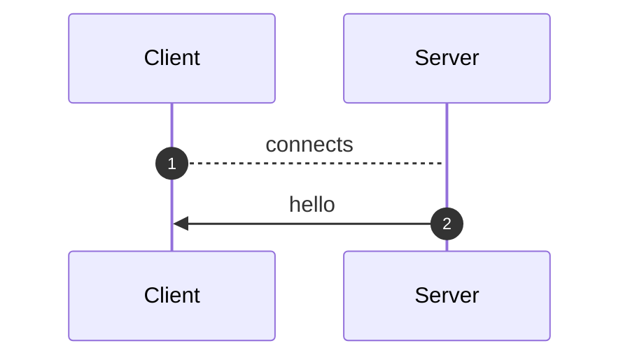
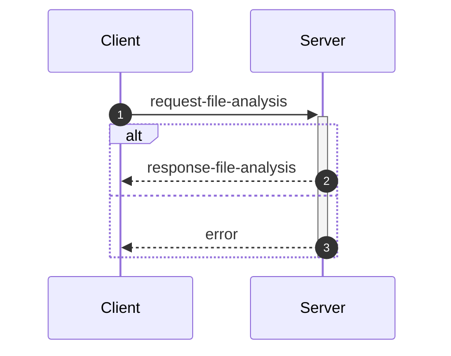
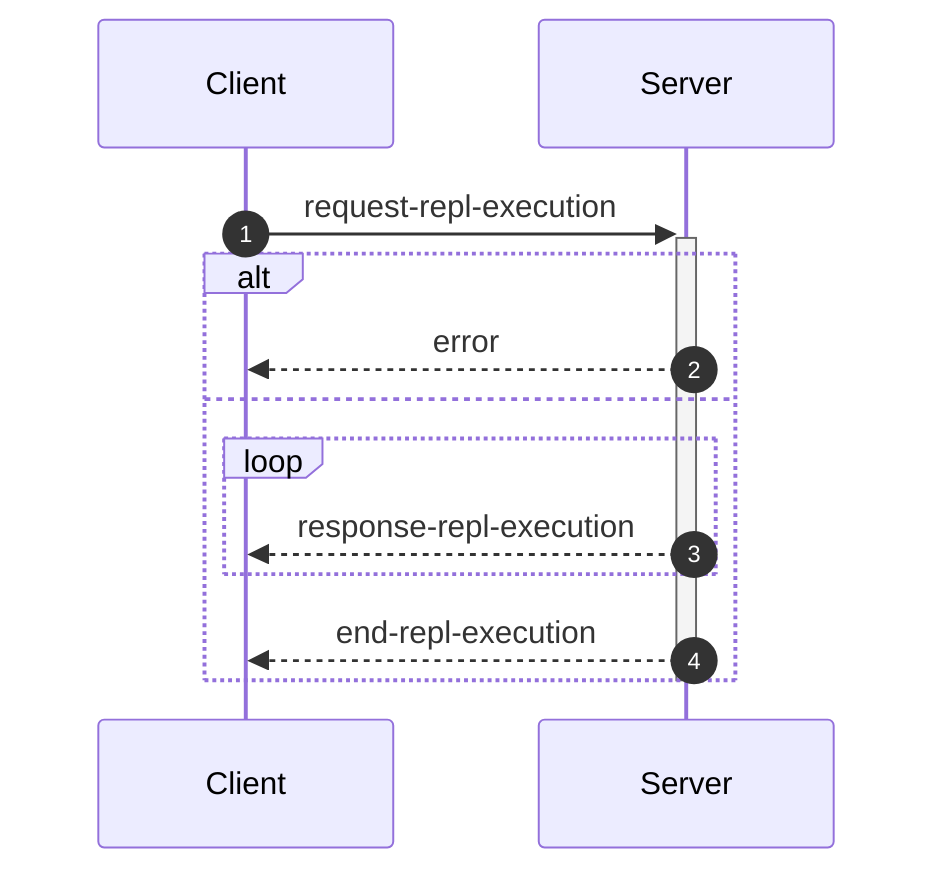
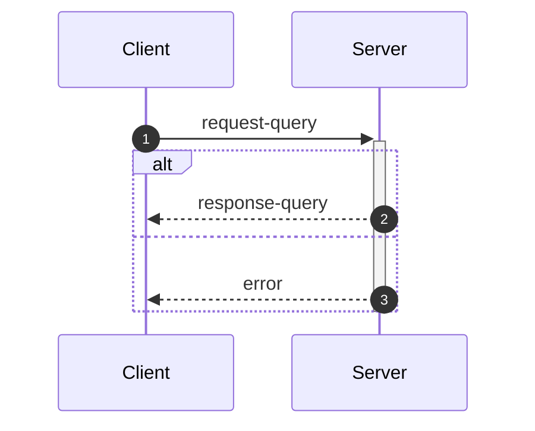

_<span title="an overview of flowR's interface">Generated</span> from '[wiki-interface.ts](https://github.com/flowr-analysis/flowr/tree/main/src/documentation/wiki-interface.ts "src/documentation/wiki-interface.ts")' on 2026-11-15, 09:20:10 UTC (v2.17.6, R v4.6.1), do not edit directly._

Although far from being as detailed as the in-depth explanation of [_flowR_](https://github.com/flowr-analysis/flowr/wiki/Core),
this wiki page explains how to interface with _flowR_ in more detail.
In general, command line arguments and other options provide short descriptions on hover over.

* [💻 Using the REPL](#using-the-repl)
* [⚙️ Configuring FlowR](#configuring-flowr)
* [⚒️ Writing Code](#writing-code)
* [💬 Communicating with the Server](#communicating-with-the-server)

<a id='using-the-repl'></a>
## 💻 Using the REPL

> [!NOTE]
> To execute arbitrary R commands with a repl request, _flowR_ has to be started explicitly with <span title="Description (Command Line Argument): Allow to access the underlying R session when using flowR (security warning: this allows the execution of arbitrary R code!)">`--r-session-access`</span>.
> Please be aware that this introduces a security risk and note that this relies on the [`r-shell` engine](https://github.com/flowr-analysis/flowr/wiki/Engines) .

Although primarily meant for users to explore,
there is nothing which forbids calling _flowR_ as a subprocess to use standard-in, -output, and -error
for communication (although you can access the REPL using the server as well,
with the [REPL Request](#message-request-repl-execution) message).

The read-eval-print loop&nbsp;(REPL) works relatively simple.
You can submit an expression (using <kbd>Enter</kbd>),
which is interpreted as an R&nbsp;expression by default but interpreted as a *command* if it starts with a colon (`:`).
The best command to get started with the REPL is <span title="Description (Repl Command): Show help information (aliases: :h, :?)">`:help`</span>.
Besides, you can leave the REPL either with the command <span title="Description (Repl Command): End the repl (aliases: :q, :exit)">`:quit`</span> or by pressing <kbd>Ctrl</kbd>+<kbd>C</kbd> twice.
When writing a *command*, you may press <kbd>Tab</kbd> to get a list of completions, if available.
Multiple commands can be entered in a single line by separating them with a semicolon (`;`), e.g. `:parse "x<-2"; :df*`.
If a command is given without R code, the REPL will re-use R code given in a previous command.
The prior example will hence return first the parsed AST of the program and then the dataflow graph for `"x <- 2"`.

> [!NOTE]
> If you develop flowR, you may want to launch the repl using the `npm run main-dev` command, this way, you get a non-minified version of flowR with debug information and hot-reloading of source files.

<details>
<summary>Available Commands</summary>

We currently offer the following commands (this with a `[*]` suffix are available with and without the star):

| Command | Description |
| ------- | ----------- |
| **<span title="Description (Repl Command): End the repl (aliases: :q, :exit)">:quit</span>** | End the repl (aliases: **:<span title="Alias of ':quit'. End the repl">q</span>**, **:<span title="Alias of ':quit'. End the repl">exit</span>**) |
| **<span title="Description (Repl Command): Execute the given code as R code. This requires the `--r-session-access` flag to be set and requires the r-shell engine. (aliases: :e, :r)">:execute</span>** | Execute the given code as R code. This requires the `--r-session-access` flag to be set and requires the r-shell engine. (aliases: **:<span title="Alias of ':execute'. Execute the given code as R code. This requires the `--r-session-access` flag to be set and requires the r-shell engine.">e</span>**, **:<span title="Alias of ':execute'. Execute the given code as R code. This requires the `--r-session-access` flag to be set and requires the r-shell engine.">r</span>**) |
| **<span title="Description (Repl Command): Get mermaid code for the control-flow graph of R code (aliases: :cfg, :cf)">:controlflow[*]</span>** | Get mermaid code for the control-flow graph of R code (star: Returns the URL to mermaid.live) (aliases: **:<span title="Alias of ':controlflow'. Get mermaid code for the control-flow graph of R code">cfg</span>**, **:<span title="Alias of ':controlflow'. Get mermaid code for the control-flow graph of R code">cf</span>**) |
| **<span title="Description (Repl Command): Get mermaid code for the control-flow graph with basic blocks (aliases: :cfgb, :cfb)">:controlflowbb[*]</span>** | Get mermaid code for the control-flow graph with basic blocks (star: Returns the URL to mermaid.live) (aliases: **:<span title="Alias of ':controlflowbb'. Get mermaid code for the control-flow graph with basic blocks">cfgb</span>**, **:<span title="Alias of ':controlflowbb'. Get mermaid code for the control-flow graph with basic blocks">cfb</span>**) |
| **<span title="Description (Repl Command): Get mermaid code for the dataflow graph (aliases: :d, :df)">:dataflow[*]</span>** | Get mermaid code for the dataflow graph (star: Returns the URL to mermaid.live) (aliases: **:<span title="Alias of ':dataflow'. Get mermaid code for the dataflow graph">d</span>**, **:<span title="Alias of ':dataflow'. Get mermaid code for the dataflow graph">df</span>**) |
| **<span title="Description (Repl Command): Get mermaid code for the normalized AST of R code (aliases: :n)">:normalize[*]</span>** | Get mermaid code for the normalized AST of R code (star: Returns the URL to mermaid.live) (alias: **:<span title="Alias of ':normalize'. Get mermaid code for the normalized AST of R code">n</span>**) |
| **<span title="Description (Repl Command): Get mermaid code for the simplified dataflow graph (aliases: :ds, :dfs)">:dataflowsimple[*]</span>** | Get mermaid code for the simplified dataflow graph (star: Returns the URL to mermaid.live) (aliases: **:<span title="Alias of ':dataflowsimple'. Get mermaid code for the simplified dataflow graph">ds</span>**, **:<span title="Alias of ':dataflowsimple'. Get mermaid code for the simplified dataflow graph">dfs</span>**) |
| **<span title="Description (Repl Command): Inspect and extend the signature database: `query` (identical to :query @signature), `info <name>` for where a function comes from (identical to :query @function-info), `add <path>` to mount another database/source, `download` to fetch the full-history database. (aliases: :sig)">:signature</span>** | Inspect and extend the signature database: `query` (identical to :query @signature), `info <name>` for where a function comes from (identical to :query @function-info), `add <path>` to mount another database/source, `download` to fetch the full-history database. (alias: **:<span title="Alias of ':signature'. Inspect and extend the signature database: `query` (identical to :query @signature), `info <name>` for where a function comes from (identical to :query @function-info), `add <path>` to mount another database/source, `download` to fetch the full-history database.">sig</span>**) |
| **<span title="Description (Repl Command): Just calculates the DFG, but only prints summary info (aliases: :d#, :df#)">:dataflowsilent</span>** | Just calculates the DFG, but only prints summary info (aliases: **:<span title="Alias of ':dataflowsilent'. Just calculates the DFG, but only prints summary info">d#</span>**, **:<span title="Alias of ':dataflowsilent'. Just calculates the DFG, but only prints summary info">df#</span>**) |
| **<span title="Description (Repl Command): Prints ASCII Art of the parsed, unmodified AST (aliases: :p)">:parse</span>** | Prints ASCII Art of the parsed, unmodified AST (alias: **:<span title="Alias of ':parse'. Prints ASCII Art of the parsed, unmodified AST">p</span>**) |
| **<span title="Description (Repl Command): Prints the version of flowR as well as the current version of R">:version</span>** | Prints the version of flowR as well as the current version of R
| **<span title="Description (Repl Command): Query the given R code (use 'help' for more information)">:query[*]</span>** | Query the given R code (use 'help' for more information) (star: Similar to query, but returns the output in json format.)
| **<span title="Description (Repl Command): Returns an ASCII representation of the dataflow graph (aliases: :df!)">:dataflowascii</span>** | Returns an ASCII representation of the dataflow graph (alias: **:<span title="Alias of ':dataflowascii'. Returns an ASCII representation of the dataflow graph">df!</span>**) |
| **<span title="Description (Repl Command): Returns summarization stats for the normalized AST (aliases: :n#)">:normalize#</span>** | Returns summarization stats for the normalized AST (alias: **:<span title="Alias of ':normalize#'. Returns summarization stats for the normalized AST">n#</span>**) |
| **<span title="Description (Repl Command): Show help information (aliases: :h, :?)">:help</span>** | Show help information (aliases: **:<span title="Alias of ':help'. Show help information">h</span>**, **:<span title="Alias of ':help'. Show help information">?</span>**) |

</details>

> [!TIP]
> 
> As indicated by the examples before, all REPL commands that operate on code keep track of the state.
> Hence, if you run a command like <span title="Description (Repl Command, starred version): Returns the URL to mermaid.live; Base Command: Get mermaid code for the dataflow graph (aliases: :d*, :df*)">`:dataflow*`</span> without providing R code,
> the REPL will re-use the R code provided in a previous command.
> Likewise, doing this will benefit from incrementality!
> If you request the dataflow graph with `:df* x <- 2 * y` and then want to see the parsed AST with `:parse`,
> the REPL will re-use previously obtained information and not re-parse the code again.
> 		

Generally, many commands offer shortcut versions in the REPL. Many queries, for example, offer a shortened format (see the example below).
Of special note, the [Config Query](https://github.com/flowr-analysis/flowr/wiki/%5BQuery%5D-Config)
can be used to also modify the currently active configuration of _flowR_ within the REPL (see the [wiki page](https://github.com/flowr-analysis/flowr/wiki/%5BQuery%5D-Config) for more information).

### Example: Retrieving the Dataflow Graph

To retrieve a URL to the [mermaid](https://mermaid.js.org/) diagram of the dataflow of a given expression,
use <span title="Description (Repl Command, starred version): Returns the URL to mermaid.live; Base Command: Get mermaid code for the dataflow graph (aliases: :d*, :df*)">`:dataflow*`</span> (or <span title="Description (Repl Command): Get mermaid code for the dataflow graph (aliases: :d, :df)">`:dataflow`</span> to get the mermaid code in the cli):

```shell
$ docker run -it --rm eagleoutice/flowr # or npm run flowr 
flowR repl v2.17.6, R grammar v14 (tree-sitter engine)
R> :dataflow* y <- 1 + x
```

<details>
<summary style='color:gray'>Output</summary>

```text
https://mermaid.live/view#base64:eyJjb2RlIjoiZmxvd2NoYXJ0IFREXG4gICAgMXt7XCJgKiM5MTtSTnVtYmVyIzkzOyogKioxKipcbiAgICAgICoxLjYqICgqKmlkOiAxKiopYFwifX1cbiAgICAyKFtcImAqIzkxO1JTeW1ib2wjOTM7KiAqKngqKlxuICAgICAgKjEuMTAqICgqKmlkOiAyKiopYFwiXSlcbiAgICAzW1tcImAqIzkxO1JCaW5hcnlPcCM5MzsqIGJhc2UjNTg7IzU4OyoqIzQzOyoqXG4gICAgICAqMS42LTEwKiAoKippZDogMyoqKVxuICAgIGFyZzogKDEsIDIpYFwiXV1cbiAgICBidWlsdC1pbjpfNDNfW1wiYEJ1aWx0LUluOlxuIzQzO2BcIl1cbiAgICBzdHlsZSBidWlsdC1pbjpfNDNfIHN0cm9rZTpncmF5LGZpbGw6Z3JheSxzdHJva2Utd2lkdGg6MnB4LG9wYWNpdHk6Ljg7XG4gICAgMFtcImAqIzkxO1JTeW1ib2wjOTM7KiAqKnkqKlxuICAgICAgKjEuMSogKCoqaWQ6IDAqKiwgdjogMylgXCJdXG4gICAgNFtbXCJgKiM5MTtSQmluYXJ5T3AjOTM7KiBiYXNlIzU4OyM1ODsqKiM2MDsjNDU7KipcbiAgICAgICoxLjEtMTAqICgqKmlkOiA0KiopXG4gICAgYXJnOiAoMCwgMylgXCJdXVxuICAgIGJ1aWx0LWluOl82MF8tW1wiYEJ1aWx0LUluOlxuIzYwOyM0NTtgXCJdXG4gICAgc3R5bGUgYnVpbHQtaW46XzYwXy0gc3Ryb2tlOmdyYXksZmlsbDpncmF5LHN0cm9rZS13aWR0aDoycHgsb3BhY2l0eTouODtcbiAgICAxIC0uLT58XCJmbG93XCJ8IDJcbiAgICBsaW5rU3R5bGUgMCBzdHJva2U6Z3JheSxjb2xvcjpncmF5O1xuICAgIDIgLS4tPnxcImZsb3dcInwgM1xuICAgIGxpbmtTdHlsZSAxIHN0cm9rZTpncmF5LGNvbG9yOmdyYXk7XG4gICAgMyAtLT58XCJyZWFkcywgYXJnXCJ8IDFcbiAgICAzIC0tPnxcInJlYWRzLCBhcmdcInwgMlxuICAgIDMgLS4tPnxcImZsb3dcInwgMFxuICAgIGxpbmtTdHlsZSA0IHN0cm9rZTpncmF5LGNvbG9yOmdyYXk7XG4gICAgMyAtLi0+fFwicmVhZHMsIGNhbGxzXCJ8IGJ1aWx0LWluOl80M19cbiAgICBsaW5rU3R5bGUgNSBzdHJva2U6Z3JheTtcbiAgICAwIC0tPnxcImRlZmluZWQtYnksIGZsb3dcInwgNFxuICAgIDAgLS0+fFwiZGVmaW5lZC1ieVwifCAzXG4gICAgNCAtLT58XCJyZWFkcywgYXJnXCJ8IDNcbiAgICA0IC0tPnxcInJldHVybnMsIGFyZ1wifCAwXG4gICAgNCAtLi0+fFwicmVhZHMsIGNhbGxzXCJ8IGJ1aWx0LWluOl82MF8tXG4gICAgbGlua1N0eWxlIDEwIHN0cm9rZTpncmF5OyIsIm1lcm1haWQiOnsiYXV0b1N5bmMiOnRydWV9fQ==
```

Retrieve the dataflow graph of the expression `y <- 1 + x`. It looks like this:


<details>

<summary style="color:gray">R Code of the Dataflow Graph</summary>

The analysis ran (parse and normalize with the [tree-sitter](https://github.com/flowr-analysis/flowr/wiki/Engines) engine) in the generation environment. No [signature database](https://github.com/flowr-analysis/flowr/wiki/Signature-Database) is mounted, so `library()` attaches no exports (base-R names are still qualified, e.g., `stats::acf`). 
We encountered no unknown side effects during the analysis.

```r
y <- 1 + x
```

</details>

</details>

For small graphs like this, <span title="Description (Repl Command): Returns an ASCII representation of the dataflow graph (aliases: :df!)">`:dataflowascii`</span> also provides an ASCII representation directly in the REPL:

```shell
$ docker run -it --rm eagleoutice/flowr # or npm run flowr 
flowR repl v2.17.6, R grammar v14 (tree-sitter engine)
R> :df! y <- 1 + x
```

<details open>
<summary style='color:gray'>Output</summary>

```text
                        v<0>v
 c<4>c──────────────────| y |
 |<- |     ┌────────────v---v
 c---c     │
    │   c<3>c   0<1>0
    └───| + |───| 1 |───u<2>u
        c---c   0---0   | x |
           └────────────u---u
Edges:
3 -> 1: reads, arg          3 -> 2: reads, arg
3 -> 0: flows-to            1 -> 2: flows-to
2 -> 3: flows-to            4 -> 3: reads, arg
4 -> 0: returns, arg        0 -> 4: defined-by, flows-to
0 -> 3: defined-by
```

Retrieve the dataflow graph of the expression `y <- 1 + x` as ASCII art.

</details>

For the slicing with <span title="Description (Repl Command): Static backwards executable slicer for R">`:slicer`</span>, you have access to the same [magic comments](#slice-magic-comments) as with the [slice request](#message-request-slice).
Pass `--inline` to splice resolvable `source()` calls into the reconstruction so the slice is a single self-contained R text (the same as the static slice query's `inlineSources` flag).
See `--help` for more flags!

### Example: Interfacing with the File System

Many commands that allow for an R-expression (like <span title="Description (Repl Command, starred version): Returns the URL to mermaid.live; Base Command: Get mermaid code for the dataflow graph (aliases: :d*, :df*)">`:dataflow*`</span>) allow for a file as well
if the argument starts with `file://`.
If you are working from the root directory of the _flowR_ repository, the following gives you the parsed AST of the example file using the <span title="Description (Repl Command): Prints ASCII Art of the parsed, unmodified AST (aliases: :p)">`:parse`</span> command:

> **Watch mode**: Replace `file://` with `watch://` to enter watch mode.
> flowR runs the command immediately and then re-runs it every time the file (or any file inside the folder) changes.
> Enter any other command to leave watch mode.
> For example: `:df watch://analysis.R`

```shell
$ docker run -it --rm eagleoutice/flowr # or npm run flowr 
flowR repl v2.17.6, R grammar v14 (tree-sitter engine)
R> :parse file://test/testfiles/example.R
```

<details>
<summary style='color:gray'>Output</summary>

```text
File: test/testfiles/example.R

program
├ binaryoperator
│ ├ identifier "sum" (1:1─4)
│ ├ <- "<-" (1:5─7)
│ ╰ float "0" (1:8─9)
├ binaryoperator
│ ├ identifier "product" (2:1─8)
│ ├ <- "<-" (2:9─11)
│ ╰ float "1" (2:12─13)
├ binaryoperator
│ ├ identifier "w" (3:1─2)
│ ├ <- "<-" (3:3─5)
│ ╰ float "7" (3:6─7)
├ binaryoperator
│ ├ identifier "N" (4:1─2)
│ ├ <- "<-" (4:3─5)
│ ╰ float "10" (4:6─8)
├ forstatement
│ ├ for "for" (6:1─4)
│ ├ ( "(" (6:5─6)
│ ├ identifier "i" (6:6─7)
│ ├ in "in" (6:8─10)
│ ├ binaryoperator
│ │ ├ float "1" (6:11─12)
│ │ ├ : ":" (6:12─13)
│ │ ╰ parenthesizedexpression
│ │   ├ ( "(" (6:13─14)
│ │   ├ binaryoperator
│ │   │ ├ identifier "N" (6:14─15)
│ │   │ ├ - "-" (6:15─16)
│ │   │ ╰ float "1" (6:16─17)
│ │   ╰ ) ")" (6:17─18)
│ ├ ) ")" (6:18─19)
│ ╰ bracedexpression
│   ├ { "{" (6:20─21)
│   ├ binaryoperator
│   │ ├ identifier "sum" (7:3─6)
│   │ ├ <- "<-" (7:7─9)
│   │ ╰ binaryoperator
│   │   ├ binaryoperator
│   │   │ ├ identifier "sum" (7:10─13)
│   │   │ ├ + "+" (7:14─15)
│   │   │ ╰ identifier "i" (7:16─17)
│   │   ├ + "+" (7:18─19)
│   │   ╰ identifier "w" (7:20─21)
│   ├ binaryoperator
│   │ ├ identifier "product" (8:3─10)
│   │ ├ <- "<-" (8:11─13)
│   │ ╰ binaryoperator
│   │   ├ identifier "product" (8:14─21)
│   │   ├  "" (8:22─23)
│   │   ╰ identifier "i" (8:24─25)
│   ╰ } "}" (9:1─2)
├ call
│ ├ identifier "cat" (11:1─4)
│ ╰ arguments
│   ├ ( "(" (11:4─5)
│   ├ argument
│   │ ╰ string
│   │   ├ stringopen "\"" (11:5─6)
│   │   ├ stringcontent "Sum:" (11:6─10)
│   │   ╰ stringclose "\"" (11:10─11)
│   ├ comma "," (11:11─12)
│   ├ argument
│   │ ╰ identifier "sum" (11:13─16)
│   ├ comma "," (11:16─17)
│   ├ argument
│   │ ╰ string
│   │   ├ stringopen "\"" (11:18─19)
│   │   ├ stringcontent
│   │   │ ╰ escapesequence "\\n" (11:19─21)
│   │   ╰ stringclose "\"" (11:21─22)
│   ╰ ) ")" (11:22─23)
╰ call
  ├ identifier "cat" (12:1─4)
  ╰ arguments
    ├ ( "(" (12:4─5)
    ├ argument
    │ ╰ string
    │   ├ stringopen "\"" (12:5─6)
    │   ├ stringcontent "Product:" (12:6─14)
    │   ╰ stringclose "\"" (12:14─15)
    ├ comma "," (12:15─16)
    ├ argument
    │ ╰ identifier "product" (12:17─24)
    ├ comma "," (12:24─25)
    ├ argument
    │ ╰ string
    │   ├ stringopen "\"" (12:26─27)
    │   ├ stringcontent
    │   │ ╰ escapesequence "\\n" (12:27─29)
    │   ╰ stringclose "\"" (12:29─30)
    ╰ ) ")" (12:30─31)
```

Retrieve the parsed AST of the example file.

<details>

<summary>File Content</summary>

```r
sum <- 0
product <- 1
w <- 7
N <- 10

for (i in 1:(N-1)) {
  sum <- sum + i + w
  product <- product * i
}

cat("Sum:", sum, "\n")
cat("Product:", product, "\n")
```

</details>

As _flowR_ directly transforms this AST the output focuses on being human-readable instead of being machine-readable.
		
</details>

### Example: Run a Query

You can run any query supported by _flowR_ using the <span title="Description (Repl Command): Query the given R code (use 'help' for more information)">`:query`</span> command.
For example, to obtain the shapes of all data frames in a given piece of code, you can run:

```shell
$ docker run -it --rm eagleoutice/flowr # or npm run flowr 
flowR repl v2.17.6, R grammar v14 (tree-sitter engine)
R> :query @absint df-shape "x <- data.frame(a = 1:10, b = 1:10)\ny <- x$a"
```

<details open>
<summary style='color:gray'>Output</summary>

```text
Query: absint (1 ms)
   ╰ $12: (colnames: [{"a", "b"}, {}], cols: [2, 2], rows: [10, 10])
   ╰ $0: (colnames: [{"a", "b"}, {}], cols: [2, 2], rows: [10, 10])
```

Retrieve the shapes of all data frames in the given code.

</details>

To run the linter on a file, you can use (in this example, we just issue the `dead-code` linter on a small piece of code):

```shell
$ docker run -it --rm eagleoutice/flowr # or npm run flowr 
flowR repl v2.17.6, R grammar v14 (tree-sitter engine)
R> :query @linter rules:dead-code "if(FALSE) x <- 2"
```

<details open>
<summary style='color:gray'>Output</summary>

```text
Query: linter (4 ms)
   ╰ Dead Code (dead-code):
       ╰ certain:
           ╰ Code at 1.11-16 (1 quick fix(es) available)
```

Run the linter on the given code, with only the `dead-code` rule enabled.

</details>

For more information on the available queries, please check out the [Query API](https://github.com/flowr-analysis/flowr/wiki/Query-API).

<a id='configuring-flowr'></a>
## ⚙️ Configuring FlowR

When running _flowR_, you may want to specify some behaviors with a dedicated configuration file.
By default, flowR looks for a file named `flowr.json` in the current working directory (or any higher directory).
You can also specify a different file with <span title="Description (Command Line Argument): The name of the configuration file to use">`--config-file`</span> or pass the configuration inline using <span title="Description (Command Line Argument): The flowR configuration to use, as a JSON string">`--config-json`</span>.
A `flowr.json` found this way belongs to the analyzed project, so flowR ignores its options that decide what flowR executes or loads
(`engines.*.wasmPath`, `engines.*.treeSitterWasmPath`, `engines.*.rPath`, `solver.sigdb.additionalPaths`, `solver.sigdb.downloadRepo`, `solver.sigdb.installedLibrary.paths`, `solver.sigdb.onDemand.enabled`, `solver.sigdb.onDemand.repositories`, `solver.sigdb.onDemand.cranMirror`, `solver.sigdb.onDemand.bioconductorMirror`, `solver.sigdb.onDemand.cacheDir`),
unless you pass <span title="Description (Command Line Argument): Keep the security-sensitive options (e.g., the R executable) of the flowr.json found in the working directory or a parent. Only use this for projects you trust.">`--trust-config`</span>.
To analyze code you do not trust, use the secure mode (<span title="Description (Command Line Argument): Run in secure mode for analyzing untrusted code: flowR does not start R (or any other process), does not access the network, does not search for project configs, and ignores security-sensitive options in every config. Cannot be disabled once enabled. Can also be enabled with the environment variable {italic FLOWR_SECURE_MODE=1}.">`--secure`</span>, see the [security policy](https://github.com/flowr-analysis/flowr/blob/main/.github/SECURITY.md)).
To inspect the current configuration, you can run flowr with the <span title="Description (Command Line Argument): Run with verbose logging (will be passed to the corresponding script)">`--verbose`</span> flag, or use the `config` [Query](https://github.com/flowr-analysis/flowr/wiki/Query-API).
Within the REPL this works by running the following:

```shell
:query @config
```

To work with the <a href="https://github.com/flowr-analysis/flowr/tree/main/src/config.ts#L121"><code><span title="The configuration file format for flowR.">FlowrConfig</span></code></a> you can use the provided helper objects alongside its methods like
<a href="https://github.com/flowr-analysis/flowr/tree/main/src/config.ts#L953"><code><span title="Creates a new flowr config that has the updated values.">FlowrConfig::<b>amend</b></span></code></a>.
The schema below documents every option; the ones you most likely want are:

- <a href="https://github.com/flowr-analysis/flowr/wiki/Interface#configuring-flowr" title="Configuration Option (boolean): Whether source calls should be ignored, causing {@link processSourceCall}&#39;s behavior to be skipped.">ignoreSourceCalls</a>: ignore source calls when analyzing the code, i.e., ignore the inclusion of other files.
- <a href="https://github.com/flowr-analysis/flowr/wiki/Interface#configuring-flowr" title="Configuration Option (boolean): Whether load calls should be ignored, causing {@link processLoadCall}&#39;s behavior to be skipped.">ignoreLoadCalls</a>: ignore load calls when analyzing the code, i.e., ignore the loading of r-data files.
- <a href="https://github.com/flowr-analysis/flowr/wiki/Interface#configuring-flowr" title="Configuration Option (object): Do you want to overwrite (parts) of the builtin definition?">semantics.environment.overwriteBuiltIns</a>: overwrite _flowR_'s handling of built-in functions, or clear the preset definitions entirely.
  See [Configure BuiltIn Semantics](#configure-builtin-semantics) for more information.
- <a href="https://github.com/flowr-analysis/flowr/wiki/Interface#configuring-flowr" title="Configuration Option (boolean): Whether calls drawing on a graphics device (e.g., `plot`) count as writing to it, which the ambient state queries then report.">semantics.ambient.drawingWritesDevice</a>: whether calls drawing on a graphics device (e.g., `plot`) count as writing the device in the ambient state queries.
- <a href="https://github.com/flowr-analysis/flowr/wiki/Interface#configuring-flowr" title="Configuration Option (string): How to resolve variables and their values. (one of &quot;disabled&quot;, &quot;alias&quot;, &quot;builtin&quot;)">solver.variables</a>: how to resolve variables and their values (`disabled`, `alias`, `builtin`).
- <a href="https://github.com/flowr-analysis/flowr/wiki/Interface#configuring-flowr" title="Configuration Option (array): The engine or set of engines to use for interacting with R code. An empty array means all available engines will be used.">engines</a> and <a href="https://github.com/flowr-analysis/flowr/wiki/Interface#configuring-flowr" title="Configuration Option (string): The default engine to use for interacting with R code. If this is undefined, an arbitrary engine from the specified list will be used. (one of &quot;tree-sitter&quot;, &quot;r-shell&quot;)">defaultEngine</a>: the engines used to interact with R code, see the [Engines wiki page](https://github.com/flowr-analysis/flowr/wiki/Engines).
- <a href="https://github.com/flowr-analysis/flowr/wiki/Interface#configuring-flowr" title="Configuration Option (array): Files a framework loads on its own, without any source() call (e.g. global.R in a shiny app), in the order they are loaded; flowR orders the matching project files accordingly and analyzes them as one program. Entries are case-insensitive globs matched against the file path, a plain name matches any file with that name, and entries matching no project file are warned about. Usually set per project kind via specializeConfig.">project.implicitSources</a>: the files a framework loads without any `source()` call, in the order in which they are
  loaded. Entries are globs (e.g. `R/*.R`) matched against the file path ignoring capitalization; one matching no file is reported.
- <a href="https://github.com/flowr-analysis/flowr/wiki/Interface#configuring-flowr" title="Configuration Option (object): Overwrite (parts of) the configuration depending on the project kind flowR detects, e.g. to give a shiny app its implicit sources.">specializeConfig</a>: overwrite (parts of) the configuration depending on the kind of project _flowR_ detects
  (e.g. `shiny-app`), which is how a shiny app gets its implicit sources by default. What you configure directly wins.
- <a href="https://github.com/flowr-analysis/flowr/wiki/Interface#configuring-flowr" title="Configuration Option (string): Overwrite the project kind flowR would otherwise infer from the analyzed files, e.g. when auto-detection guesses wrong. (one of &quot;package&quot;, &quot;script&quot;, &quot;shiny-app&quot;, &quot;notebook&quot;, &quot;project&quot;, &quot;unknown&quot;)">project.useProjectType</a>: skip that detection and force a project kind yourself, when auto-detection guesses wrong.
- <a href="https://github.com/flowr-analysis/flowr/wiki/Interface#configuring-flowr" title="Configuration Option (array): The default plugins to load when creating a new instance of FlowrAnalyzer">defaultPlugins</a> and <a href="https://github.com/flowr-analysis/flowr/wiki/Interface#configuring-flowr" title="Configuration Option (array): The plugins to load in REPL mode">repl.plugins</a>: the plugins to load for a new <a href="https://github.com/flowr-analysis/flowr/tree/main/src/project/flowr-analyzer.ts#L218"><code><span title="Central class for conducting analyses with FlowR. Use the FlowrAnalyzerBuilder to create a new instance. If you want the original pattern of creating a pipeline and running all steps, you can still do this with FlowrAnalyzer#runFull . To inspect the context of the analyzer, use FlowrAnalyzer#inspectContext (if you are a plugin and need to modify it, use FlowrAnalyzer#context instead).">FlowrAnalyzer</span></code></a> and in the REPL
  (use `flowr:default` to reference the former).

So you can configure _flowR_ by adding a file like the following:

<details>

<summary>Example Configuration File</summary>

```json
{
  "ignoreSourceCalls": true,
  "ignoreLoadCalls": true,
  "semantics": {
    "environment": {
      "overwriteBuiltIns": {
        "definitions": [
          {
            "type": "function",
            "names": [
              "foo"
            ],
            "processor": "builtin:assign",
            "config": {}
          }
        ]
      }
    }
  },
  "defaultPlugins": [
    "file:description",
    "versions:description"
  ],
  "repl": {
    "quickStats": false,
    "dfProcessorHeat": false,
    "hints": true,
    "plugins": [
      "flowr:default"
    ]
  },
  "project": {
    "resolveUnknownPathsOnDisk": true,
    "implicitSources": [
      "global.R",
      "app.R"
    ]
  },
  "linter": {
    "disabledRules": []
  },
  "specializeConfig": {
    "shiny-app": {
      "project": {
        "implicitSources": [
          "global.R",
          "ui.R",
          "server.R",
          "app.R"
        ]
      }
    }
  },
  "engines": [
    {
      "type": "r-shell"
    }
  ],
  "solver": {
    "variables": "alias",
    "evalStrings": true,
    "trackEnvironments": true,
    "sigdb": {
      "enabled": true,
      "loadProjectDependencies": true,
      "eagerlyLoad": false,
      "eagerlyLoadExports": false,
      "linkBaseR": false,
      "linkDescriptionDependencies": false
    },
    "resolveSource": {
      "dropPaths": "no",
      "ignoreCapitalization": true,
      "inferWorkingDirectory": "active-script",
      "searchPath": []
    },
    "instrument": {},
    "slicer": {
      "threshold": 50
    }
  },
  "abstractInterpretation": {
    "wideningThreshold": 4,
    "followCalls": true,
    "dataFrame": {
      "maxColNames": 20,
      "readLoadedData": {
        "readExternalFiles": true,
        "maxReadLines": 1000000
      }
    }
  },
  "incremental": {
    "alwaysIncremental": false,
    "parsing": {
      "activated": false,
      "heuristics": {
        "activated": true,
        "mtime": true,
        "linesFrom": 500,
        "bytesFrom": 50000,
        "alwaysWithEdits": false,
        "minFiles": 1
      }
    }
  },
  "gas": {
    "thresholds": {
      "memory": {
        "problematic": 0.7,
        "critical": 0.9
      },
      "timeMs": {
        "problematic": 100000,
        "critical": 120000
      }
    },
    "features": {}
  }
}
```

</details>

<details>
<a id='configure-builtin-semantics'></a>
<summary>Configure Built-In Semantics</summary>

`semantics/environment/overwriteBuiltins` accepts two keys:

- `loadDefaults` (boolean, initially `true`): If set to `true`, the default built-in definitions are loaded before applying the custom definitions. Setting this flag to `false` explicitly disables the loading of the default definitions.
- `definitions` (array, initially empty): Allows to overwrite or define new built-in elements. Each object within must have a `type` which is one of the below. Furthermore, they may define a string array of `names` which specifies the identifiers to bind the definitions to. You may use `assumePrimitive` to specify whether _flowR_ should assume that this is a primitive non-library definition (so you probably just do not want to specify the key).

  | Type            | Description                                                                                                                                                                                                                                                                                              | Example                                                                                                    |
  | --------------- | -------------------------------------------------------------------------------------------------------------------------------------------------------------------------------------------------------------------------------------------------------------------------------------------------------- | ---------------------------------------------------------------------------------------------------------- |
  | `constant`    | Additionally allows for a `value` this should resolve to.                                                                                                                                                                                                                                                | `{ type: 'constant', names: ['NULL', 'NA'],  value: null }`                                                |
  | `function`    | Is a rather flexible way to define and bind built-in functions. For the time, we do not have extensive documentation to cover all the cases, so please either consult the sources with the `default-builtin-config/` folder or open a [new issue](https://github.com/flowr-analysis/flowr/issues/new/choose). | `{ type: 'function', names: ['next'], processor: 'builtin:d', config: { cfg: ExitPointType.Next } }` |
  | `replacement` | A comfortable way to specify replacement functions like `$<-` or `names<-`. `suffixes` describes the... suffixes to attach automatically. | `{ type: 'replacement', suffixes: ['<-', '<<-'], names: ['[', '[['] }` |

</details>

<details>

<summary style='color:gray'>Full Configuration-File Schema</summary>

- _The configuration file format for flowR._ (object)
    - **logLevel** [optional] _flowR's global minimum log level, applied when the config is loaded._ (string)
        Only allows: 'silly', 'trace', 'debug', 'info', 'warn', 'error', 'fatal'
    - **ignoreSourceCalls** [optional] _Whether source calls should be ignored, causing {@link processSourceCall}'s behavior to be skipped._ (boolean)
    - **ignoreLoadCalls** [optional] _Whether load calls should be ignored, causing {@link processLoadCall}'s behavior to be skipped._ (boolean)
    - **semantics** _Configure language semantics and how flowR handles them._ (object)
        - **environment** [optional] _Semantics regarding how to handle the R environment._ (object)
            - **overwriteBuiltIns** [optional] _Do you want to overwrite (parts) of the builtin definition?_ (object)
                - **loadDefaults** [optional] _Should the default configuration still be loaded?_ (boolean)
                - **definitions** [optional] _The definitions to load/overwrite._ (array)
                Valid item types:
                    - (object)
        - **ambient** [optional] _Semantics regarding the global state (options, devices, files, ...) calls access._ (object)
            - **drawingWritesDevice** [optional] _Whether calls drawing on a graphics device (e.g., `plot`) count as writing to it, which the ambient state queries then report._ (boolean)
    - **defaultPlugins** [optional] _The default plugins to load when creating a new instance of FlowrAnalyzer_ (array)
    Valid item types:
        - (alternatives)
            - (string)
            - (array)
    - **repl** _Configuration options for the REPL._ (object)
        - **quickStats** [optional] _Whether to show quick stats in the REPL after each evaluation._ (boolean)
        - **dfProcessorHeat** [optional] _This instruments the dataflow processors to count how often each processor is called._ (boolean)
        - **hints** [optional] _Whether to show dim inline hints on the empty prompt (automatically disabled on non-interactive terminals)._ (boolean)
        - **plugins** [optional] _The plugins to load in REPL mode_ (array)
        Valid item types:
            - (alternatives)
                - (string)
                - (array)
        - **autoUseFileProtocol** [optional] _Prepend the file protocol to a repl input that looks like a path, instead of only warning about it._ (boolean)
        - **queryStats** [optional] _Whether `:query` closes with the line stating how long the queries took (`:query*` never prints it)._ (boolean)
        - **showPlugins** [optional] _Whether `:version` grays out the plugins that did not activate during the last analysis._ (boolean)
    - **project** _Project specific configuration options._ (object)
        - **resolveUnknownPathsOnDisk** [optional] _Whether to resolve unknown paths loaded by the r project disk when trying to source/analyze files._ (boolean)
        - **failOnInaccessiblePath** [optional] _Whether a directory that cannot be traversed during file discovery (e.g. due to permissions) aborts the analysis; when false (the default) such paths are logged and skipped._ (boolean)
        - **basePackages** [optional] _The packages considered part of R itself (base and recommended); if unset, flowR uses its built-in list._ (array)
        Valid item types:
            - (string)
        - **implicitSources** [optional] _Files a framework loads on its own, without any source() call (e.g. global.R in a shiny app), in the order they are loaded; flowR orders the matching project files accordingly and analyzes them as one program. Entries are case-insensitive globs matched against the file path, a plain name matches any file with that name, and entries matching no project file are warned about. Usually set per project kind via specializeConfig._ (array)
        Valid item types:
            - (string)
        - **useProjectType** [optional] _Overwrite the project kind flowR would otherwise infer from the analyzed files, e.g. when auto-detection guesses wrong._ (string)
            Only allows: 'package', 'script', 'shiny-app', 'notebook', 'project', 'unknown'
        - **assumeImplicitEcho** [optional] _Whether the top level of the analyzed code is echoed, so that every visible result printed there is collected as an output by the dependencies query (default true, false for a package)._ (boolean)
        - **discovery** [optional] _Scoping options for the default project discovery._ (object)
            - **full** [optional] _Collect every file below the project root (greedy) instead of only the files the detected project kind needs (default false)._ (boolean)
            - **perKind** [optional] _Per-kind include/exclude glob overrides layered on the default scoping._ (object)
            - **ignore** [optional] _Case-insensitive globs that drop matching files from the intelligent discovery, regardless of kind (e.g. .Renviron to ignore environment files)._ (array)
            Valid item types:
                - (string)
        - **classification** [optional] _Overrides for the signals flowR uses to classify the project kind._ (object)
            - **shinyDescriptionTypes** [optional] _DESCRIPTION Type: values that mark a shiny app._ (array)
            Valid item types:
                - (string)
            - **shinyEntryFiles** [optional] _File names a shiny app is assembled from._ (array)
            Valid item types:
                - (string)
            - **shinyUsagePattern** [optional] _Regex source evidencing shiny usage in an entry file._ (string)
            - **notebookExtensions** [optional] _File extensions marking a notebook._ (array)
            Valid item types:
                - (string)
    - **linter** _Linter configuration options._ (object)
        - **disabledRules** _Linting rule names excluded from the default rule set (a rule requested explicitly via a linter query still runs). Usually set per project kind via specializeConfig._ (array)
        Valid item types:
            - (string)
        - **disabledTags** [optional] _Linting rule tags whose rules are excluded from the default rule set (a rule requested explicitly via a linter query still runs). By default the cmd-check rules are disabled for everything but a package; a configured list replaces that default._ (array)
        Valid item types:
            - (string)
    - **inputSources** [optional] _Further frameworks the input-sources analysis should know about; entries are added to flowR's defaults._ (object)
        - **pure** [optional] _Functions that only pass the constantness of their arguments on._ (array)
        Valid item types:
            - (string)
        - **param** [optional] _Functions whose result is a 'param' input._ (array)
        Valid item types:
            - (string)
        - **file** [optional] _Functions whose result is a 'file' input._ (array)
        Valid item types:
            - (string)
        - **tempfile** [optional] _Functions whose result is a 'tempfile' input._ (array)
        Valid item types:
            - (string)
        - **glob** [optional] _Functions whose result is a 'glob' input._ (array)
        Valid item types:
            - (string)
        - **net** [optional] _Functions whose result is a 'net' input._ (array)
        Valid item types:
            - (string)
        - **rand** [optional] _Functions whose result is a 'rand' input._ (array)
        Valid item types:
            - (string)
        - **system** [optional] _Functions whose result is a 'system' input._ (array)
        Valid item types:
            - (string)
        - **ffi** [optional] _Functions whose result is a 'ffi' input._ (array)
        Valid item types:
            - (string)
        - **lang** [optional] _Functions whose result is a 'lang' input._ (array)
        Valid item types:
            - (string)
        - **options** [optional] _Functions whose result is a 'options' input._ (array)
        Valid item types:
            - (string)
        - **cmdline** [optional] _Functions whose result is a 'cmdline' input._ (array)
        Valid item types:
            - (string)
        - **user** [optional] _Functions whose result is a 'user' input._ (array)
        Valid item types:
            - (string)
        - **const** [optional] _Functions whose result is a 'const' input._ (array)
        Valid item types:
            - (string)
        - **scope** [optional] _Functions whose result is a 'scope' input._ (array)
        Valid item types:
            - (string)
        - **dconst** [optional] _Functions whose result is a 'dconst' input._ (array)
        Valid item types:
            - (string)
        - **unknown** [optional] _Functions whose result is a 'unknown' input._ (array)
        Valid item types:
            - (string)
        - **linkedObjects** [optional] _Objects a framework provides without a definition in the code, e.g. shiny's input._ (array)
        Valid item types:
            - (object)
        - **linkedEntryPoints** [optional] _Calls that hand a function to a framework, which binds its objects to the parameters by position._ (array)
        Valid item types:
            - (object)
    - **specializeConfig** [optional] _Overwrite (parts of) the configuration depending on the project kind flowR detects, e.g. to give a shiny app its implicit sources._ (object)
    - **engines** _The engine or set of engines to use for interacting with R code. An empty array means all available engines will be used._ (array)
    Valid item types:
        - (alternatives)
            - _The configuration for the tree sitter engine._ (object)
                - **type** [required] _Use the tree sitter engine._ (string)
                    Only allows: 'tree-sitter'
                - **wasmPath** [optional] _The path to the tree-sitter-r WASM binary to use. If this is undefined, this uses the default path._ (string)
                - **treeSitterWasmPath** [optional] _The path to the tree-sitter WASM binary to use. If this is undefined, this uses the default path._ (string)
                - **lax** [optional] _Whether to use the lax parser for parsing R code (allowing for syntax errors). If this is undefined, the strict parser will be used._ (boolean)
            - _The configuration for the R shell engine._ (object)
                - **type** [required] _Use the R shell engine._ (string)
                    Only allows: 'r-shell'
                - **rPath** [optional] _The path to the R executable to use. If this is undefined, this uses the default path._ (string)
                - **pipeBind** [optional] _Whether to enable R's experimental pipe-bind operator "=>" by setting _R_USE_PIPEBIND_ for the R session (default false); R itself keeps this off by default, as it is experimental and has never shipped in a release version of R._ (boolean)
    - **defaultEngine** [optional] _The default engine to use for interacting with R code. If this is undefined, an arbitrary engine from the specified list will be used._ (string)
        Only allows: 'tree-sitter', 'r-shell'
    - **solver** _How to resolve constants, constraints, cells, ..._ (object)
        - **variables** _How to resolve variables and their values._ (string)
            Only allows: 'disabled', 'alias', 'builtin'
        - **evalStrings** _Should we include eval(parse(text="...")) calls in the dataflow graph?_ (boolean)
        - **trackEnvironments** [optional] _Track user-created environments (new.env, assign/get/local with envir=, dollar-assign, attach). When false, all envir-style calls fall through conservatively._ (boolean)
        - **sigdb** _Resolving library exports from a signature database._ (object)
            - **enabled** [optional] _Resolve library()/use() exports from a signature database (default true); when false no database is consulted._ (boolean)
            - **loadProjectDependencies** [optional] _Load the project's declared dependencies from its metadata files (DESCRIPTION Imports/Depends, rproject.toml, uvr.toml, rig rproj.toml and script blocks, renv.lock, rv.lock, uvr.lock, rig lockfiles) (default true); when false these files are not read for dependencies._ (boolean)
            - **eagerlyLoad** [optional] _Parse the database up front rather than on the first package load (default false, ignored if disabled)._ (boolean)
            - **eagerlyLoadExports** [optional] _Add a vertex for every export on load rather than on demand (default false); keeps the dataflow graph small._ (boolean)
            - **assumedRVersion** [optional] _R version assumed when resolving versioned (base-R) exports: a pin like "4.5" or "auto" to detect the installed R (default "auto")._ (string)
            - **linkBaseR** [optional] _Eagerly attach base-R namespaces so bare base calls resolve without library() (default false)._ (boolean)
            - **linkBaseRCalls** [optional] _Add a lightweight Reads edge from a bare base-R call to its signature-database function vertex (default false; base-R qualification is edge-free otherwise)._ (boolean)
            - **linkPackageCalls** [optional] _Add a lightweight Reads edge from a resolved package call to its signature-database function vertex (default false)._ (boolean)
            - **linkDescriptionDependencies** [optional] _Eagerly attach the namespaces of the project's declared DESCRIPTION dependencies (Imports/Depends) so their exports resolve without an explicit library() (default false)._ (boolean)
            - **warmInBackground** [optional] _Decompress the hot shards (base + most-downloaded) in a background task on startup so the first library() lookup is warm (default false; for long-running servers/REPLs)._ (boolean)
            - **additionalPaths** [optional] _Extra directories or bundle/manifest files searched for signature databases (alongside the shipped default and $FLOWR_SIGDB_DIR); a downloaded full-history bundle placed here is mounted automatically._ (array)
            Valid item types:
                - (string)
            - **downloadRepo** [optional] _GitHub owner/repo the full-history bundle is downloaded from via ":signature download" (default "flowr-analysis/flowr"; the release tag comes from the committed sigdb.remote.json unless a version is given)._ (string)
            - **autoSync** [optional] _On startup, re-download shards whose committed sigdb.remote.json hash no longer matches the cache, in the background (default false; opt-in network sync after a git pull)._ (boolean)
            - **installedLibrary** [optional] _Recovering packages no signature database knows from the copy installed on this machine._ (object)
                - **enabled** [required] _Recover packages no signature database knows from their installed copy (default false)._ (boolean)
                - **paths** [optional] _Library directories to search; when empty they are discovered from the environment and the project._ (array)
                Valid item types:
                    - (string)
                - **useEnvironment** [optional] _Search the libraries R_LIBS_USER/R_LIBS/R_LIBS_SITE name (default true)._ (boolean)
                - **useProjectLibrary** [optional] _Search a project-local renv/packrat library (default true)._ (boolean)
                - **maxDepth** [optional] _How far to descend into the nested layout of a project-local library (default 3)._ (number)
                - **packages** [optional] _Only recover packages whose name matches one of these regular expressions; empty means any._ (array)
                Valid item types:
                    - (string)
            - **onDemand** [optional] _Recovering packages no signature database knows from their sources on CRAN, Bioconductor, or GitHub._ (object)
                - **enabled** [required] _Fetch and recover the sources of packages no signature database knows when the analyzed code uses them (default false, accesses the network)._ (boolean)
                - **sources** [optional] _Where to look, in order: github, cran, bioconductor, or a source a plugin adds (default ["github", "cran", "bioconductor"])._ (array)
                Valid item types:
                    - (string)
                - **repositories** [optional] _GitHub repositories (owner/repo[/subdir][@ref]) to fetch packages from, by package name. The analyzed project may name more (DESCRIPTION Remotes, install_github calls)._ (object)
                - **packages** [optional] _Only recover packages whose name matches one of these regular expressions, empty means any._ (array)
                Valid item types:
                    - (string)
                - **cranMirror** [optional] _The CRAN src/contrib/ to fetch from, over https (default https://cloud.r-project.org/src/contrib/). It may be on the local network._ (string)
                - **bioconductorMirror** [optional] _The Bioconductor host, over https (default https://bioconductor.org). It may be on the local network._ (string)
                - **bioconductorRelease** [optional] _The Bioconductor release to fetch from: release, devel, or a number like 3.20 (default release)._ (string)
                - **githubMirrors** [optional] _Use the GitHub mirrors of CRAN (cran/<pkg>) and Bioconductor (bioc/<pkg>) (default true)._ (boolean)
                - **maxPackages** [optional] _The most packages to fetch for one analysis (default 25)._ (number)
                - **maxArchiveMb** [optional] _The most MiB a package archive may have (default 32). It may unpack to three times that, at most 128 MiB._ (number)
                - **offline** [optional] _Only use what was fetched before, never the network (default false)._ (boolean)
                - **retryAfterHours** [optional] _How many hours to wait before asking again for a package no source had (default 24)._ (number)
                - **cacheDir** [optional] _Where to cache what was fetched (default the on-demand directory of the signature cache)._ (string)
            - **blobCacheBudgetMb** [optional] _How many MiB of decoded package blobs every open bundle may hold together (default 16)._ (number)
            - **versionSelection** [optional] _When a project constrains a dependency, resolve to the newest (default), oldest, or system-installed version satisfying it; system needs R and falls back to newest. Base-R packages always resolve against the assumed R version._ (string)
                Only allows: 'newest', 'oldest', 'system'
            - **versionOverrides** [optional] _Force an exact version for specific packages (name -> version), overriding both the project constraint and the versionSelection policy (default {})._ (object)
        - **versionManagement** _Policies for reasoning about dependency versions._ (object)
            - **linkedVersionGroups** [optional] _Groups of packages that must resolve to the same version; version guessing intersects each group so its members stay mutually compatible (default [])._ (array)
            Valid item types:
                - (array)
                Valid item types:
                    - (string)
        - **assumeAttachedPackages** [optional] _Packages to treat as attached without a `library()` call, so what the built-in configuration states about them applies to the analyzed code. The base packages R attaches on startup already resolve without it._ (array)
        Valid item types:
            - (string)
        - **transitiveSideEffectRounds** [optional] _How many rounds the transitive side-effect fixpoint may run before it is cut off (default 32); the propagation stops on its own as soon as a round adds nothing._ (number)
        - **maxOverlayDepth** [optional] _How many binding overlays may stack on one environment frame before a write flattens them (default 4); a pure performance knob, trading lookup cost against copy cost without changing any result._ (number)
        - **instrument** (object)
            - **dataflowExtractors** [optional] _These keys are only intended for use within code, allowing to instrument the dataflow analyzer!_ (any)
        - **resolveSource** [optional] _If lax source calls are active, flowR searches for sourced files much more freely, based on the configurations you give it. This option is only in effect if `ignoreSourceCalls` is set to false._ (object)
            - **dropPaths** _Allow to drop the first or all parts of the sourced path, if it is relative._ (string)
                Only allows: 'no', 'once', 'all'
            - **ignoreCapitalization** _Search for filenames matching in the lowercase._ (boolean)
            - **inferWorkingDirectory** _Try to infer the working directory from the main or any script to analyze._ (string)
                Only allows: 'no', 'main-script', 'active-script', 'any-script'
            - **searchPath** _Additionally search in these paths._ (array)
            Valid item types:
                - (string)
            - **repeatedSourceLimit** [optional] _How often the same file can be sourced within a single run? Please be aware: in case of cyclic sources this may not reach a fixpoint so give this a sensible limit._ (number)
            - **applyReplacements** _Provide name replacements for loaded files_ (array)
            Valid item types:
                - (object)
            - **assumeFilesExist** [optional] _Assume a sourced file is always there, making what it defines certain instead of conditional on the source call._ (boolean)
        - **slicer** [optional] _The configuration for the slicer._ (object)
            - **threshold** [optional] _The maximum number of iterations to perform on a single function call during slicing._ (number)
            - **autoExtend** [optional] _If set, the slicer will gain an additional post-pass._ (boolean)
    - **abstractInterpretation** _The configuration options for abstract interpretation._ (object)
        - **wideningThreshold** _The threshold for the number of visitations of a node at which widening should be performed to ensure the termination of the fixpoint iteration._ (number)
        - **followCalls** _Whether the abstract interpretation is interprocedural, i.e. whether it steps into the functions a call may dispatch to._ (boolean)
        - **dataFrame** _The configuration of the shape inference for data frames._ (object)
            - **maxColNames** _The maximum number of columns names to infer for data frames before over-approximating the column names to top._ (number)
            - **readLoadedData** _Configuration options for reading data frame shapes from loaded external data files, such as CSV files._ (object)
                - **readExternalFiles** _Whether data frame shapes should be extracted from loaded external files, such as CSV files._ (boolean)
                - **maxReadLines** _The maximum number of lines to read when extracting data frame shapes from loaded files, such as CSV files._ (number)
    - **incremental** (object)
        - **alwaysIncremental** _Always take the incremental path, regardless of heuristics._ (boolean)
        - **parsing** (object)
            - **activated** _If set, incremental parsing will be used._ (boolean)
            - **heuristics** (object)
                - **activated** [optional] _If set, the heuristics for incremental parsing will be used._ (boolean)
                - **mtime** [optional] _Skip reparsing entirely if the file's modification time is unchanged since the last parse._ (boolean)
                - **linesFrom** [optional] _Only consider incremental parsing for files with at least this many lines._ (number)
                - **bytesFrom** [optional] _Only consider incremental parsing for files with at least this many bytes._ (number)
                - **alwaysWithEdits** [optional] _Always take the incremental path whenever there is a computed edit region, regardless of the other thresholds._ (boolean)
                - **minFiles** [optional] _Only apply these heuristics once the project has at least this many files loaded._ (number)
    - **gas** [optional] _Resource-usage guard (gas) configuration. All feature factors default to 0 (disabled). See https://github.com/flowr-analysis/flowr/wiki/Core#gas-resource-guard._ (object)
        - **thresholds** [optional] _Thresholds for all gas checks (scaled by per-feature factor), boundable per feature._ (object)
            - **memory** [optional] _Heap-usage fraction thresholds (0-1), either shared or given per feature key (with `default` covering the rest)._ (object)
                - **problematic** [optional] _Heap fraction (0-1) above which Problematic is returned, for every feature without an entry of its own._ (number)
                - **critical** [optional] _Heap fraction (0-1) above which Critical is returned, for every feature without an entry of its own._ (number)
            - **timeMs** [optional] _Elapsed analysis time thresholds in milliseconds, either shared or given per feature key (with `default` covering the rest)._ (object)
                - **problematic** [optional] _Elapsed ms above which Problematic is returned, for every feature without an entry of its own._ (number)
                - **critical** [optional] _Elapsed ms above which Critical is returned, for every feature without an entry of its own._ (number)
            - **steps** [optional] _Processed-AST-node thresholds, counted rather than sampled; only a key that arms a budget (`dataflow`) reads them._ (object)
                - **problematic** [optional] _Processed AST nodes above which Problematic is returned, for every feature without an entry of its own._ (number)
                - **critical** [optional] _Processed AST nodes above which the extraction is cut short, for every feature without an entry of its own._ (number)
            - **vertices** [optional] _Created-dataflow-vertex thresholds, counted like `steps`._ (object)
                - **problematic** [optional] _Created dataflow vertices above which Problematic is returned, for every feature without an entry of its own._ (number)
                - **critical** [optional] _Created dataflow vertices above which the extraction is cut short, for every feature without an entry of its own._ (number)
        - **features** [optional] _Per-feature sensitivity factors. 0 or absent disables gas checking for that feature. A factor of 2 makes the feature twice as sensitive. Recognised keys: `source`, `side-effect-linking`, `linter`, `slicer`, `dataflow`._ (object)
        - **countedCheckEvery** [optional] _How many counted steps pass between two accountings of an armed check, be it a dataflow budget or the slicer's traversal (default 128); trades overshoot against the cost of the check._ (number)
        - **heapProvider** [optional] _Custom heap statistics source (programmatic configs only), overriding the built-in v8/performance.memory detection._ (function)

</details>

<a id='writing-code'></a>
## ⚒️ Writing Code

_flowR_ can be used as a [module](https://www.npmjs.com/package/@eagleoutice/flowr) and offers several main classes and interfaces that are interesting for extension writers 
(see the [Visual Studio Code extension](https://marketplace.visualstudio.com/items?itemName=code-inspect.vscode-flowr) or the [Core](https://github.com/flowr-analysis/flowr/wiki/Core) wiki page for more information).

### Creating Analyses with _flowR_

Nowadays, instances of the <a href="https://github.com/flowr-analysis/flowr/tree/main/src/project/flowr-analyzer.ts#L218"><code><span title="Central class for conducting analyses with FlowR. Use the FlowrAnalyzerBuilder to create a new instance. If you want the original pattern of creating a pipeline and running all steps, you can still do this with FlowrAnalyzer#runFull . To inspect the context of the analyzer, use FlowrAnalyzer#inspectContext (if you are a plugin and need to modify it, use FlowrAnalyzer#context instead).">FlowrAnalyzer</span></code></a> should be used as central frontend to get analysis results from _flowR_.
The entry points an analysis is written against are re-exported from the package root (`import { FlowrAnalyzerBuilder } from '@eagleoutice/flowr'`);
everything else stays reachable under its own path, as in `@eagleoutice/flowr/dataflow/graph/graph`.
For example, a program slice can be created like this:

```ts
const analyzer = await new FlowrAnalyzerBuilder()
    .setEngine('tree-sitter')
    .build();
analyzer.addRequest('x <- 1\ny <- x\nx');
const { slice, reconstruct } = await analyzer.query({ type: 'static-slice', criteria: ['3@x'] });
```

For more information, please have a look at the [Analyzer](https://github.com/flowr-analysis/flowr/wiki/Analyzer) wiki page, which explains how to construct and use the <a href="https://github.com/flowr-analysis/flowr/tree/main/src/project/flowr-analyzer.ts#L218"><code><span title="Central class for conducting analyses with FlowR. Use the FlowrAnalyzerBuilder to create a new instance. If you want the original pattern of creating a pipeline and running all steps, you can still do this with FlowrAnalyzer#runFull . To inspect the context of the analyzer, use FlowrAnalyzer#inspectContext (if you are a plugin and need to modify it, use FlowrAnalyzer#context instead).">FlowrAnalyzer</span></code></a> in more detail.
To work with specific perspectives, you can also consult the respective pages like the [Dataflow Graph](https://github.com/flowr-analysis/flowr/wiki/Dataflow-Graph) or the [Abstract Interpretation](https://github.com/flowr-analysis/flowr/wiki/Abstract-Interpretation) wiki pages.
### The Pipeline Executor (Low-Level Interface)

Once, in the beginning, _flowR_ was meant to produce a dataflow graph merely to provide *program slices*. 
However, with continuous updates, the [Dataflow Graph](https://github.com/flowr-analysis/flowr/wiki/Dataflow-Graph) repeatedly proves to be the more interesting part.
With this, we restructured _flowR_'s originally *hardcoded* pipeline to be far more flexible. 
Now, it can be theoretically extended or replaced with arbitrary steps, optional steps, and what we call 'decorations' of these steps. 
In short, a slicing pipeline using the <a href="https://github.com/flowr-analysis/flowr/tree/main/src/core/pipeline-executor.ts#L97"><code><span title="**Please note:** The PipelineExecutor is now considered to be a rather low-level API for flowR. While it still works and is the basis for all other layers, we strongly recommend using the FlowrAnalyzer and its builder to create and use an analyzer instance that is pre-configured for your use-case. The pipeline executor allows to execute arbitrary pipelines in a step-by-step fashion. If you are not...">PipelineExecutor</span></code></a> looks like this:

```ts

const slicer = new PipelineExecutor(DEFAULT_SLICING_PIPELINE, {
  parser:    new RShell(),
  request:   requestFromInput('x <- 1\nx + 1'),
  criterion: ['2@x']
})
const slice = await slicer.allRemainingSteps()
// console.log(slice.reconstruct.code)
```

<details><summary>More Information</summary>

If you compare this, with what you would have done with the old (and removed) `SteppingSlicer`, 
this essentially just requires you to replace the `SteppingSlicer` with the <a href="https://github.com/flowr-analysis/flowr/tree/main/src/core/pipeline-executor.ts#L97"><code><span title="**Please note:** The PipelineExecutor is now considered to be a rather low-level API for flowR. While it still works and is the basis for all other layers, we strongly recommend using the FlowrAnalyzer and its builder to create and use an analyzer instance that is pre-configured for your use-case. The pipeline executor allows to execute arbitrary pipelines in a step-by-step fashion. If you are not...">PipelineExecutor</span></code></a>
and to pass the <a href="https://github.com/flowr-analysis/flowr/tree/main/src/core/steps/pipeline/default-pipelines.ts#L15"><code>DEFAULT_SLICING_PIPELINE</code></a> as the first argument.
The <a href="https://github.com/flowr-analysis/flowr/tree/main/src/core/pipeline-executor.ts#L97"><code><span title="**Please note:** The PipelineExecutor is now considered to be a rather low-level API for flowR. While it still works and is the basis for all other layers, we strongly recommend using the FlowrAnalyzer and its builder to create and use an analyzer instance that is pre-configured for your use-case. The pipeline executor allows to execute arbitrary pipelines in a step-by-step fashion. If you are not...">PipelineExecutor</span></code></a>...

1. Provides structures to investigate the results of all intermediate steps
2. Can be executed step-by-step
3. Can repeat steps (e.g., to calculate multiple slices on the same input)

See the in-code documentation for more information.

</details>

### Using the <a href="https://github.com/flowr-analysis/flowr/tree/main/src/r-bridge/shell.ts#L133"><code><span title="The RShell represents an interactive session with the R interpreter. You can configure it by RShellOptions . At the moment we are using a live R session (and not networking etc.) to communicate with R easily, which allows us to install packages etc. However, this might and probably will change in the future (leaving this as a legacy mode :D)">RShell</span></code></a> to Interact with R

The <a href="https://github.com/flowr-analysis/flowr/tree/main/src/r-bridge/shell.ts#L133"><code><span title="The RShell represents an interactive session with the R interpreter. You can configure it by RShellOptions . At the moment we are using a live R session (and not networking etc.) to communicate with R easily, which allows us to install packages etc. However, this might and probably will change in the future (leaving this as a legacy mode :D)">RShell</span></code></a> class allows interfacing with the `R`&nbsp;ecosystem installed on the host system.
Please have a look at [flowR's Engines](https://github.com/flowr-analysis/flowr/wiki/Engines) for more information on alternatives (for example, the <a href="https://github.com/flowr-analysis/flowr/tree/main/src/r-bridge/lang-4.x/tree-sitter/tree-sitter-executor.ts#L26"><code><span title="Synchronous and (way) faster alternative to the RShell using tree-sitter.">TreeSitterExecutor</span></code></a>).

> [!IMPORTANT]
> 
> Each <a href="https://github.com/flowr-analysis/flowr/tree/main/src/r-bridge/shell.ts#L133"><code><span title="The RShell represents an interactive session with the R interpreter. You can configure it by RShellOptions . At the moment we are using a live R session (and not networking etc.) to communicate with R easily, which allows us to install packages etc. However, this might and probably will change in the future (leaving this as a legacy mode :D)">RShell</span></code></a> controls a new instance of the R&nbsp;interpreter, 
> make sure to call <code><a href="https://github.com/flowr-analysis/flowr/tree/main/src/r-bridge/shell.ts#L328"><span title="Close the current R session, makes the object effectively invalid (can no longer be reopened etc.)">RShell::<i>close</i></span></a>()</code> when you are done.

You can start a new "session" by constructing a new object with <code>new <a href="https://github.com/flowr-analysis/flowr/tree/main/src/r-bridge/shell.ts#L133"><span title="The RShell represents an interactive session with the R interpreter. You can configure it by RShellOptions . At the moment we are using a live R session (and not networking etc.) to communicate with R easily, which allows us to install packages etc. However, this might and probably will change in the future (leaving this as a legacy mode :D)">RShell</span></a>()</code>.

However, there are several options that may be of interest 
(e.g., to automatically revive the shell in case of errors or to control the name location of the R process on the system).

With a shell object (let's call it `shell`), you can execute R code by using <a href="https://github.com/flowr-analysis/flowr/tree/main/src/r-bridge/shell.ts#L199"><code><span title="sends the given command directly to the current R session will not do anything to alter input markers!">RShell::<i>sendCommand</i></span></code></a>,
for example <code>shell.<a href="https://github.com/flowr-analysis/flowr/tree/main/src/r-bridge/shell.ts#L199"><span title="sends the given command directly to the current R session will not do anything to alter input markers!">sendCommand</span></a>("1 + 1")</code>.
However, this does not return anything, so if you want to collect the output of your command, use
<a href="https://github.com/flowr-analysis/flowr/tree/main/src/r-bridge/shell.ts#L279"><code><span title="Send a command and collect the output">RShell::<i>sendCommandWithOutput</i></span></code></a> instead.

<a id='communicating-with-the-server'></a>
## 💬 Communicating with the Server

As explained in the [Overview](https://github.com/flowr-analysis/flowr/wiki/Overview), you can run the [TCP](https://de.wikipedia.org/wiki/Transmission_Control_Protocol)&nbsp;server by adding the <span title="Description (Command Line Argument): Do not drop into a repl, but instead start a server on the given port (default: 1042) and listen for messages.">`--server`</span> flag (and, due to the interactive mode, exit with the conventional <kbd>CTRL</kbd>+<kbd>C</kbd>).
Currently, every connection is handled by the same underlying `RShell` - so the server is not designed to handle many clients at a time.
Additionally, the server is not well guarded against attacks (e.g., you can theoretically spawn an arbitrary number of&nbsp;RShell sessions on the target machine).

Every message has to be given in a single line (i.e., without a newline in-between) and end with a newline character. Nevertheless, we will pretty-print example given in the following segments for the ease of reading.

> [!NOTE]
> 
> The default <span title="Description (Command Line Argument): Do not drop into a repl, but instead start a server on the given port (default: 1042) and listen for messages.">`--server`</span> uses a simple [TCP](https://de.wikipedia.org/wiki/Transmission_Control_Protocol)
> connection. If you want _flowR_ to expose a [WebSocket](https://de.wikipedia.org/wiki/WebSocket) server instead, add the <span title="Description (Command Line Argument): If the server flag is set, use websocket for messaging">`--ws`</span> flag (i.e., <span title="Description (Command Line Argument): Do not drop into a repl, but instead start a server on the given port (default: 1042) and listen for messages.">`--server`</span> <span title="Description (Command Line Argument): If the server flag is set, use websocket for messaging">`--ws`</span>) when starting _flowR_ from the command line.

<ul><li>
<a id="message-hello"></a>
<b>Hello</b> Message (<code>hello</code>) 
<details>

<summary style="color:gray"> View Details. <i>The server informs the client about the successful connection and provides Meta-Information.</i> </summary>



After launching _flowR_, for example, with <code>docker run -it --rm eagleoutice/flowr <span title="Description (Command Line Argument): Do not drop into a repl, but instead start a server on the given port (default: 1042) and listen for messages.">-<span/>-server</span></code>&nbsp;(🐳️), connecting should present you with a `hello` message, that amongst others should reveal the versions of&nbsp;_flowR_ and&nbsp;R, using the [semver 2.0](https://semver.org/spec/v2.0.0.html) versioning scheme.
The message looks like this:

```json
{
  "type": "hello",
  "clientName": "client-0",
  "versions": {
    "flowr": "2.17.6",
    "r": "4.6.1",
    "engine": "r-shell"
  }
}
```

There are currently a few messages that you can send after the hello message.
If you want to _slice_ a piece of R code you first have to send an [analysis request](#message-request-file-analysis), so that you can send one or multiple slice requests afterward.
Requests for the [REPL](#message-request-repl-execution) are independent of that.
	
<hr>

<details>
<summary style="color:gray">Message schema (<code>hello</code>)</summary>

For the definition of the hello message, please see it's implementation at [`./src/cli/repl/server/messages/message-hello.ts`](https://github.com/flowr-analysis/flowr/tree/main/src/cli/repl/server/messages/message-hello.ts).

- [required] (object)
    - **type** [required] _The type of the hello message._ (string)
        Only allows: 'hello'
    - **id** [forbidden] _The id of the message is always undefined (as it is the initial message and not requested)._ (any)
    - **clientName** [required] _A unique name that is assigned to each client. It has no semantic meaning and is only used/useful for debugging._ (string)
    - **versions** [required] (object)
        - **flowr** [required] _The version of the flowr server running in semver format._ (string)
        - **r** [required] _The version of the underlying R shell running in semver format._ (string)
        - **engine** [required] _The parser backend that is used to parse the R code._ (string)

</details>

<hr>

</details>
	</li>

<li>
<a id="message-request-file-analysis"></a>
<b>Analysis</b> Message (<code>request-file-analysis</code>) 
<details>

<summary style="color:gray"> View Details. <i>The server builds the dataflow graph for a given input file (or a set of files).</i> </summary>



The request allows the server to analyze a file and prepare it for slicing.
The message can contain a `filetoken`, which is used to identify the file in later slice or query requests (if you do not add one, the request will not be stored and therefore, it is not available for subsequent requests).

> **Please note!**\
> If you want to send and process a lot of analysis requests, but do not want to slice them, please do not pass the `filetoken` field. This will save the server a lot of memory allocation.

Furthermore, the request must contain either a `content` field to directly pass the file's content or a `filepath` field which contains the path to the file (this path must be accessible for the server to be useful).
If you add the `id` field, the answer will use the same `id` so you can match requests and the corresponding answers.
See the implementation of the request-file-analysis message for more information.

You can drop one or more stored file tokens by adding the `invalidateToken` field (a single token or an array of tokens).
The server frees the corresponding analyses _after_ it has answered the request.

> **Tip!**\
> If you only want to drop tokens, you do not need a separate message: send a `request-file-analysis` that contains _just_ the `invalidateToken` field (and no `content` or `filepath`).
> Such a request behaves like an empty file analysis and the server replies with an empty `results` object.
> Because invalidation happens after the response, you may even pass the _current_ `filetoken` in `invalidateToken` to analyze a file once and have the server forget it right after you received the results.

<details>
<summary>Example of the <code>request-file-analysis</code> Message</summary>

_Note:_ even though we pretty-print these messages, they are sent as a single line, ending with a newline.

The following lists all messages that were sent and received in case you want to reproduce the scenario:

<ol>
<li> <code>hello</code> (response)
<details> 

<summary> Show Details </summary>

The first message is always a hello message.

```json
{"type":"hello","clientName":"client-0","versions":{"flowr":"2.17.6","r":"4.6.1","engine":"r-shell"}}
```

</details>
</li>

<li> <b><code>request-file-analysis</code> (request)</b>
<details open> 

<summary> Show Details </summary>

Let's suppose you simply want to analyze the following script:
 
```r
x <- 1
x + 1
```

 For this, you can send the following request:

```json
{"type":"request-file-analysis","id":"1","filetoken":"x","content":"x <- 1\nx + 1"}
```

</details>
</li>

<li> <code>response-file-analysis</code> (response)
<details> 

<summary> Show Details </summary>

The `results` field of the response effectively contains three keys of importance:

- `parse`: which contains 1:1 the parse result in CSV format that we received from the `RShell` (i.e., the AST produced by the parser of the R interpreter).
- `normalize`: which contains the normalized AST, including ids (see the `info` field and the [Normalized AST](https://github.com/flowr-analysis/flowr/wiki/Normalized-AST) wiki page).
- `dataflow`: especially important is the `graph` field which contains the dataflow graph as a set of root vertices (see the [Dataflow Graph](https://github.com/flowr-analysis/flowr/wiki/Dataflow-Graph) wiki page).
			
_As the code is pretty long, we inhibit pretty printing and syntax highlighting (JSON, hiding built-in):_

```text
{"type":"response-file-analysis","format":"json","id":"1","results":{"parse":{"files":[{"parsed":"[1,1,1,6,7,0,\"expr\",false,\"x <- 1\"],[1,1,1,1,1,3,\"SYMBOL\",true,\"x\"],[1,1,1,1,3,7,\"expr\",false,\"x\"],[1,3,1,4,2,7,\"LEFT_ASSIGN\",true,\"<-\"],[1,6,1,6,4,5,\"NUM_CONST\",true,\"1\"],[1,6,1,6,5,7,\"expr\",false,\"1\"],[2,1,2,5,16,0,\"expr\",false,\"x + 1\"],[2,1,2,1,10,12,\"SYMBOL\",true,\"x\"],[2,1,2,1,12,16,\"expr\",false,\"x\"],[2,3,2,3,11,16,\"'+'\",true,\"+\"],[2,5,2,5,13,14,\"NUM_CONST\",true,\"1\"],[2,5,2,5,14,16,\"expr\",false,\"1\"]","filePath":"/tmp/tmp-988276-Lqh0MdvIV0di-.R"}],".meta":{}},"normalize":{"ast":{"type":"RProject","files":[{"root":{"type":"RExpressionList","children":[{"type":"RBinaryOp","location":[1,3,1,4],"lhs":{"type":"RSymbol","location":[1,1,1,1],"content":"x","lexeme":"x","info":{"fullRange":[1,1,1,1],"adToks":[],"id":0,"parent":2,"role":"bin-l","index":0,"nest":0,"file":"/tmp/tmp-988276-Lqh0MdvIV0di-.R"}},"rhs":{"location":[1,6,1,6],"lexeme":"1","info":{"fullRange":[1,6,1,6],"adToks":[],"id":1,"parent":2,"role":"bin-r","index":1,"nest":0,"file":"/tmp/tmp-988276-Lqh0MdvIV0di-.R"},"type":"RNumber","content":{"num":1,"complexNumber":false,"markedAsInt":false}},"operator":"<-","lexeme":"<-","info":{"fullRange":[1,1,1,6],"adToks":[],"id":2,"parent":6,"nest":0,"file":"/tmp/tmp-988276-Lqh0MdvIV0di-.R","index":0,"role":"el-c"}},{"type":"RBinaryOp","location":[2,3,2,3],"lhs":{"type":"RSymbol","location":[2,1,2,1],"content":"x","lexeme":"x","info":{"fullRange":[2,1,2,1],"adToks":[],"id":3,"parent":5,"role":"bin-l","index":0,"nest":0,"file":"/tmp/tmp-988276-Lqh0MdvIV0di-.R"}},"rhs":{"location":[2,5,2,5],"lexeme":"1","info":{"fullRange":[2,5,2,5],"adToks":[],"id":4,"parent":5,"role":"bin-r","index":1,"nest":0,"file":"/tmp/tmp-988276-Lqh0MdvIV0di-.R"},"type":"RNumber","content":{"num":1,"complexNumber":false,"markedAsInt":false}},"operator":"+","lexeme":"+","info":{"fullRange":[2,1,2,5],"adToks":[],"id":5,"parent":6,"nest":0,"file":"/tmp/tmp-988276-Lqh0MdvIV0di-.R","index":1,"role":"el-c"}}],"info":{"adToks":[],"id":6,"nest":0,"file":"/tmp/tmp-988276-Lqh0MdvIV0di-.R","role":"root","index":0}},"filePath":"/tmp/tmp-988276-Lqh0MdvIV0di-.R"}],"info":{"id":7}},".meta":{}},"dataflow":{"unknownReferences":[],"in":[{"nodeId":2,"name":"<-","type":2},{"nodeId":5,"name":"+","type":2}],"out":[{"nodeId":0,"name":"x","type":4,"definedAt":2,"value":[1]}],"environment":{"level":0,"current":{"id":1901,"parent":"<BuiltInEnvironment>","memory":[["x",[{"nodeId":0,"name":"x","type":4,"definedAt":2,"value":[1]}]],["#sink:output",[{"nodeId":5,"name":"#sink:output","type":4,"definedAt":5,"cds":[]}]]],"globalEnv":true}},"graph":{"rootVertices":[1,0,2,3,4,5],"vertexInformation":[[1,{"tag":"value","id":1}],[0,{"tag":"vdef","id":0,"source":[1]}],[2,{"tag":"fcall","id":2,"name":"<-","onlyBuiltin":true,"args":[{"nodeId":0,"type":32},{"nodeId":1,"type":32}],"origin":["builtin:assign"]}],[3,{"tag":"use","id":3}],[4,{"tag":"value","id":4}],[5,{"tag":"fcall","id":5,"name":"+","onlyBuiltin":true,"args":[{"nodeId":3,"type":32},{"nodeId":4,"type":32}],"origin":["builtin:d"]}]],"edgeInformation":[[2,[[1,{"types":65}],[0,{"types":72}],["built-in:<-",{"types":5}],[3,{"types":4096}]]],[1,[[0,{"types":4096}]]],[0,[[2,{"types":4098}],[1,{"types":2}]]],[5,[[3,{"types":65}],[4,{"types":65}],["built-in:+",{"types":5}]]],[3,[[0,{"types":1}],[4,{"types":4096}]]],[4,[[5,{"types":4096}]]]],"_unknownSideEffects":[],"_ambientAccess":[[5,{"reads":["#options","#sink"],"writes":["#sink:output"],"assumed":[],"local":[],"kills":[]}]]},"entryPoint":2,"cfgEntry":1,"exitPoints":[{"type":0,"nodeId":5}],"hooks":[],".meta":{}}}}
```

</details>
</li>
</ol>

The complete round-trip covers validating the messages as well as starting and stopping the internal mock server.

</details>

You receive an error if, for whatever reason, the analysis fails (e.g., the message or code you sent contained syntax errors).
It contains a human-readable description *why* the analysis failed (see the error message implementation for more details).

<details>
<summary>Example Error Message</summary>

_Note:_ even though we pretty-print these messages, they are sent as a single line, ending with a newline.

The following lists all messages that were sent and received in case you want to reproduce the scenario:

<ol>
<li> <code>hello</code> (response)
<details> 

<summary> Show Details </summary>

The first message is always a hello message.

```json
{"type":"hello","clientName":"client-0","versions":{"flowr":"2.17.6","r":"4.6.1","engine":"r-shell"}}
```

</details>
</li>

<li> <code>request-file-analysis</code> (request)
<details> 

<summary> Show Details </summary>

```json
{"type":"request-file-analysis","id":"1","filename":"sample.R","content":"x <-"}
```

</details>
</li>

<li> <b><code>error</code> (response)</b>
<details open> 

<summary> Show Details </summary>

```json
{"id":"1","type":"error","fatal":false,"reason":"Error while analyzing file sample.R: GuardError: unable to parse R code (see the log for more information) for request {\"request\":\"text\",\"content\":\"x <-\"}}\n Report a Bug: https://github.com/flowr-analysis/flowr/issues/new?body=%3C!%2D%2D%20Please%20describe%20your%20issue%20in%20more%20detail%20below!%20%2D%2D%3E%0A%0A%0A%3C!%2D%2D%20Automatically%20generated%20issue%20metadata%2C%20please%20do%20not%20edit%20or%20delete%20content%20below%20this%20line%20%2D%2D%3E%0A%2D%2D%2D%0A%0AflowR%20version%3A%202.17.6%0Anode%20version%3A%20v26.10.0%0Anode%20arch%3A%20x64%0Anode%20platform%3A%20linux%0Amessage%3A%20%60unable%20to%20parse%20R%20code%20%28see%20the%20log%20for%20more%20information%29%20for%20request%20%7B%22request%22%3A%22text%22%2C%22content%22%3A%22x%20%3C%2D%22%7D%7D%60%0Astack%20trace%3A%0A%60%60%60%0A%20%20%20%20at%20guard%20%28%3C%3E%2Fsrc%2Futil%2Fassert.ts%3A125%3A9%29%0A%20%20%20%20at%20guardRetrievedOutput%20%28%3C%3E%2Fsrc%2Fr%2Dbridge%2Fretriever.ts%3A137%3A7%29%0A%20%20%20%20at%20%2Fhome%2Fostwind%2Fgit%2Fphd%2Fflowr%2Dfield%2Fflowr%2Fsrc%2Fr%2Dbridge%2Fretriever.ts%3A106%3A4%0A%20%20%20%20at%20processTicksAndRejections%20%28node%3Ainternal%2Fprocess%2Ftask_queues%3A104%3A5%29%0A%20%20%20%20at%20async%20Object.parseRequests%20%5Bas%20processor%5D%20%28%3C%3E%2Fsrc%2Fr%2Dbridge%2Fparser.ts%3A110%3A19%29%0A%20%20%20%20at%20async%20PipelineExecutor.nextStep%20%28%3C%3E%2Fsrc%2Fcore%2Fpipeline%2Dexecutor.ts%3A189%3A25%29%0A%20%20%20%20at%20async%20FlowrAnalyzerCache.stepTapeUntil%20%28%3C%3E%2Fsrc%2Fproject%2Fcache%2Fflowr%2Danalyzer%2Dcache.ts%3A123%3A4%29%0A%60%60%60%0A%0A%2D%2D%2D%0A%09"}
```

</details>
</li>
</ol>

The complete round-trip covers validating the messages as well as starting and stopping the internal mock server.

</details>

&nbsp;

<a id="analysis-include-cfg"></a>
**Including the Control Flow Graph**

The control flow graph is a view on the dataflow graph: the dataflow analysis records the control flow while it walks
the program, and the graph projects those edges on demand. The server can expose that structure as well (please create
a [new issue](https://github.com/flowr-analysis/flowr/issues/new/choose) for any bug you may encounter).
For this, the analysis request may add `cfg: true` to its list of options.

<details>
<summary>Requesting a Control Flow Graph</summary>

_Note:_ even though we pretty-print these messages, they are sent as a single line, ending with a newline.

The following lists all messages that were sent and received in case you want to reproduce the scenario:

<ol>
<li> <code>hello</code> (response)
<details> 

<summary> Show Details </summary>

The first message is always a hello message.

```json
{"type":"hello","clientName":"client-0","versions":{"flowr":"2.17.6","r":"4.6.1","engine":"r-shell"}}
```

</details>
</li>

<li> <b><code>request-file-analysis</code> (request)</b>
<details open> 

<summary> Show Details </summary>

```json
{"type":"request-file-analysis","id":"1","filetoken":"x","content":"if(unknown > 0) { x <- 2 } else { x <- 5 }\nfor(i in 1:x) { print(x); print(i) }","cfg":true}
```

</details>
</li>

<li> <code>response-file-analysis</code> (response)
<details> 

<summary> Show Details </summary>

The response looks basically the same as a response sent without the `cfg` flag. However, additionally it contains a `cfg` field. 
If you are interested in a visual representation of the control flow graph, see the 
[visualization with mermaid](https://mermaid.live/view#base64:eyJjb2RlIjoiZmxvd2NoYXJ0IFREXG4gICAgbjAoW1wiYFJTeW1ib2wgKDApXG4qKnVua25vd24qKmBcIl0pXG4gICAgbjEoW1wiYFJOdW1iZXIgKDEpXG4qKjAqKmBcIl0pXG4gICAgbjIoW1wiYFJCaW5hcnlPcCAoMilcbioqdW5rbm93biAjNjI7IDAqKmBcIl0pXG4gICAgbjYoW1wiYFJOdW1iZXIgKDYpXG4qKjIqKmBcIl0pXG4gICAgbjUoW1wiYFJTeW1ib2wgKDUpXG4qKngqKmBcIl0pXG4gICAgbjdbXCJgUkJpbmFyeU9wICg3KVxuKip4ICM2MDsjNDU7IDIqKmBcIl1cbiAgICBuOChbXCJgUkV4cHJlc3Npb25MaXN0ICg4KWBcIl0pXG4gICAgbjEyKFtcImBSTnVtYmVyICgxMilcbioqNSoqYFwiXSlcbiAgICBuMTEoW1wiYFJTeW1ib2wgKDExKVxuKip4KipgXCJdKVxuICAgIG4xM1tcImBSQmluYXJ5T3AgKDEzKVxuKip4ICM2MDsjNDU7IDUqKmBcIl1cbiAgICBuMTQoW1wiYFJFeHByZXNzaW9uTGlzdCAoMTQpYFwiXSlcbiAgICBuMTVbXCJgUklmVGhlbkVsc2UgKDE1KVxuKippZih1bmtub3duICM2MjsgMCkgIzEyMzsgeCAjNjA7IzQ1OyAyICMxMjU7IGVsc2UgIzEyMzsgeCAjNjA7IzQ1OyA1ICMxMjU7KipgXCJdXG4gICAgbjE2KFtcImBSU3ltYm9sICgxNilcbioqaSoqYFwiXSlcbiAgICBuMTcoW1wiYFJOdW1iZXIgKDE3KVxuKioxKipgXCJdKVxuICAgIG4xOChbXCJgUlN5bWJvbCAoMTgpXG4qKngqKmBcIl0pXG4gICAgbjE5KFtcImBSQmluYXJ5T3AgKDE5KVxuKioxIzU4O3gqKmBcIl0pXG4gICAgbjIzKFtcImBSU3ltYm9sICgyMylcbioqeCoqYFwiXSlcbiAgICBuMjVbXCJgUkZ1bmN0aW9uQ2FsbCAoMjUpXG4qKnByaW50KHgpKipgXCJdXG4gICAgbjI3KFtcImBSU3ltYm9sICgyNylcbioqaSoqYFwiXSlcbiAgICBuMjlbXCJgUkZ1bmN0aW9uQ2FsbCAoMjkpXG4qKnByaW50KGkpKipgXCJdXG4gICAgbjMwKFtcImBSRXhwcmVzc2lvbkxpc3QgKDMwKWBcIl0pXG4gICAgbjMxW1wiYFJGb3JMb29wICgzMSlcbioqZm9yKGkgaW4gMSM1ODt4KSAjMTIzOyBwcmludCh4KTsgcHJpbnQoaSkgIzEyNTsqKmBcIl1cbiAgICBuMiAtLi0+fFwiYnJhbmNoIG9uIHVua25vd24gIzYyOyAwICgyKSBpZiBUXCJ8IG42XG4gICAgbjIgLS4tPnxcImJyYW5jaCBvbiB1bmtub3duICM2MjsgMCAoMikgaWYgRlwifCBuMTJcbiAgICBuMCAtLT58XCJmbG93cyB0b1wifCBuMVxuICAgIG4xIC0tPnxcImZsb3dzIHRvXCJ8IG4yXG4gICAgbjcgLS0+fFwiZmxvd3MgdG9cInwgbjhcbiAgICBuNiAtLT58XCJmbG93cyB0b1wifCBuNVxuICAgIG41IC0tPnxcImZsb3dzIHRvXCJ8IG43XG4gICAgbjggLS0+fFwiZmxvd3MgdG9cInwgbjE1XG4gICAgbjE1IC0tPnxcImZsb3dzIHRvXCJ8IG4xN1xuICAgIG4xMyAtLT58XCJmbG93cyB0b1wifCBuMTRcbiAgICBuMTIgLS0+fFwiZmxvd3MgdG9cInwgbjExXG4gICAgbjExIC0tPnxcImZsb3dzIHRvXCJ8IG4xM1xuICAgIG4xNCAtLT58XCJmbG93cyB0b1wifCBuMTVcbiAgICBuMTkgLS0+fFwiZmxvd3MgdG9cInwgbjE2XG4gICAgbjE4IC0tPnxcImZsb3dzIHRvXCJ8IG4xOVxuICAgIG4xNyAtLT58XCJmbG93cyB0b1wifCBuMThcbiAgICBuMjUgLS0+fFwiZmxvd3MgdG9cInwgbjI3XG4gICAgbjIzIC0tPnxcImZsb3dzIHRvXCJ8IG4yNVxuICAgIG4yOSAtLT58XCJmbG93cyB0b1wifCBuMzBcbiAgICBuMjcgLS0+fFwiZmxvd3MgdG9cInwgbjI5XG4gICAgbjMwIC0tPnxcImZsb3dzIHRvXCJ8IG4xNlxuICAgIG4xNiAtLi0+fFwiYnJhbmNoIG9uIGkgKDE2KSBpZiBUXCJ8IG4yM1xuICAgIG4xNiAtLi0+fFwiYnJhbmNoIG9uIGkgKDE2KSBpZiBGXCJ8IG4zMVxuICAgIHN0eWxlIG4wIHN0cm9rZTpjeWFuLHN0cm9rZS13aWR0aDo2LjVweDsgICAgc3R5bGUgbjMxIHN0cm9rZTpncmVlbixzdHJva2Utd2lkdGg6Ni41cHg7IiwibWVybWFpZCI6eyJhdXRvU3luYyI6dHJ1ZX19).
			
_As the code is pretty long, we inhibit pretty printing and syntax highlighting (JSON, hiding built-in):_

```text
{"type":"response-file-analysis","format":"json","id":"1","cfg":{"graph":{"roots":[0,1,2,6,5,7,8,12,11,13,14,15,16,17,18,19,23,25,27,29,30,31],"vtxInfos":[[0,[2,0]],[1,[2,1]],[2,[2,2]],[6,[2,6]],[5,[2,5]],[7,[1,7]],[8,[2,8]],[12,[2,12]],[11,[2,11]],[13,[1,13]],[14,[2,14]],[15,[1,15]],[16,[2,16]],[17,[2,17]],[18,[2,18]],[19,[2,19]],[23,[2,23]],[25,[1,25]],[27,[2,27]],[29,[1,29]],[30,[2,30]],[31,[1,31]]],"bbChildren":[],"edgeInfos":[[2,[[6,{"id":15,"when":true}],[12,{"id":15,"when":false}]]],[0,[[1,0]]],[1,[[2,0]]],[7,[[8,0]]],[6,[[5,0]]],[5,[[7,0]]],[8,[[15,0]]],[15,[[17,0]]],[13,[[14,0]]],[12,[[11,0]]],[11,[[13,0]]],[14,[[15,0]]],[19,[[16,0]]],[18,[[19,0]]],[17,[[18,0]]],[25,[[27,0]]],[23,[[25,0]]],[29,[[30,0]]],[27,[[29,0]]],[30,[[16,0]]],[16,[[23,{"id":31,"when":true}],[31,{"id":31,"when":false}]]]],"mayHaveBasicBlocks":false},"entryPoints":[0],"exitPoints":[31],"returns":[],"breaks":[],"nexts":[]},"results":{"parse":{"files":[{"parsed":"[1,1,1,42,38,0,\"expr\",false,\"if(unknown > 0) { x <- 2 } else { x <- 5 }\"],[1,1,1,2,1,38,\"IF\",true,\"if\"],[1,3,1,3,2,38,\"'('\",true,\"(\"],[1,4,1,14,9,38,\"expr\",false,\"unknown > 0\"],[1,4,1,10,3,5,\"SYMBOL\",true,\"unknown\"],[1,4,1,10,5,9,\"expr\",false,\"unknown\"],[1,12,1,12,4,9,\"GT\",true,\">\"],[1,14,1,14,6,7,\"NUM_CONST\",true,\"0\"],[1,14,1,14,7,9,\"expr\",false,\"0\"],[1,15,1,15,8,38,\"')'\",true,\")\"],[1,17,1,26,22,38,\"expr\",false,\"{ x <- 2 }\"],[1,17,1,17,12,22,\"'{'\",true,\"{\"],[1,19,1,24,19,22,\"expr\",false,\"x <- 2\"],[1,19,1,19,13,15,\"SYMBOL\",true,\"x\"],[1,19,1,19,15,19,\"expr\",false,\"x\"],[1,21,1,22,14,19,\"LEFT_ASSIGN\",true,\"<-\"],[1,24,1,24,16,17,\"NUM_CONST\",true,\"2\"],[1,24,1,24,17,19,\"expr\",false,\"2\"],[1,26,1,26,18,22,\"'}'\",true,\"}\"],[1,28,1,31,23,38,\"ELSE\",true,\"else\"],[1,33,1,42,35,38,\"expr\",false,\"{ x <- 5 }\"],[1,33,1,33,25,35,\"'{'\",true,\"{\"],[1,35,1,40,32,35,\"expr\",false,\"x <- 5\"],[1,35,1,35,26,28,\"SYMBOL\",true,\"x\"],[1,35,1,35,28,32,\"expr\",false,\"x\"],[1,37,1,38,27,32,\"LEFT_ASSIGN\",true,\"<-\"],[1,40,1,40,29,30,\"NUM_CONST\",true,\"5\"],[1,40,1,40,30,32,\"expr\",false,\"5\"],[1,42,1,42,31,35,\"'}'\",true,\"}\"],[2,1,2,36,84,0,\"expr\",false,\"for(i in 1:x) { print(x); print(i) }\"],[2,1,2,3,41,84,\"FOR\",true,\"for\"],[2,4,2,13,53,84,\"forcond\",false,\"(i in 1:x)\"],[2,4,2,4,42,53,\"'('\",true,\"(\"],[2,5,2,5,43,53,\"SYMBOL\",true,\"i\"],[2,7,2,8,44,53,\"IN\",true,\"in\"],[2,10,2,12,51,53,\"expr\",false,\"1:x\"],[2,10,2,10,45,46,\"NUM_CONST\",true,\"1\"],[2,10,2,10,46,51,\"expr\",false,\"1\"],[2,11,2,11,47,51,\"':'\",true,\":\"],[2,12,2,12,48,50,\"SYMBOL\",true,\"x\"],[2,12,2,12,50,51,\"expr\",false,\"x\"],[2,13,2,13,49,53,\"')'\",true,\")\"],[2,15,2,36,81,84,\"expr\",false,\"{ print(x); print(i) }\"],[2,15,2,15,54,81,\"'{'\",true,\"{\"],[2,17,2,24,64,81,\"expr\",false,\"print(x)\"],[2,17,2,21,55,57,\"SYMBOL_FUNCTION_CALL\",true,\"print\"],[2,17,2,21,57,64,\"expr\",false,\"print\"],[2,22,2,22,56,64,\"'('\",true,\"(\"],[2,23,2,23,58,60,\"SYMBOL\",true,\"x\"],[2,23,2,23,60,64,\"expr\",false,\"x\"],[2,24,2,24,59,64,\"')'\",true,\")\"],[2,25,2,25,65,81,\"';'\",true,\";\"],[2,27,2,34,77,81,\"expr\",false,\"print(i)\"],[2,27,2,31,68,70,\"SYMBOL_FUNCTION_CALL\",true,\"print\"],[2,27,2,31,70,77,\"expr\",false,\"print\"],[2,32,2,32,69,77,\"'('\",true,\"(\"],[2,33,2,33,71,73,\"SYMBOL\",true,\"i\"],[2,33,2,33,73,77,\"expr\",false,\"i\"],[2,34,2,34,72,77,\"')'\",true,\")\"],[2,36,2,36,78,81,\"'}'\",true,\"}\"]","filePath":"/tmp/tmp-988276-G935eOYuQGXJ-.R"}],".meta":{}},"normalize":{"ast":{"type":"RProject","files":[{"root":{"type":"RExpressionList","children":[{"type":"RIfThenElse","condition":{"type":"RBinaryOp","location":[1,12,1,12],"lhs":{"type":"RSymbol","location":[1,4,1,10],"content":"unknown","lexeme":"unknown","info":{"fullRange":[1,4,1,10],"adToks":[],"id":0,"parent":2,"role":"bin-l","index":0,"nest":1,"file":"/tmp/tmp-988276-G935eOYuQGXJ-.R"}},"rhs":{"location":[1,14,1,14],"lexeme":"0","info":{"fullRange":[1,14,1,14],"adToks":[],"id":1,"parent":2,"role":"bin-r","index":1,"nest":1,"file":"/tmp/tmp-988276-G935eOYuQGXJ-.R"},"type":"RNumber","content":{"num":0,"complexNumber":false,"markedAsInt":false}},"operator":">","lexeme":">","info":{"fullRange":[1,4,1,14],"adToks":[],"id":2,"parent":15,"nest":1,"file":"/tmp/tmp-988276-G935eOYuQGXJ-.R","role":"if-c"}},"then":{"type":"RExpressionList","children":[{"type":"RBinaryOp","location":[1,21,1,22],"lhs":{"type":"RSymbol","location":[1,19,1,19],"content":"x","lexeme":"x","info":{"fullRange":[1,19,1,19],"adToks":[],"id":5,"parent":7,"role":"bin-l","index":0,"nest":1,"file":"/tmp/tmp-988276-G935eOYuQGXJ-.R"}},"rhs":{"location":[1,24,1,24],"lexeme":"2","info":{"fullRange":[1,24,1,24],"adToks":[],"id":6,"parent":7,"role":"bin-r","index":1,"nest":1,"file":"/tmp/tmp-988276-G935eOYuQGXJ-.R"},"type":"RNumber","content":{"num":2,"complexNumber":false,"markedAsInt":false}},"operator":"<-","lexeme":"<-","info":{"fullRange":[1,19,1,24],"adToks":[],"id":7,"parent":8,"nest":1,"file":"/tmp/tmp-988276-G935eOYuQGXJ-.R","index":0,"role":"el-c"}}],"grouping":[{"type":"RSymbol","location":[1,17,1,17],"content":"{","lexeme":"{","info":{"fullRange":[1,17,1,26],"adToks":[],"id":3,"parent":8,"role":"el-g","index":0,"nest":1,"file":"/tmp/tmp-988276-G935eOYuQGXJ-.R"}},{"type":"RSymbol","location":[1,26,1,26],"content":"}","lexeme":"}","info":{"fullRange":[1,17,1,26],"adToks":[],"id":4,"parent":8,"role":"el-g","index":0,"nest":1,"file":"/tmp/tmp-988276-G935eOYuQGXJ-.R"}}],"info":{"adToks":[],"id":8,"parent":15,"nest":1,"file":"/tmp/tmp-988276-G935eOYuQGXJ-.R","index":1,"role":"if-then"}},"location":[1,1,1,2],"lexeme":"if","info":{"fullRange":[1,1,1,42],"adToks":[],"id":15,"parent":32,"nest":1,"file":"/tmp/tmp-988276-G935eOYuQGXJ-.R","index":0,"role":"el-c"},"otherwise":{"type":"RExpressionList","children":[{"type":"RBinaryOp","location":[1,37,1,38],"lhs":{"type":"RSymbol","location":[1,35,1,35],"content":"x","lexeme":"x","info":{"fullRange":[1,35,1,35],"adToks":[],"id":11,"parent":13,"role":"bin-l","index":0,"nest":1,"file":"/tmp/tmp-988276-G935eOYuQGXJ-.R"}},"rhs":{"location":[1,40,1,40],"lexeme":"5","info":{"fullRange":[1,40,1,40],"adToks":[],"id":12,"parent":13,"role":"bin-r","index":1,"nest":1,"file":"/tmp/tmp-988276-G935eOYuQGXJ-.R"},"type":"RNumber","content":{"num":5,"complexNumber":false,"markedAsInt":false}},"operator":"<-","lexeme":"<-","info":{"fullRange":[1,35,1,40],"adToks":[],"id":13,"parent":14,"nest":1,"file":"/tmp/tmp-988276-G935eOYuQGXJ-.R","index":0,"role":"el-c"}}],"grouping":[{"type":"RSymbol","location":[1,33,1,33],"content":"{","lexeme":"{","info":{"fullRange":[1,33,1,42],"adToks":[],"id":9,"parent":14,"role":"el-g","index":0,"nest":1,"file":"/tmp/tmp-988276-G935eOYuQGXJ-.R"}},{"type":"RSymbol","location":[1,42,1,42],"content":"}","lexeme":"}","info":{"fullRange":[1,33,1,42],"adToks":[],"id":10,"parent":14,"role":"el-g","index":0,"nest":1,"file":"/tmp/tmp-988276-G935eOYuQGXJ-.R"}}],"info":{"adToks":[],"id":14,"parent":15,"nest":1,"file":"/tmp/tmp-988276-G935eOYuQGXJ-.R","index":2,"role":"if-other"}}},{"type":"RForLoop","variable":{"type":"RSymbol","location":[2,5,2,5],"content":"i","lexeme":"i","info":{"adToks":[],"id":16,"parent":31,"role":"for-var","index":0,"nest":1,"file":"/tmp/tmp-988276-G935eOYuQGXJ-.R"}},"vector":{"type":"RBinaryOp","location":[2,11,2,11],"lhs":{"location":[2,10,2,10],"lexeme":"1","info":{"fullRange":[2,10,2,10],"adToks":[],"id":17,"parent":19,"role":"bin-l","index":0,"nest":1,"file":"/tmp/tmp-988276-G935eOYuQGXJ-.R"},"type":"RNumber","content":{"num":1,"complexNumber":false,"markedAsInt":false}},"rhs":{"type":"RSymbol","location":[2,12,2,12],"content":"x","lexeme":"x","info":{"fullRange":[2,12,2,12],"adToks":[],"id":18,"parent":19,"role":"bin-r","index":1,"nest":1,"file":"/tmp/tmp-988276-G935eOYuQGXJ-.R"}},"operator":":","lexeme":":","info":{"fullRange":[2,10,2,12],"adToks":[],"id":19,"parent":31,"nest":1,"file":"/tmp/tmp-988276-G935eOYuQGXJ-.R","index":1,"role":"for-vec"}},"body":{"type":"RExpressionList","children":[{"type":"RFunctionCall","named":true,"location":[2,17,2,21],"lexeme":"print","functionName":{"type":"RSymbol","location":[2,17,2,21],"content":"print","lexeme":"print","info":{"fullRange":[2,17,2,24],"adToks":[],"id":22,"parent":25,"role":"call-name","index":0,"nest":1,"file":"/tmp/tmp-988276-G935eOYuQGXJ-.R"}},"arguments":[{"type":"RArgument","location":[2,23,2,23],"lexeme":"x","value":{"type":"RSymbol","location":[2,23,2,23],"content":"x","lexeme":"x","info":{"fullRange":[2,23,2,23],"adToks":[],"id":23,"parent":24,"role":"arg-v","index":0,"nest":1,"file":"/tmp/tmp-988276-G935eOYuQGXJ-.R"}},"info":{"fullRange":[2,23,2,23],"adToks":[],"id":24,"parent":25,"nest":1,"file":"/tmp/tmp-988276-G935eOYuQGXJ-.R","index":1,"role":"call-arg"}}],"info":{"fullRange":[2,17,2,24],"adToks":[],"id":25,"parent":30,"nest":1,"file":"/tmp/tmp-988276-G935eOYuQGXJ-.R","index":0,"role":"el-c"}},{"type":"RFunctionCall","named":true,"location":[2,27,2,31],"lexeme":"print","functionName":{"type":"RSymbol","location":[2,27,2,31],"content":"print","lexeme":"print","info":{"fullRange":[2,27,2,34],"adToks":[],"id":26,"parent":29,"role":"call-name","index":0,"nest":1,"file":"/tmp/tmp-988276-G935eOYuQGXJ-.R"}},"arguments":[{"type":"RArgument","location":[2,33,2,33],"lexeme":"i","value":{"type":"RSymbol","location":[2,33,2,33],"content":"i","lexeme":"i","info":{"fullRange":[2,33,2,33],"adToks":[],"id":27,"parent":28,"role":"arg-v","index":0,"nest":1,"file":"/tmp/tmp-988276-G935eOYuQGXJ-.R"}},"info":{"fullRange":[2,33,2,33],"adToks":[],"id":28,"parent":29,"nest":1,"file":"/tmp/tmp-988276-G935eOYuQGXJ-.R","index":1,"role":"call-arg"}}],"info":{"fullRange":[2,27,2,34],"adToks":[],"id":29,"parent":30,"nest":1,"file":"/tmp/tmp-988276-G935eOYuQGXJ-.R","index":1,"role":"el-c"}}],"grouping":[{"type":"RSymbol","location":[2,15,2,15],"content":"{","lexeme":"{","info":{"fullRange":[2,15,2,36],"adToks":[],"id":20,"parent":30,"role":"el-g","index":0,"nest":1,"file":"/tmp/tmp-988276-G935eOYuQGXJ-.R"}},{"type":"RSymbol","location":[2,36,2,36],"content":"}","lexeme":"}","info":{"fullRange":[2,15,2,36],"adToks":[],"id":21,"parent":30,"role":"el-g","index":0,"nest":1,"file":"/tmp/tmp-988276-G935eOYuQGXJ-.R"}}],"info":{"adToks":[],"id":30,"parent":31,"nest":1,"file":"/tmp/tmp-988276-G935eOYuQGXJ-.R","index":2,"role":"for-b"}},"lexeme":"for","info":{"fullRange":[2,1,2,36],"adToks":[],"id":31,"parent":32,"nest":1,"file":"/tmp/tmp-988276-G935eOYuQGXJ-.R","index":1,"role":"el-c"},"location":[2,1,2,3]}],"info":{"adToks":[],"id":32,"nest":0,"file":"/tmp/tmp-988276-G935eOYuQGXJ-.R","role":"root","index":0}},"filePath":"/tmp/tmp-988276-G935eOYuQGXJ-.R"}],"info":{"id":33}},".meta":{}},"dataflow":{"unknownReferences":[],"in":[{"nodeId":15,"name":"if","type":2},{"nodeId":0,"name":"unknown","type":1024},{"nodeId":2,"name":">","type":2},{"nodeId":7,"name":"<-","cds":[{"id":15,"when":true}],"type":2},{"nodeId":13,"name":"<-","cds":[{"id":15,"when":false}],"type":2},{"nodeId":8,"name":"{","cds":[{"id":15,"when":true}],"type":2},{"nodeId":14,"name":"{","cds":[{"id":15,"when":false}],"type":2},{"nodeId":31,"name":"for","type":2},{"nodeId":19,"name":":","type":2},{"nodeId":25,"name":"print","type":2},{"nodeId":29,"name":"print","type":2}],"out":[{"nodeId":5,"name":"x","type":4,"definedAt":7,"cds":[{"id":15,"when":true}],"value":[6]},{"nodeId":11,"name":"x","type":4,"definedAt":13,"cds":[{"id":15,"when":false}],"value":[12]},{"nodeId":16,"name":"i","type":1}],"environment":{"level":0,"current":{"id":1942,"parent":"<BuiltInEnvironment>","memory":[["x",[{"nodeId":5,"name":"x","type":4,"definedAt":7,"cds":[{"id":15,"when":true}],"value":[6]},{"nodeId":11,"name":"x","type":4,"definedAt":13,"cds":[{"id":15,"when":false}],"value":[12]}]],["#sink:output",[{"nodeId":15,"name":"#sink:output","type":4,"definedAt":15,"cds":[]},{"nodeId":25,"name":"#sink:output","type":4,"definedAt":25,"cds":[]},{"nodeId":29,"name":"#sink:output","type":4,"definedAt":29,"cds":[]}]],["i",[{"nodeId":16,"name":"i","type":1,"definedAt":31,"value":[19],"iterated":true}]]],"globalEnv":true}},"graph":{"rootVertices":[0,1,2,6,5,7,8,12,11,13,14,15,16,17,18,19,23,25,27,29,30,31],"vertexInformation":[[0,{"tag":"use","id":0}],[1,{"tag":"value","id":1}],[2,{"tag":"fcall","id":2,"name":">","onlyBuiltin":true,"args":[{"nodeId":0,"type":32},{"nodeId":1,"type":32}],"origin":["builtin:d"]}],[6,{"tag":"value","id":6}],[5,{"tag":"vdef","id":5,"cds":[{"id":15,"when":true}],"source":[6]}],[7,{"tag":"fcall","id":7,"name":"<-","onlyBuiltin":true,"cds":[{"id":15,"when":true}],"args":[{"nodeId":5,"type":32},{"nodeId":6,"type":32}],"origin":["builtin:assign"]}],[8,{"tag":"fcall","id":8,"name":"{","onlyBuiltin":true,"cds":[{"id":15,"when":true}],"args":[{"nodeId":7,"type":32}],"origin":["builtin:el"]}],[12,{"tag":"value","id":12}],[11,{"tag":"vdef","id":11,"cds":[{"id":15,"when":false}],"source":[12]}],[13,{"tag":"fcall","id":13,"name":"<-","onlyBuiltin":true,"cds":[{"id":15,"when":false}],"args":[{"nodeId":11,"type":32},{"nodeId":12,"type":32}],"origin":["builtin:assign"]}],[14,{"tag":"fcall","id":14,"name":"{","onlyBuiltin":true,"cds":[{"id":15,"when":false}],"args":[{"nodeId":13,"type":32}],"origin":["builtin:el"]}],[15,{"tag":"fcall","id":15,"name":"if","onlyBuiltin":true,"args":[{"nodeId":2,"type":32},{"nodeId":8,"type":32},{"nodeId":14,"type":32}],"origin":["builtin:ite"]}],[16,{"tag":"vdef","id":16,"source":[19]}],[17,{"tag":"value","id":17}],[18,{"tag":"use","id":18}],[19,{"tag":"fcall","id":19,"name":":","onlyBuiltin":true,"args":[{"nodeId":17,"type":32},{"nodeId":18,"type":32}],"origin":["builtin:d"]}],[23,{"tag":"use","id":23,"cds":[{"id":31,"when":true}]}],[25,{"tag":"fcall","id":25,"name":"print","onlyBuiltin":true,"cds":[{"id":31,"when":true}],"args":[{"nodeId":23,"type":32}],"origin":["builtin:d"]}],[27,{"tag":"use","id":27,"cds":[{"id":31,"when":true}]}],[29,{"tag":"fcall","id":29,"name":"print","onlyBuiltin":true,"cds":[{"id":31,"when":true}],"args":[{"nodeId":27,"type":32}],"origin":["builtin:d"]}],[30,{"tag":"fcall","id":30,"name":"{","onlyBuiltin":true,"cds":[{"id":31,"when":true}],"args":[{"nodeId":25,"type":32},{"nodeId":29,"type":32}],"origin":["builtin:el"]}],[31,{"tag":"fcall","id":31,"name":"for","onlyBuiltin":true,"args":[{"nodeId":16,"type":32},{"nodeId":19,"type":32},{"nodeId":30,"type":32}],"origin":["builtin:fl"]}]],"edgeInformation":[[2,[[0,{"types":65}],[1,{"types":65}],[6,{"types":8192,"cd":{"id":15,"when":true}}],[12,{"types":8192,"cd":{"id":15,"when":false}}],["built-in:>",{"types":5}]]],[0,[[1,{"types":4096}]]],[1,[[2,{"types":4096}]]],[7,[[6,{"types":65}],[5,{"types":72}],["built-in:<-",{"types":5}],[8,{"types":4096}]]],[6,[[5,{"types":4096}]]],[5,[[7,{"types":4098}],[6,{"types":2}]]],[8,[[7,{"types":72}],["built-in:{",{"types":5}],[15,{"types":4096}]]],[15,[[8,{"types":72}],[14,{"types":72}],[2,{"types":65}],["built-in:if",{"types":5}],[17,{"types":4096}]]],[13,[[12,{"types":65}],[11,{"types":72}],["built-in:<-",{"types":5}],[14,{"types":4096}]]],[12,[[11,{"types":4096}]]],[11,[[13,{"types":4098}],[12,{"types":2}]]],[14,[[13,{"types":72}],["built-in:{",{"types":5}],[15,{"types":4096}]]],[19,[[17,{"types":65}],[18,{"types":65}],[16,{"types":4096}],["built-in::",{"types":5}]]],[18,[[5,{"types":1}],[11,{"types":1}],[19,{"types":4096}]]],[17,[[18,{"types":4096}]]],[25,[[23,{"types":73}],["built-in:print",{"types":5}],[27,{"types":4096}]]],[23,[[5,{"types":1}],[11,{"types":1}],[25,{"types":4096}]]],[29,[[27,{"types":73}],["built-in:print",{"types":5}],[30,{"types":4096}]]],[27,[[16,{"types":1}],[29,{"types":4096}]]],[30,[[25,{"types":64}],[29,{"types":72}],["built-in:{",{"types":5}],[16,{"types":4096}]]],[16,[[19,{"types":2}],[23,{"types":8192,"cd":{"id":31,"when":true}}],[31,{"types":8192,"cd":{"id":31,"when":false}}]]],[31,[[16,{"types":64}],[19,{"types":65}],[30,{"types":320}],["built-in:for",{"types":5}]]]],"_unknownSideEffects":[],"_ambientAccess":[[15,{"reads":["#options","#sink"],"writes":["#sink:output"],"assumed":[],"local":[],"kills":[]}],[25,{"reads":["#option:digits","#option:width","#option:max.print","#option:digits.secs","#option:useFancyQuotes","#option:scipen","#option:OutDec","#option:*","#sink"],"writes":["#sink:output"],"assumed":[],"local":[],"kills":[]}],[29,{"reads":["#options","#sink"],"writes":["#sink:output"],"assumed":[],"local":[],"kills":[]}]]},"entryPoint":15,"cfgEntry":0,"exitPoints":[{"type":0,"nodeId":31}],"hooks":[],".meta":{}}}}
```

</details>
</li>
</ol>

The complete round-trip covers validating the messages as well as starting and stopping the internal mock server.

</details>

&nbsp;

<a id="analysis-format-n-quads"></a>
**Retrieve the Output as RDF N-Quads**

The default response is formatted as JSON.
However, by specifying `format: "n-quads"`, you can retrieve the individual results (e.g., the [Normalized AST](https://github.com/flowr-analysis/flowr/wiki/Normalized-AST)),
as [RDF N-Quads](https://www.w3.org/TR/n-quads/).
This works with and without the control flow graph as described [above](#analysis-include-cfg).

<details>
<summary>Requesting RDF N-Quads</summary>

_Note:_ even though we pretty-print these messages, they are sent as a single line, ending with a newline.

The following lists all messages that were sent and received in case you want to reproduce the scenario:

<ol>
<li> <code>hello</code> (response)
<details> 

<summary> Show Details </summary>

The first message is always a hello message.

```json
{"type":"hello","clientName":"client-0","versions":{"flowr":"2.17.6","r":"4.6.1","engine":"r-shell"}}
```

</details>
</li>

<li> <b><code>request-file-analysis</code> (request)</b>
<details open> 

<summary> Show Details </summary>

```json
{"type":"request-file-analysis","id":"1","filetoken":"x","content":"x <- 1\nx + 1","format":"n-quads","cfg":true}
```

</details>
</li>

<li> <code>response-file-analysis</code> (response)
<details> 

<summary> Show Details </summary>

The base message format is still JSON, only the individual results get converted.
While the context is derived from the `filename`, we currently offer no way to customize other parts of the quads 
(please open a [new issue](https://github.com/flowr-analysis/flowr/issues/new/choose) if you require this).

_As the code is pretty long, we inhibit pretty printing and syntax highlighting (JSON, hiding built-in):_

```text
{"type":"response-file-analysis","format":"n-quads","id":"1","cfg":"<https://uni-ulm.de/r-ast/unknown/0> <https://uni-ulm.de/r-ast/rootIds> \"1\"^^<http://www.w3.org/2001/XMLSchema#integer> <unknown> .\n<https://uni-ulm.de/r-ast/unknown/0> <https://uni-ulm.de/r-ast/rootIds> \"0\"^^<http://www.w3.org/2001/XMLSchema#integer> <unknown> .\n<https://uni-ulm.de/r-ast/unknown/0> <https://uni-ulm.de/r-ast/rootIds> \"2\"^^<http://www.w3.org/2001/XMLSchema#integer> <unknown> .\n<https://uni-ulm.de/r-ast/unknown/0> <https://uni-ulm.de/r-ast/rootIds> \"3\"^^<http://www.w3.org/2001/XMLSchema#integer> <unknown> .\n<https://uni-ulm.de/r-ast/unknown/0> <https://uni-ulm.de/r-ast/rootIds> \"4\"^^<http://www.w3.org/2001/XMLSchema#integer> <unknown> .\n<https://uni-ulm.de/r-ast/unknown/0> <https://uni-ulm.de/r-ast/rootIds> \"5\"^^<http://www.w3.org/2001/XMLSchema#integer> <unknown> .\n<https://uni-ulm.de/r-ast/unknown/0> <https://uni-ulm.de/r-ast/vertices> <https://uni-ulm.de/r-ast/unknown/1> <unknown> .\n<https://uni-ulm.de/r-ast/unknown/1> <https://uni-ulm.de/r-ast/next> <https://uni-ulm.de/r-ast/unknown/2> <unknown> .\n<https://uni-ulm.de/r-ast/unknown/1> <https://uni-ulm.de/r-ast/id> \"1\"^^<http://www.w3.org/2001/XMLSchema#integer> <unknown> .\n<https://uni-ulm.de/r-ast/unknown/0> <https://uni-ulm.de/r-ast/vertices> <https://uni-ulm.de/r-ast/unknown/2> <unknown> .\n<https://uni-ulm.de/r-ast/unknown/2> <https://uni-ulm.de/r-ast/next> <https://uni-ulm.de/r-ast/unknown/3> <unknown> .\n<https://uni-ulm.de/r-ast/unknown/2> <https://uni-ulm.de/r-ast/id> \"0\"^^<http://www.w3.org/2001/XMLSchema#integer> <unknown> .\n<https://uni-ulm.de/r-ast/unknown/0> <https://uni-ulm.de/r-ast/vertices> <https://uni-ulm.de/r-ast/unknown/3> <unknown> .\n<https://uni-ulm.de/r-ast/unknown/3> <https://uni-ulm.de/r-ast/next> <https://uni-ulm.de/r-ast/unknown/4> <unknown> .\n<https://uni-ulm.de/r-ast/unknown/3> <https://uni-ulm.de/r-ast/id> \"2\"^^<http://www.w3.org/2001/XMLSchema#integer> <unknown> .\n<https://uni-ulm.de/r-ast/unknown/0> <https://uni-ulm.de/r-ast/vertices> <https://uni-ulm.de/r-ast/unknown/4> <unknown> .\n<https://uni-ulm.de/r-ast/unknown/4> <https://uni-ulm.de/r-ast/next> <https://uni-ulm.de/r-ast/unknown/5> <unknown> .\n<https://uni-ulm.de/r-ast/unknown/4> <https://uni-ulm.de/r-ast/id> \"3\"^^<http://www.w3.org/2001/XMLSchema#integer> <unknown> .\n<https://uni-ulm.de/r-ast/unknown/0> <https://uni-ulm.de/r-ast/vertices> <https://uni-ulm.de/r-ast/unknown/5> <unknown> .\n<https://uni-ulm.de/r-ast/unknown/5> <https://uni-ulm.de/r-ast/next> <https://uni-ulm.de/r-ast/unknown/6> <unknown> .\n<https://uni-ulm.de/r-ast/unknown/5> <https://uni-ulm.de/r-ast/id> \"4\"^^<http://www.w3.org/2001/XMLSchema#integer> <unknown> .\n<https://uni-ulm.de/r-ast/unknown/0> <https://uni-ulm.de/r-ast/vertices> <https://uni-ulm.de/r-ast/unknown/6> <unknown> .\n<https://uni-ulm.de/r-ast/unknown/6> <https://uni-ulm.de/r-ast/id> \"5\"^^<http://www.w3.org/2001/XMLSchema#integer> <unknown> .\n<https://uni-ulm.de/r-ast/unknown/0> <https://uni-ulm.de/r-ast/edges> <https://uni-ulm.de/r-ast/unknown/7> <unknown> .\n<https://uni-ulm.de/r-ast/unknown/7> <https://uni-ulm.de/r-ast/next> <https://uni-ulm.de/r-ast/unknown/8> <unknown> .\n<https://uni-ulm.de/r-ast/unknown/7> <https://uni-ulm.de/r-ast/from> \"2\"^^<http://www.w3.org/2001/XMLSchema#integer> <unknown> .\n<https://uni-ulm.de/r-ast/unknown/7> <https://uni-ulm.de/r-ast/to> \"3\"^^<http://www.w3.org/2001/XMLSchema#integer> <unknown> .\n<https://uni-ulm.de/r-ast/unknown/7> <https://uni-ulm.de/r-ast/type> \"0\"^^<http://www.w3.org/2001/XMLSchema#integer> <unknown> .\n<https://uni-ulm.de/r-ast/unknown/0> <https://uni-ulm.de/r-ast/edges> <https://uni-ulm.de/r-ast/unknown/8> <unknown> .\n<https://uni-ulm.de/r-ast/unknown/8> <https://uni-ulm.de/r-ast/next> <https://uni-ulm.de/r-ast/unknown/9> <unknown> .\n<https://uni-ulm.de/r-ast/unknown/8> <https://uni-ulm.de/r-ast/from> \"1\"^^<http://www.w3.org/2001/XMLSchema#integer> <unknown> .\n<https://uni-ulm.de/r-ast/unknown/8> <https://uni-ulm.de/r-ast/to> \"0\"^^<http://www.w3.org/2001/XMLSchema#integer> <unknown> .\n<https://uni-ulm.de/r-ast/unknown/8> <https://uni-ulm.de/r-ast/type> \"0\"^^<http://www.w3.org/2001/XMLSchema#integer> <unknown> .\n<https://uni-ulm.de/r-ast/unknown/0> <https://uni-ulm.de/r-ast/edges> <https://uni-ulm.de/r-ast/unknown/9> <unknown> .\n<https://uni-ulm.de/r-ast/unknown/9> <https://uni-ulm.de/r-ast/next> <https://uni-ulm.de/r-ast/unknown/10> <unknown> .\n<https://uni-ulm.de/r-ast/unknown/9> <https://uni-ulm.de/r-ast/from> \"0\"^^<http://www.w3.org/2001/XMLSchema#integer> <unknown> .\n<https://uni-ulm.de/r-ast/unknown/9> <https://uni-ulm.de/r-ast/to> \"2\"^^<http://www.w3.org/2001/XMLSchema#integer> <unknown> .\n<https://uni-ulm.de/r-ast/unknown/9> <https://uni-ulm.de/r-ast/type> \"0\"^^<http://www.w3.org/2001/XMLSchema#integer> <unknown> .\n<https://uni-ulm.de/r-ast/unknown/0> <https://uni-ulm.de/r-ast/edges> <https://uni-ulm.de/r-ast/unknown/10> <unknown> .\n<https://uni-ulm.de/r-ast/unknown/10> <https://uni-ulm.de/r-ast/next> <https://uni-ulm.de/r-ast/unknown/11> <unknown> .\n<https://uni-ulm.de/r-ast/unknown/10> <https://uni-ulm.de/r-ast/from> \"3\"^^<http://www.w3.org/2001/XMLSchema#integer> <unknown> .\n<https://uni-ulm.de/r-ast/unknown/10> <https://uni-ulm.de/r-ast/to> \"4\"^^<http://www.w3.org/2001/XMLSchema#integer> <unknown> .\n<https://uni-ulm.de/r-ast/unknown/10> <https://uni-ulm.de/r-ast/type> \"0\"^^<http://www.w3.org/2001/XMLSchema#integer> <unknown> .\n<https://uni-ulm.de/r-ast/unknown/0> <https://uni-ulm.de/r-ast/edges> <https://uni-ulm.de/r-ast/unknown/11> <unknown> .\n<https://uni-ulm.de/r-ast/unknown/11> <https://uni-ulm.de/r-ast/from> \"4\"^^<http://www.w3.org/2001/XMLSchema#integer> <unknown> .\n<https://uni-ulm.de/r-ast/unknown/11> <https://uni-ulm.de/r-ast/to> \"5\"^^<http://www.w3.org/2001/XMLSchema#integer> <unknown> .\n<https://uni-ulm.de/r-ast/unknown/11> <https://uni-ulm.de/r-ast/type> \"0\"^^<http://www.w3.org/2001/XMLSchema#integer> <unknown> .\n<https://uni-ulm.de/r-ast/unknown/0> <https://uni-ulm.de/r-ast/entryPoints> \"1\"^^<http://www.w3.org/2001/XMLSchema#integer> <unknown> .\n<https://uni-ulm.de/r-ast/unknown/0> <https://uni-ulm.de/r-ast/exitPoints> \"5\"^^<http://www.w3.org/2001/XMLSchema#integer> <unknown> .\n","results":{"parse":"<https://uni-ulm.de/r-ast/unknown/0> <https://uni-ulm.de/r-ast/token> \"exprlist\" <unknown> .\n<https://uni-ulm.de/r-ast/unknown/0> <https://uni-ulm.de/r-ast/text> \"\" <unknown> .\n<https://uni-ulm.de/r-ast/unknown/0> <https://uni-ulm.de/r-ast/id> \"0\"^^<http://www.w3.org/2001/XMLSchema#integer> <unknown> .\n<https://uni-ulm.de/r-ast/unknown/0> <https://uni-ulm.de/r-ast/parent> \"0\"^^<http://www.w3.org/2001/XMLSchema#integer> <unknown> .\n<https://uni-ulm.de/r-ast/unknown/0> <https://uni-ulm.de/r-ast/line1> \"1\"^^<http://www.w3.org/2001/XMLSchema#integer> <unknown> .\n<https://uni-ulm.de/r-ast/unknown/0> <https://uni-ulm.de/r-ast/col1> \"1\"^^<http://www.w3.org/2001/XMLSchema#integer> <unknown> .\n<https://uni-ulm.de/r-ast/unknown/0> <https://uni-ulm.de/r-ast/line2> \"2\"^^<http://www.w3.org/2001/XMLSchema#integer> <unknown> .\n<https://uni-ulm.de/r-ast/unknown/0> <https://uni-ulm.de/r-ast/col2> \"5\"^^<http://www.w3.org/2001/XMLSchema#integer> <unknown> .\n<https://uni-ulm.de/r-ast/unknown/0> <https://uni-ulm.de/r-ast/children> <https://uni-ulm.de/r-ast/unknown/1> <unknown> .\n<https://uni-ulm.de/r-ast/unknown/1> <https://uni-ulm.de/r-ast/next> <https://uni-ulm.de/r-ast/unknown/2> <unknown> .\n<https://uni-ulm.de/r-ast/unknown/1> <https://uni-ulm.de/r-ast/line1> \"1\"^^<http://www.w3.org/2001/XMLSchema#integer> <unknown> .\n<https://uni-ulm.de/r-ast/unknown/1> <https://uni-ulm.de/r-ast/col1> \"1\"^^<http://www.w3.org/2001/XMLSchema#integer> <unknown> .\n<https://uni-ulm.de/r-ast/unknown/1> <https://uni-ulm.de/r-ast/line2> \"1\"^^<http://www.w3.org/2001/XMLSchema#integer> <unknown> .\n<https://uni-ulm.de/r-ast/unknown/1> <https://uni-ulm.de/r-ast/col2> \"6\"^^<http://www.w3.org/2001/XMLSchema#integer> <unknown> .\n<https://uni-ulm.de/r-ast/unknown/1> <https://uni-ulm.de/r-ast/id> \"7\"^^<http://www.w3.org/2001/XMLSchema#integer> <unknown> .\n<https://uni-ulm.de/r-ast/unknown/1> <https://uni-ulm.de/r-ast/parent> \"0\"^^<http://www.w3.org/2001/XMLSchema#integer> <unknown> .\n<https://uni-ulm.de/r-ast/unknown/1> <https://uni-ulm.de/r-ast/token> \"expr\" <unknown> .\n<https://uni-ulm.de/r-ast/unknown/1> <https://uni-ulm.de/r-ast/terminal> \"false\"^^<http://www.w3.org/2001/XMLSchema#boolean> <unknown> .\n<https://uni-ulm.de/r-ast/unknown/1> <https://uni-ulm.de/r-ast/text> \"x <- 1\" <unknown> .\n<https://uni-ulm.de/r-ast/unknown/1> <https://uni-ulm.de/r-ast/children> <https://uni-ulm.de/r-ast/unknown/3> <unknown> .\n<https://uni-ulm.de/r-ast/unknown/3> <https://uni-ulm.de/r-ast/next> <https://uni-ulm.de/r-ast/unknown/4> <unknown> .\n<https://uni-ulm.de/r-ast/unknown/3> <https://uni-ulm.de/r-ast/line1> \"1\"^^<http://www.w3.org/2001/XMLSchema#integer> <unknown> .\n<https://uni-ulm.de/r-ast/unknown/3> <https://uni-ulm.de/r-ast/col1> \"1\"^^<http://www.w3.org/2001/XMLSchema#integer> <unknown> .\n<https://uni-ulm.de/r-ast/unknown/3> <https://uni-ulm.de/r-ast/line2> \"1\"^^<http://www.w3.org/2001/XMLSchema#integer> <unknown> .\n<https://uni-ulm.de/r-ast/unknown/3> <https://uni-ulm.de/r-ast/col2> \"1\"^^<http://www.w3.org/2001/XMLSchema#integer> <unknown> .\n<https://uni-ulm.de/r-ast/unknown/3> <https://uni-ulm.de/r-ast/id> \"3\"^^<http://www.w3.org/2001/XMLSchema#integer> <unknown> .\n<https://uni-ulm.de/r-ast/unknown/3> <https://uni-ulm.de/r-ast/parent> \"7\"^^<http://www.w3.org/2001/XMLSchema#integer> <unknown> .\n<https://uni-ulm.de/r-ast/unknown/3> <https://uni-ulm.de/r-ast/token> \"expr\" <unknown> .\n<https://uni-ulm.de/r-ast/unknown/3> <https://uni-ulm.de/r-ast/terminal> \"false\"^^<http://www.w3.org/2001/XMLSchema#boolean> <unknown> .\n<https://uni-ulm.de/r-ast/unknown/3> <https://uni-ulm.de/r-ast/text> \"x\" <unknown> .\n<https://uni-ulm.de/r-ast/unknown/3> <https://uni-ulm.de/r-ast/children> <https://uni-ulm.de/r-ast/unknown/5> <unknown> .\n<https://uni-ulm.de/r-ast/unknown/5> <https://uni-ulm.de/r-ast/line1> \"1\"^^<http://www.w3.org/2001/XMLSchema#integer> <unknown> .\n<https://uni-ulm.de/r-ast/unknown/5> <https://uni-ulm.de/r-ast/col1> \"1\"^^<http://www.w3.org/2001/XMLSchema#integer> <unknown> .\n<https://uni-ulm.de/r-ast/unknown/5> <https://uni-ulm.de/r-ast/line2> \"1\"^^<http://www.w3.org/2001/XMLSchema#integer> <unknown> .\n<https://uni-ulm.de/r-ast/unknown/5> <https://uni-ulm.de/r-ast/col2> \"1\"^^<http://www.w3.org/2001/XMLSchema#integer> <unknown> .\n<https://uni-ulm.de/r-ast/unknown/5> <https://uni-ulm.de/r-ast/id> \"1\"^^<http://www.w3.org/2001/XMLSchema#integer> <unknown> .\n<https://uni-ulm.de/r-ast/unknown/5> <https://uni-ulm.de/r-ast/parent> \"3\"^^<http://www.w3.org/2001/XMLSchema#integer> <unknown> .\n<https://uni-ulm.de/r-ast/unknown/5> <https://uni-ulm.de/r-ast/token> \"SYMBOL\" <unknown> .\n<https://uni-ulm.de/r-ast/unknown/5> <https://uni-ulm.de/r-ast/terminal> \"true\"^^<http://www.w3.org/2001/XMLSchema#boolean> <unknown> .\n<https://uni-ulm.de/r-ast/unknown/5> <https://uni-ulm.de/r-ast/text> \"x\" <unknown> .\n<https://uni-ulm.de/r-ast/unknown/1> <https://uni-ulm.de/r-ast/children> <https://uni-ulm.de/r-ast/unknown/4> <unknown> .\n<https://uni-ulm.de/r-ast/unknown/4> <https://uni-ulm.de/r-ast/next> <https://uni-ulm.de/r-ast/unknown/6> <unknown> .\n<https://uni-ulm.de/r-ast/unknown/4> <https://uni-ulm.de/r-ast/line1> \"1\"^^<http://www.w3.org/2001/XMLSchema#integer> <unknown> .\n<https://uni-ulm.de/r-ast/unknown/4> <https://uni-ulm.de/r-ast/col1> \"3\"^^<http://www.w3.org/2001/XMLSchema#integer> <unknown> .\n<https://uni-ulm.de/r-ast/unknown/4> <https://uni-ulm.de/r-ast/line2> \"1\"^^<http://www.w3.org/2001/XMLSchema#integer> <unknown> .\n<https://uni-ulm.de/r-ast/unknown/4> <https://uni-ulm.de/r-ast/col2> \"4\"^^<http://www.w3.org/2001/XMLSchema#integer> <unknown> .\n<https://uni-ulm.de/r-ast/unknown/4> <https://uni-ulm.de/r-ast/id> \"2\"^^<http://www.w3.org/2001/XMLSchema#integer> <unknown> .\n<https://uni-ulm.de/r-ast/unknown/4> <https://uni-ulm.de/r-ast/parent> \"7\"^^<http://www.w3.org/2001/XMLSchema#integer> <unknown> .\n<https://uni-ulm.de/r-ast/unknown/4> <https://uni-ulm.de/r-ast/token> \"LEFT_ASSIGN\" <unknown> .\n<https://uni-ulm.de/r-ast/unknown/4> <https://uni-ulm.de/r-ast/terminal> \"true\"^^<http://www.w3.org/2001/XMLSchema#boolean> <unknown> .\n<https://uni-ulm.de/r-ast/unknown/4> <https://uni-ulm.de/r-ast/text> \"<-\" <unknown> .\n<https://uni-ulm.de/r-ast/unknown/1> <https://uni-ulm.de/r-ast/children> <https://uni-ulm.de/r-ast/unknown/6> <unknown> .\n<https://uni-ulm.de/r-ast/unknown/6> <https://uni-ulm.de/r-ast/line1> \"1\"^^<http://www.w3.org/2001/XMLSchema#integer> <unknown> .\n<https://uni-ulm.de/r-ast/unknown/6> <https://uni-ulm.de/r-ast/col1> \"6\"^^<http://www.w3.org/2001/XMLSchema#integer> <unknown> .\n<https://uni-ulm.de/r-ast/unknown/6> <https://uni-ulm.de/r-ast/line2> \"1\"^^<http://www.w3.org/2001/XMLSchema#integer> <unknown> .\n<https://uni-ulm.de/r-ast/unknown/6> <https://uni-ulm.de/r-ast/col2> \"6\"^^<http://www.w3.org/2001/XMLSchema#integer> <unknown> .\n<https://uni-ulm.de/r-ast/unknown/6> <https://uni-ulm.de/r-ast/id> \"5\"^^<http://www.w3.org/2001/XMLSchema#integer> <unknown> .\n<https://uni-ulm.de/r-ast/unknown/6> <https://uni-ulm.de/r-ast/parent> \"7\"^^<http://www.w3.org/2001/XMLSchema#integer> <unknown> .\n<https://uni-ulm.de/r-ast/unknown/6> <https://uni-ulm.de/r-ast/token> \"expr\" <unknown> .\n<https://uni-ulm.de/r-ast/unknown/6> <https://uni-ulm.de/r-ast/terminal> \"false\"^^<http://www.w3.org/2001/XMLSchema#boolean> <unknown> .\n<https://uni-ulm.de/r-ast/unknown/6> <https://uni-ulm.de/r-ast/text> \"1\" <unknown> .\n<https://uni-ulm.de/r-ast/unknown/6> <https://uni-ulm.de/r-ast/children> <https://uni-ulm.de/r-ast/unknown/7> <unknown> .\n<https://uni-ulm.de/r-ast/unknown/7> <https://uni-ulm.de/r-ast/line1> \"1\"^^<http://www.w3.org/2001/XMLSchema#integer> <unknown> .\n<https://uni-ulm.de/r-ast/unknown/7> <https://uni-ulm.de/r-ast/col1> \"6\"^^<http://www.w3.org/2001/XMLSchema#integer> <unknown> .\n<https://uni-ulm.de/r-ast/unknown/7> <https://uni-ulm.de/r-ast/line2> \"1\"^^<http://www.w3.org/2001/XMLSchema#integer> <unknown> .\n<https://uni-ulm.de/r-ast/unknown/7> <https://uni-ulm.de/r-ast/col2> \"6\"^^<http://www.w3.org/2001/XMLSchema#integer> <unknown> .\n<https://uni-ulm.de/r-ast/unknown/7> <https://uni-ulm.de/r-ast/id> \"4\"^^<http://www.w3.org/2001/XMLSchema#integer> <unknown> .\n<https://uni-ulm.de/r-ast/unknown/7> <https://uni-ulm.de/r-ast/parent> \"5\"^^<http://www.w3.org/2001/XMLSchema#integer> <unknown> .\n<https://uni-ulm.de/r-ast/unknown/7> <https://uni-ulm.de/r-ast/token> \"NUM_CONST\" <unknown> .\n<https://uni-ulm.de/r-ast/unknown/7> <https://uni-ulm.de/r-ast/terminal> \"true\"^^<http://www.w3.org/2001/XMLSchema#boolean> <unknown> .\n<https://uni-ulm.de/r-ast/unknown/7> <https://uni-ulm.de/r-ast/text> \"1\" <unknown> .\n<https://uni-ulm.de/r-ast/unknown/0> <https://uni-ulm.de/r-ast/children> <https://uni-ulm.de/r-ast/unknown/2> <unknown> .\n<https://uni-ulm.de/r-ast/unknown/2> <https://uni-ulm.de/r-ast/line1> \"2\"^^<http://www.w3.org/2001/XMLSchema#integer> <unknown> .\n<https://uni-ulm.de/r-ast/unknown/2> <https://uni-ulm.de/r-ast/col1> \"1\"^^<http://www.w3.org/2001/XMLSchema#integer> <unknown> .\n<https://uni-ulm.de/r-ast/unknown/2> <https://uni-ulm.de/r-ast/line2> \"2\"^^<http://www.w3.org/2001/XMLSchema#integer> <unknown> .\n<https://uni-ulm.de/r-ast/unknown/2> <https://uni-ulm.de/r-ast/col2> \"5\"^^<http://www.w3.org/2001/XMLSchema#integer> <unknown> .\n<https://uni-ulm.de/r-ast/unknown/2> <https://uni-ulm.de/r-ast/id> \"16\"^^<http://www.w3.org/2001/XMLSchema#integer> <unknown> .\n<https://uni-ulm.de/r-ast/unknown/2> <https://uni-ulm.de/r-ast/parent> \"0\"^^<http://www.w3.org/2001/XMLSchema#integer> <unknown> .\n<https://uni-ulm.de/r-ast/unknown/2> <https://uni-ulm.de/r-ast/token> \"expr\" <unknown> .\n<https://uni-ulm.de/r-ast/unknown/2> <https://uni-ulm.de/r-ast/terminal> \"false\"^^<http://www.w3.org/2001/XMLSchema#boolean> <unknown> .\n<https://uni-ulm.de/r-ast/unknown/2> <https://uni-ulm.de/r-ast/text> \"x + 1\" <unknown> .\n<https://uni-ulm.de/r-ast/unknown/2> <https://uni-ulm.de/r-ast/children> <https://uni-ulm.de/r-ast/unknown/8> <unknown> .\n<https://uni-ulm.de/r-ast/unknown/8> <https://uni-ulm.de/r-ast/next> <https://uni-ulm.de/r-ast/unknown/9> <unknown> .\n<https://uni-ulm.de/r-ast/unknown/8> <https://uni-ulm.de/r-ast/line1> \"2\"^^<http://www.w3.org/2001/XMLSchema#integer> <unknown> .\n<https://uni-ulm.de/r-ast/unknown/8> <https://uni-ulm.de/r-ast/col1> \"1\"^^<http://www.w3.org/2001/XMLSchema#integer> <unknown> .\n<https://uni-ulm.de/r-ast/unknown/8> <https://uni-ulm.de/r-ast/line2> \"2\"^^<http://www.w3.org/2001/XMLSchema#integer> <unknown> .\n<https://uni-ulm.de/r-ast/unknown/8> <https://uni-ulm.de/r-ast/col2> \"1\"^^<http://www.w3.org/2001/XMLSchema#integer> <unknown> .\n<https://uni-ulm.de/r-ast/unknown/8> <https://uni-ulm.de/r-ast/id> \"12\"^^<http://www.w3.org/2001/XMLSchema#integer> <unknown> .\n<https://uni-ulm.de/r-ast/unknown/8> <https://uni-ulm.de/r-ast/parent> \"16\"^^<http://www.w3.org/2001/XMLSchema#integer> <unknown> .\n<https://uni-ulm.de/r-ast/unknown/8> <https://uni-ulm.de/r-ast/token> \"expr\" <unknown> .\n<https://uni-ulm.de/r-ast/unknown/8> <https://uni-ulm.de/r-ast/terminal> \"false\"^^<http://www.w3.org/2001/XMLSchema#boolean> <unknown> .\n<https://uni-ulm.de/r-ast/unknown/8> <https://uni-ulm.de/r-ast/text> \"x\" <unknown> .\n<https://uni-ulm.de/r-ast/unknown/8> <https://uni-ulm.de/r-ast/children> <https://uni-ulm.de/r-ast/unknown/10> <unknown> .\n<https://uni-ulm.de/r-ast/unknown/10> <https://uni-ulm.de/r-ast/line1> \"2\"^^<http://www.w3.org/2001/XMLSchema#integer> <unknown> .\n<https://uni-ulm.de/r-ast/unknown/10> <https://uni-ulm.de/r-ast/col1> \"1\"^^<http://www.w3.org/2001/XMLSchema#integer> <unknown> .\n<https://uni-ulm.de/r-ast/unknown/10> <https://uni-ulm.de/r-ast/line2> \"2\"^^<http://www.w3.org/2001/XMLSchema#integer> <unknown> .\n<https://uni-ulm.de/r-ast/unknown/10> <https://uni-ulm.de/r-ast/col2> \"1\"^^<http://www.w3.org/2001/XMLSchema#integer> <unknown> .\n<https://uni-ulm.de/r-ast/unknown/10> <https://uni-ulm.de/r-ast/id> \"10\"^^<http://www.w3.org/2001/XMLSchema#integer> <unknown> .\n<https://uni-ulm.de/r-ast/unknown/10> <https://uni-ulm.de/r-ast/parent> \"12\"^^<http://www.w3.org/2001/XMLSchema#integer> <unknown> .\n<https://uni-ulm.de/r-ast/unknown/10> <https://uni-ulm.de/r-ast/token> \"SYMBOL\" <unknown> .\n<https://uni-ulm.de/r-ast/unknown/10> <https://uni-ulm.de/r-ast/terminal> \"true\"^^<http://www.w3.org/2001/XMLSchema#boolean> <unknown> .\n<https://uni-ulm.de/r-ast/unknown/10> <https://uni-ulm.de/r-ast/text> \"x\" <unknown> .\n<https://uni-ulm.de/r-ast/unknown/2> <https://uni-ulm.de/r-ast/children> <https://uni-ulm.de/r-ast/unknown/9> <unknown> .\n<https://uni-ulm.de/r-ast/unknown/9> <https://uni-ulm.de/r-ast/next> <https://uni-ulm.de/r-ast/unknown/11> <unknown> .\n<https://uni-ulm.de/r-ast/unknown/9> <https://uni-ulm.de/r-ast/line1> \"2\"^^<http://www.w3.org/2001/XMLSchema#integer> <unknown> .\n<https://uni-ulm.de/r-ast/unknown/9> <https://uni-ulm.de/r-ast/col1> \"3\"^^<http://www.w3.org/2001/XMLSchema#integer> <unknown> .\n<https://uni-ulm.de/r-ast/unknown/9> <https://uni-ulm.de/r-ast/line2> \"2\"^^<http://www.w3.org/2001/XMLSchema#integer> <unknown> .\n<https://uni-ulm.de/r-ast/unknown/9> <https://uni-ulm.de/r-ast/col2> \"3\"^^<http://www.w3.org/2001/XMLSchema#integer> <unknown> .\n<https://uni-ulm.de/r-ast/unknown/9> <https://uni-ulm.de/r-ast/id> \"11\"^^<http://www.w3.org/2001/XMLSchema#integer> <unknown> .\n<https://uni-ulm.de/r-ast/unknown/9> <https://uni-ulm.de/r-ast/parent> \"16\"^^<http://www.w3.org/2001/XMLSchema#integer> <unk
... [23500 more characters cut, run the example to see the whole response]
```

</details>
</li>
</ol>

The complete round-trip covers validating the messages as well as starting and stopping the internal mock server.

</details>

<a id="analysis-format-compact"></a>
**Retrieve the Output in a Compacted Form**

The default JSON response can get very big quickly.
By specifying `format: "compact"`, you can retrieve the results heavily compacted (using [lz-string](https://www.npmjs.com/package/lz-string)).
This works with and without the control flow graph as described [above](#analysis-include-cfg).

<details>
<summary>Requesting Compacted Results</summary>

_Note:_ even though we pretty-print these messages, they are sent as a single line, ending with a newline.

The following lists all messages that were sent and received in case you want to reproduce the scenario:

<ol>
<li> <code>hello</code> (response)
<details> 

<summary> Show Details </summary>

The first message is always a hello message.

```json
{"type":"hello","clientName":"client-0","versions":{"flowr":"2.17.6","r":"4.6.1","engine":"r-shell"}}
```

</details>
</li>

<li> <b><code>request-file-analysis</code> (request)</b>
<details open> 

<summary> Show Details </summary>

```json
{"type":"request-file-analysis","id":"1","filetoken":"x","content":"x <- 1\nx + 1","format":"compact","cfg":true}
```

</details>
</li>

<li> <code>response-file-analysis</code> (response)
<details> 

<summary> Show Details </summary>

The base message format is still JSON, only the individual results are printed as binary objects.
			
_As the code is pretty long, we inhibit pretty printing and syntax highlighting (JSON, hiding built-in):_

```text
{"type":"response-file-analysis","format":"compact","id":"1","cfg":"ᯡ࡙䂼ࢀܠ墠⹰ₛ⨢灓䤦栱䀭&℡ᤨ೨‶™堥樲Wؠ㰤䠧〬檧ᅎŢ尵礻ᬅᜲ╌⋈夥峴獊嗳䧊彬⢳ʰfጡ䊐ŌŒlဢ䲙獑җ㘱瞠傱▊祵ᄨ咸䕍ᖳ䮦嗵㢔ᤉ㛎άᜀג䀢㰠ተ噧0䨫րٔᓺ僪ö⅞ᐭ䬱怫熆㢀⃒*呋བ༲⻱拐挗笧䉬ᙇؠᗢϧ玑ᥙℋ⹌ṧܴ眱䋴  ","results":"ᯡࠣ䄬Ԁ朥ᢠ⹰ڀ■㚑䤦檲ⲐŒ≎ĸó⻀ᬵǸ吠拀ຨ㠠禥Ꮚᐰᨀ㢦瀠‣怫₱⧠ᝪ劭᫺⨡䲂ƴŔƄ¤Ȅ„Ƞ峀˙憮牲凃㮓✾㸢䉧溔㤦⫋㗈L⨠ጳ౬怪ဣࠠ吡稠䄽ຠበเβ嫹籡㉮唦㴵᱀૦ᗨˈ඲â፼仂⃎晀吮㥳䰚呕睎⽟аⱊᔁ甥⏈兕ਦᬧ䲛敔Ⲱͳ敫玱畖Դ㎿Ⲏ㔊瀍吮❔ٕ垤柺㹃㻲䒦椾†犍倅㦩嬻䛈声←厯⩔ⵖ䏁᭸崹䰸㥍憅䱩玭፿ᯄ偬ₔଠH₶\"晠ȉᘠ᛬φᥒ3䀠珒ᅦຣဠጌ橱ᖆ䈠㦽❣呀5䙠ǰjဠఌ傠猚⸩だ䡰ዦ䏲栠໴⩠⋪狊䄡ഠ㶴཮ࣰ7䄬䂠းያ咡ᘠᏬ֔䀪楊Ǘ▐8昊婩氾ਥڍ⽻堈ۨ֌♖悀㐭咋ᣰ佱ᄼ卐戴ܢᰃᾟ堸⪬掔ఉᣠ≦Έ䙉峵㢦Ӵ傺冤劐ᔍ㺹榝穠҃㒀涮毗一⸺൱งᙪ神ᇖ㱘፶⎐䔃┣㞚⠻̡䁊ဳ㗺僘檨ᢨ䣺‹ग͵僄∭䜣⁍暉⵰斡䡉沈摙斋ංϡ႟撋や瀚捺⃩᤬ᛪ㦎⯨Ձ≋䕩⍋故ↈ䄁渋孮濉᝾慳桡柘ཤȠ⢃撊侓榛⽻橋漦῱ἷ漚㾏氛⠠ᅹ඄攰䁰ᠸ⃃⍁‮ᜥཤॅჂ栘捬࠻ᥬየ㥎⏫祡ⱉ䔩╊敥⋉⵴杺爻൙恵ᖋ圹ᐥ嵃⌅ၩỚ᥌෣᳷᫆ၷ侀䀧┡弲ર恬䍅ၨ幤䀻‹‪➉䡹௛㢝根犸᧥佗↙⼻枛ផхⶇ欘㽜็ÉḄᢋⲤოᘦ壣ᢇンឤⳢᶄ䣛ቷ唎彆杠朠〹ĸ啫⟉䝶ὺᭈ೺孋ⵦ᜾殡㹣䧂ݪᩙ厕兛❹潘椎枠ນ䛘㞏Ꮪ眆ᠹ༲嗧䪾ᕷ碧宒垚剅᫾拶ႍ۷ዤͰ曾刡ᓈᛇ惽᧴瓴ῇ僦⁔䳼Ẅ࣋ᱦ泒ᦋ擓娡盺႔Ⅵ䓤શᛤ㢿媡绞ᾚ槁䱆᫑ጦ羐䴯ፘデ䃨ἄ䁸᪭㓎嚭僞冦熼ᚇ烫ᑤ泲ᾄ欫吺䋉朇ଷ匮䁿Ὣ粯ᎉʾ௏疨姑ⴸ圷ࠤ咷፴噬㋗ᶷ䊰ී狢噢縏噶姪廮ƥ䗬䆾㳵秄ܮ࢖喋㒴Ᏼಥ㖥爅㉕ਕㅔ◃╖㒰᭕䢙壗ᜏ橷㴦婄掩㰘㬄絕新࿴㏅㱖৕㹕ᖂ炮ᎈ澾ஶڶ排╫㇃ᘢܜ㋎䜂㇎啀縈罄࣡劭◈甴悋൳⠙匂Ũ‴໸—㟃キᰋ㓯净唀ਦ獋҇෡䥽ⶍ᰹䦟Ჴ㑀⍖ᕍ㖔獥⃦掉忷礁怚ᧀ㬠姂⾔凐擯䃶䄢瀧緆䘦㺱቙ሠ୘ᝠ⑄盒█-汀瘹㤴ᄦ⬹׀⢂ᩭ≖ဥ䂄ὕ卢ᢌਣⓒ㊠⬔楶⏀昨ᙋ氙羪㢌ጢⰲ⫤ᇃჄ٤⣉唔䞉㺯ƐР?䊂偾ډѧ㉋⑁捯ૻ䥃剆↭ᄠ璙媑ᨧ潰–咥Â䌠ॠ恝ᇹ䡐䍡ࠡ暝痠䴾凌б兽π䉂ᐺ刐ٱ຅䓰癠ᛂ䎁倸䁧ᐠ瑻偶▦烃⃩怲᳁ˠ䉂棲噆徬à᷅搠౲⤱䄚䒉࠸䁴䝱Ꮍ☀㚪቉愔Ц呿憣㾱఺㋡ⲓ┈櫃Ӡ珱㗂㡦ሠ♘䍲᳦䚘晀ᰬ禔ґ瀪ಀ༲琸卄䁄㑷ϑ╠倶ˈシ1őℲ珎⵰剺␴濓㩏ࡉ㠮拝䂸瀠ļ剂堪㜓咏摫ऀ䋙⅖㝆䁫⋔჌䄫๳孈凢炧妞ಥ摸઀వᣑ୸夶粵烊യ完悠Š拖䳄ナā≣‪❐斠䡫ǔत剭䅀ừᑙ㱻ࡁ㉠□ᙗ牱ѱⲠ僢濴š㫒ଲᓠ㑉煂⇔ᐦ⁢媌࣎䓘༅ⵅዮ㩩⾌⹵ቷ爊姊ڹ㓠␢熀র%牚嫈櫾斁䫪ᐳ曈᳛榕㜆嵷▀৆窫❅棉◴嚣䩫㌍DZ✶Œ伨䁿⇠挼ᔴ䙊⎢⮍⩵ƌ埚ᇃ˴ු㸸╰庋Ǖ䓕⛵ㅲ嗪➅ኽ⨌㵴⒦冡䛍椵⢵䶊啺◎國⽂倯瘚刡淓孉叴⟋२ை㥒僀懷㔶悽㥾㯲䷶㒐㖚畁笀睪ᛰฝ嗚Ễᬗⱕ䧆兴啌ٍ⦠ब₼婺ሡ楥㊳妅ᇠҡ滊★ᐫ敳丸冨䢥☠䕶㙈慥僛伥㳳ᕀ呺૔橵㍰ᦜ᛺瞊䋴⽥㧠䕸㎫⯟ఐ攮⮊兾撌ٺ⦰穸旬匄宽䭙㮵㛏ᚅ៕Ƭ澝煽ϙ倫科ޫ⻔筪嚲䨊嬍ⷕ罾㨃咊Հ䞛Ɱ㝤件䬌㈧ⶂ杵ⷻ嵚篁㬝⤔擠甉稌ѫ棅᯵෴㬻皢3㰗‶⫆朿Ǭ欝泻掟ᵋ䃚岰簶䭩埶斏ৡ滵቟ⶭ垦劐曻⹮˨伥犽׵ẳ壑津ᰛ咶㩗㟶㓒矺䖇⼍᭝巻桞䂛⦄ᙬ瓌梙౹䰥庩ᢝ⟱၏圚△篟㍏羀༡愓ƨᾓ⡗ゕ㛆怹ʘ撍⴬䍷ణͰܙ櫯͞㈒纕ȴ甮慦༩瘹婔ⲍɱ寘屧ᢔ䝵㒏⽣⵹庁冦ὣ⓲斬㇪峓㖝ථ㶠哙惼䷘ҵ繐䏞㑇旘䬛⥎ᙰ睥榓ຩ澳㏔匣帮憖横灑㓵ⲵ矏槗┽拙䮆㆗ᒌ䇌潒位俹劊㧔漧坝挾㕖庀✡琙፜ⱶ桘⎺湽⏛焤厮ێᛛ⸼⵻噃䩺Ἀ㠷⧺㏹㮣௟᝷⍯ਦ眹䙛樒塓⢛䟚㾯懒眺瑏ᬓ畆Ⰻ㧮娝嵓歖䐧ᆿ囘爮ဤ嗊‹䈟奻㥶孛㈮梎ମ攬烡澥䢾Ḙᐯ㚔淚确㓆瞈扐ợ೩ጹ㸟疃㹱搉卯眇ᨹ怾困᲍扸玨㤽ᣟ栉㫮℞๥玼ᅪᵚ狝Ờ㿽ක披㺯ผ晃㋭⣭泹粌⛧ᥭ⪐ᮎ㐖羛昫㹷糫ḫ偿㏊稽儓䕜系◦⚁糞ᔐ峉猌嗹᭏㝧䝒疮䯆帵烍࿲⽵晟Ⰼ㥏䰚坚煦帉圿⣽妛Ⲟ啂疫㽵廓㝿㉞㪕緘㖑⅖‫ጠÉ㎏᭓䥍嗼ᐁ瞀㬖寽宄䂴⨍圭㼁ୂᢧ唍㐎ཇ祽寜瓇㭚᫘幜泌笶᧝啝ᾎ侏宠⾭搈ᎄᰀ⮝䦂弶硫徝Ἁ彊檫幽檎㼰ǃ弝ฅ䞂窋䷝嬋⬨筟䩜㇂❘槹忝䧌玚ؠ㢍㾄惦㬇妼族余箏冝䫉୾㮫䵍Ꮖ䂢篯䤽ስ惫҅孼᠋䬳筃䴜䕯⽀棨≣߅ბӨ⏜笅ඛ櫟嗍䜁罓㮕堜圇欠۳䭢ょĆՓ尵ز䃌ҩ忼ᣂウ椀⤑㤶⍙԰⢽刊⃸篱喵਍℗尒䝈ᨰ䢧㪙幩瀲惔䔫徣ᴉܶ秏剽嘴ギڿ䡣⤅焗⮨✝瘻ĉڹ噣п垈橍ॢ攊僪㯤㍝䴼嬤ԣ䁌㐀䬡䐨㝂昹惉䘏䫣ع⾃ޔ┃氀㾇Ջ噽繨ვ桿䕽挻䭩䛗䁂㌴ࣨ穃僽愾罳㦟峽柉㞋㢡䇃欲ᬰێ䰣व㐺⍠Ⰴ㽊䅭䗔㶌极䣼䞄⩍㰷䣫〴⼢笰ℚ寬㪬㈇ཊ䕰㘍㔶侊㡐㸳娆睢樇䏂ↀ჋䜾唃ㄆ惮䑏巣䌷⽍㣬㟢紅確夜㹢଻漵љ䵢䐇㝁奔㺼ⴲ䣝կ䃢沶ފ礲⨴䜹攎ּ⭳؇ミј㓜嘸㾛䜿䨃ଇᶁ⓵呲ᘽᢩ␳䩳Ⅎ歖夢Ⱄ₻嵐◤㈲䪸睋⍛唳ⴺ䢬⛯䬳㪼䔼⚄⽳礿ಪ稁壂撶⢴ٲ⨍䲃⓺ߴ㺳ᨼ唍Ւ⮃ⰼ┖Ғ␃㴳愞䑼もʼ碱ڬ⬜欎磓Ⓖ㘃Ķ璲䑈ㆃ╬壙⛌こ␃傼篛它吇䒻ټ⼳窹⳧ҏ呭斳哙摺⧣匍㒻秘㐡㘂碦礘⊂涹碮果⯓猱瓗碻帔儳缠᫤䀜䎾¸♒ำֶ☠ȉᅛ梫㆗᫅䝔妌皬幅捐熩䱈秺博癄࣬敥㍉Ṝ嗬惊ᕘ㧥佤攇癋儿౔佅䭏䧆䧼掄ᵚ绍䬴爆嵂פฌ楙篠㦣獸傄㙜ᨊ䥍Ԅ歉㨜䦼猘൞㧛ଯᬶ䵌⥗ષ⥸屎⹣ࢌ緄嵈䔵㚔磆䍴祁ࡔ㿥㵊秠亨渇䅖渹矂瑄䍖ځ东䭇罋湻㉬狋Æᧆഢ䖶ᝌ䪓ಢ添⃜䅴们犘桝䚔࿬捥㏵⧚జ筦祝䤸ⱜ喅ീᗺ侂壺ᗴ⇄⪲玛孏㥇佂楦ᑏ姴⣇ⴴὑ䥞ⴼ憴㕁㥳䯌䜵᭳䥁⻢漶烌⻋眂傴杣㧎ු炤ⓖ╍亲啶Ⓜ笒⯝⊵䉙┽㕲丅翢া⪤瀥䦴ƻ䒀䠠4䕕俫㩗琔尅峌䙾挠嚡獉乵䫰剩伖癢扉ጥԖ劋䮉ህ戒祣ਬ奞ᗏᖀ⪫梙ⱏ斚ੂ徥棈▃刯ብ矋䥲⪛ፉ犐࿚䎦巅⋮斓Ꮞ帢䵫թ却淮拌憕⭸兵ḑ䦀䨿扅䞫ॽ劻ᄞ✕忟䊂凵忋籯⩂ḉ瀕ɬ≔坥划㮾䩰儹㑋ⵦ汖嚡愔ኖ橳ចੈᵳ䮀危щ厃ȹ哥于⍩⬱庑㹍⧋檑圑囉璁઩巭擌冒䈡彉↊敺ጹ嚢⢉慽歭ᜭ屮ք宭ᮁ䫌⮊狈䞑⛏啶ᬺ坍緮ᅽ紩夞剨⦝Ⴔ噭ᕉ空䬦姅٭㹳珦慕确䵭ᆆ划㧖⊒⊶儭纮㍿屐ှ歏㎉䪌姵喍玃沮包硏㥾㏮剕㈗䞂˅幍Ҏ孯ளᲭމ౲嫪挍ʎ綒婝入翉ⱦ⮡岥らᙾ⪋埡䎍䍪ඇᄕ㎎䍥婱态㒊婽孤役沌㝾᫋峵瞍浹珚娉ᾋ畿娦垙⇎ᝨ᪲ᐙ㌍㉴㉬嶩ᔉ摺㫖咭ⴉ癮㩈ᵱᳬគ૔寽ᶍ୲ᮧ岑侫⍥㮟彽Ⅿ㕳㨵張漬╪嬞哑㓌͢剟屍㼍ⅾ媾孹Ϋ➇੷ᷩ㐾䮔竍厣宯⺜筑壝䞎⽳勺囝妯㝫緗堩很卿勉倹Ἄ㹸殁ᘽ埯ᓈㅊ⵲⠥哃ᡌ⣲欵㒶⢩ජ⺳䃏☀ٶ䆴惋ত㙒欵笴摴Ƞ᧑⡊桎佒挴㽉䑨⸤㖶壆䙷⾂ᶵ䓞昜䢒ᘦᲣ䕮⫾޲岭昕┃➲娫擀ց瞳䪬㫟ኩᆋ祭殬度഍㍱洏兽ࠏ涙⍓ួ㡉➻竕嬙ᇯΙ㯭州⹎坸媠㙣܍ê篧偳䥫涑ᵲ孉瓊ͱ筟壥₼䎎܋妣碊ᔁڒ㸵繍⍿⌇厶؎湧䊪恳䨿᪕٪㧝⾍፣ޗ哣㿱ㄝ狸㢱㪋䝮⨳庱䰎妘❧夳ຮ䔙ᎂ㢕䨯枂♞摽⑊⃷笊㐝皿ᡵؠㆳ䋌䖐䋾夣࿎㝡۽卣ฏ妇㪈啳厾殍➶彳䈉妎⚪劍帕崄篇᪍沿⍽⮚ㄓ伨儇歽嫽瘎ѷ⯦㽣䯪䴏劆㻅嘾唛߭䴙⸹暦䜆僖¾ℎ孶㨳Ⰿ涭策偩ഊᒔڂ㤅崈᳢⛼岓砊ޗ䯮㠫䮹䍿笾尫ˈ惿✥ᧆ➉੪ᙻ崓῏㋹⛈关砾─嘡ソᶫ㔈圮ᖣᚼ䋡嫎㾣囵䌗☾ា怽湲噺圵⹯㴈杝帍䦼羾等偫㦺ዢ枔哓㒿ᾊ櫶㐥氉᭤♹㘥᷈挖㬖㟭碸୲❒劳䂾଀ݭㅍ塻✞園㈣樺೤ۦ᧹抍⬚嫛尓䐿糵欰ᯋᅺ佡垺ㄫ㺪曽㙓㫳㡹ᄕ嚓㮋䋿䬋昫㳹瑽粙爡Ꭻ睾䳧疆㢝㾾ݧݩ㱙ဢ䂔㪀ვᓹⴆᎣ㻕僸枚㭃㗭娼㾌㛙㌝Ꮜ୲㛕㕻䃽嶚㝷岋⯾朔嘻ᔓỹ㴘ܽ㚫྾䛬ߪ㇍䇯䴒㚉㸝᫾㜔ឭ嶓憽弍㭡㒋⺽孯❨ㄛ☌ೢ垦㔋梾༏⫧㞫৺竴癋㰽㽽ᾒ柲㆝穿⳶癠儻歋㌞癙㗖㢾狢㜙㧋䯋ά䪧嶛᡻㜐ဎ㭍摻盱珿㴋།䄚坕嚛ᙚመ琕垛᛻˸࿎ᓻ㮺䬇྇嬧⭺溂ᘦ㞻摟眎᪤督௬䒟⭝〽晞䊌督彛䑪⼌㬨瀻㙜淉๣㣫ー洅໥叓瓫刞枯ぽ♟৪劥㛛⡸灶⛘瓇旬樌團笛ㇵ∑㚛扇῾睯堟㐷櫹㆗ྴ稧ㅸ佩堏㴧櫬嫭劍㇙瞿曻眍㡛睪澁俩喧置笔瞣᫺㭟瞐➰ᇛᚏል篼羝Ӛ䆗伃ョ堏秿矯㫧罏旴筻ㄧ癘ᘏະ翧⍔ਇ乲囋擟ᛠ噄羇ȋ欌仹墋䛾噶⽂粗䭫⧩⻛㙷矸嗪滊爛⇽嗨皬爋昹戀㨫ᤎ୙㺙ᙟᎇ缿笛⺹嗷攉㨖盖㯩㗘㥰溯㲕㽛咟ᛞ珗悝圆⚏㣇პ⨂濔翧㣝ⷠ滵忹䪸№漢緋ೞ䨄཭㽻灼瓩湂焵ʼn䈑܀移џჲ澂糝絘ᮤ杧㶙ፘᾇ湎叅囜ⶄ丼猾ス瘓ᜑ⮡ཛྷᏳ箼叫叉᳾ๆ祏⧙䨚Ṵ禯槞䋮Ὺ珇Ř㸏῅ᒷ㋽ᐒῩ熛紨㓴ຒ筗継氝柮盙慏䌜ໂ玗ߛ巯Ự紗౜ఛ潬瀷凉ጅ但单䩽䁻⹰㝫ᾐ㌆Ɉ罏ຏ痪囜羖Ὗ䏱朱皇傏★矉穋ホ䷨ᚉ綗⟸༁⛞嚏梞糩ḫ穽⶞ㅵ 炗➘揣ố皗窘帋ῴ烵⑺珣堑罿抏⇮筐耍憞㠂栃筫痺㨆矡窿ᏔⰆ㼦綿懝秾㼉᪷䶝淧⹋穿氿᠄坂璏寙ᰝ澿㳋ᩙᜑṕ㸿᜞῰᠖爧刊᷽籏紕ູ峥佯㱛ン弪⛋ฌ宠㺳礧浟࢝磓߼㞈ᡣ嘛垬उ⏋燒直夷敏㥤㌓⿷坔絹㜢䮞ᢘ砇߁曜將欟⩭⤕᷾疆㲛灗䞮纻⌊῞ᩈ㠳扠掜〔⁖潩峻炗勞㥚猉䷃Ḡޡ搠浴‮࿫✨ϙ癉偞ⱹ欈憣⺳墫扽̜጗㿱ᵰ㸋⃹嬢㻙⊄埁盯欇楠䈝䶑⏡ὑЄ砞䗾ጘ།㾿廗祠ᗠ旜㽖寴⽢籉犳偡˙㰇埃ǎ等漏෕В巣伱綑疝伞ᬛ丅Ά嚐ށ悠戜䠩緬䮈ᢘㄌ᭐᪲㩨凈擂᧔䅃ṣᩅᣦ⎞䢳䝡ŦᆲⱢㆹᒁᅠ◃㰨ـⲩ㉓ࢬ㗈㧄䚥䲍套傶ᠼ䒒ᗀ❅瘳≧ാ↑弄熧Ṫ䤷䚏ዧ招<᝔⟵Ǝ帐ஷ䎞ച 侹̄ۋ檛⼣師寻⼧Ε炀㑊☧㈂恡ઌۏ⼷ᮣ忒对强ɰ㈣䛡⺓䀀淟㺅⢼ᜏ២愮M佰ˎ༠✞㲚尳⎢™笹樿ᴝ〔桕㮂Უㅿ喁ᔘ࠱塱䅄݋濭⣼吨ᱍ罺˾ທ䡁ᾦ⸳ᗕ懱њ欰庼ท㡉徊ȱฐ≶耘䟁ଯ纠ܲᇿ㑍Kრࣁ絪焤㧡䠤ᐽr䅏㯵歟㕔炯⑞㬹堡瞺䬡ἤ瀴亾䇒秓⤯ี儒扞ᬼ≌ࣷ䫡☚簏ⁿ慬䟀斟ᗣ嘕换垑縏玎吆慘ḱ灳愬䟻抈席㔕塜⭯綞া剡ⳑ㸎枯帢䓺ᘣᤝ悫婀村≴ࢴザ䬥䘊೓凧ڕ沨塝⢯ⱁ⽭䏣࡝厶匤⠶垲Ṿࠂᶀ懃ኇ῾惮⎸ୄ⋱禊⤶ಇ瘶硚ᝨ幃伭歵焂批ਯනȹ耊㑳ở笚ᗇ㷕垒ن徟㶥྅刱埛䞈毎ຄ硧晖ਢ厀⻾ゥ⊮य़婾攚叆䲚㸸䖌ᷟ໢㦫汑ᭆ戳୼㦱ᄧ䌆汬䇌ѲỠ秌⍑剁墾Ͳఀ㗞မ刏㦠ↇޜṸ䡣䚩啯椉Йவ䘖僥䜱ѬƩݢἠ求碯䉑ヴ涷牯䲮㖥唸ゖ曦ކዏ⌽㢮㹐焞˝࣌偁玧ȶ㒅㇠⛥⮘槝䆬㷪⥇紀㌳夑硄疉䮻戎䘟⩵ᾢޖ牟碡戱㌠㲩筺⢵⒛㲪ۚ攨寽偬䩖ԉ⍆囓䌡孙㐰⑩๨❙檸樳Э滶敽捨࿼⬩ᵥ介౾৏䟞ᡤ堃ᱬ᯼梡ባೂ㫱㢤ἱ寃戔䕑᥯㦲ᾨ籎伿≙ൟ䮩㿧守ѵ燞筱ᖈ涂侕੘ὈᎲঢ㜩ᐊᒴⱲᅊ⛏曄碌ᩪ凸䄍ዕऻ䔖⏧⊼沗窔Ҷᑤ砃幨奌䒸岋ଢ㍑竤Ჸ瑳䧸؍抄摽ᾫ癋擫綛྄₞幤∸౵䧕竂慟㤂ၯॊ㣕Ї熲㱚翛撸߂纙♁ዐ䪃ᮯ⥝औፑॐ⽩ⳅ䜃䩩焤┥⚄毃ൔ䑗᭙͠俜ゾ渤ᢹ媓䦬䞍ᄵ፳Ṯᅄ䣞紎䤗䩡罅¶⩭䥁⓵昴氢ᅮ九℃甀䯊㔑敥㉊咒⥫╣憤汜ޮ慗⣹挫ࡔ⌁ᪿ᷇㩯燄♞援椂❯屚哦扎䨦⸑糇嬷哇ㄪ㣕ᚘ笳ࣶᗳ㤠厧೔◡ૅ欱Ი创楩ᴴ爢᤬⹆Ὑ⋉㈧义J琺٪਀柆Ꮨ敳㭔慛क劐䱒ℹᧆ⼶⾹㇥⑶ᆬ篳㜬灛ⓓ原㟦ㅱ竅া碋ᆿ՝ᬄ瀃䛩牅瓞⊧೦⓾孇⤲ᑸ䦳䛈ሗ㴜ҕ䕑ಡ㎳ॴ㡹㝘効忚⧋╫Ⴏ᱒㜒ᥛℝ㊩൦㥹剦喳㢇ທڋ᭨吃㋭敂獶抱䧚㷩嬤㢷婴໼☙ᦌ䇳巑แ䴌㏠会㈩ॆ⊶暌夼柮敕⒕䮫獝沰䰲䥤↉ᆇ㜼媟妲枊ᵌ炒֩❁ҥ㏛璮㗉㱊Ⲷ噫✑枫ᢷ␃杮❋㓴ಓ䨰ㄎ⎄␾♯㈂׾᫇㡢㓫㵖᳚緈侨ら䞇⌴殾冑䟳⦔勃˭涻沣Ν䣬⻑ই↶婰㤦⑿ᨼ劳槨ᕏᴝ㍪狌㧺ᢦ㺺⧌秘敇᨜峓⧩ㅒ磖ቃ䩊ⲙ䮉䦱橥好⠑ᥜ漙只㍄粶㊥盎㈥嬇䁅䡿ۙԨ恰獨扗㒺栲䊷૔᳁㤹⨼ᤲ䜋ᅠ⛃⚩ࢲ㑟≽ശ⟱妄喲㨸䀧՝߸月㽣噔౟戱ઢ⊸䷦ত⹬燔懏᎚Ѓ㯀繗䩉崙㐂䮺⯹Ⓞ綱٦兰新ጬ纳欗䍐㴀岟䤔⽎ቄ廁ṡ祒⦀少ᴳ⊖歁㴋猕䶂⧆ཇ垺ṥᦪ攵榗ἒ囨惁抭㍊了⩑嚄挰↋妫杌ហ溪࿯棜啭∣与㸙匴䎵Ű禶ᙳᩀ氪嘖孈⣲犇佻哖᫆ᢰ♲秷┻⦼幪ឭ擞劽獚䨩ベ䃇஼⦃䕿⑛ᮢ䱃硏䍐䌐疅಺㵥槅ᘻᩢ☍昈婌垓╉楂兽糬௬⧱眶伹幵䘙ᙔ塲䡫૒὞攒䬑䮑⫅㔄汻⦁姾តᓌ截曒特勴୺⼊➅ว窶⹯▱ᘀ崲䃫ㅍⳄ཯㊥䱩⡜畤剸ㆎ䦡栏戜妪煌ቔ墭狽໹㻥⨹㩺Ź◯篯ᤢ禪⹮⽟惚䰀⥖㈉⻧笱䚠㈈ᑂ圓ᡫ塏ᝈ㓇㉲ৎⲉᒹᜳ晼㺎暈刌殓獪㋱㒹䭁䥺⟙䳄㉿䱩㨸圷暬凂曩哆ⵛએྲྀ★㦵㖲䮱旚搨ᖪ果㣉ཁ˟૵〘㼅䇥婷⚕ㄿ♓ᨴ寫㣓὆㣌䬡䱵㠅㙴瑵ᥲ╼吸只氒惏ᡂૌ䪥⧠㶅⚵⹱啯庠᜖氢懋㑫À犨ୁ⨙㫅ۄ㎾㥶㧶ᑝᛴ䅊ō潇⫧䭩ⷳ䑩箇稊㹴☇搬坪祌牭⣓­௦⹲㭥羶浸պৼ垗ᔊ穫惌擀㳈⮧䱋埥佴t⦜䅅᝟᰺橋⹏⋑㲳䬃⭙⏑㘆⹻֞楍坝ဤ毳䅍⛒坝䩓⻥䭕ྴ獾㖗敵៤凘䝊ᷪ၊ᭇ௖ࡹ㞁墆嵸涘㘁擢嫺届测竄Ӂበ⭬䔵穅筶එ敐ᖌ局湋䫊牅೉殘众䒵⥵掾╱喹圔奄柫曋曕©匫⡲⧕ⴶ♽嶔施杶坒䙲簑㫁嫡Ⰰ浙⎅ڶ烰੭甴❪僚乒⇋⋅竫⩃〞⯥㱗㬵㶄畺坮偼䪋Œ὎擥殴ॕ㭕㍴଱㖊煶営垜䁊ল囁檺檬⮞㻕ŷ࿎疂ㅱ权Ỵ竊淏䋍䛞卨桮⺙柵嵰ᵻ甤㗠冚犺ಋ杚䴄樠橚⼕䃵盁গോ圑净吺峯⁖ۉ厹⥍ℭⷶ崇㕪ข㗁嚲彋劉ⳃ㬈⬸欝╹⣈㭼㩲ᔯ唳攚糋総ې㪱⮧⥆㒕宷㵲历嘆村嚢灃ᆈ᫋媰᪷⬣⫙ࡕ磾嵵ර坁ቆ愸抎ˑ櫩ᮽ⹹㛉䫔䋷纇䗷堅嶣㑺彔❂䚽ᬲ毳⢕抅៦䮖㨂哼幖纓㦋቏⫀௪䱋㯅偗幷楹⴮㙧惘皤栬㝌㊼䭹⨳㙒ょ჻嵾皞㜒冦獻ᕍ㗙嫽剆澍⨅㯤竿㒘؝㚾嬚箜ઊ䛄㪫䯲漽㝙彆䳷找⴯㟮処䃳ᓎ⻕㛵毪漷䜭ᜄ໶㊱淾㒽嗄姻㗈דڹ᪊〳㉕怄罷䖍䗅◮屄册撍盞ᛪ᪑橫㐍ᓖ䛳筴浔㘹哦怋䓎Ϙ伛橽㙻㛭⢗泰ڃ䷟㌰厰䂬礩呄〉પउ֨瘴穧椣ְ႔ᣲ㫩ࢳツ/敘⮹ფ㴹࡮梞™ᗋ层䖬筀ౖ捁䋄ⴸ㴄夷和㵌䖪᛬᳂仺溋淞໤᫜泍㈙ㆇ㭷岁痦ᘗኚ瘺柋㗗擦㮝⬋⪙恕͸絫䔴琭弖䅛㔍ᡴ䳿孏⢽㜍槔Ṿ㎈ᆽ啝儸硳ᗫ絅泸㨣浍◽࢙櫻⻊☇㕌忐仒㤏Ố哘穅⩇⵭䑷䏼䖌⵱疍挾唻唎峀朚竢浖⅕ᐴ狾佻ᷭ疲半䕋䛉俧䜟厉堇Ⲹ憴峺ᦃ崶᠍剾笝盏嗂⛰⬋⳧⡍毖牿熒㵰㥘ᐴ䷒ᴎ㷜䜍᫾漏⢍擔䛰佺ⶾ䜃咢力㿊ወࣹ季澃⻹炗⟴䢞㶐䑵孾䓫ẍ៝滹䭝澹㺮ௗ⯰喈͗㠃偞穒ᆉτ仈ൔ榛✝羖揲䃷淉㟳嬺䐛ᎊ卐ዓ᫧棓㯍圕䚀ď楃╪ᇖ杒完⻤㋾㎖歿㧽瀮㟳玖綈癕埞旺㘏慕缓搈梽ⴝີ㏳ℏ⵺㝧实啛砉发约椳榟㡝唖ǿ綅ι略十晌琻柁䇸በᤰ櫍啄⭺ᎄψ㝠㺦喛奨₌懠窴梏キ‗哶ݶϷ矨㮡帚ᾍ矖䛏⬞楾⓭爭ǽ羚η甇吔冧们ゞ㤆۩䁍㐄坕懴䲕嘅啁岮暲ᘏ⏎Ƨز渫⤣ㅶ䑟㭼痖柆噮屻Ḉ⢄↾窝ⷚ⟥⍔台ݸ⏺౤㹱呦紖ᗅ㜐ᯁ棰㓣捇䱘䪅䏕㝸㰆涧纏撃㓧ڦẐ條暮俹ᕵ͠㙯忚撛ᮔ硗懥ࠜᢈ畵缕滹絯ি盳ἁ䮚欺⷇刎㬚ḇ㺝☯枃ͪ⍋痄㤇٧䊍ಒ敒笘ᗨ恣ಕћ᣸㨓ථ办䬓ሿ卌࣋᪂段⛃涭橔僠⌿喅墑剆樈傃刑笾濰穃ଇڷࣩ䎥甴㈆畺Ἷ扼㇞݆᳏㝑砮੘㽡൧ິ㫆䫧ᡊ抋箌ڜᶳ㝭嶮㋺幱λ᠉彩嚧ⴏ⊉䦯ܟ涙⮽ᨕ泷ᾑᘩ෷ᴆ叧氽⿑क篘᭤⮝猔䅽睴丛瓕墡刚⢾ߌਝ⩨洐癵㻔灑攀浼䱑壱灇ହҕ凄毢ἲ䴃枴㓾८םີ忱䁓̼ʘ廵⛗१⠃帕繝┅ᵮ༴パ殦攸把䓳⟀Ấ殃䭭灜䓯ፑ嘒㱖椦ᛓ㒈⦷❂Ფ玽⮮╓枔匫ᡏ喈㶓犻⣑⦷䟷ไ歃㞗ቱ哣ⷁ佬㍌䵆窻劀榮婣椧⋃劕㱞❬ፉ丘㌹恧䠏媀坭ޓᬟ㽓亮୐ヤ厠༸㻬忇忩⪁姷㫌Ẍ簃䵮恟レ掽书㿉䇦಼痀姥嫻橬愝ᶯ䝘䓹猺ཀ㲑翂玼⇮᦬ۨ堟㦓稭煞晢綢畴䩢絩剄ᑜ⍩㰏շ♽夸٨慢巪᭔䈙૚㈗⯇⍭㪘⻷ユ嶖ᗽㄪଦ瘔ᒎ碪✌䣐ና㭆ຑ䫽圹☱熬懾ᡛ坹渣Ƽ狗䆶暗櫴槍热㯵泶㎳俾㟹䌆垺䊜樖⟑殤竳৶浞罿୓䵚㻱紆熸ຓƯ♁楋⠣籯挴⽱ጶ๖㏙竆箽㚝䗡ݘ巈溃⣯ၵᴃ䇫༈㦆悷㈻㊄㧱ឬ俈箳䥌᧻洈⏒⸆㼙䣇朿㪊㺿枂ᧅ₥૬⦈敢憤于㷅眆挽溓ᶝ暓狄惃࣮䳚㴊㶦䵹㡈璦᜾庘▧ᛮ㌼缣礖呜羑Ϫ೼匞惆澼珡◎䙩噌斓㿬殾崟᥼ඎㄡ汷咗炍姣晛Ṫ翳哏὞㴟ି仵㴂曧㞻এ䗷ᝪ塤洓䫎乙㴖㷽එ剹䷦方仾燩啸ṿ㛓䵎⋒ᣮ䭑⸉㜵䆶޼█秞噗ᨂ染ʴ⽐ዲ歵➘㞵斍፼ᖅ⇑瓲徒燳ᚵ兟ዯ䮎䱆㑶䫶ൺ֋犢➉ᶊ橋盏໙櫥᎙ക㿼汆⥾皑秾暭Ά⛫ߍ䛘牵涗䷝れ矺ᦿ懋ᧀ䞧榇⫋⢧绖䶀珪⸸㮩桗ႌ涜ᶄ䚋᪅↫ႇ幘㬇掄仑㗵憶憺▋䖳晱崚看懍⧚ݸ历䷨㴕婼ջ⚒☕۞奈纋縄櫘崖፴嚺廕䭼᩸䖒ඣ埂弆揋㓅秖㬁焷⴫㲭痷⣻஝ฟ⨶櫦柕檯ፘ猖䇮⳺㿑筺拸禇瘇⟜廒窣泎桐ଝ᭱⛲哭絋༽㎜ᖨ㟲ᡧ㴢簅᭓܉宐漜㻹扗⎾熄䇾᠑嶬扻䕍㽔ᳫ嬳ⵙ㼩廧凋ࢃᜃᯞ廵㿻櫌௛⫭䷋⾚㮑搅䵾㝞ᶭ竵ᦂ罫㙏䷜㵶൹漫㎍矗濏ஐ᷵䜜彸緝燎畚竢孾渭㔙䮧妏ᎁ㘖㩕幺牑殮寓固↱澲淬嬦泻涀淖狙嵄擻㷴⏳â⬶漕㖍罶⋺ߍඬ埯梤盫Ⱇݚ眞⮘湏㥽準榹䦏淙ᘣ峪潣愍ଡ଼܏猬泣埍岗⼸➟℄瞛奚翛簎ߕ䝿筃洇㓮店಼侙䧈࿟奎纛㌏䓘瞲篋漠硕櫗㏉උ㷚嚀㰪籛惎࿚䁵㐔⶿㗽匶㯉撞ᗥ䯮岞擫栎䟚绽小浨㤣甗㟹府䐗㟫妒窧⚯ⓛ⻨緟⾠爝噷㉞姓槽直孼簻洍ႝ滰㌢ẽ㦣䦫塙㶚淜ྍ弾绻寵ϛ凰䭒漟㮃抯ᑙ⽚㗬晨ᵆ搝埬㟘懷箺湣囕棲᱙ධ؞തㄢ汽ᚰ◽ⅴ巳⫭❢泛み䯛֤ᜰƯ夫܆僚瑗֍ց㩎乮屛墷僱ନ峲ۦ㬺䣓ᆘ憴⾱㼃ࠡṓ册ᖵ掐㵑澧揔ⲑ䇰䜯溇㜍嗷癝஑揉࿡᧱瀻㤾狑燼尟洭㣍䳶㻉Ď巐฻婁瑅ሽ䊚匊獭⼸緳綆價炘᧡ຯ⻑瓛ㄽ䚜廻筭瑫㨙䐝勿妞㏃統焖扫ᔿ䳖凭߈俷㥭囯㹹䴏⎵ᛝ᱑扛奮⛄形叇瀋㯣孷❟甌淋ྜྷ樾撇ᛌ溒⤚ⰗḢ瀭哗঻䴊琗亴㴖瀧ᯏ䟖姦䠟Ứ᮫晆㭞澗Ố砚⭽ㄇ㬼窐䗯㮇Ṹ硓嘮䓘挌嘚⟑㦮⑇➌㙓䜐䌴ᵭ㘓嶣䄾于䏹枢㢙槛紼寞؛ް徧ⷕ䱏ㇹᤘ珣㟁孡瘻ᨍ汜ሐ杘᷒綒倮䍺㤘䛐簉㲚栛㹼嬲☇构庥季䫖૛⮑巆ྻ夦涧れႛ嘃଼徸窴世渉ᬈ㏟㮧壕洑䅽溜ᗲ坬ᾃㅲ䓎幚䬍毑砙ῡ易䁄ᢜ丈✬峤㓫嫺紊䔋㚶㚫⤀祳琏奴㛵等汦猶咏㳘⤔㎡⿩㧭抛࠼ૺᘌ簂尢㱫瞯壊朂⎪⿴㽾篷婾◙⤘吕⻠瀻䭎䇚ᴄ᮳余㩥浛滎䶓บួ準焃瞎㛜ॅ搀⻼㦙槷䁘嶕⇸矟᳏㴹嬖✾众寳瀑㨦枛啿皞嘘樯ྐ眫筏毛܏洄⺙㳙緗繾ⶕ淩ᮤ᳞瞋殮発㶕琝⋏㤽敵対咐⇪ᐔἊ嬉嵏炚⺁㯶ྐྵ㾡欙翽疑㻣㝛宦窖圏糸林㰓⿎㡝筗桝滒ᗫጮ嶰箭䌖䭞䬍斿㠅㴒抻᩾愜∞࿛ᶢ瘛溊ᗛጸ綽垁㱡粯竼ඕ无朷Ể玃䋯⯜竊毁⻰Ὶ掯哾๼㴄垸㿆㕽泎㹬笈⟥⺇㱎樇罎चⷯ叔梗㋪嶎㛌徊䠀ᾈ砾氯湝掓后㟶幬粉唖柘∑氐᾽㵣氞瑟㺖㐏尋ᶙ㧓梿⊻伖䷰矉⩽澭Ⴭ㢙樑㕮矢砧猷⪙ȝ⠞⭏㾓☛Ȿ᎟吚孥庑燾刾⾨朌栅伜㭊拯㊍ᾐⷽ俪庢炃咿䯝ሑ⟕瀕㱥窯咖紒䘅⿱㿙禫䐎榾Ἒ擷湒硅緧⫟ց秭瞤氤琓勾罘洀௔庡㮝猃ᘿᴖ漙㍒㳤簥簶恺僒⎗⡊㱦͇䪥㊖⨚摼᳋儡⍣㍃↕僾ક欛竤㿜ථㆡ஑ᐙɂャ剋ూ䗱䋈塱Ⲹ઱׷ৣ瀂瞡㲳搷感┆֯度➢斥嘷≮冺ᰠ紴纥䥮⭆ᐚ扱Ӗℱ₠ᪿᘡᅼᾄ⿨嶒㍯ᴛᐍ叺ᘪ⋳Ïฮ䥡熝㐷䄺Ը㷱䯆収䈦ओօ˘癸૨ⰾ〲 Ŭ甠´ढଡးV䅴䚠㥘禠怭癲㢹℅ჰનண絁ゴ૶˷堒႟䜊ࠟ຀绱晧ࣞ䢜毶濬⛥眄籾剼☒㯾庐而悏㪏㌜⏠揌徣≏勊碷ఒ⿅懅穰癿䘰ᘞ㟒念ᄺ໏回㬘㺿⿣㾭穔ᓿण丝䨵彬僻熠ᷟ泀㰗濺漶硫福僜㇖寭ᬻ㱾罗琫缞旯䞵俙ᩫ檷揜䔑砆ᬼ㸚磛璟旘欞䪠Ĩ⻂క㼘缩䥣य़檂哣᠜䒒結䐤᚞栁Ⱇ῕㼷绷睿⌜猢⿹㼵繻睦ඞ瘜㤱瀌䭘ẏ桟圜熚㯾᠋㳯㽃䁾涘ď㟎侅㘸㴓㣮匯悇廷ᔞ≜旚崕䠁ἵ㿕ඕ繷憳祶կ或嵟㳞縝兓㐕Ⰲ㿱樹罢縦絏穆䅗暏仰מ஀砛ࠥ尉琾徠ぇ纒㓶⨀恭楃䐟㤞༜䩹㰔∈濪瓏འ缜㱇㬜監櫦僗϶⠢垛矗᧣Ꮺ栠^‎浸ࠧ⧰瀅១੖羚࠹糐ܳ⇠Ჟ䙠䄡㶜䐥ฑ်⿬䁴*ŵ綏Ͱා歠㈟Ɯ⭠埣産个戴ြ傇Ō)℥摰ᓁ奠䪞唢樘砐格䨭b爸³䂇ȁ䘐ሖ䤂㘡䐜㨛嘕栰⿿ₑ㽃Ƿ編ٷ狀፠㻿㴡嬣ቈ☔ج灕悛䃑幡㷽㢥玀ᵃ俗↾枌㼘簖渍㷧揔坅㘢㷌窠煫抗嶠尾⾜ኙܔ㖃८hᑯĿ㗜ۀࢨკ̠弞䂣儥т ࡏ⁥罣ǿ全޷畨ᮟ嫿□ࠜป䐃堳ሳ9œ䆒䃼ݟ瀸კࢀ圞㼣樦〨䰻㔺亨ℋ儁ˎՈ㊨ᗀ♀渡碣栘ప怂が悚⃋ƹ̃ʌ২ᬜក䮡綣ԧΖᐲ揭澻ཱƵ˥㧆爽挐什椎䀣䆛澑㠄㯵偸羒䄼ʫ媅犓政䘠䳆´፰搪。㻧⯜㩃䇠塮Ԥล䙐㍟ⓡ䈡匥嘑ሻᡝ炒⃯䆉Ͷ҄ீ᠐℁ᛡܢ䂤ਬ᰸灁Ὰʊ⅃Ή࠘ࣘᘈڰ幄ᮢ愦丬䐼弡䢔F⅌䈲׬घᓐ㓠杁欜欧Ⱘ氷摀ࡾ℀℧̸ѭ删᫠⥗㽾ᓼ唥染而ᷳᯒႲ䇈䋿篂ำ摼䪇⟞珜⃚␖殀⽥㯒晪↩綰ڏ疴ᚡະ暡▝伤琯怱呍䡢愃Ǻ䋞֒ਘᏨㇿ㽁ᶢ並䴭ȱ⑄⡺网㻁䉴߼འᕈ㲀䳁ॢ犦䈩崮ేᜪ傦⣑ιצ஘ᒰㅐ䩡ᵢ⬥甮爳た灮ぼ䆢䉡ݟ犏泧圇ᗁ竝傧涒ᨊ൩緃儖帣絚竭㘿敛俏⠞檍ᰧ徔㌏䑅柁ხഓ壄Ϩ૚䰸Ɒ冁ἢ▦䘫ᘿ⑉灴惦慲ŹۖฅҸ✟┡哣欥㈯簿かᡨ]䆆䍷ㄾ่ࣻⴐ擁玣斦ᔮнⱎ灡ポ引䊹۾ྫྷᾘㆀ吁猣砘ഫ㸴㑏墀ᄌ慢䏭ڨ㓔ᅓ䳀埁ણᎥ洬༂㏿羿ć∃ᷛ㩲發Ḡ⇏ᢡᕽ绘栕䀸౎῞ヤƥ䉅禦ೌᄸ⌐咁ᩙ娧嘕䄲汘䁻ギ↽䉌ޖ౔ᮤ卐採⿢㦧ԩ㩂౓䒑ヨᅰ元ټ൲ᲪṰ䶁湂疥⼬㈳㱎硨䢧戍䉳֖୬ᏸ⴨燀ూ牥エㆎє㡾ऋ⇋䐃ᤚཝ淠⛀忞❣йৗ࢏筨⁷圵戍ˤ窔ํ掩䮐痾෌琛䦇婬忷硻ࣅŇ䎦ء௤仄⋐纱啢㞧ᬬဿɑ碒愇戆⍿ܒາሠА沱濣㦥̨┵灉ᒈࣀᇛ縉Ӆୠ䷄∨笱⡂ᥤᬭ怷ᴨ撜悳ᆂ∪䑩࣒ᕄラ⧚绣ᡦܮ愷⽲䒋༾满⏖㮩疄戄⇰䉁㼝൨ᨬဃ⻹傒⼯∍ᐨ䒺㎒ᴣ䐗⌱ɣ㻑種圧籉’䣳憺⎵⇅౷濤♐悱泃धನℿ䩉Ҟ僿䄹䍪䞌ཊὄ㳥ױโ⠥檭┻扃⑻⣈⡍≡䞹皢ᖴ⟈囁䑃弥મ紾䉄桽䢾ใ䌏㧵璙䮧嗨砞妽ᮚ㲬拀G撞澀縡⊌筞玺ᚗ弸濁ⳝ级扒ሸ䢮矐嵒ીⳑ祝燁⩁ấ♮⊝奛噢榢坱㿎䒍౴粡突㗇濬㫤パ䪼䴚癦䐋⧭侹嵦亨緭・凂擂䷰⃞㉢嵙⪬⤼㱊璒⢻冒䄎䐿盜ᮠ㽟ケ廂潤㬨഼䉋瑯¯⫬ͽ禕瞗斨⏀䇱澝皧厕串♎亽ඊ癍ೖ䒯烤ᨈⱏ〚媂⇹焨㌾勴㟁焊冣Ί䛶ॣઌ㘸䗑柃ᪧ央☻呐㒒ᣧ㈒㕀稾熺዗埉൑伜䀚঒ጻ恘ỏ䞂㚰䌆娥ෂᅘↈ献⏃吘亪䔴晁㿉ᄙἄ䌕䚫焳$㣸檑ໂ䲦倓䄺穏ᒍ墯冲⍰䔛ທ愄㛏ᤁᲃ戚洭䈼㏲疪椏ሞ揚硹㜝ⰼ⚨䢡᭣ඛ䐨䔹ၘĻ余⢠挧䕇ෲኼⰸ穱棣曧ဗ༵㙁ಛ棄ㅈ⎪䟢࿽桼∰毑⡢㏚ẕ婅恊្梸廻抿欒㏎ဢ⇘救⃃滤䊬笵桓箯℉ự⍰২பᓤ嬘呈∂ყᅡ༴繀摫愘ㅹ挱䓞ଞḔⳈ䄁ῢ㡄Ꭾ᰻㹉呦汴燬ተ慣๮᥽䵘亡㈳≧㎯ि㙝ᢖ⃴㇔ፊ䕑琞ṛ䤗ᮞލѤ宪为筩ඹࢺ爋∷ی焯搳䪸戩秃Ⅶ宬渳่掫घĬዉՐ举ᄜ㼈敲Ń䲦硫甿慎沇棁ਏ䎞䚨䡲ၜ⼤榩ȳ㝧䱬炲ጣ䉽磎ৃ挻ۜ৪ᥜ㓨云䄳ᙤ䪩ࢾᩎ䉹༷㹥搋䒷૦⿻堟㴑࠲玧砨洴๐矐䂬穎⎠❵揆ᴼ㚝⑮ళந䤨ḷ䱟ⲟ炯ঊȺ䘑೑ᤔ⧐䶩ᮂ晦玪傽䡆䉬ⓑ०Ꮚ♽ฦᐂ⵨瞩缳㹇䂮䌷剘䊆⢷䄹戳۸䣁ᡴ⏄澁歂棤⚯夼癅梖ᤜ䲔⊁Ю玤ᩤ㟸礱劃㡥⢯⢿䷩岑礚ᆣ㵰◠熯梂㿀熩╂̈́䙪಼ɒ碄擮凑䉺╯உᄲ㢈栒᥂⹄ƨ㲰㙉牻Ԛ棌Ꭽ䘘䬥Ỵ㸄嫁ᦳ㥥䉨ࢰ煒ቨ椃↠勶♷⁩ᬢ⥄䦒ᒳᗧ䁩∉Ř嗔ӟᄮ䱉䓔৺᝖䙤癁ݜᮤ䮓Ἲ⥋屬⣪䨝捥Ӵ䱖Ṓ㼘毩ڲ疩ⱪलग़沗攐䧨匞⛮ဥᷲ㗤孉纲屧Ⅹ㲿⥜ಕ惑䦣ኗ䞐䰲ᘒㄴ綩娃忧繫⊱ᕒ㑰ፗ↚㱷䑠றᱤ⾄朑璲绥⁨ܹ㏿㱨ė⇖㱼䟹無ᝪ㱈纩μ睇亮ʾ敔੹䔎⤳̢▕ཱུῴ⚘僱㨃⣅㩭夺奞䉿Ⓚㅒ匝⟪䣌ᭊ⭨勉枲⫆ͮ‏故璀咭⧁匓䕌䬺ᔺ㙄兡疳翦曑抹楧㊊Ⓙ熤剒⑱ಒኒ㲴盱䝳哤⟱㜺㹝檗睽憳⦂䔋ో揮෤版簲畄Ȭ㼰穙米椀榖ጓ♌䩔᤺⋈擉掃䏅丬⚹敞娴ᔃㆯ΁◣ࢾᎺ⑔树ނׄ沨⺿啌旁哭䦧⑎╶俥ᚲ㛔嗉扲㛄䅓䬀㹔ᾱ磇⤱縉䒴丠暔␄⸩⇳㕄坭ັㅗ䩳┎凛叿䝯࡝ᤂ⺔玩㵳煦捩弱教⩷䔟⥩十⛆乭ᶊ⳸䤩䳳烆䉯溹⅐穵䣢楇剑✟ↀᔄ㲐倩凌曄㞩丵幎婱撴⇠˱܄䧰澲␔煩⥭ೇ㭮㌺䟷䍚ἱ㩪᤾笴ᅩ捌⸏Ş㐱ᾛᡶ䬲甥⺼䃢伞⇉笣畉捆㧄ʹ籍啘ᖭ㐌⋽侪壎㹨籺㬓瞉恏䟘盎嶃Ɽჯ㢴䍍ᩪ೵槸㋆✿瓖၊∬俩ᅳ懇癨⼺ⵒ⊑㤉৮ᱝ䙧ಫ旧圔澞≲ὸ糯圽≕穾⓶榘㲔⒖䬝ᬼ㿔怉敱䯆䬭↼͗焵䔇᧹卼未䫵რⲬ䜼㋲㻈⭨ۈ毾≥卝溗匮┏ࣃ᣺❄掑㟳ㆅ熯ᜱ㯭岔č慗㳪▍嘶ᶢ⏠矉楲⩦㱩ᬼ᥃᪚彷煎㏨⒟ృᴦ⑌兾䲃盅൪河痢嚍ഉ懂ᰮ❈䰯棰だ緉㙓䊹⽬䀰扝屷ⴜᱟ勏䘭䮭᱖⒔瓁䳒励ⱬ䶻䭚㚄೹奈卜期ྩቶ㮳᥹䞍埆নኺ୑䙽ⴆᥭ̺柠余ᇦ㟷৹仓ᅧ㼆䠲+ɿ㔁㹷㌰朚䤻ᑢ㲔丹ᦣ悄廫㦰⭓劌ೂ楝ᐎ╹倝ᎆ㌬棹೓䢅攠溲ᭋ㩶᳧ᥘ狿䘃俫ᘺ㭴壉嵳䔅ܮૈ孎榿୿姒ኔ♵䤲棧䮌澆ໜうᜭᲶY噶䓽䬑㊁摨ࠬ᜼⫄愉哒‡勯妺啚抎᳞ਓᏺ┱䥊὚䀈簹疒犡勯ḽ❖暍Წᦻ厵ޭ䷷ዮ㽼䳹ֲ䜆兮䒽杔穠歌㇫扶東䭾ᯒ⺬曹ٓ矇䋭箷孕䙳Ⲹ娒狻♋䫙Ეⴌ籙Ồ擠⩯疰偕ຕ䴔㧗㉠䑙䤙ᜰ⼬弉槲傇廬玲㝝ౠ泒㤺牉摆䨣፮⺼畚ړൄ❮㒷坎㊋峣㦓㉝杌佥ᆬ≤匑䩓䛇㙪ᄾ幃㚂䔑㦂浅暲亝ῖ㩜笹ᛓ仆੪䜹㯡䪗瓯⧟卓枳仯ᠦ⼌庙㡲叄෭粱獌幱ᳲᥑ叭晻俊᝾⛼䎙ޢ༇㝮䲰㽃幱粮㥁敦䜾䵗៾Ⰼ䎉当硧䎯☆歇ᖠᴙ奾⎡斁俋ፔ⦐瑹稓㈅圩戸珥㺇㔔६印ఎ཯Ἴ⫝̸䗙䶒圇㗬㮵䵓ᱫ峷妎狛攊住ᴺ㋜䘙氪堆矩德㝞亝糦㨙狵簀ⶹ᫲ⶼ纉扒 ⯩ᚹ䕚㒂ⓟ᧖屃䘠⾒ᘢ␢煑嫓怴嶮䮲絃≢ӝ儡㎤ᘽ௱ᢶ⃤櫙噲䯅⡍̽㝏ų糂ֽ獫旟䨚၈⸬稙⥳垇⺨掼ᥒ亍糅Ⅽ傕擐⡥ၦ㢢䆥⼥瀄噮ᚶћ晤㳉ট珻箥癡ᣔ㑢䶉ₒ戆Ᏸ࠰歊Ṥ᳙㨒ર☥䡃梡╢䑎ᐫப筭眱㍗劅ʺ禶௔ᑟ䷣ᯁ㼼筙樳⠆㿨偶ネຜ㔌䗺珌ᗰⲏს㧜癙昫؅狪⊰❈窛䊲㦿㌷䕍䣝ᶘ喌幉怫䄶樭ⴰ⃤๦擐㨜猿㫨ⲧპ㎬䉥湒氅呌妹䣛㹶崋禘઺ᛓ䦈塱ゼ熥⾒朅䩊枱⣇ẃ⤔᧗˷ⓢ䲀匤⎂愥ʪᰵ≩瞲ノቷ⋔⇫㍏╣䭻ᩞⅤ沎┲ጇ未䮶光婨㣪⧘截⓱቉ᝑ㓓༹㧸䑋磮摄˵䲜❆䢩᷑筝瓱dž➸慞檤檆ဣ䠿፞㩅ὅᨂ戬㉫ധ滆⎔⍞䎕媅檕ᯀ槡ྡ䳕ㇴⴙ窋ഠ෌ⵂ特专嘄噉恶壗ᅾ㾋䘍猔ᓟ䱋ᘞ㨂稉㾒漴晌޽ⵃ癭ⴍ娕刧摤⮔႖》ᇹ盲䬆埪▲䝓ƅ糍טஙᒋ砄囡⮂工䆪〙秩䬄絒族䌊⨞ଂᛋ⚴冊㙲濥䲳⩅ࠔਁ╅媌˶娋䏺杈⾸嵄䄼役撒Ⱈ㥊恵䣘煯ᓌ奭ኾ搰⠴宑㚔墥库縇㩏੻棕⦐崕奿ொ撤⢰儚㞘䇾ফ․壱䞳ࣛ≠⋽ਔ劰ᒭ瞄巉㍢伱Ძ᜶ᬩ䙺惈⪑劤旆䮧݆⦘叱㲱㎑೫ἵ⫫஺བྷᦘ㳣廎䋆歊⫱昉㐲爒ԓ➅懨ᾂ佖ᓅ䔧૗攼⧿ᮾ❼灩柒㜷塏㙺⃘冗ʬ׫੗ᛌ⧀嵱ⴂ䵙✒₄審湻ೈ榆唍䖍஛敜⬐効゜翙矲労潨白⹙榜劯斪䩊姯䱛ḙ┘竅⫪⒘歍ṳ㭓㥻擦旄ዻ晞⦽Ἆㄒ滥㐓┴㑏ٿˋ…犥⇷䬊᛾⢈徙◒溉ጓ⋆ౌ箹䋇䆙೰㦿䩅ᝮ⧃ၙ㑼枮ਓ揺殮侵㏼๧勭৅䫫䔚⼤凶㥼捑幓瓉叮ٿ壛շጊջ䬽柊ທ᜹㾒娵ᐒᡴ䩈枻ⳇ֙狍昘⪔䙳䧜唹⼒懅囪侴䵉檽⋝▇䋾Ա㏑␨⥝惁な䢥惒羶き䶅ὐᲟ䣹祱੫᠟䡷ṹ⅌翅唪ふ坌牶㳛䥭̙ᗦ⯨嗝䳂嬁⣢栁ᩊ➴䋋ٳ዗⦕糽ᗍ⎊ᗸⲪ徱㥪䤥互ᙷཎ樎糛妊㋾攡牞ᔧ䬿ḑ㶪瞎乊ṵ䥩煼浏䖏䫘稞⭀噄⬍ᴩ㱚ᨥ䥋☷Ⓥջ዁֝⋆㧬ஒ嗖⥲墁Ⲣ䞥㖓䥴畏噵⣔煡઻㤦⨾暡伺媅ℒ䅵ު笴䕉ᕶᓁ䕺㌐ᘝ௛稣䨸嘶ⵣᙩ佋ִᵩ㕷烈Ↄ䫅ֵ䭚嘦瑸冱⺊嶅ᘲ掇畈㡿䍘幬⬃祳⪯ឰ⣲嬥⋢䒅ղ䨸汈⹪嫏㔿ᒭ嗈Ⱂ啱⧺墵㣊疵漫䀇Ჩ㖳᳟㊰⊹╙䬅ᕑ䫥ᵁ⧊偅佫籵嫋婶ੋⶫ櫦㙫䰎Ꮐⶺ偕⸪皵懋䑶䛋Ƹ勅եૠ㖑⯆咔⣿ᧅ㕊䋵瓊䭵瓏宽䫇畴⫇ؚஂ咭⎐嬙㚪煹ᭋ旅泍⸀狞ť㢡䘘毮喠⯬岒㈢䳙拪〴⧋䖾櫎㦌ᴓ煑Ⓞ咭侺嘕⇒䣵☫ᳵ⛫湱᫉ൿᬀ㕓⯴᛻ⴚ嗪ㆊ䣹梋䃒懏䱧敚⶟欇֒橡偋Ⲙ响ⴞㅕ勒櫶䮬卸僋汩ࣧ┤樠唳⼛᧔㒺我Ὃ睴L㵿ࣘ╦匟曗㶁ᒰ偤妯夲村ᒼᕇ爐呅ፏ䲉ኼ▒㋩窈䟼ᣆ◁ᛚ扫籈烖㒩滓⚓Ὂ╪掉ᑻ劉梆➿ⷚ⬩ⲷ䳮ռ曜ඎઠ樚䪒摞⥒墭◢礙⽓棵Ì捵⍘疟泳喩䭼呷㐢厕㗰䠵潊⛶嫋᭵⛂奻哺㗰⫕ᖣ⩖ᥱ➲戵❒懶࿯㦺罄ẇ⌝嘁ଗ唯䰌幹⑼泖㞽䎶্౽仛ኄ⋾ᖒએ垚⳶尉㨊恵⒪扷䦂ٶ擙絧櫍ᘁ⬄堊⺌夁㱚法床寷翉潾㻇奱ඛᔯ⮰㔠⩞包㳼宵ᔳ缵嵉䡶㥚ᆂۥ禀䮷撷⪢宒⸊楙᠋朵敯㽸盌㱷笇祟殥ᗞⳁ冉⾘硺怺ᕴ今ⴼ㻙䎉竌畟獂柚⺊傣⃚䂵稺籕経䉺ዛ喘䪵昏⨷囟⢦噚≦偩Ҋ㳶翏䭿૏瑱⬏㖩⌐㔭⯢噍㍊帙䦊ῷ᧩㭴勍涆竈畼獱嘥矺寖⟢噕⽪㱗七ûᇞⶨ狫嗎䪓哽Ⲽ媷割䐵ஊ≶㕉ٴᛐ㕺⪨嘚䭨地漞嫱☬媵眻⮷ⲍࣸ⅊憏䚦䵸㏗ᙘ栦崃㱆慵ႊ噵棏䝳筑ᶒⓣ疊᪸㝅⦁匉ⶦ䙭Ի䴋⁋Ž䛖㆟ۧ瘋㘉呩⻡塳⑦䵙䲓癖΅ⅾ廉捱⊺䵝᪹唛⬑剳❪獭䉊ŗ㚌粻姚ᕤ㫒ൽᩱ噹⭦埳⾢涵歫纅梍劰♑䍮嫰ׁ੪寄涡哉㐪䫅Ћ䞅犍᝱畈⍷哂䵌氐㗓ⱒ剥⩦情᤺㬴ዎ㳱燆咉暱㔷䩎㓍⩂咫㒊䊵悻峴㪉⌴秖卧㝎旳᫬稫䧅ጊ⠆䣭㾻戵₌䡿槊㍤狰⵳䭭啀漙呅ⓦ䑮㌺刐竌壼ᇗΐ嬛㖚䬢㖭ⷙ卍⡲積㜺䝕ㆌ✳䗊⮈媠畕జ㞤ৰ坋⒦䋍៪ㇶ窎⭰哈ͷ犼䷊ᬑ埇ⷶ倫⠍౭䎊᱖旯杳㓋玃ᚡⷈ᭬㐴槖娃㉶忕焻泵᷏㓿㧓卯沑⧛⫐咼渕帪⧆曍⯪ӕ⺈۳Ɉᮉڰ浠ৃ垦涮南Ẫ汭縋獔罎歽㗟玊⛑婷⬺嗠毱嵑⦪瑙䡺ɖ栖⑵孵ᅼ窼ต᭖㞝⦵崍㞒䡭䷋፴㷌ᳵ盎厄㜂䷘寮㛦湺必ザ嫵ᜒᷕ埋峲䷂䭩೬⸂Ꮯ暺瀀刓ぢ妅㰊䥗玫೹凚ͪ媠╾Ⰰ㙶清傳㑩⠉㐻㴧埬嶷ב㶋᫨斳娺ᝮ歂彋ⴶ厩㻺˷⾈泳㝂ઈ眑㘔ਲ਼㔲檖劫㹒侍᜻嵗箎勼巌㦕ڰ◬⫊喆⨼妊㣖䥉ۊ㐇䮋፷㫅殁㫃൯⨿呾湠冣㍁֕䅒泤ኔ僊ፒ׀窬╭櫑᜸怾彰嵦Ҵɫ巴フ睷⟠㶙ኲ㢒拤⩋ෳ᳌⺲岪疂䲵淲欶㍆ᷚ⌑ⵍ察㗖滙埩㥖䇍㏊暴榏嫺巎፩盘ᴮ䰈敁殅忍⩢䈍䲻峗㊏䓰姐⭾笵㨓欧㟢漑峝♶欕査竖後⧹泊މ⫣嘅⯾ᙺ溒勫䀒攙㾪屵浯⇷仚絡䜄略橰♇䡼啀㺺嘭⛻歔▊໾嗔卬囂ඟ⭊㝞⪓咹◮䇵᳻䩗䆍᪲拜Β༬痞㪖暶正别⬚峭捛嗕紪⳻瓢皛倴奉⨲瘚橫孇⼠粽䝛橕ᠯ䣸Ǖ➎㛊涵⭔瘟⪔剷ⴚ浍ཽ㧶暋˷䷗ᎍ⼜ᶔ氋㛇䬵嬫Ⱆ教ⶻ৔᲋櫶䯌斊䪬⵴孄癹淝傫⟦瀍㼻㘴疋ᓹ毊厝报洧㩈㛜濽偓ⶖ洭෺⧷浍繽珄綒䝲嵠寎呵橝嗣⑎渕矛哷䊓᧰壂杯嚶己娽嚍橢嗭⾆祍䕻૵ዊ䧾密ᮂ哘渃娠瑞湅嶗㵎淽⸫䫕ឍ੷毝獺令൘歮䪝汍嫫㍚弍ಊ㩖Ŋ׵⯗䮕Ἇ晼㍝㖷⥹噇㫗ᱽ璛㘅嬏䏳㧑ྌ皥ᷦ獝咞沋娹⻺歽ᇺ夕䞈䭹㯆⭩ᛮ涄宣㟮湇儧㮚揽ᗺᔔ܏⧿䷗獽ếᴼ⭸㠙演⢛⋖偝ⱚ繵濈ս柚୴Ἄ⵱婤悍氣忞㮎璭ᯚᇅ☌⺴㯆捲竔ᦇ㩺㘆⻼尧⽊塭僺ᅖឌ䇶⟌坵勪㷠笙㗚檒嵰⍎矽剽掗䨉፸௚㝯ᛊ㵆㩝㔪栬彭㟊嫭潻⼔戏㯳Ꮔ⽺唏㷈宝矁⿻副⫦悝ㄚ㿖ᘋ绵䫅⾛⻿啥犖疍⹦垗ⷞ滝፻㯷笍旱㗘㍵囍᷃㯭眝油尫㌚恝杻ὕ弋׶ߏ㎺Ԋ旭婛盖殧娏ヨ掝ၛ滴岏獰࿚ཱུ仓䵇ୣ發氏彿㙶壝៻丗㛍࿳埁睤绷ᵙ㯭㘭洓冿㯎燑熺㨖ᐈױᯖ疞䛛㷁㪐眷ⵓ囋䂮禭ᣂ紕惷異㿚❱络㵠㨩眍樦弛⬞疝ᰛ䏕瀎矾㯆൤盘㗀㍃皤沮匿㰮瓝╚妔唈᯽Ὶ坰滺㸓箪癏漻峠潞䁝ᮛ気垏寺ߞ絭᪥嵯樥矀ᣧ妠犡唍樧巗倏ӹ㿈੭盀綗孁咝吮局廢粣ซ㐭厍䟿㯁㟙勼紩橾矋ⶨ剀殖喑ⴛ⻚䀻緶ⷂö⛖䈟筇碕⼰㳓⦎䭑ಝ奘䓨䆅椩啕༙౬ᔈ癀ߔ䲥䈢ᩮ晛䕘哩ች䓊㕄↨㹵ᶧ啸昃彳唄៰噠慀䉢摝Ề刢∊晐ࡔ䅊㓫凭儍ኖ嵌Գৃ≪欼儭႖㒷䠹⎐DŽ໢੐⩡懙䥖ᚐ润紩僲԰䢍姉椔᭠q෣ㅸজ㝡Ꮙ/梅⸱偰怷憘㔥䴳䗫ਟᫀₐ煅䨼⏁⢈疵∖ⱕڃ援Ῠ䣰碁䭣ᮑ洯ᘽᒹ墷硆䑏偳۪憘ṃ弩⟡奮㼦㤙㩠ᑝ˱嶐∖ᷙᴲཁ㙔԰瑸慅Ἂ籋㸺䵯碉ᄗຶ㹔䩒౬˨㻃᭰㶸塧䚇稖稦҈桓䶚浀⃕Ȅ䁉΀ㄠ‐ⓡ㤢刣熰碖Ꮀ䴒੕橈痜ἤヽ⹽㎕碧悬嗵ㄥ滆ფ壞留ᶹയ⾶᪰慄㭀㢀窄倥ت㘧俜ᇓ恳橕䒩洠૤ᆵ⃃஁֙ⵇ坳♦䜯乿磽ㅟ眸ᩳ樇劯၊ᱱᒣ†䀥ిⱎ≙糱ᢩೲ׉ரẮ᥈ⲑ༈ᔿ祌咗㽊冫㤊䟊碙瓨淈氃Έ㵦奢ഽ⤬㒚䵉凴䄆䙀ɺΌ䪮匱䭤岰倣牦稧䒄瀹⑲␗㶜ಓૄ㼊Ꮁ偣㡌勧ᩥㄤᙄⲓⅶ⎌㫓เ޿愨犲佃橪⑸愿ੜᏊ愩㇦⫥ܷ䩐᣸㢽䛍㇖揌奠⾣喢糴ⅎⰱ烤榭p䗏浠❞ᤀ慻ᮉㄺ䙓ಜ琻硚=₩ジƍɐ篡祃皃ᒯ簿㪢Ⲗ䤏᣺ᴢᑫೋ倠࿧䲋䋒䳖⏿ܯ໫৹߆㗜Ѡ⪠琡摱幗㲜ᨺὧ䍋䛨畄畤删ᴑ楱ܢ㠣㜹ѐᅰ磪嶂僱ٯึᦎ吢ʲ矀仠䚡ణ䀠縯ਡ凢偐悴ⅺȃ嫯圑瑃ᆤ潡≧⣨ᲊ䈳ˆ䢩䛋坆ᱠȈDᖀ痧䔢䲂籔ⲏᐪ嶜■䙸瓳瞄が㓑吳寡は悸怨䊁⿁㉴ፌ紮₁᳌㖤氈ำ䴰硬ဠᅔ粀♫燲ᵨ䫨䱘䃂㬐獬Ҭ䳦ⷵ寋ҥးԃঢ捀䞈䱡ᬃ妘曠♰Ӂ摮碹⅗㔣䓼৘(❿䎹᱈࿤撚傳㵓≭䉠䥑ᠱ䁁১Ꮅ檾༩争Ä瑰ኳ柝䔡a兞ʎ䔛㪭ప㉠䴲⯲㋽♠ڹ䡆溠怣ἡ,.䀻⃼ᅿ䋄Nࢰᦴᛀ⴨ṡⲺ煓抛搥䦾ᶬĄ䈉侒つ給⮳楆炵䤻䥝ㄠᓰ⦱㨩❴佩䴨ㇴ敽ɳ棆㩮䂻䕝䓏哻਄另⛼䊹ᱲ㾄毀㾨哇楮㊺䀭䪗ᔞ⨄怶⟀云᧒㷤滩女݇岬䜤啙䊚⊭⧯᎕♆Ť䂊㐄瘑粳䎝Ů区䕑卌ᔐ榹ǘ䭂䰠ͅ㵔㲃⻌⦰㻸䯾亭᳆Ġৰᡈ୆瀢ܸ⨬ᰠZ䰔ྀ狆ɮቧ牜噋瑑⑶ₐ䞢⏼䅉໨ᤱ獅ဠ罯ኻ漥䀡簬k惋➖䴄䇤㬸懟㹃↥ස‧ݣס壦ᢴ༛⸘㭹⅔㿸繤⏀樢缣㠣簣摇⿎㾎㌲Ǿ䱨ؔࠐ᩾糶ᩘ缣㫤㪪欷䴑倩ċ䃼䁦܌ࢾ੹梌㖜ᐢ㘓୞䷙悆䁡懋ࠛ✮આ㜈狁䚔㚇泐ܼ獑ု灈姞㐒朥伫ᴶ㑨ഘ㑓㽰⌀渻䷨䠡⠽⁸䃫⇒⡫᳊╌拼೓⍠狮琔⭘媅ⴓ汕㍎㡕䶋ᩄƅ⽹审⭠⻮⬣㭘㰸䆷妿㎞枊捎Ẋ㳲ؠಠ᧠㭣ᒼ梧窋㤆ጟ搝欰ȝ᥷†߮崇槠㻠䚞交ᢎ䀔疤⁓悇㭮䆾࠮چ4᧔珖我ȍố伬焉痣璆⣯㈺余䚏ᄗ傖玘晭3Ỡ౬烉撃犇厬䜢啓⚜ᑙᚚ㎦枙朻ṋ橷忱層梹᛭ܾ孓暎泠姩-晥䶫‖ニ剹瓓妇糬ᖹ娤嚊ᴇᐸ珘㄃例ᶯ咼竱淣᫼䟭ᇲ榊㺕䳠㈖㎣䚟ͻᷖ㤄Й惓ࠆ们厽㭝䜽洑Θ䃉ìĈؖ㙲႙“㫤䇮䅁ݖຓ紗秵㻱暑ဠ塮㔓㠥稫∆⏁ほ礃䆏ˡ׫梤᠅䙽΅㢠კ熓哧ᩃ宸坓⏊峮➖獊瑞䳒᰺㫼恥㒫⹧屭ƹ┧㘴㳺↩獊扮乯⪑䨄纙寀࿇೵掖㙜㺑宺ܮ掅㴋૰✌Ěဨ㫝澲㈁⠡纪භ䩉䂦䏱笰璊᪀㘠楦思⎛氬஌灓㗙ރ瓥ඣ琬癵榻因猄糽➛។憌磜ㆂ̉姼䔆᝗㬜⋑㞸ۥ䖀㬷♤ᱺ㣒玥指禢⒪ߓᑍ䧅媀税犝栦瀷福⟽癔㎐ǽ渌媀㠝欅儲烞䪝ປ珘⅍៳柉㝵偦玦ᚷ㙄嫸㛸泥䐠仦厛⊀擟䤩ᩗ琹涿̒ⴂ⑉㜂罡嬵爚燵庍⭾をㄌ睋ι䬧៌廳僯㧅叽⦻Ⱄо׽⦏㋶绱Ѐ稰ฏ楈㎜倅❖ས㳻ᕥⓕᦘ䴬旌䰓᠌瞻特㴂粠櫫޻╎ᠸ⟰炁㝀曼⧓竜皻淐㯗䭦卝堲倵♍寱忐掍◼ᶂނ⹀ᤵ巣ࢩ澳੦Ɍ㊢࣓䚃烽ᆽ揵晞俷᪎㙌◙檹㜆ᷭᑻʩ਱攙ㇱ甮᧧哐˱ラ➵噓䥧操ټ䇲ᦕ変䖬璿᚜範徒䶂溅乫䖷攲᱾Ⳝ֐焛䗃䮾ᝥᜐ᭐㕲挵堞綶֖㨹爃叔㥵ܑ䘜ِ畠᷵㈯㜅揝康伕䁾㳖磼僸嘏Ẉॅⵟᚵ㈖ᙵ涫ַ䦦Ÿᓒ喘勺嗍ṱᮚ瞘庮⢏⣞燝晻烌㒉緿゙㾋◒܍ᚬ矓湏垧㜵拽䉛பٻ畾墖糓喲⛎噖揚夗⨊羴㟋沷㻌ż⫟䦗ت旵⮋ᙣ⺳溩帺産⬣㼶/橺緷ඛὲᗩ絈嚭哭咩㧺淡䶍㫛䱧扽㩒㺂䞪伴䬳ᙌ⾶忺ఒ繵忋嫷䫎屼㛚փ挔疳΍圩椊娰㌠欵檕獳ōஎ᫖ࣟ㫶祇Φ㩼ෆ始庛㍕湾猋幬䤌≽ㄤ䫩㦯掭杤⹝᪅㲥䛰C糧㉎᥸ࣅ᪨ۧ㧔ጺᘠ‰ᄿ⣧倩ࣥ樗毵毨矎ᳱĦ浇ҹ侦橯戼䇜䋻䁐ฃ揿⛠潷᪺䡦樭呃慇剉惺倪䚄Bේ᭾⚘ⳁ奂㚦瓙瓴੖翎烽ў⎖㔪嵂㍳䈀ͦƪリ湁档䅗䊌㮾㢪焽戬o࢓とĘ䋜Ѽ礤ಠ琡〢ޣ⅒ᄻ⠻䑎䣶Əà˂䡼椘㛀㋐⹬☤捞冮⠭䷫ᯬ㞿ൕᤝㅢ䲵撻ˇ岍㪸࣊玆⢄⦣ᰙ჈凲娤㫧⢉档彖䚍捦䧝-砫䑗࠾ნⅉ嶂ంᕭ壨ൖ䖣奿䒣厊䩇瀿⁹ℜ淦䅓㲜᳭狑撡⚏婢姙儦曼偛ᯨ㞄䵙妉٪瑍羻睗璬䋹旖ஞ栣໭࢈〡䃨奃㹆恥᝻䥆岮瓺旐殏᛬䀲宅ヰ䲕Ó㨲ᵦࡨᘠ慀⫸䰠定圃䷴ᰏ䚈⠭壅㠘簁囻ᖔ哂䔠嘪ᐢ䡄䧱᭡㜄⽷ᡛ㒖攍䞓懗窎嫾᧞ᮀ囬␡ጺᛞ䁍廓㮆瑄⫻ⓧ伬匿⇞琴⡁淘ç㝗GỴঀ᠑斓澦垌䇹巐᎛⠤し怡㚸令ᦂ㨚焽牛௧ㆮ㋿巘㎑盤涷孴䫾潍屻㘖斍態⯆⼬㼼稠㒋༗燬p盤⾜᷇㒮揍俱嚖复仾ㅝ碊籇᷻寘矽⊭忔ྶ泭兛狦┎替ᗞ➞曬䧕完㙖泄琇㦮械㈨䚗ᓏ䑿Ⲭ垎伛Ḑᣕ籤氭ḋ㺮惙幈㐡ϡኻ樨ន≐巏㑯㛥淅廑䥎損暨൰匎ᙣ沪➓眅⸏宴眘⿑姇㪎炘ڃབྷ嗭痻ᯞ枘ਾ凔恝㛤漻屠ा浉惻஖㺡ⷾ旟䞌㜁ᶭଳ㛽汰䋺ߜᏽ碳桰畁卦㯓琠桏㨗Ⴥ皟̇塏㽼ӝ塨絡埂毿ᘪ▍滰吪惠拽流݈͞ກ军✖漏怡洪⾌ἔ〪㮏嚊濍奤卢䅝璛缰ᄍ᧿绐ᅶ㻢尌ၱ漉ᣛ㎳䈠㬛沖⦢叹寚ជ⠺倹寅皶淛徨ݰᝀ⥛ῗ䑭绻⹑掇㼀淺㮰癕泣彿㋎侽悛ท₍竾坕羟⻠川᭢瘾沇庛㇂曉榛垗☌対࿛ទ唏淟ጯ癟ఠ㼯㓶檵乮启庌湥瀡ぎ⡁淵灑矮溱姩樀༣䄧删簎ⷾ㞔Ǩ巛㯧癔⾿嵏〠᩶၌⁲ₒ䁬ǴѨ݈ࡰ៓ᴡ㘎㴠㊢㐮✜‣⌢刋滿婅㫘翽䴪㈮ף灘㊩ℛۻ緂挪ྨň㵾ˎ䌠ッ準椏㸽梙⎛♣䡴筏眍秢䊇え湔☀皰〼ૼ࿓〨⛻䷲箇愀X䓄ଞ毝䐠㥠ሿ溣㯙吪䠤Ѻ篊ᄀ䍡Տ㼖暙寛羱ᘍ䉣瘲䤻䓴Yℏ䆋溙S㨈ờ窬異⠡⓻㯜愞ȏ׺宒๲㤸㨸⃞浣䮕⌮⬊䔥ᒟ儔磱ㆺ䟢䛙ཡ奯㍡纝垀佡ᘾ૸㔅⊶戍㷁¦䅭筗墐笁緣检伯᤾㑢秛⾟籏䏮筃矕Š̿㎒᭰ⵛ▮ℼ氣Ⲝ夋ᇪ<䝎໢⇄㴢ȱ扄ࡧⵡۂ⡘䒛⾞㛼⏝烖າ᳄㮗㢑揰ឧ㐖㌏⑚叟箃䜃␐㬴䄷洑報⸑敽⦞㓰甽䂾扼Ԙ懯ᇳލ࿬Ẕ㢬ց祸潧湇䌽䳼࿘夛㈆䑣䝗⃽漨Դވ೽敀慧☌೼ȸ焙懦ᎰŽ๜᳜㬩୑濣匀®✽巿Ἧ嘭漑䧬僕砒῜㰗㣎爫ч㊯㼼⩟ʒွ仾ᐶ㡤ນ洶᬴纎烩疐槠栣㲥₠ᤓ8ᒐč䄧䀺ᰁ䙠ᠴᛀᰠࣃᕚಚ戰䀱ၭ⟹䇕ᷠڜ߉直LJ啯အ〤堦ޞ吤き⟌⁋ɺ㤡㞖練㦀ষ׮໻╚ⰾਗ⏊挴ÂᲦ㬗ㅐѓ磛渇™緺ᒖ▚⧥ᗜℐ–浪㽴绮扐ㄠӮኼౚᙑ䴋᧷ᆠ࠰ℵỀ!ˉ沠㺇卮啃䵞৕㔄娀揻⟔暽᳚㦈伉罳榇䍮c浜㪞琹槹号✶侭≀䔔秂᯳娐彮奡䀠ڐ䔁厷桐柲矝湦㢗㾨晓䔛禗砌员繗䴍᧧䘩杳乾ʌŬ狽⮓䭘ᖔڢ᫦暟⤅嵹琎季㛽Ṹj༰ࣰ፠Dz▾徤堬䠢䇰㑛ᤓ⃐ˉܭࡹ慳䱐╯涾浞溓洙娓炃⡬᚛ˀ܂㿜ᷰㄠ刡䯀浟ᚖ̒娄ᐽ❾ພ䖀ˌ繴ห侨䑏⪀僚᪘洜׿㎶枣俍Ს㽌籀୰㞇瑏暾孙窪侔㨘琟❽๯湃᢬癮憓潞Ṛᄠ坙㇙ᾍ䛹ᘋ枣㜝Ṯ㬈璹渠∇汪承姹丫总㨈᐀嬢ᔴ怆㹯㶀˳縇ᠡ྿Ὑఊ紋⠧琅ݿ伕䅾߶မ繳熇扡命൛↛洗עை឴乐⻡㫅e椫宇端⡿䕛ᆘ猓׵᱋灘⸪⊿ޒ炶炫爷孎剠䵘㦑䌀㨍㎻៾⹨嶖㰻ュ翓匷桮妎壙䠡ጏ㨇ஹ柼⿣Ỏʬ皈ၫ䎻䐮ᒬ㝙僎匌؎⯉ឱↄ庤᧊犙牉兓乀ⲽ•暒匋㼚摖埇悍ǘ㴊瘥祝䀷歏䑽啝禖䬅儭㎢⤃⾭ᵖ㽂眉犫嶇㋯䥽棝▛଑䘀理ឍ࿒巵㰬羵硓伷湎╿᝝䚚䎅曵碞垣〓‍㭭õ稽冃㻎ᵼፙ⯊ⰵ᜗⮲ࠋᇾ峪㲧戒૫倷ᗎᶼ⭜涟洆㗷䯵埱⸶怙㾪筕橋巇痎ㅿ᭚⶗唇㗶⮮掌⽄尽㲷㝙絰៻䗮橌ӟᶒጀ໯毂ₗ〗ἘҊ灂䲻䫚㒮୬翺ᯝ碞丗Ю珃⼡幅㲦爭礻瘠嵮烽ዚ䎗猎ᘋ㏊ᜢ渱屚㣺班捋歧璎㺼狝溑指ฑ氂坫亩廎㣊筁沵䭗熀ᓿⓞ厝⺛⸈受ᄀㄹ廧弘㦴ӻ唧睠ü偢Κ̒㘈ᰉ垜湁弣㵂畕攻罗⺏㑼◚⎘嬖෰玶᜸瀅忑㻦給犙灐秮❾嗛ᖗឃ༘ⷹ柦湫伋㢚糮橳抗皗⩀᫣䊥欐滹寂掹湀·㸺等耋冇ຎ獿泙玞ܔⷷ少ㄎ瀝峷㶖犵矻䱗榏䎿巻䮑✐痨䧢垱湵帳㦮炡漝刧⫎⥘௚ល猙ᷡ珧坍毧屦֚竵章ᨠ〠▣†ᯒΉ䷳毅睋濝༝㹨㶍泛淗亏䃾⯛箝⼎淭௚瞮湝峛㢌糽稻烗淏᥽㩣涐圔ᷬ淼㠇瘩怑㰾硱挋䁛愯䯾域ⲓ崄ḝ氉矉湻嘠秾盝睽堠匰㧼㟛枕Ȟϲ࠭ᝅ漅⃻㻌Ž懻喗枏෼᭚徕᜙㘑篛瞨渿嶍㵦紝毳傗⼎䫽૞羓⧭ⷰ䯕权湼滀糺㥝減砯⪎㏿ㅏƠ䈍᧪嵨,ၡἇ㹀砞杇ࢯ堠泽ゟʣ䈃⨕篾㟏瞏广㦎礝態峷澏瑽ᒛ㞘༓帗߀杝湃布㸂窕禧祷戏ᕿ捜នሔ϶ᮾ࿩优㺤ằ窭汄а䐿䒏႞扱爘巿毬ྦྷ濐㿣㵞猭紛椯㔾ᑟ務ᄕ刞緰寪༾倔㶮㸮焃棧璪姯䫾ᢘ⬱㈖᷵䟭㜠瞜㼙㦟㤃晫环㕏䯽ҝ㖑ఢ塇ࠕ睾Ṅ㷧妠ճ渠൯夿ş撞ԛ䈌縞ޫ睄⺨㸛㤶珳珓礯㢾兝⢙䮒编䐁䠎瞉ᾛ庸窮灝碻笇᝖䵜媘ક焅ᷲ緰筋ḷ忘纠ਃ氉瞯⛎筝粟澕匂䠣珇杏二州㹒灂ᮔ㠇獎羽䦧㎔㼁␚䞯᝴煳䳡㹄ྥ籋枷Ⱦ㹾ᒛ愕䌈ᗿ㏗᠐⽀崱㾦眍睧瑯桿ㅟ毛椛嬒㏸ߴ侺ჟ⍲㶹瘝澫匯怏ⲍ᚟攜㨋䐊៝㟅Ή伔䈺狵汄㓇桰瀠⾠庖ԅ搚叺〔師ᷨ縢癍摇屷ゾ婝窝㞗،⸖䟩㠝ế徬私炃男瓯叏沢᚛ㄐކ䰗㸒㞦Ὡ㹠绤僋溷筛በ堢㑜ᮐ昕☕㧍⽄Ēჩ†疍昇偯乿ᵞ䊞甞ਗ君柱侾溻弬籥穋緛気䥿瑝冹ᤔ琶㐗z绢䞑弚ࠕ筓槰わጾ汃暣⚫䜔忈᧨濓ῷϖɨ繍燳湗ӿ㍜榟権〬Щ䞺⼰*䅦笩ܴ៰᳀䳿姞燚᜛焟ᰌ枪潓䃜㋒㷦爈ވ⹗渠秜஛䷚渖㐗৖澺ᄓ㸜෦硈滄᳀⳯῿燙挐噆Ⱊ导們渡渺秵燘ᓷ孮敾᭟繘ᬙ䀻Ⱁ垮⣌湵殐̯㒤ᓻ絯澦㯞䷻漖㘝䰀栎㝽Ṵ㰢篕礳披暯硿仞憛ഖ瘅௪⠉倁漣㻬禠Ծ物湗ྀᑮ燘嘦.∴௼㟃來㻶箢༄ᕗ癇ᇾ晝᝘伒戎ᷲዱ瞰ⲯ㻷煝磛撷猏ᄖ㥛儝ᢪᔙ䯲ᐖ䢿⽄㿌䇅籧症怷垾ᵝƜ弟㸐⯿ឭྮ廨㴛㷝玝活䓯ॾ濝ᡝ༝ᘖⰕ䠙⽤㺌ὂ㿑矙敷曯⤿䊟洣璗✛䉎緲ᾑ盘Ⅰ׿㮙筫䗯絏ฦ೟㺙紌ㄣ柿枆㈊䆾緕煕溯掷䡏὞峙紖ଉ旴៫⾆㿙㸓㫸ᰵ紐⿯孟ᅾ᤟嬗㸅䟭த⽯帲㽂缃瞵捥乀妿㊬Θ㟖ᒚᰌ柨⽆ἐ₸缀ृŏ眳⧡㍝Λ妩渏㙏埐澐䀆㴑汣禃晣甏๗䪞唚供戕Ⰸ⇲忋睂䵞䞝ଣ潷佷儸䦣›澗ᙜ氛⠛὾㸢崙秝牓篯檯㗎沟笘爝∄㨋砀征滾䌃㥫眻擧懻䳆噓朞柗縗㈎⎦潦䀠綤䆍締ᩐ㾏ⳁ᪡ޞ溓ᰋ៩䟷焉ῴㆠӐúḨຏዡ㍞䔡澑Д根濹愕঑庪m缗汄ؠ⿟傟㜙昖ड桑傌弹㹬㿅絫犃笷缿䧾䖜儛዗Ⱅ埲堌ἰὄ翌䑧篝捛䕀綿䷬ྟ枝䠄珼壓佚⼔嵼稰Γ睯緯㍎ڞⳛ㔑昋䷷ឯ修曌纥㢥焵炏榿滟䩞˙䜛䌜௧䯛῕滙簬祓粻硷罏柿फ़㇜丑缔᧣㷱捓㼝ʖ筞ॡ暏斀喟哟漝㸝ȵᰍ濼㝳䁾罖祫皷磿牿歱愞ȟ⣪䔫ఈ砕೑㾑忐䊠͘ᙦ㾗糞ʝ犘燖紶痲矴㽋庒㦛磉眱畤ኀ䩠㨠梤渮爱⟫Ḁ罴䃣籲¯畧沋洿⺞㳟↚㈟ਃ俸态㿎廅罄禷痥簿泯⍠䩠℘堶㸧砤碍㼧㺻㻲㴊玈ᣰឧ䁞媢槯䴣㜿戎ᯇ徇㼕簼㶣烾溣專真哜ด堪␽⧿ျ ອ綣簭窏棿租᨟琟㜘眞࠙䀎⿷㽕ᰪ約箧穃׭䲟償戞奚戒䨂⟿忾垛缃籫㰔㤴耄㿨Ჟ瓍爙㝳䀝П䞣矴㹍㱓竕礇欗稏᡿䑜ᤚ算琇耀ఋᜄ䨇∅ᰁ㰅瘁瀌昆䄅 ࠃ‍ 䨃瀉戢䔫ฃ堄䀲䀫焋ᎇ䰁怎砌Ⰱ粄耆̄⨉✄爉Ⰰᅠ‵☎冥ᰫ怯帉ᔂ滅′⺂ᬌ㐆税損栋氈ᜂ瘏耄瘌ᰁ怼5搊5ᨁ冃瘂㈊ⴥ堋䜎「
　砍.္ံऩ䪅一␌ဲ氉␡㝃璉䰈㠎爇㐥Ў不-渌␠㰇$㰎ᔋ䜈㔠攤琡尡䔢㈋㰥將㠈⌅〷將ई㔣澍䄧倹$䈡䀡㝊ሀ瀹㰋㰯ᨢ䔬礃㠏І冉怄Ἅ怌玏䨍‶ᐏ⬋砋䐎夯‾枆⊁氧䀈஋‽䓈䠿Ἀ⠃夡氏⠂㼉耍ⴃ㘋昍倉怺搃刄0༈ఏ怱瘎?ซ瀎冪猪┋䜌ࠃ〽㢋‍䢊栳ࠄ䐅ḏࠀގ䠽砂䠁Ⰶ䠂檄ˡ䠱′瞀媊㰡洬䠺䞉㴍䓊㰭愡ᠹ䴉䠷ᔇ⠎㸈栆܀⠶倄⠶怵倂怴䘂=᠈圍⠽堍簎冥夢䀾愦䀷⠹〡堎冣ਦ䔬栿焩 栴ࠈ⼀砿␫ᒏ☈栲䀦与怎ḋ䀽栱掇ᠵ 堷格䀃䐌殀ᅤвиဉ㰌昍怢थည䴄䰧ᐯи倎⼌倂怺倉琋堰ᘀ8縆⠹搎ᘉ⠳搎2फ䜏ఁ瀊ဳ簄堍堌簏ญ瀅㠂堈࠽䀷砻ࠁ礇⮄ᐌ䐺䐵࠸ം䀋࠽ㄣ☊䐼ሌ昈℡&庈氅笀ᐲᐸ縦ᐸ椦䐳␅氉䐱堽䐲ᰀ漃耈2ᘉ᠁⠰㠾缀〉縇ఀ堀ࠈ怇ᮉ㠍崪㰃ᰀ㐯唨栺砵縄焊ࠇ6栰䀷㠉尃అ⸂㈀Ḉ㰌ḍ☋瀱瀲䮍瀹儦瀷瀵渏琺兣〇⪌㮆)⸈售ࠁవష倽ࠀ䐏砳怉搽㰊ᐾᐴ䀎ᐎб䄎␍ᐴဦ庌ᐼ䐷Ȯ⊃″䴂滃☄ⰸ劏ᐾ耋䠰琏䠽耊᠋耉吽場ᘅ堾⠿堷倈㠻᠇ᮆఅ㸫ᨂ專䀲㐼㐲栴琼प栻㠳㐵〷ᬫ瘇丂఻渇倻將ԥ䞉䨊䢂࠷缂✁掎ⰽ䀩ⰳ搼⨏圅ᐈⰵ尻㪀䞋倲ⰳᠱᎈ夅✨怲堺᠆場眏ⰸ⠳䐼⠻琏䐴氶氷怳吽ᴄ㬎冡⨩㠵ᤈ洫縆थ䨤ᔩ変渀稇倵☭ㆄ〇ᢄ〃砶堀砱⸍∭⸇,⸋ᰂᔂ㈁⸋怣㠲栴ᰵᢊ㐳稌式瀶㌇债ᴂ瀊ᐪ攧倰上∾∳⠱瀶夁∻ᰢ䔪ㄧ倷ᰶఀ〴〲ఴ栻㐰琷⪆᰺ᰲ᰷㔠搽崤搾ฃ␼渆%䈽ਨ洀渇〵<〸䀱核Ⰾ携䐅椧∼䠆г࠱кཱྀ㰾䴁䨬匎ሊ䠵Ⰻ刻猅㰶耉氁耋ⰾ堿㰹堸簼氱吱᠋怴␱簶䘌␢ᐎ椦Ѐ焁簆䀮愤㐧ᐡኊ瀳琻ᨇᢏ∱䀢爣ಂ㈍縀ᬏ䄅父事␷㰍␢㈁☇ᐠ㠏㐲㠏戹ᎅ⨌弈瀆ध上䈷倲㘧嘯簅䤈砍抆ఽ䈱ఈ᰾⨷漌尲ᰪ尿䘇ᘂⰄ㈸ḮⰂ‸ᠼ椮尣娎冠瀉瘢䁎戺㰸昀ᅥ樳璍☫樺㸍㰼怺吵䐴᠃㈹倂氽ᨸ␾ᰄఉ永䚁㝁ᄂ㠻℈䊂娶梈⨹儬ԯ埯䤠Ƚ簻氰㐽྆堏戠⸫ᨂ┈〺䈶ఌᢄ厌䰏戱ࠂ㠃䈸椦␳瀋簾%␷⪎ሹ渂ބ䨱倵㠋稵ᰪሽ小否枀䰃᰺琷渏ሸ䰶搷瞊ጅ爤ᨽ氢ᨾ椎威刽䰽ㄨᨿ┃爱樽㞆爤ਮᔈ䐲滁ဏ䘶氅䠴怱䐱ᨼ吵ᨺ吲᠃ਂ簿㈶簸爱氻吰槪ँ愢㈏氵㝯灃倴夆䀬ါ澅就ሻ〯稻䘲ច縀㨼ᰴᎊ䨵ᘲ㈉戽堂⸇䘼堉儌☳∲瀉渇琦嘾ข堉嘳Ё瀳猥瀁1稿਻嘻❏␫ဵ㠁嘳&㘼㘷आ瀺㘾㘳清ᰲ㈉夈〾⠀ᔮ㠷ᰋ䜅㘱 瘻䈳䈵琿ҏ瀂䐼搻砲尴䰾࠱掌☿䴄‷搹刳䧥ำаి〃ሦሄ䈀耆嘌丵䌉匇㴁吆⠈䊃吂㌇名⠁㌌税☸吿氁㐌氾倀瘃ᨷ㈼搈昰娼␿倀⬅ࠇ損༎ั搱尹丵✬樲⨊‽⺏埠瀆爅㠄户樿嘃䧡䐋摍举吋匉㨀㌍㨄㌉⠉溌⸴稄㐆ᨱ☵ᬉ⸳ᨽ⸰ᰍ㸄ᨍ怿琀渱漄渴娲渶怍⨺⬁渼制ᢪḳ尼‷渺樸䀩Ḽḻ䘻将Ḵ氌椩尦縵㜌⠋丿Ḿ⠈常⸵⠃紂⸶帺㈳䠿㜁㈴猄簷氃总⸿☿⸿ᨼ㸴爾縍ᰍذ娋طഀޅ縴樳砀ᠺ䀍ㄣ䄾枃䀋㐮殁ᐶ␍ㄢℾஃ縳主ḹ后㰯主㨅㢌帲ĺ帺耄倎⸹常䌃ľ怸㸷帳堳☳倍吼昹簵䊊稰戆Ḋ䢍䨊࠴制▅ℶℲ䘻尶☃䧯ᄽ唩ઃ☎　⸠ᬎ縹ᐼ椡儻ȭ儳ℳḺ⠏縸愴帺䈳⠊⸾帹愸眅帿愸氰昿ㄷ⸱倄䄾瘂␲犇䈴ฌ稾㐽䨹㜎㸹ᄳ⨵㸿ഌ昉儴紪昋渷尳䰼䐺ऽ儿宀䴨倸☶䠿ह䐍Ḿ㨇ℷ丱⠄IJ愸稈㐎愾䐳ㄱ̍愵⸺水焰䄲然ᰌ䄲ᄼ父爾爋ᨃ㘻䊈ਲރ⠸縫ᨏお瞏焰刵怋ᄳ格䤾ጇ䄲樰ℿ犋椱伄ℾℷ྆㘳怪☻ಋℲㄵ吀帰⸷㨍䤹ㄶı愾㈵琇ㄳ考帳㼊⤰㸰␱⤶焼渺㤪ᤵ瘳簡ᘺ愨倷縁ᬭ娾琫᰼‭ᐣ倷㤿␸㘻ȶप㰬䨪渴࠶砉䄿缉砊ᤱ䰽࠿䄿搼椡ᤶ縳儂ގ堃儱ℼ椥䀦㨲儊䤲⠇ḷᤰİ夼愱ㄺķ䤰吶夻㸁夰氵夶吰氼焳⸺焱ᰊ㸵簹3簎Ծ㨾琶布∱Ѕ倿⸍␾ᄴሱሹ瀁尃⤆㤷ȯ䤦㞄攸䘬ع′ᘸ䘣㐭怢䔬ሿ堄ᔲ䔧改儨匇䢮稵㰇稴社不㰎㰈唲ᔱሽ怭ᐩ夂఻琡唺䮌渇ᐨᨷ焽䢏唰䘸㔻〿㤷ఉᤷᐣဿ⤺縴唻⠻㔱㝁尫ᨅ宇ః璆㤰ู儮ᢎ稺〼琡㨶㞆⸆ब㐮對對稷ఏ甸〲礿Ҏ഻焈礶വ丁സሶ⾏സ甾礵瘻稼ഢ搶฽社就粃ԱԷ㸻฾䘽Թ┴䌃玎ഹԷྊ⸄侁䈍䮌ㄸ䔰愹䤸夶䔶愽䠺堷䠷稃愿ᬈᄹ活ᨽ洰爸渲䄱冇ᘵ瘷㐿㨽户戾ᴾ㤲㸉㤰倁礹䴸ऽ䴰☉฾ⴰⴵ䰹垈ℾⴿ宍怭స䤺ࢇ不శ吆䤻ᤰ洸Ĵ洿后䔺洳㰾洽ļ⤽ᨳ夺⠺簼┸娲昺㤣䰧ȣం఻䨷甶ر㐽ᴴ 倿ူ攽簴甲ሳ攱䀪ᔳ簍嘺ش樫ਲ㘽̷倷咋റ瀌簮㔱簆䪇లั㸸䀫⨼ጄ崱粏崳渿椰縸᤺⊍崲績+ᰫ琧䔁⊋崰ᅯ埪㟭⌻㮃᤿ⴾ⨦ㄵ䤼活䤹㴾ᨵ愻䐺眇䔻☰縋夸紿夲┲紼㈏吶ЉⰣ䰩ᔸ⴮攷┷⸍㤹ഽ崣ጽ䘍簶市〨䌋࠭爿ᴴ䀣䌺戈ᐅ渰挰攏礻搶崾㜉⌸挼ሉ⌲ᔯ਻⌰ḽ㌱␯ਸ㴰䔿℺挸洺䔾㴲洶⸵䔱⸴⤽帲⤾吶⤴┲ጼ紺ᄳᨈ　䨿┸匿㔺愣ጻ〠റᄹ椳ᄷؿᘀ猹。㌴儿渵ሆ䬽␬ሀ唁ⴾ㜏䬴ㄴ㴲挽各愺㌊愹挽猳ⰾ夷猿ㄿ挻挲⠾᠈䄲ଲ㸶ጾଳᰆȻᨂ 戧倴ȶ䀢ȶ㰍∦簮。砋䜌㐦㞋焌庁攵ጽ攳఍ᬻ┹ର匾嘳攼ᴾ䄵礹栶࠹渱粏ȇ椿栰ᤴԸ䀫嬱ྏ㲧㌳䧡澅ᤲ䰬挺猶⬾ㄹ猵⬽ㄳ猳挳洰欳洸┰ᰄ紶欶ଲ核縥唳ᰠ甇ᒀ䰀攮ᤅ唱攪⨳慥攳ጷ戠䬹䔃ହЄ̼匶̸̱䬳ع嬽椱掁㬶刹䰶䘾崼椩䜰ᎂލ∶ᤲ枈✵尩㰳ⴻ績䤺ㄾ猱⬳䤻⠎Ķ洵ij䔰簷洿Ĵጰ昹笸ᴾ<予ฃ朽導㤨฀᜶稲嬴嘹䌰ऻ匴रȊ✲丵䜰԰㬷฻欍ᜲ刉ઈ猠ᬊ丷⨀㈰ᅪ圶ᴄ挷ⴳ㬿᤾⬴⸹⬿✺夳⬽䔷⬹夰ର┴଱笺欵朲犇朷ᮈ眽㢄᜷ᮊ眰ᶥ〰嬺簎紻̸攺᜷ᴺะ崶䜲䬸羃愦圻᜺㌳䜳ކ༳地ᎎɎ地㨎丱ᎏ༻圲⬿圼䔸㜼ķ✵㄰朵㴴朱㜻䔵㜷☾朲欶ᘀᴵ⤺䄸㘳攼嚈媃䌅縈Ԩȧ欳㜭ܵص㠲㰷అ累㐡㘥听㜇┴匄䰧倽㉄ᬥ〳ሺ礰ᔼ䨶ᴽᘼ由᰷ ⨷瘷ἰ䰼࠹ᜱ掂橈⌿嬼⌸㬺弼ℿ礩Ḱ⬴ⲃ䀋弼⬲猱䤺㴱猲帰笻伽挻㄰⼲朷Ŀ㴼款⤶⼹⤶7千攲⮈㘶̤弉ᄩ忣上ణᘻ䜏礡␾嬳䀸崿⨿䀳弸倸儿㸹हℱ·市坥䨩琦爩䠠琭殆㬾夨䂱ဂ䂾㴌猷縴䔶挶㴾㼲㜿䤴笽㼸欱ਊ朿㼺氹朱⼱冏ጌ䰋笶䰏笹㟫瘌ܹ焆䰆ܿᬷጲ㈈ᨿ⌳㮀༵䌷匼䐌䰱䜼礌䂺䂷嬾券԰圽ㄩ䂾Ⴘ欠䂳〢簎䂻Ⴔ傺似㼽✺㼻✼失䔽ⰹĻ⬾₻ķ愸ଲ⼸缲縊଼爸㘿̼琦㤶紶㤾̱ሴ匲-ᔦ玁椺䜸刲༱粌ᘱ༹䬸總炽⤂㌌✰椈ࢻ䂵✿䂳✴㜽伲夲₶㜻猸セ愶⠵₷ᨷ㜻₵ᰄ㐨㘴䌫眱㘴䜱ሿ笪䔧䨰瀆〣焴䬶尷䌳Ⅹ紊崵༼ࢽ儉ઈ匇強‴ᔾ傷䂲㴲䔽傱㴽⬿傾㜿ࢵ洷㼲グ紱朲䢲缼噂皇ԣ㔻ଳ攸弱嬱炵䄱掇⢹⢽Ⴔⴸ䀧⢷✋⿣娢傶樺墴梶ࢲ梹伴夾梸笻ࢼ笻㴹₷械缼଴缰㤺┲኎眾ဥ㐽䢃㢻琧㢲⢷⨰㌹崉墿ᢿ᜸墱఩墲坥砍渿⢽䓇碴ḵ墼㴶猵傹ࢳ債挱帶₲笴⼸ጿ梺⼾サ笹ザ䰁㨸㐽䢿眹␶ᢴ点ᢲ¼༳ᢱ粄ҳᜱ碱弳ႼԽ䠏碻碱␬縰Һࢆ紣⒴㼼梶Һ梱ҿ墹㼽Ҹ⤽械焿⸴䢺朳₴ᢶ㸷᠏Ҏ䒸䜹䒹堍䒳଻䒺搿䒳礸ⒽⒻ㸱䬽¼儾夯ⒺḲ坦埫⒰ᅡ咵㜇ਣ㊍஁₢〬䄮庅ᮎẄ㠺槢㍍琡咿Ⲍ樯条Ᲊ庎琬ᮧ皊º碲᝭咵䬾夡咰䂽䒍ಉ咽⺆⚃璵㜁ఢ䀯帩ራ咶/咺攨㒲⚃᪂瘰䨢తἍ⻏璴劂㒷撁ĉ℩ኄ礬弼઄䲹檆Ⓙྍ璺䁋⢶甅枏刺ⰳ爌ⲱ溋ಳ/ಹ⻍⻅ᰡⲱ爬಺樢䲷䘋䌶´ፀ沾璽ㄯⲱ㔌䞄ԉ᤻璳䧤䈭縵撄ಿ帥آ沵䲲ᝬᲸḨ縳Ჾ枊$ࢲ滈岼椇ڊ䲵ᰎ㾀ᰭ攋⮎昼劂\"岸縺\"坩儤岽䓂㲼猴䨤ᔩ⤠䨣値异㐢冂ẅᮉ斌㈏⎎㾇ẁᒅォ儭㒿忍㿌㯍㏂࿊₏㭇媬ឣ欤䆁⮀䡂紥玀䒍丆⿏㢌璺岉唇㪎㲸縹儬㲲㲾墵䊄㼹㲷ԭ䀣㲷㲿带斍ᬋᰮ愯ࠠ唁洬㒰ኌ精଺粵箎粳Ⲁ⤭ᅭ粹ႋ粶傆ɇ෍禁努ʻⰡီʻ埩ʴ焌ᎍʸᮇ榍䶀ᝡ游䊹⊍ᅬ咽ㄭᅢ坠\"␼佹r䫢䡎Ǣ䮳㗜䤰矾Ò㘥ق䮠Ղ侺؜֦ㄾ吃冎࿃㉫炜〵㋐䁲䪂䣥ၥ=ᅟ䄏㜁Ǭğ㓇᜴ᇁن䎲䯬⁨ᓞ㞡㞹ᖈ㒰犤埥サϮ㗋ゲ䯼乲䬌争r䥷†4⥮墣䕩⥪幭慩䀠楯染煒ᅨ怡ᅫᅬᥭ浑♨⍕ᥭ劔璤䐥幔奨ᒣ䕫㨣䅩䩩ᅓծՔ╬䕬‣䕪㉖㉐慬․牖⟔യ缤㠴ᅫ榳#㸡㸓ॕ㱔䐧஭唄⒥㙯榭⹗撡䠠㆔兓㕭晬Ⱬ䵮㕩㕭ᙫḨࣃ㕯㕩嚬畨抠敭畯畫ᵒᕨḦ൭ᶕ牗൮࡮㒢䵩䵫湯ⵯ䵭掯⵩晔䕓‥㯐慬㵨睓榴礤傖⍗凔礥崳ధ浫尔㒡ᬵ絮緒⺑ᵨ繯䦣㪡ᾇ㵯䩓層⩗啠㩒ụ氂㩕ɡ㨥ا୑㽔商ɧ㵫ᯑ⭓橐㺦疡䠷䠧僐⻰䐣࿶稡矁樣┣噄ᨤᰁᨠ䠠䥐䠥❖擒杕䐡刧プ惕㖦㔓䄡⢐奱፩㩖ૣ婒嫥¦P卮䓦卯䒓卯♨㍬瞮约㍭㍭惗㍪℡ဣ崭㣲ȵ獭奦烖䱮坳ᯔූՑ㵮䥮㒡㵯块畓✬殮坓坔║嚯䄐إန⅐亣㤢㱖␡᪑嵗昣ᴤᅪ♫ᠥ㭭⣓榲ร⚣ᗗጣ⚢湫ͨ⽒⎱➱ծ坲孩歩ே᭩嵮籖䝩⯁ᰵṭѐ❪牓榶㊡簳ᵕᕪ寂ͩ幓公乯䅨━‧ෑ㒬兖❬㼮刴䕗〠ࠠ慬坭㵮⬳❫尀杫幒杫瀠杫佐眬ᝬႣ嵑坯歬‡坯䝯呠慭Ꭴ䊐Ფ栥㈢啖⬱埑ᕫ筯䀧粠䰡ᴦ㝯㤧ᵒݯᔡ攤㋁埗㼧碠ʡ㯵⫳㯳ࣳ拷忷䛴㿵籡祮倵ᎣⰆ氇㘠攠䠡佫堧瘷ᆠ歪璫烕ἣ嵒ཀྵ睪ཪ穨ؠ刧䕫掩奖榖ཫནཀྵؒͩᴦ湬♫碦晭罪罩睪ȓ罩⯁౮朐慯䃮嚩䀑ᩬê丒䍬吡ᒧ凕ؒᵮ⽭\"⃭䟢䍭淀୩婧䍮㽤⍨Ʀ疡⍫Ḧ㽑威凤捫昢દ匠䠥捨㗠፩䦡獭፩礧䊁୩凣୫漠䭩Ԯ纤㍩䭮筑㍫㍭䐠獪⭮獪㳳⭩玶嘡ჩ徢୩භ缢ů䱧热卯卩ࣨ䠥䭨䣪䣪獭⯖ᑳ䣭材眫ἧéீჩ睨ჯ䥮楑᭫᙭ѓ䥨ᥑ䀒ⶖ慬咠㹭ࠦЯ縠婫㨤㣮䌅㎀㍐䛱ㅫ߳碰煫疢煨ء煩姐䅮ᮢ䅭䩥ൃ┥㕔䙪ⓥ亡䶣ጦՐ䕬㼭磯㏔㣭壨殯壨ࣁ擭ᣦ⟑㣭⥫㣮ཐ磯昒磩≑磫攡奫⁒ӯ垵⚵ө宧Ӯ纥煨㺧煯ኒ९䓮㴖㭪⓪㇥亣兔児擩ᆬᓯ㏑䕭擬➭᭩攀䳪ᓩ嚩ᓮ╩ฤᅬ哫惩\"擫哬Ӭၓ繪嘷ㅯ㋡ŭ羣Ū䓫煩䓨५冓䓪䩀⓫瓪渡㘠೪兔欣啩䝪ᙕ䳯೪楔棠慨䳪㣯澐Ⳬ⥯㣪䔡⳯兮稧⳩ᾀӭͷ䗲ၐ涡ӫ泬煨ᳮ煯㓩໥䓬≐峭瓫ᥖ峮ⓩՕ⓬兗啬㼨糭⓬䕐 ᥭ⃥╭∂枟♀2攲撲攟ӑ㣹ᢗ墽媰ʠ摋孯婓β朲晜擗⣒撲擋叴ƸƸÃ娼䈼砨厒朒枰䏆╀κ䀣太枍夗♪斒朲ᦗⰒ敇䘪旪撠ϙᭀDŽ擰儲ᥪ摕⚊曪杄ƕࠑŠɛ⟪搰䐄杷ᤲᨊ料:攺擊暪旊摪曄z暎ź斊晟޺栊旙ɛ✊旚㢀ĺ村桊杬柌䎺枚杺曊朠ϊ擄焦摺㤚據撱䙦木ʚ晥ᮺ染⌚晑ᰚ暺攄煆栄₦曺斦柺杄͆擦昽䚆搲⁆斤䅆枚ᡨ㢚昒撺曍►摚朠究昺攲ʦ枦晡㎶栊ᬚ᭺朧娆⟖攭ն斒撦᭶搪斺昮撪攨斪攑j暮曈㣠❔䁺ᯓ姪΄ϖ̔䂀Ǩ䁈䌺朮攄牎李木ǎ杖攆曖斔䎎敻䌎柨䈶昆✾擎明擋凪ĸȔ䇤珴נȎ撎晊杷᫾柾朷奜՞斾斮数䇺撑寞柠^斞杞擮攗☡无̡晁᭾晥ᡡ杞昚擶栕מ旾柠ʡ擖搣姡攞斡摕⚁摈䃋卓┮曞攄瀱朞曚yᢞᢱ极晟б栁昱搦杸䉄Ў枮撅⑱枾晌♑擋偨旱柆柌䆑暱朜搣娑敱撱䖑暑枑曶攄珤ő昞昱⒞ᥩ柀㫽╩擋充ŝ⛆晁枯ߌ䃉杩曚Ϊ撑妉摉果ᦉ朕ᰉ摁暎柌䃨Љ擺村有撞᡹暑Ǒ曽◹撊䈅䞩敁敨秀Ή敀ȋᡰ\\䅴Ư◰ŴʈŴϒ˒ɐ˒ţč䒙搹敪㢙擋凤ɄɄˤJȨ㣞柱杔䏥晅杅暙柚䍊攸IJŔIJ ©ढ綹ⴣ攄䀣㈡ड礡ढ㈡ठ!⒩xᲩƥ㉠,©Ǐ泍l©ũ© Ĵ䒡㷠†⦒‡ಒ嚠甠䒠 橤䀰晤䃔㘬㙤䀠z㤸ᨴ೙ⓙ懙滹䖩嗙ⳙぱ䰞ԑீ㓹ख़疰ᓎ㬾⭙㿹ỾẰ拠偐≠䇖垖㚼㛰揠≠獱ဠ窖㼰⚮╆ㅦ瀠≠娉၀Ԇ尰喖曹枆≠ᮦ约὾ưᨴ揙⪐ෙ寉࢙എ෠ᔡ㭐䢞卙≙ᕩ㢙弮⧠䢞叙䡌㫙寠≠碠㠠ಙ估熀咠ᜉ⭠估约㫙⏁ဠઙ㼰咠㔩⭠ᴠᭆ≠ጠ⇈岠᭠痹ဠ䋙䣠旙㈎咙ҙݙ巖庙璙墙᥀ᔡⓞ⒙㓙䐠唰ᆙ编䇖啹䴰沙彀⛠岙粙嬠▙劙栠⶞ဠ抙ٰ㼰㊙站Ⰰ䇖檙约媙ᒰ哖⇙ᭆ䷠ダ⚙㚦ˁ盙㚙締宙⭠亙㭆宙゙ẙ榙ⓞ慙䏑⦙⩠ᦙ皖媾⦹ṙ䈱耉䵀ೖ㚮䐖خᑩ♖ٹ痮幮絖纙⋦氮甸妦䌱౉ᔙ噾攖ᚮ眎攐⃁槉Ⱑ䬑࣮崶⓸ᇮ玞窄漹掀桁㝠䵠འ渰㠀歠Ṁ㢹㒹㓾⬙୮⊆ᗐ笙⯠䜙⭠岠ՠጠ᧙᜙ᬙ眙碮぀㊀岠ᚠ幹ș㜙㬙戙嘖ㄉ䙹嬊㹮桁棙ᜊ甙皖⽱剹瘙⮎ⴙ唖ᴙ㖑㴙㵖̙ᨠ⌙㿸ጙ⚮熨猙歠䬙✰圙嬙䡰獰⼙歠朙氙䈙㬙簙䑦则弙缙栙⨙䡰ᨙ䶀㈙猠潠欙’㈠䀙ࠉ擑⊮㤙睰丙⾙㳩瘙⹹候剹Ἑ㼙ᄙ䥀洙涑䌆晰濑槞搙哘吙巠祸ఙ嘙䨙尙⊐ܙ砙─⠙ࣰ᠙㰙爥ሙ漙䐥ሥ∙粆嘖漙爙‥ᰙ春ב瀥助ሎ⠥䴰搥᧙昙汪䄥皖%慹౉焥吥઱帙ⒾⰥ⤙ਠ尥槸簥矀䈥檹ଙ洱☥堙㨥嘥䠙ᯀⴥ娥伙ਥဠ儥̥倥ᘥ耙瘥㌥噀〥㨙夙♹㛹瘥愥傦⤥ぱ卐䔉Ĵ㲐⸙䩉扌琥ᤑ䰥紙᲎搙ఙ䐐瀙別ᬥଥ㊀᫰䫉光㭩棦屦䪆栰䉦扦೉痠笢瘆秦䗦᭰⡰↦ീ暜ሠ瑰ゖ㝠彠㠀⒰傠ເ澩㉆ሠ埠㋀䴠局瘀ⱦ爐昱⏠烰枔檼ʥᩀ坠倠እ碰㥀ц႞咥⻾砠ᅀ媥窥㊀䮦⺰ᚥḥឩ央縥ࠐ朥伥涐ᖔ᫰༥欆ᖥ嗩捉㐥ḙథ縙氥姮悥甥璈ゥ⸥㥑⢥歰ᢥ␦劆˩ҥⲢ墀䪤䬠䵹咥䳆摆巆䲥ആ㓀摰岥Ɍລᯖ报劥傠犥ཀ↥檥ਞ⽙ㆥ䚥糰暥岱㚥粥⯩徥溥㠀箠㕮᭡䆥⪥ᆥづṠڥ㼈⡥崆紉ᑞ㦥疥⢙澦亐߉数⾥喥᲼侥੠度漥䶥ᤥᶥ礥䐙䔥㋉ᦺ接標䢥瓰厀஥⃉⮥䧦ᮥ㠀⒥ޥᒥ㗆枥棩⣀㞥噀ᆦᡀ㉥橥憦澥㡥⊥ѥ᫁eથ恥瑥䢀灥汥䦥桥⼌皥ե⺥⦦䑥㺥湆ƥ㗆㕥᪥౥愰熥砨ᱥ榥㛩䫎㦥⩥☎ᮦ≥⋦❥度叮⼌੥疰枔婥๶弥涥缥嶥ԥΥ沆傥樥ဥࢥ渥乥⡆墥ฆ碥આ宥䅥䞥ᅥ璥೉॥ᷠྥᥥ来祥䊥ͥấ嵑ᕥ⁥㑥୥൥䱥步⚥浥嚥嵥塥㳥潠˥̰呆፥ᢆ巆䪥⪰ၥ冥狥ࡥᥰ孥㬥㸥ܥ⺰彥堥䖩⸬䣆䳐㷙簞ঙ燥吥૦㼥崙䙥₥グខᦙ㓰䴠္Ⰱ㦥槥֥欆槥佥ၸ柉癘䴙㗩㢀㧥㸙ץ⎡晥㴶Ɒᭈ㵥㫥㾥碰შ᛾ၐ穴থ睰⦥楥彁厦烀嫥亥童羥䁥摥卥䲤࿥۹彦峥忥篥づ䟥म焈埥䨆櫥ᛦϐ寥ࡅ╥囀Ḡᡅ៥᭥⫥㊀痪節摅硥䍥ᇠ⪠⑥瑅查㗆弰㢹䱅䫥㟥ᵥ䙁ᵀῥɅۥ㇉桅㉅吤㡅ᷠх⟰✮廀م䕥䉅嵑ᙅㅥ૥䡥汅࿥睹濥嶰ᾥ㹅ۥƀ剅淠搢㕥䶀癅知历籅楅䑥ເ㥅塅ⱅᩅх猶㕅糥᧦奅⟥ⅅ滥ૠ孥࿥䀙ඹ䕴抈␶丠ᨙ丠ठⰀ͠禘噰ሠဆ㉀烰故粐෥ǥ睰檘坥⯮㷬䃱匨ૹぅ潥ಁ僅໹姱ඥ狦卩句㤥䂥௥僥䅶嬈ͅ㿥ߥ冠౅牸潅х罉嘉幅䍅敥E纥ᛥ梼၅ヅԞ瓅䡅൥䅅浅橅硅᱅䶦䰨櫅呅⪆ⳅ噅䗤峅⛅曚㱅䋅೅㤀ቅፅ瘆䣐䩅᳅ᵅ䛅࿥甉囅繅䢀⒰㫅⩅ᅅ嵅ễ⹅䑦ᧅۥְⵅ䗅ụ充⡰煅灅䙅㠀捅౅ῂ㛥憥╅৅ๅễ甈病൅ׅ燅ۅ⯅࿥絅绅᫅չⷅ߅◅䧅䢂ଥ歅嗤孅湉筅ᘥ䝅杅䮀㝅樢禆佅慅᷅旅㻥ݥ㽅䴰嵦棅䐞䃅㥎⣅㻹ⰞჅ䑅䬡ϥ沅㼰⏥⩪磅䃥秥Ⓟဎᓅ⍨ᯥ埅㛅䥀࿅㙅䯅ᕅ摰糅ॅ㸠⥅⋅䋥ዅ曥暂ૅ撅暅獅㯥㛅㪥篅㪅䟅څ曅⑅⪅姅㥀媅⻅窅婅Ꭲ寅≅⇅泅囥੅㗅俅ᢅ濅壨܉օ⽙秅໅卅ⵥ旅࿥嗅ṅ䥅絥Dž汑ↅᦅᆅ婅緅ᶅ䐠揅查叅䕅梅獅巅润υ畅ΰ⮅ⷔ滅柅׶箅矅懅淅㞅⎅῅ב㿅縤…ࢹ₅槑ႅ⍠ᝅⰠ炅ཅ咔滅㢅妥҅垶ԙ⃅㲅皖居ٮ岅攉ʅ㣅痩Ӆ¥Й䗥⯥狈箅᪅愅疅儅䶅数⚅侅㚅汑⋥䁅㋅Ɣ溅ಅᜅஅ䆅綅竅⿅⟅ⴅ箅⦅㬅憅∅内廅㩀অۥ扅㈅斅ᧆ凅㖅ਅඅ戅ⶅ穅㎅纅姅晅ȅᄅ磖䜅㥠ᎅͥᚅ玅᫅䷅爅殅䨅宅䭹ᮀ娅⏅ׅ枅㑥௅ᮅхᯅ簅澅㸅笅Ѕ瘅ྶąစ␠℅䘅待妅х⭅恹䐆᭩稹䂅Ტ癱礅䔅⑆䷠ࢅ崜⢅㍅ ⦥甅㟦䴅紅╆咅傦ᰵ㴅㍈܉ࣅΉ∵㎙挅ሉ包抅㏥劅㵡犅墐䪅⸅ᑅ姅嬅怵垅琵婅朅箅㊥ເ勅⺅㵨䫅㰅☵䏅ᇠ缅榅ဵ堅ễ㣨刅ᾅ瘵୅䎪㻅愵⾅䇅؅仅⣀昅廀瀅礵ฅ㋰吅清♅㶅焵㤵瞅数搅弅琅夵㐵洵数㮅5ޅ䠅Յ栅挵ㄅ྅ᬅ䵅䰅व氅㵅者┵圅‵㔵朵䐅瀵祜ၹ翅癸㭅堵Ⱐ砵ゅⷠ睅䢅唅倵㭥৉ⰵؙ䇥㈵№矜ۉᴵ䈵␅䳆䑹岅㌵㽥䨵Ꮵ樵䓅ଅ擅ᙥ䆐䘵㴵昵ۥ嘵µ⬵ጵ俥ⷁ猵㛅ḵ⛥ᑥ惉漅䛹嚵ḅ唵΅㾅ህ㬵纵䈅㘅⨅禅㬵稅ᾅ⋆⌥䴵嘅܅怅㩅崵㺅媵㠀帅⌵䚵᜵匵㲵厅᪵ᄵŅ々禵ีх嬵張அ䞅祅জច䶵䐅砅㎵᫅Ⱡ䎵Ⰵㆵ婅ៅ箵㛅缵Ƶ䒵䭅必࠵ݶ炀炵ᠵ݅ဠ❅ԅᢵ⽀搵ठ吵䎅䛅䰵籥氵涵湅䇖㰵ǁ䑵砙剥捱❹噮岅緅⊵㈆⨵㚮夥猅㶥䌙䪵毥䫰ᬅ䬵ᡵ䖵⸵㬵皵༅縵⒅ἅ箅ㄵ༵䂵䖵椵憵⩵䆵ȵ箅⦵➵电喅㦵枵ֵ⨅槅㬵疵㙵᮵䖵㌵渵湵澵㷅尅庅嚅玵ܵ⮵✵極⨅㮵㶵攵媼祵䤵羅ఀ䄅வ况兵婅悵І羵⿠䁵ᤅ䢵㠠梵坅墵䡵桵㔅彅咵罅ᬵ╵洅㒅䱵灱䲅仁ㆶ剹྅㱵凉ɵⳖ≵惥♥稵፰檵ᖵ綵⌀ŵ癵⨅婵瞵姅穵㸵游溵ぅᙵᆵ縅欵崅ᤵ䓵䵵㦅嫂㹵▅㔵ᦵᓞ慵伵឵х煵哵̵፵㳵⚵奵㩵絵⼵ễ厵ᵵ圅⛵⠅盥⑎拵㠅䓨㜵盵嫵ễ㞵滵அ侵卵掵ễ୵缹䠵u栵孵恵偵е攅碵凐坵㱥檖ᨴ惵懥寉྅㷥猶ስ䐠摰
... [47393 more characters cut, run the example to see the whole response]
```

</details>
</li>
</ol>

The complete round-trip covers validating the messages as well as starting and stopping the internal mock server.

</details>

<hr>

<details>
<summary style="color:gray">Message schema (<code>request-file-analysis</code>)</summary>

For the definition of the hello message, please see it's implementation at [`./src/cli/repl/server/messages/message-analysis.ts`](https://github.com/flowr-analysis/flowr/tree/main/src/cli/repl/server/messages/message-analysis.ts).

- (object)
    - **type** [required] _The type of the message._ (string)
        Only allows: 'request-file-analysis'
    - **id** [optional] _You may pass an id to link requests with responses (they get the same id)._ (string)
    - **filetoken** [optional] _A unique token to identify the file for subsequent requests. Only use this if you plan to send more queries!_ (string)
    - **filename** [optional] _A human-readable name of the file, only for debugging purposes._ (string)
    - **content** [optional] _The content of the file or an R expression (either give this or the filepath)._ (string)
    - **filepath** [optional] _The path to the file(s) on the local machine (either give this or the content)._ (alternatives)
        - (string)
        - (array)
        Valid item types:
            - (string)
    - **cfg** [optional] _If you want to extract the control flow information of the file._ (boolean)
    - **format** [optional] _The format of the results, if missing we assume json._ (string)
        Only allows: 'json', 'n-quads', 'compact'
    - **invalidateToken** [optional] _One or more file tokens to drop from the server store after this request has been answered._ (alternatives)
        - (string)
        - (array)
        Valid item types:
            - (string)

</details>

<details>
<summary style="color:gray">Message schema (<code>response-file-analysis</code>)</summary>

For the definition of the hello message, please see it's implementation at [`./src/cli/repl/server/messages/message-analysis.ts`](https://github.com/flowr-analysis/flowr/tree/main/src/cli/repl/server/messages/message-analysis.ts).

- [required] _The response to a file analysis request (based on the `format` field)._ (alternatives)
    - _The response in JSON format._ (object)
        - **type** [required] _The type of the message._ (string)
            Only allows: 'response-file-analysis'
        - **id** [optional] _The id of the message, if you passed one in the request._ (string)
        - **format** [required] _The format of the results in json format._ (string)
            Only allows: 'json'
        - **results** [required] _The results of the analysis (one field per step)._ (object)
        - **cfg** [optional] _The control flow information of the file, only present if requested._ (object)
    - _The response as n-quads._ (object)
        - **type** [required] _The type of the message._ (string)
            Only allows: 'response-file-analysis'
        - **id** [optional] _The id of the message, if you passed one in the request._ (string)
        - **format** [required] _The format of the results in n-quads format._ (string)
            Only allows: 'n-quads'
        - **results** [required] _The results of the analysis (one field per step). Quads are presented as string._ (object)
        - **cfg** [optional] _The control flow information of the file, only present if requested._ (string)
    - (object)
        - **type** [required] _The type of the message._ (string)
            Only allows: 'response-file-analysis'
        - **id** [optional] _The id of the message, if you passed one in the request._ (string)
        - **format** [required] _The format of the results in compact format._ (string)
            Only allows: 'compact'
        - **results** [required] _The results of the analysis (one field per step)._ (string)
        - **cfg** [optional] _The control flow information of the file, only present if requested._ (string)

</details>

<hr>

</details>
	</li>

<li>
<a id="message-request-slice"></a>
<b>Slice</b> Message (<code>request-slice</code>) 
<details>

<summary style="color:gray"> View Details. <i>(<a href="https://github.com/flowr-analysis/flowr/wiki/Query%20API">deprecated</a>) The server slices a file based on the given criteria.</i> </summary>


**We deprecated the slice request in favor of the `static-slice` [Query](https://github.com/flowr-analysis/flowr/wiki/Query-API).**

To slice, you have to send a file analysis request first. The `filetoken` you assign is of use here as you can re-use it to repeatedly slice the same file.
Besides that, you only need to add an array of slicing criteria, using one of the formats described on the [terminology wiki page](https://github.com/flowr-analysis/flowr/wiki/Terminology#slicing-criterion) 
(however, instead of using `;`, you can pass separate array elements).
See the implementation of the request-slice message for more information.

Additionally, you may pass `"noMagicComments": true` to disable the automatic selection of elements based on magic comments (see below).

<details>
<summary>Example of the <code>request-slice</code> Message</summary>

_Note:_ even though we pretty-print these messages, they are sent as a single line, ending with a newline.

The following lists all messages that were sent and received in case you want to reproduce the scenario:

<ol>
<li> <code>hello</code> (response)
<details> 

<summary> Show Details </summary>

The first message is always a hello message.

```json
{"type":"hello","clientName":"client-0","versions":{"flowr":"2.17.6","r":"4.6.1","engine":"r-shell"}}
```

</details>
</li>

<li> <code>request-file-analysis</code> (request)
<details> 

<summary> Show Details </summary>

Let's assume you want to slice the following script:

```r
x <- 1
x + 1
```

For this we first request the analysis, using a `filetoken` of `x` to slice the file in the next request.

```json
{"type":"request-file-analysis","id":"1","filetoken":"x","content":"x <- 1\nx + 1"}
```

</details>
</li>

<li> <code>response-file-analysis</code> (response)
<details> 

<summary> Show Details </summary>

See [above](#message-request-file-analysis) for the general structure of the response.
			
_As the code is pretty long, we inhibit pretty printing and syntax highlighting (JSON, hiding built-in):_

```text
{"type":"response-file-analysis","format":"json","id":"1","results":{"parse":{"files":[{"parsed":"[1,1,1,6,7,0,\"expr\",false,\"x <- 1\"],[1,1,1,1,1,3,\"SYMBOL\",true,\"x\"],[1,1,1,1,3,7,\"expr\",false,\"x\"],[1,3,1,4,2,7,\"LEFT_ASSIGN\",true,\"<-\"],[1,6,1,6,4,5,\"NUM_CONST\",true,\"1\"],[1,6,1,6,5,7,\"expr\",false,\"1\"],[2,1,2,5,16,0,\"expr\",false,\"x + 1\"],[2,1,2,1,10,12,\"SYMBOL\",true,\"x\"],[2,1,2,1,12,16,\"expr\",false,\"x\"],[2,3,2,3,11,16,\"'+'\",true,\"+\"],[2,5,2,5,13,14,\"NUM_CONST\",true,\"1\"],[2,5,2,5,14,16,\"expr\",false,\"1\"]","filePath":"/tmp/tmp-988276-dDo0kJbMdrAi-.R"}],".meta":{}},"normalize":{"ast":{"type":"RProject","files":[{"root":{"type":"RExpressionList","children":[{"type":"RBinaryOp","location":[1,3,1,4],"lhs":{"type":"RSymbol","location":[1,1,1,1],"content":"x","lexeme":"x","info":{"fullRange":[1,1,1,1],"adToks":[],"id":0,"parent":2,"role":"bin-l","index":0,"nest":0,"file":"/tmp/tmp-988276-dDo0kJbMdrAi-.R"}},"rhs":{"location":[1,6,1,6],"lexeme":"1","info":{"fullRange":[1,6,1,6],"adToks":[],"id":1,"parent":2,"role":"bin-r","index":1,"nest":0,"file":"/tmp/tmp-988276-dDo0kJbMdrAi-.R"},"type":"RNumber","content":{"num":1,"complexNumber":false,"markedAsInt":false}},"operator":"<-","lexeme":"<-","info":{"fullRange":[1,1,1,6],"adToks":[],"id":2,"parent":6,"nest":0,"file":"/tmp/tmp-988276-dDo0kJbMdrAi-.R","index":0,"role":"el-c"}},{"type":"RBinaryOp","location":[2,3,2,3],"lhs":{"type":"RSymbol","location":[2,1,2,1],"content":"x","lexeme":"x","info":{"fullRange":[2,1,2,1],"adToks":[],"id":3,"parent":5,"role":"bin-l","index":0,"nest":0,"file":"/tmp/tmp-988276-dDo0kJbMdrAi-.R"}},"rhs":{"location":[2,5,2,5],"lexeme":"1","info":{"fullRange":[2,5,2,5],"adToks":[],"id":4,"parent":5,"role":"bin-r","index":1,"nest":0,"file":"/tmp/tmp-988276-dDo0kJbMdrAi-.R"},"type":"RNumber","content":{"num":1,"complexNumber":false,"markedAsInt":false}},"operator":"+","lexeme":"+","info":{"fullRange":[2,1,2,5],"adToks":[],"id":5,"parent":6,"nest":0,"file":"/tmp/tmp-988276-dDo0kJbMdrAi-.R","index":1,"role":"el-c"}}],"info":{"adToks":[],"id":6,"nest":0,"file":"/tmp/tmp-988276-dDo0kJbMdrAi-.R","role":"root","index":0}},"filePath":"/tmp/tmp-988276-dDo0kJbMdrAi-.R"}],"info":{"id":7}},".meta":{}},"dataflow":{"unknownReferences":[],"in":[{"nodeId":2,"name":"<-","type":2},{"nodeId":5,"name":"+","type":2}],"out":[{"nodeId":0,"name":"x","type":4,"definedAt":2,"value":[1]}],"environment":{"level":0,"current":{"id":1974,"parent":"<BuiltInEnvironment>","memory":[["x",[{"nodeId":0,"name":"x","type":4,"definedAt":2,"value":[1]}]],["#sink:output",[{"nodeId":5,"name":"#sink:output","type":4,"definedAt":5,"cds":[]}]]],"globalEnv":true}},"graph":{"rootVertices":[1,0,2,3,4,5],"vertexInformation":[[1,{"tag":"value","id":1}],[0,{"tag":"vdef","id":0,"source":[1]}],[2,{"tag":"fcall","id":2,"name":"<-","onlyBuiltin":true,"args":[{"nodeId":0,"type":32},{"nodeId":1,"type":32}],"origin":["builtin:assign"]}],[3,{"tag":"use","id":3}],[4,{"tag":"value","id":4}],[5,{"tag":"fcall","id":5,"name":"+","onlyBuiltin":true,"args":[{"nodeId":3,"type":32},{"nodeId":4,"type":32}],"origin":["builtin:d"]}]],"edgeInformation":[[2,[[1,{"types":65}],[0,{"types":72}],["built-in:<-",{"types":5}],[3,{"types":4096}]]],[1,[[0,{"types":4096}]]],[0,[[2,{"types":4098}],[1,{"types":2}]]],[5,[[3,{"types":65}],[4,{"types":65}],["built-in:+",{"types":5}]]],[3,[[0,{"types":1}],[4,{"types":4096}]]],[4,[[5,{"types":4096}]]]],"_unknownSideEffects":[],"_ambientAccess":[[5,{"reads":["#options","#sink"],"writes":["#sink:output"],"assumed":[],"local":[],"kills":[]}]]},"entryPoint":2,"cfgEntry":1,"exitPoints":[{"type":0,"nodeId":5}],"hooks":[],".meta":{}}}}
```

</details>
</li>

<li> <b><code>request-slice</code> (request)</b>
<details open> 

<summary> Show Details </summary>

The second slice criterion `2:1` is redundant for the input, as they refer to the same variable. It is only for demonstration purposes.

```json
{"type":"request-slice","id":"2","filetoken":"x","criterion":["2@x","2:1"]}
```

</details>
</li>

<li> <code>response-slice</code> (response)
<details> 

<summary> Show Details </summary>

The `results` field of the response contains two keys of importance:

- `slice`: which contains the result of the slicing (e.g., the ids included in the slice in `result`).
- `reconstruct`: contains the reconstructed code, as well as additional meta information. 
                   The automatically selected lines correspond to additional filters (e.g., magic comments) which force the unconditional inclusion of certain elements.

```json
{"type":"response-slice","id":"2","results":{"slice":{"timesHitThreshold":0,"result":[3,0,2,1],"slicedFor":[3,3],"freeNames":[],".meta":{}},"reconstruct":{"code":"x <- 1\nx","files":[{"path":"/tmp/tmp-988276-dDo0kJbMdrAi-.R","code":"x <- 1\nx"}],"linesWithAutoSelected":0,".meta":{}}}}
```

</details>
</li>
</ol>

The complete round-trip covers validating the messages as well as starting and stopping the internal mock server.

</details>

The semantics of the error message are similar. If, for example, the slicing criterion is invalid or the `filetoken` is unknown, _flowR_ will respond with an error.

&nbsp;

<a id="slice-magic-comments"></a>
**Magic Comments**

Within a document that is to be sliced, you can use magic comments to influence the slicing process:

- `# flowr@include_next_line` will cause the next line to be included, independent of if it is important for the slice.
- `# flowr@include_this_line` will cause the current line to be included, independent of if it is important for the slice.
- `# flowr@include_start` and `# flowr@include_end` will cause the lines between them to be included, independent of if they are important for the slice. These magic comments can be nested but should appear on a separate line.

<hr>

<details>
<summary style="color:gray">Message schema (<code>request-slice</code>)</summary>

For the definition of the hello message, please see it's implementation at [`./src/cli/repl/server/messages/message-slice.ts`](https://github.com/flowr-analysis/flowr/tree/main/src/cli/repl/server/messages/message-slice.ts).

- (object)
    - **type** [required] _The type of the message._ (string)
        Only allows: 'request-slice'
    - **id** [optional] _The id of the message, if you passed one in the request._ (string)
    - **filetoken** [required] _The filetoken of the file to slice must be the same as with the analysis request._ (string)
    - **criterion** [required] _The slicing criteria to use._ (array)
    Valid item types:
        - (string)
    - **direction** _The direction to slice in. Defaults to backward slicing if unset._ (string)
        Only allows: 'backward', 'forward'

</details>

<details>
<summary style="color:gray">Message schema (<code>response-slice</code>)</summary>

For the definition of the hello message, please see it's implementation at [`./src/cli/repl/server/messages/message-slice.ts`](https://github.com/flowr-analysis/flowr/tree/main/src/cli/repl/server/messages/message-slice.ts).

- _The response to a slice request._ (object)
    - **type** [required] _The type of the message._ (string)
        Only allows: 'response-slice'
    - **id** [optional] _The id of the message, if you passed one in the request._ (string)
    - **results** [required] _The results of the slice (one field per step slicing step)._ (object)

</details>

<hr>

</details>
	</li>

<li>
<a id="message-request-repl-execution"></a>
<b>REPL</b> Message (<code>request-repl-execution</code>) 
<details>

<summary style="color:gray"> View Details. <i>Access the read evaluate print loop of flowR.</i> </summary>



> [!WARNING]
> To execute arbitrary R commands with a request, the server has to be started explicitly with <span title="Description (Command Line Argument): Allow to access the underlying R session when using flowR (security warning: this allows the execution of arbitrary R code!)">`--r-session-access`</span>.
> Please be aware that this introduces a security risk.

The REPL execution message allows to send a REPL command to receive its output. 
For more on the REPL, see the [introduction](https://github.com/flowr-analysis/flowr/wiki/Overview#the-read-eval-print-loop-repl), or the [description below](#using-the-repl).
You only have to pass the command you want to execute in the `expression` field. 
Furthermore, you can set the `ansi` field to `true` if you are interested in output formatted using [ANSI escape codes](https://en.wikipedia.org/wiki/ANSI_escape_code).
We strongly recommend you to make use of the `id` field to link answers with requests as you can theoretically request the execution of multiple scripts at the same time, which then happens in parallel.

> [!WARNING]
> There is currently no automatic sandboxing or safeguarding against such requests. They execute the respective&nbsp;R code on your machine.
> Please be very careful (and do not use <span title="Description (Command Line Argument): Allow to access the underlying R session when using flowR (security warning: this allows the execution of arbitrary R code!)">`--r-session-access`</span> if you are unsure).

The answer on such a request is different from the other messages as the `response-repl-execution` message may be sent multiple times. 
This allows to better handle requests that require more time but already output intermediate results.
You can detect the end of the execution by receiving the `end-repl-execution` message.

The semantics of the error message are similar to that of the other messages.

<details>
<summary>Example of the <code>request-slice</code> Message</summary>

_Note:_ even though we pretty-print these messages, they are sent as a single line, ending with a newline.

The following lists all messages that were sent and received in case you want to reproduce the scenario:

<ol>
<li> <code>hello</code> (response)
<details> 

<summary> Show Details </summary>

The first message is always a hello message.

```json
{"type":"hello","clientName":"client-0","versions":{"flowr":"2.17.6","r":"4.6.1","engine":"r-shell"}}
```

</details>
</li>

<li> <b><code>request-repl-execution</code> (request)</b>
<details open> 

<summary> Show Details </summary>

```json
{"type":"request-repl-execution","id":"1","expression":":help"}
```

</details>
</li>

<li> <code>response-repl-execution</code> (response)
<details> 

<summary> Show Details </summary>

The `stream` field (either `stdout` or `stderr`) informs you of the output's origin: either the standard output or the standard error channel. After this message follows the end marker.

<details>
<summary>Pretty-Printed Result</summary>

```text

If enabled ('--r-session-access' and if using the 'r-shell' engine), you can just enter R expressions which get evaluated right away:
R> 1 + 1
[1] 2

Besides that, you can use the following commands. The scripts can accept further arguments. In general, those ending with [*] may be called with and without the star. 
There are the following basic commands:
  :controlflow[*]     Get mermaid code for the control-flow graph of R code (star: Returns the URL to mermaid.live) (aliases: :cfg, :cf)
     variants: :controlflowbb[*] (:cfgb, :cfb)
  :dataflow[*]        Get mermaid code for the dataflow graph (star: Returns the URL to mermaid.live) (aliases: :d, :df)
     variants: :dataflowascii (:df!), :dataflowsilent (:d#, :df#), :dataflowsimple[*] (:ds, :dfs)
  :execute            Execute the given code as R code. This requires the `--r-session-access` flag to be set and requires the r-shell engine. (aliases: :e, :r)
  :help               Show help information (aliases: :h, :?)
  :normalize[*]       Get mermaid code for the normalized AST of R code (star: Returns the URL to mermaid.live) (alias: :n)
     variants: :normalize# (:n#)
  :parse              Prints ASCII Art of the parsed, unmodified AST (alias: :p)
  :query[*]           Query the given R code (use 'help' for more information) (star: Similar to query, but returns the output in json format.)
  :quit               End the repl (aliases: :q, :exit)
  :signature          Inspect and extend the signature database: `query` (identical to :query @signature), `info <name>` for where a function comes from (identical to :query @function-info), `add <path>` to mount another database/source, `download` to fetch the full-history database. (alias: :sig)
  :version            Prints the version of flowR as well as the current version of R

Furthermore, you can directly call the following scripts which accept arguments. If you are unsure, try to add --help after the command.
  :benchmark          Benchmark the static backwards slicer
  :slicer             Static backwards executable slicer for R
  :summarizer         Summarize the results of the benchmark

You can combine commands by separating them with a semicolon ;.

Commands that accept a file path support two path prefixes:
  file://<path>   run the command once on the given file or folder
  watch://<path>  re-run the command whenever the file (or any file in the folder) changes
                     Press Ctrl+C or enter any other command to leave watch mode.

You are running flowR v2.17.6 (use :version for details). Check for newer releases and per-install upgrade steps (Docker, npm, source) at:
  https://github.com/flowr-analysis/flowr/releases
```

</details>
				
```json
{"type":"response-repl-execution","id":"1","result":"\nIf enabled ('--r-session-access' and if using the 'r-shell' engine), you can just enter R expressions which get evaluated right away:\nR> 1 + 1\n[1] 2\n\nBesides that, you can use the following commands. The scripts can accept further arguments. In general, those ending with [*] may be called with and without the star. \nThere are the following basic commands:\n  :controlflow[*]     Get mermaid code for the control-flow graph of R code (star: Returns the URL to mermaid.live) (aliases: :cfg, :cf)\n     variants: :controlflowbb[*] (:cfgb, :cfb)\n  :dataflow[*]        Get mermaid code for the dataflow graph (star: Returns the URL to mermaid.live) (aliases: :d, :df)\n     variants: :dataflowascii (:df!), :dataflowsilent (:d#, :df#), :dataflowsimple[*] (:ds, :dfs)\n  :execute            Execute the given code as R code. This requires the `--r-session-access` flag to be set and requires the r-shell engine. (aliases: :e, :r)\n  :help               Show help information (aliases: :h, :?)\n  :normalize[*]       Get mermaid code for the normalized AST of R code (star: Returns the URL to mermaid.live) (alias: :n)\n     variants: :normalize# (:n#)\n  :parse              Prints ASCII Art of the parsed, unmodified AST (alias: :p)\n  :query[*]           Query the given R code (use 'help' for more information) (star: Similar to query, but returns the output in json format.)\n  :quit               End the repl (aliases: :q, :exit)\n  :signature          Inspect and extend the signature database: `query` (identical to :query @signature), `info <name>` for where a function comes from (identical to :query @function-info), `add <path>` to mount another database/source, `download` to fetch the full-history database. (alias: :sig)\n  :version            Prints the version of flowR as well as the current version of R\n\nFurthermore, you can directly call the following scripts which accept arguments. If you are unsure, try to add --help after the command.\n  :benchmark          Benchmark the static backwards slicer\n  :slicer             Static backwards executable slicer for R\n  :summarizer         Summarize the results of the benchmark\n\nYou can combine commands by separating them with a semicolon ;.\n\nCommands that accept a file path support two path prefixes:\n  file://<path>   run the command once on the given file or folder\n  watch://<path>  re-run the command whenever the file (or any file in the folder) changes\n                     Press Ctrl+C or enter any other command to leave watch mode.\n\nYou are running flowR v2.17.6 (use :version for details). Check for newer releases and per-install upgrade steps (Docker, npm, source) at:\n  https://github.com/flowr-analysis/flowr/releases\n","stream":"stdout"}
```

</details>
</li>

<li> <code>end-repl-execution</code> (response)
<details> 

<summary> Show Details </summary>

```json
{"type":"end-repl-execution","id":"1"}
```

</details>
</li>
</ol>

The complete round-trip covers validating the messages as well as starting and stopping the internal mock server.

</details>

<hr>

<details>
<summary style="color:gray">Message schema (<code>request-repl-execution</code>)</summary>

For the definition of the hello message, please see it's implementation at [`./src/cli/repl/server/messages/message-repl.ts`](https://github.com/flowr-analysis/flowr/tree/main/src/cli/repl/server/messages/message-repl.ts).

- (object)
    - **type** [required] _The type of the message._ (string)
        Only allows: 'request-repl-execution'
    - **id** [optional] _The id of the message, will be the same for the request._ (string)
    - **ansi** [optional] _Should ansi formatting be enabled for the response? Is `false` by default._ (boolean)
    - **expression** [required] _The expression to execute._ (string)

</details>

<details>
<summary style="color:gray">Message schema (<code>response-repl-execution</code>)</summary>

For the definition of the hello message, please see it's implementation at [`./src/cli/repl/server/messages/message-repl.ts`](https://github.com/flowr-analysis/flowr/tree/main/src/cli/repl/server/messages/message-repl.ts).

- (object)
    - **type** [required] _The type of the message._ (string)
        Only allows: 'response-repl-execution'
    - **id** [optional] _The id of the message, will be the same for the request._ (string)
    - **stream** [required] _The stream the message is from._ (string)
        Only allows: 'stdout', 'stderr'
    - **result** [required] _The output of the execution._ (string)

</details>

<details>
<summary style="color:gray">Message schema (<code>end-repl-execution</code>)</summary>

For the definition of the hello message, please see it's implementation at [`./src/cli/repl/server/messages/message-repl.ts`](https://github.com/flowr-analysis/flowr/tree/main/src/cli/repl/server/messages/message-repl.ts).

- (object)
    - **type** [required] _The type of the message._ (string)
        Only allows: 'end-repl-execution'
    - **id** [optional] _The id of the message, will be the same for the request._ (string)

</details>

<hr>

</details>
	</li>

<li>
<a id="message-request-query"></a>
<b>Query</b> Message (<code>request-query</code>) 
<details>

<summary style="color:gray"> View Details. <i>Query an analysis result for specific information.</i> </summary>



To send queries, you have to send an [analysis request](#message-request-file-analysis) first. The `filetoken` you assign is of use here as you can re-use it to repeatedly query the same file.
This message provides direct access to _flowR_'s Query API. Please consult the [Query API documentation](https://github.com/flowr-analysis/flowr/wiki/Query-API) for more information.

<details>
<summary>Example of the <code>request-query</code> Message</summary>

_Note:_ even though we pretty-print these messages, they are sent as a single line, ending with a newline.

The following lists all messages that were sent and received in case you want to reproduce the scenario:

<ol>
<li> <code>hello</code> (response)
<details> 

<summary> Show Details </summary>

The first message is always a hello message.

```json
{"type":"hello","clientName":"client-0","versions":{"flowr":"2.17.6","r":"4.6.1","engine":"r-shell"}}
```

</details>
</li>

<li> <code>request-file-analysis</code> (request)
<details> 

<summary> Show Details </summary>

Let's assume you want to query the following script:

```r
library(ggplot)
library(dplyr)
library(readr)

# read data with read_csv
data <- read_csv('data.csv')
data2 <- read_csv('data2.csv')

m <- mean(data$x) 
print(m)

data %>%
	ggplot(aes(x = x, y = y)) +
	geom_point()
	
plot(data2$x, data2$y)
points(data2$x, data2$y)
	
print(mean(data2$k))
```
.

For this we first request the analysis, using a dummy `filetoken` of `x` to slice the file in the next request.

```json
{"type":"request-file-analysis","id":"1","filetoken":"x","content":"library(ggplot)\nlibrary(dplyr)\nlibrary(readr)\n\n# read data with read_csv\ndata <- read_csv('data.csv')\ndata2 <- read_csv('data2.csv')\n\nm <- mean(data$x) \nprint(m)\n\ndata %>%\n\tggplot(aes(x = x, y = y)) +\n\tgeom_point()\n\t\nplot(data2$x, data2$y)\npoints(data2$x, data2$y)\n\t\nprint(mean(data2$k))"}
```

</details>
</li>

<li> <code>response-file-analysis</code> (response)
<details> 

<summary> Show Details </summary>

See [above](#message-request-file-analysis) for the general structure of the response.
			
_As the code is pretty long, we inhibit pretty printing and syntax highlighting (JSON, hiding built-in):_

```text
{"type":"response-file-analysis","format":"json","id":"1","results":{"parse":{"files":[{"parsed":"[1,1,1,15,10,0,\"expr\",false,\"library(ggplot)\"],[1,1,1,7,1,3,\"SYMBOL_FUNCTION_CALL\",true,\"library\"],[1,1,1,7,3,10,\"expr\",false,\"library\"],[1,8,1,8,2,10,\"'('\",true,\"(\"],[1,9,1,14,4,6,\"SYMBOL\",true,\"ggplot\"],[1,9,1,14,6,10,\"expr\",false,\"ggplot\"],[1,15,1,15,5,10,\"')'\",true,\")\"],[2,1,2,14,23,0,\"expr\",false,\"library(dplyr)\"],[2,1,2,7,14,16,\"SYMBOL_FUNCTION_CALL\",true,\"library\"],[2,1,2,7,16,23,\"expr\",false,\"library\"],[2,8,2,8,15,23,\"'('\",true,\"(\"],[2,9,2,13,17,19,\"SYMBOL\",true,\"dplyr\"],[2,9,2,13,19,23,\"expr\",false,\"dplyr\"],[2,14,2,14,18,23,\"')'\",true,\")\"],[3,1,3,14,36,0,\"expr\",false,\"library(readr)\"],[3,1,3,7,27,29,\"SYMBOL_FUNCTION_CALL\",true,\"library\"],[3,1,3,7,29,36,\"expr\",false,\"library\"],[3,8,3,8,28,36,\"'('\",true,\"(\"],[3,9,3,13,30,32,\"SYMBOL\",true,\"readr\"],[3,9,3,13,32,36,\"expr\",false,\"readr\"],[3,14,3,14,31,36,\"')'\",true,\")\"],[5,1,5,25,42,-59,\"COMMENT\",true,\"# read data with read_csv\"],[6,1,6,28,59,0,\"expr\",false,\"data <- read_csv('data.csv')\"],[6,1,6,4,45,47,\"SYMBOL\",true,\"data\"],[6,1,6,4,47,59,\"expr\",false,\"data\"],[6,6,6,7,46,59,\"LEFT_ASSIGN\",true,\"<-\"],[6,9,6,28,57,59,\"expr\",false,\"read_csv('data.csv')\"],[6,9,6,16,48,50,\"SYMBOL_FUNCTION_CALL\",true,\"read_csv\"],[6,9,6,16,50,57,\"expr\",false,\"read_csv\"],[6,17,6,17,49,57,\"'('\",true,\"(\"],[6,18,6,27,51,53,\"STR_CONST\",true,\"'data.csv'\"],[6,18,6,27,53,57,\"expr\",false,\"'data.csv'\"],[6,28,6,28,52,57,\"')'\",true,\")\"],[7,1,7,30,76,0,\"expr\",false,\"data2 <- read_csv('data2.csv')\"],[7,1,7,5,62,64,\"SYMBOL\",true,\"data2\"],[7,1,7,5,64,76,\"expr\",false,\"data2\"],[7,7,7,8,63,76,\"LEFT_ASSIGN\",true,\"<-\"],[7,10,7,30,74,76,\"expr\",false,\"read_csv('data2.csv')\"],[7,10,7,17,65,67,\"SYMBOL_FUNCTION_CALL\",true,\"read_csv\"],[7,10,7,17,67,74,\"expr\",false,\"read_csv\"],[7,18,7,18,66,74,\"'('\",true,\"(\"],[7,19,7,29,68,70,\"STR_CONST\",true,\"'data2.csv'\"],[7,19,7,29,70,74,\"expr\",false,\"'data2.csv'\"],[7,30,7,30,69,74,\"')'\",true,\")\"],[9,1,9,17,98,0,\"expr\",false,\"m <- mean(data$x)\"],[9,1,9,1,81,83,\"SYMBOL\",true,\"m\"],[9,1,9,1,83,98,\"expr\",false,\"m\"],[9,3,9,4,82,98,\"LEFT_ASSIGN\",true,\"<-\"],[9,6,9,17,96,98,\"expr\",false,\"mean(data$x)\"],[9,6,9,9,84,86,\"SYMBOL_FUNCTION_CALL\",true,\"mean\"],[9,6,9,9,86,96,\"expr\",false,\"mean\"],[9,10,9,10,85,96,\"'('\",true,\"(\"],[9,11,9,16,91,96,\"expr\",false,\"data$x\"],[9,11,9,14,87,89,\"SYMBOL\",true,\"data\"],[9,11,9,14,89,91,\"expr\",false,\"data\"],[9,15,9,15,88,91,\"'$'\",true,\"$\"],[9,16,9,16,90,91,\"SYMBOL\",true,\"x\"],[9,17,9,17,92,96,\"')'\",true,\")\"],[10,1,10,8,110,0,\"expr\",false,\"print(m)\"],[10,1,10,5,101,103,\"SYMBOL_FUNCTION_CALL\",true,\"print\"],[10,1,10,5,103,110,\"expr\",false,\"print\"],[10,6,10,6,102,110,\"'('\",true,\"(\"],[10,7,10,7,104,106,\"SYMBOL\",true,\"m\"],[10,7,10,7,106,110,\"expr\",false,\"m\"],[10,8,10,8,105,110,\"')'\",true,\")\"],[12,1,14,20,158,0,\"expr\",false,\"data %>%\\n\\tggplot(aes(x = x, y = y)) +\\n\\tgeom_point()\"],[12,1,13,33,149,158,\"expr\",false,\"data %>%\\n\\tggplot(aes(x = x, y = y))\"],[12,1,12,4,116,118,\"SYMBOL\",true,\"data\"],[12,1,12,4,118,149,\"expr\",false,\"data\"],[12,6,12,8,117,149,\"SPECIAL\",true,\"%>%\"],[13,9,13,33,147,149,\"expr\",false,\"ggplot(aes(x = x, y = y))\"],[13,9,13,14,120,122,\"SYMBOL_FUNCTION_CALL\",true,\"ggplot\"],[13,9,13,14,122,147,\"expr\",false,\"ggplot\"],[13,15,13,15,121,147,\"'('\",true,\"(\"],[13,16,13,32,142,147,\"expr\",false,\"aes(x = x, y = y)\"],[13,16,13,18,123,125,\"SYMBOL_FUNCTION_CALL\",true,\"aes\"],[13,16,13,18,125,142,\"expr\",false,\"aes\"],[13,19,13,19,124,142,\"'('\",true,\"(\"],[13,20,13,20,126,142,\"SYMBOL_SUB\",true,\"x\"],[13,22,13,22,127,142,\"EQ_SUB\",true,\"=\"],[13,24,13,24,128,130,\"SYMBOL\",true,\"x\"],[13,24,13,24,130,142,\"expr\",false,\"x\"],[13,25,13,25,129,142,\"','\",true,\",\"],[13,27,13,27,134,142,\"SYMBOL_SUB\",true,\"y\"],[13,29,13,29,135,142,\"EQ_SUB\",true,\"=\"],[13,31,13,31,136,138,\"SYMBOL\",true,\"y\"],[13,31,13,31,138,142,\"expr\",false,\"y\"],[13,32,13,32,137,142,\"')'\",true,\")\"],[13,33,13,33,143,147,\"')'\",true,\")\"],[13,35,13,35,148,158,\"'+'\",true,\"+\"],[14,9,14,20,156,158,\"expr\",false,\"geom_point()\"],[14,9,14,18,151,153,\"SYMBOL_FUNCTION_CALL\",true,\"geom_point\"],[14,9,14,18,153,156,\"expr\",false,\"geom_point\"],[14,19,14,19,152,156,\"'('\",true,\"(\"],[14,20,14,20,154,156,\"')'\",true,\")\"],[16,1,16,22,184,0,\"expr\",false,\"plot(data2$x, data2$y)\"],[16,1,16,4,163,165,\"SYMBOL_FUNCTION_CALL\",true,\"plot\"],[16,1,16,4,165,184,\"expr\",false,\"plot\"],[16,5,16,5,164,184,\"'('\",true,\"(\"],[16,6,16,12,170,184,\"expr\",false,\"data2$x\"],[16,6,16,10,166,168,\"SYMBOL\",true,\"data2\"],[16,6,16,10,168,170,\"expr\",false,\"data2\"],[16,11,16,11,167,170,\"'$'\",true,\"$\"],[16,12,16,12,169,170,\"SYMBOL\",true,\"x\"],[16,13,16,13,171,184,\"','\",true,\",\"],[16,15,16,21,179,184,\"expr\",false,\"data2$y\"],[16,15,16,19,175,177,\"SYMBOL\",true,\"data2\"],[16,15,16,19,177,179,\"expr\",false,\"data2\"],[16,20,16,20,176,179,\"'$'\",true,\"$\"],[16,21,16,21,178,179,\"SYMBOL\",true,\"y\"],[16,22,16,22,180,184,\"')'\",true,\")\"],[17,1,17,24,209,0,\"expr\",false,\"points(data2$x, data2$y)\"],[17,1,17,6,188,190,\"SYMBOL_FUNCTION_CALL\",true,\"points\"],[17,1,17,6,190,209,\"expr\",false,\"points\"],[17,7,17,7,189,209,\"'('\",true,\"(\"],[17,8,17,14,195,209,\"expr\",false,\"data2$x\"],[17,8,17,12,191,193,\"SYMBOL\",true,\"data2\"],[17,8,17,12,193,195,\"expr\",false,\"data2\"],[17,13,17,13,192,195,\"'$'\",true,\"$\"],[17,14,17,14,194,195,\"SYMBOL\",true,\"x\"],[17,15,17,15,196,209,\"','\",true,\",\"],[17,17,17,23,204,209,\"expr\",false,\"data2$y\"],[17,17,17,21,200,202,\"SYMBOL\",true,\"data2\"],[17,17,17,21,202,204,\"expr\",false,\"data2\"],[17,22,17,22,201,204,\"'$'\",true,\"$\"],[17,23,17,23,203,204,\"SYMBOL\",true,\"y\"],[17,24,17,24,205,209,\"')'\",true,\")\"],[19,1,19,20,235,0,\"expr\",false,\"print(mean(data2$k))\"],[19,1,19,5,215,217,\"SYMBOL_FUNCTION_CALL\",true,\"print\"],[19,1,19,5,217,235,\"expr\",false,\"print\"],[19,6,19,6,216,235,\"'('\",true,\"(\"],[19,7,19,19,230,235,\"expr\",false,\"mean(data2$k)\"],[19,7,19,10,218,220,\"SYMBOL_FUNCTION_CALL\",true,\"mean\"],[19,7,19,10,220,230,\"expr\",false,\"mean\"],[19,11,19,11,219,230,\"'('\",true,\"(\"],[19,12,19,18,225,230,\"expr\",false,\"data2$k\"],[19,12,19,16,221,223,\"SYMBOL\",true,\"data2\"],[19,12,19,16,223,225,\"expr\",false,\"data2\"],[19,17,19,17,222,225,\"'$'\",true,\"$\"],[19,18,19,18,224,225,\"SYMBOL\",true,\"k\"],[19,19,19,19,226,230,\"')'\",true,\")\"],[19,20,19,20,231,235,\"')'\",true,\")\"]","filePath":"/tmp/tmp-988276-vbqeualzPP4z-.R"}],".meta":{}},"normalize":{"ast":{"type":"RProject","files":[{"root":{"type":"RExpressionList","children":[{"type":"RFunctionCall","named":true,"location":[1,1,1,7],"lexeme":"library","functionName":{"type":"RSymbol","location":[1,1,1,7],"content":"library","lexeme":"library","info":{"fullRange":[1,1,1,15],"adToks":[],"id":0,"parent":3,"role":"call-name","index":0,"nest":0,"file":"/tmp/tmp-988276-vbqeualzPP4z-.R"}},"arguments":[{"type":"RArgument","location":[1,9,1,14],"lexeme":"ggplot","value":{"type":"RSymbol","location":[1,9,1,14],"content":"ggplot","lexeme":"ggplot","info":{"fullRange":[1,9,1,14],"adToks":[],"id":1,"parent":2,"role":"arg-v","index":0,"nest":0,"file":"/tmp/tmp-988276-vbqeualzPP4z-.R"}},"info":{"fullRange":[1,9,1,14],"adToks":[],"id":2,"parent":3,"nest":0,"file":"/tmp/tmp-988276-vbqeualzPP4z-.R","index":1,"role":"call-arg"}}],"info":{"fullRange":[1,1,1,15],"adToks":[],"id":3,"parent":90,"nest":0,"file":"/tmp/tmp-988276-vbqeualzPP4z-.R","index":0,"role":"el-c"}},{"type":"RFunctionCall","named":true,"location":[2,1,2,7],"lexeme":"library","functionName":{"type":"RSymbol","location":[2,1,2,7],"content":"library","lexeme":"library","info":{"fullRange":[2,1,2,14],"adToks":[],"id":4,"parent":7,"role":"call-name","index":0,"nest":0,"file":"/tmp/tmp-988276-vbqeualzPP4z-.R"}},"arguments":[{"type":"RArgument","location":[2,9,2,13],"lexeme":"dplyr","value":{"type":"RSymbol","location":[2,9,2,13],"content":"dplyr","lexeme":"dplyr","info":{"fullRange":[2,9,2,13],"adToks":[],"id":5,"parent":6,"role":"arg-v","index":0,"nest":0,"file":"/tmp/tmp-988276-vbqeualzPP4z-.R"}},"info":{"fullRange":[2,9,2,13],"adToks":[],"id":6,"parent":7,"nest":0,"file":"/tmp/tmp-988276-vbqeualzPP4z-.R","index":1,"role":"call-arg"}}],"info":{"fullRange":[2,1,2,14],"adToks":[],"id":7,"parent":90,"nest":0,"file":"/tmp/tmp-988276-vbqeualzPP4z-.R","index":1,"role":"el-c"}},{"type":"RFunctionCall","named":true,"location":[3,1,3,7],"lexeme":"library","functionName":{"type":"RSymbol","location":[3,1,3,7],"content":"library","lexeme":"library","info":{"fullRange":[3,1,3,14],"adToks":[],"id":8,"parent":11,"role":"call-name","index":0,"nest":0,"file":"/tmp/tmp-988276-vbqeualzPP4z-.R"}},"arguments":[{"type":"RArgument","location":[3,9,3,13],"lexeme":"readr","value":{"type":"RSymbol","location":[3,9,3,13],"content":"readr","lexeme":"readr","info":{"fullRange":[3,9,3,13],"adToks":[],"id":9,"parent":10,"role":"arg-v","index":0,"nest":0,"file":"/tmp/tmp-988276-vbqeualzPP4z-.R"}},"info":{"fullRange":[3,9,3,13],"adToks":[],"id":10,"parent":11,"nest":0,"file":"/tmp/tmp-988276-vbqeualzPP4z-.R","index":1,"role":"call-arg"}}],"info":{"fullRange":[3,1,3,14],"adToks":[],"id":11,"parent":90,"nest":0,"file":"/tmp/tmp-988276-vbqeualzPP4z-.R","index":2,"role":"el-c"}},{"type":"RBinaryOp","location":[6,6,6,7],"lhs":{"type":"RSymbol","location":[6,1,6,4],"content":"data","lexeme":"data","info":{"fullRange":[6,1,6,4],"adToks":[],"id":12,"parent":17,"role":"bin-l","index":0,"nest":0,"file":"/tmp/tmp-988276-vbqeualzPP4z-.R"}},"rhs":{"type":"RFunctionCall","named":true,"location":[6,9,6,16],"lexeme":"read_csv","functionName":{"type":"RSymbol","location":[6,9,6,16],"content":"read_csv","lexeme":"read_csv","info":{"fullRange":[6,9,6,28],"adToks":[],"id":13,"parent":16,"role":"call-name","index":0,"nest":0,"file":"/tmp/tmp-988276-vbqeualzPP4z-.R"}},"arguments":[{"type":"RArgument","location":[6,18,6,27],"lexeme":"'data.csv'","value":{"type":"RString","location":[6,18,6,27],"content":{"str":"data.csv","quotes":"'"},"lexeme":"'data.csv'","info":{"fullRange":[6,18,6,27],"adToks":[],"id":14,"parent":15,"role":"arg-v","index":0,"nest":0,"file":"/tmp/tmp-988276-vbqeualzPP4z-.R"}},"info":{"fullRange":[6,18,6,27],"adToks":[],"id":15,"parent":16,"nest":0,"file":"/tmp/tmp-988276-vbqeualzPP4z-.R","index":1,"role":"call-arg"}}],"info":{"fullRange":[6,9,6,28],"adToks":[],"id":16,"parent":17,"nest":0,"file":"/tmp/tmp-988276-vbqeualzPP4z-.R","index":1,"role":"bin-r"}},"operator":"<-","lexeme":"<-","info":{"fullRange":[6,1,6,28],"adToks":[{"type":"RComment","location":[5,1,5,25],"lexeme":"# read data with read_csv","info":{"fullRange":[6,1,6,28],"adToks":[]}}],"id":17,"parent":90,"nest":0,"file":"/tmp/tmp-988276-vbqeualzPP4z-.R","index":3,"role":"el-c"}},{"type":"RBinaryOp","location":[7,7,7,8],"lhs":{"type":"RSymbol","location":[7,1,7,5],"content":"data2","lexeme":"data2","info":{"fullRange":[7,1,7,5],"adToks":[],"id":18,"parent":23,"role":"bin-l","index":0,"nest":0,"file":"/tmp/tmp-988276-vbqeualzPP4z-.R"}},"rhs":{"type":"RFunctionCall","named":true,"location":[7,10,7,17],"lexeme":"read_csv","functionName":{"type":"RSymbol","location":[7,10,7,17],"content":"read_csv","lexeme":"read_csv","info":{"fullRange":[7,10,7,30],"adToks":[],"id":19,"parent":22,"role":"call-name","index":0,"nest":0,"file":"/tmp/tmp-988276-vbqeualzPP4z-.R"}},"arguments":[{"type":"RArgument","location":[7,19,7,29],"lexeme":"'data2.csv'","value":{"type":"RString","location":[7,19,7,29],"content":{"str":"data2.csv","quotes":"'"},"lexeme":"'data2.csv'","info":{"fullRange":[7,19,7,29],"adToks":[],"id":20,"parent":21,"role":"arg-v","index":0,"nest":0,"file":"/tmp/tmp-988276-vbqeualzPP4z-.R"}},"info":{"fullRange":[7,19,7,29],"adToks":[],"id":21,"parent":22,"nest":0,"file":"/tmp/tmp-988276-vbqeualzPP4z-.R","index":1,"role":"call-arg"}}],"info":{"fullRange":[7,10,7,30],"adToks":[],"id":22,"parent":23,"nest":0,"file":"/tmp/tmp-988276-vbqeualzPP4z-.R","index":1,"role":"bin-r"}},"operator":"<-","lexeme":"<-","info":{"fullRange":[7,1,7,30],"adToks":[],"id":23,"parent":90,"nest":0,"file":"/tmp/tmp-988276-vbqeualzPP4z-.R","index":4,"role":"el-c"}},{"type":"RBinaryOp","location":[9,3,9,4],"lhs":{"type":"RSymbol","location":[9,1,9,1],"content":"m","lexeme":"m","info":{"fullRange":[9,1,9,1],"adToks":[],"id":24,"parent":32,"role":"bin-l","index":0,"nest":0,"file":"/tmp/tmp-988276-vbqeualzPP4z-.R"}},"rhs":{"type":"RFunctionCall","named":true,"location":[9,6,9,9],"lexeme":"mean","functionName":{"type":"RSymbol","location":[9,6,9,9],"content":"mean","lexeme":"mean","info":{"fullRange":[9,6,9,17],"adToks":[],"id":25,"parent":31,"role":"call-name","index":0,"nest":0,"file":"/tmp/tmp-988276-vbqeualzPP4z-.R"}},"arguments":[{"type":"RArgument","location":[9,11,9,16],"lexeme":"data$x","value":{"type":"RAccess","location":[9,15,9,15],"lexeme":"$","accessed":{"type":"RSymbol","location":[9,11,9,14],"content":"data","lexeme":"data","info":{"fullRange":[9,11,9,14],"adToks":[],"id":26,"parent":29,"role":"acc","index":0,"nest":0,"file":"/tmp/tmp-988276-vbqeualzPP4z-.R"}},"operator":"$","access":[{"type":"RArgument","location":[9,16,9,16],"lexeme":"x","value":{"type":"RSymbol","location":[9,16,9,16],"content":"x","lexeme":"x","info":{"fullRange":[9,16,9,16],"adToks":[],"id":27,"parent":28,"role":"arg-v","index":0,"nest":0,"file":"/tmp/tmp-988276-vbqeualzPP4z-.R"}},"info":{"fullRange":[9,16,9,16],"adToks":[],"id":28,"parent":29,"nest":0,"file":"/tmp/tmp-988276-vbqeualzPP4z-.R","index":1,"role":"idx-acc"}}],"info":{"fullRange":[9,11,9,16],"adToks":[],"id":29,"parent":30,"nest":0,"file":"/tmp/tmp-988276-vbqeualzPP4z-.R","index":0,"role":"arg-v"}},"info":{"fullRange":[9,11,9,16],"adToks":[],"id":30,"parent":31,"nest":0,"file":"/tmp/tmp-988276-vbqeualzPP4z-.R","index":1,"role":"call-arg"}}],"info":{"fullRange":[9,6,9,17],"adToks":[],"id":31,"parent":32,"nest":0,"file":"/tmp/tmp-988276-vbqeualzPP4z-.R","index":1,"role":"bin-r"}},"operator":"<-","lexeme":"<-","info":{"fullRange":[9,1,9,17],"adToks":[],"id":32,"parent":90,"nest":0,"file":"/tmp/tmp-988276-vbqeualzPP4z-.R","index":5,"role":"el-c"}},{"type":"RFunctionCall","named":true,"location":[10,1,10,5],"lexeme":"print","functionName":{"type":"RSymbol","location":[10,1,10,5],"content":"print","lexeme":"print","info":{"fullRange":[10,1,10,8],"adToks":[],"id":33,"parent":36,"role":"call-name","index":0,"nest":0,"file":"/tmp/tmp-988276-vbqeualzPP4z-.R"}},"arguments":[{"type":"RArgument","location":[10,7,10,7],"lexeme":"m","value":{"type":"RSymbol","location":[10,7,10,7],"content":"m","lexeme":"m","info":{"fullRange":[10,7,10,7],"adToks":[],"id":34,"parent":35,"role":"arg-v","index":0,"nest":0,"file":"/tmp/tmp-988276-vbqeualzPP4z-.R"}},"info":{"fullRange":[10,7,10,7],"adToks":[],"id":35,"parent":36,"nest":0,"file":"/tmp/tmp-988276-vbqeualzPP4z-.R","index":1,"role":"call-arg"}}],"info":{"fullRange":[10,1,10,8],"adToks":[],"id":36,"parent":90,"nest":0,"file":"/tmp/tmp-988276-vbqeualzPP4z-.R","index":6,"role":"el-c"}},{"type":"RBinaryOp","location":[13,35,13,35],"lhs":{"type":"RFunctionCall","named":true,"infixSpecial":true,"lexeme":"data %>%\n\tggplot(aes(x = x, y = y))","location":[12,6,12,8],"functionName":{"type":"RSymbol","location":[12,6,12,8],"lexeme":"%>%","content":"%>%","info":{"id":37,"parent":52,"role":"call-name","index":0,"nest":0,"file":"/tmp/tmp-988276-vbqeualzPP4z-.R"}},"arguments":[{"type":"RArgument","location":[12,1,12,4],"value":{"type":"RSymbol","location":[12,1,12,4],"content":"data","lexeme":"data","info":{"fullRange":[12,1,12,4],"adToks":[],"id":38,"parent":39,"role":"arg-v","index":0,"nest":0,"file":"/tmp/tmp-988276-vbqeualzPP4z-.R"}},"lexeme":"data","info":{"id":39,"parent":52,"nest":0,"file":"/tmp/tmp-988276-vbqeualzPP4z-.R","index":1,"role":"call-arg"}},{"type":"RArgument","location":[13,9,13,14],"value":{"type":"RFunctionCall","named":true,"location":[13,9,13,14],"lexeme":"ggplot","functionName":{"type":"RSymbol","location":[13,9,13,14],"content":"ggplot","lexeme":"ggplot","info":{"fullRange":[13,9,13,33],"adToks":[],"id":40,"parent":50,"role":"call-name","index":0,"nest":0,"file":"/tmp/tmp-988276-vbqeualzPP4z-.R"}},"arguments":[{"type":"RArgument","location":[13,16,13,32],"lexeme":"aes(x = x, y = y)","value":{"type":"RFunctionCall","named":true,"location":[13,16,13,18],"lexeme":"aes","functionName":{"type":"RSymbol","location":[13,16,13,18],"content":"aes","lexeme":"aes","info":{"fullRange":[13,16,13,32],"adToks":[],"id":41,"parent":48,"role":"call-name","index":0,"nest":0,"file":"/tmp/tmp-988276-vbqeualzPP4z-.R"}},"arguments":[{"type":"RArgument","location":[13,20,13,20],"lexeme":"x","name":{"type":"RSymbol","location":[13,20,13,20],"content":"x","lexeme":"x","info":{"fullRange":[13,20,13,20],"adToks":[],"id":42,"parent":44,"role":"arg-n","index":0,"nest":0,"file":"/tmp/tmp-988276-vbqeualzPP4z-.R"}},"value":{"type":"RSymbol","location":[13,24,13,24],"content":"x","lexeme":"x","info":{"fullRange":[13,24,13,24],"adToks":[],"id":43,"parent":44,"role":"arg-v","index":1,"nest":0,"file":"/tmp/tmp-988276-vbqeualzPP4z-.R"}},"info":{"fullRange":[13,20,13,20],"adToks":[],"id":44,"parent":48,"nest":0,"file":"/tmp/tmp-988276-vbqeualzPP4z-.R","index":1,"role":"call-arg"}},{"type":"RArgument","location":[13,27,13,27],"lexeme":"y","name":{"type":"RSymbol","location":[13,27,13,27],"content":"y","lexeme":"y","info":{"fullRange":[13,27,13,27],"adToks":[],"id":45,"parent":47,"role":"arg-n","index":0,"nest":0,"file":"/tmp/tmp-988276-vbqeualzPP4z-.R"}},"value":{"type":"RSymbol","location":[13,31,13,31],"content":"y","lexeme":"y","info":{"fullRange":[13,31,13,31],"adToks":[],"id":46,"parent":47,"role":"arg-v","index":1,"nest":0,"file":"/tmp/tmp-988276-vbqeualzPP4z-.R"}},"info":{"fullRange":[13,27,13,27],"adToks":[],"id":47,"parent":48,"nest":0,"file":"/tmp/tmp-988276-vbqeualzPP4z-.R","index":2,"role":"call-arg"}}],"info":{"fullRange":[13,16,13,32],"adToks":[],"id":48,"parent":49,"nest":0,"file":"/tmp/tmp-988276-vbqeualzPP4z-.R","index":0,"role":"arg-v"}},"info":{"fullRange":[13,16,13,32],"adToks":[],"id":49,"parent":50,"nest":0,"file":"/tmp/tmp-988276-vbqeualzPP4z-.R","index":1,"role":"call-arg"}}],"info":{"fullRange":[13,9,13,33],"adToks":[],"id":50,"parent":51,"nest":0,"file":"/tmp/tmp-988276-vbqeualzPP4z-.R","index":0,"role":"arg-v"}},"lexeme":"ggplot","info":{"id":51,"parent":52,"nest":0,"file":"/tmp/tmp-988276-vbqeualzPP4z-.R","index":2,"role":"call-arg"}}],"info":{"adToks":[],"id":52,"parent":55,"nest":0,"file":"/tmp/tmp-988276-vbqeualzPP4z-.R","role":"bin-l"}},"rhs":{"type":"RFunctionCall","named":true,"location":[14,9,14,18],"lexeme":"geom_point","functionName":{"type":"RSymbol","location":[14,9,14,18],"content":"geom_point","lexeme":"geom_point","info":{"fullRange":[14,9,14,20],"adToks":[],"id":53,"parent":54,"role":"call-name","index":0,"nest":0,"file":"/tmp/tmp-988276-vbqeualzPP4z-.R"}},"arguments":[],"info":{"fullRange":[14,9,14,20],"adToks":[],"id":54,"parent":55,"nest":0,"file":"/tmp/tmp-988276-vbqeualzPP4z-.R","index":1,"role":"bin-r"}},"operator":"+","lexeme":"+","info":{"fullRange":[12,1,14,20],"adToks":[],"id":55,"parent":90,"nest":0,"file":"/tmp/tmp-988276-vbqeualzPP4z-.R","index":7,"role":"el-c"}},{"type":"RFunctionCall","named":true,"location":[16,1,16,4],"lexeme":"plot","functionName":{"type":"RSymbol","location":[16,1,16,4],"content":"plot","lexeme":"plot","info":{"fullRange":[16,1,16,22],"adToks":[],"id":56,"parent":67,"role":"call-name","index":0,"nest":0,"file":"/tmp/tmp-988276-vbqeualzPP4z-.R"}},"arguments":[{"type":"RArgument","location":[16,6,16,12],"lexeme":"data2$x","value":{"type":"RAccess","location":[16,11,16,11],"lexeme":"$","accessed":{"type":"RSymbol","location":[16,6,16,10],"content":"data2","
... [1003980 more characters cut, run the example to see the whole response]
```

</details>
</li>

<li> <b><code>request-query</code> (request)</b>
<details open> 

<summary> Show Details </summary>

```json
{"type":"request-query","id":"2","filetoken":"x","query":[{"type":"compound","query":"call-context","commonArguments":{"kind":"visualize","subkind":"text","callTargets":"global"},"arguments":[{"callName":"^mean$"},{"callName":"^print$","callTargets":"local"}]}]}
```

</details>
</li>

<li> <code>response-query</code> (response)
<details> 

<summary> Show Details </summary>

```json
{"type":"response-query","id":"2","results":{"call-context":{".meta":{},"kinds":{"visualize":{"subkinds":{"text":[{"id":31,"name":"mean","calls":["built-in"]},{"id":87,"name":"mean","calls":["built-in"]}]}}}},".meta":{}}}
```

</details>
</li>
</ol>

The complete round-trip covers validating the messages as well as starting and stopping the internal mock server.

</details>

<hr>

<details>
<summary style="color:gray">Message schema (<code>request-query</code>)</summary>

For the definition of the hello message, please see it's implementation at [`./src/cli/repl/server/messages/message-query.ts`](https://github.com/flowr-analysis/flowr/tree/main/src/cli/repl/server/messages/message-query.ts).

- _Request a query to be run on the file analysis information._ (object)
    - **type** [required] _The type of the message._ (string)
        Only allows: 'request-query'
    - **id** [optional] _If you give the id, the response will be sent to the client with the same id._ (string)
    - **filetoken** [required] _The filetoken of the file/data retrieved from the analysis request._ (string)
    - **query** [required] _The query to run on the file analysis information._ (array)
    Valid item types:
        - _A virtual or an active query!_ (alternatives)
            - _Supported queries_ (alternatives)
                - _Call context query used to find calls in the dataflow graph_ (object)
                    - **type** [required] _The type of the query._ (string)
                        Only allows: 'call-context'
                    - **callName** [required] _Regex regarding the function name!_ (string)
                    - **callNameExact** [optional] _Should we automatically add the `^` and `$` anchors to the regex to make it an exact match?_ (boolean)
                    - **kind** [optional] _The kind of the call, this can be used to group calls together (e.g., linking `plot` to `visualize`). Defaults to `.`_ (string)
                    - **subkind** [optional] _The subkind of the call, this can be used to uniquely identify the respective call type when grouping the output (e.g., the normalized name, linking `ggplot` to `plot`). Defaults to `.`_ (string)
                    - **callTargets** [optional] _Call targets the function may have. This defaults to `any`. Request this specifically to gain all call targets we can resolve._ (string)
                        Only allows: 'global', 'must-include-global', 'local', 'must-include-local', 'any'
                    - **callTargetNamespace** [optional] _Only keep calls that resolve to (or are explicitly qualified with) this package (e.g. `bar` to find `bar::foo`)._ (string)
                    - **ignoreParameterValues** [optional] _Should we ignore default values for parameters in the results?_ (boolean)
                    - **includeAliases** [optional] _Consider a case like `f <- function_of_interest`, do you want uses of `f` to be included in the results?_ (boolean)
                    - **fileFilter** [optional] _Filter that, when set, a node's file attribute must match to be considered_ (object)
                        - **fileFilter** [required] _Regex that a node's file attribute must match to be considered_ (string)
                        - **includeUndefinedFiles** [optional] _If `fileFilter` is set, but a nodes `file` attribute is `undefined`, should we include it in the results? Defaults to `true`._ (boolean)
                    - **linkTo** [optional] _Links the current call to the last call of the given kind. This way, you can link a call like `points` to the latest graphics plot etc._ (alternatives)
                        - (alternatives)
                            - _Links the current call to the last call of the given kind. This way, you can link a call like `points` to the latest graphics plot etc._ (object)
                                - **type** [required] _The type of the linkTo sub-query._ (string)
                                    Only allows: 'link-to-last-call'
                                - **callName** [required] _Test regarding the function name of the last call. Similar to `callName`, strings are interpreted as a regular expression, and string arrays are checked for containment._ (alternatives)
                                    - (string)
                                    - (array)
                                    Valid item types:
                                        - (string)
                                - **ignoreIf** [optional] _Should we ignore this (source) call? Currently, there is no well working serialization for this._ (function)
                                - **cascadeIf** [optional] _Should we continue searching after the link was created? Currently, there is no well working serialization for this._ (function)
                                - **attachLinkInfo** [optional] _Additional information to attach to the link._ (object)
                            - _Allows to link nested calls to their parent calls. This way, you can link an `assert_equal` call to the parent `test_that` call etc._ (object)
                                - **type** [required] _The type of the linkTo sub-query._ (string)
                                    Only allows: 'link-to-nested-call'
                                - **callName** [required] _Test regarding the function name of the last call. Similar to `callName`, strings are interpreted as a regular expression, and string arrays are checked for containment._ (alternatives)
                                    - (string)
                                    - (array)
                                    Valid item types:
                                        - (string)
                                - **ignoreIf** [optional] _Should we ignore this (source) call? Currently, there is no well working serialization for this._ (function)
                                - **attachLinkInfo** [optional] _Additional information to attach to the link._ (object)
                        - (array)
                        Valid item types:
                            - (alternatives)
                                - _Links the current call to the last call of the given kind. This way, you can link a call like `points` to the latest graphics plot etc._ (object)
                                    - **type** [required] _The type of the linkTo sub-query._ (string)
                                        Only allows: 'link-to-last-call'
                                    - **callName** [required] _Test regarding the function name of the last call. Similar to `callName`, strings are interpreted as a regular expression, and string arrays are checked for containment._ (alternatives)
                                        - (string)
                                        - (array)
                                        Valid item types:
                                            - (string)
                                    - **ignoreIf** [optional] _Should we ignore this (source) call? Currently, there is no well working serialization for this._ (function)
                                    - **cascadeIf** [optional] _Should we continue searching after the link was created? Currently, there is no well working serialization for this._ (function)
                                    - **attachLinkInfo** [optional] _Additional information to attach to the link._ (object)
                                - _Allows to link nested calls to their parent calls. This way, you can link an `assert_equal` call to the parent `test_that` call etc._ (object)
                                    - **type** [required] _The type of the linkTo sub-query._ (string)
                                        Only allows: 'link-to-nested-call'
                                    - **callName** [required] _Test regarding the function name of the last call. Similar to `callName`, strings are interpreted as a regular expression, and string arrays are checked for containment._ (alternatives)
                                        - (string)
                                        - (array)
                                        Valid item types:
                                            - (string)
                                    - **ignoreIf** [optional] _Should we ignore this (source) call? Currently, there is no well working serialization for this._ (function)
                                    - **attachLinkInfo** [optional] _Additional information to attach to the link._ (object)
                - _The config query retrieves the current configuration of the flowR instance and optionally also updates it._ (object)
                    - **type** [required] _The type of the query._ (string)
                        Only allows: 'config'
                    - **update** [optional] _An optional partial configuration to update the current configuration with before returning it. Only the provided fields will be updated, all other fields will remain unchanged._ (object)
                    - **inspect** [optional] _An optional `.`-separated path (as a string array) to read a single configuration value instead of returning the whole configuration._ (array)
                    Valid item types:
                        - (string)
                    - **reset** [optional] _If true, discard every prior update and revert to the config the analyzer was created with, before returning it._ (boolean)
                - _The control flow query provides the control flow graph of the analysis, optionally simplified._ (object)
                    - **type** [required] _The type of the query._ (string)
                        Only allows: 'control-flow'
                    - **config** [optional] _Optional configuration for the control flow query._ (object)
                        - **simplificationPasses** _The simplification passes to apply to the control flow graph. If unset, the default simplification order will be used._ (array)
                        Valid item types:
                            - (string)
                                Only allows: 'unique-cf-sets', 'analyze-dead-code', 'remove-dead-code', 'to-basic-blocks'
                - _A query to compute the Call Graph of the analyzed project._ (object)
                    - **type** [required] _The type of the query._ (string)
                        Only allows: 'call-graph'
                    - **expandLibraryInternals** [optional] _Expand library/built-in leaf calls into their internal callees via the signature database (default false)._ (boolean)
                    - **reportUnreachable** [optional] _Also report the calls that top-level execution never reaches (default false)._ (boolean)
                - _The dataflow query simply returns the dataflow graph, there is no need to pass it multiple times!_ (object)
                    - **type** [required] _The type of the query._ (string)
                        Only allows: 'dataflow'
                    - **environments** [optional] _Whether to include the environments of the vertices and function definitions (default: true). They make up most of the answer, so leave them out if only the graph itself is of interest._ (boolean)
                - _Either returns all function definitions alongside whether they are recursive, or just those matching the filters._ (object)
                    - **type** [required] _The type of the query._ (string)
                        Only allows: 'does-call'
                    - **queryId** [optional] _An optional unique identifier for this query, to identify it in the output._ (string)
                    - **call** _The function from which calls are being made. This is a slicing criterion that resolves to a function definition node._ (string)
                    - **calls** [required] _The constraints on which functions are being called. This can be a combination of name-based or id-based constraints, combined with logical operators (and, or, one-of)._ (object)
                    - **expandLibraryInternals** [optional] _Expand a reached library/built-in leaf call into its internal callees via the signature database and match constraints against those too (default false)._ (boolean)
                - _The dataflow-lens query returns a simplified view on the dataflow graph_ (object)
                    - **type** [required] _The type of the query._ (string)
                        Only allows: 'dataflow-lens'
                - _The abstract interpretation query retrieves inferred abstract values_ (object)
                    - **type** [required] _The type of the query._ (string)
                        Only allows: 'absint'
                    - **inference** [required] _The type of abstract interpretation inference._ (string)
                        Only allows: 'df-shape'
                    - **criteria** [optional] _The slicing criteria of the nodes to get the inferred abstract values for._ (array)
                    Valid item types:
                        - (string)
                - _The taint query conducts taint analyses and returns their results._ (object)
                    - **type** [required] _The type of the query._ (string)
                        Only allows: 'taint'
                    - **defs** _The taint analyses to run._ (array)
                - _The file query finds files in the project based on their roles and path patterns._ (object)
                    - **type** [required] _The type of the query._ (string)
                        Only allows: 'files'
                    - **roles** [optional] _Optional roles of the files to query. If not provided, all roles are considered._ (array)
                    Valid item types:
                        - (string)
                            Only allows: 'description', 'namespace', 'news', 'vignette', 'test', 'install', 'data', 'documentation', 'license', 'virtual-env', 'manifest', 'startup', 'environment', 'source', 'other'
                    - **matchesPathRegex** [optional] _An optional regular expression to match the file paths against._ (string)
                - _The id map query retrieves the id map from the normalized AST._ (object)
                    - **type** [required] _The type of the query._ (string)
                        Only allows: 'id-map'
                - _The normalized AST query simply returns the normalized AST, there is no need to pass it multiple times!_ (object)
                    - **type** [required] _The type of the query._ (string)
                        Only allows: 'normalized-ast'
                - _The cluster query calculates and returns all clusters in the dataflow graph._ (object)
                    - **type** [required] _The type of the query._ (string)
                        Only allows: 'dataflow-cluster'
                - _Slice query used to slice the dataflow graph_ (object)
                    - **type** [required] _The type of the query._ (string)
                        Only allows: 'static-slice'
                    - **criteria** [required] _The slicing criteria to use._ (array)
                    Valid item types:
                        - (string)
                    - **direction** [optional] _The direction to slice in. Defaults to backward slicing if unset._ (string)
                        Only allows: 'backward', 'forward'
                    - **removal** [optional] _Compute the removal slice instead: the code that only exists for the criteria, which can go while the rest keeps working. The result holds the removed statements, the reconstruction the program without them._ (boolean)
                    - **name** [optional] _What to call this slice: the results are keyed by it instead of by the serialized query._ (string)
                    - **noReconstruction** [optional] _Do not reconstruct the slice into readable code._ (boolean)
                    - **noMagicComments** [optional] _Should the magic comments (force-including lines within the slice) be ignored?_ (boolean)
                    - **inlineSources** [optional] _Inline resolvable source() calls into the reconstruction so the result is a single self-contained R text; "banner" marks where each spliced file begins and ends with a banner comment naming it._ (alternatives)
                        - (boolean)
                        - (string)
                            Only allows: 'banner'
                    - **inlineFull** [optional] _Inline all files into the reconstruction, in flowR's loading order and independent of whether they are sourced explicitly; "banner" precedes every file with a banner comment naming it._ (alternatives)
                        - (boolean)
                        - (string)
                            Only allows: 'banner'
                    - **includeCallees** [optional] _If set (and slicing backward), continue the slice past a function-definition boundary, also including the definition's binding and call sites._ (boolean)
                    - **perFile** [optional] _Reconstruct the slice as the project's files, reported in `reconstruct.files` in loading order with their paths, instead of only the entry file._ (boolean)
                    - **reportPackages** [optional] _Also report the packages the slice calls into, i.e. what this selection needs installed rather than what the whole program loads._ (boolean)
                - _Provenance query definition_ (object)
                    - **type** [required] _The type of the query._ (string)
                        Only allows: 'provenance'
                    - **criterion** [required] _The slicing criterion to use._ (string)
                    - **restrictFdef** [required] _Whether to stop on fdef boundaries._ (boolean)
                - _Input Sources query definition_ (object)
                    - **type** [required] _The type of the query._ (string)
                        Only allows: 'input-sources'
                    - **criterion** [required] _The slicing criterion or array of criteria to use._ (alternatives)
                        - (string)
                        - (array)
                        Valid item types:
                            - (string)
                    - **config** [optional] (object)
                        - **pure** [optional] _Deterministic/pure functions: functions that preserve constantness of their inputs (e.g., arithmetic, parse)._ (array)
                        Valid item types:
                            - (string)
                        - **file** [optional] _Functions that read from the filesystem and produce data (e.g., read.csv, readRDS)._ (array)
                        Valid item types:
                            - (string)
                        - **tempfile** [optional] _Functions that produce a temporary file path, which on its own touches no file system (e.g., tempfile, tempdir)._ (array)
                        Valid item types:
                            - (string)
                        - **glob** [optional] _Functions that answer with the paths they match at run time (e.g., list.files, Sys.glob)._ (array)
                        Valid item types:
                            - (string)
                        - **net** [optional] _Functions that fetch data from the network (e.g., download.file, url connections)._ (array)
                        Valid item types:
                            - (string)
                        - **rand** [optional] _Functions that produce randomness (e.g., runif, rnorm)._ (array)
                        Valid item types:
                            - (string)
                        - **system** [optional] _Functions that execute system commands (e.g., system, system2, shell, pipe)._ (array)
                        Valid item types:
                            - (string)
                        - **ffi** [optional] _Functions that call native code via the R FFI (.C, .Call, .Fortran, .External, dyn.load)._ (array)
                        Valid item types:
                            - (string)
                        - **lang** [optional] _Functions that produce language objects (e.g., substitute, quote, bquote, expression)._ (array)
                        Valid item types:
                            - (string)
                        - **options** [optional] _Functions that access or set global options (e.g., options, getOption)._ (array)
                        Valid item types:
                            - (string)
                        - **cmdline** [optional] _Functions that hand back what the program was invoked with (e.g., commandArgs)._ (array)
                        Valid item types:
                            - (string)
                        - **user** [optional] _Functions that read interactive user input (e.g., file.choose, readline, menu, askYesNo)._ (array)
                        Valid item types:
                            - (string)
                        - **sanitizers** [optional] _Functions whose result counts as a derived constant whatever flows in (e.g., an escaping function)._ (array)
                        Valid item types:
                            - (string)
                        - **evaluating** [optional] _Functions that evaluate code or look up names at run time, whose result is unknown (e.g., eval, do.call, exists)._ (array)
                        Valid item types:
                            - (string)
                        - **editing** [optional] _Functions that cut or replace parts of a string, undoing what a sanitizer escaped (e.g., gsub, substr)._ (array)
                        Valid item types:
                            - (string)
                        - **linkedObjects** [optional] _Objects a framework provides without a definition in the code, e.g. shiny's input._ (array)
                        Valid item types:
                            - (object)
                                - **name** [required] _Name of the object, e.g. input._ (string)
                                - **type** [required] _How reads of the object (or of its fields) are classified._ (string)
                                    Only allows: 'param', 'file', 'tempfile', 'glob', 'net', 'rand', 'system', 'ffi', 'lang', 'options', 'cmdline', 'user', 'const', 'scope', 'dconst', 'unknown'
                                - **withParams** [optional] _Only link the object if the function binding it declares all of these parameters as well._ (array)
                                Valid item types:
                                    - (string)
                        - **linkedEntryPoints** [optional] _Calls that hand a function to a framework, which binds its objects to the parameters by position._ (array)
                        Valid item types:
                            - (object)
                                - **call** [required] _The call taking the function, e.g. shiny::shinyApp._ (string)
                                - **argName** [required] _Name of the argument holding the function._ (string)
                                - **argIdx** [required] _Index of that argument when it is passed positionally._ (number)
                                - **params** [required] _Which linkedObject the framework binds to each parameter, by position._ (array)
                                Valid item types:
                                    - (string)
                                        Only allows: 'null'
                - _The dependencies query retrieves and returns the set of all dependencies in the dataflow graph, which includes libraries, sourced files, read data, and written data._ (object)
                    - **type** [required] _The type of the query._ (string)
                        Only allows: 'dependencies'
                    - **ignoreDefaultFunctions** [optional] _Should the set of functions that are detected by default be ignored/skipped? Defaults to false._ (boolean)
                    - **libraryFunctions** [optional] _The set of library functions to search for._ (array)
                    Valid item types:
                        - (object)
                            - **name** [required] _The name of the library function._ (string)
                            - **package** [optional] _The package name of the library function_ (string)
                            - **argIdx** [optional] _The index of the argument that contains the library name._ (number)
                            - **argName** [optional] _The name of the argument that contains the library name._ (string)
                    - **remoteFunctions** [optional] _The set of remote functions to search for._ (array)
                    Valid item types:
                        - (object)
                            - **name** [required] _The name of the library function._ (string)
                            - **package** [optional] _The package name of the library function_ (string)
                            - **argIdx** [optional] _The index of the argument that contains the library name._ (number)
                            - **argName** [optional] _The name of the argument that contains the library name._ (string)
                    - **sourceFunctions** [optional] _The set of source functions to search for._ (array)
                    Valid item types:
                        - (object)
                            - **name** [required] _The name of the library function._ (string)
                            - **package** [optional] _The package name of the library function_ (string)
                            - **argIdx** [optional] _The index of the argument that contains the library name._ (number)
                            - **argName** [optional] _The name of the argument that contains the library name._ (string)
                    - **readFunctions** [optional] _The set of read functions to search for._ (array)
                    Valid item types:
                        - (object)
                            - **name** [required] _The name of the library function._ (string)
                            - **package** [optional] _The package name of the library function_ (string)
                            - **argIdx** [optional] _The index of the argument that contains the library name._ (number)
                            - **argName** [optional] _The name of the argument that contains the library name._ (string)
                    - **writeFunctions** [optional] _The set of write functions to search for._ (array)
                    Valid item types:
                        - (object)
                            - **name** [required] _The name of the library function._ (string)
                            - **package** [optional] _The package name of the library function_ (string)
                            - **argIdx** [optional] _The index of the argument that contains the library name._ (number)
                            - **argName** [optional] _The name of the argument that contains the library name._ (string)
                    - **visualizeFunctions** [optional] _The set of visualize functions to search for._ (array)
                    Valid item types:
                        - (object)
                            - **name** [required] _The name of the library function._ (string)
                            - **package** [optional] _The package name of the library function_ (string)
                            - **argIdx** [optional] _The index of the argument that contains the library name._ (number)
                            - **argName** [optional] _The name of the argument that contains the library name._ (string)
                    - **transformFunctions** [optional] _The set of transform functions to search for._ (array)
                    Valid item types:
                        - (object)
                            - **name** [required] _The name of the library function._ (string)
                            - **package** [optional] _The package name of the library function_ (string)
                            - **argIdx** [optional] _The index of the argument that contains the library name._ (number)
                            - **argName** [optional] _The name of the argument that contains the library name._ (string)
                    - **testFunctions** [optional] _The set of test functions to search for._ (array)
                    Valid item types:
                        - (object)
                            - **name** [required] _The name of the library function._ (string)
                            - **package** [optional] _The package name of the library function_ (string)
                            - **argIdx** [optional] _The index of the argument that contains the library name._ (number)
                            - **argName** [optional] _The name of the argument that contains the library name._ (string)
                    - **statisticsFunctions** [optional] _The set of statistics functions to search for._ (array)
                    Valid item types:
                        - (object)
                            - **name** [required] _The name of the library function._ (string)
                            - **package** [optional] _The package name of the library function_ (string)
                            - **argIdx** [optional] _The index of the argument that contains the library name._ (number)
                            - **argName** [optional] _The name of the argument that contains the library name._ (string)
                    - **interactiveFunctions** [optional] _The set of interactive functions to search for._ (array)
                    Valid item types:
                        - (object)
                            - **name** [required] _The name of the library function._ (string)
                            - **package** [optional] _The package name of the library function_ (string)
                            - **argIdx** [optional] _The index of the argument that contains the library name._ (number)
                            - **argName** [optional] _The name of the argument that contains the library name._ (string)
                    - **enabledCategories** [optional] _A set of flags that determines what types of dependencies are searched for. If unset, all dependency types are searched for._ (array)
                    Valid item types:
                        - (string)
                    - **focus** [optional] _Focus on the dependencies at these slicing criteria: the result names every node taking part in them in `.meta.focus`._ (array)
                    Valid item types:
                        - (string)
                    - **assumedPackages** [optional] _Also report the base packages R attaches on startup (e.g. `stats` for a bare `sd()`) that the code uses but never asks for explicitly, as `library` entries marked `implicit`. `base` is reported too, additionally marked `alwaysAttached`. Defaults to false._ (boolean)
                    - **additionalCategories** [optional] _A set of additional, user-supplied dependency categories, whose results will be included in the query return value. Using the name of a built-in category extends it instead of replacing it._ (object)
                        Only allows: '[object Object]'
                - _The location map query retrieves the location of every id in the ast._ (object)
                    - **type** [required] _The type of the query._ (string)
                        Only allows: 'location-map'
                    - **ids** [optional] _Optional list of ids to filter the results by._ (array)
                    Valid item types:
                        - (string)
                    - **span** [optional] _How much of the source the reported range covers: the token itself (default), the whole subtree of the node, or the top-level statement it belongs to._ (string)
                        Only allows: 'token', 'full', 'statement'
                - _The search query searches the normalized AST and dataflow graph for nodes that match the given search query._ (object)
                    - **type** [required] _The type of the query._ (string)
                        Only allows: 'search'
                    - **search** [required] _The search query to execute._ (object)
                - _Happens-Before tracks whether a always happens before b._ (object)
                    - **type** [required] _The type of the query._ (string)
                        Only allows: 'happens-before'
                    - **a** [required] _The first slicing criterion._ (string)
                    - **b** [required] _The second slicing criterion._ (string)
                - _Query to inspect which functions throw exceptions._ (object)
                    - **type** [required] _The type of the query._ (string)
                        Only allows: 'inspect-exception'
                    - **filter** [optional] _If given, only function definitions that match one of the given slicing criteria are considered. Each criterion can be either `line:column`, `line@variable-name`, or `$id`, where the latter directly specifies the node id of the function definition to be considered._ (array)
                    Valid item types:
                        - [required] (string)
                - _Either returns all function definitions alongside whether they are higher-order functions, or just those matching the filters._ (object)
                    - **type** [required] _The type of the query._ (string)
                        Only allows: 'inspect-higher-order'
                    - **filter** [optional] _If given, only function definitions that match one of the given slicing criteria are considered. Each criterion can be either `line:column`, `line@variable-name`, or `$id`, where the latter directly specifies the node id of the function definition to be considered._ (array)
                    Valid item types:
                        - [required] (string)
                - _Either returns all function definitions alongside whether they are recursive, or just those matching the filters._ (object)
                    - **type** [required] _The type of the query._ (string)
                        Only allows: 'inspect-recursion'
                    - **filter** [optional] _If given, only function definitions that match one of the given slicing criteria are considered. Each criterion can be either `line:column`, `line@variable-name`, or `$id`, where the latter directly specifies the node id of the function definition to be considered._ (array)
                    Valid item types:
                        - [required] (string)
                - _Either returns all function definitions alongside what they and their formals do, or just those matching the filters._ (object)
                    - **type** [required] _The type of the query._ (string)
                        Only allows: 'inspect-fn-props'
                    - **filter** [optional] _If given, only function definitions that match one of the given slicing criteria are considered. Each criterion can be either `line:column`, `line@variable-name`, or `$id`, where the latter directly specifies the node id of the function definition to be considered._ (array)
                    Valid item types:
                        - [required] (string)
                    - **maxDepth** [optional] _How far a value is followed back through names and calls when deciding what a formal stands for (default 6)._ (number)
                    - **only** [optional] _Infer only what the formals do, or only what the function itself does; both are inferred when this is left out._ (string)
                        Only allows: 'arguments', 'function'
                    - **formals** [optional] _Keep only the formals written as one of these names._ (array)
                    Valid item types:
                        - (string)
                    - **props** [optional] _Keep only these properties, named as the ArgProp/CallProp/SemanticCallTag members they are._ (array)
                    Valid item types:
                        - (string)
                            Only allows: 'Forced', 'NoDefault', 'Alias', 'Value', 'Shape', 'Flag', 'Resource', 'Written', 'Nse', 'Callee', 'Presence', 'Bounds', 'Atomic', 'Handle', 'Lazy', 'Injectable', 'Deparsed', 'Optional', 'Required', 'Guarded', 'Pure', 'MayPure', 'Throws', 'Invisible', 'Generic', 'Method', 'Scope', 'NonDet', 'Ambient', 'Configures', 'Ffi', 'Lang', 'Strict', 'Concurrent', 'Primitive', 'Random', 'File', 'TempFile', 'Network', 'Process', 'User', 'Interactive', 'CommandLine', 'Glob', 'Graphics', 'Console', 'Database', 'Opens', 'Closes', 'Reads', 'Writes', 'Prints', 'Narrows', 'Edits', 'Statistics', 'Transforms', 'Deprecated', 'Eval', 'Html', 'JavaScript', 'LoadsPackage', 'AttachesPackage', 'ChecksPackage', 'DetachesPackage', 'Declares', 'Frames'
                - _Returns what function definitions ask of the calls they return from, for all of them or just those matching the filter._ (object)
                    - **type** [required] _The type of the query._ (string)
                        Only allows: 'inspect-fn-guards'
                    - **filter** [optional] _If given, only function definitions that match one of the given slicing criteria are considered. Each criterion can be either `line:column`, `line@variable-name`, or `$id`, where the latter directly specifies the node id of the function definition to be considered._ (array)
                    Valid item types:
                        - [required] (string)
                    - **kind** [optional] _Keep only the conditions the function checks itself, or only those R checks for it._ (string)
                        Only allows: 'explicit', 'implicit'
                    - **onlyPure** [optional] _Keep only the conditions failing before any side effect._ (boolean)
                    - **formals** [optional] _Keep only what is said about the formals written as one of these names._ (array)
                    Valid item types:
                        - (string)
                    - **builtIns** [optional] _Also state what these functions of R ask for, written `name` or `pkg::name`._ (array)
                    Valid item types:
                        - (string)
                - _What code reads and writes of the global state (options, environment variables, devices, ...)._ (object)
                    - **type** [required] _The type of the query._ (string)
                        Only allows: 'ambient-access'
                    - **criteria** [optional] _The code to ask for, each slicing criterion with all the code its node spans. Without, every file and the whole project._ (array)
                    Valid item types:
                        - (string)
                    - **functions** [optional] _Also answer for every function definition the code writes._ (boolean)
                    - **includeCallees** [optional] _Whether what the called functions access counts as well (default true)._ (boolean)
                - _The resolve value query used to get definitions of an identifier_ (object)
                    - **type** [required] _The type of the query._ (string)
                        Only allows: 'resolve-value'
                    - **criteria** [required] _The slicing criteria to use._ (array)
                    Valid item types:
                        - (string)
                - _The project query provides information on the analyzed project._ (object)
                    - **type** [required] _The type of the query._ (string)
                        Only allows: 'project'
                    - **withDf** [optional] _Whether to include Dataflow information in the result._ (boolean)
                    - **showFiles** [optional] _Whether to include the list of files in the result._ (boolean)
                - _Inspects the loaded signature database(s): loaded databases, a package, a function, or wildcard matches (optionally filtered by parameter name or required-parameter count). Names no database records are answered from flowR's own built-in configuration instead and marked as such._ (object)
                    - **type** [required] _The type of the query._ (string)
                        Only allows: 'signature'
                    - **package** [optional] _The package to inspect (glob wildcards allowed); omit for a summary of the loaded databases._ (string)
                    - **function** [optional] _A function/symbol to inspect (glob wildcards allowed)._ (string)
                    - **version** [optional] _A version spec: an exact version, a glob (3.*), a semver range (>=3.0.0, 3.x), or a release-date bound (<=2026, >=2021.05 in YYYY.MM.DD)._ (string)
                    - **parameters** [optional] _Keep only functions that have a parameter matching every one of these names (glob wildcards allowed, position-independent)._ (array)
                    Valid item types:
                        - (string)
                    - **requiredParameters** [optional] _Keep only functions with exactly this many required (no-default) parameters, excluding `...`._ (number)
                    - **flowr** [optional] _A spec over flowR's own built-in view: name(arg, [role], name[role], *) [prop], e.g. p*([alias]) [invisible]._ (string)
                    - **callGraph** [optional] _For a single function, also render its transitive call graph as a mermaid.live link (`--cg`)._ (boolean)
                    - **callGraphMaxNodes** [optional] _How many nodes the rendered call graph may hold before the expansion stops (default 300, `--cg-max <n>`)._ (number)
                - _The resolve value query used to get definitions of an identifier_ (object)
                    - **type** [required] _The type of the query._ (string)
                        Only allows: 'origin'
                    - **criterion** [required] _The slicing criteria to use_ (string)
                - _The linter query lints for the given set of rules and returns the result._ (object)
                    - **type** [required] _The type of the query._ (string)
                        Only allows: 'linter'
                    - **format** [optional] _Print the findings in a machine-readable format instead of the human-readable summary._ (string)
                        Only allows: 'text', 'sarif', 'github'
                    - **rules** _The rules to lint for. If unset, all rules will be included._ (array)
                    Valid item types:
                        - (string)
                            Only allows: 'deprecated-functions', 'file-path-validity', 'seeded-randomness', 'absolute-file-paths', 'unused-definitions', 'naming-convention', 'network-functions', 'dataframe-access-validation', 'dead-code', 'useless-loop', 'problematic-inputs', 'stop-call', 'roxygen-arguments', 'software-has-license', 'software-has-tests', 'no-leaked-credentials', 'undefined-symbol', 'unused-import', 'syntactically-valid', 'unclosed-connection', 'overwritten-file', 'unescaped-arguments', 'namespace-access', 'class-string-comparison', 'description-metadata', 'documentation-mismatch', 'non-ascii-code', 'true-false-abbreviation', 'bogus-return', 'package-hooks', 'global-environment-modification', 'namespace-tampering', 's3-method-consistency', 'foreign-function-calls', 'dependency-declaration', 'call-arguments', 'package-structure', 'compiled-code', 'package-metafiles', 'rd-files', 'package-data', 'package-runtime', 'secret-exfiltration', 'process-state-in-session', 'code-clones', 'call-contracts', 'interactive-functions'
                        - (object)
                            - **name** [required] (string)
                                Only allows: 'deprecated-functions', 'file-path-validity', 'seeded-randomness', 'absolute-file-paths', 'unused-definitions', 'naming-convention', 'network-functions', 'dataframe-access-validation', 'dead-code', 'useless-loop', 'problematic-inputs', 'stop-call', 'roxygen-arguments', 'software-has-license', 'software-has-tests', 'no-leaked-credentials', 'undefined-symbol', 'unused-import', 'syntactically-valid', 'unclosed-connection', 'overwritten-file', 'unescaped-arguments', 'namespace-access', 'class-string-comparison', 'description-metadata', 'documentation-mismatch', 'non-ascii-code', 'true-false-abbreviation', 'bogus-return', 'package-hooks', 'global-environment-modification', 'namespace-tampering', 's3-method-consistency', 'foreign-function-calls', 'dependency-declaration', 'call-arguments', 'package-structure', 'compiled-code', 'package-metafiles', 'rd-files', 'package-data', 'package-runtime', 'secret-exfiltration', 'process-state-in-session', 'code-clones', 'call-contracts', 'interactive-functions'
                            - **config** (object)
                    - **tags** [optional] _Lint for every rule carrying one of these tags, e.g. cmd-check for the R CMD check rules._ (array)
                    Valid item types:
                        - (string)
                            Only allows: 'bug', 'deprecated', 'documentation', 'experimental', 'performance', 'robustness', 'rver3', 'rver4', 'readability', 'reproducibility', 'security', 'shiny', 'smell', 'style', 'usability', 'cmd-check', 'quickfix'
                - _Dice query: selects only paths from the given start nodes that reach the given end nodes._ (object)
                    - **type** [required] _The type of the query._ (string)
                        Only allows: 'dice'
                    - **from** [required] _Slicing criteria for the start of the dice (forward slice seeds)._ (array)
                    Valid item types:
                        - (string)
                    - **to** [required] _Slicing criteria for the end of the dice (backward slice seeds)._ (array)
                    Valid item types:
                        - (string)
                    - **name** [optional] _What to call this slice: the results are keyed by it instead of by the serialized query._ (string)
                    - **noReconstruction** [optional] _Do not reconstruct the slice into readable code._ (boolean)
                    - **noMagicComments** [optional] _Should the magic comments (force-including lines within the slice) be ignored?_ (boolean)
                    - **inlineSources** [optional] _Inline resolvable source() calls into the reconstruction so the result is a single self-contained R text; "banner" marks where each spliced file begins and ends with a banner comment naming it._ (alternatives)
                        - (boolean)
                        - (string)
                            Only allows: 'banner'
                    - **inlineFull** [optional] _Inline all files into the reconstruction, in flowR's loading order and independent of whether they are sourced explicitly; "banner" precedes every file with a banner comment naming it._ (alternatives)
                        - (boolean)
                        - (string)
                            Only allows: 'banner'
                    - **includeCallees** [optional] _If set (and slicing backward), continue the slice past a function-definition boundary, also including the definition's binding and call sites._ (boolean)
                    - **perFile** [optional] _Reconstruct the slice as the project's files, reported in `reconstruct.files` in loading order with their paths, instead of only the entry file._ (boolean)
                    - **reportPackages** [optional] _Also report the packages the slice calls into, i.e. what this selection needs installed rather than what the whole program loads._ (boolean)
                - _Guesses the possible version range of every dependency from declared constraints and signature-database usage._ (object)
                    - **type** [required] _The type of the query._ (string)
                        Only allows: 'guess-dep-versions'
                    - **packages** [optional] _Restrict the guess to these packages; omit to guess for every declared and used dependency._ (array)
                    Valid item types:
                        - (string)
                    - **date** [optional] _Only consider versions released on or before this day, written YYYY.MM.DD (also YYYY or YYYY.MM)._ (string)
                    - **maxCandidates** [optional] _Cap the number of candidate versions listed per dependency._ (number)
                    - **maxIterations** [optional] _Bound both fixpoint loops (mutual transitive refinement and arc consistency)._ (number)
                    - **clean** [optional] _Ignore the project declared constraints (DESCRIPTION/lockfile/transitive); guess purely from code usage and the date/R bounds._ (boolean)
                    - **disabled** [optional] _Exclude these evidence sources from consideration entirely (repl: --disabled followed by their one-letter codes, e.g. --disabled ds for declared+signature)._ (array)
                    Valid item types:
                        - (string)
                            Only allows: 'declared', 'transitive', 'signature', 'date', 'base-r', 'available', 'indirect'
                    - **explode** [optional] _Also explode the guessed space into concrete per-dependency version assignments._ (object)
                        - **order** [optional] _Iterate each dependency newest-first (default) or oldest-first._ (string)
                            Only allows: 'newest', 'oldest'
                        - **prefer** [optional] _A version to prefer per dependency when it survives the constraints._ (object)
                        - **limit** [optional] _Cap the number of version combinations considered. Combinations whose versions cannot be loaded together are skipped, so fewer assignments may come out._ (number)
                - _Reports which packages export a function name, its signature/details in each, and whether flowR itself carries a built-in definition for it._ (object)
                    - **type** [required] _The type of the query._ (string)
                        Only allows: 'function-info'
                    - **name** [required] _The bare function/symbol name to look up._ (string)
                    - **packages** [optional] _Restrict the package list to these names; every exporting package is considered when omitted._ (array)
                    Valid item types:
                        - (string)
                - _Finds code clones with a configurable selection of algorithms (AST, token, and fingerprint based)._ (object)
                    - **type** [required] _The type of the query._ (string)
                        Only allows: 'code-clones'
                    - **algorithms** [optional] _The clone detection algorithms to run (default: gst)._ (array)
                    Valid item types:
                        - (string)
                            Only allows: 'baxter', 'gst', 'winnowing'
                    - **perspective** [optional] _How the code is presented to the algorithms: as written (syntax), with sugar and newer R features rewritten (canonical, default), or additionally with single-use temporaries inlined along the dataflow (dataflow)._ (string)
                        Only allows: 'syntax', 'canonical', 'dataflow'
                    - **config** [optional] _Thresholds and options of the algorithms, merged into the defaults._ (object)
                        - **scope** [optional] (string)
                            Only allows: 'all', 'cross-file'
                        - **maxPairs** [optional] (number)
                        - **gst** [optional] (object)
                            - **tokens** (string)
                                Only allows: 'normalized', 'exact'
                            - **minimumMatchLength** (number)
                            - **threshold** (number)
                            - **unit** (string)
                                Only allows: 'function', 'file'
                        - **winnowing** [optional] (object)
                            - **tokens** (string)
                                Only allows: 'normalized', 'exact'
                            - **k** (number)
                            - **t** (number)
                            - **threshold** (number)
                            - **maxDocumentFrequency** (number)
                            - **unit** (string)
                                Only allows: 'function', 'file'
                        - **baxter** [optional] (object)
                            - **massThreshold** (number)
                            - **similarityThreshold** (number)
                    - **exportIndex** [optional] _Also return the clone index of the analyzed files, to search against it later._ (boolean)
                    - **against** [optional] _Previously exported clone indices to search the analyzed files against. They must use the same perspective as the query._ (array)
                    Valid item types:
                        - (object)
                            - **format** [required] (string)
                                Only allows: 'flowr-clone-index'
                            - **version** [required] (number)
                                Only allows: '1'
                            - **perspective** [required] (string)
                                Only allows: 'syntax', 'canonical', 'dataflow'
                            - **files** [required] (array)
                            Valid item types:
                                - (object)
                - _The data columns query returns the columns of a data frame that can be written at a position, after `df$` or within the arguments a call evaluates within its data._ (object)
                    - **type** [required] _The type of the query._ (string)
                        Only allows: 'data-columns'
                    - **positions** [required] _The positions to ask about, as `line:column` of the cursor._ (array)
                    Valid item types:
                        - (string)
                    - **file** [optional] _The file the positions are in, if the analysis holds more than one._ (string)
            - _Virtual queries (used for structure)_ (alternatives)
                - _Compound query used to combine queries of the same type_ (object)
                    - **type** [required] _The type of the query._ (string)
                        Only allows: 'compound'
                    - **query** [required] _The query to run on the file analysis information._ (string)
                    - **commonArguments** [required] _Common arguments for all queries._ (object)
                    - **arguments** [required] _Arguments for each query._ (array)
                    Valid item types:
                        - (object)

</details>

<details>
<summary style="color:gray">Message schema (<code>response-query</code>)</summary>

For the definition of the hello message, please see it's implementation at [`./src/cli/repl/server/messages/message-query.ts`](https://github.com/flowr-analysis/flowr/tree/main/src/cli/repl/server/messages/message-query.ts).

- _The response to a query request._ (object)
    - **type** [required] (string)
        Only allows: 'response-query'
    - **id** [optional] _The id of the message, will be the same for the request._ (string)
    - **results** [required] _The results of the query._ (object)

</details>

<hr>

</details>
	</li>

</ul>

### 📡 Ways of Connecting

If you are interested in clients that communicate with _flowR_, please check out the [R adapter](https://github.com/flowr-analysis/flowr-r-adapter)
as well as the [Visual Studio Code extension](https://github.com/flowr-analysis/vscode-flowr).

<ol>

<li>
<a id="using-netcat-without-websocket"></a>Using Netcat

<details>

<summary>Without Websocket</summary>

Suppose, you want to launch the server using a docker container. Then, start the server by (forwarding the internal default port):

```shell
docker run -p1042:1042 -it --rm eagleoutice/flowr --server
```

Now, using a tool like [_netcat_](https://linux.die.net/man/1/nc) to connect:

```shell
nc 127.0.0.1 1042
```

Within the started session, type the following message (as a single line) and press enter to see the response:

```json
{"type":"request-file-analysis","content":"x <- 1","id":"1"}
```

</details>
</li>

<li> Using Python
<details>
<summary>Without Websocket</summary>

In Python, a similar process would look like this. After starting the server as with using [netcat](#using-netcat-without-websocket), you can use the following script to connect:

```python

import socket

with socket.socket(socket.AF_INET, socket.SOCK_STREAM) as s:
    s.connect(('127.0.0.1', 1042))
    print(s.recv(4096))  # for the hello message

    s.send(b'{"type":"request-file-analysis","content":"x <- 1","id":"1"}\n')

    print(s.recv(65536))  # for the response (please use a more sophisticated mechanism)
```

</details>
</li>

</ol>
