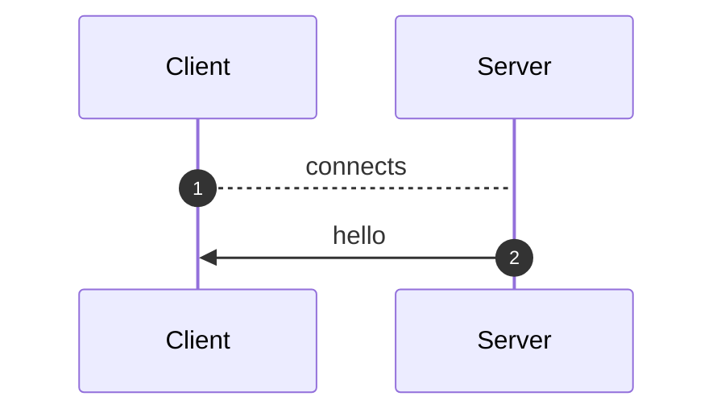
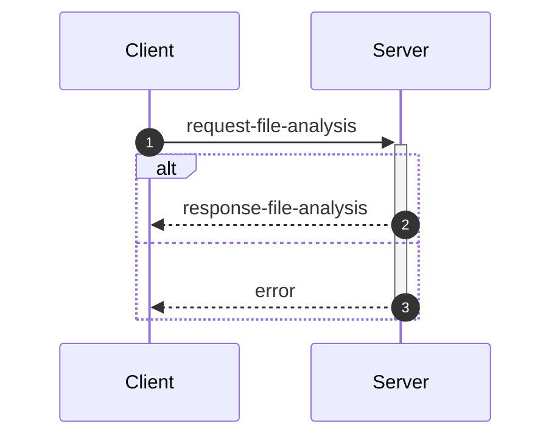
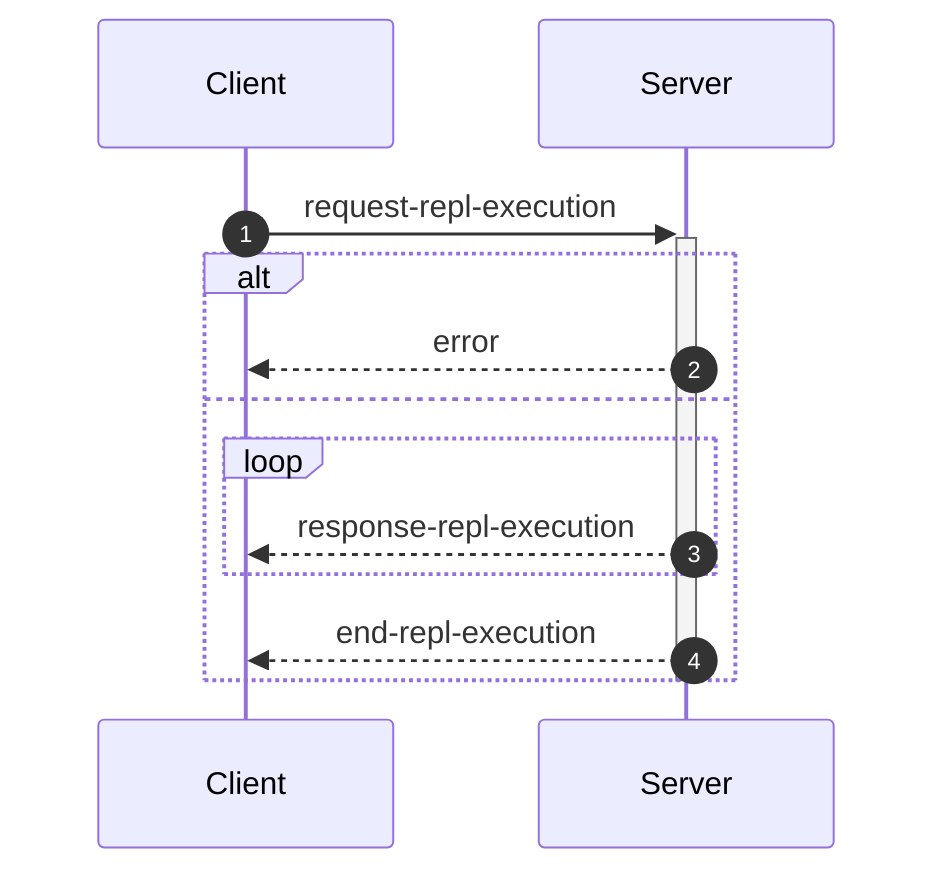
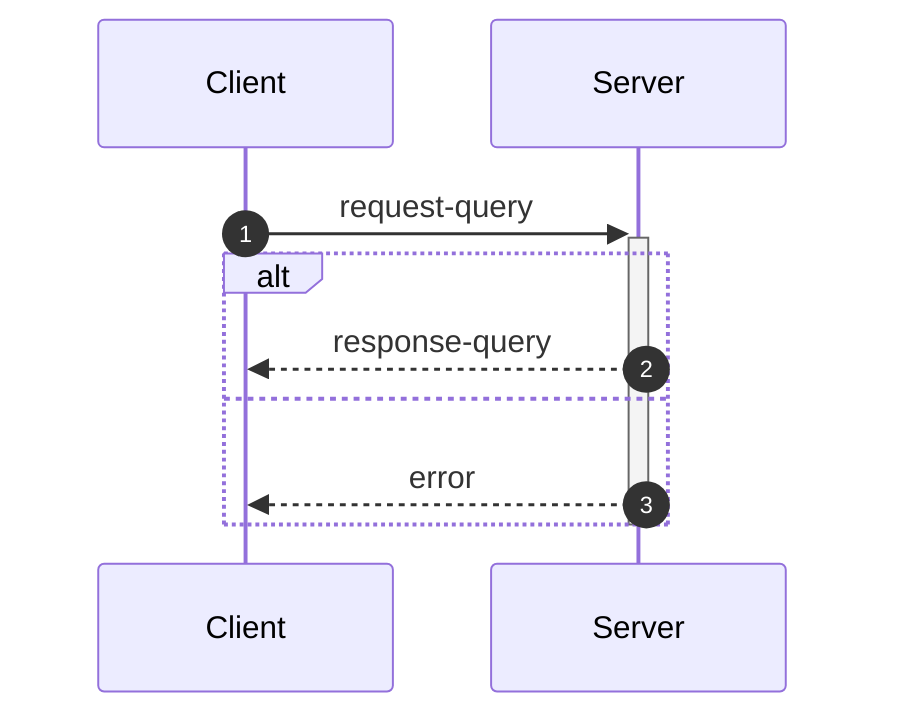

_<span title="an overview of flowR's interface">Generated</span> from '[wiki-interface.ts](https://github.com/flowr-analysis/flowr/tree/main/src/documentation/wiki-interface.ts "src/documentation/wiki-interface.ts")' on 2026-11-08, 08:41:45 UTC (v2.17.4, R v4.6.1), do not edit directly._

Although far from being as detailed as the in-depth explanation of [_flowR_](https://github.com/flowr-analysis/flowr/wiki/Core),
this wiki page explains how to interface with _flowR_ in more detail.
In general, command line arguments and other options provide short descriptions on hover over.

* [💻 Using the REPL](#using-the-repl)
* [⚙️ Configuring FlowR](#configuring-flowr)
* [⚒️ Writing Code](#writing-code)
* [💬 Communicating with the Server](#communicating-with-the-server)

<a id='using-the-repl'></a>
## 💻 Using the REPL

> [!NOTE]
> To execute arbitrary R commands with a repl request, _flowR_ has to be started explicitly with <span title="Description (Command Line Argument): Allow to access the underlying R session when using flowR (security warning: this allows the execution of arbitrary R code!)">`--r-session-access`</span>.
> Please be aware that this introduces a security risk and note that this relies on the [`r-shell` engine](https://github.com/flowr-analysis/flowr/wiki/Engines) .

Although primarily meant for users to explore,
there is nothing which forbids calling _flowR_ as a subprocess to use standard-in, -output, and -error
for communication (although you can access the REPL using the server as well,
with the [REPL Request](#message-request-repl-execution) message).

The read-eval-print loop&nbsp;(REPL) works relatively simple.
You can submit an expression (using <kbd>Enter</kbd>),
which is interpreted as an R&nbsp;expression by default but interpreted as a *command* if it starts with a colon (`:`).
The best command to get started with the REPL is <span title="Description (Repl Command): Show help information (aliases: :h, :?)">`:help`</span>.
Besides, you can leave the REPL either with the command <span title="Description (Repl Command): End the repl (aliases: :q, :exit)">`:quit`</span> or by pressing <kbd>Ctrl</kbd>+<kbd>C</kbd> twice.
When writing a *command*, you may press <kbd>Tab</kbd> to get a list of completions, if available.
Multiple commands can be entered in a single line by separating them with a semicolon (`;`), e.g. `:parse "x<-2"; :df*`.
If a command is given without R code, the REPL will re-use R code given in a previous command.
The prior example will hence return first the parsed AST of the program and then the dataflow graph for `"x <- 2"`.

> [!NOTE]
> If you develop flowR, you may want to launch the repl using the `npm run main-dev` command, this way, you get a non-minified version of flowR with debug information and hot-reloading of source files.

<details>
<summary>Available Commands</summary>

We currently offer the following commands (this with a `[*]` suffix are available with and without the star):

| Command | Description |
| ------- | ----------- |
| **<span title="Description (Repl Command): End the repl (aliases: :q, :exit)">:quit</span>** | End the repl (aliases: **:<span title="Alias of ':quit'. End the repl">q</span>**, **:<span title="Alias of ':quit'. End the repl">exit</span>**) |
| **<span title="Description (Repl Command): Execute the given code as R code. This requires the `--r-session-access` flag to be set and requires the r-shell engine. (aliases: :e, :r)">:execute</span>** | Execute the given code as R code. This requires the `--r-session-access` flag to be set and requires the r-shell engine. (aliases: **:<span title="Alias of ':execute'. Execute the given code as R code. This requires the `--r-session-access` flag to be set and requires the r-shell engine.">e</span>**, **:<span title="Alias of ':execute'. Execute the given code as R code. This requires the `--r-session-access` flag to be set and requires the r-shell engine.">r</span>**) |
| **<span title="Description (Repl Command): Get mermaid code for the control-flow graph of R code (aliases: :cfg, :cf)">:controlflow[*]</span>** | Get mermaid code for the control-flow graph of R code (star: Returns the URL to mermaid.live) (aliases: **:<span title="Alias of ':controlflow'. Get mermaid code for the control-flow graph of R code">cfg</span>**, **:<span title="Alias of ':controlflow'. Get mermaid code for the control-flow graph of R code">cf</span>**) |
| **<span title="Description (Repl Command): Get mermaid code for the control-flow graph with basic blocks (aliases: :cfgb, :cfb)">:controlflowbb[*]</span>** | Get mermaid code for the control-flow graph with basic blocks (star: Returns the URL to mermaid.live) (aliases: **:<span title="Alias of ':controlflowbb'. Get mermaid code for the control-flow graph with basic blocks">cfgb</span>**, **:<span title="Alias of ':controlflowbb'. Get mermaid code for the control-flow graph with basic blocks">cfb</span>**) |
| **<span title="Description (Repl Command): Get mermaid code for the dataflow graph (aliases: :d, :df)">:dataflow[*]</span>** | Get mermaid code for the dataflow graph (star: Returns the URL to mermaid.live) (aliases: **:<span title="Alias of ':dataflow'. Get mermaid code for the dataflow graph">d</span>**, **:<span title="Alias of ':dataflow'. Get mermaid code for the dataflow graph">df</span>**) |
| **<span title="Description (Repl Command): Get mermaid code for the normalized AST of R code (aliases: :n)">:normalize[*]</span>** | Get mermaid code for the normalized AST of R code (star: Returns the URL to mermaid.live) (alias: **:<span title="Alias of ':normalize'. Get mermaid code for the normalized AST of R code">n</span>**) |
| **<span title="Description (Repl Command): Get mermaid code for the simplified dataflow graph (aliases: :ds, :dfs)">:dataflowsimple[*]</span>** | Get mermaid code for the simplified dataflow graph (star: Returns the URL to mermaid.live) (aliases: **:<span title="Alias of ':dataflowsimple'. Get mermaid code for the simplified dataflow graph">ds</span>**, **:<span title="Alias of ':dataflowsimple'. Get mermaid code for the simplified dataflow graph">dfs</span>**) |
| **<span title="Description (Repl Command): Inspect and extend the signature database: `query` (identical to :query @signature), `info <name>` for where a function comes from (identical to :query @function-info), `add <path>` to mount another database/source, `download` to fetch the full-history database. (aliases: :sig)">:signature</span>** | Inspect and extend the signature database: `query` (identical to :query @signature), `info <name>` for where a function comes from (identical to :query @function-info), `add <path>` to mount another database/source, `download` to fetch the full-history database. (alias: **:<span title="Alias of ':signature'. Inspect and extend the signature database: `query` (identical to :query @signature), `info <name>` for where a function comes from (identical to :query @function-info), `add <path>` to mount another database/source, `download` to fetch the full-history database.">sig</span>**) |
| **<span title="Description (Repl Command): Just calculates the DFG, but only prints summary info (aliases: :d#, :df#)">:dataflowsilent</span>** | Just calculates the DFG, but only prints summary info (aliases: **:<span title="Alias of ':dataflowsilent'. Just calculates the DFG, but only prints summary info">d#</span>**, **:<span title="Alias of ':dataflowsilent'. Just calculates the DFG, but only prints summary info">df#</span>**) |
| **<span title="Description (Repl Command): Prints ASCII Art of the parsed, unmodified AST (aliases: :p)">:parse</span>** | Prints ASCII Art of the parsed, unmodified AST (alias: **:<span title="Alias of ':parse'. Prints ASCII Art of the parsed, unmodified AST">p</span>**) |
| **<span title="Description (Repl Command): Prints the version of flowR as well as the current version of R">:version</span>** | Prints the version of flowR as well as the current version of R
| **<span title="Description (Repl Command): Query the given R code (use 'help' for more information)">:query[*]</span>** | Query the given R code (use 'help' for more information) (star: Similar to query, but returns the output in json format.)
| **<span title="Description (Repl Command): Returns an ASCII representation of the dataflow graph (aliases: :df!)">:dataflowascii</span>** | Returns an ASCII representation of the dataflow graph (alias: **:<span title="Alias of ':dataflowascii'. Returns an ASCII representation of the dataflow graph">df!</span>**) |
| **<span title="Description (Repl Command): Returns summarization stats for the normalized AST (aliases: :n#)">:normalize#</span>** | Returns summarization stats for the normalized AST (alias: **:<span title="Alias of ':normalize#'. Returns summarization stats for the normalized AST">n#</span>**) |
| **<span title="Description (Repl Command): Show help information (aliases: :h, :?)">:help</span>** | Show help information (aliases: **:<span title="Alias of ':help'. Show help information">h</span>**, **:<span title="Alias of ':help'. Show help information">?</span>**) |

</details>

> [!TIP]
> 
> As indicated by the examples before, all REPL commands that operate on code keep track of the state.
> Hence, if you run a command like <span title="Description (Repl Command, starred version): Returns the URL to mermaid.live; Base Command: Get mermaid code for the dataflow graph (aliases: :d*, :df*)">`:dataflow*`</span> without providing R code,
> the REPL will re-use the R code provided in a previous command.
> Likewise, doing this will benefit from incrementality!
> If you request the dataflow graph with `:df* x <- 2 * y` and then want to see the parsed AST with `:parse`,
> the REPL will re-use previously obtained information and not re-parse the code again.
> 		

Generally, many commands offer shortcut versions in the REPL. Many queries, for example, offer a shortened format (see the example below).
Of special note, the [Config Query](https://github.com/flowr-analysis/flowr/wiki/%5BQuery%5D-Config)
can be used to also modify the currently active configuration of _flowR_ within the REPL (see the [wiki page](https://github.com/flowr-analysis/flowr/wiki/%5BQuery%5D-Config) for more information).

### Example: Retrieving the Dataflow Graph

To retrieve a URL to the [mermaid](https://mermaid.js.org/) diagram of the dataflow of a given expression,
use <span title="Description (Repl Command, starred version): Returns the URL to mermaid.live; Base Command: Get mermaid code for the dataflow graph (aliases: :d*, :df*)">`:dataflow*`</span> (or <span title="Description (Repl Command): Get mermaid code for the dataflow graph (aliases: :d, :df)">`:dataflow`</span> to get the mermaid code in the cli):

```shell
$ docker run -it --rm eagleoutice/flowr # or npm run flowr 
flowR repl v2.17.4, R grammar v14 (tree-sitter engine)
R> :dataflow* y <- 1 + x
```

<details>
<summary style='color:gray'>Output</summary>

```text
https://mermaid.live/view#base64:eyJjb2RlIjoiZmxvd2NoYXJ0IFREXG4gICAgMXt7XCJgKiM5MTtSTnVtYmVyIzkzOyogKioxKipcbiAgICAgICoxLjYqICgqKmlkOiAxKiopYFwifX1cbiAgICAyKFtcImAqIzkxO1JTeW1ib2wjOTM7KiAqKngqKlxuICAgICAgKjEuMTAqICgqKmlkOiAyKiopYFwiXSlcbiAgICAzW1tcImAqIzkxO1JCaW5hcnlPcCM5MzsqIGJhc2UjNTg7IzU4OyoqIzQzOyoqXG4gICAgICAqMS42LTEwKiAoKippZDogMyoqKVxuICAgIGFyZzogKDEsIDIpYFwiXV1cbiAgICBidWlsdC1pbjpfNDNfW1wiYEJ1aWx0LUluOlxuIzQzO2BcIl1cbiAgICBzdHlsZSBidWlsdC1pbjpfNDNfIHN0cm9rZTpncmF5LGZpbGw6Z3JheSxzdHJva2Utd2lkdGg6MnB4LG9wYWNpdHk6Ljg7XG4gICAgMFtcImAqIzkxO1JTeW1ib2wjOTM7KiAqKnkqKlxuICAgICAgKjEuMSogKCoqaWQ6IDAqKiwgdjogMylgXCJdXG4gICAgNFtbXCJgKiM5MTtSQmluYXJ5T3AjOTM7KiBiYXNlIzU4OyM1ODsqKiM2MDsjNDU7KipcbiAgICAgICoxLjEtMTAqICgqKmlkOiA0KiopXG4gICAgYXJnOiAoMCwgMylgXCJdXVxuICAgIGJ1aWx0LWluOl82MF8tW1wiYEJ1aWx0LUluOlxuIzYwOyM0NTtgXCJdXG4gICAgc3R5bGUgYnVpbHQtaW46XzYwXy0gc3Ryb2tlOmdyYXksZmlsbDpncmF5LHN0cm9rZS13aWR0aDoycHgsb3BhY2l0eTouODtcbiAgICAxIC0uLT58XCJmbG93XCJ8IDJcbiAgICBsaW5rU3R5bGUgMCBzdHJva2U6Z3JheSxjb2xvcjpncmF5O1xuICAgIDIgLS4tPnxcImZsb3dcInwgM1xuICAgIGxpbmtTdHlsZSAxIHN0cm9rZTpncmF5LGNvbG9yOmdyYXk7XG4gICAgMyAtLT58XCJyZWFkcywgYXJnXCJ8IDFcbiAgICAzIC0tPnxcInJlYWRzLCBhcmdcInwgMlxuICAgIDMgLS4tPnxcImZsb3dcInwgMFxuICAgIGxpbmtTdHlsZSA0IHN0cm9rZTpncmF5LGNvbG9yOmdyYXk7XG4gICAgMyAtLi0+fFwicmVhZHMsIGNhbGxzXCJ8IGJ1aWx0LWluOl80M19cbiAgICBsaW5rU3R5bGUgNSBzdHJva2U6Z3JheTtcbiAgICAwIC0tPnxcImRlZmluZWQtYnksIGZsb3dcInwgNFxuICAgIDAgLS0+fFwiZGVmaW5lZC1ieVwifCAzXG4gICAgNCAtLT58XCJyZWFkcywgYXJnXCJ8IDNcbiAgICA0IC0tPnxcInJldHVybnMsIGFyZ1wifCAwXG4gICAgNCAtLi0+fFwicmVhZHMsIGNhbGxzXCJ8IGJ1aWx0LWluOl82MF8tXG4gICAgbGlua1N0eWxlIDEwIHN0cm9rZTpncmF5OyIsIm1lcm1haWQiOnsiYXV0b1N5bmMiOnRydWV9fQ==
```

Retrieve the dataflow graph of the expression `y <- 1 + x`. It looks like this:


<details>

<summary style="color:gray">R Code of the Dataflow Graph</summary>

The analysis ran (parse and normalize with the [tree-sitter](https://github.com/flowr-analysis/flowr/wiki/Engines) engine) in the generation environment. No [signature database](https://github.com/flowr-analysis/flowr/wiki/Signature-Database) is mounted, so `library()` attaches no exports (base-R names are still qualified, e.g., `stats::acf`). 
We encountered no unknown side effects during the analysis.

```r
y <- 1 + x
```

</details>

</details>

For small graphs like this, <span title="Description (Repl Command): Returns an ASCII representation of the dataflow graph (aliases: :df!)">`:dataflowascii`</span> also provides an ASCII representation directly in the REPL:

```shell
$ docker run -it --rm eagleoutice/flowr # or npm run flowr 
flowR repl v2.17.4, R grammar v14 (tree-sitter engine)
R> :df! y <- 1 + x
```

<details open>
<summary style='color:gray'>Output</summary>

```text
                        v<0>v
 c<4>c──────────────────| y |
 |<- |     ┌────────────v---v
 c---c     │
    │   c<3>c   0<1>0
    └───| + |───| 1 |───u<2>u
        c---c   0---0   | x |
           └────────────u---u
Edges:
3 -> 1: reads, arg          3 -> 2: reads, arg
3 -> 0: flows-to            1 -> 2: flows-to
2 -> 3: flows-to            4 -> 3: reads, arg
4 -> 0: returns, arg        0 -> 4: defined-by, flows-to
0 -> 3: defined-by
```

Retrieve the dataflow graph of the expression `y <- 1 + x` as ASCII art.

</details>

For the slicing with <span title="Description (Repl Command): Static backwards executable slicer for R">`:slicer`</span>, you have access to the same [magic comments](#slice-magic-comments) as with the [slice request](#message-request-slice).
Pass `--inline` to splice resolvable `source()` calls into the reconstruction so the slice is a single self-contained R text (the same as the static slice query's `inlineSources` flag).
See `--help` for more flags!

### Example: Interfacing with the File System

Many commands that allow for an R-expression (like <span title="Description (Repl Command, starred version): Returns the URL to mermaid.live; Base Command: Get mermaid code for the dataflow graph (aliases: :d*, :df*)">`:dataflow*`</span>) allow for a file as well
if the argument starts with `file://`.
If you are working from the root directory of the _flowR_ repository, the following gives you the parsed AST of the example file using the <span title="Description (Repl Command): Prints ASCII Art of the parsed, unmodified AST (aliases: :p)">`:parse`</span> command:

> **Watch mode**: Replace `file://` with `watch://` to enter watch mode.
> flowR runs the command immediately and then re-runs it every time the file (or any file inside the folder) changes.
> Enter any other command to leave watch mode.
> For example: `:df watch://analysis.R`

```shell
$ docker run -it --rm eagleoutice/flowr # or npm run flowr 
flowR repl v2.17.4, R grammar v14 (tree-sitter engine)
R> :parse file://test/testfiles/example.R
```

<details>
<summary style='color:gray'>Output</summary>

```text
File: test/testfiles/example.R

program
├ binaryoperator
│ ├ identifier "sum" (1:1─4)
│ ├ <- "<-" (1:5─7)
│ ╰ float "0" (1:8─9)
├ binaryoperator
│ ├ identifier "product" (2:1─8)
│ ├ <- "<-" (2:9─11)
│ ╰ float "1" (2:12─13)
├ binaryoperator
│ ├ identifier "w" (3:1─2)
│ ├ <- "<-" (3:3─5)
│ ╰ float "7" (3:6─7)
├ binaryoperator
│ ├ identifier "N" (4:1─2)
│ ├ <- "<-" (4:3─5)
│ ╰ float "10" (4:6─8)
├ forstatement
│ ├ for "for" (6:1─4)
│ ├ ( "(" (6:5─6)
│ ├ identifier "i" (6:6─7)
│ ├ in "in" (6:8─10)
│ ├ binaryoperator
│ │ ├ float "1" (6:11─12)
│ │ ├ : ":" (6:12─13)
│ │ ╰ parenthesizedexpression
│ │   ├ ( "(" (6:13─14)
│ │   ├ binaryoperator
│ │   │ ├ identifier "N" (6:14─15)
│ │   │ ├ - "-" (6:15─16)
│ │   │ ╰ float "1" (6:16─17)
│ │   ╰ ) ")" (6:17─18)
│ ├ ) ")" (6:18─19)
│ ╰ bracedexpression
│   ├ { "{" (6:20─21)
│   ├ binaryoperator
│   │ ├ identifier "sum" (7:3─6)
│   │ ├ <- "<-" (7:7─9)
│   │ ╰ binaryoperator
│   │   ├ binaryoperator
│   │   │ ├ identifier "sum" (7:10─13)
│   │   │ ├ + "+" (7:14─15)
│   │   │ ╰ identifier "i" (7:16─17)
│   │   ├ + "+" (7:18─19)
│   │   ╰ identifier "w" (7:20─21)
│   ├ binaryoperator
│   │ ├ identifier "product" (8:3─10)
│   │ ├ <- "<-" (8:11─13)
│   │ ╰ binaryoperator
│   │   ├ identifier "product" (8:14─21)
│   │   ├  "" (8:22─23)
│   │   ╰ identifier "i" (8:24─25)
│   ╰ } "}" (9:1─2)
├ call
│ ├ identifier "cat" (11:1─4)
│ ╰ arguments
│   ├ ( "(" (11:4─5)
│   ├ argument
│   │ ╰ string
│   │   ├ stringopen "\"" (11:5─6)
│   │   ├ stringcontent "Sum:" (11:6─10)
│   │   ╰ stringclose "\"" (11:10─11)
│   ├ comma "," (11:11─12)
│   ├ argument
│   │ ╰ identifier "sum" (11:13─16)
│   ├ comma "," (11:16─17)
│   ├ argument
│   │ ╰ string
│   │   ├ stringopen "\"" (11:18─19)
│   │   ├ stringcontent
│   │   │ ╰ escapesequence "\\n" (11:19─21)
│   │   ╰ stringclose "\"" (11:21─22)
│   ╰ ) ")" (11:22─23)
╰ call
  ├ identifier "cat" (12:1─4)
  ╰ arguments
    ├ ( "(" (12:4─5)
    ├ argument
    │ ╰ string
    │   ├ stringopen "\"" (12:5─6)
    │   ├ stringcontent "Product:" (12:6─14)
    │   ╰ stringclose "\"" (12:14─15)
    ├ comma "," (12:15─16)
    ├ argument
    │ ╰ identifier "product" (12:17─24)
    ├ comma "," (12:24─25)
    ├ argument
    │ ╰ string
    │   ├ stringopen "\"" (12:26─27)
    │   ├ stringcontent
    │   │ ╰ escapesequence "\\n" (12:27─29)
    │   ╰ stringclose "\"" (12:29─30)
    ╰ ) ")" (12:30─31)
```

Retrieve the parsed AST of the example file.

<details>

<summary>File Content</summary>

```r
sum <- 0
product <- 1
w <- 7
N <- 10

for (i in 1:(N-1)) {
  sum <- sum + i + w
  product <- product * i
}

cat("Sum:", sum, "\n")
cat("Product:", product, "\n")
```

</details>

As _flowR_ directly transforms this AST the output focuses on being human-readable instead of being machine-readable.
		
</details>

### Example: Run a Query

You can run any query supported by _flowR_ using the <span title="Description (Repl Command): Query the given R code (use 'help' for more information)">`:query`</span> command.
For example, to obtain the shapes of all data frames in a given piece of code, you can run:

```shell
$ docker run -it --rm eagleoutice/flowr # or npm run flowr 
flowR repl v2.17.4, R grammar v14 (tree-sitter engine)
R> :query @absint df-shape "x <- data.frame(a = 1:10, b = 1:10)\ny <- x$a"
```

<details open>
<summary style='color:gray'>Output</summary>

```text
Query: absint (3 ms)
   ╰ $12: (colnames: [{"a", "b"}, {}], cols: [2, 2], rows: [10, 10])
   ╰ $0: (colnames: [{"a", "b"}, {}], cols: [2, 2], rows: [10, 10])
```

Retrieve the shapes of all data frames in the given code.

</details>

To run the linter on a file, you can use (in this example, we just issue the `dead-code` linter on a small piece of code):

```shell
$ docker run -it --rm eagleoutice/flowr # or npm run flowr 
flowR repl v2.17.4, R grammar v14 (tree-sitter engine)
R> :query @linter rules:dead-code "if(FALSE) x <- 2"
```

<details open>
<summary style='color:gray'>Output</summary>

```text
Query: linter (4 ms)
   ╰ Dead Code (dead-code):
       ╰ certain:
           ╰ Code at 1.11-16 (1 quick fix(es) available)
```

Run the linter on the given code, with only the `dead-code` rule enabled.

</details>

For more information on the available queries, please check out the [Query API](https://github.com/flowr-analysis/flowr/wiki/Query-API).

<a id='configuring-flowr'></a>
## ⚙️ Configuring FlowR

When running _flowR_, you may want to specify some behaviors with a dedicated configuration file.
By default, flowR looks for a file named `flowr.json` in the current working directory (or any higher directory).
You can also specify a different file with <span title="Description (Command Line Argument): The name of the configuration file to use">`--config-file`</span> or pass the configuration inline using <span title="Description (Command Line Argument): The flowR configuration to use, as a JSON string">`--config-json`</span>.
A `flowr.json` found this way belongs to the analyzed project, so flowR ignores its options that decide what flowR executes or loads
(`engines.*.wasmPath`, `engines.*.treeSitterWasmPath`, `engines.*.rPath`, `solver.sigdb.additionalPaths`, `solver.sigdb.downloadRepo`, `solver.sigdb.installedLibrary.paths`, `solver.sigdb.onDemand.enabled`, `solver.sigdb.onDemand.repositories`, `solver.sigdb.onDemand.cranMirror`, `solver.sigdb.onDemand.bioconductorMirror`, `solver.sigdb.onDemand.cacheDir`),
unless you pass <span title="Description (Command Line Argument): Keep the security-sensitive options (e.g., the R executable) of the flowr.json found in the working directory or a parent. Only use this for projects you trust.">`--trust-config`</span>.
To analyze code you do not trust, use the secure mode (<span title="Description (Command Line Argument): Run in secure mode for analyzing untrusted code: flowR does not start R (or any other process), does not access the network, does not search for project configs, and ignores security-sensitive options in every config. Cannot be disabled once enabled. Can also be enabled with the environment variable {italic FLOWR_SECURE_MODE=1}.">`--secure`</span>, see the [security policy](https://github.com/flowr-analysis/flowr/blob/main/.github/SECURITY.md)).
To inspect the current configuration, you can run flowr with the <span title="Description (Command Line Argument): Run with verbose logging (will be passed to the corresponding script)">`--verbose`</span> flag, or use the `config` [Query](https://github.com/flowr-analysis/flowr/wiki/Query-API).
Within the REPL this works by running the following:

```shell
:query @config
```

To work with the <a href="https://github.com/flowr-analysis/flowr/tree/main/src/config.ts#L119"><code><span title="The configuration file format for flowR.">FlowrConfig</span></code></a> you can use the provided helper objects alongside its methods like
<a href="https://github.com/flowr-analysis/flowr/tree/main/src/config.ts#L985"><code><span title="Creates a new flowr config that has the updated values.">FlowrConfig::<b>amend</b></span></code></a>.
The schema below documents every option; the ones you most likely want are:

- <a href="https://github.com/flowr-analysis/flowr/wiki/Interface#configuring-flowr" title="Configuration Option (boolean): Whether source calls should be ignored, causing {@link processSourceCall}&#39;s behavior to be skipped.">ignoreSourceCalls</a>: ignore source calls when analyzing the code, i.e., ignore the inclusion of other files.
- <a href="https://github.com/flowr-analysis/flowr/wiki/Interface#configuring-flowr" title="Configuration Option (boolean): Whether load calls should be ignored, causing {@link processLoadCall}&#39;s behavior to be skipped.">ignoreLoadCalls</a>: ignore load calls when analyzing the code, i.e., ignore the loading of r-data files.
- <a href="https://github.com/flowr-analysis/flowr/wiki/Interface#configuring-flowr" title="Configuration Option (object): Do you want to overwrite (parts) of the builtin definition?">semantics.environment.overwriteBuiltIns</a>: overwrite _flowR_'s handling of built-in functions, or clear the preset definitions entirely.
  See [Configure BuiltIn Semantics](#configure-builtin-semantics) for more information.
- <a href="https://github.com/flowr-analysis/flowr/wiki/Interface#configuring-flowr" title="Configuration Option (boolean): Whether calls drawing on a graphics device (e.g., `plot`) count as writing to it, which the ambient state queries then report.">semantics.ambient.drawingWritesDevice</a>: whether calls drawing on a graphics device (e.g., `plot`) count as writing the device in the ambient state queries.
- <a href="https://github.com/flowr-analysis/flowr/wiki/Interface#configuring-flowr" title="Configuration Option (string): How to resolve variables and their values. (one of &quot;disabled&quot;, &quot;alias&quot;, &quot;builtin&quot;)">solver.variables</a>: how to resolve variables and their values (`disabled`, `alias`, `builtin`).
- <a href="https://github.com/flowr-analysis/flowr/wiki/Interface#configuring-flowr" title="Configuration Option (array): The engine or set of engines to use for interacting with R code. An empty array means all available engines will be used.">engines</a> and <a href="https://github.com/flowr-analysis/flowr/wiki/Interface#configuring-flowr" title="Configuration Option (string): The default engine to use for interacting with R code. If this is undefined, an arbitrary engine from the specified list will be used. (one of &quot;tree-sitter&quot;, &quot;r-shell&quot;)">defaultEngine</a>: the engines used to interact with R code, see the [Engines wiki page](https://github.com/flowr-analysis/flowr/wiki/Engines).
- <a href="https://github.com/flowr-analysis/flowr/wiki/Interface#configuring-flowr" title="Configuration Option (array): Files a framework loads on its own, without any source() call (e.g. global.R in a shiny app), in the order they are loaded; flowR orders the matching project files accordingly and analyzes them as one program. Entries are case-insensitive globs matched against the file path, a plain name matches any file with that name, and entries matching no project file are warned about. Usually set per project kind via specializeConfig.">project.implicitSources</a>: the files a framework loads without any `source()` call, in the order in which they are
  loaded. Entries are globs (e.g. `R/*.R`) matched against the file path ignoring capitalization; one matching no file is reported.
- <a href="https://github.com/flowr-analysis/flowr/wiki/Interface#configuring-flowr" title="Configuration Option (object): Overwrite (parts of) the configuration depending on the project kind flowR detects, e.g. to give a shiny app its implicit sources.">specializeConfig</a>: overwrite (parts of) the configuration depending on the kind of project _flowR_ detects
  (e.g. `shiny-app`), which is how a shiny app gets its implicit sources by default. What you configure directly wins.
- <a href="https://github.com/flowr-analysis/flowr/wiki/Interface#configuring-flowr" title="Configuration Option (string): Overwrite the project kind flowR would otherwise infer from the analyzed files, e.g. when auto-detection guesses wrong. (one of &quot;package&quot;, &quot;script&quot;, &quot;shiny-app&quot;, &quot;notebook&quot;, &quot;project&quot;, &quot;unknown&quot;)">project.useProjectType</a>: skip that detection and force a project kind yourself, when auto-detection guesses wrong.
- <a href="https://github.com/flowr-analysis/flowr/wiki/Interface#configuring-flowr" title="Configuration Option (array): The default plugins to load when creating a new instance of FlowrAnalyzer">defaultPlugins</a> and <a href="https://github.com/flowr-analysis/flowr/wiki/Interface#configuring-flowr" title="Configuration Option (array): The plugins to load in REPL mode">repl.plugins</a>: the plugins to load for a new <a href="https://github.com/flowr-analysis/flowr/tree/main/src/project/flowr-analyzer.ts#L240"><code><span title="Central class for conducting analyses with FlowR. Use the FlowrAnalyzerBuilder to create a new instance. If you want the original pattern of creating a pipeline and running all steps, you can still do this with FlowrAnalyzer#runFull . To inspect the context of the analyzer, use FlowrAnalyzer#inspectContext (if you are a plugin and need to modify it, use FlowrAnalyzer#context instead).">FlowrAnalyzer</span></code></a> and in the REPL
  (use `flowr:default` to reference the former).

So you can configure _flowR_ by adding a file like the following:

<details>

<summary>Example Configuration File</summary>

```json
{
  "ignoreSourceCalls": true,
  "ignoreLoadCalls": true,
  "semantics": {
    "environment": {
      "overwriteBuiltIns": {
        "definitions": [
          {
            "type": "function",
            "names": [
              "foo"
            ],
            "processor": "builtin:assign",
            "config": {}
          }
        ]
      }
    }
  },
  "defaultPlugins": [
    "file:description",
    "versions:description"
  ],
  "repl": {
    "quickStats": false,
    "dfProcessorHeat": false,
    "hints": true,
    "plugins": [
      "flowr:default"
    ]
  },
  "project": {
    "resolveUnknownPathsOnDisk": true,
    "implicitSources": [
      "global.R",
      "app.R"
    ]
  },
  "linter": {
    "disabledRules": []
  },
  "specializeConfig": {
    "shiny-app": {
      "project": {
        "implicitSources": [
          "global.R",
          "ui.R",
          "server.R",
          "app.R"
        ]
      }
    }
  },
  "engines": [
    {
      "type": "r-shell"
    }
  ],
  "solver": {
    "variables": "alias",
    "evalStrings": true,
    "trackEnvironments": true,
    "sigdb": {
      "enabled": true,
      "loadProjectDependencies": true,
      "eagerlyLoad": false,
      "eagerlyLoadExports": false,
      "linkBaseR": false,
      "linkDescriptionDependencies": false
    },
    "resolveSource": {
      "dropPaths": "no",
      "ignoreCapitalization": true,
      "inferWorkingDirectory": "active-script",
      "searchPath": []
    },
    "instrument": {},
    "slicer": {
      "threshold": 50
    }
  },
  "abstractInterpretation": {
    "wideningThreshold": 4,
    "followCalls": true,
    "dataFrame": {
      "maxColNames": 20,
      "readLoadedData": {
        "readExternalFiles": true,
        "maxReadLines": 1000000
      }
    }
  },
  "incremental": {
    "alwaysIncremental": false,
    "parsing": {
      "activated": false,
      "heuristics": {
        "activated": true,
        "mtime": true,
        "linesFrom": 500,
        "bytesFrom": 50000,
        "alwaysWithEdits": false,
        "minFiles": 1
      }
    }
  },
  "gas": {
    "thresholds": {
      "memory": {
        "problematic": 0.7,
        "critical": 0.9
      },
      "timeMs": {
        "problematic": 100000,
        "critical": 120000
      }
    },
    "features": {}
  }
}
```

</details>

<details>
<a id='configure-builtin-semantics'></a>
<summary>Configure Built-In Semantics</summary>

`semantics/environment/overwriteBuiltins` accepts two keys:

- `loadDefaults` (boolean, initially `true`): If set to `true`, the default built-in definitions are loaded before applying the custom definitions. Setting this flag to `false` explicitly disables the loading of the default definitions.
- `definitions` (array, initially empty): Allows to overwrite or define new built-in elements. Each object within must have a `type` which is one of the below. Furthermore, they may define a string array of `names` which specifies the identifiers to bind the definitions to. You may use `assumePrimitive` to specify whether _flowR_ should assume that this is a primitive non-library definition (so you probably just do not want to specify the key).

  | Type            | Description                                                                                                                                                                                                                                                                                              | Example                                                                                                    |
  | --------------- | -------------------------------------------------------------------------------------------------------------------------------------------------------------------------------------------------------------------------------------------------------------------------------------------------------- | ---------------------------------------------------------------------------------------------------------- |
  | `constant`    | Additionally allows for a `value` this should resolve to.                                                                                                                                                                                                                                                | `{ type: 'constant', names: ['NULL', 'NA'],  value: null }`                                                |
  | `function`    | Is a rather flexible way to define and bind built-in functions. For the time, we do not have extensive documentation to cover all the cases, so please either consult the sources with the `default-builtin-config/` folder or open a [new issue](https://github.com/flowr-analysis/flowr/issues/new/choose). | `{ type: 'function', names: ['next'], processor: 'builtin:d', config: { cfg: ExitPointType.Next } }` |
  | `replacement` | A comfortable way to specify replacement functions like `$<-` or `names<-`. `suffixes` describes the... suffixes to attach automatically. | `{ type: 'replacement', suffixes: ['<-', '<<-'], names: ['[', '[['] }` |

</details>

<details>

<summary style='color:gray'>Full Configuration-File Schema</summary>

- _The configuration file format for flowR._ (object)
    - **logLevel** [optional] _flowR's global minimum log level, applied when the config is loaded._ (string)
        Only allows: 'silly', 'trace', 'debug', 'info', 'warn', 'error', 'fatal'
    - **ignoreSourceCalls** [optional] _Whether source calls should be ignored, causing {@link processSourceCall}'s behavior to be skipped._ (boolean)
    - **ignoreLoadCalls** [optional] _Whether load calls should be ignored, causing {@link processLoadCall}'s behavior to be skipped._ (boolean)
    - **semantics** _Configure language semantics and how flowR handles them._ (object)
        - **environment** [optional] _Semantics regarding how to handle the R environment._ (object)
            - **overwriteBuiltIns** [optional] _Do you want to overwrite (parts) of the builtin definition?_ (object)
                - **loadDefaults** [optional] _Should the default configuration still be loaded?_ (boolean)
                - **definitions** [optional] _The definitions to load/overwrite._ (array)
                Valid item types:
                    - (object)
        - **ambient** [optional] _Semantics regarding the global state (options, devices, files, ...) calls access._ (object)
            - **drawingWritesDevice** [optional] _Whether calls drawing on a graphics device (e.g., `plot`) count as writing to it, which the ambient state queries then report._ (boolean)
    - **defaultPlugins** [optional] _The default plugins to load when creating a new instance of FlowrAnalyzer_ (array)
    Valid item types:
        - (alternatives)
            - (string)
            - (array)
    - **repl** _Configuration options for the REPL._ (object)
        - **quickStats** [optional] _Whether to show quick stats in the REPL after each evaluation._ (boolean)
        - **dfProcessorHeat** [optional] _This instruments the dataflow processors to count how often each processor is called._ (boolean)
        - **hints** [optional] _Whether to show dim inline hints on the empty prompt (automatically disabled on non-interactive terminals)._ (boolean)
        - **plugins** [optional] _The plugins to load in REPL mode_ (array)
        Valid item types:
            - (alternatives)
                - (string)
                - (array)
        - **autoUseFileProtocol** [optional] _Prepend the file protocol to a repl input that looks like a path, instead of only warning about it._ (boolean)
        - **queryStats** [optional] _Whether `:query` closes with the line stating how long the queries took (`:query*` never prints it)._ (boolean)
        - **showPlugins** [optional] _Whether `:version` grays out the plugins that did not activate during the last analysis._ (boolean)
    - **project** _Project specific configuration options._ (object)
        - **resolveUnknownPathsOnDisk** [optional] _Whether to resolve unknown paths loaded by the r project disk when trying to source/analyze files._ (boolean)
        - **failOnInaccessiblePath** [optional] _Whether a directory that cannot be traversed during file discovery (e.g. due to permissions) aborts the analysis; when false (the default) such paths are logged and skipped._ (boolean)
        - **basePackages** [optional] _The packages considered part of R itself (base and recommended); if unset, flowR uses its built-in list._ (array)
        Valid item types:
            - (string)
        - **implicitSources** [optional] _Files a framework loads on its own, without any source() call (e.g. global.R in a shiny app), in the order they are loaded; flowR orders the matching project files accordingly and analyzes them as one program. Entries are case-insensitive globs matched against the file path, a plain name matches any file with that name, and entries matching no project file are warned about. Usually set per project kind via specializeConfig._ (array)
        Valid item types:
            - (string)
        - **useProjectType** [optional] _Overwrite the project kind flowR would otherwise infer from the analyzed files, e.g. when auto-detection guesses wrong._ (string)
            Only allows: 'package', 'script', 'shiny-app', 'notebook', 'project', 'unknown'
        - **assumeImplicitEcho** [optional] _Whether the top level of the analyzed code is echoed, so that every visible result printed there is collected as an output by the dependencies query (default true, false for a package)._ (boolean)
        - **discovery** [optional] _Scoping options for the default project discovery._ (object)
            - **full** [optional] _Collect every file below the project root (greedy) instead of only the files the detected project kind needs (default false)._ (boolean)
            - **perKind** [optional] _Per-kind include/exclude glob overrides layered on the default scoping._ (object)
            - **ignore** [optional] _Case-insensitive globs that drop matching files from the intelligent discovery, regardless of kind (e.g. .Renviron to ignore environment files)._ (array)
            Valid item types:
                - (string)
        - **classification** [optional] _Overrides for the signals flowR uses to classify the project kind._ (object)
            - **shinyDescriptionTypes** [optional] _DESCRIPTION Type: values that mark a shiny app._ (array)
            Valid item types:
                - (string)
            - **shinyEntryFiles** [optional] _File names a shiny app is assembled from._ (array)
            Valid item types:
                - (string)
            - **shinyUsagePattern** [optional] _Regex source evidencing shiny usage in an entry file._ (string)
            - **notebookExtensions** [optional] _File extensions marking a notebook._ (array)
            Valid item types:
                - (string)
    - **linter** _Linter configuration options._ (object)
        - **disabledRules** _Linting rule names excluded from the default rule set (a rule requested explicitly via a linter query still runs). Usually set per project kind via specializeConfig._ (array)
        Valid item types:
            - (string)
        - **disabledTags** [optional] _Linting rule tags whose rules are excluded from the default rule set (a rule requested explicitly via a linter query still runs). By default the cmd-check rules are disabled for everything but a package; a configured list replaces that default._ (array)
        Valid item types:
            - (string)
    - **inputSources** [optional] _Further frameworks the input-sources analysis should know about; entries are added to flowR's defaults._ (object)
        - **pure** [optional] _Functions that only pass the constantness of their arguments on._ (array)
        Valid item types:
            - (string)
        - **param** [optional] _Functions whose result is a 'param' input._ (array)
        Valid item types:
            - (string)
        - **file** [optional] _Functions whose result is a 'file' input._ (array)
        Valid item types:
            - (string)
        - **tempfile** [optional] _Functions whose result is a 'tempfile' input._ (array)
        Valid item types:
            - (string)
        - **glob** [optional] _Functions whose result is a 'glob' input._ (array)
        Valid item types:
            - (string)
        - **net** [optional] _Functions whose result is a 'net' input._ (array)
        Valid item types:
            - (string)
        - **rand** [optional] _Functions whose result is a 'rand' input._ (array)
        Valid item types:
            - (string)
        - **system** [optional] _Functions whose result is a 'system' input._ (array)
        Valid item types:
            - (string)
        - **ffi** [optional] _Functions whose result is a 'ffi' input._ (array)
        Valid item types:
            - (string)
        - **lang** [optional] _Functions whose result is a 'lang' input._ (array)
        Valid item types:
            - (string)
        - **options** [optional] _Functions whose result is a 'options' input._ (array)
        Valid item types:
            - (string)
        - **cmdline** [optional] _Functions whose result is a 'cmdline' input._ (array)
        Valid item types:
            - (string)
        - **user** [optional] _Functions whose result is a 'user' input._ (array)
        Valid item types:
            - (string)
        - **const** [optional] _Functions whose result is a 'const' input._ (array)
        Valid item types:
            - (string)
        - **scope** [optional] _Functions whose result is a 'scope' input._ (array)
        Valid item types:
            - (string)
        - **dconst** [optional] _Functions whose result is a 'dconst' input._ (array)
        Valid item types:
            - (string)
        - **unknown** [optional] _Functions whose result is a 'unknown' input._ (array)
        Valid item types:
            - (string)
        - **linkedObjects** [optional] _Objects a framework provides without a definition in the code, e.g. shiny's input._ (array)
        Valid item types:
            - (object)
        - **linkedEntryPoints** [optional] _Calls that hand a function to a framework, which binds its objects to the parameters by position._ (array)
        Valid item types:
            - (object)
    - **specializeConfig** [optional] _Overwrite (parts of) the configuration depending on the project kind flowR detects, e.g. to give a shiny app its implicit sources._ (object)
    - **engines** _The engine or set of engines to use for interacting with R code. An empty array means all available engines will be used._ (array)
    Valid item types:
        - (alternatives)
            - _The configuration for the tree sitter engine._ (object)
                - **type** [required] _Use the tree sitter engine._ (string)
                    Only allows: 'tree-sitter'
                - **wasmPath** [optional] _The path to the tree-sitter-r WASM binary to use. If this is undefined, this uses the default path._ (string)
                - **treeSitterWasmPath** [optional] _The path to the tree-sitter WASM binary to use. If this is undefined, this uses the default path._ (string)
                - **lax** [optional] _Whether to use the lax parser for parsing R code (allowing for syntax errors). If this is undefined, the strict parser will be used._ (boolean)
            - _The configuration for the R shell engine._ (object)
                - **type** [required] _Use the R shell engine._ (string)
                    Only allows: 'r-shell'
                - **rPath** [optional] _The path to the R executable to use. If this is undefined, this uses the default path._ (string)
                - **pipeBind** [optional] _Whether to enable R's experimental pipe-bind operator "=>" by setting _R_USE_PIPEBIND_ for the R session (default false); R itself keeps this off by default, as it is experimental and has never shipped in a release version of R._ (boolean)
    - **defaultEngine** [optional] _The default engine to use for interacting with R code. If this is undefined, an arbitrary engine from the specified list will be used._ (string)
        Only allows: 'tree-sitter', 'r-shell'
    - **solver** _How to resolve constants, constraints, cells, ..._ (object)
        - **variables** _How to resolve variables and their values._ (string)
            Only allows: 'disabled', 'alias', 'builtin'
        - **evalStrings** _Should we include eval(parse(text="...")) calls in the dataflow graph?_ (boolean)
        - **trackEnvironments** [optional] _Track user-created environments (new.env, assign/get/local with envir=, dollar-assign, attach). When false, all envir-style calls fall through conservatively._ (boolean)
        - **sigdb** _Resolving library exports from a signature database._ (object)
            - **enabled** [optional] _Resolve library()/use() exports from a signature database (default true); when false no database is consulted._ (boolean)
            - **loadProjectDependencies** [optional] _Load the project's declared dependencies from its metadata files (DESCRIPTION Imports/Depends, rproject.toml, uvr.toml, rig rproj.toml and script blocks, renv.lock, rv.lock, uvr.lock, rig lockfiles) (default true); when false these files are not read for dependencies._ (boolean)
            - **eagerlyLoad** [optional] _Parse the database up front rather than on the first package load (default false, ignored if disabled)._ (boolean)
            - **eagerlyLoadExports** [optional] _Add a vertex for every export on load rather than on demand (default false); keeps the dataflow graph small._ (boolean)
            - **assumedRVersion** [optional] _R version assumed when resolving versioned (base-R) exports: a pin like "4.5" or "auto" to detect the installed R (default "auto")._ (string)
            - **linkBaseR** [optional] _Eagerly attach base-R namespaces so bare base calls resolve without library() (default false)._ (boolean)
            - **linkBaseRCalls** [optional] _Add a lightweight Reads edge from a bare base-R call to its signature-database function vertex (default false; base-R qualification is edge-free otherwise)._ (boolean)
            - **linkPackageCalls** [optional] _Add a lightweight Reads edge from a resolved package call to its signature-database function vertex (default false)._ (boolean)
            - **linkDescriptionDependencies** [optional] _Eagerly attach the namespaces of the project's declared DESCRIPTION dependencies (Imports/Depends) so their exports resolve without an explicit library() (default false)._ (boolean)
            - **warmInBackground** [optional] _Decompress the hot shards (base + most-downloaded) in a background task on startup so the first library() lookup is warm (default false; for long-running servers/REPLs)._ (boolean)
            - **additionalPaths** [optional] _Extra directories or bundle/manifest files searched for signature databases (alongside the shipped default and $FLOWR_SIGDB_DIR); a downloaded full-history bundle placed here is mounted automatically._ (array)
            Valid item types:
                - (string)
            - **downloadRepo** [optional] _GitHub owner/repo the full-history bundle is downloaded from via ":signature download" (default "flowr-analysis/flowr"; the release tag comes from the committed sigdb.remote.json unless a version is given)._ (string)
            - **autoSync** [optional] _On startup, re-download shards whose committed sigdb.remote.json hash no longer matches the cache, in the background (default false; opt-in network sync after a git pull)._ (boolean)
            - **installedLibrary** [optional] _Recovering packages no signature database knows from the copy installed on this machine._ (object)
                - **enabled** [required] _Recover packages no signature database knows from their installed copy (default false)._ (boolean)
                - **paths** [optional] _Library directories to search; when empty they are discovered from the environment and the project._ (array)
                Valid item types:
                    - (string)
                - **useEnvironment** [optional] _Search the libraries R_LIBS_USER/R_LIBS/R_LIBS_SITE name (default true)._ (boolean)
                - **useProjectLibrary** [optional] _Search a project-local renv/packrat library (default true)._ (boolean)
                - **maxDepth** [optional] _How far to descend into the nested layout of a project-local library (default 3)._ (number)
                - **packages** [optional] _Only recover packages whose name matches one of these regular expressions; empty means any._ (array)
                Valid item types:
                    - (string)
            - **onDemand** [optional] _Recovering packages no signature database knows from their sources on CRAN, Bioconductor, or GitHub._ (object)
                - **enabled** [required] _Fetch and recover the sources of packages no signature database knows when the analyzed code uses them (default false, accesses the network)._ (boolean)
                - **sources** [optional] _Where to look, in order: github, cran, bioconductor, or a source a plugin adds (default ["github", "cran", "bioconductor"])._ (array)
                Valid item types:
                    - (string)
                - **repositories** [optional] _GitHub repositories (owner/repo[/subdir][@ref]) to fetch packages from, by package name. The analyzed project may name more (DESCRIPTION Remotes, install_github calls)._ (object)
                - **packages** [optional] _Only recover packages whose name matches one of these regular expressions, empty means any._ (array)
                Valid item types:
                    - (string)
                - **cranMirror** [optional] _The CRAN src/contrib/ to fetch from, over https (default https://cloud.r-project.org/src/contrib/). It may be on the local network._ (string)
                - **bioconductorMirror** [optional] _The Bioconductor host, over https (default https://bioconductor.org). It may be on the local network._ (string)
                - **bioconductorRelease** [optional] _The Bioconductor release to fetch from: release, devel, or a number like 3.20 (default release)._ (string)
                - **githubMirrors** [optional] _Use the GitHub mirrors of CRAN (cran/<pkg>) and Bioconductor (bioc/<pkg>) (default true)._ (boolean)
                - **maxPackages** [optional] _The most packages to fetch for one analysis (default 25)._ (number)
                - **maxArchiveMb** [optional] _The most MiB a package archive may have (default 32). It may unpack to three times that, at most 128 MiB._ (number)
                - **offline** [optional] _Only use what was fetched before, never the network (default false)._ (boolean)
                - **retryAfterHours** [optional] _How many hours to wait before asking again for a package no source had (default 24)._ (number)
                - **cacheDir** [optional] _Where to cache what was fetched (default the on-demand directory of the signature cache)._ (string)
            - **blobCacheBudgetMb** [optional] _How many MiB of decoded package blobs every open bundle may hold together (default 16)._ (number)
            - **versionSelection** [optional] _When a project constrains a dependency, resolve to the newest (default), oldest, or system-installed version satisfying it; system needs R and falls back to newest. Base-R packages always resolve against the assumed R version._ (string)
                Only allows: 'newest', 'oldest', 'system'
            - **versionOverrides** [optional] _Force an exact version for specific packages (name -> version), overriding both the project constraint and the versionSelection policy (default {})._ (object)
        - **versionManagement** _Policies for reasoning about dependency versions._ (object)
            - **linkedVersionGroups** [optional] _Groups of packages that must resolve to the same version; version guessing intersects each group so its members stay mutually compatible (default [])._ (array)
            Valid item types:
                - (array)
                Valid item types:
                    - (string)
        - **assumeAttachedPackages** [optional] _Packages to treat as attached without a `library()` call, so what the built-in configuration states about them applies to the analyzed code. The base packages R attaches on startup already resolve without it._ (array)
        Valid item types:
            - (string)
        - **transitiveSideEffectRounds** [optional] _How many rounds the transitive side-effect fixpoint may run before it is cut off (default 32); the propagation stops on its own as soon as a round adds nothing._ (number)
        - **maxOverlayDepth** [optional] _How many binding overlays may stack on one environment frame before a write flattens them (default 4); a pure performance knob, trading lookup cost against copy cost without changing any result._ (number)
        - **instrument** (object)
            - **dataflowExtractors** [optional] _These keys are only intended for use within code, allowing to instrument the dataflow analyzer!_ (any)
        - **resolveSource** [optional] _If lax source calls are active, flowR searches for sourced files much more freely, based on the configurations you give it. This option is only in effect if `ignoreSourceCalls` is set to false._ (object)
            - **dropPaths** _Allow to drop the first or all parts of the sourced path, if it is relative._ (string)
                Only allows: 'no', 'once', 'all'
            - **ignoreCapitalization** _Search for filenames matching in the lowercase._ (boolean)
            - **inferWorkingDirectory** _Try to infer the working directory from the main or any script to analyze._ (string)
                Only allows: 'no', 'main-script', 'active-script', 'any-script'
            - **searchPath** _Additionally search in these paths._ (array)
            Valid item types:
                - (string)
            - **repeatedSourceLimit** [optional] _How often the same file can be sourced within a single run? Please be aware: in case of cyclic sources this may not reach a fixpoint so give this a sensible limit._ (number)
            - **applyReplacements** _Provide name replacements for loaded files_ (array)
            Valid item types:
                - (object)
            - **assumeFilesExist** [optional] _Assume a sourced file is always there, making what it defines certain instead of conditional on the source call._ (boolean)
        - **slicer** [optional] _The configuration for the slicer._ (object)
            - **threshold** [optional] _The maximum number of iterations to perform on a single function call during slicing._ (number)
            - **autoExtend** [optional] _If set, the slicer will gain an additional post-pass._ (boolean)
    - **abstractInterpretation** _The configuration options for abstract interpretation._ (object)
        - **wideningThreshold** _The threshold for the number of visitations of a node at which widening should be performed to ensure the termination of the fixpoint iteration._ (number)
        - **followCalls** _Whether the abstract interpretation is interprocedural, i.e. whether it steps into the functions a call may dispatch to._ (boolean)
        - **dataFrame** _The configuration of the shape inference for data frames._ (object)
            - **maxColNames** _The maximum number of columns names to infer for data frames before over-approximating the column names to top._ (number)
            - **readLoadedData** _Configuration options for reading data frame shapes from loaded external data files, such as CSV files._ (object)
                - **readExternalFiles** _Whether data frame shapes should be extracted from loaded external files, such as CSV files._ (boolean)
                - **maxReadLines** _The maximum number of lines to read when extracting data frame shapes from loaded files, such as CSV files._ (number)
    - **incremental** (object)
        - **alwaysIncremental** _Always take the incremental path, regardless of heuristics._ (boolean)
        - **parsing** (object)
            - **activated** _If set, incremental parsing will be used._ (boolean)
            - **heuristics** (object)
                - **activated** [optional] _If set, the heuristics for incremental parsing will be used._ (boolean)
                - **mtime** [optional] _Skip reparsing entirely if the file's modification time is unchanged since the last parse._ (boolean)
                - **linesFrom** [optional] _Only consider incremental parsing for files with at least this many lines._ (number)
                - **bytesFrom** [optional] _Only consider incremental parsing for files with at least this many bytes._ (number)
                - **alwaysWithEdits** [optional] _Always take the incremental path whenever there is a computed edit region, regardless of the other thresholds._ (boolean)
                - **minFiles** [optional] _Only apply these heuristics once the project has at least this many files loaded._ (number)
    - **gas** [optional] _Resource-usage guard (gas) configuration. All feature factors default to 0 (disabled). See https://github.com/flowr-analysis/flowr/wiki/Core#gas-resource-guard._ (object)
        - **thresholds** [optional] _Thresholds for all gas checks (scaled by per-feature factor), boundable per feature._ (object)
            - **memory** [optional] _Heap-usage fraction thresholds (0-1), either shared or given per feature key (with `default` covering the rest)._ (object)
                - **problematic** [optional] _Heap fraction (0-1) above which Problematic is returned, for every feature without an entry of its own._ (number)
                - **critical** [optional] _Heap fraction (0-1) above which Critical is returned, for every feature without an entry of its own._ (number)
            - **timeMs** [optional] _Elapsed analysis time thresholds in milliseconds, either shared or given per feature key (with `default` covering the rest)._ (object)
                - **problematic** [optional] _Elapsed ms above which Problematic is returned, for every feature without an entry of its own._ (number)
                - **critical** [optional] _Elapsed ms above which Critical is returned, for every feature without an entry of its own._ (number)
            - **steps** [optional] _Processed-AST-node thresholds, counted rather than sampled; only a key that arms a budget (`dataflow`) reads them._ (object)
                - **problematic** [optional] _Processed AST nodes above which Problematic is returned, for every feature without an entry of its own._ (number)
                - **critical** [optional] _Processed AST nodes above which the extraction is cut short, for every feature without an entry of its own._ (number)
            - **vertices** [optional] _Created-dataflow-vertex thresholds, counted like `steps`._ (object)
                - **problematic** [optional] _Created dataflow vertices above which Problematic is returned, for every feature without an entry of its own._ (number)
                - **critical** [optional] _Created dataflow vertices above which the extraction is cut short, for every feature without an entry of its own._ (number)
        - **features** [optional] _Per-feature sensitivity factors. 0 or absent disables gas checking for that feature. A factor of 2 makes the feature twice as sensitive. Recognised keys: `source`, `side-effect-linking`, `linter`, `slicer`, `dataflow`._ (object)
        - **countedCheckEvery** [optional] _How many counted steps pass between two accountings of an armed check, be it a dataflow budget or the slicer's traversal (default 128); trades overshoot against the cost of the check._ (number)
        - **heapProvider** [optional] _Custom heap statistics source (programmatic configs only), overriding the built-in v8/performance.memory detection._ (function)

</details>

<a id='writing-code'></a>
## ⚒️ Writing Code

_flowR_ can be used as a [module](https://www.npmjs.com/package/@eagleoutice/flowr) and offers several main classes and interfaces that are interesting for extension writers 
(see the [Visual Studio Code extension](https://marketplace.visualstudio.com/items?itemName=code-inspect.vscode-flowr) or the [Core](https://github.com/flowr-analysis/flowr/wiki/Core) wiki page for more information).

### Creating Analyses with _flowR_

Nowadays, instances of the <a href="https://github.com/flowr-analysis/flowr/tree/main/src/project/flowr-analyzer.ts#L240"><code><span title="Central class for conducting analyses with FlowR. Use the FlowrAnalyzerBuilder to create a new instance. If you want the original pattern of creating a pipeline and running all steps, you can still do this with FlowrAnalyzer#runFull . To inspect the context of the analyzer, use FlowrAnalyzer#inspectContext (if you are a plugin and need to modify it, use FlowrAnalyzer#context instead).">FlowrAnalyzer</span></code></a> should be used as central frontend to get analysis results from _flowR_.
The entry points an analysis is written against are re-exported from the package root (`import { FlowrAnalyzerBuilder } from '@eagleoutice/flowr'`);
everything else stays reachable under its own path, as in `@eagleoutice/flowr/dataflow/graph/graph`.
For example, a program slice can be created like this:

```ts
const analyzer = await new FlowrAnalyzerBuilder()
    .setEngine('tree-sitter')
    .build();
analyzer.addRequest('x <- 1\ny <- x\nx');
const { slice, reconstruct } = await analyzer.query({
    type:     'static-slice',
    criteria: ['3@x']
});
```

For more information, please have a look at the [Analyzer](https://github.com/flowr-analysis/flowr/wiki/Analyzer) wiki page, which explains how to construct and use the <a href="https://github.com/flowr-analysis/flowr/tree/main/src/project/flowr-analyzer.ts#L240"><code><span title="Central class for conducting analyses with FlowR. Use the FlowrAnalyzerBuilder to create a new instance. If you want the original pattern of creating a pipeline and running all steps, you can still do this with FlowrAnalyzer#runFull . To inspect the context of the analyzer, use FlowrAnalyzer#inspectContext (if you are a plugin and need to modify it, use FlowrAnalyzer#context instead).">FlowrAnalyzer</span></code></a> in more detail.
To work with specific perspectives, you can also consult the respective pages like the [Dataflow Graph](https://github.com/flowr-analysis/flowr/wiki/Dataflow-Graph) or the [Abstract Interpretation](https://github.com/flowr-analysis/flowr/wiki/Abstract-Interpretation) wiki pages.
### The Pipeline Executor (Low-Level Interface)

Once, in the beginning, _flowR_ was meant to produce a dataflow graph merely to provide *program slices*. 
However, with continuous updates, the [Dataflow Graph](https://github.com/flowr-analysis/flowr/wiki/Dataflow-Graph) repeatedly proves to be the more interesting part.
With this, we restructured _flowR_'s originally *hardcoded* pipeline to be far more flexible. 
Now, it can be theoretically extended or replaced with arbitrary steps, optional steps, and what we call 'decorations' of these steps. 
In short, a slicing pipeline using the <a href="https://github.com/flowr-analysis/flowr/tree/main/src/core/pipeline-executor.ts#L97"><code><span title="**Please note:** The PipelineExecutor is now considered to be a rather low-level API for flowR. While it still works and is the basis for all other layers, we strongly recommend using the FlowrAnalyzer and its builder to create and use an analyzer instance that is pre-configured for your use-case. The pipeline executor allows to execute arbitrary pipelines in a step-by-step fashion. If you are not...">PipelineExecutor</span></code></a> looks like this:

```ts

const slicer = new PipelineExecutor(DEFAULT_SLICING_PIPELINE, {
  parser:    new RShell(),
  request:   requestFromInput('x <- 1\nx + 1'),
  criterion: ['2@x']
})
const slice = await slicer.allRemainingSteps()
// console.log(slice.reconstruct.code)
```

<details><summary>More Information</summary>

If you compare this, with what you would have done with the old (and removed) `SteppingSlicer`, 
this essentially just requires you to replace the `SteppingSlicer` with the <a href="https://github.com/flowr-analysis/flowr/tree/main/src/core/pipeline-executor.ts#L97"><code><span title="**Please note:** The PipelineExecutor is now considered to be a rather low-level API for flowR. While it still works and is the basis for all other layers, we strongly recommend using the FlowrAnalyzer and its builder to create and use an analyzer instance that is pre-configured for your use-case. The pipeline executor allows to execute arbitrary pipelines in a step-by-step fashion. If you are not...">PipelineExecutor</span></code></a>
and to pass the <a href="https://github.com/flowr-analysis/flowr/tree/main/src/core/steps/pipeline/default-pipelines.ts#L18"><code>DEFAULT_SLICING_PIPELINE</code></a> as the first argument.
The <a href="https://github.com/flowr-analysis/flowr/tree/main/src/core/pipeline-executor.ts#L97"><code><span title="**Please note:** The PipelineExecutor is now considered to be a rather low-level API for flowR. While it still works and is the basis for all other layers, we strongly recommend using the FlowrAnalyzer and its builder to create and use an analyzer instance that is pre-configured for your use-case. The pipeline executor allows to execute arbitrary pipelines in a step-by-step fashion. If you are not...">PipelineExecutor</span></code></a>...

1. Provides structures to investigate the results of all intermediate steps
2. Can be executed step-by-step
3. Can repeat steps (e.g., to calculate multiple slices on the same input)

See the in-code documentation for more information.

</details>

### Using the <a href="https://github.com/flowr-analysis/flowr/tree/main/src/r-bridge/shell.ts#L144"><code><span title="The RShell represents an interactive session with the R interpreter. You can configure it by RShellOptions . At the moment we are using a live R session (and not networking etc.) to communicate with R easily, which allows us to install packages etc. However, this might and probably will change in the future (leaving this as a legacy mode :D)">RShell</span></code></a> to Interact with R

The <a href="https://github.com/flowr-analysis/flowr/tree/main/src/r-bridge/shell.ts#L144"><code><span title="The RShell represents an interactive session with the R interpreter. You can configure it by RShellOptions . At the moment we are using a live R session (and not networking etc.) to communicate with R easily, which allows us to install packages etc. However, this might and probably will change in the future (leaving this as a legacy mode :D)">RShell</span></code></a> class allows interfacing with the `R`&nbsp;ecosystem installed on the host system.
Please have a look at [flowR's Engines](https://github.com/flowr-analysis/flowr/wiki/Engines) for more information on alternatives (for example, the <a href="https://github.com/flowr-analysis/flowr/tree/main/src/r-bridge/lang-4.x/tree-sitter/tree-sitter-executor.ts#L29"><code><span title="Synchronous and (way) faster alternative to the RShell using tree-sitter.">TreeSitterExecutor</span></code></a>).

> [!IMPORTANT]
> 
> Each <a href="https://github.com/flowr-analysis/flowr/tree/main/src/r-bridge/shell.ts#L144"><code><span title="The RShell represents an interactive session with the R interpreter. You can configure it by RShellOptions . At the moment we are using a live R session (and not networking etc.) to communicate with R easily, which allows us to install packages etc. However, this might and probably will change in the future (leaving this as a legacy mode :D)">RShell</span></code></a> controls a new instance of the R&nbsp;interpreter, 
> make sure to call <code><a href="https://github.com/flowr-analysis/flowr/tree/main/src/r-bridge/shell.ts#L350"><span title="Close the current R session, makes the object effectively invalid (can no longer be reopened etc.)">RShell::<i>close</i></span></a>()</code> when you are done.

You can start a new "session" by constructing a new object with <code>new <a href="https://github.com/flowr-analysis/flowr/tree/main/src/r-bridge/shell.ts#L144"><span title="The RShell represents an interactive session with the R interpreter. You can configure it by RShellOptions . At the moment we are using a live R session (and not networking etc.) to communicate with R easily, which allows us to install packages etc. However, this might and probably will change in the future (leaving this as a legacy mode :D)">RShell</span></a>()</code>.

However, there are several options that may be of interest 
(e.g., to automatically revive the shell in case of errors or to control the name location of the R process on the system).

With a shell object (let's call it `shell`), you can execute R code by using <a href="https://github.com/flowr-analysis/flowr/tree/main/src/r-bridge/shell.ts#L213"><code><span title="sends the given command directly to the current R session will not do anything to alter input markers!">RShell::<i>sendCommand</i></span></code></a>,
for example <code>shell.<a href="https://github.com/flowr-analysis/flowr/tree/main/src/r-bridge/shell.ts#L213"><span title="sends the given command directly to the current R session will not do anything to alter input markers!">sendCommand</span></a>("1 + 1")</code>.
However, this does not return anything, so if you want to collect the output of your command, use
<a href="https://github.com/flowr-analysis/flowr/tree/main/src/r-bridge/shell.ts#L296"><code><span title="Send a command and collect the output">RShell::<i>sendCommandWithOutput</i></span></code></a> instead.

<a id='communicating-with-the-server'></a>
## 💬 Communicating with the Server

As explained in the [Overview](https://github.com/flowr-analysis/flowr/wiki/Overview), you can run the [TCP](https://de.wikipedia.org/wiki/Transmission_Control_Protocol)&nbsp;server by adding the <span title="Description (Command Line Argument): Do not drop into a repl, but instead start a server on the given port (default: 1042) and listen for messages.">`--server`</span> flag (and, due to the interactive mode, exit with the conventional <kbd>CTRL</kbd>+<kbd>C</kbd>).
Currently, every connection is handled by the same underlying `RShell` - so the server is not designed to handle many clients at a time.
Additionally, the server is not well guarded against attacks (e.g., you can theoretically spawn an arbitrary number of&nbsp;RShell sessions on the target machine).

Every message has to be given in a single line (i.e., without a newline in-between) and end with a newline character. Nevertheless, we will pretty-print example given in the following segments for the ease of reading.

> [!NOTE]
> 
> The default <span title="Description (Command Line Argument): Do not drop into a repl, but instead start a server on the given port (default: 1042) and listen for messages.">`--server`</span> uses a simple [TCP](https://de.wikipedia.org/wiki/Transmission_Control_Protocol)
> connection. If you want _flowR_ to expose a [WebSocket](https://de.wikipedia.org/wiki/WebSocket) server instead, add the <span title="Description (Command Line Argument): If the server flag is set, use websocket for messaging">`--ws`</span> flag (i.e., <span title="Description (Command Line Argument): Do not drop into a repl, but instead start a server on the given port (default: 1042) and listen for messages.">`--server`</span> <span title="Description (Command Line Argument): If the server flag is set, use websocket for messaging">`--ws`</span>) when starting _flowR_ from the command line.

<ul><li>
<a id="message-hello"></a>
<b>Hello</b> Message (<code>hello</code>) 
<details>

<summary style="color:gray"> View Details. <i>The server informs the client about the successful connection and provides Meta-Information.</i> </summary>



After launching _flowR_, for example, with <code>docker run -it --rm eagleoutice/flowr <span title="Description (Command Line Argument): Do not drop into a repl, but instead start a server on the given port (default: 1042) and listen for messages.">-<span/>-server</span></code>&nbsp;(🐳️), connecting should present you with a `hello` message, that amongst others should reveal the versions of&nbsp;_flowR_ and&nbsp;R, using the [semver 2.0](https://semver.org/spec/v2.0.0.html) versioning scheme.
The message looks like this:

```json
{
  "type": "hello",
  "clientName": "client-0",
  "versions": {
    "flowr": "2.17.4",
    "r": "4.6.1",
    "engine": "r-shell"
  }
}
```

There are currently a few messages that you can send after the hello message.
If you want to _slice_ a piece of R code you first have to send an [analysis request](#message-request-file-analysis), so that you can send one or multiple slice requests afterward.
Requests for the [REPL](#message-request-repl-execution) are independent of that.
	
<hr>

<details>
<summary style="color:gray">Message schema (<code>hello</code>)</summary>

For the definition of the hello message, please see it's implementation at [`./src/cli/repl/server/messages/message-hello.ts`](https://github.com/flowr-analysis/flowr/tree/main/src/cli/repl/server/messages/message-hello.ts).

- [required] (object)
    - **type** [required] _The type of the hello message._ (string)
        Only allows: 'hello'
    - **id** [forbidden] _The id of the message is always undefined (as it is the initial message and not requested)._ (any)
    - **clientName** [required] _A unique name that is assigned to each client. It has no semantic meaning and is only used/useful for debugging._ (string)
    - **versions** [required] (object)
        - **flowr** [required] _The version of the flowr server running in semver format._ (string)
        - **r** [required] _The version of the underlying R shell running in semver format._ (string)
        - **engine** [required] _The parser backend that is used to parse the R code._ (string)

</details>

<hr>

</details>
	</li>

<li>
<a id="message-request-file-analysis"></a>
<b>Analysis</b> Message (<code>request-file-analysis</code>) 
<details>

<summary style="color:gray"> View Details. <i>The server builds the dataflow graph for a given input file (or a set of files).</i> </summary>



The request allows the server to analyze a file and prepare it for slicing.
The message can contain a `filetoken`, which is used to identify the file in later slice or query requests (if you do not add one, the request will not be stored and therefore, it is not available for subsequent requests).

> **Please note!**\
> If you want to send and process a lot of analysis requests, but do not want to slice them, please do not pass the `filetoken` field. This will save the server a lot of memory allocation.

Furthermore, the request must contain either a `content` field to directly pass the file's content or a `filepath` field which contains the path to the file (this path must be accessible for the server to be useful).
If you add the `id` field, the answer will use the same `id` so you can match requests and the corresponding answers.
See the implementation of the request-file-analysis message for more information.

You can drop one or more stored file tokens by adding the `invalidateToken` field (a single token or an array of tokens).
The server frees the corresponding analyses _after_ it has answered the request.

> **Tip!**\
> If you only want to drop tokens, you do not need a separate message: send a `request-file-analysis` that contains _just_ the `invalidateToken` field (and no `content` or `filepath`).
> Such a request behaves like an empty file analysis and the server replies with an empty `results` object.
> Because invalidation happens after the response, you may even pass the _current_ `filetoken` in `invalidateToken` to analyze a file once and have the server forget it right after you received the results.

<details>
<summary>Example of the <code>request-file-analysis</code> Message</summary>

_Note:_ even though we pretty-print these messages, they are sent as a single line, ending with a newline.

The following lists all messages that were sent and received in case you want to reproduce the scenario:

<ol>
<li> <code>hello</code> (response)
<details> 

<summary> Show Details </summary>

The first message is always a hello message.

```json
{"type":"hello","clientName":"client-0","versions":{"flowr":"2.17.4","r":"4.6.1","engine":"r-shell"}}
```

</details>
</li>

<li> <b><code>request-file-analysis</code> (request)</b>
<details open> 

<summary> Show Details </summary>

Let's suppose you simply want to analyze the following script:
 
```r
x <- 1
x + 1
```

 For this, you can send the following request:

```json
{"type":"request-file-analysis","id":"1","filetoken":"x","content":"x <- 1\nx + 1"}
```

</details>
</li>

<li> <code>response-file-analysis</code> (response)
<details> 

<summary> Show Details </summary>

The `results` field of the response effectively contains three keys of importance:

- `parse`: which contains 1:1 the parse result in CSV format that we received from the `RShell` (i.e., the AST produced by the parser of the R interpreter).
- `normalize`: which contains the normalized AST, including ids (see the `info` field and the [Normalized AST](https://github.com/flowr-analysis/flowr/wiki/Normalized-AST) wiki page).
- `dataflow`: especially important is the `graph` field which contains the dataflow graph as a set of root vertices (see the [Dataflow Graph](https://github.com/flowr-analysis/flowr/wiki/Dataflow-Graph) wiki page).
			
_As the code is pretty long, we inhibit pretty printing and syntax highlighting (JSON, hiding built-in):_

```text
{"type":"response-file-analysis","format":"json","id":"1","results":{"parse":{"files":[{"parsed":"[1,1,1,6,7,0,\"expr\",false,\"x <- 1\"],[1,1,1,1,1,3,\"SYMBOL\",true,\"x\"],[1,1,1,1,3,7,\"expr\",false,\"x\"],[1,3,1,4,2,7,\"LEFT_ASSIGN\",true,\"<-\"],[1,6,1,6,4,5,\"NUM_CONST\",true,\"1\"],[1,6,1,6,5,7,\"expr\",false,\"1\"],[2,1,2,5,16,0,\"expr\",false,\"x + 1\"],[2,1,2,1,10,12,\"SYMBOL\",true,\"x\"],[2,1,2,1,12,16,\"expr\",false,\"x\"],[2,3,2,3,11,16,\"'+'\",true,\"+\"],[2,5,2,5,13,14,\"NUM_CONST\",true,\"1\"],[2,5,2,5,14,16,\"expr\",false,\"1\"]","filePath":"/tmp/tmp-630553-pzIgCO1CCEK0-.R"}],".meta":{}},"normalize":{"ast":{"type":"RProject","files":[{"root":{"type":"RExpressionList","children":[{"type":"RBinaryOp","location":[1,3,1,4],"lhs":{"type":"RSymbol","location":[1,1,1,1],"content":"x","lexeme":"x","info":{"fullRange":[1,1,1,1],"adToks":[],"id":0,"parent":2,"role":"bin-l","index":0,"nest":0,"file":"/tmp/tmp-630553-pzIgCO1CCEK0-.R"}},"rhs":{"location":[1,6,1,6],"lexeme":"1","info":{"fullRange":[1,6,1,6],"adToks":[],"id":1,"parent":2,"role":"bin-r","index":1,"nest":0,"file":"/tmp/tmp-630553-pzIgCO1CCEK0-.R"},"type":"RNumber","content":{"num":1,"complexNumber":false,"markedAsInt":false}},"operator":"<-","lexeme":"<-","info":{"fullRange":[1,1,1,6],"adToks":[],"id":2,"parent":6,"nest":0,"file":"/tmp/tmp-630553-pzIgCO1CCEK0-.R","index":0,"role":"el-c"}},{"type":"RBinaryOp","location":[2,3,2,3],"lhs":{"type":"RSymbol","location":[2,1,2,1],"content":"x","lexeme":"x","info":{"fullRange":[2,1,2,1],"adToks":[],"id":3,"parent":5,"role":"bin-l","index":0,"nest":0,"file":"/tmp/tmp-630553-pzIgCO1CCEK0-.R"}},"rhs":{"location":[2,5,2,5],"lexeme":"1","info":{"fullRange":[2,5,2,5],"adToks":[],"id":4,"parent":5,"role":"bin-r","index":1,"nest":0,"file":"/tmp/tmp-630553-pzIgCO1CCEK0-.R"},"type":"RNumber","content":{"num":1,"complexNumber":false,"markedAsInt":false}},"operator":"+","lexeme":"+","info":{"fullRange":[2,1,2,5],"adToks":[],"id":5,"parent":6,"nest":0,"file":"/tmp/tmp-630553-pzIgCO1CCEK0-.R","index":1,"role":"el-c"}}],"info":{"adToks":[],"id":6,"nest":0,"file":"/tmp/tmp-630553-pzIgCO1CCEK0-.R","role":"root","index":0}},"filePath":"/tmp/tmp-630553-pzIgCO1CCEK0-.R"}],"info":{"id":7}},".meta":{}},"dataflow":{"unknownReferences":[],"in":[{"nodeId":2,"name":"<-","type":2},{"nodeId":5,"name":"+","type":2}],"out":[{"nodeId":0,"name":"x","type":4,"definedAt":2,"value":[1]}],"environment":{"current":{"id":3378,"parent":"<BuiltInEnvironment>","memory":[["x",[{"nodeId":0,"name":"x","type":4,"definedAt":2,"value":[1]}]]],"globalEnv":true},"level":0},"graph":{"rootVertices":[1,0,2,3,4,5],"vertexInformation":[[1,{"tag":"value","id":1}],[0,{"tag":"vdef","id":0,"source":[1]}],[2,{"tag":"fcall","id":2,"name":"<-","onlyBuiltin":true,"args":[{"nodeId":0,"type":32},{"nodeId":1,"type":32}],"origin":["builtin:assign"]}],[3,{"tag":"use","id":3}],[4,{"tag":"value","id":4}],[5,{"tag":"fcall","id":5,"name":"+","onlyBuiltin":true,"args":[{"nodeId":3,"type":32},{"nodeId":4,"type":32}],"origin":["builtin:d"]}]],"edgeInformation":[[2,[[1,{"types":65}],[0,{"types":72}],["built-in:<-",{"types":5}],[3,{"types":4096}]]],[1,[[0,{"types":4096}]]],[0,[[2,{"types":4098}],[1,{"types":2}]]],[5,[[3,{"types":65}],[4,{"types":65}],["built-in:+",{"types":5}]]],[3,[[0,{"types":1}],[4,{"types":4096}]]],[4,[[5,{"types":4096}]]]],"_unknownSideEffects":[],"_ambientAccess":[[5,{"reads":["#options"],"writes":[],"assumed":[],"local":[]}]]},"entryPoint":2,"cfgEntry":1,"exitPoints":[{"type":0,"nodeId":5}],"hooks":[],".meta":{}}}}
```

</details>
</li>
</ol>

The complete round-trip covers validating the messages as well as starting and stopping the internal mock server.

</details>

You receive an error if, for whatever reason, the analysis fails (e.g., the message or code you sent contained syntax errors).
It contains a human-readable description *why* the analysis failed (see the error message implementation for more details).

<details>
<summary>Example Error Message</summary>

_Note:_ even though we pretty-print these messages, they are sent as a single line, ending with a newline.

The following lists all messages that were sent and received in case you want to reproduce the scenario:

<ol>
<li> <code>hello</code> (response)
<details> 

<summary> Show Details </summary>

The first message is always a hello message.

```json
{"type":"hello","clientName":"client-0","versions":{"flowr":"2.17.4","r":"4.6.1","engine":"r-shell"}}
```

</details>
</li>

<li> <code>request-file-analysis</code> (request)
<details> 

<summary> Show Details </summary>

```json
{"type":"request-file-analysis","id":"1","filename":"sample.R","content":"x <-"}
```

</details>
</li>

<li> <b><code>error</code> (response)</b>
<details open> 

<summary> Show Details </summary>

```json
{"id":"1","type":"error","fatal":false,"reason":"Error while analyzing file sample.R: GuardError: unable to parse R code (see the log for more information) for request {\"request\":\"text\",\"content\":\"x <-\"}}\n Report a Bug: https://github.com/flowr-analysis/flowr/issues/new?body=%3C!%2D%2D%20Please%20describe%20your%20issue%20in%20more%20detail%20below!%20%2D%2D%3E%0A%0A%0A%3C!%2D%2D%20Automatically%20generated%20issue%20metadata%2C%20please%20do%20not%20edit%20or%20delete%20content%20below%20this%20line%20%2D%2D%3E%0A%2D%2D%2D%0A%0AflowR%20version%3A%202.17.4%0Anode%20version%3A%20v26.10.0%0Anode%20arch%3A%20x64%0Anode%20platform%3A%20linux%0Amessage%3A%20%60unable%20to%20parse%20R%20code%20%28see%20the%20log%20for%20more%20information%29%20for%20request%20%7B%22request%22%3A%22text%22%2C%22content%22%3A%22x%20%3C%2D%22%7D%7D%60%0Astack%20trace%3A%0A%60%60%60%0A%20%20%20%20at%20guard%20%28%3C%3E%2Fsrc%2Futil%2Fassert.ts%3A128%3A9%29%0A%20%20%20%20at%20guardRetrievedOutput%20%28%3C%3E%2Fsrc%2Fr%2Dbridge%2Fretriever.ts%3A155%3A7%29%0A%20%20%20%20at%20%2Fhome%2Fostwind%2Fgit%2Fphd%2Fflowr%2Dfield%2Fflowr%2Fsrc%2Fr%2Dbridge%2Fretriever.ts%3A122%3A4%0A%20%20%20%20at%20processTicksAndRejections%20%28node%3Ainternal%2Fprocess%2Ftask_queues%3A104%3A5%29%0A%20%20%20%20at%20async%20Object.parseRequests%20%5Bas%20processor%5D%20%28%3C%3E%2Fsrc%2Fr%2Dbridge%2Fparser.ts%3A108%3A19%29%0A%20%20%20%20at%20async%20PipelineExecutor.nextStep%20%28%3C%3E%2Fsrc%2Fcore%2Fpipeline%2Dexecutor.ts%3A192%3A25%29%0A%20%20%20%20at%20async%20FlowrAnalyzerCache.stepTapeUntil%20%28%3C%3E%2Fsrc%2Fproject%2Fcache%2Fflowr%2Danalyzer%2Dcache.ts%3A127%3A4%29%0A%60%60%60%0A%0A%2D%2D%2D%0A%09"}
```

</details>
</li>
</ol>

The complete round-trip covers validating the messages as well as starting and stopping the internal mock server.

</details>

&nbsp;

<a id="analysis-include-cfg"></a>
**Including the Control Flow Graph**

The control flow graph is a view on the dataflow graph: the dataflow analysis records the control flow while it walks
the program, and the graph projects those edges on demand. The server can expose that structure as well (please create
a [new issue](https://github.com/flowr-analysis/flowr/issues/new/choose) for any bug you may encounter).
For this, the analysis request may add `cfg: true` to its list of options.

<details>
<summary>Requesting a Control Flow Graph</summary>

_Note:_ even though we pretty-print these messages, they are sent as a single line, ending with a newline.

The following lists all messages that were sent and received in case you want to reproduce the scenario:

<ol>
<li> <code>hello</code> (response)
<details> 

<summary> Show Details </summary>

The first message is always a hello message.

```json
{"type":"hello","clientName":"client-0","versions":{"flowr":"2.17.4","r":"4.6.1","engine":"r-shell"}}
```

</details>
</li>

<li> <b><code>request-file-analysis</code> (request)</b>
<details open> 

<summary> Show Details </summary>

```json
{"type":"request-file-analysis","id":"1","filetoken":"x","content":"if(unknown > 0) { x <- 2 } else { x <- 5 }\nfor(i in 1:x) { print(x); print(i) }","cfg":true}
```

</details>
</li>

<li> <code>response-file-analysis</code> (response)
<details> 

<summary> Show Details </summary>

The response looks basically the same as a response sent without the `cfg` flag. However, additionally it contains a `cfg` field. 
If you are interested in a visual representation of the control flow graph, see the 
[visualization with mermaid](https://mermaid.live/view#base64:eyJjb2RlIjoiZmxvd2NoYXJ0IFREXG4gICAgbjAoW1wiYFJTeW1ib2wgKDApXG4qKnVua25vd24qKmBcIl0pXG4gICAgbjEoW1wiYFJOdW1iZXIgKDEpXG4qKjAqKmBcIl0pXG4gICAgbjIoW1wiYFJCaW5hcnlPcCAoMilcbioqdW5rbm93biAjNjI7IDAqKmBcIl0pXG4gICAgbjYoW1wiYFJOdW1iZXIgKDYpXG4qKjIqKmBcIl0pXG4gICAgbjUoW1wiYFJTeW1ib2wgKDUpXG4qKngqKmBcIl0pXG4gICAgbjdbXCJgUkJpbmFyeU9wICg3KVxuKip4ICM2MDsjNDU7IDIqKmBcIl1cbiAgICBuOChbXCJgUkV4cHJlc3Npb25MaXN0ICg4KWBcIl0pXG4gICAgbjEyKFtcImBSTnVtYmVyICgxMilcbioqNSoqYFwiXSlcbiAgICBuMTEoW1wiYFJTeW1ib2wgKDExKVxuKip4KipgXCJdKVxuICAgIG4xM1tcImBSQmluYXJ5T3AgKDEzKVxuKip4ICM2MDsjNDU7IDUqKmBcIl1cbiAgICBuMTQoW1wiYFJFeHByZXNzaW9uTGlzdCAoMTQpYFwiXSlcbiAgICBuMTVbXCJgUklmVGhlbkVsc2UgKDE1KVxuKippZih1bmtub3duICM2MjsgMCkgIzEyMzsgeCAjNjA7IzQ1OyAyICMxMjU7IGVsc2UgIzEyMzsgeCAjNjA7IzQ1OyA1ICMxMjU7KipgXCJdXG4gICAgbjE2KFtcImBSU3ltYm9sICgxNilcbioqaSoqYFwiXSlcbiAgICBuMTcoW1wiYFJOdW1iZXIgKDE3KVxuKioxKipgXCJdKVxuICAgIG4xOChbXCJgUlN5bWJvbCAoMTgpXG4qKngqKmBcIl0pXG4gICAgbjE5KFtcImBSQmluYXJ5T3AgKDE5KVxuKioxIzU4O3gqKmBcIl0pXG4gICAgbjIzKFtcImBSU3ltYm9sICgyMylcbioqeCoqYFwiXSlcbiAgICBuMjVbXCJgUkZ1bmN0aW9uQ2FsbCAoMjUpXG4qKnByaW50KHgpKipgXCJdXG4gICAgbjI3KFtcImBSU3ltYm9sICgyNylcbioqaSoqYFwiXSlcbiAgICBuMjlbXCJgUkZ1bmN0aW9uQ2FsbCAoMjkpXG4qKnByaW50KGkpKipgXCJdXG4gICAgbjMwKFtcImBSRXhwcmVzc2lvbkxpc3QgKDMwKWBcIl0pXG4gICAgbjMxW1wiYFJGb3JMb29wICgzMSlcbioqZm9yKGkgaW4gMSM1ODt4KSAjMTIzOyBwcmludCh4KTsgcHJpbnQoaSkgIzEyNTsqKmBcIl1cbiAgICBuMiAtLi0+fFwiYnJhbmNoIG9uIHVua25vd24gIzYyOyAwICgyKSBpZiBUXCJ8IG42XG4gICAgbjIgLS4tPnxcImJyYW5jaCBvbiB1bmtub3duICM2MjsgMCAoMikgaWYgRlwifCBuMTJcbiAgICBuMCAtLT58XCJmbG93cyB0b1wifCBuMVxuICAgIG4xIC0tPnxcImZsb3dzIHRvXCJ8IG4yXG4gICAgbjcgLS0+fFwiZmxvd3MgdG9cInwgbjhcbiAgICBuNiAtLT58XCJmbG93cyB0b1wifCBuNVxuICAgIG41IC0tPnxcImZsb3dzIHRvXCJ8IG43XG4gICAgbjggLS0+fFwiZmxvd3MgdG9cInwgbjE1XG4gICAgbjE1IC0tPnxcImZsb3dzIHRvXCJ8IG4xN1xuICAgIG4xMyAtLT58XCJmbG93cyB0b1wifCBuMTRcbiAgICBuMTIgLS0+fFwiZmxvd3MgdG9cInwgbjExXG4gICAgbjExIC0tPnxcImZsb3dzIHRvXCJ8IG4xM1xuICAgIG4xNCAtLT58XCJmbG93cyB0b1wifCBuMTVcbiAgICBuMTkgLS0+fFwiZmxvd3MgdG9cInwgbjE2XG4gICAgbjE4IC0tPnxcImZsb3dzIHRvXCJ8IG4xOVxuICAgIG4xNyAtLT58XCJmbG93cyB0b1wifCBuMThcbiAgICBuMjUgLS0+fFwiZmxvd3MgdG9cInwgbjI3XG4gICAgbjIzIC0tPnxcImZsb3dzIHRvXCJ8IG4yNVxuICAgIG4yOSAtLT58XCJmbG93cyB0b1wifCBuMzBcbiAgICBuMjcgLS0+fFwiZmxvd3MgdG9cInwgbjI5XG4gICAgbjMwIC0tPnxcImZsb3dzIHRvXCJ8IG4xNlxuICAgIG4xNiAtLi0+fFwiYnJhbmNoIG9uIGkgKDE2KSBpZiBUXCJ8IG4yM1xuICAgIG4xNiAtLi0+fFwiYnJhbmNoIG9uIGkgKDE2KSBpZiBGXCJ8IG4zMVxuICAgIHN0eWxlIG4wIHN0cm9rZTpjeWFuLHN0cm9rZS13aWR0aDo2LjVweDsgICAgc3R5bGUgbjMxIHN0cm9rZTpncmVlbixzdHJva2Utd2lkdGg6Ni41cHg7IiwibWVybWFpZCI6eyJhdXRvU3luYyI6dHJ1ZX19).
			
_As the code is pretty long, we inhibit pretty printing and syntax highlighting (JSON, hiding built-in):_

```text
{"type":"response-file-analysis","format":"json","id":"1","cfg":{"graph":{"roots":[0,1,2,6,5,7,8,12,11,13,14,15,16,17,18,19,23,25,27,29,30,31],"vtxInfos":[[0,[2,0]],[1,[2,1]],[2,[2,2]],[6,[2,6]],[5,[2,5]],[7,[1,7]],[8,[2,8]],[12,[2,12]],[11,[2,11]],[13,[1,13]],[14,[2,14]],[15,[1,15]],[16,[2,16]],[17,[2,17]],[18,[2,18]],[19,[2,19]],[23,[2,23]],[25,[1,25]],[27,[2,27]],[29,[1,29]],[30,[2,30]],[31,[1,31]]],"bbChildren":[],"edgeInfos":[[2,[[6,{"id":15,"when":true}],[12,{"id":15,"when":false}]]],[0,[[1,0]]],[1,[[2,0]]],[7,[[8,0]]],[6,[[5,0]]],[5,[[7,0]]],[8,[[15,0]]],[15,[[17,0]]],[13,[[14,0]]],[12,[[11,0]]],[11,[[13,0]]],[14,[[15,0]]],[19,[[16,0]]],[18,[[19,0]]],[17,[[18,0]]],[25,[[27,0]]],[23,[[25,0]]],[29,[[30,0]]],[27,[[29,0]]],[30,[[16,0]]],[16,[[23,{"id":31,"when":true}],[31,{"id":31,"when":false}]]]],"mayHaveBasicBlocks":false},"entryPoints":[0],"exitPoints":[31],"returns":[],"breaks":[],"nexts":[]},"results":{"parse":{"files":[{"parsed":"[1,1,1,42,38,0,\"expr\",false,\"if(unknown > 0) { x <- 2 } else { x <- 5 }\"],[1,1,1,2,1,38,\"IF\",true,\"if\"],[1,3,1,3,2,38,\"'('\",true,\"(\"],[1,4,1,14,9,38,\"expr\",false,\"unknown > 0\"],[1,4,1,10,3,5,\"SYMBOL\",true,\"unknown\"],[1,4,1,10,5,9,\"expr\",false,\"unknown\"],[1,12,1,12,4,9,\"GT\",true,\">\"],[1,14,1,14,6,7,\"NUM_CONST\",true,\"0\"],[1,14,1,14,7,9,\"expr\",false,\"0\"],[1,15,1,15,8,38,\"')'\",true,\")\"],[1,17,1,26,22,38,\"expr\",false,\"{ x <- 2 }\"],[1,17,1,17,12,22,\"'{'\",true,\"{\"],[1,19,1,24,19,22,\"expr\",false,\"x <- 2\"],[1,19,1,19,13,15,\"SYMBOL\",true,\"x\"],[1,19,1,19,15,19,\"expr\",false,\"x\"],[1,21,1,22,14,19,\"LEFT_ASSIGN\",true,\"<-\"],[1,24,1,24,16,17,\"NUM_CONST\",true,\"2\"],[1,24,1,24,17,19,\"expr\",false,\"2\"],[1,26,1,26,18,22,\"'}'\",true,\"}\"],[1,28,1,31,23,38,\"ELSE\",true,\"else\"],[1,33,1,42,35,38,\"expr\",false,\"{ x <- 5 }\"],[1,33,1,33,25,35,\"'{'\",true,\"{\"],[1,35,1,40,32,35,\"expr\",false,\"x <- 5\"],[1,35,1,35,26,28,\"SYMBOL\",true,\"x\"],[1,35,1,35,28,32,\"expr\",false,\"x\"],[1,37,1,38,27,32,\"LEFT_ASSIGN\",true,\"<-\"],[1,40,1,40,29,30,\"NUM_CONST\",true,\"5\"],[1,40,1,40,30,32,\"expr\",false,\"5\"],[1,42,1,42,31,35,\"'}'\",true,\"}\"],[2,1,2,36,84,0,\"expr\",false,\"for(i in 1:x) { print(x); print(i) }\"],[2,1,2,3,41,84,\"FOR\",true,\"for\"],[2,4,2,13,53,84,\"forcond\",false,\"(i in 1:x)\"],[2,4,2,4,42,53,\"'('\",true,\"(\"],[2,5,2,5,43,53,\"SYMBOL\",true,\"i\"],[2,7,2,8,44,53,\"IN\",true,\"in\"],[2,10,2,12,51,53,\"expr\",false,\"1:x\"],[2,10,2,10,45,46,\"NUM_CONST\",true,\"1\"],[2,10,2,10,46,51,\"expr\",false,\"1\"],[2,11,2,11,47,51,\"':'\",true,\":\"],[2,12,2,12,48,50,\"SYMBOL\",true,\"x\"],[2,12,2,12,50,51,\"expr\",false,\"x\"],[2,13,2,13,49,53,\"')'\",true,\")\"],[2,15,2,36,81,84,\"expr\",false,\"{ print(x); print(i) }\"],[2,15,2,15,54,81,\"'{'\",true,\"{\"],[2,17,2,24,64,81,\"expr\",false,\"print(x)\"],[2,17,2,21,55,57,\"SYMBOL_FUNCTION_CALL\",true,\"print\"],[2,17,2,21,57,64,\"expr\",false,\"print\"],[2,22,2,22,56,64,\"'('\",true,\"(\"],[2,23,2,23,58,60,\"SYMBOL\",true,\"x\"],[2,23,2,23,60,64,\"expr\",false,\"x\"],[2,24,2,24,59,64,\"')'\",true,\")\"],[2,25,2,25,65,81,\"';'\",true,\";\"],[2,27,2,34,77,81,\"expr\",false,\"print(i)\"],[2,27,2,31,68,70,\"SYMBOL_FUNCTION_CALL\",true,\"print\"],[2,27,2,31,70,77,\"expr\",false,\"print\"],[2,32,2,32,69,77,\"'('\",true,\"(\"],[2,33,2,33,71,73,\"SYMBOL\",true,\"i\"],[2,33,2,33,73,77,\"expr\",false,\"i\"],[2,34,2,34,72,77,\"')'\",true,\")\"],[2,36,2,36,78,81,\"'}'\",true,\"}\"]","filePath":"/tmp/tmp-630553-izwCUnzWb8R2-.R"}],".meta":{}},"normalize":{"ast":{"type":"RProject","files":[{"root":{"type":"RExpressionList","children":[{"type":"RIfThenElse","condition":{"type":"RBinaryOp","location":[1,12,1,12],"lhs":{"type":"RSymbol","location":[1,4,1,10],"content":"unknown","lexeme":"unknown","info":{"fullRange":[1,4,1,10],"adToks":[],"id":0,"parent":2,"role":"bin-l","index":0,"nest":1,"file":"/tmp/tmp-630553-izwCUnzWb8R2-.R"}},"rhs":{"location":[1,14,1,14],"lexeme":"0","info":{"fullRange":[1,14,1,14],"adToks":[],"id":1,"parent":2,"role":"bin-r","index":1,"nest":1,"file":"/tmp/tmp-630553-izwCUnzWb8R2-.R"},"type":"RNumber","content":{"num":0,"complexNumber":false,"markedAsInt":false}},"operator":">","lexeme":">","info":{"fullRange":[1,4,1,14],"adToks":[],"id":2,"parent":15,"nest":1,"file":"/tmp/tmp-630553-izwCUnzWb8R2-.R","role":"if-c"}},"then":{"type":"RExpressionList","children":[{"type":"RBinaryOp","location":[1,21,1,22],"lhs":{"type":"RSymbol","location":[1,19,1,19],"content":"x","lexeme":"x","info":{"fullRange":[1,19,1,19],"adToks":[],"id":5,"parent":7,"role":"bin-l","index":0,"nest":1,"file":"/tmp/tmp-630553-izwCUnzWb8R2-.R"}},"rhs":{"location":[1,24,1,24],"lexeme":"2","info":{"fullRange":[1,24,1,24],"adToks":[],"id":6,"parent":7,"role":"bin-r","index":1,"nest":1,"file":"/tmp/tmp-630553-izwCUnzWb8R2-.R"},"type":"RNumber","content":{"num":2,"complexNumber":false,"markedAsInt":false}},"operator":"<-","lexeme":"<-","info":{"fullRange":[1,19,1,24],"adToks":[],"id":7,"parent":8,"nest":1,"file":"/tmp/tmp-630553-izwCUnzWb8R2-.R","index":0,"role":"el-c"}}],"grouping":[{"type":"RSymbol","location":[1,17,1,17],"content":"{","lexeme":"{","info":{"fullRange":[1,17,1,26],"adToks":[],"id":3,"parent":8,"role":"el-g","index":0,"nest":1,"file":"/tmp/tmp-630553-izwCUnzWb8R2-.R"}},{"type":"RSymbol","location":[1,26,1,26],"content":"}","lexeme":"}","info":{"fullRange":[1,17,1,26],"adToks":[],"id":4,"parent":8,"role":"el-g","index":0,"nest":1,"file":"/tmp/tmp-630553-izwCUnzWb8R2-.R"}}],"info":{"adToks":[],"id":8,"parent":15,"nest":1,"file":"/tmp/tmp-630553-izwCUnzWb8R2-.R","index":1,"role":"if-then"}},"location":[1,1,1,2],"lexeme":"if","info":{"fullRange":[1,1,1,42],"adToks":[],"id":15,"parent":32,"nest":1,"file":"/tmp/tmp-630553-izwCUnzWb8R2-.R","index":0,"role":"el-c"},"otherwise":{"type":"RExpressionList","children":[{"type":"RBinaryOp","location":[1,37,1,38],"lhs":{"type":"RSymbol","location":[1,35,1,35],"content":"x","lexeme":"x","info":{"fullRange":[1,35,1,35],"adToks":[],"id":11,"parent":13,"role":"bin-l","index":0,"nest":1,"file":"/tmp/tmp-630553-izwCUnzWb8R2-.R"}},"rhs":{"location":[1,40,1,40],"lexeme":"5","info":{"fullRange":[1,40,1,40],"adToks":[],"id":12,"parent":13,"role":"bin-r","index":1,"nest":1,"file":"/tmp/tmp-630553-izwCUnzWb8R2-.R"},"type":"RNumber","content":{"num":5,"complexNumber":false,"markedAsInt":false}},"operator":"<-","lexeme":"<-","info":{"fullRange":[1,35,1,40],"adToks":[],"id":13,"parent":14,"nest":1,"file":"/tmp/tmp-630553-izwCUnzWb8R2-.R","index":0,"role":"el-c"}}],"grouping":[{"type":"RSymbol","location":[1,33,1,33],"content":"{","lexeme":"{","info":{"fullRange":[1,33,1,42],"adToks":[],"id":9,"parent":14,"role":"el-g","index":0,"nest":1,"file":"/tmp/tmp-630553-izwCUnzWb8R2-.R"}},{"type":"RSymbol","location":[1,42,1,42],"content":"}","lexeme":"}","info":{"fullRange":[1,33,1,42],"adToks":[],"id":10,"parent":14,"role":"el-g","index":0,"nest":1,"file":"/tmp/tmp-630553-izwCUnzWb8R2-.R"}}],"info":{"adToks":[],"id":14,"parent":15,"nest":1,"file":"/tmp/tmp-630553-izwCUnzWb8R2-.R","index":2,"role":"if-other"}}},{"type":"RForLoop","variable":{"type":"RSymbol","location":[2,5,2,5],"content":"i","lexeme":"i","info":{"adToks":[],"id":16,"parent":31,"role":"for-var","index":0,"nest":1,"file":"/tmp/tmp-630553-izwCUnzWb8R2-.R"}},"vector":{"type":"RBinaryOp","location":[2,11,2,11],"lhs":{"location":[2,10,2,10],"lexeme":"1","info":{"fullRange":[2,10,2,10],"adToks":[],"id":17,"parent":19,"role":"bin-l","index":0,"nest":1,"file":"/tmp/tmp-630553-izwCUnzWb8R2-.R"},"type":"RNumber","content":{"num":1,"complexNumber":false,"markedAsInt":false}},"rhs":{"type":"RSymbol","location":[2,12,2,12],"content":"x","lexeme":"x","info":{"fullRange":[2,12,2,12],"adToks":[],"id":18,"parent":19,"role":"bin-r","index":1,"nest":1,"file":"/tmp/tmp-630553-izwCUnzWb8R2-.R"}},"operator":":","lexeme":":","info":{"fullRange":[2,10,2,12],"adToks":[],"id":19,"parent":31,"nest":1,"file":"/tmp/tmp-630553-izwCUnzWb8R2-.R","index":1,"role":"for-vec"}},"body":{"type":"RExpressionList","children":[{"type":"RFunctionCall","named":true,"location":[2,17,2,21],"lexeme":"print","functionName":{"type":"RSymbol","location":[2,17,2,21],"content":"print","lexeme":"print","info":{"fullRange":[2,17,2,24],"adToks":[],"id":22,"parent":25,"role":"call-name","index":0,"nest":1,"file":"/tmp/tmp-630553-izwCUnzWb8R2-.R"}},"arguments":[{"type":"RArgument","location":[2,23,2,23],"lexeme":"x","value":{"type":"RSymbol","location":[2,23,2,23],"content":"x","lexeme":"x","info":{"fullRange":[2,23,2,23],"adToks":[],"id":23,"parent":24,"role":"arg-v","index":0,"nest":1,"file":"/tmp/tmp-630553-izwCUnzWb8R2-.R"}},"info":{"fullRange":[2,23,2,23],"adToks":[],"id":24,"parent":25,"nest":1,"file":"/tmp/tmp-630553-izwCUnzWb8R2-.R","index":1,"role":"call-arg"}}],"info":{"fullRange":[2,17,2,24],"adToks":[],"id":25,"parent":30,"nest":1,"file":"/tmp/tmp-630553-izwCUnzWb8R2-.R","index":0,"role":"el-c"}},{"type":"RFunctionCall","named":true,"location":[2,27,2,31],"lexeme":"print","functionName":{"type":"RSymbol","location":[2,27,2,31],"content":"print","lexeme":"print","info":{"fullRange":[2,27,2,34],"adToks":[],"id":26,"parent":29,"role":"call-name","index":0,"nest":1,"file":"/tmp/tmp-630553-izwCUnzWb8R2-.R"}},"arguments":[{"type":"RArgument","location":[2,33,2,33],"lexeme":"i","value":{"type":"RSymbol","location":[2,33,2,33],"content":"i","lexeme":"i","info":{"fullRange":[2,33,2,33],"adToks":[],"id":27,"parent":28,"role":"arg-v","index":0,"nest":1,"file":"/tmp/tmp-630553-izwCUnzWb8R2-.R"}},"info":{"fullRange":[2,33,2,33],"adToks":[],"id":28,"parent":29,"nest":1,"file":"/tmp/tmp-630553-izwCUnzWb8R2-.R","index":1,"role":"call-arg"}}],"info":{"fullRange":[2,27,2,34],"adToks":[],"id":29,"parent":30,"nest":1,"file":"/tmp/tmp-630553-izwCUnzWb8R2-.R","index":1,"role":"el-c"}}],"grouping":[{"type":"RSymbol","location":[2,15,2,15],"content":"{","lexeme":"{","info":{"fullRange":[2,15,2,36],"adToks":[],"id":20,"parent":30,"role":"el-g","index":0,"nest":1,"file":"/tmp/tmp-630553-izwCUnzWb8R2-.R"}},{"type":"RSymbol","location":[2,36,2,36],"content":"}","lexeme":"}","info":{"fullRange":[2,15,2,36],"adToks":[],"id":21,"parent":30,"role":"el-g","index":0,"nest":1,"file":"/tmp/tmp-630553-izwCUnzWb8R2-.R"}}],"info":{"adToks":[],"id":30,"parent":31,"nest":1,"file":"/tmp/tmp-630553-izwCUnzWb8R2-.R","index":2,"role":"for-b"}},"lexeme":"for","info":{"fullRange":[2,1,2,36],"adToks":[],"id":31,"parent":32,"nest":1,"file":"/tmp/tmp-630553-izwCUnzWb8R2-.R","index":1,"role":"el-c"},"location":[2,1,2,3]}],"info":{"adToks":[],"id":32,"nest":0,"file":"/tmp/tmp-630553-izwCUnzWb8R2-.R","role":"root","index":0}},"filePath":"/tmp/tmp-630553-izwCUnzWb8R2-.R"}],"info":{"id":33}},".meta":{}},"dataflow":{"unknownReferences":[],"in":[{"nodeId":15,"name":"if","type":2},{"nodeId":0,"name":"unknown","type":1024},{"nodeId":2,"name":">","type":2},{"nodeId":7,"name":"<-","cds":[{"id":15,"when":true}],"type":2},{"nodeId":13,"name":"<-","cds":[{"id":15,"when":false}],"type":2},{"nodeId":8,"name":"{","cds":[{"id":15,"when":true}],"type":2},{"nodeId":14,"name":"{","cds":[{"id":15,"when":false}],"type":2},{"nodeId":31,"name":"for","type":2},{"nodeId":19,"name":":","type":2},{"nodeId":25,"name":"print","type":2},{"nodeId":29,"name":"print","type":2}],"out":[{"nodeId":5,"name":"x","type":4,"definedAt":7,"cds":[{"id":15,"when":true}],"value":[6]},{"nodeId":11,"name":"x","type":4,"definedAt":13,"cds":[{"id":15,"when":false}],"value":[12]},{"nodeId":16,"name":"i","type":1}],"environment":{"current":{"id":3413,"parent":"<BuiltInEnvironment>","memory":[["x",[{"nodeId":5,"name":"x","type":4,"definedAt":7,"cds":[{"id":15,"when":true}],"value":[6]},{"nodeId":11,"name":"x","type":4,"definedAt":13,"cds":[{"id":15,"when":false}],"value":[12]}]],["i",[{"nodeId":16,"name":"i","type":1,"definedAt":31,"value":[19],"iterated":true}]]],"globalEnv":true},"level":0},"graph":{"rootVertices":[0,1,2,6,5,7,8,12,11,13,14,15,16,17,18,19,23,25,27,29,30,31],"vertexInformation":[[0,{"tag":"use","id":0}],[1,{"tag":"value","id":1}],[2,{"tag":"fcall","id":2,"name":">","onlyBuiltin":true,"args":[{"nodeId":0,"type":32},{"nodeId":1,"type":32}],"origin":["builtin:d"]}],[6,{"tag":"value","id":6}],[5,{"tag":"vdef","id":5,"cds":[{"id":15,"when":true}],"source":[6]}],[7,{"tag":"fcall","id":7,"name":"<-","onlyBuiltin":true,"cds":[{"id":15,"when":true}],"args":[{"nodeId":5,"type":32},{"nodeId":6,"type":32}],"origin":["builtin:assign"]}],[8,{"tag":"fcall","id":8,"name":"{","onlyBuiltin":true,"cds":[{"id":15,"when":true}],"args":[{"nodeId":7,"type":32}],"origin":["builtin:el"]}],[12,{"tag":"value","id":12}],[11,{"tag":"vdef","id":11,"cds":[{"id":15,"when":false}],"source":[12]}],[13,{"tag":"fcall","id":13,"name":"<-","onlyBuiltin":true,"cds":[{"id":15,"when":false}],"args":[{"nodeId":11,"type":32},{"nodeId":12,"type":32}],"origin":["builtin:assign"]}],[14,{"tag":"fcall","id":14,"name":"{","onlyBuiltin":true,"cds":[{"id":15,"when":false}],"args":[{"nodeId":13,"type":32}],"origin":["builtin:el"]}],[15,{"tag":"fcall","id":15,"name":"if","onlyBuiltin":true,"args":[{"nodeId":2,"type":32},{"nodeId":8,"type":32},{"nodeId":14,"type":32}],"origin":["builtin:ite"]}],[16,{"tag":"vdef","id":16,"source":[19]}],[17,{"tag":"value","id":17}],[18,{"tag":"use","id":18}],[19,{"tag":"fcall","id":19,"name":":","onlyBuiltin":true,"args":[{"nodeId":17,"type":32},{"nodeId":18,"type":32}],"origin":["builtin:d"]}],[23,{"tag":"use","id":23,"cds":[{"id":31,"when":true}]}],[25,{"tag":"fcall","id":25,"name":"print","onlyBuiltin":true,"cds":[{"id":31,"when":true}],"args":[{"nodeId":23,"type":32}],"origin":["builtin:d"]}],[27,{"tag":"use","id":27,"cds":[{"id":31,"when":true}]}],[29,{"tag":"fcall","id":29,"name":"print","onlyBuiltin":true,"cds":[{"id":31,"when":true}],"args":[{"nodeId":27,"type":32}],"origin":["builtin:d"]}],[30,{"tag":"fcall","id":30,"name":"{","onlyBuiltin":true,"cds":[{"id":31,"when":true}],"args":[{"nodeId":25,"type":32},{"nodeId":29,"type":32}],"origin":["builtin:el"]}],[31,{"tag":"fcall","id":31,"name":"for","onlyBuiltin":true,"args":[{"nodeId":16,"type":32},{"nodeId":19,"type":32},{"nodeId":30,"type":32}],"origin":["builtin:fl"]}]],"edgeInformation":[[2,[[0,{"types":65}],[1,{"types":65}],[6,{"types":8192,"cd":{"id":15,"when":true}}],[12,{"types":8192,"cd":{"id":15,"when":false}}],["built-in:>",{"types":5}]]],[0,[[1,{"types":4096}]]],[1,[[2,{"types":4096}]]],[7,[[6,{"types":65}],[5,{"types":72}],["built-in:<-",{"types":5}],[8,{"types":4096}]]],[6,[[5,{"types":4096}]]],[5,[[7,{"types":4098}],[6,{"types":2}]]],[8,[[7,{"types":72}],["built-in:{",{"types":5}],[15,{"types":4096}]]],[15,[[8,{"types":72}],[14,{"types":72}],[2,{"types":65}],["built-in:if",{"types":5}],[17,{"types":4096}]]],[13,[[12,{"types":65}],[11,{"types":72}],["built-in:<-",{"types":5}],[14,{"types":4096}]]],[12,[[11,{"types":4096}]]],[11,[[13,{"types":4098}],[12,{"types":2}]]],[14,[[13,{"types":72}],["built-in:{",{"types":5}],[15,{"types":4096}]]],[19,[[17,{"types":65}],[18,{"types":65}],[16,{"types":4096}],["built-in::",{"types":5}]]],[18,[[5,{"types":1}],[11,{"types":1}],[19,{"types":4096}]]],[17,[[18,{"types":4096}]]],[25,[[23,{"types":73}],["built-in:print",{"types":5}],[27,{"types":4096}]]],[23,[[5,{"types":1}],[11,{"types":1}],[25,{"types":4096}]]],[29,[[27,{"types":73}],["built-in:print",{"types":5}],[30,{"types":4096}]]],[27,[[16,{"types":1}],[29,{"types":4096}]]],[30,[[25,{"types":64}],[29,{"types":72}],["built-in:{",{"types":5}],[16,{"types":4096}]]],[16,[[19,{"types":2}],[23,{"types":8192,"cd":{"id":31,"when":true}}],[31,{"types":8192,"cd":{"id":31,"when":false}}]]],[31,[[16,{"types":64}],[19,{"types":65}],[30,{"types":320}],["built-in:for",{"types":5}]]]],"_unknownSideEffects":[{"id":25,"linkTo":{"type":"link-to-last-call","callName":{}}},{"id":29,"linkTo":{"type":"link-to-last-call","callName":{}}}],"_ambientAccess":[[15,{"reads":["#options"],"writes":[],"assumed":[],"local":[]}],[25,{"reads":["#option:digits","#option:width","#option:max.print","#option:digits.secs","#option:useFancyQuotes","#option:*"],"writes":[],"assumed":[],"local":[]}],[29,{"reads":["#options"],"writes":[],"assumed":[],"local":[]}]]},"entryPoint":15,"cfgEntry":0,"exitPoints":[{"type":0,"nodeId":31}],"hooks":[],".meta":{}}}}
```

</details>
</li>
</ol>

The complete round-trip covers validating the messages as well as starting and stopping the internal mock server.

</details>

&nbsp;

<a id="analysis-format-n-quads"></a>
**Retrieve the Output as RDF N-Quads**

The default response is formatted as JSON.
However, by specifying `format: "n-quads"`, you can retrieve the individual results (e.g., the [Normalized AST](https://github.com/flowr-analysis/flowr/wiki/Normalized-AST)),
as [RDF N-Quads](https://www.w3.org/TR/n-quads/).
This works with and without the control flow graph as described [above](#analysis-include-cfg).

<details>
<summary>Requesting RDF N-Quads</summary>

_Note:_ even though we pretty-print these messages, they are sent as a single line, ending with a newline.

The following lists all messages that were sent and received in case you want to reproduce the scenario:

<ol>
<li> <code>hello</code> (response)
<details> 

<summary> Show Details </summary>

The first message is always a hello message.

```json
{"type":"hello","clientName":"client-0","versions":{"flowr":"2.17.4","r":"4.6.1","engine":"r-shell"}}
```

</details>
</li>

<li> <b><code>request-file-analysis</code> (request)</b>
<details open> 

<summary> Show Details </summary>

```json
{"type":"request-file-analysis","id":"1","filetoken":"x","content":"x <- 1\nx + 1","format":"n-quads","cfg":true}
```

</details>
</li>

<li> <code>response-file-analysis</code> (response)
<details> 

<summary> Show Details </summary>

The base message format is still JSON, only the individual results get converted.
While the context is derived from the `filename`, we currently offer no way to customize other parts of the quads 
(please open a [new issue](https://github.com/flowr-analysis/flowr/issues/new/choose) if you require this).

_As the code is pretty long, we inhibit pretty printing and syntax highlighting (JSON, hiding built-in):_

```text
{"type":"response-file-analysis","format":"n-quads","id":"1","cfg":"<https://uni-ulm.de/r-ast/unknown/0> <https://uni-ulm.de/r-ast/rootIds> \"1\"^^<http://www.w3.org/2001/XMLSchema#integer> <unknown> .\n<https://uni-ulm.de/r-ast/unknown/0> <https://uni-ulm.de/r-ast/rootIds> \"0\"^^<http://www.w3.org/2001/XMLSchema#integer> <unknown> .\n<https://uni-ulm.de/r-ast/unknown/0> <https://uni-ulm.de/r-ast/rootIds> \"2\"^^<http://www.w3.org/2001/XMLSchema#integer> <unknown> .\n<https://uni-ulm.de/r-ast/unknown/0> <https://uni-ulm.de/r-ast/rootIds> \"3\"^^<http://www.w3.org/2001/XMLSchema#integer> <unknown> .\n<https://uni-ulm.de/r-ast/unknown/0> <https://uni-ulm.de/r-ast/rootIds> \"4\"^^<http://www.w3.org/2001/XMLSchema#integer> <unknown> .\n<https://uni-ulm.de/r-ast/unknown/0> <https://uni-ulm.de/r-ast/rootIds> \"5\"^^<http://www.w3.org/2001/XMLSchema#integer> <unknown> .\n<https://uni-ulm.de/r-ast/unknown/0> <https://uni-ulm.de/r-ast/vertices> <https://uni-ulm.de/r-ast/unknown/1> <unknown> .\n<https://uni-ulm.de/r-ast/unknown/1> <https://uni-ulm.de/r-ast/next> <https://uni-ulm.de/r-ast/unknown/2> <unknown> .\n<https://uni-ulm.de/r-ast/unknown/1> <https://uni-ulm.de/r-ast/id> \"1\"^^<http://www.w3.org/2001/XMLSchema#integer> <unknown> .\n<https://uni-ulm.de/r-ast/unknown/0> <https://uni-ulm.de/r-ast/vertices> <https://uni-ulm.de/r-ast/unknown/2> <unknown> .\n<https://uni-ulm.de/r-ast/unknown/2> <https://uni-ulm.de/r-ast/next> <https://uni-ulm.de/r-ast/unknown/3> <unknown> .\n<https://uni-ulm.de/r-ast/unknown/2> <https://uni-ulm.de/r-ast/id> \"0\"^^<http://www.w3.org/2001/XMLSchema#integer> <unknown> .\n<https://uni-ulm.de/r-ast/unknown/0> <https://uni-ulm.de/r-ast/vertices> <https://uni-ulm.de/r-ast/unknown/3> <unknown> .\n<https://uni-ulm.de/r-ast/unknown/3> <https://uni-ulm.de/r-ast/next> <https://uni-ulm.de/r-ast/unknown/4> <unknown> .\n<https://uni-ulm.de/r-ast/unknown/3> <https://uni-ulm.de/r-ast/id> \"2\"^^<http://www.w3.org/2001/XMLSchema#integer> <unknown> .\n<https://uni-ulm.de/r-ast/unknown/0> <https://uni-ulm.de/r-ast/vertices> <https://uni-ulm.de/r-ast/unknown/4> <unknown> .\n<https://uni-ulm.de/r-ast/unknown/4> <https://uni-ulm.de/r-ast/next> <https://uni-ulm.de/r-ast/unknown/5> <unknown> .\n<https://uni-ulm.de/r-ast/unknown/4> <https://uni-ulm.de/r-ast/id> \"3\"^^<http://www.w3.org/2001/XMLSchema#integer> <unknown> .\n<https://uni-ulm.de/r-ast/unknown/0> <https://uni-ulm.de/r-ast/vertices> <https://uni-ulm.de/r-ast/unknown/5> <unknown> .\n<https://uni-ulm.de/r-ast/unknown/5> <https://uni-ulm.de/r-ast/next> <https://uni-ulm.de/r-ast/unknown/6> <unknown> .\n<https://uni-ulm.de/r-ast/unknown/5> <https://uni-ulm.de/r-ast/id> \"4\"^^<http://www.w3.org/2001/XMLSchema#integer> <unknown> .\n<https://uni-ulm.de/r-ast/unknown/0> <https://uni-ulm.de/r-ast/vertices> <https://uni-ulm.de/r-ast/unknown/6> <unknown> .\n<https://uni-ulm.de/r-ast/unknown/6> <https://uni-ulm.de/r-ast/id> \"5\"^^<http://www.w3.org/2001/XMLSchema#integer> <unknown> .\n<https://uni-ulm.de/r-ast/unknown/0> <https://uni-ulm.de/r-ast/edges> <https://uni-ulm.de/r-ast/unknown/7> <unknown> .\n<https://uni-ulm.de/r-ast/unknown/7> <https://uni-ulm.de/r-ast/next> <https://uni-ulm.de/r-ast/unknown/8> <unknown> .\n<https://uni-ulm.de/r-ast/unknown/7> <https://uni-ulm.de/r-ast/from> \"2\"^^<http://www.w3.org/2001/XMLSchema#integer> <unknown> .\n<https://uni-ulm.de/r-ast/unknown/7> <https://uni-ulm.de/r-ast/to> \"3\"^^<http://www.w3.org/2001/XMLSchema#integer> <unknown> .\n<https://uni-ulm.de/r-ast/unknown/7> <https://uni-ulm.de/r-ast/type> \"0\"^^<http://www.w3.org/2001/XMLSchema#integer> <unknown> .\n<https://uni-ulm.de/r-ast/unknown/0> <https://uni-ulm.de/r-ast/edges> <https://uni-ulm.de/r-ast/unknown/8> <unknown> .\n<https://uni-ulm.de/r-ast/unknown/8> <https://uni-ulm.de/r-ast/next> <https://uni-ulm.de/r-ast/unknown/9> <unknown> .\n<https://uni-ulm.de/r-ast/unknown/8> <https://uni-ulm.de/r-ast/from> \"1\"^^<http://www.w3.org/2001/XMLSchema#integer> <unknown> .\n<https://uni-ulm.de/r-ast/unknown/8> <https://uni-ulm.de/r-ast/to> \"0\"^^<http://www.w3.org/2001/XMLSchema#integer> <unknown> .\n<https://uni-ulm.de/r-ast/unknown/8> <https://uni-ulm.de/r-ast/type> \"0\"^^<http://www.w3.org/2001/XMLSchema#integer> <unknown> .\n<https://uni-ulm.de/r-ast/unknown/0> <https://uni-ulm.de/r-ast/edges> <https://uni-ulm.de/r-ast/unknown/9> <unknown> .\n<https://uni-ulm.de/r-ast/unknown/9> <https://uni-ulm.de/r-ast/next> <https://uni-ulm.de/r-ast/unknown/10> <unknown> .\n<https://uni-ulm.de/r-ast/unknown/9> <https://uni-ulm.de/r-ast/from> \"0\"^^<http://www.w3.org/2001/XMLSchema#integer> <unknown> .\n<https://uni-ulm.de/r-ast/unknown/9> <https://uni-ulm.de/r-ast/to> \"2\"^^<http://www.w3.org/2001/XMLSchema#integer> <unknown> .\n<https://uni-ulm.de/r-ast/unknown/9> <https://uni-ulm.de/r-ast/type> \"0\"^^<http://www.w3.org/2001/XMLSchema#integer> <unknown> .\n<https://uni-ulm.de/r-ast/unknown/0> <https://uni-ulm.de/r-ast/edges> <https://uni-ulm.de/r-ast/unknown/10> <unknown> .\n<https://uni-ulm.de/r-ast/unknown/10> <https://uni-ulm.de/r-ast/next> <https://uni-ulm.de/r-ast/unknown/11> <unknown> .\n<https://uni-ulm.de/r-ast/unknown/10> <https://uni-ulm.de/r-ast/from> \"3\"^^<http://www.w3.org/2001/XMLSchema#integer> <unknown> .\n<https://uni-ulm.de/r-ast/unknown/10> <https://uni-ulm.de/r-ast/to> \"4\"^^<http://www.w3.org/2001/XMLSchema#integer> <unknown> .\n<https://uni-ulm.de/r-ast/unknown/10> <https://uni-ulm.de/r-ast/type> \"0\"^^<http://www.w3.org/2001/XMLSchema#integer> <unknown> .\n<https://uni-ulm.de/r-ast/unknown/0> <https://uni-ulm.de/r-ast/edges> <https://uni-ulm.de/r-ast/unknown/11> <unknown> .\n<https://uni-ulm.de/r-ast/unknown/11> <https://uni-ulm.de/r-ast/from> \"4\"^^<http://www.w3.org/2001/XMLSchema#integer> <unknown> .\n<https://uni-ulm.de/r-ast/unknown/11> <https://uni-ulm.de/r-ast/to> \"5\"^^<http://www.w3.org/2001/XMLSchema#integer> <unknown> .\n<https://uni-ulm.de/r-ast/unknown/11> <https://uni-ulm.de/r-ast/type> \"0\"^^<http://www.w3.org/2001/XMLSchema#integer> <unknown> .\n<https://uni-ulm.de/r-ast/unknown/0> <https://uni-ulm.de/r-ast/entryPoints> \"1\"^^<http://www.w3.org/2001/XMLSchema#integer> <unknown> .\n<https://uni-ulm.de/r-ast/unknown/0> <https://uni-ulm.de/r-ast/exitPoints> \"5\"^^<http://www.w3.org/2001/XMLSchema#integer> <unknown> .\n","results":{"parse":"<https://uni-ulm.de/r-ast/unknown/0> <https://uni-ulm.de/r-ast/token> \"exprlist\" <unknown> .\n<https://uni-ulm.de/r-ast/unknown/0> <https://uni-ulm.de/r-ast/text> \"\" <unknown> .\n<https://uni-ulm.de/r-ast/unknown/0> <https://uni-ulm.de/r-ast/id> \"0\"^^<http://www.w3.org/2001/XMLSchema#integer> <unknown> .\n<https://uni-ulm.de/r-ast/unknown/0> <https://uni-ulm.de/r-ast/parent> \"0\"^^<http://www.w3.org/2001/XMLSchema#integer> <unknown> .\n<https://uni-ulm.de/r-ast/unknown/0> <https://uni-ulm.de/r-ast/line1> \"1\"^^<http://www.w3.org/2001/XMLSchema#integer> <unknown> .\n<https://uni-ulm.de/r-ast/unknown/0> <https://uni-ulm.de/r-ast/col1> \"1\"^^<http://www.w3.org/2001/XMLSchema#integer> <unknown> .\n<https://uni-ulm.de/r-ast/unknown/0> <https://uni-ulm.de/r-ast/line2> \"2\"^^<http://www.w3.org/2001/XMLSchema#integer> <unknown> .\n<https://uni-ulm.de/r-ast/unknown/0> <https://uni-ulm.de/r-ast/col2> \"5\"^^<http://www.w3.org/2001/XMLSchema#integer> <unknown> .\n<https://uni-ulm.de/r-ast/unknown/0> <https://uni-ulm.de/r-ast/children> <https://uni-ulm.de/r-ast/unknown/1> <unknown> .\n<https://uni-ulm.de/r-ast/unknown/1> <https://uni-ulm.de/r-ast/next> <https://uni-ulm.de/r-ast/unknown/2> <unknown> .\n<https://uni-ulm.de/r-ast/unknown/1> <https://uni-ulm.de/r-ast/line1> \"1\"^^<http://www.w3.org/2001/XMLSchema#integer> <unknown> .\n<https://uni-ulm.de/r-ast/unknown/1> <https://uni-ulm.de/r-ast/col1> \"1\"^^<http://www.w3.org/2001/XMLSchema#integer> <unknown> .\n<https://uni-ulm.de/r-ast/unknown/1> <https://uni-ulm.de/r-ast/line2> \"1\"^^<http://www.w3.org/2001/XMLSchema#integer> <unknown> .\n<https://uni-ulm.de/r-ast/unknown/1> <https://uni-ulm.de/r-ast/col2> \"6\"^^<http://www.w3.org/2001/XMLSchema#integer> <unknown> .\n<https://uni-ulm.de/r-ast/unknown/1> <https://uni-ulm.de/r-ast/id> \"7\"^^<http://www.w3.org/2001/XMLSchema#integer> <unknown> .\n<https://uni-ulm.de/r-ast/unknown/1> <https://uni-ulm.de/r-ast/parent> \"0\"^^<http://www.w3.org/2001/XMLSchema#integer> <unknown> .\n<https://uni-ulm.de/r-ast/unknown/1> <https://uni-ulm.de/r-ast/token> \"expr\" <unknown> .\n<https://uni-ulm.de/r-ast/unknown/1> <https://uni-ulm.de/r-ast/terminal> \"false\"^^<http://www.w3.org/2001/XMLSchema#boolean> <unknown> .\n<https://uni-ulm.de/r-ast/unknown/1> <https://uni-ulm.de/r-ast/text> \"x <- 1\" <unknown> .\n<https://uni-ulm.de/r-ast/unknown/1> <https://uni-ulm.de/r-ast/children> <https://uni-ulm.de/r-ast/unknown/3> <unknown> .\n<https://uni-ulm.de/r-ast/unknown/3> <https://uni-ulm.de/r-ast/next> <https://uni-ulm.de/r-ast/unknown/4> <unknown> .\n<https://uni-ulm.de/r-ast/unknown/3> <https://uni-ulm.de/r-ast/line1> \"1\"^^<http://www.w3.org/2001/XMLSchema#integer> <unknown> .\n<https://uni-ulm.de/r-ast/unknown/3> <https://uni-ulm.de/r-ast/col1> \"1\"^^<http://www.w3.org/2001/XMLSchema#integer> <unknown> .\n<https://uni-ulm.de/r-ast/unknown/3> <https://uni-ulm.de/r-ast/line2> \"1\"^^<http://www.w3.org/2001/XMLSchema#integer> <unknown> .\n<https://uni-ulm.de/r-ast/unknown/3> <https://uni-ulm.de/r-ast/col2> \"1\"^^<http://www.w3.org/2001/XMLSchema#integer> <unknown> .\n<https://uni-ulm.de/r-ast/unknown/3> <https://uni-ulm.de/r-ast/id> \"3\"^^<http://www.w3.org/2001/XMLSchema#integer> <unknown> .\n<https://uni-ulm.de/r-ast/unknown/3> <https://uni-ulm.de/r-ast/parent> \"7\"^^<http://www.w3.org/2001/XMLSchema#integer> <unknown> .\n<https://uni-ulm.de/r-ast/unknown/3> <https://uni-ulm.de/r-ast/token> \"expr\" <unknown> .\n<https://uni-ulm.de/r-ast/unknown/3> <https://uni-ulm.de/r-ast/terminal> \"false\"^^<http://www.w3.org/2001/XMLSchema#boolean> <unknown> .\n<https://uni-ulm.de/r-ast/unknown/3> <https://uni-ulm.de/r-ast/text> \"x\" <unknown> .\n<https://uni-ulm.de/r-ast/unknown/3> <https://uni-ulm.de/r-ast/children> <https://uni-ulm.de/r-ast/unknown/5> <unknown> .\n<https://uni-ulm.de/r-ast/unknown/5> <https://uni-ulm.de/r-ast/line1> \"1\"^^<http://www.w3.org/2001/XMLSchema#integer> <unknown> .\n<https://uni-ulm.de/r-ast/unknown/5> <https://uni-ulm.de/r-ast/col1> \"1\"^^<http://www.w3.org/2001/XMLSchema#integer> <unknown> .\n<https://uni-ulm.de/r-ast/unknown/5> <https://uni-ulm.de/r-ast/line2> \"1\"^^<http://www.w3.org/2001/XMLSchema#integer> <unknown> .\n<https://uni-ulm.de/r-ast/unknown/5> <https://uni-ulm.de/r-ast/col2> \"1\"^^<http://www.w3.org/2001/XMLSchema#integer> <unknown> .\n<https://uni-ulm.de/r-ast/unknown/5> <https://uni-ulm.de/r-ast/id> \"1\"^^<http://www.w3.org/2001/XMLSchema#integer> <unknown> .\n<https://uni-ulm.de/r-ast/unknown/5> <https://uni-ulm.de/r-ast/parent> \"3\"^^<http://www.w3.org/2001/XMLSchema#integer> <unknown> .\n<https://uni-ulm.de/r-ast/unknown/5> <https://uni-ulm.de/r-ast/token> \"SYMBOL\" <unknown> .\n<https://uni-ulm.de/r-ast/unknown/5> <https://uni-ulm.de/r-ast/terminal> \"true\"^^<http://www.w3.org/2001/XMLSchema#boolean> <unknown> .\n<https://uni-ulm.de/r-ast/unknown/5> <https://uni-ulm.de/r-ast/text> \"x\" <unknown> .\n<https://uni-ulm.de/r-ast/unknown/1> <https://uni-ulm.de/r-ast/children> <https://uni-ulm.de/r-ast/unknown/4> <unknown> .\n<https://uni-ulm.de/r-ast/unknown/4> <https://uni-ulm.de/r-ast/next> <https://uni-ulm.de/r-ast/unknown/6> <unknown> .\n<https://uni-ulm.de/r-ast/unknown/4> <https://uni-ulm.de/r-ast/line1> \"1\"^^<http://www.w3.org/2001/XMLSchema#integer> <unknown> .\n<https://uni-ulm.de/r-ast/unknown/4> <https://uni-ulm.de/r-ast/col1> \"3\"^^<http://www.w3.org/2001/XMLSchema#integer> <unknown> .\n<https://uni-ulm.de/r-ast/unknown/4> <https://uni-ulm.de/r-ast/line2> \"1\"^^<http://www.w3.org/2001/XMLSchema#integer> <unknown> .\n<https://uni-ulm.de/r-ast/unknown/4> <https://uni-ulm.de/r-ast/col2> \"4\"^^<http://www.w3.org/2001/XMLSchema#integer> <unknown> .\n<https://uni-ulm.de/r-ast/unknown/4> <https://uni-ulm.de/r-ast/id> \"2\"^^<http://www.w3.org/2001/XMLSchema#integer> <unknown> .\n<https://uni-ulm.de/r-ast/unknown/4> <https://uni-ulm.de/r-ast/parent> \"7\"^^<http://www.w3.org/2001/XMLSchema#integer> <unknown> .\n<https://uni-ulm.de/r-ast/unknown/4> <https://uni-ulm.de/r-ast/token> \"LEFT_ASSIGN\" <unknown> .\n<https://uni-ulm.de/r-ast/unknown/4> <https://uni-ulm.de/r-ast/terminal> \"true\"^^<http://www.w3.org/2001/XMLSchema#boolean> <unknown> .\n<https://uni-ulm.de/r-ast/unknown/4> <https://uni-ulm.de/r-ast/text> \"<-\" <unknown> .\n<https://uni-ulm.de/r-ast/unknown/1> <https://uni-ulm.de/r-ast/children> <https://uni-ulm.de/r-ast/unknown/6> <unknown> .\n<https://uni-ulm.de/r-ast/unknown/6> <https://uni-ulm.de/r-ast/line1> \"1\"^^<http://www.w3.org/2001/XMLSchema#integer> <unknown> .\n<https://uni-ulm.de/r-ast/unknown/6> <https://uni-ulm.de/r-ast/col1> \"6\"^^<http://www.w3.org/2001/XMLSchema#integer> <unknown> .\n<https://uni-ulm.de/r-ast/unknown/6> <https://uni-ulm.de/r-ast/line2> \"1\"^^<http://www.w3.org/2001/XMLSchema#integer> <unknown> .\n<https://uni-ulm.de/r-ast/unknown/6> <https://uni-ulm.de/r-ast/col2> \"6\"^^<http://www.w3.org/2001/XMLSchema#integer> <unknown> .\n<https://uni-ulm.de/r-ast/unknown/6> <https://uni-ulm.de/r-ast/id> \"5\"^^<http://www.w3.org/2001/XMLSchema#integer> <unknown> .\n<https://uni-ulm.de/r-ast/unknown/6> <https://uni-ulm.de/r-ast/parent> \"7\"^^<http://www.w3.org/2001/XMLSchema#integer> <unknown> .\n<https://uni-ulm.de/r-ast/unknown/6> <https://uni-ulm.de/r-ast/token> \"expr\" <unknown> .\n<https://uni-ulm.de/r-ast/unknown/6> <https://uni-ulm.de/r-ast/terminal> \"false\"^^<http://www.w3.org/2001/XMLSchema#boolean> <unknown> .\n<https://uni-ulm.de/r-ast/unknown/6> <https://uni-ulm.de/r-ast/text> \"1\" <unknown> .\n<https://uni-ulm.de/r-ast/unknown/6> <https://uni-ulm.de/r-ast/children> <https://uni-ulm.de/r-ast/unknown/7> <unknown> .\n<https://uni-ulm.de/r-ast/unknown/7> <https://uni-ulm.de/r-ast/line1> \"1\"^^<http://www.w3.org/2001/XMLSchema#integer> <unknown> .\n<https://uni-ulm.de/r-ast/unknown/7> <https://uni-ulm.de/r-ast/col1> \"6\"^^<http://www.w3.org/2001/XMLSchema#integer> <unknown> .\n<https://uni-ulm.de/r-ast/unknown/7> <https://uni-ulm.de/r-ast/line2> \"1\"^^<http://www.w3.org/2001/XMLSchema#integer> <unknown> .\n<https://uni-ulm.de/r-ast/unknown/7> <https://uni-ulm.de/r-ast/col2> \"6\"^^<http://www.w3.org/2001/XMLSchema#integer> <unknown> .\n<https://uni-ulm.de/r-ast/unknown/7> <https://uni-ulm.de/r-ast/id> \"4\"^^<http://www.w3.org/2001/XMLSchema#integer> <unknown> .\n<https://uni-ulm.de/r-ast/unknown/7> <https://uni-ulm.de/r-ast/parent> \"5\"^^<http://www.w3.org/2001/XMLSchema#integer> <unknown> .\n<https://uni-ulm.de/r-ast/unknown/7> <https://uni-ulm.de/r-ast/token> \"NUM_CONST\" <unknown> .\n<https://uni-ulm.de/r-ast/unknown/7> <https://uni-ulm.de/r-ast/terminal> \"true\"^^<http://www.w3.org/2001/XMLSchema#boolean> <unknown> .\n<https://uni-ulm.de/r-ast/unknown/7> <https://uni-ulm.de/r-ast/text> \"1\" <unknown> .\n<https://uni-ulm.de/r-ast/unknown/0> <https://uni-ulm.de/r-ast/children> <https://uni-ulm.de/r-ast/unknown/2> <unknown> .\n<https://uni-ulm.de/r-ast/unknown/2> <https://uni-ulm.de/r-ast/line1> \"2\"^^<http://www.w3.org/2001/XMLSchema#integer> <unknown> .\n<https://uni-ulm.de/r-ast/unknown/2> <https://uni-ulm.de/r-ast/col1> \"1\"^^<http://www.w3.org/2001/XMLSchema#integer> <unknown> .\n<https://uni-ulm.de/r-ast/unknown/2> <https://uni-ulm.de/r-ast/line2> \"2\"^^<http://www.w3.org/2001/XMLSchema#integer> <unknown> .\n<https://uni-ulm.de/r-ast/unknown/2> <https://uni-ulm.de/r-ast/col2> \"5\"^^<http://www.w3.org/2001/XMLSchema#integer> <unknown> .\n<https://uni-ulm.de/r-ast/unknown/2> <https://uni-ulm.de/r-ast/id> \"16\"^^<http://www.w3.org/2001/XMLSchema#integer> <unknown> .\n<https://uni-ulm.de/r-ast/unknown/2> <https://uni-ulm.de/r-ast/parent> \"0\"^^<http://www.w3.org/2001/XMLSchema#integer> <unknown> .\n<https://uni-ulm.de/r-ast/unknown/2> <https://uni-ulm.de/r-ast/token> \"expr\" <unknown> .\n<https://uni-ulm.de/r-ast/unknown/2> <https://uni-ulm.de/r-ast/terminal> \"false\"^^<http://www.w3.org/2001/XMLSchema#boolean> <unknown> .\n<https://uni-ulm.de/r-ast/unknown/2> <https://uni-ulm.de/r-ast/text> \"x + 1\" <unknown> .\n<https://uni-ulm.de/r-ast/unknown/2> <https://uni-ulm.de/r-ast/children> <https://uni-ulm.de/r-ast/unknown/8> <unknown> .\n<https://uni-ulm.de/r-ast/unknown/8> <https://uni-ulm.de/r-ast/next> <https://uni-ulm.de/r-ast/unknown/9> <unknown> .\n<https://uni-ulm.de/r-ast/unknown/8> <https://uni-ulm.de/r-ast/line1> \"2\"^^<http://www.w3.org/2001/XMLSchema#integer> <unknown> .\n<https://uni-ulm.de/r-ast/unknown/8> <https://uni-ulm.de/r-ast/col1> \"1\"^^<http://www.w3.org/2001/XMLSchema#integer> <unknown> .\n<https://uni-ulm.de/r-ast/unknown/8> <https://uni-ulm.de/r-ast/line2> \"2\"^^<http://www.w3.org/2001/XMLSchema#integer> <unknown> .\n<https://uni-ulm.de/r-ast/unknown/8> <https://uni-ulm.de/r-ast/col2> \"1\"^^<http://www.w3.org/2001/XMLSchema#integer> <unknown> .\n<https://uni-ulm.de/r-ast/unknown/8> <https://uni-ulm.de/r-ast/id> \"12\"^^<http://www.w3.org/2001/XMLSchema#integer> <unknown> .\n<https://uni-ulm.de/r-ast/unknown/8> <https://uni-ulm.de/r-ast/parent> \"16\"^^<http://www.w3.org/2001/XMLSchema#integer> <unknown> .\n<https://uni-ulm.de/r-ast/unknown/8> <https://uni-ulm.de/r-ast/token> \"expr\" <unknown> .\n<https://uni-ulm.de/r-ast/unknown/8> <https://uni-ulm.de/r-ast/terminal> \"false\"^^<http://www.w3.org/2001/XMLSchema#boolean> <unknown> .\n<https://uni-ulm.de/r-ast/unknown/8> <https://uni-ulm.de/r-ast/text> \"x\" <unknown> .\n<https://uni-ulm.de/r-ast/unknown/8> <https://uni-ulm.de/r-ast/children> <https://uni-ulm.de/r-ast/unknown/10> <unknown> .\n<https://uni-ulm.de/r-ast/unknown/10> <https://uni-ulm.de/r-ast/line1> \"2\"^^<http://www.w3.org/2001/XMLSchema#integer> <unknown> .\n<https://uni-ulm.de/r-ast/unknown/10> <https://uni-ulm.de/r-ast/col1> \"1\"^^<http://www.w3.org/2001/XMLSchema#integer> <unknown> .\n<https://uni-ulm.de/r-ast/unknown/10> <https://uni-ulm.de/r-ast/line2> \"2\"^^<http://www.w3.org/2001/XMLSchema#integer> <unknown> .\n<https://uni-ulm.de/r-ast/unknown/10> <https://uni-ulm.de/r-ast/col2> \"1\"^^<http://www.w3.org/2001/XMLSchema#integer> <unknown> .\n<https://uni-ulm.de/r-ast/unknown/10> <https://uni-ulm.de/r-ast/id> \"10\"^^<http://www.w3.org/2001/XMLSchema#integer> <unknown> .\n<https://uni-ulm.de/r-ast/unknown/10> <https://uni-ulm.de/r-ast/parent> \"12\"^^<http://www.w3.org/2001/XMLSchema#integer> <unknown> .\n<https://uni-ulm.de/r-ast/unknown/10> <https://uni-ulm.de/r-ast/token> \"SYMBOL\" <unknown> .\n<https://uni-ulm.de/r-ast/unknown/10> <https://uni-ulm.de/r-ast/terminal> \"true\"^^<http://www.w3.org/2001/XMLSchema#boolean> <unknown> .\n<https://uni-ulm.de/r-ast/unknown/10> <https://uni-ulm.de/r-ast/text> \"x\" <unknown> .\n<https://uni-ulm.de/r-ast/unknown/2> <https://uni-ulm.de/r-ast/children> <https://uni-ulm.de/r-ast/unknown/9> <unknown> .\n<https://uni-ulm.de/r-ast/unknown/9> <https://uni-ulm.de/r-ast/next> <https://uni-ulm.de/r-ast/unknown/11> <unknown> .\n<https://uni-ulm.de/r-ast/unknown/9> <https://uni-ulm.de/r-ast/line1> \"2\"^^<http://www.w3.org/2001/XMLSchema#integer> <unknown> .\n<https://uni-ulm.de/r-ast/unknown/9> <https://uni-ulm.de/r-ast/col1> \"3\"^^<http://www.w3.org/2001/XMLSchema#integer> <unknown> .\n<https://uni-ulm.de/r-ast/unknown/9> <https://uni-ulm.de/r-ast/line2> \"2\"^^<http://www.w3.org/2001/XMLSchema#integer> <unknown> .\n<https://uni-ulm.de/r-ast/unknown/9> <https://uni-ulm.de/r-ast/col2> \"3\"^^<http://www.w3.org/2001/XMLSchema#integer> <unknown> .\n<https://uni-ulm.de/r-ast/unknown/9> <https://uni-ulm.de/r-ast/id> \"11\"^^<http://www.w3.org/2001/XMLSchema#integer> <unknown> .\n<https://uni-ulm.de/r-ast/unknown/9> <https://uni-ulm.de/r-ast/parent> \"16\"^^<http://www.w3.org/2001/XMLSchema#integer> <unk
... [23500 more characters cut, run the example to see the whole response]
```

</details>
</li>
</ol>

The complete round-trip covers validating the messages as well as starting and stopping the internal mock server.

</details>

<a id="analysis-format-compact"></a>
**Retrieve the Output in a Compacted Form**

The default JSON response can get very big quickly.
By specifying `format: "compact"`, you can retrieve the results heavily compacted (using [lz-string](https://www.npmjs.com/package/lz-string)).
This works with and without the control flow graph as described [above](#analysis-include-cfg).

<details>
<summary>Requesting Compacted Results</summary>

_Note:_ even though we pretty-print these messages, they are sent as a single line, ending with a newline.

The following lists all messages that were sent and received in case you want to reproduce the scenario:

<ol>
<li> <code>hello</code> (response)
<details> 

<summary> Show Details </summary>

The first message is always a hello message.

```json
{"type":"hello","clientName":"client-0","versions":{"flowr":"2.17.4","r":"4.6.1","engine":"r-shell"}}
```

</details>
</li>

<li> <b><code>request-file-analysis</code> (request)</b>
<details open> 

<summary> Show Details </summary>

```json
{"type":"request-file-analysis","id":"1","filetoken":"x","content":"x <- 1\nx + 1","format":"compact","cfg":true}
```

</details>
</li>

<li> <code>response-file-analysis</code> (response)
<details> 

<summary> Show Details </summary>

The base message format is still JSON, only the individual results are printed as binary objects.
			
_As the code is pretty long, we inhibit pretty printing and syntax highlighting (JSON, hiding built-in):_

```text
{"type":"response-file-analysis","format":"compact","id":"1","cfg":"ᯡ࡙䂼ࢀܠ墠⹰ₛ⨢灓䤦栱䀭&℡ᤨ೨‶™堥樲Wؠ㰤䠧〬檧ᅎŢ尵礻ᬅᜲ╌⋈夥峴獊嗳䧊彬⢳ʰfጡ䊐ŌŒlဢ䲙獑җ㘱瞠傱▊祵ᄨ咸䕍ᖳ䮦嗵㢔ᤉ㛎άᜀג䀢㰠ተ噧0䨫րٔᓺ僪ö⅞ᐭ䬱怫熆㢀⃒*呋བ༲⻱拐挗笧䉬ᙇؠᗢϧ玑ᥙℋ⹌ṧܴ眱䋴  ","results":"ᯡࠣ䄬Ԁ朥ᢠ⹰ڀ■㚑䤦檲ⲐŒ≎ĸó⻀ᬵǸ吠拀ຨ㠠禥Ꮚᐰᨀ㢦瀠‣怫₱⧠ᝪ劭᫺⨡䲂ƴŔƄ¤Ȅ„Ƞ峀˙憮牲凃㮓✾㸢䉧溔㤦⫋㗈L⨠ጳ౬怪ဣࠠ吡稠䄽ຠበเβ嫹籡㉮唦㴵᱀૦ᗨˈ඲â፼仂⃎晀吮㥳䰚呕睎⽟аⱊᔁ甥⏈兕ਦᬧ䲛敔Ⲱͳ敫玱畖Դ㎿Ⲏ㔊瀍吮❔ٕ垤柺㹃㻲䒦椾†犍倅㦩嬻䛈声←厯⩔ⵖ䏁᭸崹䰸㥍憅䱩玭፿ᯄ偬ₔଠH₶\"晠ȉᘠ᛬φᥒᴳↁ⩵⚦†╲[䉀θ堠ᒠǀƘ<剽̀ĈEࠠؖ⡠֝ᜤ塀⑈ঃ∉㐠ބᕀᅵ㕵₠⚠Ừ߇҈Ⓛ٠䀰ల柴䂶3昣㩠▉ᔣ娠⭘,㜔浄瘯ԡ䎖矝瀖΄ዖጻぐᨮ楕䲈ៈ䪮⦸ㄪΠ䶩激ᨭᕦ⧚Д䲀ᅃϕ⌴纆屣ʊ⡣⣢⥘᪞峬璞絀ɓ婐໷㏸ᜐᜭNJ䘫䭕㪿࡛Ḽ෋ᇘ⊉劣媝ᐭ䆠悵࠹圍⡼൤౤┍U䲛䂊桲ᄦ懠㐣屍ෆ೐ᤣᵭಠ岍⧌ₘረɭ㘪䴠粋␹ፅ䍹㭉旙ὈᑥӃᔅ⋂响ᠺᲝ➍洭ଏ汊㴬ᰯለ䁠Ԫ㱭㨉㷏⸏㲥␄搚ఆ絟㠋縟㔤ˋ৊䳂࠮ʣᐲ㒄ᐥ戰䨈䇄䨲Ⱐ岉䂣㍍䉹ᭁ擙⽀ᖥᣅᖅ㳌哵෎䰻⹣ㆇᰮ劍✇በ篂㓼刭ፗ⍅䇘⮾珴截稌ࠤ瓀ࠂⅲ఩䤄刭ୈ䠧㔣ᐡ␽ᤫሗ㜨㲣ŷϘ䘎瓏ง㰿⬎偤䷊緿᠇䅄栳᎜䌫㕰到㉀笼㎬渾㈨喼⎌夰狪暻欴約ഀأჃᫍ㐭Ԏ挻㎅Ż㮃㖈猇涐៨㥔ㄍ⏧ډ嫇ⴏᴷᴻ洐ǯᡗᜋ猗㻺抣ਆ⪘敷把悴箎㬈櫤䭿泺戭做橸䂊᳿橠ળɔ房叚庾䌬昸撦妿䍌儳㍨綱⏍⊱㭠ǿ⊮䑈塸其托圷筰Pጿ㵔ᥤ獱ጀ耎ঁ檀䚴搽͜䠯ϱ亳橑䘰᫐繗䉌愽㉨嶾⌼嶅㮣㡳ᱜ榆笁栯琉⁵猍ࡳ戕懕ୖ෇ਲ焤䩲檎䩉噱玒摲ǖⅼ⫨㿛穊筝⭙灐墙塗杺䃔䀱愩檍⺶䌚冴嚐䅚囦䥙囆哒㒆皶І夨家櫻緪俄毤岕᠟᝺來䋒Ħ嚒坦煑坆䫊⺱犋ഫ熒恒粎Ⓣ⹒㋠ヸ⛵磺⛕竂ຝ 䄸ٵ咕Ệ䲭⧎㗔䙼⁉Т䅛㽃璌ু縍㽂㒵ᰢ䁜疅ళ⑖⮋㷀䍒䀀剭Ц㍲凶㝩㑴ઌ皧縟ĸ“ᬧࠨ娵瓪ᬪ䴘உ၎Ɵ嚊悗椲㎲⁁ぢ琢䉎潄㚠ý䈮慷ᅡ႕㎰娣س⛴ᎂq䎀倶╳ᐣ埔᪤⚢畄疁常ɓ䎁ᠲ恲噀䵙Հ㉁䖍⟄ݧ璘஠†ĜጭА㭨≔僺ᄭᩤ嗼ㄱᅒઉ࠳⍍宩偁窠Ꮥ⑈ȴᠤ䨦ਉ们䆤ᘨ䀾㈿⸣⢵඀₫ਸᬤᄱ⁕ྡ㊸獌⚦䩰䃆⢶繐̠ືᄠ㥫䑦Ⱥৄ₂Ͳ㵢丹ហᩈ䢇Ᏸဦ原☯纄㋩䬮㇙ᧃ檸Ꭳ孤㚩搈䠤ᢲ൨ጿ⦭ᢡ灛旰໧䀸ㆠ౫偰䆀楋燊ᗡᱲ偈γɼdӥе䫈ࢸ䦁䲳⥊Dz㦺䲖⑸繩敂⇡኿ȅἡ㴽ˀ㈨٥䠛୩⠰ưⴾ婷⧲ى粬㒧ṹ䑸埮壱䨔⢹ᦡⵓ㍆樆㿑呼Ō园ⲯ佹䶽姛ᎈ䥗ᣲ㣇壉攄幨ᓋ䡅㔶ר慲ཚ勐ゴ庎▜篫⢠ˆ粤෱⺳槦ᰫ奐㋹㰶沄ᑬ哩䳙䨵䑸妸嚪䣃㎶㖆桮᠌幊Ტ⯉ा㧄呲汵䫪㪵⩦ײ立犫அ晾漌参罛刡㟇穨ᜄ䵂ᬻହ⡺ᖐ吂ዟ担㹴皚ᗪ橉泥⼹⻢嗧ᦲ᫗቎テ浙ᑺ䷃峪䥮䍻⥤塒仜樠ི橚⽧纑Ԓ絈㫤ۭ䅺畂匪拞૝⤴其᠚瓊۝䴭ᒿ䕇έ᫒珕㈐䁉㕲編᫇䩍፻䧹床4乚㧗猓⛴୰ᜮ䍨壩溕ࡾ璎奺ề௝㤶᭺搦噎ۼⶍ啾涱剪巖᪕␠坢㠊犊༃⩽岲崳卨叅₞ⷳ⶗ᑎ同഑澝嗱ᔤŻ婶௥⿦歾瑖濎抰桙㛱ඇᔺ嫊窛〬㾟㕆揩哾⺝䐩䎊䄲ὅ䨥㷄杷᛺憏绳⠵㘰ⲋ娧兂浝⨬綀㠎弊ἅ⥝烿䎽医坟塠ಭ畠瑞帼⼞⭕ቖ儠௯Ᏻ帛㏗笚㼮ڂ伡禉㈐ᫍ㙐姛圧ん䚘旖ຟ๎悻ጋ櫳㯱Ꮨ㒊槂拔糴A८㽧ᔞ画缇ᷩཝ叢寇䬿⟗㨯ഌ垑玌⇳湣扽ൖ㏻ƞ暐皶卣ᙀⁿ᪠І⧠啳彞史ㆂ禌客稵瓶瓶䜿囈宣㍛ஶ㔛嚛婪ⳏロᓆ䚽ᘂḩ᳙猴㋆咞㮪皮牠津笋ǰ廋癔㎼㊇߆ᛣ⵵ঋ⿁筼秮尽⥞ᮨॗ曊−玷玀ᖭ羼₃彋槒ର㵻玎媅⮠ར响弻ⶮ浣䯼ᎊᶖ㮒⚼獏໱渭堈ᖱ彛筲ᵷ㷖⍄٣㋎朄ู叻笚嵓矑㎿㺛঍噤橣㜂㖕搌巢㰋྾ᵌ刚䎂໮滴竫睳哾㇄㮄楠䜁㈔3䰳ŗ伺疍佪౾傻䛊㫣抛孠籺ጂ仴㲖䴭ᾣ槻仈㲇䉔坌碮ㅁ瘶⠊秧朊ഀ䅊7Ⲕ䌢㸖挚笵擲☝癙䙽䯍㽕癅獶塷⎚ศ緼ᣫ呵哫䓮㧋ᐦആ椷㺢砺拽拵庫剹ᓟ㪷䂜睐绥溄皜篼㗻例䜊喴㲵Έ䝪庇ᜊ柍煜䓾㻅䥛淫寯獰Ĝⴕ砊牷㥕庎琡㧱䱤ᕣ偎Შ䈟ϧ嶯䌁ᛰ砌䁗㲠ਬ怼ڷ㔐⏍璖惖併浬縀朠籛എ慔⌧¯映ᠢÿ䖦卜䖷孝ѡ篷挑ᤁሓᑃLj⦡䠏౯籸壯☑᫧揑ⅉ⺶ඐᕙ員渆眐㏇㴰ܮ䙐⏁綯檞琔忏䢏揎䫰㾡䲿椰悳㾧紸؞猓䟅㴰သ嬴†淸䷖倭䁲䲮橴世枧㸖敀㸐⁸撀΀泂┠ˏ杂䊢祝熰ᜠ㐐忑⤁䆡̕ז˙搔᠓⢡Ȱਞ䆐緄紟抲䨮埑↠❡㘯|䵞♶昮䁭ൎ捀໗澯傀࿨ࠣ.䄍Ǣ㠅␱㤲ഠ䅆徰䋸≁ᐓࢊ̈́ᘁ⺤悂ĸÄ⺖⡤您ሒԮၳⲑ扎ਪਵΤ沁⮶痌͌὎挩ᡪ屸ጡ緔塵䍘ᎁḨ礿͈၁䐠悍䐌ᤁ末䁋䋿ȁᵤ࢐⊰᠁焫⁴䏜ၾガ㿗啂᨞᢮㾼⊥氞岲⑪⋵⑱璭ᏆⶆẊ#ᅌⷝᄀ⣫壌㭽栉ᐵ୴㯢瀦罅⊮!檴䛌᭤抦∌焯㬸䯥䃼瑗j㙡燲䌸窤♑Pưᴁ皺䆊ዸ嶛៣⹻ཕ 糡ᛑ窗ᢆⱁ᷑ࠥ沅抍࢑愦ᱬîᆑ箇戨⎂⇮ƫ⣝挾៮ឮ玻拴ᐞ礖粏揋曂㡪ʊ㱕朩斪䉺屖ᦶ喩瞨–៑棅忛咫揚⟖䑦ᱶ②牨垫ⶒ╩ⳁ剨Yီ➑ʖ⍁ሎ峷ⱬᎫ⋉羒ㆷሱᏩށ抝沐ᡉ楶੫浭ἑ੫႔匞፞⵩⟂厀ᤩ৳婒峀ỉ㽔旘畽ι᧗扨ǥŐ➩>䂣ᦉ९ⶵ㸑惎Ὧ劃吖渉⧰仗ýᨎཨ嶷剳ᰉთ窀㋭氲僯暘卨᥉Ԗ䙭瓓᜹紬巘瓓Ẋ温乜ƃઁ瓩澥䐻ᓹ涐㢳䑼⌠㜱䀧䗸䘂ᾩ€䇰ଠ戁䢓ƝĠ朱ᓕ䈏̠珤㩗扯䯈޷䡤惾ሒե湶珣ቹ䣫擌剛᫱⫨撞浯Ḉ獰⹩傷ᄈऑ㚔፝ᱺ寯広僛ᴠ࿤㣓䕼⼂ሤ碭灧ჲ燩ᘿጢ䵙嵣乨䳿᳙穥⺉硗፶ῆ湺䖗჈緮ᚓⲯ᩠狭䅣珤暶௬州੟Ẋ浢㢪䊿᫩൩䎥ડ䧩⡎繏傒䞙㡈↚獂⍖㨥䟖૞晹羭䔧䠸僉櫬旝ਰຊ姪ਵゥŨ⩋摹䉿ጮ楍䦜䯕擥秭㆛琀區㗫樷଎毥Ҫ侯洃⫅㠣䦖炩؈੢⾣ᎀᆅ⭌䥱䊀ڞ㐦㚂䭻ᇎ㝈性䩔孙晍ᆎ䰔儒殮ᥦ䋃ᡅ彏禙理ᱺᣎ庋䮕Ը࿡㊖粜劵㓌ㆀ⫔壙癋概ବ囮࣌籾᷂喵≠⾨䈋捎ᢕ妊⯒ᶜێ斕੒嬡曌啮⯀囂惈煡䯠带勏䟙⪇槵ఖ斜紭͵恨畽獊床⫡䁅ሌჅ睮㹦㎫ⓕᗈ晗⪢巅ˍն੬凖ᨖ涊檌寈䬧妜㍎溕ೢ䦙Ӷ嚹෋㚄抾倵ỉ㆞⨿῵䂦൹ͦ庅࿏䊵檎噅拰䀧毭⳵睌禚檈峅ɕ䍿䮧䶁㓥敬ਮ尕䋌煠᭫ᐭ毱⎌⭤履䳖፲⫶⯠篦ဢ傄廜啬凋橕樀᪋却9巉Ҕ楶᪞務岈ᦞ᪐嵞㣵㍱㧹姭ݨ䍬᳥孭窍ၙ呐ङ⽎㎌ʵ嶹⒒㥆᫴⮅䍢稺ÃӞ↏熁᪛⻍傋妍⩷桒疏᪰凭囵⋓㶂ȍ儾⺉槆媇ᘕ嶎ᙁ儭怕㌗䒄⨤卞垌嶅宆忖ㄏ᪩傊壭懕⮞涃厠乩䡶寝喕很᭱嬣幑ᇉக疳帽毊学岫床㐑♚⪽凎䬋⍩⏽˕ᠣ吭礏䊈ᴣ縼Ƃʠ栁䘸灵早占縬䅌ވᡄ稣◛Θ勢磅䶠ƴẋ⣅぀࿨澩䦝䏫ဍൢ珚੆ŠቑѤ₥䠢⡅礠立ଘᤧ⽸ŗ厠ೇྤ㉭孉㬌ᅫ慖ऽ䯑㾙咭୙柋⪂㭎搝ᅏ⍡偏妀Ⓡ䐩傺؂䯠䢅䆲ཌྷ኷ᾡ墏ࢌ惲㝫㮏䞈簀睢৛寽ጌ崰ㄜ厜ላྙ糝೔ᠾ࡭焇僝涎璮⥷喝᳁徖㪰廦帏⹑⫧ҝ䛅为ï凪䕃䁅篏宝嗅杧扦孉‹⡨Ǥ㻣㱧䀧筒权沫乏ś༭៌⎆檁槃᠌ㅸـ㔣ᠼ唼ذ㇭翣⣒ܶ䖠畇ℇ児㛽尺睯㯃ࡣȉᄐ筧幝䨺侗䔢㝣઄⾃ٷ囝嘸䤖窊旣縉烥冯偃ℹ梨䛤㔳瘿得紿宮奬ᤖ䚩ࣃ美⣼Ŵ㱺粺垝㏏亜永礱䜽厾堮炗ࡏ䝳ʼ牦ݻ嶣県瞞ݜ㿽愹磹ࠜ㥝樹碍ة⽝傸ㄒ箸㑳ᯉ潾珘㡕㸸穒❸⪳ఏ擜杄ウ㴌ͩ珊㫳⠢ᣢ䙒㱳棃ᔝ⪮㭳Ꮈᔙ嗪➓⬏䝽ᴔ㴍䞽᳨ٸ婃瀹䁄߀㵝଻㽜ܰ㉆㬽℃䙉䧳ⰹ意♜㟽ὥ⓰朜ㅣ冾佭ِȳ甎ㆌ杂㇝瘹䔇ڶ㼳ᖺ┉穖㇔㒾洙朏岍岿ᙧ柺㚓籸崛稼忖䙼哱䏫إڽゅ沙㽽Ĕ㞓䛚㬫㰿䋷䜦㑝憽⋵߱㹓䱼䴝۞宫ᘹ㋢枂㱫Ј៊景塃੽欶柵㛣羊擩̘彫䅌ଁ⚉㜝弢峡಍㺊潅ཧ׋壳緕㫳䍅䘓桽㣼ᘨこ⑹䫪ᙇ彋₽侒埆㫋☻按坕㑫౎ⴁ竩る渶ऑ嚖㺋ℋᖌ叝㼋᭡泩✽㡒˿⤥㩜䜅ཿ猆ⷒ䵻ຽ૬ᚚㅋ⃼⌅ឱ㹣烼Ӭ穆㛤⦾择⓵㏓䉸Ⲽ⚕㘦㵿⳦㝖㩃橸欎昿墙⠏᚝㜞ᱻ䮿㌇立㻸牋娬@窹⭻晕擂Ϻỳ᜝㓻ý㜟⟻㯌仹೤㞛㓋绹⫮ᜃ㊋梿窘瘲㢠⧿ዬ睉㖻㭹朞昩孉珼Ỵㅮ㇛㙽嶘䰗㌧『╧᫠ٸ校椟筯㓳欣…๶唠ⅹ檟埚㜃㺸⋱ۨԛ㥹盦ᛑ㘍俸䔗瘩㰛浿缀࿳ㄛ⃥Ǣ矠絃οᙷ凰禧扝嫢癫㗛䳑ৡ໤祭ླ㥱䖯キ盌幸ƴ疛܍9࿥㼃㛾创ঈ緻ㆾԔ㜧㉆懻嬈睅⠛剿烰ຘ癠㹘✂矒㳛⭹侲买䜧㭺䨂า凇Ὗ峱䍀࣢ᔋ狻Ꭻ☷堦毎乻㿇篼ᨀ筨㘻½᧴㟿㌻晛䴕俸粻ች⛣俘粷᝘䣠仍ᤧ嗼Ἄ⺫㠇䷸׬ᲂ瞝〉䄪侔㛇䯓㗶侥㏇᯿ሀ㚲縃僺眚⸵㚇Ⳙ姲竟㉛糛潤瞔旧ᒹǼ睸皋㩹௎ତ巷枹碸ᰍ㋃楟ᓡ๢簲ᠢ䘵㈜ᴓ䣝兡෮禗侾槨Ȃ照䥾ۧ㙦紛穜⬃໢㖇׹娗唌瑷㖼㨉⽶綻ෘ▩牎眠⯞ཎ婳僷榋希 綱㬈⨪ॏ䌓⸑垌͑綯㣟痾佈畋ჽ☈滱㤻㻻㨠皸瑛᧛昑勰凧䇊瓞垶璋࢛Ǵ΅ⴝ洺揼‘糫坟秪ἦ⡯憞撗‚劤᫺䗬ᶅ缅禜㜓㫥シ㊟㸃睞睧ೝ吞偟㣯ᙝ䷫ὕۯႨ琔皼绤㋜擿ể⭉料ᄜ䠀焋⏚⯼幼尲瘲䀨᪎璭㋸炨᯽墫ጻ糹䜡㪠䬽̍䙀ʣܸޓ湩秏㟙寪⾜㕯៸㈙丹禇⚘ϼ湳ま⮛Й窙翧ޞẙ㎝爿㞜ḃ⸨歿澘糑sཇ֝帀擻禀༛⯫䘦瞛⩞ฅỞ翏㟻叱怓犏暜ⳡ⸶祶匙ᘙ㿲㥿⤼嗮அ᏿㼝௤䟥癭拶濱ิ盂❤塛⺐秷煈剃澚縓੥ᣠᘷЫᵢ夏ԃ炿㐺䋪㽾炇ሜ柸缃㪅楟㙽䜕旰当㶡煏壎⺚礁⿋丵㤄槗ᐼ㠒㋾彲䱝灃ഞ呙伄優ゴ䄈ݤ㜁Ṡ߿⍛崐ૄႡ੣࠼⟚廭嬟摗㓍␓毨£㶰ʿ媎ᨘ‷῜漟奏欠玽瀯ᗪ彍峜烀₡∦ට⯄仨砿潵㢢听堦䄓⠠ґ⡂罆㖐矻ൡ尚䤃翀滣祐ဠ䬢㔐俰潰χ眠㗮䂚娏᾿Őغ朠欜ࠩࡖ⤽ʹ㑧䄎దᰈᥛ䅼嬤䍘⼡Ḕߢ扠䌞ᛝ亡寺ገづỦҹ櫠妣氨塓䃋ʟ㒠⋾栦䈌忆㙢߻滟ሣ儐㋨ᄉ˥疰㹊̹ȵዋ㓐㯔橠珕耂瘷₤㡾灐㲾࿛ᠿࢉ䇟㣬恿㖢䘔ᗳხ㴼ర㧡愧爱珒ȅ䡔፰滽栭ᛳⅴ䢆य़墰ύ伡䁑:ч◀旹枠炭キ䊚珰㉁䈛∶桮帽֭旰溜羕瑍ႾΫ猣ᾡ憦渋䢚漃ٺ楐悵㬪䀿ヿᲄࡣ䉾ଳ㸻碉渿ኃ淠⁨甭坰⼨⎈࠿咾㔛ጌ㏅懏宔ᬻᜢ累⑎愖㰼ร宾冥爷姀乵㨩⸨恩㰒⣬傦礋ㆤ╤ଊ؇˕炥ᅢၯ͂ྲ㉎ࢭ㰸ন㷁㢤儳俄溙磄Ἳᷢ嫖扒潼⏳珗丁≤㠂巉ᆌ䙚Ǩ䥢簒剎唢ᥑ璄㴜ಚ؄ℤ÷䎁槀嘝冕橉粝⏒┄㺡嚧㘌⇎庽ۂᶐ佢᢭੉᭾ʑ૨⁡ឤळᑲ瘿ش჈䪀ણ橀梩ᵪࠤ⹡൦䴴ဨ㈔䘦Ⴄ%䄫ၒ⽳∳ဏ䮱歧同䒕Ḯ䘪᎐珂沒才梩≝ຘ⪶㗚榎硩檮竎抸皤⪬剜ᤒ䍃஬㬠洫歋呍⹌䙾⇸䪕∑૸炤⌟牐㙶筤Բt漁᫄ၸ緢̬㱒⤐㷝࣌㙱ʧ稌Ꭿ㇁䛊᣸畂ॷ⹅歌冊ढ़壱ᢒ㜤桸摍ԯ暐淂ᜮ晌㤓ɇရ匱᧤᠆ᰳ憘䕘Ὓணᖮݴ⃘桯ୠ㻎ⷧ唶ⷞ爞Ҝ䑈Ჵ᱀䜷ྜ䓛烑ᰩ栢壌Ƴ漇䚼ᎈ䴼皯片睧⏱઼⮚级ἴ䁋煲䛜ᓘ濂單基䄥ీ䱢㹦䁦牯ʄ৕⇻⑈խڪ汈碢᧠䶂㋱⢥㘉䱦ॗ䖁᮸參㡬⛬㬬䌇ौ⸑ᆤ㼶ᢒ焳ࠚ᪱ᜲ皢棷㝚ች冂╩ᰥ䂼煄䅄ؾᾯᒕ㩮偊⃞挚瀼㕞⇦戲ᲆळ㮮ᑈ攂⊮乌⣂挦໗䆑奆श⊗煚஡ẗ঳ዧ⥏擝ᏒᓼᎤ䶦庁抐ਁ☼ᳰ红ឫⅈ朡Ꮣ爲㻩㳦䒱懘䨂䗙ᙿ๣஫㧢殒ኟຆ౉➻ޮ劉⧺◈䝽ᰝ㡲癓綍ඊ䨂━㹅ᄼ䪗準◾ᄄ䐂⺪敕擩ኦາ⯱佄紾玿凋䙱፴戭ᠮ♅ᡆ叭⠄ᖦ撡毁஡䦾婽䣔綥䭮棷墨䐁೒ㆡ歅匈ኇ⥩߾ᮐ玳⺨㱗♂ቜ佌⃉峸撄Æ榀΍ኸ⾃橩㵍璲电员冈ࣅ爎媆ⱸŝ↠⨂㺡⅕唟粌䥚㠡⻇労牾থ䝽ᣟ㴂Ⱁൔ䓑努䧰䐹翅ᦎ劎ᦀ暢ᛂᲬઠ͆Ұ䎒╆㰹继皽撅爈❾ኴ槳甐⍞璻ϭ盪₉睇冿㪂Ī⑭᪱㕓磨䙐㊁㍠䥆⟨᳀挫氹ᤧ䛉梄怬勨徶䱙㎖珺㵑Ӈ碴晧⦐施ᷴ䗲䣪㹞惉Ꭸ俪㾹燇⬸ዉ僤Ӌᭌ槭ḯ濩壑㎵䦶⃐㖇ᘼ⁨⣷㧍᭻ⰄṦ筄䝘剌俆ㅉഘ憼晾姌撩᢬墳㚐䥆瓔㌒䣦∉࡚㠇䊠㤮栍攌眂㄂筊唐ĺ䩱Ĩ塃檳⑼槥晍೴愃ݭ牂᳽㋸ຮ✩夆㊿๷ᦩ暻ប摜徫曨ĺ卋休ᵩ缆䉭䣁烦䈍ټ熈揨ᇺ岣劙མ⾱墆᮱悃䨌栁ኌ惲曩❂洌㊠ᚾ㛲冄Ɐ幦ẖ䃻᫔䋒䃮䗴糙ᆖ䪛嫠Ὰ‎㇔㻠奕ᘫ㲝癒翦桨㌱຦㤉䤇ូ䢊秆笻ᾇ➓㳮睞⓫㉈䦿ఠ氄䯏ⲋᜎ礘ᆂⰪ柮摥澓牚瑶㠹⌲澷㿝礯硧攟Ⱜ⿭䟷⥯絁㌞㹉呇㖸废禩՗Ꮇஒᳪ䁒㭔浝ୌ∥潆箸ኦԻ䑖ᒢ䅓㡎摻㢎ø䲪㬥羅䑱勘㼟ᥟᱨಝ噒⃽粨ⲳ眞⫩㬅羰湣Ջ攕ᦔ彲⣭烽䋲揅೦ドὄ㎽ᅢը稡ᶍ֩≎ⱍℛ ᚢ⥪ⓤⱤ煡૦ᡟᑢ粪䈥჉⋗版⭱㪥⢇ܵ冘纈䕐囜牓㎬ⷸ拁単⸇䟙⟆Ӊ煫䖛㩻⎼倲ṉ⡙挓ツ兗ࣤ䓧樴⦊庆⟿氓Ც刐⣀጗編⤞㊥攘䎱䱻⥚晤嶤瑫䁉㥐拢ኳ䶽峹圥☶⦋帠☨墜擤⍎摾䠧੪⭝嚅漶ࡽ⦓绯曟晢硍਒㣥勍㋺⯁㭥⢵䀼憚税䚏ᗼ牫၍潐┹䪘ؾກᧄⱭ㦔䗟☩Ѽᳪ櫴奺塍峞ぁ⫅䤘噻⥺斡ᒟ棲䡫孉僗㌚牚⸲㧙ᢴ䁼ⲉ昀ូ巢橪㐂急狍崎⹡㝄㑶㹲ᅧ䫆牯ូ繋牖糖⋟䩨Ⱕ㻅බ㾼楽᧍ᜟᖿ㻫ᵌ᳖ા䬂ⵦⰥ攅禴ᦀ䪦䉸઎Ճࡈ㟽ⓞ⩀䊲宠拡广嬤2嘀叉࿫࿩哟拪⪌ら㕥ⶵ楳奣ᖠռᴪ坫㐓㋀䓤Ǝ䱥⶞ழⱸኬ喲坸嘀糣ጵ䫄粬ĝȴ֐圷㳀⟜烮囚兲䋋㹊⫑⋊⩴⳹㰞ふ䉴㪃ᕰ嗅ጼ歊坯㋅礞䩶琹╅⅚䤹畫啴ં呜媊⮠坳櫨Ç䎕…㫹獱⑕Ⴋ᜜屢䰜⃒ˍ⬀櫈ⴭ⠙炴⍰䡡斶Լ嬲凊⛊狋䋌㉍⦡ⓕ˶ճ㆘旮擀做畀ᗴ࣪⫯瓇⽍ㅵ羷ᕽⶀ㗡ᒊ姌硋嫉ᡇᣈ檁⼉㙕仴፿䒖祜哠孚儋㛏峗ርᱻ獱ૐᣣ❹䭍畡斬䰊狪ᓊ⻕⬊⪺⽱㛙؆ⅲ涓ᖍ哦傂岊経狀㋃殳⥄ⴊ伻硴ᖗ䈊♞嶱㰠䊢徳˫組⿊勪呔摳熋畵囟ᰪ竊⇌櫝㫆檕⫽㸹棶睼Ξ疀㙆儦秊㱊秫ڽ憛೭⊅⾨壳㺖∨➀暦凂ᢈᆷ䛵璐橹㲵籗噴൭ᗿ埯ᖘ廫ᇌ凇㪣⬗⣾➹滵ᅻ浳ฆ⪐䟦氻䏎ૃ䜁᩺獛媐㧡揈╽滆㟮݊睔擌囕㌗殴⥽㢭㗵䍹冓㗚垎忊眣ۍ⧗ᔐᯙⲣ㵙棉⳷ູ痹ᗸ啉⡻䚈粭₷㸏⹍ํ抵杷畢甡咞商堋⅌㛜ᬒᮏ࿶ⶹ橕宿橧㤨埉嚊牊⧉侩ᜒ䬽䭴㉍䐠櫽㶂䠳梙রᏀ౰姐㈼僝΋⏍ት澷㍿䘉㕙刪權嚪櫌䛭氒沁▵⋕Ȁ乧ᖅ㐥叺禪媎座圂Ϻ渞佭珵ㅸ䁆涝㔍壕ඡ暤ᛛェ歮洳⋕懕橱䮓丕咱圆瀊ᅏ经⫙宴槃⿭沤囱卺浈嗦䮀᧻憏嗃⹀㯒ᚺ⯍㡅ᑲ䭾മ㐱孺璻妈棅皯ᩈ桋⪭俗ૻ榑唧埞ᠶ挺Ď庺㒰㮌⣷ᄦ޸咰䭡䙴監幆籛ኈ㷖䫷᪒澓⽍哆ᓽ玃燞㒼囆濺ᖌ槈亾楔㗻≍ඐ䗲疿䨳望ᣏ᎜匎州㫗樱洝㐵⟖姺䞛ᵌ月墌岒ஏ㝉㛞㰈桇㋍⡖缿᝭喂盠┸㳛摱忮̞᯸䰳や氧淰垊⵪癓噖䮺ᎍᇗᜉ婙棧⥭ὔ哻枟䵦盍夔啺燁㯍ʫ㭡涠䙝湖淿斐䘇㕥ᄒ䕀籋叞暠⬼権⯽䟔姲䝼䶟嚙姮䟻䈊緔ế寣氛㉝厗⽦㾶㷄璮宼嘣ᨎࣜ樠I唈ᆧ廮␲䌰䠒㝀眢〪Ѩ䨺ⰾ㿄㽢㚨᜙⍲᠏㾍἖ᛃ吧Ҡॣ宲ᖁᘣ⿛⹈恰ўᩨ䈕䀬ή粃甤⌴ඡ瀢┴ᠲ؃拿➝䇊煋㢢摣૯塮咛䳧忊4䑘欟⛐޸⿊檬巐✄䍘‧嬄忑儸涫Ṝ〮䒉᪾綧恉එᱨृ俓杕姠ᣝㄠ砬…䪬㩗᜗塒ਰ噈哉DŽ䕠繄揵啪ℙ⤼㟰㶱⠠樊㯂戶ي⻀稝沕ܬ㫐㩵攠⇡窳‧᪭≶ݏ䦧ౣή䂂䩑&殀Ҵມ碓ᨭᐣ◎ጫᤪヨ睄妹ት硿䋔ဤ刿⥍≱ۤ᣿㉴狶摟ᄏ㉪ಓ⋁噅∡ࣵሬ¾垨ၦ疤⟾僼洚熈㮀昴稺䘠懪Ꮭ⇠篴獰\"♀拤䢮ⱔ⹕䎪཈㢜ؤ䭷丵戗ࠟڰ宪ഭ湋焆汃焯䟡查稹桦ም孂ὕ ň䞒⋈癃㤯በ䣽䍩྘⊱䮦瀣㢑㐬䞚ᜂ䪝㎘෬ॕ攙ా┢煦䀵咟㛊䛽林᳣䐡緥禭夾†䴟⽄朓#硓嬴Ꮸ籄翺煎䄛緅䧾⍀㺧㦡桶㇙䓻氹ഃ⦯♜ą᧓඼㧩˧怎ࠢ㻎㣶᣸悃抱灃夛Მ಻咙⇧䜹⒴熧䠖濘筂㐠倭⤂°例䗮㞱㡱䲨䤯䧜䆠Űᱢ䙁祐䂶ς㙐ӠⰢ᫗㇊籜嗂⵴塬灛Ԙዙࡿ᠌䱘悶ᑮ缭ᴣՄB䩣朠䈩㋩IJՑᦠᝡⲏ绾⛧Ÿ殼ᇠ及䋅ᡉ欐㕿ፇⒾ㌾䨓䚒ⷩṳৱ峣䭊㌈㑨て㤉⪺憫猹♹ᢰ䶳疤㲬歒㘾䆈ⲱ⃇⨾扠⧞☭አᒐ̢汩⑅䃧烽چ毦㖅ટ㤯䠽Ჴ碃牄敓僖厊䱊ヶ䢆䦲ᡪ砳⃽使㜃眶牭ഌ㎐䳵䈁ᾴ恰ྨ㺔⤑᤿ಲ䠖繕⾪š⥟ρኇ㓣ڃ⹒朾䝕ᶠģ䱛⳪㐌㇆㰍㐙␆暏䁶枔ᣠ摼⋭ࡣ傣㍘ౖ㺊㌅傹ຕᴾ䟙木䛌䨲㲠὘吐Èᅐ᧱涽亀ᨀ痯䕌潈ᰬ䝒往〴䍢㕸ἆ俌ަ੭Ň—䌳ⴡ坙碴£旊䢙俬ᖽ䁡稝昶佌µ磯᷏摛猣㙒ㅙ唇沀⊄䦀敏Ỹ櫞繡潜晗獘愀㴥壊䘷҉䅯晕摢犴⾹㚅ㄒ⓶乘㉿‰匵Ίᐿ㈒䊅ࠢ劯咺䌖⊨ⵁ㍩泛͂再ׇ屐宨欫ܭ⹈硾ଶ佐䩞愷⏵笽䄲ᝈ䭂掭穏㉁⤕୸ᚊ㡒ᢶ౻忩䘚䟿䅸眫䛂㣐⌗壜⼱㷌⩥挿⥚◱᠘庤汫ส擗᷆ପⷈ㻥犷簶熍◜凸䟲抸ⵍὟ孁䭬儸†ǘ琵ྮ䜅瑆Ṻ禇旝咧㌰圕祊䠨⤞㪆⭓ࠅ瞶乼嶺ᖿ៭⟈ೠ㌠仭ᤱ㗥充㊵䔨呃㨿搻懫ᓪ瘚㭶ဨ⬂⯉˅㡢ᬧ㥅搼嘌埿撿䃋嫎䧊ᶕⰅⶵ㲰˧ɢ䀫䧼㳲壛⍋咠㫓爷⭝Ⲡऱ㬣ൺඛ㠱嚪姠曋⧌㹽欖⌓Ɀ↠ཷᰃ疝Ỷ垲պ璋燏柉ᬎ毓」動梬歾ⶐ㘀僯戀ᶋᖒ㛕⫩⮷⵻ඕ眠筹斐潩囎崪ᒋ⦈㣿᫷歗ⱽ㲰ᢼ⫨礶疮⨎岲拤翍ऊ۲殕⽰䅕悴ヾ䀮඿圽杲┻榇࠵攂⬰̄ŵ究ㄇ⒠䶤㞒専Ë粏໙䛵ᰆ偊ධ➁敀怺≹চ峊樻岳様朐䁌洲࿕䎶燂玎框㞙宪䌃଱ג᛬䓹ࡊҀթ懃㥢ⅱ㙖徆皳ɒ旟ᛦ⒪淟੍壷潺⎆㸭㠀v爠ᶏ◖ᜂ厨Ļ㜠৖䫾䮎䷙㠀ٶ漋喎棑ᜃ孽殻㟍絶ὼॺ淽㞞妊櫻ྎ秞㕂䇴ର⅗絹䎼ᷨ眙忶挢ᨑ揕໥嬭㓇㶱≡出涑L盩墿㥛檌㣵伙唑˄ڀມ⧹⮈䶢ᣫ壎畛澎ᇒ壬粕湷㑽傗ⷺ䞔希瘾徨śᾎ壞ⲿ㮉沋䟽秈⥢䊍䶺眦₾翛䒍狑䁙㋓沯㬡ⴗ曁䠹㸊皃塃Λ湁柞✞⮢⬏㥝獷拼㊭㷰峰Ȏ掻䐠㔏弅̪䁰גᕡᎻ倫䡊䇅܇ᆠ源憢㶛㮇滿㖝秈焤␱ၸ䂵ǰᬛ㖎٢Ǹܰ῿㉆፶䘢ሩ偂†IJሡ币癠ۨࢰṡऩ䠱Ⴢ䄲 㒱ၹⲠ€ᅁ⓹$恂ⅩɄ 䕂∛䄠ሧ᭡珒=⁤䀠ۄ␩扤䈆∹ᅀ\"棲䜺Ⱟ恟ㄔ緫㝄㾡砉┥⮅ǻ寸唊ౠ澃捻⢦ᨹ慫Ʉஎ礸俜ݹ㕲愲ุᅁ፶碭浊׃朠ࢰ䗭䂣㊾ѵ⨓㑨ࣜ㽡<䣩⇤㻝ଠ䔾欃ᇣⷞῈ絒圁ᒠ⨾Ἵ໇廾秽傿䊓᱄➭洖䩈㸀䒧䐮$仼Ⓐᕀ໬洦煙ᇂ䍿ѣ瘀䒥␪皻ₔ̰䢰ጡ潳㑎ₖ䋓㈠ᨯ冦礇婅ऄ䌩扇耎ⷖ槵႑ᴈ矛㭮夒粋㶼皚㬩炃䒼䩬䨟䡍䋄纳涡㍝攚R恪㰀ጠ≡犔⨙┥ᵚ剳槻᠎༢叐Ǘªેᣣך㉽❯⪼玈፯᠀ᬱ排擦㨹椐ᘏ盬稕摗䭢㲙淸䤄䅡䍞吥喎㯴纯㑜䷙峽亹⎎ྉ䏤ހЅ䋐͔Õ献ᆔᑀ疚䶄㈊ᡬA槙䌯֕桄侚ㅨ䐰⺹嫵䇂粃屏᛽⌊㲓⤄Ṷ䚫ိ牤㐦嬜䡮Ꭻ墀磙癸௢⺈م爷叉捯◷✭㜪縝ᩆ栐獧璓ޫ˴ʰ⥾妙嵔䣸崹咑睎ᳩ索䂞〖Ḷ剋Ỳ料ᗺĎᵲ烶䇏狚ᬂ৔⛭䄒ú桮斝㗧ᩡಂ瞖㺸⫝挛熜⺙㤚୷毬⋝ש┖岯夋䣎ᬄ܂䕻⾞䩥窨焯ₑㄭ៱庐㏱幄๨猏䛕⼇ჵ梷悲⁒秢ぺƽี恕ⓚ⃼䯊↛ॕ捼磼拲♵垜⇺筻磼侒炝䯵⽝㳭澷彽஗嗠㜭徘䅻氥Ǟ佼⮥₾坙罩䙽湛ᘈ砊⾮㞖⽦滜猃氕⿇櫭烗ʋஒጴ瞾ᦎ〳梎梾伏ᒁ湡妬੡᥽兜㷭Ǔ巓佛䌭⧚猃᮵湛㭽睷罾㞞㸌ᭇ幫࿻绹㋘弐沁潛ȴúឬ排凬ᎈ両簧偬䷚✁థ滳㮍爗὿ᾒ㚦睕届ध唔⇘༂ߛ₠竣碗⫮嵶㷢偤㵰ⴋ瘏䧟䈞箢⿝㻵考呟㮖縉࿷捆㜓怬梻ሒ殬ṻᴣ榷奿卓程ᱡ煱箛殏䯛璕㮲⺸罣灯汜羑ϫ㏣巗掀৘翰৆緹⹴筳煷灐澕窽睫属祇吏劝㼝ࠍḥ⼝掯⃥᱃吐瞽⺾粥举ત㨗欸ἇ㴳惯煟ങ峉伢嵥⍞Ⳏ溟䨆枰庯㺚瑈竼ᔠܛ䜴㲩眧墿滟✖䟭〈簷⯗獝▮㸄⾨⏑盃๿囡Ḹ㯆ෂ絋欗Ӝ宜䰂ཆ㽁皇沬梿ᘗ㮷Ὢ總潐㍠㽑ᷢ㐀㱊໷緕㾹橹宴溜絫橯Ü䏇ൌ垝㵹熭䜺厘Ἶ֡䝙㺤擰旜⬚捕ས㺭耇仏ಚ昕㠌ൢ糫ď䰀揉屉㧮㵇⺗溿䫚☑㮴廝㭫珗痼攛㑕瀙㼶䌹己ॺ⨤怡༘篘着忟缘䷮㋣㽵煇徾疟ด洲䢡簛椏೏Ȝ嫫⁹⾸㮰⩞㞚嘞瞺廁罫耍䳞敁䠙䂨缳㦯愾⫪溄䠟ઇ㴧珺䷜἞渔Ί㼃䚧癿⒜吋篹庣嶵暿䏽౅吉磄㴅ଓ䤿究ఋ燚㾕朧朿䢞㑓寣࿌绝硏滀ጝ㴙垥ả਷汜抳ސ琧ጠ⠣緷泏笙㼫犯 篛愯㦜牐埦⽏㶅犏吠ܚ淺枢帵՗櫐։౏◮Ю瑨厝濞嫹师楜㾾禝殞⍡縚⟡ౡ羊ൻ稹缜͖᯼䧃罻烜⑟爟⽤䀅䧇燏旹刜䯟纈⟍湏絟⠖㐞࿾瀙塰湻睞]᠘৥嗚㘯棿枊㦗倜⿌ㆧ犧勞妘砕怜縿⦏繟僇朦候䐇㺗熏瓞㸟嘆徑缧算磔⨟О沍䁑䂐仇揚㟹০恭绋˧爡㐾჏䲸ខ䬗秗᭞簘„⎅耊噤ᜟ沨捔⎪澂㢧翇猵ڜ㐒心㡇͟歧฀永㕹᝖⺆儨纨Ĝ湵紛竪↟洠ٟद砝摳ଣ瘍Ӹ栶䈵܅粎ᅁ熀ҝᨠ嘞埝栦倨縇⊥a硄ᨡ⃻礙Ⓚᕏ䥷ᆜࡼⴘࠪ昍悭浝罛尡⁋冦ϊ⦗吚ᜡᄝ夸౰〸埩䂓穞ńɕਐ๠᜹䯏㏔捡撘栓值䙨₝弼繷ᕭ@࢙⻀㛽㓎ḣ堑挐⠱俩₞È⹈֭㯷眉捊孂ലϬ偪栬ᠿ㡹⁡ἧ㻒䧌ި་ℼ˚Ს桬怡㰪总棡悑䃡⻷傜߈ஐኢ䯠枡䬢吤ਂ㨯偏秇侎ښ瑏篯畄⬰⍠昊㒣曂㸖䊍䡏悒㜠䆷籬޶◨ᑟ壔㙡⥈⚢ℵ根ڲ偧羜䅝ᔼއ盏敐囀塡䦩㔥榖氂៻㾠㼴纙ლ٫猏扼᤹ᰖ⪡砂Ȭ؄ᗠ゚彖ǽ秆ݕ噗৷䉫ὡ䖢Θᇣ❢ᡓ䡘惢䅡ʁ㯧憻愆ѵ㻡曔冠咦瀳၃⹉愘ᄜˑ㠢盦俭ऊᆜ冣嬤利侥㡕犻⃤ďϝ笤䊠ڐℓ㿡Ⱓ⻙渫獢ન唳惍䆏疤Դల䠐㬀柡㡣⽈⯅㗍灅ࡾ⃤䆞ఠԘ䓉摹äㆀ糴斣徢椎緵෇睄糰䎖Ҵ䒠௶嵀渖ᑣ䢦竱〪䑑䡽€↼斒ᯠϺN༰拖弙朳ᣄ稣௣箭Ľ䆳΢ە劄ᨐ㪰眀♣䎺ಣፊ⵴㧜儜櫦Ღѷ牐ሒԠ❁జ㲤य爲⤰⡿睆䨴䋥Ԗ䞬Èゕⳡ⁥䪦ᔩ㫦爥䁩㾛⅔˵ڧ瞷氹஦⍡㔅䴦Ӈクʦ䁵僼䣞䈽׺಄ـ㊟᮰⢱望戫徭烷ś僅䲾䎩ૈ஘ᄸⱠ楡揥⦦⁥Ն爭႔⃏ⱙ䋂׸๧छ幐硎ঢ᎛⽥稻䱝ᡳ㸢懥㲬ᅶനḸ㺰⾡⋣⺦渕ᘼ䡆ྻὦ慴ࠣ֜৬ᗀ⣢⇁慢亘⸬㥢⑛෉䤷™̃ܤ䄔Ṹ㘿ࢸᇣ⒦⾑嘸ᤥ㡴炪泣䌺磏⚤案⧏ഁ壢⃚牐⸺ᑂ塯㐣憛䍞վ൛撁᭰੮㳣កἯ䠽ెቔ牟ẽ䊫ዜຯ⩃࿐禡۔⾧㉃䢃溺নࢳ皊䉟ךྼႸ㆐孞灃㒤Ⴏ噠琼⋒㽐ầႤ礂⠙昕့⏡፝䆰Ⴅ䏩琼䁴ē绿䏛۝烢᭨⪨䬚嚍昹⬠㔉Ʉ塬࣒戇䊷Ӿ员䭨↨却፠栠吰羮ヺ簿ࢯ硥䏐䠍┤᠕ᷗや占坺凓⨂享碂ベ≐ϫᄩဂស䀨䛘㕃呁榑灧犮䑁従ۤĔ䜡盼Ըわ೸⡂ᶧɡ䤼竮⑶%ᅌ⋛ِত፞ᣨ箴̓⼚㒭䁮牟⒈⬾ᨲ巭㤈༼ᵊ偈縼㢢ᙤ䋢夳烫ࡹ炿懷儥غ獐ᢐロᡱռ唩㘕Ⰳ埴⿕₵ᒈ䷥箅୸ልḐ猱彭塒玔㤱礫ᑍᠰẺàߒགጄ㊰猁糃猦椬ਰ⩛偠⢾Ờ妒䔩味春ᑨ楱䱢䩤圵ᨰ㑀㒌តᇁ⊚䝌ᐴႤ䈠ᕡჃឃ暬䅎⑩䒞ࣇᆭ≭Ѿࢺḳ䶈筱㑬୥椶狧ᶺ৙扷恗㷂䗮ୂᩔ⁹㣱ᅐᝥ㜆啮ڣ䚳梱ધ塎筍೫ைᶇ㦞毂➦抭䄶才俏椏ࡏ⍫勠⌦ᵒ䒠ᨠ䟣昻㔣䢈籈㒆梯䠠ဵØ及ᗔ⼈吪療䉱ᆪ偩灸嗂ᣘ㈟璬ᐑ࿜ൕ߀娱♼ᓥ撡䆂䙓碖ᣘᇏ㴉䕳๎䬔⡛᭑ᲀᥥ稗༌塌߀僞ㅧ粹䛽আᖷ䡸杞䏂ᴙ䞖摬ᙉ碆ⲙㅥ䎦䑕০ᑴ䶿ዑ绣䋤㊬簈㉏呦烔⛚揬䟌ఔ䪬⒈磑奩ʥථ䬽㙜樬玈✖揫磋பᅤ⭏⏑䲴◳૗嬿Ⲽ灠壆⹐ƭ䜵༏洤ⱸ䡑䩂宑঩悀๛周⼥ㆰ棱᫧஌ᰨ㯯ў彜⇧䶫ܱᙁᲐ歳ጝ䌥ޥ燼ᆧ伯ᐾ緣㢛焑Ȅ乖灪㣹㺉揌䚧ྪᦘⳘ䦑ᯢ䷤औᜰ痶殼㣜典碣㪗೎ᮗ嫘痞嬂ㅦᒨ嬵ᡶ寘㝀䚙扇䓺煺ƴ㋯㕑અ嶘㪫娀ᕨ硠磏繃㴾窾ฦჼ⾈䌑概ߤ㊭䘊⹆៎⼨兆扽㥷೾᪼㮏⤑䴃ᛦ଑㶍ᙄ籦⤉庫拼⯴፤漜⬈癞∂矧ᦨ㼾ṗ垢漭ᅉ⊣娪ਞᱛ䀤㑾ᠲ䂧⾩ᒭ翷࿔ࣀ৶操㮈皺ᎇ䘤愾占Ⓕ⌖Ⴇ䅞ɦ磤ॻ拄䖯ୡᩧ圤疴侣㴙⡮㗌௦扏ऊॄ㳯ǰ䧘ᱢ⑬ሩᮜ⏧䡪؍乀䊕ԕ愶း␨俁Ả㩠忑䧽扇填缳⏻㲖梵Ǿ䌘┬砜Ḣ‧㷎ᒼㇲ┧䀅湀䘩傍৏緱ۨ䫻潂⵸砂㚝穄瑪ࢺ俠抜Ě摊פ猈䰹̠Ǥ昱⼬ʲ禓ᢶ⪺翋䔊ᇞጪ⥇牾ᩲ䛭႑笢⡅瞮⸸沽呴━暽䃉簋ਤ✲㷯ᰁ䔢䳦偩侣⦧㮶壄䧁─ʀłᥟ佄䤬悕毧᢯Ⓕ籨剩ऋॿ͊Ⓢ㇜䮀ٓ㟮ڲ付మᘹ婜劕璄₭፞֔䮾ᒁᏠ㑆Ʋ䑅䩨䒴䔸僕⒡䦪椐秪䅥浒♤筩冲岱晬簸ϣ㈴擁⁋ᇁᨡ瓹᱒ↄ毑奩孆┮咸㥉ڽ㆓ۉ䓻࠘༩ῒ㡮ᶂ檲ফ䵤砯␩㉙䍇䥫ᅎ⟴໒ᇲ⟔ᯩ婣㽇器倭᝻璑㒍䨁պ➀௹ᓴ∈涬㱝Æ椭ʺ㥂≦卞䈍㵹Ҭ䧙ᴵᑀ緩⇢㼓瞁᠇䕈抄ᒽ冘捗Ƿ獱ᦍ咴䟱⑲᪘嘮⌲瑊牷擥䧚䅴┱∮泪⁈厁ҳጲ公኶䥑㊑ࢶ⦰换䔂䫤楪⧤怘ㅲὅ夯璍祀梄哜熴勄叒伵ᥑᥴ哉瑲僆皮⸶問Მᔚ擆䃫⮼䡕ᚪ⢴抩ᕃᣄ䴤匉䅆❑哝拫⨑⟺丅ᶒ㍴䥉緸囇䥨㗊╂㪱䊆⦦務❴⟜ૈ㰴䍉ḳ㋄惄ڻ⑗橧ᓫ⧅掭╚䲅ᆪ⚜É睳Ⳅ–⚳捫檞烬樑卣⠒仭ᵲ⌜ᯉṔ凄啯ၢⵝ⪉哇ǩ䏬厶䷵ᄺ㧟㘐徃䣅䄓ب浞㊈壅瓖ၜ剙ଭ᎚䧢ߡ檳ⷅᄭ㥩₼䦱唄䔄丛䓋ர搧帥ឩ㽼➲䝩ᾏ汀ŅፃҠ㳖☁瞍Ẽ㏌ʩ⫲䩅捠溲奋㩭犙惗᧞㦾倄൘㡔柩峳৅捥ཬ㦲᪅生湞劼ᆠ۪ƚ➢⠉ᳲ玦筪䞭絗Ვ哷攏卟⟴䩔Ɇ哔縼穡ႇᖨ㥋ٚ甬䁹᱊೨⒜䚢拓咨媨桍宣㗑⡯ᵐ侾ਮ㑐㋩⛆䳖洦⑭Ϭ઱̻䱔⚡᧾䪍瓩⡊䎼䜲䮇武㉿㾁㙒䞡榔キ⍟橼䎇䜊縈旒ઃ៚⧀秉㝂㲇壮Ƴܿ䚇权ү懁ᡉ丝Ḋ௧⢹⽣抅换⦽⥁⚘符⺲Ꮪ篕兕ᗮᕬ縹朢䯺堮䦰⌰暙吣y䍫⛹䰮ኙ佯̹ᕓ䲅䵩࠾ⲡ暍჏ᨆ傟።㐓᳆ⵤহ帲燀ˮ咷獜樳•悆ᵫ╥䥔̶⋔熹㝓範㓮座ୁ᚟ㄔ姯綛䐸㝐懼◄䩩杒沧掖▶ፃ暀䪜委䍊據攼Ῥ㧔华⍢䚅㵕ᜆ⵴暕㓪懕㎉ٕ佹᳼㚄禑桝և唩ં歔嚚䴒姈喫䖁癝ῶ∳ຑ㫒㓅䄔✴፟椩ⳕᥩ䈯❾䑮Ὸ⃘灨Ѓ◅盬▼歊ᯈ洕姉㊛‽倌ᒜ⣢㥾穃垦໯ㆪ孍噦沾桭㸛ە焽ᇷ䐘篊䯩⁄䖪ᶱ◤皒䤑妑傟䚜ડᒁė㳹Ḝ紦⇪㖾挲峈Ā䢯㉢松䖧ᨐ㘼犚ྜ倠䞖㔊ⵌ缶᲼㤥㍂䚛⌇૗坃㝩⟒构䩧掰琰亍Ⴚ㧸獧㮕୧ẁ偰婙篒㱄㹠⎵_穻ᴍ湼籝⒋䐇ᭌ㞓㉠䑼޹䑃ற㢰ᙯ᱄㥍㉝箯卻ᐮ㗨恚䦓挄ᄫ⮱㢥欸〴䢱䉫礋䮒䚸㦌姑༽ą䚪檶儢睞癣㦖㏊╻䷷᥀⟴緙ᮒ䷄ᛪ㌋澠湾岹㧀嶾ᅋ佗ឬ⏼痙⾓商Ϩ㮵䱜橗˜䧠劵焎獴ዌ㾼ਖ਼ựሄ׭ᆰ歹Ẍ洕๐㕫╜㞠ͳ丬䞉厒缇溨宸⸳Ṿ㴍奲斓杌ሲᱧ忴䶙埣䔆树溰佟窝㳺↍琋ᄊb᩺⧒㞙紓丅䷮ិ䙗庄ᎅ榶㎼▗䴿ᵒ䊰ع҂㐅ͬනՁ俒Ӛ燝⦮޳䫖ཞ㝃ⶱ䙡癥玔厼ݑ庶糯䆇硶㩤ఄḀ㔜䌙䜓➹㴑弳⹀ɱ岕祥玑䗓爐Პ㫄簙ఒ㖇•徲⿨䜿糢⧫珘⓽୿Ꮗ䘜竑埜抒K宰Ë㺐睥傡ূ穀⠰䔌♿䀑⽼Ȼ̈́癡Ü抒彔♈੠䃰䡀喠b㊚㋡筥仳侷摒䅱羀ף捅ₘ◨晸ᔙᘶ䢠Ⱒ䈠ᾲ坈繭ˆՇ琇曰⩵ᾘڄ翉吀⚡敠玹ᔡṨ扼׾፾禨⢰坺㱢䚬ཉ粡ᩆ䊅Ȳ怺䊡槦狙戴䘬䤳䮢獱㔱ᨷ㑊礸᝖ʼn䌕ԯᥴᒸʧᯰⰯ⦥㬪焄ᙧ桰ࡰ㺋糷幮ੳ攪䬋䮁㮐䁢唫抡⏯榾禨ᆌ㲻榌䋼ᒜ䑐墾Ⓞ⦥悪㸷ૐ⑿柰ᅶ䊽ą䁰ɸͧ瀊㓢䙥䡭头屌ま❃憄ˌ庙୒ᘴⴘᅱ⃂䩶ᬫ椶⩏眣⍕↞⋌䗌ᶔᛆㅈ孁↔䍌ᚫശ椩呶棅ⅶ䋚仈⊢➫啰婑⣂矈㜫翆䱊䱽⣒ㅤ奓䴞ুᣩ╸吡⫿Ჩ຅秋࠴lಧ湴墄䐮䄀å盅দ㰠ް塀壦㔪ᬈ㟦煺䑨٦ĝā䱧‚㶂娘婢ἴᜧ㙅䎽ध䩟⧱猎炖ᛚ䊑2䧉稫ဇ⪲嘮䀦⪂擻ᓤ㨞ᙺ༿ỹв剅潲歁஧≸᥋ॸጔ⺱஬┟煗ᷡߚ׎溪҆ӄ糍䓓灵ዜ┸䮝ᤂ࿂Ꭸ㿘择䏬屦⪔瞲偵柊⠾禐ÙᓻខἩ⾲睅⧂ᘶ⽆ੰᓙѻ⎈⛮ౣ牡ྤ媱䰤檙Ὁ઴磶攧卞噽捵吹ᘅ៾䡪ỉ㷈䇅懬ླ睕ᚷʴ楥▅婦痊䜖،₴࿰์⻳灈䀧爧簰㫌⃒㊖ට䃮伍᯷婐⾂䠭焣漢䘧琱䎭䀴怩䁕Ǩ㘄ᙸӠᾀ㈁ဈƬ碸ő㊙勱◪䮀ᇆ⫐ᙁѲ䓙〡㦷儭㉳䳀⥦崜斲䨻޿࿥ᑷ喰择ᐃἦ徯帴੍s㊹㧁⣑ҽ睇἗䃢忀㗜༷㩢䠊濨憔ᓸ偍䯊╅ਃₔ㓔燱᫪窶⼬买ⵀ瑾焬Zȍࠂ乼嫙ヒ洅኱枘坏䅥歞㡎犤纼崯ᐾ㛡䊙㎒䯉㚝䞴㝌ຶ㳕㥲犣Ÿ䌢⚟೘὘ሒ挄᧫឵⁋㹴糟㥦—斗䣌ހ怢崙㰌巴恋㾴⽉ㆺ篳䮨૎ᄰ⩟ᙜ䷑ൎ㘄爵ܓ៦⤒吨奏ቫ敟䦈⩁槒ⵍሑ㪂畲Å笷ɤᱹ₤煹挛䠷௒䍼⿊ᑑ࿒汅箫略ṉ㱷䷯妉假咮ዑ䟜ⱂ嵲㢪啬䢽杆唐䉰憡ڗ抄ᨆ䂖ᖱⷨ梙䁂⨥Ϋ將๊嘣⋅ℿ㌚ᖨ玎ᔵע䟹㶪毥ẓ炵䓋ζዎ洣㉕䔶⭖ᖝ⒲咦ㅃ៎嶫଻擏硡Ⴉ╥વᗮᕮពׂ姅⬂皵㔰Ⱶ瓋ㅿ9熁䫞ᖫᎼ₹ⰲ内㡪䢼ᥫ⪙拎奼抶斔䫳ই㡡ᒒാ䗨⹂䢸໩嘣⢨╿䫖ᖝ䪾禥⪺ᮩ⧒坁儬橵ຄୋͅūస᥊ᙲ䖘ஸֵ⫉ዚ㷊嵩㑙॰敎堫櫉ᕩ␴嘖⭰攋⎦䮱偊羵䮫㞹⛈᥹拀寜ጞ嘃⫡敍ⵦ䒦嫠ℵ玲᭷᥊স嫓䉓ኵ槻⮗ざ๟侁⚸左祙䥄濪ᖱᱸ㖙⬟榷⫚暽⽺屧ᔙή埊埻㷭撌✼䥹䲪吿⯈䝸Ծ䐣嬌䟪ᳬ䲶ҡ暅ᕈ妄᪼亣勡咖㏖䭅ጓ㦦疫ヵ⻈慰䯢ᖒ᫈㘝䋱咂ㅿ⤭㜼䑕Ϡ䔆㇍徵䋋㥨䰼㗘琁唳Ⰹᰲ൒樮㍪⚶Ⱖ㍽ۊ䵠⫶㘌櫕䞓⭴堸Ѐ歙࿳㣋䰗犼ᛀ㩾㤑㕟ˡ࡬䁴ૐ㯠法禋⋶㧌⎧ᛙ纇糥㘋猉㦾≒ᚙ࣐择с榶籌斨㛉ۅၐ攱䪅ុ⼬塂⵰籅残ᛵ䇨㭽㊰䵵糜渰櫽咤䪓ᇢ⤴ᕵ⥊⍴懌签擅ۜ粤悛䓮垬⫗ℱれ涅᷽ᇧ盳Ն΅䒟哭悬⍺⛧⢉漽⋉㵮ᦙ䜂䃎侁ㄬ⋜㹏㗟ᲂ≌䩎唲⋺⟑ᰬᗴᐗ↸Ӕᅦ岚电Ⰿ撀〝᳽㐀玕㟬۱䊕显ヾ嵼圫燁Ᏽ٢⽄ἆ㮢侈ȋ喧笪佹せ嵥˿ȝ歗北⫥᲎㒚箕昊媡ㅩ佹廂ႋ䩞╲珉❣佢ႝ㵼䖉瘊䊴吴ώ≔絶崝畷殤6ˀ怊↓㉠䠋ᠧ俊汲ㅟ窋笗痠瑷␿Ⱎ咦侲䳅ျ罧栩敳嚬Ν撰ต䤯惪⾡堵䑬ذ぀珒笷㢭碲ǃ杓㱈ᩈʈÀޣⱲ㺆㐭玪㟣ᙏణ璻䠧丠⤧夀榢枣₦暠扼㿶ႏ岿Dž㻋灀抛瑅暐湀෣⤦䁵ڂ孒椑⃶绰ʑܘ䣄ᮙ䡰櫙գ⳿㘶ᣀ崂䒏⎪噗㉟瓍䱼᫧斪⯚䝛፦皅埡࿠摤カ⽈গⵙ沦ᨸ⅐䛷דᕀ฀ᐕⲈ⟱䧈↳ᆽ沎㠼ૄ㜨抌䞅㵪ᖕ⃠#ਈ≀͕ยᏦ什漻Ɇ症磿ℱ摔䛣Ⴔᩂ䃰渴捶Ѭ墭笂᪡䊁⃵▶䞪⚵ൎ扽ⓘད形ᣦ惉拌子Ⲏᓼɂᡸ࣊䶼䤟棠ȁ濍八䀆৥ᥖᚱኋ⏮➶ᄅข᭛䦰殉巘ಒᱭ夺ॗ缢⓰筗䟝⪸ᛉᩓ䟊ˏ䨁ஞ൭檳䙦ᤣ䬳˼懆✏䨬ᣝ䈼ㅺ䑼u♭愻⹘㧅㱱晾ᢥ渢ᴅ业Ħ䂱傲囐⩬纺瀢ڈ㤼᧚䎈暣⑼烮㟁擙噃㚤䀉䲺嫤禪ᡤᐲ⠪۴㕀娹䚌欚䷓㰂⻭戡筕ҋ⃴㧝卷坯䴷ᬾ䅼汄民䏦緭掻པ撉✧ᇋ澢䜟Ⓢ宮㯂標孓╺灍羺⢷梷˸實ᆝᛏ夥歠ᥒ洚䳥ᨶ䲠塻烔մᳳ㐡玍ིⷿᯎ㙯咱寳ₚϭ➺秚洤ዸ䧝獭ⱁ⸄媻⇬⮅嵱ⶶ䒙啻昻㠥⫳畫㍠媸ⵔ梙㟨搅匉㜶惍氡杕䦍㫃秆玖ᛪⲲ少㓪椹屫⳾⋍死䫗䯉櫿汛⭦࠸㔚Ꮑ᭿ճᯋ⨶绍⹻۔ಐ⋺簷墠嚴ⴶ嫞㕊泥剣㱶炬ݺ䍔঎㫻⇃獼㛔⸎嫴㙌䰭廾㿶峁Ṁ暶⅑変׃䮈㜎ⴱ宙㙂瀅嚋㙖緼᳻0涍ૻ㧟堤囼⵲専㛜榕喻⧖嗍᛺Ổ嗏•ⷚ劈皫恐梆嚶䤁V㹵ọ櫠ە皍元吿䠣偩咧᭮㞆氽児ᗖ甦㾭揷౏侭ᷚ劌盄᩽䀲䇓⡌ʤද㧩௺㪡择廹㧘ᮅ㛥涁宷㕼䕽廛⢰✍罨油䃃滴䷠筪ⳣ祝儶੾沝娃ᴶ緩篺埔䴢㻽⳿㵿帯Ⴎॲ儋⦞刄ު樽䯻泔䩤狽ⷓ筶䌏淈᫃㖚砝嬸ီ枾恚斄⟉ᒯ9ݴŒᶚ樠㑑檃峐䦦␽寻组㤎廵ϛ檥㛜ᵵ寣㖚瘶椸ۇ㝁㛻Ⲵ埄燼緍皔仾ᷩ䷻ࣉ猸匙⼮㊽屚⊂兓ᜣ磭Ǎ΋桾䇴瓍⽳哇⏨ҕ啛嶨㥐捼絡䌶亨ၚ㪈ᣣ煜䦀ዮ恕᝚䪖㥭᣺䓎⇚ଋᵿ⦌甁䟽埇Ⱞ玽渋㓕㹁׶♘ሣ䔹Ḉ寬᭥桳崛Ⰶᗅ嶁孔䟁峌娡ផ㌩挘㮤璓ᔳ喾≮恽ᖋ熗愋燲⧇Ʃ⺤ᵙ咬ᎌ槨၍㝯⫬಺೤授獍爫㤠籓⒇䌍㜋խ崓㵖澍䳺㖁嬊倭ᐣ坪㌟槕㭞۵洏ᜠࠣ➽⥨焒ၐᠸ毁䍋⚦淍㭽⪭櫈৷㠸睽⃡㶗▋ᬠᯌ㍢撁嵻㪖监೅嘙㦠拽ᰋ㎗㉆泶㹔坷༙嶨ľ瞙ˋ吇㯺孀珬๩圎⋱寐ř溾䷇ᔚ㖖沕咗㹦惽䁍ᮕ䜋⓸奝瞆⼏⬝䌱睝潌楎徖㍍梼ᙃⷴ揰毝宇㚲⛽寕䆤旧张খ屍᱑為㜈倣绥ᥪ嫒㵪䮭哏甌ྒ̾簠⟛ᾔ䰕㏵狉ཷ滲症䶞睅濻帯⢆怪䚚ᔕ洏穦㯖依⤜࠷଒㝡⫫棯㎾好⻒㴖嘌⧵೽繃唕䵚篏枳⠣䁯╖棝枺ᓣ⨊ϻ្Αႝ㷔䏯䉿埄妎➾涭ఠ㆔ଧ杽䟐ᢓ庻悎笠埇猉੯➾擝䪱㖷㸍㯷柄䚓ἃ抁箝甾⮽䑸ᝨ༭戠ਗ█ৼ䇒ᮑzợ㨸㘰核殱吐ᓵ㬩怉⛍㼩Ĥ䒖ʯ怤㥼䁑Ɑ噋㐾汭㻚仗༏䫳ߐĮ㻆඙竑з棘呿〢ᾅ匛底仰埵⿘厱䬕ฑ筳毣⶜ʿ⹞氀⛠䟴᱊㌅妾㽦仡෕孨瘣淽剋㾖廽᥅䔗笊䏲㯒⩐溪⸃笇皥滱儚亖ଝ฻䐡ᨤᢴ擕硝缘Ģᮩ‡櫯宻㻮箍㈻䛐∍䫶秛थ廍継婵喌暟咱✣ᠣ堝㠕ᔣℎ懱羑xϲᳳ痏湕墫⎹㝭〛㰗ڷ濴濐罫㺥䢸ێ畋桉傃⸡筅㈧ၙ榗䳿孆䃫皲䠧ᯰယⓠ㶠粦媍㰦䓗∌ၕ᧘㮕滍粔ݎ柬桺⮫⚞瑆޻∭簭練毀⪬㛅⢈ᖊ唰㋤ᶿ㼦溝䕘㢧̓䵲亯䖋ƣ嵝尐ภ᧋ݵ㜴宝ᔦḕ吾敱礳⃻挂Χ宧ឨᲿ卝②枚⌨པ堍ᚺ炕㶐㓉ϋ㮺矍瀔侷㱮熣怦⾣岳ϴ⟏罦㛃緾倢๕⨨ㆫ㠆择༧斗盲⑝䢡玘ǑϘ婒๨ᡲീ繦୽缦㎡䔍䑒䓳置䇳㶧㰟瘖構̰禢栝ᬦₖ椉ম䢐投Ⓐ䎖፼兣⅟๠柜坣␦‛㰺絯範玁∂䌳Ⰸ㚸ᩁ岻✶硣瘧ᄖ㠺䑖儶僷⚩䎬᮸㟢Ⰸ㏰缄曣⨧ᴯ縁㽵梛⸿弴偅ი㈯⅌χめ猴憧ᆴ₈粩槒㎉屶渕穭盬᲏彐湶䆣⯄䵴⚌㍳悄ÿȁᲧۡ昼ῌ䗰痯㽺ᥫ悯咇篲槗惠ἆП٢ඣ挨こ≁玝⾧尭ḽ灓婞䈦⺿ჼ㒡൝₤㏖䐱煃甹岇㇩瀫皣潮㮞᧘䲉໏殟廟㍞䎵䕣焮涎䱔㝽ञ䇧ڏ෹຿桖壢Ʊ埀䤛䕻椾剚ᒕ㍶亡౮᪶榴㐩䓚䇀ἦⲮ椓⠍ᧄሢࡗ䖼䙾థ刄バ悡擈൦⩗㧯շ秞⡲凛㶶䜅ൗ牐侲姰⯀䨀෶㕎瘀璏攳刖⎶䬭欋Ԑ䍀ඖ籰Ѐ穲ᡧ玷⑿᧌ᒟ⑂㎣ዚ⯜䅣ೕᾅ穠ݘ乆ᇾૅ⶛冷ₐƽ൵䥔刈獑淁ᾜ怢ᗪᤸⲍ抓⛟帐䜬垬䞰㋌㜦擣Ј窯消呗傐椆ᇰ׬䙴Ꮧ潸㋍⎁⋙►▭刽拹䢐䉽䂠緊䠒ౖ殰㷦咊箃悧攭帼呙࢈椀ᣧ䍊थೋ⢙孨⎑炣ቬ穗尽拻岄㣼ᆹΞ٭曶᭸㽸瑁慝㑦猭⨺灖沌礎㺤䐋䠗ฐ櫱冹㾌ϭ㴻曃䌠祩㷼憯營໺熥疰ֹ䛄ໄ䔂噈渓䶧㜉壾ⱡፌ♪ᇏ䋦D瀚
嬁绢桮彫ᷤ㐩䣓ҷ畘⟯拻⪛䰤綨⠳瀕暢t䅕㘬ᕗઘ┤⚜㒛ആဣ佐⊃䉇䶈྆嬠Ⳝ犀ҋ嘥䯝ට嗶٤簩䎲⩇偬溈汙抄妖懩Ꮙཻ⃡ʤ㽄玲ळ䧤恬⢸䅓⚺䓯窾ጧϿ๽䄂㶕䫠傱䨍瑥಺œ璈ᠰ䧕ፂ♔佡ᶄ媄櫚匳䮌൅坭簿䥠离䧅ᐆ♠䵐敲㉯↦⢳㈋ഭྎ翅煱䓴㺢ᡁ⛨卽䥲൤瓔扁壇籬毴॓犜䓿䧏吡⟴㓥ᮖ䖽㠝ᙳ⬣⡊椸㶂㦴糒凚᫩♷匙᳂㎄灉䴽惆լ㦯՝歾哪綂䉬䯦╅欒㩤敉炳ジᥭ୏ಳ䪈ᶵな䋷㌄僖ຄⷧⲉ叀㍆ɬⲾ畕㊗唕⨕൳⚃∭ᠡ攂ဤ㓳䗈ۣ坃䕓媆ᨧ⧹叾♊仅᫊㑼፩歅緆൮䪊嵘媻塞罪⌻坞㟚㙸ᶈ焳仆⩮亿⥞㪖攈Ƿ厯⟎习ᠦ㊔㠀妀拡癛梯͒煆㓲⧙升⚚候᩺㫩㨹綮デ╖冺堸ሶᔝऌ㎎椮䷣Ṛ㿨ዉ俳⡆㕭䛪㑓㵯೰᨝媴⧈乍⒚㐚㺨捓毲砓ᒼ奖䪙䔿⧰͌杅䇍᪒㯬櫠䘠ཇ瑧ֽՐ⚃䊧᧓厄柴㖫ᣩ⿬懍⸆㝇୲℔ᕓ㻶科㣲同栆亓᥉෬瀱汁喆㓬ჲ᭘媵䓮␼㏼㯭人jㅌ瓑ᓓ劆ᝮ䀾孟㐻ᔞ湲䵎栉佽䥔޴湉俓ᮇ磬㺺ᵕ檁ೢ槄㏟⟩亽䴣埌翹毓掇䀊掺筛础ŋਖ਼巯⠖拠Ӏ䪼瘹擓ᶇ勭ᶸ᭖㪥ᴝ灩吪曡欷᧞ր╮堵ߵᡧ㖽ݛ嚚䶒᧰̨秽习ᾃ岄箮䐱ℇӬ䎾፝窚擤㨕േ泫佞㊤棕ଔ娠ㄱ棓梬佝Ẏ㭢Ლ琝朱俅Ẏ㡼瀽ᴓ㫼๮᪸墥3㳰瞋姎䩐ʎتẼ漊ሓᐆ㧯涻杘皏甚禭娷枉毃Რ㤜绐灨栠㿰䁨橶睋⥱ನ曏乄傖㡜晹罉䀆O㞾ᖁ纉栠ؓ⠿䁿׋ᰈἢ爪扳崆෯玻归ₜ奒֯新ᚐᤀ尢夒❐ᚤጺ柮㋡戫䰺ݺ儘䢺 堸哬棘㙲ԫሷ䤯咶プ䰺垏惫ᒴ኶ᢆ᭓卼殊㜫戱ຮ妹橬劖╏娯Ⴃᮘ⻚Í䆙庎⛁Զ䬮䡕䕭傒➃伒擒⢘Ⲩ墠㭬桥玀峦ĵ䂵斿畈⠹᫑䤂៏䍨姱㞝ῲ༵㧠㹷檪ⵦ㲹䕶秕୥㰒㞶⍑㘑↺濆瀇䟵᠌ݘ彞縷⢛䌐➌㌑眩㸠´呫⊻ṡ≸᪳㗾ʪ৊簹ᓮ偹䳟嗕Åൽ䇻ࡍ䄑婾矐̚㹏ഥᜨ⹆⹸ࠤ᣹ၽ䅛㓡䔹悊⦁ᾴ炏煚䇂㚶䪉㠉㮐៖㮇ॉ㲏婸㟣汢桏㜖䨦ㆧ䛂㑙৤च㥀㈢ఖ㚦札捰塊䬺ᜤ叔媌䫲竄䫫ᚷ盹ే㓒ⲕ匙䌽䭈ჶ⾔幉㘳⿅䒑⯉͌᪖೙㰼ṇ䐩䭷燆⷏疹㙘ીѠ䪷㺋⩹ঠ㦓勣➞懿ែ㞺䞉㳵ᎅ犕埚䃍潁˔⦙ᝏ◘ž䈚⹤潎ђ瘵䣫宷汢ࠠ撦局ĥ၍繅ၯŴ䘯扆༵秌㦷湔㭳ㄻᒼଊ族㚟ᘽᑊإ㐒筂۫繴䮡ᘭ㩜皩䫡桕煝晘⣢宥㺒絪ᆼᙷ牓⹼唪䖆␦ᗳቸ埗樿瓳彅׵໰篁䈡勠ዙ㝎⬒䐧䡞Pδ䒊令ೠ፠㒡䥺皂㣶ᰥ捩ᖥ䬿ᚶ⳯䄅㑊皰痋⨉䶉᥻ᠠሦ恉ም䯔嚻ᅚ孔̊椩᭓䯧⅔ᩣ᳜⺸䌭喻⁂坰ƪ嵤泪㢘㷅㈠昢別搭䠮偊₌䁽泶䐚妰࠺矦手⮷䣌湻೟眶支ኰQ垕⿦屭㲺畕䛀捷ḹ䃥㳞禅⛇旕ࢮ垽⺲ό㼊杰⟋Ⅱ廏᫲㨡絗㎾ᴛ҇燾䷿暶෠Ӡਠ碡ⲛ䭐挣䄼㬄疸曔戌㗣Ġ༰ເമ氁籤⍏仜䳿ㅐ⊊ہᚊ拎嵆数Ԁᛱ⻭᫆ݹ⁇涜䣟ヾ正埰⨮怍㊫刕焋ᵩ⏍杺付稸れ疩殿嘫Ŏ巼Қ櫊ী䷷宣㝾仚㖄➡瘖ᢙ䧥ᤡ娸ચ沨程᷃៏䭇ᾭ㶞੫瘌䒴ၐ溶䧣㾚爃ᆐḠῌ᝺结刣ሩ෸映㛨ϡ徿Ȧ曺筦㿶綢⃽徽΁㉌฀䤐㙯⺌㉝トާ㦖礌༡使ᘺ䎐╞พ毵Ꮴ溣ᱳ䖦矁渻વ濎罽ᇐ戼䜖偪᮫堎⿝׃㇚憭砻⿶Ⲍą晣瓭∷෤᮸䎰滸ὀ䈚┒ⲻ润ᢍⓅ懔ᛀ䛢䷂ᮃ嚴洎怞Ŧ緭䚻⻶唰坻⻜Δ܃ฅᯬ㟚ᩍ悼⮤㰰姜㳩ᬹ㢁ⓞ᯴⛲㔙᮲氏⳾△㜷㛭糦块檍㽼秖厛朏りᰌ⇔濱嫽㓦曕硻݅ᆎ㣂᧗䂬䒜ⶫ毶㜐勹怌ᯈử冤㜰䃅䡾ᚩ殛⹂䷝ᬬ↰䆙堻㊈࣍煀䃗㪏䫽滖拲囲䚩䃼㞤澾౫㜺៍柡廖夦๿烒旍瞆淞对㘪汑ϫ㜠ݍ耋䵗䯌䫺גᮂ圅ⱚல偘沜䑌䜦恍䈻壖㨸䓺㗘ኩ慚৐嵿㛐䲜䎐液ಐ睻ᢐč圪旙判眜㌎械盦沿ㇳ㙶摍痻帹䰯曻᧑稢曰⧩䐿㙻塨䈣ᦲ搽湛⌶⚏愯ᢆ烧ⅳ溞孳㚦瀅夻㬮抍䉛᷶ڎ滾窩ỡ㛬䌑☼梥Ú㉼槑嗹爙ಗ㕭ㇽ婧ബ伙䋽Ꮉㅥ澄╄࿛Ϫⱽ罳匍猤◱➟㛵涹毣㚸淳委༮氭哻⚖⤌廿㥲ᯗ炓卸惔ᘦ᪏䣟ᒎ榍癛㣰଎旾⏶௎漚Ự㔾⊜㕒⶗㑤烌獛㔱摴坖᧙甤ᑄ፠䢆矩⺈怐䪄⦾業焖٧㉄㼬㉍籂䲲ě粪䗏ŷ㕮稽䇻凖枎眣䏚⮇⼂ḉ宑䇹᭑➑敢⚩泻儑⤎㙑Ⅳ㉉䊟差㯼盔ʌ㟰朄ᜩ䚵䶬Ɐ峁‬ྌ֢ⶻ㯷儃潇巄ᡞ慝拴瓗岖㋾⯑ޓἋి比矓涰ׯ㦖睽塻䩜沎╦ⱛʓ঳弟碙峂ⴰ䃔␲ЄᭆᲘ免拿㷜ឃ㚫ⷐ巌ᥲ溥挔働⩩埬␔俴㣼䝧窩㵷媅瘕䮨嵻䃲糧⺋䭘亷⎋㩼㇣楺杂歞䯎刚⹉佞Ḡႅᣭ↴᣹嵭೏⡼㋄ჯᜲのᒠ絽⓯⹭巛綴捏樻䫄绱၌旁睩࡟媴ᄞ粪⺀坷织搐ợ疇⤫縌箏眫潓列ⴖ䰝婚᧕䓏捰㥋䄖䞷ر⵸嚊包⩔ඕ划䩨囶䰾學⊏㞆塅ι礒๤勾忀琬Ɖ㐠幃ᠧ築梕⥙综ẃ笌࿧檐㻍ㄪ尝穚窙⠹⸺刵瓄⇲晑޴ࣆDZ檰疠ԂƧဋ㸖ౘᘥ⫑琪䏘桞๟哯⬐煤恿ᆭ㳡怴斔䒕ẋ䫽繖ߞ㝧榸㡓㬲ࠛ␎⡣ᚏષ欋जƕ┎ᗥ䄂ὕ噼䂾斺吠劮ᕊቜ䳙〣䈊⎬䞬៫Ⴔ㲯㷙䇰⤛Ɯࡣ榯稧㗣凿ᕷ欨烊ế全竞槜淞䲯ᤏ⁴七椃攭痐嶽楚Ὡ孱ࡣ哔勧䪯䘾忺ಗ嶔汿ᓫ⮑偶‖ు敳Д勴瑨愽牿笽絘爇䐏稧慪䰬㹨纞䌓ຆᔻป䨏碃够❥揼恷ྔᷮ╒咑氃槧ਣ缼剡䢜愝浫端䝀佔ệ檛䞑湨ⵧ漨縁ṙ篫⿯ᮠ嶪㎢摡晢㰌䴩滅绺温䂼煝䢘ሡᾡᏞÙ䇩˅☞䓁䬮༤偯㿱乛岆┘爅Ꭿ惴乡ᗲ㷤緎ำ䵧ද੔櫤庌礕৸匦䟱⧑Ồ㾄筩氠㵇ቮնक़䪘ሦ䨑๮⟤代堏⫰嬎⁅升嗻ງ崠㙛嘫捠㇪綆䆣๞坵㚺罱七䗧⶯㵧熵ࢡ㕮捦5ᚯව᣿剫ㆤ㷇兯䲈㕙彳甐଍ᗗᄎᇁᤢ媔Yਵ䄔⼺࣍㍿ㄧ燐᧸㎻ℊ⊖䇲⬛〦擵慠Ⱟ悃晿穭杈㥤搋桁亣ẜࡌ瘹珜乆砠竦弊㙧瓟匑昈⮁ᨧ佼⋬爢獩翄狯㡳͆᪞洜漃傁*䅛Გ໲㪑㿓濵惕庿⭛௓庁㝹㏘㳲櫴⅊m㏥⎥䌝珋嶛杞搨崊䌗ᗲ找᭲亦徢༰ᔵ䊅Ⴈ痎澺笎ℱᖎ㐌䝅ჷ᲎㢗㾮悬ง⫹ࢗɣ⺜ᴜ懋琘⇈ៗῶ㤞姹愓士⏯圲㿒用媈㴟劁柡䧽ถ㾤ᶡん琷ྣើ敀纑ᛌធ௹柨慀⅝ᮅ㹎匫洒億䤎ʡ僝瞘䡁✱栓甃⇮ـ͑缓惨䩎଼嘱皞㍿檙勐娺旘Ṃᕨ瑥禡椷䑏഼猻択剥䗢㼾ṓ䆽๒㼋扅汫溾湖礉䠤䚑㦈᫹_ඞ⢇èŴ᯸兓忀擮⡂卜屮㟆嘱Ṍ⅒⏿恁ġᵢ㕑枫㾌⩽ⓜ簹ጔ媢㽷惭ࠧᅟ曵㚼笫掴戠乼㼡㦑᪯؋┣᭒⺐㛃忊᛹㈫埦幏ᛊ㳟㡬猋手䰖共⿼ℙ㲊䩹枰᷀漛杄甥▝濂劥䎠堗í燒㔜࿦ର氚㰻濭夐妜╄祆⯔垳⠠㙸˪灡䟴瓒Ⲛ㧸ᝀ咖挗䒧ఏҁᡱ၎Ć⸙哲磆盎刪桼〨怫ᦸ擵଱Ǧ幭㤔ସᱳ⸧ẗ塯ቆ拘㿨滺ഓ䔋⿥ᡁ乺砱珄䭷䣳ݾṪᣴ愵Ƌ擳圥䅰ᔅ㤟㕧᥃ᨭϮӀいᔺͷ哳硌棧ᆕ࣠㩥穰ᗝ〛෍㠤嶕拨嬟ヘ䭷⹠䇳㙁⩺ⅰ㑗ᯎ෈ഁ呫দ喡䁴瘲㯛ጞ␌候ᛄ͵㰰䎈橵䎞ㆭԪᯈ瘺䀵Άϸ匑䑬ˀ኎ག懝ᱛ✌东‴ᇌ⠹廄զ睭抻拦愠ᭃ⧜㎓㐰䷭炖㐫夙忓㵆灍殻珦డ䋾崅஑朌昿朹䣲䄡師㰍昷㕻䳖䦎䬻⅗᎖ᅻ䷢秓拗⾼㙂㹦癍杰䤅磀㾲筇癨Ჭ罤牜㟘㘉檊ӍⱭ泻套ⶎ哾巟䮐᜕μ少㞺䆹弱斆砍玻廗⦏㳽㷟箚圆ⷤ䘰砎滣嵌ㆮ绣๛䚇⵼䫼嗘箖圆䗤孬睒涹垸㟆皸嶫扗ᎏ᱒槝戱㜛礯㉟搣䢈㗻㰺ጚ䧻䛗㤎ዼᏜ箙吿专寖㟾渣峓㥩拽獰⚗ऎ᷽巙箕焩ḟ娡矚潉彫㧹䊽煒窗瞮㷂௞咿✎䷀㯻摚湗廓㩎痵擛灤ḉ旿凚繥㜆帍导㝮∑怜嚎礽瑛䴗漎凾緝徔朏己栱睝濇怋㸾獭璛珗爎珿῝㞓ἂ㸓ਿ砒潳幐Ѿ禅烻㜗撃綤ᔥ䄙ே㤰箽㝈ᾗ峕ᜊ炝瓻䝗଎᣿ⷞ掘徜ᝐ硦睙璏忟㪮箽檛吗爾瓾႘㾗㼋縝ߒ㝯硠㵐稡翍疧紗ⱂ偝⫟ᙩ缜ḍᄞཫ೶┸⚮类Û䬯拹烽嗷澟攌巹导ཇ濋嶃㷎玭梧䏗ㅕ⑜巙償༞緵ߖ࿝溣怗㰡硝淛䘠瀏᷽䒛嫥ἓḇࠇ眰ẘ㶄㶴䖃牮⬗䤾悒䒝夞ሟ橰䟾杲὚岀綱簛छ䈔㰾柽毘徙⥱⻛偒ྀṈ㶸硑罭檛崯ᬾ晜ⲝ羒爖ⷩ䟿࿓濌㿸硾狠᥻北厦幝紅⾚⨟䝟ⓗ碣Ꮚ㸱廗⎀Ĩࣻ䫴㔳㽩ℴ樜挪捃穌涪㕴⃠䯵竇䝒䯬捿䛜批㇗ᇋ硶㸆湜⼂᷉祩㚇塗檾⻒䵌倁㓀Ꮽ㥹᪬昄槝埒⿉缽'僶䀾㭭人Ę䁛効⪾䫄你㺉㜡灒炅搮ᆴ珂幗䗊槦ᇞ⌭̞ົ䔌㛃㢦嶧甛䞯ᆌ乗䄀ႍ拯侕䠖崖䏂׶㘓⮴坫ᜏ乭䌑䍒榀ḇ䚦䂾养䀜續ᢀ搦氕溒⥀⌜㇨㞷ᱸ䄂䅩Зª瘇ἷ由䩿涨敁瞵䫂Ƶ綈ۘ忍Ᏺ笒࿞䂤ҭ⺰烋䑞ㅩ澋L‽᪲慬睧【狘᰷崽噿睇榟咵䌇紗⾋໦₻䃝幼਺疍壘䣹ᅙ攈⯈ݵ㸥⿒䨕㴔䡵㍋稦ᱏ署૞䶜⌕禹⯮嗱䂐毵㰬昵簌৷礧̷㭛墦࣓㰬᣹幫晿䋹渨橸濺憥䁗燝۞祱洩㘅᪄琝䒞䅃㷄ᠤ唟Ęཀ烻ᶫ絭䌙␱᯹傄濫尜㭺緂ڵᶨ☆འ玢ᅉ㫰瘗涶埯႞彯Ⲧ糵ᘻ暜㪏䳾䊣㎜叿燦㵢㟏ࡩ平㱇矖䱍塠ᎏ᛾๓䓞㭫渉䶠砎潠♫㸰慸湻獷佪ח㗜皯圗ഴ㰟㟮潹幇㺜ൽ笏㶗玏৿忰摤縧炡ক㨍导⪯㹟ŝ磹䆄ᖏẻ卝Ჟ᙮㸁ᑅ瞬啔ጯ㽞絢֧ᶊ噰䡭皢侜篾ே篪_潗㶨徿奼抽ᎃเጠ䔭㏬沉斟৙ハ⁠㹠緎ᅣ篗ᄊ稿斥⥀ᩁ䩳疣嘒帚侭Ẹ潔缐䓱离倡䰁㑖汝摖ᲇ筽㛎#ἱົ䗁㵈࿒䈿஫冡奒䵻䄝্⟓㬰㺙滭㣜㊨懞䌃垾牝ㄿ㟖搞呧သ経ઘ続Ⰳ筴⨯壠⴦㍼⛘ɓ婇࠙⏹⚀㰐罔㿤炇椭㯋捞㸆䴝戗⨄昐ⷸ曄㾢Ᏸ䅘㡻甋兀䲤礯椝ᇼ䒩䟽ڶᾚማ睙秀İɮ滯㸚ڮ㸻㴞挥΋࿟ᾃḢ羻䝜Ꮗ拃垼ୟ㪟⢮☖椆撓硿–嵒绱Ⳕ巫巰ံ癀㢇ޣ䋖ᰣ揁溪儈ᇕ䂌ଇ౷箝祿䡟朎䙇Ḽᲈឮ⿣ ╁ᩍ·含㴮毽㨦䘽䑆甖㬝Ő措㗗⫝̸縙瘹皉ᘥ㪿冾ẽㄫ᩟⩑጑曍̫⯦称ᴮ䳧ⱎ傣廟ᘢ┭⍳吨犀濐ã㹁崔⓸炰⊏䯦盽原朝引权ȴ檵忽厾缡祬ௐ䄫禁䷞⯝༚籷簑ⵐ矪滅⟎ሥ㵇ḵ硄⳿族棃紞ٮἍᾠ俲ᖞᲡ疽慢ᾑ㟝曉㱧⻐᲋⇐ጃ䚭⩌䇐㸱㊶䦨㈯箪ᡟ͎ᄝ䄰ኸ䠈෬⿘㽢渱續㒒屿⎋仔㒞穴㈝打ᄿइ☇╓煩绲ష磍៺Ѡ㶷细ԓక榜ઈ⁰䁼店◤対䟂᳐擟㖷⣊䘛ⳟ汕⿶昀䤔䂈ృ࠻笩磣姿ႎ༾䖌☃㋒㠜彛彐耉缋窛熑㠗䟿绲嶼㹡㸟Ų嘅䶿徭琤ඥ毷竱ࢥ捃勳ኯᵏ↊彻绝⛦丆Ⳏ翡䫗箏䛿嘹⷏渏漘䵵橉弝怍⎮罍╄孻縗潺䴘ᄞ礝ϔ᠝὆䆔㎆斅罨廌㨻簭矇壿憣絜漟穯Ό㗿毽夶婥咧容徿穝¥猟簶Ⱊℑঌǂ朴⹳暒䁊崒㩇絕暋ƶ牾䒇ᒙ␭◷凐毤䃥⿂廴প旣瓋ự⛹奙८㢬ಫ侢⦣梇ķક歶⏿Ⲕᔱ磎䠑ধ怇㚦偀寕Ⴍտ緹楤ឹᒇ㨞ㆼ哞〖ⷸ䙀機∣䥇〴㛒羵Ꭸ䩕ĥ籟Ⴘž羵Ồ⚤橉ᇋ淒㘣ⶮ梪䮡擘翂村撦‘埈᫟ࢨㆤ岾š殷珊Ф㏉旌ᗜᖢ䯛࡜R朲羨䳑㖰Ϙ㗞㖦羫▿᧖羮ᗝ羢a翟楑翏ㄪ䯙翉ぅ羡ぎ杍羱Ⴐࡘn౓羹K羰䁽ᄥ厱崷羢ᖯ羴禿翕࠲њ䍖ȸ☨†㺬‹㗄თ戣翐ٙ扊⨡䂇|›ు䁪䈲‚࿙為x㷁g⿏紿ዘ䑁缲咪⩅၍孉⏋Ჲ䄴‡䁪㶾县嗊♏ᖥ`嗖Ⴍj䂀Σ劾㗆៘嗆翄喻l喯巏ㄴ῟搠嫋ᇒ቗1࿜䙑䮣⟉抬䁫✷缱娼䂁畘⛜䙂䁨R䯒䂚䮠{эⲼ㋛埊⏔搦䁣ض䂉䂘䂗ጯ䂞䁮䁰ᠧ᤿廓ᾬ◛㾺㩌◆ₕ保⾮₉䯞ₗ挵㸽䂅啇⁧䁶孉孃䁤Ӝ恿䂖㊣䁺恼⧓䁨㇆恥┿弲悝⁾戦ȱ僁恡ா䱓⁷橋ₗ⁩ᕑ䁷灕恻ᇛ⁽ⷆႪোǑ嘢䂅e₏翕⁣⇀巂L悔ദ悂恤䉛ዀႜ㼲悚Խ偋灆悌撴ၰၡ྽繞恤䉉悇Ω悕羹悈ⰼ徤焵悅䁣悌⿙緒ᆩⸯ绊湛悈₅₊䯗悍䁴禡擄႑N恶忍ၺ恼僘娮ႉ㚫ၹ䁣⺥悓ੁႩ䂝恫ԧเᯑэᩋ႘盜ࠢ僛⁡矍䩊ِ偹䁰ᾠ睜樷䐩X傌yῂ渷႖狍恻⁾႟ၽ䅀ᯉ倴偶,傘䁠㋔橃䧉圢傔傒偣Ꭶḹ䁯ܳ珉כ䯞汅䁽傆㧟໒滚傆仆偿ႚ祀ᯓ傝偵Ȥᣑ⬿傋偰羸䂌s✠盅曙䍅䁤ゅ嚲嶷嶧傅岷偮ၮ傏ŏ偹䂌゜㛗啀の̬ゖ盓巛秇୉㢥擆曅੅䀣⚧ᩚ糇γ倿偒㞳橍䲵〵室絘ᯉ徿䲳侬⿁刨◃睘匰扂殭ᾴ࿟俇⑍㶶毋濚㾲涱゘碥擔碣擃㊢⡊‬夳橜绀结㊼灢灼2炏䏞ԫ≙で禵てȭぽぼ#ゃ≞⿑恷䐬]∪⿇Ϋふ簻ぽᾫ侶⌼䈭ⰬT灟巟㿟埝灠⿚Ꮄ㧑ᐴ截Ŋ炊៚炜ࠧ⪿忞̓∺灦炗⫛㿙簿ᖥ≒∸ࣂ桂棂⠤炕㿉濍㿈濐∰ⷅ灢㷇Χㅇ䈥ぼ᢮何も棁炑灳ゕ炚ࡼ䠽灴扚ጷ孚䂚緀ᣆ挰戼猺搻籍ࢋᬼῇ୛ࡲ忎㎿炙㈩㤲࡫堪ࢅ泂ࢌࡱぽᬮ䁆䁆羻ፆ参纽挢偄䢔䢍峉ゞࢎ灱࢞灸ࡾ✡堤紤䗏⴦垿⟖灺硑6䡕ᶰ〫敌碿䦹び⁍㼱䡶䡊䶰〫揖堢⾽ṃ㠶䠱涹2䡢婀‘௙䢐㜻ΆЭ䢟䢇䡻接症୊ᠿ߂䡮倬䢀䟄⡵ၘ㳈᪰༾䢌⢔⡶悂⢑Œ⢒䡽祖灡ࡾ炗䈳倢⠶䡻偝殺⡲䝎ࢁ䢛倿瀩䡰ȫ敇朶娵䡭䡥⢑䢌綺呃䢙廑促⡻䡰ɐ⡦㎰wᰭ⡷捘千䡰⡴⡽䲮毀炒忘灠ɘ⢌Ⴥ䩄䗃ິ䡨桤玴㶩⢜梗⢙ᢣුጰⷖ尰ⷊ㎽ዌ䍚ᡀ࠷⟅ࡹ徬䈷ய垮㍐㞵㸶梙㉕梕Ⓐ档晕桭್桷昮梖㷚ዞ桵⡽බ梁ᑍ桱梅䛙澩梄瘧˜応氥梈籙烍桬簬灍桧ೝ梋䩁⪧䩁旜⫃㈿ᔲᢇቋ桲⎭社梋䷌桝Я爧梋ి桯➦࡬液᰹梅㟋㌼毋◗炒岧䔦梐丢ᢖ絀䓇⪪ᢂᡫ嫚璫ᗆ璴沾⿔ੈT⛛ぢ澽埓垾፞䯈ᡮ✪䛂德灪忇᡺ඬ墑擇ᡢ楘ዛ䆲塥┧曉缾ڨ恮✫࢝ⷆᛘପ塣㞪墛㟍ᜫ䆠ኧ仐ᶡౚ㟇䆶灮ࣝ悸Ⴍⷋ囚墛ဵᨶ塧笶梫悁刾墀甡塵ဥ绘巑㑅墈ゖṗࢉ㒰㡱斳渷ᰳ㨹㔴▰䑒৖ো倭䂘䧘漪࠷嬬籈㢕ᖸ⺺㢌䐽婗ᭂᝈᗙ墀摖瞸㢂糎付漫⨬䀺循瞮㢆微澵㡮徬⊥⑘忋滂㐱㢕檱ፉ㡶⩙㡪㡥ண㢚㢖㯈̯㡶㢟Ⓝၟ偃㢞㡱祐硼ᗔ忑㡣仆咹㡥㢕瑁灑杄碏斸⻂硨硽㢑მ࢑ᡯዋᲡˑ桭惀ண矅唾碟梉忔墭炄ᯈ⹐࠼䡐㢔ゕ确ጫ㢁庻㢔޼㐬㢐㢇糝碗ࡩ毉硵籑⮥殯确灑⮧擕຦Ꮅ夡㿑桰ѸᮤҎ彈⹞瘼媽偍碟哌濜қ碝ನѯ炆Ꮠ₼҈穛碟ヒѮѠᖵ硷к彋⮣欻硫毋纬ኧ毂ಫ毂瞱硬Շ硥ѧ碑ѫ毉璠媾㢃偩੖暺㫕塷᧛毟☷毑␽Ҙ掵玬੗ғ瓛ѩ俇༺㿙操ᖳѷ昫毎ᴨ䧟҇母҂㡫碞亼䑺㿝撶䑬ѩ䵔䒋㽌䑡䒈罇ቂ䒈燚⦪䑭җ毚䒏ިⵑ䒔嚪瓎䒈缴擅棉㒶䂟Âぬ熩໋ᆦƴ曏͋悊湈⾠ǘ⾴俎皴卍䂍ၭႋ䒜墅梻䁴ž烜悘㎬翙Ÿᗕ䨵b羹〤⁡枴₈喳Šᬼ₋Š殮義⑀毄爩群杏㺳滙砡娾ϔ㽇ӄ彉④摄䂔涠䎶ȣࢂ㿉募ₐ悇捋朴◅⑨摞䣒▨䷂⑴愨摡㓂⑿嚶䂔ၽ㳌㩃ၼ႟䂈R䧐₊⑰さ‚羶⒝n⒃lₓv羱⒛r⁡₂ұ₞㌳㎿渮砷ゟ刿庪v⎥撑䜸橌撌ၸ႐ႇ惕破撜撐ࣝ摢࢛䁴ᖹے撂䯚⒘⁽Š翈斮撞⑫m䨢㐤未⁽ෛ䑷䡀䁺ၱ㶪⾨䂆碱瀳羣ණ羲ᒛ翑₞ᵉၺ⑥⁺撆⑳಺䂗ਹ摬晝撖W偹幀捔㡠悅䆳撇ᾯ帮ᑯ㷃᫋⏒㾻ࣗ撟ࢗᑲ曗摽ᜢҝั䣀咉临緑ඬ綦ᡖ嶭侤෗䉑あ⁙戽俉ᡴ෕濟⯟剃⒞㜾䑞稶ፗ᜹௙瑒淕琻㸹抢噅沨呡秐␽⁜C犼⢌䡪珓娥呱炂桰৞⿈O䢍坛ࡋ呰⍍⇛ࡍ⇊㯌ᑝ㖢搧咝⿆網࿗ဦ慌剝呵呪⢕⒤㒃咏抱㡔QV⁕〥䡽ឭᨢ㑲㑪࠿䡥═䛀㮳値䏃摟咄呄筌ি㌰⑜⿈㒅緐⺺㒓弦㑪㑴垭㒂㒒㒐㝂⬭敄㑽䳚Ἳ㒃咇ሳ͇η䌱㒗呀㑱網憱ῌ㡮塥㑾䨵㑼ἷ㒕咍჎‬璔⢋㒓䩔፜璒璇ራ椡ᡦᠭ⿅㶡巜⿃,䁞⢃曄㖦罍Ἤ籊瑣য়ベ璛ᢐ␽偸眦㇔ፍ璏ଢ଼璚璋ن璀ࡖ璛౉䶷῅䶬^璁璞ᆭ罉瑼㑃瑣偓璕⒨౧ᩜ㡽ᭈぞ础࡮宬಑值ಁු緊巀࠴咊川毌勆Щ倩徿䷖瞣灵຾䍟㷒箢ಌ嶨㹜߉౼౽ᬻ塞宮宭౴宾涪ಚ㶷梄涡㷆ಂ労䑞碛呮㡡ಅཚҍᡰ巓䟝ಖ寍䯐䱫挨忏⣋滇⛄䊲₵嶬悏ཏԢ䱶徲作䳔さٛ玺䲃㜽縪䯄ه匵楛墝矘推⬢嘬籃硗湟ス䱬ٝ㈼䒙ⷙ俇ཌྷ䱥┮䲈ⷐ≕硓㘼㊽✩倨䜧䠽倻ょ௟Т䡂䒆㌤৅䒗戺䑹帧㫍摱䲆䲄ସອ䲂ᶸ᲼ⱶ庯帩㽖璵椭ᢙ峛᲻悷Ⲵ䑵羣ᇟ瞮㬫炁墩倾Ɀ䮮敃⁩㡦䒌ⱱⱩⱢⲕⲕᆼ梬T撋滇偎恺枼祑宽䁀᮫ⲇ摫㢳ၱ䉕硏ೋ溠沀惒ऱ宺㏇ⲑ➨䱐汬悸⻔沓ⵝᆱࢾো溢汸آ撄絏柊Ʋᚨ懊挠冡ϒ㘨㶼燕燛懍燂憰ࠡ㕆冷ط㿟璪汯晒恠ܭ沚䩄摰稠㛌㩓汮↫厶沍憩但凍甧о〨ᩍᾳ⏔Ᾰ擄'悡汷ᆯ⺳ㆫ曏ᇄ俎ȯ沔〿決 ᲌ধᒐᱽ垭ᨾ殯悈ѩ㳛摻沉盋沅㧟叛睑㥐㏍ᖹ〩Მ沙㇟柖沟ᇟ羦ᛃ濆㿍ῄ͒‼㏖⩘Ა⿛ࡎ䇔ᱫㆨ⒃ೝ䯐ƣᲒ㿅䇜+ᲈ㎻ᱸୟ瓛◙᲍岭ᗑᲜ⡧枷䫊汲催凂決汻保㚢ᇆ悹温緗掭掾毎净₃㇜燓ㆸ⿌᲌䲆凒橖َ屹值澳燝禹僜僊岕冪屲屼催况〲䑞懋滙傧岝✺沎⮯⮽ྦ岖汮纤ᱨ廑岗Ᲊ屶ᱦѸѼ㐯岁瀿岓岉拏岔ᩖ旍ᗘき䱻喺ጦ㲜Ⲕ䞱㴲⸡䡰憥ㆷ汧Ᲊ嚤㱡纯ᱼT㱠䱾㎯㑛▮㱻༻㗖㲙ⶻ岏ẸL垶受⽙傩煂埂ᘰ㱶⛇汨䛍旝᲏⩔㰵庵⢯દ燚㾣ዏ幟汰岅岶⠿倶倣忍ᾯ㲆⣇ᑡ岔翅发沕叏ᱫ᷐粆凈稯࢐␿屾秀燔籧࣌籲Ნ籣౛㲒粃ᲆ挺籺片ᑾᑹ7ᱥ㲉岓ǐ籶咈籾稽Ấ籧䠴粍῏沆㧒᲎ᒽ籹凃粂粚粆Ი垿枻㲕ி塬᱗㲂粔凉抯䙒岚ɾᱪƷ䑠粐㱷汲䚡籪䚱籭_籲懄粙粐ɢᲈɭ籺粄ʘɲ粓粞屻㚠⒅稰⒕↤⾱ɴ⺸粀⾩籥ʁҵɵ籸ʉ↤ɪ籴ɽ米ɸ炋粇ᱴᱧ粐⑹屠⫗粗ɿ粝⣉籰ʆ挨ɼ籺ᱽɸ䉣ɬɴ䉼ʊƯཅ㧇惙傦ʋ㲏⽔瀦ɢ凉披炝ၕ䊝ǜʛ俚⁹㱭ᲈ㰷ɱ尸籹ʆ⡟ʙ䮦䊕ɶ䉥粍籲粝ɨ䊃ɯ䛘ᲈ㲉㲏纫枬ᱷ粌⧁籯ʐ㈺䊅ʟ䉰䊍ʔʈ≢籤䉤⊏㶳柎Ƨ懜䊜≤㰯籴㰪䉿ʀʊ≷ך⊖䊆⊎䉸⊞䉵沀傜傽䉣䉠ᚬ凋⊓汥䊌䡐杓௜傯⊀䳈汢ᮡ㲀㱱㱺净籷圸ᑠ岏粉ɡ㝆籱ၸ侩山≮ڧ䉬扩怤᝞⊛ɽ燞粌⧉≩ʟ毕㲟峌剜㱤杛⊒㲕〾䑨៉拀疨嫚曅冴媳ᇃƧ俋䉡ʈ㱁䠲摘粊Ƽ呅຿ಋʞ␶抉沜〧抏ɵ抗抌絆抌⊅㲓ྱ䱇抛ㆼ呜♁扰糑抝扺⁲㲘✣択咩䉱咩䊑}曅ᙜ䮣৙ⁿ䛛⼡̨⚬憱沘侼⊗俊燘⑯柍ྸ折燆屲䚿䑷厨Ჾᱪ璷≭⻑ⲝⱮ⃗ቤ啉ㆼ睏滁⮡㟑၊䠯ኃ⡓呰墍䢖к吡᪸ᡟ瀯г⢗疺呃䮾䜹儨ㅋଥᠹ砭ħ⢛⡊≖劉䥐ㄥ儫⒈墁䰸᡼毊劐瑧倶⊴䅄ⲏ恴7ᛍ⯌剛奘劕⒫功ቭ偱JႷ剬岿癚は劓ѯ⿚⪴$⁙簾䎫竕䁈㉠䠩ણ⢢ኄ汮婄㉸㊟窸⺨临㉴ࢂ乄㊛ּ巅㏆㊑ֲ玬㉿劜㉾渨㉶㉽玲ʐኩ㉾㊓珝懏婅ҿ⺸羷倽㉬ᏏѣǛ绁♃ᬻᇙ沖纰຿扡≩沆恂኎ᣚƒ㊃囒䱨牸庯弢澱䣀塮ɳ扫䊈矇㉹㔯扨佗绂抄㲜䊀犅攤䳎䗚䤽厤䱮಼፟傞汀估ㅘ⹃扻㉱㘧㊌䪷㊍㻊牷ᔠበ犁䊙憡特牪操㊁犃ᗍᖢ牻▷牧㊋纼牻വ犄㇟ᱧᆫɸ㱨⿄ቴ㱳犛◗牳㱽ᨧ㊑磚䲈䋙睈咀泜⑆ၹᖷⱪઑ呸⻁債䲁㣉㊒珄㪬棁੣⺫?⭂旅Ȿ棉੫㣎ፙᎫ׈⤲ઋ溧⥋ⓙᡥ喵ઌ單੿㡷惞ઁゎ㝉碽ೋટ䱯偱㊀僉抎ચҷು㢽䉧匴狗磈ⴭ漻੣㗈䪜䪍栶㯙㉡壅䉺䩤狏揋Ხ呱ゲ䩷洷Ⲟ䩾㣗᝖嫁M૎媥䩺沉梐䪆ੱ㉢ࡕ䪂ࢸ䉔0㉬ῃ梟哕こ梒滐ᡨ䩧ੲᐾ㶽沅嬷䩦梙䪋䩱䰵䪘⪛撰悻斦અઍ䑻䢫䩱[撨䢕䪇࡙ʸ✰咃Π䊫੺઀籚࠷⢠ำ炒䪟䩨犭˙䲈࢙⪏ં丹ᱳ੸硴ⵖ੡寗媧᰽!⩡ᐰⲝ䪉⪁ⱱ咚䪔㟗⩯㙕䲃⩱牾䧍⩭灊偹ᢞ⩼ぁ⩧⪜⪝Ѩ᳈橸ⵃ䑰檓罇在㢊橡䪄橺羡ᐪ摊晌橨䒌Ú檟ギ᜼牀橶ḥѱ䑹檖䒕׆檂䑮檙喩⩢⪜橵圳Ѳ檅檅抍䅂桞Ᵽ歚ੇ橩哐䚺ݛ椾䱢搪ᾳ牯檁緊篎牏橽᭎牊没㮬ᩨ況ᓟ檀᪇ωᲨ⢃檕瑚੊沤ᩦ༨泔ᩥ⢮寎牔罔碈堺ڠᩧⱢ䊍债᩼橦᪁ᩲ罚寍᪓䒐烇⛋᳔䱬⪏䪒᥅梈䪔䱾㢼佃撻籄ᧇ䪟ᩳ咏ᡴ劁㞴᫟᡽ᾧ厥ᡉ倳總堿䲍֪咆ʮ㍐柝⣄墎㎧ྼ某䀺ᦢ架媈礻࡬㡭⟏㎡婵俎ₛ⟀ᘫ➧璻➩ྦྷ➡刱ᡨ澼ᡂ䬤ᒑĢ嬰檴᫒䎮ᑝ碃殻࠳ᷛ᪃㿊咙桮✢㿅᪎周尿⮳מ媝硿撤㩷ѐࢿ偑Ɫᑱ䢼㩱㣔⒄ࢶ摛⒌㊋ቡ呲㩢ᑲ曖㪄⑽娮做⑀࢛卜瀤答㱁濅䀱㪕籩㩦9㩵梲宿䪚ᩯ㑇䈵㩳樭㩽㩶矁㩯〻㪈ⴽ㩱ᱽᩄᖯ牺ፇ䉃碐窽$ㆹ⧞ᵌ翙⁺旈ᒚ羳媜₞撂⁧栽ථ˂㽗ፅ࿌․硱撁ᗟ橉劖ᴼ㊉⩬઀穼੨穦硻ݍᖹ灙㪟哛▵穨㼤穾檏悈䑳㗅穭㠱㏋穯࡟㪇䈦中咑અ汑窙繇ᨫ傣窛ੳ㩩␠ٯ窍喷牮偄ڙ吲倿ෟ傂䲢٨ゝ穬摃㪕ᩯ㑜٫傞㊇悶ڂڟ㪁倮⢸ᗍᗁ٭䪗ਨ٣橦ژ٩ٱ倰⩣ⵛ◉ڇ牺ፉڄ倡ぉѭ笣ڍڋڙ═ٺڇ⩸ٷ断ږ偗ٽ٦屇ڐ䙻ڐࢻ嶿ಣ৏٠璆Ⴡ穠䙲稥瑸⺳ʇ·〼嫍٢媦䚃ٶ¥ٱ䩱㉲⑆䙬沗ੱ䚃١矍夺災坋夲౻マ䙡窆㩮⏅䚍䙥㳓䚕籤ᴮ倲偍玱ઙ仅汇䈷䚂ښ㼬檈ٵ٨䱟䚗䚟濅䀠♪ڟ㩩缲沝⪂[▼♹ٺ傚㪁㉱窍ᗒ♴ٺጶ♡㩯厱મ厲⒊☿冱厰㇟ೈ㇕⿙ٿڃ窖Დ穢䙁⚇㩿叞窭ˆګ♴翏㦹ㄡᒟ䛑ᒍ僘㇕♨⚞檐並⑴㟑⬯⚐ڭ•₏ዄ晨઎ች椷♲䮯♤⁦㏐⚅ٰ暔⨨晴晬ڬ暟翓ႏ窏䚂壇珍㏇羢䯔㎱ᑨ暒晪晑⩡䚉⩰偵⩉傔㞽晣䶤搡ᒰ媫晶姇榻悉暗翙暐ᑿ⚁穕晣䙳犝䉛暝暂籔㞨ᙶ⠾ᒾ♻〴ら䖮偌ᚆ珏嗐㧝♣⑉◅♽汝䚌䲂䚈♺䑇䉂ᙹ㊔㟞᙮皾煘榱㠳ら㓐⠳偙᚞䩼䙤焵᙭ᨬࡑ╊゗ـᮣ᙭ᚏ掽岵塕ᙫ堹䪋䨣助本加嚁瀳ᇘ簷坛ᚇῘ殹刳挿㻒濊䫍䊓亷淓濜嚏⽓仉仁㻁癉巒澩偟ㆶჅ岟ဢ峙縪юⲟ人ᱼ䃞硋偓ᑻ忎⎯侴⻍ٲ噥㮴⊁屩⁢晬㏁ҀᯁⲀ嚍Ⲁ嚀橩木䋅㏐嚝ဤ䊮ɸ噦溹ᚄ器柖咏掰㩡亣嚖ʺ嚇ц⫗仟巉偎器୙嬰㩽䉊䗝⣙嚑偅噺ᱡ⎴⏍噱屝嚂岮垵໏㊋噥ₛ噱㊇嚁灂䊪㊀㙨䟖岝䘵嫋㚋终㚔廝ဤ㙹剒橛㚝⫙簰绍㶾抦嚖㙴⻖䨻঴櫂ㆷ偒㇜⠺ᱷ⻘੮Ƶ㙠⚶斧嚁翏⩸暚癹嫝䙎ፑ᪫竚皎皙䖳䳙䒓ੇ㚕ቯᶬ侨侢扷ᕒ癭㙷⩡皉᫕ࢣ癱⡏䗕⤡๛ٿ₰㍋纮⺧盚繃㚼゚ᚴ⿊䊝⻇ྷ潒炃噯㊂皇⚗晱ች癲䚘[皍Ⴐ㍍络ⴶ悋灊຃䊑Ⴝ恶ڷ坋Ձ౱㉶昦๻沼癜ⴥ䉫ʾậ䉰傺⯎⾮ɦڬ䀮๫ᙨ൓䳟౱抃⏃岁⯎⾹扵๾ẵ℧瀾䁖=❉㢿๠亙㚶⡷樽๣ບښ晲㒠牟຃Ɑ䜮ゞ浛䐼亀乭ⳕຉ拞ᛄ缧๦些Ǎ๠牆۝໎๠偱㊙๧ể囂乥⥖乳㉢㽉争抽叅ᙵ亝了ນ卖ກ亃຃䙦傚争犄堥乧്亗乬ᣟ䠺Õ〭䀳ᆤ乻乴乳穴ศ⹸ᙬ樮̫ш⺇㳕Ҍ棈ے⺋᩸习僞亝๤⺟ڎᚖႺ⹢䲏买㭜!⹩あ塩债ܼᣀཌྷ䌡Ⓔ㟉偅⺃窰倭⹧窾事乺ل⺍⚌刬ㆣ⺕⹩⪴橘ᚑ⭗⹵⹾ན⺘⏐␰溃⹸䇝⺐湩⒦⹤梻⺖ڭ♬㲍㱩⒔溄湶嶣暀湺湦璭牂碈ᛙ垾湤ᚼ湬ੂ硴嚱亞崪犀ᮩ朸-ᛗક溏嚯哂碝乼⺳湬犑溏⩉湦࡛亐䑴⹦㥃ဳ事ⷋ湱ᷙX䭇҆ⱎ1䬮刼䭕䌹悔倧ଵ䭜Ꭿ୍䭐Ɇ䬺吱䌧തẋ䭐␤ẈṼ埓娮Ṭ䬴ṩ䭓୛砡䶼ẅ䭅≕䬮⡚䬽䭘Ɂ䍌⭘ẝ䬱䉟䑎ẇ㲞Ẇẕ䛑ẜ䭘汲咁ड़ẅẂṭ䬿ଠ䭊∨⍞洫Ṷṧ搫ẋṼ䢗⽔庁Ṣ᱔ṫହẟẒ≊䭕Ẓẝ䭁䍚Ṱ㭜幪檜㼬庍呹㨶孄Ẃ幷Ṭṿ㑥䭙匢ṭ⎲Ẑ床ẁ㨽᪗੿彁䈯⒖^䬺橡庉幸搲庉ẝ㿙ẕ幠庍幰庞⠽ṥⲳ幦䩥䐫庋庋㸠犡幦簿಼㺛幢幯庙庒废床庉徻〨㹽䬨幰圲㹱㿝污㹬㺇㓝ၔ㹢㺒沑㺗幯偏幯ẛṆ㺚幱୍Ṿ㹡呡㺂ࢵ㺄庍䘿椨䁁广窐ᥗ㹬U㺛偍㺌ṣ㹵ṳ㹪Ṡ嬯䜠纜ᒠ繩㹷ሼ纏㹡晨ᓂ繪㹭㹺㹿庅濂縸纀幦广ସ㺊ᔬ繪擊纚ԫⲲ繠䖬ᱜ㜰繲〦繽㺅帮纐㹾繦䬴繹ᝑ泑繴㝜繵纙纖涷繺纐纍纈繥Ṻ庘繭Ẏ䈫㺋繠᳛繥ᜳẎ沱偗繠࿝᝕繵ᙉ䬽繲䭀㺐Ǝ繤繡纞㹦◄㹴㐼Ƈ㺟㋝ဧ应犑ŲŨ纅幭椣纖㹳纓㹣庙沫ᝇ惂Ɯ纕ħᨸ䐮೜Ů㭋Ŵ私旀繿繭纋瀪Ź恿⭞ନƆ庘š傲䄻Əƛ⢴䅯ŧƁƗƛƛ庇ţ欲䆏ŧ庖㑠ƅƅⰨ䅪䬸䆞繤䆖哞๒䆁㺅孚䅧ūŴ䆊䅭筋ƙƖ䅡䶾䅭幭Ŷű䅶䜴䆌䆕䀵䅷䅭䅿₽䆝䆀䅩ẊŸళ䅰㹫䆈Ŷ幼悞⪭烕䆜繫描䅸ཛྷ↟ƒŰ←䆑穞䆆Ťⅻ䅠⡹㼽峍㼼↞ⅢⅣⳁ→Ⅵƃ䆚↓䅽庈㺖ⅰ桾↟簬Ź⣝砩幥㹢♠罜㺇Ẁ↗ṺⅰŶ㹵↎㺝ž妨缣䑭綰慿Űળⅷ幫ⅸṶ橈憆䅸㿇Ⅵ庙ⅯↃ㹤↖Ŧ浈憜ત慪䆁Ɗ罛ↅᚂ缾慶䅢憚㹶繸灈Ⅶƃ纋䅠憆亡憐憗઎憒㹸罐妩幱Ⅵ櫍憀繠↑0䅮䅹慥ⅸⅿⅸƕ慢粓慩䑷ᙨᆖ憈祑梋憗⼥硼䡇憗慲憚ƏⅮ㺄纙㉌ᅱ嫑⭚ᆜ繶ᆔᆓ娮ᆉⅣ䆝㿙憒ᆍƀᅫ繰櫞硭ኴᆜ繽௎ᅮவ௜ᆊⅯ慥倡ۑ௟㾯゛欳㷐侫瀦ↅ慶ⅰᅦவ஠拆஭ᅨ兽ᆅ䊸兡ᆑ憆纏Ṡ๋ᆗபΉ籇ᆐ枡⍒慡䆕Ⅰ兽ௐ兣ᆜ繰䯘冞氾兴具慳ᅳᷜ兮ۏ毞ɒ兦俊兲ᅪ憘䅠兰䮽廟௎冓冞兮態共兢ᆝ㾤‹兲䚥兲兯嬷ᆆ侯ᆅⅪᆄⅦⓟள冃஧憁Ɓ岭奇㧅㏎ϗ㧑᪓Ƭ攮磋࣎僈㫆⹰僊炭ᔶה⨲㆕ࣁ㆝ᅝ⟄䱢♹籉ㆆࣙ撙Ꮗ䣄㦭㱾ᢥㅮ度ᆎゑ禳㆖∳嗚፞ૉ㒧ㅮ૔峓亃䩨⬹䢽㆟岻Ἧㅷ㆕Ⓒ熎૎湢爪槗朮倮⡌熋纠煺䱰熟瓖瀬熆榦ҽ溜熌牆煦Ḯ灎熘槗䂡熂熟㆐⬪煠੟璠媴ਾ煴傩煾熒ი䁰ㅞゖ㊙ㅹ䂓熄ひ᚜益噙熍ㅵ熛煻囋֧൅䁧煠ງָॆ煴Ⲱ共ૄ঎ல熏熟䣛拌ঔঀ䫒ঝ௕᚟⼢厭孏⊋溦ॹ္䁰Ѯʒ煿熂撾ॾ㇘䂄҈ࢇ沶টఽᬹ⚯↡㯝঒Ǜ湭吭ㆂং撦ᣙ䚶懜޳६嬡瘳機↬ᯟগ⇓५㊅丢ঊ照ঐ䦀䦊篔䦙ƽϝုགಐ檘䩁瀲䦈灹煻঄䥪嫂䑚䦓劦䏂䥿䩒䥨䔮栧㩂᜷橭笢垹䥱ˆ䦀熅煳ᓉ䦁䡈᮸⺵䥳䦇夫⮦δಧ䦟Ẫ冯煶䦝䦑⻗䥱殲ႈと毘疢ㅢ♸⦈ࣜট䥸⬣䥲႔⥨㲧䦈ࣇ­夹碳砹繃維碆瀦⦊枫঑ছ४嫏ྮ⥪F⥭κ⥩⦆⥥⃝❓偃㉣婈䋝倻籍㊙婍䥥煼⥪嫝瀭⥩牫⥾㣃⦍⥮ፍ婚瓂䦚.ጢ笶擐楧䨯㢶䲗煮ᘤ䥠⦝屲ؤ榈楶科撲楴楯抰楢偟ဨ榚榘楶楮楸楬⥽䦛⥢楸ᙂ䦖榄榁榊榞榅楽㝖㡺榁榊᪲婅Ӓ榔榗ᩅᒌ⦐煰粻Ὃ娫榎楶矓楡楽楯咧瀴し㚗杈ᦘᥱ楻⥷榇䊶⽅䁄ᥲ桥⻂ᥨ䔧灙僔ᢴ಺ᦜ傦ᦋ⥩঑⺶ᥬ冮ᦋⶡᦉ拔᢭爩ᥠ⺆ᦙ傳乱ॼ楩榞ㅬ簢ᦕᦀ墑ᦓᦐṢᦄ溼⺧灄滎ᦁ⦉榏⩗ᥨ๨㳀好窴⻈᥯Ấᦃẳᆡ⦖䦟ᦏ偘奥ຐ奴妙ᥩㆪ䦋爧灊妔好ᦌ᥹⊡垦奪й䅣ⴢᦆ妙᥶昤᥹妔᥾᥼奢ᥥ妐她奼ڑR楘⪂䳃女䪅奿ᥣᦆ䳋妓妎ڗ奷劄Ⲳ停㖵傌双Ⳁ㦎⁐㦓㉬楰⭇榟璳‸㥤㦁奦尼㥰㦅䁢㽄倡ำ㊎፛⮥䥿⃚㦞㋙傭敖ᬶ奬㦂撾㦆㦁㥪奍Ⴙ㥡㥸䔱㥧ڷ棋ⅹ歑㦑楮妋⫉Ʀ的Ƴ㥦⣊歉碯㦛妌妇奢⣃⼳㦍੯㥩⼨祩༿㦏ᥠ祶⎻Ὄ圴禖泐禘䲈䞰偤㥮寊票傍ᥩ㥪媯ֱ偾ႍ䮦祧ၽᬪ傺祬ᮩ禆禞⦖妟璥傸✨傜ߙ祱禈⹘㊋溸+⹶玩䙊⺢ࠣш綹ቱ履ቲ扰᪑㑳䥷捆凋勉柋Ⳑ⑙戩巚㆒⃟瘩玡奞ㄼέ憨䚨֋朸ոώ⍔շᶩ↬暱⥧窬䨳✯祷汰祚㉺䑘぀こ立溥օ䨿摠稷禁扜䌬⛋憠֚牰իᶺ֊熪䛘ա㕐㉖փ㷝碹ᒎ䰢ցⴹ➪ք抇֔扫勆նჟ֎֊䛊৅֍嘱լẑ⬭ո湬⊪曉㒬瀶䕼晹ڣ֑֓֙ና枮籠溲ᮤ⿄䕨粔䕤նծઠ䖘滀樨䖆ᵋ䟘䖏䒂ᝈ֗լ䕿ս䖜䖂廌祷䋎䖁փն୒⊪暭爴粴ತ╾䖝ՠ嫑㍁䖔䉫承㉦㛙䕴俀挦խ䖌䕯䖌֗烜ջ旙椲֏ㅋ䖔ቺ▇䕦▗䕬հᣅ滑⺴╰░չ偦屁倪⦋䩙еբ♬+╽և禌▗祳բ▛籧ƭڪ▐֛䖚։▏մն▅╼փ䕾▂զ⥚㠤扻䕥抈斘湷䕤敥▀䕪嫛▐ᵍ▊䕴㢧╲柑䛒楑$⦔憑焭⸽偑斒ㅸ䗓噰〡䖏╿禄Კ㱠敷⌶ޥ䕨敷֊敹▚敮֖╼⾬斀ࡈ䕫䖑㲊է整䕯ք֑緄斆敼妗〱數)斒䖐╩տ乥敵敦Ṃᖉ㒢ᖕ斂种敹]斏祤኉䕴Ằ敧֖ᆴ⻟罙▏敶Ⴄᕿ斗柑珌数ᕸ幎ɡ⇙癵䖜庵ᖝ䕺಺斝㢱⦆ᕹ昪䕨▎もᖎ㕈冼゗䃞癕橘喛⚏䡞䖗▒ᕱ䖟祩䖅ኇljᖆ沛ᖅᕯ敷ᕶಯᕬ曎▀ᖓ䖓ᕱ╻ᖁ粆啴ᕦ敷斘斏ᕼ妌澴啷暲ᕽ▔㟍善ぬ帤ᑉ㓗;喔╷▕〼╣敱ᕪ喀斉㯈⑦喎橇ᖜ䖍ᕴ敮╠ᖞ▜敫ᕩ燓ኙᕿ罈㕶喘㖎啢䖙㫇喎数喞洧啰呝⋏㖦䊧䨡㕬啼ᠼ啯啯▁ᕫ֒喀ժ᩻抂㖏⨹啺䐼䖎⌤㖀䖞啬㕫㤢斞ʈᖇ敲㕾ಪ㕫㕺㕿䕨䒋ಱ㖝䈣啾斞浆䊡㖄甩睉禹敦儭⑾⼷喊☡ᖄ䩃斘㲋ռ䊛֚喉喒㖙喕ᖔㆰ疎磛㕼文㕼㕳
... [4223 more characters cut, run the example to see the whole response]
```

</details>
</li>
</ol>

The complete round-trip covers validating the messages as well as starting and stopping the internal mock server.

</details>

<hr>

<details>
<summary style="color:gray">Message schema (<code>request-file-analysis</code>)</summary>

For the definition of the hello message, please see it's implementation at [`./src/cli/repl/server/messages/message-analysis.ts`](https://github.com/flowr-analysis/flowr/tree/main/src/cli/repl/server/messages/message-analysis.ts).

- (object)
    - **type** [required] _The type of the message._ (string)
        Only allows: 'request-file-analysis'
    - **id** [optional] _You may pass an id to link requests with responses (they get the same id)._ (string)
    - **filetoken** [optional] _A unique token to identify the file for subsequent requests. Only use this if you plan to send more queries!_ (string)
    - **filename** [optional] _A human-readable name of the file, only for debugging purposes._ (string)
    - **content** [optional] _The content of the file or an R expression (either give this or the filepath)._ (string)
    - **filepath** [optional] _The path to the file(s) on the local machine (either give this or the content)._ (alternatives)
        - (string)
        - (array)
        Valid item types:
            - (string)
    - **cfg** [optional] _If you want to extract the control flow information of the file._ (boolean)
    - **format** [optional] _The format of the results, if missing we assume json._ (string)
        Only allows: 'json', 'n-quads', 'compact'
    - **invalidateToken** [optional] _One or more file tokens to drop from the server store after this request has been answered._ (alternatives)
        - (string)
        - (array)
        Valid item types:
            - (string)

</details>

<details>
<summary style="color:gray">Message schema (<code>response-file-analysis</code>)</summary>

For the definition of the hello message, please see it's implementation at [`./src/cli/repl/server/messages/message-analysis.ts`](https://github.com/flowr-analysis/flowr/tree/main/src/cli/repl/server/messages/message-analysis.ts).

- [required] _The response to a file analysis request (based on the `format` field)._ (alternatives)
    - _The response in JSON format._ (object)
        - **type** [required] _The type of the message._ (string)
            Only allows: 'response-file-analysis'
        - **id** [optional] _The id of the message, if you passed one in the request._ (string)
        - **format** [required] _The format of the results in json format._ (string)
            Only allows: 'json'
        - **results** [required] _The results of the analysis (one field per step)._ (object)
        - **cfg** [optional] _The control flow information of the file, only present if requested._ (object)
    - _The response as n-quads._ (object)
        - **type** [required] _The type of the message._ (string)
            Only allows: 'response-file-analysis'
        - **id** [optional] _The id of the message, if you passed one in the request._ (string)
        - **format** [required] _The format of the results in n-quads format._ (string)
            Only allows: 'n-quads'
        - **results** [required] _The results of the analysis (one field per step). Quads are presented as string._ (object)
        - **cfg** [optional] _The control flow information of the file, only present if requested._ (string)
    - (object)
        - **type** [required] _The type of the message._ (string)
            Only allows: 'response-file-analysis'
        - **id** [optional] _The id of the message, if you passed one in the request._ (string)
        - **format** [required] _The format of the results in compact format._ (string)
            Only allows: 'compact'
        - **results** [required] _The results of the analysis (one field per step)._ (string)
        - **cfg** [optional] _The control flow information of the file, only present if requested._ (string)

</details>

<hr>

</details>
	</li>

<li>
<a id="message-request-slice"></a>
<b>Slice</b> Message (<code>request-slice</code>) 
<details>

<summary style="color:gray"> View Details. <i>(<a href="https://github.com/flowr-analysis/flowr/wiki/Query%20API">deprecated</a>) The server slices a file based on the given criteria.</i> </summary>


**We deprecated the slice request in favor of the `static-slice` [Query](https://github.com/flowr-analysis/flowr/wiki/Query-API).**

To slice, you have to send a file analysis request first. The `filetoken` you assign is of use here as you can re-use it to repeatedly slice the same file.
Besides that, you only need to add an array of slicing criteria, using one of the formats described on the [terminology wiki page](https://github.com/flowr-analysis/flowr/wiki/Terminology#slicing-criterion) 
(however, instead of using `;`, you can pass separate array elements).
See the implementation of the request-slice message for more information.

Additionally, you may pass `"noMagicComments": true` to disable the automatic selection of elements based on magic comments (see below).

<details>
<summary>Example of the <code>request-slice</code> Message</summary>

_Note:_ even though we pretty-print these messages, they are sent as a single line, ending with a newline.

The following lists all messages that were sent and received in case you want to reproduce the scenario:

<ol>
<li> <code>hello</code> (response)
<details> 

<summary> Show Details </summary>

The first message is always a hello message.

```json
{"type":"hello","clientName":"client-0","versions":{"flowr":"2.17.4","r":"4.6.1","engine":"r-shell"}}
```

</details>
</li>

<li> <code>request-file-analysis</code> (request)
<details> 

<summary> Show Details </summary>

Let's assume you want to slice the following script:

```r
x <- 1
x + 1
```

For this we first request the analysis, using a `filetoken` of `x` to slice the file in the next request.

```json
{"type":"request-file-analysis","id":"1","filetoken":"x","content":"x <- 1\nx + 1"}
```

</details>
</li>

<li> <code>response-file-analysis</code> (response)
<details> 

<summary> Show Details </summary>

See [above](#message-request-file-analysis) for the general structure of the response.
			
_As the code is pretty long, we inhibit pretty printing and syntax highlighting (JSON, hiding built-in):_

```text
{"type":"response-file-analysis","format":"json","id":"1","results":{"parse":{"files":[{"parsed":"[1,1,1,6,7,0,\"expr\",false,\"x <- 1\"],[1,1,1,1,1,3,\"SYMBOL\",true,\"x\"],[1,1,1,1,3,7,\"expr\",false,\"x\"],[1,3,1,4,2,7,\"LEFT_ASSIGN\",true,\"<-\"],[1,6,1,6,4,5,\"NUM_CONST\",true,\"1\"],[1,6,1,6,5,7,\"expr\",false,\"1\"],[2,1,2,5,16,0,\"expr\",false,\"x + 1\"],[2,1,2,1,10,12,\"SYMBOL\",true,\"x\"],[2,1,2,1,12,16,\"expr\",false,\"x\"],[2,3,2,3,11,16,\"'+'\",true,\"+\"],[2,5,2,5,13,14,\"NUM_CONST\",true,\"1\"],[2,5,2,5,14,16,\"expr\",false,\"1\"]","filePath":"/tmp/tmp-630553-QHtx4WLOVVbr-.R"}],".meta":{}},"normalize":{"ast":{"type":"RProject","files":[{"root":{"type":"RExpressionList","children":[{"type":"RBinaryOp","location":[1,3,1,4],"lhs":{"type":"RSymbol","location":[1,1,1,1],"content":"x","lexeme":"x","info":{"fullRange":[1,1,1,1],"adToks":[],"id":0,"parent":2,"role":"bin-l","index":0,"nest":0,"file":"/tmp/tmp-630553-QHtx4WLOVVbr-.R"}},"rhs":{"location":[1,6,1,6],"lexeme":"1","info":{"fullRange":[1,6,1,6],"adToks":[],"id":1,"parent":2,"role":"bin-r","index":1,"nest":0,"file":"/tmp/tmp-630553-QHtx4WLOVVbr-.R"},"type":"RNumber","content":{"num":1,"complexNumber":false,"markedAsInt":false}},"operator":"<-","lexeme":"<-","info":{"fullRange":[1,1,1,6],"adToks":[],"id":2,"parent":6,"nest":0,"file":"/tmp/tmp-630553-QHtx4WLOVVbr-.R","index":0,"role":"el-c"}},{"type":"RBinaryOp","location":[2,3,2,3],"lhs":{"type":"RSymbol","location":[2,1,2,1],"content":"x","lexeme":"x","info":{"fullRange":[2,1,2,1],"adToks":[],"id":3,"parent":5,"role":"bin-l","index":0,"nest":0,"file":"/tmp/tmp-630553-QHtx4WLOVVbr-.R"}},"rhs":{"location":[2,5,2,5],"lexeme":"1","info":{"fullRange":[2,5,2,5],"adToks":[],"id":4,"parent":5,"role":"bin-r","index":1,"nest":0,"file":"/tmp/tmp-630553-QHtx4WLOVVbr-.R"},"type":"RNumber","content":{"num":1,"complexNumber":false,"markedAsInt":false}},"operator":"+","lexeme":"+","info":{"fullRange":[2,1,2,5],"adToks":[],"id":5,"parent":6,"nest":0,"file":"/tmp/tmp-630553-QHtx4WLOVVbr-.R","index":1,"role":"el-c"}}],"info":{"adToks":[],"id":6,"nest":0,"file":"/tmp/tmp-630553-QHtx4WLOVVbr-.R","role":"root","index":0}},"filePath":"/tmp/tmp-630553-QHtx4WLOVVbr-.R"}],"info":{"id":7}},".meta":{}},"dataflow":{"unknownReferences":[],"in":[{"nodeId":2,"name":"<-","type":2},{"nodeId":5,"name":"+","type":2}],"out":[{"nodeId":0,"name":"x","type":4,"definedAt":2,"value":[1]}],"environment":{"current":{"id":3442,"parent":"<BuiltInEnvironment>","memory":[["x",[{"nodeId":0,"name":"x","type":4,"definedAt":2,"value":[1]}]]],"globalEnv":true},"level":0},"graph":{"rootVertices":[1,0,2,3,4,5],"vertexInformation":[[1,{"tag":"value","id":1}],[0,{"tag":"vdef","id":0,"source":[1]}],[2,{"tag":"fcall","id":2,"name":"<-","onlyBuiltin":true,"args":[{"nodeId":0,"type":32},{"nodeId":1,"type":32}],"origin":["builtin:assign"]}],[3,{"tag":"use","id":3}],[4,{"tag":"value","id":4}],[5,{"tag":"fcall","id":5,"name":"+","onlyBuiltin":true,"args":[{"nodeId":3,"type":32},{"nodeId":4,"type":32}],"origin":["builtin:d"]}]],"edgeInformation":[[2,[[1,{"types":65}],[0,{"types":72}],["built-in:<-",{"types":5}],[3,{"types":4096}]]],[1,[[0,{"types":4096}]]],[0,[[2,{"types":4098}],[1,{"types":2}]]],[5,[[3,{"types":65}],[4,{"types":65}],["built-in:+",{"types":5}]]],[3,[[0,{"types":1}],[4,{"types":4096}]]],[4,[[5,{"types":4096}]]]],"_unknownSideEffects":[],"_ambientAccess":[[5,{"reads":["#options"],"writes":[],"assumed":[],"local":[]}]]},"entryPoint":2,"cfgEntry":1,"exitPoints":[{"type":0,"nodeId":5}],"hooks":[],".meta":{}}}}
```

</details>
</li>

<li> <b><code>request-slice</code> (request)</b>
<details open> 

<summary> Show Details </summary>

The second slice criterion `2:1` is redundant for the input, as they refer to the same variable. It is only for demonstration purposes.

```json
{"type":"request-slice","id":"2","filetoken":"x","criterion":["2@x","2:1"]}
```

</details>
</li>

<li> <code>response-slice</code> (response)
<details> 

<summary> Show Details </summary>

The `results` field of the response contains two keys of importance:

- `slice`: which contains the result of the slicing (e.g., the ids included in the slice in `result`).
- `reconstruct`: contains the reconstructed code, as well as additional meta information. 
                   The automatically selected lines correspond to additional filters (e.g., magic comments) which force the unconditional inclusion of certain elements.

```json
{"type":"response-slice","id":"2","results":{"slice":{"timesHitThreshold":0,"result":[3,0,2,1],"slicedFor":[3,3],"freeNames":[],".meta":{}},"reconstruct":{"code":"x <- 1\nx","files":[{"path":"/tmp/tmp-630553-QHtx4WLOVVbr-.R","code":"x <- 1\nx"}],"linesWithAutoSelected":0,".meta":{}}}}
```

</details>
</li>
</ol>

The complete round-trip covers validating the messages as well as starting and stopping the internal mock server.

</details>

The semantics of the error message are similar. If, for example, the slicing criterion is invalid or the `filetoken` is unknown, _flowR_ will respond with an error.

&nbsp;

<a id="slice-magic-comments"></a>
**Magic Comments**

Within a document that is to be sliced, you can use magic comments to influence the slicing process:

- `# flowr@include_next_line` will cause the next line to be included, independent of if it is important for the slice.
- `# flowr@include_this_line` will cause the current line to be included, independent of if it is important for the slice.
- `# flowr@include_start` and `# flowr@include_end` will cause the lines between them to be included, independent of if they are important for the slice. These magic comments can be nested but should appear on a separate line.

<hr>

<details>
<summary style="color:gray">Message schema (<code>request-slice</code>)</summary>

For the definition of the hello message, please see it's implementation at [`./src/cli/repl/server/messages/message-slice.ts`](https://github.com/flowr-analysis/flowr/tree/main/src/cli/repl/server/messages/message-slice.ts).

- (object)
    - **type** [required] _The type of the message._ (string)
        Only allows: 'request-slice'
    - **id** [optional] _The id of the message, if you passed one in the request._ (string)
    - **filetoken** [required] _The filetoken of the file to slice must be the same as with the analysis request._ (string)
    - **criterion** [required] _The slicing criteria to use._ (array)
    Valid item types:
        - (string)
    - **direction** _The direction to slice in. Defaults to backward slicing if unset._ (string)
        Only allows: 'backward', 'forward'

</details>

<details>
<summary style="color:gray">Message schema (<code>response-slice</code>)</summary>

For the definition of the hello message, please see it's implementation at [`./src/cli/repl/server/messages/message-slice.ts`](https://github.com/flowr-analysis/flowr/tree/main/src/cli/repl/server/messages/message-slice.ts).

- _The response to a slice request._ (object)
    - **type** [required] _The type of the message._ (string)
        Only allows: 'response-slice'
    - **id** [optional] _The id of the message, if you passed one in the request._ (string)
    - **results** [required] _The results of the slice (one field per step slicing step)._ (object)

</details>

<hr>

</details>
	</li>

<li>
<a id="message-request-repl-execution"></a>
<b>REPL</b> Message (<code>request-repl-execution</code>) 
<details>

<summary style="color:gray"> View Details. <i>Access the read evaluate print loop of flowR.</i> </summary>



> [!WARNING]
> To execute arbitrary R commands with a request, the server has to be started explicitly with <span title="Description (Command Line Argument): Allow to access the underlying R session when using flowR (security warning: this allows the execution of arbitrary R code!)">`--r-session-access`</span>.
> Please be aware that this introduces a security risk.

The REPL execution message allows to send a REPL command to receive its output. 
For more on the REPL, see the [introduction](https://github.com/flowr-analysis/flowr/wiki/Overview#the-read-eval-print-loop-repl), or the [description below](#using-the-repl).
You only have to pass the command you want to execute in the `expression` field. 
Furthermore, you can set the `ansi` field to `true` if you are interested in output formatted using [ANSI escape codes](https://en.wikipedia.org/wiki/ANSI_escape_code).
We strongly recommend you to make use of the `id` field to link answers with requests as you can theoretically request the execution of multiple scripts at the same time, which then happens in parallel.

> [!WARNING]
> There is currently no automatic sandboxing or safeguarding against such requests. They execute the respective&nbsp;R code on your machine.
> Please be very careful (and do not use <span title="Description (Command Line Argument): Allow to access the underlying R session when using flowR (security warning: this allows the execution of arbitrary R code!)">`--r-session-access`</span> if you are unsure).

The answer on such a request is different from the other messages as the `response-repl-execution` message may be sent multiple times. 
This allows to better handle requests that require more time but already output intermediate results.
You can detect the end of the execution by receiving the `end-repl-execution` message.

The semantics of the error message are similar to that of the other messages.

<details>
<summary>Example of the <code>request-slice</code> Message</summary>

_Note:_ even though we pretty-print these messages, they are sent as a single line, ending with a newline.

The following lists all messages that were sent and received in case you want to reproduce the scenario:

<ol>
<li> <code>hello</code> (response)
<details> 

<summary> Show Details </summary>

The first message is always a hello message.

```json
{"type":"hello","clientName":"client-0","versions":{"flowr":"2.17.4","r":"4.6.1","engine":"r-shell"}}
```

</details>
</li>

<li> <b><code>request-repl-execution</code> (request)</b>
<details open> 

<summary> Show Details </summary>

```json
{"type":"request-repl-execution","id":"1","expression":":help"}
```

</details>
</li>

<li> <code>response-repl-execution</code> (response)
<details> 

<summary> Show Details </summary>

The `stream` field (either `stdout` or `stderr`) informs you of the output's origin: either the standard output or the standard error channel. After this message follows the end marker.

<details>
<summary>Pretty-Printed Result</summary>

```text

If enabled ('--r-session-access' and if using the 'r-shell' engine), you can just enter R expressions which get evaluated right away:
R> 1 + 1
[1] 2

Besides that, you can use the following commands. The scripts can accept further arguments. In general, those ending with [*] may be called with and without the star. 
There are the following basic commands:
  :controlflow[*]     Get mermaid code for the control-flow graph of R code (star: Returns the URL to mermaid.live) (aliases: :cfg, :cf)
     variants: :controlflowbb[*] (:cfgb, :cfb)
  :dataflow[*]        Get mermaid code for the dataflow graph (star: Returns the URL to mermaid.live) (aliases: :d, :df)
     variants: :dataflowascii (:df!), :dataflowsilent (:d#, :df#), :dataflowsimple[*] (:ds, :dfs)
  :execute            Execute the given code as R code. This requires the `--r-session-access` flag to be set and requires the r-shell engine. (aliases: :e, :r)
  :help               Show help information (aliases: :h, :?)
  :normalize[*]       Get mermaid code for the normalized AST of R code (star: Returns the URL to mermaid.live) (alias: :n)
     variants: :normalize# (:n#)
  :parse              Prints ASCII Art of the parsed, unmodified AST (alias: :p)
  :query[*]           Query the given R code (use 'help' for more information) (star: Similar to query, but returns the output in json format.)
  :quit               End the repl (aliases: :q, :exit)
  :signature          Inspect and extend the signature database: `query` (identical to :query @signature), `info <name>` for where a function comes from (identical to :query @function-info), `add <path>` to mount another database/source, `download` to fetch the full-history database. (alias: :sig)
  :version            Prints the version of flowR as well as the current version of R

Furthermore, you can directly call the following scripts which accept arguments. If you are unsure, try to add --help after the command.
  :benchmark          Benchmark the static backwards slicer
  :slicer             Static backwards executable slicer for R
  :summarizer         Summarize the results of the benchmark

You can combine commands by separating them with a semicolon ;.

Commands that accept a file path support two path prefixes:
  file://<path>   run the command once on the given file or folder
  watch://<path>  re-run the command whenever the file (or any file in the folder) changes
                     Press Ctrl+C or enter any other command to leave watch mode.

You are running flowR v2.17.4 (use :version for details). Check for newer releases and per-install upgrade steps (Docker, npm, source) at:
  https://github.com/flowr-analysis/flowr/releases
```

</details>
				
```json
{"type":"response-repl-execution","id":"1","result":"\nIf enabled ('--r-session-access' and if using the 'r-shell' engine), you can just enter R expressions which get evaluated right away:\nR> 1 + 1\n[1] 2\n\nBesides that, you can use the following commands. The scripts can accept further arguments. In general, those ending with [*] may be called with and without the star. \nThere are the following basic commands:\n  :controlflow[*]     Get mermaid code for the control-flow graph of R code (star: Returns the URL to mermaid.live) (aliases: :cfg, :cf)\n     variants: :controlflowbb[*] (:cfgb, :cfb)\n  :dataflow[*]        Get mermaid code for the dataflow graph (star: Returns the URL to mermaid.live) (aliases: :d, :df)\n     variants: :dataflowascii (:df!), :dataflowsilent (:d#, :df#), :dataflowsimple[*] (:ds, :dfs)\n  :execute            Execute the given code as R code. This requires the `--r-session-access` flag to be set and requires the r-shell engine. (aliases: :e, :r)\n  :help               Show help information (aliases: :h, :?)\n  :normalize[*]       Get mermaid code for the normalized AST of R code (star: Returns the URL to mermaid.live) (alias: :n)\n     variants: :normalize# (:n#)\n  :parse              Prints ASCII Art of the parsed, unmodified AST (alias: :p)\n  :query[*]           Query the given R code (use 'help' for more information) (star: Similar to query, but returns the output in json format.)\n  :quit               End the repl (aliases: :q, :exit)\n  :signature          Inspect and extend the signature database: `query` (identical to :query @signature), `info <name>` for where a function comes from (identical to :query @function-info), `add <path>` to mount another database/source, `download` to fetch the full-history database. (alias: :sig)\n  :version            Prints the version of flowR as well as the current version of R\n\nFurthermore, you can directly call the following scripts which accept arguments. If you are unsure, try to add --help after the command.\n  :benchmark          Benchmark the static backwards slicer\n  :slicer             Static backwards executable slicer for R\n  :summarizer         Summarize the results of the benchmark\n\nYou can combine commands by separating them with a semicolon ;.\n\nCommands that accept a file path support two path prefixes:\n  file://<path>   run the command once on the given file or folder\n  watch://<path>  re-run the command whenever the file (or any file in the folder) changes\n                     Press Ctrl+C or enter any other command to leave watch mode.\n\nYou are running flowR v2.17.4 (use :version for details). Check for newer releases and per-install upgrade steps (Docker, npm, source) at:\n  https://github.com/flowr-analysis/flowr/releases\n","stream":"stdout"}
```

</details>
</li>

<li> <code>end-repl-execution</code> (response)
<details> 

<summary> Show Details </summary>

```json
{"type":"end-repl-execution","id":"1"}
```

</details>
</li>
</ol>

The complete round-trip covers validating the messages as well as starting and stopping the internal mock server.

</details>

<hr>

<details>
<summary style="color:gray">Message schema (<code>request-repl-execution</code>)</summary>

For the definition of the hello message, please see it's implementation at [`./src/cli/repl/server/messages/message-repl.ts`](https://github.com/flowr-analysis/flowr/tree/main/src/cli/repl/server/messages/message-repl.ts).

- (object)
    - **type** [required] _The type of the message._ (string)
        Only allows: 'request-repl-execution'
    - **id** [optional] _The id of the message, will be the same for the request._ (string)
    - **ansi** [optional] _Should ansi formatting be enabled for the response? Is `false` by default._ (boolean)
    - **expression** [required] _The expression to execute._ (string)

</details>

<details>
<summary style="color:gray">Message schema (<code>response-repl-execution</code>)</summary>

For the definition of the hello message, please see it's implementation at [`./src/cli/repl/server/messages/message-repl.ts`](https://github.com/flowr-analysis/flowr/tree/main/src/cli/repl/server/messages/message-repl.ts).

- (object)
    - **type** [required] _The type of the message._ (string)
        Only allows: 'response-repl-execution'
    - **id** [optional] _The id of the message, will be the same for the request._ (string)
    - **stream** [required] _The stream the message is from._ (string)
        Only allows: 'stdout', 'stderr'
    - **result** [required] _The output of the execution._ (string)

</details>

<details>
<summary style="color:gray">Message schema (<code>end-repl-execution</code>)</summary>

For the definition of the hello message, please see it's implementation at [`./src/cli/repl/server/messages/message-repl.ts`](https://github.com/flowr-analysis/flowr/tree/main/src/cli/repl/server/messages/message-repl.ts).

- (object)
    - **type** [required] _The type of the message._ (string)
        Only allows: 'end-repl-execution'
    - **id** [optional] _The id of the message, will be the same for the request._ (string)

</details>

<hr>

</details>
	</li>

<li>
<a id="message-request-query"></a>
<b>Query</b> Message (<code>request-query</code>) 
<details>

<summary style="color:gray"> View Details. <i>Query an analysis result for specific information.</i> </summary>



To send queries, you have to send an [analysis request](#message-request-file-analysis) first. The `filetoken` you assign is of use here as you can re-use it to repeatedly query the same file.
This message provides direct access to _flowR_'s Query API. Please consult the [Query API documentation](https://github.com/flowr-analysis/flowr/wiki/Query-API) for more information.

<details>
<summary>Example of the <code>request-query</code> Message</summary>

_Note:_ even though we pretty-print these messages, they are sent as a single line, ending with a newline.

The following lists all messages that were sent and received in case you want to reproduce the scenario:

<ol>
<li> <code>hello</code> (response)
<details> 

<summary> Show Details </summary>

The first message is always a hello message.

```json
{"type":"hello","clientName":"client-0","versions":{"flowr":"2.17.4","r":"4.6.1","engine":"r-shell"}}
```

</details>
</li>

<li> <code>request-file-analysis</code> (request)
<details> 

<summary> Show Details </summary>

Let's assume you want to query the following script:

```r
library(ggplot)
library(dplyr)
library(readr)

# read data with read_csv
data <- read_csv('data.csv')
data2 <- read_csv('data2.csv')

m <- mean(data$x) 
print(m)

data %>%
	ggplot(aes(x = x, y = y)) +
	geom_point()
	
plot(data2$x, data2$y)
points(data2$x, data2$y)
	
print(mean(data2$k))
```
.

For this we first request the analysis, using a dummy `filetoken` of `x` to slice the file in the next request.

```json
{"type":"request-file-analysis","id":"1","filetoken":"x","content":"library(ggplot)\nlibrary(dplyr)\nlibrary(readr)\n\n# read data with read_csv\ndata <- read_csv('data.csv')\ndata2 <- read_csv('data2.csv')\n\nm <- mean(data$x) \nprint(m)\n\ndata %>%\n\tggplot(aes(x = x, y = y)) +\n\tgeom_point()\n\t\nplot(data2$x, data2$y)\npoints(data2$x, data2$y)\n\t\nprint(mean(data2$k))"}
```

</details>
</li>

<li> <code>response-file-analysis</code> (response)
<details> 

<summary> Show Details </summary>

See [above](#message-request-file-analysis) for the general structure of the response.
			
_As the code is pretty long, we inhibit pretty printing and syntax highlighting (JSON, hiding built-in):_

```text
{"type":"response-file-analysis","format":"json","id":"1","results":{"parse":{"files":[{"parsed":"[1,1,1,15,10,0,\"expr\",false,\"library(ggplot)\"],[1,1,1,7,1,3,\"SYMBOL_FUNCTION_CALL\",true,\"library\"],[1,1,1,7,3,10,\"expr\",false,\"library\"],[1,8,1,8,2,10,\"'('\",true,\"(\"],[1,9,1,14,4,6,\"SYMBOL\",true,\"ggplot\"],[1,9,1,14,6,10,\"expr\",false,\"ggplot\"],[1,15,1,15,5,10,\"')'\",true,\")\"],[2,1,2,14,23,0,\"expr\",false,\"library(dplyr)\"],[2,1,2,7,14,16,\"SYMBOL_FUNCTION_CALL\",true,\"library\"],[2,1,2,7,16,23,\"expr\",false,\"library\"],[2,8,2,8,15,23,\"'('\",true,\"(\"],[2,9,2,13,17,19,\"SYMBOL\",true,\"dplyr\"],[2,9,2,13,19,23,\"expr\",false,\"dplyr\"],[2,14,2,14,18,23,\"')'\",true,\")\"],[3,1,3,14,36,0,\"expr\",false,\"library(readr)\"],[3,1,3,7,27,29,\"SYMBOL_FUNCTION_CALL\",true,\"library\"],[3,1,3,7,29,36,\"expr\",false,\"library\"],[3,8,3,8,28,36,\"'('\",true,\"(\"],[3,9,3,13,30,32,\"SYMBOL\",true,\"readr\"],[3,9,3,13,32,36,\"expr\",false,\"readr\"],[3,14,3,14,31,36,\"')'\",true,\")\"],[5,1,5,25,42,-59,\"COMMENT\",true,\"# read data with read_csv\"],[6,1,6,28,59,0,\"expr\",false,\"data <- read_csv('data.csv')\"],[6,1,6,4,45,47,\"SYMBOL\",true,\"data\"],[6,1,6,4,47,59,\"expr\",false,\"data\"],[6,6,6,7,46,59,\"LEFT_ASSIGN\",true,\"<-\"],[6,9,6,28,57,59,\"expr\",false,\"read_csv('data.csv')\"],[6,9,6,16,48,50,\"SYMBOL_FUNCTION_CALL\",true,\"read_csv\"],[6,9,6,16,50,57,\"expr\",false,\"read_csv\"],[6,17,6,17,49,57,\"'('\",true,\"(\"],[6,18,6,27,51,53,\"STR_CONST\",true,\"'data.csv'\"],[6,18,6,27,53,57,\"expr\",false,\"'data.csv'\"],[6,28,6,28,52,57,\"')'\",true,\")\"],[7,1,7,30,76,0,\"expr\",false,\"data2 <- read_csv('data2.csv')\"],[7,1,7,5,62,64,\"SYMBOL\",true,\"data2\"],[7,1,7,5,64,76,\"expr\",false,\"data2\"],[7,7,7,8,63,76,\"LEFT_ASSIGN\",true,\"<-\"],[7,10,7,30,74,76,\"expr\",false,\"read_csv('data2.csv')\"],[7,10,7,17,65,67,\"SYMBOL_FUNCTION_CALL\",true,\"read_csv\"],[7,10,7,17,67,74,\"expr\",false,\"read_csv\"],[7,18,7,18,66,74,\"'('\",true,\"(\"],[7,19,7,29,68,70,\"STR_CONST\",true,\"'data2.csv'\"],[7,19,7,29,70,74,\"expr\",false,\"'data2.csv'\"],[7,30,7,30,69,74,\"')'\",true,\")\"],[9,1,9,17,98,0,\"expr\",false,\"m <- mean(data$x)\"],[9,1,9,1,81,83,\"SYMBOL\",true,\"m\"],[9,1,9,1,83,98,\"expr\",false,\"m\"],[9,3,9,4,82,98,\"LEFT_ASSIGN\",true,\"<-\"],[9,6,9,17,96,98,\"expr\",false,\"mean(data$x)\"],[9,6,9,9,84,86,\"SYMBOL_FUNCTION_CALL\",true,\"mean\"],[9,6,9,9,86,96,\"expr\",false,\"mean\"],[9,10,9,10,85,96,\"'('\",true,\"(\"],[9,11,9,16,91,96,\"expr\",false,\"data$x\"],[9,11,9,14,87,89,\"SYMBOL\",true,\"data\"],[9,11,9,14,89,91,\"expr\",false,\"data\"],[9,15,9,15,88,91,\"'$'\",true,\"$\"],[9,16,9,16,90,91,\"SYMBOL\",true,\"x\"],[9,17,9,17,92,96,\"')'\",true,\")\"],[10,1,10,8,110,0,\"expr\",false,\"print(m)\"],[10,1,10,5,101,103,\"SYMBOL_FUNCTION_CALL\",true,\"print\"],[10,1,10,5,103,110,\"expr\",false,\"print\"],[10,6,10,6,102,110,\"'('\",true,\"(\"],[10,7,10,7,104,106,\"SYMBOL\",true,\"m\"],[10,7,10,7,106,110,\"expr\",false,\"m\"],[10,8,10,8,105,110,\"')'\",true,\")\"],[12,1,14,20,158,0,\"expr\",false,\"data %>%\\n\\tggplot(aes(x = x, y = y)) +\\n\\tgeom_point()\"],[12,1,13,33,149,158,\"expr\",false,\"data %>%\\n\\tggplot(aes(x = x, y = y))\"],[12,1,12,4,116,118,\"SYMBOL\",true,\"data\"],[12,1,12,4,118,149,\"expr\",false,\"data\"],[12,6,12,8,117,149,\"SPECIAL\",true,\"%>%\"],[13,9,13,33,147,149,\"expr\",false,\"ggplot(aes(x = x, y = y))\"],[13,9,13,14,120,122,\"SYMBOL_FUNCTION_CALL\",true,\"ggplot\"],[13,9,13,14,122,147,\"expr\",false,\"ggplot\"],[13,15,13,15,121,147,\"'('\",true,\"(\"],[13,16,13,32,142,147,\"expr\",false,\"aes(x = x, y = y)\"],[13,16,13,18,123,125,\"SYMBOL_FUNCTION_CALL\",true,\"aes\"],[13,16,13,18,125,142,\"expr\",false,\"aes\"],[13,19,13,19,124,142,\"'('\",true,\"(\"],[13,20,13,20,126,142,\"SYMBOL_SUB\",true,\"x\"],[13,22,13,22,127,142,\"EQ_SUB\",true,\"=\"],[13,24,13,24,128,130,\"SYMBOL\",true,\"x\"],[13,24,13,24,130,142,\"expr\",false,\"x\"],[13,25,13,25,129,142,\"','\",true,\",\"],[13,27,13,27,134,142,\"SYMBOL_SUB\",true,\"y\"],[13,29,13,29,135,142,\"EQ_SUB\",true,\"=\"],[13,31,13,31,136,138,\"SYMBOL\",true,\"y\"],[13,31,13,31,138,142,\"expr\",false,\"y\"],[13,32,13,32,137,142,\"')'\",true,\")\"],[13,33,13,33,143,147,\"')'\",true,\")\"],[13,35,13,35,148,158,\"'+'\",true,\"+\"],[14,9,14,20,156,158,\"expr\",false,\"geom_point()\"],[14,9,14,18,151,153,\"SYMBOL_FUNCTION_CALL\",true,\"geom_point\"],[14,9,14,18,153,156,\"expr\",false,\"geom_point\"],[14,19,14,19,152,156,\"'('\",true,\"(\"],[14,20,14,20,154,156,\"')'\",true,\")\"],[16,1,16,22,184,0,\"expr\",false,\"plot(data2$x, data2$y)\"],[16,1,16,4,163,165,\"SYMBOL_FUNCTION_CALL\",true,\"plot\"],[16,1,16,4,165,184,\"expr\",false,\"plot\"],[16,5,16,5,164,184,\"'('\",true,\"(\"],[16,6,16,12,170,184,\"expr\",false,\"data2$x\"],[16,6,16,10,166,168,\"SYMBOL\",true,\"data2\"],[16,6,16,10,168,170,\"expr\",false,\"data2\"],[16,11,16,11,167,170,\"'$'\",true,\"$\"],[16,12,16,12,169,170,\"SYMBOL\",true,\"x\"],[16,13,16,13,171,184,\"','\",true,\",\"],[16,15,16,21,179,184,\"expr\",false,\"data2$y\"],[16,15,16,19,175,177,\"SYMBOL\",true,\"data2\"],[16,15,16,19,177,179,\"expr\",false,\"data2\"],[16,20,16,20,176,179,\"'$'\",true,\"$\"],[16,21,16,21,178,179,\"SYMBOL\",true,\"y\"],[16,22,16,22,180,184,\"')'\",true,\")\"],[17,1,17,24,209,0,\"expr\",false,\"points(data2$x, data2$y)\"],[17,1,17,6,188,190,\"SYMBOL_FUNCTION_CALL\",true,\"points\"],[17,1,17,6,190,209,\"expr\",false,\"points\"],[17,7,17,7,189,209,\"'('\",true,\"(\"],[17,8,17,14,195,209,\"expr\",false,\"data2$x\"],[17,8,17,12,191,193,\"SYMBOL\",true,\"data2\"],[17,8,17,12,193,195,\"expr\",false,\"data2\"],[17,13,17,13,192,195,\"'$'\",true,\"$\"],[17,14,17,14,194,195,\"SYMBOL\",true,\"x\"],[17,15,17,15,196,209,\"','\",true,\",\"],[17,17,17,23,204,209,\"expr\",false,\"data2$y\"],[17,17,17,21,200,202,\"SYMBOL\",true,\"data2\"],[17,17,17,21,202,204,\"expr\",false,\"data2\"],[17,22,17,22,201,204,\"'$'\",true,\"$\"],[17,23,17,23,203,204,\"SYMBOL\",true,\"y\"],[17,24,17,24,205,209,\"')'\",true,\")\"],[19,1,19,20,235,0,\"expr\",false,\"print(mean(data2$k))\"],[19,1,19,5,215,217,\"SYMBOL_FUNCTION_CALL\",true,\"print\"],[19,1,19,5,217,235,\"expr\",false,\"print\"],[19,6,19,6,216,235,\"'('\",true,\"(\"],[19,7,19,19,230,235,\"expr\",false,\"mean(data2$k)\"],[19,7,19,10,218,220,\"SYMBOL_FUNCTION_CALL\",true,\"mean\"],[19,7,19,10,220,230,\"expr\",false,\"mean\"],[19,11,19,11,219,230,\"'('\",true,\"(\"],[19,12,19,18,225,230,\"expr\",false,\"data2$k\"],[19,12,19,16,221,223,\"SYMBOL\",true,\"data2\"],[19,12,19,16,223,225,\"expr\",false,\"data2\"],[19,17,19,17,222,225,\"'$'\",true,\"$\"],[19,18,19,18,224,225,\"SYMBOL\",true,\"k\"],[19,19,19,19,226,230,\"')'\",true,\")\"],[19,20,19,20,231,235,\"')'\",true,\")\"]","filePath":"/tmp/tmp-630553-aXkyjlBTWkt4-.R"}],".meta":{}},"normalize":{"ast":{"type":"RProject","files":[{"root":{"type":"RExpressionList","children":[{"type":"RFunctionCall","named":true,"location":[1,1,1,7],"lexeme":"library","functionName":{"type":"RSymbol","location":[1,1,1,7],"content":"library","lexeme":"library","info":{"fullRange":[1,1,1,15],"adToks":[],"id":0,"parent":3,"role":"call-name","index":0,"nest":0,"file":"/tmp/tmp-630553-aXkyjlBTWkt4-.R"}},"arguments":[{"type":"RArgument","location":[1,9,1,14],"lexeme":"ggplot","value":{"type":"RSymbol","location":[1,9,1,14],"content":"ggplot","lexeme":"ggplot","info":{"fullRange":[1,9,1,14],"adToks":[],"id":1,"parent":2,"role":"arg-v","index":0,"nest":0,"file":"/tmp/tmp-630553-aXkyjlBTWkt4-.R"}},"info":{"fullRange":[1,9,1,14],"adToks":[],"id":2,"parent":3,"nest":0,"file":"/tmp/tmp-630553-aXkyjlBTWkt4-.R","index":1,"role":"call-arg"}}],"info":{"fullRange":[1,1,1,15],"adToks":[],"id":3,"parent":90,"nest":0,"file":"/tmp/tmp-630553-aXkyjlBTWkt4-.R","index":0,"role":"el-c"}},{"type":"RFunctionCall","named":true,"location":[2,1,2,7],"lexeme":"library","functionName":{"type":"RSymbol","location":[2,1,2,7],"content":"library","lexeme":"library","info":{"fullRange":[2,1,2,14],"adToks":[],"id":4,"parent":7,"role":"call-name","index":0,"nest":0,"file":"/tmp/tmp-630553-aXkyjlBTWkt4-.R"}},"arguments":[{"type":"RArgument","location":[2,9,2,13],"lexeme":"dplyr","value":{"type":"RSymbol","location":[2,9,2,13],"content":"dplyr","lexeme":"dplyr","info":{"fullRange":[2,9,2,13],"adToks":[],"id":5,"parent":6,"role":"arg-v","index":0,"nest":0,"file":"/tmp/tmp-630553-aXkyjlBTWkt4-.R"}},"info":{"fullRange":[2,9,2,13],"adToks":[],"id":6,"parent":7,"nest":0,"file":"/tmp/tmp-630553-aXkyjlBTWkt4-.R","index":1,"role":"call-arg"}}],"info":{"fullRange":[2,1,2,14],"adToks":[],"id":7,"parent":90,"nest":0,"file":"/tmp/tmp-630553-aXkyjlBTWkt4-.R","index":1,"role":"el-c"}},{"type":"RFunctionCall","named":true,"location":[3,1,3,7],"lexeme":"library","functionName":{"type":"RSymbol","location":[3,1,3,7],"content":"library","lexeme":"library","info":{"fullRange":[3,1,3,14],"adToks":[],"id":8,"parent":11,"role":"call-name","index":0,"nest":0,"file":"/tmp/tmp-630553-aXkyjlBTWkt4-.R"}},"arguments":[{"type":"RArgument","location":[3,9,3,13],"lexeme":"readr","value":{"type":"RSymbol","location":[3,9,3,13],"content":"readr","lexeme":"readr","info":{"fullRange":[3,9,3,13],"adToks":[],"id":9,"parent":10,"role":"arg-v","index":0,"nest":0,"file":"/tmp/tmp-630553-aXkyjlBTWkt4-.R"}},"info":{"fullRange":[3,9,3,13],"adToks":[],"id":10,"parent":11,"nest":0,"file":"/tmp/tmp-630553-aXkyjlBTWkt4-.R","index":1,"role":"call-arg"}}],"info":{"fullRange":[3,1,3,14],"adToks":[],"id":11,"parent":90,"nest":0,"file":"/tmp/tmp-630553-aXkyjlBTWkt4-.R","index":2,"role":"el-c"}},{"type":"RBinaryOp","location":[6,6,6,7],"lhs":{"type":"RSymbol","location":[6,1,6,4],"content":"data","lexeme":"data","info":{"fullRange":[6,1,6,4],"adToks":[],"id":12,"parent":17,"role":"bin-l","index":0,"nest":0,"file":"/tmp/tmp-630553-aXkyjlBTWkt4-.R"}},"rhs":{"type":"RFunctionCall","named":true,"location":[6,9,6,16],"lexeme":"read_csv","functionName":{"type":"RSymbol","location":[6,9,6,16],"content":"read_csv","lexeme":"read_csv","info":{"fullRange":[6,9,6,28],"adToks":[],"id":13,"parent":16,"role":"call-name","index":0,"nest":0,"file":"/tmp/tmp-630553-aXkyjlBTWkt4-.R"}},"arguments":[{"type":"RArgument","location":[6,18,6,27],"lexeme":"'data.csv'","value":{"type":"RString","location":[6,18,6,27],"content":{"str":"data.csv","quotes":"'"},"lexeme":"'data.csv'","info":{"fullRange":[6,18,6,27],"adToks":[],"id":14,"parent":15,"role":"arg-v","index":0,"nest":0,"file":"/tmp/tmp-630553-aXkyjlBTWkt4-.R"}},"info":{"fullRange":[6,18,6,27],"adToks":[],"id":15,"parent":16,"nest":0,"file":"/tmp/tmp-630553-aXkyjlBTWkt4-.R","index":1,"role":"call-arg"}}],"info":{"fullRange":[6,9,6,28],"adToks":[],"id":16,"parent":17,"nest":0,"file":"/tmp/tmp-630553-aXkyjlBTWkt4-.R","index":1,"role":"bin-r"}},"operator":"<-","lexeme":"<-","info":{"fullRange":[6,1,6,28],"adToks":[{"type":"RComment","location":[5,1,5,25],"lexeme":"# read data with read_csv","info":{"fullRange":[6,1,6,28],"adToks":[]}}],"id":17,"parent":90,"nest":0,"file":"/tmp/tmp-630553-aXkyjlBTWkt4-.R","index":3,"role":"el-c"}},{"type":"RBinaryOp","location":[7,7,7,8],"lhs":{"type":"RSymbol","location":[7,1,7,5],"content":"data2","lexeme":"data2","info":{"fullRange":[7,1,7,5],"adToks":[],"id":18,"parent":23,"role":"bin-l","index":0,"nest":0,"file":"/tmp/tmp-630553-aXkyjlBTWkt4-.R"}},"rhs":{"type":"RFunctionCall","named":true,"location":[7,10,7,17],"lexeme":"read_csv","functionName":{"type":"RSymbol","location":[7,10,7,17],"content":"read_csv","lexeme":"read_csv","info":{"fullRange":[7,10,7,30],"adToks":[],"id":19,"parent":22,"role":"call-name","index":0,"nest":0,"file":"/tmp/tmp-630553-aXkyjlBTWkt4-.R"}},"arguments":[{"type":"RArgument","location":[7,19,7,29],"lexeme":"'data2.csv'","value":{"type":"RString","location":[7,19,7,29],"content":{"str":"data2.csv","quotes":"'"},"lexeme":"'data2.csv'","info":{"fullRange":[7,19,7,29],"adToks":[],"id":20,"parent":21,"role":"arg-v","index":0,"nest":0,"file":"/tmp/tmp-630553-aXkyjlBTWkt4-.R"}},"info":{"fullRange":[7,19,7,29],"adToks":[],"id":21,"parent":22,"nest":0,"file":"/tmp/tmp-630553-aXkyjlBTWkt4-.R","index":1,"role":"call-arg"}}],"info":{"fullRange":[7,10,7,30],"adToks":[],"id":22,"parent":23,"nest":0,"file":"/tmp/tmp-630553-aXkyjlBTWkt4-.R","index":1,"role":"bin-r"}},"operator":"<-","lexeme":"<-","info":{"fullRange":[7,1,7,30],"adToks":[],"id":23,"parent":90,"nest":0,"file":"/tmp/tmp-630553-aXkyjlBTWkt4-.R","index":4,"role":"el-c"}},{"type":"RBinaryOp","location":[9,3,9,4],"lhs":{"type":"RSymbol","location":[9,1,9,1],"content":"m","lexeme":"m","info":{"fullRange":[9,1,9,1],"adToks":[],"id":24,"parent":32,"role":"bin-l","index":0,"nest":0,"file":"/tmp/tmp-630553-aXkyjlBTWkt4-.R"}},"rhs":{"type":"RFunctionCall","named":true,"location":[9,6,9,9],"lexeme":"mean","functionName":{"type":"RSymbol","location":[9,6,9,9],"content":"mean","lexeme":"mean","info":{"fullRange":[9,6,9,17],"adToks":[],"id":25,"parent":31,"role":"call-name","index":0,"nest":0,"file":"/tmp/tmp-630553-aXkyjlBTWkt4-.R"}},"arguments":[{"type":"RArgument","location":[9,11,9,16],"lexeme":"data$x","value":{"type":"RAccess","location":[9,15,9,15],"lexeme":"$","accessed":{"type":"RSymbol","location":[9,11,9,14],"content":"data","lexeme":"data","info":{"fullRange":[9,11,9,14],"adToks":[],"id":26,"parent":29,"role":"acc","index":0,"nest":0,"file":"/tmp/tmp-630553-aXkyjlBTWkt4-.R"}},"operator":"$","access":[{"type":"RArgument","location":[9,16,9,16],"lexeme":"x","value":{"type":"RSymbol","location":[9,16,9,16],"content":"x","lexeme":"x","info":{"fullRange":[9,16,9,16],"adToks":[],"id":27,"parent":28,"role":"arg-v","index":0,"nest":0,"file":"/tmp/tmp-630553-aXkyjlBTWkt4-.R"}},"info":{"fullRange":[9,16,9,16],"adToks":[],"id":28,"parent":29,"nest":0,"file":"/tmp/tmp-630553-aXkyjlBTWkt4-.R","index":1,"role":"idx-acc"}}],"info":{"fullRange":[9,11,9,16],"adToks":[],"id":29,"parent":30,"nest":0,"file":"/tmp/tmp-630553-aXkyjlBTWkt4-.R","index":0,"role":"arg-v"}},"info":{"fullRange":[9,11,9,16],"adToks":[],"id":30,"parent":31,"nest":0,"file":"/tmp/tmp-630553-aXkyjlBTWkt4-.R","index":1,"role":"call-arg"}}],"info":{"fullRange":[9,6,9,17],"adToks":[],"id":31,"parent":32,"nest":0,"file":"/tmp/tmp-630553-aXkyjlBTWkt4-.R","index":1,"role":"bin-r"}},"operator":"<-","lexeme":"<-","info":{"fullRange":[9,1,9,17],"adToks":[],"id":32,"parent":90,"nest":0,"file":"/tmp/tmp-630553-aXkyjlBTWkt4-.R","index":5,"role":"el-c"}},{"type":"RFunctionCall","named":true,"location":[10,1,10,5],"lexeme":"print","functionName":{"type":"RSymbol","location":[10,1,10,5],"content":"print","lexeme":"print","info":{"fullRange":[10,1,10,8],"adToks":[],"id":33,"parent":36,"role":"call-name","index":0,"nest":0,"file":"/tmp/tmp-630553-aXkyjlBTWkt4-.R"}},"arguments":[{"type":"RArgument","location":[10,7,10,7],"lexeme":"m","value":{"type":"RSymbol","location":[10,7,10,7],"content":"m","lexeme":"m","info":{"fullRange":[10,7,10,7],"adToks":[],"id":34,"parent":35,"role":"arg-v","index":0,"nest":0,"file":"/tmp/tmp-630553-aXkyjlBTWkt4-.R"}},"info":{"fullRange":[10,7,10,7],"adToks":[],"id":35,"parent":36,"nest":0,"file":"/tmp/tmp-630553-aXkyjlBTWkt4-.R","index":1,"role":"call-arg"}}],"info":{"fullRange":[10,1,10,8],"adToks":[],"id":36,"parent":90,"nest":0,"file":"/tmp/tmp-630553-aXkyjlBTWkt4-.R","index":6,"role":"el-c"}},{"type":"RBinaryOp","location":[13,35,13,35],"lhs":{"type":"RFunctionCall","named":true,"infixSpecial":true,"lexeme":"data %>%\n\tggplot(aes(x = x, y = y))","location":[12,6,12,8],"functionName":{"type":"RSymbol","location":[12,6,12,8],"lexeme":"%>%","content":"%>%","info":{"id":37,"parent":52,"role":"call-name","index":0,"nest":0,"file":"/tmp/tmp-630553-aXkyjlBTWkt4-.R"}},"arguments":[{"type":"RArgument","location":[12,1,12,4],"value":{"type":"RSymbol","location":[12,1,12,4],"content":"data","lexeme":"data","info":{"fullRange":[12,1,12,4],"adToks":[],"id":38,"parent":39,"role":"arg-v","index":0,"nest":0,"file":"/tmp/tmp-630553-aXkyjlBTWkt4-.R"}},"lexeme":"data","info":{"id":39,"parent":52,"nest":0,"file":"/tmp/tmp-630553-aXkyjlBTWkt4-.R","index":1,"role":"call-arg"}},{"type":"RArgument","location":[13,9,13,14],"value":{"type":"RFunctionCall","named":true,"location":[13,9,13,14],"lexeme":"ggplot","functionName":{"type":"RSymbol","location":[13,9,13,14],"content":"ggplot","lexeme":"ggplot","info":{"fullRange":[13,9,13,33],"adToks":[],"id":40,"parent":50,"role":"call-name","index":0,"nest":0,"file":"/tmp/tmp-630553-aXkyjlBTWkt4-.R"}},"arguments":[{"type":"RArgument","location":[13,16,13,32],"lexeme":"aes(x = x, y = y)","value":{"type":"RFunctionCall","named":true,"location":[13,16,13,18],"lexeme":"aes","functionName":{"type":"RSymbol","location":[13,16,13,18],"content":"aes","lexeme":"aes","info":{"fullRange":[13,16,13,32],"adToks":[],"id":41,"parent":48,"role":"call-name","index":0,"nest":0,"file":"/tmp/tmp-630553-aXkyjlBTWkt4-.R"}},"arguments":[{"type":"RArgument","location":[13,20,13,20],"lexeme":"x","name":{"type":"RSymbol","location":[13,20,13,20],"content":"x","lexeme":"x","info":{"fullRange":[13,20,13,20],"adToks":[],"id":42,"parent":44,"role":"arg-n","index":0,"nest":0,"file":"/tmp/tmp-630553-aXkyjlBTWkt4-.R"}},"value":{"type":"RSymbol","location":[13,24,13,24],"content":"x","lexeme":"x","info":{"fullRange":[13,24,13,24],"adToks":[],"id":43,"parent":44,"role":"arg-v","index":1,"nest":0,"file":"/tmp/tmp-630553-aXkyjlBTWkt4-.R"}},"info":{"fullRange":[13,20,13,20],"adToks":[],"id":44,"parent":48,"nest":0,"file":"/tmp/tmp-630553-aXkyjlBTWkt4-.R","index":1,"role":"call-arg"}},{"type":"RArgument","location":[13,27,13,27],"lexeme":"y","name":{"type":"RSymbol","location":[13,27,13,27],"content":"y","lexeme":"y","info":{"fullRange":[13,27,13,27],"adToks":[],"id":45,"parent":47,"role":"arg-n","index":0,"nest":0,"file":"/tmp/tmp-630553-aXkyjlBTWkt4-.R"}},"value":{"type":"RSymbol","location":[13,31,13,31],"content":"y","lexeme":"y","info":{"fullRange":[13,31,13,31],"adToks":[],"id":46,"parent":47,"role":"arg-v","index":1,"nest":0,"file":"/tmp/tmp-630553-aXkyjlBTWkt4-.R"}},"info":{"fullRange":[13,27,13,27],"adToks":[],"id":47,"parent":48,"nest":0,"file":"/tmp/tmp-630553-aXkyjlBTWkt4-.R","index":2,"role":"call-arg"}}],"info":{"fullRange":[13,16,13,32],"adToks":[],"id":48,"parent":49,"nest":0,"file":"/tmp/tmp-630553-aXkyjlBTWkt4-.R","index":0,"role":"arg-v"}},"info":{"fullRange":[13,16,13,32],"adToks":[],"id":49,"parent":50,"nest":0,"file":"/tmp/tmp-630553-aXkyjlBTWkt4-.R","index":1,"role":"call-arg"}}],"info":{"fullRange":[13,9,13,33],"adToks":[],"id":50,"parent":51,"nest":0,"file":"/tmp/tmp-630553-aXkyjlBTWkt4-.R","index":0,"role":"arg-v"}},"lexeme":"ggplot","info":{"id":51,"parent":52,"nest":0,"file":"/tmp/tmp-630553-aXkyjlBTWkt4-.R","index":2,"role":"call-arg"}}],"info":{"adToks":[],"id":52,"parent":55,"nest":0,"file":"/tmp/tmp-630553-aXkyjlBTWkt4-.R","role":"bin-l"}},"rhs":{"type":"RFunctionCall","named":true,"location":[14,9,14,18],"lexeme":"geom_point","functionName":{"type":"RSymbol","location":[14,9,14,18],"content":"geom_point","lexeme":"geom_point","info":{"fullRange":[14,9,14,20],"adToks":[],"id":53,"parent":54,"role":"call-name","index":0,"nest":0,"file":"/tmp/tmp-630553-aXkyjlBTWkt4-.R"}},"arguments":[],"info":{"fullRange":[14,9,14,20],"adToks":[],"id":54,"parent":55,"nest":0,"file":"/tmp/tmp-630553-aXkyjlBTWkt4-.R","index":1,"role":"bin-r"}},"operator":"+","lexeme":"+","info":{"fullRange":[12,1,14,20],"adToks":[],"id":55,"parent":90,"nest":0,"file":"/tmp/tmp-630553-aXkyjlBTWkt4-.R","index":7,"role":"el-c"}},{"type":"RFunctionCall","named":true,"location":[16,1,16,4],"lexeme":"plot","functionName":{"type":"RSymbol","location":[16,1,16,4],"content":"plot","lexeme":"plot","info":{"fullRange":[16,1,16,22],"adToks":[],"id":56,"parent":67,"role":"call-name","index":0,"nest":0,"file":"/tmp/tmp-630553-aXkyjlBTWkt4-.R"}},"arguments":[{"type":"RArgument","location":[16,6,16,12],"lexeme":"data2$x","value":{"type":"RAccess","location":[16,11,16,11],"lexeme":"$","accessed":{"type":"RSymbol","location":[16,6,16,10],"content":"data2","
... [842632 more characters cut, run the example to see the whole response]
```

</details>
</li>

<li> <b><code>request-query</code> (request)</b>
<details open> 

<summary> Show Details </summary>

```json
{"type":"request-query","id":"2","filetoken":"x","query":[{"type":"compound","query":"call-context","commonArguments":{"kind":"visualize","subkind":"text","callTargets":"global"},"arguments":[{"callName":"^mean$"},{"callName":"^print$","callTargets":"local"}]}]}
```

</details>
</li>

<li> <code>response-query</code> (response)
<details> 

<summary> Show Details </summary>

```json
{"type":"response-query","id":"2","results":{"call-context":{".meta":{},"kinds":{"visualize":{"subkinds":{"text":[{"id":31,"name":"mean","calls":["built-in"]},{"id":87,"name":"mean","calls":["built-in"]}]}}}},".meta":{}}}
```

</details>
</li>
</ol>

The complete round-trip covers validating the messages as well as starting and stopping the internal mock server.

</details>

<hr>

<details>
<summary style="color:gray">Message schema (<code>request-query</code>)</summary>

For the definition of the hello message, please see it's implementation at [`./src/cli/repl/server/messages/message-query.ts`](https://github.com/flowr-analysis/flowr/tree/main/src/cli/repl/server/messages/message-query.ts).

- _Request a query to be run on the file analysis information._ (object)
    - **type** [required] _The type of the message._ (string)
        Only allows: 'request-query'
    - **id** [optional] _If you give the id, the response will be sent to the client with the same id._ (string)
    - **filetoken** [required] _The filetoken of the file/data retrieved from the analysis request._ (string)
    - **query** [required] _The query to run on the file analysis information._ (array)
    Valid item types:
        - _A virtual or an active query!_ (alternatives)
            - _Supported queries_ (alternatives)
                - _Call context query used to find calls in the dataflow graph_ (object)
                    - **type** [required] _The type of the query._ (string)
                        Only allows: 'call-context'
                    - **callName** [required] _Regex regarding the function name!_ (string)
                    - **callNameExact** [optional] _Should we automatically add the `^` and `$` anchors to the regex to make it an exact match?_ (boolean)
                    - **kind** [optional] _The kind of the call, this can be used to group calls together (e.g., linking `plot` to `visualize`). Defaults to `.`_ (string)
                    - **subkind** [optional] _The subkind of the call, this can be used to uniquely identify the respective call type when grouping the output (e.g., the normalized name, linking `ggplot` to `plot`). Defaults to `.`_ (string)
                    - **callTargets** [optional] _Call targets the function may have. This defaults to `any`. Request this specifically to gain all call targets we can resolve._ (string)
                        Only allows: 'global', 'must-include-global', 'local', 'must-include-local', 'any'
                    - **callTargetNamespace** [optional] _Only keep calls that resolve to (or are explicitly qualified with) this package (e.g. `bar` to find `bar::foo`)._ (string)
                    - **ignoreParameterValues** [optional] _Should we ignore default values for parameters in the results?_ (boolean)
                    - **includeAliases** [optional] _Consider a case like `f <- function_of_interest`, do you want uses of `f` to be included in the results?_ (boolean)
                    - **fileFilter** [optional] _Filter that, when set, a node's file attribute must match to be considered_ (object)
                        - **fileFilter** [required] _Regex that a node's file attribute must match to be considered_ (string)
                        - **includeUndefinedFiles** [optional] _If `fileFilter` is set, but a nodes `file` attribute is `undefined`, should we include it in the results? Defaults to `true`._ (boolean)
                    - **linkTo** [optional] _Links the current call to the last call of the given kind. This way, you can link a call like `points` to the latest graphics plot etc._ (alternatives)
                        - (alternatives)
                            - _Links the current call to the last call of the given kind. This way, you can link a call like `points` to the latest graphics plot etc._ (object)
                                - **type** [required] _The type of the linkTo sub-query._ (string)
                                    Only allows: 'link-to-last-call'
                                - **callName** [required] _Test regarding the function name of the last call. Similar to `callName`, strings are interpreted as a regular expression, and string arrays are checked for containment._ (alternatives)
                                    - (string)
                                    - (array)
                                    Valid item types:
                                        - (string)
                                - **ignoreIf** [optional] _Should we ignore this (source) call? Currently, there is no well working serialization for this._ (function)
                                - **cascadeIf** [optional] _Should we continue searching after the link was created? Currently, there is no well working serialization for this._ (function)
                                - **attachLinkInfo** [optional] _Additional information to attach to the link._ (object)
                            - _Allows to link nested calls to their parent calls. This way, you can link an `assert_equal` call to the parent `test_that` call etc._ (object)
                                - **type** [required] _The type of the linkTo sub-query._ (string)
                                    Only allows: 'link-to-nested-call'
                                - **callName** [required] _Test regarding the function name of the last call. Similar to `callName`, strings are interpreted as a regular expression, and string arrays are checked for containment._ (alternatives)
                                    - (string)
                                    - (array)
                                    Valid item types:
                                        - (string)
                                - **ignoreIf** [optional] _Should we ignore this (source) call? Currently, there is no well working serialization for this._ (function)
                                - **attachLinkInfo** [optional] _Additional information to attach to the link._ (object)
                        - (array)
                        Valid item types:
                            - (alternatives)
                                - _Links the current call to the last call of the given kind. This way, you can link a call like `points` to the latest graphics plot etc._ (object)
                                    - **type** [required] _The type of the linkTo sub-query._ (string)
                                        Only allows: 'link-to-last-call'
                                    - **callName** [required] _Test regarding the function name of the last call. Similar to `callName`, strings are interpreted as a regular expression, and string arrays are checked for containment._ (alternatives)
                                        - (string)
                                        - (array)
                                        Valid item types:
                                            - (string)
                                    - **ignoreIf** [optional] _Should we ignore this (source) call? Currently, there is no well working serialization for this._ (function)
                                    - **cascadeIf** [optional] _Should we continue searching after the link was created? Currently, there is no well working serialization for this._ (function)
                                    - **attachLinkInfo** [optional] _Additional information to attach to the link._ (object)
                                - _Allows to link nested calls to their parent calls. This way, you can link an `assert_equal` call to the parent `test_that` call etc._ (object)
                                    - **type** [required] _The type of the linkTo sub-query._ (string)
                                        Only allows: 'link-to-nested-call'
                                    - **callName** [required] _Test regarding the function name of the last call. Similar to `callName`, strings are interpreted as a regular expression, and string arrays are checked for containment._ (alternatives)
                                        - (string)
                                        - (array)
                                        Valid item types:
                                            - (string)
                                    - **ignoreIf** [optional] _Should we ignore this (source) call? Currently, there is no well working serialization for this._ (function)
                                    - **attachLinkInfo** [optional] _Additional information to attach to the link._ (object)
                - _The config query retrieves the current configuration of the flowR instance and optionally also updates it._ (object)
                    - **type** [required] _The type of the query._ (string)
                        Only allows: 'config'
                    - **update** [optional] _An optional partial configuration to update the current configuration with before returning it. Only the provided fields will be updated, all other fields will remain unchanged._ (object)
                    - **inspect** [optional] _An optional `.`-separated path (as a string array) to read a single configuration value instead of returning the whole configuration._ (array)
                    Valid item types:
                        - (string)
                    - **reset** [optional] _If true, discard every prior update and revert to the config the analyzer was created with, before returning it._ (boolean)
                - _The control flow query provides the control flow graph of the analysis, optionally simplified._ (object)
                    - **type** [required] _The type of the query._ (string)
                        Only allows: 'control-flow'
                    - **config** [optional] _Optional configuration for the control flow query._ (object)
                        - **simplificationPasses** _The simplification passes to apply to the control flow graph. If unset, the default simplification order will be used._ (array)
                        Valid item types:
                            - (string)
                                Only allows: 'unique-cf-sets', 'analyze-dead-code', 'remove-dead-code', 'to-basic-blocks'
                - _A query to compute the Call Graph of the analyzed project._ (object)
                    - **type** [required] _The type of the query._ (string)
                        Only allows: 'call-graph'
                    - **expandLibraryInternals** [optional] _Expand library/built-in leaf calls into their internal callees via the signature database (default false)._ (boolean)
                    - **reportUnreachable** [optional] _Also report the calls that top-level execution never reaches (default false)._ (boolean)
                - _The dataflow query simply returns the dataflow graph, there is no need to pass it multiple times!_ (object)
                    - **type** [required] _The type of the query._ (string)
                        Only allows: 'dataflow'
                    - **environments** [optional] _Whether to include the environments of the vertices and function definitions (default: true). They make up most of the answer, so leave them out if only the graph itself is of interest._ (boolean)
                - _Either returns all function definitions alongside whether they are recursive, or just those matching the filters._ (object)
                    - **type** [required] _The type of the query._ (string)
                        Only allows: 'does-call'
                    - **queryId** [optional] _An optional unique identifier for this query, to identify it in the output._ (string)
                    - **call** _The function from which calls are being made. This is a slicing criterion that resolves to a function definition node._ (string)
                    - **calls** [required] _The constraints on which functions are being called. This can be a combination of name-based or id-based constraints, combined with logical operators (and, or, one-of)._ (object)
                    - **expandLibraryInternals** [optional] _Expand a reached library/built-in leaf call into its internal callees via the signature database and match constraints against those too (default false)._ (boolean)
                - _The dataflow-lens query returns a simplified view on the dataflow graph_ (object)
                    - **type** [required] _The type of the query._ (string)
                        Only allows: 'dataflow-lens'
                - _The abstract interpretation query retrieves inferred abstract values_ (object)
                    - **type** [required] _The type of the query._ (string)
                        Only allows: 'absint'
                    - **inference** [required] _The type of abstract interpretation inference._ (string)
                        Only allows: 'df-shape'
                    - **criteria** [optional] _The slicing criteria of the nodes to get the inferred abstract values for._ (array)
                    Valid item types:
                        - (string)
                - _The taint query conducts taint analyses and returns their results._ (object)
                    - **type** [required] _The type of the query._ (string)
                        Only allows: 'taint'
                    - **defs** _The taint analyses to run._ (array)
                - _The file query finds files in the project based on their roles and path patterns._ (object)
                    - **type** [required] _The type of the query._ (string)
                        Only allows: 'files'
                    - **roles** [optional] _Optional roles of the files to query. If not provided, all roles are considered._ (array)
                    Valid item types:
                        - (string)
                            Only allows: 'description', 'namespace', 'news', 'vignette', 'test', 'install', 'data', 'documentation', 'license', 'virtual-env', 'manifest', 'startup', 'environment', 'source', 'other'
                    - **matchesPathRegex** [optional] _An optional regular expression to match the file paths against._ (string)
                - _The id map query retrieves the id map from the normalized AST._ (object)
                    - **type** [required] _The type of the query._ (string)
                        Only allows: 'id-map'
                - _The normalized AST query simply returns the normalized AST, there is no need to pass it multiple times!_ (object)
                    - **type** [required] _The type of the query._ (string)
                        Only allows: 'normalized-ast'
                - _The cluster query calculates and returns all clusters in the dataflow graph._ (object)
                    - **type** [required] _The type of the query._ (string)
                        Only allows: 'dataflow-cluster'
                - _Slice query used to slice the dataflow graph_ (object)
                    - **type** [required] _The type of the query._ (string)
                        Only allows: 'static-slice'
                    - **criteria** [required] _The slicing criteria to use._ (array)
                    Valid item types:
                        - (string)
                    - **direction** [optional] _The direction to slice in. Defaults to backward slicing if unset._ (string)
                        Only allows: 'backward', 'forward'
                    - **removal** [optional] _Compute the removal slice instead: the code that only exists for the criteria, which can go while the rest keeps working. The result holds the removed statements, the reconstruction the program without them._ (boolean)
                    - **name** [optional] _What to call this slice: the results are keyed by it instead of by the serialized query._ (string)
                    - **noReconstruction** [optional] _Do not reconstruct the slice into readable code._ (boolean)
                    - **noMagicComments** [optional] _Should the magic comments (force-including lines within the slice) be ignored?_ (boolean)
                    - **inlineSources** [optional] _Inline resolvable source() calls into the reconstruction so the result is a single self-contained R text; "banner" marks where each spliced file begins and ends with a banner comment naming it._ (alternatives)
                        - (boolean)
                        - (string)
                            Only allows: 'banner'
                    - **inlineFull** [optional] _Inline all files into the reconstruction, in flowR's loading order and independent of whether they are sourced explicitly; "banner" precedes every file with a banner comment naming it._ (alternatives)
                        - (boolean)
                        - (string)
                            Only allows: 'banner'
                    - **includeCallees** [optional] _If set (and slicing backward), continue the slice past a function-definition boundary, also including the definition's binding and call sites._ (boolean)
                    - **perFile** [optional] _Reconstruct the slice as the project's files, reported in `reconstruct.files` in loading order with their paths, instead of only the entry file._ (boolean)
                    - **reportPackages** [optional] _Also report the packages the slice calls into, i.e. what this selection needs installed rather than what the whole program loads._ (boolean)
                - _Provenance query definition_ (object)
                    - **type** [required] _The type of the query._ (string)
                        Only allows: 'provenance'
                    - **criterion** [required] _The slicing criterion to use._ (string)
                    - **restrictFdef** [required] _Whether to stop on fdef boundaries._ (boolean)
                - _Input Sources query definition_ (object)
                    - **type** [required] _The type of the query._ (string)
                        Only allows: 'input-sources'
                    - **criterion** [required] _The slicing criterion or array of criteria to use._ (alternatives)
                        - (string)
                        - (array)
                        Valid item types:
                            - (string)
                    - **config** [optional] (object)
                        - **pure** [optional] _Deterministic/pure functions: functions that preserve constantness of their inputs (e.g., arithmetic, parse)._ (array)
                        Valid item types:
                            - (string)
                        - **file** [optional] _Functions that read from the filesystem and produce data (e.g., read.csv, readRDS)._ (array)
                        Valid item types:
                            - (string)
                        - **tempfile** [optional] _Functions that produce a temporary file path, which on its own touches no file system (e.g., tempfile, tempdir)._ (array)
                        Valid item types:
                            - (string)
                        - **glob** [optional] _Functions that answer with the paths they match at run time (e.g., list.files, Sys.glob)._ (array)
                        Valid item types:
                            - (string)
                        - **net** [optional] _Functions that fetch data from the network (e.g., download.file, url connections)._ (array)
                        Valid item types:
                            - (string)
                        - **rand** [optional] _Functions that produce randomness (e.g., runif, rnorm)._ (array)
                        Valid item types:
                            - (string)
                        - **system** [optional] _Functions that execute system commands (e.g., system, system2, shell, pipe)._ (array)
                        Valid item types:
                            - (string)
                        - **ffi** [optional] _Functions that call native code via the R FFI (.C, .Call, .Fortran, .External, dyn.load)._ (array)
                        Valid item types:
                            - (string)
                        - **lang** [optional] _Functions that produce language objects (e.g., substitute, quote, bquote, expression)._ (array)
                        Valid item types:
                            - (string)
                        - **options** [optional] _Functions that access or set global options (e.g., options, getOption)._ (array)
                        Valid item types:
                            - (string)
                        - **cmdline** [optional] _Functions that hand back what the program was invoked with (e.g., commandArgs)._ (array)
                        Valid item types:
                            - (string)
                        - **user** [optional] _Functions that read interactive user input (e.g., file.choose, readline, menu, askYesNo)._ (array)
                        Valid item types:
                            - (string)
                        - **sanitizers** [optional] _Functions whose result counts as a derived constant whatever flows in (e.g., an escaping function)._ (array)
                        Valid item types:
                            - (string)
                        - **evaluating** [optional] _Functions that evaluate code or look up names at run time, whose result is unknown (e.g., eval, do.call, exists)._ (array)
                        Valid item types:
                            - (string)
                        - **editing** [optional] _Functions that cut or replace parts of a string, undoing what a sanitizer escaped (e.g., gsub, substr)._ (array)
                        Valid item types:
                            - (string)
                        - **linkedObjects** [optional] _Objects a framework provides without a definition in the code, e.g. shiny's input._ (array)
                        Valid item types:
                            - (object)
                                - **name** [required] _Name of the object, e.g. input._ (string)
                                - **type** [required] _How reads of the object (or of its fields) are classified._ (string)
                                    Only allows: 'param', 'file', 'tempfile', 'glob', 'net', 'rand', 'system', 'ffi', 'lang', 'options', 'cmdline', 'user', 'const', 'scope', 'dconst', 'unknown'
                                - **withParams** [optional] _Only link the object if the function binding it declares all of these parameters as well._ (array)
                                Valid item types:
                                    - (string)
                        - **linkedEntryPoints** [optional] _Calls that hand a function to a framework, which binds its objects to the parameters by position._ (array)
                        Valid item types:
                            - (object)
                                - **call** [required] _The call taking the function, e.g. shiny::shinyApp._ (string)
                                - **argName** [required] _Name of the argument holding the function._ (string)
                                - **argIdx** [required] _Index of that argument when it is passed positionally._ (number)
                                - **params** [required] _Which linkedObject the framework binds to each parameter, by position._ (array)
                                Valid item types:
                                    - (string)
                                        Only allows: 'null'
                - _The dependencies query retrieves and returns the set of all dependencies in the dataflow graph, which includes libraries, sourced files, read data, and written data._ (object)
                    - **type** [required] _The type of the query._ (string)
                        Only allows: 'dependencies'
                    - **ignoreDefaultFunctions** [optional] _Should the set of functions that are detected by default be ignored/skipped? Defaults to false._ (boolean)
                    - **libraryFunctions** [optional] _The set of library functions to search for._ (array)
                    Valid item types:
                        - (object)
                            - **name** [required] _The name of the library function._ (string)
                            - **package** [optional] _The package name of the library function_ (string)
                            - **argIdx** [optional] _The index of the argument that contains the library name._ (number)
                            - **argName** [optional] _The name of the argument that contains the library name._ (string)
                    - **remoteFunctions** [optional] _The set of remote functions to search for._ (array)
                    Valid item types:
                        - (object)
                            - **name** [required] _The name of the library function._ (string)
                            - **package** [optional] _The package name of the library function_ (string)
                            - **argIdx** [optional] _The index of the argument that contains the library name._ (number)
                            - **argName** [optional] _The name of the argument that contains the library name._ (string)
                    - **sourceFunctions** [optional] _The set of source functions to search for._ (array)
                    Valid item types:
                        - (object)
                            - **name** [required] _The name of the library function._ (string)
                            - **package** [optional] _The package name of the library function_ (string)
                            - **argIdx** [optional] _The index of the argument that contains the library name._ (number)
                            - **argName** [optional] _The name of the argument that contains the library name._ (string)
                    - **readFunctions** [optional] _The set of read functions to search for._ (array)
                    Valid item types:
                        - (object)
                            - **name** [required] _The name of the library function._ (string)
                            - **package** [optional] _The package name of the library function_ (string)
                            - **argIdx** [optional] _The index of the argument that contains the library name._ (number)
                            - **argName** [optional] _The name of the argument that contains the library name._ (string)
                    - **writeFunctions** [optional] _The set of write functions to search for._ (array)
                    Valid item types:
                        - (object)
                            - **name** [required] _The name of the library function._ (string)
                            - **package** [optional] _The package name of the library function_ (string)
                            - **argIdx** [optional] _The index of the argument that contains the library name._ (number)
                            - **argName** [optional] _The name of the argument that contains the library name._ (string)
                    - **visualizeFunctions** [optional] _The set of visualize functions to search for._ (array)
                    Valid item types:
                        - (object)
                            - **name** [required] _The name of the library function._ (string)
                            - **package** [optional] _The package name of the library function_ (string)
                            - **argIdx** [optional] _The index of the argument that contains the library name._ (number)
                            - **argName** [optional] _The name of the argument that contains the library name._ (string)
                    - **transformFunctions** [optional] _The set of transform functions to search for._ (array)
                    Valid item types:
                        - (object)
                            - **name** [required] _The name of the library function._ (string)
                            - **package** [optional] _The package name of the library function_ (string)
                            - **argIdx** [optional] _The index of the argument that contains the library name._ (number)
                            - **argName** [optional] _The name of the argument that contains the library name._ (string)
                    - **testFunctions** [optional] _The set of test functions to search for._ (array)
                    Valid item types:
                        - (object)
                            - **name** [required] _The name of the library function._ (string)
                            - **package** [optional] _The package name of the library function_ (string)
                            - **argIdx** [optional] _The index of the argument that contains the library name._ (number)
                            - **argName** [optional] _The name of the argument that contains the library name._ (string)
                    - **statisticsFunctions** [optional] _The set of statistics functions to search for._ (array)
                    Valid item types:
                        - (object)
                            - **name** [required] _The name of the library function._ (string)
                            - **package** [optional] _The package name of the library function_ (string)
                            - **argIdx** [optional] _The index of the argument that contains the library name._ (number)
                            - **argName** [optional] _The name of the argument that contains the library name._ (string)
                    - **enabledCategories** [optional] _A set of flags that determines what types of dependencies are searched for. If unset, all dependency types are searched for._ (array)
                    Valid item types:
                        - (string)
                    - **focus** [optional] _Focus on the dependencies at these slicing criteria: the result names every node taking part in them in `.meta.focus`._ (array)
                    Valid item types:
                        - (string)
                    - **assumedPackages** [optional] _Also report the base packages R attaches on startup (e.g. `stats` for a bare `sd()`) that the code uses but never asks for explicitly, as `library` entries marked `implicit`. `base` is reported too, additionally marked `alwaysAttached`. Defaults to false._ (boolean)
                    - **additionalCategories** [optional] _A set of additional, user-supplied dependency categories, whose results will be included in the query return value. Using the name of a built-in category extends it instead of replacing it._ (object)
                        Only allows: '[object Object]'
                - _The location map query retrieves the location of every id in the ast._ (object)
                    - **type** [required] _The type of the query._ (string)
                        Only allows: 'location-map'
                    - **ids** [optional] _Optional list of ids to filter the results by._ (array)
                    Valid item types:
                        - (string)
                    - **span** [optional] _How much of the source the reported range covers: the token itself (default), the whole subtree of the node, or the top-level statement it belongs to._ (string)
                        Only allows: 'token', 'full', 'statement'
                - _The search query searches the normalized AST and dataflow graph for nodes that match the given search query._ (object)
                    - **type** [required] _The type of the query._ (string)
                        Only allows: 'search'
                    - **search** [required] _The search query to execute._ (object)
                - _Happens-Before tracks whether a always happens before b._ (object)
                    - **type** [required] _The type of the query._ (string)
                        Only allows: 'happens-before'
                    - **a** [required] _The first slicing criterion._ (string)
                    - **b** [required] _The second slicing criterion._ (string)
                - _Query to inspect which functions throw exceptions._ (object)
                    - **type** [required] _The type of the query._ (string)
                        Only allows: 'inspect-exception'
                    - **filter** [optional] _If given, only function definitions that match one of the given slicing criteria are considered. Each criterion can be either `line:column`, `line@variable-name`, or `$id`, where the latter directly specifies the node id of the function definition to be considered._ (array)
                    Valid item types:
                        - [required] (string)
                - _Either returns all function definitions alongside whether they are higher-order functions, or just those matching the filters._ (object)
                    - **type** [required] _The type of the query._ (string)
                        Only allows: 'inspect-higher-order'
                    - **filter** [optional] _If given, only function definitions that match one of the given slicing criteria are considered. Each criterion can be either `line:column`, `line@variable-name`, or `$id`, where the latter directly specifies the node id of the function definition to be considered._ (array)
                    Valid item types:
                        - [required] (string)
                - _Either returns all function definitions alongside whether they are recursive, or just those matching the filters._ (object)
                    - **type** [required] _The type of the query._ (string)
                        Only allows: 'inspect-recursion'
                    - **filter** [optional] _If given, only function definitions that match one of the given slicing criteria are considered. Each criterion can be either `line:column`, `line@variable-name`, or `$id`, where the latter directly specifies the node id of the function definition to be considered._ (array)
                    Valid item types:
                        - [required] (string)
                - _Either returns all function definitions alongside what they and their formals do, or just those matching the filters._ (object)
                    - **type** [required] _The type of the query._ (string)
                        Only allows: 'inspect-fn-props'
                    - **filter** [optional] _If given, only function definitions that match one of the given slicing criteria are considered. Each criterion can be either `line:column`, `line@variable-name`, or `$id`, where the latter directly specifies the node id of the function definition to be considered._ (array)
                    Valid item types:
                        - [required] (string)
                    - **maxDepth** [optional] _How far a value is followed back through names and calls when deciding what a formal stands for (default 6)._ (number)
                    - **only** [optional] _Infer only what the formals do, or only what the function itself does; both are inferred when this is left out._ (string)
                        Only allows: 'arguments', 'function'
                    - **formals** [optional] _Keep only the formals written as one of these names._ (array)
                    Valid item types:
                        - (string)
                    - **props** [optional] _Keep only these properties, named as the ArgProp/CallProp/SemanticCallTag members they are._ (array)
                    Valid item types:
                        - (string)
                            Only allows: 'Forced', 'NoDefault', 'Alias', 'Value', 'Shape', 'Flag', 'Resource', 'Written', 'Nse', 'Callee', 'Presence', 'Bounds', 'Atomic', 'Handle', 'Lazy', 'Injectable', 'Deparsed', 'Optional', 'Pure', 'MayPure', 'Throws', 'Invisible', 'Generic', 'Method', 'Scope', 'NonDet', 'Ambient', 'Configures', 'Ffi', 'Lang', 'Strict', 'Concurrent', 'Primitive', 'Random', 'File', 'TempFile', 'Network', 'Process', 'User', 'CommandLine', 'Glob', 'Graphics', 'Console', 'Database', 'Opens', 'Closes', 'Reads', 'Writes', 'Prints', 'Narrows', 'Edits', 'Statistics', 'Transforms', 'Deprecated', 'Eval', 'Html', 'JavaScript', 'LoadsPackage', 'AttachesPackage', 'ChecksPackage', 'DetachesPackage', 'Declares', 'Frames'
                - _What code reads and writes of the global state (options, environment variables, devices, ...)._ (object)
                    - **type** [required] _The type of the query._ (string)
                        Only allows: 'ambient-access'
                    - **criteria** [optional] _The code to ask for, each slicing criterion with all the code its node spans. Without, every file and the whole project._ (array)
                    Valid item types:
                        - (string)
                    - **functions** [optional] _Also answer for every function definition the code writes._ (boolean)
                    - **includeCallees** [optional] _Whether what the called functions access counts as well (default true)._ (boolean)
                - _The resolve value query used to get definitions of an identifier_ (object)
                    - **type** [required] _The type of the query._ (string)
                        Only allows: 'resolve-value'
                    - **criteria** [required] _The slicing criteria to use._ (array)
                    Valid item types:
                        - (string)
                - _The project query provides information on the analyzed project._ (object)
                    - **type** [required] _The type of the query._ (string)
                        Only allows: 'project'
                    - **withDf** [optional] _Whether to include Dataflow information in the result._ (boolean)
                    - **showFiles** [optional] _Whether to include the list of files in the result._ (boolean)
                - _Inspects the loaded signature database(s): loaded databases, a package, a function, or wildcard matches (optionally filtered by parameter name or required-parameter count). Names no database records are answered from flowR's own built-in configuration instead and marked as such._ (object)
                    - **type** [required] _The type of the query._ (string)
                        Only allows: 'signature'
                    - **package** [optional] _The package to inspect (glob wildcards allowed); omit for a summary of the loaded databases._ (string)
                    - **function** [optional] _A function/symbol to inspect (glob wildcards allowed)._ (string)
                    - **version** [optional] _A version spec: an exact version, a glob (3.*), a semver range (>=3.0.0, 3.x), or a release-date bound (<=2026, >=2021.05 in YYYY.MM.DD)._ (string)
                    - **parameters** [optional] _Keep only functions that have a parameter matching every one of these names (glob wildcards allowed, position-independent)._ (array)
                    Valid item types:
                        - (string)
                    - **requiredParameters** [optional] _Keep only functions with exactly this many required (no-default) parameters, excluding `...`._ (number)
                    - **flowr** [optional] _A spec over flowR's own built-in view: name(arg, [role], name[role], *) [prop], e.g. p*([alias]) [invisible]._ (string)
                    - **callGraph** [optional] _For a single function, also render its transitive call graph as a mermaid.live link (`--cg`)._ (boolean)
                    - **callGraphMaxNodes** [optional] _How many nodes the rendered call graph may hold before the expansion stops (default 300, `--cg-max <n>`)._ (number)
                - _The resolve value query used to get definitions of an identifier_ (object)
                    - **type** [required] _The type of the query._ (string)
                        Only allows: 'origin'
                    - **criterion** [required] _The slicing criteria to use_ (string)
                - _The linter query lints for the given set of rules and returns the result._ (object)
                    - **type** [required] _The type of the query._ (string)
                        Only allows: 'linter'
                    - **format** [optional] _Print the findings in a machine-readable format instead of the human-readable summary._ (string)
                        Only allows: 'text', 'sarif', 'github'
                    - **rules** _The rules to lint for. If unset, all rules will be included._ (array)
                    Valid item types:
                        - (string)
                            Only allows: 'deprecated-functions', 'file-path-validity', 'seeded-randomness', 'absolute-file-paths', 'unused-definitions', 'naming-convention', 'network-functions', 'dataframe-access-validation', 'dead-code', 'useless-loop', 'problematic-inputs', 'stop-call', 'roxygen-arguments', 'software-has-license', 'software-has-tests', 'no-leaked-credentials', 'undefined-symbol', 'unused-import', 'syntactically-valid', 'unclosed-connection', 'overwritten-file', 'unescaped-arguments', 'namespace-access', 'class-string-comparison', 'description-metadata', 'documentation-mismatch', 'non-ascii-code', 'true-false-abbreviation', 'bogus-return', 'package-hooks', 'global-environment-modification', 'namespace-tampering', 's3-method-consistency', 'foreign-function-calls', 'dependency-declaration', 'call-arguments', 'package-structure', 'compiled-code', 'package-metafiles', 'rd-files', 'package-data', 'package-runtime', 'secret-exfiltration', 'process-state-in-session', 'code-clones'
                        - (object)
                            - **name** [required] (string)
                                Only allows: 'deprecated-functions', 'file-path-validity', 'seeded-randomness', 'absolute-file-paths', 'unused-definitions', 'naming-convention', 'network-functions', 'dataframe-access-validation', 'dead-code', 'useless-loop', 'problematic-inputs', 'stop-call', 'roxygen-arguments', 'software-has-license', 'software-has-tests', 'no-leaked-credentials', 'undefined-symbol', 'unused-import', 'syntactically-valid', 'unclosed-connection', 'overwritten-file', 'unescaped-arguments', 'namespace-access', 'class-string-comparison', 'description-metadata', 'documentation-mismatch', 'non-ascii-code', 'true-false-abbreviation', 'bogus-return', 'package-hooks', 'global-environment-modification', 'namespace-tampering', 's3-method-consistency', 'foreign-function-calls', 'dependency-declaration', 'call-arguments', 'package-structure', 'compiled-code', 'package-metafiles', 'rd-files', 'package-data', 'package-runtime', 'secret-exfiltration', 'process-state-in-session', 'code-clones'
                            - **config** (object)
                    - **tags** [optional] _Lint for every rule carrying one of these tags, e.g. cmd-check for the R CMD check rules._ (array)
                    Valid item types:
                        - (string)
                            Only allows: 'bug', 'deprecated', 'documentation', 'experimental', 'performance', 'robustness', 'rver3', 'rver4', 'readability', 'reproducibility', 'security', 'shiny', 'smell', 'style', 'usability', 'cmd-check', 'quickfix'
                - _Dice query: selects only paths from the given start nodes that reach the given end nodes._ (object)
                    - **type** [required] _The type of the query._ (string)
                        Only allows: 'dice'
                    - **from** [required] _Slicing criteria for the start of the dice (forward slice seeds)._ (array)
                    Valid item types:
                        - (string)
                    - **to** [required] _Slicing criteria for the end of the dice (backward slice seeds)._ (array)
                    Valid item types:
                        - (string)
                    - **name** [optional] _What to call this slice: the results are keyed by it instead of by the serialized query._ (string)
                    - **noReconstruction** [optional] _Do not reconstruct the slice into readable code._ (boolean)
                    - **noMagicComments** [optional] _Should the magic comments (force-including lines within the slice) be ignored?_ (boolean)
                    - **inlineSources** [optional] _Inline resolvable source() calls into the reconstruction so the result is a single self-contained R text; "banner" marks where each spliced file begins and ends with a banner comment naming it._ (alternatives)
                        - (boolean)
                        - (string)
                            Only allows: 'banner'
                    - **inlineFull** [optional] _Inline all files into the reconstruction, in flowR's loading order and independent of whether they are sourced explicitly; "banner" precedes every file with a banner comment naming it._ (alternatives)
                        - (boolean)
                        - (string)
                            Only allows: 'banner'
                    - **includeCallees** [optional] _If set (and slicing backward), continue the slice past a function-definition boundary, also including the definition's binding and call sites._ (boolean)
                    - **perFile** [optional] _Reconstruct the slice as the project's files, reported in `reconstruct.files` in loading order with their paths, instead of only the entry file._ (boolean)
                    - **reportPackages** [optional] _Also report the packages the slice calls into, i.e. what this selection needs installed rather than what the whole program loads._ (boolean)
                - _Guesses the possible version range of every dependency from declared constraints and signature-database usage._ (object)
                    - **type** [required] _The type of the query._ (string)
                        Only allows: 'guess-dep-versions'
                    - **packages** [optional] _Restrict the guess to these packages; omit to guess for every declared and used dependency._ (array)
                    Valid item types:
                        - (string)
                    - **date** [optional] _Only consider versions released on or before this day, written YYYY.MM.DD (also YYYY or YYYY.MM)._ (string)
                    - **maxCandidates** [optional] _Cap the number of candidate versions listed per dependency._ (number)
                    - **maxIterations** [optional] _Bound both fixpoint loops (mutual transitive refinement and arc consistency)._ (number)
                    - **clean** [optional] _Ignore the project declared constraints (DESCRIPTION/lockfile/transitive); guess purely from code usage and the date/R bounds._ (boolean)
                    - **disabled** [optional] _Exclude these evidence sources from consideration entirely (repl: --disabled followed by their one-letter codes, e.g. --disabled ds for declared+signature)._ (array)
                    Valid item types:
                        - (string)
                            Only allows: 'declared', 'transitive', 'signature', 'date', 'base-r', 'available', 'indirect'
                    - **explode** [optional] _Also explode the guessed space into concrete per-dependency version assignments._ (object)
                        - **order** [optional] _Iterate each dependency newest-first (default) or oldest-first._ (string)
                            Only allows: 'newest', 'oldest'
                        - **prefer** [optional] _A version to prefer per dependency when it survives the constraints._ (object)
                        - **limit** [optional] _Cap the number of version combinations considered. Combinations whose versions cannot be loaded together are skipped, so fewer assignments may come out._ (number)
                - _Reports which packages export a function name, its signature/details in each, and whether flowR itself carries a built-in definition for it._ (object)
                    - **type** [required] _The type of the query._ (string)
                        Only allows: 'function-info'
                    - **name** [required] _The bare function/symbol name to look up._ (string)
                    - **packages** [optional] _Restrict the package list to these names; every exporting package is considered when omitted._ (array)
                    Valid item types:
                        - (string)
                - _Finds code clones with a configurable selection of algorithms (AST, token, and fingerprint based)._ (object)
                    - **type** [required] _The type of the query._ (string)
                        Only allows: 'code-clones'
                    - **algorithms** [optional] _The clone detection algorithms to run (default: gst)._ (array)
                    Valid item types:
                        - (string)
                            Only allows: 'baxter', 'gst', 'winnowing'
                    - **perspective** [optional] _How the code is presented to the algorithms: as written (syntax), with sugar and newer R features rewritten (canonical, default), or additionally with single-use temporaries inlined along the dataflow (dataflow)._ (string)
                        Only allows: 'syntax', 'canonical', 'dataflow'
                    - **config** [optional] _Thresholds and options of the algorithms, merged into the defaults._ (object)
                        - **scope** [optional] (string)
                            Only allows: 'all', 'cross-file'
                        - **maxPairs** [optional] (number)
                        - **gst** [optional] (object)
                            - **tokens** (string)
                                Only allows: 'normalized', 'exact'
                            - **minimumMatchLength** (number)
                            - **threshold** (number)
                            - **unit** (string)
                                Only allows: 'function', 'file'
                        - **winnowing** [optional] (object)
                            - **tokens** (string)
                                Only allows: 'normalized', 'exact'
                            - **k** (number)
                            - **t** (number)
                            - **threshold** (number)
                            - **maxDocumentFrequency** (number)
                            - **unit** (string)
                                Only allows: 'function', 'file'
                        - **baxter** [optional] (object)
                            - **massThreshold** (number)
                            - **similarityThreshold** (number)
                    - **exportIndex** [optional] _Also return the clone index of the analyzed files, to search against it later._ (boolean)
                    - **against** [optional] _Previously exported clone indices to search the analyzed files against. They must use the same perspective as the query._ (array)
                    Valid item types:
                        - (object)
                            - **format** [required] (string)
                                Only allows: 'flowr-clone-index'
                            - **version** [required] (number)
                                Only allows: '1'
                            - **perspective** [required] (string)
                                Only allows: 'syntax', 'canonical', 'dataflow'
                            - **files** [required] (array)
                            Valid item types:
                                - (object)
            - _Virtual queries (used for structure)_ (alternatives)
                - _Compound query used to combine queries of the same type_ (object)
                    - **type** [required] _The type of the query._ (string)
                        Only allows: 'compound'
                    - **query** [required] _The query to run on the file analysis information._ (string)
                    - **commonArguments** [required] _Common arguments for all queries._ (object)
                    - **arguments** [required] _Arguments for each query._ (array)
                    Valid item types:
                        - (object)

</details>

<details>
<summary style="color:gray">Message schema (<code>response-query</code>)</summary>

For the definition of the hello message, please see it's implementation at [`./src/cli/repl/server/messages/message-query.ts`](https://github.com/flowr-analysis/flowr/tree/main/src/cli/repl/server/messages/message-query.ts).

- _The response to a query request._ (object)
    - **type** [required] (string)
        Only allows: 'response-query'
    - **id** [optional] _The id of the message, will be the same for the request._ (string)
    - **results** [required] _The results of the query._ (object)

</details>

<hr>

</details>
	</li>

</ul>

### 📡 Ways of Connecting

If you are interested in clients that communicate with _flowR_, please check out the [R adapter](https://github.com/flowr-analysis/flowr-r-adapter)
as well as the [Visual Studio Code extension](https://github.com/flowr-analysis/vscode-flowr).

<ol>

<li>
<a id="using-netcat-without-websocket"></a>Using Netcat

<details>

<summary>Without Websocket</summary>

Suppose, you want to launch the server using a docker container. Then, start the server by (forwarding the internal default port):

```shell
docker run -p1042:1042 -it --rm eagleoutice/flowr --server
```

Now, using a tool like [_netcat_](https://linux.die.net/man/1/nc) to connect:

```shell
nc 127.0.0.1 1042
```

Within the started session, type the following message (as a single line) and press enter to see the response:

```json
{"type":"request-file-analysis","content":"x <- 1","id":"1"}
```

</details>
</li>

<li> Using Python
<details>
<summary>Without Websocket</summary>

In Python, a similar process would look like this. After starting the server as with using [netcat](#using-netcat-without-websocket), you can use the following script to connect:

```python

import socket

with socket.socket(socket.AF_INET, socket.SOCK_STREAM) as s:
    s.connect(('127.0.0.1', 1042))
    print(s.recv(4096))  # for the hello message

    s.send(b'{"type":"request-file-analysis","content":"x <- 1","id":"1"}\n')

    print(s.recv(65536))  # for the response (please use a more sophisticated mechanism)
```

</details>
</li>

</ol>
