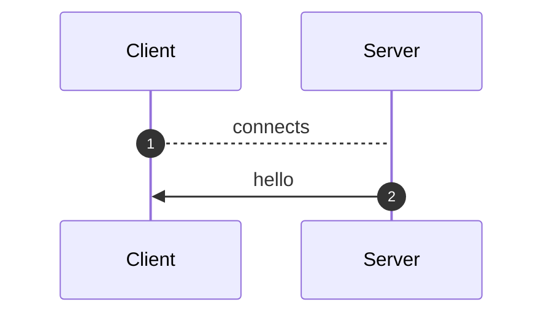
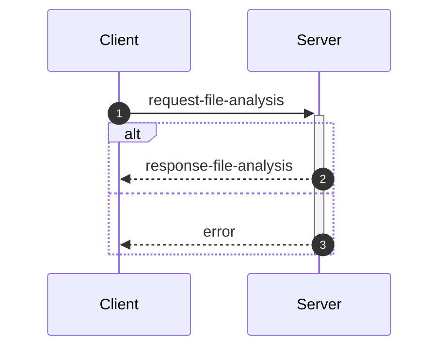
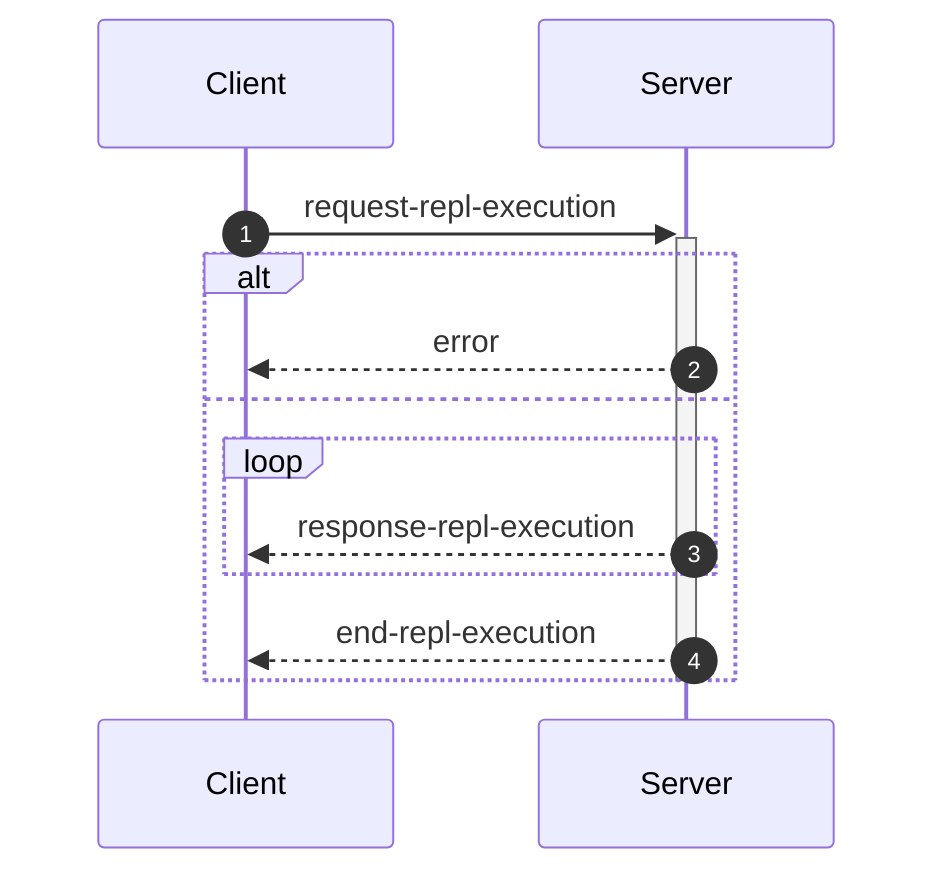
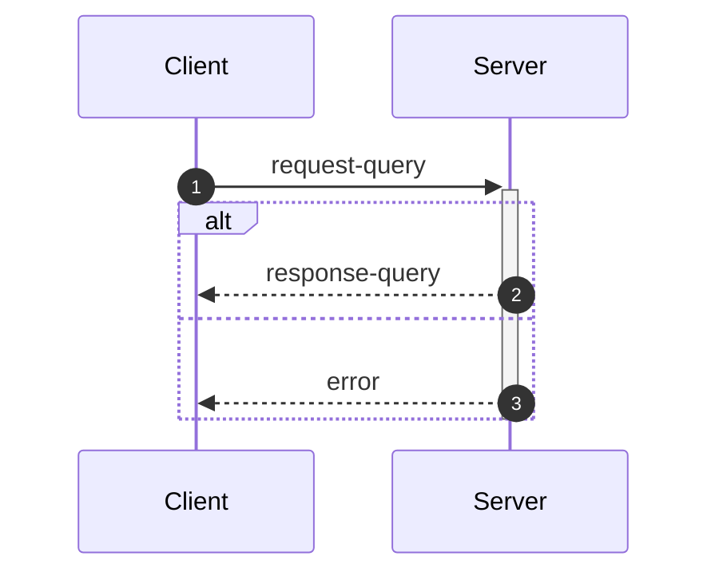

_<span title="an overview of flowR's interface">Generated</span> from '[wiki-interface.ts](https://github.com/flowr-analysis/flowr/tree/main/src/documentation/wiki-interface.ts "src/documentation/wiki-interface.ts")' on 2026-11-03, 16:33:56 UTC (v2.17.0, R v4.6.1), do not edit directly._

Although far from being as detailed as the in-depth explanation of [_flowR_](https://github.com/flowr-analysis/flowr/wiki/Core),
this wiki page explains how to interface with _flowR_ in more detail.
In general, command line arguments and other options provide short descriptions on hover over.

* [💻 Using the REPL](#using-the-repl)
* [⚙️ Configuring FlowR](#configuring-flowr)
* [⚒️ Writing Code](#writing-code)
* [💬 Communicating with the Server](#communicating-with-the-server)

<a id='using-the-repl'></a>
## 💻 Using the REPL

> [!NOTE]
> To execute arbitrary R commands with a repl request, _flowR_ has to be started explicitly with <span title="Description (Command Line Argument): Allow to access the underlying R session when using flowR (security warning: this allows the execution of arbitrary R code!)">`--r-session-access`</span>.
> Please be aware that this introduces a security risk and note that this relies on the [`r-shell` engine](https://github.com/flowr-analysis/flowr/wiki/Engines) .

Although primarily meant for users to explore,
there is nothing which forbids calling _flowR_ as a subprocess to use standard-in, -output, and -error
for communication (although you can access the REPL using the server as well,
with the [REPL Request](#message-request-repl-execution) message).

The read-eval-print loop&nbsp;(REPL) works relatively simple.
You can submit an expression (using <kbd>Enter</kbd>),
which is interpreted as an R&nbsp;expression by default but interpreted as a *command* if it starts with a colon (`:`).
The best command to get started with the REPL is <span title="Description (Repl Command): Show help information (aliases: :h, :?)">`:help`</span>.
Besides, you can leave the REPL either with the command <span title="Description (Repl Command): End the repl (aliases: :q, :exit)">`:quit`</span> or by pressing <kbd>Ctrl</kbd>+<kbd>C</kbd> twice.
When writing a *command*, you may press <kbd>Tab</kbd> to get a list of completions, if available.
Multiple commands can be entered in a single line by separating them with a semicolon (`;`), e.g. `:parse "x<-2"; :df*`.
If a command is given without R code, the REPL will re-use R code given in a previous command.
The prior example will hence return first the parsed AST of the program and then the dataflow graph for `"x <- 2"`.

> [!NOTE]
> If you develop flowR, you may want to launch the repl using the `npm run main-dev` command, this way, you get a non-minified version of flowR with debug information and hot-reloading of source files.

<details>
<summary>Available Commands</summary>

We currently offer the following commands (this with a `[*]` suffix are available with and without the star):

| Command | Description |
| ------- | ----------- |
| **<span title="Description (Repl Command): End the repl (aliases: :q, :exit)">:quit</span>** | End the repl (aliases: **:<span title="Alias of ':quit'. End the repl">q</span>**, **:<span title="Alias of ':quit'. End the repl">exit</span>**) |
| **<span title="Description (Repl Command): Execute the given code as R code. This requires the `--r-session-access` flag to be set and requires the r-shell engine. (aliases: :e, :r)">:execute</span>** | Execute the given code as R code. This requires the `--r-session-access` flag to be set and requires the r-shell engine. (aliases: **:<span title="Alias of ':execute'. Execute the given code as R code. This requires the `--r-session-access` flag to be set and requires the r-shell engine.">e</span>**, **:<span title="Alias of ':execute'. Execute the given code as R code. This requires the `--r-session-access` flag to be set and requires the r-shell engine.">r</span>**) |
| **<span title="Description (Repl Command): Get mermaid code for the control-flow graph of R code (aliases: :cfg, :cf)">:controlflow[*]</span>** | Get mermaid code for the control-flow graph of R code (star: Returns the URL to mermaid.live) (aliases: **:<span title="Alias of ':controlflow'. Get mermaid code for the control-flow graph of R code">cfg</span>**, **:<span title="Alias of ':controlflow'. Get mermaid code for the control-flow graph of R code">cf</span>**) |
| **<span title="Description (Repl Command): Get mermaid code for the control-flow graph with basic blocks (aliases: :cfgb, :cfb)">:controlflowbb[*]</span>** | Get mermaid code for the control-flow graph with basic blocks (star: Returns the URL to mermaid.live) (aliases: **:<span title="Alias of ':controlflowbb'. Get mermaid code for the control-flow graph with basic blocks">cfgb</span>**, **:<span title="Alias of ':controlflowbb'. Get mermaid code for the control-flow graph with basic blocks">cfb</span>**) |
| **<span title="Description (Repl Command): Get mermaid code for the dataflow graph (aliases: :d, :df)">:dataflow[*]</span>** | Get mermaid code for the dataflow graph (star: Returns the URL to mermaid.live) (aliases: **:<span title="Alias of ':dataflow'. Get mermaid code for the dataflow graph">d</span>**, **:<span title="Alias of ':dataflow'. Get mermaid code for the dataflow graph">df</span>**) |
| **<span title="Description (Repl Command): Get mermaid code for the normalized AST of R code (aliases: :n)">:normalize[*]</span>** | Get mermaid code for the normalized AST of R code (star: Returns the URL to mermaid.live) (alias: **:<span title="Alias of ':normalize'. Get mermaid code for the normalized AST of R code">n</span>**) |
| **<span title="Description (Repl Command): Get mermaid code for the simplified dataflow graph (aliases: :ds, :dfs)">:dataflowsimple[*]</span>** | Get mermaid code for the simplified dataflow graph (star: Returns the URL to mermaid.live) (aliases: **:<span title="Alias of ':dataflowsimple'. Get mermaid code for the simplified dataflow graph">ds</span>**, **:<span title="Alias of ':dataflowsimple'. Get mermaid code for the simplified dataflow graph">dfs</span>**) |
| **<span title="Description (Repl Command): Inspect and extend the signature database: `query` (identical to :query @signature), `info <name>` for where a function comes from (identical to :query @function-info), `add <path>` to mount another database/source, `download` to fetch the full-history database. (aliases: :sig)">:signature</span>** | Inspect and extend the signature database: `query` (identical to :query @signature), `info <name>` for where a function comes from (identical to :query @function-info), `add <path>` to mount another database/source, `download` to fetch the full-history database. (alias: **:<span title="Alias of ':signature'. Inspect and extend the signature database: `query` (identical to :query @signature), `info <name>` for where a function comes from (identical to :query @function-info), `add <path>` to mount another database/source, `download` to fetch the full-history database.">sig</span>**) |
| **<span title="Description (Repl Command): Just calculates the DFG, but only prints summary info (aliases: :d#, :df#)">:dataflowsilent</span>** | Just calculates the DFG, but only prints summary info (aliases: **:<span title="Alias of ':dataflowsilent'. Just calculates the DFG, but only prints summary info">d#</span>**, **:<span title="Alias of ':dataflowsilent'. Just calculates the DFG, but only prints summary info">df#</span>**) |
| **<span title="Description (Repl Command): Prints ASCII Art of the parsed, unmodified AST (aliases: :p)">:parse</span>** | Prints ASCII Art of the parsed, unmodified AST (alias: **:<span title="Alias of ':parse'. Prints ASCII Art of the parsed, unmodified AST">p</span>**) |
| **<span title="Description (Repl Command): Prints the version of flowR as well as the current version of R">:version</span>** | Prints the version of flowR as well as the current version of R
| **<span title="Description (Repl Command): Query the given R code (use 'help' for more information)">:query[*]</span>** | Query the given R code (use 'help' for more information) (star: Similar to query, but returns the output in json format.)
| **<span title="Description (Repl Command): Returns an ASCII representation of the dataflow graph (aliases: :df!)">:dataflowascii</span>** | Returns an ASCII representation of the dataflow graph (alias: **:<span title="Alias of ':dataflowascii'. Returns an ASCII representation of the dataflow graph">df!</span>**) |
| **<span title="Description (Repl Command): Returns summarization stats for the normalized AST (aliases: :n#)">:normalize#</span>** | Returns summarization stats for the normalized AST (alias: **:<span title="Alias of ':normalize#'. Returns summarization stats for the normalized AST">n#</span>**) |
| **<span title="Description (Repl Command): Show help information (aliases: :h, :?)">:help</span>** | Show help information (aliases: **:<span title="Alias of ':help'. Show help information">h</span>**, **:<span title="Alias of ':help'. Show help information">?</span>**) |

</details>

> [!TIP]
> 
> As indicated by the examples before, all REPL commands that operate on code keep track of the state.
> Hence, if you run a command like <span title="Description (Repl Command, starred version): Returns the URL to mermaid.live; Base Command: Get mermaid code for the dataflow graph (aliases: :d*, :df*)">`:dataflow*`</span> without providing R code,
> the REPL will re-use the R code provided in a previous command.
> Likewise, doing this will benefit from incrementality!
> If you request the dataflow graph with `:df* x <- 2 * y` and then want to see the parsed AST with `:parse`,
> the REPL will re-use previously obtained information and not re-parse the code again.
> 		

Generally, many commands offer shortcut versions in the REPL. Many queries, for example, offer a shortened format (see the example below).
Of special note, the [Config Query](https://github.com/flowr-analysis/flowr/wiki/%5BQuery%5D-Config)
can be used to also modify the currently active configuration of _flowR_ within the REPL (see the [wiki page](https://github.com/flowr-analysis/flowr/wiki/%5BQuery%5D-Config) for more information).

### Example: Retrieving the Dataflow Graph

To retrieve a URL to the [mermaid](https://mermaid.js.org/) diagram of the dataflow of a given expression,
use <span title="Description (Repl Command, starred version): Returns the URL to mermaid.live; Base Command: Get mermaid code for the dataflow graph (aliases: :d*, :df*)">`:dataflow*`</span> (or <span title="Description (Repl Command): Get mermaid code for the dataflow graph (aliases: :d, :df)">`:dataflow`</span> to get the mermaid code in the cli):

```shell
$ docker run -it --rm eagleoutice/flowr # or npm run flowr 
flowR repl v2.17.0, R grammar v14 (tree-sitter engine)
R> :dataflow* y <- 1 + x
```

<details>
<summary style='color:gray'>Output</summary>

```text
https://mermaid.live/view#base64:eyJjb2RlIjoiZmxvd2NoYXJ0IFREXG4gICAgMXt7XCJgKiM5MTtSTnVtYmVyIzkzOyogKioxKipcbiAgICAgICoxLjYqICgqKmlkOiAxKiopYFwifX1cbiAgICAyKFtcImAqIzkxO1JTeW1ib2wjOTM7KiAqKngqKlxuICAgICAgKjEuMTAqICgqKmlkOiAyKiopYFwiXSlcbiAgICAzW1tcImAqIzkxO1JCaW5hcnlPcCM5MzsqIGJhc2UjNTg7IzU4OyoqIzQzOyoqXG4gICAgICAqMS42LTEwKiAoKippZDogMyoqKVxuICAgIGFyZzogKDEsIDIpYFwiXV1cbiAgICBidWlsdC1pbjpfNDNfW1wiYEJ1aWx0LUluOlxuIzQzO2BcIl1cbiAgICBzdHlsZSBidWlsdC1pbjpfNDNfIHN0cm9rZTpncmF5LGZpbGw6Z3JheSxzdHJva2Utd2lkdGg6MnB4LG9wYWNpdHk6Ljg7XG4gICAgMFtcImAqIzkxO1JTeW1ib2wjOTM7KiAqKnkqKlxuICAgICAgKjEuMSogKCoqaWQ6IDAqKiwgdjogMylgXCJdXG4gICAgNFtbXCJgKiM5MTtSQmluYXJ5T3AjOTM7KiBiYXNlIzU4OyM1ODsqKiM2MDsjNDU7KipcbiAgICAgICoxLjEtMTAqICgqKmlkOiA0KiopXG4gICAgYXJnOiAoMCwgMylgXCJdXVxuICAgIGJ1aWx0LWluOl82MF8tW1wiYEJ1aWx0LUluOlxuIzYwOyM0NTtgXCJdXG4gICAgc3R5bGUgYnVpbHQtaW46XzYwXy0gc3Ryb2tlOmdyYXksZmlsbDpncmF5LHN0cm9rZS13aWR0aDoycHgsb3BhY2l0eTouODtcbiAgICAxIC0uLT58XCJmbG93XCJ8IDJcbiAgICBsaW5rU3R5bGUgMCBzdHJva2U6Z3JheSxjb2xvcjpncmF5O1xuICAgIDIgLS4tPnxcImZsb3dcInwgM1xuICAgIGxpbmtTdHlsZSAxIHN0cm9rZTpncmF5LGNvbG9yOmdyYXk7XG4gICAgMyAtLT58XCJyZWFkcywgYXJnXCJ8IDFcbiAgICAzIC0tPnxcInJlYWRzLCBhcmdcInwgMlxuICAgIDMgLS4tPnxcImZsb3dcInwgMFxuICAgIGxpbmtTdHlsZSA0IHN0cm9rZTpncmF5LGNvbG9yOmdyYXk7XG4gICAgMyAtLi0+fFwicmVhZHMsIGNhbGxzXCJ8IGJ1aWx0LWluOl80M19cbiAgICBsaW5rU3R5bGUgNSBzdHJva2U6Z3JheTtcbiAgICAwIC0tPnxcImRlZmluZWQtYnksIGZsb3dcInwgNFxuICAgIDAgLS0+fFwiZGVmaW5lZC1ieVwifCAzXG4gICAgNCAtLT58XCJyZWFkcywgYXJnXCJ8IDNcbiAgICA0IC0tPnxcInJldHVybnMsIGFyZ1wifCAwXG4gICAgNCAtLi0+fFwicmVhZHMsIGNhbGxzXCJ8IGJ1aWx0LWluOl82MF8tXG4gICAgbGlua1N0eWxlIDEwIHN0cm9rZTpncmF5OyIsIm1lcm1haWQiOnsiYXV0b1N5bmMiOnRydWV9fQ==
```

Retrieve the dataflow graph of the expression `y <- 1 + x`. It looks like this:


<details>

<summary style="color:gray">R Code of the Dataflow Graph</summary>

The analysis ran (parse and normalize with the [tree-sitter](https://github.com/flowr-analysis/flowr/wiki/Engines) engine) in the generation environment. No [signature database](https://github.com/flowr-analysis/flowr/wiki/Signature-Database) is mounted, so `library()` attaches no exports (base-R names are still qualified, e.g., `stats::acf`). 
We encountered no unknown side effects during the analysis.

```r
y <- 1 + x
```

</details>

</details>

For small graphs like this, <span title="Description (Repl Command): Returns an ASCII representation of the dataflow graph (aliases: :df!)">`:dataflowascii`</span> also provides an ASCII representation directly in the REPL:

```shell
$ docker run -it --rm eagleoutice/flowr # or npm run flowr 
flowR repl v2.17.0, R grammar v14 (tree-sitter engine)
R> :df! y <- 1 + x
```

<details open>
<summary style='color:gray'>Output</summary>

```text
                        v<0>v
 c<4>c──────────────────| y |
 |<- |     ┌────────────v---v
 c---c     │
    │   c<3>c   0<1>0
    └───| + |───| 1 |───u<2>u
        c---c   0---0   | x |
           └────────────u---u
Edges:
3 -> 1: reads, arg          3 -> 2: reads, arg
3 -> 0: flows-to            1 -> 2: flows-to
2 -> 3: flows-to            4 -> 3: reads, arg
4 -> 0: returns, arg        0 -> 4: defined-by, flows-to
0 -> 3: defined-by
```

Retrieve the dataflow graph of the expression `y <- 1 + x` as ASCII art.

</details>

For the slicing with <span title="Description (Repl Command): Static backwards executable slicer for R">`:slicer`</span>, you have access to the same [magic comments](#slice-magic-comments) as with the [slice request](#message-request-slice).
Pass `--inline` to splice resolvable `source()` calls into the reconstruction so the slice is a single self-contained R text (the same as the static slice query's `inlineSources` flag).
See `--help` for more flags!

### Example: Interfacing with the File System

Many commands that allow for an R-expression (like <span title="Description (Repl Command, starred version): Returns the URL to mermaid.live; Base Command: Get mermaid code for the dataflow graph (aliases: :d*, :df*)">`:dataflow*`</span>) allow for a file as well
if the argument starts with `file://`.
If you are working from the root directory of the _flowR_ repository, the following gives you the parsed AST of the example file using the <span title="Description (Repl Command): Prints ASCII Art of the parsed, unmodified AST (aliases: :p)">`:parse`</span> command:

> **Watch mode**: Replace `file://` with `watch://` to enter watch mode.
> flowR runs the command immediately and then re-runs it every time the file (or any file inside the folder) changes.
> Enter any other command to leave watch mode.
> For example: `:df watch://analysis.R`

```shell
$ docker run -it --rm eagleoutice/flowr # or npm run flowr 
flowR repl v2.17.0, R grammar v14 (tree-sitter engine)
R> :parse file://test/testfiles/example.R
```

<details>
<summary style='color:gray'>Output</summary>

```text
File: test/testfiles/example.R

program
├ binaryoperator
│ ├ identifier "sum" (1:1─4)
│ ├ <- "<-" (1:5─7)
│ ╰ float "0" (1:8─9)
├ binaryoperator
│ ├ identifier "product" (2:1─8)
│ ├ <- "<-" (2:9─11)
│ ╰ float "1" (2:12─13)
├ binaryoperator
│ ├ identifier "w" (3:1─2)
│ ├ <- "<-" (3:3─5)
│ ╰ float "7" (3:6─7)
├ binaryoperator
│ ├ identifier "N" (4:1─2)
│ ├ <- "<-" (4:3─5)
│ ╰ float "10" (4:6─8)
├ forstatement
│ ├ for "for" (6:1─4)
│ ├ ( "(" (6:5─6)
│ ├ identifier "i" (6:6─7)
│ ├ in "in" (6:8─10)
│ ├ binaryoperator
│ │ ├ float "1" (6:11─12)
│ │ ├ : ":" (6:12─13)
│ │ ╰ parenthesizedexpression
│ │   ├ ( "(" (6:13─14)
│ │   ├ binaryoperator
│ │   │ ├ identifier "N" (6:14─15)
│ │   │ ├ - "-" (6:15─16)
│ │   │ ╰ float "1" (6:16─17)
│ │   ╰ ) ")" (6:17─18)
│ ├ ) ")" (6:18─19)
│ ╰ bracedexpression
│   ├ { "{" (6:20─21)
│   ├ binaryoperator
│   │ ├ identifier "sum" (7:3─6)
│   │ ├ <- "<-" (7:7─9)
│   │ ╰ binaryoperator
│   │   ├ binaryoperator
│   │   │ ├ identifier "sum" (7:10─13)
│   │   │ ├ + "+" (7:14─15)
│   │   │ ╰ identifier "i" (7:16─17)
│   │   ├ + "+" (7:18─19)
│   │   ╰ identifier "w" (7:20─21)
│   ├ binaryoperator
│   │ ├ identifier "product" (8:3─10)
│   │ ├ <- "<-" (8:11─13)
│   │ ╰ binaryoperator
│   │   ├ identifier "product" (8:14─21)
│   │   ├  "" (8:22─23)
│   │   ╰ identifier "i" (8:24─25)
│   ╰ } "}" (9:1─2)
├ call
│ ├ identifier "cat" (11:1─4)
│ ╰ arguments
│   ├ ( "(" (11:4─5)
│   ├ argument
│   │ ╰ string
│   │   ├ stringopen "\"" (11:5─6)
│   │   ├ stringcontent "Sum:" (11:6─10)
│   │   ╰ stringclose "\"" (11:10─11)
│   ├ comma "," (11:11─12)
│   ├ argument
│   │ ╰ identifier "sum" (11:13─16)
│   ├ comma "," (11:16─17)
│   ├ argument
│   │ ╰ string
│   │   ├ stringopen "\"" (11:18─19)
│   │   ├ stringcontent
│   │   │ ╰ escapesequence "\\n" (11:19─21)
│   │   ╰ stringclose "\"" (11:21─22)
│   ╰ ) ")" (11:22─23)
╰ call
  ├ identifier "cat" (12:1─4)
  ╰ arguments
    ├ ( "(" (12:4─5)
    ├ argument
    │ ╰ string
    │   ├ stringopen "\"" (12:5─6)
    │   ├ stringcontent "Product:" (12:6─14)
    │   ╰ stringclose "\"" (12:14─15)
    ├ comma "," (12:15─16)
    ├ argument
    │ ╰ identifier "product" (12:17─24)
    ├ comma "," (12:24─25)
    ├ argument
    │ ╰ string
    │   ├ stringopen "\"" (12:26─27)
    │   ├ stringcontent
    │   │ ╰ escapesequence "\\n" (12:27─29)
    │   ╰ stringclose "\"" (12:29─30)
    ╰ ) ")" (12:30─31)
```

Retrieve the parsed AST of the example file.

<details>

<summary>File Content</summary>

```r
sum <- 0
product <- 1
w <- 7
N <- 10

for (i in 1:(N-1)) {
  sum <- sum + i + w
  product <- product * i
}

cat("Sum:", sum, "\n")
cat("Product:", product, "\n")
```

</details>

As _flowR_ directly transforms this AST the output focuses on being human-readable instead of being machine-readable.
		
</details>

### Example: Run a Query

You can run any query supported by _flowR_ using the <span title="Description (Repl Command): Query the given R code (use 'help' for more information)">`:query`</span> command.
For example, to obtain the shapes of all data frames in a given piece of code, you can run:

```shell
$ docker run -it --rm eagleoutice/flowr # or npm run flowr 
flowR repl v2.17.0, R grammar v14 (tree-sitter engine)
R> :query @absint df-shape "x <- data.frame(a = 1:10, b = 1:10)\ny <- x$a"
```

<details open>
<summary style='color:gray'>Output</summary>

```text
Query: absint (1 ms)
   ╰ $12: (colnames: [{"a", "b"}, {}], cols: [2, 2], rows: [10, 10])
   ╰ $0: (colnames: [{"a", "b"}, {}], cols: [2, 2], rows: [10, 10])
```

Retrieve the shapes of all data frames in the given code.

</details>

To run the linter on a file, you can use (in this example, we just issue the `dead-code` linter on a small piece of code):

```shell
$ docker run -it --rm eagleoutice/flowr # or npm run flowr 
flowR repl v2.17.0, R grammar v14 (tree-sitter engine)
R> :query @linter rules:dead-code "if(FALSE) x <- 2"
```

<details open>
<summary style='color:gray'>Output</summary>

```text
Query: linter (1 ms)
   ╰ Dead Code (dead-code):
       ╰ certain:
           ╰ Code at 1.11-16 (1 quick fix(es) available)
```

Run the linter on the given code, with only the `dead-code` rule enabled.

</details>

For more information on the available queries, please check out the [Query API](https://github.com/flowr-analysis/flowr/wiki/Query-API).

<a id='configuring-flowr'></a>
## ⚙️ Configuring FlowR

When running _flowR_, you may want to specify some behaviors with a dedicated configuration file.
By default, flowR looks for a file named `flowr.json` in the current working directory (or any higher directory).
You can also specify a different file with <span title="Description (Command Line Argument): The name of the configuration file to use">`--config-file`</span> or pass the configuration inline using <span title="Description (Command Line Argument): The flowR configuration to use, as a JSON string">`--config-json`</span>.
A `flowr.json` found this way belongs to the analyzed project, so flowR ignores its options that decide what flowR executes or loads
(`engines.*.wasmPath`, `engines.*.treeSitterWasmPath`, `engines.*.rPath`, `solver.sigdb.additionalPaths`, `solver.sigdb.downloadRepo`, `solver.sigdb.installedLibrary.paths`, `solver.sigdb.onDemand.enabled`, `solver.sigdb.onDemand.repositories`, `solver.sigdb.onDemand.cranMirror`, `solver.sigdb.onDemand.bioconductorMirror`, `solver.sigdb.onDemand.cacheDir`),
unless you pass <span title="Description (Command Line Argument): Keep the security-sensitive options (e.g., the R executable) of the flowr.json found in the working directory or a parent. Only use this for projects you trust.">`--trust-config`</span>.
To analyze code you do not trust, use the secure mode (<span title="Description (Command Line Argument): Run in secure mode for analyzing untrusted code: flowR does not start R (or any other process), does not access the network, does not search for project configs, and ignores security-sensitive options in every config. Cannot be disabled once enabled. Can also be enabled with the environment variable {italic FLOWR_SECURE_MODE=1}.">`--secure`</span>, see the [security policy](https://github.com/flowr-analysis/flowr/blob/main/.github/SECURITY.md)).
To inspect the current configuration, you can run flowr with the <span title="Description (Command Line Argument): Run with verbose logging (will be passed to the corresponding script)">`--verbose`</span> flag, or use the `config` [Query](https://github.com/flowr-analysis/flowr/wiki/Query-API).
Within the REPL this works by running the following:

```shell
:query @config
```

To work with the <a href="https://github.com/flowr-analysis/flowr/tree/main/src/config.ts#L119"><code><span title="The configuration file format for flowR.">FlowrConfig</span></code></a> you can use the provided helper objects alongside its methods like
<a href="https://github.com/flowr-analysis/flowr/tree/main/src/config.ts#L966"><code><span title="Creates a new flowr config that has the updated values.">FlowrConfig::<b>amend</b></span></code></a>.
The schema below documents every option; the ones you most likely want are:

- <a href="https://github.com/flowr-analysis/flowr/wiki/Interface#configuring-flowr" title="Configuration Option (boolean): Whether source calls should be ignored, causing {@link processSourceCall}&#39;s behavior to be skipped.">ignoreSourceCalls</a>: ignore source calls when analyzing the code, i.e., ignore the inclusion of other files.
- <a href="https://github.com/flowr-analysis/flowr/wiki/Interface#configuring-flowr" title="Configuration Option (boolean): Whether load calls should be ignored, causing {@link processLoadCall}&#39;s behavior to be skipped.">ignoreLoadCalls</a>: ignore load calls when analyzing the code, i.e., ignore the loading of r-data files.
- <a href="https://github.com/flowr-analysis/flowr/wiki/Interface#configuring-flowr" title="Configuration Option (object): Do you want to overwrite (parts) of the builtin definition?">semantics.environment.overwriteBuiltIns</a>: overwrite _flowR_'s handling of built-in functions, or clear the preset definitions entirely.
  See [Configure BuiltIn Semantics](#configure-builtin-semantics) for more information.
- <a href="https://github.com/flowr-analysis/flowr/wiki/Interface#configuring-flowr" title="Configuration Option (string): How to resolve variables and their values. (one of &quot;disabled&quot;, &quot;alias&quot;, &quot;builtin&quot;)">solver.variables</a>: how to resolve variables and their values (`disabled`, `alias`, `builtin`).
- <a href="https://github.com/flowr-analysis/flowr/wiki/Interface#configuring-flowr" title="Configuration Option (array): The engine or set of engines to use for interacting with R code. An empty array means all available engines will be used.">engines</a> and <a href="https://github.com/flowr-analysis/flowr/wiki/Interface#configuring-flowr" title="Configuration Option (string): The default engine to use for interacting with R code. If this is undefined, an arbitrary engine from the specified list will be used. (one of &quot;tree-sitter&quot;, &quot;r-shell&quot;)">defaultEngine</a>: the engines used to interact with R code, see the [Engines wiki page](https://github.com/flowr-analysis/flowr/wiki/Engines).
- <a href="https://github.com/flowr-analysis/flowr/wiki/Interface#configuring-flowr" title="Configuration Option (array): Files a framework loads on its own, without any source() call (e.g. global.R in a shiny app), in the order they are loaded; flowR orders the matching project files accordingly and analyzes them as one program. Entries are case-insensitive globs matched against the file path, a plain name matches any file with that name, and entries matching no project file are warned about. Usually set per project kind via specializeConfig.">project.implicitSources</a>: the files a framework loads without any `source()` call, in the order in which they are
  loaded. Entries are globs (e.g. `R/*.R`) matched against the file path ignoring capitalization; one matching no file is reported.
- <a href="https://github.com/flowr-analysis/flowr/wiki/Interface#configuring-flowr" title="Configuration Option (object): Overwrite (parts of) the configuration depending on the project kind flowR detects, e.g. to give a shiny app its implicit sources.">specializeConfig</a>: overwrite (parts of) the configuration depending on the kind of project _flowR_ detects
  (e.g. `shiny-app`), which is how a shiny app gets its implicit sources by default. What you configure directly wins.
- <a href="https://github.com/flowr-analysis/flowr/wiki/Interface#configuring-flowr" title="Configuration Option (string): Overwrite the project kind flowR would otherwise infer from the analyzed files, e.g. when auto-detection guesses wrong. (one of &quot;package&quot;, &quot;script&quot;, &quot;shiny-app&quot;, &quot;notebook&quot;, &quot;project&quot;, &quot;unknown&quot;)">project.useProjectType</a>: skip that detection and force a project kind yourself, when auto-detection guesses wrong.
- <a href="https://github.com/flowr-analysis/flowr/wiki/Interface#configuring-flowr" title="Configuration Option (array): The default plugins to load when creating a new instance of FlowrAnalyzer">defaultPlugins</a> and <a href="https://github.com/flowr-analysis/flowr/wiki/Interface#configuring-flowr" title="Configuration Option (array): The plugins to load in REPL mode">repl.plugins</a>: the plugins to load for a new <a href="https://github.com/flowr-analysis/flowr/tree/main/src/project/flowr-analyzer.ts#L210"><code><span title="Central class for conducting analyses with FlowR. Use the FlowrAnalyzerBuilder to create a new instance. If you want the original pattern of creating a pipeline and running all steps, you can still do this with FlowrAnalyzer#runFull . To inspect the context of the analyzer, use FlowrAnalyzer#inspectContext (if you are a plugin and need to modify it, use FlowrAnalyzer#context instead).">FlowrAnalyzer</span></code></a> and in the REPL
  (use `flowr:default` to reference the former).

So you can configure _flowR_ by adding a file like the following:

<details>

<summary>Example Configuration File</summary>

```json
{
  "ignoreSourceCalls": true,
  "ignoreLoadCalls": true,
  "semantics": {
    "environment": {
      "overwriteBuiltIns": {
        "definitions": [
          {
            "type": "function",
            "names": [
              "foo"
            ],
            "processor": "builtin:assign",
            "config": {}
          }
        ]
      }
    }
  },
  "defaultPlugins": [
    "file:description",
    "versions:description"
  ],
  "repl": {
    "quickStats": false,
    "dfProcessorHeat": false,
    "hints": true,
    "plugins": [
      "flowr:default"
    ]
  },
  "project": {
    "resolveUnknownPathsOnDisk": true,
    "implicitSources": [
      "global.R",
      "app.R"
    ]
  },
  "linter": {
    "disabledRules": []
  },
  "specializeConfig": {
    "shiny-app": {
      "project": {
        "implicitSources": [
          "global.R",
          "ui.R",
          "server.R",
          "app.R"
        ]
      }
    }
  },
  "engines": [
    {
      "type": "r-shell"
    }
  ],
  "solver": {
    "variables": "alias",
    "evalStrings": true,
    "trackEnvironments": true,
    "sigdb": {
      "enabled": true,
      "loadProjectDependencies": true,
      "eagerlyLoad": false,
      "eagerlyLoadExports": false,
      "linkBaseR": false,
      "linkDescriptionDependencies": false
    },
    "resolveSource": {
      "dropPaths": "no",
      "ignoreCapitalization": true,
      "inferWorkingDirectory": "active-script",
      "searchPath": []
    },
    "instrument": {},
    "slicer": {
      "threshold": 50
    }
  },
  "abstractInterpretation": {
    "wideningThreshold": 4,
    "followCalls": true,
    "dataFrame": {
      "maxColNames": 20,
      "readLoadedData": {
        "readExternalFiles": true,
        "maxReadLines": 1000000
      }
    }
  },
  "incremental": {
    "alwaysIncremental": false,
    "parsing": {
      "activated": false,
      "heuristics": {
        "activated": true,
        "mtime": true,
        "linesFrom": 500,
        "bytesFrom": 50000,
        "alwaysWithEdits": false,
        "minFiles": 1
      }
    }
  },
  "gas": {
    "thresholds": {
      "memory": {
        "problematic": 0.7,
        "critical": 0.9
      },
      "timeMs": {
        "problematic": 100000,
        "critical": 120000
      }
    },
    "features": {}
  }
}
```

</details>

<details>
<a id='configure-builtin-semantics'></a>
<summary>Configure Built-In Semantics</summary>

`semantics/environment/overwriteBuiltins` accepts two keys:

- `loadDefaults` (boolean, initially `true`): If set to `true`, the default built-in definitions are loaded before applying the custom definitions. Setting this flag to `false` explicitly disables the loading of the default definitions.
- `definitions` (array, initially empty): Allows to overwrite or define new built-in elements. Each object within must have a `type` which is one of the below. Furthermore, they may define a string array of `names` which specifies the identifiers to bind the definitions to. You may use `assumePrimitive` to specify whether _flowR_ should assume that this is a primitive non-library definition (so you probably just do not want to specify the key).

  | Type            | Description                                                                                                                                                                                                                                                                                              | Example                                                                                                    |
  | --------------- | -------------------------------------------------------------------------------------------------------------------------------------------------------------------------------------------------------------------------------------------------------------------------------------------------------- | ---------------------------------------------------------------------------------------------------------- |
  | `constant`    | Additionally allows for a `value` this should resolve to.                                                                                                                                                                                                                                                | `{ type: 'constant', names: ['NULL', 'NA'],  value: null }`                                                |
  | `function`    | Is a rather flexible way to define and bind built-in functions. For the time, we do not have extensive documentation to cover all the cases, so please either consult the sources with the `default-builtin-config.ts` or open a [new issue](https://github.com/flowr-analysis/flowr/issues/new/choose). | `{ type: 'function', names: ['next'], processor: 'builtin:d', config: { cfg: ExitPointType.Next } }` |
  | `replacement` | A comfortable way to specify replacement functions like `$<-` or `names<-`. `suffixes` describes the... suffixes to attach automatically. | `{ type: 'replacement', suffixes: ['<-', '<<-'], names: ['[', '[['] }` |

</details>

<details>

<summary style='color:gray'>Full Configuration-File Schema</summary>

- _The configuration file format for flowR._ (object)
    - **logLevel** [optional] _flowR's global minimum log level, applied when the config is loaded._ (string)
        Only allows: 'silly', 'trace', 'debug', 'info', 'warn', 'error', 'fatal'
    - **ignoreSourceCalls** [optional] _Whether source calls should be ignored, causing {@link processSourceCall}'s behavior to be skipped._ (boolean)
    - **ignoreLoadCalls** [optional] _Whether load calls should be ignored, causing {@link processLoadCall}'s behavior to be skipped._ (boolean)
    - **semantics** _Configure language semantics and how flowR handles them._ (object)
        - **environment** [optional] _Semantics regarding how to handle the R environment._ (object)
            - **overwriteBuiltIns** [optional] _Do you want to overwrite (parts) of the builtin definition?_ (object)
                - **loadDefaults** [optional] _Should the default configuration still be loaded?_ (boolean)
                - **definitions** [optional] _The definitions to load/overwrite._ (array)
                Valid item types:
                    - (object)
    - **defaultPlugins** [optional] _The default plugins to load when creating a new instance of FlowrAnalyzer_ (array)
    Valid item types:
        - (alternatives)
            - (string)
            - (array)
    - **repl** _Configuration options for the REPL._ (object)
        - **quickStats** [optional] _Whether to show quick stats in the REPL after each evaluation._ (boolean)
        - **dfProcessorHeat** [optional] _This instruments the dataflow processors to count how often each processor is called._ (boolean)
        - **hints** [optional] _Whether to show dim inline hints on the empty prompt (automatically disabled on non-interactive terminals)._ (boolean)
        - **plugins** [optional] _The plugins to load in REPL mode_ (array)
        Valid item types:
            - (alternatives)
                - (string)
                - (array)
        - **autoUseFileProtocol** [optional] _Prepend the file protocol to a repl input that looks like a path, instead of only warning about it._ (boolean)
        - **queryStats** [optional] _Whether `:query` closes with the line stating how long the queries took (`:query*` never prints it)._ (boolean)
        - **showPlugins** [optional] _Whether `:version` grays out the plugins that did not activate during the last analysis._ (boolean)
    - **project** _Project specific configuration options._ (object)
        - **resolveUnknownPathsOnDisk** [optional] _Whether to resolve unknown paths loaded by the r project disk when trying to source/analyze files._ (boolean)
        - **failOnInaccessiblePath** [optional] _Whether a directory that cannot be traversed during file discovery (e.g. due to permissions) aborts the analysis; when false (the default) such paths are logged and skipped._ (boolean)
        - **basePackages** [optional] _The packages considered part of R itself (base and recommended); if unset, flowR uses its built-in list._ (array)
        Valid item types:
            - (string)
        - **implicitSources** [optional] _Files a framework loads on its own, without any source() call (e.g. global.R in a shiny app), in the order they are loaded; flowR orders the matching project files accordingly and analyzes them as one program. Entries are case-insensitive globs matched against the file path, a plain name matches any file with that name, and entries matching no project file are warned about. Usually set per project kind via specializeConfig._ (array)
        Valid item types:
            - (string)
        - **useProjectType** [optional] _Overwrite the project kind flowR would otherwise infer from the analyzed files, e.g. when auto-detection guesses wrong._ (string)
            Only allows: 'package', 'script', 'shiny-app', 'notebook', 'project', 'unknown'
        - **assumeImplicitEcho** [optional] _Whether the top level of the analyzed code is echoed, so that every visible result printed there is collected as an output by the dependencies query (default true, false for a package)._ (boolean)
        - **discovery** [optional] _Scoping options for the default project discovery._ (object)
            - **full** [optional] _Collect every file below the project root (greedy) instead of only the files the detected project kind needs (default false)._ (boolean)
            - **perKind** [optional] _Per-kind include/exclude glob overrides layered on the default scoping._ (object)
            - **ignore** [optional] _Case-insensitive globs that drop matching files from the intelligent discovery, regardless of kind (e.g. .Renviron to ignore environment files)._ (array)
            Valid item types:
                - (string)
        - **classification** [optional] _Overrides for the signals flowR uses to classify the project kind._ (object)
            - **shinyDescriptionTypes** [optional] _DESCRIPTION Type: values that mark a shiny app._ (array)
            Valid item types:
                - (string)
            - **shinyEntryFiles** [optional] _File names a shiny app is assembled from._ (array)
            Valid item types:
                - (string)
            - **shinyUsagePattern** [optional] _Regex source evidencing shiny usage in an entry file._ (string)
            - **notebookExtensions** [optional] _File extensions marking a notebook._ (array)
            Valid item types:
                - (string)
    - **linter** _Linter configuration options._ (object)
        - **disabledRules** _Linting rule names excluded from the default rule set (a rule requested explicitly via a linter query still runs). Usually set per project kind via specializeConfig._ (array)
        Valid item types:
            - (string)
        - **disabledTags** [optional] _Linting rule tags whose rules are excluded from the default rule set (a rule requested explicitly via a linter query still runs). By default the cmd-check rules are disabled for everything but a package; a configured list replaces that default._ (array)
        Valid item types:
            - (string)
    - **inputSources** [optional] _Further frameworks the input-sources analysis should know about; entries are added to flowR's defaults._ (object)
        - **pure** [optional] _Functions that only pass the constantness of their arguments on._ (array)
        Valid item types:
            - (string)
        - **param** [optional] _Functions whose result is a 'param' input._ (array)
        Valid item types:
            - (string)
        - **file** [optional] _Functions whose result is a 'file' input._ (array)
        Valid item types:
            - (string)
        - **tempfile** [optional] _Functions whose result is a 'tempfile' input._ (array)
        Valid item types:
            - (string)
        - **glob** [optional] _Functions whose result is a 'glob' input._ (array)
        Valid item types:
            - (string)
        - **net** [optional] _Functions whose result is a 'net' input._ (array)
        Valid item types:
            - (string)
        - **rand** [optional] _Functions whose result is a 'rand' input._ (array)
        Valid item types:
            - (string)
        - **system** [optional] _Functions whose result is a 'system' input._ (array)
        Valid item types:
            - (string)
        - **ffi** [optional] _Functions whose result is a 'ffi' input._ (array)
        Valid item types:
            - (string)
        - **lang** [optional] _Functions whose result is a 'lang' input._ (array)
        Valid item types:
            - (string)
        - **options** [optional] _Functions whose result is a 'options' input._ (array)
        Valid item types:
            - (string)
        - **cmdline** [optional] _Functions whose result is a 'cmdline' input._ (array)
        Valid item types:
            - (string)
        - **user** [optional] _Functions whose result is a 'user' input._ (array)
        Valid item types:
            - (string)
        - **const** [optional] _Functions whose result is a 'const' input._ (array)
        Valid item types:
            - (string)
        - **scope** [optional] _Functions whose result is a 'scope' input._ (array)
        Valid item types:
            - (string)
        - **dconst** [optional] _Functions whose result is a 'dconst' input._ (array)
        Valid item types:
            - (string)
        - **unknown** [optional] _Functions whose result is a 'unknown' input._ (array)
        Valid item types:
            - (string)
        - **linkedObjects** [optional] _Objects a framework provides without a definition in the code, e.g. shiny's input._ (array)
        Valid item types:
            - (object)
        - **linkedEntryPoints** [optional] _Calls that hand a function to a framework, which binds its objects to the parameters by position._ (array)
        Valid item types:
            - (object)
    - **specializeConfig** [optional] _Overwrite (parts of) the configuration depending on the project kind flowR detects, e.g. to give a shiny app its implicit sources._ (object)
    - **engines** _The engine or set of engines to use for interacting with R code. An empty array means all available engines will be used._ (array)
    Valid item types:
        - (alternatives)
            - _The configuration for the tree sitter engine._ (object)
                - **type** [required] _Use the tree sitter engine._ (string)
                    Only allows: 'tree-sitter'
                - **wasmPath** [optional] _The path to the tree-sitter-r WASM binary to use. If this is undefined, this uses the default path._ (string)
                - **treeSitterWasmPath** [optional] _The path to the tree-sitter WASM binary to use. If this is undefined, this uses the default path._ (string)
                - **lax** [optional] _Whether to use the lax parser for parsing R code (allowing for syntax errors). If this is undefined, the strict parser will be used._ (boolean)
            - _The configuration for the R shell engine._ (object)
                - **type** [required] _Use the R shell engine._ (string)
                    Only allows: 'r-shell'
                - **rPath** [optional] _The path to the R executable to use. If this is undefined, this uses the default path._ (string)
                - **pipeBind** [optional] _Whether to enable R's experimental pipe-bind operator "=>" by setting _R_USE_PIPEBIND_ for the R session (default false); R itself keeps this off by default, as it is experimental and has never shipped in a release version of R._ (boolean)
    - **defaultEngine** [optional] _The default engine to use for interacting with R code. If this is undefined, an arbitrary engine from the specified list will be used._ (string)
        Only allows: 'tree-sitter', 'r-shell'
    - **solver** _How to resolve constants, constraints, cells, ..._ (object)
        - **variables** _How to resolve variables and their values._ (string)
            Only allows: 'disabled', 'alias', 'builtin'
        - **evalStrings** _Should we include eval(parse(text="...")) calls in the dataflow graph?_ (boolean)
        - **trackEnvironments** [optional] _Track user-created environments (new.env, assign/get/local with envir=, dollar-assign, attach). When false, all envir-style calls fall through conservatively._ (boolean)
        - **sigdb** _Resolving library exports from a signature database._ (object)
            - **enabled** [optional] _Resolve library()/use() exports from a signature database (default true); when false no database is consulted._ (boolean)
            - **loadProjectDependencies** [optional] _Load the project's declared dependencies from its metadata files (DESCRIPTION Imports/Depends, rproject.toml, uvr.toml, rig rproj.toml and script blocks, renv.lock, rv.lock, uvr.lock, rig lockfiles) (default true); when false these files are not read for dependencies._ (boolean)
            - **eagerlyLoad** [optional] _Parse the database up front rather than on the first package load (default false, ignored if disabled)._ (boolean)
            - **eagerlyLoadExports** [optional] _Add a vertex for every export on load rather than on demand (default false); keeps the dataflow graph small._ (boolean)
            - **assumedRVersion** [optional] _R version assumed when resolving versioned (base-R) exports: a pin like "4.5" or "auto" to detect the installed R (default "auto")._ (string)
            - **linkBaseR** [optional] _Eagerly attach base-R namespaces so bare base calls resolve without library() (default false)._ (boolean)
            - **linkBaseRCalls** [optional] _Add a lightweight Reads edge from a bare base-R call to its signature-database function vertex (default false; base-R qualification is edge-free otherwise)._ (boolean)
            - **linkPackageCalls** [optional] _Add a lightweight Reads edge from a resolved package call to its signature-database function vertex (default false)._ (boolean)
            - **linkDescriptionDependencies** [optional] _Eagerly attach the namespaces of the project's declared DESCRIPTION dependencies (Imports/Depends) so their exports resolve without an explicit library() (default false)._ (boolean)
            - **warmInBackground** [optional] _Decompress the hot shards (base + most-downloaded) in a background task on startup so the first library() lookup is warm (default false; for long-running servers/REPLs)._ (boolean)
            - **additionalPaths** [optional] _Extra directories or bundle/manifest files searched for signature databases (alongside the shipped default and $FLOWR_SIGDB_DIR); a downloaded full-history bundle placed here is mounted automatically._ (array)
            Valid item types:
                - (string)
            - **downloadRepo** [optional] _GitHub owner/repo the full-history bundle is downloaded from via ":signature download" (default "flowr-analysis/flowr"; the release tag comes from the committed sigdb.remote.json unless a version is given)._ (string)
            - **autoSync** [optional] _On startup, re-download shards whose committed sigdb.remote.json hash no longer matches the cache, in the background (default false; opt-in network sync after a git pull)._ (boolean)
            - **installedLibrary** [optional] _Recovering packages no signature database knows from the copy installed on this machine._ (object)
                - **enabled** [required] _Recover packages no signature database knows from their installed copy (default false)._ (boolean)
                - **paths** [optional] _Library directories to search; when empty they are discovered from the environment and the project._ (array)
                Valid item types:
                    - (string)
                - **useEnvironment** [optional] _Search the libraries R_LIBS_USER/R_LIBS/R_LIBS_SITE name (default true)._ (boolean)
                - **useProjectLibrary** [optional] _Search a project-local renv/packrat library (default true)._ (boolean)
                - **maxDepth** [optional] _How far to descend into the nested layout of a project-local library (default 3)._ (number)
                - **packages** [optional] _Only recover packages whose name matches one of these regular expressions; empty means any._ (array)
                Valid item types:
                    - (string)
            - **onDemand** [optional] _Recovering packages no signature database knows from their sources on CRAN, Bioconductor, or GitHub._ (object)
                - **enabled** [required] _Fetch and recover the sources of packages no signature database knows when the analyzed code uses them (default false, accesses the network)._ (boolean)
                - **sources** [optional] _Where to look, in order: github, cran, bioconductor, or a source a plugin adds (default ["github", "cran", "bioconductor"])._ (array)
                Valid item types:
                    - (string)
                - **repositories** [optional] _GitHub repositories (owner/repo[/subdir][@ref]) to fetch packages from, by package name. The analyzed project may name more (DESCRIPTION Remotes, install_github calls)._ (object)
                - **packages** [optional] _Only recover packages whose name matches one of these regular expressions, empty means any._ (array)
                Valid item types:
                    - (string)
                - **cranMirror** [optional] _The CRAN src/contrib/ to fetch from, over https (default https://cloud.r-project.org/src/contrib/). It may be on the local network._ (string)
                - **bioconductorMirror** [optional] _The Bioconductor host, over https (default https://bioconductor.org). It may be on the local network._ (string)
                - **bioconductorRelease** [optional] _The Bioconductor release to fetch from: release, devel, or a number like 3.20 (default release)._ (string)
                - **githubMirrors** [optional] _Use the GitHub mirrors of CRAN (cran/<pkg>) and Bioconductor (bioc/<pkg>) (default true)._ (boolean)
                - **maxPackages** [optional] _The most packages to fetch for one analysis (default 25)._ (number)
                - **maxArchiveMb** [optional] _The most MiB a package archive may have (default 32). It may unpack to three times that, at most 128 MiB._ (number)
                - **offline** [optional] _Only use what was fetched before, never the network (default false)._ (boolean)
                - **retryAfterHours** [optional] _How many hours to wait before asking again for a package no source had (default 24)._ (number)
                - **cacheDir** [optional] _Where to cache what was fetched (default the on-demand directory of the signature cache)._ (string)
            - **blobCacheBudgetMb** [optional] _How many MiB of decoded package blobs every open bundle may hold together (default 16)._ (number)
            - **versionSelection** [optional] _When a project constrains a dependency, resolve to the newest (default), oldest, or system-installed version satisfying it; system needs R and falls back to newest. Base-R packages always resolve against the assumed R version._ (string)
                Only allows: 'newest', 'oldest', 'system'
            - **versionOverrides** [optional] _Force an exact version for specific packages (name -> version), overriding both the project constraint and the versionSelection policy (default {})._ (object)
        - **versionManagement** _Policies for reasoning about dependency versions._ (object)
            - **linkedVersionGroups** [optional] _Groups of packages that must resolve to the same version; version guessing intersects each group so its members stay mutually compatible (default [])._ (array)
            Valid item types:
                - (array)
                Valid item types:
                    - (string)
        - **assumeAttachedPackages** [optional] _Packages to treat as attached without a `library()` call, so what the built-in configuration states about them applies to the analyzed code. The base packages R attaches on startup already resolve without it._ (array)
        Valid item types:
            - (string)
        - **transitiveSideEffectRounds** [optional] _How many rounds the transitive side-effect fixpoint may run before it is cut off (default 32); the propagation stops on its own as soon as a round adds nothing._ (number)
        - **maxOverlayDepth** [optional] _How many binding overlays may stack on one environment frame before a write flattens them (default 4); a pure performance knob, trading lookup cost against copy cost without changing any result._ (number)
        - **instrument** (object)
            - **dataflowExtractors** [optional] _These keys are only intended for use within code, allowing to instrument the dataflow analyzer!_ (any)
        - **resolveSource** [optional] _If lax source calls are active, flowR searches for sourced files much more freely, based on the configurations you give it. This option is only in effect if `ignoreSourceCalls` is set to false._ (object)
            - **dropPaths** _Allow to drop the first or all parts of the sourced path, if it is relative._ (string)
                Only allows: 'no', 'once', 'all'
            - **ignoreCapitalization** _Search for filenames matching in the lowercase._ (boolean)
            - **inferWorkingDirectory** _Try to infer the working directory from the main or any script to analyze._ (string)
                Only allows: 'no', 'main-script', 'active-script', 'any-script'
            - **searchPath** _Additionally search in these paths._ (array)
            Valid item types:
                - (string)
            - **repeatedSourceLimit** [optional] _How often the same file can be sourced within a single run? Please be aware: in case of cyclic sources this may not reach a fixpoint so give this a sensible limit._ (number)
            - **applyReplacements** _Provide name replacements for loaded files_ (array)
            Valid item types:
                - (object)
            - **assumeFilesExist** [optional] _Assume a sourced file is always there, making what it defines certain instead of conditional on the source call._ (boolean)
        - **slicer** [optional] _The configuration for the slicer._ (object)
            - **threshold** [optional] _The maximum number of iterations to perform on a single function call during slicing._ (number)
            - **autoExtend** [optional] _If set, the slicer will gain an additional post-pass._ (boolean)
    - **abstractInterpretation** _The configuration options for abstract interpretation._ (object)
        - **wideningThreshold** _The threshold for the number of visitations of a node at which widening should be performed to ensure the termination of the fixpoint iteration._ (number)
        - **followCalls** _Whether the abstract interpretation is interprocedural, i.e. whether it steps into the functions a call may dispatch to._ (boolean)
        - **dataFrame** _The configuration of the shape inference for data frames._ (object)
            - **maxColNames** _The maximum number of columns names to infer for data frames before over-approximating the column names to top._ (number)
            - **readLoadedData** _Configuration options for reading data frame shapes from loaded external data files, such as CSV files._ (object)
                - **readExternalFiles** _Whether data frame shapes should be extracted from loaded external files, such as CSV files._ (boolean)
                - **maxReadLines** _The maximum number of lines to read when extracting data frame shapes from loaded files, such as CSV files._ (number)
    - **incremental** (object)
        - **alwaysIncremental** _Always take the incremental path, regardless of heuristics._ (boolean)
        - **parsing** (object)
            - **activated** _If set, incremental parsing will be used._ (boolean)
            - **heuristics** (object)
                - **activated** [optional] _If set, the heuristics for incremental parsing will be used._ (boolean)
                - **mtime** [optional] _Skip reparsing entirely if the file's modification time is unchanged since the last parse._ (boolean)
                - **linesFrom** [optional] _Only consider incremental parsing for files with at least this many lines._ (number)
                - **bytesFrom** [optional] _Only consider incremental parsing for files with at least this many bytes._ (number)
                - **alwaysWithEdits** [optional] _Always take the incremental path whenever there is a computed edit region, regardless of the other thresholds._ (boolean)
                - **minFiles** [optional] _Only apply these heuristics once the project has at least this many files loaded._ (number)
    - **gas** [optional] _Resource-usage guard (gas) configuration. All feature factors default to 0 (disabled). See https://github.com/flowr-analysis/flowr/wiki/Core#gas-resource-guard._ (object)
        - **thresholds** [optional] _Thresholds for all gas checks (scaled by per-feature factor), boundable per feature._ (object)
            - **memory** [optional] _Heap-usage fraction thresholds (0-1), either shared or given per feature key (with `default` covering the rest)._ (object)
                - **problematic** [optional] _Heap fraction (0-1) above which Problematic is returned, for every feature without an entry of its own._ (number)
                - **critical** [optional] _Heap fraction (0-1) above which Critical is returned, for every feature without an entry of its own._ (number)
            - **timeMs** [optional] _Elapsed analysis time thresholds in milliseconds, either shared or given per feature key (with `default` covering the rest)._ (object)
                - **problematic** [optional] _Elapsed ms above which Problematic is returned, for every feature without an entry of its own._ (number)
                - **critical** [optional] _Elapsed ms above which Critical is returned, for every feature without an entry of its own._ (number)
            - **steps** [optional] _Processed-AST-node thresholds, counted rather than sampled; only a key that arms a budget (`dataflow`) reads them._ (object)
                - **problematic** [optional] _Processed AST nodes above which Problematic is returned, for every feature without an entry of its own._ (number)
                - **critical** [optional] _Processed AST nodes above which the extraction is cut short, for every feature without an entry of its own._ (number)
            - **vertices** [optional] _Created-dataflow-vertex thresholds, counted like `steps`._ (object)
                - **problematic** [optional] _Created dataflow vertices above which Problematic is returned, for every feature without an entry of its own._ (number)
                - **critical** [optional] _Created dataflow vertices above which the extraction is cut short, for every feature without an entry of its own._ (number)
        - **features** [optional] _Per-feature sensitivity factors. 0 or absent disables gas checking for that feature. A factor of 2 makes the feature twice as sensitive. Recognised keys: `source`, `side-effect-linking`, `linter`, `slicer`, `dataflow`._ (object)
        - **countedCheckEvery** [optional] _How many counted steps pass between two accountings of an armed check, be it a dataflow budget or the slicer's traversal (default 128); trades overshoot against the cost of the check._ (number)
        - **heapProvider** [optional] _Custom heap statistics source (programmatic configs only), overriding the built-in v8/performance.memory detection._ (function)

</details>

<a id='writing-code'></a>
## ⚒️ Writing Code

_flowR_ can be used as a [module](https://www.npmjs.com/package/@eagleoutice/flowr) and offers several main classes and interfaces that are interesting for extension writers 
(see the [Visual Studio Code extension](https://marketplace.visualstudio.com/items?itemName=code-inspect.vscode-flowr) or the [Core](https://github.com/flowr-analysis/flowr/wiki/Core) wiki page for more information).

### Creating Analyses with _flowR_

Nowadays, instances of the <a href="https://github.com/flowr-analysis/flowr/tree/main/src/project/flowr-analyzer.ts#L210"><code><span title="Central class for conducting analyses with FlowR. Use the FlowrAnalyzerBuilder to create a new instance. If you want the original pattern of creating a pipeline and running all steps, you can still do this with FlowrAnalyzer#runFull . To inspect the context of the analyzer, use FlowrAnalyzer#inspectContext (if you are a plugin and need to modify it, use FlowrAnalyzer#context instead).">FlowrAnalyzer</span></code></a> should be used as central frontend to get analysis results from _flowR_.
The entry points an analysis is written against are re-exported from the package root (`import { FlowrAnalyzerBuilder } from '@eagleoutice/flowr'`);
everything else stays reachable under its own path, as in `@eagleoutice/flowr/dataflow/graph/graph`.
For example, a program slice can be created like this:

```ts
const analyzer = await new FlowrAnalyzerBuilder()
    .setEngine('tree-sitter')
    .build();
analyzer.addRequest('x <- 1\ny <- x\nx');
const result = await analyzer.query([
    {
        type:     'static-slice',
        criteria: ['3@x']
    }
]);
```

For more information, please have a look at the [Analyzer](https://github.com/flowr-analysis/flowr/wiki/Analyzer) wiki page, which explains how to construct and use the <a href="https://github.com/flowr-analysis/flowr/tree/main/src/project/flowr-analyzer.ts#L210"><code><span title="Central class for conducting analyses with FlowR. Use the FlowrAnalyzerBuilder to create a new instance. If you want the original pattern of creating a pipeline and running all steps, you can still do this with FlowrAnalyzer#runFull . To inspect the context of the analyzer, use FlowrAnalyzer#inspectContext (if you are a plugin and need to modify it, use FlowrAnalyzer#context instead).">FlowrAnalyzer</span></code></a> in more detail.
To work with specific perspectives, you can also consult the respective pages like the [Dataflow Graph](https://github.com/flowr-analysis/flowr/wiki/Dataflow-Graph) or the [Abstract Interpretation](https://github.com/flowr-analysis/flowr/wiki/Abstract-Interpretation) wiki pages.
### The Pipeline Executor (Low-Level Interface)

Once, in the beginning, _flowR_ was meant to produce a dataflow graph merely to provide *program slices*. 
However, with continuous updates, the [Dataflow Graph](https://github.com/flowr-analysis/flowr/wiki/Dataflow-Graph) repeatedly proves to be the more interesting part.
With this, we restructured _flowR_'s originally *hardcoded* pipeline to be far more flexible. 
Now, it can be theoretically extended or replaced with arbitrary steps, optional steps, and what we call 'decorations' of these steps. 
In short, a slicing pipeline using the <a href="https://github.com/flowr-analysis/flowr/tree/main/src/core/pipeline-executor.ts#L97"><code><span title="**Please note:** The PipelineExecutor is now considered to be a rather low-level API for flowR. While it still works and is the basis for all other layers, we strongly recommend using the FlowrAnalyzer and its builder to create and use an analyzer instance that is pre-configured for your use-case. The pipeline executor allows to execute arbitrary pipelines in a step-by-step fashion. If you are not...">PipelineExecutor</span></code></a> looks like this:

```ts

const slicer = new PipelineExecutor(DEFAULT_SLICING_PIPELINE, {
  parser:    new RShell(),
  request:   requestFromInput('x <- 1\nx + 1'),
  criterion: ['2@x']
})
const slice = await slicer.allRemainingSteps()
// console.log(slice.reconstruct.code)
```

<details><summary>More Information</summary>

If you compare this, with what you would have done with the old (and removed) `SteppingSlicer`, 
this essentially just requires you to replace the `SteppingSlicer` with the <a href="https://github.com/flowr-analysis/flowr/tree/main/src/core/pipeline-executor.ts#L97"><code><span title="**Please note:** The PipelineExecutor is now considered to be a rather low-level API for flowR. While it still works and is the basis for all other layers, we strongly recommend using the FlowrAnalyzer and its builder to create and use an analyzer instance that is pre-configured for your use-case. The pipeline executor allows to execute arbitrary pipelines in a step-by-step fashion. If you are not...">PipelineExecutor</span></code></a>
and to pass the <a href="https://github.com/flowr-analysis/flowr/tree/main/src/core/steps/pipeline/default-pipelines.ts#L18"><code>DEFAULT_SLICING_PIPELINE</code></a> as the first argument.
The <a href="https://github.com/flowr-analysis/flowr/tree/main/src/core/pipeline-executor.ts#L97"><code><span title="**Please note:** The PipelineExecutor is now considered to be a rather low-level API for flowR. While it still works and is the basis for all other layers, we strongly recommend using the FlowrAnalyzer and its builder to create and use an analyzer instance that is pre-configured for your use-case. The pipeline executor allows to execute arbitrary pipelines in a step-by-step fashion. If you are not...">PipelineExecutor</span></code></a>...

1. Provides structures to investigate the results of all intermediate steps
2. Can be executed step-by-step
3. Can repeat steps (e.g., to calculate multiple slices on the same input)

See the in-code documentation for more information.

</details>

### Using the <a href="https://github.com/flowr-analysis/flowr/tree/main/src/r-bridge/shell.ts#L144"><code><span title="The RShell represents an interactive session with the R interpreter. You can configure it by RShellOptions . At the moment we are using a live R session (and not networking etc.) to communicate with R easily, which allows us to install packages etc. However, this might and probably will change in the future (leaving this as a legacy mode :D)">RShell</span></code></a> to Interact with R

The <a href="https://github.com/flowr-analysis/flowr/tree/main/src/r-bridge/shell.ts#L144"><code><span title="The RShell represents an interactive session with the R interpreter. You can configure it by RShellOptions . At the moment we are using a live R session (and not networking etc.) to communicate with R easily, which allows us to install packages etc. However, this might and probably will change in the future (leaving this as a legacy mode :D)">RShell</span></code></a> class allows interfacing with the `R`&nbsp;ecosystem installed on the host system.
Please have a look at [flowR's Engines](https://github.com/flowr-analysis/flowr/wiki/Engines) for more information on alternatives (for example, the <a href="https://github.com/flowr-analysis/flowr/tree/main/src/r-bridge/lang-4.x/tree-sitter/tree-sitter-executor.ts#L29"><code><span title="Synchronous and (way) faster alternative to the RShell using tree-sitter.">TreeSitterExecutor</span></code></a>).

> [!IMPORTANT]
> 
> Each <a href="https://github.com/flowr-analysis/flowr/tree/main/src/r-bridge/shell.ts#L144"><code><span title="The RShell represents an interactive session with the R interpreter. You can configure it by RShellOptions . At the moment we are using a live R session (and not networking etc.) to communicate with R easily, which allows us to install packages etc. However, this might and probably will change in the future (leaving this as a legacy mode :D)">RShell</span></code></a> controls a new instance of the R&nbsp;interpreter, 
> make sure to call <code><a href="https://github.com/flowr-analysis/flowr/tree/main/src/r-bridge/shell.ts#L350"><span title="Close the current R session, makes the object effectively invalid (can no longer be reopened etc.)">RShell::<i>close</i></span></a>()</code> when you are done.

You can start a new "session" by constructing a new object with <code>new <a href="https://github.com/flowr-analysis/flowr/tree/main/src/r-bridge/shell.ts#L144"><span title="The RShell represents an interactive session with the R interpreter. You can configure it by RShellOptions . At the moment we are using a live R session (and not networking etc.) to communicate with R easily, which allows us to install packages etc. However, this might and probably will change in the future (leaving this as a legacy mode :D)">RShell</span></a>()</code>.

However, there are several options that may be of interest 
(e.g., to automatically revive the shell in case of errors or to control the name location of the R process on the system).

With a shell object (let's call it `shell`), you can execute R code by using <a href="https://github.com/flowr-analysis/flowr/tree/main/src/r-bridge/shell.ts#L213"><code><span title="sends the given command directly to the current R session will not do anything to alter input markers!">RShell::<i>sendCommand</i></span></code></a>,
for example <code>shell.<a href="https://github.com/flowr-analysis/flowr/tree/main/src/r-bridge/shell.ts#L213"><span title="sends the given command directly to the current R session will not do anything to alter input markers!">sendCommand</span></a>("1 + 1")</code>.
However, this does not return anything, so if you want to collect the output of your command, use
<a href="https://github.com/flowr-analysis/flowr/tree/main/src/r-bridge/shell.ts#L296"><code><span title="Send a command and collect the output">RShell::<i>sendCommandWithOutput</i></span></code></a> instead.

<a id='communicating-with-the-server'></a>
## 💬 Communicating with the Server

As explained in the [Overview](https://github.com/flowr-analysis/flowr/wiki/Overview), you can run the [TCP](https://de.wikipedia.org/wiki/Transmission_Control_Protocol)&nbsp;server by adding the <span title="Description (Command Line Argument): Do not drop into a repl, but instead start a server on the given port (default: 1042) and listen for messages.">`--server`</span> flag (and, due to the interactive mode, exit with the conventional <kbd>CTRL</kbd>+<kbd>C</kbd>).
Currently, every connection is handled by the same underlying `RShell` - so the server is not designed to handle many clients at a time.
Additionally, the server is not well guarded against attacks (e.g., you can theoretically spawn an arbitrary number of&nbsp;RShell sessions on the target machine).

Every message has to be given in a single line (i.e., without a newline in-between) and end with a newline character. Nevertheless, we will pretty-print example given in the following segments for the ease of reading.

> [!NOTE]
> 
> The default <span title="Description (Command Line Argument): Do not drop into a repl, but instead start a server on the given port (default: 1042) and listen for messages.">`--server`</span> uses a simple [TCP](https://de.wikipedia.org/wiki/Transmission_Control_Protocol)
> connection. If you want _flowR_ to expose a [WebSocket](https://de.wikipedia.org/wiki/WebSocket) server instead, add the <span title="Description (Command Line Argument): If the server flag is set, use websocket for messaging">`--ws`</span> flag (i.e., <span title="Description (Command Line Argument): Do not drop into a repl, but instead start a server on the given port (default: 1042) and listen for messages.">`--server`</span> <span title="Description (Command Line Argument): If the server flag is set, use websocket for messaging">`--ws`</span>) when starting _flowR_ from the command line.

<ul><li>
<a id="message-hello"></a>
<b>Hello</b> Message (<code>hello</code>) 
<details>

<summary style="color:gray"> View Details. <i>The server informs the client about the successful connection and provides Meta-Information.</i> </summary>



After launching _flowR_, for example, with <code>docker run -it --rm eagleoutice/flowr <span title="Description (Command Line Argument): Do not drop into a repl, but instead start a server on the given port (default: 1042) and listen for messages.">-<span/>-server</span></code>&nbsp;(🐳️), connecting should present you with a `hello` message, that amongst others should reveal the versions of&nbsp;_flowR_ and&nbsp;R, using the [semver 2.0](https://semver.org/spec/v2.0.0.html) versioning scheme.
The message looks like this:

```json
{
  "type": "hello",
  "clientName": "client-0",
  "versions": {
    "flowr": "2.17.0",
    "r": "4.6.1",
    "engine": "r-shell"
  }
}
```

There are currently a few messages that you can send after the hello message.
If you want to _slice_ a piece of R code you first have to send an [analysis request](#message-request-file-analysis), so that you can send one or multiple slice requests afterward.
Requests for the [REPL](#message-request-repl-execution) are independent of that.
	
<hr>

<details>
<summary style="color:gray">Message schema (<code>hello</code>)</summary>

For the definition of the hello message, please see it's implementation at [`./src/cli/repl/server/messages/message-hello.ts`](https://github.com/flowr-analysis/flowr/tree/main/src/cli/repl/server/messages/message-hello.ts).

- [required] (object)
    - **type** [required] _The type of the hello message._ (string)
        Only allows: 'hello'
    - **id** [forbidden] _The id of the message is always undefined (as it is the initial message and not requested)._ (any)
    - **clientName** [required] _A unique name that is assigned to each client. It has no semantic meaning and is only used/useful for debugging._ (string)
    - **versions** [required] (object)
        - **flowr** [required] _The version of the flowr server running in semver format._ (string)
        - **r** [required] _The version of the underlying R shell running in semver format._ (string)
        - **engine** [required] _The parser backend that is used to parse the R code._ (string)

</details>

<hr>

</details>
	</li>

<li>
<a id="message-request-file-analysis"></a>
<b>Analysis</b> Message (<code>request-file-analysis</code>) 
<details>

<summary style="color:gray"> View Details. <i>The server builds the dataflow graph for a given input file (or a set of files).</i> </summary>



The request allows the server to analyze a file and prepare it for slicing.
The message can contain a `filetoken`, which is used to identify the file in later slice or query requests (if you do not add one, the request will not be stored and therefore, it is not available for subsequent requests).

> **Please note!**\
> If you want to send and process a lot of analysis requests, but do not want to slice them, please do not pass the `filetoken` field. This will save the server a lot of memory allocation.

Furthermore, the request must contain either a `content` field to directly pass the file's content or a `filepath` field which contains the path to the file (this path must be accessible for the server to be useful).
If you add the `id` field, the answer will use the same `id` so you can match requests and the corresponding answers.
See the implementation of the request-file-analysis message for more information.

You can drop one or more stored file tokens by adding the `invalidateToken` field (a single token or an array of tokens).
The server frees the corresponding analyses _after_ it has answered the request.

> **Tip!**\
> If you only want to drop tokens, you do not need a separate message: send a `request-file-analysis` that contains _just_ the `invalidateToken` field (and no `content` or `filepath`).
> Such a request behaves like an empty file analysis and the server replies with an empty `results` object.
> Because invalidation happens after the response, you may even pass the _current_ `filetoken` in `invalidateToken` to analyze a file once and have the server forget it right after you received the results.

<details>
<summary>Example of the <code>request-file-analysis</code> Message</summary>

_Note:_ even though we pretty-print these messages, they are sent as a single line, ending with a newline.

The following lists all messages that were sent and received in case you want to reproduce the scenario:

<ol>
<li> <code>hello</code> (response)
<details> 

<summary> Show Details </summary>

The first message is always a hello message.

```json
{"type":"hello","clientName":"client-0","versions":{"flowr":"2.17.0","r":"4.6.1","engine":"r-shell"}}
```

</details>
</li>

<li> <b><code>request-file-analysis</code> (request)</b>
<details open> 

<summary> Show Details </summary>

Let's suppose you simply want to analyze the following script:
 
```r
x <- 1
x + 1
```

 For this, you can send the following request:

```json
{"type":"request-file-analysis","id":"1","filetoken":"x","content":"x <- 1\nx + 1"}
```

</details>
</li>

<li> <code>response-file-analysis</code> (response)
<details> 

<summary> Show Details </summary>

The `results` field of the response effectively contains three keys of importance:

- `parse`: which contains 1:1 the parse result in CSV format that we received from the `RShell` (i.e., the AST produced by the parser of the R interpreter).
- `normalize`: which contains the normalized AST, including ids (see the `info` field and the [Normalized AST](https://github.com/flowr-analysis/flowr/wiki/Normalized-AST) wiki page).
- `dataflow`: especially important is the `graph` field which contains the dataflow graph as a set of root vertices (see the [Dataflow Graph](https://github.com/flowr-analysis/flowr/wiki/Dataflow-Graph) wiki page).
			
_As the code is pretty long, we inhibit pretty printing and syntax highlighting (JSON, hiding built-in):_

```text
{"type":"response-file-analysis","format":"json","id":"1","results":{"parse":{"files":[{"parsed":"[1,1,1,6,7,0,\"expr\",false,\"x <- 1\"],[1,1,1,1,1,3,\"SYMBOL\",true,\"x\"],[1,1,1,1,3,7,\"expr\",false,\"x\"],[1,3,1,4,2,7,\"LEFT_ASSIGN\",true,\"<-\"],[1,6,1,6,4,5,\"NUM_CONST\",true,\"1\"],[1,6,1,6,5,7,\"expr\",false,\"1\"],[2,1,2,5,16,0,\"expr\",false,\"x + 1\"],[2,1,2,1,10,12,\"SYMBOL\",true,\"x\"],[2,1,2,1,12,16,\"expr\",false,\"x\"],[2,3,2,3,11,16,\"'+'\",true,\"+\"],[2,5,2,5,13,14,\"NUM_CONST\",true,\"1\"],[2,5,2,5,14,16,\"expr\",false,\"1\"]","filePath":"/tmp/tmp-3651898-VpyI0kgFugbG-.R"}],".meta":{}},"normalize":{"ast":{"type":"RProject","files":[{"root":{"type":"RExpressionList","children":[{"type":"RBinaryOp","location":[1,3,1,4],"lhs":{"type":"RSymbol","location":[1,1,1,1],"content":"x","lexeme":"x","info":{"fullRange":[1,1,1,1],"adToks":[],"id":0,"parent":2,"role":"bin-l","index":0,"nest":0,"file":"/tmp/tmp-3651898-VpyI0kgFugbG-.R"}},"rhs":{"location":[1,6,1,6],"lexeme":"1","info":{"fullRange":[1,6,1,6],"adToks":[],"id":1,"parent":2,"role":"bin-r","index":1,"nest":0,"file":"/tmp/tmp-3651898-VpyI0kgFugbG-.R"},"type":"RNumber","content":{"num":1,"complexNumber":false,"markedAsInt":false}},"operator":"<-","lexeme":"<-","info":{"fullRange":[1,1,1,6],"adToks":[],"id":2,"parent":6,"nest":0,"file":"/tmp/tmp-3651898-VpyI0kgFugbG-.R","index":0,"role":"el-c"}},{"type":"RBinaryOp","location":[2,3,2,3],"lhs":{"type":"RSymbol","location":[2,1,2,1],"content":"x","lexeme":"x","info":{"fullRange":[2,1,2,1],"adToks":[],"id":3,"parent":5,"role":"bin-l","index":0,"nest":0,"file":"/tmp/tmp-3651898-VpyI0kgFugbG-.R"}},"rhs":{"location":[2,5,2,5],"lexeme":"1","info":{"fullRange":[2,5,2,5],"adToks":[],"id":4,"parent":5,"role":"bin-r","index":1,"nest":0,"file":"/tmp/tmp-3651898-VpyI0kgFugbG-.R"},"type":"RNumber","content":{"num":1,"complexNumber":false,"markedAsInt":false}},"operator":"+","lexeme":"+","info":{"fullRange":[2,1,2,5],"adToks":[],"id":5,"parent":6,"nest":0,"file":"/tmp/tmp-3651898-VpyI0kgFugbG-.R","index":1,"role":"el-c"}}],"info":{"adToks":[],"id":6,"nest":0,"file":"/tmp/tmp-3651898-VpyI0kgFugbG-.R","role":"root","index":0}},"filePath":"/tmp/tmp-3651898-VpyI0kgFugbG-.R"}],"info":{"id":7}},".meta":{}},"dataflow":{"unknownReferences":[],"in":[{"nodeId":2,"name":"<-","type":2},{"nodeId":5,"name":"+","type":2}],"out":[{"nodeId":0,"name":"x","type":4,"definedAt":2,"value":[1]}],"environment":{"current":{"id":2294,"parent":"<BuiltInEnvironment>","memory":[["x",[{"nodeId":0,"name":"x","type":4,"definedAt":2,"value":[1]}]]],"globalEnv":true},"level":0},"graph":{"rootVertices":[1,0,2,3,4,5],"vertexInformation":[[1,{"tag":"value","id":1}],[0,{"tag":"vdef","id":0,"source":[1]}],[2,{"tag":"fcall","id":2,"name":"<-","onlyBuiltin":true,"args":[{"nodeId":0,"type":32},{"nodeId":1,"type":32}],"origin":["builtin:assign"]}],[3,{"tag":"use","id":3}],[4,{"tag":"value","id":4}],[5,{"tag":"fcall","id":5,"name":"+","onlyBuiltin":true,"args":[{"nodeId":3,"type":32},{"nodeId":4,"type":32}],"origin":["builtin:d"]}]],"edgeInformation":[[2,[[1,{"types":65}],[0,{"types":72}],["built-in:<-",{"types":5}],[3,{"types":4096}]]],[1,[[0,{"types":4096}]]],[0,[[2,{"types":4098}],[1,{"types":2}]]],[5,[[3,{"types":65}],[4,{"types":65}],["built-in:+",{"types":5}]]],[3,[[0,{"types":1}],[4,{"types":4096}]]],[4,[[5,{"types":4096}]]]],"_unknownSideEffects":[]},"entryPoint":2,"cfgEntry":1,"exitPoints":[{"type":0,"nodeId":5}],"hooks":[],".meta":{}}}}
```

</details>
</li>
</ol>

The complete round-trip covers validating the messages as well as starting and stopping the internal mock server.

</details>

You receive an error if, for whatever reason, the analysis fails (e.g., the message or code you sent contained syntax errors).
It contains a human-readable description *why* the analysis failed (see the error message implementation for more details).

<details>
<summary>Example Error Message</summary>

_Note:_ even though we pretty-print these messages, they are sent as a single line, ending with a newline.

The following lists all messages that were sent and received in case you want to reproduce the scenario:

<ol>
<li> <code>hello</code> (response)
<details> 

<summary> Show Details </summary>

The first message is always a hello message.

```json
{"type":"hello","clientName":"client-0","versions":{"flowr":"2.17.0","r":"4.6.1","engine":"r-shell"}}
```

</details>
</li>

<li> <code>request-file-analysis</code> (request)
<details> 

<summary> Show Details </summary>

```json
{"type":"request-file-analysis","id":"1","filename":"sample.R","content":"x <-"}
```

</details>
</li>

<li> <b><code>error</code> (response)</b>
<details open> 

<summary> Show Details </summary>

```json
{
  "id": "1",
  "type": "error",
  "fatal": false,
  "reason": "Error while analyzing file sample.R: GuardError: unable to parse R code (see the log for more information) for request {\"request\":\"text\",\"content\":\"x <-\"}}\n Report a Bug: https://github.com/flowr-analysis/flowr/issues/new?body=%3C!%2D%2D%20Please%20describe%20your%20issue%20in%20more%20detail%20below!%20%2D%2D%3E%0A%0A%0A%3C!%2D%2D%20Automatically%20generated%20issue%20metadata%2C%20please%20do%20not%20edit%20or%20delete%20content%20below%20this%20line%20%2D%2D%3E%0A%2D%2D%2D%0A%0AflowR%20version%3A%202.17.0%0Anode%20version%3A%20v26.10.0%0Anode%20arch%3A%20x64%0Anode%20platform%3A%20linux%0Amessage%3A%20%60unable%20to%20parse%20R%20code%20%28see%20the%20log%20for%20more%20information%29%20for%20request%20%7B%22request%22%3A%22text%22%2C%22content%22%3A%22x%20%3C%2D%22%7D%7D%60%0Astack%20trace%3A%0A%60%60%60%0A%20%20%20%20at%20guard%20%28%3C%3E%2Fsrc%2Futil%2Fassert.ts%3A128%3A9%29%0A%20%20%20%20at%20guardRetrievedOutput%20%28%3C%3E%2Fsrc%2Fr%2Dbridge%2Fretriever.ts%3A155%3A7%29%0A%20%20%20%20at%20%2Fhome%2Fostwind%2Fgit%2Fphd%2Fflowr%2Dfield%2Fflowr%2Fsrc%2Fr%2Dbridge%2Fretriever.ts%3A122%3A4%0A%20%20%20%20at%20processTicksAndRejections%20%28node%3Ainternal%2Fprocess%2Ftask_queues%3A104%3A5%29%0A%20%20%20%20at%20async%20Object.parseRequests%20%5Bas%20processor%5D%20%28%3C%3E%2Fsrc%2Fr%2Dbridge%2Fparser.ts%3A108%3A19%29%0A%20%20%20%20at%20async%20PipelineExecutor.nextStep%20%28%3C%3E%2Fsrc%2Fcore%2Fpipeline%2Dexecutor.ts%3A192%3A25%29%0A%20%20%20%20at%20async%20FlowrAnalyzerCache.stepTapeUntil%20%28%3C%3E%2Fsrc%2Fproject%2Fcache%2Fflowr%2Danalyzer%2Dcache.ts%3A125%3A4%29%0A%60%60%60%0A%0A%2D%2D%2D%0A%09"
}
```

</details>
</li>
</ol>

The complete round-trip covers validating the messages as well as starting and stopping the internal mock server.

</details>

&nbsp;

<a id="analysis-include-cfg"></a>
**Including the Control Flow Graph**

The control flow graph is a view on the dataflow graph: the dataflow analysis records the control flow while it walks
the program, and the graph projects those edges on demand. The server can expose that structure as well (please create
a [new issue](https://github.com/flowr-analysis/flowr/issues/new/choose) for any bug you may encounter).
For this, the analysis request may add `cfg: true` to its list of options.

<details>
<summary>Requesting a Control Flow Graph</summary>

_Note:_ even though we pretty-print these messages, they are sent as a single line, ending with a newline.

The following lists all messages that were sent and received in case you want to reproduce the scenario:

<ol>
<li> <code>hello</code> (response)
<details> 

<summary> Show Details </summary>

The first message is always a hello message.

```json
{"type":"hello","clientName":"client-0","versions":{"flowr":"2.17.0","r":"4.6.1","engine":"r-shell"}}
```

</details>
</li>

<li> <b><code>request-file-analysis</code> (request)</b>
<details open> 

<summary> Show Details </summary>

```json
{
  "type": "request-file-analysis",
  "id": "1",
  "filetoken": "x",
  "content": "if(unknown > 0) { x <- 2 } else { x <- 5 }\nfor(i in 1:x) { print(x); print(i) }",
  "cfg": true
}
```

</details>
</li>

<li> <code>response-file-analysis</code> (response)
<details> 

<summary> Show Details </summary>

The response looks basically the same as a response sent without the `cfg` flag. However, additionally it contains a `cfg` field. 
If you are interested in a visual representation of the control flow graph, see the 
[visualization with mermaid](https://mermaid.live/view#base64:eyJjb2RlIjoiZmxvd2NoYXJ0IFREXG4gICAgbjAoW1wiYFJTeW1ib2wgKDApXG4qKnVua25vd24qKmBcIl0pXG4gICAgbjEoW1wiYFJOdW1iZXIgKDEpXG4qKjAqKmBcIl0pXG4gICAgbjIoW1wiYFJCaW5hcnlPcCAoMilcbioqdW5rbm93biAjNjI7IDAqKmBcIl0pXG4gICAgbjYoW1wiYFJOdW1iZXIgKDYpXG4qKjIqKmBcIl0pXG4gICAgbjUoW1wiYFJTeW1ib2wgKDUpXG4qKngqKmBcIl0pXG4gICAgbjdbXCJgUkJpbmFyeU9wICg3KVxuKip4ICM2MDsjNDU7IDIqKmBcIl1cbiAgICBuOChbXCJgUkV4cHJlc3Npb25MaXN0ICg4KWBcIl0pXG4gICAgbjEyKFtcImBSTnVtYmVyICgxMilcbioqNSoqYFwiXSlcbiAgICBuMTEoW1wiYFJTeW1ib2wgKDExKVxuKip4KipgXCJdKVxuICAgIG4xM1tcImBSQmluYXJ5T3AgKDEzKVxuKip4ICM2MDsjNDU7IDUqKmBcIl1cbiAgICBuMTQoW1wiYFJFeHByZXNzaW9uTGlzdCAoMTQpYFwiXSlcbiAgICBuMTVbXCJgUklmVGhlbkVsc2UgKDE1KVxuKippZih1bmtub3duICM2MjsgMCkgIzEyMzsgeCAjNjA7IzQ1OyAyICMxMjU7IGVsc2UgIzEyMzsgeCAjNjA7IzQ1OyA1ICMxMjU7KipgXCJdXG4gICAgbjE2KFtcImBSU3ltYm9sICgxNilcbioqaSoqYFwiXSlcbiAgICBuMTcoW1wiYFJOdW1iZXIgKDE3KVxuKioxKipgXCJdKVxuICAgIG4xOChbXCJgUlN5bWJvbCAoMTgpXG4qKngqKmBcIl0pXG4gICAgbjE5KFtcImBSQmluYXJ5T3AgKDE5KVxuKioxIzU4O3gqKmBcIl0pXG4gICAgbjIzKFtcImBSU3ltYm9sICgyMylcbioqeCoqYFwiXSlcbiAgICBuMjVbXCJgUkZ1bmN0aW9uQ2FsbCAoMjUpXG4qKnByaW50KHgpKipgXCJdXG4gICAgbjI3KFtcImBSU3ltYm9sICgyNylcbioqaSoqYFwiXSlcbiAgICBuMjlbXCJgUkZ1bmN0aW9uQ2FsbCAoMjkpXG4qKnByaW50KGkpKipgXCJdXG4gICAgbjMwKFtcImBSRXhwcmVzc2lvbkxpc3QgKDMwKWBcIl0pXG4gICAgbjMxW1wiYFJGb3JMb29wICgzMSlcbioqZm9yKGkgaW4gMSM1ODt4KSAjMTIzOyBwcmludCh4KTsgcHJpbnQoaSkgIzEyNTsqKmBcIl1cbiAgICBuMiAtLi0+fFwiYnJhbmNoIG9uIHVua25vd24gIzYyOyAwICgyKSBpZiBUXCJ8IG42XG4gICAgbjIgLS4tPnxcImJyYW5jaCBvbiB1bmtub3duICM2MjsgMCAoMikgaWYgRlwifCBuMTJcbiAgICBuMCAtLT58XCJmbG93cyB0b1wifCBuMVxuICAgIG4xIC0tPnxcImZsb3dzIHRvXCJ8IG4yXG4gICAgbjcgLS0+fFwiZmxvd3MgdG9cInwgbjhcbiAgICBuNiAtLT58XCJmbG93cyB0b1wifCBuNVxuICAgIG41IC0tPnxcImZsb3dzIHRvXCJ8IG43XG4gICAgbjggLS0+fFwiZmxvd3MgdG9cInwgbjE1XG4gICAgbjE1IC0tPnxcImZsb3dzIHRvXCJ8IG4xN1xuICAgIG4xMyAtLT58XCJmbG93cyB0b1wifCBuMTRcbiAgICBuMTIgLS0+fFwiZmxvd3MgdG9cInwgbjExXG4gICAgbjExIC0tPnxcImZsb3dzIHRvXCJ8IG4xM1xuICAgIG4xNCAtLT58XCJmbG93cyB0b1wifCBuMTVcbiAgICBuMTkgLS0+fFwiZmxvd3MgdG9cInwgbjE2XG4gICAgbjE4IC0tPnxcImZsb3dzIHRvXCJ8IG4xOVxuICAgIG4xNyAtLT58XCJmbG93cyB0b1wifCBuMThcbiAgICBuMjUgLS0+fFwiZmxvd3MgdG9cInwgbjI3XG4gICAgbjIzIC0tPnxcImZsb3dzIHRvXCJ8IG4yNVxuICAgIG4yOSAtLT58XCJmbG93cyB0b1wifCBuMzBcbiAgICBuMjcgLS0+fFwiZmxvd3MgdG9cInwgbjI5XG4gICAgbjMwIC0tPnxcImZsb3dzIHRvXCJ8IG4xNlxuICAgIG4xNiAtLi0+fFwiYnJhbmNoIG9uIGkgKDE2KSBpZiBUXCJ8IG4yM1xuICAgIG4xNiAtLi0+fFwiYnJhbmNoIG9uIGkgKDE2KSBpZiBGXCJ8IG4zMVxuICAgIHN0eWxlIG4wIHN0cm9rZTpjeWFuLHN0cm9rZS13aWR0aDo2LjVweDsgICAgc3R5bGUgbjMxIHN0cm9rZTpncmVlbixzdHJva2Utd2lkdGg6Ni41cHg7IiwibWVybWFpZCI6eyJhdXRvU3luYyI6dHJ1ZX19).
			
_As the code is pretty long, we inhibit pretty printing and syntax highlighting (JSON, hiding built-in):_

```text
{"type":"response-file-analysis","format":"json","id":"1","cfg":{"graph":{"roots":[0,1,2,6,5,7,8,12,11,13,14,15,16,17,18,19,23,25,27,29,30,31],"vtxInfos":[[0,[2,0]],[1,[2,1]],[2,[2,2]],[6,[2,6]],[5,[2,5]],[7,[1,7]],[8,[2,8]],[12,[2,12]],[11,[2,11]],[13,[1,13]],[14,[2,14]],[15,[1,15]],[16,[2,16]],[17,[2,17]],[18,[2,18]],[19,[2,19]],[23,[2,23]],[25,[1,25]],[27,[2,27]],[29,[1,29]],[30,[2,30]],[31,[1,31]]],"bbChildren":[],"edgeInfos":[[2,[[6,{"id":15,"when":true}],[12,{"id":15,"when":false}]]],[0,[[1,0]]],[1,[[2,0]]],[7,[[8,0]]],[6,[[5,0]]],[5,[[7,0]]],[8,[[15,0]]],[15,[[17,0]]],[13,[[14,0]]],[12,[[11,0]]],[11,[[13,0]]],[14,[[15,0]]],[19,[[16,0]]],[18,[[19,0]]],[17,[[18,0]]],[25,[[27,0]]],[23,[[25,0]]],[29,[[30,0]]],[27,[[29,0]]],[30,[[16,0]]],[16,[[23,{"id":31,"when":true}],[31,{"id":31,"when":false}]]]],"mayHaveBasicBlocks":false},"entryPoints":[0],"exitPoints":[31],"returns":[],"breaks":[],"nexts":[]},"results":{"parse":{"files":[{"parsed":"[1,1,1,42,38,0,\"expr\",false,\"if(unknown > 0) { x <- 2 } else { x <- 5 }\"],[1,1,1,2,1,38,\"IF\",true,\"if\"],[1,3,1,3,2,38,\"'('\",true,\"(\"],[1,4,1,14,9,38,\"expr\",false,\"unknown > 0\"],[1,4,1,10,3,5,\"SYMBOL\",true,\"unknown\"],[1,4,1,10,5,9,\"expr\",false,\"unknown\"],[1,12,1,12,4,9,\"GT\",true,\">\"],[1,14,1,14,6,7,\"NUM_CONST\",true,\"0\"],[1,14,1,14,7,9,\"expr\",false,\"0\"],[1,15,1,15,8,38,\"')'\",true,\")\"],[1,17,1,26,22,38,\"expr\",false,\"{ x <- 2 }\"],[1,17,1,17,12,22,\"'{'\",true,\"{\"],[1,19,1,24,19,22,\"expr\",false,\"x <- 2\"],[1,19,1,19,13,15,\"SYMBOL\",true,\"x\"],[1,19,1,19,15,19,\"expr\",false,\"x\"],[1,21,1,22,14,19,\"LEFT_ASSIGN\",true,\"<-\"],[1,24,1,24,16,17,\"NUM_CONST\",true,\"2\"],[1,24,1,24,17,19,\"expr\",false,\"2\"],[1,26,1,26,18,22,\"'}'\",true,\"}\"],[1,28,1,31,23,38,\"ELSE\",true,\"else\"],[1,33,1,42,35,38,\"expr\",false,\"{ x <- 5 }\"],[1,33,1,33,25,35,\"'{'\",true,\"{\"],[1,35,1,40,32,35,\"expr\",false,\"x <- 5\"],[1,35,1,35,26,28,\"SYMBOL\",true,\"x\"],[1,35,1,35,28,32,\"expr\",false,\"x\"],[1,37,1,38,27,32,\"LEFT_ASSIGN\",true,\"<-\"],[1,40,1,40,29,30,\"NUM_CONST\",true,\"5\"],[1,40,1,40,30,32,\"expr\",false,\"5\"],[1,42,1,42,31,35,\"'}'\",true,\"}\"],[2,1,2,36,84,0,\"expr\",false,\"for(i in 1:x) { print(x); print(i) }\"],[2,1,2,3,41,84,\"FOR\",true,\"for\"],[2,4,2,13,53,84,\"forcond\",false,\"(i in 1:x)\"],[2,4,2,4,42,53,\"'('\",true,\"(\"],[2,5,2,5,43,53,\"SYMBOL\",true,\"i\"],[2,7,2,8,44,53,\"IN\",true,\"in\"],[2,10,2,12,51,53,\"expr\",false,\"1:x\"],[2,10,2,10,45,46,\"NUM_CONST\",true,\"1\"],[2,10,2,10,46,51,\"expr\",false,\"1\"],[2,11,2,11,47,51,\"':'\",true,\":\"],[2,12,2,12,48,50,\"SYMBOL\",true,\"x\"],[2,12,2,12,50,51,\"expr\",false,\"x\"],[2,13,2,13,49,53,\"')'\",true,\")\"],[2,15,2,36,81,84,\"expr\",false,\"{ print(x); print(i) }\"],[2,15,2,15,54,81,\"'{'\",true,\"{\"],[2,17,2,24,64,81,\"expr\",false,\"print(x)\"],[2,17,2,21,55,57,\"SYMBOL_FUNCTION_CALL\",true,\"print\"],[2,17,2,21,57,64,\"expr\",false,\"print\"],[2,22,2,22,56,64,\"'('\",true,\"(\"],[2,23,2,23,58,60,\"SYMBOL\",true,\"x\"],[2,23,2,23,60,64,\"expr\",false,\"x\"],[2,24,2,24,59,64,\"')'\",true,\")\"],[2,25,2,25,65,81,\"';'\",true,\";\"],[2,27,2,34,77,81,\"expr\",false,\"print(i)\"],[2,27,2,31,68,70,\"SYMBOL_FUNCTION_CALL\",true,\"print\"],[2,27,2,31,70,77,\"expr\",false,\"print\"],[2,32,2,32,69,77,\"'('\",true,\"(\"],[2,33,2,33,71,73,\"SYMBOL\",true,\"i\"],[2,33,2,33,73,77,\"expr\",false,\"i\"],[2,34,2,34,72,77,\"')'\",true,\")\"],[2,36,2,36,78,81,\"'}'\",true,\"}\"]","filePath":"/tmp/tmp-3651898-DJLaShdwYsrR-.R"}],".meta":{}},"normalize":{"ast":{"type":"RProject","files":[{"root":{"type":"RExpressionList","children":[{"type":"RIfThenElse","condition":{"type":"RBinaryOp","location":[1,12,1,12],"lhs":{"type":"RSymbol","location":[1,4,1,10],"content":"unknown","lexeme":"unknown","info":{"fullRange":[1,4,1,10],"adToks":[],"id":0,"parent":2,"role":"bin-l","index":0,"nest":1,"file":"/tmp/tmp-3651898-DJLaShdwYsrR-.R"}},"rhs":{"location":[1,14,1,14],"lexeme":"0","info":{"fullRange":[1,14,1,14],"adToks":[],"id":1,"parent":2,"role":"bin-r","index":1,"nest":1,"file":"/tmp/tmp-3651898-DJLaShdwYsrR-.R"},"type":"RNumber","content":{"num":0,"complexNumber":false,"markedAsInt":false}},"operator":">","lexeme":">","info":{"fullRange":[1,4,1,14],"adToks":[],"id":2,"parent":15,"nest":1,"file":"/tmp/tmp-3651898-DJLaShdwYsrR-.R","role":"if-c"}},"then":{"type":"RExpressionList","children":[{"type":"RBinaryOp","location":[1,21,1,22],"lhs":{"type":"RSymbol","location":[1,19,1,19],"content":"x","lexeme":"x","info":{"fullRange":[1,19,1,19],"adToks":[],"id":5,"parent":7,"role":"bin-l","index":0,"nest":1,"file":"/tmp/tmp-3651898-DJLaShdwYsrR-.R"}},"rhs":{"location":[1,24,1,24],"lexeme":"2","info":{"fullRange":[1,24,1,24],"adToks":[],"id":6,"parent":7,"role":"bin-r","index":1,"nest":1,"file":"/tmp/tmp-3651898-DJLaShdwYsrR-.R"},"type":"RNumber","content":{"num":2,"complexNumber":false,"markedAsInt":false}},"operator":"<-","lexeme":"<-","info":{"fullRange":[1,19,1,24],"adToks":[],"id":7,"parent":8,"nest":1,"file":"/tmp/tmp-3651898-DJLaShdwYsrR-.R","index":0,"role":"el-c"}}],"grouping":[{"type":"RSymbol","location":[1,17,1,17],"content":"{","lexeme":"{","info":{"fullRange":[1,17,1,26],"adToks":[],"id":3,"role":"el-g","index":0,"nest":1,"file":"/tmp/tmp-3651898-DJLaShdwYsrR-.R"}},{"type":"RSymbol","location":[1,26,1,26],"content":"}","lexeme":"}","info":{"fullRange":[1,17,1,26],"adToks":[],"id":4,"role":"el-g","index":0,"nest":1,"file":"/tmp/tmp-3651898-DJLaShdwYsrR-.R"}}],"info":{"adToks":[],"id":8,"parent":15,"nest":1,"file":"/tmp/tmp-3651898-DJLaShdwYsrR-.R","index":1,"role":"if-then"}},"location":[1,1,1,2],"lexeme":"if","info":{"fullRange":[1,1,1,42],"adToks":[],"id":15,"parent":32,"nest":1,"file":"/tmp/tmp-3651898-DJLaShdwYsrR-.R","index":0,"role":"el-c"},"otherwise":{"type":"RExpressionList","children":[{"type":"RBinaryOp","location":[1,37,1,38],"lhs":{"type":"RSymbol","location":[1,35,1,35],"content":"x","lexeme":"x","info":{"fullRange":[1,35,1,35],"adToks":[],"id":11,"parent":13,"role":"bin-l","index":0,"nest":1,"file":"/tmp/tmp-3651898-DJLaShdwYsrR-.R"}},"rhs":{"location":[1,40,1,40],"lexeme":"5","info":{"fullRange":[1,40,1,40],"adToks":[],"id":12,"parent":13,"role":"bin-r","index":1,"nest":1,"file":"/tmp/tmp-3651898-DJLaShdwYsrR-.R"},"type":"RNumber","content":{"num":5,"complexNumber":false,"markedAsInt":false}},"operator":"<-","lexeme":"<-","info":{"fullRange":[1,35,1,40],"adToks":[],"id":13,"parent":14,"nest":1,"file":"/tmp/tmp-3651898-DJLaShdwYsrR-.R","index":0,"role":"el-c"}}],"grouping":[{"type":"RSymbol","location":[1,33,1,33],"content":"{","lexeme":"{","info":{"fullRange":[1,33,1,42],"adToks":[],"id":9,"role":"el-g","index":0,"nest":1,"file":"/tmp/tmp-3651898-DJLaShdwYsrR-.R"}},{"type":"RSymbol","location":[1,42,1,42],"content":"}","lexeme":"}","info":{"fullRange":[1,33,1,42],"adToks":[],"id":10,"role":"el-g","index":0,"nest":1,"file":"/tmp/tmp-3651898-DJLaShdwYsrR-.R"}}],"info":{"adToks":[],"id":14,"parent":15,"nest":1,"file":"/tmp/tmp-3651898-DJLaShdwYsrR-.R","index":2,"role":"if-other"}}},{"type":"RForLoop","variable":{"type":"RSymbol","location":[2,5,2,5],"content":"i","lexeme":"i","info":{"adToks":[],"id":16,"parent":31,"role":"for-var","index":0,"nest":1,"file":"/tmp/tmp-3651898-DJLaShdwYsrR-.R"}},"vector":{"type":"RBinaryOp","location":[2,11,2,11],"lhs":{"location":[2,10,2,10],"lexeme":"1","info":{"fullRange":[2,10,2,10],"adToks":[],"id":17,"parent":19,"role":"bin-l","index":0,"nest":1,"file":"/tmp/tmp-3651898-DJLaShdwYsrR-.R"},"type":"RNumber","content":{"num":1,"complexNumber":false,"markedAsInt":false}},"rhs":{"type":"RSymbol","location":[2,12,2,12],"content":"x","lexeme":"x","info":{"fullRange":[2,12,2,12],"adToks":[],"id":18,"parent":19,"role":"bin-r","index":1,"nest":1,"file":"/tmp/tmp-3651898-DJLaShdwYsrR-.R"}},"operator":":","lexeme":":","info":{"fullRange":[2,10,2,12],"adToks":[],"id":19,"parent":31,"nest":1,"file":"/tmp/tmp-3651898-DJLaShdwYsrR-.R","index":1,"role":"for-vec"}},"body":{"type":"RExpressionList","children":[{"type":"RFunctionCall","named":true,"location":[2,17,2,21],"lexeme":"print","functionName":{"type":"RSymbol","location":[2,17,2,21],"content":"print","lexeme":"print","info":{"fullRange":[2,17,2,24],"adToks":[],"id":22,"parent":25,"role":"call-name","index":0,"nest":1,"file":"/tmp/tmp-3651898-DJLaShdwYsrR-.R"}},"arguments":[{"type":"RArgument","location":[2,23,2,23],"lexeme":"x","value":{"type":"RSymbol","location":[2,23,2,23],"content":"x","lexeme":"x","info":{"fullRange":[2,23,2,23],"adToks":[],"id":23,"parent":24,"role":"arg-v","index":0,"nest":1,"file":"/tmp/tmp-3651898-DJLaShdwYsrR-.R"}},"info":{"fullRange":[2,23,2,23],"adToks":[],"id":24,"parent":25,"nest":1,"file":"/tmp/tmp-3651898-DJLaShdwYsrR-.R","index":1,"role":"call-arg"}}],"info":{"fullRange":[2,17,2,24],"adToks":[],"id":25,"parent":30,"nest":1,"file":"/tmp/tmp-3651898-DJLaShdwYsrR-.R","index":0,"role":"el-c"}},{"type":"RFunctionCall","named":true,"location":[2,27,2,31],"lexeme":"print","functionName":{"type":"RSymbol","location":[2,27,2,31],"content":"print","lexeme":"print","info":{"fullRange":[2,27,2,34],"adToks":[],"id":26,"parent":29,"role":"call-name","index":0,"nest":1,"file":"/tmp/tmp-3651898-DJLaShdwYsrR-.R"}},"arguments":[{"type":"RArgument","location":[2,33,2,33],"lexeme":"i","value":{"type":"RSymbol","location":[2,33,2,33],"content":"i","lexeme":"i","info":{"fullRange":[2,33,2,33],"adToks":[],"id":27,"parent":28,"role":"arg-v","index":0,"nest":1,"file":"/tmp/tmp-3651898-DJLaShdwYsrR-.R"}},"info":{"fullRange":[2,33,2,33],"adToks":[],"id":28,"parent":29,"nest":1,"file":"/tmp/tmp-3651898-DJLaShdwYsrR-.R","index":1,"role":"call-arg"}}],"info":{"fullRange":[2,27,2,34],"adToks":[],"id":29,"parent":30,"nest":1,"file":"/tmp/tmp-3651898-DJLaShdwYsrR-.R","index":1,"role":"el-c"}}],"grouping":[{"type":"RSymbol","location":[2,15,2,15],"content":"{","lexeme":"{","info":{"fullRange":[2,15,2,36],"adToks":[],"id":20,"role":"el-g","index":0,"nest":1,"file":"/tmp/tmp-3651898-DJLaShdwYsrR-.R"}},{"type":"RSymbol","location":[2,36,2,36],"content":"}","lexeme":"}","info":{"fullRange":[2,15,2,36],"adToks":[],"id":21,"role":"el-g","index":0,"nest":1,"file":"/tmp/tmp-3651898-DJLaShdwYsrR-.R"}}],"info":{"adToks":[],"id":30,"parent":31,"nest":1,"file":"/tmp/tmp-3651898-DJLaShdwYsrR-.R","index":2,"role":"for-b"}},"lexeme":"for","info":{"fullRange":[2,1,2,36],"adToks":[],"id":31,"parent":32,"nest":1,"file":"/tmp/tmp-3651898-DJLaShdwYsrR-.R","index":1,"role":"el-c"},"location":[2,1,2,3]}],"info":{"adToks":[],"id":32,"nest":0,"file":"/tmp/tmp-3651898-DJLaShdwYsrR-.R","role":"root","index":0}},"filePath":"/tmp/tmp-3651898-DJLaShdwYsrR-.R"}],"info":{"id":33}},".meta":{}},"dataflow":{"unknownReferences":[],"in":[{"nodeId":15,"name":"if","type":2},{"nodeId":0,"name":"unknown","type":1024},{"nodeId":2,"name":">","type":2},{"nodeId":7,"name":"<-","cds":[{"id":15,"when":true}],"type":2},{"nodeId":13,"name":"<-","cds":[{"id":15,"when":false}],"type":2},{"nodeId":8,"name":"{","cds":[{"id":15,"when":true}],"type":2},{"nodeId":14,"name":"{","cds":[{"id":15,"when":false}],"type":2},{"nodeId":31,"name":"for","type":2},{"nodeId":19,"name":":","type":2},{"nodeId":25,"name":"print","type":2},{"nodeId":29,"name":"print","type":2}],"out":[{"nodeId":5,"name":"x","type":4,"definedAt":7,"cds":[{"id":15,"when":true}],"value":[6]},{"nodeId":11,"name":"x","type":4,"definedAt":13,"cds":[{"id":15,"when":false}],"value":[12]},{"nodeId":16,"name":"i","type":1}],"environment":{"current":{"id":2316,"parent":"<BuiltInEnvironment>","memory":[["x",[{"nodeId":5,"name":"x","type":4,"definedAt":7,"cds":[{"id":15,"when":true}],"value":[6]},{"nodeId":11,"name":"x","type":4,"definedAt":13,"cds":[{"id":15,"when":false}],"value":[12]}]],["i",[{"nodeId":16,"name":"i","type":1,"definedAt":31,"value":[19],"iterated":true}]]],"globalEnv":true},"level":0},"graph":{"rootVertices":[0,1,2,6,5,7,8,12,11,13,14,15,16,17,18,19,23,25,27,29,30,31],"vertexInformation":[[0,{"tag":"use","id":0}],[1,{"tag":"value","id":1}],[2,{"tag":"fcall","id":2,"name":">","onlyBuiltin":true,"args":[{"nodeId":0,"type":32},{"nodeId":1,"type":32}],"origin":["builtin:d"]}],[6,{"tag":"value","id":6}],[5,{"tag":"vdef","id":5,"cds":[{"id":15,"when":true}],"source":[6]}],[7,{"tag":"fcall","id":7,"name":"<-","onlyBuiltin":true,"cds":[{"id":15,"when":true}],"args":[{"nodeId":5,"type":32},{"nodeId":6,"type":32}],"origin":["builtin:assign"]}],[8,{"tag":"fcall","id":8,"name":"{","onlyBuiltin":true,"cds":[{"id":15,"when":true}],"args":[{"nodeId":7,"type":32}],"origin":["builtin:el"]}],[12,{"tag":"value","id":12}],[11,{"tag":"vdef","id":11,"cds":[{"id":15,"when":false}],"source":[12]}],[13,{"tag":"fcall","id":13,"name":"<-","onlyBuiltin":true,"cds":[{"id":15,"when":false}],"args":[{"nodeId":11,"type":32},{"nodeId":12,"type":32}],"origin":["builtin:assign"]}],[14,{"tag":"fcall","id":14,"name":"{","onlyBuiltin":true,"cds":[{"id":15,"when":false}],"args":[{"nodeId":13,"type":32}],"origin":["builtin:el"]}],[15,{"tag":"fcall","id":15,"name":"if","onlyBuiltin":true,"args":[{"nodeId":2,"type":32},{"nodeId":8,"type":32},{"nodeId":14,"type":32}],"origin":["builtin:ite"]}],[16,{"tag":"vdef","id":16,"source":[19]}],[17,{"tag":"value","id":17}],[18,{"tag":"use","id":18}],[19,{"tag":"fcall","id":19,"name":":","onlyBuiltin":true,"args":[{"nodeId":17,"type":32},{"nodeId":18,"type":32}],"origin":["builtin:d"]}],[23,{"tag":"use","id":23,"cds":[{"id":31,"when":true}]}],[25,{"tag":"fcall","id":25,"name":"print","onlyBuiltin":true,"cds":[{"id":31,"when":true}],"args":[{"nodeId":23,"type":32}],"origin":["builtin:d"]}],[27,{"tag":"use","id":27,"cds":[{"id":31,"when":true}]}],[29,{"tag":"fcall","id":29,"name":"print","onlyBuiltin":true,"cds":[{"id":31,"when":true}],"args":[{"nodeId":27,"type":32}],"origin":["builtin:d"]}],[30,{"tag":"fcall","id":30,"name":"{","onlyBuiltin":true,"cds":[{"id":31,"when":true}],"args":[{"nodeId":25,"type":32},{"nodeId":29,"type":32}],"origin":["builtin:el"]}],[31,{"tag":"fcall","id":31,"name":"for","onlyBuiltin":true,"args":[{"nodeId":16,"type":32},{"nodeId":19,"type":32},{"nodeId":30,"type":32}],"origin":["builtin:fl"]}]],"edgeInformation":[[2,[[0,{"types":65}],[1,{"types":65}],[6,{"types":8192,"cd":{"id":15,"when":true}}],[12,{"types":8192,"cd":{"id":15,"when":false}}],["built-in:>",{"types":5}]]],[0,[[1,{"types":4096}]]],[1,[[2,{"types":4096}]]],[7,[[6,{"types":65}],[5,{"types":72}],["built-in:<-",{"types":5}],[8,{"types":4096}]]],[6,[[5,{"types":4096}]]],[5,[[7,{"types":4098}],[6,{"types":2}]]],[8,[[7,{"types":72}],["built-in:{",{"types":5}],[15,{"types":4096}]]],[15,[[8,{"types":72}],[14,{"types":72}],[2,{"types":65}],["built-in:if",{"types":5}],[17,{"types":4096}]]],[13,[[12,{"types":65}],[11,{"types":72}],["built-in:<-",{"types":5}],[14,{"types":4096}]]],[12,[[11,{"types":4096}]]],[11,[[13,{"types":4098}],[12,{"types":2}]]],[14,[[13,{"types":72}],["built-in:{",{"types":5}],[15,{"types":4096}]]],[19,[[17,{"types":65}],[18,{"types":65}],[16,{"types":4096}],["built-in::",{"types":5}]]],[18,[[5,{"types":1}],[11,{"types":1}],[19,{"types":4096}]]],[17,[[18,{"types":4096}]]],[25,[[23,{"types":73}],["built-in:print",{"types":5}],[27,{"types":4096}]]],[23,[[5,{"types":1}],[11,{"types":1}],[25,{"types":4096}]]],[29,[[27,{"types":73}],["built-in:print",{"types":5}],[30,{"types":4096}]]],[27,[[16,{"types":1}],[29,{"types":4096}]]],[30,[[25,{"types":64}],[29,{"types":72}],["built-in:{",{"types":5}],[16,{"types":4096}]]],[16,[[19,{"types":2}],[23,{"types":8192,"cd":{"id":31,"when":true}}],[31,{"types":8192,"cd":{"id":31,"when":false}}]]],[31,[[16,{"types":64}],[19,{"types":65}],[30,{"types":320}],["built-in:for",{"types":5}]]]],"_unknownSideEffects":[{"id":25,"linkTo":{"type":"link-to-last-call","callName":{}}},{"id":29,"linkTo":{"type":"link-to-last-call","callName":{}}}]},"entryPoint":15,"cfgEntry":0,"exitPoints":[{"type":0,"nodeId":31}],"hooks":[],".meta":{}}}}
```

</details>
</li>
</ol>

The complete round-trip covers validating the messages as well as starting and stopping the internal mock server.

</details>

&nbsp;

<a id="analysis-format-n-quads"></a>
**Retrieve the Output as RDF N-Quads**

The default response is formatted as JSON.
However, by specifying `format: "n-quads"`, you can retrieve the individual results (e.g., the [Normalized AST](https://github.com/flowr-analysis/flowr/wiki/Normalized-AST)),
as [RDF N-Quads](https://www.w3.org/TR/n-quads/).
This works with and without the control flow graph as described [above](#analysis-include-cfg).

<details>
<summary>Requesting RDF N-Quads</summary>

_Note:_ even though we pretty-print these messages, they are sent as a single line, ending with a newline.

The following lists all messages that were sent and received in case you want to reproduce the scenario:

<ol>
<li> <code>hello</code> (response)
<details> 

<summary> Show Details </summary>

The first message is always a hello message.

```json
{"type":"hello","clientName":"client-0","versions":{"flowr":"2.17.0","r":"4.6.1","engine":"r-shell"}}
```

</details>
</li>

<li> <b><code>request-file-analysis</code> (request)</b>
<details open> 

<summary> Show Details </summary>

```json
{"type":"request-file-analysis","id":"1","filetoken":"x","content":"x <- 1\nx + 1","format":"n-quads","cfg":true}
```

</details>
</li>

<li> <code>response-file-analysis</code> (response)
<details> 

<summary> Show Details </summary>

The base message format is still JSON, only the individual results get converted.
While the context is derived from the `filename`, we currently offer no way to customize other parts of the quads 
(please open a [new issue](https://github.com/flowr-analysis/flowr/issues/new/choose) if you require this).

_As the code is pretty long, we inhibit pretty printing and syntax highlighting (JSON, hiding built-in):_

```text
{"type":"response-file-analysis","format":"n-quads","id":"1","cfg":"<https://uni-ulm.de/r-ast/unknown/0> <https://uni-ulm.de/r-ast/rootIds> \"1\"^^<http://www.w3.org/2001/XMLSchema#integer> <unknown> .\n<https://uni-ulm.de/r-ast/unknown/0> <https://uni-ulm.de/r-ast/rootIds> \"0\"^^<http://www.w3.org/2001/XMLSchema#integer> <unknown> .\n<https://uni-ulm.de/r-ast/unknown/0> <https://uni-ulm.de/r-ast/rootIds> \"2\"^^<http://www.w3.org/2001/XMLSchema#integer> <unknown> .\n<https://uni-ulm.de/r-ast/unknown/0> <https://uni-ulm.de/r-ast/rootIds> \"3\"^^<http://www.w3.org/2001/XMLSchema#integer> <unknown> .\n<https://uni-ulm.de/r-ast/unknown/0> <https://uni-ulm.de/r-ast/rootIds> \"4\"^^<http://www.w3.org/2001/XMLSchema#integer> <unknown> .\n<https://uni-ulm.de/r-ast/unknown/0> <https://uni-ulm.de/r-ast/rootIds> \"5\"^^<http://www.w3.org/2001/XMLSchema#integer> <unknown> .\n<https://uni-ulm.de/r-ast/unknown/0> <https://uni-ulm.de/r-ast/vertices> <https://uni-ulm.de/r-ast/unknown/1> <unknown> .\n<https://uni-ulm.de/r-ast/unknown/1> <https://uni-ulm.de/r-ast/next> <https://uni-ulm.de/r-ast/unknown/2> <unknown> .\n<https://uni-ulm.de/r-ast/unknown/1> <https://uni-ulm.de/r-ast/id> \"1\"^^<http://www.w3.org/2001/XMLSchema#integer> <unknown> .\n<https://uni-ulm.de/r-ast/unknown/0> <https://uni-ulm.de/r-ast/vertices> <https://uni-ulm.de/r-ast/unknown/2> <unknown> .\n<https://uni-ulm.de/r-ast/unknown/2> <https://uni-ulm.de/r-ast/next> <https://uni-ulm.de/r-ast/unknown/3> <unknown> .\n<https://uni-ulm.de/r-ast/unknown/2> <https://uni-ulm.de/r-ast/id> \"0\"^^<http://www.w3.org/2001/XMLSchema#integer> <unknown> .\n<https://uni-ulm.de/r-ast/unknown/0> <https://uni-ulm.de/r-ast/vertices> <https://uni-ulm.de/r-ast/unknown/3> <unknown> .\n<https://uni-ulm.de/r-ast/unknown/3> <https://uni-ulm.de/r-ast/next> <https://uni-ulm.de/r-ast/unknown/4> <unknown> .\n<https://uni-ulm.de/r-ast/unknown/3> <https://uni-ulm.de/r-ast/id> \"2\"^^<http://www.w3.org/2001/XMLSchema#integer> <unknown> .\n<https://uni-ulm.de/r-ast/unknown/0> <https://uni-ulm.de/r-ast/vertices> <https://uni-ulm.de/r-ast/unknown/4> <unknown> .\n<https://uni-ulm.de/r-ast/unknown/4> <https://uni-ulm.de/r-ast/next> <https://uni-ulm.de/r-ast/unknown/5> <unknown> .\n<https://uni-ulm.de/r-ast/unknown/4> <https://uni-ulm.de/r-ast/id> \"3\"^^<http://www.w3.org/2001/XMLSchema#integer> <unknown> .\n<https://uni-ulm.de/r-ast/unknown/0> <https://uni-ulm.de/r-ast/vertices> <https://uni-ulm.de/r-ast/unknown/5> <unknown> .\n<https://uni-ulm.de/r-ast/unknown/5> <https://uni-ulm.de/r-ast/next> <https://uni-ulm.de/r-ast/unknown/6> <unknown> .\n<https://uni-ulm.de/r-ast/unknown/5> <https://uni-ulm.de/r-ast/id> \"4\"^^<http://www.w3.org/2001/XMLSchema#integer> <unknown> .\n<https://uni-ulm.de/r-ast/unknown/0> <https://uni-ulm.de/r-ast/vertices> <https://uni-ulm.de/r-ast/unknown/6> <unknown> .\n<https://uni-ulm.de/r-ast/unknown/6> <https://uni-ulm.de/r-ast/id> \"5\"^^<http://www.w3.org/2001/XMLSchema#integer> <unknown> .\n<https://uni-ulm.de/r-ast/unknown/0> <https://uni-ulm.de/r-ast/edges> <https://uni-ulm.de/r-ast/unknown/7> <unknown> .\n<https://uni-ulm.de/r-ast/unknown/7> <https://uni-ulm.de/r-ast/next> <https://uni-ulm.de/r-ast/unknown/8> <unknown> .\n<https://uni-ulm.de/r-ast/unknown/7> <https://uni-ulm.de/r-ast/from> \"2\"^^<http://www.w3.org/2001/XMLSchema#integer> <unknown> .\n<https://uni-ulm.de/r-ast/unknown/7> <https://uni-ulm.de/r-ast/to> \"3\"^^<http://www.w3.org/2001/XMLSchema#integer> <unknown> .\n<https://uni-ulm.de/r-ast/unknown/7> <https://uni-ulm.de/r-ast/type> \"0\"^^<http://www.w3.org/2001/XMLSchema#integer> <unknown> .\n<https://uni-ulm.de/r-ast/unknown/0> <https://uni-ulm.de/r-ast/edges> <https://uni-ulm.de/r-ast/unknown/8> <unknown> .\n<https://uni-ulm.de/r-ast/unknown/8> <https://uni-ulm.de/r-ast/next> <https://uni-ulm.de/r-ast/unknown/9> <unknown> .\n<https://uni-ulm.de/r-ast/unknown/8> <https://uni-ulm.de/r-ast/from> \"1\"^^<http://www.w3.org/2001/XMLSchema#integer> <unknown> .\n<https://uni-ulm.de/r-ast/unknown/8> <https://uni-ulm.de/r-ast/to> \"0\"^^<http://www.w3.org/2001/XMLSchema#integer> <unknown> .\n<https://uni-ulm.de/r-ast/unknown/8> <https://uni-ulm.de/r-ast/type> \"0\"^^<http://www.w3.org/2001/XMLSchema#integer> <unknown> .\n<https://uni-ulm.de/r-ast/unknown/0> <https://uni-ulm.de/r-ast/edges> <https://uni-ulm.de/r-ast/unknown/9> <unknown> .\n<https://uni-ulm.de/r-ast/unknown/9> <https://uni-ulm.de/r-ast/next> <https://uni-ulm.de/r-ast/unknown/10> <unknown> .\n<https://uni-ulm.de/r-ast/unknown/9> <https://uni-ulm.de/r-ast/from> \"0\"^^<http://www.w3.org/2001/XMLSchema#integer> <unknown> .\n<https://uni-ulm.de/r-ast/unknown/9> <https://uni-ulm.de/r-ast/to> \"2\"^^<http://www.w3.org/2001/XMLSchema#integer> <unknown> .\n<https://uni-ulm.de/r-ast/unknown/9> <https://uni-ulm.de/r-ast/type> \"0\"^^<http://www.w3.org/2001/XMLSchema#integer> <unknown> .\n<https://uni-ulm.de/r-ast/unknown/0> <https://uni-ulm.de/r-ast/edges> <https://uni-ulm.de/r-ast/unknown/10> <unknown> .\n<https://uni-ulm.de/r-ast/unknown/10> <https://uni-ulm.de/r-ast/next> <https://uni-ulm.de/r-ast/unknown/11> <unknown> .\n<https://uni-ulm.de/r-ast/unknown/10> <https://uni-ulm.de/r-ast/from> \"3\"^^<http://www.w3.org/2001/XMLSchema#integer> <unknown> .\n<https://uni-ulm.de/r-ast/unknown/10> <https://uni-ulm.de/r-ast/to> \"4\"^^<http://www.w3.org/2001/XMLSchema#integer> <unknown> .\n<https://uni-ulm.de/r-ast/unknown/10> <https://uni-ulm.de/r-ast/type> \"0\"^^<http://www.w3.org/2001/XMLSchema#integer> <unknown> .\n<https://uni-ulm.de/r-ast/unknown/0> <https://uni-ulm.de/r-ast/edges> <https://uni-ulm.de/r-ast/unknown/11> <unknown> .\n<https://uni-ulm.de/r-ast/unknown/11> <https://uni-ulm.de/r-ast/from> \"4\"^^<http://www.w3.org/2001/XMLSchema#integer> <unknown> .\n<https://uni-ulm.de/r-ast/unknown/11> <https://uni-ulm.de/r-ast/to> \"5\"^^<http://www.w3.org/2001/XMLSchema#integer> <unknown> .\n<https://uni-ulm.de/r-ast/unknown/11> <https://uni-ulm.de/r-ast/type> \"0\"^^<http://www.w3.org/2001/XMLSchema#integer> <unknown> .\n<https://uni-ulm.de/r-ast/unknown/0> <https://uni-ulm.de/r-ast/entryPoints> \"1\"^^<http://www.w3.org/2001/XMLSchema#integer> <unknown> .\n<https://uni-ulm.de/r-ast/unknown/0> <https://uni-ulm.de/r-ast/exitPoints> \"5\"^^<http://www.w3.org/2001/XMLSchema#integer> <unknown> .\n","results":{"parse":"<https://uni-ulm.de/r-ast/unknown/0> <https://uni-ulm.de/r-ast/token> \"exprlist\" <unknown> .\n<https://uni-ulm.de/r-ast/unknown/0> <https://uni-ulm.de/r-ast/text> \"\" <unknown> .\n<https://uni-ulm.de/r-ast/unknown/0> <https://uni-ulm.de/r-ast/id> \"0\"^^<http://www.w3.org/2001/XMLSchema#integer> <unknown> .\n<https://uni-ulm.de/r-ast/unknown/0> <https://uni-ulm.de/r-ast/parent> \"0\"^^<http://www.w3.org/2001/XMLSchema#integer> <unknown> .\n<https://uni-ulm.de/r-ast/unknown/0> <https://uni-ulm.de/r-ast/line1> \"1\"^^<http://www.w3.org/2001/XMLSchema#integer> <unknown> .\n<https://uni-ulm.de/r-ast/unknown/0> <https://uni-ulm.de/r-ast/col1> \"1\"^^<http://www.w3.org/2001/XMLSchema#integer> <unknown> .\n<https://uni-ulm.de/r-ast/unknown/0> <https://uni-ulm.de/r-ast/line2> \"2\"^^<http://www.w3.org/2001/XMLSchema#integer> <unknown> .\n<https://uni-ulm.de/r-ast/unknown/0> <https://uni-ulm.de/r-ast/col2> \"5\"^^<http://www.w3.org/2001/XMLSchema#integer> <unknown> .\n<https://uni-ulm.de/r-ast/unknown/0> <https://uni-ulm.de/r-ast/children> <https://uni-ulm.de/r-ast/unknown/1> <unknown> .\n<https://uni-ulm.de/r-ast/unknown/1> <https://uni-ulm.de/r-ast/next> <https://uni-ulm.de/r-ast/unknown/2> <unknown> .\n<https://uni-ulm.de/r-ast/unknown/1> <https://uni-ulm.de/r-ast/line1> \"1\"^^<http://www.w3.org/2001/XMLSchema#integer> <unknown> .\n<https://uni-ulm.de/r-ast/unknown/1> <https://uni-ulm.de/r-ast/col1> \"1\"^^<http://www.w3.org/2001/XMLSchema#integer> <unknown> .\n<https://uni-ulm.de/r-ast/unknown/1> <https://uni-ulm.de/r-ast/line2> \"1\"^^<http://www.w3.org/2001/XMLSchema#integer> <unknown> .\n<https://uni-ulm.de/r-ast/unknown/1> <https://uni-ulm.de/r-ast/col2> \"6\"^^<http://www.w3.org/2001/XMLSchema#integer> <unknown> .\n<https://uni-ulm.de/r-ast/unknown/1> <https://uni-ulm.de/r-ast/id> \"7\"^^<http://www.w3.org/2001/XMLSchema#integer> <unknown> .\n<https://uni-ulm.de/r-ast/unknown/1> <https://uni-ulm.de/r-ast/parent> \"0\"^^<http://www.w3.org/2001/XMLSchema#integer> <unknown> .\n<https://uni-ulm.de/r-ast/unknown/1> <https://uni-ulm.de/r-ast/token> \"expr\" <unknown> .\n<https://uni-ulm.de/r-ast/unknown/1> <https://uni-ulm.de/r-ast/terminal> \"false\"^^<http://www.w3.org/2001/XMLSchema#boolean> <unknown> .\n<https://uni-ulm.de/r-ast/unknown/1> <https://uni-ulm.de/r-ast/text> \"x <- 1\" <unknown> .\n<https://uni-ulm.de/r-ast/unknown/1> <https://uni-ulm.de/r-ast/children> <https://uni-ulm.de/r-ast/unknown/3> <unknown> .\n<https://uni-ulm.de/r-ast/unknown/3> <https://uni-ulm.de/r-ast/next> <https://uni-ulm.de/r-ast/unknown/4> <unknown> .\n<https://uni-ulm.de/r-ast/unknown/3> <https://uni-ulm.de/r-ast/line1> \"1\"^^<http://www.w3.org/2001/XMLSchema#integer> <unknown> .\n<https://uni-ulm.de/r-ast/unknown/3> <https://uni-ulm.de/r-ast/col1> \"1\"^^<http://www.w3.org/2001/XMLSchema#integer> <unknown> .\n<https://uni-ulm.de/r-ast/unknown/3> <https://uni-ulm.de/r-ast/line2> \"1\"^^<http://www.w3.org/2001/XMLSchema#integer> <unknown> .\n<https://uni-ulm.de/r-ast/unknown/3> <https://uni-ulm.de/r-ast/col2> \"1\"^^<http://www.w3.org/2001/XMLSchema#integer> <unknown> .\n<https://uni-ulm.de/r-ast/unknown/3> <https://uni-ulm.de/r-ast/id> \"3\"^^<http://www.w3.org/2001/XMLSchema#integer> <unknown> .\n<https://uni-ulm.de/r-ast/unknown/3> <https://uni-ulm.de/r-ast/parent> \"7\"^^<http://www.w3.org/2001/XMLSchema#integer> <unknown> .\n<https://uni-ulm.de/r-ast/unknown/3> <https://uni-ulm.de/r-ast/token> \"expr\" <unknown> .\n<https://uni-ulm.de/r-ast/unknown/3> <https://uni-ulm.de/r-ast/terminal> \"false\"^^<http://www.w3.org/2001/XMLSchema#boolean> <unknown> .\n<https://uni-ulm.de/r-ast/unknown/3> <https://uni-ulm.de/r-ast/text> \"x\" <unknown> .\n<https://uni-ulm.de/r-ast/unknown/3> <https://uni-ulm.de/r-ast/children> <https://uni-ulm.de/r-ast/unknown/5> <unknown> .\n<https://uni-ulm.de/r-ast/unknown/5> <https://uni-ulm.de/r-ast/line1> \"1\"^^<http://www.w3.org/2001/XMLSchema#integer> <unknown> .\n<https://uni-ulm.de/r-ast/unknown/5> <https://uni-ulm.de/r-ast/col1> \"1\"^^<http://www.w3.org/2001/XMLSchema#integer> <unknown> .\n<https://uni-ulm.de/r-ast/unknown/5> <https://uni-ulm.de/r-ast/line2> \"1\"^^<http://www.w3.org/2001/XMLSchema#integer> <unknown> .\n<https://uni-ulm.de/r-ast/unknown/5> <https://uni-ulm.de/r-ast/col2> \"1\"^^<http://www.w3.org/2001/XMLSchema#integer> <unknown> .\n<https://uni-ulm.de/r-ast/unknown/5> <https://uni-ulm.de/r-ast/id> \"1\"^^<http://www.w3.org/2001/XMLSchema#integer> <unknown> .\n<https://uni-ulm.de/r-ast/unknown/5> <https://uni-ulm.de/r-ast/parent> \"3\"^^<http://www.w3.org/2001/XMLSchema#integer> <unknown> .\n<https://uni-ulm.de/r-ast/unknown/5> <https://uni-ulm.de/r-ast/token> \"SYMBOL\" <unknown> .\n<https://uni-ulm.de/r-ast/unknown/5> <https://uni-ulm.de/r-ast/terminal> \"true\"^^<http://www.w3.org/2001/XMLSchema#boolean> <unknown> .\n<https://uni-ulm.de/r-ast/unknown/5> <https://uni-ulm.de/r-ast/text> \"x\" <unknown> .\n<https://uni-ulm.de/r-ast/unknown/1> <https://uni-ulm.de/r-ast/children> <https://uni-ulm.de/r-ast/unknown/4> <unknown> .\n<https://uni-ulm.de/r-ast/unknown/4> <https://uni-ulm.de/r-ast/next> <https://uni-ulm.de/r-ast/unknown/6> <unknown> .\n<https://uni-ulm.de/r-ast/unknown/4> <https://uni-ulm.de/r-ast/line1> \"1\"^^<http://www.w3.org/2001/XMLSchema#integer> <unknown> .\n<https://uni-ulm.de/r-ast/unknown/4> <https://uni-ulm.de/r-ast/col1> \"3\"^^<http://www.w3.org/2001/XMLSchema#integer> <unknown> .\n<https://uni-ulm.de/r-ast/unknown/4> <https://uni-ulm.de/r-ast/line2> \"1\"^^<http://www.w3.org/2001/XMLSchema#integer> <unknown> .\n<https://uni-ulm.de/r-ast/unknown/4> <https://uni-ulm.de/r-ast/col2> \"4\"^^<http://www.w3.org/2001/XMLSchema#integer> <unknown> .\n<https://uni-ulm.de/r-ast/unknown/4> <https://uni-ulm.de/r-ast/id> \"2\"^^<http://www.w3.org/2001/XMLSchema#integer> <unknown> .\n<https://uni-ulm.de/r-ast/unknown/4> <https://uni-ulm.de/r-ast/parent> \"7\"^^<http://www.w3.org/2001/XMLSchema#integer> <unknown> .\n<https://uni-ulm.de/r-ast/unknown/4> <https://uni-ulm.de/r-ast/token> \"LEFT_ASSIGN\" <unknown> .\n<https://uni-ulm.de/r-ast/unknown/4> <https://uni-ulm.de/r-ast/terminal> \"true\"^^<http://www.w3.org/2001/XMLSchema#boolean> <unknown> .\n<https://uni-ulm.de/r-ast/unknown/4> <https://uni-ulm.de/r-ast/text> \"<-\" <unknown> .\n<https://uni-ulm.de/r-ast/unknown/1> <https://uni-ulm.de/r-ast/children> <https://uni-ulm.de/r-ast/unknown/6> <unknown> .\n<https://uni-ulm.de/r-ast/unknown/6> <https://uni-ulm.de/r-ast/line1> \"1\"^^<http://www.w3.org/2001/XMLSchema#integer> <unknown> .\n<https://uni-ulm.de/r-ast/unknown/6> <https://uni-ulm.de/r-ast/col1> \"6\"^^<http://www.w3.org/2001/XMLSchema#integer> <unknown> .\n<https://uni-ulm.de/r-ast/unknown/6> <https://uni-ulm.de/r-ast/line2> \"1\"^^<http://www.w3.org/2001/XMLSchema#integer> <unknown> .\n<https://uni-ulm.de/r-ast/unknown/6> <https://uni-ulm.de/r-ast/col2> \"6\"^^<http://www.w3.org/2001/XMLSchema#integer> <unknown> .\n<https://uni-ulm.de/r-ast/unknown/6> <https://uni-ulm.de/r-ast/id> \"5\"^^<http://www.w3.org/2001/XMLSchema#integer> <unknown> .\n<https://uni-ulm.de/r-ast/unknown/6> <https://uni-ulm.de/r-ast/parent> \"7\"^^<http://www.w3.org/2001/XMLSchema#integer> <unknown> .\n<https://uni-ulm.de/r-ast/unknown/6> <https://uni-ulm.de/r-ast/token> \"expr\" <unknown> .\n<https://uni-ulm.de/r-ast/unknown/6> <https://uni-ulm.de/r-ast/terminal> \"false\"^^<http://www.w3.org/2001/XMLSchema#boolean> <unknown> .\n<https://uni-ulm.de/r-ast/unknown/6> <https://uni-ulm.de/r-ast/text> \"1\" <unknown> .\n<https://uni-ulm.de/r-ast/unknown/6> <https://uni-ulm.de/r-ast/children> <https://uni-ulm.de/r-ast/unknown/7> <unknown> .\n<https://uni-ulm.de/r-ast/unknown/7> <https://uni-ulm.de/r-ast/line1> \"1\"^^<http://www.w3.org/2001/XMLSchema#integer> <unknown> .\n<https://uni-ulm.de/r-ast/unknown/7> <https://uni-ulm.de/r-ast/col1> \"6\"^^<http://www.w3.org/2001/XMLSchema#integer> <unknown> .\n<https://uni-ulm.de/r-ast/unknown/7> <https://uni-ulm.de/r-ast/line2> \"1\"^^<http://www.w3.org/2001/XMLSchema#integer> <unknown> .\n<https://uni-ulm.de/r-ast/unknown/7> <https://uni-ulm.de/r-ast/col2> \"6\"^^<http://www.w3.org/2001/XMLSchema#integer> <unknown> .\n<https://uni-ulm.de/r-ast/unknown/7> <https://uni-ulm.de/r-ast/id> \"4\"^^<http://www.w3.org/2001/XMLSchema#integer> <unknown> .\n<https://uni-ulm.de/r-ast/unknown/7> <https://uni-ulm.de/r-ast/parent> \"5\"^^<http://www.w3.org/2001/XMLSchema#integer> <unknown> .\n<https://uni-ulm.de/r-ast/unknown/7> <https://uni-ulm.de/r-ast/token> \"NUM_CONST\" <unknown> .\n<https://uni-ulm.de/r-ast/unknown/7> <https://uni-ulm.de/r-ast/terminal> \"true\"^^<http://www.w3.org/2001/XMLSchema#boolean> <unknown> .\n<https://uni-ulm.de/r-ast/unknown/7> <https://uni-ulm.de/r-ast/text> \"1\" <unknown> .\n<https://uni-ulm.de/r-ast/unknown/0> <https://uni-ulm.de/r-ast/children> <https://uni-ulm.de/r-ast/unknown/2> <unknown> .\n<https://uni-ulm.de/r-ast/unknown/2> <https://uni-ulm.de/r-ast/line1> \"2\"^^<http://www.w3.org/2001/XMLSchema#integer> <unknown> .\n<https://uni-ulm.de/r-ast/unknown/2> <https://uni-ulm.de/r-ast/col1> \"1\"^^<http://www.w3.org/2001/XMLSchema#integer> <unknown> .\n<https://uni-ulm.de/r-ast/unknown/2> <https://uni-ulm.de/r-ast/line2> \"2\"^^<http://www.w3.org/2001/XMLSchema#integer> <unknown> .\n<https://uni-ulm.de/r-ast/unknown/2> <https://uni-ulm.de/r-ast/col2> \"5\"^^<http://www.w3.org/2001/XMLSchema#integer> <unknown> .\n<https://uni-ulm.de/r-ast/unknown/2> <https://uni-ulm.de/r-ast/id> \"16\"^^<http://www.w3.org/2001/XMLSchema#integer> <unknown> .\n<https://uni-ulm.de/r-ast/unknown/2> <https://uni-ulm.de/r-ast/parent> \"0\"^^<http://www.w3.org/2001/XMLSchema#integer> <unknown> .\n<https://uni-ulm.de/r-ast/unknown/2> <https://uni-ulm.de/r-ast/token> \"expr\" <unknown> .\n<https://uni-ulm.de/r-ast/unknown/2> <https://uni-ulm.de/r-ast/terminal> \"false\"^^<http://www.w3.org/2001/XMLSchema#boolean> <unknown> .\n<https://uni-ulm.de/r-ast/unknown/2> <https://uni-ulm.de/r-ast/text> \"x + 1\" <unknown> .\n<https://uni-ulm.de/r-ast/unknown/2> <https://uni-ulm.de/r-ast/children> <https://uni-ulm.de/r-ast/unknown/8> <unknown> .\n<https://uni-ulm.de/r-ast/unknown/8> <https://uni-ulm.de/r-ast/next> <https://uni-ulm.de/r-ast/unknown/9> <unknown> .\n<https://uni-ulm.de/r-ast/unknown/8> <https://uni-ulm.de/r-ast/line1> \"2\"^^<http://www.w3.org/2001/XMLSchema#integer> <unknown> .\n<https://uni-ulm.de/r-ast/unknown/8> <https://uni-ulm.de/r-ast/col1> \"1\"^^<http://www.w3.org/2001/XMLSchema#integer> <unknown> .\n<https://uni-ulm.de/r-ast/unknown/8> <https://uni-ulm.de/r-ast/line2> \"2\"^^<http://www.w3.org/2001/XMLSchema#integer> <unknown> .\n<https://uni-ulm.de/r-ast/unknown/8> <https://uni-ulm.de/r-ast/col2> \"1\"^^<http://www.w3.org/2001/XMLSchema#integer> <unknown> .\n<https://uni-ulm.de/r-ast/unknown/8> <https://uni-ulm.de/r-ast/id> \"12\"^^<http://www.w3.org/2001/XMLSchema#integer> <unknown> .\n<https://uni-ulm.de/r-ast/unknown/8> <https://uni-ulm.de/r-ast/parent> \"16\"^^<http://www.w3.org/2001/XMLSchema#integer> <unknown> .\n<https://uni-ulm.de/r-ast/unknown/8> <https://uni-ulm.de/r-ast/token> \"expr\" <unknown> .\n<https://uni-ulm.de/r-ast/unknown/8> <https://uni-ulm.de/r-ast/terminal> \"false\"^^<http://www.w3.org/2001/XMLSchema#boolean> <unknown> .\n<https://uni-ulm.de/r-ast/unknown/8> <https://uni-ulm.de/r-ast/text> \"x\" <unknown> .\n<https://uni-ulm.de/r-ast/unknown/8> <https://uni-ulm.de/r-ast/children> <https://uni-ulm.de/r-ast/unknown/10> <unknown> .\n<https://uni-ulm.de/r-ast/unknown/10> <https://uni-ulm.de/r-ast/line1> \"2\"^^<http://www.w3.org/2001/XMLSchema#integer> <unknown> .\n<https://uni-ulm.de/r-ast/unknown/10> <https://uni-ulm.de/r-ast/col1> \"1\"^^<http://www.w3.org/2001/XMLSchema#integer> <unknown> .\n<https://uni-ulm.de/r-ast/unknown/10> <https://uni-ulm.de/r-ast/line2> \"2\"^^<http://www.w3.org/2001/XMLSchema#integer> <unknown> .\n<https://uni-ulm.de/r-ast/unknown/10> <https://uni-ulm.de/r-ast/col2> \"1\"^^<http://www.w3.org/2001/XMLSchema#integer> <unknown> .\n<https://uni-ulm.de/r-ast/unknown/10> <https://uni-ulm.de/r-ast/id> \"10\"^^<http://www.w3.org/2001/XMLSchema#integer> <unknown> .\n<https://uni-ulm.de/r-ast/unknown/10> <https://uni-ulm.de/r-ast/parent> \"12\"^^<http://www.w3.org/2001/XMLSchema#integer> <unknown> .\n<https://uni-ulm.de/r-ast/unknown/10> <https://uni-ulm.de/r-ast/token> \"SYMBOL\" <unknown> .\n<https://uni-ulm.de/r-ast/unknown/10> <https://uni-ulm.de/r-ast/terminal> \"true\"^^<http://www.w3.org/2001/XMLSchema#boolean> <unknown> .\n<https://uni-ulm.de/r-ast/unknown/10> <https://uni-ulm.de/r-ast/text> \"x\" <unknown> .\n<https://uni-ulm.de/r-ast/unknown/2> <https://uni-ulm.de/r-ast/children> <https://uni-ulm.de/r-ast/unknown/9> <unknown> .\n<https://uni-ulm.de/r-ast/unknown/9> <https://uni-ulm.de/r-ast/next> <https://uni-ulm.de/r-ast/unknown/11> <unknown> .\n<https://uni-ulm.de/r-ast/unknown/9> <https://uni-ulm.de/r-ast/line1> \"2\"^^<http://www.w3.org/2001/XMLSchema#integer> <unknown> .\n<https://uni-ulm.de/r-ast/unknown/9> <https://uni-ulm.de/r-ast/col1> \"3\"^^<http://www.w3.org/2001/XMLSchema#integer> <unknown> .\n<https://uni-ulm.de/r-ast/unknown/9> <https://uni-ulm.de/r-ast/line2> \"2\"^^<http://www.w3.org/2001/XMLSchema#integer> <unknown> .\n<https://uni-ulm.de/r-ast/unknown/9> <https://uni-ulm.de/r-ast/col2> \"3\"^^<http://www.w3.org/2001/XMLSchema#integer> <unknown> .\n<https://uni-ulm.de/r-ast/unknown/9> <https://uni-ulm.de/r-ast/id> \"11\"^^<http://www.w3.org/2001/XMLSchema#integer> <unknown> .\n<https://uni-ulm.de/r-ast/unknown/9> <https://uni-ulm.de/r-ast/parent> \"16\"^^<http://www.w3.org/2001/XMLSchema#integer> <unk
... [23500 more characters cut, run the example to see the whole response]
```

</details>
</li>
</ol>

The complete round-trip covers validating the messages as well as starting and stopping the internal mock server.

</details>

<a id="analysis-format-compact"></a>
**Retrieve the Output in a Compacted Form**

The default JSON response can get very big quickly.
By specifying `format: "compact"`, you can retrieve the results heavily compacted (using [lz-string](https://www.npmjs.com/package/lz-string)).
This works with and without the control flow graph as described [above](#analysis-include-cfg).

<details>
<summary>Requesting Compacted Results</summary>

_Note:_ even though we pretty-print these messages, they are sent as a single line, ending with a newline.

The following lists all messages that were sent and received in case you want to reproduce the scenario:

<ol>
<li> <code>hello</code> (response)
<details> 

<summary> Show Details </summary>

The first message is always a hello message.

```json
{"type":"hello","clientName":"client-0","versions":{"flowr":"2.17.0","r":"4.6.1","engine":"r-shell"}}
```

</details>
</li>

<li> <b><code>request-file-analysis</code> (request)</b>
<details open> 

<summary> Show Details </summary>

```json
{"type":"request-file-analysis","id":"1","filetoken":"x","content":"x <- 1\nx + 1","format":"compact","cfg":true}
```

</details>
</li>

<li> <code>response-file-analysis</code> (response)
<details> 

<summary> Show Details </summary>

The base message format is still JSON, only the individual results are printed as binary objects.
			
_As the code is pretty long, we inhibit pretty printing and syntax highlighting (JSON, hiding built-in):_

```text
{"type":"response-file-analysis","format":"compact","id":"1","cfg":"ᯡ࡙䂼ࢀܠ墠⹰ₛ⨢灓䤦栱䀭&℡ᤨ೨‶™堥樲Wؠ㰤䠧〬檧ᅎŢ尵礻ᬅᜲ╌⋈夥峴獊嗳䧊彬⢳ʰfጡ䊐ŌŒlဢ䲙獑җ㘱瞠傱▊祵ᄨ咸䕍ᖳ䮦嗵㢔ᤉ㛎άᜀג䀢㰠ተ噧0䨫րٔᓺ僪ö⅞ᐭ䬱怫熆㢀⃒*呋བ༲⻱拐挗笧䉬ᙇؠᗢϧ玑ᥙℋ⹌ṧܴ眱䋴  ","results":"ᯡࠣ䄬Ԁ朥ᢠ⹰ڀ■㚑䤦檲ⲐŒ≎ĸó⻀ᬵǸ吠拀ຨ㠠禥Ꮚᐰᨀ㢦瀠‣怫₱⧠ᝪ劭᫺⨡䲂ƴŔƄ¤Ȅ„Ƞ峀˙憮牲凃㮓✾㸢䉧溔㤦⫋㗈L⨠ጳ౬怪ဣࠠ吡稠䄽ຠበเβ嫹籡㉮唦㴵᱀૦ᗨˈ඲â፼仂⃎晀吮㥳䰚呕睎⽟аⱊᔁ甥⏈兕ਦᬧ䲛敔Ⲱͳ敫玱畖Դ㎿Ⲏ㔊瀍吮❔ٕ垤柺㹃㻲䒦椾†犍倅㦩嬻䛈声←厯⩔ⵖ䏁᭸崹䰸㥍憅䱩玭፿ᯄ偬ₔଠH₶\"晠ȉᘠ᛬φᥒ⚮䋈⠠ܠ৩擩如ɏࠡ嘠㫆ⱈUొ勣ဠ琠ከ%筈ₙ㺷ɸ၄ᐩ㇁瓔'〣䲰䴪勊偠捠྅ϳ䉔%灣၀Цӑ畀■ԓǽ၂婪䄍5丠̸絖䥛Ϣ䄁巇椔͡失ⶩ䛸భϗආᨻ橇⎴昸䊡惦劏氯Ϊ冤溣絆ᠨ䣡深䕀巎ს᪴᝴ゴ丽ᢍ㍚㿞䠡഍ే㷽眫㰫䍧⯃䌅䍻⟤仯ܢ櫨渱኉ℍ彪΀恐䕤ڏ㭴᝚儦ᄲ㮐幝懵㑉ࢣ㄀ᨥ湨ੁā䬣დ䓱䢫䛱᫤ޢ₠㣶悉倨⛔䆲㋸㖷㉼垷犢䑷ੲ䙳䩪啶嬀ⲕ穽䟐᫋䂐唔Ҕủ儡4ഖᨷ䬑店䈕ᩯ䖯瓏帔绿堗维࠮囦䵓İ㡖䇦䙢䁜ㄭẨ᙭⇅䀯䚸ᡖ㉘△㈼䞳爢䡳ਲ婵䨪奶儹凕摖ຓ䀺⛲渪␨竦巪⃒⮔㉸ᮣ㤾⍬⃏ỡn䨦੄ᕁ䂹Ū⁑⫱媖䡒䀴䇳გĖ灧塔ᘐ㞬帾嬕弗刓⼊౩媏䐒纘ᩭŖ傣礬ᛳ⇨レ䆼ⓩᦘ⋬ᇶ⒫娄㇬楨⃯ī塓䀸٦䙴⪧檳厪㙍䨣㘽䛷克忕恿ᄄ桃嚨亹宎亓䆒⸬⿓性Ẅ滻俯溧㶮ۇ峋煵嗢☍尻䧈䧍ₗ㖨᭣䦞⛀ⶣ␥⧐㚎楈⿏䶸⢎慃㳨ᅶ㢭妄⇬冹⚯ເऌㅇ∴Ⲍ㣈煼➨ψ࠺९庺ം◊䨐䀗Ԑ浌₨祪䅐⯩(⺍楸挪᥸ㆷ搘㋪ᅖ㒯头⧩婎⭐䗓叫ᘿ⑽!㺲׾⻵՜úᯱ㎁嬑ㅎჩ㕋☹㪮斾⽊䕀ᮂᕅⲠࠟ㋏㍕㎽̫޸䎜淈୨ᄺ畂柋樈₎ᦘ眨ᎊ抉፺暏ᕺ㋺⍫▋⵶堐嗞姌䨑穿绉繸杪瓫Ãタ⮳㒾此屼煉乖䯦壘Ĵ慗ቴ嗙⮃⢸歳Ⲻ㥵涸㝨ᆠ厺孵欉僱ᬆ䲞凤ʰ䁈ௐĎ彦挺慾榿捱⧠ᐳ擶棱᭣狎寺䑓ᐞじ桠暆⬕䎔ᄺ棭仳㿟牃䀖㌰瘡睪Ȋ䞈㘭ᨐᛰ⁼ğ㽵娠บ≧嚨эࡽŰ嗺ᒭ倠ᯐ䇸ᬄ⡕⇔᫡ↈู䚫⥭䐣⌭䅠㲳♰М偉倱ϵ䧷䍷床札䊀▥╸䙔਴䃨䬴媾䠽῱灎 㵣ᡓ¸㐰↔ѣ࿤梲侐⑴䓨ৄ⁍ৱ䨽∎䀵㞦梀⨒㑽⎈充乏⁠略纸‘⣲≐๲ⲕ䛊⊢ѭ൨崹婗₂㚸䎬ⲥ⃀✤燂壈䷑ణ⇨൥乏ł⏥㲏⏀搮┓ऩ⢶吱᮱⤹ၭޓҴ̈́㑯䃄Ωဠ䧄᪱♅ቌⵄ橽✙⍮㓬仩怫䧘ᾲ͞匀ᢆજ̴澪惮ፑ₷樉ᡒ൓斺⫄呄❄㖆࠱䯱ⷎ榽ኂ敍㉊℅怱攲ᔪ攗✹✹ᤣ俓݃f┹੯䒀狨Ԓ倉媱祛Ḳ筀㉢䰡䋑擤篃᳃ଉẸԻᤫ僞猌⽰♧࢈䑎孈⨀⾹焫ᰓ╅㎚㬆兡ᖤ畭唒暠ࠫ೻ዳ穐扨⌅䦒ᑢ敇勦⪉瑸禸匓壟㌉㝊禁ᔜ厫紟൹咲䗼噊㮯䮖✴⁎⍒槭㋤伉䮷ᗙۋ糛ሼ⌡ի䠊竉婂⼑⥺┠喓絀橵⍳㈷㊘䘥䤙॰塶楺墫㫝㐅׵活咚懊㳌⦑䃺痢਻ᛒ⩪⿧綅䕦炉䛙໅㶿ᑦ؃立⢀ሢ忌㒼汭笖⯕㥵䵙宣私䬀ᙔ䀣斬䒏擪澠峽䀥坻槎ᮩ⛶፧៺戥㛘ލ᫸⸉唋䏈寝ㄣ慻ᕄ䄈圌澠竸渁媊ⷙ㫛㏷㺏㑆翭䪠櫽僴疩ࣈ甶ၕⓗ扢ᖶ戌壓棝ヰ冥ǚ潑筏⟗⶞瓪祋⒯棭സ䡷圫◁㯫㶇Ĉ柚⊫㻀Ᾱ濴姟岫䂉氂ᕁ䰮䊞熍ƻ澽ᵸ帋ầᢓ稻⌴ᷞᄀ烎ᇌᡣ䖽ᕩ嚲㒒竰搬絾ྊ剌༘䚝ਗ਼ၴ㌂㲋簈盷潳ม䠥┴΃姶̤ㄧᙊ➘磵愄休ᴹጞ桳㒴卮區䪋歺㙬㣿嘱斯樕ả␢匢㾲ᚚ➤獬ཿ癀㶸䧐͠ᥗᶼ㣧ࠣ枘獣攥ʤԢ咎∱⪩偵ϩ఻䤁佅废乙徎㨄〓❷ࢩࢱㄱ⢔௭擷෪晾旼布റ䥀Ҁ䒩傩 䒩ᒭӨ΄ᅀ)ᅄ摂†⥂†楂⇑ဠつ䆊․悩ᒱठɉ॒僺ṹ婈ᤠ㪤␠ۄⓂ䑩ከ䤔ࢰ6円幦䜵乸ⷽ汣ٖ㎉ኗ▉櫐ዡᕮȹ䭉᧛榓篘箅㨈Ṍ墩ᒠᡱၙ䠧ᨻ⛄硄␱䑩䊳墩˹ᱱቾ❲ሠғ睂⊛㽤⑖ྒ䒢粍ဈ䀺䓺௄ḁ⤛佁䝶剆媌✰Ჾ怤䳈䊴劙₠姫ᴙ㬗悖亹檲娛ᶝ坸㹂➨㠡杖䂁倨䥲ྡॄ崳䠢痋看ᯭ᝖Ȯ‧℀ĉ䜌キ巁滺妬劒燜狮洜⿮窾匀疻罘珇⯗㲼箺嗯犇俗ֿ᷹ప寪஠喌ᆖ៖࠾ጚǫ᩽硆ǫ䐠⯅㵢ᖑ䀪窱欆慫ẏ㗮牥ᅁᡸ昭⎃㓙Ž䞰泅䣾忖㴘击䕯㾴澕❮㲧㜖弒⧴?䙬乇ᇛ慿Ⲯ竖幆䄛模仵Ⴠᓰ恒⩫䰡㭒ذ㡂ę保㠣⊩斠≪䙁ᰰ䑐⼠烦ă䳑ᨳ䥢᪩硗㈆χ㛽ⳑ戮勚䫇縊漻矬㯳哠ඥ亘ά᱔਱෾ᵋ㶎㣙䐜怍咃㈯墜煭↯䊜吅瑹窑ẜ㈡ᅙ⏀ᘠ䏮㼣礥ᦠ纡)簄嫠ྣ+扚ؠ㈤㸽⌴䦝橅穮⁤幰䰱ᠦװ叉憪縸àଝ⽎⵻礲Ōᩊď碉䕌万ᖁޠ⧵䐼㑲њ฽䀃功礗埬㈷ყ⁠㴠债ᾑ穯䘡各䃯⋾ᔢ⡃ာ߇依奨㽜ԊႢ潆僒߲ʢ吻咕⋰ₐᩇ稦چ妢吪惓碐㌜倭㽥氐㕬฿ჱԞ啣㥫ყѩ䠜㏅漵ս儠䏣牍ܚᬣ嘻嘢ޞ࿱ㄾ僇ٰ㤘㐴὚؝᮱఻烊䗐㋣᰽愀䜐㙵㠏㼡ݷ䢘ฆჵٓ叨⃢眻卄〣碋潫ঊᲜࠠὬ䟆ག䐸⣧ݘ㓃檭䣀凰B᠅悾ݓׂ楇㽼叔㡵挿椇箔㕂䜰䁇⠰㓱喪㐪≬ㅢ䌾㦀݂䬂㜷㣭޴⚂瘱儨䞰Ⓝ吼夝稿䶃氱壦䒤⾣㬶棵᫜㚅漳㒏⁲ܠ《䣸⛼➐኏䴬ǀᅂ䚈磀ߛ䐢僃䒯䕠㛣礻礂䓘㣄⬳到⟴⡂Ⴓ壤Ȍ∝㚆祌⒲㥍儺䣮┚Ḝ㪭ಈ㠬㷱碲᣿ᩂ⡳Ⓕ璒◬⒢ି磷ڢ✢璾墦䖌╨⥊椝䛉剳䊲4઀ᤳ✽卤Ȋ≬埮㒱☟䀢伸┄⩺び窱䣯䠊ᚃ瘿ᤙٌ″䪼ӕ♒㧂媵ҽ⟒⍥ະ斝☺②圎ᄕ䮦⩲仍ⰸΒ卑嚴僻␲㒂楄䲴晬⎥֭ᣗ➜⃃犵瓥☤ῳ᬴植䔦△傺ഐᎀᝓ椃呫̺➳⚳䲨ʆጂᑏ㣄䝈㢂㺊䓞杪Ⰲᒹ瓟䝲⻃栎唊暊⩥媶擡ښᒒࢺ洖敁埬ဪ᳇⩺㢳㢰⅑✮㓳箽䔔䐶㗳砼⳪➚㗣ᖾӠ晎㡓䮽⽓斒│ᶻ➗栒ⰴᩉ瀧挰ṱ圿慔朾㓭⚰ʱ猡⨡ⁿ䳨Ӫ㷲㼹᳊╌−᪳㼷搼◤側ʰ᠝吒宺䣼ᓡ㾤瞀傡撆㱳⤱䁘㯡ビᘲ哹ዪ⎳ⶲⰣ⍦ᤳ桿ᳬᗶ⑒⮻⊶敂♓㺈዇⪺ၪ恸᳛▆ㄠቷ⊷╠㚳䱴䋥科㯰栩抪暢⺒䲻⳶➁㽅牴ዖ撩㕃䙴疃⍦⩪呲㳺㥹⌽ੵ䣀Ⓑ֪䈾劮ᖑ❪Ƴⴇ昑㘓䋀犳ᚎ㌍⚴ે⢧ȃ剹䳿᧠䧪Ậ劣࣐ᙩ渲彎Αዀᐢ恊䁤丠ᄡᠰ宅㱅屷募ᐹ㕬灅棏擙䁘窉澈坱㓲㈦ᲢÙ⺳ℬ䪤⚜ⵊ瀡䫢唅⾄祰⫌唅⚓ĵⳲ唤䦓ٶ禆垒⢪䵱ጠų櫖攰⷇૵♊禩⤊䩷㫟禝⤺湷狓ᕥ⬺塄ピᅸ⵳⛶ࣔᔻ⢳ൂ囅ᇆ䪚囵ᓍ嗫׺坷០痣⩊惴仟嗥⼒䓵Ὂ㗷⢌寵滔♎㊚又/ⴕ⇯⵫䲱引杊墊揞壞総▟樦怙₊ᶙ殔席ͤ䍪珱匭᪓⍤䰠੯✄㓩㟭ೲ櫦ᜢ✻⥷竳嘳⮡䓶㪲垳㪋⪆朙埽◬泴疚㓲঺㙲竺㣫⹻瑽嫯啅⾋㽿䛾㜽₺⃰擐㜙∻繳᪭ो⩂୸囹㝍㎊其嫗孂䦋㝿૶喃❨㽷⃾國〻㫺⚿ᑎ⣻数泧㞻≺໲嫇⠠អᷬ榪橥⏝䵛ⴊ湖㗓淺漖盖緀渞棆燖哾Ḃ润牋揉樠ц䞜婱徍䇳ᝢ㫵嗭㲍➐᯳尭䴌㺁媓堽ᗩ坡㮉岪ᬊ㪠Ęㇸ櫺㤯⌺ॷ⻄瞓⭺䷴⚿㔫㷚⋰泑瓳⛼狄ệ⥨ᢚ癲獍瞯◺䱾圗㒘⚚䝼溲㑏㭚䯲峝盏㙓ᙅ廡瞷㛺૲猡瞷╺ὺ盏啯⇛ݰۙ璇㌛㱹漊篟⑛׸ᶐຏ㨛ᑺ缄⥨Л仱朌㜟╛翷曁唠琺淵㻪㝷儦ၛ满樰空䭷ᚷ癷㨃Ϗ✒໷㰚琬㽤㍯㋂ᅄ❺䜠欋㧰泺ཋ⫊᛹ᛚཫ⓰ᑗNJ࿺⚦≟⇆᜿ⵋⱗ夽⋮ረ吡憼๽㈳屒崚㕨柚毾妍༺঺仉截瓓㕂♙绬㘿⦧㉑儴Φ฽㏷瑤㣗㎦ᩚȁ⡸羧⇸ᵮ኷㮛⣷漉ຓ⴦ᔿổ഑⮦Ṓ焲田潧ᙋে⠠ᾠ፵段੯矙ᴾ棪䑡⨮䁚沨ṭ痖㦞椡綄坃ጦ䡔㒄兔楉ᯛං䴪㳆ᶮ槅〬棭᳑䔔ᢇඎ⧡㜩洬簴ຠ℥屏ඟ⃀⌣જ㗘ᭉ缷⯽卭ᬧḖ䓑即投ㄢവᏴ᮵⛬ᓒ祿汞潮哟簣ᨹ䲠䚝奌ᢸ⓯⚂疱ᾑ祯⯯㎑῞滥㚉橅䓴Ղ惏璴᭑槅㺉棶͠ś႑ᵊ⹌槯䌼玷ᭈ曔⚊㏍潱獇⊟በ娙桎店昸夥樂㺆•瞒➲㓛㌲᮵៯䶤䮋ⓩ䑎牊௰ƥ烮瑞஁ᧀቍ岕୯ḵ╏খՔ她橦禜㇄墉䝮梥千澛᫬▋匧渤䶯⽟ᇰ尹獎䚖捿◙廩叮•盍Ӣ㐢瓨墙坏暌乒峇㲈ҙફ᫄ภঈ䯗䍅沶禉比孶拍窅⯐妅壬ᆆ猼墩擴㯛䭎ᖕ䌛㲒̴居燈⓫玝䯯ឳ纕叔瞭䲂ⰿᔎ墁柌云䯊壙濌㖑஗ᭆ挗炇䮤塭䚍▲ᯤậ糁⮟ᐮ崵͉ᕹ歘居䮎祸Ꮛ৭䍍亍⭷Ἱ䂌䮔危ᴭ穎㮁⫍塏⃎Ɗ㭜厍䏍㬴梺⸰㮍֐䭋孽䌛䆃殼䑦៍率氊嫩䨗஘毡廞疙㺛㭝䂭嗌粞宗彽䏏⼸棑䚚Ⓦ矙੿ᾝ栎圫᯶ᡝ絏ᖘ箣嶅稌䞒篢潍墎ট篔曥朏攱߯♽笴㞞㰒䛤䖥瞛ᭀ㩵繫㶂ޞ宅淬愌宺᧝圎ㄗ⎏ᱠ⸎㄁毤١ኯ筏भ⨝愉㺕䞿癱峌傎䦝嬣䄌ஔ篷ᾅ植㏎㌡⾣糁礝䟨㻣抾₡歓ᒉᘾ厐䬺㶽縿Đ篙嬳屍䤊ݲ㳃帯⤂尒䗳䶎ᾊᰋጙ涽掓官匪ᚼ峫玴匥䇭ⲁ⮤㩝熾஌箒ả杏瓂㮏ጓ宽Ⴞ䜽徴㞼崞⣙⏧㊍▗箤奫侏Ԁᝦ㪅碽ޟ氆㼫奶⌃≿᫫屼儋ᜮ忬ᧃᒍ៼㿍嵼Ⓩᨚ䀓憿箟ᝆ㩍塽Ζݶ㾳䭼Ԗ少᭩៯܂熟䷔ౌ㴙૦䖻倾࿴ߤ㼣䅾℔៥䀋唽再爫㰹犿泖㞶⫼ᰲᬐᎣ儝䏱᜕料㿭佼䌓憝㿶泯䞌歎ዛ䐍睺殷㵛䒺爱⡆ӻ㠌⼏⪠縧悿ᓅ㞛㭻䏾│䝅㠮奾㑼ྦྷ㦓]ȟ睍Ǒ㧽劝㋙ۧ百↔⟽㸫籞΅睈墫篽♰併㵔䅟䰩ᝢѭ峼礁ߍ峭摞㻚༺ᅃ竾䴓㜨绻斾眜圼綇絟㔕޼磲ିྵߙ♜࡝爒拜㡷綮♦瞎橃䱝̂⟣嫻敜䶚侒㲽䊼㘉⾙䴻䌿嘇⢪粹όᴱӵ䠛⹜皑枤店琐ࣝ埗㬋緽䨐濢繗嘍愜濾綗婜㌞⢱祀ҹ皙扯㞗祏噱‚廷倔㗜䜴祉䲽弌澏ᝯ庋␐㫥籬▴㐅ῒ⩯兝࿑瞺巯䳭⨔坔禧䦝★曕窕㒀〫棩笱䁎槷思篏拏䨚⟏㲙宜㑤㽼൏峉栞毳㦥涜嘃澶ᕿ䚟㨛緝㩗庝⠔殥磱᜜㰎㯔畟䖟✔瞋经澸瀛㾞秷䔜ⴖ❆濬䘡堜罎ゟ䦜Ֆ惑䆐䇧ሄ岕Ͻ㊏†೐ࠡ⊘㖏ᑍⳅࣈ浱㳀ጥ⣴ἡ峥獲刡栦㰌䔤ŖȠᵸҸῐ⪭余⦨ષ፞䘺猀ྩ皥㤇愲ốࠫ沾㹡䲊⁕䌈㶲ክ圻źĺ梯ࢌ㐕娴⨥緶❀⹾槙ഥ悾磄ߌ䥀䭼搔ᇾ༶Bؼᘞ̛怇႔䅘ۻ䉸㲢仆犲㺑碄೑á㠨怰濓屹⣈ᥟஜ䤔ࡔ惃ʽ䛴ኰ࠰䋀玩䅾䆸἞ⁱ氕⟲戯稖ぢ密⎺䊂㺳˨ـᛀ甝䠔⾧意綐ప৴琑师ᾪ㙎㍄᝿㶕᫷х»ɭ疏䙁ಧ㐷ᔦ↮為ಀ婨䚥嘲䃌䌈ᇨ㉁縧⾈㣙⇥ۨṰ揘ဣ糵ᄔ嶍攈㍁傥勏⢊ħ竸၀䱢亠Ꭶ潿ᡆࢳᙂ纩瀊䢼憍㬙氰䡭娓ц兜䋣琻彄▤䐹忄㡩մᅰ徹䜬停㽜㒦૸㴡撙䀦㢜↣凼Ự瓼眫瑗惹ᕾਓ䡁祺箈傅憻դᒟ㰝Ἧ汍ሰ⊽⒯䔁䡧丷碖℠䙔ḿᯩ储㱎⩨⍎ᙔࢼ֦䵀簢屯礿䬨嵣炩௭缸⑑തㄠᱤᐉ㞶幸䛳䌁ϝ䬑濦⌦縊྄ી傢䛀䑮慥筲ᣨ哣⤷剓⾃懄ᎇǎ溥ᬎ奂䘢㨂ᬠ澤沨牚炽嶱犴㫾筙殉ᒈ关㡤䴸⪰⤬燮洭糲⇴ℨ级ਇᒼ⊅䭮⭈䑣犬牘䤕ʹ晔⒘牥ᴺ⁂㋚䒼ᔠ߂㔪❯卻旫ᐷ䍤噥⨮摽冈Պᡀ埂⚭㑓㼯⊲ଔ̲瞦糩W僫ޜᑇ㹃䱗籂჊䔖➠Ĉ憧ᰏ䡽䆥ц᫈矼俗ⲥ᢬☃൬■Ꭷ⬷]ㅐ䖆ᜨ亂ᅇ晗რ⍭瘤ⳑ曤儵Ɀㄲう཈␡䵕剅昱拧๹伱⨦嬸⒛㆛Ⴠ৸䍣皮䑝罉扉ٹ徱卪㜾姕缎․ነ木丳䑖㣺䋬痬⡑≧䌺្ṇ䔾ጸ凃ެ⑀磦⇣ϴ␡ͥ簼粛焰ኺ៟ᘂ᪡幄㄂拦ྟ䔑⊤ܹㅄि䑩䊘䳢䦭②ӗ䊹୸〩␥㬵摦ň♬ᛈ壽ࠥ慞ԗხࢼ㤴ф娶䊊܋ڍ搤嗣嶨ᑂҲፈ䧼㢞晆欩㢢皪倷䙤愈庠◺㮎沝ূ⨎☧⼾汣ॅ䟟濤垌淒㹂䣎ኇ㜰≄繆⬋扼哊①ޮᔳ浰౔ⓚበ䩌㮁ద㒽劋ॎ㊹ᯱヘ䡭ᩫ⢋ኔ䲹䌩ἨⒽ䊒ẖ❴ᴤ散㝀煚㝭䱰“ᵩ㔙倯牱ẘ੩悄䮲殪ɕ♟ኡ杒㤴壆ㅀ瑁牻⎡⫏ᩩര幽ᤅᒌᕲ忱⭤ᰏᆦ䒨⍦࢒㲣㰬慕㣻扩ࢌ卉牥檸䲼¾別᧟፳Ⅺ㥜Ⓦዂ䨌㕬櫠睯઀璝⑺Ⲉᨡ䤁傦攏摦䬺ⵑو犻枩㈶䕮ⓑݳ䏤䊾䪖Ჾ悪⯉櫄ᴰ沵磃➭ᨄ戡筮䵁ἻƩႂṞৄ峬⁙槸䩽ᰏૢ㼩椬ᓣ㲠䥔ඉ峀㚻䢓䧻⚡ᲄ牝㝨嵎焢ᐦ䷹伉㗸眦璔漜✢氓ৣレ拫烹卞喚⣎ⷅ⪿穭憢كឫ㥃㣯䍓䒫㸍爴㠡哆䀾䩢䧤摠è䳳⫶罭ೖⲠ䦥佶༙½䩍ᤋ塵ᰔ晒䙮捆ᄞጥ૗弹䉹ָ瞬᧔㯇䋴婩籭懫ᒴ㈹䥺㺩坄熹ᚇ⌘⑑歌猼ይ㎻䉸砱䱅冶綆㐈暅熵☶ᾓS⫭歗ᐥ㣡佹ᾩ⎅呯傍撿䞳Ḙ沵ᒥ㭝哢办䴊㞹䮇禾羷妏䆃䵳ᮣ檩ᡛ沱⏃曚㤴ᵢ掰犉委➻ᣈ布Ȩ❁㹈摃䡂㍙庪㚍㊔妨Ɗ|䞲碮❟⒨䨟䙫丼䍺厹ኘ৊シᚠ㶳ࢵ᥶匾㡨Ǝ⟩ࢱ䚰籕⚄昬Ⅼ懃ࠣ睁⑥ね䩶ラ䄄⌳ࡸ礣朥⚅⧅珬⬨䲶㷋ざ♾䦘ᲵẄ⥛⟎ጩӜᯯ䥟䔕犻㚻䴙⓻䔶…䒷枸Ḵ綒⫩䑎紙ጏ䩆⹞㞅ޱ皖牾祠̏ᗲ㯭筌─጗䫦㚙楆羿纈᤺攟ᬿ‒㼐䦪䉋琕ྡ傔␷澶窃秽♑᫆㨫殶ॣ岷᧰⾟ᐙ八޳籹劯➅Ꮿဪᣨ孔宔犂ঠª㜄现揓Բ㐑ᴇᲒ籩槨㉝Ჾ䣬㻞䃚䨀㟚᥸᠏ᴴ䎄屏烎未揼শ⾥ⶳᒼ恶皖䋎澛✒⿕滰⋚ⶕ琇嘾ℛ䑳暝փ堿ᵂ媪ᩊ獈瓹㏴⧽厥᣹禊▯Ժ♘剋Í枭穎睺ɖ瓎ⓥ㔄檲峟ॴ尒扌免湈㣁❖᳥ॡ㱦奊ֽॽᦧᯁῂ罭≋偌洟਻䪈◤ҷ礎ⱥ氪ᕳ᫇ᛃ⩈◦ᝎ䎂⨿䋩坘涬䚝᥁ֺ៏㩫㹊紮䊠䮖䨩㛅籱炿ᆄ㦪឴坲摫᎔潄㋩獲〇举䰵㉴繤ؒ䆬厂慌⍈㫿簳䍉㎄句⚴౿垦╉构墨磜竗ቝ㌆㱭Ǥ備㈷㾲䎩ԇᐡᅒ憪扊㍃匓੷ᐝ䴅䓥ຶ票楕䝭攇ℙ彈峆楴ఋ㝜ḅ⒵納⊜榳ᔸ唒绫岬᳔ઠ⮮Ⰱ✅ᾴ≮妕Ⅵ撂垒䢫Ȕ㳌泘⩐໥㹩汶Ⳃ瑐䅎ᚨṪ䤢ⶪ䋁狽䭋䱅㤾捣⥱ⁱ楌在἞㉘倡╋紀⯠༅㹹ڴ剰繳ᖢӠࡊ絳ዌ屫縤㎅⸲〈ㅴֿᕭ䗒啚䪜᷁᧒ᝃ⫎㵖Ⱶ㚅啐畷ᆁ☝ᝥ׸㨓媫䀳Mʫ䶞᫵㍡湺ᕡ唭䧺嶩ϋ牭㫚℉֌ĝ䔁摢絰喍ׯᕨ務㿊˗孒扐橄攐ԁ᣶ʹ疖ղ⛉䜺凲㇋嶽⊳咫䥽䔊݇氀䶄䕝⑖ⶺ祃䗏⛔桌呮ॽ䋕磶ぴ喛繵堖ᄺ婨෌扨㹬⯏䳆⦜㌆瑿巜焤坚務ឋ畫㛚᫾ȉê䣙伣䝰偿㖛ᐮ嵾ᔊ᥵⛌㬎ძ⣀Ĉ⳷呾嵬瘚噆壼冊寉殩嫚㤯ⶍ㷕⪵刻䂅৓䑼Ṃ嶋㪱ㅆ˾▾໴⻰Ș⽳梂纏唎吺縊⻎练欏橥ཝⰑ繶⍿㉭甤䠖埚乪䐷奘窽ₛ䵱◁⌅㴭㵯㔤㫮壪紋䋃⇃攃欐洁⮐矶䃷খ狤㔞徺堫౎䥂䚳版泘儭҅᣻▏畘㜄勦䶪䲏㾤桐㢫䯋䚑౔ഋ嵡㕘ᛵ᯦焋䚦刧彗欘植⒙扖ӽↆൂ㝱堲疙ઉ㩖⚤䐿γ␕१䃵ᎅ෕埑圦冻牬⇚⚩㉄泅㋤㱕ᓰ嚐䶌㓡傒柀ʉୂ⛫䕔淓♹潖獻㶌ᗆ㗜䃪㚻璎槑䛽᮸沫㖭⩕禾Ŭ኶㠃ᢶ抅䡆㩇曤ǣ˞થ䝔䕽ᦑ⥣焂⧔炋׉⹳ᛔ媮䭋㨹໥孼੩慽囵卺熫禍⻴攠爸⽳㡴竕抴綉剽㑩䋛▋橌㫏ᛋ㣺歑⑕ֹۿበ淲ࡎࡓ༳犈僃ᮓ瀤⹳⧭壔枳⎘⊓㖿୛Ⱥ㮊ᬶ㜓劒䐕㤤〠仳୩䵎㟢崃ㇺ箉痖丬洎楱㤪䍡ڇ疌ଔ䏝妿㳲巫㙦
τబⷅࢱ価Ⱔ㳼撈䘮秪揄䱴挜籾⤈名濕າַ淫硤䖊㏘䗪揋⾟ᫀ歪媑㿅拵季㋘瘒ᄖ䮹攍ᓟᛈǑ汻㙪䶹槷䞄൸㔡ೳ㱛ࠑᗙ玆਋擇ⅉ店䖱ण硇ҫ妖曔┃ශຩ宥⌷⤉ᆕᵩ䠥ଚ㓿Ꮖ⁢㦍籍仩㭙洸㘭㞱ᗾ②嵮倸ဘ空✎旘⫭㩕㛷㣍ㅔ坎㞙ᄮ畚䚀空⼏揋⼂㭖椋◤㞗ཱུ炔湭ȶम㩻Ȏᨸ἗㯍洗㷍亷⯪྘㷧嗧呠厪㓒ᝄጇ੃梏囶ゐ痶ɾ嶜筇幨媚ᗦ忰ⓙᎍⵏ㖍ඔ猆杶㵱瞭差烉㉯巏劢ኻ榛␠洶۵ㅮ䖋㒕懋⶚匊珎滩寛楍⻥䴶㺋ᅺ敳瞫坡Ě㨊孆ᄎ୞⪿⎆䒴串⦑䶺毯宎劊ප濞⓭笳ዲ㏱ᐖ柲㺮綟嚵嚞䕺⠉燞坠⯳ጣ⍉㸃┴᎒溹瓪松瓚ฉ㢡㌃殶⺻凖搶䣽⦒ᓠඏ坡✙ጳ坏㉫窢棱ȣ祄⁑梅䂐ᑖ沎㩻䃗₁ᬬ୕偻俹℧㿴὾絋䮀ㄈا懏珗僔وᷠ梹␮價ⷚ㛚域喎傊筆䂝䃽簗⬉㊣搆ᙿ惥喛፶ؠ㉡浔穛⺑ڋҠ獅റ㏻ྪӤ་嬆梧刿懚䇙⣴ᢰ狞夙ഫ斅旯癀ർ痐ᾷ᝞㔜厶䢏塔⣡痬ƒ姷㒀ኁ级௬პ㜺㍬Ḝ孱烡㡄⢍啞ဆ䜤稚⧫沽䌾ܓ椁C⡇ེ⩻疡သᵁⱧ㸺҈峫²ᾨ拽撷塐纈⏪༇嬆婦儺ҕ༔䝪ົ宠⵴᧻猥⍲惪ᇡ欘礼⿝缺䟩ঈ犝䟓厍ὧ⎖ภ厱䍧Љ⢆皹䢨Ȉ礕憯性圾牃☡摼绳•璄㛐䛏殜媃ബ寰掼捨㔨ⷈ≳榎羷ㆥ䚺汇ᇃ℆畃夐⧽㟌ㅉ㧦Ⅽ₂ໂ玡ェ⍝屴籼ݱ⨘ॉ氢緁༾柝ો崹ݺ⬠⋗ᙘ㢥ၯ༾向箹Ⴟ◕烔䘼泗㫝㩴発榛捊䒼㼶䎅タʓ⇊捁ᨏ䅴桯䯽TᏯ྘婧૲梸ಟᆻ孥⅄晃ɭ䅕㎚ᖤ孍ɴᩱ榊糵䧖ࢥ⫨松ឯ䥐濒梤ನ╩卧⪄犋Ž➱⾴ள၁湞㝃䄯๒㯌䛘甿犀⼭ⱦ㑀糐㭢㓈䱄⁌ʤÞ槦න粅⨒⋭᫴才换㍵⤊ከ㔆嫮䛌愻沵䌰♘梜ݕɔᵑፔࢶƿર᩺㤉扠ᨒ媽ᢏ䈜⁇䗬㓦ፋ䨚㨹琪圽⑾᧠曊毹ṓጠ䁞癱䌹仴㛡扆ᆼႚᨐ䝼淬粱㋭ᵯഄ債ೋ奬喇ⰽ矛ᇜ㕃᳧㴳劕捒ക㏦問᭮㶇渏䚇‪恰Ӑܾ㭮䵀ᳰ獃仨㚵ஆ筆呆ᨖ柋悼硉⧯撼崐獚ቶ㈹愆⮻䶸᨟⚗Ḽ溌ഗ⟋᳿ẍ供徲㬇ᘦẘ笋暷䓧⑓⌐౔չ෩䵞㪸㔆ᩁ㚝構晟ὶ⥓燯网ፕ拺熽晙浙⁺䊧笕⛆⳶䲑╳村ज़掍呚ோྀୄ䏜oᄀ䖠滦偹⺷䋡匐ĸဈༀ侃块秗䣀嬛䓵Ʉ棙䒮停哠ੈไ窍’竡椱ᚂ疫亻䍛ˬᖒฏ䒂ᯆ࠻⥺V斘廼✳缥ᣙዻ௱咯˥䊷榉嘸䂅᜘忬獑⑬婶礐卖Йᖫ⣆⚹⹭▭ោ尢皼㍍ⓛᢖ岲ഋ䧒墷∿቙昗礀٧ۮ癯磾猇䭜䱢寄䔠承䀣昚䨊䨒瑋砐ᜦ峟൱⾢嫐渤䅽䖞哄坎ᇪ᥽๎㽰発⯁▩㷹➰瑰ᇛᘕⰄჄԁ䜪䫙䦠Ӱ∙͚⎄澡䠣䳞恑摪῰粪㚂武ᲇ戞৳ӣ⎭䅽䦮䠪殌庅ᣠ㇣嗜 䍦ဈᓸ㘥☱ᢕ⅖㇍ำጣ笢恚扬⡷ሮ䳫฾⏼喠ᜈ境例孍䀫猝䯇Ⳗᔅ盙杸嗊疨埏烉㤑ߌ⻓嬀䆩㨡呒樧烪悉೏晚⁠⠩緙燠ۿ滠ᛮဈ⋼䑿៸৑ᜁ䩒椉墏熃پ妸䑡ㆄ牖㏍斝ඳ珱妳⌠ᴢ༸竾ᬤ潝㩆椦᪈⸿෇Ӕ橆檻ᓕ侩⛩෹䷞㧹⃬೸掅疸䊁㎆繩⺌৛䛡䃾♓㟪獗䐐⸠ⶲ׹嵆瞣犌〮ᜌ䋴淫ㆮ䢧͔⮓梵㜥岶浭ᤗգ׊孜濋ㅍ又囎तۆ㛠᰽᣻᤬䧕圂ᷢ剻㛑䇷㺇宄؇៲檢砋ю㲤䌋厤ແ㵸ɼ䕂憇ᑼᙘౠ挴ⱏ倬⩟汤ⴊ橥礷尻沤桞撙⼀檫ള巟ኛ対ޫ俦栘ぽ⥯皪ԡ梕㠽侍槸℈䎝硷䈤〪⡽ᨾ梟㙐妠瑛汍•໤⒱渱㋽沖摿檒䗀圓徲㐢၏ߖ眈範伶⡽䁚⃑ឃ⭒矝奟䰫嫱╛⼏尕淁〽昶䑾ށḜᛃ巾碫㠡揗滿ļ濟慞№䝨征溉嶤ᛐໍ倐‿伄箻ᰝ屽秀穾Û䗘悠伔ᭈ௯㗗羃簗洯㰣箚矿疄๼盟憾畳ⵍ朻箋筥滠竲企尡羃帆৳戢⿞氼䭓㭤ݺԽᡣ䏋耓牮國Ǩ㶃⿆⨏忒䔐匧䨰㧽璖ⷹ澋־砃壊ⵛ䰥⢜∅ެ‟欍缻嘥㮝滀噤㯒梛़㬯䓤䭹伫㺍挜ુĂ㸜䖈㥡箧兰咟⓼䞬ⴒ寉䔯穜禸ᇟ੔⋇ᣫ壯⯡f㛦Ḑ璃涷䉣ల⇧྅曖撽䯭幣㢮၎⻬七碴幚㤍涠佼㬱洛啒䃒爗㎎ฮ䄳微Ⱅ礘吴筱幥G䰮䊕ᛤ⏉ᵰ㦅䮸奞ไ嗫Š杫⾋⊿劓㛬嵎Ⴔ繨啯⥺بᨄ优佛⵫⊚狔標ⶥⷴ皹䚩堷䨲䧂犚㳄懩ㅌڙ咙ᅃᵉ懓㠥榌ℯ昘嚔䌲暇牦᚞罅ၓⷭ㝶櫯㍸糏ࣀ坖㽹梛㶽兲ᄌ摟ည㑼䷥❜㥫◤༪溾爧浈㊚僩枬倊㎕槁᝟䅆妬嘬橔⇓⬖˖ਟ畲拐叹倝䈽俠湧嚗⇹瀷ᗩ㜣崨៱ᶞ彂Ꮙ桛㎨ⷣ٥妓ഷᕴ憘秭浘岃䢫䧅㔄ጓ䌛⃈⁦⊷ඵ㓛䪑㊍柑⧅឵磙ᥚ䯷٩㣒⶷瑤怭:Ýḕຶ䤥㳟猏ݺ〆䢅捪ⵋ㢔ᘌੂ崯౫畴⼵䡸ⰒᛜὬ扫࿑斒㢇䑜嚊立俒結䬓攧俪㸟⬓ൿ㔦䄞堘ៗᇫ版㫜堯⯞傄檠୷瓕㜪瘕坩枪爅ፎ⛟㤐М䡝㮕籫孾ᖘᵐ㠚忊嶩㶗ṣ㬛⪸潰䔕恷潾剴㗿埼ếۺ岎廘⬇睙⣓㶭祗勣啻ʩn䌺༻䍮כ᜘䀪湣㽐浗彽▖ጝ䚈ζ焘ࢎ秜噖糺瀋㪭窎慢氣ὐ䁵延㉜儎樆਴㯏⼻㱕秗晾䶜ᾐ咳岮熠ណ᮵̙ੵ濇㽽悗ࢱ㼦ḗ柊癀࢛洎拚㜗塩⼷㠭盻ᜱ侒丗㝥ᑞ牻䒢ဧ恒䡄碯㭖玫㥱ᴡ緷砇幖㌔俎埞ᬛ䐟濫У爗䷽ᆛႛ睰䀚׋揙᫊ź殧䝰碍挗秽䄑䷬᮸㼆笧巏一䂹ࠉ崛䱢ᰗԾ羞夥࿚夡耓嵏礷✅寸⿋揃掗ȷगᔧရ屈敧晏ੜ䩋ࠀἼ䳝惰毿綕瞀㠖ઑ瘻纏䊛爈ػz嶋ݠ竓勸䠪侐Кۇ䚿⧙戂⠐Ụ嫳畯畟妞෼哆㴉矇戫倠ਕ私Ὄ≡⑯䙞䄔㏾ྌ㼪䌇愾岜娝㈿᾽㺻䯋డ㜭怣佯疂粪ࡾ憝㨁৑Ἤ粅疯ᙿሃ௽儁㼙罇侎楃☃ៀ年䲥灷䋞x䰄俲張甛槊ဤ䌋㨏䙂筪⒙啃⶧ఏ፻ᚦ璷丏力式秚归箁㟬⛟椦⏤⑦υ罷礫㉵ฏ៱⽤羓描⥟⏽毻摳㷩翷橤⮚⨃䈪恅⼻欅卫䬢Ⱗ䬬㿥睗奾扸ḇ㟞廗㢭箏⏟猔屩ま朶猙摾些Ⓗ„撓㥭浳啈夙氂漵 䈗叿⮞帀寧廞綝掜ߠ෠缲厌崝幇糾႙䐒䮻⻶緒㔿嵠㨻版瀰öௗ冦ᗙ港ྡྷ㾮綋甏捝㴚㝟㧫⎒䙯䰾纘⨌ㅺ㽩糍玏穣〉䉜⢤絥箎᝞䞧娜借᛺簛憏笗រ㜠彜絽眧壥匚ఞ瞭फΠഘ夒稖簂J緋璧烞獝ఁ㰑㺟沷罄涟嘛᠗ဋᆻ篏勞䁦カ嘘Ě廪ͿᩞⱩ]彅䌊恓矿坚␌砊䀒➗樠ޝ㸟彈ᾒ綢ᄠߟ༞簊࿝䢣礯矇ឞ㋖矴㿡纛璿廟佨ᰗࠄ康㭆硴Ԝ㐕㘃ό㴴呿揞☛䠛叔缳緫祟᾽糫⿦䀕綇熸敟ẙ☐₪羕㖏瓟ಞ槣瀜傝罷縠⻇ᬷ㐀Ⱎ俧缀功᧟纑濾㿗帣碶ട֧ࠒ濗㻷箿海ല䤪␣㽇怏狷䣟ట縂⾢繼♟拿罞Ɑ䀍忑糝烷䔫ဟᡔ埊㻛籈ⱟᰟᨖҗ缯羟瞲ڧ䪟㖎⫥%哑‏埬羱弲۲洫箠ຢ䐟孏ᾸУ䀦䠖♭油䈽偣纽味ᆀಠᶿ娠眮ఢẃ䌠瀋㿣ᒾÒƻ㷁毼㔠ᦂᚠ籆囜࡛湶⊍懱䂙ᄮŮ儸ޜ擉ⲛ効༡䑅⩚圃〶ደ₊ঃ欂̱媣圧⋮ᒩ㴡᳝㈦㔧⇊Ꮵ䁠䭱䲂ʴ߼ᒰᗀ☕Ẃ睍樹櫰ᠱჺ䎹ጡ㱡ⶬջ㙁榀⮃⌘̣䈢ଢ䄀偌楝䃎愎喤ݔ句⺟壿☞粱䅻ሠ㠾灀Nj䃧Ƹ䧼夸൧๒媚Φ倝瀓˓֊䜩მ喞伎ΰㅵ㞍扌ᅢࠠ澀橢Ⴂオ縵⠦桃ᡀï䋡⇼ځࣨ٘玁☃搃⑪紡弢ょ㤌䅡殕㘘柒௹ᄘ䩠ᡘ晴ɪ皪値⁠ႝᣋƉჀ䶑ᯒ㡚಑ᡠ津ᐳݵ勃⃍㳭̖↕㙀Ǯ䉄ݡ占崦ࡑ䐿修k䑐Ďώᄻ䟨ὕ原ᡂ刽厐⌢ؤ灜㮥ի䇓ᇹ叄ఒְ❀攤⛄窺ਭ喃ᡜ偢お䈎₊֣ࠞð⣨፡㺉䬦嘯㐼㛳ゝ䎘⋝ɵᐔస᫅ᢀ秬ㆢ怠☬ΡṤ偹₳䅠䏺がത᫰ィ㫡⡣测㢓就地灻惮Ҁ緶↲ด棨᭷㵁䫌玠㈭₫⫥灾℗䆀ᆪ֜஠Ű⠳¤㾢ࡉ横琣䑆堾Ⴖ䅋˺҈䉄ᷰ㿹ܬ塣掣愯䵄䑔ゎ⡴↞屻䍬૤ც墰ぁ煢䬤मÃᑋゔ礠㺆峾⋮҄ᰮਠᇡ㵬Й⧷刽Ⴂ熿喇Ⅼ䏊媄஄ᝳ嘀燡ྣ岥ㄫ爺秺偰僠⇳樆݋摸ᔮ僰倲捣傤岰⨸丠を傴峊䏦Ҋ෴၇ް仁ャጰ〈ᐵ్やჹ⅀ᐠ㥍爘䬈㫰淁⩢ሙ剆㨾缢䉕愞Ń撀϶᳨࢘⨀柁᫡度㤪ᐰℳ࢙攠懟͂䋴बឭ᭐䓠峢悥┩#ౄ䢝сᱪ䍲⣊রʨⴰ曁㻣燻dz฿栿ࢄ僢↥䉭ڠ噿溈⡢஁᭠ᒧฯ娻䁥塯㹔纖䆲Ơـ4姠侀Ⱓ瞦Ἥ㘾瑕䢑№↴䉎ᄖૺ໘㞰信Ţ䎤į吺౏⢘ソ戀䏅ࠎඬᖤ幐棐䓣஧ጮ⸶呕㢚ボ撹䌆١৬ᴤ⪐䴁ऴ㬤≑㸾భ硰Დ憖䏉ӡᗜṤ㷬㰁ᡬ౦Ԅ㰱瑛硷傮℥˙ܖ਄ၘ␨翡៰⊤₮⣫䱑䃔ヘᅠ╇оࡢᰉŐ䉁拨䮤圫☵ᡐѶォ牂⍇ĺ༲ᅈ☨熁ଽ஺ఒㄹ≊墉惟ᤏ䊲৞厌䩴䴠ᠠ⠜᎛ጰ夳*摭䢯慌䌋̖ਜᐈ⮨䀱ṃ䁥ᱤਵྸ⢌⡁ᆘ∸ࢉଲ᧰⣐撱硂പႨ⸴ᡕ҂䣍ᒋ䏐䚎୲៭ᑨ䆁ࣃй⊭丰࿵㿗偧ᇐ⦼䖾৔ᰘ㌐揢݂书砗ࠩ䢽ᛗz凬⋻ۑྒỤ㠐濁湃约粭娯牘㢘ࣱ憉⍢䛆✪ᇐ㉈纁Ả㉥Ⴋ䤶櫡ᒚࣅᄸ䉲䒊抸Ễ⢈晱ᇃ奥䚫䨿䇣Ý⤒䑅⍋ނฟ梠ވ秀ⷬಣ㭆欃䒩栣䭡ੌ⋟ӕഌᇤ【柡仃ᔥ碮ط橓ⴲ椔冁⍶䜲໲ᕘ㥹ⱱ摃煤䘫℺䱉ᒆࣼ㣺䊐䜩༚ዔ∰噱怴㥥ࢪḲ㟢梅椓军⋪䝱୩ࠉ䬈箸䵈桘᬴ጻற咇烗ᄠ≜䞖ບῸ⯈傁Â⎦㺨ര冧瑢ᣕ全扖䜉ྴᅔ⹈扁ᧃ惦☯䴽ٕᒌᣡ冐疞䚭෼ᴴ↓ޮ溼ⓤৢᤰ㩙g䱦⣲̖∄௏૏䎝፲䶃婩 ⸻㩆⥅᣶冾⊳ڣ౪Ḁ㘠䑦ඃ⡣㒴⬾⩗㌮壻ㄲㅅp½ⴀ㗸匊綃䡦ථ崬ప䲇࣓㇨䎆䑣ౢߠِࡒᠣ̸〴笴␾汮ᣤÑ捱㧛क़ⷠ՘盜΂䵦䑧崻䡍咓䡞㈆扣䒃䌮ᵸȉᒑ橭孧厨嘽䙚塺㣵櫡㰰䋊慘◵䒘᎑ം㻥㎪ᬳ㨻ၩ夎慈⌫䐫ఛ෎ᓘ撑瘣෤凷䜽ⱅ岋ທ婮儛䤒咷⑼庘斠䦔㩪㎯ጷ癌䀠㣟戝掣䘯ঢ়฼Ⳙ眮昃⯦➩ᤲ㹂☫㢸ᔃλ䒺۞᪨㭎㬑坃᯦㢦漸⡗㱪ㄕ⇁控䑧દ⹼ⱳ΄Ⰲ⮥掭ᔱ㱁ᱰԔᆷ挏䖊ǴՐ⣙ᘑᠲ⟠ㄮ笸ȷ汧ー燆扟䖣ଞᱼ⠘刑ㄣ偅㞦⤶㹂䂂$।፷䡗್放௫㎡Ⰲ㑆暖㵄繆喻ࢧ写抣䚟࣢ቼ㠘粜㈃呇竒༢⅐璝ҡ৖⳿E暌᥁層朴桽ɉ窆⤸㤽▬ᢰ儰䋿7䉂拘䠩ᣲ綼䁨䪲ㄉ䀽嶾搰僼䰤䡰ᅄᓴᏘ䄀嫍੆碫示ɝᑃ塱∃䌙傧ᆗ䂝卤澒ⶽ拧喬悄ɤ䡁䒨⼔䁬⑲喼ᷣ兤䒩ᷱ姨Ꭿҳᅓयび㛴㱳碅ឩửṤ䙁䔲ᤂ၀偣喣␨墰冨␑फؖᖰ⛤嵑ể羠护ⴰᩎ䉑´䥣汲♕ᜱᱠᩐᐁᮣ㉳䉮㒴ܹ̺⒡᰹Ꮄ❘俎⅔ツ䖩ข╆嶵墽橞承ీ初⍥䔔೚擲◄侮䖳劂ᩪŢ䀬籋ⓦ愴ᗢ⒌䬉ᝂ㕪ʩ垅⩥晬洺簲扸攚嚅዆♴䪑ᷘ㈙ᡩ垅⢒㙫݄㒺ታ擝䦂Ꭸ_α֠⅄悾垝妲嶱粴愥䈸纐夓⒮◞Ǵᑮ弄噪ᆳ俦⹫徭㥟䒔擙登䐦⟬䯪ᣝ丐ࡉ㾳䭇㹬ク䕍㊊๞仮Ζ☬眉ᢒ㵄燩纲烅乨⊾汘傉⓷冖፱⛼个ᦪⴄ嫀ֳ歆ڔ嘀≢䪈札䴎⁗⭘ේ█㤦㖀⠤甈急ⶮ⌶犂⩭0卲⭉ࡺᦾ亮ᾩ暂ೆ㴠岳♛炋ᓩ䨌匼❯⎶⿂㔄坑拈烋Ң༢岢⩱甹ᛛ॥✮Ⴞⷊ夤䇩拨㤤⡆犢Ḡ✴ᓅॺ䎆ܣ呢ࡴ㫨刼箲Յ⠲ᒷ問梍ᣣ⨔掊Ғ䯦䈺⫈堌暢㕆宐戼㵳ј䨷ₐᎼںϭἊ㵑Ὤ⽲㈠絮ဧ畆䪔ᓈㅡ剕テ䩊Ḻ㵔僩⣳ೇ᪮礲穟䡻ᓁⅩ单偖䬭ᚺ㎱㜮䋳䩧ູཱ⅓ັ㒸䫻ᎄ勮ʽ᜵䣒㹤㋲ᗅ⭭璻═ᩦ焚槸ų☡暍ᑂ夜㒉决竅¯䚾⥁抅ಉ甝劌䘮䫕ᙅ五椉䝳ࠣ潨人瓾㪊㣗榹ᥫ◴眕ᠥᖔ庄㺲ᯇㄬ庽嵑婭瓨椧勻◽ऍ᜺⯔凉Ỳ⛇፩ưᵗ㩰瓑᛼_┽ᝣᎺ㪎ᘐ䘃並热Ⓔ効㪏瓜攞博嬫૽ᨺ㬔䨹帐䫄俤䆱♛屯䣳楗ሰ昖䩣ᵦ㫁㪉ṳ壄ു㋎①䚚喀动烽☑ԝᑦ㰔禉ቓ梥坩嚸͇⡵瓆槃⡻②䷵ᒚ㙔䇉塒ৄ⩫ㆷ₱♸ಾ᧑̭⬩仉抆⾒ᮖᎤ局篰ㅥ絆堯瓿⦙䥰䐚ゔ࿉࿄炉๒䪆棯滪㼷䙵䲡ᤶ㍂太⛴ਾ唨<羳ບūᩭ氱ᑁ❢惁㏣☩旓ᭁ੬䎹ĩ媡価㦷渶䪐ᴷ̉焗◱䨓ᒆ㛉㑹惒熇厂绬⇤嚌ⴃℑ㏰狿㔒ಽ䝠ᕹ⌢倢᫮㖾ፓ檄䲵榮㏲暅䧔܆⍶⹹㣡禇㳨堺歓搳Ⳁ娛ⰳ䟠ܻᔠኌ䱹妤婨䋯ᖳ᣼䪒泒妁㌨暕䯓኶㋔砈樈㘺㩔䑂卄縳䬭奕㍶摛㚩ᆖ㛌欀椨㰣⫫嶾୕矄Ⳕ๯㋎擙ঁᎼ♠㯹嗁ᮅᄇ朳孙ᚗ⳶䩧㌌᫴╛ᡶ㢨䅦䟒⮅㛨姇݀๽Ⲩ䡓拌出ܱၺ᪗グ౼ᆅቩ㉨ᦽຆᲨ搤ॾ㭀曤䭘Ṁ㾀䁢廒竨┣ፋѥದ粀ƥȰ☡∺㋠ፚ⹳ᛇ乯⦱橆ڀビ榈厹曓䩋␂㯰᝙穲㴆೩䎲撽缺᳎惤犥ኳ䬺渼䅘䋙ಒ䁱㇩⮿ɫ塆୻⪚爷┩慰⃦☘怱幂䄇牅矦絻>注რ璜䃐⃀ܶԸ坾ᘝ㐒෩㩉睇彁崒䪷㈱搻䧗᠎㨌硉぀桄㓩ế摒湰㝣㨖㐖曔咗᠁᧼䮖䘤䑻㘭⌻灍牕峧㹞⁣撚嘗ᮾ㐌璎㔑汸羗掺㸤庖⸳㦊㎿䜾䣗ᇋᅜ杀攒学盒撬䲺去㳆♦ጭ曄ל༮㚸⹙埓礇㏫䀫潃_㳆囹㠠ሔ愿᜾㻼秾ἒ縇ᇬᘩ㖧Ꮩ॥稃玷柫㍹ᱸཨᒩ戡㰅䧨窿䢬䙢㲺ᦓ䴨᪞^曏峛ᘶ᠀၁㐵羌ᐺ摻䢖眀㐈擷䪅᯸▴嚹↓㷅桄➻䱁㷖℁⑤ⲏ杴ቂ澞㎆㯊⠒〆嗢焃ᝃẎ惽䋎支曏䲖棐唢熨▌㣇ࠦ㘢筙翛⓷㌘௖撿仍ᓂ⇼䴹砓߆ᅮ墾᥅જಫ榘椠ᛁ七ᣂ⒢佖截稦灊㐣╼珋奾֌哉✶╟ᥡ⮬犹緲 ੫偵㥅䚑哆ֺ桸᛾䮀偁⚵෶㟡ȷ寴⢸吶嘢沞ט厔ᚰ⨧湡┄繩⢓✅ᅨ䲽卜窟౮⤱匰ᗛ乜᝵射憥个ص狠泣㕃㺷䊮妄஄摰⫉ᩌ㞼津晳琵摌ほブ㊞⒧ֆ䋱䜵ሐ咔墠ឥ渢墥偎㜺䣛ƈ㳨⥢掆ߐ⟉ψ㸌盆琓嬸ର䒡懤緎粉Ա狌ᘟ䷳ኝჂ瀪┫稦䩎櫢⋷嶥୞̌ɒᘏ侲⏨ⵂ䩥玴᰷恪戱惟暪咾䦬猋❸㖼஁䣐劥悪怇⃬榸᝕䙢䋚Ԁ猆ᕰ⦨冟夢寨ṣ⌶␩౽惐҆䌔䘇ᕮូ᜸嵪⍐卙䏒㌷໪ŏᣂ慽㲦ԡ␟撿⃸呱㱢犥⋒⮰礨屴㩿煩Ɨ硛䤀Ĉ⯰崀➷ᾄ灪夶啩摹嵚ㆌ挓⦆ୟ柖䪃᧺▂粥䢫᫲㹎Å穇熌岬ɰ䫡ᛘ⹁権☲䡅棍Ⴖ䅏㍤侵ᐫ㑿н畐玡䫘剁㸲倹泥й䵫扽⥙熕⋷䖩匊ᘬᓸ✡却昮₫嬴簭汴Ⴆ䥰笺▴䮕㈺Շ᝶吲䶼❡䜱 侽㣒ㅢዛ֛勊᠓乸塘⬲䳩⚂ኵ慴ク筗搢䡊䅶ᵵᕊ⹘䀡廲竅᪔᱃㭁䪻喹Ʌ䁐j෽㯚⨠⣁寲濅䓓媶歭橹擇䥥唎撽ᰯ嫇䦎散劫ὅ䍫ሆㅈ䑺㓁㣒ጎ㧱䮺㦁㎬凸冧ȥ䴽纷緒穳瓈㰴┊慝䂌䐦ⵌ品䡬嘠ᥭ尣壄ྸ⃗昨焾í䪬ᗜ䔰嶈䂄甥⓪d翭♶磈⦟妎ᦹ岬䉖ⴌ嬜劒䞅˂⻄᭏Ḣፙ恨煅敽䰐尘⧴᰸䯬䄼ᨫଷ㮪๼㓍ᦏ㌛Գ䬷᝷Ƽ庙⾨Ꮘ槡ᦒ嶳㫌ᒨ峍猄崗䩭͚♟ᲁ㎒歪淫綶兊䆰㳌ᆏ糵䗸䩓ᚾ⬲洙ㅤ䐅牤ၶ彎张峗⭞し₅ⵇᙁ⩗ᅑ⭌䶉悔㾴݈Ż჈թ劳昃䭓⑖ⵢ媆⒪毀坪⎫椠ᨬ垭橣㌊ᖦ䃰嚦》ᶶオ䒥ͫζÎ๸ᓍㅦ愻⋌ஞ᝷䋂卥⃅ʑ態౴ᐆゥ᳞㦔杉ᖓ䭺梦⮄嘙㓛ىࣳ昵罌ㆼర祻梱旜⬩櫉⩂實⦽㒵Ջ䟋೏䥳䃓ҋᲈ怭র呖⢅அ㟢栅翳ⱴⰰ柫䱋䆷ޕᔼ⮐坂伨寅␪䨔㘘Ṵづ➉ᓊ沋䴱戮⬓Ʊⷵ䴵㺞㶅㠡䤣儑⹴㈹ᕯ弲槬⮼ᔊသ斥倈⺁⊑窴据羵拈祠⬔政ਮ䄱㟪埭჊䂵䉫㭹勊笁Ⳅ摢ゔ嗃簻奚ۤ䜈ኘ⦙䒳บ㫎㨣櫕╹᣺秥ʍⓨëႴ྘┤昰ⰹ皧㼸䪩ᕚᒽᅍ技̀猧ѥ庰᪘䬡⊡端瞋捐㖗⫘Ý⬫梵㙚媕⎆ᦅต坶⹋Į䋞♱ဦग़䏾ᰂ⡸嚩㡐㌹籋䞷橔䌶ˈ斍櫤䗷⨦ᙆᘸ宒孾ᛅ╊㪶庖㵿⇲ᥪ኿ᖿ⩑ᖵ⨂堵⑃܅梪崷䇌ɵ䑒籶ႥᱫᏲ椒ࡆ忒㠯⑕㼫僴廌晶勃╵䔞☞⭱呵⽦堕リ悵慱䓶㩬瀿䛓䵨ᬚểᲩ堃ⳅᾹ岺玵リᲵ๗扼恭厫ݯਛ᱔♨璧᭭⭀埵湊㪅瓍ᤂ曏䵖㋔婤ⷔ♆ា婱⍔漹抋͘嫍Ⴒ㛘⪐⾜㗑ሥ垼傩ᕞ㭂䷥⦪紺㗌呼⫉ㅪ㊴㖊櫱咋⮚帵㩘橾残ቄ洣᭼ᅈᵪᝋ㖖檄⛺㎉ᰆᢺ璕ފ炵᷏ٱᛗ䥲媷䔬毝啓⸖嵲㿺䖑䄊凷ᬩ曊໙œ㫂畿᎚㰓⿰嚧徺抵ઊᡴɋ岴⫏亇૜ᗊ檌ជⶖ咍ⶺ䮨炳⛵嗮嘷滒浤␮䧫⃖㏅唾嶩ᵽᘄߋ奵楮㝲ࣄ啻㫏㔽欢ᚃ⸅Ⴧಚ崴ጊ䕊⟈糯৺⊙㪩畯ሳ啙⼌劁㺚笵瞋㹴橎Ź滏涃擣甴ᆫ启⥒ጲ㳚䥉⸑ڠ揉亻猯㶝ၧ☿䯯坉⭾培✪嚵勊㩶᧍ÿ竇嵪ˆ䥻橿嗜䰾唒Ⱊ䀭ԙԆᗯⲺ畜⪆ۭ㧈㦫╷儶埗ຼ组吓ཷdz禵ᝃ乴愆禼඼઻勱᥂ઇᛵ僋ഴᥢ筂〿嘽純๚䣤䗈䢇ൌⷺ䮕ᰊʵ㏈櫥⇗ᡭک片 䣠䦐〖দ箎㣡ⱖႦ檁懎7ڣ皯㌘㐶࠱噎㮴老瑪̄城஽Ẫ䍥t㦈ↈ㓛俁啨ᆦ枩攺ߺ㳌㱱凋⍯܂қ䐔㕩পდ伦碩敂㯶䵰殰৅穦䐨恘䣫歘ࢩ儖ዝᘄ焓㶥ᄯ⤪⇾㓌≶ᰶ慟夏䉼⭏ʀ㬘昤⩁⾣䘮弴䢄✆稸୭ფ橽䮝僰฀硩粈檋短姦璅䓺噩ᬉ梽൩堥᫸ൄ㖈䅸᪏䉪෡沘ƞ䵧ᲅᓻݚ濦䀤㹈毌椤媎ᐶ槅ᎊ╔䷽ᯈᔥ㊹庙㪌疁ṽ捕滐癎姑绋㋾┛᫞某䑩劷᥆䝭►嵔㊋ⳳ㘾哑曤攛ⓖ▷䲏搊䇍⣵濒dᚌ峷榹㍭曖կᩌ稽ங嫒▞❵佥惕崫൶㧋⒥朗營ᯎ㠟॒浾ຽ⑤璝兇䆏㩂㐻卤竡幇ᯓ䖜潙廳㸶檴㾺䣖ⲑ殇䗝஀竜ⶩ䣠ί甔⽫ⓐ㹍⼃䆣㺉ዼⲬ䭸Ⓠⵤ岨窰䪠ϫ㛫⼠䤭䋕↌糽湝䮔㳯ຨ嬾⚪氹弒㡶抄宨䅅戗ኼ嗉栫ᛓ㦲孚㛗မ圣㏧㫍㙨˄ᤇྠģ⮛免炾䔭䍰⌵媓ザ汍扺勔倁䫴狺歱回ⷠ嫽㛬ሌț䔻ⲕ䖤㻗䬥扌槃㲋⛂ⶫᨱ㜊潅忄㟚悍䩠ଃඋ罷ෙ沪縫庱Ϯ㧆泵嘻⇶䒍剺⻕塌曽◍綆㛅ⶐ‘㞼瘲Ϋ␆巍ॻ懔纋曵෌ኅ㛚ᒩ嬶ୖ涸⼻⌍㧮仺煕⁀⓿㗌簼ᛇ⸀∓㠊楟䏻㠷ߍ搢倠➍䱉羭ங枙洺঍㐲淍去㻖杍出൶⌲⻲淊㮎竽涓嬌⣖⯒ᣐ宖ᗮ瓥緕垌໸症⮚✈淒揠䎾樥嵛㨖抄淊ჳ䮏኱緂䴵㛹䷁将㗶椅徱ஶ厶Ώ壕瞊㐍ᷜޗ捹䋦䃉㞼瞣儧⭖怽痻䂖瘲滴䃓Ꮂ໸ᵥ尙㔁漉墹௕Ɽ䟫擇ई㸮糒筼暸ⵗ宓㚎沍唅岮尵㱛䃕ᤎ䎨䲶摾漫粬ᎉ垆淃凛␮昽䜪焷䂧䬏巔檪㭤擯ᰚ咾犠੭↪ᘍ㙺䂗ލǶ惈๋㛮擀婧圍占ł෶㧮ᵚ窗⳯䓽⏀㭰盛测᪼娹栲̛㞚疽❹ল猔穄珅㮋ᛒú嫎㑑殀匇㹶愕❛ᜲ㻱协䰽ᖫ暳滜岽Ϭ圾嵻㖖劽㑚⪕ԍ䑹佛秀⻨嶰㫫祵煫尷≬ダ睄⟕㤉㦣䯃ⷋ仍ⷪ㩌瘊滽匰僎䓖ᙛ䠥⬎澽ᮧ࠾く河喓Ũី枨䔜₨Ꮻ㥓犄ዎ羱坻⼋姵䈦砆ߛἳ哰ĭ老䝷撐ʿ䝆煄滁嗝媋䊹栢嫛ᕑᐠઢ厔⣋䯡喲ㅅ䛅扗ᡂ⃋犌勃⣶ᑙ汅瀓有Ⴈ寊Ꮋ竹䠫㯆璡㉩瀋㓲⧀༴⇗↌๵㸳㝭漛ⰺ妳寮˾拽䥒ଭᜍ啡忯᷸烼緖➒䶰ⶫ梯⤫升㊹㌍峴Შ窦䐻炯᎜䍚ᱸ竧祝䗧呪⯨⹝幔ⓒ嫶ᓵ摥ྉⴢ嚯剔ၢᔃិ⣣⍶ᘒ⢖笮羠櫾侂櫴㋫Ġ䂃梨⦃⿎檸⚛狻撲௹㋙禗籦ࡇץ瞊ҷ屷㛋᭝ᛌI宲ⴭ洤+⭊ヤ䀼㇯䜿౫Ũಠ漙呠ళ吭㸶籑倽Ÿ䄋␙᝭乘ူ扴湡ڸ住珱㯕♔庽惊箯⫛沷厙㗋⤂ᐱ㌕Ὁ篶Ⳗ⾔⻗ᶼ‵甉牷嫹վ伈疚垡㘎⁣埛䧞弝ⰴ悭璻汇ẏㄨⱠ⮛ㆠ渏吻⒡㢏ợ崢稻፞⨯式㈔妝㾚Ꮓ✆㹹㒦⾗㐠綤娋痛涱ᕧ‮歝浠㈢ᘉヅ࿌䁐㻸絵∃痩ס݄奚䀐ཫ祂伢垢⾭牔维絾䆭瓿ï冏㭞吐崚ɦ抣寰矅䣏䉇㵰穽甛榏尿⏾初夨ด⏈䒪矈瑔瓰嶴族睎Ο⻿㐎瞑焛红␏㱩戦罾㉡緈Ƨ瘰Կ孛௕Հ栤娅湅ᨪ儱瑐䁤ᤚ壠౔䒠㻈ߠؠ估劲㢣ᠤ栭ၛ䐥結·皻泯妏㶞榴䃂⷇渊ତ⿃㠩㺵搯簏㊩⻌ᵠ稡䒸垚昡ҡ堬哝ᚳƶΌ٣痳ⴏ坈ߞ䦴惡怕⇡樁埞捗⛮ၞℱိㆊ晠ೠ⩠岡夡樥␭䠥䘷䣷絽簘೺皯局痋Ო焧灱␺༣ႍĜ䇥Ϫݴ࿊ͯ峟⼘㸣㘛圖㠉猼䉜䄞纶⼏硘යր㤉㋞保瀑䰬㰾⩱桼皲㰳䉷⋁⌦潬⍌ᮠঠᐡ無⾢涿ᨹ扔⇸䌿妉䇠◷埘Ṁᵠ凐埡痋䀬䢞ᄍ弝洈笑劄ᣕǨ୆習缩型⍈桍೘ᄜ䥰䏡܎懴ᰕ尝⚪ୣ皉ᄭሻ䑔䎧⽂↸䍝ܛDŽ᪴槤ᓁ噘捡㤯爽瑘⢀䝑⇭㓻ㄜၤ䌸㑐Ԁ╲⪧磘樽⦧澨ჽ奧槻ۢ෹燸㊐䪤ᇣ䲸崬ع⑜稯儎Ҏ䎷ܫ̬ᴚ೐澬擣䆦䱠显ǧᢎ䄢戏кᆶྴ᩸㖰繰⫸౐俀ḣⱟ䇳ャ㈳䌧ްᢔᤤ媐犆槣䅙札☺屛刦烥懐夯٥䂠ʘ㎰毤橃㞧稕嫃ĭẻ烠ᇒ䏋ڙ䯌ᶷᤨ炕ݣ㥪䜮檗呚䍩ऒش⏏ࠛȟä㡨磰㙃ದ夯䘹㱗㢚云ᇷ㔗⬒䣁⏜䫲䆁䕣嵃攗⨿᷍ቩࣧ❆䏳㢕BẐᇈ昱牃ሀ㰢渿䑝撋⠡凴䎩笾ส᤮児悱权ܧ䜄ⱒ䩐ౣ⭌凪刪䙖ൊἨ䃨甽᱃槙ጁ䕩㷻✷椇⇝⍱ݑ༔ᥢϨ玱罃㈠䄃焻䶋撖植ቲ⏃䉆МỄㄨ緱䎄䃧牪̸䉇矆㝾᳦繾䪶璚Ą㉈揈¸፦䌭䴹扗䒊棼ㆻ⏤܍౗杄㟒ឌ⋣㶰缭⤼呞䲇⸪牂揗㭨⠖ᢳ༰੤˺罦⺀䜺Ҭⲏ䉐㇪捬⇣༺ᴬ㕸瓰㩣棦䊯ⴻᙘ沑ᤂ梴捽䠈ᄖᾟ䥘沞爊⏧ދ✁๟⧼㤒ᐫ掹ඝʶᾨヘ獦匃箧喭眡䙗ⲇ㡜㇍捄䚗ೌ᮴㘁Қ扑䄰嗫ⶤ㊂悠礊䰻搄䓀䵚䕄ܚ䜲㍽朢灯猠▾撖㤓燵囆儇ฒᶜ㛘狱烃ʦ抬啂♙穗㤟爐ፂಠ䷪Ἐ昤熁届㩧嘃Ⴘ⅟᣸窳ৠ㨑ᶡ䪣⽅ᘥ刹ᇙ淦ᘪࡖ礎沈⅁傂⑈©挡᳀㊫➩旲Ἵᱮ嵈㼫㩠傚ⵥᐘҭ柾ᬬ㖤挩咃乁澬ࢾ䱔⊜㠩৚Ю㈞࿱ᣬ㋙ᕩ犳禔␡咺ⶹ咊礀楯⎈⛔䎁᥎࿰瞱亳扡殯欼湞碟杇憯䘗ଌ᧪ᢓ݈榞㻆岛䑁ɥ擶塀睋7⌰☻ᇊ৴㲚䕉嫃ࢰౄᬵࢹ䦫䂸ž⍆´ᩖ᫐㞠疞亝∧㕸Ὅ綷㐶Тㅵ儓烫ϯ䄨乒᪨⊽㈠㙆䘉桖櫨㗇⭣⇰ৢ禅ᾩϴ撋ё燍፻⛒碾沱㖸熒恋ⶰ䏍㉒㑌࿆ⱕ倌糳叮ৰຸࢮ⧃剹⟘ݠĺⲰ⺤绳∽䡑犸ᕔ⪐ࡩ⦵絹篪䲋渌ᕴ捖⵳潡畭嶃㩻㰹哥ᡅ⧌䰒Ⴭᥜ嘸傲簜瀪䑚␮ᵞ㡃㸾ざ̯ు䲊ⰱ⚔瘑慳㓡ᝮ᠏⟳れ唁Ǜ匠∾䳵ᷡ杈἖⼌⛇⽀媸䴼⇛厠䓍旞ਞ䶁淸䇀娹洣ፂ秀禑̩Ὡ䉞は䙸喞⛓᪟僥ู䬃湬࣬ጸ竧ଯ㽅᦭匽槿煇ㅌே⒎␉ইᳮ⣈㨬力⪢姃㥜柲ဓἜ㯟࣓ࠥ䓚拮൶⭝⧿ⴇ晤ᄃ搣nj噖よᓹ湳㠡嬃亼⍘㊄屄亍㍛ૢၖ⃗劌瞁嬙ṙ曬煁⛱ळ噚⶟㎢㥵专ᣚ㾌稞ᗺ圧⪂ξỉ欻惙浄摌ⵡ䷓䷮漼潐⣀┆ៗ㦾孟䪞ഈ㧡ᄭ椢㨓₪㔖ڱ啓㦓㪳໰❞于亾碔Փ㍋䷇ᣮ㦩Ǚ圤ƌ尰痫沂溟⅍᧬獷䦣伎ݶ㣬⏺↓浥㡛怡᝕婎ၷ㧖玬松㠠㚾㏼秙檓⸩撣ᗮण倮◙椹猽晳侧ॾ㉮㶙朓〡寬燯㍯溁⑀禯凣杼㤷ᬾ㿉哙棓ជω㮽⽝䝎&禩ᙻ朷亠百㌠ᘙ楙ဆ㳉㾿㝚㺉Ⴗのᵦು⊞㓩䖔甹䷳璇∕᥎弭⪉甎ᦦ叾
䲑Ɇ㖢⋸砅㸚㮷ࢻ湳ⷂΝ⭼ி⛫䰱ⅼ䔢窌幀砡喧⡻䛢瓍㊳ׯ榧ᅌͅˇᓰlj啰嫱ᘣሧ慯䤯彁塻恦愊ዠ字嚬绡姙ⲇ⡌庿捞窐䳥ᠰ㆛抐☀將偢熉槙ᤪ码䡾㯺皅䌕儝煑⇋њⶔ彘ហ㠫浽榘᡽ホ㤽䋬n௼ᝰ̐态㬥‐㲦㚑䭡〥撸㟙ക䆩ఐᛄ⹵ᮜ劢朹岫䛆੍ぺ⣐⹅⋺჌ᘘᜰ䝷䮊ぜᲄ溫К攋ⱼ壒⩈挆悊戆ᘸ⾘ᘂ˖䁶噫崌䕏曱ᓝƐ❘䗻ϗ✰⳨嬩㞬扅䘠࿇䏔ᒪ᜶冘彤棄䭋㩨ⴈ変㹢爙畓ଇ敎直哘ᅃ匍ט{᫏䂊匹ひ窎໎ᬶ㤋‡壘䭍䋧؃⁼ᚽㄐ嶞ߢ恥寨ℶ幎䑽磓䂅ೠ▢͡ឪє寊㓲挥摫烰浏禭⣟ঝ⌂◂୑㯺仄堹㟂湓⫫ⲷَ呺䳗䦟猇玝ʔ㢫䮍爃卲牥䜝椶ⅎẼ㓞䆍瓫◥୯ᘧ䓜岗凂琨߫䐶㙅剼䝐沪૨Ҽ䯞Njܲ妳⃄ᤤ㺃∓ธ粢㷇䳽᢬ᗠ䮐垢⽀履㮒礵幓嚶᱇に䓕䖝狶䗰䗄᚞⿄宥淘᪵䥋⁷䙌䲯務ᖉႥᱟ⎍ݭᄅ߭໭ᦵ旫噷坌ᅾ捙斕甗ᗔ⯜垐⻜嬉㲎㜵姙籷⋎ॺ僘喊⬊点⯄፵⳨炰✚䩟㒀斷两呡猉劭㌒ح⮖ە⿽᧵㭂漅䩋Ṷ㡌㩹᫑ₛ匙嘍ஜ圝㨬姶㔜竜់㝶歎灾˟⚕櫯嗫ట秌䖈瑑澺祧㫋㼷╬奸啝喝䬎嘇叁嘭ⵤ彥㬲捗Ë᣶䋍៏瓘ṑᬓ威䯕②ㆠM㶲穵湫ፃĉ签ᛞ缣晊࠯⮮♄ၮ嬢敲濵榋毇ᫌ⭺ەⶄ᫷ᗬயᚭ⹦庍㚊痕殕盷⩎㭺䩼䶓囌瘔殳ᘽ⸽࿭ಂƅ晳㔜ക稑ᑀ綄嫹星௕ᘰ⿢孽㒪罵朋䱰෎㡪㛛忍狫㗾ᷢ圯ⷂ๝ㄵ㳙晆៶Ϗ浺໘疅競獉毪垛᭹ࠥペ渕妋时ᣯ㮩峓ⶃ㫣星毻圧䕦怇娦祅玥磶婱⃾䜾羺к新⺹坨♑巭㮝哉㚓劷Ⴖ㣻仝֑㫼׼ᰕឣⴞ徱㪪绕椻䱷䂎䵼♛ගۭปⳟᛌ㬑媃㧛䖭瘋ᕗ沎㊿Û噁墮万ㅐᘤ汼堭㋚猹䢻㵶抏䍾⣘Ί⯎痺␠ࣈ湺复㓆烟㺻ⶃ炌㔪廜噍曥硴⺼䠳懵ဓ㒎㿵嵫⿷䊢䉸姜榊曬▻ᰄ晠洩悓㯲氅䣋杖拏⯦瀤எ欇䷤ᮧ≒漲Ͽதᕅ槷歂㡧ය䥃㋣䗍䭮ឩØ塙㈂硥瞫޼↎㽻㋞ஃ䬁෿毤㚒‡塳㧲穕䉻緶㟴ॸ͘瑨图㈬歾㚪⦵巼䰄啐㾋⌅ⲑ慐䦊綗ò疳ᮘ㜤ྐྵ崋㦆烵䒋㉖皍嫄◑激竿ⷚᬵ搅柭幍㈆楈哻悺垌国₊䎎罨禀Ⳟ圄♵岑㏒秥廫圷籂๼磒ᆇ挈᱃ᬿ囎⻎律㵺津坻煖寏盺䧜炛ଂƒ孏笚ⶽ妓㍯寲䁋䧖㦏ါ㷕厏ᢪ䑴悴䂔Qʩ剶翡ᅛ⩡┌⤣࿵䎍㜀䶭寢㟟⹥忙㬮播籛繷劌ۿ委ᮍ໨涪஑ˉ河孇㭛ܽ奋懷䌌槽䓾潹๒ᲇ孨穧䧫徛㓪琽汋南碏㛾䏛宂✇᷀ᮨ眰䓃張忮櫵棻۩䬌ž㇗㮀䒥巐⮫ᝥ㔃厵彮紅塛䃶暌姹淕ஏ㜕䷞射㚱活幁㲶戭䊋ಖ垹斏ௗↄ撌灥ⴲ旘Ꮪ弃ㅮ煥Მᖖ౰嫿Ϟ瞒༚疸㯱㠄䝜嬇ゎ碹彛℗植勽應墾ỵ▨篳ᙬ䠗朌ޚ榑㕋௠ᠣࠠ⯛ᯑ徥灎࡭登溁就⚾淽曛ྗ嬍㷽毓瞘欁混㐡睞Ⳅ奫㒚瑝瞅䜖ண㯼埙㶗໱┮箒㬷濷弉揆箠⭣៖〘矿њ侍⼙㗭宄(洯宇㎾窈䙋紖ᆴ⣼ූ΍嫩㸋⯵燈⿪׿㖶眍欛卵瀎㿻Ú䰵ݜ䉺䶚㜠Ṙ℠碆笭竻僖涌⋼篕㾛滬ⷿ㰃癵ቯ寥㸒畍氛坖怿[知羉癕嶦ᴏ矠Ḁ㠠皡墤㰎ᣆジ瓸傓㰿䛴Ϧ㭐ཋ⺇崳㱞渽椛᷷崌´珔羔盠巁䭐㛈⳰㲞ॡ抅楋䤗໏њࠧℝ晐䏁櫴༠Ღ䤽⤡憽熻☮ᄍ恜忖එȎ㷻簚砏瀛婏㵞硝活㨗導ᑞ怬儐ૢඩ㮲์ᴮ倴䴠ሕ曞湍㷭⁃矑型㜀縐䬨๧浀㬿㗡烣漧懗✎׽橤拣ี㷍䴱ཞ㫗塌㊛䮐છ⯨ḽ俺翵垇或䏟ߚ༻⻹尨碎棣画縮䧏㭿૑㶜∕㷲঩ษ濇㗘䟌仈ᯖ媮笨呙㯞垕ᇲֶߌ睒ῐ䀐秡惝搛䝖ᠾ柽ៜఴ桃⏨灆⍦ᴻᏊๅᓰ㹫Ԗ梌峥ಗᤞ㬏㶳筢㛢溈㣨睺篃癧壗綏㡚᷐⤉曰揌݃྆Ẅ嫉㢔⦃䗧櫃⌾Ჭ取ᲁ㈒ᑛ䟂眹⼿墀盁痍猧䶯㗍罹痙ᎎ绻ㄹᮧྡྷ᲻峠皎慌じ਑⼼ц′礁爛㴯⼃᜾宐䉨缁涃卛ථᶍ㑞沑枃䇡淜䞥睡ἷ婈痺灣漤⑮歎ຬ劝⤜Xן寄ᘂṳᛁラ疍䭧吗䴌㩟䂕椏৯⎢➝ຘᰬ㦿㤦溝嵇員Ⲽ䲩㊐ᆅᆗ㊛戀ូṥ䵈ᭉ窥宧彠⤾㥙粔⎝伟揝㯙ลᲢ㨴犁煭烧㈠䪽䑑⪛Ԉ効叙⟉䅌喀Ќ䆠ใ测ᏽ皿ᚣ⊖唃ਚ䎬箺俓洈㧟㎱湍灇ਖ䜾ٙ઒㔋罳⥗✠圮䛚㲔筩瓥椂禯簌嶁㩸䴅㈊嶯䟎睜᾿彨簑篍瘫籮ऌ౟撜┘懫綨⟜࠳ᵲ㹠ᕹ繓澰䕰綡単䃔綑杝㏶沭俽Ლݴ疩樽囧㾮ֽ祚ᚔԇ仡叄宅佩Ჾ奈玛ී塹⛯௫哹嚓ᴖ䰼玧妮䂽Ḽ浔䓊ᑈ㪇瞯⨽㍛㒑㾏娞㐈䯛ྰḲ䀈癙烃桧įᑌ㩇斊厘┢珂䩻仗涪㰁㴡尫⊛㽑璼㽛㊞綕処同❧俕ᰮ㵜瀱罳炇勮垿䅛Ҟ播稒ⁿ枲亟ᲀ䑼ҍ䡄疱壵桿⺨暗崀ׯ㏌筚皖‚㯸砎擓懇狯ま⅚Ḥ㐷夒Ċ᜸⿬䠄⢌⯉䛲䕻㬷᭏㙼⸫妛⡋Ꭰ㮭㙮ⲣ峬瞥瘣倷㳮⁼佞ᆖ㴂؁ְ柢乣澦㼉拥慪呧䥮䩽浜摾䭭檱粲榿㟊澝巋㰖绍䞚䂖䶍䑼窕礃∈䯍⟷砒⏔怄籹犭昇掮憾乜࣑匚或ⷻݑ佒ᑝ佡栊刌嬷੠ᱼ櫹㏣挈旱旀㯭㟬忇堿㗩朳羇ॏ㙽珿梜ᴀ爘凙ᯯ癇ὡ巜籊ǂ䞷瀖广ာᑷṙไᛅ燅⻱㟌徂當玫嘀㫖湎ѹᦐጚ㢔Ⱎ签༂弡㧒瑿᥋廇ݎ篍⃞㦟ጕ旻摙㮰尅㕞㵕⩕牂ೊⵎ狊曝壔ଆ嗨Ⱊ堟㘺漼帧㋵桫䝇籏ⰾ籚ᆔ䬏∏⯴坡࿨嶅㿃㌩०ㆨ簮⼠翸ᅊᑪ瘃尦䔯ഒ徔䷲筵箫绫ێ籿囚䖕嬝㇨䯾枂⻚張ሊ砹撓搷叏垿੟ኘ㢯ᗪ䯲৴⨢屔慖棩秳敒Ⱐ⣾˟壕箋䗯淐坿⻶幥㭒砕猳䁗Ɏ氾祛ƛ椏嘀叇េ亦屶㽕䦭服䄧寎ಐ㇞㔄瑑殡曳涻云ᆓᦾ圕禋憷ʏ䙿磘涝洌与殾❚伫Ḣ㴢嚵産沷⍯正ۛᘽ朚痤毼猜潽ᚔᚅ塋䧒櫇瓠䋿瓝֙笕㗸宿埤澐徍㪶秱眳泗䇯狽磊ڔ圀㘝᯳ܪ⽝Ȼ㳶硡箒࿗獂䨀‸ၻ朐㾢炟⃡滑弥㵖狕緥旗⊏❌淟綝礊昏双䞲⿠峳㴼犖摃䰷ᯯ䂫䏜䞒朆瘁Ⱂ纥滦皅Ἦ笪㪟ኘ塲啾ᛙ掗⬄ⷥ宨埆⼳忒㹮禅瀻疷㽮ݼ͟沒㬎䷼䯯㞊滧竷㤺弭焈絍爏箪㊿㜌♍թ导㜦】峗㪊煍痋皇㒯帽ǝ瞝欐痸ᯥ㠃䃰ᱺ外粉璛䞸৖Ⰾ䯝翟ἑ咽䎞՝ൾ彵㲎爕瞫慗㜏ɽᏝ᎒伛巺㰝堛瀛庱㩄礭潛瑗᳏㷷໯斚朆縀哮䚎ⷾ㬎t羮㸠∯噎୿㇛榜弌減簘瞿潖徟㬔笵柳愷䪎᧿⧞ᶖ⌈㷪尓實│Ҽ牡簍涻痦㐿♰̊㋠䙠㬴㯅坑澻巧㶎糵牻瀗犎筽䢛瞒⌅ȑ簅㜴〓峢⌁籽死曒⸿瀀朧中㊿䛊䞥恦瀕ŏ㪎竝羧笗忏ќⳞ窚伔䐃寊㠖⽈㲠绁獃簧屡䴿噳ₙទᄚ笃䟫ᖒ砆徵㾺罽猧篷㲏曼ಟஔ㈃巯篎睂ẅ庡㽁疃慻愗ᴎ悼乜㎒焳揵气ⶪᾜ惄硋㋟೑ᐠ▕ჯ囯ⷷ䨆೮䮷睸ἔ㸤粊簳竻桯∿浼䢘厑㈚Ᏸ珸佴 㲲㪦癩戧䘽䊾َ⟞仳䨈吋勻-䎳ḟ⽷෣瘛䁯尾ɜ㟙᎛⨇᧮箾砉濤㵩㫮焭盧姷ௗ㵫䚘⤗眑ヘ栟ເ⢫䠨壡紽笧沗䪾囿察纛㜘␔宧㝱Ṷ㺇㻑熙淇礇຿Ꮌ懙㢢㨙搚⠓ᐭ⽋ᯅ狑㽲䲲⺯㠏慾ಞ唓㨓帉䟟砆Ἶ㸠碱纙皻寯桏फ़⣚⺄ؗ㐓ࠄ晠庝撁㾕涩ᬫ䶹ま卜↚唝㨇۸⟸⼱Ḿ㹅㱥竓昇䩏咗浝䂜甑ɨ䯳߸༬㦛灑㮝渉⵫䡣੠䳗傝礖㨜吔柨⾴忀Ჸ繁皃懇䉏ႎ߼ߝ㔒昝珻៯佽Ỿ⇝尵綫箷瓢慿˞偒榜䈑忐ᘳ⼳Ừ㾢紶獓摇瑏橾狝憘⬟☉⯰ߩཨo左峹督槙Հ୾竞岛揗瘇昏䤽ㅵ䭇睬猭籹⣼䕙⪓㚭ҟԟ㨁ᘏ⸇位ỬḠ⃁=嫒愢Ⲃ恇⬨款บÄ杬澖䁢䩦祍登涘締♫ᔆ䔹ਵ⎄㹷ム焤Ẋ㻪築罋瑧捯➿ፌ㡥䞷㝔䚛ዣ瞳暂䤋്煤㐤唱糿⏞湖䷡㙖Ἱ㠃佥搇㿩桤惘㙗嶏壀ෞ෪㜗䲻䌂䒉⾬໻㱌礊篝禇䍏೷㷜淫侰ḙᶘ嫔潾漇㶮礡῔⢆斨䟾㏝Ⲍ朖⮛ⱷ矎ࡵ猒㈽׳圻燑払挗䬔лဠ8䤔㷈槻灞娭ℜ㴵埪䠹熠❉』㺯㡍砛睗攏ፂ墟寰欽擑㛮夎╚⒚瘡緍箈琯妇硟⇛̦䈞慎ᬍတᾼ‸缼๣甗䱄ᨿ⏎ᢝኝ妒␎䝕㣜澘㸤纯烶ᩥ㳗摽⑋嬓䤙圜А࢕ညᯬ㼛监禣盀洽犿倚‡夛檁搕ࠎ叁潲➥⎩磂崛曘䢿䳿⑷ச朖机檡偓伂勃㹠ڢນᷗ㚯排攘漞nj߿㺤Ὴ㼸翩峳熩O笿抗窝旟−眂䄚㞢濽䦌给継摂㤠屿杞皝崘⟣噄⧑࿫έ᳋㶡ݽ畧猓䰠⻌炸瞟⇾㸂䏽Ȯő㻝復篫粷棅㵿櫂㛤˜䨚䈯旦㤊澥㹠缵絋繸᳏䪏⫞⟰欙㡗搈弳壖形㾐纰䶋砅端碑曅ພ㎜⸘繛埰ဏὰ⹪紂※盇箯仁凟䏟矱欺將ࠑ䣹彇㺦䥚䀠Ţ㡶矵妻㏙服䲪௃ᛮ倈Ꮣ䵾㍰䀧帚⅖矻䮟⛈湗ỳ䜟ڜᜑ䟀䕞洕⛎㾶㐶㖉㤊泮撬㗃嬱嫝⇞ⓙ䘡ᴵ٬〭柑浫䫬ᘕ厸ݧ璗炕㩹䓭ㄔ䁅ᐘ悈罳倹硲築繀ↇ値ⶾ灿穟湠ᨙ娭ᩯ㐴䭏☜䜓痸z㫑ᒡ䛌᜻䔟⯣埳⠟⥉缆紲绢׀㞠֔寫᳟殆愞䀢凖柖筰䕁㾾㰏㜣垷磃℗㒂杷攦䐟堏ᣞ暳㾦罥纕围ɕ䀥ち▟爑ᵤ⨠備᷈溰砙㮱⃛绨܏拌耍㕾瘥攦ዳ㐴瀜ₘ綋ⴼ൭ࣣ壻䀎吖㵂⁓怆簛砅䔃瓄缴灱昌䜗窏瑽ʣ洞猗ਯⰞ灔‘㾡㾔䢙ĕҭ叏捶ẟ⎟ຢ䞑堗姜㍣㿃὎დ罦ិ⮿擱⁏戠簎ᗸ像ᰧ忿珊⿁㠜䴥ԋ岄攚㰌ዣ⣐᣸䂡皜倝坙耙ᴋ翈祼底㷯瞇刞㩣䠜ⴼ圾ῴ☭挋縭䳏糒屡ᅹ囃ㅱ䆎㟛琛ਦ䎣摶䪀瑊夜᥌䬜௨₨䘡ణ犄ൢ㯀欤 罿翟ᤃƿ紦䶠䴓ࣻ⡠ಓ㶿糡榿䁈丟ᅿ妟緍籼⃯紉䵨▰̴奡┫w奇⦞⑸⁷姊⷏綍౒ⓣ絾℡թ䡝㵲㔿䃐Ɠ瓬ᆥ䥗ԗ粻摽敶㓝崩畐ʋ女⢐͸˲䅇↊已樅˜Ӑ㵟ⲧ䳢ࢊ‬şℵ咔ሀሔᄰᆊ֕ՐሐⅩ㱕Ǿ岣।͏⇵ȅ“İ姷ヾ∅ŴΪ℘ɻ℔ϴЂƲ䦂ᄬͲäД͔˝妤Ȓ傔ʬʍĘЇ戏䓱،Ɍ˴̼όι槷㦐⳼͌Ϯ偖塚兙dz㲼;䶯⥢Ͱ巆灔ϰ㢌͟Ჾᴧ⇂˔ά痱ᴤ˄ⶤ̦औɮ旀ဲ䄀ᄔာᆄϬႧ䇌Ū㸜㲴ϘⱴϼˌʂϜϬМ̼ʊ愜ɜɕlʙ⣬̺ˊʲ̌Ɋ̊˪Ώ|̝㧺ϴ˜ˆ瘚˔儦ͫ絆アɢΦό⧢ʆ̸͂Ⴊ㢫䠬κḍ㱧糏䱤͊˒̈́̒ʄМKȴɪʊ求Ίʺ̲΂ͮДȺϚˮɺʄᅎʦϊˆ瓚ɕ<Κʜɚ⴦͜ʾͧ㦜ʎ˄礢ɸƢ˝屶ʮ䠬͇ℎˬΘ́ɀ楶ᵲ́ⷲОϖʀᆒȰႇ怪ː㢪̴ɮ˞ɕȆȾЊȩκͬΥ憑ϮϜɾΔ͊ϴ͘嵦В჉ʚϩɦ̞;ωɆ̸Æɡʁʦ瑬䘅ǙɄ悹ΌɮथɐĠ㒐嵻㳲ɖɒ˖ɄɱΔჱ̬ီΕ䇑δ͹̹Б˩ώ˵Ύɩɮ䇕ɚ΂͉˾ɂ̉ʩɥͭϦ͑絙ͧ履˝᤿▍ȥΉɓⶶʽʛ㶽泶ʤ˅ʱ΅ʒЅτϱЖ̮͑Ȼ峍㵠‘О̾ʲ˭˕ȹʕͺͩɃϞ͚σμɹ΃ȭϜɍɃϹύϦ粣ॽЗ䓡ȫʯⳂІͭΘ˫ɏ㷽Χ絝Г䷒॒ʝ΀ᄝВ̣ЄεʮД巣Е̓Ɏ͕˭Й˩ІʭωЊͳ̳̑͞ʞɞ̧䕍ɓ࡙ʡφˇϫˡ͋Ȧⰺ瘏絴塗Εඛ炌İ䆙෾屣֮榲䨗Ϙⶎ┒䱝℞⑦ಉ搫娏綡梤䷿籟綒傐̤䱟ㄕ擛ु瘑㢺䧌⥬壗ί⣟ȶʬ⑊妍⡊堤ά㲂巻㲽㵛㷐ⴴ籚䱙瑣籤ඌ岚䶑愚䶚夦䴦塚塦䳦娀F塟う䴆壜偓嗞嗪呯ᓕ◭ᑴ旞䵥唾唒ᕸ峃⵨䏂ᓝ尸䁽४姿戚級哻汯㧖紁ᠾӇඹ栭ěᆒˣ緤඄䂕ㆲ䃣Ȏ㆘兘䊾᥾籕ㆂŅũĆ悅䐯綕ᅸ䐊䡴䌺䢅⑝粬ᧅⓘ⇛⧳ࡺ☗䆄䇯䵌ŏ䱥Ѥ䌟䲫ঘ凔䎏敄ᓹ棷⁳ര˞ⱔ䍍᱄痕”䌸妒喤㦒唤烬䋤䌇၄䉓〼塰ȗ䂥䄈搠ိ淳㴟堽╝䱄ဢ䈲ံ嗲槌¯泏Ⴔ㇂昛產㡺尼搹悒↖產㤵吪擙ल䏿焪䉌栶嗝⨝ØⳘ䈲䌖䁊䊾ᦰひ䍰൦b㧚擒䍠Ŝ䇣ĝ䃺䋙燎疏ô↔䱻š䏿䗇傤䱑䥳ฐ壆瘊ಚ璱洪␪䐂䈻ᄲ䊊䉌堷紧∆䋠䷘Ӹ奘崗䅺恨攤㘀◶䐇慖䏖䏼縊䏁慘䂤䵝ȇƸ塱綺䋉䇈䂦䎒䍊䣬䱟΅斪䌠┖䎏.䍒䌋䳇䓾䋽⥭Ö䍞䌃㄄⅟áᓰ䁶汙ᢡ䌲䀿䇟姹凇僜䇬╄ᗁ摑㲙ぁ䉡䏁䉩⡱䋁䌄姼䉜恰ȍƻᱼᰢ䎢䤑䊩灇綥ᑂࠩ瓦¾愅಑lƢ䴃ąಏ疂䴁⥂䊩䍎᳌㤩䎑䋊Ⱐᡙ䎩䍋᤮Ⅸ瓟ᶇș䏹傜䉌䋘ゥ䎎↽Ⴂ䏫ฒ䏣ᱱ䆥䋃涥䍌僺絳棆綰㈔䉍¾䊱䎣Z綍▰֕䉄慠Dz梭䉯ᡃᕴࣙࢥ᣿⁠m䌮䕠ł壘⇯糟ᷘွ䏴䵿Η̒൙యЊӨᅿ䁬Ώ.熥擞䱅ು吻呑戟̉┤⅙¨夹䌏撕ᠯ堸⒅ᡗ͠Пᅉ䎟縟綤㔷啮涱糬㓂ᖟ糃䉻境䍀ᔃ䊣堤┳䋙䦳䌺䌤㐿Κ甓嗖ঽ䋀nj䴧⧉ⷌ䰠ᦻ䍽ᒀœ೻䌊楛䉽䊣ಗ̗͝䌗㸊Ը∉ᕮ䎿ʩᶇ吠擘Əʀ㕃䍀ᗧ䎄㑓䐗ᒱ絓呱紌ᔇ䉻天璎あȅә਋䌻䋌㢛䈻䉰˼㲶⣛䊽⁔⇲楏䎜㵲䅖ㅘᆲ䁗与㤣䍇偤䣖姛จ䲌哞総䌮䑔⁏䍏䊫䣲偐㶏䌍п䉰㦥撳ᆂ塧බ䃠䑾籿䎗䧠䱟䈥ㅁᴠ⍨⓲傽†h✩ᡂ䁂⏠⁂〡࿣利ඬ၂ᠠ綰偃丌ˬ㵐穨濣㚁Ր㗣唭ῢ団塃⑅ᡂ什 ɇԌᅘᆗ懸Àᅯ憠䋤ᇄል崄ᄺ朋㑃㓮炳↨ᅿ㺼ᇄጌᇦᡆᡥ撨6ᢈ♱䅙成Ⳍ爳ô♺硛灬Ș峩㌑⫖䫬悪ᇮℤ⑦ᆒሒᇮʪᅪᆢᓣ౳㫖䛳桌牀為ᇪ磺ᅺ愢ບᅖ⩑⩶憶ᇦᄬ㣾ᆿᣲ㬌↴攏᫨ᣳ桞℟〽⣼䂯ੋ犭䫎Გ䛢ˆౢ⛥ᫎᇰ滸檰伏ᪧ⋕㔞ᇫℚ狮ˡ⓹ᅦ犐堾䂁ᆄ~崏笃䂤炡䊵℈Ⴜ窺曳棶岒䚅ᄺᅀ♭ᆐ哉ᅗ塯惞çᐽᄫᄂ⡳᳧ẙ㼜ⱗ䈋墿氯䅳ᤑ簠㐵慻懠ᒾ⩤ⱄ窅Ƚଘᰩੋ䠩ઃ割࣓建䃭䔝ᆶĝ䒣ᆳ汓慠ᓃᅯ䇀劤౓ᅍ沓ᆥ㐧泌憶=皉㒪℺ᡫᇵ灖劭咯副ም㓆幎伎㺩⤅غ壮灠└娴⳴戃慠⓮Ƌ砵戓泐ƫ烩⒤⳺ᄶ憒ၶ䪎稪⨢⡿ⅆ⋱䠰䒔戏ᆴ搻િᆊ棿ᆎ⫪碟ᄳᆠ凧ᇠᑀ儹碀儨仵ӯ纹⓰刘Ჶ䬔嚬Ả笈刄䑸初㔌⠱Ğ竮ʒ攌凊笇䓁⅃㑳ᅽ焘ᱼ凡稢⢌兇窛܂兕稻灞ਯ఩૛ᆊᴛᆲ㢧ᆣ⡠儻炌᫓ᆼ懷ᇉ㒆缅㡲㓄稫ᇶ劙㺄ోᆯ匔䃩ਭ㪦滍㑍㫳䪢㡶⇒ऒ勞炪勝哟㑪冦硊兰瑯㱐౤儤纘䫢摺’䛇ᆟ౯㰷ᄨ૷㐯ᆖ汶凨凄ሶ⪬烪䱳绿Ⲑ䳈㢛繅㱣ᆫ䃠瓫܏繭牶᪮≙䪲♼䐱冸眅䃩兜䄨漑凪炗ペ㫙ℑⅹ呵凁烼ܒ稺ر竝空㼐ā炴䁒•滟窺笚ؠِበ܀Ƴ窩〧暙䡾撮乯⨠㑕幘㣽䂅䀵瓎岥䃡ٓ窏恕粋替僙ܞႍ瓑硶⣮擅纬á戙ࡸᨴࣺ狧ࣔ瘺ᩧ元凍ᓧ决࢒䜕ӎ䛒爴猕咕凓⇧吴狵凞曧ᲃ⒓⪲ಿ兙席儥繭刏積允㺖̍冽元⫽冂ض悼₝兒章岣净ً冏晤䂃党焟ᆽ䃚㫳儾ᒓ养冫准偟☷刊䄋冄»儫兛免劈笓⒧冀㇋兤䃇刅䃖牷凓兑䁿䃴ㅨㅊ⩔ㆱ©⚐启凝┎Ⲳჟ冉⚜ㅿ冬㒢䢴䃃傽僬㓂㈂㇕催缊ڜۭ儰㺁竗ိ愽兽儨Ⅳ竝刔儝冐㈕氰Ŀ㠸炈ㄧ抆Ɽ䁜ĝ憙䠿⑹Ⴔ㳄ㅆ烪塼⣴₍瑋ⳡقᆼ梾㺝ᡴㆬㅭ ょ凌㇪䫠瓢窒䚦ㅱ⛺烦ㄩ⛿纆ㅭᆩ沎慶ㇻ免ᅼ䑜ㇲᑾ㈅䃲ㅍ憯劔ㆂㇵ倲ㆭ⑟元倹ㅒ㇧櫹㇩ㅦ物碽傮㇝↠䈮ㅑ㇮ㇸ棎㇊⤎ㄷ凾⁾摢䤇兔㈌ㅨㆼㅜ撗内朑㇅㑢ㇵ䂥ㅞᰥ㇙ㆼ⋳㡸ᬝㆺ⺺犃ㆢ㣥㇕僅㇖䘵ㅮㅻ繿⢜冴ㆺ狭ㆌ㈈刼ㅗ冸竢凚㬕吳ㅣㅇ懨˃ㄧㅎ勰⠾ㆎ劇㈕ㆄ㹕㇥䤔ㅭㅞㅀ惄⼉幄ၺ牷ㇹ刨⃃䐷决璨䡂ᛏ㇋儸元摆䁟ㅸŸ㆏書刂䙗ㅶ犭ㅌㆬㅯㅾ湠煚䃟ㆿ㈟㇏ቕᡆ∨爓灄è熀爎ぃ凋ㄉ纋㉿乷刘燐ž缙䳒㹓狰熋㇞ㄢ圉廤焤焾②ᨤ└燄焵漑籃兦灴㌁匝᰼焾㊄燠㰴燊⢗ㅐ焤㇔煾湷冼煛劬燏橨㛋冲燀㊌熁䡙ᅿ乚夌椆ᚕ+ၵㆨ›克ㇰ刯㇛庩ㅾ擴熯ㄻㆍ㆒䘶㈎慘ㅤ灐凷㓽㆏䢸ⱧⓊ熻梓⡥摠ᄊ愯䁦@慰僫沞₫ㄦႾ㺲㢒䚖Ⅼ0䙲ԕ汿㹠Ⴇ⊥₱桇Ѩᢢᔑኾ焯惾燵求悞焴ㅠᑡ爁汭砢༝硶ະ丿梧⋱梼┒๬ഒแ䨳ࢶĒ勐⣃Ჭ䙮䃚㳀䩆瓵䃙ǖ䙌njმ䂆҃懤兢ᔉ熲㣯绡燠Ƥ內ᇞ兢冱ㅁ凍㔙凵ځ焾⑽ᒅ焤㑳燒纮冟䁞晦ʵ燮䃏汩ↄ䢨䉑䂝硩䣥კ爕汃ڎ䠵煵煍摪㣕燑灻↝䢭燃牌墭䛍燼䰽煼ï䈖ㆃ朅烫渽應䑰ㆫ烁ø⠽熜ფ8恶慭ƒ朏拵䂭᩷ٞ火燆曛凄愺რৃ礍ㄺᄒ᫆璒䛰ř庽ㄢ๫礊⃫⃧℔ị燸䤋燐瀬᪭櫷固䂫熤ਟ㺹 焴ᓿ灴਋䪠ࡃ磛熻䃏燻燞䀿煹炄P_燆傟焭悠ঐ⹫磋吣瀩擒ࣜট䃺℈䛬恫礙⣴₀৘়⃬婐भ犃晙ᣃ朝硇⢒䛶峘穻䂾⃪⛘窵沙㇘窀泑♫ɾ兆ा猝硦瀮〴憎笎绔慨䫁㇥⒖䂡瑖悩䐸ৰ湸঒ऩ㉄绲း烨ॄ২˔শ⫿瀢洖᪠绁渴纶Áप᪩橣˻燠ℍ䤛熍焪⃥䂩₨⣧燜展爅ㄾ煾煵沌䰾悮ቬⱾ੅䘠৸Ⴐ介ረ䡽慅৺⁦䚌娨僬☼⑮怸ီᘮ䃠㹢࡟熕ࡆ泴墂৅ऩۜ࠵ঢ়弝磭熔欂਎⛜࣠ڳ窓䋁䈱ㅂ⛚ㄱ幡㇈呿壈আমफ़炖Đਓ磋঍兀煬慼䒾क़৾ॶᳺ䃱৆璑⃤৏帹ⓧ৤৒繩熙ेਁা繼⳺䃗৕儗৑ॻ熬৸䉩ৼ䳉९ᄘ࠹৵熇燹০䂩煫汉焥঴づ৺䄘沦⳺⃥“⤟৥ਟ爜ਅণⅵ২䨅䚰亽ိਏ拰్॰৿焯ᱽਜ塝ै䨝ਏ扄䦺⡐䦱氥
䥫磣ঈჃ৷۬怳॥庻䉓ਃ窚㈆ै桘䦨ॅɋ৘窋倻ਘ稽䓗ၛऩ⚐唛਀ਓ౞ॏ৏悏८ҁषॎɗ䲀䦐ऽҩ⃉¿墝䤘૰੃ẝ绒⡮䃺䧚䥧氨⁇☧ሠ䧇熣₠䊕熷焺䦈ⳣ৹ৗ䄘ᅵঠ䌗爍煦ҽ煯⪕校熘栽憐烯縩凃Ⅿ熾偢刔✓燞廆䦜∆䧘ᅡʆ儰Q䦈š䤶䦀晞ኝ碠㇩⁅熮㺹䥩ⁱ䥡曹昷䇘Ǟ爕˙٭㋝憭䙰䧋熠䧖䨕̖䤭煮䧗焾䤼ǩ਌᛾䦎㑽呒䳊穛⤞䥥㢹焢傥ᣯ缟䇽䦾僠关燃䧻憗ᇬ䡩਒牘ॹ䤥䦆⬓䨙䤮໳㡲…⃎熎熢ᐿ灙⃹䦍呷䈕ȩ燙फ़燉熁晿⢝䦌堣䨃⓹燰滓䥶戋䤨䥱燱燳㡒ƒ桥擏䥐憊粀5䧧應䲩Cᤀࢭ䙧䨒䨙ऴᅊ䡚焭磡熃ᇂ⑖焻إ䦰丿䥆∿䦚〣梏䧮ˏ䥋桁ሇⒾₛ䤧燅䦢≿䥟䧏悟䤠⧯㻑⃠⨊䤧䧐ᇎ栰⧳桰⧨ⳑㆳ熅焨⧈⥞ᇞ〸⥴䑖媫㘨њⓔ⧸⥰Ø⦍䦖ᄱ䫘竼䫠ȕ㇂⤸㈔⁜䤠穖牜䥳ᇘ童烡糘檲䧸ⓗ儂㤒牜⥬焬㣴䡮倠„㵉Ꭴ͉皈㼘ᝠ㋑戁ް䕠㇠兠⾄䷞楁‴ࢱ⁄⊐ࢱࠆ梎ਨ秠廦欐捉祄捉❰ Ὗᒳ䈠咳ᒨSᒶ磫ᔋᓻᒴ㾛ᓩᱧᓖఢ吶~ₜທᓏႵ撀唙ኀ唝ᓃᒰ哐唇烪ࣷ烦瑌咈ᔞ㒟吻擒✴哯ᔁ⡣ᒿᒩᡠ唔婚員ᱳᓾ儇⤜哽嶟璂哌ౢ呒哯伪唗簦唃橠唟ᓔᓏ束ᓬᓽઋᄳ啜䒷ʆ筯ဨ⑏䡄䓓K偻䦛⣥唑悗䕔呱怩猱ةⲓㄋ娯ᡴ摘᝱哖ᓴ䑃唉㐲琡瑱౏枚㒓唅㒐Ⱙ哲⁉哥筹哾Ш䉮擖橵咴㼵哅哧ह涝Ш兯㣛偕ཱྀᔍ稩ⲇ罿咢咜ຝ哧᥾ҋ咫唃哳⑸㓃ఫ爻⎂临㓡ᱳ暑碎╩儏罸䤈塉僈楎∴w䅀㢒䓔㓣兔ᱥ㢰–!B犊㒸ㄆ晬㓚᲌㒴烼㓷ᓒ❂㔂ࡏ彚㒳ᅚ㓙煏ळ䉼䎖㑼䍾㽉ᙻ烙偠႓惶擊ᓍ絯吽罡♠丩࣎≡㓵ᢅ㓃剡㓪暅㒼㩵㔄ಁ㓷掓ᙑ㔞Ӹ掀᣹恵㓩㒬Áᓍ㢡䆅夙㓼㓚ज⹵㓘晵㓛暕㓻皀฼⑟㴧瘸ທ㓆䶔扽㓾㍄ཱ㔀掌ࡦࡘУ㒲灓㓫愜ᒹ㔏瑙㓛僻㓃䢤ࣅ㔞㒪獏㓈ȯ䪙獴璯㔔橭ઑ墼甆ᅻ磶儔桮磿⣪烔價㡻傢猻獁磏ဨ擘壧絝壜璷椚瓕儑扚वᚔ㔄椤Ȫm*ヶ㓎ᢶ楎≲待䱟䖖瓩ĥᘶ璪恭Ⴖ朦ŖᘵĻᥩ⍲摅刿⑴㽎璾瓼吥㓜㒮夜㓡甖璱瓊⁧檈儕䡁甃䕻ㅩ攔婳甀細䣜㐣ɐ㡼㴱࠾⒩ὄ䢤ノ≴ၵ㴵搫璪絣瓫࠯瓫綝ŕ⒴1⒵碧瀠ರҨ㖅↘䓆ԏံӾ籖Ӷ嘮ҡ灄ࣼࡒⓒ䓾Ѡഛᤍ恈繱ԏ⒬ⓤz䔂᢬ೀ㣼⒲砼ᓻ磆⓾䓩Ԁ悔ˆࢬ㠷းࣘNↆ┘塾ҟӟԓ䓭絣ᦉ瑠ഞⓊആ筱Ⓝढഁ㵼㴶ಾⓔө䒂㶝⣒䆟玞䑼㵻検์ҳ㙜Ԁ೎೓䔅Ⓓ妇䓧灔೹澈梖䱅彏朩ᑴ栽ಥɤァݝ␹q⣧䤍಩⣏瓔䢝೗⡏㵥䭏࠮⣡ョಾ⤘ร楝烇⑓೗瓅昷ഞ剧楋⢛೼呦†恇ഘ䃙⡃总ᆗ絷೵Ɨഋ婳ഓ೛㚀䳈䳟ഋ೤(䲰䴉⣒䩯⓺ॏ枞ኌ䲾ᵤ琨罱睜䳉㓖Ù磱擨瓎·䊀ဥၓ璾㢾ࡓ甜㪃ഛཱུᠱࡦ䴃橖䳠䳵⤓㔎⚋硵ᙲ䲥ၞ䳆䴔澜䳁䳟悡䳫‹碓ᅢⰬ汚䴇Ɵ䣾二ū瓗೓妑㣗橥䴖䳧椥䳹䳎䲺縦䳒¸☺䳔أ䳚甴ճ炋㴺é䠽ࣜ愁ゃ䴟⢽千䳺㈤䐼䅽೐䳩∷䴚Ԋ悓䴊Òċ䴍ヂЯ䲫ᨯ䲵༤Ჟ⢭཰Ⲷ㩡੒Ą㬪ď䴟婿䴄䤖⽽␿㴳䲠شⴁ㈰⳺㊊ӹᐯ磌ⴖ㒈Ⲳ㍦摘ⲪФⴇ瓏㝼Ⳳ㊈棳烜ⴔ橰犑壚⳴㵨㣪კ畜䦑慵ȿὒ枌焕咬㕖Ⲣ╎壭㥝墦Ⳇ瓰犑ᒍಳ磭⊌⳿᡻ഁ‘ⴏ創䂺惩ℊᓗ㝘䓯䒽⅕簠墩ᒵኂŸ増ӄⲦ撉Ⲭy⳸ᦍᓉⳑⳬ䔏刱᢮൩ᣋⴜ罾Ύ紥᤟ἰᢵᣐᣮ䰨᤟絍᣸ᤔ㢘ᣢɝ䖎⡌ѩ椏㢐՟㥌渭絅棐ᱦ≧缿⁢ᣏग़ೡ䭃䰫撱彟ⳮⓠ壊牍㱼㵀沬䒛剒㴨⍣㤉ቼ河牼泉䚃壜栩ᤔ婋炂沮桜壟棛Ⳮ͚Ὦԅᢡ录᣽̭ᣏ碸ᣑ絖ⒿⳞ㱭摸͎沪搩䃚M㽘䓱ᢦᣱ㢫ɱⓢ⩍灇䘵撒洝墲泊洃樹泗悞壩乱ᤍㅵ泻Ⳇ㼠᢯綀ᣖ椇Ⳇ泱Ηⳋ㲖洏ⲯ屜㩣ᣞ᥌൹棥汘溋ᤘ悝㍐泵岃悈泙嘭椌ᤋᣘ洀②泍礁洃㢣奜㒇㡛璠᩼㵥洈皐南沸墠梮皝㍨Ჩ洕洃彘᳅擵洂嘺⭀㽩扟亘幦వ⥚ᒪɼ䱊⤐䅍•瓸䤜๳灏归Ҙ㓺㡒᳦剀恀ᄎᎊᲢ䳡㍸Ӳ璢᳘⨫᥋ヱٛஒ᳼亀夆ᄀ帪恻絃ⓘ畞᳞ጦᲦ祢悐䣤哀ቁ፸ᓹ㥓瀥硨➈㨡ᲁुᲬഠ皝ᵼ൵ᴄ䃛掔ፏ捠၃㒯ミ᎚䄲恤䁏㉏ヅⲠ卷⤁䢭ⱨ洖ʟ碝嶄嵖㦉擺搦ᎃᾌŰ歓ᕷᲦ升⠭㢭┋䔔媏᳥├瓛ѰJⓕ偮ူ岤㡚ネ煨崞沮吾㵜㒐崞⓼▉᳒猸mjѪ咷࢟᳿᳃剌峐䔟屧奥Ⓜ牼䀢崌峔䄢甀㠺悊ⱒ$崌䅨峷熈崟偯ၡᄚ₀ӗ橰͔碶X峭㐤峥ᓨ峵䓹ആピ岶算粂崔ภ崃橱峈䔋䔟後䁪峰䩝䚍⁹峄溔突Ֆ嘨೏䔒峨➏㡉罽ጪ棫⠤ျ缿䣍࣋උҨ䢋䑓娹ᓛࡎഔ泡┛欮᣼㴮泑೒䖘„偋ӱܾ⒰崘捍䓱ፌt偑磩噭ന᳇瓤呝烦㵵㺅慙崔稿Ӆ峊峅⒥വ┏硸㳰䪅ヴ岇ģ᭡ᰦ⓲಼೧捒mಭⱎ್夒㄄哰䀹u㣵ᠬ㴁ഊ憇ㅾ䣢买್䤅കパ獦Ⓖ㳀ҰӺ炡屎Ӓ㲧㤅䤀奰ವತ㲤焻⥭೓峞㳫ӧ瀳䊁㲶ҵ潈ь㴏䑶㳘᝭ೝ烲㴒㴝ⳑ㳎ыӂӵഊ慉㴑㳍ᵝ䠻⤽™❩㴈┃㳬䱙㴏急㳨❅㳘䲵㲾㳧䣳㳻❍㳡㲽㳧㳖ཻ皐ୱ桚婯㳧粘礆㴌㳞Ҵആ〻㴜⹎㳵㳡樿㳓籊㴁歨糋粆♵墆ࡈʁNೌ⩙⥤糶Α禞㳆㳁䒠紆⓼㳮ူ糹㥐紛㲪氤糀஄紞㴈糲ल恒糄糬糱籦刵࡞搴紎ፆ糘f㳟㲼紙㳠糞䔀紖㴆ホ㴈㒽㙃悂碅ೊ紀ⴱ紆紞粱疌•㳩ⳬ֏砮糝ᄟ㴎糜糖㲦粡紎㳁糨ཥ糪糖಴ൽ粭糱㴜ӈӾ罠䢱爻⦒ԅ礓㲵糫㲾紜粰b粴峡紓癒ӕ礋粡㳷Ɂ㳗粢ԅ磮ሣ㊖㐫㳚悆⒪೜㴞粭ⱄ岨䡢㲮戰ⱛػӽ䓻㳍粨ઇ㳏紊慏‷᱕䪗ὀʱ䔒ೋㄉӎὤ▃妐卑猭Ҳ㳄̑♶഍㴔㤀䔍₄倵磚ː೥憕崖撌˒ഒ┆とᢢʻ䒖ᐪ㢄ಶ─怬污僱慍㶞ⓡ̞⓮㔞⒣ӝҹĸõᓤ̐糃䔛଴ʠ䓂䪏硚˃㙈棢崇īᔠ崄ర峞ʧ粡䓶ʼ೰ː紳沢̉䔞ⓧ岾⒡崅㴒ʦ搽̌崑糚᝭̉崉尣ɍˏ术˲峡ઝ̌ഛ糋ッ˻紀˼˘ឋˉ䔄捋̞̓崍壭粥́⢏˜崘㳴ʳᅤ䊸䓺㳯˗䳗潋䓄䋡ᱟˈѕ糘ᝀ䋎糛粰ˋㄐ䊮Ⓢ䋙䔌ȹ೸䋛̘䌏似䊸䔄䊵˳⨻⥭┚奊É峄䌏ᙎ䋽˿ˈ㴈怣ˠ䌗熃ʾ糳ˎⓩ䓪䋙⎋ʸ䌂㳘䊲糟究♸怠崇˵̅䌎䌔䌘乖糬䋱佬Խ䊿̔抜䋛捾䓣˱䌀䊼ʩԒ䌓ʨ䋲ፊ䊩紺䋎ᤚ䋥䊴ԣ䋼䋕䊷თ䋍䋑ⓚ㲤ӥ㽅糂ඐ೵ⴂ䡎خ␮䓈഑㲸ಯₖӃ恮Ԏҡᢁ䋥㴖㴁ӬೣɈѨ➚⭴⋂೨倶㴑䋖Ჿ熘%ၼӽ〦恸泂䅨➕啇㲲⋀恸泾䄬氷ၞ˜ഈᤐ悚⋩怪の೰೙⍱ذ㵂⌐楛璶⋴怭ᆍҡೞ೐癿糫㍼㶝ࢱ೻峝䢄羊䈧崑Ⓥ剛瓭ⳝ䠽m್䓓㴄岳೐㲳⓾Ⅹ΄₍爿ӑ紝紁歙糹㼱┃㵤ፇベ糋⌖嶁㕀⊽礌ⅰ⌖䔂䡅籗磸೯磘⋿礟ˢ䋍峧㱫⎅挳䋋䋘ចࡲ碓瞉璑ऐ㍨偱⊡⓹˽Ⲿ哽⋄攝⊵祣⊡ڃ⋑獛⊯ሯ䊢ባ糎ь挜崔␾㝧䓝⡘␿㒦ᑓ❐甙偈㰦䅒ᎄ哄拤偋╜Ƀ⌊碂峂挒≖挗䑇⢜㣤汳ᾔ娾挊汞拡ᱪ拀甊抺ઉ瑮掍⋗ᒦ抴拹є拎㰵搡抧⁁挃橅拸ᑄᕩ桐恽灸攁⃍挝ش擷ヷጬᎌ࡝᳏掞ऌx嘹ࠩ䴊崍೿⓽敎⊇᳨桝护ፕ摐ℇ抽择梗〫䃾Ï抺䃓䎍Ღ捽Ჯ掝᳢ጱ℡࣬ࢃ₂擮Ý怣ⳛ挀ᲆ䳒❧抶桿拻ङኙ‴ዷ氱墨⭮⣡ᾐ暒͖㓯佲ὑ⢫з植㊁㨨煕᳏朧灺歡ਾ彤ℙ⎜㓸䴜⸱煷卫ጪዺᘤ熊ዯ᳻瘴Ⲵ㔐Ⲳ梤㥦咭彻⍋炟ଵ噂碃⁝塯ၛ‮磥壙㔈ⳡ㣮⵪«䳲ⴉ琺弤挈ᬶዙ᳣炤᱔㓔⳽ዒ挾粃抁媁朢ገ᭄ط⨷≹㽏㲥峩䳿㳹幢ʨ㥊牘㡧᳒呜һዿᵓ⋛ዟ簾ዏ㱪渮斜ヨ奼ⴕ縠勁缹⽥ⴈ甘ከ傿㴰势罁瘸匟኿置ቑ壆٩夊愐劤⃢䂔潏⁩壙礅沼᤺夺⊜ᥢ勦⊔勣漨匔潋灞㩴䳊勁㪕ㅉᕮ᭚䶑⤦勖஁ᴌ氪ᄀ൪㕫梣ᕕ卿ѩጮⴓ㥎⳱斖㩐㡼憚䊜椎຃ᕦ匔瓧楉勶匁剈ᕒ泋ᑗ數╹疕⥩ᱼ慲煎࢜恕搪炿ㄏ⣢᳠ᐤė喟敄㔳ൈඑീ੭劸悍劣护¦箃焛劶㓃劸Ხ㲪ⴷ࢒沵匙ቯ勘ᖏ㵉汭硚㾟勳䒻樮劾Ⲫവ唩ⰰ啕൨ᳶ䕄啖㽺㼸Ს劵㕳ඎⲱ勇塈㊣勸㌄䂘㋰Ը⤎ງ斒怠㌙ሢ㋪†㋤唤岙匂乩斉勆ᔰ焐㌎㭼憄摡䲊猣卖㦞劤ツ㌄㔫動炨敦㊷ɓ瀶㋺玃勗劸涇ᔪ㋛ୣ壕箊㌙匒㌊恖糛ᕽⱙ㌂硐匒勬励⅕勆㤢奮㌓匎榒唱㊤羃ᤦ故㋷挗壃㋩糷▇攨恞ጇū㋔㓒勯䜨劼㽑㕤䔋畓勃▎㌉䦝㋅ჲ紿㵋㋒掂㋿㊻⎒㋤䝓糆✱爱戰猚Ԓവᅙ䄱ʱᅤ㡚අ㺄瘾ⅇ勦摒嬽勬㊨⹐Dḹ䤐厌偄ṊУ勿攸შൽ㌈ദ䅘猔儤犽烃嶄犵ᒪ烍勲㣽勜猌狭‭⢶犢猘␩磢ᄖ畵ࢳጱ˛ᴇ఻䱻ൄ狯ဴ犸㋥皔狛助猜摶狼狷橶狢猁㊶网㋨狫斔᚜猘ᔼᱏ勚ᕽⱥ勳䳮勰焇㋸犼⶘猁状癅ᔑ犦犻勆独狹犼猖犥狮猝㔷ࢮ㌔疙ᭁ匕㔾棘㡓犺:狝䡫猚狎⊻犬狴犰狖猈㊪焐ૅ狷勤㽳❎㋒狫勰愡犦Ȥ犱猌䅚猐㖋狉猆狇犨૛猈૎狜㌇壩斝狳㋝犵匒㋠擥勽猙䨹悝狵崆ⳉ焕匁˳狊猓狺狑狀હ粼ઢଜ猜ૐଞસଖ㋍㌗猇筯犿㖏猎㥑˥炠૬ષ犾ૻ勼ଞ೙狧犵ଇ狂猕ᾘઽ㋘ᦂႪ犼ⵡ犹ଔૠૌ଀૾ૡ૵૨મ猂㉭વ狮勚ଚ⁒૧椱把૪ફ物料၂勏朱扯૲勘⃐ვ㋻罌喆ૻ䕶િ猖઺fďᕷ㌂笩ଛ番狴ૉ撰㐾犴㌁勮̐〿䑔૮䔲૓㌊勅儐㹼䫚劬㕶㢉㔥㊲䪸敓畐㋙疚㌀儬呤独ᄳ吱好攡匍ᕤા㋓╴瑹બ㕦䫛∴䪯㋴㊤恚䬔ત怳呇㵛ଂ䬍㕒㽑ᕩ敩䬁刷•⽹䘶⨢⼽ቢⴈ状઩㪋ᅩ㔬㕍唌㶔砪炳થ૝䡟㌁₉戠⤕瓩㦚䫼ᤢ⽜ᳫd䁦ᕓ䪳勭ᕸ䫵烞犳璙䫐M䫬ᄽ䫆╝䫙⌣䫛猃䫳䫴犾+䬟狐摅䪣倻䫛䪮粎猚㕂ᄒ猉璗䫺එ▛猨䢎▝䬙ઠ⫱ዀ⪹犰⬁礔ો䫨⪿䌈⫞皂૏㝢⫴㢵⒪⫉䙆ᙫ᥂⋗䜤♵䪫町䫜㑆ᙯ䫿ᆇ羔⬊ㄎ+䬔૨⠤猺⤏羂ҏ䫹ᓍ皀૟皊悄喛䫴犽攚ⴾ⪄䁥箄啇ݴ狺⫚ጶ䫲狽ત⫶⬈–⫶⥮⫚ᱩ䢾⬁磐⬜撗扜恡⪴焁⪨⣱⫛狄撊汄唱ᕓ䫜扃愙⫥⪸䜹狵⫊䍞䫖䫷䫔呖⪹ഴ⬏䫎⬓䬜⪶皞⬓⫰ᴕ瓋⬁ጦ桯ၠ㵻⫔ၔᙉ⪸⪹䊷⫞ୗ⬅⪯⪪ʟґ䫞᥵⫊䲄ളᅢ䵉㡇⢗䪳䉒櫦˩焕椸猀㩄⪹ඁ䫶⥼慳灹䑼⫾ඔʸ檪櫶ҕ⬅疞䬁勚欅౎䫏䬎㦆櫖㌎⬈欇置欄䫘⫾狴㌞櫝崦櫎楡犱櫇⫫⫼傏䫩欎画䲪檢櫔㣲॒檱∴Შ䔘牁ԧ⋄畼㼠椺檭ⲟ
... [3408 more characters cut, run the example to see the whole response]
```

</details>
</li>
</ol>

The complete round-trip covers validating the messages as well as starting and stopping the internal mock server.

</details>

<hr>

<details>
<summary style="color:gray">Message schema (<code>request-file-analysis</code>)</summary>

For the definition of the hello message, please see it's implementation at [`./src/cli/repl/server/messages/message-analysis.ts`](https://github.com/flowr-analysis/flowr/tree/main/src/cli/repl/server/messages/message-analysis.ts).

- (object)
    - **type** [required] _The type of the message._ (string)
        Only allows: 'request-file-analysis'
    - **id** [optional] _You may pass an id to link requests with responses (they get the same id)._ (string)
    - **filetoken** [optional] _A unique token to identify the file for subsequent requests. Only use this if you plan to send more queries!_ (string)
    - **filename** [optional] _A human-readable name of the file, only for debugging purposes._ (string)
    - **content** [optional] _The content of the file or an R expression (either give this or the filepath)._ (string)
    - **filepath** [optional] _The path to the file(s) on the local machine (either give this or the content)._ (alternatives)
        - (string)
        - (array)
        Valid item types:
            - (string)
    - **cfg** [optional] _If you want to extract the control flow information of the file._ (boolean)
    - **format** [optional] _The format of the results, if missing we assume json._ (string)
        Only allows: 'json', 'n-quads', 'compact'
    - **invalidateToken** [optional] _One or more file tokens to drop from the server store after this request has been answered._ (alternatives)
        - (string)
        - (array)
        Valid item types:
            - (string)

</details>

<details>
<summary style="color:gray">Message schema (<code>response-file-analysis</code>)</summary>

For the definition of the hello message, please see it's implementation at [`./src/cli/repl/server/messages/message-analysis.ts`](https://github.com/flowr-analysis/flowr/tree/main/src/cli/repl/server/messages/message-analysis.ts).

- [required] _The response to a file analysis request (based on the `format` field)._ (alternatives)
    - _The response in JSON format._ (object)
        - **type** [required] _The type of the message._ (string)
            Only allows: 'response-file-analysis'
        - **id** [optional] _The id of the message, if you passed one in the request._ (string)
        - **format** [required] _The format of the results in json format._ (string)
            Only allows: 'json'
        - **results** [required] _The results of the analysis (one field per step)._ (object)
        - **cfg** [optional] _The control flow information of the file, only present if requested._ (object)
    - _The response as n-quads._ (object)
        - **type** [required] _The type of the message._ (string)
            Only allows: 'response-file-analysis'
        - **id** [optional] _The id of the message, if you passed one in the request._ (string)
        - **format** [required] _The format of the results in n-quads format._ (string)
            Only allows: 'n-quads'
        - **results** [required] _The results of the analysis (one field per step). Quads are presented as string._ (object)
        - **cfg** [optional] _The control flow information of the file, only present if requested._ (string)
    - (object)
        - **type** [required] _The type of the message._ (string)
            Only allows: 'response-file-analysis'
        - **id** [optional] _The id of the message, if you passed one in the request._ (string)
        - **format** [required] _The format of the results in compact format._ (string)
            Only allows: 'compact'
        - **results** [required] _The results of the analysis (one field per step)._ (string)
        - **cfg** [optional] _The control flow information of the file, only present if requested._ (string)

</details>

<hr>

</details>
	</li>

<li>
<a id="message-request-slice"></a>
<b>Slice</b> Message (<code>request-slice</code>) 
<details>

<summary style="color:gray"> View Details. <i>(<a href="https://github.com/flowr-analysis/flowr/wiki/Query%20API">deprecated</a>) The server slices a file based on the given criteria.</i> </summary>


**We deprecated the slice request in favor of the `static-slice` [Query](https://github.com/flowr-analysis/flowr/wiki/Query-API).**

To slice, you have to send a file analysis request first. The `filetoken` you assign is of use here as you can re-use it to repeatedly slice the same file.
Besides that, you only need to add an array of slicing criteria, using one of the formats described on the [terminology wiki page](https://github.com/flowr-analysis/flowr/wiki/Terminology#slicing-criterion) 
(however, instead of using `;`, you can pass separate array elements).
See the implementation of the request-slice message for more information.

Additionally, you may pass `"noMagicComments": true` to disable the automatic selection of elements based on magic comments (see below).

<details>
<summary>Example of the <code>request-slice</code> Message</summary>

_Note:_ even though we pretty-print these messages, they are sent as a single line, ending with a newline.

The following lists all messages that were sent and received in case you want to reproduce the scenario:

<ol>
<li> <code>hello</code> (response)
<details> 

<summary> Show Details </summary>

The first message is always a hello message.

```json
{"type":"hello","clientName":"client-0","versions":{"flowr":"2.17.0","r":"4.6.1","engine":"r-shell"}}
```

</details>
</li>

<li> <code>request-file-analysis</code> (request)
<details> 

<summary> Show Details </summary>

Let's assume you want to slice the following script:

```r
x <- 1
x + 1
```

For this we first request the analysis, using a `filetoken` of `x` to slice the file in the next request.

```json
{"type":"request-file-analysis","id":"1","filetoken":"x","content":"x <- 1\nx + 1"}
```

</details>
</li>

<li> <code>response-file-analysis</code> (response)
<details> 

<summary> Show Details </summary>

See [above](#message-request-file-analysis) for the general structure of the response.
			
_As the code is pretty long, we inhibit pretty printing and syntax highlighting (JSON, hiding built-in):_

```text
{"type":"response-file-analysis","format":"json","id":"1","results":{"parse":{"files":[{"parsed":"[1,1,1,6,7,0,\"expr\",false,\"x <- 1\"],[1,1,1,1,1,3,\"SYMBOL\",true,\"x\"],[1,1,1,1,3,7,\"expr\",false,\"x\"],[1,3,1,4,2,7,\"LEFT_ASSIGN\",true,\"<-\"],[1,6,1,6,4,5,\"NUM_CONST\",true,\"1\"],[1,6,1,6,5,7,\"expr\",false,\"1\"],[2,1,2,5,16,0,\"expr\",false,\"x + 1\"],[2,1,2,1,10,12,\"SYMBOL\",true,\"x\"],[2,1,2,1,12,16,\"expr\",false,\"x\"],[2,3,2,3,11,16,\"'+'\",true,\"+\"],[2,5,2,5,13,14,\"NUM_CONST\",true,\"1\"],[2,5,2,5,14,16,\"expr\",false,\"1\"]","filePath":"/tmp/tmp-3651898-mLBCnpoesNap-.R"}],".meta":{}},"normalize":{"ast":{"type":"RProject","files":[{"root":{"type":"RExpressionList","children":[{"type":"RBinaryOp","location":[1,3,1,4],"lhs":{"type":"RSymbol","location":[1,1,1,1],"content":"x","lexeme":"x","info":{"fullRange":[1,1,1,1],"adToks":[],"id":0,"parent":2,"role":"bin-l","index":0,"nest":0,"file":"/tmp/tmp-3651898-mLBCnpoesNap-.R"}},"rhs":{"location":[1,6,1,6],"lexeme":"1","info":{"fullRange":[1,6,1,6],"adToks":[],"id":1,"parent":2,"role":"bin-r","index":1,"nest":0,"file":"/tmp/tmp-3651898-mLBCnpoesNap-.R"},"type":"RNumber","content":{"num":1,"complexNumber":false,"markedAsInt":false}},"operator":"<-","lexeme":"<-","info":{"fullRange":[1,1,1,6],"adToks":[],"id":2,"parent":6,"nest":0,"file":"/tmp/tmp-3651898-mLBCnpoesNap-.R","index":0,"role":"el-c"}},{"type":"RBinaryOp","location":[2,3,2,3],"lhs":{"type":"RSymbol","location":[2,1,2,1],"content":"x","lexeme":"x","info":{"fullRange":[2,1,2,1],"adToks":[],"id":3,"parent":5,"role":"bin-l","index":0,"nest":0,"file":"/tmp/tmp-3651898-mLBCnpoesNap-.R"}},"rhs":{"location":[2,5,2,5],"lexeme":"1","info":{"fullRange":[2,5,2,5],"adToks":[],"id":4,"parent":5,"role":"bin-r","index":1,"nest":0,"file":"/tmp/tmp-3651898-mLBCnpoesNap-.R"},"type":"RNumber","content":{"num":1,"complexNumber":false,"markedAsInt":false}},"operator":"+","lexeme":"+","info":{"fullRange":[2,1,2,5],"adToks":[],"id":5,"parent":6,"nest":0,"file":"/tmp/tmp-3651898-mLBCnpoesNap-.R","index":1,"role":"el-c"}}],"info":{"adToks":[],"id":6,"nest":0,"file":"/tmp/tmp-3651898-mLBCnpoesNap-.R","role":"root","index":0}},"filePath":"/tmp/tmp-3651898-mLBCnpoesNap-.R"}],"info":{"id":7}},".meta":{}},"dataflow":{"unknownReferences":[],"in":[{"nodeId":2,"name":"<-","type":2},{"nodeId":5,"name":"+","type":2}],"out":[{"nodeId":0,"name":"x","type":4,"definedAt":2,"value":[1]}],"environment":{"current":{"id":2330,"parent":"<BuiltInEnvironment>","memory":[["x",[{"nodeId":0,"name":"x","type":4,"definedAt":2,"value":[1]}]]],"globalEnv":true},"level":0},"graph":{"rootVertices":[1,0,2,3,4,5],"vertexInformation":[[1,{"tag":"value","id":1}],[0,{"tag":"vdef","id":0,"source":[1]}],[2,{"tag":"fcall","id":2,"name":"<-","onlyBuiltin":true,"args":[{"nodeId":0,"type":32},{"nodeId":1,"type":32}],"origin":["builtin:assign"]}],[3,{"tag":"use","id":3}],[4,{"tag":"value","id":4}],[5,{"tag":"fcall","id":5,"name":"+","onlyBuiltin":true,"args":[{"nodeId":3,"type":32},{"nodeId":4,"type":32}],"origin":["builtin:d"]}]],"edgeInformation":[[2,[[1,{"types":65}],[0,{"types":72}],["built-in:<-",{"types":5}],[3,{"types":4096}]]],[1,[[0,{"types":4096}]]],[0,[[2,{"types":4098}],[1,{"types":2}]]],[5,[[3,{"types":65}],[4,{"types":65}],["built-in:+",{"types":5}]]],[3,[[0,{"types":1}],[4,{"types":4096}]]],[4,[[5,{"types":4096}]]]],"_unknownSideEffects":[]},"entryPoint":2,"cfgEntry":1,"exitPoints":[{"type":0,"nodeId":5}],"hooks":[],".meta":{}}}}
```

</details>
</li>

<li> <b><code>request-slice</code> (request)</b>
<details open> 

<summary> Show Details </summary>

The second slice criterion `2:1` is redundant for the input, as they refer to the same variable. It is only for demonstration purposes.

```json
{"type":"request-slice","id":"2","filetoken":"x","criterion":["2@x","2:1"]}
```

</details>
</li>

<li> <code>response-slice</code> (response)
<details> 

<summary> Show Details </summary>

The `results` field of the response contains two keys of importance:

- `slice`: which contains the result of the slicing (e.g., the ids included in the slice in `result`).
- `reconstruct`: contains the reconstructed code, as well as additional meta information. 
                   The automatically selected lines correspond to additional filters (e.g., magic comments) which force the unconditional inclusion of certain elements.

```json
{"type":"response-slice","id":"2","results":{}}
```

</details>
</li>
</ol>

The complete round-trip covers validating the messages as well as starting and stopping the internal mock server.

</details>

The semantics of the error message are similar. If, for example, the slicing criterion is invalid or the `filetoken` is unknown, _flowR_ will respond with an error.

&nbsp;

<a id="slice-magic-comments"></a>
**Magic Comments**

Within a document that is to be sliced, you can use magic comments to influence the slicing process:

- `# flowr@include_next_line` will cause the next line to be included, independent of if it is important for the slice.
- `# flowr@include_this_line` will cause the current line to be included, independent of if it is important for the slice.
- `# flowr@include_start` and `# flowr@include_end` will cause the lines between them to be included, independent of if they are important for the slice. These magic comments can be nested but should appear on a separate line.

<hr>

<details>
<summary style="color:gray">Message schema (<code>request-slice</code>)</summary>

For the definition of the hello message, please see it's implementation at [`./src/cli/repl/server/messages/message-slice.ts`](https://github.com/flowr-analysis/flowr/tree/main/src/cli/repl/server/messages/message-slice.ts).

- (object)
    - **type** [required] _The type of the message._ (string)
        Only allows: 'request-slice'
    - **id** [optional] _The id of the message, if you passed one in the request._ (string)
    - **filetoken** [required] _The filetoken of the file to slice must be the same as with the analysis request._ (string)
    - **criterion** [required] _The slicing criteria to use._ (array)
    Valid item types:
        - (string)
    - **direction** _The direction to slice in. Defaults to backward slicing if unset._ (string)
        Only allows: 'backward', 'forward'

</details>

<details>
<summary style="color:gray">Message schema (<code>response-slice</code>)</summary>

For the definition of the hello message, please see it's implementation at [`./src/cli/repl/server/messages/message-slice.ts`](https://github.com/flowr-analysis/flowr/tree/main/src/cli/repl/server/messages/message-slice.ts).

- _The response to a slice request._ (object)
    - **type** [required] _The type of the message._ (string)
        Only allows: 'response-slice'
    - **id** [optional] _The id of the message, if you passed one in the request._ (string)
    - **results** [required] _The results of the slice (one field per step slicing step)._ (object)

</details>

<hr>

</details>
	</li>

<li>
<a id="message-request-repl-execution"></a>
<b>REPL</b> Message (<code>request-repl-execution</code>) 
<details>

<summary style="color:gray"> View Details. <i>Access the read evaluate print loop of flowR.</i> </summary>



> [!WARNING]
> To execute arbitrary R commands with a request, the server has to be started explicitly with <span title="Description (Command Line Argument): Allow to access the underlying R session when using flowR (security warning: this allows the execution of arbitrary R code!)">`--r-session-access`</span>.
> Please be aware that this introduces a security risk.

The REPL execution message allows to send a REPL command to receive its output. 
For more on the REPL, see the [introduction](https://github.com/flowr-analysis/flowr/wiki/Overview#the-read-eval-print-loop-repl), or the [description below](#using-the-repl).
You only have to pass the command you want to execute in the `expression` field. 
Furthermore, you can set the `ansi` field to `true` if you are interested in output formatted using [ANSI escape codes](https://en.wikipedia.org/wiki/ANSI_escape_code).
We strongly recommend you to make use of the `id` field to link answers with requests as you can theoretically request the execution of multiple scripts at the same time, which then happens in parallel.

> [!WARNING]
> There is currently no automatic sandboxing or safeguarding against such requests. They execute the respective&nbsp;R code on your machine.
> Please be very careful (and do not use <span title="Description (Command Line Argument): Allow to access the underlying R session when using flowR (security warning: this allows the execution of arbitrary R code!)">`--r-session-access`</span> if you are unsure).

The answer on such a request is different from the other messages as the `response-repl-execution` message may be sent multiple times. 
This allows to better handle requests that require more time but already output intermediate results.
You can detect the end of the execution by receiving the `end-repl-execution` message.

The semantics of the error message are similar to that of the other messages.

<details>
<summary>Example of the <code>request-slice</code> Message</summary>

_Note:_ even though we pretty-print these messages, they are sent as a single line, ending with a newline.

The following lists all messages that were sent and received in case you want to reproduce the scenario:

<ol>
<li> <code>hello</code> (response)
<details> 

<summary> Show Details </summary>

The first message is always a hello message.

```json
{"type":"hello","clientName":"client-0","versions":{"flowr":"2.17.0","r":"4.6.1","engine":"r-shell"}}
```

</details>
</li>

<li> <b><code>request-repl-execution</code> (request)</b>
<details open> 

<summary> Show Details </summary>

```json
{"type":"request-repl-execution","id":"1","expression":":help"}
```

</details>
</li>

<li> <code>response-repl-execution</code> (response)
<details> 

<summary> Show Details </summary>

The `stream` field (either `stdout` or `stderr`) informs you of the output's origin: either the standard output or the standard error channel. After this message follows the end marker.

<details>
<summary>Pretty-Printed Result</summary>

```text

If enabled ('--r-session-access' and if using the 'r-shell' engine), you can just enter R expressions which get evaluated right away:
R> 1 + 1
[1] 2

Besides that, you can use the following commands. The scripts can accept further arguments. In general, those ending with [*] may be called with and without the star. 
There are the following basic commands:
  :controlflow[*]     Get mermaid code for the control-flow graph of R code (star: Returns the URL to mermaid.live) (aliases: :cfg, :cf)
     variants: :controlflowbb[*] (:cfgb, :cfb)
  :dataflow[*]        Get mermaid code for the dataflow graph (star: Returns the URL to mermaid.live) (aliases: :d, :df)
     variants: :dataflowascii (:df!), :dataflowsilent (:d#, :df#), :dataflowsimple[*] (:ds, :dfs)
  :execute            Execute the given code as R code. This requires the `--r-session-access` flag to be set and requires the r-shell engine. (aliases: :e, :r)
  :help               Show help information (aliases: :h, :?)
  :normalize[*]       Get mermaid code for the normalized AST of R code (star: Returns the URL to mermaid.live) (alias: :n)
     variants: :normalize# (:n#)
  :parse              Prints ASCII Art of the parsed, unmodified AST (alias: :p)
  :query[*]           Query the given R code (use 'help' for more information) (star: Similar to query, but returns the output in json format.)
  :quit               End the repl (aliases: :q, :exit)
  :signature          Inspect and extend the signature database: `query` (identical to :query @signature), `info <name>` for where a function comes from (identical to :query @function-info), `add <path>` to mount another database/source, `download` to fetch the full-history database. (alias: :sig)
  :version            Prints the version of flowR as well as the current version of R

Furthermore, you can directly call the following scripts which accept arguments. If you are unsure, try to add --help after the command.
  :benchmark          Benchmark the static backwards slicer
  :slicer             Static backwards executable slicer for R
  :summarizer         Summarize the results of the benchmark

You can combine commands by separating them with a semicolon ;.

Commands that accept a file path support two path prefixes:
  file://<path>   run the command once on the given file or folder
  watch://<path>  re-run the command whenever the file (or any file in the folder) changes
                     Press Ctrl+C or enter any other command to leave watch mode.

You are running flowR v2.17.0 (use :version for details). Check for newer releases and per-install upgrade steps (Docker, npm, source) at:
  https://github.com/flowr-analysis/flowr/releases
```

</details>
				
```json
{
  "type": "response-repl-execution",
  "id": "1",
  "result": "\nIf enabled ('--r-session-access' and if using the 'r-shell' engine), you can just enter R expressions which get evaluated right away:\nR> 1 + 1\n[1] 2\n\nBesides that, you can use the following commands. The scripts can accept further arguments. In general, those ending with [*] may be called with and without the star. \nThere are the following basic commands:\n  :controlflow[*]     Get mermaid code for the control-flow graph of R code (star: Returns the URL to mermaid.live) (aliases: :cfg, :cf)\n     variants: :controlflowbb[*] (:cfgb, :cfb)\n  :dataflow[*]        Get mermaid code for the dataflow graph (star: Returns the URL to mermaid.live) (aliases: :d, :df)\n     variants: :dataflowascii (:df!), :dataflowsilent (:d#, :df#), :dataflowsimple[*] (:ds, :dfs)\n  :execute            Execute the given code as R code. This requires the `--r-session-access` flag to be set and requires the r-shell engine. (aliases: :e, :r)\n  :help               Show help information (aliases: :h, :?)\n  :normalize[*]       Get mermaid code for the normalized AST of R code (star: Returns the URL to mermaid.live) (alias: :n)\n     variants: :normalize# (:n#)\n  :parse              Prints ASCII Art of the parsed, unmodified AST (alias: :p)\n  :query[*]           Query the given R code (use 'help' for more information) (star: Similar to query, but returns the output in json format.)\n  :quit               End the repl (aliases: :q, :exit)\n  :signature          Inspect and extend the signature database: `query` (identical to :query @signature), `info <name>` for where a function comes from (identical to :query @function-info), `add <path>` to mount another database/source, `download` to fetch the full-history database. (alias: :sig)\n  :version            Prints the version of flowR as well as the current version of R\n\nFurthermore, you can directly call the following scripts which accept arguments. If you are unsure, try to add --help after the command.\n  :benchmark          Benchmark the static backwards slicer\n  :slicer             Static backwards executable slicer for R\n  :summarizer         Summarize the results of the benchmark\n\nYou can combine commands by separating them with a semicolon ;.\n\nCommands that accept a file path support two path prefixes:\n  file://<path>   run the command once on the given file or folder\n  watch://<path>  re-run the command whenever the file (or any file in the folder) changes\n                     Press Ctrl+C or enter any other command to leave watch mode.\n\nYou are running flowR v2.17.0 (use :version for details). Check for newer releases and per-install upgrade steps (Docker, npm, source) at:\n  https://github.com/flowr-analysis/flowr/releases\n",
  "stream": "stdout"
}
```

</details>
</li>

<li> <code>end-repl-execution</code> (response)
<details> 

<summary> Show Details </summary>

```json
{"type":"end-repl-execution","id":"1"}
```

</details>
</li>
</ol>

The complete round-trip covers validating the messages as well as starting and stopping the internal mock server.

</details>

<hr>

<details>
<summary style="color:gray">Message schema (<code>request-repl-execution</code>)</summary>

For the definition of the hello message, please see it's implementation at [`./src/cli/repl/server/messages/message-repl.ts`](https://github.com/flowr-analysis/flowr/tree/main/src/cli/repl/server/messages/message-repl.ts).

- (object)
    - **type** [required] _The type of the message._ (string)
        Only allows: 'request-repl-execution'
    - **id** [optional] _The id of the message, will be the same for the request._ (string)
    - **ansi** [optional] _Should ansi formatting be enabled for the response? Is `false` by default._ (boolean)
    - **expression** [required] _The expression to execute._ (string)

</details>

<details>
<summary style="color:gray">Message schema (<code>response-repl-execution</code>)</summary>

For the definition of the hello message, please see it's implementation at [`./src/cli/repl/server/messages/message-repl.ts`](https://github.com/flowr-analysis/flowr/tree/main/src/cli/repl/server/messages/message-repl.ts).

- (object)
    - **type** [required] _The type of the message._ (string)
        Only allows: 'response-repl-execution'
    - **id** [optional] _The id of the message, will be the same for the request._ (string)
    - **stream** [required] _The stream the message is from._ (string)
        Only allows: 'stdout', 'stderr'
    - **result** [required] _The output of the execution._ (string)

</details>

<details>
<summary style="color:gray">Message schema (<code>end-repl-execution</code>)</summary>

For the definition of the hello message, please see it's implementation at [`./src/cli/repl/server/messages/message-repl.ts`](https://github.com/flowr-analysis/flowr/tree/main/src/cli/repl/server/messages/message-repl.ts).

- (object)
    - **type** [required] _The type of the message._ (string)
        Only allows: 'end-repl-execution'
    - **id** [optional] _The id of the message, will be the same for the request._ (string)

</details>

<hr>

</details>
	</li>

<li>
<a id="message-request-query"></a>
<b>Query</b> Message (<code>request-query</code>) 
<details>

<summary style="color:gray"> View Details. <i>Query an analysis result for specific information.</i> </summary>



To send queries, you have to send an [analysis request](#message-request-file-analysis) first. The `filetoken` you assign is of use here as you can re-use it to repeatedly query the same file.
This message provides direct access to _flowR_'s Query API. Please consult the [Query API documentation](https://github.com/flowr-analysis/flowr/wiki/Query-API) for more information.

<details>
<summary>Example of the <code>request-query</code> Message</summary>

_Note:_ even though we pretty-print these messages, they are sent as a single line, ending with a newline.

The following lists all messages that were sent and received in case you want to reproduce the scenario:

<ol>
<li> <code>hello</code> (response)
<details> 

<summary> Show Details </summary>

The first message is always a hello message.

```json
{"type":"hello","clientName":"client-0","versions":{"flowr":"2.17.0","r":"4.6.1","engine":"r-shell"}}
```

</details>
</li>

<li> <code>request-file-analysis</code> (request)
<details> 

<summary> Show Details </summary>

Let's assume you want to query the following script:

```r
library(ggplot)
library(dplyr)
library(readr)

# read data with read_csv
data <- read_csv('data.csv')
data2 <- read_csv('data2.csv')

m <- mean(data$x) 
print(m)

data %>%
	ggplot(aes(x = x, y = y)) +
	geom_point()
	
plot(data2$x, data2$y)
points(data2$x, data2$y)
	
print(mean(data2$k))
```
.

For this we first request the analysis, using a dummy `filetoken` of `x` to slice the file in the next request.

```json
{
  "type": "request-file-analysis",
  "id": "1",
  "filetoken": "x",
  "content": "library(ggplot)\nlibrary(dplyr)\nlibrary(readr)\n\n# read data with read_csv\ndata <- read_csv('data.csv')\ndata2 <- read_csv('data2.csv')\n\nm <- mean(data$x) \nprint(m)\n\ndata %>%\n\tggplot(aes(x = x, y = y)) +\n\tgeom_point()\n\t\nplot(data2$x, data2$y)\npoints(data2$x, data2$y)\n\t\nprint(mean(data2$k))"
}
```

</details>
</li>

<li> <code>response-file-analysis</code> (response)
<details> 

<summary> Show Details </summary>

See [above](#message-request-file-analysis) for the general structure of the response.
			
_As the code is pretty long, we inhibit pretty printing and syntax highlighting (JSON, hiding built-in):_

```text
{"type":"response-file-analysis","format":"json","id":"1","results":{"parse":{"files":[{"parsed":"[1,1,1,15,10,0,\"expr\",false,\"library(ggplot)\"],[1,1,1,7,1,3,\"SYMBOL_FUNCTION_CALL\",true,\"library\"],[1,1,1,7,3,10,\"expr\",false,\"library\"],[1,8,1,8,2,10,\"'('\",true,\"(\"],[1,9,1,14,4,6,\"SYMBOL\",true,\"ggplot\"],[1,9,1,14,6,10,\"expr\",false,\"ggplot\"],[1,15,1,15,5,10,\"')'\",true,\")\"],[2,1,2,14,23,0,\"expr\",false,\"library(dplyr)\"],[2,1,2,7,14,16,\"SYMBOL_FUNCTION_CALL\",true,\"library\"],[2,1,2,7,16,23,\"expr\",false,\"library\"],[2,8,2,8,15,23,\"'('\",true,\"(\"],[2,9,2,13,17,19,\"SYMBOL\",true,\"dplyr\"],[2,9,2,13,19,23,\"expr\",false,\"dplyr\"],[2,14,2,14,18,23,\"')'\",true,\")\"],[3,1,3,14,36,0,\"expr\",false,\"library(readr)\"],[3,1,3,7,27,29,\"SYMBOL_FUNCTION_CALL\",true,\"library\"],[3,1,3,7,29,36,\"expr\",false,\"library\"],[3,8,3,8,28,36,\"'('\",true,\"(\"],[3,9,3,13,30,32,\"SYMBOL\",true,\"readr\"],[3,9,3,13,32,36,\"expr\",false,\"readr\"],[3,14,3,14,31,36,\"')'\",true,\")\"],[5,1,5,25,42,-59,\"COMMENT\",true,\"# read data with read_csv\"],[6,1,6,28,59,0,\"expr\",false,\"data <- read_csv('data.csv')\"],[6,1,6,4,45,47,\"SYMBOL\",true,\"data\"],[6,1,6,4,47,59,\"expr\",false,\"data\"],[6,6,6,7,46,59,\"LEFT_ASSIGN\",true,\"<-\"],[6,9,6,28,57,59,\"expr\",false,\"read_csv('data.csv')\"],[6,9,6,16,48,50,\"SYMBOL_FUNCTION_CALL\",true,\"read_csv\"],[6,9,6,16,50,57,\"expr\",false,\"read_csv\"],[6,17,6,17,49,57,\"'('\",true,\"(\"],[6,18,6,27,51,53,\"STR_CONST\",true,\"'data.csv'\"],[6,18,6,27,53,57,\"expr\",false,\"'data.csv'\"],[6,28,6,28,52,57,\"')'\",true,\")\"],[7,1,7,30,76,0,\"expr\",false,\"data2 <- read_csv('data2.csv')\"],[7,1,7,5,62,64,\"SYMBOL\",true,\"data2\"],[7,1,7,5,64,76,\"expr\",false,\"data2\"],[7,7,7,8,63,76,\"LEFT_ASSIGN\",true,\"<-\"],[7,10,7,30,74,76,\"expr\",false,\"read_csv('data2.csv')\"],[7,10,7,17,65,67,\"SYMBOL_FUNCTION_CALL\",true,\"read_csv\"],[7,10,7,17,67,74,\"expr\",false,\"read_csv\"],[7,18,7,18,66,74,\"'('\",true,\"(\"],[7,19,7,29,68,70,\"STR_CONST\",true,\"'data2.csv'\"],[7,19,7,29,70,74,\"expr\",false,\"'data2.csv'\"],[7,30,7,30,69,74,\"')'\",true,\")\"],[9,1,9,17,98,0,\"expr\",false,\"m <- mean(data$x)\"],[9,1,9,1,81,83,\"SYMBOL\",true,\"m\"],[9,1,9,1,83,98,\"expr\",false,\"m\"],[9,3,9,4,82,98,\"LEFT_ASSIGN\",true,\"<-\"],[9,6,9,17,96,98,\"expr\",false,\"mean(data$x)\"],[9,6,9,9,84,86,\"SYMBOL_FUNCTION_CALL\",true,\"mean\"],[9,6,9,9,86,96,\"expr\",false,\"mean\"],[9,10,9,10,85,96,\"'('\",true,\"(\"],[9,11,9,16,91,96,\"expr\",false,\"data$x\"],[9,11,9,14,87,89,\"SYMBOL\",true,\"data\"],[9,11,9,14,89,91,\"expr\",false,\"data\"],[9,15,9,15,88,91,\"'$'\",true,\"$\"],[9,16,9,16,90,91,\"SYMBOL\",true,\"x\"],[9,17,9,17,92,96,\"')'\",true,\")\"],[10,1,10,8,110,0,\"expr\",false,\"print(m)\"],[10,1,10,5,101,103,\"SYMBOL_FUNCTION_CALL\",true,\"print\"],[10,1,10,5,103,110,\"expr\",false,\"print\"],[10,6,10,6,102,110,\"'('\",true,\"(\"],[10,7,10,7,104,106,\"SYMBOL\",true,\"m\"],[10,7,10,7,106,110,\"expr\",false,\"m\"],[10,8,10,8,105,110,\"')'\",true,\")\"],[12,1,14,20,158,0,\"expr\",false,\"data %>%\\n\\tggplot(aes(x = x, y = y)) +\\n\\tgeom_point()\"],[12,1,13,33,149,158,\"expr\",false,\"data %>%\\n\\tggplot(aes(x = x, y = y))\"],[12,1,12,4,116,118,\"SYMBOL\",true,\"data\"],[12,1,12,4,118,149,\"expr\",false,\"data\"],[12,6,12,8,117,149,\"SPECIAL\",true,\"%>%\"],[13,9,13,33,147,149,\"expr\",false,\"ggplot(aes(x = x, y = y))\"],[13,9,13,14,120,122,\"SYMBOL_FUNCTION_CALL\",true,\"ggplot\"],[13,9,13,14,122,147,\"expr\",false,\"ggplot\"],[13,15,13,15,121,147,\"'('\",true,\"(\"],[13,16,13,32,142,147,\"expr\",false,\"aes(x = x, y = y)\"],[13,16,13,18,123,125,\"SYMBOL_FUNCTION_CALL\",true,\"aes\"],[13,16,13,18,125,142,\"expr\",false,\"aes\"],[13,19,13,19,124,142,\"'('\",true,\"(\"],[13,20,13,20,126,142,\"SYMBOL_SUB\",true,\"x\"],[13,22,13,22,127,142,\"EQ_SUB\",true,\"=\"],[13,24,13,24,128,130,\"SYMBOL\",true,\"x\"],[13,24,13,24,130,142,\"expr\",false,\"x\"],[13,25,13,25,129,142,\"','\",true,\",\"],[13,27,13,27,134,142,\"SYMBOL_SUB\",true,\"y\"],[13,29,13,29,135,142,\"EQ_SUB\",true,\"=\"],[13,31,13,31,136,138,\"SYMBOL\",true,\"y\"],[13,31,13,31,138,142,\"expr\",false,\"y\"],[13,32,13,32,137,142,\"')'\",true,\")\"],[13,33,13,33,143,147,\"')'\",true,\")\"],[13,35,13,35,148,158,\"'+'\",true,\"+\"],[14,9,14,20,156,158,\"expr\",false,\"geom_point()\"],[14,9,14,18,151,153,\"SYMBOL_FUNCTION_CALL\",true,\"geom_point\"],[14,9,14,18,153,156,\"expr\",false,\"geom_point\"],[14,19,14,19,152,156,\"'('\",true,\"(\"],[14,20,14,20,154,156,\"')'\",true,\")\"],[16,1,16,22,184,0,\"expr\",false,\"plot(data2$x, data2$y)\"],[16,1,16,4,163,165,\"SYMBOL_FUNCTION_CALL\",true,\"plot\"],[16,1,16,4,165,184,\"expr\",false,\"plot\"],[16,5,16,5,164,184,\"'('\",true,\"(\"],[16,6,16,12,170,184,\"expr\",false,\"data2$x\"],[16,6,16,10,166,168,\"SYMBOL\",true,\"data2\"],[16,6,16,10,168,170,\"expr\",false,\"data2\"],[16,11,16,11,167,170,\"'$'\",true,\"$\"],[16,12,16,12,169,170,\"SYMBOL\",true,\"x\"],[16,13,16,13,171,184,\"','\",true,\",\"],[16,15,16,21,179,184,\"expr\",false,\"data2$y\"],[16,15,16,19,175,177,\"SYMBOL\",true,\"data2\"],[16,15,16,19,177,179,\"expr\",false,\"data2\"],[16,20,16,20,176,179,\"'$'\",true,\"$\"],[16,21,16,21,178,179,\"SYMBOL\",true,\"y\"],[16,22,16,22,180,184,\"')'\",true,\")\"],[17,1,17,24,209,0,\"expr\",false,\"points(data2$x, data2$y)\"],[17,1,17,6,188,190,\"SYMBOL_FUNCTION_CALL\",true,\"points\"],[17,1,17,6,190,209,\"expr\",false,\"points\"],[17,7,17,7,189,209,\"'('\",true,\"(\"],[17,8,17,14,195,209,\"expr\",false,\"data2$x\"],[17,8,17,12,191,193,\"SYMBOL\",true,\"data2\"],[17,8,17,12,193,195,\"expr\",false,\"data2\"],[17,13,17,13,192,195,\"'$'\",true,\"$\"],[17,14,17,14,194,195,\"SYMBOL\",true,\"x\"],[17,15,17,15,196,209,\"','\",true,\",\"],[17,17,17,23,204,209,\"expr\",false,\"data2$y\"],[17,17,17,21,200,202,\"SYMBOL\",true,\"data2\"],[17,17,17,21,202,204,\"expr\",false,\"data2\"],[17,22,17,22,201,204,\"'$'\",true,\"$\"],[17,23,17,23,203,204,\"SYMBOL\",true,\"y\"],[17,24,17,24,205,209,\"')'\",true,\")\"],[19,1,19,20,235,0,\"expr\",false,\"print(mean(data2$k))\"],[19,1,19,5,215,217,\"SYMBOL_FUNCTION_CALL\",true,\"print\"],[19,1,19,5,217,235,\"expr\",false,\"print\"],[19,6,19,6,216,235,\"'('\",true,\"(\"],[19,7,19,19,230,235,\"expr\",false,\"mean(data2$k)\"],[19,7,19,10,218,220,\"SYMBOL_FUNCTION_CALL\",true,\"mean\"],[19,7,19,10,220,230,\"expr\",false,\"mean\"],[19,11,19,11,219,230,\"'('\",true,\"(\"],[19,12,19,18,225,230,\"expr\",false,\"data2$k\"],[19,12,19,16,221,223,\"SYMBOL\",true,\"data2\"],[19,12,19,16,223,225,\"expr\",false,\"data2\"],[19,17,19,17,222,225,\"'$'\",true,\"$\"],[19,18,19,18,224,225,\"SYMBOL\",true,\"k\"],[19,19,19,19,226,230,\"')'\",true,\")\"],[19,20,19,20,231,235,\"')'\",true,\")\"]","filePath":"/tmp/tmp-3651898-ptU8Q4g5O8w4-.R"}],".meta":{}},"normalize":{"ast":{"type":"RProject","files":[{"root":{"type":"RExpressionList","children":[{"type":"RFunctionCall","named":true,"location":[1,1,1,7],"lexeme":"library","functionName":{"type":"RSymbol","location":[1,1,1,7],"content":"library","lexeme":"library","info":{"fullRange":[1,1,1,15],"adToks":[],"id":0,"parent":3,"role":"call-name","index":0,"nest":0,"file":"/tmp/tmp-3651898-ptU8Q4g5O8w4-.R"}},"arguments":[{"type":"RArgument","location":[1,9,1,14],"lexeme":"ggplot","value":{"type":"RSymbol","location":[1,9,1,14],"content":"ggplot","lexeme":"ggplot","info":{"fullRange":[1,9,1,14],"adToks":[],"id":1,"parent":2,"role":"arg-v","index":0,"nest":0,"file":"/tmp/tmp-3651898-ptU8Q4g5O8w4-.R"}},"info":{"fullRange":[1,9,1,14],"adToks":[],"id":2,"parent":3,"nest":0,"file":"/tmp/tmp-3651898-ptU8Q4g5O8w4-.R","index":1,"role":"call-arg"}}],"info":{"fullRange":[1,1,1,15],"adToks":[],"id":3,"parent":90,"nest":0,"file":"/tmp/tmp-3651898-ptU8Q4g5O8w4-.R","index":0,"role":"el-c"}},{"type":"RFunctionCall","named":true,"location":[2,1,2,7],"lexeme":"library","functionName":{"type":"RSymbol","location":[2,1,2,7],"content":"library","lexeme":"library","info":{"fullRange":[2,1,2,14],"adToks":[],"id":4,"parent":7,"role":"call-name","index":0,"nest":0,"file":"/tmp/tmp-3651898-ptU8Q4g5O8w4-.R"}},"arguments":[{"type":"RArgument","location":[2,9,2,13],"lexeme":"dplyr","value":{"type":"RSymbol","location":[2,9,2,13],"content":"dplyr","lexeme":"dplyr","info":{"fullRange":[2,9,2,13],"adToks":[],"id":5,"parent":6,"role":"arg-v","index":0,"nest":0,"file":"/tmp/tmp-3651898-ptU8Q4g5O8w4-.R"}},"info":{"fullRange":[2,9,2,13],"adToks":[],"id":6,"parent":7,"nest":0,"file":"/tmp/tmp-3651898-ptU8Q4g5O8w4-.R","index":1,"role":"call-arg"}}],"info":{"fullRange":[2,1,2,14],"adToks":[],"id":7,"parent":90,"nest":0,"file":"/tmp/tmp-3651898-ptU8Q4g5O8w4-.R","index":1,"role":"el-c"}},{"type":"RFunctionCall","named":true,"location":[3,1,3,7],"lexeme":"library","functionName":{"type":"RSymbol","location":[3,1,3,7],"content":"library","lexeme":"library","info":{"fullRange":[3,1,3,14],"adToks":[],"id":8,"parent":11,"role":"call-name","index":0,"nest":0,"file":"/tmp/tmp-3651898-ptU8Q4g5O8w4-.R"}},"arguments":[{"type":"RArgument","location":[3,9,3,13],"lexeme":"readr","value":{"type":"RSymbol","location":[3,9,3,13],"content":"readr","lexeme":"readr","info":{"fullRange":[3,9,3,13],"adToks":[],"id":9,"parent":10,"role":"arg-v","index":0,"nest":0,"file":"/tmp/tmp-3651898-ptU8Q4g5O8w4-.R"}},"info":{"fullRange":[3,9,3,13],"adToks":[],"id":10,"parent":11,"nest":0,"file":"/tmp/tmp-3651898-ptU8Q4g5O8w4-.R","index":1,"role":"call-arg"}}],"info":{"fullRange":[3,1,3,14],"adToks":[],"id":11,"parent":90,"nest":0,"file":"/tmp/tmp-3651898-ptU8Q4g5O8w4-.R","index":2,"role":"el-c"}},{"type":"RBinaryOp","location":[6,6,6,7],"lhs":{"type":"RSymbol","location":[6,1,6,4],"content":"data","lexeme":"data","info":{"fullRange":[6,1,6,4],"adToks":[],"id":12,"parent":17,"role":"bin-l","index":0,"nest":0,"file":"/tmp/tmp-3651898-ptU8Q4g5O8w4-.R"}},"rhs":{"type":"RFunctionCall","named":true,"location":[6,9,6,16],"lexeme":"read_csv","functionName":{"type":"RSymbol","location":[6,9,6,16],"content":"read_csv","lexeme":"read_csv","info":{"fullRange":[6,9,6,28],"adToks":[],"id":13,"parent":16,"role":"call-name","index":0,"nest":0,"file":"/tmp/tmp-3651898-ptU8Q4g5O8w4-.R"}},"arguments":[{"type":"RArgument","location":[6,18,6,27],"lexeme":"'data.csv'","value":{"type":"RString","location":[6,18,6,27],"content":{"str":"data.csv","quotes":"'"},"lexeme":"'data.csv'","info":{"fullRange":[6,18,6,27],"adToks":[],"id":14,"parent":15,"role":"arg-v","index":0,"nest":0,"file":"/tmp/tmp-3651898-ptU8Q4g5O8w4-.R"}},"info":{"fullRange":[6,18,6,27],"adToks":[],"id":15,"parent":16,"nest":0,"file":"/tmp/tmp-3651898-ptU8Q4g5O8w4-.R","index":1,"role":"call-arg"}}],"info":{"fullRange":[6,9,6,28],"adToks":[],"id":16,"parent":17,"nest":0,"file":"/tmp/tmp-3651898-ptU8Q4g5O8w4-.R","index":1,"role":"bin-r"}},"operator":"<-","lexeme":"<-","info":{"fullRange":[6,1,6,28],"adToks":[{"type":"RComment","location":[5,1,5,25],"lexeme":"# read data with read_csv","info":{"fullRange":[6,1,6,28],"adToks":[]}}],"id":17,"parent":90,"nest":0,"file":"/tmp/tmp-3651898-ptU8Q4g5O8w4-.R","index":3,"role":"el-c"}},{"type":"RBinaryOp","location":[7,7,7,8],"lhs":{"type":"RSymbol","location":[7,1,7,5],"content":"data2","lexeme":"data2","info":{"fullRange":[7,1,7,5],"adToks":[],"id":18,"parent":23,"role":"bin-l","index":0,"nest":0,"file":"/tmp/tmp-3651898-ptU8Q4g5O8w4-.R"}},"rhs":{"type":"RFunctionCall","named":true,"location":[7,10,7,17],"lexeme":"read_csv","functionName":{"type":"RSymbol","location":[7,10,7,17],"content":"read_csv","lexeme":"read_csv","info":{"fullRange":[7,10,7,30],"adToks":[],"id":19,"parent":22,"role":"call-name","index":0,"nest":0,"file":"/tmp/tmp-3651898-ptU8Q4g5O8w4-.R"}},"arguments":[{"type":"RArgument","location":[7,19,7,29],"lexeme":"'data2.csv'","value":{"type":"RString","location":[7,19,7,29],"content":{"str":"data2.csv","quotes":"'"},"lexeme":"'data2.csv'","info":{"fullRange":[7,19,7,29],"adToks":[],"id":20,"parent":21,"role":"arg-v","index":0,"nest":0,"file":"/tmp/tmp-3651898-ptU8Q4g5O8w4-.R"}},"info":{"fullRange":[7,19,7,29],"adToks":[],"id":21,"parent":22,"nest":0,"file":"/tmp/tmp-3651898-ptU8Q4g5O8w4-.R","index":1,"role":"call-arg"}}],"info":{"fullRange":[7,10,7,30],"adToks":[],"id":22,"parent":23,"nest":0,"file":"/tmp/tmp-3651898-ptU8Q4g5O8w4-.R","index":1,"role":"bin-r"}},"operator":"<-","lexeme":"<-","info":{"fullRange":[7,1,7,30],"adToks":[],"id":23,"parent":90,"nest":0,"file":"/tmp/tmp-3651898-ptU8Q4g5O8w4-.R","index":4,"role":"el-c"}},{"type":"RBinaryOp","location":[9,3,9,4],"lhs":{"type":"RSymbol","location":[9,1,9,1],"content":"m","lexeme":"m","info":{"fullRange":[9,1,9,1],"adToks":[],"id":24,"parent":32,"role":"bin-l","index":0,"nest":0,"file":"/tmp/tmp-3651898-ptU8Q4g5O8w4-.R"}},"rhs":{"type":"RFunctionCall","named":true,"location":[9,6,9,9],"lexeme":"mean","functionName":{"type":"RSymbol","location":[9,6,9,9],"content":"mean","lexeme":"mean","info":{"fullRange":[9,6,9,17],"adToks":[],"id":25,"parent":31,"role":"call-name","index":0,"nest":0,"file":"/tmp/tmp-3651898-ptU8Q4g5O8w4-.R"}},"arguments":[{"type":"RArgument","location":[9,11,9,16],"lexeme":"data$x","value":{"type":"RAccess","location":[9,15,9,15],"lexeme":"$","accessed":{"type":"RSymbol","location":[9,11,9,14],"content":"data","lexeme":"data","info":{"fullRange":[9,11,9,14],"adToks":[],"id":26,"parent":29,"role":"acc","index":0,"nest":0,"file":"/tmp/tmp-3651898-ptU8Q4g5O8w4-.R"}},"operator":"$","access":[{"type":"RArgument","location":[9,16,9,16],"lexeme":"x","value":{"type":"RSymbol","location":[9,16,9,16],"content":"x","lexeme":"x","info":{"fullRange":[9,16,9,16],"adToks":[],"id":27,"parent":28,"role":"arg-v","index":0,"nest":0,"file":"/tmp/tmp-3651898-ptU8Q4g5O8w4-.R"}},"info":{"fullRange":[9,16,9,16],"adToks":[],"id":28,"parent":29,"nest":0,"file":"/tmp/tmp-3651898-ptU8Q4g5O8w4-.R","index":1,"role":"idx-acc"}}],"info":{"fullRange":[9,11,9,16],"adToks":[],"id":29,"parent":30,"nest":0,"file":"/tmp/tmp-3651898-ptU8Q4g5O8w4-.R","index":0,"role":"arg-v"}},"info":{"fullRange":[9,11,9,16],"adToks":[],"id":30,"parent":31,"nest":0,"file":"/tmp/tmp-3651898-ptU8Q4g5O8w4-.R","index":1,"role":"call-arg"}}],"info":{"fullRange":[9,6,9,17],"adToks":[],"id":31,"parent":32,"nest":0,"file":"/tmp/tmp-3651898-ptU8Q4g5O8w4-.R","index":1,"role":"bin-r"}},"operator":"<-","lexeme":"<-","info":{"fullRange":[9,1,9,17],"adToks":[],"id":32,"parent":90,"nest":0,"file":"/tmp/tmp-3651898-ptU8Q4g5O8w4-.R","index":5,"role":"el-c"}},{"type":"RFunctionCall","named":true,"location":[10,1,10,5],"lexeme":"print","functionName":{"type":"RSymbol","location":[10,1,10,5],"content":"print","lexeme":"print","info":{"fullRange":[10,1,10,8],"adToks":[],"id":33,"parent":36,"role":"call-name","index":0,"nest":0,"file":"/tmp/tmp-3651898-ptU8Q4g5O8w4-.R"}},"arguments":[{"type":"RArgument","location":[10,7,10,7],"lexeme":"m","value":{"type":"RSymbol","location":[10,7,10,7],"content":"m","lexeme":"m","info":{"fullRange":[10,7,10,7],"adToks":[],"id":34,"parent":35,"role":"arg-v","index":0,"nest":0,"file":"/tmp/tmp-3651898-ptU8Q4g5O8w4-.R"}},"info":{"fullRange":[10,7,10,7],"adToks":[],"id":35,"parent":36,"nest":0,"file":"/tmp/tmp-3651898-ptU8Q4g5O8w4-.R","index":1,"role":"call-arg"}}],"info":{"fullRange":[10,1,10,8],"adToks":[],"id":36,"parent":90,"nest":0,"file":"/tmp/tmp-3651898-ptU8Q4g5O8w4-.R","index":6,"role":"el-c"}},{"type":"RBinaryOp","location":[13,35,13,35],"lhs":{"type":"RFunctionCall","named":true,"infixSpecial":true,"lexeme":"data %>%\n\tggplot(aes(x = x, y = y))","location":[12,6,12,8],"functionName":{"type":"RSymbol","location":[12,6,12,8],"lexeme":"%>%","content":"%>%","info":{"id":37,"parent":52,"role":"call-name","index":0,"nest":0,"file":"/tmp/tmp-3651898-ptU8Q4g5O8w4-.R"}},"arguments":[{"type":"RArgument","location":[12,1,12,4],"value":{"type":"RSymbol","location":[12,1,12,4],"content":"data","lexeme":"data","info":{"fullRange":[12,1,12,4],"adToks":[],"id":38,"parent":39,"role":"arg-v","index":0,"nest":0,"file":"/tmp/tmp-3651898-ptU8Q4g5O8w4-.R"}},"lexeme":"data","info":{"id":39,"parent":52,"nest":0,"file":"/tmp/tmp-3651898-ptU8Q4g5O8w4-.R","index":1,"role":"call-arg"}},{"type":"RArgument","location":[13,9,13,14],"value":{"type":"RFunctionCall","named":true,"location":[13,9,13,14],"lexeme":"ggplot","functionName":{"type":"RSymbol","location":[13,9,13,14],"content":"ggplot","lexeme":"ggplot","info":{"fullRange":[13,9,13,33],"adToks":[],"id":40,"parent":50,"role":"call-name","index":0,"nest":0,"file":"/tmp/tmp-3651898-ptU8Q4g5O8w4-.R"}},"arguments":[{"type":"RArgument","location":[13,16,13,32],"lexeme":"aes(x = x, y = y)","value":{"type":"RFunctionCall","named":true,"location":[13,16,13,18],"lexeme":"aes","functionName":{"type":"RSymbol","location":[13,16,13,18],"content":"aes","lexeme":"aes","info":{"fullRange":[13,16,13,32],"adToks":[],"id":41,"parent":48,"role":"call-name","index":0,"nest":0,"file":"/tmp/tmp-3651898-ptU8Q4g5O8w4-.R"}},"arguments":[{"type":"RArgument","location":[13,20,13,20],"lexeme":"x","name":{"type":"RSymbol","location":[13,20,13,20],"content":"x","lexeme":"x","info":{"fullRange":[13,20,13,20],"adToks":[],"id":42,"parent":44,"role":"arg-n","index":0,"nest":0,"file":"/tmp/tmp-3651898-ptU8Q4g5O8w4-.R"}},"value":{"type":"RSymbol","location":[13,24,13,24],"content":"x","lexeme":"x","info":{"fullRange":[13,24,13,24],"adToks":[],"id":43,"parent":44,"role":"arg-v","index":1,"nest":0,"file":"/tmp/tmp-3651898-ptU8Q4g5O8w4-.R"}},"info":{"fullRange":[13,20,13,20],"adToks":[],"id":44,"parent":48,"nest":0,"file":"/tmp/tmp-3651898-ptU8Q4g5O8w4-.R","index":1,"role":"call-arg"}},{"type":"RArgument","location":[13,27,13,27],"lexeme":"y","name":{"type":"RSymbol","location":[13,27,13,27],"content":"y","lexeme":"y","info":{"fullRange":[13,27,13,27],"adToks":[],"id":45,"parent":47,"role":"arg-n","index":0,"nest":0,"file":"/tmp/tmp-3651898-ptU8Q4g5O8w4-.R"}},"value":{"type":"RSymbol","location":[13,31,13,31],"content":"y","lexeme":"y","info":{"fullRange":[13,31,13,31],"adToks":[],"id":46,"parent":47,"role":"arg-v","index":1,"nest":0,"file":"/tmp/tmp-3651898-ptU8Q4g5O8w4-.R"}},"info":{"fullRange":[13,27,13,27],"adToks":[],"id":47,"parent":48,"nest":0,"file":"/tmp/tmp-3651898-ptU8Q4g5O8w4-.R","index":2,"role":"call-arg"}}],"info":{"fullRange":[13,16,13,32],"adToks":[],"id":48,"parent":49,"nest":0,"file":"/tmp/tmp-3651898-ptU8Q4g5O8w4-.R","index":0,"role":"arg-v"}},"info":{"fullRange":[13,16,13,32],"adToks":[],"id":49,"parent":50,"nest":0,"file":"/tmp/tmp-3651898-ptU8Q4g5O8w4-.R","index":1,"role":"call-arg"}}],"info":{"fullRange":[13,9,13,33],"adToks":[],"id":50,"parent":51,"nest":0,"file":"/tmp/tmp-3651898-ptU8Q4g5O8w4-.R","index":0,"role":"arg-v"}},"lexeme":"ggplot","info":{"id":51,"parent":52,"nest":0,"file":"/tmp/tmp-3651898-ptU8Q4g5O8w4-.R","index":2,"role":"call-arg"}}],"info":{"adToks":[],"id":52,"parent":55,"nest":0,"file":"/tmp/tmp-3651898-ptU8Q4g5O8w4-.R","role":"bin-l"}},"rhs":{"type":"RFunctionCall","named":true,"location":[14,9,14,18],"lexeme":"geom_point","functionName":{"type":"RSymbol","location":[14,9,14,18],"content":"geom_point","lexeme":"geom_point","info":{"fullRange":[14,9,14,20],"adToks":[],"id":53,"parent":54,"role":"call-name","index":0,"nest":0,"file":"/tmp/tmp-3651898-ptU8Q4g5O8w4-.R"}},"arguments":[],"info":{"fullRange":[14,9,14,20],"adToks":[],"id":54,"parent":55,"nest":0,"file":"/tmp/tmp-3651898-ptU8Q4g5O8w4-.R","index":1,"role":"bin-r"}},"operator":"+","lexeme":"+","info":{"fullRange":[12,1,14,20],"adToks":[],"id":55,"parent":90,"nest":0,"file":"/tmp/tmp-3651898-ptU8Q4g5O8w4-.R","index":7,"role":"el-c"}},{"type":"RFunctionCall","named":true,"location":[16,1,16,4],"lexeme":"plot","functionName":{"type":"RSymbol","location":[16,1,16,4],"content":"plot","lexeme":"plot","info":{"fullRange":[16,1,16,22],"adToks":[],"id":56,"parent":67,"role":"call-name","index":0,"nest":0,"file":"/tmp/tmp-3651898-ptU8Q4g5O8w4-.R"}},"arguments":[{"type":"RArgument","location":[16,6,16,12],"lexeme":"data2$x","value":{"type":"RAccess","location":[16,11,16,11],"lexeme":"$","accessed":{"t
... [769658 more characters cut, run the example to see the whole response]
```

</details>
</li>

<li> <b><code>request-query</code> (request)</b>
<details open> 

<summary> Show Details </summary>

```json
{
  "type": "request-query",
  "id": "2",
  "filetoken": "x",
  "query": [
    {
      "type": "compound",
      "query": "call-context",
      "commonArguments": {"kind":"visualize","subkind":"text","callTargets":"global"},
      "arguments": [{"callName":"^mean$"},{"callName":"^print$","callTargets":"local"}]
    }
  ]
}
```

</details>
</li>

<li> <code>response-query</code> (response)
<details> 

<summary> Show Details </summary>

```json
{
  "type": "response-query",
  "id": "2",
  "results": {
    "call-context": {".meta":{},"kinds":{"visualize":{"subkinds":{"text":[{"id":31,"name":"mean","calls":["built-in"]},{"id":87,"name":"mean","calls":["built-in"]}]}}}},
    ".meta": {}
  }
}
```

</details>
</li>
</ol>

The complete round-trip covers validating the messages as well as starting and stopping the internal mock server.

</details>

<hr>

<details>
<summary style="color:gray">Message schema (<code>request-query</code>)</summary>

For the definition of the hello message, please see it's implementation at [`./src/cli/repl/server/messages/message-query.ts`](https://github.com/flowr-analysis/flowr/tree/main/src/cli/repl/server/messages/message-query.ts).

- _Request a query to be run on the file analysis information._ (object)
    - **type** [required] _The type of the message._ (string)
        Only allows: 'request-query'
    - **id** [optional] _If you give the id, the response will be sent to the client with the same id._ (string)
    - **filetoken** [required] _The filetoken of the file/data retrieved from the analysis request._ (string)
    - **query** [required] _The query to run on the file analysis information._ (array)
    Valid item types:
        - _A virtual or an active query!_ (alternatives)
            - _Supported queries_ (alternatives)
                - _Call context query used to find calls in the dataflow graph_ (object)
                    - **type** [required] _The type of the query._ (string)
                        Only allows: 'call-context'
                    - **callName** [required] _Regex regarding the function name!_ (string)
                    - **callNameExact** [optional] _Should we automatically add the `^` and `$` anchors to the regex to make it an exact match?_ (boolean)
                    - **kind** [optional] _The kind of the call, this can be used to group calls together (e.g., linking `plot` to `visualize`). Defaults to `.`_ (string)
                    - **subkind** [optional] _The subkind of the call, this can be used to uniquely identify the respective call type when grouping the output (e.g., the normalized name, linking `ggplot` to `plot`). Defaults to `.`_ (string)
                    - **callTargets** [optional] _Call targets the function may have. This defaults to `any`. Request this specifically to gain all call targets we can resolve._ (string)
                        Only allows: 'global', 'must-include-global', 'local', 'must-include-local', 'any'
                    - **callTargetNamespace** [optional] _Only keep calls that resolve to (or are explicitly qualified with) this package (e.g. `bar` to find `bar::foo`)._ (string)
                    - **ignoreParameterValues** [optional] _Should we ignore default values for parameters in the results?_ (boolean)
                    - **includeAliases** [optional] _Consider a case like `f <- function_of_interest`, do you want uses of `f` to be included in the results?_ (boolean)
                    - **fileFilter** [optional] _Filter that, when set, a node's file attribute must match to be considered_ (object)
                        - **fileFilter** [required] _Regex that a node's file attribute must match to be considered_ (string)
                        - **includeUndefinedFiles** [optional] _If `fileFilter` is set, but a nodes `file` attribute is `undefined`, should we include it in the results? Defaults to `true`._ (boolean)
                    - **linkTo** [optional] _Links the current call to the last call of the given kind. This way, you can link a call like `points` to the latest graphics plot etc._ (alternatives)
                        - (alternatives)
                            - _Links the current call to the last call of the given kind. This way, you can link a call like `points` to the latest graphics plot etc._ (object)
                                - **type** [required] _The type of the linkTo sub-query._ (string)
                                    Only allows: 'link-to-last-call'
                                - **callName** [required] _Test regarding the function name of the last call. Similar to `callName`, strings are interpreted as a regular expression, and string arrays are checked for containment._ (alternatives)
                                    - (string)
                                    - (array)
                                    Valid item types:
                                        - (string)
                                - **ignoreIf** [optional] _Should we ignore this (source) call? Currently, there is no well working serialization for this._ (function)
                                - **cascadeIf** [optional] _Should we continue searching after the link was created? Currently, there is no well working serialization for this._ (function)
                                - **attachLinkInfo** [optional] _Additional information to attach to the link._ (object)
                            - _Allows to link nested calls to their parent calls. This way, you can link an `assert_equal` call to the parent `test_that` call etc._ (object)
                                - **type** [required] _The type of the linkTo sub-query._ (string)
                                    Only allows: 'link-to-nested-call'
                                - **callName** [required] _Test regarding the function name of the last call. Similar to `callName`, strings are interpreted as a regular expression, and string arrays are checked for containment._ (alternatives)
                                    - (string)
                                    - (array)
                                    Valid item types:
                                        - (string)
                                - **ignoreIf** [optional] _Should we ignore this (source) call? Currently, there is no well working serialization for this._ (function)
                                - **attachLinkInfo** [optional] _Additional information to attach to the link._ (object)
                        - (array)
                        Valid item types:
                            - (alternatives)
                                - _Links the current call to the last call of the given kind. This way, you can link a call like `points` to the latest graphics plot etc._ (object)
                                    - **type** [required] _The type of the linkTo sub-query._ (string)
                                        Only allows: 'link-to-last-call'
                                    - **callName** [required] _Test regarding the function name of the last call. Similar to `callName`, strings are interpreted as a regular expression, and string arrays are checked for containment._ (alternatives)
                                        - (string)
                                        - (array)
                                        Valid item types:
                                            - (string)
                                    - **ignoreIf** [optional] _Should we ignore this (source) call? Currently, there is no well working serialization for this._ (function)
                                    - **cascadeIf** [optional] _Should we continue searching after the link was created? Currently, there is no well working serialization for this._ (function)
                                    - **attachLinkInfo** [optional] _Additional information to attach to the link._ (object)
                                - _Allows to link nested calls to their parent calls. This way, you can link an `assert_equal` call to the parent `test_that` call etc._ (object)
                                    - **type** [required] _The type of the linkTo sub-query._ (string)
                                        Only allows: 'link-to-nested-call'
                                    - **callName** [required] _Test regarding the function name of the last call. Similar to `callName`, strings are interpreted as a regular expression, and string arrays are checked for containment._ (alternatives)
                                        - (string)
                                        - (array)
                                        Valid item types:
                                            - (string)
                                    - **ignoreIf** [optional] _Should we ignore this (source) call? Currently, there is no well working serialization for this._ (function)
                                    - **attachLinkInfo** [optional] _Additional information to attach to the link._ (object)
                - _The config query retrieves the current configuration of the flowR instance and optionally also updates it._ (object)
                    - **type** [required] _The type of the query._ (string)
                        Only allows: 'config'
                    - **update** [optional] _An optional partial configuration to update the current configuration with before returning it. Only the provided fields will be updated, all other fields will remain unchanged._ (object)
                    - **inspect** [optional] _An optional `.`-separated path (as a string array) to read a single configuration value instead of returning the whole configuration._ (array)
                    Valid item types:
                        - (string)
                    - **reset** [optional] _If true, discard every prior update and revert to the config the analyzer was created with, before returning it._ (boolean)
                - _The control flow query provides the control flow graph of the analysis, optionally simplified._ (object)
                    - **type** [required] _The type of the query._ (string)
                        Only allows: 'control-flow'
                    - **config** [optional] _Optional configuration for the control flow query._ (object)
                        - **simplificationPasses** _The simplification passes to apply to the control flow graph. If unset, the default simplification order will be used._ (array)
                        Valid item types:
                            - (string)
                                Only allows: 'unique-cf-sets', 'analyze-dead-code', 'remove-dead-code', 'to-basic-blocks'
                - _A query to compute the Call Graph of the analyzed project._ (object)
                    - **type** [required] _The type of the query._ (string)
                        Only allows: 'call-graph'
                    - **expandLibraryInternals** [optional] _Expand library/built-in leaf calls into their internal callees via the signature database (default false)._ (boolean)
                    - **reportUnreachable** [optional] _Also report the calls that top-level execution never reaches (default false)._ (boolean)
                - _The dataflow query simply returns the dataflow graph, there is no need to pass it multiple times!_ (object)
                    - **type** [required] _The type of the query._ (string)
                        Only allows: 'dataflow'
                    - **environments** [optional] _Whether to include the environments of the vertices and function definitions (default: true). They make up most of the answer, so leave them out if only the graph itself is of interest._ (boolean)
                - _Either returns all function definitions alongside whether they are recursive, or just those matching the filters._ (object)
                    - **type** [required] _The type of the query._ (string)
                        Only allows: 'does-call'
                    - **queryId** [optional] _An optional unique identifier for this query, to identify it in the output._ (string)
                    - **call** _The function from which calls are being made. This is a slicing criterion that resolves to a function definition node._ (string)
                    - **calls** [required] _The constraints on which functions are being called. This can be a combination of name-based or id-based constraints, combined with logical operators (and, or, one-of)._ (object)
                    - **expandLibraryInternals** [optional] _Expand a reached library/built-in leaf call into its internal callees via the signature database and match constraints against those too (default false)._ (boolean)
                - _The dataflow-lens query returns a simplified view on the dataflow graph_ (object)
                    - **type** [required] _The type of the query._ (string)
                        Only allows: 'dataflow-lens'
                - _The abstract interpretation query retrieves inferred abstract values_ (object)
                    - **type** [required] _The type of the query._ (string)
                        Only allows: 'absint'
                    - **inference** [required] _The type of abstract interpretation inference._ (string)
                        Only allows: 'df-shape'
                    - **criteria** [optional] _The slicing criteria of the nodes to get the inferred abstract values for._ (array)
                    Valid item types:
                        - (string)
                - _The taint query conducts taint analyses and returns their results._ (object)
                    - **type** [required] _The type of the query._ (string)
                        Only allows: 'taint'
                    - **defs** _The taint analyses to run._ (array)
                - _The file query finds files in the project based on their roles and path patterns._ (object)
                    - **type** [required] _The type of the query._ (string)
                        Only allows: 'files'
                    - **roles** [optional] _Optional roles of the files to query. If not provided, all roles are considered._ (array)
                    Valid item types:
                        - (string)
                            Only allows: 'description', 'namespace', 'news', 'vignette', 'test', 'install', 'data', 'documentation', 'license', 'virtual-env', 'manifest', 'startup', 'environment', 'source', 'other'
                    - **matchesPathRegex** [optional] _An optional regular expression to match the file paths against._ (string)
                - _The id map query retrieves the id map from the normalized AST._ (object)
                    - **type** [required] _The type of the query._ (string)
                        Only allows: 'id-map'
                - _The normalized AST query simply returns the normalized AST, there is no need to pass it multiple times!_ (object)
                    - **type** [required] _The type of the query._ (string)
                        Only allows: 'normalized-ast'
                - _The cluster query calculates and returns all clusters in the dataflow graph._ (object)
                    - **type** [required] _The type of the query._ (string)
                        Only allows: 'dataflow-cluster'
                - _Slice query used to slice the dataflow graph_ (object)
                    - **type** [required] _The type of the query._ (string)
                        Only allows: 'static-slice'
                    - **criteria** [required] _The slicing criteria to use._ (array)
                    Valid item types:
                        - (string)
                    - **direction** [optional] _The direction to slice in. Defaults to backward slicing if unset._ (string)
                        Only allows: 'backward', 'forward'
                    - **removal** [optional] _Compute the removal slice instead: the code that only exists for the criteria, which can go while the rest keeps working. The result holds the removed statements, the reconstruction the program without them._ (boolean)
                    - **name** [optional] _What to call this slice: the results are keyed by it instead of by the serialized query._ (string)
                    - **noReconstruction** [optional] _Do not reconstruct the slice into readable code._ (boolean)
                    - **noMagicComments** [optional] _Should the magic comments (force-including lines within the slice) be ignored?_ (boolean)
                    - **inlineSources** [optional] _Inline resolvable source() calls into the reconstruction so the result is a single self-contained R text; "banner" marks where each spliced file begins and ends with a banner comment naming it._ (alternatives)
                        - (boolean)
                        - (string)
                            Only allows: 'banner'
                    - **inlineFull** [optional] _Inline all files into the reconstruction, in flowR's loading order and independent of whether they are sourced explicitly; "banner" precedes every file with a banner comment naming it._ (alternatives)
                        - (boolean)
                        - (string)
                            Only allows: 'banner'
                    - **includeCallees** [optional] _If set (and slicing backward), continue the slice past a function-definition boundary, also including the definition's binding and call sites._ (boolean)
                    - **perFile** [optional] _Reconstruct the slice as the project's files, reported in `reconstruct.files` in loading order with their paths, instead of only the entry file._ (boolean)
                    - **reportPackages** [optional] _Also report the packages the slice calls into, i.e. what this selection needs installed rather than what the whole program loads._ (boolean)
                - _Provenance query definition_ (object)
                    - **type** [required] _The type of the query._ (string)
                        Only allows: 'provenance'
                    - **criterion** [required] _The slicing criterion to use._ (string)
                    - **restrictFdef** [required] _Whether to stop on fdef boundaries._ (boolean)
                - _Input Sources query definition_ (object)
                    - **type** [required] _The type of the query._ (string)
                        Only allows: 'input-sources'
                    - **criterion** [required] _The slicing criterion or array of criteria to use._ (alternatives)
                        - (string)
                        - (array)
                        Valid item types:
                            - (string)
                    - **config** [optional] (object)
                        - **pure** [optional] _Deterministic/pure functions: functions that preserve constantness of their inputs (e.g., arithmetic, parse)._ (array)
                        Valid item types:
                            - (string)
                        - **file** [optional] _Functions that read from the filesystem and produce data (e.g., read.csv, readRDS)._ (array)
                        Valid item types:
                            - (string)
                        - **tempfile** [optional] _Functions that produce a temporary file path, which on its own touches no file system (e.g., tempfile, tempdir)._ (array)
                        Valid item types:
                            - (string)
                        - **glob** [optional] _Functions that answer with the paths they match at run time (e.g., list.files, Sys.glob)._ (array)
                        Valid item types:
                            - (string)
                        - **net** [optional] _Functions that fetch data from the network (e.g., download.file, url connections)._ (array)
                        Valid item types:
                            - (string)
                        - **rand** [optional] _Functions that produce randomness (e.g., runif, rnorm)._ (array)
                        Valid item types:
                            - (string)
                        - **system** [optional] _Functions that execute system commands (e.g., system, system2, shell, pipe)._ (array)
                        Valid item types:
                            - (string)
                        - **ffi** [optional] _Functions that call native code via the R FFI (.C, .Call, .Fortran, .External, dyn.load)._ (array)
                        Valid item types:
                            - (string)
                        - **lang** [optional] _Functions that produce language objects (e.g., substitute, quote, bquote, expression)._ (array)
                        Valid item types:
                            - (string)
                        - **options** [optional] _Functions that access or set global options (e.g., options, getOption)._ (array)
                        Valid item types:
                            - (string)
                        - **cmdline** [optional] _Functions that hand back what the program was invoked with (e.g., commandArgs)._ (array)
                        Valid item types:
                            - (string)
                        - **user** [optional] _Functions that read interactive user input (e.g., file.choose, readline, menu, askYesNo)._ (array)
                        Valid item types:
                            - (string)
                        - **sanitizers** [optional] _Functions whose result counts as a derived constant whatever flows in (e.g., an escaping function)._ (array)
                        Valid item types:
                            - (string)
                        - **evaluating** [optional] _Functions that evaluate code or look up names at run time, whose result is unknown (e.g., eval, do.call, exists)._ (array)
                        Valid item types:
                            - (string)
                        - **editing** [optional] _Functions that cut or replace parts of a string, undoing what a sanitizer escaped (e.g., gsub, substr)._ (array)
                        Valid item types:
                            - (string)
                        - **linkedObjects** [optional] _Objects a framework provides without a definition in the code, e.g. shiny's input._ (array)
                        Valid item types:
                            - (object)
                                - **name** [required] _Name of the object, e.g. input._ (string)
                                - **type** [required] _How reads of the object (or of its fields) are classified._ (string)
                                    Only allows: 'param', 'file', 'tempfile', 'glob', 'net', 'rand', 'system', 'ffi', 'lang', 'options', 'cmdline', 'user', 'const', 'scope', 'dconst', 'unknown'
                                - **withParams** [optional] _Only link the object if the function binding it declares all of these parameters as well._ (array)
                                Valid item types:
                                    - (string)
                        - **linkedEntryPoints** [optional] _Calls that hand a function to a framework, which binds its objects to the parameters by position._ (array)
                        Valid item types:
                            - (object)
                                - **call** [required] _The call taking the function, e.g. shiny::shinyApp._ (string)
                                - **argName** [required] _Name of the argument holding the function._ (string)
                                - **argIdx** [required] _Index of that argument when it is passed positionally._ (number)
                                - **params** [required] _Which linkedObject the framework binds to each parameter, by position._ (array)
                                Valid item types:
                                    - (string)
                                        Only allows: 'null'
                - _The dependencies query retrieves and returns the set of all dependencies in the dataflow graph, which includes libraries, sourced files, read data, and written data._ (object)
                    - **type** [required] _The type of the query._ (string)
                        Only allows: 'dependencies'
                    - **ignoreDefaultFunctions** [optional] _Should the set of functions that are detected by default be ignored/skipped? Defaults to false._ (boolean)
                    - **libraryFunctions** [optional] _The set of library functions to search for._ (array)
                    Valid item types:
                        - (object)
                            - **name** [required] _The name of the library function._ (string)
                            - **package** [optional] _The package name of the library function_ (string)
                            - **argIdx** [optional] _The index of the argument that contains the library name._ (number)
                            - **argName** [optional] _The name of the argument that contains the library name._ (string)
                    - **remoteFunctions** [optional] _The set of remote functions to search for._ (array)
                    Valid item types:
                        - (object)
                            - **name** [required] _The name of the library function._ (string)
                            - **package** [optional] _The package name of the library function_ (string)
                            - **argIdx** [optional] _The index of the argument that contains the library name._ (number)
                            - **argName** [optional] _The name of the argument that contains the library name._ (string)
                    - **sourceFunctions** [optional] _The set of source functions to search for._ (array)
                    Valid item types:
                        - (object)
                            - **name** [required] _The name of the library function._ (string)
                            - **package** [optional] _The package name of the library function_ (string)
                            - **argIdx** [optional] _The index of the argument that contains the library name._ (number)
                            - **argName** [optional] _The name of the argument that contains the library name._ (string)
                    - **readFunctions** [optional] _The set of read functions to search for._ (array)
                    Valid item types:
                        - (object)
                            - **name** [required] _The name of the library function._ (string)
                            - **package** [optional] _The package name of the library function_ (string)
                            - **argIdx** [optional] _The index of the argument that contains the library name._ (number)
                            - **argName** [optional] _The name of the argument that contains the library name._ (string)
                    - **writeFunctions** [optional] _The set of write functions to search for._ (array)
                    Valid item types:
                        - (object)
                            - **name** [required] _The name of the library function._ (string)
                            - **package** [optional] _The package name of the library function_ (string)
                            - **argIdx** [optional] _The index of the argument that contains the library name._ (number)
                            - **argName** [optional] _The name of the argument that contains the library name._ (string)
                    - **visualizeFunctions** [optional] _The set of visualize functions to search for._ (array)
                    Valid item types:
                        - (object)
                            - **name** [required] _The name of the library function._ (string)
                            - **package** [optional] _The package name of the library function_ (string)
                            - **argIdx** [optional] _The index of the argument that contains the library name._ (number)
                            - **argName** [optional] _The name of the argument that contains the library name._ (string)
                    - **transformFunctions** [optional] _The set of transform functions to search for._ (array)
                    Valid item types:
                        - (object)
                            - **name** [required] _The name of the library function._ (string)
                            - **package** [optional] _The package name of the library function_ (string)
                            - **argIdx** [optional] _The index of the argument that contains the library name._ (number)
                            - **argName** [optional] _The name of the argument that contains the library name._ (string)
                    - **testFunctions** [optional] _The set of test functions to search for._ (array)
                    Valid item types:
                        - (object)
                            - **name** [required] _The name of the library function._ (string)
                            - **package** [optional] _The package name of the library function_ (string)
                            - **argIdx** [optional] _The index of the argument that contains the library name._ (number)
                            - **argName** [optional] _The name of the argument that contains the library name._ (string)
                    - **statisticsFunctions** [optional] _The set of statistics functions to search for._ (array)
                    Valid item types:
                        - (object)
                            - **name** [required] _The name of the library function._ (string)
                            - **package** [optional] _The package name of the library function_ (string)
                            - **argIdx** [optional] _The index of the argument that contains the library name._ (number)
                            - **argName** [optional] _The name of the argument that contains the library name._ (string)
                    - **enabledCategories** [optional] _A set of flags that determines what types of dependencies are searched for. If unset, all dependency types are searched for._ (array)
                    Valid item types:
                        - (string)
                    - **focus** [optional] _Focus on the dependencies at these slicing criteria: the result names every node taking part in them in `.meta.focus`._ (array)
                    Valid item types:
                        - (string)
                    - **assumedPackages** [optional] _Also report the base packages R attaches on startup (e.g. `stats` for a bare `sd()`) that the code uses but never asks for explicitly, as `library` entries marked `implicit`. `base` is reported too, additionally marked `alwaysAttached`. Defaults to false._ (boolean)
                    - **additionalCategories** [optional] _A set of additional, user-supplied dependency categories, whose results will be included in the query return value. Using the name of a built-in category extends it instead of replacing it._ (object)
                        Only allows: '[object Object]'
                - _The location map query retrieves the location of every id in the ast._ (object)
                    - **type** [required] _The type of the query._ (string)
                        Only allows: 'location-map'
                    - **ids** [optional] _Optional list of ids to filter the results by._ (array)
                    Valid item types:
                        - (string)
                    - **span** [optional] _How much of the source the reported range covers: the token itself (default), the whole subtree of the node, or the top-level statement it belongs to._ (string)
                        Only allows: 'token', 'full', 'statement'
                - _The search query searches the normalized AST and dataflow graph for nodes that match the given search query._ (object)
                    - **type** [required] _The type of the query._ (string)
                        Only allows: 'search'
                    - **search** [required] _The search query to execute._ (object)
                - _Happens-Before tracks whether a always happens before b._ (object)
                    - **type** [required] _The type of the query._ (string)
                        Only allows: 'happens-before'
                    - **a** [required] _The first slicing criterion._ (string)
                    - **b** [required] _The second slicing criterion._ (string)
                - _Query to inspect which functions throw exceptions._ (object)
                    - **type** [required] _The type of the query._ (string)
                        Only allows: 'inspect-exception'
                    - **filter** [optional] _If given, only function definitions that match one of the given slicing criteria are considered. Each criterion can be either `line:column`, `line@variable-name`, or `$id`, where the latter directly specifies the node id of the function definition to be considered._ (array)
                    Valid item types:
                        - [required] (string)
                - _Either returns all function definitions alongside whether they are higher-order functions, or just those matching the filters._ (object)
                    - **type** [required] _The type of the query._ (string)
                        Only allows: 'inspect-higher-order'
                    - **filter** [optional] _If given, only function definitions that match one of the given slicing criteria are considered. Each criterion can be either `line:column`, `line@variable-name`, or `$id`, where the latter directly specifies the node id of the function definition to be considered._ (array)
                    Valid item types:
                        - [required] (string)
                - _Either returns all function definitions alongside whether they are recursive, or just those matching the filters._ (object)
                    - **type** [required] _The type of the query._ (string)
                        Only allows: 'inspect-recursion'
                    - **filter** [optional] _If given, only function definitions that match one of the given slicing criteria are considered. Each criterion can be either `line:column`, `line@variable-name`, or `$id`, where the latter directly specifies the node id of the function definition to be considered._ (array)
                    Valid item types:
                        - [required] (string)
                - _Either returns all function definitions alongside what they and their formals do, or just those matching the filters._ (object)
                    - **type** [required] _The type of the query._ (string)
                        Only allows: 'inspect-fn-props'
                    - **filter** [optional] _If given, only function definitions that match one of the given slicing criteria are considered. Each criterion can be either `line:column`, `line@variable-name`, or `$id`, where the latter directly specifies the node id of the function definition to be considered._ (array)
                    Valid item types:
                        - [required] (string)
                    - **maxDepth** [optional] _How far a value is followed back through names and calls when deciding what a formal stands for (default 6)._ (number)
                    - **only** [optional] _Infer only what the formals do, or only what the function itself does; both are inferred when this is left out._ (string)
                        Only allows: 'arguments', 'function'
                    - **formals** [optional] _Keep only the formals written as one of these names._ (array)
                    Valid item types:
                        - (string)
                    - **props** [optional] _Keep only these properties, named as the ArgProp/CallProp/SemanticCallTag members they are._ (array)
                    Valid item types:
                        - (string)
                            Only allows: 'Forced', 'NoDefault', 'Alias', 'Value', 'Shape', 'Flag', 'Resource', 'Written', 'Nse', 'Callee', 'Presence', 'Bounds', 'Atomic', 'Handle', 'Lazy', 'Injectable', 'Deparsed', 'Pure', 'MayPure', 'Throws', 'Invisible', 'Generic', 'Method', 'Scope', 'NonDet', 'Ambient', 'Configures', 'Ffi', 'Lang', 'Strict', 'Concurrent', 'Primitive', 'Random', 'File', 'TempFile', 'Network', 'Process', 'User', 'CommandLine', 'Glob', 'Graphics', 'Database', 'Opens', 'Closes', 'Reads', 'Writes', 'Prints', 'Narrows', 'Edits', 'Statistics', 'Transforms', 'Deprecated', 'Eval', 'Html', 'JavaScript', 'LoadsPackage', 'AttachesPackage', 'ChecksPackage', 'DetachesPackage', 'Declares', 'Frames'
                - _The resolve value query used to get definitions of an identifier_ (object)
                    - **type** [required] _The type of the query._ (string)
                        Only allows: 'resolve-value'
                    - **criteria** [required] _The slicing criteria to use._ (array)
                    Valid item types:
                        - (string)
                - _The project query provides information on the analyzed project._ (object)
                    - **type** [required] _The type of the query._ (string)
                        Only allows: 'project'
                    - **withDf** [optional] _Whether to include Dataflow information in the result._ (boolean)
                    - **showFiles** [optional] _Whether to include the list of files in the result._ (boolean)
                - _Inspects the loaded signature database(s): loaded databases, a package, a function, or wildcard matches (optionally filtered by parameter name or required-parameter count). Names no database records are answered from flowR's own built-in configuration instead and marked as such._ (object)
                    - **type** [required] _The type of the query._ (string)
                        Only allows: 'signature'
                    - **package** [optional] _The package to inspect (glob wildcards allowed); omit for a summary of the loaded databases._ (string)
                    - **function** [optional] _A function/symbol to inspect (glob wildcards allowed)._ (string)
                    - **version** [optional] _A version spec: an exact version, a glob (3.*), a semver range (>=3.0.0, 3.x), or a release-date bound (<=2026, >=2021.05 in YYYY.MM.DD)._ (string)
                    - **parameters** [optional] _Keep only functions that have a parameter matching every one of these names (glob wildcards allowed, position-independent)._ (array)
                    Valid item types:
                        - (string)
                    - **requiredParameters** [optional] _Keep only functions with exactly this many required (no-default) parameters, excluding `...`._ (number)
                    - **flowr** [optional] _A spec over flowR's own built-in view: name(arg, [role], name[role], *) [prop], e.g. p*([alias]) [invisible]._ (string)
                    - **callGraph** [optional] _For a single function, also render its transitive call graph as a mermaid.live link (`--cg`)._ (boolean)
                    - **callGraphMaxNodes** [optional] _How many nodes the rendered call graph may hold before the expansion stops (default 300, `--cg-max <n>`)._ (number)
                - _The resolve value query used to get definitions of an identifier_ (object)
                    - **type** [required] _The type of the query._ (string)
                        Only allows: 'origin'
                    - **criterion** [required] _The slicing criteria to use_ (string)
                - _The linter query lints for the given set of rules and returns the result._ (object)
                    - **type** [required] _The type of the query._ (string)
                        Only allows: 'linter'
                    - **format** [optional] _Print the findings in a machine-readable format instead of the human-readable summary._ (string)
                        Only allows: 'text', 'sarif', 'github'
                    - **rules** _The rules to lint for. If unset, all rules will be included._ (array)
                    Valid item types:
                        - (string)
                            Only allows: 'deprecated-functions', 'file-path-validity', 'seeded-randomness', 'absolute-file-paths', 'unused-definitions', 'naming-convention', 'network-functions', 'dataframe-access-validation', 'dead-code', 'useless-loop', 'problematic-inputs', 'stop-call', 'roxygen-arguments', 'software-has-license', 'software-has-tests', 'no-leaked-credentials', 'undefined-symbol', 'unused-import', 'syntactically-valid', 'unclosed-connection', 'overwritten-file', 'unescaped-arguments', 'namespace-access', 'class-string-comparison', 'description-metadata', 'documentation-mismatch', 'non-ascii-code', 'true-false-abbreviation', 'bogus-return', 'package-hooks', 'global-environment-modification', 'namespace-tampering', 's3-method-consistency', 'foreign-function-calls', 'dependency-declaration', 'call-arguments', 'package-structure', 'compiled-code', 'package-metafiles', 'rd-files', 'package-data', 'package-runtime', 'secret-exfiltration', 'process-state-in-session'
                        - (object)
                            - **name** [required] (string)
                                Only allows: 'deprecated-functions', 'file-path-validity', 'seeded-randomness', 'absolute-file-paths', 'unused-definitions', 'naming-convention', 'network-functions', 'dataframe-access-validation', 'dead-code', 'useless-loop', 'problematic-inputs', 'stop-call', 'roxygen-arguments', 'software-has-license', 'software-has-tests', 'no-leaked-credentials', 'undefined-symbol', 'unused-import', 'syntactically-valid', 'unclosed-connection', 'overwritten-file', 'unescaped-arguments', 'namespace-access', 'class-string-comparison', 'description-metadata', 'documentation-mismatch', 'non-ascii-code', 'true-false-abbreviation', 'bogus-return', 'package-hooks', 'global-environment-modification', 'namespace-tampering', 's3-method-consistency', 'foreign-function-calls', 'dependency-declaration', 'call-arguments', 'package-structure', 'compiled-code', 'package-metafiles', 'rd-files', 'package-data', 'package-runtime', 'secret-exfiltration', 'process-state-in-session'
                            - **config** (object)
                    - **tags** [optional] _Lint for every rule carrying one of these tags, e.g. cmd-check for the R CMD check rules._ (array)
                    Valid item types:
                        - (string)
                            Only allows: 'bug', 'deprecated', 'documentation', 'experimental', 'performance', 'robustness', 'rver3', 'rver4', 'readability', 'reproducibility', 'security', 'shiny', 'smell', 'style', 'usability', 'cmd-check', 'quickfix'
                - _Dice query: selects only paths from the given start nodes that reach the given end nodes._ (object)
                    - **type** [required] _The type of the query._ (string)
                        Only allows: 'dice'
                    - **from** [required] _Slicing criteria for the start of the dice (forward slice seeds)._ (array)
                    Valid item types:
                        - (string)
                    - **to** [required] _Slicing criteria for the end of the dice (backward slice seeds)._ (array)
                    Valid item types:
                        - (string)
                    - **name** [optional] _What to call this slice: the results are keyed by it instead of by the serialized query._ (string)
                    - **noReconstruction** [optional] _Do not reconstruct the slice into readable code._ (boolean)
                    - **noMagicComments** [optional] _Should the magic comments (force-including lines within the slice) be ignored?_ (boolean)
                    - **inlineSources** [optional] _Inline resolvable source() calls into the reconstruction so the result is a single self-contained R text; "banner" marks where each spliced file begins and ends with a banner comment naming it._ (alternatives)
                        - (boolean)
                        - (string)
                            Only allows: 'banner'
                    - **inlineFull** [optional] _Inline all files into the reconstruction, in flowR's loading order and independent of whether they are sourced explicitly; "banner" precedes every file with a banner comment naming it._ (alternatives)
                        - (boolean)
                        - (string)
                            Only allows: 'banner'
                    - **includeCallees** [optional] _If set (and slicing backward), continue the slice past a function-definition boundary, also including the definition's binding and call sites._ (boolean)
                    - **perFile** [optional] _Reconstruct the slice as the project's files, reported in `reconstruct.files` in loading order with their paths, instead of only the entry file._ (boolean)
                    - **reportPackages** [optional] _Also report the packages the slice calls into, i.e. what this selection needs installed rather than what the whole program loads._ (boolean)
                - _Guesses the possible version range of every dependency from declared constraints and signature-database usage._ (object)
                    - **type** [required] _The type of the query._ (string)
                        Only allows: 'guess-dep-versions'
                    - **packages** [optional] _Restrict the guess to these packages; omit to guess for every declared and used dependency._ (array)
                    Valid item types:
                        - (string)
                    - **date** [optional] _Only consider versions released on or before this day, written YYYY.MM.DD (also YYYY or YYYY.MM)._ (string)
                    - **maxCandidates** [optional] _Cap the number of candidate versions listed per dependency._ (number)
                    - **maxIterations** [optional] _Bound both fixpoint loops (mutual transitive refinement and arc consistency)._ (number)
                    - **clean** [optional] _Ignore the project declared constraints (DESCRIPTION/lockfile/transitive); guess purely from code usage and the date/R bounds._ (boolean)
                    - **disabled** [optional] _Exclude these evidence sources from consideration entirely (repl: --disabled followed by their one-letter codes, e.g. --disabled ds for declared+signature)._ (array)
                    Valid item types:
                        - (string)
                            Only allows: 'declared', 'transitive', 'signature', 'date', 'base-r', 'available', 'indirect'
                    - **explode** [optional] _Also explode the guessed space into concrete per-dependency version assignments._ (object)
                        - **order** [optional] _Iterate each dependency newest-first (default) or oldest-first._ (string)
                            Only allows: 'newest', 'oldest'
                        - **prefer** [optional] _A version to prefer per dependency when it survives the constraints._ (object)
                        - **limit** [optional] _Cap the number of version combinations considered. Combinations whose versions cannot be loaded together are skipped, so fewer assignments may come out._ (number)
                - _Reports which packages export a function name, its signature/details in each, and whether flowR itself carries a built-in definition for it._ (object)
                    - **type** [required] _The type of the query._ (string)
                        Only allows: 'function-info'
                    - **name** [required] _The bare function/symbol name to look up._ (string)
                    - **packages** [optional] _Restrict the package list to these names; every exporting package is considered when omitted._ (array)
                    Valid item types:
                        - (string)
            - _Virtual queries (used for structure)_ (alternatives)
                - _Compound query used to combine queries of the same type_ (object)
                    - **type** [required] _The type of the query._ (string)
                        Only allows: 'compound'
                    - **query** [required] _The query to run on the file analysis information._ (string)
                    - **commonArguments** [required] _Common arguments for all queries._ (object)
                    - **arguments** [required] _Arguments for each query._ (array)
                    Valid item types:
                        - (object)

</details>

<details>
<summary style="color:gray">Message schema (<code>response-query</code>)</summary>

For the definition of the hello message, please see it's implementation at [`./src/cli/repl/server/messages/message-query.ts`](https://github.com/flowr-analysis/flowr/tree/main/src/cli/repl/server/messages/message-query.ts).

- _The response to a query request._ (object)
    - **type** [required] (string)
        Only allows: 'response-query'
    - **id** [optional] _The id of the message, will be the same for the request._ (string)
    - **results** [required] _The results of the query._ (object)

</details>

<hr>

</details>
	</li>

</ul>

### 📡 Ways of Connecting

If you are interested in clients that communicate with _flowR_, please check out the [R adapter](https://github.com/flowr-analysis/flowr-r-adapter)
as well as the [Visual Studio Code extension](https://github.com/flowr-analysis/vscode-flowr).

<ol>

<li>
<a id="using-netcat-without-websocket"></a>Using Netcat

<details>

<summary>Without Websocket</summary>

Suppose, you want to launch the server using a docker container. Then, start the server by (forwarding the internal default port):

```shell
docker run -p1042:1042 -it --rm eagleoutice/flowr --server
```

Now, using a tool like [_netcat_](https://linux.die.net/man/1/nc) to connect:

```shell
nc 127.0.0.1 1042
```

Within the started session, type the following message (as a single line) and press enter to see the response:

```json
{"type":"request-file-analysis","content":"x <- 1","id":"1"}
```

</details>
</li>

<li> Using Python
<details>
<summary>Without Websocket</summary>

In Python, a similar process would look like this. After starting the server as with using [netcat](#using-netcat-without-websocket), you can use the following script to connect:

```python

import socket

with socket.socket(socket.AF_INET, socket.SOCK_STREAM) as s:
    s.connect(('127.0.0.1', 1042))
    print(s.recv(4096))  # for the hello message

    s.send(b'{"type":"request-file-analysis","content":"x <- 1","id":"1"}\n')

    print(s.recv(65536))  # for the response (please use a more sophisticated mechanism)
```

</details>
</li>

</ol>
