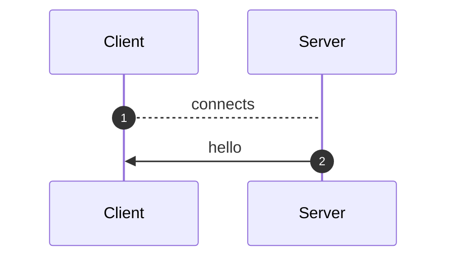
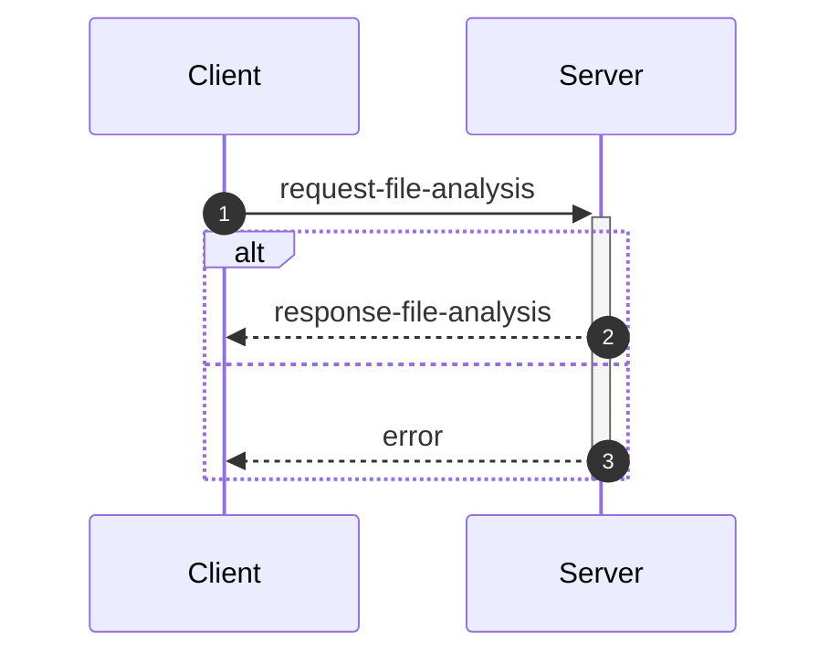
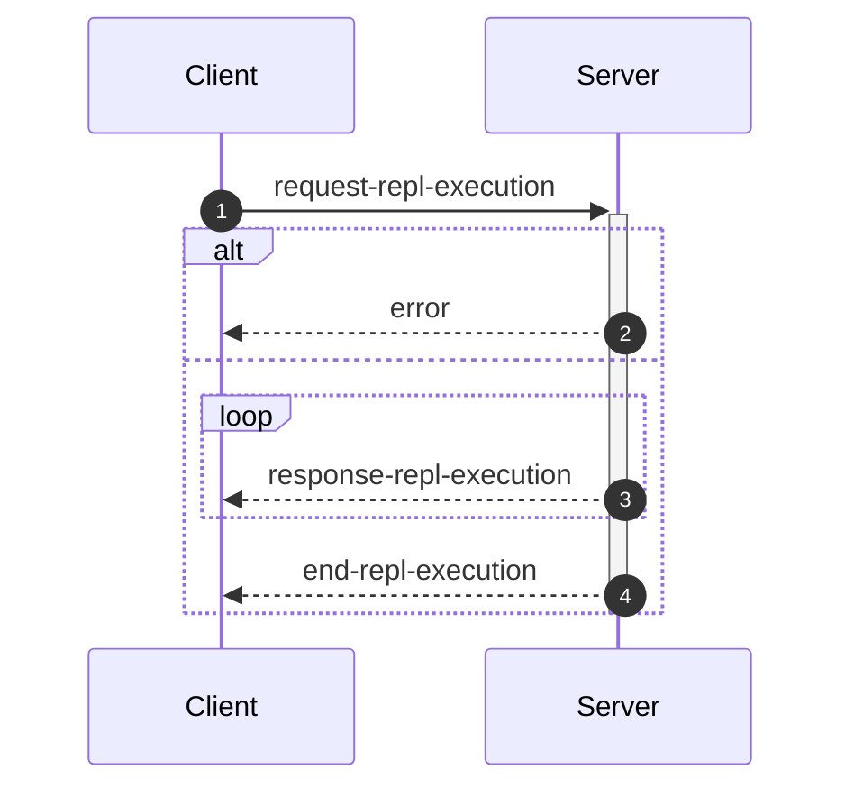
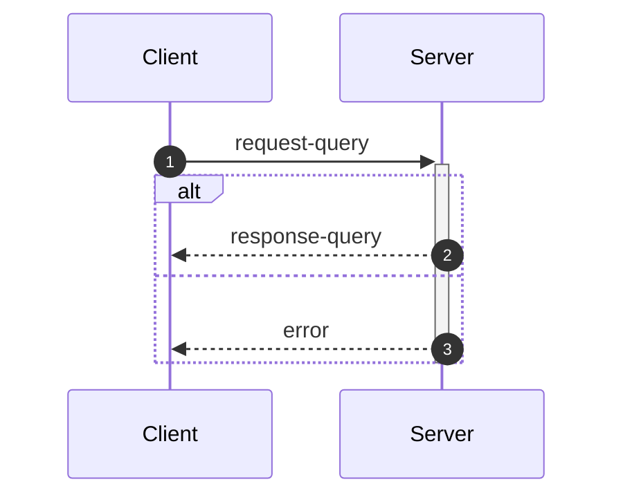

_<span title="an overview of flowR's interface">Generated</span> from '[wiki-interface.ts](https://github.com/flowr-analysis/flowr/tree/main/src/documentation/wiki-interface.ts "src/documentation/wiki-interface.ts")' on 2026-11-06, 08:49:28 UTC (v2.17.3, R v4.5.0), do not edit directly._

Although far from being as detailed as the in-depth explanation of [_flowR_](https://github.com/flowr-analysis/flowr/wiki/Core),
this wiki page explains how to interface with _flowR_ in more detail.
In general, command line arguments and other options provide short descriptions on hover over.

* [💻 Using the REPL](#using-the-repl)
* [⚙️ Configuring FlowR](#configuring-flowr)
* [⚒️ Writing Code](#writing-code)
* [💬 Communicating with the Server](#communicating-with-the-server)

<a id='using-the-repl'></a>
## 💻 Using the REPL

> [!NOTE]
> To execute arbitrary R commands with a repl request, _flowR_ has to be started explicitly with <span title="Description (Command Line Argument): Allow to access the underlying R session when using flowR (security warning: this allows the execution of arbitrary R code!)">`--r-session-access`</span>.
> Please be aware that this introduces a security risk and note that this relies on the [`r-shell` engine](https://github.com/flowr-analysis/flowr/wiki/Engines) .

Although primarily meant for users to explore,
there is nothing which forbids calling _flowR_ as a subprocess to use standard-in, -output, and -error
for communication (although you can access the REPL using the server as well,
with the [REPL Request](#message-request-repl-execution) message).

The read-eval-print loop&nbsp;(REPL) works relatively simple.
You can submit an expression (using <kbd>Enter</kbd>),
which is interpreted as an R&nbsp;expression by default but interpreted as a *command* if it starts with a colon (`:`).
The best command to get started with the REPL is <span title="Description (Repl Command): Show help information (aliases: :h, :?)">`:help`</span>.
Besides, you can leave the REPL either with the command <span title="Description (Repl Command): End the repl (aliases: :q, :exit)">`:quit`</span> or by pressing <kbd>Ctrl</kbd>+<kbd>C</kbd> twice.
When writing a *command*, you may press <kbd>Tab</kbd> to get a list of completions, if available.
Multiple commands can be entered in a single line by separating them with a semicolon (`;`), e.g. `:parse "x<-2"; :df*`.
If a command is given without R code, the REPL will re-use R code given in a previous command.
The prior example will hence return first the parsed AST of the program and then the dataflow graph for `"x <- 2"`.

> [!NOTE]
> If you develop flowR, you may want to launch the repl using the `npm run main-dev` command, this way, you get a non-minified version of flowR with debug information and hot-reloading of source files.

<details>
<summary>Available Commands</summary>

We currently offer the following commands (this with a `[*]` suffix are available with and without the star):

| Command | Description |
| ------- | ----------- |
| **<span title="Description (Repl Command): End the repl (aliases: :q, :exit)">:quit</span>** | End the repl (aliases: **:<span title="Alias of ':quit'. End the repl">q</span>**, **:<span title="Alias of ':quit'. End the repl">exit</span>**) |
| **<span title="Description (Repl Command): Execute the given code as R code. This requires the `--r-session-access` flag to be set and requires the r-shell engine. (aliases: :e, :r)">:execute</span>** | Execute the given code as R code. This requires the `--r-session-access` flag to be set and requires the r-shell engine. (aliases: **:<span title="Alias of ':execute'. Execute the given code as R code. This requires the `--r-session-access` flag to be set and requires the r-shell engine.">e</span>**, **:<span title="Alias of ':execute'. Execute the given code as R code. This requires the `--r-session-access` flag to be set and requires the r-shell engine.">r</span>**) |
| **<span title="Description (Repl Command): Get mermaid code for the control-flow graph of R code (aliases: :cfg, :cf)">:controlflow[*]</span>** | Get mermaid code for the control-flow graph of R code (star: Returns the URL to mermaid.live) (aliases: **:<span title="Alias of ':controlflow'. Get mermaid code for the control-flow graph of R code">cfg</span>**, **:<span title="Alias of ':controlflow'. Get mermaid code for the control-flow graph of R code">cf</span>**) |
| **<span title="Description (Repl Command): Get mermaid code for the control-flow graph with basic blocks (aliases: :cfgb, :cfb)">:controlflowbb[*]</span>** | Get mermaid code for the control-flow graph with basic blocks (star: Returns the URL to mermaid.live) (aliases: **:<span title="Alias of ':controlflowbb'. Get mermaid code for the control-flow graph with basic blocks">cfgb</span>**, **:<span title="Alias of ':controlflowbb'. Get mermaid code for the control-flow graph with basic blocks">cfb</span>**) |
| **<span title="Description (Repl Command): Get mermaid code for the dataflow graph (aliases: :d, :df)">:dataflow[*]</span>** | Get mermaid code for the dataflow graph (star: Returns the URL to mermaid.live) (aliases: **:<span title="Alias of ':dataflow'. Get mermaid code for the dataflow graph">d</span>**, **:<span title="Alias of ':dataflow'. Get mermaid code for the dataflow graph">df</span>**) |
| **<span title="Description (Repl Command): Get mermaid code for the normalized AST of R code (aliases: :n)">:normalize[*]</span>** | Get mermaid code for the normalized AST of R code (star: Returns the URL to mermaid.live) (alias: **:<span title="Alias of ':normalize'. Get mermaid code for the normalized AST of R code">n</span>**) |
| **<span title="Description (Repl Command): Get mermaid code for the simplified dataflow graph (aliases: :ds, :dfs)">:dataflowsimple[*]</span>** | Get mermaid code for the simplified dataflow graph (star: Returns the URL to mermaid.live) (aliases: **:<span title="Alias of ':dataflowsimple'. Get mermaid code for the simplified dataflow graph">ds</span>**, **:<span title="Alias of ':dataflowsimple'. Get mermaid code for the simplified dataflow graph">dfs</span>**) |
| **<span title="Description (Repl Command): Inspect and extend the signature database: `query` (identical to :query @signature), `info <name>` for where a function comes from (identical to :query @function-info), `add <path>` to mount another database/source, `download` to fetch the full-history database. (aliases: :sig)">:signature</span>** | Inspect and extend the signature database: `query` (identical to :query @signature), `info <name>` for where a function comes from (identical to :query @function-info), `add <path>` to mount another database/source, `download` to fetch the full-history database. (alias: **:<span title="Alias of ':signature'. Inspect and extend the signature database: `query` (identical to :query @signature), `info <name>` for where a function comes from (identical to :query @function-info), `add <path>` to mount another database/source, `download` to fetch the full-history database.">sig</span>**) |
| **<span title="Description (Repl Command): Just calculates the DFG, but only prints summary info (aliases: :d#, :df#)">:dataflowsilent</span>** | Just calculates the DFG, but only prints summary info (aliases: **:<span title="Alias of ':dataflowsilent'. Just calculates the DFG, but only prints summary info">d#</span>**, **:<span title="Alias of ':dataflowsilent'. Just calculates the DFG, but only prints summary info">df#</span>**) |
| **<span title="Description (Repl Command): Prints ASCII Art of the parsed, unmodified AST (aliases: :p)">:parse</span>** | Prints ASCII Art of the parsed, unmodified AST (alias: **:<span title="Alias of ':parse'. Prints ASCII Art of the parsed, unmodified AST">p</span>**) |
| **<span title="Description (Repl Command): Prints the version of flowR as well as the current version of R">:version</span>** | Prints the version of flowR as well as the current version of R
| **<span title="Description (Repl Command): Query the given R code (use 'help' for more information)">:query[*]</span>** | Query the given R code (use 'help' for more information) (star: Similar to query, but returns the output in json format.)
| **<span title="Description (Repl Command): Returns an ASCII representation of the dataflow graph (aliases: :df!)">:dataflowascii</span>** | Returns an ASCII representation of the dataflow graph (alias: **:<span title="Alias of ':dataflowascii'. Returns an ASCII representation of the dataflow graph">df!</span>**) |
| **<span title="Description (Repl Command): Returns summarization stats for the normalized AST (aliases: :n#)">:normalize#</span>** | Returns summarization stats for the normalized AST (alias: **:<span title="Alias of ':normalize#'. Returns summarization stats for the normalized AST">n#</span>**) |
| **<span title="Description (Repl Command): Show help information (aliases: :h, :?)">:help</span>** | Show help information (aliases: **:<span title="Alias of ':help'. Show help information">h</span>**, **:<span title="Alias of ':help'. Show help information">?</span>**) |

</details>

> [!TIP]
> 
> As indicated by the examples before, all REPL commands that operate on code keep track of the state.
> Hence, if you run a command like <span title="Description (Repl Command, starred version): Returns the URL to mermaid.live; Base Command: Get mermaid code for the dataflow graph (aliases: :d*, :df*)">`:dataflow*`</span> without providing R code,
> the REPL will re-use the R code provided in a previous command.
> Likewise, doing this will benefit from incrementality!
> If you request the dataflow graph with `:df* x <- 2 * y` and then want to see the parsed AST with `:parse`,
> the REPL will re-use previously obtained information and not re-parse the code again.
> 		

Generally, many commands offer shortcut versions in the REPL. Many queries, for example, offer a shortened format (see the example below).
Of special note, the [Config Query](https://github.com/flowr-analysis/flowr/wiki/%5BQuery%5D-Config)
can be used to also modify the currently active configuration of _flowR_ within the REPL (see the [wiki page](https://github.com/flowr-analysis/flowr/wiki/%5BQuery%5D-Config) for more information).

### Example: Retrieving the Dataflow Graph

To retrieve a URL to the [mermaid](https://mermaid.js.org/) diagram of the dataflow of a given expression,
use <span title="Description (Repl Command, starred version): Returns the URL to mermaid.live; Base Command: Get mermaid code for the dataflow graph (aliases: :d*, :df*)">`:dataflow*`</span> (or <span title="Description (Repl Command): Get mermaid code for the dataflow graph (aliases: :d, :df)">`:dataflow`</span> to get the mermaid code in the cli):

```shell
$ docker run -it --rm eagleoutice/flowr # or npm run flowr 
flowR repl v2.17.3, R grammar v14 (tree-sitter engine)
R> :dataflow* y <- 1 + x
```

<details>
<summary style='color:gray'>Output</summary>

```text
https://mermaid.live/view#base64:eyJjb2RlIjoiZmxvd2NoYXJ0IFREXG4gICAgMXt7XCJgKiM5MTtSTnVtYmVyIzkzOyogKioxKipcbiAgICAgICoxLjYqICgqKmlkOiAxKiopYFwifX1cbiAgICAyKFtcImAqIzkxO1JTeW1ib2wjOTM7KiAqKngqKlxuICAgICAgKjEuMTAqICgqKmlkOiAyKiopYFwiXSlcbiAgICAzW1tcImAqIzkxO1JCaW5hcnlPcCM5MzsqIGJhc2UjNTg7IzU4OyoqIzQzOyoqXG4gICAgICAqMS42LTEwKiAoKippZDogMyoqKVxuICAgIGFyZzogKDEsIDIpYFwiXV1cbiAgICBidWlsdC1pbjpfNDNfW1wiYEJ1aWx0LUluOlxuIzQzO2BcIl1cbiAgICBzdHlsZSBidWlsdC1pbjpfNDNfIHN0cm9rZTpncmF5LGZpbGw6Z3JheSxzdHJva2Utd2lkdGg6MnB4LG9wYWNpdHk6Ljg7XG4gICAgMFtcImAqIzkxO1JTeW1ib2wjOTM7KiAqKnkqKlxuICAgICAgKjEuMSogKCoqaWQ6IDAqKiwgdjogMylgXCJdXG4gICAgNFtbXCJgKiM5MTtSQmluYXJ5T3AjOTM7KiBiYXNlIzU4OyM1ODsqKiM2MDsjNDU7KipcbiAgICAgICoxLjEtMTAqICgqKmlkOiA0KiopXG4gICAgYXJnOiAoMCwgMylgXCJdXVxuICAgIGJ1aWx0LWluOl82MF8tW1wiYEJ1aWx0LUluOlxuIzYwOyM0NTtgXCJdXG4gICAgc3R5bGUgYnVpbHQtaW46XzYwXy0gc3Ryb2tlOmdyYXksZmlsbDpncmF5LHN0cm9rZS13aWR0aDoycHgsb3BhY2l0eTouODtcbiAgICAxIC0uLT58XCJmbG93XCJ8IDJcbiAgICBsaW5rU3R5bGUgMCBzdHJva2U6Z3JheSxjb2xvcjpncmF5O1xuICAgIDIgLS4tPnxcImZsb3dcInwgM1xuICAgIGxpbmtTdHlsZSAxIHN0cm9rZTpncmF5LGNvbG9yOmdyYXk7XG4gICAgMyAtLT58XCJyZWFkcywgYXJnXCJ8IDFcbiAgICAzIC0tPnxcInJlYWRzLCBhcmdcInwgMlxuICAgIDMgLS4tPnxcImZsb3dcInwgMFxuICAgIGxpbmtTdHlsZSA0IHN0cm9rZTpncmF5LGNvbG9yOmdyYXk7XG4gICAgMyAtLi0+fFwicmVhZHMsIGNhbGxzXCJ8IGJ1aWx0LWluOl80M19cbiAgICBsaW5rU3R5bGUgNSBzdHJva2U6Z3JheTtcbiAgICAwIC0tPnxcImRlZmluZWQtYnksIGZsb3dcInwgNFxuICAgIDAgLS0+fFwiZGVmaW5lZC1ieVwifCAzXG4gICAgNCAtLT58XCJyZWFkcywgYXJnXCJ8IDNcbiAgICA0IC0tPnxcInJldHVybnMsIGFyZ1wifCAwXG4gICAgNCAtLi0+fFwicmVhZHMsIGNhbGxzXCJ8IGJ1aWx0LWluOl82MF8tXG4gICAgbGlua1N0eWxlIDEwIHN0cm9rZTpncmF5OyIsIm1lcm1haWQiOnsiYXV0b1N5bmMiOnRydWV9fQ==
```

Retrieve the dataflow graph of the expression `y <- 1 + x`. It looks like this:


<details>

<summary style="color:gray">R Code of the Dataflow Graph</summary>

The analysis ran (parse and normalize with the [tree-sitter](https://github.com/flowr-analysis/flowr/wiki/Engines) engine) in the generation environment. No [signature database](https://github.com/flowr-analysis/flowr/wiki/Signature-Database) is mounted, so `library()` attaches no exports (base-R names are still qualified, e.g., `stats::acf`). 
We encountered no unknown side effects during the analysis.

```r
y <- 1 + x
```

</details>

</details>

For small graphs like this, <span title="Description (Repl Command): Returns an ASCII representation of the dataflow graph (aliases: :df!)">`:dataflowascii`</span> also provides an ASCII representation directly in the REPL:

```shell
$ docker run -it --rm eagleoutice/flowr # or npm run flowr 
flowR repl v2.17.3, R grammar v14 (tree-sitter engine)
R> :df! y <- 1 + x
```

<details open>
<summary style='color:gray'>Output</summary>

```text
                        v<0>v
 c<4>c──────────────────| y |
 |<- |     ┌────────────v---v
 c---c     │
    │   c<3>c   0<1>0
    └───| + |───| 1 |───u<2>u
        c---c   0---0   | x |
           └────────────u---u
Edges:
3 -> 1: reads, arg          3 -> 2: reads, arg
3 -> 0: flows-to            1 -> 2: flows-to
2 -> 3: flows-to            4 -> 3: reads, arg
4 -> 0: returns, arg        0 -> 4: defined-by, flows-to
0 -> 3: defined-by
```

Retrieve the dataflow graph of the expression `y <- 1 + x` as ASCII art.

</details>

For the slicing with <span title="Description (Repl Command): Static backwards executable slicer for R">`:slicer`</span>, you have access to the same [magic comments](#slice-magic-comments) as with the [slice request](#message-request-slice).
Pass `--inline` to splice resolvable `source()` calls into the reconstruction so the slice is a single self-contained R text (the same as the static slice query's `inlineSources` flag).
See `--help` for more flags!

### Example: Interfacing with the File System

Many commands that allow for an R-expression (like <span title="Description (Repl Command, starred version): Returns the URL to mermaid.live; Base Command: Get mermaid code for the dataflow graph (aliases: :d*, :df*)">`:dataflow*`</span>) allow for a file as well
if the argument starts with `file://`.
If you are working from the root directory of the _flowR_ repository, the following gives you the parsed AST of the example file using the <span title="Description (Repl Command): Prints ASCII Art of the parsed, unmodified AST (aliases: :p)">`:parse`</span> command:

> **Watch mode**: Replace `file://` with `watch://` to enter watch mode.
> flowR runs the command immediately and then re-runs it every time the file (or any file inside the folder) changes.
> Enter any other command to leave watch mode.
> For example: `:df watch://analysis.R`

```shell
$ docker run -it --rm eagleoutice/flowr # or npm run flowr 
flowR repl v2.17.3, R grammar v14 (tree-sitter engine)
R> :parse file://test/testfiles/example.R
```

<details>
<summary style='color:gray'>Output</summary>

```text
File: test/testfiles/example.R

program
├ binaryoperator
│ ├ identifier "sum" (1:1─4)
│ ├ <- "<-" (1:5─7)
│ ╰ float "0" (1:8─9)
├ binaryoperator
│ ├ identifier "product" (2:1─8)
│ ├ <- "<-" (2:9─11)
│ ╰ float "1" (2:12─13)
├ binaryoperator
│ ├ identifier "w" (3:1─2)
│ ├ <- "<-" (3:3─5)
│ ╰ float "7" (3:6─7)
├ binaryoperator
│ ├ identifier "N" (4:1─2)
│ ├ <- "<-" (4:3─5)
│ ╰ float "10" (4:6─8)
├ forstatement
│ ├ for "for" (6:1─4)
│ ├ ( "(" (6:5─6)
│ ├ identifier "i" (6:6─7)
│ ├ in "in" (6:8─10)
│ ├ binaryoperator
│ │ ├ float "1" (6:11─12)
│ │ ├ : ":" (6:12─13)
│ │ ╰ parenthesizedexpression
│ │   ├ ( "(" (6:13─14)
│ │   ├ binaryoperator
│ │   │ ├ identifier "N" (6:14─15)
│ │   │ ├ - "-" (6:15─16)
│ │   │ ╰ float "1" (6:16─17)
│ │   ╰ ) ")" (6:17─18)
│ ├ ) ")" (6:18─19)
│ ╰ bracedexpression
│   ├ { "{" (6:20─21)
│   ├ binaryoperator
│   │ ├ identifier "sum" (7:3─6)
│   │ ├ <- "<-" (7:7─9)
│   │ ╰ binaryoperator
│   │   ├ binaryoperator
│   │   │ ├ identifier "sum" (7:10─13)
│   │   │ ├ + "+" (7:14─15)
│   │   │ ╰ identifier "i" (7:16─17)
│   │   ├ + "+" (7:18─19)
│   │   ╰ identifier "w" (7:20─21)
│   ├ binaryoperator
│   │ ├ identifier "product" (8:3─10)
│   │ ├ <- "<-" (8:11─13)
│   │ ╰ binaryoperator
│   │   ├ identifier "product" (8:14─21)
│   │   ├  "" (8:22─23)
│   │   ╰ identifier "i" (8:24─25)
│   ╰ } "}" (9:1─2)
├ call
│ ├ identifier "cat" (11:1─4)
│ ╰ arguments
│   ├ ( "(" (11:4─5)
│   ├ argument
│   │ ╰ string
│   │   ├ stringopen "\"" (11:5─6)
│   │   ├ stringcontent "Sum:" (11:6─10)
│   │   ╰ stringclose "\"" (11:10─11)
│   ├ comma "," (11:11─12)
│   ├ argument
│   │ ╰ identifier "sum" (11:13─16)
│   ├ comma "," (11:16─17)
│   ├ argument
│   │ ╰ string
│   │   ├ stringopen "\"" (11:18─19)
│   │   ├ stringcontent
│   │   │ ╰ escapesequence "\\n" (11:19─21)
│   │   ╰ stringclose "\"" (11:21─22)
│   ╰ ) ")" (11:22─23)
╰ call
  ├ identifier "cat" (12:1─4)
  ╰ arguments
    ├ ( "(" (12:4─5)
    ├ argument
    │ ╰ string
    │   ├ stringopen "\"" (12:5─6)
    │   ├ stringcontent "Product:" (12:6─14)
    │   ╰ stringclose "\"" (12:14─15)
    ├ comma "," (12:15─16)
    ├ argument
    │ ╰ identifier "product" (12:17─24)
    ├ comma "," (12:24─25)
    ├ argument
    │ ╰ string
    │   ├ stringopen "\"" (12:26─27)
    │   ├ stringcontent
    │   │ ╰ escapesequence "\\n" (12:27─29)
    │   ╰ stringclose "\"" (12:29─30)
    ╰ ) ")" (12:30─31)
```

Retrieve the parsed AST of the example file.

<details>

<summary>File Content</summary>

```r
sum <- 0
product <- 1
w <- 7
N <- 10

for (i in 1:(N-1)) {
  sum <- sum + i + w
  product <- product * i
}

cat("Sum:", sum, "\n")
cat("Product:", product, "\n")
```

</details>

As _flowR_ directly transforms this AST the output focuses on being human-readable instead of being machine-readable.
		
</details>

### Example: Run a Query

You can run any query supported by _flowR_ using the <span title="Description (Repl Command): Query the given R code (use 'help' for more information)">`:query`</span> command.
For example, to obtain the shapes of all data frames in a given piece of code, you can run:

```shell
$ docker run -it --rm eagleoutice/flowr # or npm run flowr 
flowR repl v2.17.3, R grammar v14 (tree-sitter engine)
R> :query @absint df-shape "x <- data.frame(a = 1:10, b = 1:10)\ny <- x$a"
```

<details open>
<summary style='color:gray'>Output</summary>

```text
Query: absint (2 ms)
   ╰ $12: (colnames: [{"a", "b"}, {}], cols: [2, 2], rows: [10, 10])
   ╰ $0: (colnames: [{"a", "b"}, {}], cols: [2, 2], rows: [10, 10])
```

Retrieve the shapes of all data frames in the given code.

</details>

To run the linter on a file, you can use (in this example, we just issue the `dead-code` linter on a small piece of code):

```shell
$ docker run -it --rm eagleoutice/flowr # or npm run flowr 
flowR repl v2.17.3, R grammar v14 (tree-sitter engine)
R> :query @linter rules:dead-code "if(FALSE) x <- 2"
```

<details open>
<summary style='color:gray'>Output</summary>

```text
Query: linter (1 ms)
   ╰ Dead Code (dead-code):
       ╰ certain:
           ╰ Code at 1.11-16 (1 quick fix(es) available)
```

Run the linter on the given code, with only the `dead-code` rule enabled.

</details>

For more information on the available queries, please check out the [Query API](https://github.com/flowr-analysis/flowr/wiki/Query-API).

<a id='configuring-flowr'></a>
## ⚙️ Configuring FlowR

When running _flowR_, you may want to specify some behaviors with a dedicated configuration file.
By default, flowR looks for a file named `flowr.json` in the current working directory (or any higher directory).
You can also specify a different file with <span title="Description (Command Line Argument): The name of the configuration file to use">`--config-file`</span> or pass the configuration inline using <span title="Description (Command Line Argument): The flowR configuration to use, as a JSON string">`--config-json`</span>.
A `flowr.json` found this way belongs to the analyzed project, so flowR ignores its options that decide what flowR executes or loads
(`engines.*.wasmPath`, `engines.*.treeSitterWasmPath`, `engines.*.rPath`, `solver.sigdb.additionalPaths`, `solver.sigdb.downloadRepo`, `solver.sigdb.installedLibrary.paths`, `solver.sigdb.onDemand.enabled`, `solver.sigdb.onDemand.repositories`, `solver.sigdb.onDemand.cranMirror`, `solver.sigdb.onDemand.bioconductorMirror`, `solver.sigdb.onDemand.cacheDir`),
unless you pass <span title="Description (Command Line Argument): Keep the security-sensitive options (e.g., the R executable) of the flowr.json found in the working directory or a parent. Only use this for projects you trust.">`--trust-config`</span>.
To analyze code you do not trust, use the secure mode (<span title="Description (Command Line Argument): Run in secure mode for analyzing untrusted code: flowR does not start R (or any other process), does not access the network, does not search for project configs, and ignores security-sensitive options in every config. Cannot be disabled once enabled. Can also be enabled with the environment variable {italic FLOWR_SECURE_MODE=1}.">`--secure`</span>, see the [security policy](https://github.com/flowr-analysis/flowr/blob/main/.github/SECURITY.md)).
To inspect the current configuration, you can run flowr with the <span title="Description (Command Line Argument): Run with verbose logging (will be passed to the corresponding script)">`--verbose`</span> flag, or use the `config` [Query](https://github.com/flowr-analysis/flowr/wiki/Query-API).
Within the REPL this works by running the following:

```shell
:query @config
```

To work with the <a href="https://github.com/flowr-analysis/flowr/tree/main/src/config.ts#L119"><code><span title="The configuration file format for flowR.">FlowrConfig</span></code></a> you can use the provided helper objects alongside its methods like
<a href="https://github.com/flowr-analysis/flowr/tree/main/src/config.ts#L966"><code><span title="Creates a new flowr config that has the updated values.">FlowrConfig::<b>amend</b></span></code></a>.
The schema below documents every option; the ones you most likely want are:

- <a href="https://github.com/flowr-analysis/flowr/wiki/Interface#configuring-flowr" title="Configuration Option (boolean): Whether source calls should be ignored, causing {@link processSourceCall}&#39;s behavior to be skipped.">ignoreSourceCalls</a>: ignore source calls when analyzing the code, i.e., ignore the inclusion of other files.
- <a href="https://github.com/flowr-analysis/flowr/wiki/Interface#configuring-flowr" title="Configuration Option (boolean): Whether load calls should be ignored, causing {@link processLoadCall}&#39;s behavior to be skipped.">ignoreLoadCalls</a>: ignore load calls when analyzing the code, i.e., ignore the loading of r-data files.
- <a href="https://github.com/flowr-analysis/flowr/wiki/Interface#configuring-flowr" title="Configuration Option (object): Do you want to overwrite (parts) of the builtin definition?">semantics.environment.overwriteBuiltIns</a>: overwrite _flowR_'s handling of built-in functions, or clear the preset definitions entirely.
  See [Configure BuiltIn Semantics](#configure-builtin-semantics) for more information.
- <a href="https://github.com/flowr-analysis/flowr/wiki/Interface#configuring-flowr" title="Configuration Option (string): How to resolve variables and their values. (one of &quot;disabled&quot;, &quot;alias&quot;, &quot;builtin&quot;)">solver.variables</a>: how to resolve variables and their values (`disabled`, `alias`, `builtin`).
- <a href="https://github.com/flowr-analysis/flowr/wiki/Interface#configuring-flowr" title="Configuration Option (array): The engine or set of engines to use for interacting with R code. An empty array means all available engines will be used.">engines</a> and <a href="https://github.com/flowr-analysis/flowr/wiki/Interface#configuring-flowr" title="Configuration Option (string): The default engine to use for interacting with R code. If this is undefined, an arbitrary engine from the specified list will be used. (one of &quot;tree-sitter&quot;, &quot;r-shell&quot;)">defaultEngine</a>: the engines used to interact with R code, see the [Engines wiki page](https://github.com/flowr-analysis/flowr/wiki/Engines).
- <a href="https://github.com/flowr-analysis/flowr/wiki/Interface#configuring-flowr" title="Configuration Option (array): Files a framework loads on its own, without any source() call (e.g. global.R in a shiny app), in the order they are loaded; flowR orders the matching project files accordingly and analyzes them as one program. Entries are case-insensitive globs matched against the file path, a plain name matches any file with that name, and entries matching no project file are warned about. Usually set per project kind via specializeConfig.">project.implicitSources</a>: the files a framework loads without any `source()` call, in the order in which they are
  loaded. Entries are globs (e.g. `R/*.R`) matched against the file path ignoring capitalization; one matching no file is reported.
- <a href="https://github.com/flowr-analysis/flowr/wiki/Interface#configuring-flowr" title="Configuration Option (object): Overwrite (parts of) the configuration depending on the project kind flowR detects, e.g. to give a shiny app its implicit sources.">specializeConfig</a>: overwrite (parts of) the configuration depending on the kind of project _flowR_ detects
  (e.g. `shiny-app`), which is how a shiny app gets its implicit sources by default. What you configure directly wins.
- <a href="https://github.com/flowr-analysis/flowr/wiki/Interface#configuring-flowr" title="Configuration Option (string): Overwrite the project kind flowR would otherwise infer from the analyzed files, e.g. when auto-detection guesses wrong. (one of &quot;package&quot;, &quot;script&quot;, &quot;shiny-app&quot;, &quot;notebook&quot;, &quot;project&quot;, &quot;unknown&quot;)">project.useProjectType</a>: skip that detection and force a project kind yourself, when auto-detection guesses wrong.
- <a href="https://github.com/flowr-analysis/flowr/wiki/Interface#configuring-flowr" title="Configuration Option (array): The default plugins to load when creating a new instance of FlowrAnalyzer">defaultPlugins</a> and <a href="https://github.com/flowr-analysis/flowr/wiki/Interface#configuring-flowr" title="Configuration Option (array): The plugins to load in REPL mode">repl.plugins</a>: the plugins to load for a new <a href="https://github.com/flowr-analysis/flowr/tree/main/src/project/flowr-analyzer.ts#L210"><code><span title="Central class for conducting analyses with FlowR. Use the FlowrAnalyzerBuilder to create a new instance. If you want the original pattern of creating a pipeline and running all steps, you can still do this with FlowrAnalyzer#runFull . To inspect the context of the analyzer, use FlowrAnalyzer#inspectContext (if you are a plugin and need to modify it, use FlowrAnalyzer#context instead).">FlowrAnalyzer</span></code></a> and in the REPL
  (use `flowr:default` to reference the former).

So you can configure _flowR_ by adding a file like the following:

<details>

<summary>Example Configuration File</summary>

```json
{
  "ignoreSourceCalls": true,
  "ignoreLoadCalls": true,
  "semantics": {
    "environment": {
      "overwriteBuiltIns": {
        "definitions": [
          {
            "type": "function",
            "names": [
              "foo"
            ],
            "processor": "builtin:assign",
            "config": {}
          }
        ]
      }
    }
  },
  "defaultPlugins": [
    "file:description",
    "versions:description"
  ],
  "repl": {
    "quickStats": false,
    "dfProcessorHeat": false,
    "hints": true,
    "plugins": [
      "flowr:default"
    ]
  },
  "project": {
    "resolveUnknownPathsOnDisk": true,
    "implicitSources": [
      "global.R",
      "app.R"
    ]
  },
  "linter": {
    "disabledRules": []
  },
  "specializeConfig": {
    "shiny-app": {
      "project": {
        "implicitSources": [
          "global.R",
          "ui.R",
          "server.R",
          "app.R"
        ]
      }
    }
  },
  "engines": [
    {
      "type": "r-shell"
    }
  ],
  "solver": {
    "variables": "alias",
    "evalStrings": true,
    "trackEnvironments": true,
    "sigdb": {
      "enabled": true,
      "loadProjectDependencies": true,
      "eagerlyLoad": false,
      "eagerlyLoadExports": false,
      "linkBaseR": false,
      "linkDescriptionDependencies": false
    },
    "resolveSource": {
      "dropPaths": "no",
      "ignoreCapitalization": true,
      "inferWorkingDirectory": "active-script",
      "searchPath": []
    },
    "instrument": {},
    "slicer": {
      "threshold": 50
    }
  },
  "abstractInterpretation": {
    "wideningThreshold": 4,
    "followCalls": true,
    "dataFrame": {
      "maxColNames": 20,
      "readLoadedData": {
        "readExternalFiles": true,
        "maxReadLines": 1000000
      }
    }
  },
  "incremental": {
    "alwaysIncremental": false,
    "parsing": {
      "activated": false,
      "heuristics": {
        "activated": true,
        "mtime": true,
        "linesFrom": 500,
        "bytesFrom": 50000,
        "alwaysWithEdits": false,
        "minFiles": 1
      }
    }
  },
  "gas": {
    "thresholds": {
      "memory": {
        "problematic": 0.7,
        "critical": 0.9
      },
      "timeMs": {
        "problematic": 100000,
        "critical": 120000
      }
    },
    "features": {}
  }
}
```

</details>

<details>
<a id='configure-builtin-semantics'></a>
<summary>Configure Built-In Semantics</summary>

`semantics/environment/overwriteBuiltins` accepts two keys:

- `loadDefaults` (boolean, initially `true`): If set to `true`, the default built-in definitions are loaded before applying the custom definitions. Setting this flag to `false` explicitly disables the loading of the default definitions.
- `definitions` (array, initially empty): Allows to overwrite or define new built-in elements. Each object within must have a `type` which is one of the below. Furthermore, they may define a string array of `names` which specifies the identifiers to bind the definitions to. You may use `assumePrimitive` to specify whether _flowR_ should assume that this is a primitive non-library definition (so you probably just do not want to specify the key).

  | Type            | Description                                                                                                                                                                                                                                                                                              | Example                                                                                                    |
  | --------------- | -------------------------------------------------------------------------------------------------------------------------------------------------------------------------------------------------------------------------------------------------------------------------------------------------------- | ---------------------------------------------------------------------------------------------------------- |
  | `constant`    | Additionally allows for a `value` this should resolve to.                                                                                                                                                                                                                                                | `{ type: 'constant', names: ['NULL', 'NA'],  value: null }`                                                |
  | `function`    | Is a rather flexible way to define and bind built-in functions. For the time, we do not have extensive documentation to cover all the cases, so please either consult the sources with the `default-builtin-config.ts` or open a [new issue](https://github.com/flowr-analysis/flowr/issues/new/choose). | `{ type: 'function', names: ['next'], processor: 'builtin:d', config: { cfg: ExitPointType.Next } }` |
  | `replacement` | A comfortable way to specify replacement functions like `$<-` or `names<-`. `suffixes` describes the... suffixes to attach automatically. | `{ type: 'replacement', suffixes: ['<-', '<<-'], names: ['[', '[['] }` |

</details>

<details>

<summary style='color:gray'>Full Configuration-File Schema</summary>

- _The configuration file format for flowR._ (object)
    - **logLevel** [optional] _flowR's global minimum log level, applied when the config is loaded._ (string)
        Only allows: 'silly', 'trace', 'debug', 'info', 'warn', 'error', 'fatal'
    - **ignoreSourceCalls** [optional] _Whether source calls should be ignored, causing {@link processSourceCall}'s behavior to be skipped._ (boolean)
    - **ignoreLoadCalls** [optional] _Whether load calls should be ignored, causing {@link processLoadCall}'s behavior to be skipped._ (boolean)
    - **semantics** _Configure language semantics and how flowR handles them._ (object)
        - **environment** [optional] _Semantics regarding how to handle the R environment._ (object)
            - **overwriteBuiltIns** [optional] _Do you want to overwrite (parts) of the builtin definition?_ (object)
                - **loadDefaults** [optional] _Should the default configuration still be loaded?_ (boolean)
                - **definitions** [optional] _The definitions to load/overwrite._ (array)
                Valid item types:
                    - (object)
    - **defaultPlugins** [optional] _The default plugins to load when creating a new instance of FlowrAnalyzer_ (array)
    Valid item types:
        - (alternatives)
            - (string)
            - (array)
    - **repl** _Configuration options for the REPL._ (object)
        - **quickStats** [optional] _Whether to show quick stats in the REPL after each evaluation._ (boolean)
        - **dfProcessorHeat** [optional] _This instruments the dataflow processors to count how often each processor is called._ (boolean)
        - **hints** [optional] _Whether to show dim inline hints on the empty prompt (automatically disabled on non-interactive terminals)._ (boolean)
        - **plugins** [optional] _The plugins to load in REPL mode_ (array)
        Valid item types:
            - (alternatives)
                - (string)
                - (array)
        - **autoUseFileProtocol** [optional] _Prepend the file protocol to a repl input that looks like a path, instead of only warning about it._ (boolean)
        - **queryStats** [optional] _Whether `:query` closes with the line stating how long the queries took (`:query*` never prints it)._ (boolean)
        - **showPlugins** [optional] _Whether `:version` grays out the plugins that did not activate during the last analysis._ (boolean)
    - **project** _Project specific configuration options._ (object)
        - **resolveUnknownPathsOnDisk** [optional] _Whether to resolve unknown paths loaded by the r project disk when trying to source/analyze files._ (boolean)
        - **failOnInaccessiblePath** [optional] _Whether a directory that cannot be traversed during file discovery (e.g. due to permissions) aborts the analysis; when false (the default) such paths are logged and skipped._ (boolean)
        - **basePackages** [optional] _The packages considered part of R itself (base and recommended); if unset, flowR uses its built-in list._ (array)
        Valid item types:
            - (string)
        - **implicitSources** [optional] _Files a framework loads on its own, without any source() call (e.g. global.R in a shiny app), in the order they are loaded; flowR orders the matching project files accordingly and analyzes them as one program. Entries are case-insensitive globs matched against the file path, a plain name matches any file with that name, and entries matching no project file are warned about. Usually set per project kind via specializeConfig._ (array)
        Valid item types:
            - (string)
        - **useProjectType** [optional] _Overwrite the project kind flowR would otherwise infer from the analyzed files, e.g. when auto-detection guesses wrong._ (string)
            Only allows: 'package', 'script', 'shiny-app', 'notebook', 'project', 'unknown'
        - **assumeImplicitEcho** [optional] _Whether the top level of the analyzed code is echoed, so that every visible result printed there is collected as an output by the dependencies query (default true, false for a package)._ (boolean)
        - **discovery** [optional] _Scoping options for the default project discovery._ (object)
            - **full** [optional] _Collect every file below the project root (greedy) instead of only the files the detected project kind needs (default false)._ (boolean)
            - **perKind** [optional] _Per-kind include/exclude glob overrides layered on the default scoping._ (object)
            - **ignore** [optional] _Case-insensitive globs that drop matching files from the intelligent discovery, regardless of kind (e.g. .Renviron to ignore environment files)._ (array)
            Valid item types:
                - (string)
        - **classification** [optional] _Overrides for the signals flowR uses to classify the project kind._ (object)
            - **shinyDescriptionTypes** [optional] _DESCRIPTION Type: values that mark a shiny app._ (array)
            Valid item types:
                - (string)
            - **shinyEntryFiles** [optional] _File names a shiny app is assembled from._ (array)
            Valid item types:
                - (string)
            - **shinyUsagePattern** [optional] _Regex source evidencing shiny usage in an entry file._ (string)
            - **notebookExtensions** [optional] _File extensions marking a notebook._ (array)
            Valid item types:
                - (string)
    - **linter** _Linter configuration options._ (object)
        - **disabledRules** _Linting rule names excluded from the default rule set (a rule requested explicitly via a linter query still runs). Usually set per project kind via specializeConfig._ (array)
        Valid item types:
            - (string)
        - **disabledTags** [optional] _Linting rule tags whose rules are excluded from the default rule set (a rule requested explicitly via a linter query still runs). By default the cmd-check rules are disabled for everything but a package; a configured list replaces that default._ (array)
        Valid item types:
            - (string)
    - **inputSources** [optional] _Further frameworks the input-sources analysis should know about; entries are added to flowR's defaults._ (object)
        - **pure** [optional] _Functions that only pass the constantness of their arguments on._ (array)
        Valid item types:
            - (string)
        - **param** [optional] _Functions whose result is a 'param' input._ (array)
        Valid item types:
            - (string)
        - **file** [optional] _Functions whose result is a 'file' input._ (array)
        Valid item types:
            - (string)
        - **tempfile** [optional] _Functions whose result is a 'tempfile' input._ (array)
        Valid item types:
            - (string)
        - **glob** [optional] _Functions whose result is a 'glob' input._ (array)
        Valid item types:
            - (string)
        - **net** [optional] _Functions whose result is a 'net' input._ (array)
        Valid item types:
            - (string)
        - **rand** [optional] _Functions whose result is a 'rand' input._ (array)
        Valid item types:
            - (string)
        - **system** [optional] _Functions whose result is a 'system' input._ (array)
        Valid item types:
            - (string)
        - **ffi** [optional] _Functions whose result is a 'ffi' input._ (array)
        Valid item types:
            - (string)
        - **lang** [optional] _Functions whose result is a 'lang' input._ (array)
        Valid item types:
            - (string)
        - **options** [optional] _Functions whose result is a 'options' input._ (array)
        Valid item types:
            - (string)
        - **cmdline** [optional] _Functions whose result is a 'cmdline' input._ (array)
        Valid item types:
            - (string)
        - **user** [optional] _Functions whose result is a 'user' input._ (array)
        Valid item types:
            - (string)
        - **const** [optional] _Functions whose result is a 'const' input._ (array)
        Valid item types:
            - (string)
        - **scope** [optional] _Functions whose result is a 'scope' input._ (array)
        Valid item types:
            - (string)
        - **dconst** [optional] _Functions whose result is a 'dconst' input._ (array)
        Valid item types:
            - (string)
        - **unknown** [optional] _Functions whose result is a 'unknown' input._ (array)
        Valid item types:
            - (string)
        - **linkedObjects** [optional] _Objects a framework provides without a definition in the code, e.g. shiny's input._ (array)
        Valid item types:
            - (object)
        - **linkedEntryPoints** [optional] _Calls that hand a function to a framework, which binds its objects to the parameters by position._ (array)
        Valid item types:
            - (object)
    - **specializeConfig** [optional] _Overwrite (parts of) the configuration depending on the project kind flowR detects, e.g. to give a shiny app its implicit sources._ (object)
    - **engines** _The engine or set of engines to use for interacting with R code. An empty array means all available engines will be used._ (array)
    Valid item types:
        - (alternatives)
            - _The configuration for the tree sitter engine._ (object)
                - **type** [required] _Use the tree sitter engine._ (string)
                    Only allows: 'tree-sitter'
                - **wasmPath** [optional] _The path to the tree-sitter-r WASM binary to use. If this is undefined, this uses the default path._ (string)
                - **treeSitterWasmPath** [optional] _The path to the tree-sitter WASM binary to use. If this is undefined, this uses the default path._ (string)
                - **lax** [optional] _Whether to use the lax parser for parsing R code (allowing for syntax errors). If this is undefined, the strict parser will be used._ (boolean)
            - _The configuration for the R shell engine._ (object)
                - **type** [required] _Use the R shell engine._ (string)
                    Only allows: 'r-shell'
                - **rPath** [optional] _The path to the R executable to use. If this is undefined, this uses the default path._ (string)
                - **pipeBind** [optional] _Whether to enable R's experimental pipe-bind operator "=>" by setting _R_USE_PIPEBIND_ for the R session (default false); R itself keeps this off by default, as it is experimental and has never shipped in a release version of R._ (boolean)
    - **defaultEngine** [optional] _The default engine to use for interacting with R code. If this is undefined, an arbitrary engine from the specified list will be used._ (string)
        Only allows: 'tree-sitter', 'r-shell'
    - **solver** _How to resolve constants, constraints, cells, ..._ (object)
        - **variables** _How to resolve variables and their values._ (string)
            Only allows: 'disabled', 'alias', 'builtin'
        - **evalStrings** _Should we include eval(parse(text="...")) calls in the dataflow graph?_ (boolean)
        - **trackEnvironments** [optional] _Track user-created environments (new.env, assign/get/local with envir=, dollar-assign, attach). When false, all envir-style calls fall through conservatively._ (boolean)
        - **sigdb** _Resolving library exports from a signature database._ (object)
            - **enabled** [optional] _Resolve library()/use() exports from a signature database (default true); when false no database is consulted._ (boolean)
            - **loadProjectDependencies** [optional] _Load the project's declared dependencies from its metadata files (DESCRIPTION Imports/Depends, rproject.toml, uvr.toml, rig rproj.toml and script blocks, renv.lock, rv.lock, uvr.lock, rig lockfiles) (default true); when false these files are not read for dependencies._ (boolean)
            - **eagerlyLoad** [optional] _Parse the database up front rather than on the first package load (default false, ignored if disabled)._ (boolean)
            - **eagerlyLoadExports** [optional] _Add a vertex for every export on load rather than on demand (default false); keeps the dataflow graph small._ (boolean)
            - **assumedRVersion** [optional] _R version assumed when resolving versioned (base-R) exports: a pin like "4.5" or "auto" to detect the installed R (default "auto")._ (string)
            - **linkBaseR** [optional] _Eagerly attach base-R namespaces so bare base calls resolve without library() (default false)._ (boolean)
            - **linkBaseRCalls** [optional] _Add a lightweight Reads edge from a bare base-R call to its signature-database function vertex (default false; base-R qualification is edge-free otherwise)._ (boolean)
            - **linkPackageCalls** [optional] _Add a lightweight Reads edge from a resolved package call to its signature-database function vertex (default false)._ (boolean)
            - **linkDescriptionDependencies** [optional] _Eagerly attach the namespaces of the project's declared DESCRIPTION dependencies (Imports/Depends) so their exports resolve without an explicit library() (default false)._ (boolean)
            - **warmInBackground** [optional] _Decompress the hot shards (base + most-downloaded) in a background task on startup so the first library() lookup is warm (default false; for long-running servers/REPLs)._ (boolean)
            - **additionalPaths** [optional] _Extra directories or bundle/manifest files searched for signature databases (alongside the shipped default and $FLOWR_SIGDB_DIR); a downloaded full-history bundle placed here is mounted automatically._ (array)
            Valid item types:
                - (string)
            - **downloadRepo** [optional] _GitHub owner/repo the full-history bundle is downloaded from via ":signature download" (default "flowr-analysis/flowr"; the release tag comes from the committed sigdb.remote.json unless a version is given)._ (string)
            - **autoSync** [optional] _On startup, re-download shards whose committed sigdb.remote.json hash no longer matches the cache, in the background (default false; opt-in network sync after a git pull)._ (boolean)
            - **installedLibrary** [optional] _Recovering packages no signature database knows from the copy installed on this machine._ (object)
                - **enabled** [required] _Recover packages no signature database knows from their installed copy (default false)._ (boolean)
                - **paths** [optional] _Library directories to search; when empty they are discovered from the environment and the project._ (array)
                Valid item types:
                    - (string)
                - **useEnvironment** [optional] _Search the libraries R_LIBS_USER/R_LIBS/R_LIBS_SITE name (default true)._ (boolean)
                - **useProjectLibrary** [optional] _Search a project-local renv/packrat library (default true)._ (boolean)
                - **maxDepth** [optional] _How far to descend into the nested layout of a project-local library (default 3)._ (number)
                - **packages** [optional] _Only recover packages whose name matches one of these regular expressions; empty means any._ (array)
                Valid item types:
                    - (string)
            - **onDemand** [optional] _Recovering packages no signature database knows from their sources on CRAN, Bioconductor, or GitHub._ (object)
                - **enabled** [required] _Fetch and recover the sources of packages no signature database knows when the analyzed code uses them (default false, accesses the network)._ (boolean)
                - **sources** [optional] _Where to look, in order: github, cran, bioconductor, or a source a plugin adds (default ["github", "cran", "bioconductor"])._ (array)
                Valid item types:
                    - (string)
                - **repositories** [optional] _GitHub repositories (owner/repo[/subdir][@ref]) to fetch packages from, by package name. The analyzed project may name more (DESCRIPTION Remotes, install_github calls)._ (object)
                - **packages** [optional] _Only recover packages whose name matches one of these regular expressions, empty means any._ (array)
                Valid item types:
                    - (string)
                - **cranMirror** [optional] _The CRAN src/contrib/ to fetch from, over https (default https://cloud.r-project.org/src/contrib/). It may be on the local network._ (string)
                - **bioconductorMirror** [optional] _The Bioconductor host, over https (default https://bioconductor.org). It may be on the local network._ (string)
                - **bioconductorRelease** [optional] _The Bioconductor release to fetch from: release, devel, or a number like 3.20 (default release)._ (string)
                - **githubMirrors** [optional] _Use the GitHub mirrors of CRAN (cran/<pkg>) and Bioconductor (bioc/<pkg>) (default true)._ (boolean)
                - **maxPackages** [optional] _The most packages to fetch for one analysis (default 25)._ (number)
                - **maxArchiveMb** [optional] _The most MiB a package archive may have (default 32). It may unpack to three times that, at most 128 MiB._ (number)
                - **offline** [optional] _Only use what was fetched before, never the network (default false)._ (boolean)
                - **retryAfterHours** [optional] _How many hours to wait before asking again for a package no source had (default 24)._ (number)
                - **cacheDir** [optional] _Where to cache what was fetched (default the on-demand directory of the signature cache)._ (string)
            - **blobCacheBudgetMb** [optional] _How many MiB of decoded package blobs every open bundle may hold together (default 16)._ (number)
            - **versionSelection** [optional] _When a project constrains a dependency, resolve to the newest (default), oldest, or system-installed version satisfying it; system needs R and falls back to newest. Base-R packages always resolve against the assumed R version._ (string)
                Only allows: 'newest', 'oldest', 'system'
            - **versionOverrides** [optional] _Force an exact version for specific packages (name -> version), overriding both the project constraint and the versionSelection policy (default {})._ (object)
        - **versionManagement** _Policies for reasoning about dependency versions._ (object)
            - **linkedVersionGroups** [optional] _Groups of packages that must resolve to the same version; version guessing intersects each group so its members stay mutually compatible (default [])._ (array)
            Valid item types:
                - (array)
                Valid item types:
                    - (string)
        - **assumeAttachedPackages** [optional] _Packages to treat as attached without a `library()` call, so what the built-in configuration states about them applies to the analyzed code. The base packages R attaches on startup already resolve without it._ (array)
        Valid item types:
            - (string)
        - **transitiveSideEffectRounds** [optional] _How many rounds the transitive side-effect fixpoint may run before it is cut off (default 32); the propagation stops on its own as soon as a round adds nothing._ (number)
        - **maxOverlayDepth** [optional] _How many binding overlays may stack on one environment frame before a write flattens them (default 4); a pure performance knob, trading lookup cost against copy cost without changing any result._ (number)
        - **instrument** (object)
            - **dataflowExtractors** [optional] _These keys are only intended for use within code, allowing to instrument the dataflow analyzer!_ (any)
        - **resolveSource** [optional] _If lax source calls are active, flowR searches for sourced files much more freely, based on the configurations you give it. This option is only in effect if `ignoreSourceCalls` is set to false._ (object)
            - **dropPaths** _Allow to drop the first or all parts of the sourced path, if it is relative._ (string)
                Only allows: 'no', 'once', 'all'
            - **ignoreCapitalization** _Search for filenames matching in the lowercase._ (boolean)
            - **inferWorkingDirectory** _Try to infer the working directory from the main or any script to analyze._ (string)
                Only allows: 'no', 'main-script', 'active-script', 'any-script'
            - **searchPath** _Additionally search in these paths._ (array)
            Valid item types:
                - (string)
            - **repeatedSourceLimit** [optional] _How often the same file can be sourced within a single run? Please be aware: in case of cyclic sources this may not reach a fixpoint so give this a sensible limit._ (number)
            - **applyReplacements** _Provide name replacements for loaded files_ (array)
            Valid item types:
                - (object)
            - **assumeFilesExist** [optional] _Assume a sourced file is always there, making what it defines certain instead of conditional on the source call._ (boolean)
        - **slicer** [optional] _The configuration for the slicer._ (object)
            - **threshold** [optional] _The maximum number of iterations to perform on a single function call during slicing._ (number)
            - **autoExtend** [optional] _If set, the slicer will gain an additional post-pass._ (boolean)
    - **abstractInterpretation** _The configuration options for abstract interpretation._ (object)
        - **wideningThreshold** _The threshold for the number of visitations of a node at which widening should be performed to ensure the termination of the fixpoint iteration._ (number)
        - **followCalls** _Whether the abstract interpretation is interprocedural, i.e. whether it steps into the functions a call may dispatch to._ (boolean)
        - **dataFrame** _The configuration of the shape inference for data frames._ (object)
            - **maxColNames** _The maximum number of columns names to infer for data frames before over-approximating the column names to top._ (number)
            - **readLoadedData** _Configuration options for reading data frame shapes from loaded external data files, such as CSV files._ (object)
                - **readExternalFiles** _Whether data frame shapes should be extracted from loaded external files, such as CSV files._ (boolean)
                - **maxReadLines** _The maximum number of lines to read when extracting data frame shapes from loaded files, such as CSV files._ (number)
    - **incremental** (object)
        - **alwaysIncremental** _Always take the incremental path, regardless of heuristics._ (boolean)
        - **parsing** (object)
            - **activated** _If set, incremental parsing will be used._ (boolean)
            - **heuristics** (object)
                - **activated** [optional] _If set, the heuristics for incremental parsing will be used._ (boolean)
                - **mtime** [optional] _Skip reparsing entirely if the file's modification time is unchanged since the last parse._ (boolean)
                - **linesFrom** [optional] _Only consider incremental parsing for files with at least this many lines._ (number)
                - **bytesFrom** [optional] _Only consider incremental parsing for files with at least this many bytes._ (number)
                - **alwaysWithEdits** [optional] _Always take the incremental path whenever there is a computed edit region, regardless of the other thresholds._ (boolean)
                - **minFiles** [optional] _Only apply these heuristics once the project has at least this many files loaded._ (number)
    - **gas** [optional] _Resource-usage guard (gas) configuration. All feature factors default to 0 (disabled). See https://github.com/flowr-analysis/flowr/wiki/Core#gas-resource-guard._ (object)
        - **thresholds** [optional] _Thresholds for all gas checks (scaled by per-feature factor), boundable per feature._ (object)
            - **memory** [optional] _Heap-usage fraction thresholds (0-1), either shared or given per feature key (with `default` covering the rest)._ (object)
                - **problematic** [optional] _Heap fraction (0-1) above which Problematic is returned, for every feature without an entry of its own._ (number)
                - **critical** [optional] _Heap fraction (0-1) above which Critical is returned, for every feature without an entry of its own._ (number)
            - **timeMs** [optional] _Elapsed analysis time thresholds in milliseconds, either shared or given per feature key (with `default` covering the rest)._ (object)
                - **problematic** [optional] _Elapsed ms above which Problematic is returned, for every feature without an entry of its own._ (number)
                - **critical** [optional] _Elapsed ms above which Critical is returned, for every feature without an entry of its own._ (number)
            - **steps** [optional] _Processed-AST-node thresholds, counted rather than sampled; only a key that arms a budget (`dataflow`) reads them._ (object)
                - **problematic** [optional] _Processed AST nodes above which Problematic is returned, for every feature without an entry of its own._ (number)
                - **critical** [optional] _Processed AST nodes above which the extraction is cut short, for every feature without an entry of its own._ (number)
            - **vertices** [optional] _Created-dataflow-vertex thresholds, counted like `steps`._ (object)
                - **problematic** [optional] _Created dataflow vertices above which Problematic is returned, for every feature without an entry of its own._ (number)
                - **critical** [optional] _Created dataflow vertices above which the extraction is cut short, for every feature without an entry of its own._ (number)
        - **features** [optional] _Per-feature sensitivity factors. 0 or absent disables gas checking for that feature. A factor of 2 makes the feature twice as sensitive. Recognised keys: `source`, `side-effect-linking`, `linter`, `slicer`, `dataflow`._ (object)
        - **countedCheckEvery** [optional] _How many counted steps pass between two accountings of an armed check, be it a dataflow budget or the slicer's traversal (default 128); trades overshoot against the cost of the check._ (number)
        - **heapProvider** [optional] _Custom heap statistics source (programmatic configs only), overriding the built-in v8/performance.memory detection._ (function)

</details>

<a id='writing-code'></a>
## ⚒️ Writing Code

_flowR_ can be used as a [module](https://www.npmjs.com/package/@eagleoutice/flowr) and offers several main classes and interfaces that are interesting for extension writers 
(see the [Visual Studio Code extension](https://marketplace.visualstudio.com/items?itemName=code-inspect.vscode-flowr) or the [Core](https://github.com/flowr-analysis/flowr/wiki/Core) wiki page for more information).

### Creating Analyses with _flowR_

Nowadays, instances of the <a href="https://github.com/flowr-analysis/flowr/tree/main/src/project/flowr-analyzer.ts#L210"><code><span title="Central class for conducting analyses with FlowR. Use the FlowrAnalyzerBuilder to create a new instance. If you want the original pattern of creating a pipeline and running all steps, you can still do this with FlowrAnalyzer#runFull . To inspect the context of the analyzer, use FlowrAnalyzer#inspectContext (if you are a plugin and need to modify it, use FlowrAnalyzer#context instead).">FlowrAnalyzer</span></code></a> should be used as central frontend to get analysis results from _flowR_.
The entry points an analysis is written against are re-exported from the package root (`import { FlowrAnalyzerBuilder } from '@eagleoutice/flowr'`);
everything else stays reachable under its own path, as in `@eagleoutice/flowr/dataflow/graph/graph`.
For example, a program slice can be created like this:

```ts
const analyzer = await new FlowrAnalyzerBuilder()
    .setEngine('tree-sitter')
    .build();
analyzer.addRequest('x <- 1\ny <- x\nx');
const result = await analyzer.query([
    {
        type:     'static-slice',
        criteria: ['3@x']
    }
]);
```

For more information, please have a look at the [Analyzer](https://github.com/flowr-analysis/flowr/wiki/Analyzer) wiki page, which explains how to construct and use the <a href="https://github.com/flowr-analysis/flowr/tree/main/src/project/flowr-analyzer.ts#L210"><code><span title="Central class for conducting analyses with FlowR. Use the FlowrAnalyzerBuilder to create a new instance. If you want the original pattern of creating a pipeline and running all steps, you can still do this with FlowrAnalyzer#runFull . To inspect the context of the analyzer, use FlowrAnalyzer#inspectContext (if you are a plugin and need to modify it, use FlowrAnalyzer#context instead).">FlowrAnalyzer</span></code></a> in more detail.
To work with specific perspectives, you can also consult the respective pages like the [Dataflow Graph](https://github.com/flowr-analysis/flowr/wiki/Dataflow-Graph) or the [Abstract Interpretation](https://github.com/flowr-analysis/flowr/wiki/Abstract-Interpretation) wiki pages.
### The Pipeline Executor (Low-Level Interface)

Once, in the beginning, _flowR_ was meant to produce a dataflow graph merely to provide *program slices*. 
However, with continuous updates, the [Dataflow Graph](https://github.com/flowr-analysis/flowr/wiki/Dataflow-Graph) repeatedly proves to be the more interesting part.
With this, we restructured _flowR_'s originally *hardcoded* pipeline to be far more flexible. 
Now, it can be theoretically extended or replaced with arbitrary steps, optional steps, and what we call 'decorations' of these steps. 
In short, a slicing pipeline using the <a href="https://github.com/flowr-analysis/flowr/tree/main/src/core/pipeline-executor.ts#L97"><code><span title="**Please note:** The PipelineExecutor is now considered to be a rather low-level API for flowR. While it still works and is the basis for all other layers, we strongly recommend using the FlowrAnalyzer and its builder to create and use an analyzer instance that is pre-configured for your use-case. The pipeline executor allows to execute arbitrary pipelines in a step-by-step fashion. If you are not...">PipelineExecutor</span></code></a> looks like this:

```ts

const slicer = new PipelineExecutor(DEFAULT_SLICING_PIPELINE, {
  parser:    new RShell(),
  request:   requestFromInput('x <- 1\nx + 1'),
  criterion: ['2@x']
})
const slice = await slicer.allRemainingSteps()
// console.log(slice.reconstruct.code)
```

<details><summary>More Information</summary>

If you compare this, with what you would have done with the old (and removed) `SteppingSlicer`, 
this essentially just requires you to replace the `SteppingSlicer` with the <a href="https://github.com/flowr-analysis/flowr/tree/main/src/core/pipeline-executor.ts#L97"><code><span title="**Please note:** The PipelineExecutor is now considered to be a rather low-level API for flowR. While it still works and is the basis for all other layers, we strongly recommend using the FlowrAnalyzer and its builder to create and use an analyzer instance that is pre-configured for your use-case. The pipeline executor allows to execute arbitrary pipelines in a step-by-step fashion. If you are not...">PipelineExecutor</span></code></a>
and to pass the <a href="https://github.com/flowr-analysis/flowr/tree/main/src/core/steps/pipeline/default-pipelines.ts#L18"><code>DEFAULT_SLICING_PIPELINE</code></a> as the first argument.
The <a href="https://github.com/flowr-analysis/flowr/tree/main/src/core/pipeline-executor.ts#L97"><code><span title="**Please note:** The PipelineExecutor is now considered to be a rather low-level API for flowR. While it still works and is the basis for all other layers, we strongly recommend using the FlowrAnalyzer and its builder to create and use an analyzer instance that is pre-configured for your use-case. The pipeline executor allows to execute arbitrary pipelines in a step-by-step fashion. If you are not...">PipelineExecutor</span></code></a>...

1. Provides structures to investigate the results of all intermediate steps
2. Can be executed step-by-step
3. Can repeat steps (e.g., to calculate multiple slices on the same input)

See the in-code documentation for more information.

</details>

### Using the <a href="https://github.com/flowr-analysis/flowr/tree/main/src/r-bridge/shell.ts#L144"><code><span title="The RShell represents an interactive session with the R interpreter. You can configure it by RShellOptions . At the moment we are using a live R session (and not networking etc.) to communicate with R easily, which allows us to install packages etc. However, this might and probably will change in the future (leaving this as a legacy mode :D)">RShell</span></code></a> to Interact with R

The <a href="https://github.com/flowr-analysis/flowr/tree/main/src/r-bridge/shell.ts#L144"><code><span title="The RShell represents an interactive session with the R interpreter. You can configure it by RShellOptions . At the moment we are using a live R session (and not networking etc.) to communicate with R easily, which allows us to install packages etc. However, this might and probably will change in the future (leaving this as a legacy mode :D)">RShell</span></code></a> class allows interfacing with the `R`&nbsp;ecosystem installed on the host system.
Please have a look at [flowR's Engines](https://github.com/flowr-analysis/flowr/wiki/Engines) for more information on alternatives (for example, the <a href="https://github.com/flowr-analysis/flowr/tree/main/src/r-bridge/lang-4.x/tree-sitter/tree-sitter-executor.ts#L29"><code><span title="Synchronous and (way) faster alternative to the RShell using tree-sitter.">TreeSitterExecutor</span></code></a>).

> [!IMPORTANT]
> 
> Each <a href="https://github.com/flowr-analysis/flowr/tree/main/src/r-bridge/shell.ts#L144"><code><span title="The RShell represents an interactive session with the R interpreter. You can configure it by RShellOptions . At the moment we are using a live R session (and not networking etc.) to communicate with R easily, which allows us to install packages etc. However, this might and probably will change in the future (leaving this as a legacy mode :D)">RShell</span></code></a> controls a new instance of the R&nbsp;interpreter, 
> make sure to call <code><a href="https://github.com/flowr-analysis/flowr/tree/main/src/r-bridge/shell.ts#L350"><span title="Close the current R session, makes the object effectively invalid (can no longer be reopened etc.)">RShell::<i>close</i></span></a>()</code> when you are done.

You can start a new "session" by constructing a new object with <code>new <a href="https://github.com/flowr-analysis/flowr/tree/main/src/r-bridge/shell.ts#L144"><span title="The RShell represents an interactive session with the R interpreter. You can configure it by RShellOptions . At the moment we are using a live R session (and not networking etc.) to communicate with R easily, which allows us to install packages etc. However, this might and probably will change in the future (leaving this as a legacy mode :D)">RShell</span></a>()</code>.

However, there are several options that may be of interest 
(e.g., to automatically revive the shell in case of errors or to control the name location of the R process on the system).

With a shell object (let's call it `shell`), you can execute R code by using <a href="https://github.com/flowr-analysis/flowr/tree/main/src/r-bridge/shell.ts#L213"><code><span title="sends the given command directly to the current R session will not do anything to alter input markers!">RShell::<i>sendCommand</i></span></code></a>,
for example <code>shell.<a href="https://github.com/flowr-analysis/flowr/tree/main/src/r-bridge/shell.ts#L213"><span title="sends the given command directly to the current R session will not do anything to alter input markers!">sendCommand</span></a>("1 + 1")</code>.
However, this does not return anything, so if you want to collect the output of your command, use
<a href="https://github.com/flowr-analysis/flowr/tree/main/src/r-bridge/shell.ts#L296"><code><span title="Send a command and collect the output">RShell::<i>sendCommandWithOutput</i></span></code></a> instead.

<a id='communicating-with-the-server'></a>
## 💬 Communicating with the Server

As explained in the [Overview](https://github.com/flowr-analysis/flowr/wiki/Overview), you can run the [TCP](https://de.wikipedia.org/wiki/Transmission_Control_Protocol)&nbsp;server by adding the <span title="Description (Command Line Argument): Do not drop into a repl, but instead start a server on the given port (default: 1042) and listen for messages.">`--server`</span> flag (and, due to the interactive mode, exit with the conventional <kbd>CTRL</kbd>+<kbd>C</kbd>).
Currently, every connection is handled by the same underlying `RShell` - so the server is not designed to handle many clients at a time.
Additionally, the server is not well guarded against attacks (e.g., you can theoretically spawn an arbitrary number of&nbsp;RShell sessions on the target machine).

Every message has to be given in a single line (i.e., without a newline in-between) and end with a newline character. Nevertheless, we will pretty-print example given in the following segments for the ease of reading.

> [!NOTE]
> 
> The default <span title="Description (Command Line Argument): Do not drop into a repl, but instead start a server on the given port (default: 1042) and listen for messages.">`--server`</span> uses a simple [TCP](https://de.wikipedia.org/wiki/Transmission_Control_Protocol)
> connection. If you want _flowR_ to expose a [WebSocket](https://de.wikipedia.org/wiki/WebSocket) server instead, add the <span title="Description (Command Line Argument): If the server flag is set, use websocket for messaging">`--ws`</span> flag (i.e., <span title="Description (Command Line Argument): Do not drop into a repl, but instead start a server on the given port (default: 1042) and listen for messages.">`--server`</span> <span title="Description (Command Line Argument): If the server flag is set, use websocket for messaging">`--ws`</span>) when starting _flowR_ from the command line.

<ul><li>
<a id="message-hello"></a>
<b>Hello</b> Message (<code>hello</code>) 
<details>

<summary style="color:gray"> View Details. <i>The server informs the client about the successful connection and provides Meta-Information.</i> </summary>



After launching _flowR_, for example, with <code>docker run -it --rm eagleoutice/flowr <span title="Description (Command Line Argument): Do not drop into a repl, but instead start a server on the given port (default: 1042) and listen for messages.">-<span/>-server</span></code>&nbsp;(🐳️), connecting should present you with a `hello` message, that amongst others should reveal the versions of&nbsp;_flowR_ and&nbsp;R, using the [semver 2.0](https://semver.org/spec/v2.0.0.html) versioning scheme.
The message looks like this:

```json
{
  "type": "hello",
  "clientName": "client-0",
  "versions": {
    "flowr": "2.17.3",
    "r": "4.5.0",
    "engine": "r-shell"
  }
}
```

There are currently a few messages that you can send after the hello message.
If you want to _slice_ a piece of R code you first have to send an [analysis request](#message-request-file-analysis), so that you can send one or multiple slice requests afterward.
Requests for the [REPL](#message-request-repl-execution) are independent of that.
	
<hr>

<details>
<summary style="color:gray">Message schema (<code>hello</code>)</summary>

For the definition of the hello message, please see it's implementation at [`./src/cli/repl/server/messages/message-hello.ts`](https://github.com/flowr-analysis/flowr/tree/main/src/cli/repl/server/messages/message-hello.ts).

- [required] (object)
    - **type** [required] _The type of the hello message._ (string)
        Only allows: 'hello'
    - **id** [forbidden] _The id of the message is always undefined (as it is the initial message and not requested)._ (any)
    - **clientName** [required] _A unique name that is assigned to each client. It has no semantic meaning and is only used/useful for debugging._ (string)
    - **versions** [required] (object)
        - **flowr** [required] _The version of the flowr server running in semver format._ (string)
        - **r** [required] _The version of the underlying R shell running in semver format._ (string)
        - **engine** [required] _The parser backend that is used to parse the R code._ (string)

</details>

<hr>

</details>
	</li>

<li>
<a id="message-request-file-analysis"></a>
<b>Analysis</b> Message (<code>request-file-analysis</code>) 
<details>

<summary style="color:gray"> View Details. <i>The server builds the dataflow graph for a given input file (or a set of files).</i> </summary>



The request allows the server to analyze a file and prepare it for slicing.
The message can contain a `filetoken`, which is used to identify the file in later slice or query requests (if you do not add one, the request will not be stored and therefore, it is not available for subsequent requests).

> **Please note!**\
> If you want to send and process a lot of analysis requests, but do not want to slice them, please do not pass the `filetoken` field. This will save the server a lot of memory allocation.

Furthermore, the request must contain either a `content` field to directly pass the file's content or a `filepath` field which contains the path to the file (this path must be accessible for the server to be useful).
If you add the `id` field, the answer will use the same `id` so you can match requests and the corresponding answers.
See the implementation of the request-file-analysis message for more information.

You can drop one or more stored file tokens by adding the `invalidateToken` field (a single token or an array of tokens).
The server frees the corresponding analyses _after_ it has answered the request.

> **Tip!**\
> If you only want to drop tokens, you do not need a separate message: send a `request-file-analysis` that contains _just_ the `invalidateToken` field (and no `content` or `filepath`).
> Such a request behaves like an empty file analysis and the server replies with an empty `results` object.
> Because invalidation happens after the response, you may even pass the _current_ `filetoken` in `invalidateToken` to analyze a file once and have the server forget it right after you received the results.

<details>
<summary>Example of the <code>request-file-analysis</code> Message</summary>

_Note:_ even though we pretty-print these messages, they are sent as a single line, ending with a newline.

The following lists all messages that were sent and received in case you want to reproduce the scenario:

<ol>
<li> <code>hello</code> (response)
<details> 

<summary> Show Details </summary>

The first message is always a hello message.

```json
{"type":"hello","clientName":"client-0","versions":{"flowr":"2.17.3","r":"4.5.0","engine":"r-shell"}}
```

</details>
</li>

<li> <b><code>request-file-analysis</code> (request)</b>
<details open> 

<summary> Show Details </summary>

Let's suppose you simply want to analyze the following script:
 
```r
x <- 1
x + 1
```

 For this, you can send the following request:

```json
{"type":"request-file-analysis","id":"1","filetoken":"x","content":"x <- 1\nx + 1"}
```

</details>
</li>

<li> <code>response-file-analysis</code> (response)
<details> 

<summary> Show Details </summary>

The `results` field of the response effectively contains three keys of importance:

- `parse`: which contains 1:1 the parse result in CSV format that we received from the `RShell` (i.e., the AST produced by the parser of the R interpreter).
- `normalize`: which contains the normalized AST, including ids (see the `info` field and the [Normalized AST](https://github.com/flowr-analysis/flowr/wiki/Normalized-AST) wiki page).
- `dataflow`: especially important is the `graph` field which contains the dataflow graph as a set of root vertices (see the [Dataflow Graph](https://github.com/flowr-analysis/flowr/wiki/Dataflow-Graph) wiki page).
			
_As the code is pretty long, we inhibit pretty printing and syntax highlighting (JSON, hiding built-in):_

```text
{"type":"response-file-analysis","format":"json","id":"1","results":{"parse":{"files":[{"parsed":"[1,1,1,6,7,0,\"expr\",false,\"x <- 1\"],[1,1,1,1,1,3,\"SYMBOL\",true,\"x\"],[1,1,1,1,3,7,\"expr\",false,\"x\"],[1,3,1,4,2,7,\"LEFT_ASSIGN\",true,\"<-\"],[1,6,1,6,4,5,\"NUM_CONST\",true,\"1\"],[1,6,1,6,5,7,\"expr\",false,\"1\"],[2,1,2,5,16,0,\"expr\",false,\"x + 1\"],[2,1,2,1,10,12,\"SYMBOL\",true,\"x\"],[2,1,2,1,12,16,\"expr\",false,\"x\"],[2,3,2,3,11,16,\"'+'\",true,\"+\"],[2,5,2,5,13,14,\"NUM_CONST\",true,\"1\"],[2,5,2,5,14,16,\"expr\",false,\"1\"]","filePath":"/tmp/tmp-5752-sl2sUFb7LWzE-.R"}],".meta":{}},"normalize":{"ast":{"type":"RProject","files":[{"root":{"type":"RExpressionList","children":[{"type":"RBinaryOp","location":[1,3,1,4],"lhs":{"type":"RSymbol","location":[1,1,1,1],"content":"x","lexeme":"x","info":{"fullRange":[1,1,1,1],"adToks":[],"id":0,"parent":2,"role":"bin-l","index":0,"nest":0,"file":"/tmp/tmp-5752-sl2sUFb7LWzE-.R"}},"rhs":{"location":[1,6,1,6],"lexeme":"1","info":{"fullRange":[1,6,1,6],"adToks":[],"id":1,"parent":2,"role":"bin-r","index":1,"nest":0,"file":"/tmp/tmp-5752-sl2sUFb7LWzE-.R"},"type":"RNumber","content":{"num":1,"complexNumber":false,"markedAsInt":false}},"operator":"<-","lexeme":"<-","info":{"fullRange":[1,1,1,6],"adToks":[],"id":2,"parent":6,"nest":0,"file":"/tmp/tmp-5752-sl2sUFb7LWzE-.R","index":0,"role":"el-c"}},{"type":"RBinaryOp","location":[2,3,2,3],"lhs":{"type":"RSymbol","location":[2,1,2,1],"content":"x","lexeme":"x","info":{"fullRange":[2,1,2,1],"adToks":[],"id":3,"parent":5,"role":"bin-l","index":0,"nest":0,"file":"/tmp/tmp-5752-sl2sUFb7LWzE-.R"}},"rhs":{"location":[2,5,2,5],"lexeme":"1","info":{"fullRange":[2,5,2,5],"adToks":[],"id":4,"parent":5,"role":"bin-r","index":1,"nest":0,"file":"/tmp/tmp-5752-sl2sUFb7LWzE-.R"},"type":"RNumber","content":{"num":1,"complexNumber":false,"markedAsInt":false}},"operator":"+","lexeme":"+","info":{"fullRange":[2,1,2,5],"adToks":[],"id":5,"parent":6,"nest":0,"file":"/tmp/tmp-5752-sl2sUFb7LWzE-.R","index":1,"role":"el-c"}}],"info":{"adToks":[],"id":6,"nest":0,"file":"/tmp/tmp-5752-sl2sUFb7LWzE-.R","role":"root","index":0}},"filePath":"/tmp/tmp-5752-sl2sUFb7LWzE-.R"}],"info":{"id":7}},".meta":{}},"dataflow":{"unknownReferences":[],"in":[{"nodeId":2,"name":"<-","type":2},{"nodeId":5,"name":"+","type":2}],"out":[{"nodeId":0,"name":"x","type":4,"definedAt":2,"value":[1]}],"environment":{"current":{"id":1156,"parent":"<BuiltInEnvironment>","memory":[["x",[{"nodeId":0,"name":"x","type":4,"definedAt":2,"value":[1]}]]],"globalEnv":true},"level":0},"graph":{"rootVertices":[1,0,2,3,4,5],"vertexInformation":[[1,{"tag":"value","id":1}],[0,{"tag":"vdef","id":0,"source":[1]}],[2,{"tag":"fcall","id":2,"name":"<-","onlyBuiltin":true,"args":[{"nodeId":0,"type":32},{"nodeId":1,"type":32}],"origin":["builtin:assign"]}],[3,{"tag":"use","id":3}],[4,{"tag":"value","id":4}],[5,{"tag":"fcall","id":5,"name":"+","onlyBuiltin":true,"args":[{"nodeId":3,"type":32},{"nodeId":4,"type":32}],"origin":["builtin:d"]}]],"edgeInformation":[[2,[[1,{"types":65}],[0,{"types":72}],["built-in:<-",{"types":5}],[3,{"types":4096}]]],[1,[[0,{"types":4096}]]],[0,[[2,{"types":4098}],[1,{"types":2}]]],[5,[[3,{"types":65}],[4,{"types":65}],["built-in:+",{"types":5}]]],[3,[[0,{"types":1}],[4,{"types":4096}]]],[4,[[5,{"types":4096}]]]],"_unknownSideEffects":[]},"entryPoint":2,"cfgEntry":1,"exitPoints":[{"type":0,"nodeId":5}],"hooks":[],".meta":{}}}}
```

</details>
</li>
</ol>

The complete round-trip covers validating the messages as well as starting and stopping the internal mock server.

</details>

You receive an error if, for whatever reason, the analysis fails (e.g., the message or code you sent contained syntax errors).
It contains a human-readable description *why* the analysis failed (see the error message implementation for more details).

<details>
<summary>Example Error Message</summary>

_Note:_ even though we pretty-print these messages, they are sent as a single line, ending with a newline.

The following lists all messages that were sent and received in case you want to reproduce the scenario:

<ol>
<li> <code>hello</code> (response)
<details> 

<summary> Show Details </summary>

The first message is always a hello message.

```json
{"type":"hello","clientName":"client-0","versions":{"flowr":"2.17.3","r":"4.5.0","engine":"r-shell"}}
```

</details>
</li>

<li> <code>request-file-analysis</code> (request)
<details> 

<summary> Show Details </summary>

```json
{"type":"request-file-analysis","id":"1","filename":"sample.R","content":"x <-"}
```

</details>
</li>

<li> <b><code>error</code> (response)</b>
<details open> 

<summary> Show Details </summary>

```json
{
  "id": "1",
  "type": "error",
  "fatal": false,
  "reason": "Error while analyzing file sample.R: GuardError: unable to parse R code (see the log for more information) for request {\"request\":\"text\",\"content\":\"x <-\"}}\n Report a Bug: https://github.com/flowr-analysis/flowr/issues/new?body=%3C!%2D%2D%20Please%20describe%20your%20issue%20in%20more%20detail%20below!%20%2D%2D%3E%0A%0A%0A%3C!%2D%2D%20Automatically%20generated%20issue%20metadata%2C%20please%20do%20not%20edit%20or%20delete%20content%20below%20this%20line%20%2D%2D%3E%0A%2D%2D%2D%0A%0AflowR%20version%3A%202.17.3%0Anode%20version%3A%20v25.6.1%0Anode%20arch%3A%20x64%0Anode%20platform%3A%20linux%0Amessage%3A%20%60unable%20to%20parse%20R%20code%20%28see%20the%20log%20for%20more%20information%29%20for%20request%20%7B%22request%22%3A%22text%22%2C%22content%22%3A%22x%20%3C%2D%22%7D%7D%60%0Astack%20trace%3A%0A%60%60%60%0A%20%20%20%20at%20guard%20%28%3C%3E%2Fsrc%2Futil%2Fassert.ts%3A128%3A9%29%0A%20%20%20%20at%20guardRetrievedOutput%20%28%3C%3E%2Fsrc%2Fr%2Dbridge%2Fretriever.ts%3A155%3A7%29%0A%20%20%20%20at%20%2Fhome%2Frunner%2Fwork%2Fflowr%2Fflowr%2Fsrc%2Fr%2Dbridge%2Fretriever.ts%3A122%3A4%0A%20%20%20%20at%20processTicksAndRejections%20%28node%3Ainternal%2Fprocess%2Ftask_queues%3A104%3A5%29%0A%20%20%20%20at%20async%20Object.parseRequests%20%5Bas%20processor%5D%20%28%3C%3E%2Fsrc%2Fr%2Dbridge%2Fparser.ts%3A108%3A19%29%0A%20%20%20%20at%20async%20PipelineExecutor.nextStep%20%28%3C%3E%2Fsrc%2Fcore%2Fpipeline%2Dexecutor.ts%3A192%3A25%29%0A%20%20%20%20at%20async%20FlowrAnalyzerCache.stepTapeUntil%20%28%3C%3E%2Fsrc%2Fproject%2Fcache%2Fflowr%2Danalyzer%2Dcache.ts%3A125%3A4%29%0A%60%60%60%0A%0A%2D%2D%2D%0A%09"
}
```

</details>
</li>
</ol>

The complete round-trip covers validating the messages as well as starting and stopping the internal mock server.

</details>

&nbsp;

<a id="analysis-include-cfg"></a>
**Including the Control Flow Graph**

The control flow graph is a view on the dataflow graph: the dataflow analysis records the control flow while it walks
the program, and the graph projects those edges on demand. The server can expose that structure as well (please create
a [new issue](https://github.com/flowr-analysis/flowr/issues/new/choose) for any bug you may encounter).
For this, the analysis request may add `cfg: true` to its list of options.

<details>
<summary>Requesting a Control Flow Graph</summary>

_Note:_ even though we pretty-print these messages, they are sent as a single line, ending with a newline.

The following lists all messages that were sent and received in case you want to reproduce the scenario:

<ol>
<li> <code>hello</code> (response)
<details> 

<summary> Show Details </summary>

The first message is always a hello message.

```json
{"type":"hello","clientName":"client-0","versions":{"flowr":"2.17.3","r":"4.5.0","engine":"r-shell"}}
```

</details>
</li>

<li> <b><code>request-file-analysis</code> (request)</b>
<details open> 

<summary> Show Details </summary>

```json
{
  "type": "request-file-analysis",
  "id": "1",
  "filetoken": "x",
  "content": "if(unknown > 0) { x <- 2 } else { x <- 5 }\nfor(i in 1:x) { print(x); print(i) }",
  "cfg": true
}
```

</details>
</li>

<li> <code>response-file-analysis</code> (response)
<details> 

<summary> Show Details </summary>

The response looks basically the same as a response sent without the `cfg` flag. However, additionally it contains a `cfg` field. 
If you are interested in a visual representation of the control flow graph, see the 
[visualization with mermaid](https://mermaid.live/view#base64:eyJjb2RlIjoiZmxvd2NoYXJ0IFREXG4gICAgbjAoW1wiYFJTeW1ib2wgKDApXG4qKnVua25vd24qKmBcIl0pXG4gICAgbjEoW1wiYFJOdW1iZXIgKDEpXG4qKjAqKmBcIl0pXG4gICAgbjIoW1wiYFJCaW5hcnlPcCAoMilcbioqdW5rbm93biAjNjI7IDAqKmBcIl0pXG4gICAgbjYoW1wiYFJOdW1iZXIgKDYpXG4qKjIqKmBcIl0pXG4gICAgbjUoW1wiYFJTeW1ib2wgKDUpXG4qKngqKmBcIl0pXG4gICAgbjdbXCJgUkJpbmFyeU9wICg3KVxuKip4ICM2MDsjNDU7IDIqKmBcIl1cbiAgICBuOChbXCJgUkV4cHJlc3Npb25MaXN0ICg4KWBcIl0pXG4gICAgbjEyKFtcImBSTnVtYmVyICgxMilcbioqNSoqYFwiXSlcbiAgICBuMTEoW1wiYFJTeW1ib2wgKDExKVxuKip4KipgXCJdKVxuICAgIG4xM1tcImBSQmluYXJ5T3AgKDEzKVxuKip4ICM2MDsjNDU7IDUqKmBcIl1cbiAgICBuMTQoW1wiYFJFeHByZXNzaW9uTGlzdCAoMTQpYFwiXSlcbiAgICBuMTVbXCJgUklmVGhlbkVsc2UgKDE1KVxuKippZih1bmtub3duICM2MjsgMCkgIzEyMzsgeCAjNjA7IzQ1OyAyICMxMjU7IGVsc2UgIzEyMzsgeCAjNjA7IzQ1OyA1ICMxMjU7KipgXCJdXG4gICAgbjE2KFtcImBSU3ltYm9sICgxNilcbioqaSoqYFwiXSlcbiAgICBuMTcoW1wiYFJOdW1iZXIgKDE3KVxuKioxKipgXCJdKVxuICAgIG4xOChbXCJgUlN5bWJvbCAoMTgpXG4qKngqKmBcIl0pXG4gICAgbjE5KFtcImBSQmluYXJ5T3AgKDE5KVxuKioxIzU4O3gqKmBcIl0pXG4gICAgbjIzKFtcImBSU3ltYm9sICgyMylcbioqeCoqYFwiXSlcbiAgICBuMjVbXCJgUkZ1bmN0aW9uQ2FsbCAoMjUpXG4qKnByaW50KHgpKipgXCJdXG4gICAgbjI3KFtcImBSU3ltYm9sICgyNylcbioqaSoqYFwiXSlcbiAgICBuMjlbXCJgUkZ1bmN0aW9uQ2FsbCAoMjkpXG4qKnByaW50KGkpKipgXCJdXG4gICAgbjMwKFtcImBSRXhwcmVzc2lvbkxpc3QgKDMwKWBcIl0pXG4gICAgbjMxW1wiYFJGb3JMb29wICgzMSlcbioqZm9yKGkgaW4gMSM1ODt4KSAjMTIzOyBwcmludCh4KTsgcHJpbnQoaSkgIzEyNTsqKmBcIl1cbiAgICBuMiAtLi0+fFwiYnJhbmNoIG9uIHVua25vd24gIzYyOyAwICgyKSBpZiBUXCJ8IG42XG4gICAgbjIgLS4tPnxcImJyYW5jaCBvbiB1bmtub3duICM2MjsgMCAoMikgaWYgRlwifCBuMTJcbiAgICBuMCAtLT58XCJmbG93cyB0b1wifCBuMVxuICAgIG4xIC0tPnxcImZsb3dzIHRvXCJ8IG4yXG4gICAgbjcgLS0+fFwiZmxvd3MgdG9cInwgbjhcbiAgICBuNiAtLT58XCJmbG93cyB0b1wifCBuNVxuICAgIG41IC0tPnxcImZsb3dzIHRvXCJ8IG43XG4gICAgbjggLS0+fFwiZmxvd3MgdG9cInwgbjE1XG4gICAgbjE1IC0tPnxcImZsb3dzIHRvXCJ8IG4xN1xuICAgIG4xMyAtLT58XCJmbG93cyB0b1wifCBuMTRcbiAgICBuMTIgLS0+fFwiZmxvd3MgdG9cInwgbjExXG4gICAgbjExIC0tPnxcImZsb3dzIHRvXCJ8IG4xM1xuICAgIG4xNCAtLT58XCJmbG93cyB0b1wifCBuMTVcbiAgICBuMTkgLS0+fFwiZmxvd3MgdG9cInwgbjE2XG4gICAgbjE4IC0tPnxcImZsb3dzIHRvXCJ8IG4xOVxuICAgIG4xNyAtLT58XCJmbG93cyB0b1wifCBuMThcbiAgICBuMjUgLS0+fFwiZmxvd3MgdG9cInwgbjI3XG4gICAgbjIzIC0tPnxcImZsb3dzIHRvXCJ8IG4yNVxuICAgIG4yOSAtLT58XCJmbG93cyB0b1wifCBuMzBcbiAgICBuMjcgLS0+fFwiZmxvd3MgdG9cInwgbjI5XG4gICAgbjMwIC0tPnxcImZsb3dzIHRvXCJ8IG4xNlxuICAgIG4xNiAtLi0+fFwiYnJhbmNoIG9uIGkgKDE2KSBpZiBUXCJ8IG4yM1xuICAgIG4xNiAtLi0+fFwiYnJhbmNoIG9uIGkgKDE2KSBpZiBGXCJ8IG4zMVxuICAgIHN0eWxlIG4wIHN0cm9rZTpjeWFuLHN0cm9rZS13aWR0aDo2LjVweDsgICAgc3R5bGUgbjMxIHN0cm9rZTpncmVlbixzdHJva2Utd2lkdGg6Ni41cHg7IiwibWVybWFpZCI6eyJhdXRvU3luYyI6dHJ1ZX19).
			
_As the code is pretty long, we inhibit pretty printing and syntax highlighting (JSON, hiding built-in):_

```text
{"type":"response-file-analysis","format":"json","id":"1","cfg":{"graph":{"roots":[0,1,2,6,5,7,8,12,11,13,14,15,16,17,18,19,23,25,27,29,30,31],"vtxInfos":[[0,[2,0]],[1,[2,1]],[2,[2,2]],[6,[2,6]],[5,[2,5]],[7,[1,7]],[8,[2,8]],[12,[2,12]],[11,[2,11]],[13,[1,13]],[14,[2,14]],[15,[1,15]],[16,[2,16]],[17,[2,17]],[18,[2,18]],[19,[2,19]],[23,[2,23]],[25,[1,25]],[27,[2,27]],[29,[1,29]],[30,[2,30]],[31,[1,31]]],"bbChildren":[],"edgeInfos":[[2,[[6,{"id":15,"when":true}],[12,{"id":15,"when":false}]]],[0,[[1,0]]],[1,[[2,0]]],[7,[[8,0]]],[6,[[5,0]]],[5,[[7,0]]],[8,[[15,0]]],[15,[[17,0]]],[13,[[14,0]]],[12,[[11,0]]],[11,[[13,0]]],[14,[[15,0]]],[19,[[16,0]]],[18,[[19,0]]],[17,[[18,0]]],[25,[[27,0]]],[23,[[25,0]]],[29,[[30,0]]],[27,[[29,0]]],[30,[[16,0]]],[16,[[23,{"id":31,"when":true}],[31,{"id":31,"when":false}]]]],"mayHaveBasicBlocks":false},"entryPoints":[0],"exitPoints":[31],"returns":[],"breaks":[],"nexts":[]},"results":{"parse":{"files":[{"parsed":"[1,1,1,42,38,0,\"expr\",false,\"if(unknown > 0) { x <- 2 } else { x <- 5 }\"],[1,1,1,2,1,38,\"IF\",true,\"if\"],[1,3,1,3,2,38,\"'('\",true,\"(\"],[1,4,1,14,9,38,\"expr\",false,\"unknown > 0\"],[1,4,1,10,3,5,\"SYMBOL\",true,\"unknown\"],[1,4,1,10,5,9,\"expr\",false,\"unknown\"],[1,12,1,12,4,9,\"GT\",true,\">\"],[1,14,1,14,6,7,\"NUM_CONST\",true,\"0\"],[1,14,1,14,7,9,\"expr\",false,\"0\"],[1,15,1,15,8,38,\"')'\",true,\")\"],[1,17,1,26,22,38,\"expr\",false,\"{ x <- 2 }\"],[1,17,1,17,12,22,\"'{'\",true,\"{\"],[1,19,1,24,19,22,\"expr\",false,\"x <- 2\"],[1,19,1,19,13,15,\"SYMBOL\",true,\"x\"],[1,19,1,19,15,19,\"expr\",false,\"x\"],[1,21,1,22,14,19,\"LEFT_ASSIGN\",true,\"<-\"],[1,24,1,24,16,17,\"NUM_CONST\",true,\"2\"],[1,24,1,24,17,19,\"expr\",false,\"2\"],[1,26,1,26,18,22,\"'}'\",true,\"}\"],[1,28,1,31,23,38,\"ELSE\",true,\"else\"],[1,33,1,42,35,38,\"expr\",false,\"{ x <- 5 }\"],[1,33,1,33,25,35,\"'{'\",true,\"{\"],[1,35,1,40,32,35,\"expr\",false,\"x <- 5\"],[1,35,1,35,26,28,\"SYMBOL\",true,\"x\"],[1,35,1,35,28,32,\"expr\",false,\"x\"],[1,37,1,38,27,32,\"LEFT_ASSIGN\",true,\"<-\"],[1,40,1,40,29,30,\"NUM_CONST\",true,\"5\"],[1,40,1,40,30,32,\"expr\",false,\"5\"],[1,42,1,42,31,35,\"'}'\",true,\"}\"],[2,1,2,36,84,0,\"expr\",false,\"for(i in 1:x) { print(x); print(i) }\"],[2,1,2,3,41,84,\"FOR\",true,\"for\"],[2,4,2,13,53,84,\"forcond\",false,\"(i in 1:x)\"],[2,4,2,4,42,53,\"'('\",true,\"(\"],[2,5,2,5,43,53,\"SYMBOL\",true,\"i\"],[2,7,2,8,44,53,\"IN\",true,\"in\"],[2,10,2,12,51,53,\"expr\",false,\"1:x\"],[2,10,2,10,45,46,\"NUM_CONST\",true,\"1\"],[2,10,2,10,46,51,\"expr\",false,\"1\"],[2,11,2,11,47,51,\"':'\",true,\":\"],[2,12,2,12,48,50,\"SYMBOL\",true,\"x\"],[2,12,2,12,50,51,\"expr\",false,\"x\"],[2,13,2,13,49,53,\"')'\",true,\")\"],[2,15,2,36,81,84,\"expr\",false,\"{ print(x); print(i) }\"],[2,15,2,15,54,81,\"'{'\",true,\"{\"],[2,17,2,24,64,81,\"expr\",false,\"print(x)\"],[2,17,2,21,55,57,\"SYMBOL_FUNCTION_CALL\",true,\"print\"],[2,17,2,21,57,64,\"expr\",false,\"print\"],[2,22,2,22,56,64,\"'('\",true,\"(\"],[2,23,2,23,58,60,\"SYMBOL\",true,\"x\"],[2,23,2,23,60,64,\"expr\",false,\"x\"],[2,24,2,24,59,64,\"')'\",true,\")\"],[2,25,2,25,65,81,\"';'\",true,\";\"],[2,27,2,34,77,81,\"expr\",false,\"print(i)\"],[2,27,2,31,68,70,\"SYMBOL_FUNCTION_CALL\",true,\"print\"],[2,27,2,31,70,77,\"expr\",false,\"print\"],[2,32,2,32,69,77,\"'('\",true,\"(\"],[2,33,2,33,71,73,\"SYMBOL\",true,\"i\"],[2,33,2,33,73,77,\"expr\",false,\"i\"],[2,34,2,34,72,77,\"')'\",true,\")\"],[2,36,2,36,78,81,\"'}'\",true,\"}\"]","filePath":"/tmp/tmp-5752-89xWWR8yTt83-.R"}],".meta":{}},"normalize":{"ast":{"type":"RProject","files":[{"root":{"type":"RExpressionList","children":[{"type":"RIfThenElse","condition":{"type":"RBinaryOp","location":[1,12,1,12],"lhs":{"type":"RSymbol","location":[1,4,1,10],"content":"unknown","lexeme":"unknown","info":{"fullRange":[1,4,1,10],"adToks":[],"id":0,"parent":2,"role":"bin-l","index":0,"nest":1,"file":"/tmp/tmp-5752-89xWWR8yTt83-.R"}},"rhs":{"location":[1,14,1,14],"lexeme":"0","info":{"fullRange":[1,14,1,14],"adToks":[],"id":1,"parent":2,"role":"bin-r","index":1,"nest":1,"file":"/tmp/tmp-5752-89xWWR8yTt83-.R"},"type":"RNumber","content":{"num":0,"complexNumber":false,"markedAsInt":false}},"operator":">","lexeme":">","info":{"fullRange":[1,4,1,14],"adToks":[],"id":2,"parent":15,"nest":1,"file":"/tmp/tmp-5752-89xWWR8yTt83-.R","role":"if-c"}},"then":{"type":"RExpressionList","children":[{"type":"RBinaryOp","location":[1,21,1,22],"lhs":{"type":"RSymbol","location":[1,19,1,19],"content":"x","lexeme":"x","info":{"fullRange":[1,19,1,19],"adToks":[],"id":5,"parent":7,"role":"bin-l","index":0,"nest":1,"file":"/tmp/tmp-5752-89xWWR8yTt83-.R"}},"rhs":{"location":[1,24,1,24],"lexeme":"2","info":{"fullRange":[1,24,1,24],"adToks":[],"id":6,"parent":7,"role":"bin-r","index":1,"nest":1,"file":"/tmp/tmp-5752-89xWWR8yTt83-.R"},"type":"RNumber","content":{"num":2,"complexNumber":false,"markedAsInt":false}},"operator":"<-","lexeme":"<-","info":{"fullRange":[1,19,1,24],"adToks":[],"id":7,"parent":8,"nest":1,"file":"/tmp/tmp-5752-89xWWR8yTt83-.R","index":0,"role":"el-c"}}],"grouping":[{"type":"RSymbol","location":[1,17,1,17],"content":"{","lexeme":"{","info":{"fullRange":[1,17,1,26],"adToks":[],"id":3,"role":"el-g","index":0,"nest":1,"file":"/tmp/tmp-5752-89xWWR8yTt83-.R"}},{"type":"RSymbol","location":[1,26,1,26],"content":"}","lexeme":"}","info":{"fullRange":[1,17,1,26],"adToks":[],"id":4,"role":"el-g","index":0,"nest":1,"file":"/tmp/tmp-5752-89xWWR8yTt83-.R"}}],"info":{"adToks":[],"id":8,"parent":15,"nest":1,"file":"/tmp/tmp-5752-89xWWR8yTt83-.R","index":1,"role":"if-then"}},"location":[1,1,1,2],"lexeme":"if","info":{"fullRange":[1,1,1,42],"adToks":[],"id":15,"parent":32,"nest":1,"file":"/tmp/tmp-5752-89xWWR8yTt83-.R","index":0,"role":"el-c"},"otherwise":{"type":"RExpressionList","children":[{"type":"RBinaryOp","location":[1,37,1,38],"lhs":{"type":"RSymbol","location":[1,35,1,35],"content":"x","lexeme":"x","info":{"fullRange":[1,35,1,35],"adToks":[],"id":11,"parent":13,"role":"bin-l","index":0,"nest":1,"file":"/tmp/tmp-5752-89xWWR8yTt83-.R"}},"rhs":{"location":[1,40,1,40],"lexeme":"5","info":{"fullRange":[1,40,1,40],"adToks":[],"id":12,"parent":13,"role":"bin-r","index":1,"nest":1,"file":"/tmp/tmp-5752-89xWWR8yTt83-.R"},"type":"RNumber","content":{"num":5,"complexNumber":false,"markedAsInt":false}},"operator":"<-","lexeme":"<-","info":{"fullRange":[1,35,1,40],"adToks":[],"id":13,"parent":14,"nest":1,"file":"/tmp/tmp-5752-89xWWR8yTt83-.R","index":0,"role":"el-c"}}],"grouping":[{"type":"RSymbol","location":[1,33,1,33],"content":"{","lexeme":"{","info":{"fullRange":[1,33,1,42],"adToks":[],"id":9,"role":"el-g","index":0,"nest":1,"file":"/tmp/tmp-5752-89xWWR8yTt83-.R"}},{"type":"RSymbol","location":[1,42,1,42],"content":"}","lexeme":"}","info":{"fullRange":[1,33,1,42],"adToks":[],"id":10,"role":"el-g","index":0,"nest":1,"file":"/tmp/tmp-5752-89xWWR8yTt83-.R"}}],"info":{"adToks":[],"id":14,"parent":15,"nest":1,"file":"/tmp/tmp-5752-89xWWR8yTt83-.R","index":2,"role":"if-other"}}},{"type":"RForLoop","variable":{"type":"RSymbol","location":[2,5,2,5],"content":"i","lexeme":"i","info":{"adToks":[],"id":16,"parent":31,"role":"for-var","index":0,"nest":1,"file":"/tmp/tmp-5752-89xWWR8yTt83-.R"}},"vector":{"type":"RBinaryOp","location":[2,11,2,11],"lhs":{"location":[2,10,2,10],"lexeme":"1","info":{"fullRange":[2,10,2,10],"adToks":[],"id":17,"parent":19,"role":"bin-l","index":0,"nest":1,"file":"/tmp/tmp-5752-89xWWR8yTt83-.R"},"type":"RNumber","content":{"num":1,"complexNumber":false,"markedAsInt":false}},"rhs":{"type":"RSymbol","location":[2,12,2,12],"content":"x","lexeme":"x","info":{"fullRange":[2,12,2,12],"adToks":[],"id":18,"parent":19,"role":"bin-r","index":1,"nest":1,"file":"/tmp/tmp-5752-89xWWR8yTt83-.R"}},"operator":":","lexeme":":","info":{"fullRange":[2,10,2,12],"adToks":[],"id":19,"parent":31,"nest":1,"file":"/tmp/tmp-5752-89xWWR8yTt83-.R","index":1,"role":"for-vec"}},"body":{"type":"RExpressionList","children":[{"type":"RFunctionCall","named":true,"location":[2,17,2,21],"lexeme":"print","functionName":{"type":"RSymbol","location":[2,17,2,21],"content":"print","lexeme":"print","info":{"fullRange":[2,17,2,24],"adToks":[],"id":22,"parent":25,"role":"call-name","index":0,"nest":1,"file":"/tmp/tmp-5752-89xWWR8yTt83-.R"}},"arguments":[{"type":"RArgument","location":[2,23,2,23],"lexeme":"x","value":{"type":"RSymbol","location":[2,23,2,23],"content":"x","lexeme":"x","info":{"fullRange":[2,23,2,23],"adToks":[],"id":23,"parent":24,"role":"arg-v","index":0,"nest":1,"file":"/tmp/tmp-5752-89xWWR8yTt83-.R"}},"info":{"fullRange":[2,23,2,23],"adToks":[],"id":24,"parent":25,"nest":1,"file":"/tmp/tmp-5752-89xWWR8yTt83-.R","index":1,"role":"call-arg"}}],"info":{"fullRange":[2,17,2,24],"adToks":[],"id":25,"parent":30,"nest":1,"file":"/tmp/tmp-5752-89xWWR8yTt83-.R","index":0,"role":"el-c"}},{"type":"RFunctionCall","named":true,"location":[2,27,2,31],"lexeme":"print","functionName":{"type":"RSymbol","location":[2,27,2,31],"content":"print","lexeme":"print","info":{"fullRange":[2,27,2,34],"adToks":[],"id":26,"parent":29,"role":"call-name","index":0,"nest":1,"file":"/tmp/tmp-5752-89xWWR8yTt83-.R"}},"arguments":[{"type":"RArgument","location":[2,33,2,33],"lexeme":"i","value":{"type":"RSymbol","location":[2,33,2,33],"content":"i","lexeme":"i","info":{"fullRange":[2,33,2,33],"adToks":[],"id":27,"parent":28,"role":"arg-v","index":0,"nest":1,"file":"/tmp/tmp-5752-89xWWR8yTt83-.R"}},"info":{"fullRange":[2,33,2,33],"adToks":[],"id":28,"parent":29,"nest":1,"file":"/tmp/tmp-5752-89xWWR8yTt83-.R","index":1,"role":"call-arg"}}],"info":{"fullRange":[2,27,2,34],"adToks":[],"id":29,"parent":30,"nest":1,"file":"/tmp/tmp-5752-89xWWR8yTt83-.R","index":1,"role":"el-c"}}],"grouping":[{"type":"RSymbol","location":[2,15,2,15],"content":"{","lexeme":"{","info":{"fullRange":[2,15,2,36],"adToks":[],"id":20,"role":"el-g","index":0,"nest":1,"file":"/tmp/tmp-5752-89xWWR8yTt83-.R"}},{"type":"RSymbol","location":[2,36,2,36],"content":"}","lexeme":"}","info":{"fullRange":[2,15,2,36],"adToks":[],"id":21,"role":"el-g","index":0,"nest":1,"file":"/tmp/tmp-5752-89xWWR8yTt83-.R"}}],"info":{"adToks":[],"id":30,"parent":31,"nest":1,"file":"/tmp/tmp-5752-89xWWR8yTt83-.R","index":2,"role":"for-b"}},"lexeme":"for","info":{"fullRange":[2,1,2,36],"adToks":[],"id":31,"parent":32,"nest":1,"file":"/tmp/tmp-5752-89xWWR8yTt83-.R","index":1,"role":"el-c"},"location":[2,1,2,3]}],"info":{"adToks":[],"id":32,"nest":0,"file":"/tmp/tmp-5752-89xWWR8yTt83-.R","role":"root","index":0}},"filePath":"/tmp/tmp-5752-89xWWR8yTt83-.R"}],"info":{"id":33}},".meta":{}},"dataflow":{"unknownReferences":[],"in":[{"nodeId":15,"name":"if","type":2},{"nodeId":0,"name":"unknown","type":1024},{"nodeId":2,"name":">","type":2},{"nodeId":7,"name":"<-","cds":[{"id":15,"when":true}],"type":2},{"nodeId":13,"name":"<-","cds":[{"id":15,"when":false}],"type":2},{"nodeId":8,"name":"{","cds":[{"id":15,"when":true}],"type":2},{"nodeId":14,"name":"{","cds":[{"id":15,"when":false}],"type":2},{"nodeId":31,"name":"for","type":2},{"nodeId":19,"name":":","type":2},{"nodeId":25,"name":"print","type":2},{"nodeId":29,"name":"print","type":2}],"out":[{"nodeId":5,"name":"x","type":4,"definedAt":7,"cds":[{"id":15,"when":true}],"value":[6]},{"nodeId":11,"name":"x","type":4,"definedAt":13,"cds":[{"id":15,"when":false}],"value":[12]},{"nodeId":16,"name":"i","type":1}],"environment":{"current":{"id":1178,"parent":"<BuiltInEnvironment>","memory":[["x",[{"nodeId":5,"name":"x","type":4,"definedAt":7,"cds":[{"id":15,"when":true}],"value":[6]},{"nodeId":11,"name":"x","type":4,"definedAt":13,"cds":[{"id":15,"when":false}],"value":[12]}]],["i",[{"nodeId":16,"name":"i","type":1,"definedAt":31,"value":[19],"iterated":true}]]],"globalEnv":true},"level":0},"graph":{"rootVertices":[0,1,2,6,5,7,8,12,11,13,14,15,16,17,18,19,23,25,27,29,30,31],"vertexInformation":[[0,{"tag":"use","id":0}],[1,{"tag":"value","id":1}],[2,{"tag":"fcall","id":2,"name":">","onlyBuiltin":true,"args":[{"nodeId":0,"type":32},{"nodeId":1,"type":32}],"origin":["builtin:d"]}],[6,{"tag":"value","id":6}],[5,{"tag":"vdef","id":5,"cds":[{"id":15,"when":true}],"source":[6]}],[7,{"tag":"fcall","id":7,"name":"<-","onlyBuiltin":true,"cds":[{"id":15,"when":true}],"args":[{"nodeId":5,"type":32},{"nodeId":6,"type":32}],"origin":["builtin:assign"]}],[8,{"tag":"fcall","id":8,"name":"{","onlyBuiltin":true,"cds":[{"id":15,"when":true}],"args":[{"nodeId":7,"type":32}],"origin":["builtin:el"]}],[12,{"tag":"value","id":12}],[11,{"tag":"vdef","id":11,"cds":[{"id":15,"when":false}],"source":[12]}],[13,{"tag":"fcall","id":13,"name":"<-","onlyBuiltin":true,"cds":[{"id":15,"when":false}],"args":[{"nodeId":11,"type":32},{"nodeId":12,"type":32}],"origin":["builtin:assign"]}],[14,{"tag":"fcall","id":14,"name":"{","onlyBuiltin":true,"cds":[{"id":15,"when":false}],"args":[{"nodeId":13,"type":32}],"origin":["builtin:el"]}],[15,{"tag":"fcall","id":15,"name":"if","onlyBuiltin":true,"args":[{"nodeId":2,"type":32},{"nodeId":8,"type":32},{"nodeId":14,"type":32}],"origin":["builtin:ite"]}],[16,{"tag":"vdef","id":16,"source":[19]}],[17,{"tag":"value","id":17}],[18,{"tag":"use","id":18}],[19,{"tag":"fcall","id":19,"name":":","onlyBuiltin":true,"args":[{"nodeId":17,"type":32},{"nodeId":18,"type":32}],"origin":["builtin:d"]}],[23,{"tag":"use","id":23,"cds":[{"id":31,"when":true}]}],[25,{"tag":"fcall","id":25,"name":"print","onlyBuiltin":true,"cds":[{"id":31,"when":true}],"args":[{"nodeId":23,"type":32}],"origin":["builtin:d"]}],[27,{"tag":"use","id":27,"cds":[{"id":31,"when":true}]}],[29,{"tag":"fcall","id":29,"name":"print","onlyBuiltin":true,"cds":[{"id":31,"when":true}],"args":[{"nodeId":27,"type":32}],"origin":["builtin:d"]}],[30,{"tag":"fcall","id":30,"name":"{","onlyBuiltin":true,"cds":[{"id":31,"when":true}],"args":[{"nodeId":25,"type":32},{"nodeId":29,"type":32}],"origin":["builtin:el"]}],[31,{"tag":"fcall","id":31,"name":"for","onlyBuiltin":true,"args":[{"nodeId":16,"type":32},{"nodeId":19,"type":32},{"nodeId":30,"type":32}],"origin":["builtin:fl"]}]],"edgeInformation":[[2,[[0,{"types":65}],[1,{"types":65}],[6,{"types":8192,"cd":{"id":15,"when":true}}],[12,{"types":8192,"cd":{"id":15,"when":false}}],["built-in:>",{"types":5}]]],[0,[[1,{"types":4096}]]],[1,[[2,{"types":4096}]]],[7,[[6,{"types":65}],[5,{"types":72}],["built-in:<-",{"types":5}],[8,{"types":4096}]]],[6,[[5,{"types":4096}]]],[5,[[7,{"types":4098}],[6,{"types":2}]]],[8,[[7,{"types":72}],["built-in:{",{"types":5}],[15,{"types":4096}]]],[15,[[8,{"types":72}],[14,{"types":72}],[2,{"types":65}],["built-in:if",{"types":5}],[17,{"types":4096}]]],[13,[[12,{"types":65}],[11,{"types":72}],["built-in:<-",{"types":5}],[14,{"types":4096}]]],[12,[[11,{"types":4096}]]],[11,[[13,{"types":4098}],[12,{"types":2}]]],[14,[[13,{"types":72}],["built-in:{",{"types":5}],[15,{"types":4096}]]],[19,[[17,{"types":65}],[18,{"types":65}],[16,{"types":4096}],["built-in::",{"types":5}]]],[18,[[5,{"types":1}],[11,{"types":1}],[19,{"types":4096}]]],[17,[[18,{"types":4096}]]],[25,[[23,{"types":73}],["built-in:print",{"types":5}],[27,{"types":4096}]]],[23,[[5,{"types":1}],[11,{"types":1}],[25,{"types":4096}]]],[29,[[27,{"types":73}],["built-in:print",{"types":5}],[30,{"types":4096}]]],[27,[[16,{"types":1}],[29,{"types":4096}]]],[30,[[25,{"types":64}],[29,{"types":72}],["built-in:{",{"types":5}],[16,{"types":4096}]]],[16,[[19,{"types":2}],[23,{"types":8192,"cd":{"id":31,"when":true}}],[31,{"types":8192,"cd":{"id":31,"when":false}}]]],[31,[[16,{"types":64}],[19,{"types":65}],[30,{"types":320}],["built-in:for",{"types":5}]]]],"_unknownSideEffects":[{"id":25,"linkTo":{"type":"link-to-last-call","callName":{}}},{"id":29,"linkTo":{"type":"link-to-last-call","callName":{}}}]},"entryPoint":15,"cfgEntry":0,"exitPoints":[{"type":0,"nodeId":31}],"hooks":[],".meta":{}}}}
```

</details>
</li>
</ol>

The complete round-trip covers validating the messages as well as starting and stopping the internal mock server.

</details>

&nbsp;

<a id="analysis-format-n-quads"></a>
**Retrieve the Output as RDF N-Quads**

The default response is formatted as JSON.
However, by specifying `format: "n-quads"`, you can retrieve the individual results (e.g., the [Normalized AST](https://github.com/flowr-analysis/flowr/wiki/Normalized-AST)),
as [RDF N-Quads](https://www.w3.org/TR/n-quads/).
This works with and without the control flow graph as described [above](#analysis-include-cfg).

<details>
<summary>Requesting RDF N-Quads</summary>

_Note:_ even though we pretty-print these messages, they are sent as a single line, ending with a newline.

The following lists all messages that were sent and received in case you want to reproduce the scenario:

<ol>
<li> <code>hello</code> (response)
<details> 

<summary> Show Details </summary>

The first message is always a hello message.

```json
{"type":"hello","clientName":"client-0","versions":{"flowr":"2.17.3","r":"4.5.0","engine":"r-shell"}}
```

</details>
</li>

<li> <b><code>request-file-analysis</code> (request)</b>
<details open> 

<summary> Show Details </summary>

```json
{"type":"request-file-analysis","id":"1","filetoken":"x","content":"x <- 1\nx + 1","format":"n-quads","cfg":true}
```

</details>
</li>

<li> <code>response-file-analysis</code> (response)
<details> 

<summary> Show Details </summary>

The base message format is still JSON, only the individual results get converted.
While the context is derived from the `filename`, we currently offer no way to customize other parts of the quads 
(please open a [new issue](https://github.com/flowr-analysis/flowr/issues/new/choose) if you require this).

_As the code is pretty long, we inhibit pretty printing and syntax highlighting (JSON, hiding built-in):_

```text
{"type":"response-file-analysis","format":"n-quads","id":"1","cfg":"<https://uni-ulm.de/r-ast/unknown/0> <https://uni-ulm.de/r-ast/rootIds> \"1\"^^<http://www.w3.org/2001/XMLSchema#integer> <unknown> .\n<https://uni-ulm.de/r-ast/unknown/0> <https://uni-ulm.de/r-ast/rootIds> \"0\"^^<http://www.w3.org/2001/XMLSchema#integer> <unknown> .\n<https://uni-ulm.de/r-ast/unknown/0> <https://uni-ulm.de/r-ast/rootIds> \"2\"^^<http://www.w3.org/2001/XMLSchema#integer> <unknown> .\n<https://uni-ulm.de/r-ast/unknown/0> <https://uni-ulm.de/r-ast/rootIds> \"3\"^^<http://www.w3.org/2001/XMLSchema#integer> <unknown> .\n<https://uni-ulm.de/r-ast/unknown/0> <https://uni-ulm.de/r-ast/rootIds> \"4\"^^<http://www.w3.org/2001/XMLSchema#integer> <unknown> .\n<https://uni-ulm.de/r-ast/unknown/0> <https://uni-ulm.de/r-ast/rootIds> \"5\"^^<http://www.w3.org/2001/XMLSchema#integer> <unknown> .\n<https://uni-ulm.de/r-ast/unknown/0> <https://uni-ulm.de/r-ast/vertices> <https://uni-ulm.de/r-ast/unknown/1> <unknown> .\n<https://uni-ulm.de/r-ast/unknown/1> <https://uni-ulm.de/r-ast/next> <https://uni-ulm.de/r-ast/unknown/2> <unknown> .\n<https://uni-ulm.de/r-ast/unknown/1> <https://uni-ulm.de/r-ast/id> \"1\"^^<http://www.w3.org/2001/XMLSchema#integer> <unknown> .\n<https://uni-ulm.de/r-ast/unknown/0> <https://uni-ulm.de/r-ast/vertices> <https://uni-ulm.de/r-ast/unknown/2> <unknown> .\n<https://uni-ulm.de/r-ast/unknown/2> <https://uni-ulm.de/r-ast/next> <https://uni-ulm.de/r-ast/unknown/3> <unknown> .\n<https://uni-ulm.de/r-ast/unknown/2> <https://uni-ulm.de/r-ast/id> \"0\"^^<http://www.w3.org/2001/XMLSchema#integer> <unknown> .\n<https://uni-ulm.de/r-ast/unknown/0> <https://uni-ulm.de/r-ast/vertices> <https://uni-ulm.de/r-ast/unknown/3> <unknown> .\n<https://uni-ulm.de/r-ast/unknown/3> <https://uni-ulm.de/r-ast/next> <https://uni-ulm.de/r-ast/unknown/4> <unknown> .\n<https://uni-ulm.de/r-ast/unknown/3> <https://uni-ulm.de/r-ast/id> \"2\"^^<http://www.w3.org/2001/XMLSchema#integer> <unknown> .\n<https://uni-ulm.de/r-ast/unknown/0> <https://uni-ulm.de/r-ast/vertices> <https://uni-ulm.de/r-ast/unknown/4> <unknown> .\n<https://uni-ulm.de/r-ast/unknown/4> <https://uni-ulm.de/r-ast/next> <https://uni-ulm.de/r-ast/unknown/5> <unknown> .\n<https://uni-ulm.de/r-ast/unknown/4> <https://uni-ulm.de/r-ast/id> \"3\"^^<http://www.w3.org/2001/XMLSchema#integer> <unknown> .\n<https://uni-ulm.de/r-ast/unknown/0> <https://uni-ulm.de/r-ast/vertices> <https://uni-ulm.de/r-ast/unknown/5> <unknown> .\n<https://uni-ulm.de/r-ast/unknown/5> <https://uni-ulm.de/r-ast/next> <https://uni-ulm.de/r-ast/unknown/6> <unknown> .\n<https://uni-ulm.de/r-ast/unknown/5> <https://uni-ulm.de/r-ast/id> \"4\"^^<http://www.w3.org/2001/XMLSchema#integer> <unknown> .\n<https://uni-ulm.de/r-ast/unknown/0> <https://uni-ulm.de/r-ast/vertices> <https://uni-ulm.de/r-ast/unknown/6> <unknown> .\n<https://uni-ulm.de/r-ast/unknown/6> <https://uni-ulm.de/r-ast/id> \"5\"^^<http://www.w3.org/2001/XMLSchema#integer> <unknown> .\n<https://uni-ulm.de/r-ast/unknown/0> <https://uni-ulm.de/r-ast/edges> <https://uni-ulm.de/r-ast/unknown/7> <unknown> .\n<https://uni-ulm.de/r-ast/unknown/7> <https://uni-ulm.de/r-ast/next> <https://uni-ulm.de/r-ast/unknown/8> <unknown> .\n<https://uni-ulm.de/r-ast/unknown/7> <https://uni-ulm.de/r-ast/from> \"2\"^^<http://www.w3.org/2001/XMLSchema#integer> <unknown> .\n<https://uni-ulm.de/r-ast/unknown/7> <https://uni-ulm.de/r-ast/to> \"3\"^^<http://www.w3.org/2001/XMLSchema#integer> <unknown> .\n<https://uni-ulm.de/r-ast/unknown/7> <https://uni-ulm.de/r-ast/type> \"0\"^^<http://www.w3.org/2001/XMLSchema#integer> <unknown> .\n<https://uni-ulm.de/r-ast/unknown/0> <https://uni-ulm.de/r-ast/edges> <https://uni-ulm.de/r-ast/unknown/8> <unknown> .\n<https://uni-ulm.de/r-ast/unknown/8> <https://uni-ulm.de/r-ast/next> <https://uni-ulm.de/r-ast/unknown/9> <unknown> .\n<https://uni-ulm.de/r-ast/unknown/8> <https://uni-ulm.de/r-ast/from> \"1\"^^<http://www.w3.org/2001/XMLSchema#integer> <unknown> .\n<https://uni-ulm.de/r-ast/unknown/8> <https://uni-ulm.de/r-ast/to> \"0\"^^<http://www.w3.org/2001/XMLSchema#integer> <unknown> .\n<https://uni-ulm.de/r-ast/unknown/8> <https://uni-ulm.de/r-ast/type> \"0\"^^<http://www.w3.org/2001/XMLSchema#integer> <unknown> .\n<https://uni-ulm.de/r-ast/unknown/0> <https://uni-ulm.de/r-ast/edges> <https://uni-ulm.de/r-ast/unknown/9> <unknown> .\n<https://uni-ulm.de/r-ast/unknown/9> <https://uni-ulm.de/r-ast/next> <https://uni-ulm.de/r-ast/unknown/10> <unknown> .\n<https://uni-ulm.de/r-ast/unknown/9> <https://uni-ulm.de/r-ast/from> \"0\"^^<http://www.w3.org/2001/XMLSchema#integer> <unknown> .\n<https://uni-ulm.de/r-ast/unknown/9> <https://uni-ulm.de/r-ast/to> \"2\"^^<http://www.w3.org/2001/XMLSchema#integer> <unknown> .\n<https://uni-ulm.de/r-ast/unknown/9> <https://uni-ulm.de/r-ast/type> \"0\"^^<http://www.w3.org/2001/XMLSchema#integer> <unknown> .\n<https://uni-ulm.de/r-ast/unknown/0> <https://uni-ulm.de/r-ast/edges> <https://uni-ulm.de/r-ast/unknown/10> <unknown> .\n<https://uni-ulm.de/r-ast/unknown/10> <https://uni-ulm.de/r-ast/next> <https://uni-ulm.de/r-ast/unknown/11> <unknown> .\n<https://uni-ulm.de/r-ast/unknown/10> <https://uni-ulm.de/r-ast/from> \"3\"^^<http://www.w3.org/2001/XMLSchema#integer> <unknown> .\n<https://uni-ulm.de/r-ast/unknown/10> <https://uni-ulm.de/r-ast/to> \"4\"^^<http://www.w3.org/2001/XMLSchema#integer> <unknown> .\n<https://uni-ulm.de/r-ast/unknown/10> <https://uni-ulm.de/r-ast/type> \"0\"^^<http://www.w3.org/2001/XMLSchema#integer> <unknown> .\n<https://uni-ulm.de/r-ast/unknown/0> <https://uni-ulm.de/r-ast/edges> <https://uni-ulm.de/r-ast/unknown/11> <unknown> .\n<https://uni-ulm.de/r-ast/unknown/11> <https://uni-ulm.de/r-ast/from> \"4\"^^<http://www.w3.org/2001/XMLSchema#integer> <unknown> .\n<https://uni-ulm.de/r-ast/unknown/11> <https://uni-ulm.de/r-ast/to> \"5\"^^<http://www.w3.org/2001/XMLSchema#integer> <unknown> .\n<https://uni-ulm.de/r-ast/unknown/11> <https://uni-ulm.de/r-ast/type> \"0\"^^<http://www.w3.org/2001/XMLSchema#integer> <unknown> .\n<https://uni-ulm.de/r-ast/unknown/0> <https://uni-ulm.de/r-ast/entryPoints> \"1\"^^<http://www.w3.org/2001/XMLSchema#integer> <unknown> .\n<https://uni-ulm.de/r-ast/unknown/0> <https://uni-ulm.de/r-ast/exitPoints> \"5\"^^<http://www.w3.org/2001/XMLSchema#integer> <unknown> .\n","results":{"parse":"<https://uni-ulm.de/r-ast/unknown/0> <https://uni-ulm.de/r-ast/token> \"exprlist\" <unknown> .\n<https://uni-ulm.de/r-ast/unknown/0> <https://uni-ulm.de/r-ast/text> \"\" <unknown> .\n<https://uni-ulm.de/r-ast/unknown/0> <https://uni-ulm.de/r-ast/id> \"0\"^^<http://www.w3.org/2001/XMLSchema#integer> <unknown> .\n<https://uni-ulm.de/r-ast/unknown/0> <https://uni-ulm.de/r-ast/parent> \"0\"^^<http://www.w3.org/2001/XMLSchema#integer> <unknown> .\n<https://uni-ulm.de/r-ast/unknown/0> <https://uni-ulm.de/r-ast/line1> \"1\"^^<http://www.w3.org/2001/XMLSchema#integer> <unknown> .\n<https://uni-ulm.de/r-ast/unknown/0> <https://uni-ulm.de/r-ast/col1> \"1\"^^<http://www.w3.org/2001/XMLSchema#integer> <unknown> .\n<https://uni-ulm.de/r-ast/unknown/0> <https://uni-ulm.de/r-ast/line2> \"2\"^^<http://www.w3.org/2001/XMLSchema#integer> <unknown> .\n<https://uni-ulm.de/r-ast/unknown/0> <https://uni-ulm.de/r-ast/col2> \"5\"^^<http://www.w3.org/2001/XMLSchema#integer> <unknown> .\n<https://uni-ulm.de/r-ast/unknown/0> <https://uni-ulm.de/r-ast/children> <https://uni-ulm.de/r-ast/unknown/1> <unknown> .\n<https://uni-ulm.de/r-ast/unknown/1> <https://uni-ulm.de/r-ast/next> <https://uni-ulm.de/r-ast/unknown/2> <unknown> .\n<https://uni-ulm.de/r-ast/unknown/1> <https://uni-ulm.de/r-ast/line1> \"1\"^^<http://www.w3.org/2001/XMLSchema#integer> <unknown> .\n<https://uni-ulm.de/r-ast/unknown/1> <https://uni-ulm.de/r-ast/col1> \"1\"^^<http://www.w3.org/2001/XMLSchema#integer> <unknown> .\n<https://uni-ulm.de/r-ast/unknown/1> <https://uni-ulm.de/r-ast/line2> \"1\"^^<http://www.w3.org/2001/XMLSchema#integer> <unknown> .\n<https://uni-ulm.de/r-ast/unknown/1> <https://uni-ulm.de/r-ast/col2> \"6\"^^<http://www.w3.org/2001/XMLSchema#integer> <unknown> .\n<https://uni-ulm.de/r-ast/unknown/1> <https://uni-ulm.de/r-ast/id> \"7\"^^<http://www.w3.org/2001/XMLSchema#integer> <unknown> .\n<https://uni-ulm.de/r-ast/unknown/1> <https://uni-ulm.de/r-ast/parent> \"0\"^^<http://www.w3.org/2001/XMLSchema#integer> <unknown> .\n<https://uni-ulm.de/r-ast/unknown/1> <https://uni-ulm.de/r-ast/token> \"expr\" <unknown> .\n<https://uni-ulm.de/r-ast/unknown/1> <https://uni-ulm.de/r-ast/terminal> \"false\"^^<http://www.w3.org/2001/XMLSchema#boolean> <unknown> .\n<https://uni-ulm.de/r-ast/unknown/1> <https://uni-ulm.de/r-ast/text> \"x <- 1\" <unknown> .\n<https://uni-ulm.de/r-ast/unknown/1> <https://uni-ulm.de/r-ast/children> <https://uni-ulm.de/r-ast/unknown/3> <unknown> .\n<https://uni-ulm.de/r-ast/unknown/3> <https://uni-ulm.de/r-ast/next> <https://uni-ulm.de/r-ast/unknown/4> <unknown> .\n<https://uni-ulm.de/r-ast/unknown/3> <https://uni-ulm.de/r-ast/line1> \"1\"^^<http://www.w3.org/2001/XMLSchema#integer> <unknown> .\n<https://uni-ulm.de/r-ast/unknown/3> <https://uni-ulm.de/r-ast/col1> \"1\"^^<http://www.w3.org/2001/XMLSchema#integer> <unknown> .\n<https://uni-ulm.de/r-ast/unknown/3> <https://uni-ulm.de/r-ast/line2> \"1\"^^<http://www.w3.org/2001/XMLSchema#integer> <unknown> .\n<https://uni-ulm.de/r-ast/unknown/3> <https://uni-ulm.de/r-ast/col2> \"1\"^^<http://www.w3.org/2001/XMLSchema#integer> <unknown> .\n<https://uni-ulm.de/r-ast/unknown/3> <https://uni-ulm.de/r-ast/id> \"3\"^^<http://www.w3.org/2001/XMLSchema#integer> <unknown> .\n<https://uni-ulm.de/r-ast/unknown/3> <https://uni-ulm.de/r-ast/parent> \"7\"^^<http://www.w3.org/2001/XMLSchema#integer> <unknown> .\n<https://uni-ulm.de/r-ast/unknown/3> <https://uni-ulm.de/r-ast/token> \"expr\" <unknown> .\n<https://uni-ulm.de/r-ast/unknown/3> <https://uni-ulm.de/r-ast/terminal> \"false\"^^<http://www.w3.org/2001/XMLSchema#boolean> <unknown> .\n<https://uni-ulm.de/r-ast/unknown/3> <https://uni-ulm.de/r-ast/text> \"x\" <unknown> .\n<https://uni-ulm.de/r-ast/unknown/3> <https://uni-ulm.de/r-ast/children> <https://uni-ulm.de/r-ast/unknown/5> <unknown> .\n<https://uni-ulm.de/r-ast/unknown/5> <https://uni-ulm.de/r-ast/line1> \"1\"^^<http://www.w3.org/2001/XMLSchema#integer> <unknown> .\n<https://uni-ulm.de/r-ast/unknown/5> <https://uni-ulm.de/r-ast/col1> \"1\"^^<http://www.w3.org/2001/XMLSchema#integer> <unknown> .\n<https://uni-ulm.de/r-ast/unknown/5> <https://uni-ulm.de/r-ast/line2> \"1\"^^<http://www.w3.org/2001/XMLSchema#integer> <unknown> .\n<https://uni-ulm.de/r-ast/unknown/5> <https://uni-ulm.de/r-ast/col2> \"1\"^^<http://www.w3.org/2001/XMLSchema#integer> <unknown> .\n<https://uni-ulm.de/r-ast/unknown/5> <https://uni-ulm.de/r-ast/id> \"1\"^^<http://www.w3.org/2001/XMLSchema#integer> <unknown> .\n<https://uni-ulm.de/r-ast/unknown/5> <https://uni-ulm.de/r-ast/parent> \"3\"^^<http://www.w3.org/2001/XMLSchema#integer> <unknown> .\n<https://uni-ulm.de/r-ast/unknown/5> <https://uni-ulm.de/r-ast/token> \"SYMBOL\" <unknown> .\n<https://uni-ulm.de/r-ast/unknown/5> <https://uni-ulm.de/r-ast/terminal> \"true\"^^<http://www.w3.org/2001/XMLSchema#boolean> <unknown> .\n<https://uni-ulm.de/r-ast/unknown/5> <https://uni-ulm.de/r-ast/text> \"x\" <unknown> .\n<https://uni-ulm.de/r-ast/unknown/1> <https://uni-ulm.de/r-ast/children> <https://uni-ulm.de/r-ast/unknown/4> <unknown> .\n<https://uni-ulm.de/r-ast/unknown/4> <https://uni-ulm.de/r-ast/next> <https://uni-ulm.de/r-ast/unknown/6> <unknown> .\n<https://uni-ulm.de/r-ast/unknown/4> <https://uni-ulm.de/r-ast/line1> \"1\"^^<http://www.w3.org/2001/XMLSchema#integer> <unknown> .\n<https://uni-ulm.de/r-ast/unknown/4> <https://uni-ulm.de/r-ast/col1> \"3\"^^<http://www.w3.org/2001/XMLSchema#integer> <unknown> .\n<https://uni-ulm.de/r-ast/unknown/4> <https://uni-ulm.de/r-ast/line2> \"1\"^^<http://www.w3.org/2001/XMLSchema#integer> <unknown> .\n<https://uni-ulm.de/r-ast/unknown/4> <https://uni-ulm.de/r-ast/col2> \"4\"^^<http://www.w3.org/2001/XMLSchema#integer> <unknown> .\n<https://uni-ulm.de/r-ast/unknown/4> <https://uni-ulm.de/r-ast/id> \"2\"^^<http://www.w3.org/2001/XMLSchema#integer> <unknown> .\n<https://uni-ulm.de/r-ast/unknown/4> <https://uni-ulm.de/r-ast/parent> \"7\"^^<http://www.w3.org/2001/XMLSchema#integer> <unknown> .\n<https://uni-ulm.de/r-ast/unknown/4> <https://uni-ulm.de/r-ast/token> \"LEFT_ASSIGN\" <unknown> .\n<https://uni-ulm.de/r-ast/unknown/4> <https://uni-ulm.de/r-ast/terminal> \"true\"^^<http://www.w3.org/2001/XMLSchema#boolean> <unknown> .\n<https://uni-ulm.de/r-ast/unknown/4> <https://uni-ulm.de/r-ast/text> \"<-\" <unknown> .\n<https://uni-ulm.de/r-ast/unknown/1> <https://uni-ulm.de/r-ast/children> <https://uni-ulm.de/r-ast/unknown/6> <unknown> .\n<https://uni-ulm.de/r-ast/unknown/6> <https://uni-ulm.de/r-ast/line1> \"1\"^^<http://www.w3.org/2001/XMLSchema#integer> <unknown> .\n<https://uni-ulm.de/r-ast/unknown/6> <https://uni-ulm.de/r-ast/col1> \"6\"^^<http://www.w3.org/2001/XMLSchema#integer> <unknown> .\n<https://uni-ulm.de/r-ast/unknown/6> <https://uni-ulm.de/r-ast/line2> \"1\"^^<http://www.w3.org/2001/XMLSchema#integer> <unknown> .\n<https://uni-ulm.de/r-ast/unknown/6> <https://uni-ulm.de/r-ast/col2> \"6\"^^<http://www.w3.org/2001/XMLSchema#integer> <unknown> .\n<https://uni-ulm.de/r-ast/unknown/6> <https://uni-ulm.de/r-ast/id> \"5\"^^<http://www.w3.org/2001/XMLSchema#integer> <unknown> .\n<https://uni-ulm.de/r-ast/unknown/6> <https://uni-ulm.de/r-ast/parent> \"7\"^^<http://www.w3.org/2001/XMLSchema#integer> <unknown> .\n<https://uni-ulm.de/r-ast/unknown/6> <https://uni-ulm.de/r-ast/token> \"expr\" <unknown> .\n<https://uni-ulm.de/r-ast/unknown/6> <https://uni-ulm.de/r-ast/terminal> \"false\"^^<http://www.w3.org/2001/XMLSchema#boolean> <unknown> .\n<https://uni-ulm.de/r-ast/unknown/6> <https://uni-ulm.de/r-ast/text> \"1\" <unknown> .\n<https://uni-ulm.de/r-ast/unknown/6> <https://uni-ulm.de/r-ast/children> <https://uni-ulm.de/r-ast/unknown/7> <unknown> .\n<https://uni-ulm.de/r-ast/unknown/7> <https://uni-ulm.de/r-ast/line1> \"1\"^^<http://www.w3.org/2001/XMLSchema#integer> <unknown> .\n<https://uni-ulm.de/r-ast/unknown/7> <https://uni-ulm.de/r-ast/col1> \"6\"^^<http://www.w3.org/2001/XMLSchema#integer> <unknown> .\n<https://uni-ulm.de/r-ast/unknown/7> <https://uni-ulm.de/r-ast/line2> \"1\"^^<http://www.w3.org/2001/XMLSchema#integer> <unknown> .\n<https://uni-ulm.de/r-ast/unknown/7> <https://uni-ulm.de/r-ast/col2> \"6\"^^<http://www.w3.org/2001/XMLSchema#integer> <unknown> .\n<https://uni-ulm.de/r-ast/unknown/7> <https://uni-ulm.de/r-ast/id> \"4\"^^<http://www.w3.org/2001/XMLSchema#integer> <unknown> .\n<https://uni-ulm.de/r-ast/unknown/7> <https://uni-ulm.de/r-ast/parent> \"5\"^^<http://www.w3.org/2001/XMLSchema#integer> <unknown> .\n<https://uni-ulm.de/r-ast/unknown/7> <https://uni-ulm.de/r-ast/token> \"NUM_CONST\" <unknown> .\n<https://uni-ulm.de/r-ast/unknown/7> <https://uni-ulm.de/r-ast/terminal> \"true\"^^<http://www.w3.org/2001/XMLSchema#boolean> <unknown> .\n<https://uni-ulm.de/r-ast/unknown/7> <https://uni-ulm.de/r-ast/text> \"1\" <unknown> .\n<https://uni-ulm.de/r-ast/unknown/0> <https://uni-ulm.de/r-ast/children> <https://uni-ulm.de/r-ast/unknown/2> <unknown> .\n<https://uni-ulm.de/r-ast/unknown/2> <https://uni-ulm.de/r-ast/line1> \"2\"^^<http://www.w3.org/2001/XMLSchema#integer> <unknown> .\n<https://uni-ulm.de/r-ast/unknown/2> <https://uni-ulm.de/r-ast/col1> \"1\"^^<http://www.w3.org/2001/XMLSchema#integer> <unknown> .\n<https://uni-ulm.de/r-ast/unknown/2> <https://uni-ulm.de/r-ast/line2> \"2\"^^<http://www.w3.org/2001/XMLSchema#integer> <unknown> .\n<https://uni-ulm.de/r-ast/unknown/2> <https://uni-ulm.de/r-ast/col2> \"5\"^^<http://www.w3.org/2001/XMLSchema#integer> <unknown> .\n<https://uni-ulm.de/r-ast/unknown/2> <https://uni-ulm.de/r-ast/id> \"16\"^^<http://www.w3.org/2001/XMLSchema#integer> <unknown> .\n<https://uni-ulm.de/r-ast/unknown/2> <https://uni-ulm.de/r-ast/parent> \"0\"^^<http://www.w3.org/2001/XMLSchema#integer> <unknown> .\n<https://uni-ulm.de/r-ast/unknown/2> <https://uni-ulm.de/r-ast/token> \"expr\" <unknown> .\n<https://uni-ulm.de/r-ast/unknown/2> <https://uni-ulm.de/r-ast/terminal> \"false\"^^<http://www.w3.org/2001/XMLSchema#boolean> <unknown> .\n<https://uni-ulm.de/r-ast/unknown/2> <https://uni-ulm.de/r-ast/text> \"x + 1\" <unknown> .\n<https://uni-ulm.de/r-ast/unknown/2> <https://uni-ulm.de/r-ast/children> <https://uni-ulm.de/r-ast/unknown/8> <unknown> .\n<https://uni-ulm.de/r-ast/unknown/8> <https://uni-ulm.de/r-ast/next> <https://uni-ulm.de/r-ast/unknown/9> <unknown> .\n<https://uni-ulm.de/r-ast/unknown/8> <https://uni-ulm.de/r-ast/line1> \"2\"^^<http://www.w3.org/2001/XMLSchema#integer> <unknown> .\n<https://uni-ulm.de/r-ast/unknown/8> <https://uni-ulm.de/r-ast/col1> \"1\"^^<http://www.w3.org/2001/XMLSchema#integer> <unknown> .\n<https://uni-ulm.de/r-ast/unknown/8> <https://uni-ulm.de/r-ast/line2> \"2\"^^<http://www.w3.org/2001/XMLSchema#integer> <unknown> .\n<https://uni-ulm.de/r-ast/unknown/8> <https://uni-ulm.de/r-ast/col2> \"1\"^^<http://www.w3.org/2001/XMLSchema#integer> <unknown> .\n<https://uni-ulm.de/r-ast/unknown/8> <https://uni-ulm.de/r-ast/id> \"12\"^^<http://www.w3.org/2001/XMLSchema#integer> <unknown> .\n<https://uni-ulm.de/r-ast/unknown/8> <https://uni-ulm.de/r-ast/parent> \"16\"^^<http://www.w3.org/2001/XMLSchema#integer> <unknown> .\n<https://uni-ulm.de/r-ast/unknown/8> <https://uni-ulm.de/r-ast/token> \"expr\" <unknown> .\n<https://uni-ulm.de/r-ast/unknown/8> <https://uni-ulm.de/r-ast/terminal> \"false\"^^<http://www.w3.org/2001/XMLSchema#boolean> <unknown> .\n<https://uni-ulm.de/r-ast/unknown/8> <https://uni-ulm.de/r-ast/text> \"x\" <unknown> .\n<https://uni-ulm.de/r-ast/unknown/8> <https://uni-ulm.de/r-ast/children> <https://uni-ulm.de/r-ast/unknown/10> <unknown> .\n<https://uni-ulm.de/r-ast/unknown/10> <https://uni-ulm.de/r-ast/line1> \"2\"^^<http://www.w3.org/2001/XMLSchema#integer> <unknown> .\n<https://uni-ulm.de/r-ast/unknown/10> <https://uni-ulm.de/r-ast/col1> \"1\"^^<http://www.w3.org/2001/XMLSchema#integer> <unknown> .\n<https://uni-ulm.de/r-ast/unknown/10> <https://uni-ulm.de/r-ast/line2> \"2\"^^<http://www.w3.org/2001/XMLSchema#integer> <unknown> .\n<https://uni-ulm.de/r-ast/unknown/10> <https://uni-ulm.de/r-ast/col2> \"1\"^^<http://www.w3.org/2001/XMLSchema#integer> <unknown> .\n<https://uni-ulm.de/r-ast/unknown/10> <https://uni-ulm.de/r-ast/id> \"10\"^^<http://www.w3.org/2001/XMLSchema#integer> <unknown> .\n<https://uni-ulm.de/r-ast/unknown/10> <https://uni-ulm.de/r-ast/parent> \"12\"^^<http://www.w3.org/2001/XMLSchema#integer> <unknown> .\n<https://uni-ulm.de/r-ast/unknown/10> <https://uni-ulm.de/r-ast/token> \"SYMBOL\" <unknown> .\n<https://uni-ulm.de/r-ast/unknown/10> <https://uni-ulm.de/r-ast/terminal> \"true\"^^<http://www.w3.org/2001/XMLSchema#boolean> <unknown> .\n<https://uni-ulm.de/r-ast/unknown/10> <https://uni-ulm.de/r-ast/text> \"x\" <unknown> .\n<https://uni-ulm.de/r-ast/unknown/2> <https://uni-ulm.de/r-ast/children> <https://uni-ulm.de/r-ast/unknown/9> <unknown> .\n<https://uni-ulm.de/r-ast/unknown/9> <https://uni-ulm.de/r-ast/next> <https://uni-ulm.de/r-ast/unknown/11> <unknown> .\n<https://uni-ulm.de/r-ast/unknown/9> <https://uni-ulm.de/r-ast/line1> \"2\"^^<http://www.w3.org/2001/XMLSchema#integer> <unknown> .\n<https://uni-ulm.de/r-ast/unknown/9> <https://uni-ulm.de/r-ast/col1> \"3\"^^<http://www.w3.org/2001/XMLSchema#integer> <unknown> .\n<https://uni-ulm.de/r-ast/unknown/9> <https://uni-ulm.de/r-ast/line2> \"2\"^^<http://www.w3.org/2001/XMLSchema#integer> <unknown> .\n<https://uni-ulm.de/r-ast/unknown/9> <https://uni-ulm.de/r-ast/col2> \"3\"^^<http://www.w3.org/2001/XMLSchema#integer> <unknown> .\n<https://uni-ulm.de/r-ast/unknown/9> <https://uni-ulm.de/r-ast/id> \"11\"^^<http://www.w3.org/2001/XMLSchema#integer> <unknown> .\n<https://uni-ulm.de/r-ast/unknown/9> <https://uni-ulm.de/r-ast/parent> \"16\"^^<http://www.w3.org/2001/XMLSchema#integer> <unk
... [23500 more characters cut, run the example to see the whole response]
```

</details>
</li>
</ol>

The complete round-trip covers validating the messages as well as starting and stopping the internal mock server.

</details>

<a id="analysis-format-compact"></a>
**Retrieve the Output in a Compacted Form**

The default JSON response can get very big quickly.
By specifying `format: "compact"`, you can retrieve the results heavily compacted (using [lz-string](https://www.npmjs.com/package/lz-string)).
This works with and without the control flow graph as described [above](#analysis-include-cfg).

<details>
<summary>Requesting Compacted Results</summary>

_Note:_ even though we pretty-print these messages, they are sent as a single line, ending with a newline.

The following lists all messages that were sent and received in case you want to reproduce the scenario:

<ol>
<li> <code>hello</code> (response)
<details> 

<summary> Show Details </summary>

The first message is always a hello message.

```json
{"type":"hello","clientName":"client-0","versions":{"flowr":"2.17.3","r":"4.5.0","engine":"r-shell"}}
```

</details>
</li>

<li> <b><code>request-file-analysis</code> (request)</b>
<details open> 

<summary> Show Details </summary>

```json
{"type":"request-file-analysis","id":"1","filetoken":"x","content":"x <- 1\nx + 1","format":"compact","cfg":true}
```

</details>
</li>

<li> <code>response-file-analysis</code> (response)
<details> 

<summary> Show Details </summary>

The base message format is still JSON, only the individual results are printed as binary objects.
			
_As the code is pretty long, we inhibit pretty printing and syntax highlighting (JSON, hiding built-in):_

```text
{"type":"response-file-analysis","format":"compact","id":"1","cfg":"ᯡ࡙䂼ࢀܠ墠⹰ₛ⨢灓䤦栱䀭&℡ᤨ೨‶™堥樲Wؠ㰤䠧〬檧ᅎŢ尵礻ᬅᜲ╌⋈夥峴獊嗳䧊彬⢳ʰfጡ䊐ŌŒlဢ䲙獑җ㘱瞠傱▊祵ᄨ咸䕍ᖳ䮦嗵㢔ᤉ㛎άᜀג䀢㰠ተ噧0䨫րٔᓺ僪ö⅞ᐭ䬱怫熆㢀⃒*呋བ༲⻱拐挗笧䉬ᙇؠᗢϧ玑ᥙℋ⹌ṧܴ眱䋴  ","results":"ᯡࠣ䄬Ԁ朥ᢠ⹰ڀ■㚑䤦檲ⲐŒ≎ĸó⻀ᬵǸ吠拀ຨ㠠禥Ꮚᐰᨀ㢦瀠‣怫₱⧠ᝪ劭᫺⨡䲂ƴŔƄ¤Ȅ„Ƞ峀˙憮牲凃㮓✾㸢䉧溔㤦⫋㗈L⨠ጳ౬怪ဣࠠ吡稠䄽ຠበเβ嫹籡㉮唦㴵᱀૦ᗨˈ඲â፼仂⃎晀吮㥳䰚呕睎⽟аⱊᔁ甥⏈兕ਦᬧ䲛敔Ⲱͳ敫玱畖Դ㎿Ⲏ㔊瀍吮❔ٕ垤柺㹃㻲䒦椾†犍倅㦩嬻䛈声←厯⩔ⵖ䏁᭸崹䰸㥍憅䱩玭፿ᯄ偬ₔଠH₶\"晠ȉᘠ᛬φᥒᕱ䋈≒>怢堠帠ዌרÔ畃ïⓨZÄ\"綴ၔ彫䅌࠲ਤ声空#堡晨Ծ⾵⡀ị䪣槢ᨯ䡣၀ЦӒ㕀■ԓ=ဠ婪䆙㠠ಊ瞺┌༪&峷ㇹ瞚搡㙆ᮀごஷ喸样⢴๳ᢂਧȋሗ⯳琪䚝㨡璸恂⌥攦ᔔ擘䌤橰䥱䉲㡘糘䴈Ἒ․㌄〭厅壭灎ഩ⨬㎶㆖ἰ᭜ᰵ⭃㡤绅̅嵈ඣà԰⇁浰屪䐸䑩㤠㖿㮢⫰剂ۧǀᗲԱ#Ⱜ䂮給獿⬰ḩʞ㵻˦俼᫲٩䭁噽䪒幰⬪ㅢ⥪奡⦺翷姚䛹宊᧽塴稻墎ⷱ ਷㨊緰笾叼砺䯪䠔ᯮ穞柵篞樫礶㵶᨞G次㵦Ⅰ♒Ԏ䐸⛡᳣禦䰧歒ᑅ䧒๻䰒Ⅶʪ煲⣪㥰䟦૷ჸ凮ǩ獱㦩῱樊᭘桙⹱䦀渺曹㥑˜笤ú⠡碰咦ʄㅉȥ卼榒潪r⭬䋨痻䊎Ὥឡ晀穚⏤禾௶㯈Ṝ櫾篩稀䅗箺䈹摐୮ݡ畐߱ⵋ◁㵓ع捗ֹ祊׉翼㤚㠣è⃠䕰ⵠ㯱䫺奠嫾宺剚㧖尫爼䴻嬱绡ᯭ⇴㮮䧬䛖㰠珬ש㭙㗵㛱ὧ㤅ᙟᗑ⋓䑽宾㮵㹊埖᫑Έᅙ擴ᇍ咠楔ح䕆ݕ懑ߕ摓圉ీ极ፏ޹䉊ȍ倭㞱ෂੌᩃᗱى䓝吭璑䯨䴬幒吩灝箤悚ᙀ傒┡ၞ撠ࡈ㝉㢁҉⑑䭃瑟▁⍇ڹ籂旭彷撮㭗᣽皔˙穽撠䗫攐▅Ⱕ䶼梥ヘ䁥⣖᫥䉁ᗹ擟撠涽ᚅ㈩潝㳊丵᪓瑌窇癓櫙䵀傞埓䛅⟡囓╃呅๫廆⺃梛ⶓ穜㙭ɕ笅㝢堑䄏俞焈ⵧ军■⻕൫㻖ⷪ獵Ჭ᣹Პ㣘䢉牪䪷熛嗃榃భ䕽淚㟩ɐᜅ⧊൮ᤊ絨歗䉘䁲ࠥɖ=月汝ℚⴵ矈՘ʡ洂搸⎟厶䭫⤦㊗栙用ٯ㋒悔≓⇍㥫缚䇻癭巧焋῅◨㘶ᨐ˱徼ſ୰婛璚≩㉨૭ၽƀ峻䓙倠ᯐ䇸ⴄ⠡猀㵦䆈8窵⧵䝸水ʩⲅ牲ਠ<㨷⫿䩢㑓硧ۢぅ䅥Ⱨ惄٤⃊唔䖈ắƐУ樹䆸ӡØౠ㨠䈛濉慵㧸㎤摞剀Ҫ䤔ೡݪ片予忲秤⻂⑱Ⴎ㏀⁅⃞瀾簰懢ᠲ懴⽲㒉䕨拂ґ൨椻ᨧ⽃暱ʴ┥£䕘䚭撏ৱథ䇨ࡤ䙏Ü㳦ⲏ⊠簑ӕ༩漱煊؃䤿⦷Ꭹ⁒℘瀒₟ठ䂼䇉˃⅙捔㕁牳䨴煪䒸丠㢽ĩᄳീ匌䗄⇒❸堨䄚ᕱ䜷⧽ᾲ瀹刵ᅢ㲗┶ァ㒹஺犹⧪ẳ捓Ꮂᆄた⒀瑨㪖䱑亾泙ᯓ終搀Մ汨柸䙩㢥䮠▻ᨓჳ㫬ǜ妆籣凌抪咺䢙窼䠿ᘒ䒠狺⏅梸䞔桉火䰹䌼ᦖᙒ慑現㏪㺜ᛜ乭䋪⚠ࠢಝታ㉏犰⎆䚍➌庀ዂ⩉灻冺䔫䙏உ㦓榙兼喪⋔䳅⁺敩❫䕛ኁ∢爩ᛌ䊯ጀ䰅ⶸ禂僫݉Ȕ⌠五ឨ䋌狤⵩嬹妈姂ૄ⮵ᭂᬥ䒀༫₩Ⱁ⥴৵៊畚⡭⮱䵥噊摋⬃ಕ卼჎嗋坈㎙㼅斂ƚ珉竾੕楤ザ᮱偆ŀᤚ絪杺䁯粪⨭絵൑场ৎƝ␠ⅱ杒䉪朘֭啯ඤ垻㱏毙❵溊ᑚ璋ᚼ櫍坹෭嵻ᛅ₞Ⳅ浠៺䚭ᛎ殕⋱畅姻秋䪎㤶ݫ䜮箋䲼䱨ŧ⣑֋㽟寳㇔㑪痎椋烢䜽㎷帋孺㏐᪗◦佮ᖨ扠滞浭楷㗒忋矕刽ᾧཽ畄翉狽⶝㪿㵦弱⤬悔ഗᎆ畞淌̀洣灖㴥壪䛿ࣀ㵴ფ༞嶍岴⫅᜹䐋刦࿎⋗♴㍽⟤ȍ⇱ݣ挵␇债‚䙔⪭൴⣀ऻዸᮽ䐡援㋋忄Ș熯罣㠁弾ㅻ椠ᤢ፰㤚ᕍᯨ欖၌䵩䠎⫖ሳ㕙揂㽺碈ઔ穭䀺Ƒ夹㺶ᦑ፝⎺ൈᐴ၈ીGɁ栵⊈ᕣ僇ᲀ❔ܑᚓ嚏➐瞯⳱嗤≤⑸䀴ᴦ㍐せƒ⏢牏⌕ඨ摩CɄ⚤␠Ʉ⑨ユ※Ⴉ ⒩ፁठũठͩॖ䒠Ƣኑ⽔ጤⓄ䑨1⑩㗤‚糳彨ǴᅀUᅀ•ᅀ-ᅃ桂ℴᮺ㦂ᒶ冟嘦〗甏್䩺ᫌӐ癳䁝婳⒎ៗ≭盡滅叇᣼扄刮㐨ظ䒨槭᪳䂱ᄒᅀ㸦扄ⶈㅤ䂘畨䠠ᇨ䦙儏崱ჸ㡊ቕ睔⟂BẈ粱㟵⌍沤Ὦ匿ী⽧堭።ᙅᒺ⡀Ґ䝌⹉琋䈝ⱇ⩢➄疗ᖜ碩ṁ恙ᾺƦ䁂╨㸤Ⓖ璮′噗䫏བྷ᳸௻痘źဢぁ䳶岻婠ݏ͊Ἰ浞Ᏺ㾇痓䏓傶⹝〉粽ൡ忤函ጓệ㪲㞽ᇆ杉佼䛐姻Ỹ⏘琈Ϭ溗悸߮ဠ⺥瘨䗦+橧஻Ǭ獣偲糘繨䦅狣ᵪ宺⹠⯭晶庌埧挿噉㞢䦓ਉ律䘎ㆵỗⷤ㔠ࠂ⍇ࣣᔇ䜕焢⯧䭑ᨥ佰Ֆ咥&䌠ᅳ亀೹䡐䆡ࠣ♹痠ㄴ䝌ਂ䉒Ӡ䉁ម&ᠣ皅䓰㨺ࢤ⟠䶵ᣍ᳕Ⓢ⒈焥䤭∳䜘⿸炇䇒庭☠氨珠⢇䧅Ⴈᬞ姪ㅆ㠎绵ᕻᰋ㼥㐠㸮禗䟝亯澚ሯ䙡汄熔ˠᑐఀ䪅筐ᷰဥ漤䭸ᴐ〯岋⃠٠௮吴䢯呤睧Ⅿ୪ᒢጬ₼৵Q䟣Cᅠវ竀㽂␙䱤‏㾌ᤷ䜽䇆惏示䴢窡䃋∝初嘊㭗礢徣Ƚ㒏節᠝渉澎磠៝‴琳恠⠤㈭Đ秠⦝䚨䄕⃀ⴅሹ䄚⎀㜢᪤吢ߖ౤佬₼䪰㩱搷᤭筰㮝琺㤬楐⡭䘴Ⴎ޿垬㸽პշ娜戱㌵᫠㇩㈶瑭笈⥩稼䄇揚ैȲビُἢ⸈⃇兙䒢搵⁼䙰⸢㐷₦۞䄜䠌悼章⬼抁㾝⫚᣼癡穓㧭ᑣ㘏୫ᩀᕱḈ笽ゆᩂ熨䣴ӄ⩣☳䂬䕊ᙃ䰇‷֏嚢㰁烴⡴⥈唾唾䓔ⴜ画挭䑀ࣵ䠰㑂怺ʱྂჰ䒔ⴌ䃀㣃䒼♢头ᣣ֨偃挾ゴ䭬㣱㌵ℙ䚴⦃簂煣竌⡭圽᥻䞺װᒣ䂟߷堳䜼岉᯦䌠栠罾楟䘜䪎ग窜䤲眻缣Մ㨃椷䃉䙏䚂猲⣥䖳ᦃ缹⣁ᡂ㬲䆋坎䗲㇂䯊愕Ωᰍⴰ㪖䛟䌲䃎Ү│ⷰ碲ᤔׄ⊂䒵磘䝌ಲ渶⣯ݲ〲璀䤡⚒␠䁉䁨➌㻝⪽ጭ猊⮲ຣ攔♻䍥窾擕╤㼂媬ᣃڬ㱳⼼┘Ҝ㙲ା烪☜ㄠ¼㾅▼峳ӆ咭⒨Ꭳ男⦟☪⣴䖣œ⡆ჳ䚮㣾⚺◤决ೞ䕺㜳㚴礛┨ゲᘺ璿䒚㎤⬳璶ࠞᬡ⦴⒐♸୳ᮏ⼴摠ő笶䅳䓂㣲唋挨͖⡲༿䔌斀≲禵礒⟚⾜䖸咲攇叒紵Ⲻ朥娲嶴㖝▂㤳䞆泚禔⦓ࢹࢡ䝺⤣༼䣑┆ₓį䲪⚮㇥䖶夃઎㺲嬻ⲭ搨㦓劉炓挰ᩱܼṘ曂ⱂ䦸䀷昊ฒ᾿㮞䔟塳ᦰ㳴䔾ㇳ➲᳦ޮ⬒ॏ糠ᕠᐒ瞷᳎䕁㸒⡺⁽嬨㗒ল㓾ᢀဌ⁸ᢢ²㭸⊶㥊枆᭰䆩Ҹ៪⪲庳⓿▨墫ᖾ咊撦⢪嫤㔣ₑⰒ殹梵ᠩ⒫榳ࢪᕉᳰ呶撶惚ഡ瑲㳁旪㠂掲担⚶ⱫᱱҾ៷孪䛇咀攩₫涿⽃ᑣ䉫ຮ礉ᘎ⥂㑰勅ᔴ㎝䎴拯➚K杁㊽ទ⨲崽狃⧛ം梶㋎䔟૫摼瓅Ꮸ䖡䉥パ禐ᆩᔡ‶ŴᏤ瀡ࠩ䁙啋串勗◙㵪Ṵጿ狴㼒⪄癃⣨тⅾ岵᥵⧜摳傹䚤ᙊ悿㢤嗠ो奶䪼䢅⭊⥶䬇ᛘ㽊橱㴘ញ俣媵棊唺䀠哵⨜漻曁嗛䧒狠嫎ᘍ⬱❷竇ᗝ⳪牴狈㗿ଡ଼尴㓂㨊噺娶᥅✓⩕ീᛂ爂อϴ囗纋⦪曶䟻㕽⠺穴໛嗙⹈檶ୌ㘇ⴒ墪廚疷傳ϵൠš䟌⚏റ圕䥊䖚歺属ⷌ▎檚巕‹綑歼婕浧ൻ੠ભ梎ឤ䴱咊%Ᏻ⤻ѿ⽦㞖㉋効竖垝㜻ݿ䛎ȳ⤋౺⛫攩䶺ಳۀ⧓↺㒤暳ᓵ⑪኏⛹㟓⧊ἱ嬎㘰➊糿竜㔣◪⃾㳒㞣ⱺ⫱ᚺ㕫╺獼嬀噍㻝㍵㪨嗋㛫煳竝㠍⽻䓸㛓唵⊺໹᫒呩忺䛀~ࢗ᧔ᕊ㌮櫔㻃ⷸ樆盖ǃ浚欖䣶䇘淞浌璗䷋䈚嚮凈0丽禋孷⊫匽⥌捷櫕尕㷈ᎇ宥庽冈厙㪓娹ഷ᝱吠ߡ໺呩䟚棽㋪疓㹚㗾眚瓇㇚䛼滲搯㪻㧷⤾町䩡㷸囀⣏゚᳼櫌㛛㞺䧱Ỡ㛇⃓叾⛲撏㺛淲焵瞗㣛㛴竞✦䯛䗺⋵圯⹛㯸仟均ㄚ右盶ᛯ㨛╾䊵ᥟ㩬别㼜ᑋ㌃䇎ƪ璃⒚Ώ⼞㘕㊚祼㻟皉❝ざ滾᫠憻㍷ᛛ睃㖺їǮ㛏吹㯳䣯ृ僃㿾⣳甇庻⑓䆲൓↻窨⇨ື╭瓹懒ཏ卻嘷㩼䔄嵰⎨Ȣ䠋㢋桐憳㑳⾦窧ᚫ眑內汚擒·㼛㾿≭睛▜瑉↼㓀P羏弗∣䠚桚㫙ງ❝㩒刚篱მ⯽ȝ⠷⁧櫳庼㕝૧䃶亳矨瓒Ṛ懒睩䀡糎ẚ绊⊏⎨ᢸѡ⨮䃚沨ቯ⒄痐ⷑ耔珶ᐊ仴ゅ糅⚱᷻ㆀണ屺ṁ坥〰椅ᦞ篵忋ි⪡ԩ㤥㳸ຠਦⱇ挳À⌣劄䵭沁婚䪖占᧚秸䚚䡦噀ແ⊁縚冹碴睞吐ᮮ卮澥厍ᦰݬ歊䍝ᰉ刔沁⥡᧯⋬Ϙ̲㍙凋㌥⠴䅢叱ࢅ䵽৙䷃Ⱝ(犖沖᪜Իᠬ᛬皓ᅜ檚⽯窛浹᳡竈庎琏Ὑ磭Ūஏ᧼㗬怺⢺插⊵暗祗᭥䨵⚯⍿Ḳ㫯 琍ᡰ恏㉟㏀堩䘬⻘拸姒㩍熑揯ᥥ乌ㆄ单Ṃխẅ⛵ᭉ坍檝ค᱑䲴纘䯍ᵅ杭ҁᗠ尉乩䏮È宭Ӣ㐧㒧ᳩ燭沘㎼峧㛈⺗ຳ᧠㉎再䒸布㵌伳揱⣁棏睗猲廹奍㪈ழ彵䅵䇋⮔嶅槎䊅☶墼㇏᭄ᡉ✅撔ⓦ獡徯⽒㺘㵖寒䉫涟獮庵䶦嶞䎺廩摌冒ᭁ庅忏㎘ᡱ庳෬楰⬌单綘䮟અ屯⃍ߞΑ婅曮▗㏽ᧀǯ厙䖾塩ᖍ奶它Ჶ炊箆宒♕掀റ◢Í䭏┼㮳娿ಌᮄⰑ嬒磍ᎊ⯃渱泍⦖⌹墥城枋䠳庌ᄘނ浣奥崌侘孈婜Ề䌼瓁導籎澃㰯妼㹎掙㭭奅揌㞏㐍姽凭㮓ᬧ寝簌䬷氁嶝縌দ篓巂甏玁ߺ౽烎䆧笮堥珌⦐ގ夶僬ྑ৺ଢ଼䌔㑦珤㦄枨溘䂠Ⴑ䮆坔旯壝瓂椖纲ᯍ圔㹑宂庍怎宅殘㴍箶䄇孈它紾憐㰚凃崾¸歳ᑉሿℚ⢪㷍娼晇䞖孽䮏䦋㮉廑䛌䄟㮂㵳卫箏⮐妃媾䞃⍅峥㞳ᔅ篲䎥߯ᚈ⮺㼝漾羛݉寚ࡏ焐㍇᫭䮼ᴊѰ㺓殿愉ᒐ璙墏ᴆ᝶塑䘿㴋ߩ峽䳌ട換幓济䴑ᜱ㦃承ඍᢦ䒱屿ᤆ❈嵋䂵卝栕彣淍ቑᯚ㧣纽Ԑ栎壮梽书獕㤃椾⿑㦾㲼㒏⢟᪓炈✕卩㪋䊌生䞚㳫䝿㌘݂㥓垶✐堚冻嬒೑㢀⃋嬗✐瞓㥽墨嬉㞍㥻䁿Ԑ啝㳛姼眎北奚ᇊ爠⡆һᐌ伟⪿㼛秾ㄝ㬢㷣巾㬀䟡㦅៼缏ᬲ〧擸㼅僺ᙛ宬♹འ絫䡟᜕ᯋ㡖畏䆏ជᗨٜ弜ሸ繕傣Ξ擈纩嵨溊佥崝䙗朕㮜㸓䙾爜ྋ㩓䛽਌∬籅፝戙枬祪㇏䱚⡆᧗ⵟ暞倂㱾ᓝካ㣬纴歞⼑㜼砣睟爇វ碦彐ᘝ⡪秗ࣜ夒⿲筏ᶼ冊械≌㷺昋ୖ窠ᷜ䠳࿺㾇穿㘃嬰稫瞎笙濎縢惿䶐ᾧ懢䚮ᚈ抧㒗漹␙⯊绾疗嬇⽒ύ䏾㜌⌑磍ᒿ侁㍚䚯璺గ瞈磱㆞㤟⌨ᮍ檜㊋坓槯㦜䐜旪婕ႀ〹桑缁皮磭弽穫崡掛潠㸇䚟稇ⴍ緀溝䤅拝粿撆媘忑篌䌜ᐂ律Ⱃ眎̐ᐞ笱΅ᰒ柲㯉Ἔ尃⎧㱿垞⪅⚇絿䚿㖨㽻秅䇟〇ᾄ禿礂చ绨䄬㤨ᤖ⋢ⵏ䮨⺥堻罂懮痾婰᳐㉅ᇝ䌙ৰ氏㜝ྖྫ罫Ÿ犿䢎․氢~挃㪶敗⻽㠬⟻䝏ᱝ爓䯾欙斄碠烰֨䡞⭬ᅁ⫧㐼䣢䊷ạⴡ喏㮧嚨߾浻ᨣ㲆灋亃㧓Nj伡⮑гṟ㺣筷拠Ѡ嶠㿰伣㶕׀屡堛㩆ႁ僲㐂䷾➘∨梳⃠Ӡ০哼ᓈ搼᾽㺤㡄䟀皢⛣⨲䡗熇ዓ彴䬥ഭ㼻䡅秳懂ธ䭕š坄紜炐䊀㠤稆ぴṊ䫘ᚏ㻉Ḯᦠᠧ㱏爅䉬专Ë㿔⬏椃　咬爫滬㼤䎘࿏ᭁ䄦℄德⋚䉡曟ͭ䨐╭რ䎕睯厡䴛ʯ吮Ⅵє᲎Рཕ䑞ក梍Γ寡⹛ሽ熯᪵ڸ᤯༜耀⎩彂䍺ຳՂᚪਲ協憕㤔᥿੢̭䁈ミ㴰ྸ㇁㦧㶤㔸åԈᖆ㻣Ю嫹㮐Ͷࣨ㝎Ι瘰桪䇷Ҷௐ坢ܬ ラ䎮๫信玤㠽殽⅏֬႟ẜ畅籚♻㴳斸≬ၧ⎏⯏∏ړ泈⟣瀬㿨☨⋖༤◾ᖃ癇吲ᲀ䕼⦨䒣✭⑞ࣀ䎦ౠ㴐Ɠ䘲卉ᇲほ泏〜洲㇯睚䧉ൗ䥁犥䑦䡻䱵ʤࡕ៣瘗⪩䢵㷢಄ㅾ䮛〹煘䜅㯔᥷ᵩ抨ⱑ喕綁྄⫀乧㤰䒜䇾ળ䁗㿣吔…⤉ᢣڲف䙙₎灬縦䠗曓㠴ҶṦ睖␒ᄄ⮱㖤့⢞儰⃂ᐪூr䱌棗̅烱ਠ潦䨺姗望䥺ᤉߣื琩⢧≎࿷䡬罦崲傜ㆾ䜌ᴈ᱄㺭繲7ↅඞ䦖⌸嘱ಈ䛌५䀰揃ࢨ即ᣔ挥ࣱˑ兤牣Ⱬo߶ឨ広дేኘv䋈ⵞሚ樵䢊㆐Vᮐ羂ඪ᪼ᢉ⅀݉嬱惱䜱ᱻ没䙕惈櫢㥁‣墲抃ി䃾᧤⤧Კᄲㆎᇼ⮜㙤䑝ᢾ粯ନ▱⬚Ԉⱼᄥ䚶ᛈ䕔䆣Ṅ䕽揽જ⽱ᭃ㈲㲝㲯䙒ര秃紭懺磡䏷ฌ⨞࿥缲偯熙ڿ掄⏢循瑧磘ᐇฐ㘱樸总㱨৿֯梤毢喩俶ө䌯࿄ँ⧧畨䉭懨▘櫨䢬礰慇䤓ˮ❂Ⓛ៧ͤ抔䳮䃙浻ო€䩁䢭ࡘ䵍宩䡦ᘰ▦繅䟁ᛘ紲ÅᲠⓎጉ⎔㡔奅箋㏇䐼␵橤嵨橨䀮๪ጚໂ⴩孥梺咆Ω禉Ꮔ䬳竃᥀亇䠪ข‡溨沴䯂Ƞ㤡ᡨ畢㶪慁⃧ቴ൴ᦼ榹倢䁎䰺␿䀴溹㩭瓬┊ʏಲ㣩䮥ӣᧀ⤪⠇梴瘘嚡⹯羚␌䯀宒ᅆ⯀䢨㆝䣜⥑⑳垬䄨ᡥ䦤஀㚩ᣅा塽⇹╅ᝲͳᆳ䀻媀厳ᖊ⧩዇⪾䡴䥃Զֲ࣎䠔畑㥝⃰اତ硄員幘榳➥ᾴ澅޷癬ᣴᏤ䠷与䙠९⏁泎┹᭴参搑䵂㓞䒦䭔䲉揅⤳〶ኄ⇛敔旬坬≦瓤䋁࿱姩㛻⼿吧摻▀ϔ佲嶭埸䣚䎨š㊖旣Ѕ呰滠杽ኑҝ⩩⋵玛䲾ंℹ᡹帶穵熟◾ኄ偅烮䋯炭娕㑲㜹䑻墴㞤F磋滴戠ᱯ牛ᢵ䷅ᝦ〩伱纄喫绷䑅lᔌ啨䥗哸厃ࣆ䚹慤椸檟঄摳᭸䴣។⇮瓋䓅䵣䘉㗊ᦾ毎楕⟙ᰰ䣢ᱬ凤ⲷॕ䱣徂ᑻঋ眲ᤦ摰䒌婓嵩獟璡䰮䵒⓹Ⓛ䤱٧㊖攻ᒊ╁佄ᩃᔃ⎝঑෹寡㪺婴⧠☕ᢠ濓䁲پ惣綔ྖ㩬畣㷣ᚐ㓑摎惌干᛬ᥕⴎ揵䱠ㅙ⢓犁๠ᄺᎇᓱ೭䴇䝆串ðŎ㺉唅ᑔ䋼旇ᯬ绲断ᙵ⢂牪়佪⊧䮷牦䘳➾ླⵃ岴敄棤ě䬲Ѹ玄β嚃㦊昣ᙟᤒϩ祯ᴍ∷䤶ό⦙؂ඵ᤼▫汄峃ᗶ坈᳞㉗০⎙檛㖽⚍皻擉᳘瘒伭潀悬㍍䫦⹉ઈᾲ偣程摢ᮔ眒戗寱糆㎿䳢㞱挰㢽纘ᤤ摘ᧄ怒漒᪣Ⱥ㴌䤾㸥7ᖹ䚐Ԭ▨䲢塄屶⽈㞄௏愖⺱⾆罃S槙ⓓ敜娫䇯啘Ԯ猪㞟ᘹᲰ㢳㏑妆㬔䟜亃ᳰ婄䃔帟㞚⪥搆䂺㹫Պݐ庇ณዬỸ筎㎟䪱㺖翦অ䟋⺧旙ᆼ崓㛫䣚筱୏㉝幥瘅妇䗌䔦ᑈ廏㍭␫烉粦狍䬥嬹Ƈ㶃梦᛺ᒺ愂哱毨䧢⣃⊘コڹ㥙榱玵৆ᕽ族㼪䁎僌㼿௸煚ㇹ桫䔋熉ᧁ㨋۰枫帑䓁ዌ⧚࿾⡑䔴硽䞭兔⚤塂枳⟪䗩拈巷個備⍫޽皅秲䁴怌灝䩌僀勆琏ൌ䎩窵᱿⦑囗慜ᶫ࿄ឮ烙坭㳨ࣦ㴥楄؊斯勇ⓘ俲簼䡂≲匘斨⴯䩾絢ᙲㅥ溆ᜐ娯⨫捉ు侕䭋হ㢎对๱ᚁ庆㡌嚸啒㝓渼狭䬺⻛寉綶့㦓㲃✼崲䴍睌糂猞䮌乩㌞ᕚ澢⢀旡䜬娏֪䳭㳎傠⩏侥リ㹠࠵♾僨唐ᜐ䄝䐬䋜拽䩶监₾嬶䭆䕡Ƙ♀ɪ伣堆Ϊ”动⬑㾲橴犹䥷Ԡ☌嘲䇜〤㋂糮⪉⾂⼜⒇祹䖒慐埒吩⃊操Ꭸ欭භ䌄ங䐴橳ᖎ㜀堉Ẽ䁒畫࿱⫾の⳵⽱㠢〬偵᧧搊廀僋ⳏ担紞㍫ቕㄲ፵䥽㖘䆜૸ྛᏣ䢦㫔檵⪇䭱㵵Κ嵴斩旞坞⯠ᏣḤ泅撫⩯䣆䑕ᔤ䍻嬱瘧⥳ṛǵ慬幄⫢䩠⡩ᅕఆ㍻ൡ偉⥜ṛẋ滉㳔⪪㐫ⰼⲵ㋷慂潀ᖾ柲巡㖋䶮ᛍ᪬ః嚂㰅ᕐ䟯㡦䚾ϲҵᕒ㷊╹᫩˦⥍㓒Ǵ⾾ᵮ㔴ͺ刍双㛒䋸⫧灍㩼Ꮄ坵⵭㖔哄哩Բឮ໕᫶䪩⧯ᓎ湷ᨺ㾷Ⴝ礢地篂ៈ⻌᫅檿痝㈩寵硂⹵ᨊ䆢岼溂䷌ổ糲摟⣞‭綄渻纎畿呎ᾚ椋Ꮁớ⋓歴䱼ጕ嫷㝱③඗堐儚偅⢍ࣕܝ䐠济㍩㱕ݿ䑨痭呬唈℺❌⼫嫯४玛હ婕僲⎏疶圾忈༃淏㾭䛝≏⯃㹵忨ჷ᱾痤㐾孜矊䊀ূ粩᭿⯴ឭ⯴㨰棙炢㞡娇ஂ泍ᇄク毸没㉙ᜲ㓺♷ธ㚫ႆ儻⪏᫃ۛ஬泃↭綨⓸㍮姖㒹吚梺㛬懇䚫猩⎓㜭䕕ᆷ历ᘛ嗉峦䒋浍秂⫝ᰇ烾Ⴅ∄噼徤ⷁ咤喿஘䢵絜曲搣֫ㅑ䀳ጱ凇㔡╜Ꮆ塳䫎坆㌩淘唕⵵᝔⧏䮉甦䆭᧦຋秊Ữ᛫ଫ捋㫹朄珮ᶶ㖭㘐⹘⭬㱫䧊⢢玚楾ᵮ敕࠺㎎Ḥ嘋搶略䎈姻✜玔殻≥ହ⺸䨫喠ᆠ໖徻䊈י朖寵➯ඍ秔痣卮冻㟍夊什浑㫅֚₎殘㓥猇⭃ူȂ؄傄䠠⯧昣溚狞濬ᦐ䫳ྪ啻ⶍ᝴➖䏺擋㳾盉⭜⌅ᓼ⪇懼摸浇ѭ嘘㥬厉呈努㒱栴┅岔⹳ᦴ(瘑圿ℨ؂্໹扡槑〕去䧺㞩敤矤䒊ἐ伫㏇㛔㩱斋㚽ᙗ啡杹ᖌ矑䞥ú籩㢳၏ι⥳⿮準ㇱ犚㖇ၫ农勚䛀ᠭ籇䋵歁⩽燔旳➁ᖔ矊䧎䘒䜊ᪿ⃛ᬰ͗㇭塦旾൰䔴橻劒红䛂㐣ᡯ姭榗⽰㞕ⷻ庭嵉㔇䈎埚❈߈弦ⶑ㊘㣥井紇斦ᷖ瞃屪梛๋ዘ拶約位峽䅇撹ྌᇱ痝䝎暓亭⟄目狏瑏▍⯸摺➝㴅畇Ṣ䐺㣱柏⼉嬍浌嫝⻗⑰ල伂ᘔ嗾嚛㯰㟇伝㬙毅䟝㉴塽ᦼ☆矘堂侢㬎柒㍦竑桷⭞ਕ䥵ὴ懺╜ၷ㟛瘏俀㻆笃槯஝Ꮇ଍䮈湫ឞⲦ机斖俚ࣈ算毯㵥婩俺㶕緲ㄆ悢棛癯㿑䛢ׇ撛ᕶ伳篰罸䴴殟勀砚⴬堺⡋⇅ȭ䨁垻⁕L͊牝嬨䓼歨娯஀ي榎⊰䐯ၗ畧ൠ偀㌡尧毫–⋐ߗ溋〝ئ援彳倥宿ᔂ䐦ᩒᘬ„䇊㓿⩼丯ଣ羊ՙᄇ崡倨ఏ䯅嬖ޘᮍ↍浤⑕愁䬄暙ཀྵ⩊਽権䫮ਰᕑ㑑拆愼甯Ⴅ墀㒜恻丈㟥⇻攈⪺䕬尃⁚僾儡䋰⨘懊瘿䚢Ԋܠ⼿ᑣ紗ゴ焇熖垘㠘弥敨廙戕㯭泐၃第屙➕㧔ᯰ㋺塦縹Ҋ༐䞢ᲁ⛢㥶㿲ẗj哃刊瘂ㄻ篝⩌䛕⩀硔⊯஄爱’玻啒╦樿卐⎆䯼᯿㆝ᛴ機5⏃瑴㻱唽狓ൃ筊㊆䤝屉梬㱘罥᪣൨㪖拻ࠠ䲞ॕ′䨪㋝♫晚੪؆唄侱吻櫇御㈎⩶ᥪ⍦垺绵♱捪㛷嵎囪䅍್懄Մ犪㋰厬す窆ᓿ⑦ೱ墦撌㲇撪⁝悘⠃奕ჼհᑏ֤㚑盛⤌ӄ㌈⨤᪘䍱䟓ぐ㮑䑀伝噪牆单Ὼ孏䜭ⳤ考׵Ṽওⷚ䟜㨁吜㢽ʒ⛒➞ỗ婰燂㊭੕⍈嫲㉢ᵧ繍奿਋䞤㜺̣瘫ॖᤉ㉗ᥒ㐘ઢʺ怹䦢㨞᥇ૡᎬ║槛幘唌厯Ꮐ嘮幏ᡎℴ厘所ᘢ䈠䓸ḋ࣪㖀奋✼䪙悭ೈ澭⦃੤㽴䵴⏐䓤㎲㔬ԽÊ樗ᮽᩕᠨ䬠垪䡇分矚㨉矇⸾ࣸ纋揹懴椕畲絕瓤ճྊᄹ噺焊≥㰳_氤笕惲絔䴟̩⤦㜮棦‽ᙽᨂ䟄ᨻ䃓楒絕᭚⍉俩坲ᦇ夿Ზ㻽痓᧩ѓ墭䣳ⴁ㏱伶ス禆⮍窇ₜ恰ӐԾ୬⓫洟㎣了㍠䘧႕ڀ漃१ᠪ㲓ᔧ材ᴛ䐺᭎㦀ⶑई⚏妥枚懔懓⧮獓䃮㴋伕侮眆掿᤭㦤枳旅⩍㫷畫甍猳佽䯩庆➹庑居束ᨈ汤䎩◤㯐獠吞㨒Ṇ䩎㳖ࢩ揹⚼珤俗⭵㑂园䍼䠖扰恠™㤗䶎佢汤չడ瑀ᶔ๚ゲ࠷⟑ᒟ⨲᠁᝴ڵᠣ䛤䒠፻唢㷡ᔷ喵冖医⟹Ấ綃ㄱ砨儣卻༸丩㔷ⱺ槃姾ᤤ如溫柨Ã⌄䰆眶ౠಶ汹撋઴岒⪉ⱕ盤氨ઊᥓ䴯墥㒷䉸什早ᙺ䦽⠫想塐冟଩ቹ㢸熃堃䀸๖଒沒秫睷ⳝ⋋䰙ሌ㔅瞷⥨怫妓㪬䀪朝埄㳚惘炡ⶲ尵䌅⚼┤⻪朦槶㹋❇䋔琪⯂ᓅ㩘傤ᒧ彇ᖶ✽Ϟᠨ杀兆ⳍ烼䆠lј慠稩ᆂ媲涧ฐ媹㨾ᱪଔ䱴䢶疄畎آล⸂ݜࡐར㫣〬〱䅊͓▉₹ᠭ堶Ćႆ╥㷇盻唑䑆ଅ㈜繶匪䮭旊㏸ᮒ擭㓎盝狽䮀͙㫿᡼䥌▌⻤j⿺絭䐤滒㥹▧ฃἡ䯷㸉捵熛䟖盜⸎ぃ͑瑖滸ⲕ㽨㆝㩹䷏⦲㏞᥆㾂厅ㄾ㌅䧐潖ᚵ懒໪ᚃ奤㛮壠ݠ⏥Ḹ㯖ᯆृ㞕珃控掗⭔㟟ॆ朻稘垪✆緍᫳㧮䇷瓹掃ᚺ㛉彝⌠̠沸䍣௉䶱Ṙ᝗栴ᎈ憣篵⑛偻Ī⓰᜗᭳۔慍佗瞼忈੟丅帶榋ワౢ囬富滋㒊ịᱤ滑ⷦ᠕⟶澣䚍৖Έ害༷兆ᗗ劁Ɖ炧㟾娆䨫㭀惟㓳捕㑁㌇㉨⡻夭צ͐ⲅဍ琠㊯㬰ᯘ、㜑偗窦㙷䫊动孙৻㉴᷒炛ᴔ㛿䘥缅侎恭眕̒ⶖ碽య塞濆㱢佾ᜥ埖䖡箙׀㝰寀挫ㄌᯓ䌜˜ⰱソ婶 狓Ḟᓛ彗⯜䴍㏴榮㯏㗜澽徽׿㮗㼠ᛋ⌴橉䬎ⴭ⻲ట瘧㸠㿗䷽㜩巟孃徎怣䔍罗滪㭽淇㐠幻㠅ᾈ㸐ᑧ寮棰࿗㥜挝笩ℾ㢩桢砆堻巗癶殀䲛័㏙缒䅶眯㍓௺㟼⪙㢎ţۜ⭢䠾Z䲓篫⻟㨣䪣忻㖄榺ᯌڄ位ఽὉ㼖㯠ἇ㐝拇ᾌ愊ᓰ盐嵾绛渎寕༁沛溗㶣圅峈ㄛ९籈♌⡋欢泛㫨嬬ഠᗣ䧪籟妃ਈǿ彯㫖儾•㼞߃滀糅༮ⷍᛢ⏧埤㬞章礒䳡懭ᖊ䳞㨖甈澾ẛ㇕࿔㹡棧卐媹戸惼౸篮㧗牛ᇈ焼⁏䢑狧繋Დㇵ᨟佸燢絧掋▓揧๴ထ旧㘯♡屁䘐漭ᆃ䨧屟⮖㦻ᝢ㣪Ⴃ犍㩌燪峹⽺Ũ㙹服ⶒ恌亂㬕⃧ᗏ狗䨖嗥ῑᗖ粶䣨唟榶⎱廉橓ᮍ⹏⧴℩⍪ѩ啓ㄳ㔎ৄ峲崉梳呮៥樄仳ᦟ䥞棯慫▒к䓨岄㞢泖⤬ᬈ殙㑌牕斃㕘它䪵亶㹡殇㡫䲚㣻捛⽬䂓斴㤺㷚⏰ဗ孌䃰ᎽᲜ㨟挱䆽㲹潖喸梱㢏ཹᥔ·煖玎㄀㩗响壘᭲ᅛ㴁⸾俞㢜ⰷ氶瓏Ⅽ疶儺䄣擊伬⌜⬕伌㤸┷࢑纘⚞咸忑ᦈب䣨ጀ㊼䘶䥴䮪婊ᓀ护᠍ᜲ瓜捯੫匃ࢸǀ͠෇曃䷾䃋᠌快᝹籥♈㥮䖊⿱㥄⁢湾ǻÖᝰ᠑ᙋ䨴㳝纀㈺⩎枵樁଱ᖖ吴̲屔帥⃎哛䤖Ꮭᛮ⍵狠敽㖝؏䨶ಮ㉃槏䵢㴅Ⱄ窀᭕櫙ⶶ疔犺ⰏῺ璠䱏ᛘ̅⯱挱ᇋ⻨筽⦼幕㕡嵚狨奏呰匑斁⸭㼦斋þ悤䃳坲嶽娻悎⧝嬚⪴ᑨǔ཰惼䆒焩䚈Ȇ纘⟏ᇘଆᯁ〕㡉昛㎰䮖ⷡ㟉崀僫绉ෞဿᯟ⹔゜ᛠ㼓Шⷦ⍕᜖瘾ЀϘ䜔䯊瀄凍欇ᇿ箑䁇垉彬㝛夎௚欈橇愧㳚绩䷼➗旤⥎彶矋洎⣑㜛氟侣◽筗⨐
䂅ၡ熎猓剷崵式ᠧ漗㼤愗⚺嶗෽㜨ᶼ䎈ḏ濘猋殫⹏㧇ᘗ篼㴭淴糒嗞⚋䧦炘園㯣濇㹝测ℱ徨帋㟐应ᒧ笏㷩堶硥ⰰ積璙≞€䐞睱巩ⷈⲏ㗟ᗞ寑छ䳃洗ぜ熗⤫ང㽾癃␎䛻玚⣊Ὗ㧃琯䩽嶓☕⋸㾾燧䆒ゞ⺦怺噪懰ཌ玖ሠ叼>䅉狇珏忚Ἔ➱⼊୳煯敟榛䏻甊㺉犇尫倣爊匈嫚ឡ⡯甭瑅᷽ན巅㤇嬿㡍熳枾Ụⅾጠ䗣㠫㐒支䷴䀷䘠䆚㨇搞⽰箓累य़啡௴⽾㷖縷恾岦؀䟵዁㻾⨷憭挖ᐏ瞬䀞獠繾䯞橂P⻽ῴᏨნ⿼㜕㏕㿲ഷ柯⺚ᘁ䟰㩕塩ᩨ㫞化㏳⼯෩療ᆡᦟ嘟缱獦竫搯ᙧ嬟⏵杳㵩继瓎⹄⸛ូ䤓۬৫剝ޟ掞ゼ囕獞孆㫛樘城异㲂㾏淜䄑⯰溻㰽绗墩栦䙼ᮮ⹣㻬෹⳾禙緼瀎㹅狕䟿⾞桶矾ᦾ紛碏䀑榞㞞㜪炲翛濾ঘᨌ㼸㼩㽕篯笐刑含Ⅾ№Ġㆁ掞哗禜澷ק缿࿿ᴜ㰞牟底篮䊎ॆᐜ㒜⣩秛术὾㨿溃ᾘ罖砇灰䆥䄤ᐢ䀌祏྿䷠洞⟬⿹៹⪗䵟Ћ吀ޱ㸥耋涿᪐ᘖ៯Ἱ䇠˜⿙̛؃∭㻕纣籿㛞ଟ᯺Ⱊ羋瓏砾畇ᰐ澾㽀сO砢嫚槮濻岯ᾏ吡༜⫯厹廮㥗瀏⒝⸱#忹䎛硓旞㊚妸`㽣纗攋䟝㼢࿳徺川癧䟞弛㔐矻簝籧繗振啮倌㽉缣端嗟單䠃 縵㱏槿擝䜚石睷⳷磋ᶟ厞縂俩㿩㭣罯㴞䗔䓥㿑绗瓗穞崶㠚⡁縳笠൳֫㨞༧⟳紹ୟ䅷娝樛忓徉翯椳؜㌬Ὼ⿵䞏瓟璹⒥ሧ⿅㞣♟歟紸ሓ濿矽㶼䆟䒞⮜‡翛㿣絯瞏ბ怞濤忷翏筏朞ी縑᠍Ꮹ羰Ċ缁絤䏡瞟朏䛅Ὦ䠣᠛攵』௦義⽛综ⱀߩ㗿恗嫑ءHᄛ⍀㙨Å䡉罦帾҃ᄰࡠႜ䝟ਡ珝ۚ塇ူఫ’彆刬Ψч眛⣅ẫ㼾垼⹀㠩⊎拼ז๔嚜ɤ娏瘀ᐖ崳➨ᄣ㝐⻔㠏㉺⁲डƊⷎ猨ࢰፀ⌙ʡ䉄ᩐᐩdž⏧₇疝湊ⵁᥢ吟濞䆣㺡ഢ樧瘰㦌ܲ↫䭻żඐ㯪㗩⧽凫ᶡ搼渥摖旆灘…み的㸀˸ฐᮊ䥠玡囙⸥Ȭ㘫㕠⎯䃈䆈᷻ਖ਼㟐‌䴁⋶尜យଵΡ灔๎愳⨽ᱢӝቊ橻嶸␘အ㛠撤䄠ℸຫ碃塿㑰华Ӱ䇄ȼ⛐㔐漐甲ẫѼᡉ屗ᡲʺ嬇唑܌䗜╀ᠽⅉᵃ䑡搳砳♢惺◐ሼ₌䐖䈼∰獠⯡樫ඇ玳偭岎䅙ဢ笰Ư⎲€䇀↢غ呵‾䡜M啣䓪煊ی୏斆ᵡᇈṡ庣簨耏⼡炔摵㒥μ䂴ୈᎡᗉ㫆ՠ㍠樮ⰸ奡偯榆і⁺ߞ̝ǰ⍨ᝡ纉嬦瘫ࢯ塐炀㥯䋃̛ά൑═⮆ⳡ〡猥तⰻ⡑㊾ᕇ幐䉖עจᆡ䤰烡⬴ⶸ䘵㰱ᜢ炏悺҂̰ϲൌ棨ᕷ݁㴸ἧਭᖍ硂偿愊䇒ᄩߴ༬Ӱ㰰碜䏰崣℮哦⑇偮惞䆛Е孂຾❣ര炐䵭ᢤ持䰴䨷ࡾ圲火ɶܲඎୈ╾⛡罜ᒥ⊲刴㡕ၩ惚İ惙Ҡ҄ᖐ⒟સᇠᲥ硅Ⲋ࣫桥㸾⇠ᄙޚ݈ᓨ⾂A慢䂦䔬㐶я摋⃈⇛槶ֺང჈㊰狁橣兪窷⨱昳⡶敌⅚䌆ࠊ॔៱᱐痡㣣⒤ጯ䨰䑄U傴⇖䎈׫犘䐈㧰竆坢ኃ㔠ᲃ⍭ȳ悸ńᑛߜ഼Ѱ㿰䵡繣䆧縭ᖄⱄࡻ挫′䐟䧔ິቸ㓰揸獢徊⴮幅ⱕ⢓䈬愸䏓ފরΨ⼰䇁ᅣ䖧ಅᘰ屑ᡥヵ愢ᔣ竲∌Ẉᇐ獁氣(笭㟭࿫䡒⁐äĶ᭜ࡢⴘ㘐簁廣䕺礬ุే灵悱憠䉶ޮ༴ᴸ㈰筡㧣䖡攪氼屟偪セ↲⑗ֆಸᷘ㞐纁ɢ䖧യ䘲㱜墂僤⇨⏋ߠ獠Ꮜᰐ封ヅ㞧⸬䠍㫲䒏烽䋟䏭楱జῸ㓐チ⇢⁥Ԩ⬦᱌⡴エⅲ䊢䋡ࢸࣘ⸤ᗁቃ垫愪ᄶ䱍⡴劔∈⏠儆ৼᯈ⾐䆁墐䚦ᕔⰶቊ䂪烩ᆤ≰䠈犃渠ᦨ叁⠡ᜥᬩ㈺扗ゥ疊攅⓰ɵ㒌⮄☠㶱䝃岥第簰ౘ塐࣡⇁䎘䞡ဂᢂઐ䲁ᡂ䞦⒁椻ಯ⒀惴懲⌬䗩ຖ䧘⌨瓡ᕂ禥ᓇ渻䉋⑤礨刐䲰䝥࣠欴㒨冱勝怣Ჭ㤻¦䒓㄀⛅≰剙ࡥ洱᳽㜠竃㺤㲨Ĺ扈Ѡ僊䆞∮䀾ࢢ၄㉰䴁慂慤ࢫ࣫剗ᑡ悸冨≦ߩࣴᅐ⥨昱啃塤➰ḷ䉋ᒟ᪑ᅱ⏦䠅಺፨⬇⍱Ⲩ㞧䲮ع⩔凔∺帬䀻ዊ牤䎈᩼Ꮤ㽢ᱤᖢ焻牔㡠⣨慡⋀䔩୸᫔ⱱ⣱╢祥⊰ᔶ屇Ⱥࣹ创䦴䖁୪Ễヰ允䳃慥嚩紼≏瑴䤍凒⎉ـប涔㨌⇱ᝢⲧ冨崻塱╘ݦ戤揢獕လၘⷈ瞱ໂ↧Ắȸ੒㢛梡冿⎁䞝ಪᙔ╰䆱䋃煤泄┷ᩙᒘᢥ䅫≒䘄囲ᜬ㖸濱䷃罧ᆬᢋ濡䆩䱂⠨灊䕹ๆᒫ቞⭲呹ᬙḰ吾噇⒲Ⅽ憗␖䄚Қ᧴⮐彑ׂ㐤㠓砀䤫Ⲍ࠽ኪ搏֚⍶ᎌ㩬ᓸਠ緉䤑㬸ᵷⱶㄝㅾ⊣ޑ૴᪌㕈䑘䡀㱹ằ䰆ぅ媧壬ㄶ⌏ݐࣱԼℷ⯑摼䧧ำ欲橊䉀࣪㇣䉌䌓໤ᚌ㡘哘⋠懦皩✶㉆᲍ࣇ综³䔺䀫急ɶᏢ嬃㒒⇲笹簧沆㣟㇞≭䘇ਮពი炀ᢅ懤婓ᇈ湞屡椒燧␕₯৛⒊࿙ൊ溔哪枬堭杷Ⓔ㣒㇢䠾䟕໮ြ㯘廁ࢂ⇥ந༵㧱㲒磛㆑扼⌿ຳ୼⬪᳡܃窣⾭戵㖵㲛ࢣㆄ­䒦଎᮸㞘䆑儃ߧЫ弻屚ᱱ梶ⅷ戠⓷௞᫈ᵰ⋡⪄埤⼤婅岙⢔爋揚䗟ဘሜ╈堑异㿥䆴༱磤ガҩ瀤䍯䓼ౠb㈤嬒洢知㷧劍Ŋ䉻⮅縩⏝䕀䦞ὤᔤ云傃獤箭⚭䅍漵杋燴Ꮺ䖃೒ᾌ㾤紩䷍㞠崁䀬׳硼憗㊲ጵ慛⊉䁨ㆄʶᢃ䍧ࢮሏ㈨්煈刳◖㪵ᅠ攣匠–伱㫣ᥔ煅朳䲜粝ㅅɴ✕சᡄ⚬⃱Ẉ⋥Ⴌ梱廧⊕煝উ䐬▀㔑ɨӤ䛾佁晄࠴̸吠疼䔚ᒪ燣䣒ॱὂ㸲㎀䎌皚瘔H䥕ⴲ䓅兊ቁ悠⛠䃋๨パ⿂ᦤಅ㌣ㅔ喽䓚㇭К䘥ʆၤ⠸枖㒳䡙剩㕁ᅘ䀰〯慽䎘懤䶉ၶ䘉٩๘奅呭ि暸Ӕ梳䉅Ꮈ⛸侖⾂㺸掩檲㊧呩⌷⥟矜✶䦍ጎ㫌䯋∳䉤䨠ᘁ浅搩ཇे㉯ⓥ䊝ጚာ䡉ᳬ⠥∩㘃涡䩪䲱⥘ᒛ灙䥂⍃॰務梒㞄互䵩ㅅ摪Ჾᅘ䀾碜ࡤʲ⚥獟濊դ恉Ȱ䑂嗁⢺䠤础ȦⲂℛŢ೰❰᎘㜐㵠㨡弣暨ੰ孒ᔖ䄿⢼憊㛙ᴜⓀ縘刍₲䄑稠8䱸ത∠㯈嵤紧ኵⲺ㤷਺⦔占䜪ཉᬔ⚄啩掁ၻ㜲ಶ祔拒䔗㋦䏉櫜䦉⍌䀂ǜࡲ瓇ůⲰՁ⪔ᔆ䦏䠧ᮔ睗⢒㿇⊩灈拆漡ⴹ㥇㑩ᓯᅕʙ⚢࢑Ὺ⴬௩䗢䇫幭粿槤྽㈧⧽᷆ゞᓶἊ⽦ᆀᐥ䔈怡ජ䌮㉧橭Nㅥ☫ೲឲ䭹⤮⿂坅ᴠ䲳♂ᡥ哞⧳䎾⟷嚶⒂⣴择炳⒊㢥䁪Ⲹೃ僆㬎卧࡯ល懧᝴缄㊣堳煠š掿⪊䓈ㄤⴒ⩡ƒ፴⸮⯩⊲壋䙩岲⡏䒏ᓪ䧩別✏⚍ᙴ㈖㝡△ឥ徲ⴽ啢䊇䐣ₜ䃀▱玽ၨ㳔剤䫲㈣⭮ါⵓኘ咭ᇰ抻➀Ľማಔ棩抲⛆媯礻♏媃撸傣剞堾䶍ᩚ㮱ᗮ◲叄暐梢経㜼ᶙ楅勨碮ܝᙺ㟄破㗲ᯅ㝯璳嵁媁炾㓣刿┾䰺䊚㏔娉犂ោ፨丿浕偪㓈ᨗ刼䗖䬽ᖺ⊔纆翲克ና㨸⍚♗r᤭≈摷抉䰦㘒⠹㎳悇ᚬ⪍͛ڃ甙硡勷扁俚ᷴ㟔抉㑒但潬憲浕䚌ക憉ⷨ搲ख़ⅆ⚔潦稂撘㞦⼲嵁ቍ಺榝ऋ④䈶᠇֬敶㙒᷆埢皺╞᩼‰䨜㊏❺䯝᱆❬梹燲㋅䣰⦱㹾暑㒶ჹᰢ䨣䛃ᐦぐ喉㩒檇㝨᪻嵑婶䳌᥶㍀猾䳏俆⮬淩ぃៅ磮庴煐ᚅ䲼᥯勲寀ړᙪ䕌䈀䗨倢Ñ䢱ጼ䈭㵦呔㍜柎伓᳡൰ଐ⭠檳乯䖸㵄ᙼ೐妋烲娅䢓ᖶ㸲ᎀチ㥘㌥䄡ίᚻⳕ‾瓚旖侓ᅺ⣌䠹㺩だ㵐営ܧ㩾╻́煢撑使೒㪪⽹໒窠۬㻭૥㚟Ⳣ洇‼奠ή揀֌䮶緒癢໨牮᧩♹搵ᦻ勦斵䲻᝼᪌徼姓↣曪绨孟ڑ畛ဧ㊮撘ज़ᔠഌ筹瘔⯣㛮疵啛⒨᳡妷㋤⍽䰢޲坣㺦璥炇瓨ᶎݓ噮況䛧畱旍佧ᵦ䱦༠嗓殇穓ሎǠ乮᳖ᅅⷻ䓨Ňᥔ഼睹瘳⯄䛩ᖷ݄㠾䍊䚥ࢱ摕䩻ᔑἼ䑙ී终秭厷μ㺮硦怲ሳ↮甂Í奄塉䙤ఒ䗫㹮᝙Ĥ烇㒨䡧ϤΌԨ㶆᷹僁碥䍫溱ỡ砪Ɉ勭卌ij嘵ጺ㓄呹ᑓၦ晬স€A峿剙ၭ斻䪵Ꮤ⼬涹恈秅旪爦ᝀᤲ峾囙摹՗੒䰎ⅼ翙䦓䂪̪㱆⡊欬䅰椼㥔曢ᒒ๡ᅆԢ䖲ᆄ筩㴳ୁ䱦ೢщ狈ǰ䍯ᜒ⳿㒙ᔥ㈄᳓䀩撾䚼J禑獹䊼倓ᤦ㽜䠌⌒没側枴㍄暌Ⳝ秢ᠫ旗佯ដ㗠嶙༢瘅ൣᐺ஻ຈ᳊㈳猼䈳䡐ᨛ䂞ࢉⶴ㡧䍫积潘幥峘楶玬摜䷯ណ⿜殙专漅⺕侸ᝏ乻璷ࢇ狇攫䵟䣸ᤫ⇊簓ⅸ泇䞻െ牷㴞ሔ爲⇗惝ⶠᣌ檹䕭縄⠥禡㱓溝歇禲㑀ᛗ抟ᥞ㺜湖ᠪ琅䧫秌彍屸ㄌ禯ᵬ⤟侠؆•幪‪‴䚭䙤ۺⱺℛⅸର宿䣧ᦞ㬋ȥ䨫㤅἖䒭ಾ糃ː☴絿曀⹣ᯞ㉐愰帉砷堲玼␥䅥禅炁煄ҍ犟ᜪ⌠⽙ೠ匆䅭ဳᾢⅩ炉ֲ涮ࣷ䊉乡✢䷹尲Ⓕ䓴⡵჎䅹᭱᛿䔔ᝈ⶧⎲դ嚀ᕁ尺漤塼坐ڞ犕ᦠ୤攄䊾橰㎲ၖ⶜䗹绲ἦ縹⃕煞砮⏌䂸䯳᧦⸜憹㍳睅⽯澾㍇䴡㳥懎ି㔐大࠻ྥᦸ⛋籈㸨ࣔ⸧㮛⥖઴∸⨙ᾱ⫢嫉⫠⃄ᬐਇ瑽油⌔䦚厜曈䯠嶆⎼䆹即峆≉枻㝆ᅫ㳺如㈤ᓈ䧈垅圐൥㕲䴠ㅲᴋ㰴ㆅ䓁奩़ᙔ⨈刱◂稉滃曆僩瞰㽁ᔼ⋄妝௽䩬⾌摱㢠⻥羲ʠ狧疮ᣀ੩拺䔮ఊᘺ䷉ᳱ㏜䑥狌簆㩍冣㕋ㅧ洕⠰剎ᘬ⽘匶᪆ຉ䶃缵璄㞰筏晥擻䖁୺ᑋŸ厎⫴䯥⇃䋄泭ၷⱂ剀ድ笟ઋ䓌ැ孁⋂伡刳ᢴੈ䡌彘ॳೊԙᆭҳ䣠槑⚭㬮毤㯻⏓⫯㣍Ɣ⳵䗱ଁᔓ⃄唴䪲䉡以ṁ楍儎息䊞ዋՊҫւⳞዐ₂琩४悊మڷ簸䥲㳽甐狹暸䪈儩⦂俀幒ⲷṎ㢸₹⦊ナ▨䬍݂⩌ၑⲵ⧅㡔嬤嘬᱾㝨塭勁橤䬊ᙇ䭿Ꮑ䖼䉙ᕬ檶ⷪ㉽㝏呠瓎䗢ᨕᙲ⻓ሎ⤲䀡㎰皴ㅷ᩽㓒䫖ⵉ擧୮ᐤ஬嘑⇲糅❫֤嵊⩶瓅⥦ஆㅗ䇗枚⬀凱㘲滅ê妶匭㢴㓖塸㋶ѩ䫶怨痌弩઒Ṻ⛪穓␂䔢ⴿᄨM㊚㌽ᕼ⺔忎㆑⸂䄬槇籬ᒸ擓䆗㳶╅䩊ॎគ䉙❒浩ძ䚷⭎ྡྷ泚ᖳ㌋硳䥴烺Ƹ⢹㧒㜅▒囑呋♴潆煢጑敜㏰ᓢⰔ囩アօ◪喷ස劳❉搲ᒮ⩻䪕Ⱦ⹡戙➒䗪曡ᕸ耆ࢉ〬(䎔稭䢝♊搡థ㐪瓥ұⰄ݉␱䃵扳ֆ亟㗤䞈䧡柝䌒曅⯫㺷僯ⱳ⑁㦙岺ˈ⪡寁⵾扣产ᗮ翪ၵÉŻ¦ኝ墺ᖠ⫀埱⺳٘䞠ⴴ汪᎘ᕰ椣⓻䀷૫䕓௎ᙊ㑴⻦⸌瘵㈡債烈ি瓆㥤ㅼ᥷᱘吩⦔ࡱ㻸犵䅋䗅〢峈ܴ媂噝悎㋁晣୊惱㱑㨅竓ଵხⱾ棛⦑㋓ᘍ刿ᑻࢀ晘䃪炥㹋⹵ൢย䖥≭喊禄㳜囷ពⰅ⡪尵ᅊ祉䓈ⱹዞ䑔䫫⥗䯇ᑗᑲ嚵䁊侵絠檰乶╴૕ᖛ૞ᖉ䈍Ͽᇪ垈ᑋㅅ⫓η䳊穵ӆ斕猜ᖒ⨲嗜⬠坰䲑⹵≒䘵㩄㕸⫛ᖖ䬚⃺䅉䦱猼◵❰ᅵᏪ₶䳍ᕾ浊ᕩ䫩敚䰌噅⠰埵㯊獵ᙢ獴ۊ剈ℿ䖀䫩立⭘囉⤪僻䱊䔖ⅲ捴ⳏ൳ૉ᪕⫻既᥅⓭⾘岂ࢽ᫵淊⨪滊浽披▂噢⡅਒垉⮚媸ފ䥁こ₵紆៨屖䆢㭛䘊䫌唚Ś媆⹌娦Ԙ䃵䁤ᆈ狟翅壽喿⪣ϝ⤞⟥Ⰺ崜楴ᩣሠ㠍恙篘ぜ㗞籮┭⥒岈⨛Ὼ⟁஥ᇥ־⫚斃拈䕳⪔ᣍȦ浭㾺ⵕ㫋↷ᇍ絷8䶖䉦ᖇ戢䌃⡯棝䛰≄筡淡㠮䮿ნ䪮⬩㖐Å垳䵁ై❔䲠狓Ⅰ枡恨ℰ子䑔ि⢂名⣌᭼☠Ԝ㟐䃻椣ީ〼㙝泚ย૥固Ҷ傕⥝㳕䋊䫷⚃ㅹέ浪㊤稉䯁䚲⮜垝䩔溅燊媵⫍䥾㫋䗄ᣋ嘕⫧猰ܖ哮䶪䙅ඵ㚴嘪ṻ盔祱အ০䍞桶⴮宥㙊姵磋祊秈≸䛂Ა磔畂䫳均⹼૧඄檕䖵痷๯ʌ㳏奿媠妭ස嗵俆厥㦲碕㍓ᇶ⛵๻䳜嵰礜ोλ咈ಾ已㱲厕皼稦⟉檲䝭嶐䬞施橔媷⮗ẵ偐碖嘍幄埖剳擏ᦗ㒯祬欌喗⹢剥㞚䜖ЊṄ楍瑽㫁ሱチ丼㤥咰䦞寈囚戶⤲෦⟊䒾仅㹾岭瘑㗛坸俬兙⨂䘕上恖⭊㥲浥絠ܓℏ欈䙀渞帝㹤秆᳒䃁傋₭㓥㵦㪨ᥙ檰單⬦左⿚俅䌊ᇷ்杸⥌㵾Ӥ˘᪳⣀檟擣䀄氕琔㱶罃䒼廔䶛㫉娟Ⰶ▵⢡僭ㄜᐭ㣊㕅䯋摿ϳ⩾⚏䨖折㛚䫹᜙ڜⳬ⵲牆和䯋岸喃況ට⮛啩Ⳋ卅゚熕篫剖备ദ凎⍡♁㕽ፌ㘑♱妣㫢射⢳硕碋⽰捐⎋挐෇樾ᖨ潞元⽦䲕溊హ扭㣵祆捩Ӑ䵲ፒ凊䣑墩Ằᘭຳ仄婯壶燀噹᪲嗾ᩯ垤⮈壭⣒恭治瑔瑈卧㇁᎓ۀ礪ᩔ㗄櫄␎㮄倉氻䇀䏯䮶奠ٿ᝵甩姕旊⒐呣ㅳ፹渊✆ᘮz廢ʍ䆛塾ቘ⊬烖弭㎲慈㞄☡櫦硱ǰा䣭८玭▰沫ឳ㿦䅭⌊纓窌⸸ᧂ㲩悋拃ᩢᡬ浍樸᪆搰䩪獕怠⳱廿๪曗খ秶㚆䪅ᙠౚ熭梋㯳窈倩焨玄䚁䵳炌஼洑Ŕ匆䜖悊⪹溈㳴姍Œフ䶑⌿囧⡗䳳ⱜ歭㺨ⱕ价⋿⧓穮␾⁨䣳楳ᑅ忖ᒍ⋢ห嵥ㄭ䤧㡔抪≺ᱺ患嗯䗞ⳡ劜ጪℰᯢ䌤侥㧴䭺㵒⫝̸寱િ哖廿܅aᵡ䞢⥭崼慔嗕ᜂ㫮ԉ㛞┒ܑᢚ➖煺⋕奩6㭭ᡐ囻䒻䬕䎍㑬忋⤋⥑栂㋔持勿ᗋ㋝ᛅ⴫୛姿˥ߕ廒凍检竕ㅦ㙷嘹ⵦ㤁⇒安㕺汵士⻶䟍濪Ỗ⍁䵇奀䵵歇⫙㗼䟟䧈ᐋ㋶卬歺Ǖ穋ۺ㏶掊㛨撂歗榆榭媋⹖种㥺框ᎏ竽像䧁紼淀㱇䔿拭夹៏ɶ網㕉ጲ⫻䷂亗嚢淞宫㗷๭唝ⴄᎍቈ仄劓囵ᡪ㿖ね穃孮㡲溵徻㭩׍⋻恱ᎍ᛾糣熘盔浱᩷㓕ር⻃㎖䧍固ૣ掋仿岡㮝唍洣宄┦咬䲑ᢩ㈘᷍។洤竼䅇桞盏秝婫㟜䷝吉ᔖ䒸伐矡澍囱ḳ㻒塜э婵嘎澍傻㺖氍ύ”㾍᠇≟棟盨擭䄏㧣㒉帪⤮庀Ɛ勖掋㛳᷐宓盽粰㬚េ泄Nᐖ狖扚≂ᄊ帉彾矆₽浀㫉㖡桝咱ख䇶婛⯕意ㇱ㷎S㚻浜㫔㜟䓅夛⦮總翡Ҕ箍濩戹宅㛸䥲㨼㝓ᅃ巖䞋⊽牻൱ԋဤ緁⭷㛥涥᲌壉漧ଧ⨟๐狠⮉㋩曳嫣%㛌ᶙ媐瓏ֽ婇㖮彥䭛㸱刕䒼珈ᄻ͙泼⬩窔䬓徛▤䕨ᅚ媔ᦉ槼㉋ᚎ䕌⺦㫮殥梽䚁㞞ネ㊉㲕䤖娬㰱ᝠ亼灳完矹渫压ℋɽ曜Ვഏ旰磪ゾ偁浺勪琵渣嘋㐮渽໺႗㔏㲹⯄型亥෭㪵㙦┍⊱࿪樽␘嶗伤婠⡓ឍ⻛ᶘ㪒瞖浥圸忎朐䋛冗✎綩ಮ禬嫪䗩䠸⟉濂ে⿶捽ύዙ⌎䲋敲ᥘ㜅巘䫀×ⷼ仗ぎ嵽灛ߗ䔌䷺⧌ᒹຫᚻᎹ䢭占໢ዶᛉ埛澗狯᷼ᯑ䝵漆ᵖⶎ璤漰昗⟶ಽԺ愖ⶄ䙪濳㻌Ἂ崯婔甥櫻刷㸄籝࢛㙖戉䎉糎劺䜍犗㗩䮊瀓嚋‾䎽悛䮴秊⪃䟈例⻁㗌岍̃澳哠埩થ⪄ྠ娈件叏瞐仲㸃㭢眵྇巍䌾䤩䆚䋹痑☤偨亏⺭ࡘ䅳䦄⛞፠ 䑋⥓ኇ泀㞶⾄弋㜖捕痆Ƽ຃䶅⸐֋佘⎏奄㢰澃嫵ᷟ㯐瑵ⶫ廪ǀ凝䋋⏑約㶯秙㢯♯࠺簤啼梄内⿉᳉榰᜗ซ崀㐨έ弛㜁᷅瓘䁔ӫ᫮漍斪ᯠḌ寿䜧䅮ᩘ皃䆋嫏㊬䕓㖛Ű悫䴷縊ণ࿂糑㻨攕孭琼佫咗嶊ቬ筊法杏ޯ⿄咁汆絊剆ŗ殃⺫ᓍ㝍⥄痪䪎㹍⃃枇开姾㪥箢ᄿ屯⛀祉຅ⶡඁẸ怹ぇ瀵㸟᯵畂Ⴟ幾⊞枵嫍嵻ᜡ嚥♠ᖝ籮⤨稢瞲䧊殔䪴夠␚†櫓瘪䀴挠籮碨劼₟掺捑ࢴ歐昛㒤฀ῶ吪羚⬍綧穃₈怪彥⤞缝減‬歧凳⯛咉纭ἇ筹♿檠㎟ㄐ㸝〩ဗᥑ䠢翔㊆烯緋穉傠ᨡࠟ㪢愣帛烛>濿咷罾缟ᖴؤ፰ᡱᑗ⛾氣㕠㈡倍僎敉Ă尴Й⃰಩ڡ߫㏕Հ吤杀眦枣侴⃩牷紿৿矹⥿塿₡崣䀧ͨ䠺⡐悚☯纳⹳䁜⭄欈䧀消᭭⺛䰯ᥭぞ悇支倣Ν࢘෿橵彤Ⴀ£嫸䈬⃎羲㢠栾嫵僺ڐ捊撂⬀潺勀ἠᠠⱤ੯∬怳⁔䂆ၻ䋂佥ჟ଴搰墡㣄䌧抽ᑐ䪑ᓱ嘒ߴ殟栠㛈ዡ䘒紧Ḭ㐺摘᳣䐱ཽ敱笰ʈ᭐౰氒琣爺搡怸稠䂓䄝࠼䐆䇌༲Ѐ㤄ᰲ㭶ᫌ搡䰥␫䠻ွ⁴䃹¨愑ঀ㔂ೡ秎㇁䠬㔕忾梖惨੎䏐࢚ತ 㡐碁棣╠儭㞡䑝䕞ს硤䌿⌸╏桄ℸ嵁穎䲧喑唤员㐤僢欛ㄵۊಝƈ◖䡜⯶垧ᢔ康猭怤怪˜䂏夀猭ɑఐ老氼因ࣅ䕗儯࠮倫ⲕ⒚䀯嚢Ἃᣬ㻌捰帉催嫢吢㠧咥ɉር䧅挀ㄘ㆜嬈柨䩚ᩓ射቞㝼䣩ᇵ㓿١ఢ὚அᠱ忣穦ᦠℽ崮䒊๜ᇵ亐ıย᪤ᇦ㔱乔᧑؆㱠牔ᠫ࣯᤼⏄㔑఻拄㜐敡᳃剧Ṁだ剕♥⤕ᇝ೔䞹ජᣂೄᨤᵃᵦ窡夿㌢,⣼ᆤ⍌䙕搲䬝䡈枺ッ㬨扁䔼扜旑棬ሉ⁃ム搎䂘ඨ旓ೃ⅑檯攻ዀಉ⤛ㅜ␒䠈榦ᴘ㣐䭱潃٦窮唠ᩑθ椊灓⌻恍ฺᩘ㌞⿮㷃兦ガ☦㩓璜㊿凪媱䟙⪶Ὸ䫈沯⦃䵦p砤♘҆籞刍⍩䙐࿒ᯬ㲣⮱棶壦ᑣ示䥪䳀咲楂劲䦁ପᦔ㚸⟞瓃ⷕ♨⤸䫈⒕竅㇒䐊䂇൛↬㦈盈ᴸ竧悮嬹ᩚ䲓夒炎捶䞲ถᳰ桴坒⋆処㵨✻夌ⲟ竕㇈㬅䙔㊓䍒晰樑䵃嫦㼯ᬼɓȩ壡爄掄â䧆ἄ゘獑爃ຣ禬┸㝅ᒚ磴燁ᣏ䙴૞Ἷᑠ擾燽柼偵⸍羪岃ᤂf挩䝟ඎᡔԟⲠ⼃瓦䢮笺䕬埈⣳䈼䢓づഄ䊔ㄤ浐吳孒㞬珣⅗壞汻ਉᤑŘ␕嗰㋆ᮩ推瑆䏣弼湑∻礎৿揻䝷!᯼㏨涑牃⳦息䔻๛シ棬প㐢✙㒼哲㡋㑱䊂⪅屬檒籒኏Ӹ䦯⣂⚭൩“㧨撩彃歧摭嘯Œ劊䔎繟兪筜⁜㗤扈棑窳勩٬᪗嬿犈羥畄⒯壉䪲Ī㤮㣩䊰େ၁᤼䥐⊒ऑျ፠⠄䶱ᮨ䅤旤厳塌⹯缣㥖Დ攙ᎏᏘ䞜䴇䂪㚸ႌ䧪狇Ⅿ瘉ԍٴ⭹↲盀斿暡᷾䬁⁇σ沈幠ʲ⎮犟Ċⴠ᛭✎㯵ᣙ⟜ᠹず玔据〵։䊉घ䨛䷆❌久ᷚ̈́盩䍃瓆綢㊻幽䪇攞ᆼ硳♆丫兀ൔ綝̃㹆忕漹⹒㊘ԃᆿ掶䜟࿱պ㪴欩䛳∥㚭畋ᙰ䦿扷樑Խ磾ᥗ污ंᷞ罡姙Ⱒ⼻⥗媃煽燬㦓䙔〨䲌♂⽦㌢〡䦬䰡ࢌ䒛ユᓸ䍘刮ྑ‫尅⪼址偁⦪⚤ྫ䰰㸹⊖䢤⁎痸䦿十Ⰼⳣ⮃ᵸ㓬娺ᡵ嗑圚噽ⷺᬕ㞠࿵弖ჶ湦㖰⛐乇䰺㗔ࢉϸ☻枡⛮呣彑栥ႚ庱⸴⍐᧯旖䄈ƒ▒؈ྲྀ〣䧺㉓咇棬兮㨦䕇ヮ碌㐛ܑ♃溈㪵ス煓ᝡ⓬㼈儲㰲䳫㡀槝䪲ძἪ徱ձף⅑䤴‘᳇皎炁捴恿䩮ᢧ᳸䯌盜䩓⥆森挤᭓8泶᧝䌩ܑ亵う㼾᛹厨ᏸௐ⦽Ქ⚔㉧⚠夔Ꭽׄ᜖㨎⯩ⴤ檦❈⭡㌌碓庡є悗ඎ⤢䲎㢀瞒ồᤆۯ沿ძ猲ᒹ㦥㍾犓拧㛬ܗ㍱ㄹ烸ⷮ䞸峉䂢㓨㝋₧❃䵫䟶㜼篙䍦Y緬⨊硦繾㴝懁㕓栞⩡ܾ⨈࿅∓浡䟭ᆺ䝜庄ӥ֕獿窤掂䩞㪭䗊忌吆䢰䌻ࢡ⬼滇禪簽架䶩֮㶜浾⌊ԧ△㾹᳁⬥悶浈摔ⷕ为Կ劲ㄠธ⠷⦣䛥䃔㝇紅秮獋枇ԃ
濭᚞㘥✩絯ཱིⷍƕ̑ᴹ炊⪥啀娂歡Ქ䛓ᐩ၎桺⡮ຐ玠⃲௉䃙婷Ჯᆜ榙嘫⎦ῲⲓ符ᄠ䋻捆ጣ晙⢐巀䗢盙䔁ļ剌塾烘移ᚢ䘒‼䢵攈ڂ斔䙥䂙㐍䡎桃⣑ᝎF䖱໺᝸⺓澎㦢瀙斠7䢮ѹ夏䆂㽁؂匹މወ墯ᲂ步堠ᴶ㱏⋗㣞冓䐩䖺⪆ᚴⷥ漠ࣸ঎岥ᗛ伨≽⭩䚗ー↴玓ޥ߇ᩆㅟ୙奓݁㧭梧杞䅟䲈䬜䑋筦⟐⼇境㳋㹫ឆቍӤ粥糥囀⢛ㅕᘵ㪞ⵈ㺔縶々璳ୂⰠ䔮坉倹᨜偵兌̈́Ȣ䆺咼㣰Ⱑ祆ࢧ䓚㚙ᴎᨄ䬪慲⺇ῖ㎼槹库ᜀ䥤瞫戹皌焘䬒Ꮆ⭍䱭⣉㈢梙筫ς屇橺୼概犸灾Ñ᚝᪅璉ㇲ稄ᝫᠠ㵍穽†ᦈ㌖਱䯪息ËɈ䕒猴䳫இ磯ⶸ杞䦉㌙ᦵ䭙ᛶ⼇ഞ᧒湡仫ೆ筌̋墸㦕拮ᶛ䯗᛬䖼峸ྌ㬅䏫ᜥ䱢垣夠禈ᖦ砹⩃㓀ʲ壏䀪泹剫綶୏䅾杙փS姱ᶀ搓䐴廹ㆸⓅ熣㊷ࠁ兹筙⭼䬑ᗊ⭸堒⸂ޠྌ✜ᅋ㻔拎ᮣ㪍4䬂ᵅ⭸圴⚔弉㟈ៅ旌纷䟢پೖ㤽弯昑䮒ᶉⴢ屘㈪玘ී♷᥎ᶽ㋚妝䬇Ӭॻᙝ甒幥㞒㳅杋䪷ᯮ敪দ嗺䫤嘓䭄ᐝ⻤嶖ⵌ䪹㻾ز曎ች䳐斔ૺ▲㏬囒ⵢ婍ऊ灘珋Ѷ滌⋨竐ᖋ櫱昕⢱坑䔂帐ྌフ姶ㅁCႺ䓛䓑搱洯亮䇃ⴃḥ㚼繕拫⓶盍奾漷֘篆㘂䰎圜㒀䯤Ḋ爒圓⭴䮢⭺ᛙ䅒⫼Fᘃ埨⌹䃧ഘ病炈䓁燁扺᭝࢚㋬㘆歕̹⹆巕㶼珕幫乶⻏朢曙姇ᬀ痝⻣堀㙋ỉ㣚犕弁⃶瑦坿嘬㜢竐㽀惪囨礨䆅棅᪵叔䛷曬⵹㛕㖌ଞ疧㎧嘽ⶖ嫝㔅៕珔并㚔⫌竓湆竲᫱歙熟⺞堭㧪窕緑ⱗ翎䍾旆禬B䝌๕⋨済戣㽪狵䐀歶ႏᙿ嫝֍᫦斾殉ܱ⺍‍㷓㘭凌糶ɸ䣼凝䖊㬓症纏㕨澨瞤䊆ᘨ㠋㊧燁ᑠǒ空䜌㗺ᰔ㜍俖媣㳦昭繫叶䕌ჺ燜䎗ᬊෞᭊ䣄氡㗉㠺眵甫卖Ӎ憾䠏Ɔ⺙㽢࠶ស慉姽㊲痕䷋䡗奎卺槒㶞۫紝ᯂ᪘潭ȵ㩹Ͽјୖ◍׏ךⳡ撍旍昪㜶૙夣㯚揭䌻ᙶ䟏噾盗Ν䜙疺㍳ጥ⾷ᰕ㜶盅䞒㱖䋷¡姓⍼咴㨘嬡ʊ涹媭㇚擹恋淶⦏峻ǐ䶍⛡瘏᭬偸澅奎㡲掭瀀䃖ჴૻ曞䖔夫㓺寅㝻㮵奁ᵖ燍熸ࢷ嫦ᬱⷔ癊䜓ⷄ玍㝳仅崋㛺柍䪋㻗㺌箩槜ᮑ-㲜孈㝐◁壎塜惟㫻ඃ❏Ӽ姒⅑匊涤⺔䠣恕ଛ㨵奍滻໖璏䃾痕玈県⒞寡㛮沆೛㩲穊磻⍗ᎌ珦瀫箑笞傱ᮇ㖱涂 ࢘䔌湖爰养啺㳙喛⫤災⮊䅞⳰䞂䩒砅䓫埐完ቺ㛞殞㋺ⶰ㮬㝒滢岧䀆橪౛㹶焏⻺ໜ㎑䓞ᷞ䒱㛅⴫Ⲝ⮮粝⡆ᄽ᫤挤৘Ξ件痦㬠瞹瀍崓㛮稭爋取崍⋁珔䎈ᜁⷊ䬴榈獫微摆樕毻㩂✍䣼䂃᎙㫤ྀᖊ垚⒊妙㗊清煀ྶۍ⧾᫗禒㌂巶寪眆⾕௽㫮捍曛ⳗᴎ狸᝝䶀㬁嶿⮗噉勜懣㱺汽䤩┖䒌棴戅␧‹ࢂⴡ˓湲ǯㅨྶ䋛ԇᯌϾǒ垘ừᶬ䯀皸洙嫷ㆺ橝珔㶗爕䛿珝㶐⼋Ȣ筥盩㜓Է㍚窥供崗㩬牦άܮ滣㛿攃眲湕⠛㐾拡䶛ࡷ䧏毾ᷘ澞ଓ㶻ᓍ瘸矗屓㎖毝䠠ᨖ壍䫿⏝ᣨ绢嗕暻嬱殎浏㢼憽斛ؖ搠䏽埑垓✚緖ᮘ߃汾嶯ㅖ瑍䨆淺Ѝ煿Ỻ㓡ㄷ痚宅ٛ煖ֿ㯙ẝ岋㖗榌埿㏑慝᫦緯筍皃澑宯㉚矵嶪⍀怿䳽懚㾒埈ϊ寫䕋『à༽㰣緛㪱箣䡠傕№匍縒箔垴溡娧㗶昝墛㠖ሏ㓹毗ࢻ㻬ǽ篡㞎澯⳼⹡粐⌧䄲⨎߹Ⴗ℔瞄䏲߼ⱶ澐ţ卡竑ધ⣦琏緽ゖ玕⻧Σ宕皰᷵㊕㪡甁毋〖垍矸௘䞁盬ら⃊ཱ淅ੀ瑗ḍ控嶤⮌䱀䫶实懷䐖紋囫法巰瓮竝簧儗࠿䏸珗愓㼗ᶬܦ㙤᰿徛㠁柲‧棗ḽц碑焞戂ѻ湠晸䓍姨窷⁃帛▖ဍ恘ᢞ垛䇣㷾ޞ㚂Ἃ宨炎砝养狤Կ瞥撝ᄅ直⷗寍຤Ĵ㫨甡委䎊粯夿〢ಓ▇∙嗊箫盢ᶐ㢨珡橃浧㐮尌ᩞ࢕䄖笝淄⛍ཛ⥘㱛́摌ᛧ۵–‧姛ᛐ◓䷗⃐๴漣嶸燺牃爧噖㦍ᙝ䒝羓dz⏃㭳㛈塥局禎瑭柧湕ᐌⰉ哈尺ǫ䶩䝛㜿浻ᦸ糞眃糧箮΍㥸增䄅爜⏕䠈㚐ᶮ幯㧱畝崱恮ᨌ牠ᨬ㢴泑⢞皤佖ઍ尨緖灝祧啖㜼㓾咐夛⻽⎡݋မⱄ㷐琈³懒扮⑆㥚ኗ⺖㩡傜⯴໇漑䁄瑉榣抻の咽⹜炝Ԏ䧺綺䞬亾ῴ㹤磱愽怛㊀抾ㅽ哗≋⧭斫笢乼䜷市㉉罪មሗ痎䀤岞愆䧼叾尀癮浗年糩畳櫧㞯爌㙛ဠ┈槿㸆ѯ緝ᱺ㼃Ⅲ3䨳⯍潛敺㗑┞续ර⟷།ᶣ巩㣉槳禧㏷ᘾ懸᳞甛Ǣ㸟ᤝণᶂ姤疈ɓ狻ᣠᔎ⋵ڟ㉱匉㐂䝌ཆᱢ㬌哞絭緇䓮ಿ፟晈䔙㈋叶⟈伎溙✩㉹碅婧绮彌ㅈ㙪籂ዩ搈䯫ͧṔ彘烺橳奧᥯ؾ忿劗Ԓἓ叞悢ဖ⻂峬绑矓唇ฬ㎽絛᷏崌㧬ぐ䭸ƻႀĬ絺稗؇燀₼⹟亓ഏ㛥⎤ݐ乷Ჸ㥠爞敓溻໮嘽奘檑ゕ哝琜杯紏ᵾ㯤灏᠒礂慯½ㆆ䆐紎㧴㏲䟯伡滺㲌点昵欇梯殽ဤ溒䖞༞縖➄Ŏⳡ㧴生咫劧㺀ᔹ؅㘦⌒ዮጇ湕ඈ崏瑢疉樓嬧៯桾໽⿐甝缃掿标㠐幾弌癁缙䴷࡙瑿榗䷗≙䘄䯊᠌僜䆞㞝➄५撇ኮᘎ僟條挈懽揯术༦澒孬篮捓竇暯翊哞勒㾇燹浥᝴⽋ḟ囫ề櫬ѫ撡๿⭚қⴚ䧼㎬ៜ⾻ᾁ㱸硅稽䭇㺗嘾㯾ᆗゕ昛䯡枣៼帋㙂℄㡕ɷᯃ኿ნ榙挍ׯ䮾៦ໍ䚸㼜盹畓則翯≽灭皙尷⡞ᇇ缅⼲峹ୄ唄⻋偅ភ⽌畿㳗喊威嘊㭆堞ⲑ㯰稱瘓硧矮઼孛ᢐ⬗秿ㇱ孽亗᷂㻬玾Җ尅柖ᜍ㩙㻖哭禎氢▴䟶影䪊眎旋䟛㛎弍㭌疛瞎仺Ⰰ䝳຿汖㻪矅睋堇ŏ⍿仼⇖澒㗹䰗䜽㕖廄㥁ᎊ奥壂粒⻊络㖔➕滩ᷣ悾盞ⲕ㨗㭮狐佷Ⴏ匿竝劔洋؞䰘❰眛ⲥ㵒瑥瀫樤翏服凹妝ᣢ䥬礀㤆㫨箯嫓崎瀻獷劗⵿䧸ᶔ㖌㌑毈㟇⻜幎㳈睑搓䷷͎ࢾ૘ז䜛㧫殯✦祩峙榳卅樟თ√䱈⒂⢠ᕫ瘃斪⃤矽浳懆瘭篽絗䢏嚽㣚斛化৲ᯕ条⾬怋宔翭歓柇᥄勿㻹掜焏ฅ⾓㜷ᓚ堝㥘懩⮋䕗᷎哽盞⮙➐痤᯳⯰濮幢㮦缹濫扗ຏ䣿硘溛朐䗭䏬㜠㲽岝㯂ᾍ戧㒸Ⱐ۹䭙底㫹ḅ✠㠒溡幋㴦稍溻䵛ᾎ䳿䅞禛ᔗ旮⯓䠼嚵​㩊纹澻䙗獎ᶊ䊗窇༌ؓ㯴䜎䂱ᄈᵔ痱ങ宓屩孿ǛᏟ喅ⷷ寕㝥湔嶽㯌紞灛䖗ⴘ祽滝㙄ᮘᘇ㏰圠⼻帽匎牎簃勷⠜緼⹵㑊ᷓ䮪䫙㟯ᝉ岣㿺穝惛坷㾗䗿╝䚖⼊痮宰瞚瀎峏㹊畕染偄ᐎ୾燝澖㭰緸◉繡烼ྴ⬁制Ა߀倿⟼ᗝ涔圄㸞㯃堊澝彯㳚緍綻斗؏ٿ孞㲑缘渎琊䮰῀㼟㫖耝窃〯⠿㕮㱠儙ᕞ㾰㱩⧮濓徿㸾绵畻憗滎矼᝘㾔崊凰殠埵滿尻㪚盝擋竒⮥ၜᢝ㞖㭦䏰唜ㆼ᪜眄ᕍ挣杛尯㴏澡墙徒㬒㸓ᰎ࿌漦帑㩬牕榛冷嬎♿毚䞑弉ল䞲࿛࿍廘㩱狴䫃ᇮອԍᢝ㮑㼃渚䟑砌ᾏ很祎狭渓糇̿䍿狞ᤓ䈅⧾ަ矏⹞ᑃ䳖箃沧䲦紬๸溑⸡ᴗজ4倓⼸㶿㾑狣皻刯਎㖿粝椘ਁ෤ᶼ᝕漟᷷㲮縵穛冂䲿▉抙㰧㈌◑杴倌▻ㅃᔉ疽杇儗檎࡝㲞徐會⸆⯧砈Ἐ㼋㣉硃瓧懗柎兜ךɭ樉合宠྽῏挮̼ಅậۯ燡㎽㔤ྛ伒縂ࠏ㜼Ἔ㿿㳶癓禓䓯᠎卝䊞玛䈚叧㷅ᓂཪ廲⇹粅ᦇ廧ᵩ潝䉿࿛᜜溿栉㝝ᾀ㷛㾡竣篧暯䚎杝㢘崓戍丕柬࿗⿐㿼碩礓汋珯ЗÜⷞ妐䨈㜶ឫ䩩⃓ॠ·⨼祎羂找❏㊙̑爀㐗昑矇Ẫ㾼紹眫罧羷䦿ſ⚚唖㈆另ឨ圤㪩㲲糸䕃美祏䅾ӟ䗤濁ᘘ௪䟰⾊Ἁ㴘竱磫昷獏㴾䅝妙崑明珸毴⿼庾㼑尅耘੷柯ᚾ疰▝㤉粣掷昉⿬‚㾢稹粣玧嚷㻎㩽⺞ԟ戕姶埁ᜱ漕㲥峑籥䫷燏屿⊿ݛ⺉䯵⮸㠋⿙ᾍ䀄祙簃楷叏墎⻞碛㬞昀␇堗瞈忷彤箼愻灗癇⠝坍甴≤嶇巵纂濪ẍ㿛㷅縭纷岏住䕞憝⬖⨑槱䠁ಉו㳚㲩熃筗砙狾㙟᪚ܜテ嘓殀ᕋ⽪歪㔽烵檷䳏᩾盜ઘ㌟⸉䰖䯍㟎念㹂紆犭暇炯璏巜᚜⟑␮㘃⠁⿺䒳涮笩㬓ఋ婯柼៞㛝㤛樐琇䠙⾰幦㽎糙粻涗紗⑾峼㮟ޚ弇㰍⟟⼠㱉ɾ秸灛罗姺᯾┶喫₣盠ֈő乐㾸埡磏䫎㵼凣៿仜垟㼜༝㰈㯼嬧盕䕁绾繜㡜嫑≞咩喪爨䩡ࠔΊὋ搎϶㭷ᢘ案׽爪㹧ඨ战下ࠜ឴漺廘➯星ᧁ㺬暕⢖Ҟ⤛刜⅊漘倇帘倓䛱穛嚽绩㽑祟࿥㌭∜損෻࿊ㅤ䄚【䏍祩祷氏ᙾ櫜焜缙朁搳糁὞㏷块䮍糝愝犿⩟呥ѭ䜳攎⟳侪ᾨ䀇⳱碷㜾㛞挿㑟䢬ಋ⾘䂊ヹŠ⧺㻦༨㴫熟㺨ѿ惣ࠠ挤縋ᤥ專⟛ῼ囤継耏㌇拘乍㉟珌䚑䈙ൊ䲶壨槚┲㉕ݳ璐硏䓵ᣟ࠭挜䘑秄᠇ǐ弭㸲絅簵媷熛穿坷ᦜ億ࢲ␞沉⿝㋰㾑瘅⧃瓵⿯敿㟛Ɲ℩嘗ㅎ埳↰đ䀝䙾屻箑ා嗡䓞咢㬟熜䘜焀࿌粊捆綯ਡᑗ礏筵䋟ゞ䧧櫍吭䋹⇢Ἥ䢎綎╍染愭羿⫞䆜䒎䘒氖᠒濦律㾞翵耛绷枏涼⻟箝澾ᯖ␉砐࠷弳䍄絟璛礠฿桳濏伇༝ംⰓ࿣Ԏㄬ㽞緭罬猠O⡆癟濦ಛ☐䪤₏⾣⽺抙ᦷ୛瑍⺿峮{໤ᷛል㙛ฎ夜㽓㹔縞繇璩ཐᥟ䂛㢞応ၭ⠌竿⿸Ⴉ潮羃ཛ猧穿䋎ⶂ㱻⑮㦐癆ߪ忧煜纸罵穇牯桿捿㷟સ☘ḓ渒巺壭㿒群╓磗灔婬 ੇ䊮羘⽧ố㮂瘉䑆Ąᯬ䷝皜砄䊃徧ᘾ䵳幑㫚澞֘ᛚ殛㥔ᖧ኱囋ᆁ傍㕥拃㉱檋煕㱦廭塥⼆ᠠ੿ῑ㾁ܒ㗬㌨˯甯檍她Ç呍䰘ᑒ䖦搨ɇ䈡⪋縗䒿屈▴偟◟哄ᰛ⩬㩩㑐䭈ᗩ䚲෠¶㳐ᙡ求桺☜珧堓㐱忪䄩翕缣羕㈞‰⵰㴟टʕਝざᯒ彐翮淈笜珠ך⶘也磭ཇ狷┤”擾殖䫓罥⍕を剿矟糟䋻㰟㘄㯘ਠᢎᶾ廐༪Ớዟ绨༟繾匣妾穀牲䋺嚦ࡀ碠㐦姌ᰦ䕂ᯚ䛚㽘㐰ఌれླྀΘ„䀞⨪爆⁰ᐡಐ巒സ„Ⱎ⪄尡Ӥ᪦ᐚ瘞孴䐞瀡嬦䠡䬘⽐䛀渞᭺㽘Ⱎῌᐞءᩔఞ䕸昡戶纔ƦⰞ䆔⸡坤㝬㠀㔮勾ᇬġཎ͞ᩖྞ稰傠▚㖢憐氞⻸Θ㇠戠⠆ᲂᄡ璼熊⯾⯌嗌྾昮䗾׮ड䖚ⷆ愸㯸㉂礡⅐ⴡ⨶㤮禊ザјᇠ⦊ഡ筄ᬡ㬡⶞㿠௚᜞䩲悞橲喒ᤠ姤࢐⼞འ἞‰㼞⅂唚Ẉූ࿄篸械䩜૆䐊ม佰喒✡ᔤ䜡淤ザ寠㯠ဨኖ₦Ớ㖞咡䒠璡䈐䲡儡森敖ྞ杦䝆煦嘌俌ῌᮐ䐡ഈ卄戠㒡㼐ಡè睔窡岡䚡粡暡䄞ዐ奴ⲡ℡繨㕠溡䒪牮桾無嘆愀ٞ师嬤䟠ب⣄䋰灆嘌ᙎᒪ縪㪾成ơạ㶬䬠䆡ךസ㐨娆抒䅰㿖ᐾ⎦戌ΰ掞籰僠仆嶡䔐▚䘠䘠撸廈澚ᕸࢠ审管ᨤ஡樾䒆睆盤櫴愦硞仆濔䐀峆柔➡㈞䏔Ρ䁔灡㶌⁲∰㨌维桡ೠ㨌熮䝾抡皢Ⲳ瀡厰⡢ᅤ㱎㩺縀Ⱐ䒦䴨憄憂夡㨰恺孺;ᕲѡⅬ㉴੡戰ῠ䣰悎玔楠١②ᆡᑡᰶƤࢰ̠㏰皒䀐僀䀨䔨攨嚢圀ᠨ堰ξ巎♡㺶㙤乡痰╠楠擠桌⧸㎰楠楡ᒰ♡ደᕡ奡碠㓄ᒨ畡咠⹡啡祡㞌愠䳈╡ൡ獠ॡᏠ簂㱢卡㵡ᥡ獡䍡抔Ǽ粶᭡絡揈ڄᛈ㨰Жୡ剌琡惰潡楐㥡࠼⍡❎㺡㽡ݡ⎚䊡ᑎ㙡挊敡孡㗤ᎀ耐繡怨㼐Ⅱ格兡ណ㺾敠∎⥡㣡奡烡䕡᳡坡獡泐ᝡ㭡敠ⵡᩴᵡ勡⃡͡䝡ఠ፡䋡㋡潡⭡㵼櫡㳡嫡⎚ᛡ╈㛡䈞䘠ཡ⽡糡ὡ栆ॐ䃡ա༔ረⲼ⪄㕡憡磾棡㼤ᕡ䒒幡(Ԩ擡ᔨ㓡᥈ㅡ㞎罡㛡筡໡ˡ敠㍡ⳡ嵡⋡狡浡暐ᷡ敠䇡ۡϡ峡拡䈐⻡⒨壡Ꮱ凡惡ߡ握ᥡ廡绡;槡㉴㕡䣰ૡ縨➤楠Aᵡ᧡崡冡癡囤סṡ礨
┨ဨ員❖堨欠ೡ瞖淡䛡᫡㇡矡啡ዡు䵡㏡වᯡ柡⯡汁奡ኖ㟡௡១㫡ੁ㱁信ᘠ佡濡၁䬄Ꮄ恁Ɂáቁ䙡แᙡ姡恶壢咤桁稐塁šс㬰痡撨呁煡泡≁⛡䇡剁拡㥁叡䫡珡㱁巡㇡毡⟡⛡牁条ᕁ䯡㷡׼流楁ٜ睡穁ǡ㵁⓴ᙁቁ穡篡ॶ⧡ⵁ屖湁灁㧡դŁ╠⅁嗡䑁ᅡ෡ुⷡ⥁ു䱁惡Ձ㕡䩁♁䉁㽁盡㕁䃁㭁ἂ䩁䇡ᩁ䍁㝡Ш⿡ᖡ曡ॶ忡⣁ᯖസ⩁仡ᭁ㉜ⳁ❡筁ᴡㄡ❁瀤ᝁӡ㹡ᗡ硁ᓡ允⑁瓡㜾䳡瑁磁啁Á䩁屁䛁䕁䁁ᣁ㍁䣁歁乶仁㇡㣁チ㩁ف擁壁品ୁ㵁㟡㶌厡㥌槁ଘ俄䢡㥆䍦∎壢㗔㓄Ϧ∎㦲撆୰恲䡦䶒Ⰼ厡㲴¼ᮡ审瓈桡బ␀簒磡㾚剔囄⺄䣴姁Ꮄ寁燡ො㗌䍴㗌݁⋁廎⹞㟾Ṟ岶秞⦲㪆ᔪ氚䚆䬎暆䛌ⓢӡ惜碆°暆滌ࢂ㻌njƆ凌橼㐊嶺樺筊瓲䗪Ừ绦༺䴊Ċぜᖚ䲁㌊;㉀䥔峌氐綞榊䕞ሄƞ⋆形䅆䝡浠曨繡爡ⶀ孈ոࣀ罠ಸ㏈媁ᑬ๒㒔墠⧐剠嬀᪡ౖ涬䪁湴ঁᛄὲ倞㈚斌㕠爰ؒ巨㚲娀慀怆⠚瞞皢ກᠠ⺁懨㏈潲䖁ⴊ⿸㒔㦡窀墡䌺ᦁ⏮線ց⌌倘䪊穔礐ᓎ䖤涁嶁㜨ẁ䞁峠ᐠ娀嚀๒ᬐ㰦Жᝠ䪊棌ཱྀ䝴䄡㡎¨◀喈स㛒䰚ℶ⢎啒粐墰រℶṡג⥄欠Ɛ翴䤁ᔤഁᤄ◀庶⋆矴紁⽆ଘ椁悦冠ᬼ礁ᯒ䔁倠㭀àހ㬁峸␰䈐ᄰ䟆櫠Ꮰ攞塤¼樄˦ౌ⎚祦૞珖抲甁洁ઈഁ́ᑬ罴持牬〲⩠ኖᨀዐ潒粐孪㩌稁䍠䘁ԁ㟞㌁濐㔀㤁劐㓄㻠㦲凒ᬁႡⶈᔁỄ˦㉡㬼崁徆嘁䈐؁☁ଡ吺㰁Ꮰࠁ丁犬㐰䟠㠠㸀煌演倁ダ ࠌ㢸ᲈ筀䂂̚;夌、䀱ᦖ慬簰⠱㡀ᦖ㮁ፐᐠ䭠َ瀾ᵨ䞁Ä吱ⓘ䌡祊悆ޡ㸠䏐㇦ᱠጠ俆䢠䀬洦悆熴䄁搱氱婨䰱ᐱ媶ļر氱㝬䖰庡焁笐ᇠ瘱喈ខ滤㏈渱枰䭨⾁痦㔁࣎ࢀḱ૖ḱ䍈皞㊦䖞喈ᖁ␠₀ㄱ椎⛀ᦞሲ礱⍰倠玔洱ì㰱䪠᛬⹬揰ဠ崱㩂倠哄爰㶡奖䫶؆捆㜘ᬠ䡀痁嵞皢縆ⵡᏠ姘梊垆ᲁ僊㿊竲⸠ρ䤺ⴠ栐₌̦䞺啬ฌIJᩬ槁⾡淈ㆠ娼枡㮡Ἲ⤞⃖㔞璁㴺▚㨰Ⴑ䨱漪炱ᑌ稲⢱⺄ᢱଁ昁揁㖚抺䢘⍀䬱㇒援ᬱ帆ז媱硨&ڱ⃌⚱⪱㟦笱䜱䭦旁皢㩲盪㔀㏁〖ᴺ㽒ߐ±璱悱嘌㜚ᨠࢠṡ翁粺孊䊺硪₱䲱঱ƱᎺᑺֆ䪱⠠䏆⧖嚱ⶱ㪱㩂ᠠ嶱⪢സ㄰玔厱沾⣀ᦸᨨࣀ䴶夼伱㊤׌∶屦㒊廮玱㩂㄰⍰ӈ㎱玱㯾䮱⛢᮱䈼梊⣨䣌Ṧ勼䨮䀶ᑄᠺ㒤然礖㟊垱㞱⠜ӈ⍰ ቇ䉴⢾佟䤋䢸{䤑ʄ⎀⢰嚎᎑傈ᅃ捌䪊牳㡡烂挷䤃औ⢲ॴ⣃⠠!Ꮲ⍈䙈䀴㿨癈恈呁㹈玄ⅈ硈䊳㇐奈䷘Ո珨卌ງ㍈䤩⍈凈∠⺬ᕒᓈ尃ᘰ俭๔ϙ௸ų⃈儐枉ᒲ¤㛬ᩕ㟵ㆨ泈僕Ⳉ擈廈䳈廈峰䕦Ҁ嶫⋈懙࿳ۜ૜ᴘᘐ涹⛈噕፡ޤᓈ䎬ᴱ⯈熌ʿ࢟㶲㒍֜⼥ڀ㷸୴Ꮈ߅¤㼵ථᤃ゠ᐦn㝍㠨嶮ક⿄ὐᡲⲷಿÜȐ⾠Ὢ᪈父⿁᥌⏀⎰ᶨᏎͣᾀ≘⨹Ṱ⠨㻕ᔡ⼔᧎ᤃↈ痈妈礨磪㲈罆⚈绨䔷㎈緖ᙟ⌉׹㊶ᚼቤᏰ泓ၨ淠窙ᔞ㱨槰呉ئさಖ಺ឝ㽅ஆ⩅ᚴ㣮৪㩅ڬຉℂޮᫀ㦊⡡∴⣨䀼ㇰ窙ⓨ槭೭┈柾ͶῺᘨ䲀ᴧ㟆⣐璝㣮㴈斠㦊⌈笈劗㶠䤒㚠状⥠䱕૜㘂ㄈ䡀潴è瘂㸀熜ᅨ攖⹳㙲ᘶ᷈咲㐅ⶋ㭯Ⴘ߯ᬊᡫ㻅㐈䵪ȸ羜㰈孳㕠甯ᐊᅨ缈檲◀怸夃〸洳Ѷൊᠸ憨縨అ⼝⍯⦄㈸禙ᦅ㨇ⴴѠᠣ᤾┼̸吣⃪⡠ῐ栭ⓨ疘ஆ㌸嘝ச㴸焣⿀终⼸倣ᔘ⁅০⩅✈姨ᾈ傕⼈椈憟ᑲԈ欖ᨈ斠؈刟๨➝ᵡഈ磪ᴈ昻⩅㖓ገ穴વ㤏᤾Ᏽ᯿ǐ濉㿉ወ㷨砊ᛪಸ摲Ჸ囡⟾䀚ㄨ怈義ヒၨ氾෭⨈唈嚸䉕㚉จ亘ᦸ䔊ㆸ稏ӆㆠ瑞㡸沠䅾ৠ唌Ṫᣃ෠䥀歟ற⚗έᒲ⺸䑖Ẁᓜ㑸疓ᑸ紥⌿ተ㚐䊊᯽ⅸ嚧⒟⑅㣣ᬣ㰣ܣۿ⫠篘╀㞠珕᭣বˣ㶣Щ⎣࿠玣xޫᅀᯒᘇᚕᐊ⌿∌ⲝ⦚㐦ᆴࢨ㢣ਐ㜶ླྀ勀ȕᶨښ㭈᣸寣ᱰ 㮠実ហ侠䩿㏔⌠㞨懋ᢙ㘤⋙⛤㆛ᷭǸ䳸绵k⏸ᤃᩢᘃⶹ⫙ⳃॸ毘֊ϸ撐䭲э㰿ᇮ᯸桶ൿ㵣⍣⵸簠㵸捸浬㍸弣᭸瀝㡘❸䢣㓸䗸潸縇ø䑘⫙ヸ満⣸䚀ᯣ⓸篓᧸戛㝃㳸牘磸瓰⫸斂ޠ䛸牠囸沔㾿፬㳙⧸瑘祰㻸৸捸啘仐ᯒ݄╘冫⋆⇸旸硓㣪᷸岂⎶ܨ㈿㈚མ仕㬲൘庀⼘ၚ㲯᳐抲ヘ敀⣘溈㾽᥉⦣㕸禣ᵣ㏨ᛨ䍸䌯じ歸䅈㭸硘䵺⿠熨ၐ砈眩㲶ј༠ݨ彤㳰䎨搵⹘婘䊌̴ᑿ⭇㫿᱄᱿ᅘ啀ᓊΰ⦚㓶ᯣὈ櫬ᥘ破՘嵘䭘畘筄ᯒ㍘戅Ṫથ㸸吊Sᓘ㇘縨汨姘消䗘放੘剘㠸椺᝘䃒ᓘ䳘喈ெ゘皘燨獒Ø冀㺘磘䈫ᆀ⟸䦘櫔㒜⺈⟘殐呁˸嶰⶘䑈竔⿘缄㿘存剘炀᐀˜墘秸悘嗸繤ಈ曭ⓩ㥶⏘䵉௘焰㥨偼ژ䃳֘殈⇳㽘崘䖈Ⳙ沊⸀▘敃ᢙ㬘䖜㖘喈᎘牃Θ吠Ἐ䒠粨㬸榪㮘䙘演ޘ礨佒ᄘ注战ᤘ硿Ԙ哊ᒲഘ䝺✘紘䮈姺㳙▘熉ḡᘘ篾‘佸燢տ☥⍘瞘䞘梿Ǐረ㢙㵘甉․瑘痬¤㫀⿫త冫∸噌ሤ愘ठ㤂ޫ᯿ఙ⮘剤Ẁម梘䟰␤䫠绀㡄ਤ两䗸悙㲭׫☤唤存倯ޫࣸᘠ哝᫟᭘欤氠䀟὎ࠤ囪ᄤ単侘椤暋≧ତ嬤䥢㙍㤯ᢤ眤唯ᶂޫ㋘ɹᡳ᪞㲤偹ᑳ⼤䄤砙ᠤ䤤嶈㿐䇏᭘䊤䵹ѭᖍ㦞׸䆤䰹㹸䋌Ꮲ▤庬㗫ᵠ㗨㟘層໸娘绸傤彤ㇸ儤皤歘値夃ኘ嗘䄐剨䕸俿᫸浸枠寽⁘攘杘寽ǜ㖤奊▤猔㵴ᕒАᏔ≩ᆠ㠐䴖ᦖ㭐㈘坂㯳㭼ᤃ⧐俜㘃ኢൺ⾇Аᴱᩰ⢔Ꮲ㐔㉤稀⩤弐⟨ⴖ㎰ᙤ羿<Ṥ炖Ť猳ᅤ䥢ງ㐔ᴱ㢔㻒㛧❎❤浥⽤■㿉਴㝮㉃ව⚾ᔄ᫚ᆀ㽀凣ീ獆㺢㽨夈簹㙤摲❳⧐杳⇘嘸櫨琘㔼⾸䨈婸瓃ფ乒ä䓊ფ悟ᖸ尀ᰓஶ⣤淀〮᥸䚄⡑む㮜ᒄ੨ޜ㖊⑃හࣤ壤䖒Ⓖⓤ濘⌐玄ⳤ尠㳤牃⋤䬀㋤帨ᤈ愰īژᯗ⇨嚂᭐焘⡠ᘄ㋤用ㄠ౐ㆨ占Ꭻᨩᆀ࣍̓㈸≄⏤禈呴Ꭴ求⹄徜㘘墨᧭㷸ᤃ@簿෸䋓īⲰ㣰㫰⸟㷤䥄淤疢ᕀᶢୁ㸘㗤楄悟♠㨤歯ᜨ᯿ⓡ⯤砀඄㱄毤寀ቄ璘ᵣᩄ䟈ل䆐㙄䊈䄫⌰᱄匀ゞ¤᫄尀⊰㲃࿀īⱭϹ⅄䔰⇜᥄掤渨䢫Ꭻቴᤃ⧄消姎᎝⌀ᶰӳ᎝খຘ塓ᎆԘᒡ㎸岘礜ޜ㋘⺸⮝ႀ䂤⮀⤨歙ᝍMᝀ௚Ố᪂㍄粛⭄䅄䝄浄ᫀ⣄濸⡍ࣵǨ䚄填㸘᝖ὄ炟㨨狦■ↄ壭‭ᓄ澜㯤一❤獆 ᡰᠴ⿤歎Ӥ綘䵤婤絤䙤嗐Éᔶ㿥⏀⇄屳ޤᵺᡄͨ羄噄笃ງ╨൳㷢৐ᠨ௫ᗀⁿ⬤ᩄ兤ǖ⍌DŽ礄偃ᄄ娩ī㡄䠨Ą淳ᥐᎣ⨢⸨ᲁⶈ刄卄歟㗪␌̈́䂄俄傖⇨ᕄ攜Ḅ嵸嘠㷸ኄ嚇઄筄惹⦟ᦄ的嚄冄熤怢ᫀ㦄竚₟ᵤ榖ᰠ࠴熄堟ފᫀ㠴喈ᐴ斄励㓄䶄祰ᶄ䬀΄凨ሤ㎄磤䁄宄廀ⵤ穤嵆㞄娸⾄嫀㙖㚶⊰ㅠ㵴㘴径晄䛄亇㄄焘⤄紴䔄䞤ᔄ僙ⴄ玉ր挄橄岮⬄湌㬄䌴圄愰´抴Դ梖⩰ഴ伄予弄䜄燄嵣ј栢਄熬ᨄ労揸㒘嘄䠌ค恀琄憈␄䮝㕅゠ⷲ㰄渋⠄䗄坤柹܆ᄴ戴潄壭‴戫ᰴ䶴怄䭢ᡰ⩠Ќ㎄ᥥ㩥➁⢀䐾᮴䞴尠឴仓‹ิ翤孰ᑁᓤ灄搴䈶㡄宄䨀㙈椄呁⑄墰㑄嘝⥘乤䉴⇨忸❳Ѹ澐直ඈ㜸冃⧤缏㾴卐恴䐰㿓㔥ව⥴娠➴䕴傓⭟㮜ͣ㧐⧤癟፴硰ㅴ挓ᠠ㛰䱀捤筡ȕ⇹᭨牃ᤴ緤渴硴筡⑴䳤䱴予剴籀浀䩴皢ᠤ❤䵆ᐣ㩴摲⭤勈⩬❳Ᏸ䫴瞈䀈狴初᫨兴秤庉㭄獴䑰㧤博᧴䝴盧㌔㙰≤剤䯲ራᶰ״埤彴瓁੤䞄䐴滰壠牢㍤完۴擲㭤䋓⟤煤熨咠⥤吞є䳴ڬಠĔᕒ᱔櫔ㅟ΄⃴廨撆⹠䣤凣⟴簴垄玘戠Մ演㹤乳㶈湃ㅴ亇≔僕≔整ប㱔夾᱔崔Ꮤ㏴吠⯴䵺࿴洁ᛞᠠ⩔爐㩔䝬᠘㼘箄乔焴幔䅔媝᭤煔媘慤䧴䞤㵔嗐盂೔瓬ᐢॿᐢ⺲Ŕ嗲௴稴晤桱ŷ᎝⒉㛤値仔寽≘庴嶰ڝڴ粸綰᎝ઘ⟞ᖕ⦴瓷㫨‌ᩍ㋔撤盂⯤ᇈ ᤻婳愧媊婛㸿ွ㱯②搠偏じ氻夿῟ᢄ⤰㑾⌶⨫3䰬ᑶ㏖ȸ灄᧑䑗婪䅗婱吠/嵚⨁ፚ⟺∠࿺ↂず㡚㑚ⓦ䎼䴽៦ٚ⩚㋀ٚ⹚㜕䅚⡘㓒ݚ╡ݚ㷺⯺㝚㽚⛬▵᪩ᐚ֠ྔぺᠺ㹝仚⥚⅄ᏺ㕚㩬୚㳽Ლ┯佚㗘ご䈄⯘㛚៚㞊Ὶ㹚∢Ớ❜ኚ┅୚⍚㚺ⳁ嵚↺ⅹǨ兺䈪㛡ኣ仨Ṳῄᐺ㍐ྈຄ䋬⬚ㄘ₪䯒䮶Ꮙ䜸ᄌᙡ੩ӬᙒŔ⾚㙺⢎ᰚ↺Ú௚஦ು庺&㥦ᐆᄚ㒰ᤚ㉣䴚⏢ɑᆣᏕೠᬚ⁴圚ㄦ㼚⴬ؚ⃠ᩈ啂⤈ᎇ䁥廝ਚⅮ嘚◓К㫄ⲸЦ〦⠚㕦ᐦ㶪䶑孇ᚦ⿴✺φቔ傘₤㻨ᅆʢᙔ㛬䔠ࠀ䥔⢒㺦⺨尮᜜古ᶠ`હѦ⤺ㆦ㏜ᦦⵆᖦⅆᏬדᮦㄤ៓屦⡺屦⚘宱䨁༚佦Ě俟填ጄ⢈ᐐஈ⺊ⶺ⡈ඊà㥘㱔ⵆᲅ୦⊺ۦ┅༚䷳୦ㄽۦ⧺ݦ⩩八ኰὦ⍲〩䦇ᒄۦ⣦⨴劰㍺⒴⍉䭳ά⅚ࡥ䡴㒭ۦ㽓໦㪢䒐Ǧ╥丛लࢡ䴛᥆┡ඇ؉෦㫥䏦⯦㈤ິ倢ཆ㛪F➈㸊㓦㋚᳦⯘㉆♦㽊㯔ۚ㪋䙆⒥嵆㕆㤧ᴛങ商㙕୥ᚕ୥᭔モᛘ㞤ւⅬ㣄㙘㞼ᔘ㎳ࡥ夦ྂ㻆⋚呄☬㭄⋕ኤ㚘⪸㯴⒙ҿ喢堜࢔䨡ʠ፠౒㋦㏉嬌⵴⩩ආ⃾ᤆ⑲䓫ኤ䪰ᝠ䳁䶆♲䍆䂑刪ᦉ᭣ᎆ⠮宆㞆ⶦ㹦✜ㄆ㒭ᔆ⊺܆㭾䡺倆⣞፿ដ㱝ᠶ⬞冺✺፡ฌ৞员ْ㰀㲏䢜╤⇴⾬⇞శ⨡䔅۸䐶Ⱚ㾘ê⼂⾘Ԡ᜶㕢匰䔪㬀乲ⷞŲ㛋ॲ㩊䑴㨤ࡪをⲸ᜶❲ⱨི⭡̩䎒✩䓲㝲⊢ⴤ偤൜ធ㖪ℒ⟰ᴠࢴ∼የᢴ₟䀰徒⿬Ϣາ∼ᙶ㡀⣂រႶⲑ塶㊣僪⡄妶㮶㨒㹶㨒ㆲ⳺⍬㄂㋠ქ䰒䧞䄆㲅ᖲ⃻Ꮂ㼶ザ㡈᭒⇪㼜᫶⼲㾪᯴᫆ᕿ埪⻄j౔ᗶ⼱Ḍ囬啲٠Զ㵴᏶⳴ၬ㢐㠫׶㎴兵侟䚡䳁䮴ᰶ㯔㎼仧ῶざ⺓ዤᑖ✸䵖㑬㟊ᆰᏰᆬⳁ厐ዋǁ喬⅖㟶⎄⋲V⨡䲕ݖ⣖╡䡬⻄Ö㝖⭖㉥᥊ⴤ☪㯥ᆳᣦ⪰㰵አㄏ冣ដ㓆㷋૭ῖ㟊◶园劤ж▨妤੔㣖㙲兖㟖㘶⊖㔳ખ⬶㯕Ꮦⱨڀ⸰う㺊㋠ڀ⢭ᓖ⾗䲕ඖ➖ㆽ᪢䗖↢ۨ唗ᢠ佖⎢⌕෇ଖ⚖㆜夼佢㜖㹜ᆖ┅ᢔ⼖▖㪧妖⬰㊖㲖㠖㘪埖地⼴䂰㏄Ỵ⳿媌䀖⏬⦖⨮㏄ߍၐ䷶㎤㟛䳀冡左幇ᦘЮ⬰㰮№㚍Į〭Ԯ㇄㜖Ϭ㮇䢮㤽ᆁର⌍䜰⌮㼰⬮㎦∮㢜ᮞ䀮⁧ᆮ㡹ᶇ咮☞Ү㱹ฏ䊮ベ媛᪮☍ᚮ㬈▀⤲⮮㮵֮┞ʤ⿹Μ⩮㥕ᶂ⠦埤ⴒ忀ᙡᤊ䣦䪦䓚⡆业㎼ⱜ噱孮ⅱ孮㧶⯶。⸳౲㽪׶⣮㮉ቐ㵋垨㠊㞮ㅬ᫒㛯䅊ᣞἬ㽺㕩Ề⪤⇯䳮◒⋮㤦勆䡺塖㡠ᳮ㐰圭ᡜ⟭ю㤞哋ࠌ⛌⧼⻌㕼㱂↹囋ᔡ卼⚱ၡ嵪㨚崀⸼Kঀ嵹劜呗ᄁ䛼㖖qᰍᝋᚌ⬼㡀ゟ幤 ➺࣎㑐ቜ㵶⛴㽶㿯᭎⩂ሉᯞ埱䩼㓩᷎㑥᷎㒉ᰜ␜⫢㑜䶜⿎㱎⪞䅼㧊⥼⠠╼⡿嵼␸⛡䔲㐼╎㝼⯌㌎ᚒᯡ妎⩡帬䮟太㡜〜䈢›僪㾅ʘԳᓒΘ៎㦜㯲㙂₎㢠ࠜ㕸䱎㬿䱎⢠㹼⊁兼㗏䙎⪎⧌⚎㺁于⭼ⰼ㋒ᕎ⃎⿂ჼ⸱幼䤼㥩ঌ⁼ᾙ啼ᢅஐӎ㒋ᬼ㐾╜⼼ₕ䈜⹏怌㙎㪽ᜤՁ䩹䘂㮎㏢㱜⛼ض⩜㞲匎⠔⑥䜼㹱䣄∾㏬ℎ㼎㔊㼎⬊⑎㵇ཋዳ䱌妜傺㋤嶦㪲區䊄㉆Ⅶ⢜ᆪ㝖f㱾້䨅宣ᯰḈ⾕ᖾ㜥䡥妀㛬䗌壤㶣Ѿ㛦䙜㲸㭠彐ᯛ䤮╬Π忛吇জ囲␪ၔ⋚⣬㱔◓֘྾⏢୾Ⲍ喦䵾ソᢠ䥕䓏图ℕ婉仑冉判ߦ㾑䵉巀子ᅀ෹ᯄ⑆㏮ڠ㾈⹌⿮ᫎ↡᨜෾䚡ಶ๠㏲֩侱Ǿ⇹䦽๞㨈Ɽ໢㈪〒㳽՞㛪㟆⺁䱪⪈Ẩݞ‼ᐉ喤吉峎◊ԁ䞺὞⚲㓀䲤≺⿶㍠ܢ࢚ⴄ͞ⵞⲵ৞⣒㩬ᝀἼ囪⪹Ϟ∧፞㜈䝔㐠὞⽞㣐ᆶÞ㩒㘘壞㨈໨ᖸ㜲⌕ѡ䭂■ೞア˞㋺Ⲥ㓶゜◓ؠໞ㹚䃾ߞ㠒ⷞ╡ྞㄪた孀Ҟⱝࡋ൰ᔞ㥗ᅝ࣪䳉ข㬀䀶רϢÜᣠ㈉塼Ⴈñ῟䀺啴⌿呒㚔䵍ֈ৞彪⼲㝶㜒☶◮㰀ㆎ㔡ᨒ㭸⑒㷃偒❞㠩娒㭶䬴ੈᤔ␕ᤘড়ⰹ䏔䩩ؠᆠଡ卿ސ䴞ㅝࠒ⬞㒞⻪㾲㩵匞㢡㗥᲎਍唵਍䋞٪㈂v㺉䲠ᆶ⽅᥶⎼㜡㑀٠ق㢵ᆡ㹶㻸䧸循࿌䐡ⶔ㝇С⦡⧥徶㵲㺶⟰Ρ➡⾡⭔㜔⛶⡡⿮ⱡ⿞ᑡ㉡㡒㾘ᇻ፡㚢ђⅤ♡㙪㖡✲⧶㪤㞡㾡❜ݔ䃪⣡⊡❒㿳䃡☠࣡㭡❠Დ彡㋠ᷡⴓ壡⏞ᙡ㾒ⶡ㺨ᅡ㒭ؠૡ╡⛡㲪⏡⇡⇪❔寡㨊孍Ʌ呼⽍ᅁ✞؉ᦡ㨐ೡ⅔㡁⥖ⱁ㒦Ձ☞ᛶ‪⁲⃁㴿劅ҌႤԡᡠႶ㜅࿴勁⢯੢䩡㥂ⓡ□⹡㎒↶⋡⥡㫡⭖ˁ㡅嫁⩡㵡⒤子េ⫁㇁⭡⑇ࡤ᧒ہ㥎厐՜۶㧁⿡㓡ⷁぁ␠ᭁ⿶㝁⁞劁⸠ൡ⻶⠄䮁⎡ボ㼜᪁㇉嬠᧡㟡㚢ῡ⎒▁ⶁ⎄⎁㮼⤁₁㞁⫆䈁㲁㚔䵰ࡲ➲≡␁㴙婡ㆁ㗁⁁㳡㲁⯁㱁⡖㸁∂➲⣁㻪▰䝔封㸙冣᣹ᴁ㖶⍁ⷁⅪ⡁⋡⿮ၒ勞⮡㷑ฆૃ౒♒㋡㥡⽁⅄᧰‒⨱㻸咱㤶࿅ฏ嵁㓐ᾒ㔱⡒㚢ᙆ妼岞㋞⧲Ⓔ⑁⼁⊺छ刱㊡⌅归⵰Ɉ༂⡱⢶㭐䒶㙲◁㤱‱⅔◌⇦䈌仾䌼ຶぶⲠṜത乐弞勞㕱㋞⥦㋞⯲⏲㿲㝪㛺⋚呁⢱㎲⑱㞱㇡⭶偱ⱅ䳬⯞㓬㑌⿞☉ݞ⥱▁⦪㚱㉌庱㣤㴒㬡ೀⲑ寱げ⳶㠱㢱㩬⇱㧞め⺨囱◪⍦፡໱ⳁ䙑㧞⧺᧱ㆊ㍁ㆪ㮒㉱⺱㹪⯱㕎╪⭉勞㿱㨒け㎱㓱⡬ṑ℞⋱⇪㓑⋒㭡㙑⵿䝔凱ㆁ॑ⶶ㡪Ⲹ෱㵑⏱㍑⅔㿱❑㮉佑㕎⃑⎞ケ㯁㣤໑ⱑ⨁⍡㾞⫑㯠估⊑⑃ۜ媑㻑㇊ᇑ⢘ଁ㣤㗑、⩱⏑❓䯑㡸䵪⨡⌒㐆ゑ␱ᚳѐ፞㱑㑭䔑⚑⏛䣐஁⛑㷶⫂圑⅑⧱⚡◱㖑ⵑ㶑⍑⣲⭑⾑⟱⥩俱⿑㶞≑ࣱ⢘䓱⢑㹇ሑⳑ㴑㩎嚁␲⩑㪲䝡⨒⛜䄩⼢㨃䫒㼞⛒ᚣ᪪ᦒ⋯坡㲶ㇰᅲ㎐ᥲ㴲㥑㦁〱⺞ড়ᙙὲ⒩❓囕䖶➶㕜؊⦁㏱⅔㶣᭞妶れ䱶㡀‰䮑⩁㠘ᱶ⌾⁐Ṝየॱ⎶Ⲡ᎜ࡩₐטॶ␡ⲑ喩㔁㶩㈖ضど♐ડᗲ⮶╢䠡㰱㴙䧞䧴げ⽶げ㔠㈮৞怌㘒げ⬜⧞䝠፠ݶ㣩⩁⛞⎄㼡㫊㣬叁夡~⫪➁㣁⪡㤩⺃ᤩⴴ䥢㙭姡㟩⢃ुᛮ⼞♲╄ጩ⦒╄ಶㄲ㊶ォ⠠╲⺬ᘑ⅔▽ϑ弩妑Ⱁ⅔㞶⌼э䴬㛴␶俨໎䀍ჱ㎞⇩∠ైؒ䌡ᦣውI⿃Ӂ਩㪃؁㚢၉㽌⏞㘲ᓜ⇭刄вፆㆁᾓ䣆㐐ṱᔒ㥩䓉♠ᇩ⋉◩㞸ᓒᗉ㊴䔅ઉ⾇ͦᖢ㪾᷊峽Ɖ⩖উ⋞៉㸑判‰✺ẩ仩ₚ㓉㳉㧩㠡᡾ᓒ։⫰ඉ┅ഉ┪ཊ剔῰᪘ೊ⠨⼉㕣ᛊ⚉嬉幩吐෾ㆈ㒩唰㬠д㮤ख⯳䗶⣸⦖ᾖ⭓䙞㏴ਉ㑉䩋֨㈹∉㉔ዸHㆰℹ⻐⸑䙉䗾㢈ᐉ✉厴㠉⑋ ⮖⥉忮⢜श␺㓉嵴ᩰ᤹≐ㅀ⊹⪖උ亟ব㩹ཤ㈩䞬↹㾬⒮᪢䭹ᖽῘ䐎张⮹⠎堜¿䭺⼇儶⸌埞垹㤠ⱹ╡྘ᦵ䶮㭌⍑䗄☮ᐼ䔯垿䤁䎘׍媋ᥜ཰Ѱ໨ரᦂ㽠⩠【ʮ⾢ㅖ堮⚮グ㡞≠差㒭Ę䇹䞄ⅹ㋉媢䑮て㬠㓤圻্༇媆⢘䪣૵ቭᯩ⥁⌞㤖チ㚏ᗲ喱⠋ဌଔ⚋它൰࿹㡾坒⁙ⳁ↮⛾×Ꭺ嗖≼≁ᮞ䞟ᥙ㋮⪛伺㢘⃷䑮⍙㈀㤧ᵙ⥙㈀㽹ᶜ㠙ஜト⣀㫮⻠ĝ姰ஜ⫭ᬎ⢾Ⓗು䎘ʽᕋ喰⛙≶▀ⷙ┖⻖ⴉֽ቞ᖊ䛍吲ӏ墙㏅䗉䇖෹䟤⏚䇮㪌㳆ᛴ彂࿉彚忚将埜䅊ጊ墄䦙㰬⬇ᜊ䒙ⰅῙ䀂Კ⨅䌅Ԏ⭊峽ങ⚎夢垌⮚䦬䡚冐䣘岤൐။ʾ➙䒾⋘㘒а❆偂㐆䃚唊䵄‮ș㡐ਙ☉㸙㊾⬬㞠ᐙ⪾⪜㝮俲࣪ᴙ⌎㡊䮞䔶ཐ᪜ໟ实唥ㅃɾ✙㣪兲兴㢼㮚䊔ⲑ䅶᥀ϟ䰙▙㊦怙㵮㌜₥⸺寬⣄⒥ⲥ㨥⬇J匥∟亨喥㊰ഥ☊䗮ʙ␊儫ྥ⠲䲺伥⃋冐婒ᗆấ劥岥⤊墜㔸㺄㵟䕾䱥㛡֘ብ⸥䰙☥㣨䲑ᾙ㐜㪃୥⾥➥✑╜ᾥお䮁⭙㦻侈㾦埆削噥➜劊壒䍥㛦᎑ྪ僥㨹㪢䲑ץ⌅J䞰ᚦ㰡䔶ᯥ⹹␈㫙⋵䋥㜸⫥⊥ヒ幥㪦䇥✟䡬௥㺦䀞俥ⶑ䞥㠳䱘㳓䒙୥ⅈਂⰪዥ㽟䱅⏀䍱ⱨ值ᠶ䝄ૺ⣐帙㈙㮢☙ㇲ㍅╰ᄔ㫅Ⱐᨯᜢ׬⵴㱌䛥㮭啄㪥㣦Åⶈ䣅㪄㏾乛೅㏬㳢堥㋅㧅⡄䇅㛅㺥㻅㇅㐲ᤂ⹥ₚ䅴◤䍱㱞⋦߆¢娼䂅⫚䣄⋅㨙ⲅ⑥䛅⢥㕲䊅⧅㵥㳸┺䊢䇅ⷪ孪䕅⏊其ᡊ䗬孪弅〮㜙₄佅㵱㧖僅ⶅ㖛ᓅ⮅㙩⒅㞅㸙╅㊅⾅㿂ᤅ㚅⻴㐺伜⻥ↄ⦅␅⟅⟆࿅Ⓟ㎅╚宅䀅㐥⢅㾅⊅ㄅ㲅⚅ⵑ຅㛥⏅ㆅ⼒妅ⱱࣅ㶅㓀夵⼵々≽䀵⌵㐵㨯ᬵ㌵㜵㧅⸦仺⧥㈅℥㪔䎵⚎䞥⭊㼅⽪仅ᢐਅ⣪䟆伙ⶀ寅㒵Ⰵ㿅⻨ႅ㔵⚵㴵⣄⠵ㆵ㺵㖮ᰵ◅㑂䨵サ㶙⨏ɵⱦៅ㶹ኵ␵➅ⅵ㪅㠵〵⛅┅㨥╟䰆䵮⢵⣠⒵⽵⩵⤵♵㠅ボ㹵⫅⤅↵⻅㏵㕵⪵㶄✮㵴ᇊ䡵㎵ⷥ❊塕➵✺孪周پ៊姥⸨䁱૙⩐⯙⽟嘅Ⱶ㽅⸵㉵⚠Т嫥㍵⁆䅥⯅⍕ㇵ⪄⸡ẅ⶙√㙱⏾䣕㒰㩅㓠㊔䩕㹕❥㭱ᷥ⇕㜅Ⓖᔪ䁵⼱卛娅㣪啕⑥⼒䍨ॊᣅ㞺䄊ᘌ䐹╮⺄ↅ㭵⃐傕ㄵ㢕㢸㓕㛵⪕㱐႕㲵㱐Ċṡ䴅㞺䷕✚䌺吊姇ᒉྰᅋ䌙ⴵक㝩ᛮ㑵⿕㡦
... [3718 more characters cut, run the example to see the whole response]
```

</details>
</li>
</ol>

The complete round-trip covers validating the messages as well as starting and stopping the internal mock server.

</details>

<hr>

<details>
<summary style="color:gray">Message schema (<code>request-file-analysis</code>)</summary>

For the definition of the hello message, please see it's implementation at [`./src/cli/repl/server/messages/message-analysis.ts`](https://github.com/flowr-analysis/flowr/tree/main/src/cli/repl/server/messages/message-analysis.ts).

- (object)
    - **type** [required] _The type of the message._ (string)
        Only allows: 'request-file-analysis'
    - **id** [optional] _You may pass an id to link requests with responses (they get the same id)._ (string)
    - **filetoken** [optional] _A unique token to identify the file for subsequent requests. Only use this if you plan to send more queries!_ (string)
    - **filename** [optional] _A human-readable name of the file, only for debugging purposes._ (string)
    - **content** [optional] _The content of the file or an R expression (either give this or the filepath)._ (string)
    - **filepath** [optional] _The path to the file(s) on the local machine (either give this or the content)._ (alternatives)
        - (string)
        - (array)
        Valid item types:
            - (string)
    - **cfg** [optional] _If you want to extract the control flow information of the file._ (boolean)
    - **format** [optional] _The format of the results, if missing we assume json._ (string)
        Only allows: 'json', 'n-quads', 'compact'
    - **invalidateToken** [optional] _One or more file tokens to drop from the server store after this request has been answered._ (alternatives)
        - (string)
        - (array)
        Valid item types:
            - (string)

</details>

<details>
<summary style="color:gray">Message schema (<code>response-file-analysis</code>)</summary>

For the definition of the hello message, please see it's implementation at [`./src/cli/repl/server/messages/message-analysis.ts`](https://github.com/flowr-analysis/flowr/tree/main/src/cli/repl/server/messages/message-analysis.ts).

- [required] _The response to a file analysis request (based on the `format` field)._ (alternatives)
    - _The response in JSON format._ (object)
        - **type** [required] _The type of the message._ (string)
            Only allows: 'response-file-analysis'
        - **id** [optional] _The id of the message, if you passed one in the request._ (string)
        - **format** [required] _The format of the results in json format._ (string)
            Only allows: 'json'
        - **results** [required] _The results of the analysis (one field per step)._ (object)
        - **cfg** [optional] _The control flow information of the file, only present if requested._ (object)
    - _The response as n-quads._ (object)
        - **type** [required] _The type of the message._ (string)
            Only allows: 'response-file-analysis'
        - **id** [optional] _The id of the message, if you passed one in the request._ (string)
        - **format** [required] _The format of the results in n-quads format._ (string)
            Only allows: 'n-quads'
        - **results** [required] _The results of the analysis (one field per step). Quads are presented as string._ (object)
        - **cfg** [optional] _The control flow information of the file, only present if requested._ (string)
    - (object)
        - **type** [required] _The type of the message._ (string)
            Only allows: 'response-file-analysis'
        - **id** [optional] _The id of the message, if you passed one in the request._ (string)
        - **format** [required] _The format of the results in compact format._ (string)
            Only allows: 'compact'
        - **results** [required] _The results of the analysis (one field per step)._ (string)
        - **cfg** [optional] _The control flow information of the file, only present if requested._ (string)

</details>

<hr>

</details>
	</li>

<li>
<a id="message-request-slice"></a>
<b>Slice</b> Message (<code>request-slice</code>) 
<details>

<summary style="color:gray"> View Details. <i>(<a href="https://github.com/flowr-analysis/flowr/wiki/Query%20API">deprecated</a>) The server slices a file based on the given criteria.</i> </summary>


**We deprecated the slice request in favor of the `static-slice` [Query](https://github.com/flowr-analysis/flowr/wiki/Query-API).**

To slice, you have to send a file analysis request first. The `filetoken` you assign is of use here as you can re-use it to repeatedly slice the same file.
Besides that, you only need to add an array of slicing criteria, using one of the formats described on the [terminology wiki page](https://github.com/flowr-analysis/flowr/wiki/Terminology#slicing-criterion) 
(however, instead of using `;`, you can pass separate array elements).
See the implementation of the request-slice message for more information.

Additionally, you may pass `"noMagicComments": true` to disable the automatic selection of elements based on magic comments (see below).

<details>
<summary>Example of the <code>request-slice</code> Message</summary>

_Note:_ even though we pretty-print these messages, they are sent as a single line, ending with a newline.

The following lists all messages that were sent and received in case you want to reproduce the scenario:

<ol>
<li> <code>hello</code> (response)
<details> 

<summary> Show Details </summary>

The first message is always a hello message.

```json
{"type":"hello","clientName":"client-0","versions":{"flowr":"2.17.3","r":"4.5.0","engine":"r-shell"}}
```

</details>
</li>

<li> <code>request-file-analysis</code> (request)
<details> 

<summary> Show Details </summary>

Let's assume you want to slice the following script:

```r
x <- 1
x + 1
```

For this we first request the analysis, using a `filetoken` of `x` to slice the file in the next request.

```json
{"type":"request-file-analysis","id":"1","filetoken":"x","content":"x <- 1\nx + 1"}
```

</details>
</li>

<li> <code>response-file-analysis</code> (response)
<details> 

<summary> Show Details </summary>

See [above](#message-request-file-analysis) for the general structure of the response.
			
_As the code is pretty long, we inhibit pretty printing and syntax highlighting (JSON, hiding built-in):_

```text
{"type":"response-file-analysis","format":"json","id":"1","results":{"parse":{"files":[{"parsed":"[1,1,1,6,7,0,\"expr\",false,\"x <- 1\"],[1,1,1,1,1,3,\"SYMBOL\",true,\"x\"],[1,1,1,1,3,7,\"expr\",false,\"x\"],[1,3,1,4,2,7,\"LEFT_ASSIGN\",true,\"<-\"],[1,6,1,6,4,5,\"NUM_CONST\",true,\"1\"],[1,6,1,6,5,7,\"expr\",false,\"1\"],[2,1,2,5,16,0,\"expr\",false,\"x + 1\"],[2,1,2,1,10,12,\"SYMBOL\",true,\"x\"],[2,1,2,1,12,16,\"expr\",false,\"x\"],[2,3,2,3,11,16,\"'+'\",true,\"+\"],[2,5,2,5,13,14,\"NUM_CONST\",true,\"1\"],[2,5,2,5,14,16,\"expr\",false,\"1\"]","filePath":"/tmp/tmp-5752-MD9eehm7wEAO-.R"}],".meta":{}},"normalize":{"ast":{"type":"RProject","files":[{"root":{"type":"RExpressionList","children":[{"type":"RBinaryOp","location":[1,3,1,4],"lhs":{"type":"RSymbol","location":[1,1,1,1],"content":"x","lexeme":"x","info":{"fullRange":[1,1,1,1],"adToks":[],"id":0,"parent":2,"role":"bin-l","index":0,"nest":0,"file":"/tmp/tmp-5752-MD9eehm7wEAO-.R"}},"rhs":{"location":[1,6,1,6],"lexeme":"1","info":{"fullRange":[1,6,1,6],"adToks":[],"id":1,"parent":2,"role":"bin-r","index":1,"nest":0,"file":"/tmp/tmp-5752-MD9eehm7wEAO-.R"},"type":"RNumber","content":{"num":1,"complexNumber":false,"markedAsInt":false}},"operator":"<-","lexeme":"<-","info":{"fullRange":[1,1,1,6],"adToks":[],"id":2,"parent":6,"nest":0,"file":"/tmp/tmp-5752-MD9eehm7wEAO-.R","index":0,"role":"el-c"}},{"type":"RBinaryOp","location":[2,3,2,3],"lhs":{"type":"RSymbol","location":[2,1,2,1],"content":"x","lexeme":"x","info":{"fullRange":[2,1,2,1],"adToks":[],"id":3,"parent":5,"role":"bin-l","index":0,"nest":0,"file":"/tmp/tmp-5752-MD9eehm7wEAO-.R"}},"rhs":{"location":[2,5,2,5],"lexeme":"1","info":{"fullRange":[2,5,2,5],"adToks":[],"id":4,"parent":5,"role":"bin-r","index":1,"nest":0,"file":"/tmp/tmp-5752-MD9eehm7wEAO-.R"},"type":"RNumber","content":{"num":1,"complexNumber":false,"markedAsInt":false}},"operator":"+","lexeme":"+","info":{"fullRange":[2,1,2,5],"adToks":[],"id":5,"parent":6,"nest":0,"file":"/tmp/tmp-5752-MD9eehm7wEAO-.R","index":1,"role":"el-c"}}],"info":{"adToks":[],"id":6,"nest":0,"file":"/tmp/tmp-5752-MD9eehm7wEAO-.R","role":"root","index":0}},"filePath":"/tmp/tmp-5752-MD9eehm7wEAO-.R"}],"info":{"id":7}},".meta":{}},"dataflow":{"unknownReferences":[],"in":[{"nodeId":2,"name":"<-","type":2},{"nodeId":5,"name":"+","type":2}],"out":[{"nodeId":0,"name":"x","type":4,"definedAt":2,"value":[1]}],"environment":{"current":{"id":1192,"parent":"<BuiltInEnvironment>","memory":[["x",[{"nodeId":0,"name":"x","type":4,"definedAt":2,"value":[1]}]]],"globalEnv":true},"level":0},"graph":{"rootVertices":[1,0,2,3,4,5],"vertexInformation":[[1,{"tag":"value","id":1}],[0,{"tag":"vdef","id":0,"source":[1]}],[2,{"tag":"fcall","id":2,"name":"<-","onlyBuiltin":true,"args":[{"nodeId":0,"type":32},{"nodeId":1,"type":32}],"origin":["builtin:assign"]}],[3,{"tag":"use","id":3}],[4,{"tag":"value","id":4}],[5,{"tag":"fcall","id":5,"name":"+","onlyBuiltin":true,"args":[{"nodeId":3,"type":32},{"nodeId":4,"type":32}],"origin":["builtin:d"]}]],"edgeInformation":[[2,[[1,{"types":65}],[0,{"types":72}],["built-in:<-",{"types":5}],[3,{"types":4096}]]],[1,[[0,{"types":4096}]]],[0,[[2,{"types":4098}],[1,{"types":2}]]],[5,[[3,{"types":65}],[4,{"types":65}],["built-in:+",{"types":5}]]],[3,[[0,{"types":1}],[4,{"types":4096}]]],[4,[[5,{"types":4096}]]]],"_unknownSideEffects":[]},"entryPoint":2,"cfgEntry":1,"exitPoints":[{"type":0,"nodeId":5}],"hooks":[],".meta":{}}}}
```

</details>
</li>

<li> <b><code>request-slice</code> (request)</b>
<details open> 

<summary> Show Details </summary>

The second slice criterion `2:1` is redundant for the input, as they refer to the same variable. It is only for demonstration purposes.

```json
{"type":"request-slice","id":"2","filetoken":"x","criterion":["2@x","2:1"]}
```

</details>
</li>

<li> <code>response-slice</code> (response)
<details> 

<summary> Show Details </summary>

The `results` field of the response contains two keys of importance:

- `slice`: which contains the result of the slicing (e.g., the ids included in the slice in `result`).
- `reconstruct`: contains the reconstructed code, as well as additional meta information. 
                   The automatically selected lines correspond to additional filters (e.g., magic comments) which force the unconditional inclusion of certain elements.

```json
{"type":"response-slice","id":"2","results":{}}
```

</details>
</li>
</ol>

The complete round-trip covers validating the messages as well as starting and stopping the internal mock server.

</details>

The semantics of the error message are similar. If, for example, the slicing criterion is invalid or the `filetoken` is unknown, _flowR_ will respond with an error.

&nbsp;

<a id="slice-magic-comments"></a>
**Magic Comments**

Within a document that is to be sliced, you can use magic comments to influence the slicing process:

- `# flowr@include_next_line` will cause the next line to be included, independent of if it is important for the slice.
- `# flowr@include_this_line` will cause the current line to be included, independent of if it is important for the slice.
- `# flowr@include_start` and `# flowr@include_end` will cause the lines between them to be included, independent of if they are important for the slice. These magic comments can be nested but should appear on a separate line.

<hr>

<details>
<summary style="color:gray">Message schema (<code>request-slice</code>)</summary>

For the definition of the hello message, please see it's implementation at [`./src/cli/repl/server/messages/message-slice.ts`](https://github.com/flowr-analysis/flowr/tree/main/src/cli/repl/server/messages/message-slice.ts).

- (object)
    - **type** [required] _The type of the message._ (string)
        Only allows: 'request-slice'
    - **id** [optional] _The id of the message, if you passed one in the request._ (string)
    - **filetoken** [required] _The filetoken of the file to slice must be the same as with the analysis request._ (string)
    - **criterion** [required] _The slicing criteria to use._ (array)
    Valid item types:
        - (string)
    - **direction** _The direction to slice in. Defaults to backward slicing if unset._ (string)
        Only allows: 'backward', 'forward'

</details>

<details>
<summary style="color:gray">Message schema (<code>response-slice</code>)</summary>

For the definition of the hello message, please see it's implementation at [`./src/cli/repl/server/messages/message-slice.ts`](https://github.com/flowr-analysis/flowr/tree/main/src/cli/repl/server/messages/message-slice.ts).

- _The response to a slice request._ (object)
    - **type** [required] _The type of the message._ (string)
        Only allows: 'response-slice'
    - **id** [optional] _The id of the message, if you passed one in the request._ (string)
    - **results** [required] _The results of the slice (one field per step slicing step)._ (object)

</details>

<hr>

</details>
	</li>

<li>
<a id="message-request-repl-execution"></a>
<b>REPL</b> Message (<code>request-repl-execution</code>) 
<details>

<summary style="color:gray"> View Details. <i>Access the read evaluate print loop of flowR.</i> </summary>



> [!WARNING]
> To execute arbitrary R commands with a request, the server has to be started explicitly with <span title="Description (Command Line Argument): Allow to access the underlying R session when using flowR (security warning: this allows the execution of arbitrary R code!)">`--r-session-access`</span>.
> Please be aware that this introduces a security risk.

The REPL execution message allows to send a REPL command to receive its output. 
For more on the REPL, see the [introduction](https://github.com/flowr-analysis/flowr/wiki/Overview#the-read-eval-print-loop-repl), or the [description below](#using-the-repl).
You only have to pass the command you want to execute in the `expression` field. 
Furthermore, you can set the `ansi` field to `true` if you are interested in output formatted using [ANSI escape codes](https://en.wikipedia.org/wiki/ANSI_escape_code).
We strongly recommend you to make use of the `id` field to link answers with requests as you can theoretically request the execution of multiple scripts at the same time, which then happens in parallel.

> [!WARNING]
> There is currently no automatic sandboxing or safeguarding against such requests. They execute the respective&nbsp;R code on your machine.
> Please be very careful (and do not use <span title="Description (Command Line Argument): Allow to access the underlying R session when using flowR (security warning: this allows the execution of arbitrary R code!)">`--r-session-access`</span> if you are unsure).

The answer on such a request is different from the other messages as the `response-repl-execution` message may be sent multiple times. 
This allows to better handle requests that require more time but already output intermediate results.
You can detect the end of the execution by receiving the `end-repl-execution` message.

The semantics of the error message are similar to that of the other messages.

<details>
<summary>Example of the <code>request-slice</code> Message</summary>

_Note:_ even though we pretty-print these messages, they are sent as a single line, ending with a newline.

The following lists all messages that were sent and received in case you want to reproduce the scenario:

<ol>
<li> <code>hello</code> (response)
<details> 

<summary> Show Details </summary>

The first message is always a hello message.

```json
{"type":"hello","clientName":"client-0","versions":{"flowr":"2.17.3","r":"4.5.0","engine":"r-shell"}}
```

</details>
</li>

<li> <b><code>request-repl-execution</code> (request)</b>
<details open> 

<summary> Show Details </summary>

```json
{"type":"request-repl-execution","id":"1","expression":":help"}
```

</details>
</li>

<li> <code>response-repl-execution</code> (response)
<details> 

<summary> Show Details </summary>

The `stream` field (either `stdout` or `stderr`) informs you of the output's origin: either the standard output or the standard error channel. After this message follows the end marker.

<details>
<summary>Pretty-Printed Result</summary>

```text

If enabled ('--r-session-access' and if using the 'r-shell' engine), you can just enter R expressions which get evaluated right away:
R> 1 + 1
[1] 2

Besides that, you can use the following commands. The scripts can accept further arguments. In general, those ending with [*] may be called with and without the star. 
There are the following basic commands:
  :controlflow[*]     Get mermaid code for the control-flow graph of R code (star: Returns the URL to mermaid.live) (aliases: :cfg, :cf)
     variants: :controlflowbb[*] (:cfgb, :cfb)
  :dataflow[*]        Get mermaid code for the dataflow graph (star: Returns the URL to mermaid.live) (aliases: :d, :df)
     variants: :dataflowascii (:df!), :dataflowsilent (:d#, :df#), :dataflowsimple[*] (:ds, :dfs)
  :execute            Execute the given code as R code. This requires the `--r-session-access` flag to be set and requires the r-shell engine. (aliases: :e, :r)
  :help               Show help information (aliases: :h, :?)
  :normalize[*]       Get mermaid code for the normalized AST of R code (star: Returns the URL to mermaid.live) (alias: :n)
     variants: :normalize# (:n#)
  :parse              Prints ASCII Art of the parsed, unmodified AST (alias: :p)
  :query[*]           Query the given R code (use 'help' for more information) (star: Similar to query, but returns the output in json format.)
  :quit               End the repl (aliases: :q, :exit)
  :signature          Inspect and extend the signature database: `query` (identical to :query @signature), `info <name>` for where a function comes from (identical to :query @function-info), `add <path>` to mount another database/source, `download` to fetch the full-history database. (alias: :sig)
  :version            Prints the version of flowR as well as the current version of R

Furthermore, you can directly call the following scripts which accept arguments. If you are unsure, try to add --help after the command.
  :benchmark          Benchmark the static backwards slicer
  :slicer             Static backwards executable slicer for R
  :summarizer         Summarize the results of the benchmark

You can combine commands by separating them with a semicolon ;.

Commands that accept a file path support two path prefixes:
  file://<path>   run the command once on the given file or folder
  watch://<path>  re-run the command whenever the file (or any file in the folder) changes
                     Press Ctrl+C or enter any other command to leave watch mode.

You are running flowR v2.17.3 (use :version for details). Check for newer releases and per-install upgrade steps (Docker, npm, source) at:
  https://github.com/flowr-analysis/flowr/releases
```

</details>
				
```json
{
  "type": "response-repl-execution",
  "id": "1",
  "result": "\nIf enabled ('--r-session-access' and if using the 'r-shell' engine), you can just enter R expressions which get evaluated right away:\nR> 1 + 1\n[1] 2\n\nBesides that, you can use the following commands. The scripts can accept further arguments. In general, those ending with [*] may be called with and without the star. \nThere are the following basic commands:\n  :controlflow[*]     Get mermaid code for the control-flow graph of R code (star: Returns the URL to mermaid.live) (aliases: :cfg, :cf)\n     variants: :controlflowbb[*] (:cfgb, :cfb)\n  :dataflow[*]        Get mermaid code for the dataflow graph (star: Returns the URL to mermaid.live) (aliases: :d, :df)\n     variants: :dataflowascii (:df!), :dataflowsilent (:d#, :df#), :dataflowsimple[*] (:ds, :dfs)\n  :execute            Execute the given code as R code. This requires the `--r-session-access` flag to be set and requires the r-shell engine. (aliases: :e, :r)\n  :help               Show help information (aliases: :h, :?)\n  :normalize[*]       Get mermaid code for the normalized AST of R code (star: Returns the URL to mermaid.live) (alias: :n)\n     variants: :normalize# (:n#)\n  :parse              Prints ASCII Art of the parsed, unmodified AST (alias: :p)\n  :query[*]           Query the given R code (use 'help' for more information) (star: Similar to query, but returns the output in json format.)\n  :quit               End the repl (aliases: :q, :exit)\n  :signature          Inspect and extend the signature database: `query` (identical to :query @signature), `info <name>` for where a function comes from (identical to :query @function-info), `add <path>` to mount another database/source, `download` to fetch the full-history database. (alias: :sig)\n  :version            Prints the version of flowR as well as the current version of R\n\nFurthermore, you can directly call the following scripts which accept arguments. If you are unsure, try to add --help after the command.\n  :benchmark          Benchmark the static backwards slicer\n  :slicer             Static backwards executable slicer for R\n  :summarizer         Summarize the results of the benchmark\n\nYou can combine commands by separating them with a semicolon ;.\n\nCommands that accept a file path support two path prefixes:\n  file://<path>   run the command once on the given file or folder\n  watch://<path>  re-run the command whenever the file (or any file in the folder) changes\n                     Press Ctrl+C or enter any other command to leave watch mode.\n\nYou are running flowR v2.17.3 (use :version for details). Check for newer releases and per-install upgrade steps (Docker, npm, source) at:\n  https://github.com/flowr-analysis/flowr/releases\n",
  "stream": "stdout"
}
```

</details>
</li>

<li> <code>end-repl-execution</code> (response)
<details> 

<summary> Show Details </summary>

```json
{"type":"end-repl-execution","id":"1"}
```

</details>
</li>
</ol>

The complete round-trip covers validating the messages as well as starting and stopping the internal mock server.

</details>

<hr>

<details>
<summary style="color:gray">Message schema (<code>request-repl-execution</code>)</summary>

For the definition of the hello message, please see it's implementation at [`./src/cli/repl/server/messages/message-repl.ts`](https://github.com/flowr-analysis/flowr/tree/main/src/cli/repl/server/messages/message-repl.ts).

- (object)
    - **type** [required] _The type of the message._ (string)
        Only allows: 'request-repl-execution'
    - **id** [optional] _The id of the message, will be the same for the request._ (string)
    - **ansi** [optional] _Should ansi formatting be enabled for the response? Is `false` by default._ (boolean)
    - **expression** [required] _The expression to execute._ (string)

</details>

<details>
<summary style="color:gray">Message schema (<code>response-repl-execution</code>)</summary>

For the definition of the hello message, please see it's implementation at [`./src/cli/repl/server/messages/message-repl.ts`](https://github.com/flowr-analysis/flowr/tree/main/src/cli/repl/server/messages/message-repl.ts).

- (object)
    - **type** [required] _The type of the message._ (string)
        Only allows: 'response-repl-execution'
    - **id** [optional] _The id of the message, will be the same for the request._ (string)
    - **stream** [required] _The stream the message is from._ (string)
        Only allows: 'stdout', 'stderr'
    - **result** [required] _The output of the execution._ (string)

</details>

<details>
<summary style="color:gray">Message schema (<code>end-repl-execution</code>)</summary>

For the definition of the hello message, please see it's implementation at [`./src/cli/repl/server/messages/message-repl.ts`](https://github.com/flowr-analysis/flowr/tree/main/src/cli/repl/server/messages/message-repl.ts).

- (object)
    - **type** [required] _The type of the message._ (string)
        Only allows: 'end-repl-execution'
    - **id** [optional] _The id of the message, will be the same for the request._ (string)

</details>

<hr>

</details>
	</li>

<li>
<a id="message-request-query"></a>
<b>Query</b> Message (<code>request-query</code>) 
<details>

<summary style="color:gray"> View Details. <i>Query an analysis result for specific information.</i> </summary>



To send queries, you have to send an [analysis request](#message-request-file-analysis) first. The `filetoken` you assign is of use here as you can re-use it to repeatedly query the same file.
This message provides direct access to _flowR_'s Query API. Please consult the [Query API documentation](https://github.com/flowr-analysis/flowr/wiki/Query-API) for more information.

<details>
<summary>Example of the <code>request-query</code> Message</summary>

_Note:_ even though we pretty-print these messages, they are sent as a single line, ending with a newline.

The following lists all messages that were sent and received in case you want to reproduce the scenario:

<ol>
<li> <code>hello</code> (response)
<details> 

<summary> Show Details </summary>

The first message is always a hello message.

```json
{"type":"hello","clientName":"client-0","versions":{"flowr":"2.17.3","r":"4.5.0","engine":"r-shell"}}
```

</details>
</li>

<li> <code>request-file-analysis</code> (request)
<details> 

<summary> Show Details </summary>

Let's assume you want to query the following script:

```r
library(ggplot)
library(dplyr)
library(readr)

# read data with read_csv
data <- read_csv('data.csv')
data2 <- read_csv('data2.csv')

m <- mean(data$x) 
print(m)

data %>%
	ggplot(aes(x = x, y = y)) +
	geom_point()
	
plot(data2$x, data2$y)
points(data2$x, data2$y)
	
print(mean(data2$k))
```
.

For this we first request the analysis, using a dummy `filetoken` of `x` to slice the file in the next request.

```json
{
  "type": "request-file-analysis",
  "id": "1",
  "filetoken": "x",
  "content": "library(ggplot)\nlibrary(dplyr)\nlibrary(readr)\n\n# read data with read_csv\ndata <- read_csv('data.csv')\ndata2 <- read_csv('data2.csv')\n\nm <- mean(data$x) \nprint(m)\n\ndata %>%\n\tggplot(aes(x = x, y = y)) +\n\tgeom_point()\n\t\nplot(data2$x, data2$y)\npoints(data2$x, data2$y)\n\t\nprint(mean(data2$k))"
}
```

</details>
</li>

<li> <code>response-file-analysis</code> (response)
<details> 

<summary> Show Details </summary>

See [above](#message-request-file-analysis) for the general structure of the response.
			
_As the code is pretty long, we inhibit pretty printing and syntax highlighting (JSON, hiding built-in):_

```text
{"type":"response-file-analysis","format":"json","id":"1","results":{"parse":{"files":[{"parsed":"[1,1,1,15,10,0,\"expr\",false,\"library(ggplot)\"],[1,1,1,7,1,3,\"SYMBOL_FUNCTION_CALL\",true,\"library\"],[1,1,1,7,3,10,\"expr\",false,\"library\"],[1,8,1,8,2,10,\"'('\",true,\"(\"],[1,9,1,14,4,6,\"SYMBOL\",true,\"ggplot\"],[1,9,1,14,6,10,\"expr\",false,\"ggplot\"],[1,15,1,15,5,10,\"')'\",true,\")\"],[2,1,2,14,23,0,\"expr\",false,\"library(dplyr)\"],[2,1,2,7,14,16,\"SYMBOL_FUNCTION_CALL\",true,\"library\"],[2,1,2,7,16,23,\"expr\",false,\"library\"],[2,8,2,8,15,23,\"'('\",true,\"(\"],[2,9,2,13,17,19,\"SYMBOL\",true,\"dplyr\"],[2,9,2,13,19,23,\"expr\",false,\"dplyr\"],[2,14,2,14,18,23,\"')'\",true,\")\"],[3,1,3,14,36,0,\"expr\",false,\"library(readr)\"],[3,1,3,7,27,29,\"SYMBOL_FUNCTION_CALL\",true,\"library\"],[3,1,3,7,29,36,\"expr\",false,\"library\"],[3,8,3,8,28,36,\"'('\",true,\"(\"],[3,9,3,13,30,32,\"SYMBOL\",true,\"readr\"],[3,9,3,13,32,36,\"expr\",false,\"readr\"],[3,14,3,14,31,36,\"')'\",true,\")\"],[5,1,5,25,42,-59,\"COMMENT\",true,\"# read data with read_csv\"],[6,1,6,28,59,0,\"expr\",false,\"data <- read_csv('data.csv')\"],[6,1,6,4,45,47,\"SYMBOL\",true,\"data\"],[6,1,6,4,47,59,\"expr\",false,\"data\"],[6,6,6,7,46,59,\"LEFT_ASSIGN\",true,\"<-\"],[6,9,6,28,57,59,\"expr\",false,\"read_csv('data.csv')\"],[6,9,6,16,48,50,\"SYMBOL_FUNCTION_CALL\",true,\"read_csv\"],[6,9,6,16,50,57,\"expr\",false,\"read_csv\"],[6,17,6,17,49,57,\"'('\",true,\"(\"],[6,18,6,27,51,53,\"STR_CONST\",true,\"'data.csv'\"],[6,18,6,27,53,57,\"expr\",false,\"'data.csv'\"],[6,28,6,28,52,57,\"')'\",true,\")\"],[7,1,7,30,76,0,\"expr\",false,\"data2 <- read_csv('data2.csv')\"],[7,1,7,5,62,64,\"SYMBOL\",true,\"data2\"],[7,1,7,5,64,76,\"expr\",false,\"data2\"],[7,7,7,8,63,76,\"LEFT_ASSIGN\",true,\"<-\"],[7,10,7,30,74,76,\"expr\",false,\"read_csv('data2.csv')\"],[7,10,7,17,65,67,\"SYMBOL_FUNCTION_CALL\",true,\"read_csv\"],[7,10,7,17,67,74,\"expr\",false,\"read_csv\"],[7,18,7,18,66,74,\"'('\",true,\"(\"],[7,19,7,29,68,70,\"STR_CONST\",true,\"'data2.csv'\"],[7,19,7,29,70,74,\"expr\",false,\"'data2.csv'\"],[7,30,7,30,69,74,\"')'\",true,\")\"],[9,1,9,17,98,0,\"expr\",false,\"m <- mean(data$x)\"],[9,1,9,1,81,83,\"SYMBOL\",true,\"m\"],[9,1,9,1,83,98,\"expr\",false,\"m\"],[9,3,9,4,82,98,\"LEFT_ASSIGN\",true,\"<-\"],[9,6,9,17,96,98,\"expr\",false,\"mean(data$x)\"],[9,6,9,9,84,86,\"SYMBOL_FUNCTION_CALL\",true,\"mean\"],[9,6,9,9,86,96,\"expr\",false,\"mean\"],[9,10,9,10,85,96,\"'('\",true,\"(\"],[9,11,9,16,91,96,\"expr\",false,\"data$x\"],[9,11,9,14,87,89,\"SYMBOL\",true,\"data\"],[9,11,9,14,89,91,\"expr\",false,\"data\"],[9,15,9,15,88,91,\"'$'\",true,\"$\"],[9,16,9,16,90,91,\"SYMBOL\",true,\"x\"],[9,17,9,17,92,96,\"')'\",true,\")\"],[10,1,10,8,110,0,\"expr\",false,\"print(m)\"],[10,1,10,5,101,103,\"SYMBOL_FUNCTION_CALL\",true,\"print\"],[10,1,10,5,103,110,\"expr\",false,\"print\"],[10,6,10,6,102,110,\"'('\",true,\"(\"],[10,7,10,7,104,106,\"SYMBOL\",true,\"m\"],[10,7,10,7,106,110,\"expr\",false,\"m\"],[10,8,10,8,105,110,\"')'\",true,\")\"],[12,1,14,20,158,0,\"expr\",false,\"data %>%\\n\\tggplot(aes(x = x, y = y)) +\\n\\tgeom_point()\"],[12,1,13,33,149,158,\"expr\",false,\"data %>%\\n\\tggplot(aes(x = x, y = y))\"],[12,1,12,4,116,118,\"SYMBOL\",true,\"data\"],[12,1,12,4,118,149,\"expr\",false,\"data\"],[12,6,12,8,117,149,\"SPECIAL\",true,\"%>%\"],[13,9,13,33,147,149,\"expr\",false,\"ggplot(aes(x = x, y = y))\"],[13,9,13,14,120,122,\"SYMBOL_FUNCTION_CALL\",true,\"ggplot\"],[13,9,13,14,122,147,\"expr\",false,\"ggplot\"],[13,15,13,15,121,147,\"'('\",true,\"(\"],[13,16,13,32,142,147,\"expr\",false,\"aes(x = x, y = y)\"],[13,16,13,18,123,125,\"SYMBOL_FUNCTION_CALL\",true,\"aes\"],[13,16,13,18,125,142,\"expr\",false,\"aes\"],[13,19,13,19,124,142,\"'('\",true,\"(\"],[13,20,13,20,126,142,\"SYMBOL_SUB\",true,\"x\"],[13,22,13,22,127,142,\"EQ_SUB\",true,\"=\"],[13,24,13,24,128,130,\"SYMBOL\",true,\"x\"],[13,24,13,24,130,142,\"expr\",false,\"x\"],[13,25,13,25,129,142,\"','\",true,\",\"],[13,27,13,27,134,142,\"SYMBOL_SUB\",true,\"y\"],[13,29,13,29,135,142,\"EQ_SUB\",true,\"=\"],[13,31,13,31,136,138,\"SYMBOL\",true,\"y\"],[13,31,13,31,138,142,\"expr\",false,\"y\"],[13,32,13,32,137,142,\"')'\",true,\")\"],[13,33,13,33,143,147,\"')'\",true,\")\"],[13,35,13,35,148,158,\"'+'\",true,\"+\"],[14,9,14,20,156,158,\"expr\",false,\"geom_point()\"],[14,9,14,18,151,153,\"SYMBOL_FUNCTION_CALL\",true,\"geom_point\"],[14,9,14,18,153,156,\"expr\",false,\"geom_point\"],[14,19,14,19,152,156,\"'('\",true,\"(\"],[14,20,14,20,154,156,\"')'\",true,\")\"],[16,1,16,22,184,0,\"expr\",false,\"plot(data2$x, data2$y)\"],[16,1,16,4,163,165,\"SYMBOL_FUNCTION_CALL\",true,\"plot\"],[16,1,16,4,165,184,\"expr\",false,\"plot\"],[16,5,16,5,164,184,\"'('\",true,\"(\"],[16,6,16,12,170,184,\"expr\",false,\"data2$x\"],[16,6,16,10,166,168,\"SYMBOL\",true,\"data2\"],[16,6,16,10,168,170,\"expr\",false,\"data2\"],[16,11,16,11,167,170,\"'$'\",true,\"$\"],[16,12,16,12,169,170,\"SYMBOL\",true,\"x\"],[16,13,16,13,171,184,\"','\",true,\",\"],[16,15,16,21,179,184,\"expr\",false,\"data2$y\"],[16,15,16,19,175,177,\"SYMBOL\",true,\"data2\"],[16,15,16,19,177,179,\"expr\",false,\"data2\"],[16,20,16,20,176,179,\"'$'\",true,\"$\"],[16,21,16,21,178,179,\"SYMBOL\",true,\"y\"],[16,22,16,22,180,184,\"')'\",true,\")\"],[17,1,17,24,209,0,\"expr\",false,\"points(data2$x, data2$y)\"],[17,1,17,6,188,190,\"SYMBOL_FUNCTION_CALL\",true,\"points\"],[17,1,17,6,190,209,\"expr\",false,\"points\"],[17,7,17,7,189,209,\"'('\",true,\"(\"],[17,8,17,14,195,209,\"expr\",false,\"data2$x\"],[17,8,17,12,191,193,\"SYMBOL\",true,\"data2\"],[17,8,17,12,193,195,\"expr\",false,\"data2\"],[17,13,17,13,192,195,\"'$'\",true,\"$\"],[17,14,17,14,194,195,\"SYMBOL\",true,\"x\"],[17,15,17,15,196,209,\"','\",true,\",\"],[17,17,17,23,204,209,\"expr\",false,\"data2$y\"],[17,17,17,21,200,202,\"SYMBOL\",true,\"data2\"],[17,17,17,21,202,204,\"expr\",false,\"data2\"],[17,22,17,22,201,204,\"'$'\",true,\"$\"],[17,23,17,23,203,204,\"SYMBOL\",true,\"y\"],[17,24,17,24,205,209,\"')'\",true,\")\"],[19,1,19,20,235,0,\"expr\",false,\"print(mean(data2$k))\"],[19,1,19,5,215,217,\"SYMBOL_FUNCTION_CALL\",true,\"print\"],[19,1,19,5,217,235,\"expr\",false,\"print\"],[19,6,19,6,216,235,\"'('\",true,\"(\"],[19,7,19,19,230,235,\"expr\",false,\"mean(data2$k)\"],[19,7,19,10,218,220,\"SYMBOL_FUNCTION_CALL\",true,\"mean\"],[19,7,19,10,220,230,\"expr\",false,\"mean\"],[19,11,19,11,219,230,\"'('\",true,\"(\"],[19,12,19,18,225,230,\"expr\",false,\"data2$k\"],[19,12,19,16,221,223,\"SYMBOL\",true,\"data2\"],[19,12,19,16,223,225,\"expr\",false,\"data2\"],[19,17,19,17,222,225,\"'$'\",true,\"$\"],[19,18,19,18,224,225,\"SYMBOL\",true,\"k\"],[19,19,19,19,226,230,\"')'\",true,\")\"],[19,20,19,20,231,235,\"')'\",true,\")\"]","filePath":"/tmp/tmp-5752-ZidfIrJHgJbQ-.R"}],".meta":{}},"normalize":{"ast":{"type":"RProject","files":[{"root":{"type":"RExpressionList","children":[{"type":"RFunctionCall","named":true,"location":[1,1,1,7],"lexeme":"library","functionName":{"type":"RSymbol","location":[1,1,1,7],"content":"library","lexeme":"library","info":{"fullRange":[1,1,1,15],"adToks":[],"id":0,"parent":3,"role":"call-name","index":0,"nest":0,"file":"/tmp/tmp-5752-ZidfIrJHgJbQ-.R"}},"arguments":[{"type":"RArgument","location":[1,9,1,14],"lexeme":"ggplot","value":{"type":"RSymbol","location":[1,9,1,14],"content":"ggplot","lexeme":"ggplot","info":{"fullRange":[1,9,1,14],"adToks":[],"id":1,"parent":2,"role":"arg-v","index":0,"nest":0,"file":"/tmp/tmp-5752-ZidfIrJHgJbQ-.R"}},"info":{"fullRange":[1,9,1,14],"adToks":[],"id":2,"parent":3,"nest":0,"file":"/tmp/tmp-5752-ZidfIrJHgJbQ-.R","index":1,"role":"call-arg"}}],"info":{"fullRange":[1,1,1,15],"adToks":[],"id":3,"parent":90,"nest":0,"file":"/tmp/tmp-5752-ZidfIrJHgJbQ-.R","index":0,"role":"el-c"}},{"type":"RFunctionCall","named":true,"location":[2,1,2,7],"lexeme":"library","functionName":{"type":"RSymbol","location":[2,1,2,7],"content":"library","lexeme":"library","info":{"fullRange":[2,1,2,14],"adToks":[],"id":4,"parent":7,"role":"call-name","index":0,"nest":0,"file":"/tmp/tmp-5752-ZidfIrJHgJbQ-.R"}},"arguments":[{"type":"RArgument","location":[2,9,2,13],"lexeme":"dplyr","value":{"type":"RSymbol","location":[2,9,2,13],"content":"dplyr","lexeme":"dplyr","info":{"fullRange":[2,9,2,13],"adToks":[],"id":5,"parent":6,"role":"arg-v","index":0,"nest":0,"file":"/tmp/tmp-5752-ZidfIrJHgJbQ-.R"}},"info":{"fullRange":[2,9,2,13],"adToks":[],"id":6,"parent":7,"nest":0,"file":"/tmp/tmp-5752-ZidfIrJHgJbQ-.R","index":1,"role":"call-arg"}}],"info":{"fullRange":[2,1,2,14],"adToks":[],"id":7,"parent":90,"nest":0,"file":"/tmp/tmp-5752-ZidfIrJHgJbQ-.R","index":1,"role":"el-c"}},{"type":"RFunctionCall","named":true,"location":[3,1,3,7],"lexeme":"library","functionName":{"type":"RSymbol","location":[3,1,3,7],"content":"library","lexeme":"library","info":{"fullRange":[3,1,3,14],"adToks":[],"id":8,"parent":11,"role":"call-name","index":0,"nest":0,"file":"/tmp/tmp-5752-ZidfIrJHgJbQ-.R"}},"arguments":[{"type":"RArgument","location":[3,9,3,13],"lexeme":"readr","value":{"type":"RSymbol","location":[3,9,3,13],"content":"readr","lexeme":"readr","info":{"fullRange":[3,9,3,13],"adToks":[],"id":9,"parent":10,"role":"arg-v","index":0,"nest":0,"file":"/tmp/tmp-5752-ZidfIrJHgJbQ-.R"}},"info":{"fullRange":[3,9,3,13],"adToks":[],"id":10,"parent":11,"nest":0,"file":"/tmp/tmp-5752-ZidfIrJHgJbQ-.R","index":1,"role":"call-arg"}}],"info":{"fullRange":[3,1,3,14],"adToks":[],"id":11,"parent":90,"nest":0,"file":"/tmp/tmp-5752-ZidfIrJHgJbQ-.R","index":2,"role":"el-c"}},{"type":"RBinaryOp","location":[6,6,6,7],"lhs":{"type":"RSymbol","location":[6,1,6,4],"content":"data","lexeme":"data","info":{"fullRange":[6,1,6,4],"adToks":[],"id":12,"parent":17,"role":"bin-l","index":0,"nest":0,"file":"/tmp/tmp-5752-ZidfIrJHgJbQ-.R"}},"rhs":{"type":"RFunctionCall","named":true,"location":[6,9,6,16],"lexeme":"read_csv","functionName":{"type":"RSymbol","location":[6,9,6,16],"content":"read_csv","lexeme":"read_csv","info":{"fullRange":[6,9,6,28],"adToks":[],"id":13,"parent":16,"role":"call-name","index":0,"nest":0,"file":"/tmp/tmp-5752-ZidfIrJHgJbQ-.R"}},"arguments":[{"type":"RArgument","location":[6,18,6,27],"lexeme":"'data.csv'","value":{"type":"RString","location":[6,18,6,27],"content":{"str":"data.csv","quotes":"'"},"lexeme":"'data.csv'","info":{"fullRange":[6,18,6,27],"adToks":[],"id":14,"parent":15,"role":"arg-v","index":0,"nest":0,"file":"/tmp/tmp-5752-ZidfIrJHgJbQ-.R"}},"info":{"fullRange":[6,18,6,27],"adToks":[],"id":15,"parent":16,"nest":0,"file":"/tmp/tmp-5752-ZidfIrJHgJbQ-.R","index":1,"role":"call-arg"}}],"info":{"fullRange":[6,9,6,28],"adToks":[],"id":16,"parent":17,"nest":0,"file":"/tmp/tmp-5752-ZidfIrJHgJbQ-.R","index":1,"role":"bin-r"}},"operator":"<-","lexeme":"<-","info":{"fullRange":[6,1,6,28],"adToks":[{"type":"RComment","location":[5,1,5,25],"lexeme":"# read data with read_csv","info":{"fullRange":[6,1,6,28],"adToks":[]}}],"id":17,"parent":90,"nest":0,"file":"/tmp/tmp-5752-ZidfIrJHgJbQ-.R","index":3,"role":"el-c"}},{"type":"RBinaryOp","location":[7,7,7,8],"lhs":{"type":"RSymbol","location":[7,1,7,5],"content":"data2","lexeme":"data2","info":{"fullRange":[7,1,7,5],"adToks":[],"id":18,"parent":23,"role":"bin-l","index":0,"nest":0,"file":"/tmp/tmp-5752-ZidfIrJHgJbQ-.R"}},"rhs":{"type":"RFunctionCall","named":true,"location":[7,10,7,17],"lexeme":"read_csv","functionName":{"type":"RSymbol","location":[7,10,7,17],"content":"read_csv","lexeme":"read_csv","info":{"fullRange":[7,10,7,30],"adToks":[],"id":19,"parent":22,"role":"call-name","index":0,"nest":0,"file":"/tmp/tmp-5752-ZidfIrJHgJbQ-.R"}},"arguments":[{"type":"RArgument","location":[7,19,7,29],"lexeme":"'data2.csv'","value":{"type":"RString","location":[7,19,7,29],"content":{"str":"data2.csv","quotes":"'"},"lexeme":"'data2.csv'","info":{"fullRange":[7,19,7,29],"adToks":[],"id":20,"parent":21,"role":"arg-v","index":0,"nest":0,"file":"/tmp/tmp-5752-ZidfIrJHgJbQ-.R"}},"info":{"fullRange":[7,19,7,29],"adToks":[],"id":21,"parent":22,"nest":0,"file":"/tmp/tmp-5752-ZidfIrJHgJbQ-.R","index":1,"role":"call-arg"}}],"info":{"fullRange":[7,10,7,30],"adToks":[],"id":22,"parent":23,"nest":0,"file":"/tmp/tmp-5752-ZidfIrJHgJbQ-.R","index":1,"role":"bin-r"}},"operator":"<-","lexeme":"<-","info":{"fullRange":[7,1,7,30],"adToks":[],"id":23,"parent":90,"nest":0,"file":"/tmp/tmp-5752-ZidfIrJHgJbQ-.R","index":4,"role":"el-c"}},{"type":"RBinaryOp","location":[9,3,9,4],"lhs":{"type":"RSymbol","location":[9,1,9,1],"content":"m","lexeme":"m","info":{"fullRange":[9,1,9,1],"adToks":[],"id":24,"parent":32,"role":"bin-l","index":0,"nest":0,"file":"/tmp/tmp-5752-ZidfIrJHgJbQ-.R"}},"rhs":{"type":"RFunctionCall","named":true,"location":[9,6,9,9],"lexeme":"mean","functionName":{"type":"RSymbol","location":[9,6,9,9],"content":"mean","lexeme":"mean","info":{"fullRange":[9,6,9,17],"adToks":[],"id":25,"parent":31,"role":"call-name","index":0,"nest":0,"file":"/tmp/tmp-5752-ZidfIrJHgJbQ-.R"}},"arguments":[{"type":"RArgument","location":[9,11,9,16],"lexeme":"data$x","value":{"type":"RAccess","location":[9,15,9,15],"lexeme":"$","accessed":{"type":"RSymbol","location":[9,11,9,14],"content":"data","lexeme":"data","info":{"fullRange":[9,11,9,14],"adToks":[],"id":26,"parent":29,"role":"acc","index":0,"nest":0,"file":"/tmp/tmp-5752-ZidfIrJHgJbQ-.R"}},"operator":"$","access":[{"type":"RArgument","location":[9,16,9,16],"lexeme":"x","value":{"type":"RSymbol","location":[9,16,9,16],"content":"x","lexeme":"x","info":{"fullRange":[9,16,9,16],"adToks":[],"id":27,"parent":28,"role":"arg-v","index":0,"nest":0,"file":"/tmp/tmp-5752-ZidfIrJHgJbQ-.R"}},"info":{"fullRange":[9,16,9,16],"adToks":[],"id":28,"parent":29,"nest":0,"file":"/tmp/tmp-5752-ZidfIrJHgJbQ-.R","index":1,"role":"idx-acc"}}],"info":{"fullRange":[9,11,9,16],"adToks":[],"id":29,"parent":30,"nest":0,"file":"/tmp/tmp-5752-ZidfIrJHgJbQ-.R","index":0,"role":"arg-v"}},"info":{"fullRange":[9,11,9,16],"adToks":[],"id":30,"parent":31,"nest":0,"file":"/tmp/tmp-5752-ZidfIrJHgJbQ-.R","index":1,"role":"call-arg"}}],"info":{"fullRange":[9,6,9,17],"adToks":[],"id":31,"parent":32,"nest":0,"file":"/tmp/tmp-5752-ZidfIrJHgJbQ-.R","index":1,"role":"bin-r"}},"operator":"<-","lexeme":"<-","info":{"fullRange":[9,1,9,17],"adToks":[],"id":32,"parent":90,"nest":0,"file":"/tmp/tmp-5752-ZidfIrJHgJbQ-.R","index":5,"role":"el-c"}},{"type":"RFunctionCall","named":true,"location":[10,1,10,5],"lexeme":"print","functionName":{"type":"RSymbol","location":[10,1,10,5],"content":"print","lexeme":"print","info":{"fullRange":[10,1,10,8],"adToks":[],"id":33,"parent":36,"role":"call-name","index":0,"nest":0,"file":"/tmp/tmp-5752-ZidfIrJHgJbQ-.R"}},"arguments":[{"type":"RArgument","location":[10,7,10,7],"lexeme":"m","value":{"type":"RSymbol","location":[10,7,10,7],"content":"m","lexeme":"m","info":{"fullRange":[10,7,10,7],"adToks":[],"id":34,"parent":35,"role":"arg-v","index":0,"nest":0,"file":"/tmp/tmp-5752-ZidfIrJHgJbQ-.R"}},"info":{"fullRange":[10,7,10,7],"adToks":[],"id":35,"parent":36,"nest":0,"file":"/tmp/tmp-5752-ZidfIrJHgJbQ-.R","index":1,"role":"call-arg"}}],"info":{"fullRange":[10,1,10,8],"adToks":[],"id":36,"parent":90,"nest":0,"file":"/tmp/tmp-5752-ZidfIrJHgJbQ-.R","index":6,"role":"el-c"}},{"type":"RBinaryOp","location":[13,35,13,35],"lhs":{"type":"RFunctionCall","named":true,"infixSpecial":true,"lexeme":"data %>%\n\tggplot(aes(x = x, y = y))","location":[12,6,12,8],"functionName":{"type":"RSymbol","location":[12,6,12,8],"lexeme":"%>%","content":"%>%","info":{"id":37,"parent":52,"role":"call-name","index":0,"nest":0,"file":"/tmp/tmp-5752-ZidfIrJHgJbQ-.R"}},"arguments":[{"type":"RArgument","location":[12,1,12,4],"value":{"type":"RSymbol","location":[12,1,12,4],"content":"data","lexeme":"data","info":{"fullRange":[12,1,12,4],"adToks":[],"id":38,"parent":39,"role":"arg-v","index":0,"nest":0,"file":"/tmp/tmp-5752-ZidfIrJHgJbQ-.R"}},"lexeme":"data","info":{"id":39,"parent":52,"nest":0,"file":"/tmp/tmp-5752-ZidfIrJHgJbQ-.R","index":1,"role":"call-arg"}},{"type":"RArgument","location":[13,9,13,14],"value":{"type":"RFunctionCall","named":true,"location":[13,9,13,14],"lexeme":"ggplot","functionName":{"type":"RSymbol","location":[13,9,13,14],"content":"ggplot","lexeme":"ggplot","info":{"fullRange":[13,9,13,33],"adToks":[],"id":40,"parent":50,"role":"call-name","index":0,"nest":0,"file":"/tmp/tmp-5752-ZidfIrJHgJbQ-.R"}},"arguments":[{"type":"RArgument","location":[13,16,13,32],"lexeme":"aes(x = x, y = y)","value":{"type":"RFunctionCall","named":true,"location":[13,16,13,18],"lexeme":"aes","functionName":{"type":"RSymbol","location":[13,16,13,18],"content":"aes","lexeme":"aes","info":{"fullRange":[13,16,13,32],"adToks":[],"id":41,"parent":48,"role":"call-name","index":0,"nest":0,"file":"/tmp/tmp-5752-ZidfIrJHgJbQ-.R"}},"arguments":[{"type":"RArgument","location":[13,20,13,20],"lexeme":"x","name":{"type":"RSymbol","location":[13,20,13,20],"content":"x","lexeme":"x","info":{"fullRange":[13,20,13,20],"adToks":[],"id":42,"parent":44,"role":"arg-n","index":0,"nest":0,"file":"/tmp/tmp-5752-ZidfIrJHgJbQ-.R"}},"value":{"type":"RSymbol","location":[13,24,13,24],"content":"x","lexeme":"x","info":{"fullRange":[13,24,13,24],"adToks":[],"id":43,"parent":44,"role":"arg-v","index":1,"nest":0,"file":"/tmp/tmp-5752-ZidfIrJHgJbQ-.R"}},"info":{"fullRange":[13,20,13,20],"adToks":[],"id":44,"parent":48,"nest":0,"file":"/tmp/tmp-5752-ZidfIrJHgJbQ-.R","index":1,"role":"call-arg"}},{"type":"RArgument","location":[13,27,13,27],"lexeme":"y","name":{"type":"RSymbol","location":[13,27,13,27],"content":"y","lexeme":"y","info":{"fullRange":[13,27,13,27],"adToks":[],"id":45,"parent":47,"role":"arg-n","index":0,"nest":0,"file":"/tmp/tmp-5752-ZidfIrJHgJbQ-.R"}},"value":{"type":"RSymbol","location":[13,31,13,31],"content":"y","lexeme":"y","info":{"fullRange":[13,31,13,31],"adToks":[],"id":46,"parent":47,"role":"arg-v","index":1,"nest":0,"file":"/tmp/tmp-5752-ZidfIrJHgJbQ-.R"}},"info":{"fullRange":[13,27,13,27],"adToks":[],"id":47,"parent":48,"nest":0,"file":"/tmp/tmp-5752-ZidfIrJHgJbQ-.R","index":2,"role":"call-arg"}}],"info":{"fullRange":[13,16,13,32],"adToks":[],"id":48,"parent":49,"nest":0,"file":"/tmp/tmp-5752-ZidfIrJHgJbQ-.R","index":0,"role":"arg-v"}},"info":{"fullRange":[13,16,13,32],"adToks":[],"id":49,"parent":50,"nest":0,"file":"/tmp/tmp-5752-ZidfIrJHgJbQ-.R","index":1,"role":"call-arg"}}],"info":{"fullRange":[13,9,13,33],"adToks":[],"id":50,"parent":51,"nest":0,"file":"/tmp/tmp-5752-ZidfIrJHgJbQ-.R","index":0,"role":"arg-v"}},"lexeme":"ggplot","info":{"id":51,"parent":52,"nest":0,"file":"/tmp/tmp-5752-ZidfIrJHgJbQ-.R","index":2,"role":"call-arg"}}],"info":{"adToks":[],"id":52,"parent":55,"nest":0,"file":"/tmp/tmp-5752-ZidfIrJHgJbQ-.R","role":"bin-l"}},"rhs":{"type":"RFunctionCall","named":true,"location":[14,9,14,18],"lexeme":"geom_point","functionName":{"type":"RSymbol","location":[14,9,14,18],"content":"geom_point","lexeme":"geom_point","info":{"fullRange":[14,9,14,20],"adToks":[],"id":53,"parent":54,"role":"call-name","index":0,"nest":0,"file":"/tmp/tmp-5752-ZidfIrJHgJbQ-.R"}},"arguments":[],"info":{"fullRange":[14,9,14,20],"adToks":[],"id":54,"parent":55,"nest":0,"file":"/tmp/tmp-5752-ZidfIrJHgJbQ-.R","index":1,"role":"bin-r"}},"operator":"+","lexeme":"+","info":{"fullRange":[12,1,14,20],"adToks":[],"id":55,"parent":90,"nest":0,"file":"/tmp/tmp-5752-ZidfIrJHgJbQ-.R","index":7,"role":"el-c"}},{"type":"RFunctionCall","named":true,"location":[16,1,16,4],"lexeme":"plot","functionName":{"type":"RSymbol","location":[16,1,16,4],"content":"plot","lexeme":"plot","info":{"fullRange":[16,1,16,22],"adToks":[],"id":56,"parent":67,"role":"call-name","index":0,"nest":0,"file":"/tmp/tmp-5752-ZidfIrJHgJbQ-.R"}},"arguments":[{"type":"RArgument","location":[16,6,16,12],"lexeme":"data2$x","value":{"type":"RAccess","location":[16,11,16,11],"lexeme":"$","accessed":{"type":"RSymbol","location":[16,6,16,10],"content":"data2","lexeme":"data2","info":{"fullRange":[16,6,16,10],"adToks":[],"id":57,"parent":60,"role":"acc","index":0,"nest":0,"fi
... [841127 more characters cut, run the example to see the whole response]
```

</details>
</li>

<li> <b><code>request-query</code> (request)</b>
<details open> 

<summary> Show Details </summary>

```json
{
  "type": "request-query",
  "id": "2",
  "filetoken": "x",
  "query": [
    {
      "type": "compound",
      "query": "call-context",
      "commonArguments": {"kind":"visualize","subkind":"text","callTargets":"global"},
      "arguments": [{"callName":"^mean$"},{"callName":"^print$","callTargets":"local"}]
    }
  ]
}
```

</details>
</li>

<li> <code>response-query</code> (response)
<details> 

<summary> Show Details </summary>

```json
{
  "type": "response-query",
  "id": "2",
  "results": {
    "call-context": {".meta":{},"kinds":{"visualize":{"subkinds":{"text":[{"id":31,"name":"mean","calls":["built-in"]},{"id":87,"name":"mean","calls":["built-in"]}]}}}},
    ".meta": {}
  }
}
```

</details>
</li>
</ol>

The complete round-trip covers validating the messages as well as starting and stopping the internal mock server.

</details>

<hr>

<details>
<summary style="color:gray">Message schema (<code>request-query</code>)</summary>

For the definition of the hello message, please see it's implementation at [`./src/cli/repl/server/messages/message-query.ts`](https://github.com/flowr-analysis/flowr/tree/main/src/cli/repl/server/messages/message-query.ts).

- _Request a query to be run on the file analysis information._ (object)
    - **type** [required] _The type of the message._ (string)
        Only allows: 'request-query'
    - **id** [optional] _If you give the id, the response will be sent to the client with the same id._ (string)
    - **filetoken** [required] _The filetoken of the file/data retrieved from the analysis request._ (string)
    - **query** [required] _The query to run on the file analysis information._ (array)
    Valid item types:
        - _A virtual or an active query!_ (alternatives)
            - _Supported queries_ (alternatives)
                - _Call context query used to find calls in the dataflow graph_ (object)
                    - **type** [required] _The type of the query._ (string)
                        Only allows: 'call-context'
                    - **callName** [required] _Regex regarding the function name!_ (string)
                    - **callNameExact** [optional] _Should we automatically add the `^` and `$` anchors to the regex to make it an exact match?_ (boolean)
                    - **kind** [optional] _The kind of the call, this can be used to group calls together (e.g., linking `plot` to `visualize`). Defaults to `.`_ (string)
                    - **subkind** [optional] _The subkind of the call, this can be used to uniquely identify the respective call type when grouping the output (e.g., the normalized name, linking `ggplot` to `plot`). Defaults to `.`_ (string)
                    - **callTargets** [optional] _Call targets the function may have. This defaults to `any`. Request this specifically to gain all call targets we can resolve._ (string)
                        Only allows: 'global', 'must-include-global', 'local', 'must-include-local', 'any'
                    - **callTargetNamespace** [optional] _Only keep calls that resolve to (or are explicitly qualified with) this package (e.g. `bar` to find `bar::foo`)._ (string)
                    - **ignoreParameterValues** [optional] _Should we ignore default values for parameters in the results?_ (boolean)
                    - **includeAliases** [optional] _Consider a case like `f <- function_of_interest`, do you want uses of `f` to be included in the results?_ (boolean)
                    - **fileFilter** [optional] _Filter that, when set, a node's file attribute must match to be considered_ (object)
                        - **fileFilter** [required] _Regex that a node's file attribute must match to be considered_ (string)
                        - **includeUndefinedFiles** [optional] _If `fileFilter` is set, but a nodes `file` attribute is `undefined`, should we include it in the results? Defaults to `true`._ (boolean)
                    - **linkTo** [optional] _Links the current call to the last call of the given kind. This way, you can link a call like `points` to the latest graphics plot etc._ (alternatives)
                        - (alternatives)
                            - _Links the current call to the last call of the given kind. This way, you can link a call like `points` to the latest graphics plot etc._ (object)
                                - **type** [required] _The type of the linkTo sub-query._ (string)
                                    Only allows: 'link-to-last-call'
                                - **callName** [required] _Test regarding the function name of the last call. Similar to `callName`, strings are interpreted as a regular expression, and string arrays are checked for containment._ (alternatives)
                                    - (string)
                                    - (array)
                                    Valid item types:
                                        - (string)
                                - **ignoreIf** [optional] _Should we ignore this (source) call? Currently, there is no well working serialization for this._ (function)
                                - **cascadeIf** [optional] _Should we continue searching after the link was created? Currently, there is no well working serialization for this._ (function)
                                - **attachLinkInfo** [optional] _Additional information to attach to the link._ (object)
                            - _Allows to link nested calls to their parent calls. This way, you can link an `assert_equal` call to the parent `test_that` call etc._ (object)
                                - **type** [required] _The type of the linkTo sub-query._ (string)
                                    Only allows: 'link-to-nested-call'
                                - **callName** [required] _Test regarding the function name of the last call. Similar to `callName`, strings are interpreted as a regular expression, and string arrays are checked for containment._ (alternatives)
                                    - (string)
                                    - (array)
                                    Valid item types:
                                        - (string)
                                - **ignoreIf** [optional] _Should we ignore this (source) call? Currently, there is no well working serialization for this._ (function)
                                - **attachLinkInfo** [optional] _Additional information to attach to the link._ (object)
                        - (array)
                        Valid item types:
                            - (alternatives)
                                - _Links the current call to the last call of the given kind. This way, you can link a call like `points` to the latest graphics plot etc._ (object)
                                    - **type** [required] _The type of the linkTo sub-query._ (string)
                                        Only allows: 'link-to-last-call'
                                    - **callName** [required] _Test regarding the function name of the last call. Similar to `callName`, strings are interpreted as a regular expression, and string arrays are checked for containment._ (alternatives)
                                        - (string)
                                        - (array)
                                        Valid item types:
                                            - (string)
                                    - **ignoreIf** [optional] _Should we ignore this (source) call? Currently, there is no well working serialization for this._ (function)
                                    - **cascadeIf** [optional] _Should we continue searching after the link was created? Currently, there is no well working serialization for this._ (function)
                                    - **attachLinkInfo** [optional] _Additional information to attach to the link._ (object)
                                - _Allows to link nested calls to their parent calls. This way, you can link an `assert_equal` call to the parent `test_that` call etc._ (object)
                                    - **type** [required] _The type of the linkTo sub-query._ (string)
                                        Only allows: 'link-to-nested-call'
                                    - **callName** [required] _Test regarding the function name of the last call. Similar to `callName`, strings are interpreted as a regular expression, and string arrays are checked for containment._ (alternatives)
                                        - (string)
                                        - (array)
                                        Valid item types:
                                            - (string)
                                    - **ignoreIf** [optional] _Should we ignore this (source) call? Currently, there is no well working serialization for this._ (function)
                                    - **attachLinkInfo** [optional] _Additional information to attach to the link._ (object)
                - _The config query retrieves the current configuration of the flowR instance and optionally also updates it._ (object)
                    - **type** [required] _The type of the query._ (string)
                        Only allows: 'config'
                    - **update** [optional] _An optional partial configuration to update the current configuration with before returning it. Only the provided fields will be updated, all other fields will remain unchanged._ (object)
                    - **inspect** [optional] _An optional `.`-separated path (as a string array) to read a single configuration value instead of returning the whole configuration._ (array)
                    Valid item types:
                        - (string)
                    - **reset** [optional] _If true, discard every prior update and revert to the config the analyzer was created with, before returning it._ (boolean)
                - _The control flow query provides the control flow graph of the analysis, optionally simplified._ (object)
                    - **type** [required] _The type of the query._ (string)
                        Only allows: 'control-flow'
                    - **config** [optional] _Optional configuration for the control flow query._ (object)
                        - **simplificationPasses** _The simplification passes to apply to the control flow graph. If unset, the default simplification order will be used._ (array)
                        Valid item types:
                            - (string)
                                Only allows: 'unique-cf-sets', 'analyze-dead-code', 'remove-dead-code', 'to-basic-blocks'
                - _A query to compute the Call Graph of the analyzed project._ (object)
                    - **type** [required] _The type of the query._ (string)
                        Only allows: 'call-graph'
                    - **expandLibraryInternals** [optional] _Expand library/built-in leaf calls into their internal callees via the signature database (default false)._ (boolean)
                    - **reportUnreachable** [optional] _Also report the calls that top-level execution never reaches (default false)._ (boolean)
                - _The dataflow query simply returns the dataflow graph, there is no need to pass it multiple times!_ (object)
                    - **type** [required] _The type of the query._ (string)
                        Only allows: 'dataflow'
                    - **environments** [optional] _Whether to include the environments of the vertices and function definitions (default: true). They make up most of the answer, so leave them out if only the graph itself is of interest._ (boolean)
                - _Either returns all function definitions alongside whether they are recursive, or just those matching the filters._ (object)
                    - **type** [required] _The type of the query._ (string)
                        Only allows: 'does-call'
                    - **queryId** [optional] _An optional unique identifier for this query, to identify it in the output._ (string)
                    - **call** _The function from which calls are being made. This is a slicing criterion that resolves to a function definition node._ (string)
                    - **calls** [required] _The constraints on which functions are being called. This can be a combination of name-based or id-based constraints, combined with logical operators (and, or, one-of)._ (object)
                    - **expandLibraryInternals** [optional] _Expand a reached library/built-in leaf call into its internal callees via the signature database and match constraints against those too (default false)._ (boolean)
                - _The dataflow-lens query returns a simplified view on the dataflow graph_ (object)
                    - **type** [required] _The type of the query._ (string)
                        Only allows: 'dataflow-lens'
                - _The abstract interpretation query retrieves inferred abstract values_ (object)
                    - **type** [required] _The type of the query._ (string)
                        Only allows: 'absint'
                    - **inference** [required] _The type of abstract interpretation inference._ (string)
                        Only allows: 'df-shape'
                    - **criteria** [optional] _The slicing criteria of the nodes to get the inferred abstract values for._ (array)
                    Valid item types:
                        - (string)
                - _The taint query conducts taint analyses and returns their results._ (object)
                    - **type** [required] _The type of the query._ (string)
                        Only allows: 'taint'
                    - **defs** _The taint analyses to run._ (array)
                - _The file query finds files in the project based on their roles and path patterns._ (object)
                    - **type** [required] _The type of the query._ (string)
                        Only allows: 'files'
                    - **roles** [optional] _Optional roles of the files to query. If not provided, all roles are considered._ (array)
                    Valid item types:
                        - (string)
                            Only allows: 'description', 'namespace', 'news', 'vignette', 'test', 'install', 'data', 'documentation', 'license', 'virtual-env', 'manifest', 'startup', 'environment', 'source', 'other'
                    - **matchesPathRegex** [optional] _An optional regular expression to match the file paths against._ (string)
                - _The id map query retrieves the id map from the normalized AST._ (object)
                    - **type** [required] _The type of the query._ (string)
                        Only allows: 'id-map'
                - _The normalized AST query simply returns the normalized AST, there is no need to pass it multiple times!_ (object)
                    - **type** [required] _The type of the query._ (string)
                        Only allows: 'normalized-ast'
                - _The cluster query calculates and returns all clusters in the dataflow graph._ (object)
                    - **type** [required] _The type of the query._ (string)
                        Only allows: 'dataflow-cluster'
                - _Slice query used to slice the dataflow graph_ (object)
                    - **type** [required] _The type of the query._ (string)
                        Only allows: 'static-slice'
                    - **criteria** [required] _The slicing criteria to use._ (array)
                    Valid item types:
                        - (string)
                    - **direction** [optional] _The direction to slice in. Defaults to backward slicing if unset._ (string)
                        Only allows: 'backward', 'forward'
                    - **removal** [optional] _Compute the removal slice instead: the code that only exists for the criteria, which can go while the rest keeps working. The result holds the removed statements, the reconstruction the program without them._ (boolean)
                    - **name** [optional] _What to call this slice: the results are keyed by it instead of by the serialized query._ (string)
                    - **noReconstruction** [optional] _Do not reconstruct the slice into readable code._ (boolean)
                    - **noMagicComments** [optional] _Should the magic comments (force-including lines within the slice) be ignored?_ (boolean)
                    - **inlineSources** [optional] _Inline resolvable source() calls into the reconstruction so the result is a single self-contained R text; "banner" marks where each spliced file begins and ends with a banner comment naming it._ (alternatives)
                        - (boolean)
                        - (string)
                            Only allows: 'banner'
                    - **inlineFull** [optional] _Inline all files into the reconstruction, in flowR's loading order and independent of whether they are sourced explicitly; "banner" precedes every file with a banner comment naming it._ (alternatives)
                        - (boolean)
                        - (string)
                            Only allows: 'banner'
                    - **includeCallees** [optional] _If set (and slicing backward), continue the slice past a function-definition boundary, also including the definition's binding and call sites._ (boolean)
                    - **perFile** [optional] _Reconstruct the slice as the project's files, reported in `reconstruct.files` in loading order with their paths, instead of only the entry file._ (boolean)
                    - **reportPackages** [optional] _Also report the packages the slice calls into, i.e. what this selection needs installed rather than what the whole program loads._ (boolean)
                - _Provenance query definition_ (object)
                    - **type** [required] _The type of the query._ (string)
                        Only allows: 'provenance'
                    - **criterion** [required] _The slicing criterion to use._ (string)
                    - **restrictFdef** [required] _Whether to stop on fdef boundaries._ (boolean)
                - _Input Sources query definition_ (object)
                    - **type** [required] _The type of the query._ (string)
                        Only allows: 'input-sources'
                    - **criterion** [required] _The slicing criterion or array of criteria to use._ (alternatives)
                        - (string)
                        - (array)
                        Valid item types:
                            - (string)
                    - **config** [optional] (object)
                        - **pure** [optional] _Deterministic/pure functions: functions that preserve constantness of their inputs (e.g., arithmetic, parse)._ (array)
                        Valid item types:
                            - (string)
                        - **file** [optional] _Functions that read from the filesystem and produce data (e.g., read.csv, readRDS)._ (array)
                        Valid item types:
                            - (string)
                        - **tempfile** [optional] _Functions that produce a temporary file path, which on its own touches no file system (e.g., tempfile, tempdir)._ (array)
                        Valid item types:
                            - (string)
                        - **glob** [optional] _Functions that answer with the paths they match at run time (e.g., list.files, Sys.glob)._ (array)
                        Valid item types:
                            - (string)
                        - **net** [optional] _Functions that fetch data from the network (e.g., download.file, url connections)._ (array)
                        Valid item types:
                            - (string)
                        - **rand** [optional] _Functions that produce randomness (e.g., runif, rnorm)._ (array)
                        Valid item types:
                            - (string)
                        - **system** [optional] _Functions that execute system commands (e.g., system, system2, shell, pipe)._ (array)
                        Valid item types:
                            - (string)
                        - **ffi** [optional] _Functions that call native code via the R FFI (.C, .Call, .Fortran, .External, dyn.load)._ (array)
                        Valid item types:
                            - (string)
                        - **lang** [optional] _Functions that produce language objects (e.g., substitute, quote, bquote, expression)._ (array)
                        Valid item types:
                            - (string)
                        - **options** [optional] _Functions that access or set global options (e.g., options, getOption)._ (array)
                        Valid item types:
                            - (string)
                        - **cmdline** [optional] _Functions that hand back what the program was invoked with (e.g., commandArgs)._ (array)
                        Valid item types:
                            - (string)
                        - **user** [optional] _Functions that read interactive user input (e.g., file.choose, readline, menu, askYesNo)._ (array)
                        Valid item types:
                            - (string)
                        - **sanitizers** [optional] _Functions whose result counts as a derived constant whatever flows in (e.g., an escaping function)._ (array)
                        Valid item types:
                            - (string)
                        - **evaluating** [optional] _Functions that evaluate code or look up names at run time, whose result is unknown (e.g., eval, do.call, exists)._ (array)
                        Valid item types:
                            - (string)
                        - **editing** [optional] _Functions that cut or replace parts of a string, undoing what a sanitizer escaped (e.g., gsub, substr)._ (array)
                        Valid item types:
                            - (string)
                        - **linkedObjects** [optional] _Objects a framework provides without a definition in the code, e.g. shiny's input._ (array)
                        Valid item types:
                            - (object)
                                - **name** [required] _Name of the object, e.g. input._ (string)
                                - **type** [required] _How reads of the object (or of its fields) are classified._ (string)
                                    Only allows: 'param', 'file', 'tempfile', 'glob', 'net', 'rand', 'system', 'ffi', 'lang', 'options', 'cmdline', 'user', 'const', 'scope', 'dconst', 'unknown'
                                - **withParams** [optional] _Only link the object if the function binding it declares all of these parameters as well._ (array)
                                Valid item types:
                                    - (string)
                        - **linkedEntryPoints** [optional] _Calls that hand a function to a framework, which binds its objects to the parameters by position._ (array)
                        Valid item types:
                            - (object)
                                - **call** [required] _The call taking the function, e.g. shiny::shinyApp._ (string)
                                - **argName** [required] _Name of the argument holding the function._ (string)
                                - **argIdx** [required] _Index of that argument when it is passed positionally._ (number)
                                - **params** [required] _Which linkedObject the framework binds to each parameter, by position._ (array)
                                Valid item types:
                                    - (string)
                                        Only allows: 'null'
                - _The dependencies query retrieves and returns the set of all dependencies in the dataflow graph, which includes libraries, sourced files, read data, and written data._ (object)
                    - **type** [required] _The type of the query._ (string)
                        Only allows: 'dependencies'
                    - **ignoreDefaultFunctions** [optional] _Should the set of functions that are detected by default be ignored/skipped? Defaults to false._ (boolean)
                    - **libraryFunctions** [optional] _The set of library functions to search for._ (array)
                    Valid item types:
                        - (object)
                            - **name** [required] _The name of the library function._ (string)
                            - **package** [optional] _The package name of the library function_ (string)
                            - **argIdx** [optional] _The index of the argument that contains the library name._ (number)
                            - **argName** [optional] _The name of the argument that contains the library name._ (string)
                    - **remoteFunctions** [optional] _The set of remote functions to search for._ (array)
                    Valid item types:
                        - (object)
                            - **name** [required] _The name of the library function._ (string)
                            - **package** [optional] _The package name of the library function_ (string)
                            - **argIdx** [optional] _The index of the argument that contains the library name._ (number)
                            - **argName** [optional] _The name of the argument that contains the library name._ (string)
                    - **sourceFunctions** [optional] _The set of source functions to search for._ (array)
                    Valid item types:
                        - (object)
                            - **name** [required] _The name of the library function._ (string)
                            - **package** [optional] _The package name of the library function_ (string)
                            - **argIdx** [optional] _The index of the argument that contains the library name._ (number)
                            - **argName** [optional] _The name of the argument that contains the library name._ (string)
                    - **readFunctions** [optional] _The set of read functions to search for._ (array)
                    Valid item types:
                        - (object)
                            - **name** [required] _The name of the library function._ (string)
                            - **package** [optional] _The package name of the library function_ (string)
                            - **argIdx** [optional] _The index of the argument that contains the library name._ (number)
                            - **argName** [optional] _The name of the argument that contains the library name._ (string)
                    - **writeFunctions** [optional] _The set of write functions to search for._ (array)
                    Valid item types:
                        - (object)
                            - **name** [required] _The name of the library function._ (string)
                            - **package** [optional] _The package name of the library function_ (string)
                            - **argIdx** [optional] _The index of the argument that contains the library name._ (number)
                            - **argName** [optional] _The name of the argument that contains the library name._ (string)
                    - **visualizeFunctions** [optional] _The set of visualize functions to search for._ (array)
                    Valid item types:
                        - (object)
                            - **name** [required] _The name of the library function._ (string)
                            - **package** [optional] _The package name of the library function_ (string)
                            - **argIdx** [optional] _The index of the argument that contains the library name._ (number)
                            - **argName** [optional] _The name of the argument that contains the library name._ (string)
                    - **transformFunctions** [optional] _The set of transform functions to search for._ (array)
                    Valid item types:
                        - (object)
                            - **name** [required] _The name of the library function._ (string)
                            - **package** [optional] _The package name of the library function_ (string)
                            - **argIdx** [optional] _The index of the argument that contains the library name._ (number)
                            - **argName** [optional] _The name of the argument that contains the library name._ (string)
                    - **testFunctions** [optional] _The set of test functions to search for._ (array)
                    Valid item types:
                        - (object)
                            - **name** [required] _The name of the library function._ (string)
                            - **package** [optional] _The package name of the library function_ (string)
                            - **argIdx** [optional] _The index of the argument that contains the library name._ (number)
                            - **argName** [optional] _The name of the argument that contains the library name._ (string)
                    - **statisticsFunctions** [optional] _The set of statistics functions to search for._ (array)
                    Valid item types:
                        - (object)
                            - **name** [required] _The name of the library function._ (string)
                            - **package** [optional] _The package name of the library function_ (string)
                            - **argIdx** [optional] _The index of the argument that contains the library name._ (number)
                            - **argName** [optional] _The name of the argument that contains the library name._ (string)
                    - **enabledCategories** [optional] _A set of flags that determines what types of dependencies are searched for. If unset, all dependency types are searched for._ (array)
                    Valid item types:
                        - (string)
                    - **focus** [optional] _Focus on the dependencies at these slicing criteria: the result names every node taking part in them in `.meta.focus`._ (array)
                    Valid item types:
                        - (string)
                    - **assumedPackages** [optional] _Also report the base packages R attaches on startup (e.g. `stats` for a bare `sd()`) that the code uses but never asks for explicitly, as `library` entries marked `implicit`. `base` is reported too, additionally marked `alwaysAttached`. Defaults to false._ (boolean)
                    - **additionalCategories** [optional] _A set of additional, user-supplied dependency categories, whose results will be included in the query return value. Using the name of a built-in category extends it instead of replacing it._ (object)
                        Only allows: '[object Object]'
                - _The location map query retrieves the location of every id in the ast._ (object)
                    - **type** [required] _The type of the query._ (string)
                        Only allows: 'location-map'
                    - **ids** [optional] _Optional list of ids to filter the results by._ (array)
                    Valid item types:
                        - (string)
                    - **span** [optional] _How much of the source the reported range covers: the token itself (default), the whole subtree of the node, or the top-level statement it belongs to._ (string)
                        Only allows: 'token', 'full', 'statement'
                - _The search query searches the normalized AST and dataflow graph for nodes that match the given search query._ (object)
                    - **type** [required] _The type of the query._ (string)
                        Only allows: 'search'
                    - **search** [required] _The search query to execute._ (object)
                - _Happens-Before tracks whether a always happens before b._ (object)
                    - **type** [required] _The type of the query._ (string)
                        Only allows: 'happens-before'
                    - **a** [required] _The first slicing criterion._ (string)
                    - **b** [required] _The second slicing criterion._ (string)
                - _Query to inspect which functions throw exceptions._ (object)
                    - **type** [required] _The type of the query._ (string)
                        Only allows: 'inspect-exception'
                    - **filter** [optional] _If given, only function definitions that match one of the given slicing criteria are considered. Each criterion can be either `line:column`, `line@variable-name`, or `$id`, where the latter directly specifies the node id of the function definition to be considered._ (array)
                    Valid item types:
                        - [required] (string)
                - _Either returns all function definitions alongside whether they are higher-order functions, or just those matching the filters._ (object)
                    - **type** [required] _The type of the query._ (string)
                        Only allows: 'inspect-higher-order'
                    - **filter** [optional] _If given, only function definitions that match one of the given slicing criteria are considered. Each criterion can be either `line:column`, `line@variable-name`, or `$id`, where the latter directly specifies the node id of the function definition to be considered._ (array)
                    Valid item types:
                        - [required] (string)
                - _Either returns all function definitions alongside whether they are recursive, or just those matching the filters._ (object)
                    - **type** [required] _The type of the query._ (string)
                        Only allows: 'inspect-recursion'
                    - **filter** [optional] _If given, only function definitions that match one of the given slicing criteria are considered. Each criterion can be either `line:column`, `line@variable-name`, or `$id`, where the latter directly specifies the node id of the function definition to be considered._ (array)
                    Valid item types:
                        - [required] (string)
                - _Either returns all function definitions alongside what they and their formals do, or just those matching the filters._ (object)
                    - **type** [required] _The type of the query._ (string)
                        Only allows: 'inspect-fn-props'
                    - **filter** [optional] _If given, only function definitions that match one of the given slicing criteria are considered. Each criterion can be either `line:column`, `line@variable-name`, or `$id`, where the latter directly specifies the node id of the function definition to be considered._ (array)
                    Valid item types:
                        - [required] (string)
                    - **maxDepth** [optional] _How far a value is followed back through names and calls when deciding what a formal stands for (default 6)._ (number)
                    - **only** [optional] _Infer only what the formals do, or only what the function itself does; both are inferred when this is left out._ (string)
                        Only allows: 'arguments', 'function'
                    - **formals** [optional] _Keep only the formals written as one of these names._ (array)
                    Valid item types:
                        - (string)
                    - **props** [optional] _Keep only these properties, named as the ArgProp/CallProp/SemanticCallTag members they are._ (array)
                    Valid item types:
                        - (string)
                            Only allows: 'Forced', 'NoDefault', 'Alias', 'Value', 'Shape', 'Flag', 'Resource', 'Written', 'Nse', 'Callee', 'Presence', 'Bounds', 'Atomic', 'Handle', 'Lazy', 'Injectable', 'Deparsed', 'Pure', 'MayPure', 'Throws', 'Invisible', 'Generic', 'Method', 'Scope', 'NonDet', 'Ambient', 'Configures', 'Ffi', 'Lang', 'Strict', 'Concurrent', 'Primitive', 'Random', 'File', 'TempFile', 'Network', 'Process', 'User', 'CommandLine', 'Glob', 'Graphics', 'Database', 'Opens', 'Closes', 'Reads', 'Writes', 'Prints', 'Narrows', 'Edits', 'Statistics', 'Transforms', 'Deprecated', 'Eval', 'Html', 'JavaScript', 'LoadsPackage', 'AttachesPackage', 'ChecksPackage', 'DetachesPackage', 'Declares', 'Frames'
                - _The resolve value query used to get definitions of an identifier_ (object)
                    - **type** [required] _The type of the query._ (string)
                        Only allows: 'resolve-value'
                    - **criteria** [required] _The slicing criteria to use._ (array)
                    Valid item types:
                        - (string)
                - _The project query provides information on the analyzed project._ (object)
                    - **type** [required] _The type of the query._ (string)
                        Only allows: 'project'
                    - **withDf** [optional] _Whether to include Dataflow information in the result._ (boolean)
                    - **showFiles** [optional] _Whether to include the list of files in the result._ (boolean)
                - _Inspects the loaded signature database(s): loaded databases, a package, a function, or wildcard matches (optionally filtered by parameter name or required-parameter count). Names no database records are answered from flowR's own built-in configuration instead and marked as such._ (object)
                    - **type** [required] _The type of the query._ (string)
                        Only allows: 'signature'
                    - **package** [optional] _The package to inspect (glob wildcards allowed); omit for a summary of the loaded databases._ (string)
                    - **function** [optional] _A function/symbol to inspect (glob wildcards allowed)._ (string)
                    - **version** [optional] _A version spec: an exact version, a glob (3.*), a semver range (>=3.0.0, 3.x), or a release-date bound (<=2026, >=2021.05 in YYYY.MM.DD)._ (string)
                    - **parameters** [optional] _Keep only functions that have a parameter matching every one of these names (glob wildcards allowed, position-independent)._ (array)
                    Valid item types:
                        - (string)
                    - **requiredParameters** [optional] _Keep only functions with exactly this many required (no-default) parameters, excluding `...`._ (number)
                    - **flowr** [optional] _A spec over flowR's own built-in view: name(arg, [role], name[role], *) [prop], e.g. p*([alias]) [invisible]._ (string)
                    - **callGraph** [optional] _For a single function, also render its transitive call graph as a mermaid.live link (`--cg`)._ (boolean)
                    - **callGraphMaxNodes** [optional] _How many nodes the rendered call graph may hold before the expansion stops (default 300, `--cg-max <n>`)._ (number)
                - _The resolve value query used to get definitions of an identifier_ (object)
                    - **type** [required] _The type of the query._ (string)
                        Only allows: 'origin'
                    - **criterion** [required] _The slicing criteria to use_ (string)
                - _The linter query lints for the given set of rules and returns the result._ (object)
                    - **type** [required] _The type of the query._ (string)
                        Only allows: 'linter'
                    - **format** [optional] _Print the findings in a machine-readable format instead of the human-readable summary._ (string)
                        Only allows: 'text', 'sarif', 'github'
                    - **rules** _The rules to lint for. If unset, all rules will be included._ (array)
                    Valid item types:
                        - (string)
                            Only allows: 'deprecated-functions', 'file-path-validity', 'seeded-randomness', 'absolute-file-paths', 'unused-definitions', 'naming-convention', 'network-functions', 'dataframe-access-validation', 'dead-code', 'useless-loop', 'problematic-inputs', 'stop-call', 'roxygen-arguments', 'software-has-license', 'software-has-tests', 'no-leaked-credentials', 'undefined-symbol', 'unused-import', 'syntactically-valid', 'unclosed-connection', 'overwritten-file', 'unescaped-arguments', 'namespace-access', 'class-string-comparison', 'description-metadata', 'documentation-mismatch', 'non-ascii-code', 'true-false-abbreviation', 'bogus-return', 'package-hooks', 'global-environment-modification', 'namespace-tampering', 's3-method-consistency', 'foreign-function-calls', 'dependency-declaration', 'call-arguments', 'package-structure', 'compiled-code', 'package-metafiles', 'rd-files', 'package-data', 'package-runtime', 'secret-exfiltration', 'process-state-in-session'
                        - (object)
                            - **name** [required] (string)
                                Only allows: 'deprecated-functions', 'file-path-validity', 'seeded-randomness', 'absolute-file-paths', 'unused-definitions', 'naming-convention', 'network-functions', 'dataframe-access-validation', 'dead-code', 'useless-loop', 'problematic-inputs', 'stop-call', 'roxygen-arguments', 'software-has-license', 'software-has-tests', 'no-leaked-credentials', 'undefined-symbol', 'unused-import', 'syntactically-valid', 'unclosed-connection', 'overwritten-file', 'unescaped-arguments', 'namespace-access', 'class-string-comparison', 'description-metadata', 'documentation-mismatch', 'non-ascii-code', 'true-false-abbreviation', 'bogus-return', 'package-hooks', 'global-environment-modification', 'namespace-tampering', 's3-method-consistency', 'foreign-function-calls', 'dependency-declaration', 'call-arguments', 'package-structure', 'compiled-code', 'package-metafiles', 'rd-files', 'package-data', 'package-runtime', 'secret-exfiltration', 'process-state-in-session'
                            - **config** (object)
                    - **tags** [optional] _Lint for every rule carrying one of these tags, e.g. cmd-check for the R CMD check rules._ (array)
                    Valid item types:
                        - (string)
                            Only allows: 'bug', 'deprecated', 'documentation', 'experimental', 'performance', 'robustness', 'rver3', 'rver4', 'readability', 'reproducibility', 'security', 'shiny', 'smell', 'style', 'usability', 'cmd-check', 'quickfix'
                - _Dice query: selects only paths from the given start nodes that reach the given end nodes._ (object)
                    - **type** [required] _The type of the query._ (string)
                        Only allows: 'dice'
                    - **from** [required] _Slicing criteria for the start of the dice (forward slice seeds)._ (array)
                    Valid item types:
                        - (string)
                    - **to** [required] _Slicing criteria for the end of the dice (backward slice seeds)._ (array)
                    Valid item types:
                        - (string)
                    - **name** [optional] _What to call this slice: the results are keyed by it instead of by the serialized query._ (string)
                    - **noReconstruction** [optional] _Do not reconstruct the slice into readable code._ (boolean)
                    - **noMagicComments** [optional] _Should the magic comments (force-including lines within the slice) be ignored?_ (boolean)
                    - **inlineSources** [optional] _Inline resolvable source() calls into the reconstruction so the result is a single self-contained R text; "banner" marks where each spliced file begins and ends with a banner comment naming it._ (alternatives)
                        - (boolean)
                        - (string)
                            Only allows: 'banner'
                    - **inlineFull** [optional] _Inline all files into the reconstruction, in flowR's loading order and independent of whether they are sourced explicitly; "banner" precedes every file with a banner comment naming it._ (alternatives)
                        - (boolean)
                        - (string)
                            Only allows: 'banner'
                    - **includeCallees** [optional] _If set (and slicing backward), continue the slice past a function-definition boundary, also including the definition's binding and call sites._ (boolean)
                    - **perFile** [optional] _Reconstruct the slice as the project's files, reported in `reconstruct.files` in loading order with their paths, instead of only the entry file._ (boolean)
                    - **reportPackages** [optional] _Also report the packages the slice calls into, i.e. what this selection needs installed rather than what the whole program loads._ (boolean)
                - _Guesses the possible version range of every dependency from declared constraints and signature-database usage._ (object)
                    - **type** [required] _The type of the query._ (string)
                        Only allows: 'guess-dep-versions'
                    - **packages** [optional] _Restrict the guess to these packages; omit to guess for every declared and used dependency._ (array)
                    Valid item types:
                        - (string)
                    - **date** [optional] _Only consider versions released on or before this day, written YYYY.MM.DD (also YYYY or YYYY.MM)._ (string)
                    - **maxCandidates** [optional] _Cap the number of candidate versions listed per dependency._ (number)
                    - **maxIterations** [optional] _Bound both fixpoint loops (mutual transitive refinement and arc consistency)._ (number)
                    - **clean** [optional] _Ignore the project declared constraints (DESCRIPTION/lockfile/transitive); guess purely from code usage and the date/R bounds._ (boolean)
                    - **disabled** [optional] _Exclude these evidence sources from consideration entirely (repl: --disabled followed by their one-letter codes, e.g. --disabled ds for declared+signature)._ (array)
                    Valid item types:
                        - (string)
                            Only allows: 'declared', 'transitive', 'signature', 'date', 'base-r', 'available', 'indirect'
                    - **explode** [optional] _Also explode the guessed space into concrete per-dependency version assignments._ (object)
                        - **order** [optional] _Iterate each dependency newest-first (default) or oldest-first._ (string)
                            Only allows: 'newest', 'oldest'
                        - **prefer** [optional] _A version to prefer per dependency when it survives the constraints._ (object)
                        - **limit** [optional] _Cap the number of version combinations considered. Combinations whose versions cannot be loaded together are skipped, so fewer assignments may come out._ (number)
                - _Reports which packages export a function name, its signature/details in each, and whether flowR itself carries a built-in definition for it._ (object)
                    - **type** [required] _The type of the query._ (string)
                        Only allows: 'function-info'
                    - **name** [required] _The bare function/symbol name to look up._ (string)
                    - **packages** [optional] _Restrict the package list to these names; every exporting package is considered when omitted._ (array)
                    Valid item types:
                        - (string)
            - _Virtual queries (used for structure)_ (alternatives)
                - _Compound query used to combine queries of the same type_ (object)
                    - **type** [required] _The type of the query._ (string)
                        Only allows: 'compound'
                    - **query** [required] _The query to run on the file analysis information._ (string)
                    - **commonArguments** [required] _Common arguments for all queries._ (object)
                    - **arguments** [required] _Arguments for each query._ (array)
                    Valid item types:
                        - (object)

</details>

<details>
<summary style="color:gray">Message schema (<code>response-query</code>)</summary>

For the definition of the hello message, please see it's implementation at [`./src/cli/repl/server/messages/message-query.ts`](https://github.com/flowr-analysis/flowr/tree/main/src/cli/repl/server/messages/message-query.ts).

- _The response to a query request._ (object)
    - **type** [required] (string)
        Only allows: 'response-query'
    - **id** [optional] _The id of the message, will be the same for the request._ (string)
    - **results** [required] _The results of the query._ (object)

</details>

<hr>

</details>
	</li>

</ul>

### 📡 Ways of Connecting

If you are interested in clients that communicate with _flowR_, please check out the [R adapter](https://github.com/flowr-analysis/flowr-r-adapter)
as well as the [Visual Studio Code extension](https://github.com/flowr-analysis/vscode-flowr).

<ol>

<li>
<a id="using-netcat-without-websocket"></a>Using Netcat

<details>

<summary>Without Websocket</summary>

Suppose, you want to launch the server using a docker container. Then, start the server by (forwarding the internal default port):

```shell
docker run -p1042:1042 -it --rm eagleoutice/flowr --server
```

Now, using a tool like [_netcat_](https://linux.die.net/man/1/nc) to connect:

```shell
nc 127.0.0.1 1042
```

Within the started session, type the following message (as a single line) and press enter to see the response:

```json
{"type":"request-file-analysis","content":"x <- 1","id":"1"}
```

</details>
</li>

<li> Using Python
<details>
<summary>Without Websocket</summary>

In Python, a similar process would look like this. After starting the server as with using [netcat](#using-netcat-without-websocket), you can use the following script to connect:

```python

import socket

with socket.socket(socket.AF_INET, socket.SOCK_STREAM) as s:
    s.connect(('127.0.0.1', 1042))
    print(s.recv(4096))  # for the hello message

    s.send(b'{"type":"request-file-analysis","content":"x <- 1","id":"1"}\n')

    print(s.recv(65536))  # for the response (please use a more sophisticated mechanism)
```

</details>
</li>

</ol>
