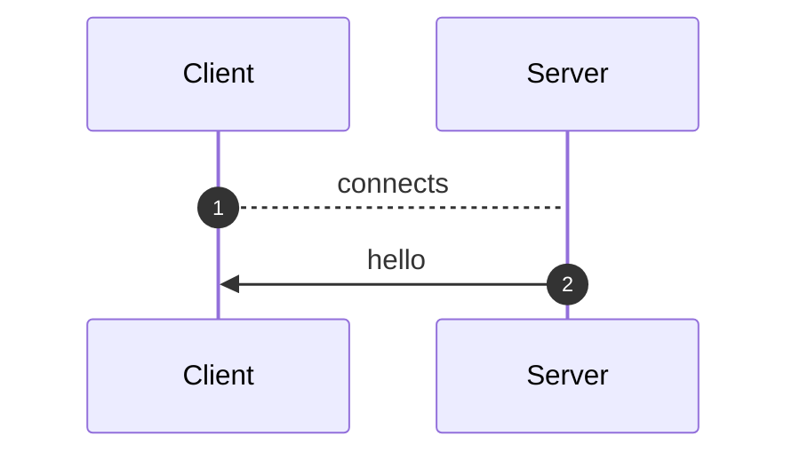
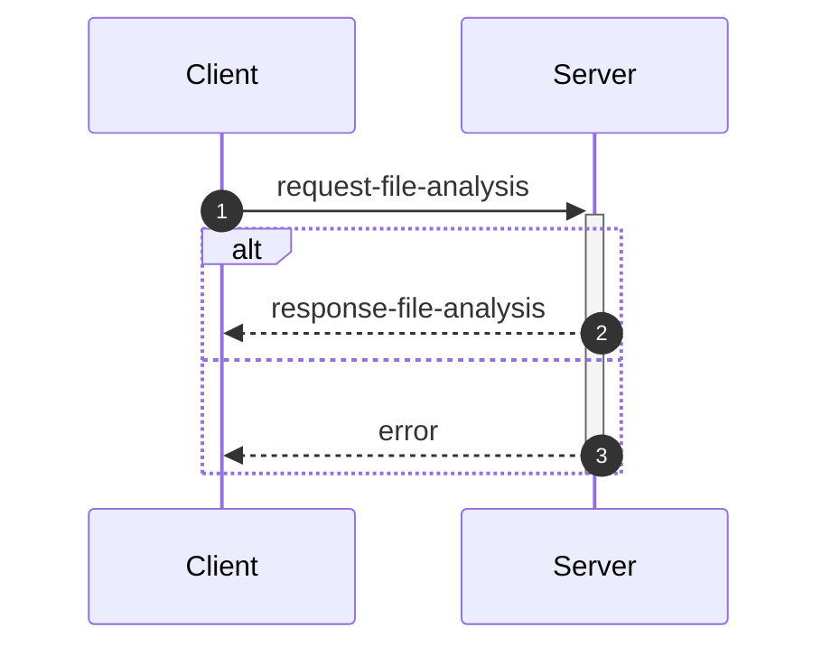
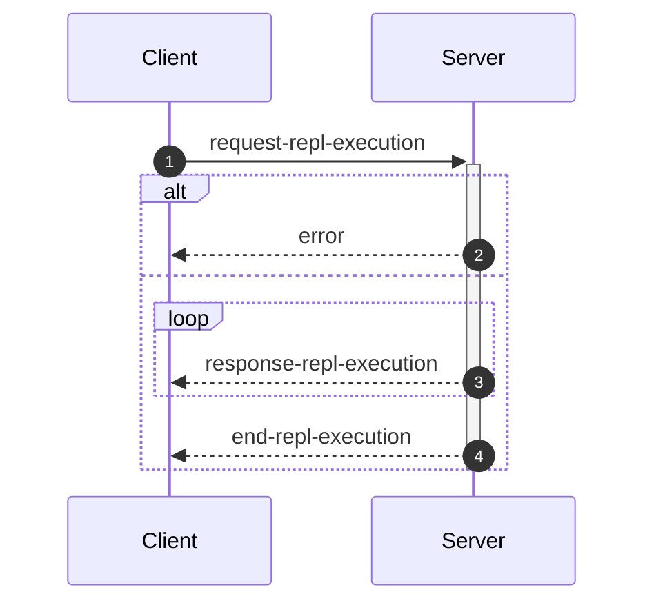
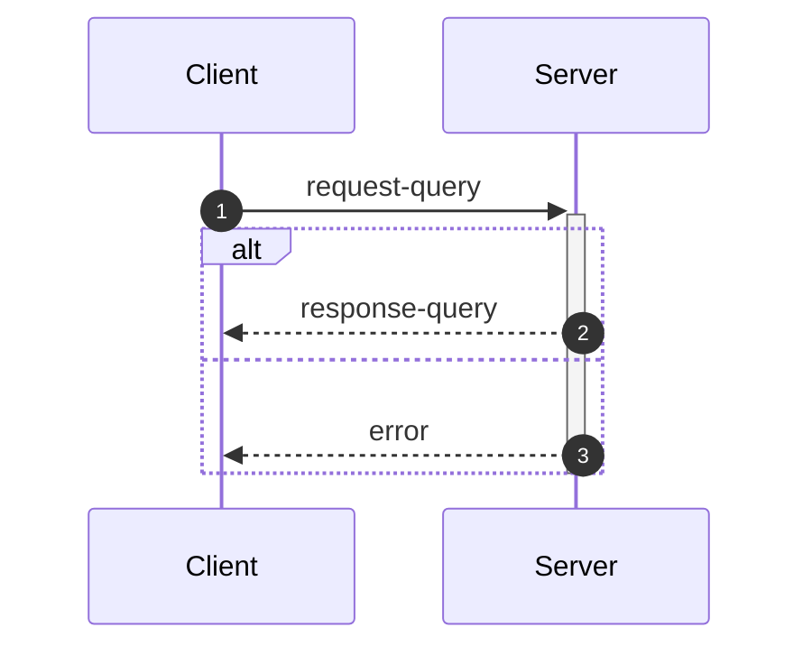

_<span title="an overview of flowR's interface">Generated</span> from '[wiki-interface.ts](https://github.com/flowr-analysis/flowr/tree/main/src/documentation/wiki-interface.ts "src/documentation/wiki-interface.ts")' on 2026-11-07, 10:54:27 UTC (v2.17.4, R v4.5.0), do not edit directly._

Although far from being as detailed as the in-depth explanation of [_flowR_](https://github.com/flowr-analysis/flowr/wiki/Core),
this wiki page explains how to interface with _flowR_ in more detail.
In general, command line arguments and other options provide short descriptions on hover over.

* [💻 Using the REPL](#using-the-repl)
* [⚙️ Configuring FlowR](#configuring-flowr)
* [⚒️ Writing Code](#writing-code)
* [💬 Communicating with the Server](#communicating-with-the-server)

<a id='using-the-repl'></a>
## 💻 Using the REPL

> [!NOTE]
> To execute arbitrary R commands with a repl request, _flowR_ has to be started explicitly with <span title="Description (Command Line Argument): Allow to access the underlying R session when using flowR (security warning: this allows the execution of arbitrary R code!)">`--r-session-access`</span>.
> Please be aware that this introduces a security risk and note that this relies on the [`r-shell` engine](https://github.com/flowr-analysis/flowr/wiki/Engines) .

Although primarily meant for users to explore,
there is nothing which forbids calling _flowR_ as a subprocess to use standard-in, -output, and -error
for communication (although you can access the REPL using the server as well,
with the [REPL Request](#message-request-repl-execution) message).

The read-eval-print loop&nbsp;(REPL) works relatively simple.
You can submit an expression (using <kbd>Enter</kbd>),
which is interpreted as an R&nbsp;expression by default but interpreted as a *command* if it starts with a colon (`:`).
The best command to get started with the REPL is <span title="Description (Repl Command): Show help information (aliases: :h, :?)">`:help`</span>.
Besides, you can leave the REPL either with the command <span title="Description (Repl Command): End the repl (aliases: :q, :exit)">`:quit`</span> or by pressing <kbd>Ctrl</kbd>+<kbd>C</kbd> twice.
When writing a *command*, you may press <kbd>Tab</kbd> to get a list of completions, if available.
Multiple commands can be entered in a single line by separating them with a semicolon (`;`), e.g. `:parse "x<-2"; :df*`.
If a command is given without R code, the REPL will re-use R code given in a previous command.
The prior example will hence return first the parsed AST of the program and then the dataflow graph for `"x <- 2"`.

> [!NOTE]
> If you develop flowR, you may want to launch the repl using the `npm run main-dev` command, this way, you get a non-minified version of flowR with debug information and hot-reloading of source files.

<details>
<summary>Available Commands</summary>

We currently offer the following commands (this with a `[*]` suffix are available with and without the star):

| Command | Description |
| ------- | ----------- |
| **<span title="Description (Repl Command): End the repl (aliases: :q, :exit)">:quit</span>** | End the repl (aliases: **:<span title="Alias of ':quit'. End the repl">q</span>**, **:<span title="Alias of ':quit'. End the repl">exit</span>**) |
| **<span title="Description (Repl Command): Execute the given code as R code. This requires the `--r-session-access` flag to be set and requires the r-shell engine. (aliases: :e, :r)">:execute</span>** | Execute the given code as R code. This requires the `--r-session-access` flag to be set and requires the r-shell engine. (aliases: **:<span title="Alias of ':execute'. Execute the given code as R code. This requires the `--r-session-access` flag to be set and requires the r-shell engine.">e</span>**, **:<span title="Alias of ':execute'. Execute the given code as R code. This requires the `--r-session-access` flag to be set and requires the r-shell engine.">r</span>**) |
| **<span title="Description (Repl Command): Get mermaid code for the control-flow graph of R code (aliases: :cfg, :cf)">:controlflow[*]</span>** | Get mermaid code for the control-flow graph of R code (star: Returns the URL to mermaid.live) (aliases: **:<span title="Alias of ':controlflow'. Get mermaid code for the control-flow graph of R code">cfg</span>**, **:<span title="Alias of ':controlflow'. Get mermaid code for the control-flow graph of R code">cf</span>**) |
| **<span title="Description (Repl Command): Get mermaid code for the control-flow graph with basic blocks (aliases: :cfgb, :cfb)">:controlflowbb[*]</span>** | Get mermaid code for the control-flow graph with basic blocks (star: Returns the URL to mermaid.live) (aliases: **:<span title="Alias of ':controlflowbb'. Get mermaid code for the control-flow graph with basic blocks">cfgb</span>**, **:<span title="Alias of ':controlflowbb'. Get mermaid code for the control-flow graph with basic blocks">cfb</span>**) |
| **<span title="Description (Repl Command): Get mermaid code for the dataflow graph (aliases: :d, :df)">:dataflow[*]</span>** | Get mermaid code for the dataflow graph (star: Returns the URL to mermaid.live) (aliases: **:<span title="Alias of ':dataflow'. Get mermaid code for the dataflow graph">d</span>**, **:<span title="Alias of ':dataflow'. Get mermaid code for the dataflow graph">df</span>**) |
| **<span title="Description (Repl Command): Get mermaid code for the normalized AST of R code (aliases: :n)">:normalize[*]</span>** | Get mermaid code for the normalized AST of R code (star: Returns the URL to mermaid.live) (alias: **:<span title="Alias of ':normalize'. Get mermaid code for the normalized AST of R code">n</span>**) |
| **<span title="Description (Repl Command): Get mermaid code for the simplified dataflow graph (aliases: :ds, :dfs)">:dataflowsimple[*]</span>** | Get mermaid code for the simplified dataflow graph (star: Returns the URL to mermaid.live) (aliases: **:<span title="Alias of ':dataflowsimple'. Get mermaid code for the simplified dataflow graph">ds</span>**, **:<span title="Alias of ':dataflowsimple'. Get mermaid code for the simplified dataflow graph">dfs</span>**) |
| **<span title="Description (Repl Command): Inspect and extend the signature database: `query` (identical to :query @signature), `info <name>` for where a function comes from (identical to :query @function-info), `add <path>` to mount another database/source, `download` to fetch the full-history database. (aliases: :sig)">:signature</span>** | Inspect and extend the signature database: `query` (identical to :query @signature), `info <name>` for where a function comes from (identical to :query @function-info), `add <path>` to mount another database/source, `download` to fetch the full-history database. (alias: **:<span title="Alias of ':signature'. Inspect and extend the signature database: `query` (identical to :query @signature), `info <name>` for where a function comes from (identical to :query @function-info), `add <path>` to mount another database/source, `download` to fetch the full-history database.">sig</span>**) |
| **<span title="Description (Repl Command): Just calculates the DFG, but only prints summary info (aliases: :d#, :df#)">:dataflowsilent</span>** | Just calculates the DFG, but only prints summary info (aliases: **:<span title="Alias of ':dataflowsilent'. Just calculates the DFG, but only prints summary info">d#</span>**, **:<span title="Alias of ':dataflowsilent'. Just calculates the DFG, but only prints summary info">df#</span>**) |
| **<span title="Description (Repl Command): Prints ASCII Art of the parsed, unmodified AST (aliases: :p)">:parse</span>** | Prints ASCII Art of the parsed, unmodified AST (alias: **:<span title="Alias of ':parse'. Prints ASCII Art of the parsed, unmodified AST">p</span>**) |
| **<span title="Description (Repl Command): Prints the version of flowR as well as the current version of R">:version</span>** | Prints the version of flowR as well as the current version of R
| **<span title="Description (Repl Command): Query the given R code (use 'help' for more information)">:query[*]</span>** | Query the given R code (use 'help' for more information) (star: Similar to query, but returns the output in json format.)
| **<span title="Description (Repl Command): Returns an ASCII representation of the dataflow graph (aliases: :df!)">:dataflowascii</span>** | Returns an ASCII representation of the dataflow graph (alias: **:<span title="Alias of ':dataflowascii'. Returns an ASCII representation of the dataflow graph">df!</span>**) |
| **<span title="Description (Repl Command): Returns summarization stats for the normalized AST (aliases: :n#)">:normalize#</span>** | Returns summarization stats for the normalized AST (alias: **:<span title="Alias of ':normalize#'. Returns summarization stats for the normalized AST">n#</span>**) |
| **<span title="Description (Repl Command): Show help information (aliases: :h, :?)">:help</span>** | Show help information (aliases: **:<span title="Alias of ':help'. Show help information">h</span>**, **:<span title="Alias of ':help'. Show help information">?</span>**) |

</details>

> [!TIP]
> 
> As indicated by the examples before, all REPL commands that operate on code keep track of the state.
> Hence, if you run a command like <span title="Description (Repl Command, starred version): Returns the URL to mermaid.live; Base Command: Get mermaid code for the dataflow graph (aliases: :d*, :df*)">`:dataflow*`</span> without providing R code,
> the REPL will re-use the R code provided in a previous command.
> Likewise, doing this will benefit from incrementality!
> If you request the dataflow graph with `:df* x <- 2 * y` and then want to see the parsed AST with `:parse`,
> the REPL will re-use previously obtained information and not re-parse the code again.
> 		

Generally, many commands offer shortcut versions in the REPL. Many queries, for example, offer a shortened format (see the example below).
Of special note, the [Config Query](https://github.com/flowr-analysis/flowr/wiki/%5BQuery%5D-Config)
can be used to also modify the currently active configuration of _flowR_ within the REPL (see the [wiki page](https://github.com/flowr-analysis/flowr/wiki/%5BQuery%5D-Config) for more information).

### Example: Retrieving the Dataflow Graph

To retrieve a URL to the [mermaid](https://mermaid.js.org/) diagram of the dataflow of a given expression,
use <span title="Description (Repl Command, starred version): Returns the URL to mermaid.live; Base Command: Get mermaid code for the dataflow graph (aliases: :d*, :df*)">`:dataflow*`</span> (or <span title="Description (Repl Command): Get mermaid code for the dataflow graph (aliases: :d, :df)">`:dataflow`</span> to get the mermaid code in the cli):

```shell
$ docker run -it --rm eagleoutice/flowr # or npm run flowr 
flowR repl v2.17.4, R grammar v14 (tree-sitter engine)
R> :dataflow* y <- 1 + x
```

<details>
<summary style='color:gray'>Output</summary>

```text
https://mermaid.live/view#base64:eyJjb2RlIjoiZmxvd2NoYXJ0IFREXG4gICAgMXt7XCJgKiM5MTtSTnVtYmVyIzkzOyogKioxKipcbiAgICAgICoxLjYqICgqKmlkOiAxKiopYFwifX1cbiAgICAyKFtcImAqIzkxO1JTeW1ib2wjOTM7KiAqKngqKlxuICAgICAgKjEuMTAqICgqKmlkOiAyKiopYFwiXSlcbiAgICAzW1tcImAqIzkxO1JCaW5hcnlPcCM5MzsqIGJhc2UjNTg7IzU4OyoqIzQzOyoqXG4gICAgICAqMS42LTEwKiAoKippZDogMyoqKVxuICAgIGFyZzogKDEsIDIpYFwiXV1cbiAgICBidWlsdC1pbjpfNDNfW1wiYEJ1aWx0LUluOlxuIzQzO2BcIl1cbiAgICBzdHlsZSBidWlsdC1pbjpfNDNfIHN0cm9rZTpncmF5LGZpbGw6Z3JheSxzdHJva2Utd2lkdGg6MnB4LG9wYWNpdHk6Ljg7XG4gICAgMFtcImAqIzkxO1JTeW1ib2wjOTM7KiAqKnkqKlxuICAgICAgKjEuMSogKCoqaWQ6IDAqKiwgdjogMylgXCJdXG4gICAgNFtbXCJgKiM5MTtSQmluYXJ5T3AjOTM7KiBiYXNlIzU4OyM1ODsqKiM2MDsjNDU7KipcbiAgICAgICoxLjEtMTAqICgqKmlkOiA0KiopXG4gICAgYXJnOiAoMCwgMylgXCJdXVxuICAgIGJ1aWx0LWluOl82MF8tW1wiYEJ1aWx0LUluOlxuIzYwOyM0NTtgXCJdXG4gICAgc3R5bGUgYnVpbHQtaW46XzYwXy0gc3Ryb2tlOmdyYXksZmlsbDpncmF5LHN0cm9rZS13aWR0aDoycHgsb3BhY2l0eTouODtcbiAgICAxIC0uLT58XCJmbG93XCJ8IDJcbiAgICBsaW5rU3R5bGUgMCBzdHJva2U6Z3JheSxjb2xvcjpncmF5O1xuICAgIDIgLS4tPnxcImZsb3dcInwgM1xuICAgIGxpbmtTdHlsZSAxIHN0cm9rZTpncmF5LGNvbG9yOmdyYXk7XG4gICAgMyAtLT58XCJyZWFkcywgYXJnXCJ8IDFcbiAgICAzIC0tPnxcInJlYWRzLCBhcmdcInwgMlxuICAgIDMgLS4tPnxcImZsb3dcInwgMFxuICAgIGxpbmtTdHlsZSA0IHN0cm9rZTpncmF5LGNvbG9yOmdyYXk7XG4gICAgMyAtLi0+fFwicmVhZHMsIGNhbGxzXCJ8IGJ1aWx0LWluOl80M19cbiAgICBsaW5rU3R5bGUgNSBzdHJva2U6Z3JheTtcbiAgICAwIC0tPnxcImRlZmluZWQtYnksIGZsb3dcInwgNFxuICAgIDAgLS0+fFwiZGVmaW5lZC1ieVwifCAzXG4gICAgNCAtLT58XCJyZWFkcywgYXJnXCJ8IDNcbiAgICA0IC0tPnxcInJldHVybnMsIGFyZ1wifCAwXG4gICAgNCAtLi0+fFwicmVhZHMsIGNhbGxzXCJ8IGJ1aWx0LWluOl82MF8tXG4gICAgbGlua1N0eWxlIDEwIHN0cm9rZTpncmF5OyIsIm1lcm1haWQiOnsiYXV0b1N5bmMiOnRydWV9fQ==
```

Retrieve the dataflow graph of the expression `y <- 1 + x`. It looks like this:


<details>

<summary style="color:gray">R Code of the Dataflow Graph</summary>

The analysis ran (parse and normalize with the [tree-sitter](https://github.com/flowr-analysis/flowr/wiki/Engines) engine) in the generation environment. No [signature database](https://github.com/flowr-analysis/flowr/wiki/Signature-Database) is mounted, so `library()` attaches no exports (base-R names are still qualified, e.g., `stats::acf`). 
We encountered no unknown side effects during the analysis.

```r
y <- 1 + x
```

</details>

</details>

For small graphs like this, <span title="Description (Repl Command): Returns an ASCII representation of the dataflow graph (aliases: :df!)">`:dataflowascii`</span> also provides an ASCII representation directly in the REPL:

```shell
$ docker run -it --rm eagleoutice/flowr # or npm run flowr 
flowR repl v2.17.4, R grammar v14 (tree-sitter engine)
R> :df! y <- 1 + x
```

<details open>
<summary style='color:gray'>Output</summary>

```text
                        v<0>v
 c<4>c──────────────────| y |
 |<- |     ┌────────────v---v
 c---c     │
    │   c<3>c   0<1>0
    └───| + |───| 1 |───u<2>u
        c---c   0---0   | x |
           └────────────u---u
Edges:
3 -> 1: reads, arg          3 -> 2: reads, arg
3 -> 0: flows-to            1 -> 2: flows-to
2 -> 3: flows-to            4 -> 3: reads, arg
4 -> 0: returns, arg        0 -> 4: defined-by, flows-to
0 -> 3: defined-by
```

Retrieve the dataflow graph of the expression `y <- 1 + x` as ASCII art.

</details>

For the slicing with <span title="Description (Repl Command): Static backwards executable slicer for R">`:slicer`</span>, you have access to the same [magic comments](#slice-magic-comments) as with the [slice request](#message-request-slice).
Pass `--inline` to splice resolvable `source()` calls into the reconstruction so the slice is a single self-contained R text (the same as the static slice query's `inlineSources` flag).
See `--help` for more flags!

### Example: Interfacing with the File System

Many commands that allow for an R-expression (like <span title="Description (Repl Command, starred version): Returns the URL to mermaid.live; Base Command: Get mermaid code for the dataflow graph (aliases: :d*, :df*)">`:dataflow*`</span>) allow for a file as well
if the argument starts with `file://`.
If you are working from the root directory of the _flowR_ repository, the following gives you the parsed AST of the example file using the <span title="Description (Repl Command): Prints ASCII Art of the parsed, unmodified AST (aliases: :p)">`:parse`</span> command:

> **Watch mode**: Replace `file://` with `watch://` to enter watch mode.
> flowR runs the command immediately and then re-runs it every time the file (or any file inside the folder) changes.
> Enter any other command to leave watch mode.
> For example: `:df watch://analysis.R`

```shell
$ docker run -it --rm eagleoutice/flowr # or npm run flowr 
flowR repl v2.17.4, R grammar v14 (tree-sitter engine)
R> :parse file://test/testfiles/example.R
```

<details>
<summary style='color:gray'>Output</summary>

```text
File: test/testfiles/example.R

program
├ binaryoperator
│ ├ identifier "sum" (1:1─4)
│ ├ <- "<-" (1:5─7)
│ ╰ float "0" (1:8─9)
├ binaryoperator
│ ├ identifier "product" (2:1─8)
│ ├ <- "<-" (2:9─11)
│ ╰ float "1" (2:12─13)
├ binaryoperator
│ ├ identifier "w" (3:1─2)
│ ├ <- "<-" (3:3─5)
│ ╰ float "7" (3:6─7)
├ binaryoperator
│ ├ identifier "N" (4:1─2)
│ ├ <- "<-" (4:3─5)
│ ╰ float "10" (4:6─8)
├ forstatement
│ ├ for "for" (6:1─4)
│ ├ ( "(" (6:5─6)
│ ├ identifier "i" (6:6─7)
│ ├ in "in" (6:8─10)
│ ├ binaryoperator
│ │ ├ float "1" (6:11─12)
│ │ ├ : ":" (6:12─13)
│ │ ╰ parenthesizedexpression
│ │   ├ ( "(" (6:13─14)
│ │   ├ binaryoperator
│ │   │ ├ identifier "N" (6:14─15)
│ │   │ ├ - "-" (6:15─16)
│ │   │ ╰ float "1" (6:16─17)
│ │   ╰ ) ")" (6:17─18)
│ ├ ) ")" (6:18─19)
│ ╰ bracedexpression
│   ├ { "{" (6:20─21)
│   ├ binaryoperator
│   │ ├ identifier "sum" (7:3─6)
│   │ ├ <- "<-" (7:7─9)
│   │ ╰ binaryoperator
│   │   ├ binaryoperator
│   │   │ ├ identifier "sum" (7:10─13)
│   │   │ ├ + "+" (7:14─15)
│   │   │ ╰ identifier "i" (7:16─17)
│   │   ├ + "+" (7:18─19)
│   │   ╰ identifier "w" (7:20─21)
│   ├ binaryoperator
│   │ ├ identifier "product" (8:3─10)
│   │ ├ <- "<-" (8:11─13)
│   │ ╰ binaryoperator
│   │   ├ identifier "product" (8:14─21)
│   │   ├  "" (8:22─23)
│   │   ╰ identifier "i" (8:24─25)
│   ╰ } "}" (9:1─2)
├ call
│ ├ identifier "cat" (11:1─4)
│ ╰ arguments
│   ├ ( "(" (11:4─5)
│   ├ argument
│   │ ╰ string
│   │   ├ stringopen "\"" (11:5─6)
│   │   ├ stringcontent "Sum:" (11:6─10)
│   │   ╰ stringclose "\"" (11:10─11)
│   ├ comma "," (11:11─12)
│   ├ argument
│   │ ╰ identifier "sum" (11:13─16)
│   ├ comma "," (11:16─17)
│   ├ argument
│   │ ╰ string
│   │   ├ stringopen "\"" (11:18─19)
│   │   ├ stringcontent
│   │   │ ╰ escapesequence "\\n" (11:19─21)
│   │   ╰ stringclose "\"" (11:21─22)
│   ╰ ) ")" (11:22─23)
╰ call
  ├ identifier "cat" (12:1─4)
  ╰ arguments
    ├ ( "(" (12:4─5)
    ├ argument
    │ ╰ string
    │   ├ stringopen "\"" (12:5─6)
    │   ├ stringcontent "Product:" (12:6─14)
    │   ╰ stringclose "\"" (12:14─15)
    ├ comma "," (12:15─16)
    ├ argument
    │ ╰ identifier "product" (12:17─24)
    ├ comma "," (12:24─25)
    ├ argument
    │ ╰ string
    │   ├ stringopen "\"" (12:26─27)
    │   ├ stringcontent
    │   │ ╰ escapesequence "\\n" (12:27─29)
    │   ╰ stringclose "\"" (12:29─30)
    ╰ ) ")" (12:30─31)
```

Retrieve the parsed AST of the example file.

<details>

<summary>File Content</summary>

```r
sum <- 0
product <- 1
w <- 7
N <- 10

for (i in 1:(N-1)) {
  sum <- sum + i + w
  product <- product * i
}

cat("Sum:", sum, "\n")
cat("Product:", product, "\n")
```

</details>

As _flowR_ directly transforms this AST the output focuses on being human-readable instead of being machine-readable.
		
</details>

### Example: Run a Query

You can run any query supported by _flowR_ using the <span title="Description (Repl Command): Query the given R code (use 'help' for more information)">`:query`</span> command.
For example, to obtain the shapes of all data frames in a given piece of code, you can run:

```shell
$ docker run -it --rm eagleoutice/flowr # or npm run flowr 
flowR repl v2.17.4, R grammar v14 (tree-sitter engine)
R> :query @absint df-shape "x <- data.frame(a = 1:10, b = 1:10)\ny <- x$a"
```

<details open>
<summary style='color:gray'>Output</summary>

```text
Query: absint (1 ms)
   ╰ $12: (colnames: [{"a", "b"}, {}], cols: [2, 2], rows: [10, 10])
   ╰ $0: (colnames: [{"a", "b"}, {}], cols: [2, 2], rows: [10, 10])
```

Retrieve the shapes of all data frames in the given code.

</details>

To run the linter on a file, you can use (in this example, we just issue the `dead-code` linter on a small piece of code):

```shell
$ docker run -it --rm eagleoutice/flowr # or npm run flowr 
flowR repl v2.17.4, R grammar v14 (tree-sitter engine)
R> :query @linter rules:dead-code "if(FALSE) x <- 2"
```

<details open>
<summary style='color:gray'>Output</summary>

```text
Query: linter (1 ms)
   ╰ Dead Code (dead-code):
       ╰ certain:
           ╰ Code at 1.11-16 (1 quick fix(es) available)
```

Run the linter on the given code, with only the `dead-code` rule enabled.

</details>

For more information on the available queries, please check out the [Query API](https://github.com/flowr-analysis/flowr/wiki/Query-API).

<a id='configuring-flowr'></a>
## ⚙️ Configuring FlowR

When running _flowR_, you may want to specify some behaviors with a dedicated configuration file.
By default, flowR looks for a file named `flowr.json` in the current working directory (or any higher directory).
You can also specify a different file with <span title="Description (Command Line Argument): The name of the configuration file to use">`--config-file`</span> or pass the configuration inline using <span title="Description (Command Line Argument): The flowR configuration to use, as a JSON string">`--config-json`</span>.
A `flowr.json` found this way belongs to the analyzed project, so flowR ignores its options that decide what flowR executes or loads
(`engines.*.wasmPath`, `engines.*.treeSitterWasmPath`, `engines.*.rPath`, `solver.sigdb.additionalPaths`, `solver.sigdb.downloadRepo`, `solver.sigdb.installedLibrary.paths`, `solver.sigdb.onDemand.enabled`, `solver.sigdb.onDemand.repositories`, `solver.sigdb.onDemand.cranMirror`, `solver.sigdb.onDemand.bioconductorMirror`, `solver.sigdb.onDemand.cacheDir`),
unless you pass <span title="Description (Command Line Argument): Keep the security-sensitive options (e.g., the R executable) of the flowr.json found in the working directory or a parent. Only use this for projects you trust.">`--trust-config`</span>.
To analyze code you do not trust, use the secure mode (<span title="Description (Command Line Argument): Run in secure mode for analyzing untrusted code: flowR does not start R (or any other process), does not access the network, does not search for project configs, and ignores security-sensitive options in every config. Cannot be disabled once enabled. Can also be enabled with the environment variable {italic FLOWR_SECURE_MODE=1}.">`--secure`</span>, see the [security policy](https://github.com/flowr-analysis/flowr/blob/main/.github/SECURITY.md)).
To inspect the current configuration, you can run flowr with the <span title="Description (Command Line Argument): Run with verbose logging (will be passed to the corresponding script)">`--verbose`</span> flag, or use the `config` [Query](https://github.com/flowr-analysis/flowr/wiki/Query-API).
Within the REPL this works by running the following:

```shell
:query @config
```

To work with the <a href="https://github.com/flowr-analysis/flowr/tree/main/src/config.ts#L119"><code><span title="The configuration file format for flowR.">FlowrConfig</span></code></a> you can use the provided helper objects alongside its methods like
<a href="https://github.com/flowr-analysis/flowr/tree/main/src/config.ts#L966"><code><span title="Creates a new flowr config that has the updated values.">FlowrConfig::<b>amend</b></span></code></a>.
The schema below documents every option; the ones you most likely want are:

- <a href="https://github.com/flowr-analysis/flowr/wiki/Interface#configuring-flowr" title="Configuration Option (boolean): Whether source calls should be ignored, causing {@link processSourceCall}&#39;s behavior to be skipped.">ignoreSourceCalls</a>: ignore source calls when analyzing the code, i.e., ignore the inclusion of other files.
- <a href="https://github.com/flowr-analysis/flowr/wiki/Interface#configuring-flowr" title="Configuration Option (boolean): Whether load calls should be ignored, causing {@link processLoadCall}&#39;s behavior to be skipped.">ignoreLoadCalls</a>: ignore load calls when analyzing the code, i.e., ignore the loading of r-data files.
- <a href="https://github.com/flowr-analysis/flowr/wiki/Interface#configuring-flowr" title="Configuration Option (object): Do you want to overwrite (parts) of the builtin definition?">semantics.environment.overwriteBuiltIns</a>: overwrite _flowR_'s handling of built-in functions, or clear the preset definitions entirely.
  See [Configure BuiltIn Semantics](#configure-builtin-semantics) for more information.
- <a href="https://github.com/flowr-analysis/flowr/wiki/Interface#configuring-flowr" title="Configuration Option (string): How to resolve variables and their values. (one of &quot;disabled&quot;, &quot;alias&quot;, &quot;builtin&quot;)">solver.variables</a>: how to resolve variables and their values (`disabled`, `alias`, `builtin`).
- <a href="https://github.com/flowr-analysis/flowr/wiki/Interface#configuring-flowr" title="Configuration Option (array): The engine or set of engines to use for interacting with R code. An empty array means all available engines will be used.">engines</a> and <a href="https://github.com/flowr-analysis/flowr/wiki/Interface#configuring-flowr" title="Configuration Option (string): The default engine to use for interacting with R code. If this is undefined, an arbitrary engine from the specified list will be used. (one of &quot;tree-sitter&quot;, &quot;r-shell&quot;)">defaultEngine</a>: the engines used to interact with R code, see the [Engines wiki page](https://github.com/flowr-analysis/flowr/wiki/Engines).
- <a href="https://github.com/flowr-analysis/flowr/wiki/Interface#configuring-flowr" title="Configuration Option (array): Files a framework loads on its own, without any source() call (e.g. global.R in a shiny app), in the order they are loaded; flowR orders the matching project files accordingly and analyzes them as one program. Entries are case-insensitive globs matched against the file path, a plain name matches any file with that name, and entries matching no project file are warned about. Usually set per project kind via specializeConfig.">project.implicitSources</a>: the files a framework loads without any `source()` call, in the order in which they are
  loaded. Entries are globs (e.g. `R/*.R`) matched against the file path ignoring capitalization; one matching no file is reported.
- <a href="https://github.com/flowr-analysis/flowr/wiki/Interface#configuring-flowr" title="Configuration Option (object): Overwrite (parts of) the configuration depending on the project kind flowR detects, e.g. to give a shiny app its implicit sources.">specializeConfig</a>: overwrite (parts of) the configuration depending on the kind of project _flowR_ detects
  (e.g. `shiny-app`), which is how a shiny app gets its implicit sources by default. What you configure directly wins.
- <a href="https://github.com/flowr-analysis/flowr/wiki/Interface#configuring-flowr" title="Configuration Option (string): Overwrite the project kind flowR would otherwise infer from the analyzed files, e.g. when auto-detection guesses wrong. (one of &quot;package&quot;, &quot;script&quot;, &quot;shiny-app&quot;, &quot;notebook&quot;, &quot;project&quot;, &quot;unknown&quot;)">project.useProjectType</a>: skip that detection and force a project kind yourself, when auto-detection guesses wrong.
- <a href="https://github.com/flowr-analysis/flowr/wiki/Interface#configuring-flowr" title="Configuration Option (array): The default plugins to load when creating a new instance of FlowrAnalyzer">defaultPlugins</a> and <a href="https://github.com/flowr-analysis/flowr/wiki/Interface#configuring-flowr" title="Configuration Option (array): The plugins to load in REPL mode">repl.plugins</a>: the plugins to load for a new <a href="https://github.com/flowr-analysis/flowr/tree/main/src/project/flowr-analyzer.ts#L210"><code><span title="Central class for conducting analyses with FlowR. Use the FlowrAnalyzerBuilder to create a new instance. If you want the original pattern of creating a pipeline and running all steps, you can still do this with FlowrAnalyzer#runFull . To inspect the context of the analyzer, use FlowrAnalyzer#inspectContext (if you are a plugin and need to modify it, use FlowrAnalyzer#context instead).">FlowrAnalyzer</span></code></a> and in the REPL
  (use `flowr:default` to reference the former).

So you can configure _flowR_ by adding a file like the following:

<details>

<summary>Example Configuration File</summary>

```json
{
  "ignoreSourceCalls": true,
  "ignoreLoadCalls": true,
  "semantics": {
    "environment": {
      "overwriteBuiltIns": {
        "definitions": [
          {
            "type": "function",
            "names": [
              "foo"
            ],
            "processor": "builtin:assign",
            "config": {}
          }
        ]
      }
    }
  },
  "defaultPlugins": [
    "file:description",
    "versions:description"
  ],
  "repl": {
    "quickStats": false,
    "dfProcessorHeat": false,
    "hints": true,
    "plugins": [
      "flowr:default"
    ]
  },
  "project": {
    "resolveUnknownPathsOnDisk": true,
    "implicitSources": [
      "global.R",
      "app.R"
    ]
  },
  "linter": {
    "disabledRules": []
  },
  "specializeConfig": {
    "shiny-app": {
      "project": {
        "implicitSources": [
          "global.R",
          "ui.R",
          "server.R",
          "app.R"
        ]
      }
    }
  },
  "engines": [
    {
      "type": "r-shell"
    }
  ],
  "solver": {
    "variables": "alias",
    "evalStrings": true,
    "trackEnvironments": true,
    "sigdb": {
      "enabled": true,
      "loadProjectDependencies": true,
      "eagerlyLoad": false,
      "eagerlyLoadExports": false,
      "linkBaseR": false,
      "linkDescriptionDependencies": false
    },
    "resolveSource": {
      "dropPaths": "no",
      "ignoreCapitalization": true,
      "inferWorkingDirectory": "active-script",
      "searchPath": []
    },
    "instrument": {},
    "slicer": {
      "threshold": 50
    }
  },
  "abstractInterpretation": {
    "wideningThreshold": 4,
    "followCalls": true,
    "dataFrame": {
      "maxColNames": 20,
      "readLoadedData": {
        "readExternalFiles": true,
        "maxReadLines": 1000000
      }
    }
  },
  "incremental": {
    "alwaysIncremental": false,
    "parsing": {
      "activated": false,
      "heuristics": {
        "activated": true,
        "mtime": true,
        "linesFrom": 500,
        "bytesFrom": 50000,
        "alwaysWithEdits": false,
        "minFiles": 1
      }
    }
  },
  "gas": {
    "thresholds": {
      "memory": {
        "problematic": 0.7,
        "critical": 0.9
      },
      "timeMs": {
        "problematic": 100000,
        "critical": 120000
      }
    },
    "features": {}
  }
}
```

</details>

<details>
<a id='configure-builtin-semantics'></a>
<summary>Configure Built-In Semantics</summary>

`semantics/environment/overwriteBuiltins` accepts two keys:

- `loadDefaults` (boolean, initially `true`): If set to `true`, the default built-in definitions are loaded before applying the custom definitions. Setting this flag to `false` explicitly disables the loading of the default definitions.
- `definitions` (array, initially empty): Allows to overwrite or define new built-in elements. Each object within must have a `type` which is one of the below. Furthermore, they may define a string array of `names` which specifies the identifiers to bind the definitions to. You may use `assumePrimitive` to specify whether _flowR_ should assume that this is a primitive non-library definition (so you probably just do not want to specify the key).

  | Type            | Description                                                                                                                                                                                                                                                                                              | Example                                                                                                    |
  | --------------- | -------------------------------------------------------------------------------------------------------------------------------------------------------------------------------------------------------------------------------------------------------------------------------------------------------- | ---------------------------------------------------------------------------------------------------------- |
  | `constant`    | Additionally allows for a `value` this should resolve to.                                                                                                                                                                                                                                                | `{ type: 'constant', names: ['NULL', 'NA'],  value: null }`                                                |
  | `function`    | Is a rather flexible way to define and bind built-in functions. For the time, we do not have extensive documentation to cover all the cases, so please either consult the sources with the `default-builtin-config.ts` or open a [new issue](https://github.com/flowr-analysis/flowr/issues/new/choose). | `{ type: 'function', names: ['next'], processor: 'builtin:d', config: { cfg: ExitPointType.Next } }` |
  | `replacement` | A comfortable way to specify replacement functions like `$<-` or `names<-`. `suffixes` describes the... suffixes to attach automatically. | `{ type: 'replacement', suffixes: ['<-', '<<-'], names: ['[', '[['] }` |

</details>

<details>

<summary style='color:gray'>Full Configuration-File Schema</summary>

- _The configuration file format for flowR._ (object)
    - **logLevel** [optional] _flowR's global minimum log level, applied when the config is loaded._ (string)
        Only allows: 'silly', 'trace', 'debug', 'info', 'warn', 'error', 'fatal'
    - **ignoreSourceCalls** [optional] _Whether source calls should be ignored, causing {@link processSourceCall}'s behavior to be skipped._ (boolean)
    - **ignoreLoadCalls** [optional] _Whether load calls should be ignored, causing {@link processLoadCall}'s behavior to be skipped._ (boolean)
    - **semantics** _Configure language semantics and how flowR handles them._ (object)
        - **environment** [optional] _Semantics regarding how to handle the R environment._ (object)
            - **overwriteBuiltIns** [optional] _Do you want to overwrite (parts) of the builtin definition?_ (object)
                - **loadDefaults** [optional] _Should the default configuration still be loaded?_ (boolean)
                - **definitions** [optional] _The definitions to load/overwrite._ (array)
                Valid item types:
                    - (object)
    - **defaultPlugins** [optional] _The default plugins to load when creating a new instance of FlowrAnalyzer_ (array)
    Valid item types:
        - (alternatives)
            - (string)
            - (array)
    - **repl** _Configuration options for the REPL._ (object)
        - **quickStats** [optional] _Whether to show quick stats in the REPL after each evaluation._ (boolean)
        - **dfProcessorHeat** [optional] _This instruments the dataflow processors to count how often each processor is called._ (boolean)
        - **hints** [optional] _Whether to show dim inline hints on the empty prompt (automatically disabled on non-interactive terminals)._ (boolean)
        - **plugins** [optional] _The plugins to load in REPL mode_ (array)
        Valid item types:
            - (alternatives)
                - (string)
                - (array)
        - **autoUseFileProtocol** [optional] _Prepend the file protocol to a repl input that looks like a path, instead of only warning about it._ (boolean)
        - **queryStats** [optional] _Whether `:query` closes with the line stating how long the queries took (`:query*` never prints it)._ (boolean)
        - **showPlugins** [optional] _Whether `:version` grays out the plugins that did not activate during the last analysis._ (boolean)
    - **project** _Project specific configuration options._ (object)
        - **resolveUnknownPathsOnDisk** [optional] _Whether to resolve unknown paths loaded by the r project disk when trying to source/analyze files._ (boolean)
        - **failOnInaccessiblePath** [optional] _Whether a directory that cannot be traversed during file discovery (e.g. due to permissions) aborts the analysis; when false (the default) such paths are logged and skipped._ (boolean)
        - **basePackages** [optional] _The packages considered part of R itself (base and recommended); if unset, flowR uses its built-in list._ (array)
        Valid item types:
            - (string)
        - **implicitSources** [optional] _Files a framework loads on its own, without any source() call (e.g. global.R in a shiny app), in the order they are loaded; flowR orders the matching project files accordingly and analyzes them as one program. Entries are case-insensitive globs matched against the file path, a plain name matches any file with that name, and entries matching no project file are warned about. Usually set per project kind via specializeConfig._ (array)
        Valid item types:
            - (string)
        - **useProjectType** [optional] _Overwrite the project kind flowR would otherwise infer from the analyzed files, e.g. when auto-detection guesses wrong._ (string)
            Only allows: 'package', 'script', 'shiny-app', 'notebook', 'project', 'unknown'
        - **assumeImplicitEcho** [optional] _Whether the top level of the analyzed code is echoed, so that every visible result printed there is collected as an output by the dependencies query (default true, false for a package)._ (boolean)
        - **discovery** [optional] _Scoping options for the default project discovery._ (object)
            - **full** [optional] _Collect every file below the project root (greedy) instead of only the files the detected project kind needs (default false)._ (boolean)
            - **perKind** [optional] _Per-kind include/exclude glob overrides layered on the default scoping._ (object)
            - **ignore** [optional] _Case-insensitive globs that drop matching files from the intelligent discovery, regardless of kind (e.g. .Renviron to ignore environment files)._ (array)
            Valid item types:
                - (string)
        - **classification** [optional] _Overrides for the signals flowR uses to classify the project kind._ (object)
            - **shinyDescriptionTypes** [optional] _DESCRIPTION Type: values that mark a shiny app._ (array)
            Valid item types:
                - (string)
            - **shinyEntryFiles** [optional] _File names a shiny app is assembled from._ (array)
            Valid item types:
                - (string)
            - **shinyUsagePattern** [optional] _Regex source evidencing shiny usage in an entry file._ (string)
            - **notebookExtensions** [optional] _File extensions marking a notebook._ (array)
            Valid item types:
                - (string)
    - **linter** _Linter configuration options._ (object)
        - **disabledRules** _Linting rule names excluded from the default rule set (a rule requested explicitly via a linter query still runs). Usually set per project kind via specializeConfig._ (array)
        Valid item types:
            - (string)
        - **disabledTags** [optional] _Linting rule tags whose rules are excluded from the default rule set (a rule requested explicitly via a linter query still runs). By default the cmd-check rules are disabled for everything but a package; a configured list replaces that default._ (array)
        Valid item types:
            - (string)
    - **inputSources** [optional] _Further frameworks the input-sources analysis should know about; entries are added to flowR's defaults._ (object)
        - **pure** [optional] _Functions that only pass the constantness of their arguments on._ (array)
        Valid item types:
            - (string)
        - **param** [optional] _Functions whose result is a 'param' input._ (array)
        Valid item types:
            - (string)
        - **file** [optional] _Functions whose result is a 'file' input._ (array)
        Valid item types:
            - (string)
        - **tempfile** [optional] _Functions whose result is a 'tempfile' input._ (array)
        Valid item types:
            - (string)
        - **glob** [optional] _Functions whose result is a 'glob' input._ (array)
        Valid item types:
            - (string)
        - **net** [optional] _Functions whose result is a 'net' input._ (array)
        Valid item types:
            - (string)
        - **rand** [optional] _Functions whose result is a 'rand' input._ (array)
        Valid item types:
            - (string)
        - **system** [optional] _Functions whose result is a 'system' input._ (array)
        Valid item types:
            - (string)
        - **ffi** [optional] _Functions whose result is a 'ffi' input._ (array)
        Valid item types:
            - (string)
        - **lang** [optional] _Functions whose result is a 'lang' input._ (array)
        Valid item types:
            - (string)
        - **options** [optional] _Functions whose result is a 'options' input._ (array)
        Valid item types:
            - (string)
        - **cmdline** [optional] _Functions whose result is a 'cmdline' input._ (array)
        Valid item types:
            - (string)
        - **user** [optional] _Functions whose result is a 'user' input._ (array)
        Valid item types:
            - (string)
        - **const** [optional] _Functions whose result is a 'const' input._ (array)
        Valid item types:
            - (string)
        - **scope** [optional] _Functions whose result is a 'scope' input._ (array)
        Valid item types:
            - (string)
        - **dconst** [optional] _Functions whose result is a 'dconst' input._ (array)
        Valid item types:
            - (string)
        - **unknown** [optional] _Functions whose result is a 'unknown' input._ (array)
        Valid item types:
            - (string)
        - **linkedObjects** [optional] _Objects a framework provides without a definition in the code, e.g. shiny's input._ (array)
        Valid item types:
            - (object)
        - **linkedEntryPoints** [optional] _Calls that hand a function to a framework, which binds its objects to the parameters by position._ (array)
        Valid item types:
            - (object)
    - **specializeConfig** [optional] _Overwrite (parts of) the configuration depending on the project kind flowR detects, e.g. to give a shiny app its implicit sources._ (object)
    - **engines** _The engine or set of engines to use for interacting with R code. An empty array means all available engines will be used._ (array)
    Valid item types:
        - (alternatives)
            - _The configuration for the tree sitter engine._ (object)
                - **type** [required] _Use the tree sitter engine._ (string)
                    Only allows: 'tree-sitter'
                - **wasmPath** [optional] _The path to the tree-sitter-r WASM binary to use. If this is undefined, this uses the default path._ (string)
                - **treeSitterWasmPath** [optional] _The path to the tree-sitter WASM binary to use. If this is undefined, this uses the default path._ (string)
                - **lax** [optional] _Whether to use the lax parser for parsing R code (allowing for syntax errors). If this is undefined, the strict parser will be used._ (boolean)
            - _The configuration for the R shell engine._ (object)
                - **type** [required] _Use the R shell engine._ (string)
                    Only allows: 'r-shell'
                - **rPath** [optional] _The path to the R executable to use. If this is undefined, this uses the default path._ (string)
                - **pipeBind** [optional] _Whether to enable R's experimental pipe-bind operator "=>" by setting _R_USE_PIPEBIND_ for the R session (default false); R itself keeps this off by default, as it is experimental and has never shipped in a release version of R._ (boolean)
    - **defaultEngine** [optional] _The default engine to use for interacting with R code. If this is undefined, an arbitrary engine from the specified list will be used._ (string)
        Only allows: 'tree-sitter', 'r-shell'
    - **solver** _How to resolve constants, constraints, cells, ..._ (object)
        - **variables** _How to resolve variables and their values._ (string)
            Only allows: 'disabled', 'alias', 'builtin'
        - **evalStrings** _Should we include eval(parse(text="...")) calls in the dataflow graph?_ (boolean)
        - **trackEnvironments** [optional] _Track user-created environments (new.env, assign/get/local with envir=, dollar-assign, attach). When false, all envir-style calls fall through conservatively._ (boolean)
        - **sigdb** _Resolving library exports from a signature database._ (object)
            - **enabled** [optional] _Resolve library()/use() exports from a signature database (default true); when false no database is consulted._ (boolean)
            - **loadProjectDependencies** [optional] _Load the project's declared dependencies from its metadata files (DESCRIPTION Imports/Depends, rproject.toml, uvr.toml, rig rproj.toml and script blocks, renv.lock, rv.lock, uvr.lock, rig lockfiles) (default true); when false these files are not read for dependencies._ (boolean)
            - **eagerlyLoad** [optional] _Parse the database up front rather than on the first package load (default false, ignored if disabled)._ (boolean)
            - **eagerlyLoadExports** [optional] _Add a vertex for every export on load rather than on demand (default false); keeps the dataflow graph small._ (boolean)
            - **assumedRVersion** [optional] _R version assumed when resolving versioned (base-R) exports: a pin like "4.5" or "auto" to detect the installed R (default "auto")._ (string)
            - **linkBaseR** [optional] _Eagerly attach base-R namespaces so bare base calls resolve without library() (default false)._ (boolean)
            - **linkBaseRCalls** [optional] _Add a lightweight Reads edge from a bare base-R call to its signature-database function vertex (default false; base-R qualification is edge-free otherwise)._ (boolean)
            - **linkPackageCalls** [optional] _Add a lightweight Reads edge from a resolved package call to its signature-database function vertex (default false)._ (boolean)
            - **linkDescriptionDependencies** [optional] _Eagerly attach the namespaces of the project's declared DESCRIPTION dependencies (Imports/Depends) so their exports resolve without an explicit library() (default false)._ (boolean)
            - **warmInBackground** [optional] _Decompress the hot shards (base + most-downloaded) in a background task on startup so the first library() lookup is warm (default false; for long-running servers/REPLs)._ (boolean)
            - **additionalPaths** [optional] _Extra directories or bundle/manifest files searched for signature databases (alongside the shipped default and $FLOWR_SIGDB_DIR); a downloaded full-history bundle placed here is mounted automatically._ (array)
            Valid item types:
                - (string)
            - **downloadRepo** [optional] _GitHub owner/repo the full-history bundle is downloaded from via ":signature download" (default "flowr-analysis/flowr"; the release tag comes from the committed sigdb.remote.json unless a version is given)._ (string)
            - **autoSync** [optional] _On startup, re-download shards whose committed sigdb.remote.json hash no longer matches the cache, in the background (default false; opt-in network sync after a git pull)._ (boolean)
            - **installedLibrary** [optional] _Recovering packages no signature database knows from the copy installed on this machine._ (object)
                - **enabled** [required] _Recover packages no signature database knows from their installed copy (default false)._ (boolean)
                - **paths** [optional] _Library directories to search; when empty they are discovered from the environment and the project._ (array)
                Valid item types:
                    - (string)
                - **useEnvironment** [optional] _Search the libraries R_LIBS_USER/R_LIBS/R_LIBS_SITE name (default true)._ (boolean)
                - **useProjectLibrary** [optional] _Search a project-local renv/packrat library (default true)._ (boolean)
                - **maxDepth** [optional] _How far to descend into the nested layout of a project-local library (default 3)._ (number)
                - **packages** [optional] _Only recover packages whose name matches one of these regular expressions; empty means any._ (array)
                Valid item types:
                    - (string)
            - **onDemand** [optional] _Recovering packages no signature database knows from their sources on CRAN, Bioconductor, or GitHub._ (object)
                - **enabled** [required] _Fetch and recover the sources of packages no signature database knows when the analyzed code uses them (default false, accesses the network)._ (boolean)
                - **sources** [optional] _Where to look, in order: github, cran, bioconductor, or a source a plugin adds (default ["github", "cran", "bioconductor"])._ (array)
                Valid item types:
                    - (string)
                - **repositories** [optional] _GitHub repositories (owner/repo[/subdir][@ref]) to fetch packages from, by package name. The analyzed project may name more (DESCRIPTION Remotes, install_github calls)._ (object)
                - **packages** [optional] _Only recover packages whose name matches one of these regular expressions, empty means any._ (array)
                Valid item types:
                    - (string)
                - **cranMirror** [optional] _The CRAN src/contrib/ to fetch from, over https (default https://cloud.r-project.org/src/contrib/). It may be on the local network._ (string)
                - **bioconductorMirror** [optional] _The Bioconductor host, over https (default https://bioconductor.org). It may be on the local network._ (string)
                - **bioconductorRelease** [optional] _The Bioconductor release to fetch from: release, devel, or a number like 3.20 (default release)._ (string)
                - **githubMirrors** [optional] _Use the GitHub mirrors of CRAN (cran/<pkg>) and Bioconductor (bioc/<pkg>) (default true)._ (boolean)
                - **maxPackages** [optional] _The most packages to fetch for one analysis (default 25)._ (number)
                - **maxArchiveMb** [optional] _The most MiB a package archive may have (default 32). It may unpack to three times that, at most 128 MiB._ (number)
                - **offline** [optional] _Only use what was fetched before, never the network (default false)._ (boolean)
                - **retryAfterHours** [optional] _How many hours to wait before asking again for a package no source had (default 24)._ (number)
                - **cacheDir** [optional] _Where to cache what was fetched (default the on-demand directory of the signature cache)._ (string)
            - **blobCacheBudgetMb** [optional] _How many MiB of decoded package blobs every open bundle may hold together (default 16)._ (number)
            - **versionSelection** [optional] _When a project constrains a dependency, resolve to the newest (default), oldest, or system-installed version satisfying it; system needs R and falls back to newest. Base-R packages always resolve against the assumed R version._ (string)
                Only allows: 'newest', 'oldest', 'system'
            - **versionOverrides** [optional] _Force an exact version for specific packages (name -> version), overriding both the project constraint and the versionSelection policy (default {})._ (object)
        - **versionManagement** _Policies for reasoning about dependency versions._ (object)
            - **linkedVersionGroups** [optional] _Groups of packages that must resolve to the same version; version guessing intersects each group so its members stay mutually compatible (default [])._ (array)
            Valid item types:
                - (array)
                Valid item types:
                    - (string)
        - **assumeAttachedPackages** [optional] _Packages to treat as attached without a `library()` call, so what the built-in configuration states about them applies to the analyzed code. The base packages R attaches on startup already resolve without it._ (array)
        Valid item types:
            - (string)
        - **transitiveSideEffectRounds** [optional] _How many rounds the transitive side-effect fixpoint may run before it is cut off (default 32); the propagation stops on its own as soon as a round adds nothing._ (number)
        - **maxOverlayDepth** [optional] _How many binding overlays may stack on one environment frame before a write flattens them (default 4); a pure performance knob, trading lookup cost against copy cost without changing any result._ (number)
        - **instrument** (object)
            - **dataflowExtractors** [optional] _These keys are only intended for use within code, allowing to instrument the dataflow analyzer!_ (any)
        - **resolveSource** [optional] _If lax source calls are active, flowR searches for sourced files much more freely, based on the configurations you give it. This option is only in effect if `ignoreSourceCalls` is set to false._ (object)
            - **dropPaths** _Allow to drop the first or all parts of the sourced path, if it is relative._ (string)
                Only allows: 'no', 'once', 'all'
            - **ignoreCapitalization** _Search for filenames matching in the lowercase._ (boolean)
            - **inferWorkingDirectory** _Try to infer the working directory from the main or any script to analyze._ (string)
                Only allows: 'no', 'main-script', 'active-script', 'any-script'
            - **searchPath** _Additionally search in these paths._ (array)
            Valid item types:
                - (string)
            - **repeatedSourceLimit** [optional] _How often the same file can be sourced within a single run? Please be aware: in case of cyclic sources this may not reach a fixpoint so give this a sensible limit._ (number)
            - **applyReplacements** _Provide name replacements for loaded files_ (array)
            Valid item types:
                - (object)
            - **assumeFilesExist** [optional] _Assume a sourced file is always there, making what it defines certain instead of conditional on the source call._ (boolean)
        - **slicer** [optional] _The configuration for the slicer._ (object)
            - **threshold** [optional] _The maximum number of iterations to perform on a single function call during slicing._ (number)
            - **autoExtend** [optional] _If set, the slicer will gain an additional post-pass._ (boolean)
    - **abstractInterpretation** _The configuration options for abstract interpretation._ (object)
        - **wideningThreshold** _The threshold for the number of visitations of a node at which widening should be performed to ensure the termination of the fixpoint iteration._ (number)
        - **followCalls** _Whether the abstract interpretation is interprocedural, i.e. whether it steps into the functions a call may dispatch to._ (boolean)
        - **dataFrame** _The configuration of the shape inference for data frames._ (object)
            - **maxColNames** _The maximum number of columns names to infer for data frames before over-approximating the column names to top._ (number)
            - **readLoadedData** _Configuration options for reading data frame shapes from loaded external data files, such as CSV files._ (object)
                - **readExternalFiles** _Whether data frame shapes should be extracted from loaded external files, such as CSV files._ (boolean)
                - **maxReadLines** _The maximum number of lines to read when extracting data frame shapes from loaded files, such as CSV files._ (number)
    - **incremental** (object)
        - **alwaysIncremental** _Always take the incremental path, regardless of heuristics._ (boolean)
        - **parsing** (object)
            - **activated** _If set, incremental parsing will be used._ (boolean)
            - **heuristics** (object)
                - **activated** [optional] _If set, the heuristics for incremental parsing will be used._ (boolean)
                - **mtime** [optional] _Skip reparsing entirely if the file's modification time is unchanged since the last parse._ (boolean)
                - **linesFrom** [optional] _Only consider incremental parsing for files with at least this many lines._ (number)
                - **bytesFrom** [optional] _Only consider incremental parsing for files with at least this many bytes._ (number)
                - **alwaysWithEdits** [optional] _Always take the incremental path whenever there is a computed edit region, regardless of the other thresholds._ (boolean)
                - **minFiles** [optional] _Only apply these heuristics once the project has at least this many files loaded._ (number)
    - **gas** [optional] _Resource-usage guard (gas) configuration. All feature factors default to 0 (disabled). See https://github.com/flowr-analysis/flowr/wiki/Core#gas-resource-guard._ (object)
        - **thresholds** [optional] _Thresholds for all gas checks (scaled by per-feature factor), boundable per feature._ (object)
            - **memory** [optional] _Heap-usage fraction thresholds (0-1), either shared or given per feature key (with `default` covering the rest)._ (object)
                - **problematic** [optional] _Heap fraction (0-1) above which Problematic is returned, for every feature without an entry of its own._ (number)
                - **critical** [optional] _Heap fraction (0-1) above which Critical is returned, for every feature without an entry of its own._ (number)
            - **timeMs** [optional] _Elapsed analysis time thresholds in milliseconds, either shared or given per feature key (with `default` covering the rest)._ (object)
                - **problematic** [optional] _Elapsed ms above which Problematic is returned, for every feature without an entry of its own._ (number)
                - **critical** [optional] _Elapsed ms above which Critical is returned, for every feature without an entry of its own._ (number)
            - **steps** [optional] _Processed-AST-node thresholds, counted rather than sampled; only a key that arms a budget (`dataflow`) reads them._ (object)
                - **problematic** [optional] _Processed AST nodes above which Problematic is returned, for every feature without an entry of its own._ (number)
                - **critical** [optional] _Processed AST nodes above which the extraction is cut short, for every feature without an entry of its own._ (number)
            - **vertices** [optional] _Created-dataflow-vertex thresholds, counted like `steps`._ (object)
                - **problematic** [optional] _Created dataflow vertices above which Problematic is returned, for every feature without an entry of its own._ (number)
                - **critical** [optional] _Created dataflow vertices above which the extraction is cut short, for every feature without an entry of its own._ (number)
        - **features** [optional] _Per-feature sensitivity factors. 0 or absent disables gas checking for that feature. A factor of 2 makes the feature twice as sensitive. Recognised keys: `source`, `side-effect-linking`, `linter`, `slicer`, `dataflow`._ (object)
        - **countedCheckEvery** [optional] _How many counted steps pass between two accountings of an armed check, be it a dataflow budget or the slicer's traversal (default 128); trades overshoot against the cost of the check._ (number)
        - **heapProvider** [optional] _Custom heap statistics source (programmatic configs only), overriding the built-in v8/performance.memory detection._ (function)

</details>

<a id='writing-code'></a>
## ⚒️ Writing Code

_flowR_ can be used as a [module](https://www.npmjs.com/package/@eagleoutice/flowr) and offers several main classes and interfaces that are interesting for extension writers 
(see the [Visual Studio Code extension](https://marketplace.visualstudio.com/items?itemName=code-inspect.vscode-flowr) or the [Core](https://github.com/flowr-analysis/flowr/wiki/Core) wiki page for more information).

### Creating Analyses with _flowR_

Nowadays, instances of the <a href="https://github.com/flowr-analysis/flowr/tree/main/src/project/flowr-analyzer.ts#L210"><code><span title="Central class for conducting analyses with FlowR. Use the FlowrAnalyzerBuilder to create a new instance. If you want the original pattern of creating a pipeline and running all steps, you can still do this with FlowrAnalyzer#runFull . To inspect the context of the analyzer, use FlowrAnalyzer#inspectContext (if you are a plugin and need to modify it, use FlowrAnalyzer#context instead).">FlowrAnalyzer</span></code></a> should be used as central frontend to get analysis results from _flowR_.
The entry points an analysis is written against are re-exported from the package root (`import { FlowrAnalyzerBuilder } from '@eagleoutice/flowr'`);
everything else stays reachable under its own path, as in `@eagleoutice/flowr/dataflow/graph/graph`.
For example, a program slice can be created like this:

```ts
const analyzer = await new FlowrAnalyzerBuilder()
    .setEngine('tree-sitter')
    .build();
analyzer.addRequest('x <- 1\ny <- x\nx');
const result = await analyzer.query([
    {
        type:     'static-slice',
        criteria: ['3@x']
    }
]);
```

For more information, please have a look at the [Analyzer](https://github.com/flowr-analysis/flowr/wiki/Analyzer) wiki page, which explains how to construct and use the <a href="https://github.com/flowr-analysis/flowr/tree/main/src/project/flowr-analyzer.ts#L210"><code><span title="Central class for conducting analyses with FlowR. Use the FlowrAnalyzerBuilder to create a new instance. If you want the original pattern of creating a pipeline and running all steps, you can still do this with FlowrAnalyzer#runFull . To inspect the context of the analyzer, use FlowrAnalyzer#inspectContext (if you are a plugin and need to modify it, use FlowrAnalyzer#context instead).">FlowrAnalyzer</span></code></a> in more detail.
To work with specific perspectives, you can also consult the respective pages like the [Dataflow Graph](https://github.com/flowr-analysis/flowr/wiki/Dataflow-Graph) or the [Abstract Interpretation](https://github.com/flowr-analysis/flowr/wiki/Abstract-Interpretation) wiki pages.
### The Pipeline Executor (Low-Level Interface)

Once, in the beginning, _flowR_ was meant to produce a dataflow graph merely to provide *program slices*. 
However, with continuous updates, the [Dataflow Graph](https://github.com/flowr-analysis/flowr/wiki/Dataflow-Graph) repeatedly proves to be the more interesting part.
With this, we restructured _flowR_'s originally *hardcoded* pipeline to be far more flexible. 
Now, it can be theoretically extended or replaced with arbitrary steps, optional steps, and what we call 'decorations' of these steps. 
In short, a slicing pipeline using the <a href="https://github.com/flowr-analysis/flowr/tree/main/src/core/pipeline-executor.ts#L97"><code><span title="**Please note:** The PipelineExecutor is now considered to be a rather low-level API for flowR. While it still works and is the basis for all other layers, we strongly recommend using the FlowrAnalyzer and its builder to create and use an analyzer instance that is pre-configured for your use-case. The pipeline executor allows to execute arbitrary pipelines in a step-by-step fashion. If you are not...">PipelineExecutor</span></code></a> looks like this:

```ts

const slicer = new PipelineExecutor(DEFAULT_SLICING_PIPELINE, {
  parser:    new RShell(),
  request:   requestFromInput('x <- 1\nx + 1'),
  criterion: ['2@x']
})
const slice = await slicer.allRemainingSteps()
// console.log(slice.reconstruct.code)
```

<details><summary>More Information</summary>

If you compare this, with what you would have done with the old (and removed) `SteppingSlicer`, 
this essentially just requires you to replace the `SteppingSlicer` with the <a href="https://github.com/flowr-analysis/flowr/tree/main/src/core/pipeline-executor.ts#L97"><code><span title="**Please note:** The PipelineExecutor is now considered to be a rather low-level API for flowR. While it still works and is the basis for all other layers, we strongly recommend using the FlowrAnalyzer and its builder to create and use an analyzer instance that is pre-configured for your use-case. The pipeline executor allows to execute arbitrary pipelines in a step-by-step fashion. If you are not...">PipelineExecutor</span></code></a>
and to pass the <a href="https://github.com/flowr-analysis/flowr/tree/main/src/core/steps/pipeline/default-pipelines.ts#L18"><code>DEFAULT_SLICING_PIPELINE</code></a> as the first argument.
The <a href="https://github.com/flowr-analysis/flowr/tree/main/src/core/pipeline-executor.ts#L97"><code><span title="**Please note:** The PipelineExecutor is now considered to be a rather low-level API for flowR. While it still works and is the basis for all other layers, we strongly recommend using the FlowrAnalyzer and its builder to create and use an analyzer instance that is pre-configured for your use-case. The pipeline executor allows to execute arbitrary pipelines in a step-by-step fashion. If you are not...">PipelineExecutor</span></code></a>...

1. Provides structures to investigate the results of all intermediate steps
2. Can be executed step-by-step
3. Can repeat steps (e.g., to calculate multiple slices on the same input)

See the in-code documentation for more information.

</details>

### Using the <a href="https://github.com/flowr-analysis/flowr/tree/main/src/r-bridge/shell.ts#L144"><code><span title="The RShell represents an interactive session with the R interpreter. You can configure it by RShellOptions . At the moment we are using a live R session (and not networking etc.) to communicate with R easily, which allows us to install packages etc. However, this might and probably will change in the future (leaving this as a legacy mode :D)">RShell</span></code></a> to Interact with R

The <a href="https://github.com/flowr-analysis/flowr/tree/main/src/r-bridge/shell.ts#L144"><code><span title="The RShell represents an interactive session with the R interpreter. You can configure it by RShellOptions . At the moment we are using a live R session (and not networking etc.) to communicate with R easily, which allows us to install packages etc. However, this might and probably will change in the future (leaving this as a legacy mode :D)">RShell</span></code></a> class allows interfacing with the `R`&nbsp;ecosystem installed on the host system.
Please have a look at [flowR's Engines](https://github.com/flowr-analysis/flowr/wiki/Engines) for more information on alternatives (for example, the <a href="https://github.com/flowr-analysis/flowr/tree/main/src/r-bridge/lang-4.x/tree-sitter/tree-sitter-executor.ts#L29"><code><span title="Synchronous and (way) faster alternative to the RShell using tree-sitter.">TreeSitterExecutor</span></code></a>).

> [!IMPORTANT]
> 
> Each <a href="https://github.com/flowr-analysis/flowr/tree/main/src/r-bridge/shell.ts#L144"><code><span title="The RShell represents an interactive session with the R interpreter. You can configure it by RShellOptions . At the moment we are using a live R session (and not networking etc.) to communicate with R easily, which allows us to install packages etc. However, this might and probably will change in the future (leaving this as a legacy mode :D)">RShell</span></code></a> controls a new instance of the R&nbsp;interpreter, 
> make sure to call <code><a href="https://github.com/flowr-analysis/flowr/tree/main/src/r-bridge/shell.ts#L350"><span title="Close the current R session, makes the object effectively invalid (can no longer be reopened etc.)">RShell::<i>close</i></span></a>()</code> when you are done.

You can start a new "session" by constructing a new object with <code>new <a href="https://github.com/flowr-analysis/flowr/tree/main/src/r-bridge/shell.ts#L144"><span title="The RShell represents an interactive session with the R interpreter. You can configure it by RShellOptions . At the moment we are using a live R session (and not networking etc.) to communicate with R easily, which allows us to install packages etc. However, this might and probably will change in the future (leaving this as a legacy mode :D)">RShell</span></a>()</code>.

However, there are several options that may be of interest 
(e.g., to automatically revive the shell in case of errors or to control the name location of the R process on the system).

With a shell object (let's call it `shell`), you can execute R code by using <a href="https://github.com/flowr-analysis/flowr/tree/main/src/r-bridge/shell.ts#L213"><code><span title="sends the given command directly to the current R session will not do anything to alter input markers!">RShell::<i>sendCommand</i></span></code></a>,
for example <code>shell.<a href="https://github.com/flowr-analysis/flowr/tree/main/src/r-bridge/shell.ts#L213"><span title="sends the given command directly to the current R session will not do anything to alter input markers!">sendCommand</span></a>("1 + 1")</code>.
However, this does not return anything, so if you want to collect the output of your command, use
<a href="https://github.com/flowr-analysis/flowr/tree/main/src/r-bridge/shell.ts#L296"><code><span title="Send a command and collect the output">RShell::<i>sendCommandWithOutput</i></span></code></a> instead.

<a id='communicating-with-the-server'></a>
## 💬 Communicating with the Server

As explained in the [Overview](https://github.com/flowr-analysis/flowr/wiki/Overview), you can run the [TCP](https://de.wikipedia.org/wiki/Transmission_Control_Protocol)&nbsp;server by adding the <span title="Description (Command Line Argument): Do not drop into a repl, but instead start a server on the given port (default: 1042) and listen for messages.">`--server`</span> flag (and, due to the interactive mode, exit with the conventional <kbd>CTRL</kbd>+<kbd>C</kbd>).
Currently, every connection is handled by the same underlying `RShell` - so the server is not designed to handle many clients at a time.
Additionally, the server is not well guarded against attacks (e.g., you can theoretically spawn an arbitrary number of&nbsp;RShell sessions on the target machine).

Every message has to be given in a single line (i.e., without a newline in-between) and end with a newline character. Nevertheless, we will pretty-print example given in the following segments for the ease of reading.

> [!NOTE]
> 
> The default <span title="Description (Command Line Argument): Do not drop into a repl, but instead start a server on the given port (default: 1042) and listen for messages.">`--server`</span> uses a simple [TCP](https://de.wikipedia.org/wiki/Transmission_Control_Protocol)
> connection. If you want _flowR_ to expose a [WebSocket](https://de.wikipedia.org/wiki/WebSocket) server instead, add the <span title="Description (Command Line Argument): If the server flag is set, use websocket for messaging">`--ws`</span> flag (i.e., <span title="Description (Command Line Argument): Do not drop into a repl, but instead start a server on the given port (default: 1042) and listen for messages.">`--server`</span> <span title="Description (Command Line Argument): If the server flag is set, use websocket for messaging">`--ws`</span>) when starting _flowR_ from the command line.

<ul><li>
<a id="message-hello"></a>
<b>Hello</b> Message (<code>hello</code>) 
<details>

<summary style="color:gray"> View Details. <i>The server informs the client about the successful connection and provides Meta-Information.</i> </summary>



After launching _flowR_, for example, with <code>docker run -it --rm eagleoutice/flowr <span title="Description (Command Line Argument): Do not drop into a repl, but instead start a server on the given port (default: 1042) and listen for messages.">-<span/>-server</span></code>&nbsp;(🐳️), connecting should present you with a `hello` message, that amongst others should reveal the versions of&nbsp;_flowR_ and&nbsp;R, using the [semver 2.0](https://semver.org/spec/v2.0.0.html) versioning scheme.
The message looks like this:

```json
{
  "type": "hello",
  "clientName": "client-0",
  "versions": {
    "flowr": "2.17.4",
    "r": "4.5.0",
    "engine": "r-shell"
  }
}
```

There are currently a few messages that you can send after the hello message.
If you want to _slice_ a piece of R code you first have to send an [analysis request](#message-request-file-analysis), so that you can send one or multiple slice requests afterward.
Requests for the [REPL](#message-request-repl-execution) are independent of that.
	
<hr>

<details>
<summary style="color:gray">Message schema (<code>hello</code>)</summary>

For the definition of the hello message, please see it's implementation at [`./src/cli/repl/server/messages/message-hello.ts`](https://github.com/flowr-analysis/flowr/tree/main/src/cli/repl/server/messages/message-hello.ts).

- [required] (object)
    - **type** [required] _The type of the hello message._ (string)
        Only allows: 'hello'
    - **id** [forbidden] _The id of the message is always undefined (as it is the initial message and not requested)._ (any)
    - **clientName** [required] _A unique name that is assigned to each client. It has no semantic meaning and is only used/useful for debugging._ (string)
    - **versions** [required] (object)
        - **flowr** [required] _The version of the flowr server running in semver format._ (string)
        - **r** [required] _The version of the underlying R shell running in semver format._ (string)
        - **engine** [required] _The parser backend that is used to parse the R code._ (string)

</details>

<hr>

</details>
	</li>

<li>
<a id="message-request-file-analysis"></a>
<b>Analysis</b> Message (<code>request-file-analysis</code>) 
<details>

<summary style="color:gray"> View Details. <i>The server builds the dataflow graph for a given input file (or a set of files).</i> </summary>



The request allows the server to analyze a file and prepare it for slicing.
The message can contain a `filetoken`, which is used to identify the file in later slice or query requests (if you do not add one, the request will not be stored and therefore, it is not available for subsequent requests).

> **Please note!**\
> If you want to send and process a lot of analysis requests, but do not want to slice them, please do not pass the `filetoken` field. This will save the server a lot of memory allocation.

Furthermore, the request must contain either a `content` field to directly pass the file's content or a `filepath` field which contains the path to the file (this path must be accessible for the server to be useful).
If you add the `id` field, the answer will use the same `id` so you can match requests and the corresponding answers.
See the implementation of the request-file-analysis message for more information.

You can drop one or more stored file tokens by adding the `invalidateToken` field (a single token or an array of tokens).
The server frees the corresponding analyses _after_ it has answered the request.

> **Tip!**\
> If you only want to drop tokens, you do not need a separate message: send a `request-file-analysis` that contains _just_ the `invalidateToken` field (and no `content` or `filepath`).
> Such a request behaves like an empty file analysis and the server replies with an empty `results` object.
> Because invalidation happens after the response, you may even pass the _current_ `filetoken` in `invalidateToken` to analyze a file once and have the server forget it right after you received the results.

<details>
<summary>Example of the <code>request-file-analysis</code> Message</summary>

_Note:_ even though we pretty-print these messages, they are sent as a single line, ending with a newline.

The following lists all messages that were sent and received in case you want to reproduce the scenario:

<ol>
<li> <code>hello</code> (response)
<details> 

<summary> Show Details </summary>

The first message is always a hello message.

```json
{"type":"hello","clientName":"client-0","versions":{"flowr":"2.17.4","r":"4.5.0","engine":"r-shell"}}
```

</details>
</li>

<li> <b><code>request-file-analysis</code> (request)</b>
<details open> 

<summary> Show Details </summary>

Let's suppose you simply want to analyze the following script:
 
```r
x <- 1
x + 1
```

 For this, you can send the following request:

```json
{"type":"request-file-analysis","id":"1","filetoken":"x","content":"x <- 1\nx + 1"}
```

</details>
</li>

<li> <code>response-file-analysis</code> (response)
<details> 

<summary> Show Details </summary>

The `results` field of the response effectively contains three keys of importance:

- `parse`: which contains 1:1 the parse result in CSV format that we received from the `RShell` (i.e., the AST produced by the parser of the R interpreter).
- `normalize`: which contains the normalized AST, including ids (see the `info` field and the [Normalized AST](https://github.com/flowr-analysis/flowr/wiki/Normalized-AST) wiki page).
- `dataflow`: especially important is the `graph` field which contains the dataflow graph as a set of root vertices (see the [Dataflow Graph](https://github.com/flowr-analysis/flowr/wiki/Dataflow-Graph) wiki page).
			
_As the code is pretty long, we inhibit pretty printing and syntax highlighting (JSON, hiding built-in):_

```text
{"type":"response-file-analysis","format":"json","id":"1","results":{"parse":{"files":[{"parsed":"[1,1,1,6,7,0,\"expr\",false,\"x <- 1\"],[1,1,1,1,1,3,\"SYMBOL\",true,\"x\"],[1,1,1,1,3,7,\"expr\",false,\"x\"],[1,3,1,4,2,7,\"LEFT_ASSIGN\",true,\"<-\"],[1,6,1,6,4,5,\"NUM_CONST\",true,\"1\"],[1,6,1,6,5,7,\"expr\",false,\"1\"],[2,1,2,5,16,0,\"expr\",false,\"x + 1\"],[2,1,2,1,10,12,\"SYMBOL\",true,\"x\"],[2,1,2,1,12,16,\"expr\",false,\"x\"],[2,3,2,3,11,16,\"'+'\",true,\"+\"],[2,5,2,5,13,14,\"NUM_CONST\",true,\"1\"],[2,5,2,5,14,16,\"expr\",false,\"1\"]","filePath":"/tmp/tmp-5757-iognJ5TwGP2v-.R"}],".meta":{}},"normalize":{"ast":{"type":"RProject","files":[{"root":{"type":"RExpressionList","children":[{"type":"RBinaryOp","location":[1,3,1,4],"lhs":{"type":"RSymbol","location":[1,1,1,1],"content":"x","lexeme":"x","info":{"fullRange":[1,1,1,1],"adToks":[],"id":0,"parent":2,"role":"bin-l","index":0,"nest":0,"file":"/tmp/tmp-5757-iognJ5TwGP2v-.R"}},"rhs":{"location":[1,6,1,6],"lexeme":"1","info":{"fullRange":[1,6,1,6],"adToks":[],"id":1,"parent":2,"role":"bin-r","index":1,"nest":0,"file":"/tmp/tmp-5757-iognJ5TwGP2v-.R"},"type":"RNumber","content":{"num":1,"complexNumber":false,"markedAsInt":false}},"operator":"<-","lexeme":"<-","info":{"fullRange":[1,1,1,6],"adToks":[],"id":2,"parent":6,"nest":0,"file":"/tmp/tmp-5757-iognJ5TwGP2v-.R","index":0,"role":"el-c"}},{"type":"RBinaryOp","location":[2,3,2,3],"lhs":{"type":"RSymbol","location":[2,1,2,1],"content":"x","lexeme":"x","info":{"fullRange":[2,1,2,1],"adToks":[],"id":3,"parent":5,"role":"bin-l","index":0,"nest":0,"file":"/tmp/tmp-5757-iognJ5TwGP2v-.R"}},"rhs":{"location":[2,5,2,5],"lexeme":"1","info":{"fullRange":[2,5,2,5],"adToks":[],"id":4,"parent":5,"role":"bin-r","index":1,"nest":0,"file":"/tmp/tmp-5757-iognJ5TwGP2v-.R"},"type":"RNumber","content":{"num":1,"complexNumber":false,"markedAsInt":false}},"operator":"+","lexeme":"+","info":{"fullRange":[2,1,2,5],"adToks":[],"id":5,"parent":6,"nest":0,"file":"/tmp/tmp-5757-iognJ5TwGP2v-.R","index":1,"role":"el-c"}}],"info":{"adToks":[],"id":6,"nest":0,"file":"/tmp/tmp-5757-iognJ5TwGP2v-.R","role":"root","index":0}},"filePath":"/tmp/tmp-5757-iognJ5TwGP2v-.R"}],"info":{"id":7}},".meta":{}},"dataflow":{"unknownReferences":[],"in":[{"nodeId":2,"name":"<-","type":2},{"nodeId":5,"name":"+","type":2}],"out":[{"nodeId":0,"name":"x","type":4,"definedAt":2,"value":[1]}],"environment":{"current":{"id":1795,"parent":"<BuiltInEnvironment>","memory":[["x",[{"nodeId":0,"name":"x","type":4,"definedAt":2,"value":[1]}]]],"globalEnv":true},"level":0},"graph":{"rootVertices":[1,0,2,3,4,5],"vertexInformation":[[1,{"tag":"value","id":1}],[0,{"tag":"vdef","id":0,"source":[1]}],[2,{"tag":"fcall","id":2,"name":"<-","onlyBuiltin":true,"args":[{"nodeId":0,"type":32},{"nodeId":1,"type":32}],"origin":["builtin:assign"]}],[3,{"tag":"use","id":3}],[4,{"tag":"value","id":4}],[5,{"tag":"fcall","id":5,"name":"+","onlyBuiltin":true,"args":[{"nodeId":3,"type":32},{"nodeId":4,"type":32}],"origin":["builtin:d"]}]],"edgeInformation":[[2,[[1,{"types":65}],[0,{"types":72}],["built-in:<-",{"types":5}],[3,{"types":4096}]]],[1,[[0,{"types":4096}]]],[0,[[2,{"types":4098}],[1,{"types":2}]]],[5,[[3,{"types":65}],[4,{"types":65}],["built-in:+",{"types":5}]]],[3,[[0,{"types":1}],[4,{"types":4096}]]],[4,[[5,{"types":4096}]]]],"_unknownSideEffects":[]},"entryPoint":2,"cfgEntry":1,"exitPoints":[{"type":0,"nodeId":5}],"hooks":[],".meta":{}}}}
```

</details>
</li>
</ol>

The complete round-trip covers validating the messages as well as starting and stopping the internal mock server.

</details>

You receive an error if, for whatever reason, the analysis fails (e.g., the message or code you sent contained syntax errors).
It contains a human-readable description *why* the analysis failed (see the error message implementation for more details).

<details>
<summary>Example Error Message</summary>

_Note:_ even though we pretty-print these messages, they are sent as a single line, ending with a newline.

The following lists all messages that were sent and received in case you want to reproduce the scenario:

<ol>
<li> <code>hello</code> (response)
<details> 

<summary> Show Details </summary>

The first message is always a hello message.

```json
{"type":"hello","clientName":"client-0","versions":{"flowr":"2.17.4","r":"4.5.0","engine":"r-shell"}}
```

</details>
</li>

<li> <code>request-file-analysis</code> (request)
<details> 

<summary> Show Details </summary>

```json
{"type":"request-file-analysis","id":"1","filename":"sample.R","content":"x <-"}
```

</details>
</li>

<li> <b><code>error</code> (response)</b>
<details open> 

<summary> Show Details </summary>

```json
{
  "id": "1",
  "type": "error",
  "fatal": false,
  "reason": "Error while analyzing file sample.R: GuardError: unable to parse R code (see the log for more information) for request {\"request\":\"text\",\"content\":\"x <-\"}}\n Report a Bug: https://github.com/flowr-analysis/flowr/issues/new?body=%3C!%2D%2D%20Please%20describe%20your%20issue%20in%20more%20detail%20below!%20%2D%2D%3E%0A%0A%0A%3C!%2D%2D%20Automatically%20generated%20issue%20metadata%2C%20please%20do%20not%20edit%20or%20delete%20content%20below%20this%20line%20%2D%2D%3E%0A%2D%2D%2D%0A%0AflowR%20version%3A%202.17.4%0Anode%20version%3A%20v25.6.1%0Anode%20arch%3A%20x64%0Anode%20platform%3A%20linux%0Amessage%3A%20%60unable%20to%20parse%20R%20code%20%28see%20the%20log%20for%20more%20information%29%20for%20request%20%7B%22request%22%3A%22text%22%2C%22content%22%3A%22x%20%3C%2D%22%7D%7D%60%0Astack%20trace%3A%0A%60%60%60%0A%20%20%20%20at%20guard%20%28%3C%3E%2Fsrc%2Futil%2Fassert.ts%3A128%3A9%29%0A%20%20%20%20at%20guardRetrievedOutput%20%28%3C%3E%2Fsrc%2Fr%2Dbridge%2Fretriever.ts%3A155%3A7%29%0A%20%20%20%20at%20%2Fhome%2Frunner%2Fwork%2Fflowr%2Fflowr%2Fsrc%2Fr%2Dbridge%2Fretriever.ts%3A122%3A4%0A%20%20%20%20at%20processTicksAndRejections%20%28node%3Ainternal%2Fprocess%2Ftask_queues%3A104%3A5%29%0A%20%20%20%20at%20async%20Object.parseRequests%20%5Bas%20processor%5D%20%28%3C%3E%2Fsrc%2Fr%2Dbridge%2Fparser.ts%3A108%3A19%29%0A%20%20%20%20at%20async%20PipelineExecutor.nextStep%20%28%3C%3E%2Fsrc%2Fcore%2Fpipeline%2Dexecutor.ts%3A192%3A25%29%0A%20%20%20%20at%20async%20FlowrAnalyzerCache.stepTapeUntil%20%28%3C%3E%2Fsrc%2Fproject%2Fcache%2Fflowr%2Danalyzer%2Dcache.ts%3A125%3A4%29%0A%60%60%60%0A%0A%2D%2D%2D%0A%09"
}
```

</details>
</li>
</ol>

The complete round-trip covers validating the messages as well as starting and stopping the internal mock server.

</details>

&nbsp;

<a id="analysis-include-cfg"></a>
**Including the Control Flow Graph**

The control flow graph is a view on the dataflow graph: the dataflow analysis records the control flow while it walks
the program, and the graph projects those edges on demand. The server can expose that structure as well (please create
a [new issue](https://github.com/flowr-analysis/flowr/issues/new/choose) for any bug you may encounter).
For this, the analysis request may add `cfg: true` to its list of options.

<details>
<summary>Requesting a Control Flow Graph</summary>

_Note:_ even though we pretty-print these messages, they are sent as a single line, ending with a newline.

The following lists all messages that were sent and received in case you want to reproduce the scenario:

<ol>
<li> <code>hello</code> (response)
<details> 

<summary> Show Details </summary>

The first message is always a hello message.

```json
{"type":"hello","clientName":"client-0","versions":{"flowr":"2.17.4","r":"4.5.0","engine":"r-shell"}}
```

</details>
</li>

<li> <b><code>request-file-analysis</code> (request)</b>
<details open> 

<summary> Show Details </summary>

```json
{
  "type": "request-file-analysis",
  "id": "1",
  "filetoken": "x",
  "content": "if(unknown > 0) { x <- 2 } else { x <- 5 }\nfor(i in 1:x) { print(x); print(i) }",
  "cfg": true
}
```

</details>
</li>

<li> <code>response-file-analysis</code> (response)
<details> 

<summary> Show Details </summary>

The response looks basically the same as a response sent without the `cfg` flag. However, additionally it contains a `cfg` field. 
If you are interested in a visual representation of the control flow graph, see the 
[visualization with mermaid](https://mermaid.live/view#base64:eyJjb2RlIjoiZmxvd2NoYXJ0IFREXG4gICAgbjAoW1wiYFJTeW1ib2wgKDApXG4qKnVua25vd24qKmBcIl0pXG4gICAgbjEoW1wiYFJOdW1iZXIgKDEpXG4qKjAqKmBcIl0pXG4gICAgbjIoW1wiYFJCaW5hcnlPcCAoMilcbioqdW5rbm93biAjNjI7IDAqKmBcIl0pXG4gICAgbjYoW1wiYFJOdW1iZXIgKDYpXG4qKjIqKmBcIl0pXG4gICAgbjUoW1wiYFJTeW1ib2wgKDUpXG4qKngqKmBcIl0pXG4gICAgbjdbXCJgUkJpbmFyeU9wICg3KVxuKip4ICM2MDsjNDU7IDIqKmBcIl1cbiAgICBuOChbXCJgUkV4cHJlc3Npb25MaXN0ICg4KWBcIl0pXG4gICAgbjEyKFtcImBSTnVtYmVyICgxMilcbioqNSoqYFwiXSlcbiAgICBuMTEoW1wiYFJTeW1ib2wgKDExKVxuKip4KipgXCJdKVxuICAgIG4xM1tcImBSQmluYXJ5T3AgKDEzKVxuKip4ICM2MDsjNDU7IDUqKmBcIl1cbiAgICBuMTQoW1wiYFJFeHByZXNzaW9uTGlzdCAoMTQpYFwiXSlcbiAgICBuMTVbXCJgUklmVGhlbkVsc2UgKDE1KVxuKippZih1bmtub3duICM2MjsgMCkgIzEyMzsgeCAjNjA7IzQ1OyAyICMxMjU7IGVsc2UgIzEyMzsgeCAjNjA7IzQ1OyA1ICMxMjU7KipgXCJdXG4gICAgbjE2KFtcImBSU3ltYm9sICgxNilcbioqaSoqYFwiXSlcbiAgICBuMTcoW1wiYFJOdW1iZXIgKDE3KVxuKioxKipgXCJdKVxuICAgIG4xOChbXCJgUlN5bWJvbCAoMTgpXG4qKngqKmBcIl0pXG4gICAgbjE5KFtcImBSQmluYXJ5T3AgKDE5KVxuKioxIzU4O3gqKmBcIl0pXG4gICAgbjIzKFtcImBSU3ltYm9sICgyMylcbioqeCoqYFwiXSlcbiAgICBuMjVbXCJgUkZ1bmN0aW9uQ2FsbCAoMjUpXG4qKnByaW50KHgpKipgXCJdXG4gICAgbjI3KFtcImBSU3ltYm9sICgyNylcbioqaSoqYFwiXSlcbiAgICBuMjlbXCJgUkZ1bmN0aW9uQ2FsbCAoMjkpXG4qKnByaW50KGkpKipgXCJdXG4gICAgbjMwKFtcImBSRXhwcmVzc2lvbkxpc3QgKDMwKWBcIl0pXG4gICAgbjMxW1wiYFJGb3JMb29wICgzMSlcbioqZm9yKGkgaW4gMSM1ODt4KSAjMTIzOyBwcmludCh4KTsgcHJpbnQoaSkgIzEyNTsqKmBcIl1cbiAgICBuMiAtLi0+fFwiYnJhbmNoIG9uIHVua25vd24gIzYyOyAwICgyKSBpZiBUXCJ8IG42XG4gICAgbjIgLS4tPnxcImJyYW5jaCBvbiB1bmtub3duICM2MjsgMCAoMikgaWYgRlwifCBuMTJcbiAgICBuMCAtLT58XCJmbG93cyB0b1wifCBuMVxuICAgIG4xIC0tPnxcImZsb3dzIHRvXCJ8IG4yXG4gICAgbjcgLS0+fFwiZmxvd3MgdG9cInwgbjhcbiAgICBuNiAtLT58XCJmbG93cyB0b1wifCBuNVxuICAgIG41IC0tPnxcImZsb3dzIHRvXCJ8IG43XG4gICAgbjggLS0+fFwiZmxvd3MgdG9cInwgbjE1XG4gICAgbjE1IC0tPnxcImZsb3dzIHRvXCJ8IG4xN1xuICAgIG4xMyAtLT58XCJmbG93cyB0b1wifCBuMTRcbiAgICBuMTIgLS0+fFwiZmxvd3MgdG9cInwgbjExXG4gICAgbjExIC0tPnxcImZsb3dzIHRvXCJ8IG4xM1xuICAgIG4xNCAtLT58XCJmbG93cyB0b1wifCBuMTVcbiAgICBuMTkgLS0+fFwiZmxvd3MgdG9cInwgbjE2XG4gICAgbjE4IC0tPnxcImZsb3dzIHRvXCJ8IG4xOVxuICAgIG4xNyAtLT58XCJmbG93cyB0b1wifCBuMThcbiAgICBuMjUgLS0+fFwiZmxvd3MgdG9cInwgbjI3XG4gICAgbjIzIC0tPnxcImZsb3dzIHRvXCJ8IG4yNVxuICAgIG4yOSAtLT58XCJmbG93cyB0b1wifCBuMzBcbiAgICBuMjcgLS0+fFwiZmxvd3MgdG9cInwgbjI5XG4gICAgbjMwIC0tPnxcImZsb3dzIHRvXCJ8IG4xNlxuICAgIG4xNiAtLi0+fFwiYnJhbmNoIG9uIGkgKDE2KSBpZiBUXCJ8IG4yM1xuICAgIG4xNiAtLi0+fFwiYnJhbmNoIG9uIGkgKDE2KSBpZiBGXCJ8IG4zMVxuICAgIHN0eWxlIG4wIHN0cm9rZTpjeWFuLHN0cm9rZS13aWR0aDo2LjVweDsgICAgc3R5bGUgbjMxIHN0cm9rZTpncmVlbixzdHJva2Utd2lkdGg6Ni41cHg7IiwibWVybWFpZCI6eyJhdXRvU3luYyI6dHJ1ZX19).
			
_As the code is pretty long, we inhibit pretty printing and syntax highlighting (JSON, hiding built-in):_

```text
{"type":"response-file-analysis","format":"json","id":"1","cfg":{"graph":{"roots":[0,1,2,6,5,7,8,12,11,13,14,15,16,17,18,19,23,25,27,29,30,31],"vtxInfos":[[0,[2,0]],[1,[2,1]],[2,[2,2]],[6,[2,6]],[5,[2,5]],[7,[1,7]],[8,[2,8]],[12,[2,12]],[11,[2,11]],[13,[1,13]],[14,[2,14]],[15,[1,15]],[16,[2,16]],[17,[2,17]],[18,[2,18]],[19,[2,19]],[23,[2,23]],[25,[1,25]],[27,[2,27]],[29,[1,29]],[30,[2,30]],[31,[1,31]]],"bbChildren":[],"edgeInfos":[[2,[[6,{"id":15,"when":true}],[12,{"id":15,"when":false}]]],[0,[[1,0]]],[1,[[2,0]]],[7,[[8,0]]],[6,[[5,0]]],[5,[[7,0]]],[8,[[15,0]]],[15,[[17,0]]],[13,[[14,0]]],[12,[[11,0]]],[11,[[13,0]]],[14,[[15,0]]],[19,[[16,0]]],[18,[[19,0]]],[17,[[18,0]]],[25,[[27,0]]],[23,[[25,0]]],[29,[[30,0]]],[27,[[29,0]]],[30,[[16,0]]],[16,[[23,{"id":31,"when":true}],[31,{"id":31,"when":false}]]]],"mayHaveBasicBlocks":false},"entryPoints":[0],"exitPoints":[31],"returns":[],"breaks":[],"nexts":[]},"results":{"parse":{"files":[{"parsed":"[1,1,1,42,38,0,\"expr\",false,\"if(unknown > 0) { x <- 2 } else { x <- 5 }\"],[1,1,1,2,1,38,\"IF\",true,\"if\"],[1,3,1,3,2,38,\"'('\",true,\"(\"],[1,4,1,14,9,38,\"expr\",false,\"unknown > 0\"],[1,4,1,10,3,5,\"SYMBOL\",true,\"unknown\"],[1,4,1,10,5,9,\"expr\",false,\"unknown\"],[1,12,1,12,4,9,\"GT\",true,\">\"],[1,14,1,14,6,7,\"NUM_CONST\",true,\"0\"],[1,14,1,14,7,9,\"expr\",false,\"0\"],[1,15,1,15,8,38,\"')'\",true,\")\"],[1,17,1,26,22,38,\"expr\",false,\"{ x <- 2 }\"],[1,17,1,17,12,22,\"'{'\",true,\"{\"],[1,19,1,24,19,22,\"expr\",false,\"x <- 2\"],[1,19,1,19,13,15,\"SYMBOL\",true,\"x\"],[1,19,1,19,15,19,\"expr\",false,\"x\"],[1,21,1,22,14,19,\"LEFT_ASSIGN\",true,\"<-\"],[1,24,1,24,16,17,\"NUM_CONST\",true,\"2\"],[1,24,1,24,17,19,\"expr\",false,\"2\"],[1,26,1,26,18,22,\"'}'\",true,\"}\"],[1,28,1,31,23,38,\"ELSE\",true,\"else\"],[1,33,1,42,35,38,\"expr\",false,\"{ x <- 5 }\"],[1,33,1,33,25,35,\"'{'\",true,\"{\"],[1,35,1,40,32,35,\"expr\",false,\"x <- 5\"],[1,35,1,35,26,28,\"SYMBOL\",true,\"x\"],[1,35,1,35,28,32,\"expr\",false,\"x\"],[1,37,1,38,27,32,\"LEFT_ASSIGN\",true,\"<-\"],[1,40,1,40,29,30,\"NUM_CONST\",true,\"5\"],[1,40,1,40,30,32,\"expr\",false,\"5\"],[1,42,1,42,31,35,\"'}'\",true,\"}\"],[2,1,2,36,84,0,\"expr\",false,\"for(i in 1:x) { print(x); print(i) }\"],[2,1,2,3,41,84,\"FOR\",true,\"for\"],[2,4,2,13,53,84,\"forcond\",false,\"(i in 1:x)\"],[2,4,2,4,42,53,\"'('\",true,\"(\"],[2,5,2,5,43,53,\"SYMBOL\",true,\"i\"],[2,7,2,8,44,53,\"IN\",true,\"in\"],[2,10,2,12,51,53,\"expr\",false,\"1:x\"],[2,10,2,10,45,46,\"NUM_CONST\",true,\"1\"],[2,10,2,10,46,51,\"expr\",false,\"1\"],[2,11,2,11,47,51,\"':'\",true,\":\"],[2,12,2,12,48,50,\"SYMBOL\",true,\"x\"],[2,12,2,12,50,51,\"expr\",false,\"x\"],[2,13,2,13,49,53,\"')'\",true,\")\"],[2,15,2,36,81,84,\"expr\",false,\"{ print(x); print(i) }\"],[2,15,2,15,54,81,\"'{'\",true,\"{\"],[2,17,2,24,64,81,\"expr\",false,\"print(x)\"],[2,17,2,21,55,57,\"SYMBOL_FUNCTION_CALL\",true,\"print\"],[2,17,2,21,57,64,\"expr\",false,\"print\"],[2,22,2,22,56,64,\"'('\",true,\"(\"],[2,23,2,23,58,60,\"SYMBOL\",true,\"x\"],[2,23,2,23,60,64,\"expr\",false,\"x\"],[2,24,2,24,59,64,\"')'\",true,\")\"],[2,25,2,25,65,81,\"';'\",true,\";\"],[2,27,2,34,77,81,\"expr\",false,\"print(i)\"],[2,27,2,31,68,70,\"SYMBOL_FUNCTION_CALL\",true,\"print\"],[2,27,2,31,70,77,\"expr\",false,\"print\"],[2,32,2,32,69,77,\"'('\",true,\"(\"],[2,33,2,33,71,73,\"SYMBOL\",true,\"i\"],[2,33,2,33,73,77,\"expr\",false,\"i\"],[2,34,2,34,72,77,\"')'\",true,\")\"],[2,36,2,36,78,81,\"'}'\",true,\"}\"]","filePath":"/tmp/tmp-5757-9IcH6Qc8YLrA-.R"}],".meta":{}},"normalize":{"ast":{"type":"RProject","files":[{"root":{"type":"RExpressionList","children":[{"type":"RIfThenElse","condition":{"type":"RBinaryOp","location":[1,12,1,12],"lhs":{"type":"RSymbol","location":[1,4,1,10],"content":"unknown","lexeme":"unknown","info":{"fullRange":[1,4,1,10],"adToks":[],"id":0,"parent":2,"role":"bin-l","index":0,"nest":1,"file":"/tmp/tmp-5757-9IcH6Qc8YLrA-.R"}},"rhs":{"location":[1,14,1,14],"lexeme":"0","info":{"fullRange":[1,14,1,14],"adToks":[],"id":1,"parent":2,"role":"bin-r","index":1,"nest":1,"file":"/tmp/tmp-5757-9IcH6Qc8YLrA-.R"},"type":"RNumber","content":{"num":0,"complexNumber":false,"markedAsInt":false}},"operator":">","lexeme":">","info":{"fullRange":[1,4,1,14],"adToks":[],"id":2,"parent":15,"nest":1,"file":"/tmp/tmp-5757-9IcH6Qc8YLrA-.R","role":"if-c"}},"then":{"type":"RExpressionList","children":[{"type":"RBinaryOp","location":[1,21,1,22],"lhs":{"type":"RSymbol","location":[1,19,1,19],"content":"x","lexeme":"x","info":{"fullRange":[1,19,1,19],"adToks":[],"id":5,"parent":7,"role":"bin-l","index":0,"nest":1,"file":"/tmp/tmp-5757-9IcH6Qc8YLrA-.R"}},"rhs":{"location":[1,24,1,24],"lexeme":"2","info":{"fullRange":[1,24,1,24],"adToks":[],"id":6,"parent":7,"role":"bin-r","index":1,"nest":1,"file":"/tmp/tmp-5757-9IcH6Qc8YLrA-.R"},"type":"RNumber","content":{"num":2,"complexNumber":false,"markedAsInt":false}},"operator":"<-","lexeme":"<-","info":{"fullRange":[1,19,1,24],"adToks":[],"id":7,"parent":8,"nest":1,"file":"/tmp/tmp-5757-9IcH6Qc8YLrA-.R","index":0,"role":"el-c"}}],"grouping":[{"type":"RSymbol","location":[1,17,1,17],"content":"{","lexeme":"{","info":{"fullRange":[1,17,1,26],"adToks":[],"id":3,"role":"el-g","index":0,"nest":1,"file":"/tmp/tmp-5757-9IcH6Qc8YLrA-.R"}},{"type":"RSymbol","location":[1,26,1,26],"content":"}","lexeme":"}","info":{"fullRange":[1,17,1,26],"adToks":[],"id":4,"role":"el-g","index":0,"nest":1,"file":"/tmp/tmp-5757-9IcH6Qc8YLrA-.R"}}],"info":{"adToks":[],"id":8,"parent":15,"nest":1,"file":"/tmp/tmp-5757-9IcH6Qc8YLrA-.R","index":1,"role":"if-then"}},"location":[1,1,1,2],"lexeme":"if","info":{"fullRange":[1,1,1,42],"adToks":[],"id":15,"parent":32,"nest":1,"file":"/tmp/tmp-5757-9IcH6Qc8YLrA-.R","index":0,"role":"el-c"},"otherwise":{"type":"RExpressionList","children":[{"type":"RBinaryOp","location":[1,37,1,38],"lhs":{"type":"RSymbol","location":[1,35,1,35],"content":"x","lexeme":"x","info":{"fullRange":[1,35,1,35],"adToks":[],"id":11,"parent":13,"role":"bin-l","index":0,"nest":1,"file":"/tmp/tmp-5757-9IcH6Qc8YLrA-.R"}},"rhs":{"location":[1,40,1,40],"lexeme":"5","info":{"fullRange":[1,40,1,40],"adToks":[],"id":12,"parent":13,"role":"bin-r","index":1,"nest":1,"file":"/tmp/tmp-5757-9IcH6Qc8YLrA-.R"},"type":"RNumber","content":{"num":5,"complexNumber":false,"markedAsInt":false}},"operator":"<-","lexeme":"<-","info":{"fullRange":[1,35,1,40],"adToks":[],"id":13,"parent":14,"nest":1,"file":"/tmp/tmp-5757-9IcH6Qc8YLrA-.R","index":0,"role":"el-c"}}],"grouping":[{"type":"RSymbol","location":[1,33,1,33],"content":"{","lexeme":"{","info":{"fullRange":[1,33,1,42],"adToks":[],"id":9,"role":"el-g","index":0,"nest":1,"file":"/tmp/tmp-5757-9IcH6Qc8YLrA-.R"}},{"type":"RSymbol","location":[1,42,1,42],"content":"}","lexeme":"}","info":{"fullRange":[1,33,1,42],"adToks":[],"id":10,"role":"el-g","index":0,"nest":1,"file":"/tmp/tmp-5757-9IcH6Qc8YLrA-.R"}}],"info":{"adToks":[],"id":14,"parent":15,"nest":1,"file":"/tmp/tmp-5757-9IcH6Qc8YLrA-.R","index":2,"role":"if-other"}}},{"type":"RForLoop","variable":{"type":"RSymbol","location":[2,5,2,5],"content":"i","lexeme":"i","info":{"adToks":[],"id":16,"parent":31,"role":"for-var","index":0,"nest":1,"file":"/tmp/tmp-5757-9IcH6Qc8YLrA-.R"}},"vector":{"type":"RBinaryOp","location":[2,11,2,11],"lhs":{"location":[2,10,2,10],"lexeme":"1","info":{"fullRange":[2,10,2,10],"adToks":[],"id":17,"parent":19,"role":"bin-l","index":0,"nest":1,"file":"/tmp/tmp-5757-9IcH6Qc8YLrA-.R"},"type":"RNumber","content":{"num":1,"complexNumber":false,"markedAsInt":false}},"rhs":{"type":"RSymbol","location":[2,12,2,12],"content":"x","lexeme":"x","info":{"fullRange":[2,12,2,12],"adToks":[],"id":18,"parent":19,"role":"bin-r","index":1,"nest":1,"file":"/tmp/tmp-5757-9IcH6Qc8YLrA-.R"}},"operator":":","lexeme":":","info":{"fullRange":[2,10,2,12],"adToks":[],"id":19,"parent":31,"nest":1,"file":"/tmp/tmp-5757-9IcH6Qc8YLrA-.R","index":1,"role":"for-vec"}},"body":{"type":"RExpressionList","children":[{"type":"RFunctionCall","named":true,"location":[2,17,2,21],"lexeme":"print","functionName":{"type":"RSymbol","location":[2,17,2,21],"content":"print","lexeme":"print","info":{"fullRange":[2,17,2,24],"adToks":[],"id":22,"parent":25,"role":"call-name","index":0,"nest":1,"file":"/tmp/tmp-5757-9IcH6Qc8YLrA-.R"}},"arguments":[{"type":"RArgument","location":[2,23,2,23],"lexeme":"x","value":{"type":"RSymbol","location":[2,23,2,23],"content":"x","lexeme":"x","info":{"fullRange":[2,23,2,23],"adToks":[],"id":23,"parent":24,"role":"arg-v","index":0,"nest":1,"file":"/tmp/tmp-5757-9IcH6Qc8YLrA-.R"}},"info":{"fullRange":[2,23,2,23],"adToks":[],"id":24,"parent":25,"nest":1,"file":"/tmp/tmp-5757-9IcH6Qc8YLrA-.R","index":1,"role":"call-arg"}}],"info":{"fullRange":[2,17,2,24],"adToks":[],"id":25,"parent":30,"nest":1,"file":"/tmp/tmp-5757-9IcH6Qc8YLrA-.R","index":0,"role":"el-c"}},{"type":"RFunctionCall","named":true,"location":[2,27,2,31],"lexeme":"print","functionName":{"type":"RSymbol","location":[2,27,2,31],"content":"print","lexeme":"print","info":{"fullRange":[2,27,2,34],"adToks":[],"id":26,"parent":29,"role":"call-name","index":0,"nest":1,"file":"/tmp/tmp-5757-9IcH6Qc8YLrA-.R"}},"arguments":[{"type":"RArgument","location":[2,33,2,33],"lexeme":"i","value":{"type":"RSymbol","location":[2,33,2,33],"content":"i","lexeme":"i","info":{"fullRange":[2,33,2,33],"adToks":[],"id":27,"parent":28,"role":"arg-v","index":0,"nest":1,"file":"/tmp/tmp-5757-9IcH6Qc8YLrA-.R"}},"info":{"fullRange":[2,33,2,33],"adToks":[],"id":28,"parent":29,"nest":1,"file":"/tmp/tmp-5757-9IcH6Qc8YLrA-.R","index":1,"role":"call-arg"}}],"info":{"fullRange":[2,27,2,34],"adToks":[],"id":29,"parent":30,"nest":1,"file":"/tmp/tmp-5757-9IcH6Qc8YLrA-.R","index":1,"role":"el-c"}}],"grouping":[{"type":"RSymbol","location":[2,15,2,15],"content":"{","lexeme":"{","info":{"fullRange":[2,15,2,36],"adToks":[],"id":20,"role":"el-g","index":0,"nest":1,"file":"/tmp/tmp-5757-9IcH6Qc8YLrA-.R"}},{"type":"RSymbol","location":[2,36,2,36],"content":"}","lexeme":"}","info":{"fullRange":[2,15,2,36],"adToks":[],"id":21,"role":"el-g","index":0,"nest":1,"file":"/tmp/tmp-5757-9IcH6Qc8YLrA-.R"}}],"info":{"adToks":[],"id":30,"parent":31,"nest":1,"file":"/tmp/tmp-5757-9IcH6Qc8YLrA-.R","index":2,"role":"for-b"}},"lexeme":"for","info":{"fullRange":[2,1,2,36],"adToks":[],"id":31,"parent":32,"nest":1,"file":"/tmp/tmp-5757-9IcH6Qc8YLrA-.R","index":1,"role":"el-c"},"location":[2,1,2,3]}],"info":{"adToks":[],"id":32,"nest":0,"file":"/tmp/tmp-5757-9IcH6Qc8YLrA-.R","role":"root","index":0}},"filePath":"/tmp/tmp-5757-9IcH6Qc8YLrA-.R"}],"info":{"id":33}},".meta":{}},"dataflow":{"unknownReferences":[],"in":[{"nodeId":15,"name":"if","type":2},{"nodeId":0,"name":"unknown","type":1024},{"nodeId":2,"name":">","type":2},{"nodeId":7,"name":"<-","cds":[{"id":15,"when":true}],"type":2},{"nodeId":13,"name":"<-","cds":[{"id":15,"when":false}],"type":2},{"nodeId":8,"name":"{","cds":[{"id":15,"when":true}],"type":2},{"nodeId":14,"name":"{","cds":[{"id":15,"when":false}],"type":2},{"nodeId":31,"name":"for","type":2},{"nodeId":19,"name":":","type":2},{"nodeId":25,"name":"print","type":2},{"nodeId":29,"name":"print","type":2}],"out":[{"nodeId":5,"name":"x","type":4,"definedAt":7,"cds":[{"id":15,"when":true}],"value":[6]},{"nodeId":11,"name":"x","type":4,"definedAt":13,"cds":[{"id":15,"when":false}],"value":[12]},{"nodeId":16,"name":"i","type":1}],"environment":{"current":{"id":1817,"parent":"<BuiltInEnvironment>","memory":[["x",[{"nodeId":5,"name":"x","type":4,"definedAt":7,"cds":[{"id":15,"when":true}],"value":[6]},{"nodeId":11,"name":"x","type":4,"definedAt":13,"cds":[{"id":15,"when":false}],"value":[12]}]],["i",[{"nodeId":16,"name":"i","type":1,"definedAt":31,"value":[19],"iterated":true}]]],"globalEnv":true},"level":0},"graph":{"rootVertices":[0,1,2,6,5,7,8,12,11,13,14,15,16,17,18,19,23,25,27,29,30,31],"vertexInformation":[[0,{"tag":"use","id":0}],[1,{"tag":"value","id":1}],[2,{"tag":"fcall","id":2,"name":">","onlyBuiltin":true,"args":[{"nodeId":0,"type":32},{"nodeId":1,"type":32}],"origin":["builtin:d"]}],[6,{"tag":"value","id":6}],[5,{"tag":"vdef","id":5,"cds":[{"id":15,"when":true}],"source":[6]}],[7,{"tag":"fcall","id":7,"name":"<-","onlyBuiltin":true,"cds":[{"id":15,"when":true}],"args":[{"nodeId":5,"type":32},{"nodeId":6,"type":32}],"origin":["builtin:assign"]}],[8,{"tag":"fcall","id":8,"name":"{","onlyBuiltin":true,"cds":[{"id":15,"when":true}],"args":[{"nodeId":7,"type":32}],"origin":["builtin:el"]}],[12,{"tag":"value","id":12}],[11,{"tag":"vdef","id":11,"cds":[{"id":15,"when":false}],"source":[12]}],[13,{"tag":"fcall","id":13,"name":"<-","onlyBuiltin":true,"cds":[{"id":15,"when":false}],"args":[{"nodeId":11,"type":32},{"nodeId":12,"type":32}],"origin":["builtin:assign"]}],[14,{"tag":"fcall","id":14,"name":"{","onlyBuiltin":true,"cds":[{"id":15,"when":false}],"args":[{"nodeId":13,"type":32}],"origin":["builtin:el"]}],[15,{"tag":"fcall","id":15,"name":"if","onlyBuiltin":true,"args":[{"nodeId":2,"type":32},{"nodeId":8,"type":32},{"nodeId":14,"type":32}],"origin":["builtin:ite"]}],[16,{"tag":"vdef","id":16,"source":[19]}],[17,{"tag":"value","id":17}],[18,{"tag":"use","id":18}],[19,{"tag":"fcall","id":19,"name":":","onlyBuiltin":true,"args":[{"nodeId":17,"type":32},{"nodeId":18,"type":32}],"origin":["builtin:d"]}],[23,{"tag":"use","id":23,"cds":[{"id":31,"when":true}]}],[25,{"tag":"fcall","id":25,"name":"print","onlyBuiltin":true,"cds":[{"id":31,"when":true}],"args":[{"nodeId":23,"type":32}],"origin":["builtin:d"]}],[27,{"tag":"use","id":27,"cds":[{"id":31,"when":true}]}],[29,{"tag":"fcall","id":29,"name":"print","onlyBuiltin":true,"cds":[{"id":31,"when":true}],"args":[{"nodeId":27,"type":32}],"origin":["builtin:d"]}],[30,{"tag":"fcall","id":30,"name":"{","onlyBuiltin":true,"cds":[{"id":31,"when":true}],"args":[{"nodeId":25,"type":32},{"nodeId":29,"type":32}],"origin":["builtin:el"]}],[31,{"tag":"fcall","id":31,"name":"for","onlyBuiltin":true,"args":[{"nodeId":16,"type":32},{"nodeId":19,"type":32},{"nodeId":30,"type":32}],"origin":["builtin:fl"]}]],"edgeInformation":[[2,[[0,{"types":65}],[1,{"types":65}],[6,{"types":8192,"cd":{"id":15,"when":true}}],[12,{"types":8192,"cd":{"id":15,"when":false}}],["built-in:>",{"types":5}]]],[0,[[1,{"types":4096}]]],[1,[[2,{"types":4096}]]],[7,[[6,{"types":65}],[5,{"types":72}],["built-in:<-",{"types":5}],[8,{"types":4096}]]],[6,[[5,{"types":4096}]]],[5,[[7,{"types":4098}],[6,{"types":2}]]],[8,[[7,{"types":72}],["built-in:{",{"types":5}],[15,{"types":4096}]]],[15,[[8,{"types":72}],[14,{"types":72}],[2,{"types":65}],["built-in:if",{"types":5}],[17,{"types":4096}]]],[13,[[12,{"types":65}],[11,{"types":72}],["built-in:<-",{"types":5}],[14,{"types":4096}]]],[12,[[11,{"types":4096}]]],[11,[[13,{"types":4098}],[12,{"types":2}]]],[14,[[13,{"types":72}],["built-in:{",{"types":5}],[15,{"types":4096}]]],[19,[[17,{"types":65}],[18,{"types":65}],[16,{"types":4096}],["built-in::",{"types":5}]]],[18,[[5,{"types":1}],[11,{"types":1}],[19,{"types":4096}]]],[17,[[18,{"types":4096}]]],[25,[[23,{"types":73}],["built-in:print",{"types":5}],[27,{"types":4096}]]],[23,[[5,{"types":1}],[11,{"types":1}],[25,{"types":4096}]]],[29,[[27,{"types":73}],["built-in:print",{"types":5}],[30,{"types":4096}]]],[27,[[16,{"types":1}],[29,{"types":4096}]]],[30,[[25,{"types":64}],[29,{"types":72}],["built-in:{",{"types":5}],[16,{"types":4096}]]],[16,[[19,{"types":2}],[23,{"types":8192,"cd":{"id":31,"when":true}}],[31,{"types":8192,"cd":{"id":31,"when":false}}]]],[31,[[16,{"types":64}],[19,{"types":65}],[30,{"types":320}],["built-in:for",{"types":5}]]]],"_unknownSideEffects":[{"id":25,"linkTo":{"type":"link-to-last-call","callName":{}}},{"id":29,"linkTo":{"type":"link-to-last-call","callName":{}}}]},"entryPoint":15,"cfgEntry":0,"exitPoints":[{"type":0,"nodeId":31}],"hooks":[],".meta":{}}}}
```

</details>
</li>
</ol>

The complete round-trip covers validating the messages as well as starting and stopping the internal mock server.

</details>

&nbsp;

<a id="analysis-format-n-quads"></a>
**Retrieve the Output as RDF N-Quads**

The default response is formatted as JSON.
However, by specifying `format: "n-quads"`, you can retrieve the individual results (e.g., the [Normalized AST](https://github.com/flowr-analysis/flowr/wiki/Normalized-AST)),
as [RDF N-Quads](https://www.w3.org/TR/n-quads/).
This works with and without the control flow graph as described [above](#analysis-include-cfg).

<details>
<summary>Requesting RDF N-Quads</summary>

_Note:_ even though we pretty-print these messages, they are sent as a single line, ending with a newline.

The following lists all messages that were sent and received in case you want to reproduce the scenario:

<ol>
<li> <code>hello</code> (response)
<details> 

<summary> Show Details </summary>

The first message is always a hello message.

```json
{"type":"hello","clientName":"client-0","versions":{"flowr":"2.17.4","r":"4.5.0","engine":"r-shell"}}
```

</details>
</li>

<li> <b><code>request-file-analysis</code> (request)</b>
<details open> 

<summary> Show Details </summary>

```json
{"type":"request-file-analysis","id":"1","filetoken":"x","content":"x <- 1\nx + 1","format":"n-quads","cfg":true}
```

</details>
</li>

<li> <code>response-file-analysis</code> (response)
<details> 

<summary> Show Details </summary>

The base message format is still JSON, only the individual results get converted.
While the context is derived from the `filename`, we currently offer no way to customize other parts of the quads 
(please open a [new issue](https://github.com/flowr-analysis/flowr/issues/new/choose) if you require this).

_As the code is pretty long, we inhibit pretty printing and syntax highlighting (JSON, hiding built-in):_

```text
{"type":"response-file-analysis","format":"n-quads","id":"1","cfg":"<https://uni-ulm.de/r-ast/unknown/0> <https://uni-ulm.de/r-ast/rootIds> \"1\"^^<http://www.w3.org/2001/XMLSchema#integer> <unknown> .\n<https://uni-ulm.de/r-ast/unknown/0> <https://uni-ulm.de/r-ast/rootIds> \"0\"^^<http://www.w3.org/2001/XMLSchema#integer> <unknown> .\n<https://uni-ulm.de/r-ast/unknown/0> <https://uni-ulm.de/r-ast/rootIds> \"2\"^^<http://www.w3.org/2001/XMLSchema#integer> <unknown> .\n<https://uni-ulm.de/r-ast/unknown/0> <https://uni-ulm.de/r-ast/rootIds> \"3\"^^<http://www.w3.org/2001/XMLSchema#integer> <unknown> .\n<https://uni-ulm.de/r-ast/unknown/0> <https://uni-ulm.de/r-ast/rootIds> \"4\"^^<http://www.w3.org/2001/XMLSchema#integer> <unknown> .\n<https://uni-ulm.de/r-ast/unknown/0> <https://uni-ulm.de/r-ast/rootIds> \"5\"^^<http://www.w3.org/2001/XMLSchema#integer> <unknown> .\n<https://uni-ulm.de/r-ast/unknown/0> <https://uni-ulm.de/r-ast/vertices> <https://uni-ulm.de/r-ast/unknown/1> <unknown> .\n<https://uni-ulm.de/r-ast/unknown/1> <https://uni-ulm.de/r-ast/next> <https://uni-ulm.de/r-ast/unknown/2> <unknown> .\n<https://uni-ulm.de/r-ast/unknown/1> <https://uni-ulm.de/r-ast/id> \"1\"^^<http://www.w3.org/2001/XMLSchema#integer> <unknown> .\n<https://uni-ulm.de/r-ast/unknown/0> <https://uni-ulm.de/r-ast/vertices> <https://uni-ulm.de/r-ast/unknown/2> <unknown> .\n<https://uni-ulm.de/r-ast/unknown/2> <https://uni-ulm.de/r-ast/next> <https://uni-ulm.de/r-ast/unknown/3> <unknown> .\n<https://uni-ulm.de/r-ast/unknown/2> <https://uni-ulm.de/r-ast/id> \"0\"^^<http://www.w3.org/2001/XMLSchema#integer> <unknown> .\n<https://uni-ulm.de/r-ast/unknown/0> <https://uni-ulm.de/r-ast/vertices> <https://uni-ulm.de/r-ast/unknown/3> <unknown> .\n<https://uni-ulm.de/r-ast/unknown/3> <https://uni-ulm.de/r-ast/next> <https://uni-ulm.de/r-ast/unknown/4> <unknown> .\n<https://uni-ulm.de/r-ast/unknown/3> <https://uni-ulm.de/r-ast/id> \"2\"^^<http://www.w3.org/2001/XMLSchema#integer> <unknown> .\n<https://uni-ulm.de/r-ast/unknown/0> <https://uni-ulm.de/r-ast/vertices> <https://uni-ulm.de/r-ast/unknown/4> <unknown> .\n<https://uni-ulm.de/r-ast/unknown/4> <https://uni-ulm.de/r-ast/next> <https://uni-ulm.de/r-ast/unknown/5> <unknown> .\n<https://uni-ulm.de/r-ast/unknown/4> <https://uni-ulm.de/r-ast/id> \"3\"^^<http://www.w3.org/2001/XMLSchema#integer> <unknown> .\n<https://uni-ulm.de/r-ast/unknown/0> <https://uni-ulm.de/r-ast/vertices> <https://uni-ulm.de/r-ast/unknown/5> <unknown> .\n<https://uni-ulm.de/r-ast/unknown/5> <https://uni-ulm.de/r-ast/next> <https://uni-ulm.de/r-ast/unknown/6> <unknown> .\n<https://uni-ulm.de/r-ast/unknown/5> <https://uni-ulm.de/r-ast/id> \"4\"^^<http://www.w3.org/2001/XMLSchema#integer> <unknown> .\n<https://uni-ulm.de/r-ast/unknown/0> <https://uni-ulm.de/r-ast/vertices> <https://uni-ulm.de/r-ast/unknown/6> <unknown> .\n<https://uni-ulm.de/r-ast/unknown/6> <https://uni-ulm.de/r-ast/id> \"5\"^^<http://www.w3.org/2001/XMLSchema#integer> <unknown> .\n<https://uni-ulm.de/r-ast/unknown/0> <https://uni-ulm.de/r-ast/edges> <https://uni-ulm.de/r-ast/unknown/7> <unknown> .\n<https://uni-ulm.de/r-ast/unknown/7> <https://uni-ulm.de/r-ast/next> <https://uni-ulm.de/r-ast/unknown/8> <unknown> .\n<https://uni-ulm.de/r-ast/unknown/7> <https://uni-ulm.de/r-ast/from> \"2\"^^<http://www.w3.org/2001/XMLSchema#integer> <unknown> .\n<https://uni-ulm.de/r-ast/unknown/7> <https://uni-ulm.de/r-ast/to> \"3\"^^<http://www.w3.org/2001/XMLSchema#integer> <unknown> .\n<https://uni-ulm.de/r-ast/unknown/7> <https://uni-ulm.de/r-ast/type> \"0\"^^<http://www.w3.org/2001/XMLSchema#integer> <unknown> .\n<https://uni-ulm.de/r-ast/unknown/0> <https://uni-ulm.de/r-ast/edges> <https://uni-ulm.de/r-ast/unknown/8> <unknown> .\n<https://uni-ulm.de/r-ast/unknown/8> <https://uni-ulm.de/r-ast/next> <https://uni-ulm.de/r-ast/unknown/9> <unknown> .\n<https://uni-ulm.de/r-ast/unknown/8> <https://uni-ulm.de/r-ast/from> \"1\"^^<http://www.w3.org/2001/XMLSchema#integer> <unknown> .\n<https://uni-ulm.de/r-ast/unknown/8> <https://uni-ulm.de/r-ast/to> \"0\"^^<http://www.w3.org/2001/XMLSchema#integer> <unknown> .\n<https://uni-ulm.de/r-ast/unknown/8> <https://uni-ulm.de/r-ast/type> \"0\"^^<http://www.w3.org/2001/XMLSchema#integer> <unknown> .\n<https://uni-ulm.de/r-ast/unknown/0> <https://uni-ulm.de/r-ast/edges> <https://uni-ulm.de/r-ast/unknown/9> <unknown> .\n<https://uni-ulm.de/r-ast/unknown/9> <https://uni-ulm.de/r-ast/next> <https://uni-ulm.de/r-ast/unknown/10> <unknown> .\n<https://uni-ulm.de/r-ast/unknown/9> <https://uni-ulm.de/r-ast/from> \"0\"^^<http://www.w3.org/2001/XMLSchema#integer> <unknown> .\n<https://uni-ulm.de/r-ast/unknown/9> <https://uni-ulm.de/r-ast/to> \"2\"^^<http://www.w3.org/2001/XMLSchema#integer> <unknown> .\n<https://uni-ulm.de/r-ast/unknown/9> <https://uni-ulm.de/r-ast/type> \"0\"^^<http://www.w3.org/2001/XMLSchema#integer> <unknown> .\n<https://uni-ulm.de/r-ast/unknown/0> <https://uni-ulm.de/r-ast/edges> <https://uni-ulm.de/r-ast/unknown/10> <unknown> .\n<https://uni-ulm.de/r-ast/unknown/10> <https://uni-ulm.de/r-ast/next> <https://uni-ulm.de/r-ast/unknown/11> <unknown> .\n<https://uni-ulm.de/r-ast/unknown/10> <https://uni-ulm.de/r-ast/from> \"3\"^^<http://www.w3.org/2001/XMLSchema#integer> <unknown> .\n<https://uni-ulm.de/r-ast/unknown/10> <https://uni-ulm.de/r-ast/to> \"4\"^^<http://www.w3.org/2001/XMLSchema#integer> <unknown> .\n<https://uni-ulm.de/r-ast/unknown/10> <https://uni-ulm.de/r-ast/type> \"0\"^^<http://www.w3.org/2001/XMLSchema#integer> <unknown> .\n<https://uni-ulm.de/r-ast/unknown/0> <https://uni-ulm.de/r-ast/edges> <https://uni-ulm.de/r-ast/unknown/11> <unknown> .\n<https://uni-ulm.de/r-ast/unknown/11> <https://uni-ulm.de/r-ast/from> \"4\"^^<http://www.w3.org/2001/XMLSchema#integer> <unknown> .\n<https://uni-ulm.de/r-ast/unknown/11> <https://uni-ulm.de/r-ast/to> \"5\"^^<http://www.w3.org/2001/XMLSchema#integer> <unknown> .\n<https://uni-ulm.de/r-ast/unknown/11> <https://uni-ulm.de/r-ast/type> \"0\"^^<http://www.w3.org/2001/XMLSchema#integer> <unknown> .\n<https://uni-ulm.de/r-ast/unknown/0> <https://uni-ulm.de/r-ast/entryPoints> \"1\"^^<http://www.w3.org/2001/XMLSchema#integer> <unknown> .\n<https://uni-ulm.de/r-ast/unknown/0> <https://uni-ulm.de/r-ast/exitPoints> \"5\"^^<http://www.w3.org/2001/XMLSchema#integer> <unknown> .\n","results":{"parse":"<https://uni-ulm.de/r-ast/unknown/0> <https://uni-ulm.de/r-ast/token> \"exprlist\" <unknown> .\n<https://uni-ulm.de/r-ast/unknown/0> <https://uni-ulm.de/r-ast/text> \"\" <unknown> .\n<https://uni-ulm.de/r-ast/unknown/0> <https://uni-ulm.de/r-ast/id> \"0\"^^<http://www.w3.org/2001/XMLSchema#integer> <unknown> .\n<https://uni-ulm.de/r-ast/unknown/0> <https://uni-ulm.de/r-ast/parent> \"0\"^^<http://www.w3.org/2001/XMLSchema#integer> <unknown> .\n<https://uni-ulm.de/r-ast/unknown/0> <https://uni-ulm.de/r-ast/line1> \"1\"^^<http://www.w3.org/2001/XMLSchema#integer> <unknown> .\n<https://uni-ulm.de/r-ast/unknown/0> <https://uni-ulm.de/r-ast/col1> \"1\"^^<http://www.w3.org/2001/XMLSchema#integer> <unknown> .\n<https://uni-ulm.de/r-ast/unknown/0> <https://uni-ulm.de/r-ast/line2> \"2\"^^<http://www.w3.org/2001/XMLSchema#integer> <unknown> .\n<https://uni-ulm.de/r-ast/unknown/0> <https://uni-ulm.de/r-ast/col2> \"5\"^^<http://www.w3.org/2001/XMLSchema#integer> <unknown> .\n<https://uni-ulm.de/r-ast/unknown/0> <https://uni-ulm.de/r-ast/children> <https://uni-ulm.de/r-ast/unknown/1> <unknown> .\n<https://uni-ulm.de/r-ast/unknown/1> <https://uni-ulm.de/r-ast/next> <https://uni-ulm.de/r-ast/unknown/2> <unknown> .\n<https://uni-ulm.de/r-ast/unknown/1> <https://uni-ulm.de/r-ast/line1> \"1\"^^<http://www.w3.org/2001/XMLSchema#integer> <unknown> .\n<https://uni-ulm.de/r-ast/unknown/1> <https://uni-ulm.de/r-ast/col1> \"1\"^^<http://www.w3.org/2001/XMLSchema#integer> <unknown> .\n<https://uni-ulm.de/r-ast/unknown/1> <https://uni-ulm.de/r-ast/line2> \"1\"^^<http://www.w3.org/2001/XMLSchema#integer> <unknown> .\n<https://uni-ulm.de/r-ast/unknown/1> <https://uni-ulm.de/r-ast/col2> \"6\"^^<http://www.w3.org/2001/XMLSchema#integer> <unknown> .\n<https://uni-ulm.de/r-ast/unknown/1> <https://uni-ulm.de/r-ast/id> \"7\"^^<http://www.w3.org/2001/XMLSchema#integer> <unknown> .\n<https://uni-ulm.de/r-ast/unknown/1> <https://uni-ulm.de/r-ast/parent> \"0\"^^<http://www.w3.org/2001/XMLSchema#integer> <unknown> .\n<https://uni-ulm.de/r-ast/unknown/1> <https://uni-ulm.de/r-ast/token> \"expr\" <unknown> .\n<https://uni-ulm.de/r-ast/unknown/1> <https://uni-ulm.de/r-ast/terminal> \"false\"^^<http://www.w3.org/2001/XMLSchema#boolean> <unknown> .\n<https://uni-ulm.de/r-ast/unknown/1> <https://uni-ulm.de/r-ast/text> \"x <- 1\" <unknown> .\n<https://uni-ulm.de/r-ast/unknown/1> <https://uni-ulm.de/r-ast/children> <https://uni-ulm.de/r-ast/unknown/3> <unknown> .\n<https://uni-ulm.de/r-ast/unknown/3> <https://uni-ulm.de/r-ast/next> <https://uni-ulm.de/r-ast/unknown/4> <unknown> .\n<https://uni-ulm.de/r-ast/unknown/3> <https://uni-ulm.de/r-ast/line1> \"1\"^^<http://www.w3.org/2001/XMLSchema#integer> <unknown> .\n<https://uni-ulm.de/r-ast/unknown/3> <https://uni-ulm.de/r-ast/col1> \"1\"^^<http://www.w3.org/2001/XMLSchema#integer> <unknown> .\n<https://uni-ulm.de/r-ast/unknown/3> <https://uni-ulm.de/r-ast/line2> \"1\"^^<http://www.w3.org/2001/XMLSchema#integer> <unknown> .\n<https://uni-ulm.de/r-ast/unknown/3> <https://uni-ulm.de/r-ast/col2> \"1\"^^<http://www.w3.org/2001/XMLSchema#integer> <unknown> .\n<https://uni-ulm.de/r-ast/unknown/3> <https://uni-ulm.de/r-ast/id> \"3\"^^<http://www.w3.org/2001/XMLSchema#integer> <unknown> .\n<https://uni-ulm.de/r-ast/unknown/3> <https://uni-ulm.de/r-ast/parent> \"7\"^^<http://www.w3.org/2001/XMLSchema#integer> <unknown> .\n<https://uni-ulm.de/r-ast/unknown/3> <https://uni-ulm.de/r-ast/token> \"expr\" <unknown> .\n<https://uni-ulm.de/r-ast/unknown/3> <https://uni-ulm.de/r-ast/terminal> \"false\"^^<http://www.w3.org/2001/XMLSchema#boolean> <unknown> .\n<https://uni-ulm.de/r-ast/unknown/3> <https://uni-ulm.de/r-ast/text> \"x\" <unknown> .\n<https://uni-ulm.de/r-ast/unknown/3> <https://uni-ulm.de/r-ast/children> <https://uni-ulm.de/r-ast/unknown/5> <unknown> .\n<https://uni-ulm.de/r-ast/unknown/5> <https://uni-ulm.de/r-ast/line1> \"1\"^^<http://www.w3.org/2001/XMLSchema#integer> <unknown> .\n<https://uni-ulm.de/r-ast/unknown/5> <https://uni-ulm.de/r-ast/col1> \"1\"^^<http://www.w3.org/2001/XMLSchema#integer> <unknown> .\n<https://uni-ulm.de/r-ast/unknown/5> <https://uni-ulm.de/r-ast/line2> \"1\"^^<http://www.w3.org/2001/XMLSchema#integer> <unknown> .\n<https://uni-ulm.de/r-ast/unknown/5> <https://uni-ulm.de/r-ast/col2> \"1\"^^<http://www.w3.org/2001/XMLSchema#integer> <unknown> .\n<https://uni-ulm.de/r-ast/unknown/5> <https://uni-ulm.de/r-ast/id> \"1\"^^<http://www.w3.org/2001/XMLSchema#integer> <unknown> .\n<https://uni-ulm.de/r-ast/unknown/5> <https://uni-ulm.de/r-ast/parent> \"3\"^^<http://www.w3.org/2001/XMLSchema#integer> <unknown> .\n<https://uni-ulm.de/r-ast/unknown/5> <https://uni-ulm.de/r-ast/token> \"SYMBOL\" <unknown> .\n<https://uni-ulm.de/r-ast/unknown/5> <https://uni-ulm.de/r-ast/terminal> \"true\"^^<http://www.w3.org/2001/XMLSchema#boolean> <unknown> .\n<https://uni-ulm.de/r-ast/unknown/5> <https://uni-ulm.de/r-ast/text> \"x\" <unknown> .\n<https://uni-ulm.de/r-ast/unknown/1> <https://uni-ulm.de/r-ast/children> <https://uni-ulm.de/r-ast/unknown/4> <unknown> .\n<https://uni-ulm.de/r-ast/unknown/4> <https://uni-ulm.de/r-ast/next> <https://uni-ulm.de/r-ast/unknown/6> <unknown> .\n<https://uni-ulm.de/r-ast/unknown/4> <https://uni-ulm.de/r-ast/line1> \"1\"^^<http://www.w3.org/2001/XMLSchema#integer> <unknown> .\n<https://uni-ulm.de/r-ast/unknown/4> <https://uni-ulm.de/r-ast/col1> \"3\"^^<http://www.w3.org/2001/XMLSchema#integer> <unknown> .\n<https://uni-ulm.de/r-ast/unknown/4> <https://uni-ulm.de/r-ast/line2> \"1\"^^<http://www.w3.org/2001/XMLSchema#integer> <unknown> .\n<https://uni-ulm.de/r-ast/unknown/4> <https://uni-ulm.de/r-ast/col2> \"4\"^^<http://www.w3.org/2001/XMLSchema#integer> <unknown> .\n<https://uni-ulm.de/r-ast/unknown/4> <https://uni-ulm.de/r-ast/id> \"2\"^^<http://www.w3.org/2001/XMLSchema#integer> <unknown> .\n<https://uni-ulm.de/r-ast/unknown/4> <https://uni-ulm.de/r-ast/parent> \"7\"^^<http://www.w3.org/2001/XMLSchema#integer> <unknown> .\n<https://uni-ulm.de/r-ast/unknown/4> <https://uni-ulm.de/r-ast/token> \"LEFT_ASSIGN\" <unknown> .\n<https://uni-ulm.de/r-ast/unknown/4> <https://uni-ulm.de/r-ast/terminal> \"true\"^^<http://www.w3.org/2001/XMLSchema#boolean> <unknown> .\n<https://uni-ulm.de/r-ast/unknown/4> <https://uni-ulm.de/r-ast/text> \"<-\" <unknown> .\n<https://uni-ulm.de/r-ast/unknown/1> <https://uni-ulm.de/r-ast/children> <https://uni-ulm.de/r-ast/unknown/6> <unknown> .\n<https://uni-ulm.de/r-ast/unknown/6> <https://uni-ulm.de/r-ast/line1> \"1\"^^<http://www.w3.org/2001/XMLSchema#integer> <unknown> .\n<https://uni-ulm.de/r-ast/unknown/6> <https://uni-ulm.de/r-ast/col1> \"6\"^^<http://www.w3.org/2001/XMLSchema#integer> <unknown> .\n<https://uni-ulm.de/r-ast/unknown/6> <https://uni-ulm.de/r-ast/line2> \"1\"^^<http://www.w3.org/2001/XMLSchema#integer> <unknown> .\n<https://uni-ulm.de/r-ast/unknown/6> <https://uni-ulm.de/r-ast/col2> \"6\"^^<http://www.w3.org/2001/XMLSchema#integer> <unknown> .\n<https://uni-ulm.de/r-ast/unknown/6> <https://uni-ulm.de/r-ast/id> \"5\"^^<http://www.w3.org/2001/XMLSchema#integer> <unknown> .\n<https://uni-ulm.de/r-ast/unknown/6> <https://uni-ulm.de/r-ast/parent> \"7\"^^<http://www.w3.org/2001/XMLSchema#integer> <unknown> .\n<https://uni-ulm.de/r-ast/unknown/6> <https://uni-ulm.de/r-ast/token> \"expr\" <unknown> .\n<https://uni-ulm.de/r-ast/unknown/6> <https://uni-ulm.de/r-ast/terminal> \"false\"^^<http://www.w3.org/2001/XMLSchema#boolean> <unknown> .\n<https://uni-ulm.de/r-ast/unknown/6> <https://uni-ulm.de/r-ast/text> \"1\" <unknown> .\n<https://uni-ulm.de/r-ast/unknown/6> <https://uni-ulm.de/r-ast/children> <https://uni-ulm.de/r-ast/unknown/7> <unknown> .\n<https://uni-ulm.de/r-ast/unknown/7> <https://uni-ulm.de/r-ast/line1> \"1\"^^<http://www.w3.org/2001/XMLSchema#integer> <unknown> .\n<https://uni-ulm.de/r-ast/unknown/7> <https://uni-ulm.de/r-ast/col1> \"6\"^^<http://www.w3.org/2001/XMLSchema#integer> <unknown> .\n<https://uni-ulm.de/r-ast/unknown/7> <https://uni-ulm.de/r-ast/line2> \"1\"^^<http://www.w3.org/2001/XMLSchema#integer> <unknown> .\n<https://uni-ulm.de/r-ast/unknown/7> <https://uni-ulm.de/r-ast/col2> \"6\"^^<http://www.w3.org/2001/XMLSchema#integer> <unknown> .\n<https://uni-ulm.de/r-ast/unknown/7> <https://uni-ulm.de/r-ast/id> \"4\"^^<http://www.w3.org/2001/XMLSchema#integer> <unknown> .\n<https://uni-ulm.de/r-ast/unknown/7> <https://uni-ulm.de/r-ast/parent> \"5\"^^<http://www.w3.org/2001/XMLSchema#integer> <unknown> .\n<https://uni-ulm.de/r-ast/unknown/7> <https://uni-ulm.de/r-ast/token> \"NUM_CONST\" <unknown> .\n<https://uni-ulm.de/r-ast/unknown/7> <https://uni-ulm.de/r-ast/terminal> \"true\"^^<http://www.w3.org/2001/XMLSchema#boolean> <unknown> .\n<https://uni-ulm.de/r-ast/unknown/7> <https://uni-ulm.de/r-ast/text> \"1\" <unknown> .\n<https://uni-ulm.de/r-ast/unknown/0> <https://uni-ulm.de/r-ast/children> <https://uni-ulm.de/r-ast/unknown/2> <unknown> .\n<https://uni-ulm.de/r-ast/unknown/2> <https://uni-ulm.de/r-ast/line1> \"2\"^^<http://www.w3.org/2001/XMLSchema#integer> <unknown> .\n<https://uni-ulm.de/r-ast/unknown/2> <https://uni-ulm.de/r-ast/col1> \"1\"^^<http://www.w3.org/2001/XMLSchema#integer> <unknown> .\n<https://uni-ulm.de/r-ast/unknown/2> <https://uni-ulm.de/r-ast/line2> \"2\"^^<http://www.w3.org/2001/XMLSchema#integer> <unknown> .\n<https://uni-ulm.de/r-ast/unknown/2> <https://uni-ulm.de/r-ast/col2> \"5\"^^<http://www.w3.org/2001/XMLSchema#integer> <unknown> .\n<https://uni-ulm.de/r-ast/unknown/2> <https://uni-ulm.de/r-ast/id> \"16\"^^<http://www.w3.org/2001/XMLSchema#integer> <unknown> .\n<https://uni-ulm.de/r-ast/unknown/2> <https://uni-ulm.de/r-ast/parent> \"0\"^^<http://www.w3.org/2001/XMLSchema#integer> <unknown> .\n<https://uni-ulm.de/r-ast/unknown/2> <https://uni-ulm.de/r-ast/token> \"expr\" <unknown> .\n<https://uni-ulm.de/r-ast/unknown/2> <https://uni-ulm.de/r-ast/terminal> \"false\"^^<http://www.w3.org/2001/XMLSchema#boolean> <unknown> .\n<https://uni-ulm.de/r-ast/unknown/2> <https://uni-ulm.de/r-ast/text> \"x + 1\" <unknown> .\n<https://uni-ulm.de/r-ast/unknown/2> <https://uni-ulm.de/r-ast/children> <https://uni-ulm.de/r-ast/unknown/8> <unknown> .\n<https://uni-ulm.de/r-ast/unknown/8> <https://uni-ulm.de/r-ast/next> <https://uni-ulm.de/r-ast/unknown/9> <unknown> .\n<https://uni-ulm.de/r-ast/unknown/8> <https://uni-ulm.de/r-ast/line1> \"2\"^^<http://www.w3.org/2001/XMLSchema#integer> <unknown> .\n<https://uni-ulm.de/r-ast/unknown/8> <https://uni-ulm.de/r-ast/col1> \"1\"^^<http://www.w3.org/2001/XMLSchema#integer> <unknown> .\n<https://uni-ulm.de/r-ast/unknown/8> <https://uni-ulm.de/r-ast/line2> \"2\"^^<http://www.w3.org/2001/XMLSchema#integer> <unknown> .\n<https://uni-ulm.de/r-ast/unknown/8> <https://uni-ulm.de/r-ast/col2> \"1\"^^<http://www.w3.org/2001/XMLSchema#integer> <unknown> .\n<https://uni-ulm.de/r-ast/unknown/8> <https://uni-ulm.de/r-ast/id> \"12\"^^<http://www.w3.org/2001/XMLSchema#integer> <unknown> .\n<https://uni-ulm.de/r-ast/unknown/8> <https://uni-ulm.de/r-ast/parent> \"16\"^^<http://www.w3.org/2001/XMLSchema#integer> <unknown> .\n<https://uni-ulm.de/r-ast/unknown/8> <https://uni-ulm.de/r-ast/token> \"expr\" <unknown> .\n<https://uni-ulm.de/r-ast/unknown/8> <https://uni-ulm.de/r-ast/terminal> \"false\"^^<http://www.w3.org/2001/XMLSchema#boolean> <unknown> .\n<https://uni-ulm.de/r-ast/unknown/8> <https://uni-ulm.de/r-ast/text> \"x\" <unknown> .\n<https://uni-ulm.de/r-ast/unknown/8> <https://uni-ulm.de/r-ast/children> <https://uni-ulm.de/r-ast/unknown/10> <unknown> .\n<https://uni-ulm.de/r-ast/unknown/10> <https://uni-ulm.de/r-ast/line1> \"2\"^^<http://www.w3.org/2001/XMLSchema#integer> <unknown> .\n<https://uni-ulm.de/r-ast/unknown/10> <https://uni-ulm.de/r-ast/col1> \"1\"^^<http://www.w3.org/2001/XMLSchema#integer> <unknown> .\n<https://uni-ulm.de/r-ast/unknown/10> <https://uni-ulm.de/r-ast/line2> \"2\"^^<http://www.w3.org/2001/XMLSchema#integer> <unknown> .\n<https://uni-ulm.de/r-ast/unknown/10> <https://uni-ulm.de/r-ast/col2> \"1\"^^<http://www.w3.org/2001/XMLSchema#integer> <unknown> .\n<https://uni-ulm.de/r-ast/unknown/10> <https://uni-ulm.de/r-ast/id> \"10\"^^<http://www.w3.org/2001/XMLSchema#integer> <unknown> .\n<https://uni-ulm.de/r-ast/unknown/10> <https://uni-ulm.de/r-ast/parent> \"12\"^^<http://www.w3.org/2001/XMLSchema#integer> <unknown> .\n<https://uni-ulm.de/r-ast/unknown/10> <https://uni-ulm.de/r-ast/token> \"SYMBOL\" <unknown> .\n<https://uni-ulm.de/r-ast/unknown/10> <https://uni-ulm.de/r-ast/terminal> \"true\"^^<http://www.w3.org/2001/XMLSchema#boolean> <unknown> .\n<https://uni-ulm.de/r-ast/unknown/10> <https://uni-ulm.de/r-ast/text> \"x\" <unknown> .\n<https://uni-ulm.de/r-ast/unknown/2> <https://uni-ulm.de/r-ast/children> <https://uni-ulm.de/r-ast/unknown/9> <unknown> .\n<https://uni-ulm.de/r-ast/unknown/9> <https://uni-ulm.de/r-ast/next> <https://uni-ulm.de/r-ast/unknown/11> <unknown> .\n<https://uni-ulm.de/r-ast/unknown/9> <https://uni-ulm.de/r-ast/line1> \"2\"^^<http://www.w3.org/2001/XMLSchema#integer> <unknown> .\n<https://uni-ulm.de/r-ast/unknown/9> <https://uni-ulm.de/r-ast/col1> \"3\"^^<http://www.w3.org/2001/XMLSchema#integer> <unknown> .\n<https://uni-ulm.de/r-ast/unknown/9> <https://uni-ulm.de/r-ast/line2> \"2\"^^<http://www.w3.org/2001/XMLSchema#integer> <unknown> .\n<https://uni-ulm.de/r-ast/unknown/9> <https://uni-ulm.de/r-ast/col2> \"3\"^^<http://www.w3.org/2001/XMLSchema#integer> <unknown> .\n<https://uni-ulm.de/r-ast/unknown/9> <https://uni-ulm.de/r-ast/id> \"11\"^^<http://www.w3.org/2001/XMLSchema#integer> <unknown> .\n<https://uni-ulm.de/r-ast/unknown/9> <https://uni-ulm.de/r-ast/parent> \"16\"^^<http://www.w3.org/2001/XMLSchema#integer> <unk
... [23500 more characters cut, run the example to see the whole response]
```

</details>
</li>
</ol>

The complete round-trip covers validating the messages as well as starting and stopping the internal mock server.

</details>

<a id="analysis-format-compact"></a>
**Retrieve the Output in a Compacted Form**

The default JSON response can get very big quickly.
By specifying `format: "compact"`, you can retrieve the results heavily compacted (using [lz-string](https://www.npmjs.com/package/lz-string)).
This works with and without the control flow graph as described [above](#analysis-include-cfg).

<details>
<summary>Requesting Compacted Results</summary>

_Note:_ even though we pretty-print these messages, they are sent as a single line, ending with a newline.

The following lists all messages that were sent and received in case you want to reproduce the scenario:

<ol>
<li> <code>hello</code> (response)
<details> 

<summary> Show Details </summary>

The first message is always a hello message.

```json
{"type":"hello","clientName":"client-0","versions":{"flowr":"2.17.4","r":"4.5.0","engine":"r-shell"}}
```

</details>
</li>

<li> <b><code>request-file-analysis</code> (request)</b>
<details open> 

<summary> Show Details </summary>

```json
{"type":"request-file-analysis","id":"1","filetoken":"x","content":"x <- 1\nx + 1","format":"compact","cfg":true}
```

</details>
</li>

<li> <code>response-file-analysis</code> (response)
<details> 

<summary> Show Details </summary>

The base message format is still JSON, only the individual results are printed as binary objects.
			
_As the code is pretty long, we inhibit pretty printing and syntax highlighting (JSON, hiding built-in):_

```text
{"type":"response-file-analysis","format":"compact","id":"1","cfg":"ᯡ࡙䂼ࢀܠ墠⹰ₛ⨢灓䤦栱䀭&℡ᤨ೨‶™堥樲Wؠ㰤䠧〬檧ᅎŢ尵礻ᬅᜲ╌⋈夥峴獊嗳䧊彬⢳ʰfጡ䊐ŌŒlဢ䲙獑җ㘱瞠傱▊祵ᄨ咸䕍ᖳ䮦嗵㢔ᤉ㛎άᜀג䀢㰠ተ噧0䨫րٔᓺ僪ö⅞ᐭ䬱怫熆㢀⃒*呋བ༲⻱拐挗笧䉬ᙇؠᗢϧ玑ᥙℋ⹌ṧܴ眱䋴  ","results":"ᯡࠣ䄬Ԁ朥ᢠ⹰ڀ■㚑䤦檲ⲐŒ≎ĸó⻀ᬵǸ吠拀ຨ㠠禥Ꮚᐰᨀ㢦瀠‣怫₱⧠ᝪ劭᫺⨡䲂ƴŔƄ¤Ȅ„Ƞ峀˙憮牲凃㮓✾㸢䉧溔㤦⫋㗈L⨠ጳ౬怪ဣࠠ吡稠䄽ຠበเβ嫹籡㉮唦㴵᱀૦ᗨˈ඲â፼仂⃎晀吮㥳䰚呕睎⽟аⱊᔁ甥⏈兕ਦᬧ䲛敔Ⲱͳ敫玱畖Դ㎿Ⲏ㔊瀍吮❔ٕ垤柺㹃㻲䒦椾†犍倅㦩嬻䛈声←厯⩔ⵖ䏁᭸崹䰸㥍憅䱩玭፿ᯄ偬ₔଠH₶\"晠ȉᘠ᛬φᥒᕱ䎄搱㜾乀氠࣊⦰Džᨠᣥ䆰”2䐠̛ᑀⓞ䮢ⰰሴӑ儔娠ϐǬ䠪๷ᕰ⁽ ㊣槢ᨠ̐↰ဤ̤塕၅䀤禡ະ᩺╠ᚠ૮Ե嶆䥛Ϣ䂡䗍檕㵞夺ⶩ䛸భÖ疆ᨵ橆䖴昸䊡惚璃漖緲冯⺢㵆ᠨ䣠ⷂ䕓᭎ს᪴ᑴゴ両᳏ፚ⟞䠡్ళ㋻㛓㰫䍤⭥ⴅ䩿䟤⛯ܡ⫨渱៉⁍睪΀恐楤Œ㭴ᝂ儦ᄲୠ඀ἁ૔ᒨ䇑悈ඔ䅤⁀㋠搸珴㈴獔竑Ȁ䡗痵塜㜝ᇍႄ䳊අ泃ԅ峏ဵ䊸傴㋜啕Ÿ㞕䷋㋴珇ド瑏㋼㯂Ġᑞ痵ߑ畝柅矵埍ဈ瞣皝⿛甝启煍㫜〢䂏唣㪬䊡Ⲕ௽࠸侢禷炭ᡏ嚄桫ᎄᲷህ糀儵抴喴⒂㋍㤭䜼灂䭕䯄䰜从叒䚳䣕ಶ܁㚝䱳ࡋ某‭加侩ըう⒲䡐⥔暥刔倥ዔ摌䓽屖瘔ᦄஂ䞳兜枥狝珚䠂曝璜⾾ij羹呁⹣ݔࢌ૳䁳ෳ㩦౒㡩俣晱௫䩻ⰣᏏ厠ᠬ䔵䑵Ӵ䎳ໍ㖴ߍඹ僃㎧㗠彁擱㶹఼䧂椽揄皽ᒛ㏠ݜ扼⯋䣽正ด箾⾃ևॊ㱵淙௅ⰲ㖇㏋ࡖ䜳⹭⌺ᵨγ恲䦣ᩫ⣲䢖䥣೗⡒塱䷣♡࣓㎉࠽…櫂孤ᑹ瑶ⲃ䲋஛⠧漃埉ᨸʕ⸳ႇ眩ℌⱡ惬䤢悃䤠偼᭳⶜ṣᶊ୧ᢖ๒硹䱃ᙹ囓䧟䬼ພ㏚崈ޓ瓇䤡䮯䨁⬚娫ᬹ匪ᆑʪ㆜㞪⑲⢓⦀⤡孆⻪摋嶚֍ṋ甗桸䳿榇㕻ᩡ愃⬇䶚䱣浮䲷梚ᦶ壠桷リ䬳㳳಻厑ྜྷ禛勊䉨㰷ᾴ㴶䤄ᬊਔ峧綜左曆㬺熺㶢঑ᛳ撵ᅦ穸Ȋ᣿⮶㣱ࡴ弛儜䡃ޏ䫊坴৖叵ۊ侏䐥Ⴀ⡓〡漎䛥橯勴濚婳䁈ǭᛂ䩔Ι㳔嫰㍄縠㝰䂴睈噧≅᫺拳徿尺㾴珹心傟⋀娻ެ簮㓿朡矴㘟娉॒婀ݖ䆔ޢ⮅ኆ䀠滢ށ玱Ⅷ䮢甶׀₅樵⋶綃ばŅ熴G啨'Ƀᡇ᧰䦕൑懐䰩け⬱䑉Ʊш啝ᅺ⟃恼Ġ窦ゆő၉̈Ԥ侾剥㬂炾র㵨䃲ᭃ塗̽ᷩ伹叠帢䣚䆱≦ᱎ䂡શ粀㐑⇗Ҁ▤棽⛱猻ᄪ䐰剕ᄄ㺉ໂ䖺⨩⢬ढ✲煺᮱㹏≐༧ဩࢸ极磫໑庥ş昲ᩒ᎜⯤启䝄ễ⸾አ撧煠ᒡńƢ㴦刺䞤殮棴䁉ᝌ⧅ጲ煘2㨛⽞☴尥㒴侠㒷㇐ᓥ橙戺⩇ᩱ⑙⥭擩હዬႍὂ୲及㕦㉤构牢ⲬΉဣ䇑ᤉᵘ揚㓦ᙼ͌惩夃ມ冸煹ᜃ᝚理㽄ම̙૯磧❹攳⦕ᔓ൙ၞⰅऱ撔坬ㄥ䪉偳性ᖂ䍖搎⇧䙤❜汎祯侥票僾ᕒֺ@౒晹⑈劫⃭䬹窳妤労Ⓞ叡㽤㔴ᔔ䅌剂⢅Ѻ䧨决哈௹㎶坃ᗜ湠䁼䍅㖱╁᭲孝௔㱵ᦑ敀↨恓亥⤸喆䢫㝝ᐌ⹶⚂嗜擆撆拑య慸᥊Ś⨡⃵㑩喺炤嫅ⲥ畳榮冉曅毕➵湿ᙜ盫㣯⼕ļ㕦ං担⢀ሠ⾯囌䷊ԟ䫅䃿ᖲ䄻瀪ᯐᙕ怯嘼獏䔗ⵑ瓹෽ጻ䓗ᨤ㟵ᆟ堊罊ۤō䳶ⵙ匋懚搃⠄⪍哆婈㓆泍⭾楇᫫䗃ᬧ✇٪៺炏໖毥㲸䣲䝱ㄺ殞⟖䊝㟪匉⻷Ⲕℴ⵩Ꮫ⯚宕⒆六ᗘ爍挏౨㗽浩奫ᯕᨺ⼗ހ䘴∌䣗檦㽷唯៺婎竾㹂刹䄈ਈ✕沝᥸ԭ娧悄簓㥶䷞Ꮊ㧪⒤ᢣ䧻斕匚婋ݷ␯澂Ȝ名䫍梉碧嶑⚍梃⯈甕❠㘡宮凗䦪ᐢ⎄㬦㏑Ř暮၊喞䠠৆ᷣY㸜㛤㟏ኄ౭⃣畴犎㻶ᱠ祓ᐏ呇ᱤ♔殯䔍㙩偋槹Ჱ〦䃼㇚ᒟۼ㳮Ԇ䉪ԥЪˈ)您㨥⢺ձౕ朸ᗬ䇂▹䖸᨟棝⁷㎏ᜱऱᆂᩰ瑅䳡巌凍ຫ壟஢㥃兄¬ࢱᨱሒᅂ⇦ᤠ沤␠ńⒹѨ*⑨䊨䦔␠ఱၪ姁ᡂ╄≠ª≫ᒆ䂶暧笊ࢰ:䢰Z䢰&䢱琱ဠᛐ撁撫◘尻忳ⶁ㟦殃᛾⬢ⱐ唀ઢ盲᫓㡟ᔧ㒗ᦙ楌㽑ॉƺȠ䙂⑔㍭⒰⑨䆨䢿৑ॎ嬸兂Ḧ剄(牄ƌ㬾䑨㘼઩ᮙ䴫梠㢫ᩛ♻൵㬮┮㫙䜐浮㈌ʹ桱⹪⒴ࠦᲃ䢷䪜䙎懆䒄䪳祜反Ჱ᫙㱤估瀹侺稡ॊ∐ᅀᠨŧဣ⯛歷➯二ฌ䀮䇠᫱3̬囑㑣删粴᧱柇槵ᆳ䕙懣Ἣ۳垬翎潄潅Ӥ伙▽剽盉ᣗ⮜䎑᫯ឦ愋ν㨍䂛姂ைL㺗悸ࡏ䌂　䉼〨廄㓙塜总禚尡⑨䬒惝㵹䵎⋋眃⬡ヷఄ俖዗䔁位紆䌙瘑揟᳗䠠㼲ᥘ䘷㟊㕆瘋擸䴡ៈ{⩢䂝↠⣄ᝐঌ搸⁀䐠㌲笀⒩⎶ܑ儽Ȱℰ௜ģఠݒ抈⌭в᐀ᛮ䱶䖺狋⎨ū唨仗曻Ἁ楫㜷⾏ጠ㘬㨀᱒ᔊ䡤⎞叾᧟䐠罯竈᫽庽甪㐡ἧ庝瀿௃ߩ䓃熰ᜨ屽Ðܬଙኽ㻌፴ᾚ䱺悷䆠∃⴦Rվ᫁剢㸲ႚ⌫㱲⢴ࢸ㤤ࡡ咡䃞ఠ怠縸㕭㈙नᜃ璟㐘෻㛿瘟㜥幫ǚ䇠嗀ǵ縭犏㖹哨⅂໔'倨ǽ瘏㾘怰㹰ດᨂ恜ɒ`岛၍㹦䍠䐠ぉቒ෠絃灐䈊䑴द㬲≏❀幪⡒⣴௥༛桟㹰џᜉ塄⚆ര伤⯻缞ர悧毽纲෇ᚩၙ搪ྔ⼘ౕ⑦ॐ撨䉂愤୾ㄤ㯴䅏▓ԥ⡊䂙ව爤ᡉ䅾ঀ婋࿴缌੏ሤ燢♦瞵ᯃ䷡摿⛗ረ⑓绩㇓∠唷廯㟶ᚁ扁ᣦග߀劸∆೐晦ᔡላ珀㮥矱䇬ೆ╥層繉⇈䛉積冷痧ᆻ෵儨Ιㆧ甤多䃄㏻䑂ᅽ࿗၊乜熷ྰ癤䙅ሃ໠哤㉈䇓ൿ㳦ᙔ克඲㡩⩓ㅂ゘罩Ṍ棎䃄ภᩏ䜀䣘欁০ᨸ͠చ仳儻ᚏ၈免৯ਠ稥䙍ᇳ༘崤偈栫ୄ䁇䩕㇠佸畤䓷কఝၤ穉䧨䭴⣂绽儫ⓤ䪹⑊⛰䬄繇崰䦸ࢸ沧削憉Ꮈ䕇繓懾඀絆䅞䙝ሴ睄䀼ʸ֤懙磽⥤痾㻄祈璜䧇Ἲ൓䤺䶨䯦㔴㈂䤘梤䥚憄䱨狣教ㅔ䨤伨䅌绊䵑ׇॣ⥺䤰㻦ᩁ刡临寨䬦<剬㇆ᴴ楿爈璆捀ㇶ䡄巆䱂⦿ິ煦矺䦪䭸戠㙗椼६䐡捜㺊䓐ໆ硙᧸լ兘‫ɷࣤ䷥ㅀ⨗ঌ䣆幈䧹䲔埧ⱝ榅ౌ嵇ୁ䦞䩩㎄ٚॕ䴬籇㭍犦䴙ṇ捈植倄呥屹㧈䦨僤浃梹䵨羅灐㦡ؼ恅࿹⧅䩏༆坏㆐伟ḇᩁ㪲ᔐ☃࠲⢇ࢾᬅ忣總䫼戣彗⢿伜揺ِǂ䩜篦♀㧙䣜柅⽜㥊䤀瀶䃊_䢜滇㿭տ䣢椣盬↍倜朅磣 炢烤࠷熚挴剪杗᡺䔴ⱄე㧾仜囤穼䕤䖼涆奟໚掙㻃㣗禩伈媻ӂ䘉侨䴶咩⳰⢂毁倹䘇䫄䋄⩌㥅䴂榪Ⓡ䗵䰂瘘穗▏ᗴࢆ䓃㦆伟⦵⇺╮䖴岶ཌྷ熪⪂䬵哃榌⺑࿇㓉ዶ⯲䱇杊敁䮙⟓⹄䖶⨈怪泚䘄䵲⊨堬ⓖિᜠ墲倴ƀᕣ㱮1¸㎻勍憎⤼䚷壙՗䣵‫橛Ա⩇ಣ䉌ᕩ䭳൵寪䘚ྸ档拊ॏ੪尠勗ᔹ⯩ᙴ狍ᔹ⯬䞧峈喾⤂溺ɐ攭⩇!⦊失㹐⵳⨯ᾅ斣㕢⭚圙Ịආ⯒媵㳉൲挪孩拊楨䱶喥㫫⦢櫾⍨䗍岖ሻℕ嗊š欂嗕䨑涀欒念ύ疞⩪ễ㏈䵩⯜奂城嶟ૄ愕㞰>刊w捤㗝♪ㅱ嬖垯宋䥻竞嗞›筼㪢枭⭱፹ᳩૃ㨺㍵፤㗜䀡└橦椷㿱䵝亪毆㻃嗿ⷦ懷燋䂤橚欶䧋敂㎆禘槈ઌ梆䵁᧜斕⼲咻槖⸌榊䕆㛛䷄༊幗盇ⷤ椦埅䇂甴椠㋕旚䵌㉶䫕幮㕋⴪勷㿶淊潺曕汗䶠瀚廗ה඄漦旵⻂啗⪳Ꮥ幠Ü儎㎘⫴渽枍䦆᫞嗍巋絡᫝偵䯩碙ᩘጽঌ孰ᒃ園$ၧ㹺໳棂盧⌺峽䚾㞋⾻㫷⼝㖭⟻⋲㜒甇⼼劎⻗䠠ྲḕ⪳⾕凎斑櫎扴绎嶾梎矖෗淦椀愔ⷃ嵠嘎審␯嶪樥ᬕ߃䷍⫦夗巏㖳氦掖仆㵍椀圖ៀ爒卾侗௞浯ⴌ䎋㯘嶴⭺䤔㗚嶩槶刕৚㵨⮾冘忚㗙溞䒖埞緤ⵎ媹␵統⭶汶㿟㷕椖䪕⟍ᶨ⣮忔䷖̀᩾䎊炁䶓⮶䐗ᇕ䷤ᣎ杖㟼ഛ淨瞨凨刟櫡怬㕾䴴ᾎ瘔ᩭ䍬梆廀䢊ί氢絕碒䐋疖創梏ኊ䌼〲ੈน䡖䀬❃䇢ᷴ㧖φ൲椱審ᢤ嶢ᰃ⺭忝畃滁碮⑥¡䀧⨬㴸໧檁勇ゃ䆦ᣱ擔᭩䒥潾巤᭠巂ὶ弔燅璖ᣡ䞶柙⍥爑䜭䍋≞ᮙ#祜㴕祷䔖竟圍嬈䐵℈ཽ಺擩篳儃ᘹ瓒❕ᗈწ㹯␂㿖勧橗㤔㙣Ẫ怡冊㒃璌率笈奂⠁傥兗価栠恭䈢ㅐਤぜ䝦媝┹ⅱ㴺㍳࿒彴⛼⍓漃㳑Ǖ³⠏䫊曄忙挼垛⟀嗳䃥瓬䈚㭹娾ഈ朒㦣ʻӦ哖㞣举Ὰ曾⮸敠刦੾䩣ᚉ璋暍඀㐢⏜ٞ忓㞬ᳯ✚㳁ⲩ獫桦㙓Ꮟ擱㌪㪂徿㳠ᘾビ䐡⌟朗̓ᠤ宽䠼䳅疼Ƌ暕䡫ᧁ┐ᛑ凳瑖甑杮㔫Შ峼ᙩ峽䴊៉ᘩㆥ੿䳿൙㟱≺哳⛨䝳澿揕⛉΅ᶽ㔜捬㤅ㆫ̝ᝁ㡓桾㋾▃朠化䚤慔ߔ⮹ԙ篆ㅋᅽ猗粶㙤屿拹熩㟫㱽⫏䞂坋᩼⫤ᘦ㚃߅䌞噥廫൴猕坂㮋⭺久噻ᘸ㓅૴㫄欓僽➠墡㊃䘷͓埀ғ坻ᳰ暈ও笼⌍暚ⴻ僥䜚ᜣ㌻㓄嫽ᖩⱊ᭾翋柫リݸ濂㠄娫ᓿ˩枵㼋᡺朐⟝㤃๻挍㝋〻櫿盧ᘉ⥻䭾㙞冴局⫹糾ᝇ㵛㈗䜅㪽ん᛺⫻坲ㅃ智竻ល㰋秸娴睻ٞ᜽Ĝ啾ホᏺᏋ景ைヤ崤㠛吪寽漣眇५Ӻ⛺眉㚻䙻㮇㙹㣃昽朒ᜑ㞛矻ᘰ眇㥈࡞ጭ砇㣥姻⧅皰稛ᗼ㜜坬⌋㛼漙杓㐧✋Ὧ圓㢧㴫἞ُ㙧៮磋枨آ᤽㙭峤嘃⩜䩝༿歃ᚾས࿟㳻忽戚㝵で巾ሞ睨继ٚ燥༾㜂㩚䨑捿ᡌ㱻瓑▰画ᕙ㓚㷘珝੭⼟ཱི㡇翾滨俓㧅做Ⓥ杴緇ᥘ拵仔磄㋺拏䧴猛绾㧬ৰ畣䱞⛠丹㋋♽ᨗ㜗㒫䭟㨁墱殇䃻䊮ᚴ笓ᓀ⎷权㜇䥠☝㜈࿇տ⻿瘢瀧᷻ᨙ橌祂磘䀢ᵭ㌧㓜嫦〭ୃⓞ㻣㕾㵷態⚔嚘縇㹚旿俻㗛笯昐⻤稷招拳⿄狩圻㇨漴縂嵢ᴋ主⍗ế図㝚碇罘盿⾡呧䦽ᕯ␶癷⣚妌湬峘ࡃ嗦簆犗◚懯䯒璇峙ᨇ嘪璍⋟ᩅ激盆篻ᵈ嗅ʀ⧒㼙瀅⮰Ί緮丰㙄彝⸗【礗绞淤᫄Ⱟ⋾羰ᾞ瑮岡㑎䓮竧䦰揵湁竻㗙痧四㧗হǴ晕⺯猢⏯⋉稂㣟ǥ㟣㖯䒸㓍皹眻囝槣䰑燛⅜׬Ὡ炫獘古交ػƀᷬ࿥硻䭺墌๲䏘翞揶䔈盜֛ៈṽ嶗亽币῁牯Ժ渙ẖ瘧癟⯥䝕畏ᑛ挜彍珘䭺婔࡫खᚘ泻ἑ㔏㐇ƒ睽᳗汛毴ṓ㡏⎛Ꮽ来皏⾙㯭ẍ祈⤙ေ᳖㼢揓㰀ળ発瓚ℐ㼭繓憜ᗤ㺲⺿浿㷴䲫甸ፈ栒役痂攜栟䞤爿崞峮㘫篏挟ᗧ湓眒兠怫偳灃窻⦯㼛纷㥸ᰁ໣狿厚ⓐ缸ጿ⥕修ÃᏳ嬚堛廔⒓嘚毼㯶琷↞㟨忇祂东埧㻄抟浾砄煷窿㹑᷶羝癃⊜Ȉ企牆簝―帷綟⼚⨋册ظ㔨䲐瑢斚帅⠟䛠䀤䬥㯞窲䈒঱Წ丰ᑱ䍸㱭瞧䈡⠤م羮የ䊀ᑮ㸍⏓䷾⨢Ι挓噶὘羉޾໹箘䳌∣ቅྦྷ午䢕㏺ངࣃ旬恶䂚奝樳⮝⾔၄彀⡨ಓ䥮ᵢᡈ帱Ɣ猆ӷ⤝ᢖ䏥䀨䂛֟䴡ᅑ䐳ႀ䇦獨ᅀ寨᳇瞷幩˔◰Ⱒᠤ燅㜺⪪ѯ枿㏼簪ᡟℓㅵӄᰘ͋侀楍䆦䏿䈄ᬝp㾻㍨ᓺ痾䅚㞋᱁ᠪț砺执⦨㸯俧यჾ◿ᗾș䖅፜↕稤ᒵぢ牖⡜ὃ綰ᜢ嬡۰刾㜾倦ט䏈ᐽ尓泾彲ђന㑞⬦砳䡹⇱ڈᙸ㧘ဤ糱ᄄ嶭枈㕁睸樹ち缙穔Ᏸ䚣狁娶តࡆᎈ圞瀑☲殿䇼篧⟰爢̯ќ❳आຈ㹴䶥戴桷䆜ㆠߐ䕣涖ⱅ慬䊘ౕ䍴䎧਺ᡣ⓷۔ᓇ⇢〈䱇兇䌡㌇䰾೙搳䛟ⅹկ漯ᯢ嬫屜ヂ㣃煈ㄠづ䠷受慜欜ᆐ䑢䥄䉌罀⣡क़坰ᒐ帶卅灂牟洨䴬㼩ⱏ烣縁盤⠱ⴲ䤲妥庪笠ᯩ⠢Đ㒮澊≬ඤ⃂佑⨪ࡐ欐䟌᡿ᕂ圓෥愃禙ࢗ䥮椺欉桸ĭኪὐ獵嬕䁕䣊䇹ഄ㔡沧戅ᑹᆎᇊ᷿Ჰम㇮䢵㳼┴᭱庤瘃˄剮䬹楂٢沨牕ゾ洦矶ࣱ宥㑨㑴ࡤ煠ई晃栔㩘炠䐝独䇲只獊㡤惶䕊ᘰ巂⾗㩕棇⋼⊬␪⊒‪琭ᅆ䨊ᵿⶸ⺢≪ࣧⲁ່▁㲳怦婍Ⅽ秌ᾈ抃᦮≀催拆珩೑㠠堮ҍ㈕䖆჻㹂ⲫᱏᆜ搅愨㛱ი弈沚冨Жᜒ⒁ኤ䀶卯⊡ℼⲑ㦺焽䲋㇙䟖Ḃਠ֮癈䣁䐁犼⊰㦻爿ᕆ燫᥉橈ᶰ儯汛繣扌ᔐ⟱㼹刻毝Ū䈲ᗨ緂枮Ṃ夙⢿ඨℑ㭀刲㱯⊇䖞ᦘ戬唫时磘⎵ဘ㸞俦̧䢟ᆴ㡔䰘搲䔃Ṅए抧珒ऩ翥ᘼ翗ㅨَᛘ疢㤬⅄シ掀䵢⟁漚傳㡤焭剁᎐稳⏰曣士␏ഢ㢱灇椤㡮燤◑ᱰ䧤⏒ઽṪᐅ↔ተǻ㔋ᱦਘ㡑ម串ྩ㷨⒱ፅ皢㙮䐡撺ᶥ㜊愑᪷⥽悪्ឆ挈丳剩၇䌻汿Ś▉ጸ犲磔嗴⃋䣀瀲⺼孇殊愤䨙୩᳤笃⨬㥂撵⇹慹䴠ᐣ瓯㉳昡╙ᯟ↲䱮᥀㜷嵶ㄪ⋩ᣅ㣯㼵儈䬊Ⴭ㻂䀂╔ᒳ⎩፜弎᯦ⒽɈ偫Ꮘᯋ⮳⮩䥏䃒䖹ዻ፦۲⪶瑼c儥ᬸ䍳ᥩ㥛Ӓ叼䯢㸾ዡ嗡扦繍╎⯈ᨡ℃悹Ӊᦗ䘺㒉瑇ቇ沠ㅲ䣬☴洽ᾔ㈨䩦ᶮ未ⷩ䣅怂㚤楃▀ᣄ䙍㭫悥㌻wᓂŞ㇅ū搹榷छ成竵乯光㒯䥶䫠ᶉ勇丹橣∐筽᪩㧲偮啜㜦⍮䰚㜉⛩熇禧曺④᪫㯢ଫϱ璣቞䩌㸶䆥㪶Ҭ᧸堮ᑄ摒棐楑䣒確䳒㳾㕠㘄埔榫☄䒓ᛌ冥幉ᒂょ㌀㤹ụ⊺㊍幢䠍ᠬ䃂湂ी䴁⏜∲㔲㤑সᙺิ暁ᰤ䑲甫⍛璬㍅ȶ⫉Ⱃ㦼♢娀斳䍢⢙ᝨ㚨⒴浕伶ⷉ䙆㚽ᙩ㇒☂毌䣘絩獌沭㏤⇰⬄ᵤ䀺䩺ㆨɲྌ歲佯㕓瓍剴ॖ嗹篠懪⧓䅐☸ᜌ悤ဦޫⳆ䗣䩽弉㤊ᆸ஦椽➛ወ徥凨ݛ⤠咚፴ᡜᚪ嚎杄㤮☇Ṱ墳燪ŒⓇ煲瀧Ӊ侄冺旋᦭Ұڠ㺒喷祼单ᡵɎ⢼ᇆ⼪⧒ㄩ䫆ởᮩ巬䤹ಆ捫䥓兙⾇න౿ǣ朗᠅ᴄ淪䦮㴄ご䦷妾照椾⒃Ḳ筒Ⴜ獓㡭䭄流᏷䡲⮹愅ⶻΧṤ犿Ḩ渓䶬卐泄珇䥒❁簅ࢵ免示⟧愌浂们མ䲿猗䭎ℙ狄爴ተԶ①唠㏜ਓ㲧ɧႩ䡡㠥ਆ䁵窅慝ፀ唩㺵᧫⦹̛禟䥬䀙漥溿ڌ儾敟ᕜ熂㏩摆ᖘ嗡ひɉᔄን亨ᚏᚴ欪ຖᩗ似崿䪲㨙樶徲⒆乓ᆿᓌ䘓䓫ネⳋ洹䤶ㄖ揺ᦻ≨ᙋ㠳搿ቒ㗩㍛㒮ԥ䩝冖沄ᑿ兦䦄宒洬繌ˑ独Ⓤ疘⯛徥⍄徿⹨䘆ឲ悂玫♏捁❓੘璃䞥䨥命⁦䖴ᛷᰧઓ䟭寳拈௢ⴃ嫑ا䌍䔧ⅉ❠敆Ჲẓ䍆⢯痉㐑⾾୤ẩẐ◦窤参屪⺔䓘⓴䫵䲻䳥䪵䞷璎幽㠤応暫ߨ惔扁Ꮚ⤞㌙䪶ⶄ繘ᇄ嬚▂䪪ȗ哟估஺⡤⢎匐ܷ楢໐㨊کᾓ殶ა᭔ਆ⸑⃮缴䙺䅸旼䑬勒禃᛬拼ݙ䪱ᓕ䄐掴ᙷ粲╉㦼呔禂͌擝㌌䮒䷩⭥ᾄ㡏㎾於摨哄䟫杉䳉籛ቘ⺖⿅挆掹⢘ṹᘐ兌繫ᐑㅄ洰⫆⯕埩╚甧㐽ᔀ䛂庪庳ᦒೊ䃭䬒䶙ヅ⌒ㅰၧ╢㇂塠縙ℂ䀹ᓧ㋎ⷊ㪵㷩䡱䦕煏ឌ很䰡ೈ๓䪺⪻ኟ᭩繵璵侲ᨌ囩ᡊ奋攂⿩✭灍þㅅ紻㿣ᖘ㛪ᘡᗒ堪ᮮ㘹⪣䪵⤰㯤ం〡ၡ㧮䗠Š䇁䚩㥔⫞Еⵤ䳵େ⵽偨凖Ͼ渨牁今૕⪢⭍⧨㗵Ṹ๳畱Ჾ΢ᠺ篋ⳋ僫欘㶣⭅さ緑ྀ㪱ᦳ堽⋊梋ɍ⍄泞ȳ⠼⍕᣷甦䫘ᆳ嬆刺拳應ি᫆择ⵍ㤲༒ſᖀ红䥶孀紃⍏⫑䦚橌䢿ȁ䳊砯␪⩤暘෺䎊䗎㛄浞橲劭⯕ᙃ㍱›椑唾敚䄋僌ዌҳ㘓⡷ąᗶ⭽⵽ᔪ嗒⍤喪搒㵘媳㗊眅㮩Ϥ⴯澭㕩Ԣ䳘ᓍ䳍燰㬔௦ⰸ嬼υ瀎㵱ᲊ䊎堜絊凭ˎ窳䈷ⱝ⎢俴ܲͯऴ┢倢䯁㯋ˀګ⪧⩉⚩η⃱浾ⓤ叞咊佒㟏仞ۧ檖⺔ᬭ⠷ヲ㢨ම㝉ᩦ洳築ુۂ磷䝈㤭さ耇吧汤杵捘氻搬㛍⫝̸ᩙ⺃┕嵣⤥㾬㌀䓾廦耋ᲈ㻙᳅橘ᔳₑ奕䎰፫喷䆩庲縋‰凃⩯毗ඝ㡂敗䆷捹ൈ㓉弝᪻㢊䧎૤᬴沩⾭Ꭺ擸㍽䶴㔆ᓺ伻㉨㧙ܙ᩸⫳㭩⽗ㅴ玗ฆ㒙Ნ侺ዊ秙㽽焨『⦅妥䁯ಁ㔫嘄䫓ᔌ玲僕᪺௚䦫‹澴ㆈౘⶵ堊є恳ႎ硊嬟Ꮽ⣁⫄༑兎穰൥珖婶宊█╉❩洓⩝䳍䂵療䭽㧺ᝬ曶䖲ⶌࡲ㠾丘䩋⾬唑㞪ቧ඘䙩儂佻᪊ී㰻Ე櫮↍畄䔶ĸé⃚凖囻㺊燓檭᪚╯ᔉ巕䥼㮆涋㛰ᆥ㵁㵑㫚盻娿䥔㇙᫨搯群䇯ᙨ楂✑֠ީ䳜䧞澹㳔ఀ卽死旕௽匚稒䩯糦盉⯜⇵ૼ⊄ᇹ垾疞㖹䗘䡚ⅎ䧈庄㯩䡙㜽ᢴ⫵B᷃㞟䫓ㅚ⤊䷎㤗⷇೧⃅沕溊ℳ尧ឳ劂ᯩ䟧Ƀ仝寽㍧்Ⲕ⳴⼷ᶄ咓処ᄵ៊瑞⩬䆜൳⸭ᲊ秳֝⅍ᕄ䕎䄂⬋㲠悏燡ࣷ㒥ᦔ⓴⟜嶫含凊㛚Ωᯍ犃˨棗㇭緔䀠㝭ⴺ养傒熢潂㐫ᢏ壨涗㝰瞗ⷳ杽᷐嘥凡⟛弈᳈Ἔ˙㉅䲭ጴ⏳睱ἆ娛壎吊刍站㚯巣榺ᯞ啅殆⎜䥘㔃✾彛甊ᯇ刼笍⳯㲖曕瑽㶹ිᓧṆ瓻㈎᫾ẹ㊵沱۝䳶⯳ᶫ曼ᖱ嵂睚ฎ૩廔檒ฏⲵ椴嚁ॱ᧾ᖑ檮䷛稈⯙廇櫇欙ㆥ⯆㱵೙䥤有ጾ缔琌ᯀỂ磗桙㫩漳⩺掂磳畳嫪漛看⩼缅窷䧤伝⊐䮎憘崲䖈䌞溚㳷侹皊獻沏⃝羗冲㛇紶⚟困斠爒䀲⡰淡ఙ䨣ᠮ㗨箞穓㦁᧳Ս琊࿞྘ۍѠ祝⢔ㆃ䄔ϐಉᨡ粪砼ᛯ庣㎩暢֡㸗T⥥ͺ哇岲幍怺⧤塐Ʋ҉就丯㡚ⰷ維᠟屋Ო恄࿍ᚱᤘᨀ择⤬ё⾼㹚䋲帚看Ḑ⢞礲玊ⵔ❒ׅਅ用リ牫ᒌ傫้ঢ崏ሏႁ∝秘…僭ນስẚ䲉灮某ᡦԟি㾥ػ桔㹬䷎൘㧎巊縼ᑄ⢧ۼẐ梹䬢䉟烮嵆㛫凶垦㠌恪ᇟ挝⹨縩㞳㠧ᕶ痕唢䦱杜瘈㥺䆤䜮浑གྷǥ䩕潱氥嬔匄ᄠؿ⅓我ޤ⤳࿄㪮ᖲ彣⻕࿠೎⃳࿒ፂ㒯氺ᾫ㪜⚬䱓婰榣఼偑樻ቆ㾾ᔐ⌆‒㽬↭ਗ਼᣼涊䫊ད宋ᬺⲈ也䶞橆㾃捖皀ͭ䘚箵囈渃ᚢ᲍ǡㆶ䱀᲼㟅噖ޖ戴䌝噪䷧㬫㲅䛲㭾৘濝㎯呴ᄁ牞ᘠゾ縺伬䒛⚢خഘ愑击織♽ᔟ೧堩䍪⁊䣱爇奐ᢰ擺摯㹗።ጤ乺楔㙱ㅡ矏୲♈⊅㝽婊ⅻㅱẳ⋼㷡ᡆఏ懕獊✟Ò⎳Ⱓ⥗夗搊旝䢑䃇絓揾䨓䚙唴眑ˠ⴬勍ᤱÐਰ็䴹᭨燡☧୴瑳ቖ⼧ඏ捸䚞墺䞦䔒碏ቐ橪᪼䃳沆ⵖ祈ࢶʏરⱺ䤋≾槸寗槦䴜䥇᧬哸挼ૺ㌉智ᴿ䪯榧➸⾧㧳ጢ忽䣵甭刚ㄹ悦滰窞༇䚩⣵ᙓ然͐椺㍤爚㵖ᙧ䨹撆ᨇ➓Ῠ皳檕ਈ䳾⑾侘㋾呐䖾ゆਏ碓ᵍ䥮㽬琨Ⱚ¶ʃ柉咹⶿㚓娘暲僌珆擬᧳楏㐞⠖ㆄ礆ᶿ召᧛⛻ᢼ翌❯杗洟Ⲏ乪㮑吽庿Ⲕ抉杌ͼ缽杬ᝑ洅䡍佚㦾ኦ䑉结ᨓ晻䋀緳ᇭ௻崍琍൸㐹䰆䔃᱾⹳巛ᨥఓ侳杶䔞ᕟ䈽䄄ᜇ幄緐Ⲝ嫍ӵ嗐↱绶㌣䠰∟凼ᙱཱྀↃ⭃ŝռᤌ዆ቔ䥟珇壐㠙朧䇓翭⠺⪀»ലᾭ念幻䓰䩱㵥獬䚺Ƈየ᜘ٱೳ᝔⪱⋭㋬⽢㖶廄籺円䖠橠唲粑忬᭪ⱑ²⼼㍋㶚汸緙䦻\"䭥喳Ⱜ䓫ጜ䬣䔉ぅ絳収䦛ノ扣⽔礞卍䥹愒ነʣ䥈Ⅸଽ妞昒⚳⽒粜❌᳝壽䬮⹅ᆠ㞄撊は昉⎂ᵠ䷫䃏糖▘⮤瑶℄ᣚ冸䯁券圄ጾⷫⓌ⣌䎒⢢⭪婁Հ矩斆䦣斿䔢ᗨ叒¯㙬䄔柖Ԯѱả౱ᛊ封愜ᧆ熦䜱䊫䰕⳶⥈㝦儀櫾ၫ慥Ԕᯌᬡ挥ూ僋᮶䔩䦠ᶡ〱ㅷ◧䡅⧅㝏䱋䫥䧫ⷸㆅ堡乼庒ᜋ栚䳺珫殕峙惶欣䜽㐅娊ᆑড়勝嫼妫乭犴⁕ٹෘ旄刵綛篶䩪燹峎ᮛ右佣㻒䋹㻵㗙㌕䛇リ㙦洍ፁ姚枫瀷⇑ᖄ᭷碀πሂ坾⎕ම㘢梀棜Ꮨ凑ポ氈瀃㳟✐磸廞ᘗ箃ਉ咻۵໕⛦᭶ⷳ㑭娊ᠠᠶ擒㠓Ậ瘑䧢姝䂭ᯐ濣抗བྷ䈰ᎈⷘ㫉䨉呻帬◖替᭸洘ゞ瓗㳹䢑⸁㛾⅕➨⿵⽒僴䴊氨㦭泺⼹璷⸚ᮨ妲揜㤭ᔏ紘ᅶ濾㏭ᤃ䋇Ɣ槻䛋⦢硩咰პ2ஔค䄪〛Ⱟᣠଫ剐徠ଫᱏ㷜⯑Ю⎦ޥ家㛻ዊ涯ι斃㈜䁏⃌箞ʏ㖺崒緖恽岔䖪椙ᷜ㈫ឌ䬦眜ୈ⽅ಥ翗⡺ޚ巬័巆♛纎᥂任㕉洩Ⱎ㗗᷸ʍ᷵䱾泮烰洌⤠盾㯿䰷㗩撳䗾䆔巘᜝弑ዛ焌毞䋽㭁汗㮥眣䷹᭯并砃崎煛耘ᙕ惕䃉淜⺽毻罒枟䋦៣Ҳ㗰ⓂὟ彦唜ି㛽吙䟿澂緁➬墉ᨛ㛌旪挏㭵㞿㠝乫⮦瀦緅捨⎯ቩ弛₝ⳳ痟渺夵刖 徺悖␢彡斒ˌ乗坭ᚇ氯㻥獇塝岝T᜷塾揻笍䏔暞௓඀篙㝊౛扭κ६嶃㫠歏痜ヮ琔⪐禅䇫耖妃Ἀ婤璖᠎兘ȟ㮿滉❍䶆瓄䤀狥ྕ⿬㫠唐䋡懭ᗒ䰮フ撨㤄榗ম؟烱榧洼⳥೟⑘䌐㖃壡㋸ᮅᦾ䧮ᛑ晣嬼פዓ䞖ᶱ嘙估幜ᶓ㶮Ҝ㦑繛伿岑愍䝨ຏ儳斫᠊籊偃埂㵚煇懧狟䬹උⷄ考粮俈攀㣼乮მㇳ瀏䤸⧬⏘ᴺવ楯壪唎ჵ祅Ә梹ҫ檕䔝㚎ⵔ禑奋浙㔅㎟磨溢ܧ䕏ហৱ㴝ᰮᩓ縙ᒢ඄㖥䝆㸺漅䰕䋛ᨔ枍啌犒硯窢Ზ䳈乖㼘皹↯炗滦㯒ᷰ癵仮傻洈缞䥖㬶牤既⍑曢⯮䝊噄混䫌墒啁綻᯵㕼⯍嗢稐机华ێ㯮䇶廇玬䟄㞆死˯敮Ȅ嗍ᰢ珲ᱏ拉̆哸⽁㪌勰ᰳ㒵䘟▷瓭ᤰ疅౶⥵斌倐泜ᕼ彪冔ڙᇘ庂猠㐠栧唕呣ᮤᒅ禷㴨㑒㒓䩄巨焃椇ⵋ㌃Ԯ⺰ᛅ祹氫妓䌚毟僲喖࣏悪墶⯵⅀᪵獉᩸禒助枪幸݋櫏塍㝃玾杤㷵痈Ⱋ⁗嗲Ꮨช繌竎䓚⥳⯷俭㦅旙䘆ඖ׳垙䌮᪩㹺๧䬝ᐏ　䄕悇缦౉僦埄怒甙剨ᯢ囗氋⻥㲱♗ώΓ㹦੄úை῎䓨壭”潏Е曷Չ涒犿᝜ḻ㪂ຎ秜朞ᮼ૿ᢉ዗戠㎟ᗻ摯䋸ў゠姞ᔍ扶澃抜ϗ歽㦛㗻ㄖ屦登掯♁眝宬+㡭楩䧽箝Ḋ坍市憋垏ࠡ㸠寡溫㸽擗Ꮌ㞓ⷡ埀屖俛槏∨䀲ê⅃攍溫㓄洡㷵眣怂瘻熏㳙ᴎ箢怿㺕皗䈯侑縇僭庨ᭊ栅⯙弙泱য়䓽樗湼徐瘂ំᎡ簧堏㗛㬘湀Ḡ缑ᯙ桃⾞✝நʁ秋␎Թ೹箽潿㮒缯᧿ᄔ㸜吴㵎版瘾མ厑5⾽㫽槪ᡞ䞚䭪叠㙱碛婏ኯ∑㨻Š彋ݠ䋑䣸䡐侐ʚੇ碿ן㈔䟸ứ㿔㉯ᅝ䔐幰㥪⛉絇沿倎䀡䠈⽙墉ĥ䡝ऐ◿ު㺑種礎䥁ᨀ篷⿈繓罯㩟㱩幆ë䎐‡价嫺ʭ枬\\絓瓓扟ℙ㐉㝼㴚㑾ιƟ娓➬Ⳃ磔Ꮿ᝝僳稁䵉䀌緛囀⏛ؚ枡⻇፫簗硫䆖㴕捾㹌寕宨牦礰ៗ嚙烫碷╞⎘绸玚䅵猷䚆婄嘞䡡ὄ≐ŏ勞⹳珣㓝㹅竧昚⒜昗㯗ឦ縃懯繝㑭᯲⿗Ḷ৪罾Ⲗ㭀塼愌屃桏營欕㐟ᵭ㺸䇗䫾涛圙椅廖絝爧ᣩ排昖㟙䋛ኻ揺䏘丌䟘ῃ㢛眏㴨ଘ喇潉巔ᝫ珶ᓞ挙矚廒箝砿⩽⤗ᰉ↰耒㌄ᾀဥᘵ㞡猠僭疐䒟ም寭⼰呉笗䍾揝昒⊔㽆䄅ି⑝礓☌Ἠ綳絻嗾祇刴⢘ტ䅧橍Ẫ᨜栓促㴱篗硞⃺㐛㡎㿞级檿庨ؒ栂潀Ɔܠ✑䌅㐜垨␀䖷耗沟䪛⯾ᾛ㾅炗癖᫆䰙⾹徂簃ཿ㦞☙IҎ㿠૵剱猜พ⩓㻀×獶皿㨓寨〘耍硾懾䥇少濋㽖嵛支㮟䎰砎の練窏炟㼙㈘ⳕ溝累织櫝嘛䟸持嶋稏仞㵃䠒瀈罥㤷祹ⴜझ毯焆翧缷䣾㈝Ȁʢ罅͏煟䆿ᐘ☈⽇ί筿䂟ບ梥怗Ἒ絗癳斩樑⿮ྉ■௿匥縞ܑヾ㽆羛泬ም㌠㠛⿖㋯癟兙⒥ሦ澸⸺╿滟ჿ嘒俧ྉ素㽍䛈尛㠆࿤o翇泬焝漛ပ羼嶭眏曟丛怗Ὺ䀓禟慑焜⒨䏠羬㼁绳砞渜ᐚ–琍῿⅝❠LJ絥砠඲摿䙒ք到ᚣ堒ᨅ儾™䱠恠ˡ牯玛泇䘎ᨡ䐣琙伐ㆋಠ䂄张㨧೷㮰ࡲ揟䗑⚦᱙纑峒倰ᱩ䁻摊Əᠲ⨯皖⛠⴩.䞴㦒ᠩ緊✭ҡ斎DŽ⒴玐ࢣ⥿倪ҡ㿴䆙抓倸ྠ㌠䄅ᑢʰ檻㞵̀⛫⡘縭᫻㴐瀊䁖斮䂳益ᒾ⦥㑐ᵁ剋㦡஌⠊మࠥ䰫綴䃝ⓖλ˺励柠⼎ᦡ洢瘦尬ऌ灞恶䃧ᜀ炊⤳柑⡯䩗⳦孍峊∫䑋㕱友䄘౥ⶓ㦓֟Տ䟰㲰桀⑃Ǵ缣㜤F砬ᓋ䂔ᎉʧόݜʜ晝῁਄䘥㜳晋但嘿ㅄ䫛ᄏ२ȧ⋶ᾨㅱ⨠⪉僸塉⺜҇ࡋᄝ劧ತ೰ṡ䂔㥉⨫ឣ⡟皽⃻䚭Е͔ෘ樰㱏⼮㍑⸥乀殩䡔㗀㽛䊆哾ΩȔĀ㎠䀪㶣終嗄␺爥ၣ墔䄭┅ᯪκΰ⒀䅡䣡䔥沥ᐹ簠穅ℍჵЙ凙癀୳ǀ竖禣ع䪳㐸䢣傗瀺⳽ή㈔ଠP⢰ს岣礦㘨簸榢゗愉䇗䖆آ௩⼣弭㇡ᦐ欧⸨だ忱>ᄌ暬䀵㮲३䚐㥀楶䮢вमᱧ㡉Ȣᄙ䪥ʾᬸ䆘ḏДᝠ摣▢儭吻硞傗䑬⅍ʢ⧘ℤၘర坡ә㴤务䈻时ᱜᱤ⇠ⷦՋ撸ᘖ崰翡⚣⊤Ѵᤍ揧໅Ⴐ$䉖ػ璌湨ぢ⻦㉔媢抵ϭ⑂ɍე䈔䉖ۼൊ愐⸠ᭁ㶼┥㤯ᐳ摟㵊儇夊䎒ڊิဨ❰层ॢ懢㨩ᩉі⢟₥ℽ惘燚ॴᨐ㾰員䅢㌦䌨ⰵᙬၷ彴䒶䊭ՠݸᝉ哰嚒嶭码だ᰷翭ᒬ*懇ϧń࿔Ꮀ⺰䙡ᮣ大ᤫ㨱瑙灠⡒䈏̝ӆ୴ᚨ㵐䙁䳢䂧丰䘽昪ᡤႹ⅒ǁۢ౴᱐㥰壡绢Ʀܫ簲౛⡶ッ٫ϫ㯱◌ᚈᣰ熁扢㖧尰Ṍ࿢桒⁐äĪ橘൜⚘⌐嘁㫣䕸椪㘸瑅塶⃆Å⁹ٜੈỡᎰ璜ὢⅡ笩∰᱀⡺烜䡂䍗ܢঔ䥈㊐琴ᣢ㎥攫丰䱀ㄲヅ懠≷ڡ਴Ḥ⒐癁Ꮍⶢု帼壠硱ჂƨȐ䘦тႸ䈐夺䯣䬸ሯ嘾㡁梉ぇ⇍䉟Խ̜Ἀ⨀瀁滢漤⨪ı䉊⌰炁愻䎏जଢᙈ₤㤁⥣冧✭丿౞ࢊइ䩣̣װዴᝐ❰墱ⱂብ媖儰ⱈ塩࣍䄽簿פ᝝⍹჉ᨠ〡孹䬕將㡴摬“ᆶ⌿іཌ೨㧐䍁ᝣ眦ᄬ瘽払炗რᅘ榴䠓╲Ộ㵨淦䵃ၥ䜮䄹౜ࡼࣹᆨ␄䚯ᄂᲸ㙦઱⅂橥ㄬ愱ਜ਼㦮点绎䈌䒁⒒Ῐバ䍁ዢ檃ࠓ攰牚⯗X䒄㗊䞄⋄ფ㨐殱埣湥嬬縱汋䑧Ⴞᆞ⏽㈥ව⚴⑈䙱㓣扦甬ュቖѻ折ᆒ≴叮੪ᚤ⁨橤ǃ塤䒬䥎੔㢖⢻἖ࢊ䘉ॊᱨ⻈䨁㧬㚡೑帳梶榱棇ᆬ≿ݑஜᣨ㗰垱仃暡缩瘷所ᒈ祴冑䧲䒉ฬ᫰⩈䔁ᣃ፥披䘳ᩙѲ僱䅪⋾䔥੺᥂Ȩ梱濃婥䀫ᴱⲵ癑⢳⇤䌱䙖Ψⳅధ΂ⲃẒ洬㔸汙咕棶册⎝•ਜᗴ㟨䀱廂ყ窨紸ᩋ瑰烼ᆤሌ卩઼Ᏸℨ偑䆣०ᒩ匲䩒ಝᤅ凁⎁䕓ୡ⮠⾡㦸ተ䤃ࢪ∶㿲Ⲗᢾ乸ᅍ惫眤↰㥸奼姥剥洭੩籍撓僋ბ≙䝭ग梟䛓᫑▝䣧璭䬺៼汪壗䣳えĖ卽愌㒕⛑⣣嫦ລ稧噕䑬䣃㈑⎡䝡Ԃ瀔䄟㡆筤⻦ⶭ洺≜ᱦ⍧㈀䗘˧૬◌₸仑癃廧弭笵џ汴ᱠ煅䆣䒼瞮ᩚ䙸楱⥐ץৣ㨂ʼ୘ᆒ爔㠾氞ቮᔘ㶤ᅑ⮣竧┫笵晁癜屼熀摮㭷೎ᑴ⫸熑彜偢⮫㲭湦䫏ᵂ㊃捌̓収Ἄ㥘柑㈠槦ᤨ朻౞⡠㣮燁䇛䞱瞗๜≘橑剂句凥〷启՟⃊煇掇њ柎ᴄ↘匰☃㜤垬猶幛ᱦ磜熬ɏ䙁௾ᢘ㒨禑吂ゥ䮩ἲ吭⠰惂㋟抠⟏Ѫᜌ㰐ߑ♃䷤綯㌹九屲㑀煻拠֠䶾༨⣘煁琳䁆垷࠲㹈ṙ፰तዺ宯灡䶜Ⓥᗱ㠳槤ၭ⼴䉇ᲆ磵惄›䒰䡚斢⠘欩壁ᙛ漦ृⱆ掯Ԇᒟᱞࣲ枤ᓒ๫㳱ქ糱綶㯨廥㣍焱勫Ḓ䥀㒲≨૛㟮㙄殣Ұࡋ䉒呜碴䆂Ꮬ䙳༔ᰴྸ䋱အ則叡ↇᅒ⒢䓬扪ቐ᩠砕䊥䃸㕆ⴳ␫ᦩᴆᅗ䉺岀撣戻↘䰱Ჩᗐ⺡歃稤ᣖҺ嚤⊂⣑॰煀᐀⃵䣄᰸沬ਡᨢᶬ栩㦷瑣㘮〾搔➵゚ᘈ䀐䦩幣䍒剩⒵䶤珝䤆犢᱂➐䴜䱠ᑰ㘁䎣q㱯咷≘⊔ੱਖ斲䖸丘⦲Ⰱ㙩㴳╸౯撴穓砱┞ᆲ፠⪘俖⻧DŽ剮ḳⵇ檱炲䀳㱃Ⓤ懮擜Ⓦ䮉Ἤ䩄圼ᢲቇ稧獫楙桀撼䇣቉䙝༊᪦ᑠㅩ䎲卄ኖⲺ奝Ჹ♣ᇭ┾╕咸⾌夘ㄨ䐢⅄ܓҸ䀬⊗撲ࢄᅵ冨䵨ژఢŌ䥀Σ席桇⠯㰡硽⁚_̆䀪⁻ᘴ䕡࿉⺂ᕕ械湅撇焇礇流ლ瘔 ᢴ堶Ѥ—⥩䖰Ʌ᭙ڒ㖄牳ᓄ㲮㈾㥝䢅擊㈃ኑ勳叙ᐔ⓱❩篡䁺祬ظ塇ំ䪎剿ፉ✜侹ᱠᠴ䳉媳ゐ᪓⼉奃叜ٽ䤣ਖ╄䨉ᡨ伴丑岳瞢౬犼ㅎ䘤擞⧺⏆❌䤉搗廒ᗉ溼䪒礤刹έ碸ᓵ⃴ᆤክ䁍Ѳ␊⚠睑ᨸᒬ⸼祵ⳍ煞六ᔕ♽ྌᾔ⌄䅩㊣峄秆ڲ兖䲋⃎≜₰႐⒕᫚嵠灒獣勊䞷币㽧㊔੫䈘࡙₡⌃䡊㱤䌁ゃ滓₧攱㉞ܽ攑慹Ꮳ╕ྊᔺ⎴䲉ㆳ⛄燅嚹⩑笭⃩ᅫⴲ䞊叡Ḃὰ᷀ဲ毛䝯䈾啈婺₲椿䧫❤䬉ᨬⱛ㏪廲դ᭨ື楓㸠攜⦽䄎䛒हᖒ⹔椤ෳ症筬牂㧺㪐瓌楺ႏ✡ǔ慚⽔嬎㇡俄୮㕣▸婬䁲槤·☌䥽ᕺⶔ䶉氠緄㾆溹硷㩫㓢ㆍ劯❦䴹᭦ബ߶偓ᯆ⽯ਸ਼狭窜ᄜ㬏匩殐ǣ᜼㼬䩬⿳珄罬⺰ᢢ婴᱾ㅤ积♹ୣᓺ㿄琹ɳ汧䦨皰䍚犟䢾㑔㋗╾䮒枦⬬帉㜰粆䝯⫪䕼࣎砹燓勾᎞丝‚㍴怹㧃毄僨庾͘㔮瓍碬㈯⚙ண᫦└瞉乒䪆棩⦾䍌˜䲡拆㎧ఙᘧྗ嶨ᄹ㧳■ᝫᚾ⍙㩰哵楨䎰时䱓ᔧȬ俉畒❇睩␲捓桻ೳ榎棘旱䡴њ⛬奊琡污ᝂ䀣糤瑺䲊ࣕ畟◹丰䩦㇬笤啡ᯡⴠ橥啄٧䴎᧫炜枏䅓ἶⳬ祹䓄岲唤篏Ȳܢ挶怱⅌˵䡍䤛ᐾㄹ筒ᦅ罨౯Ȯ槎Ⲩ㡋厾⩘Ꭿฆ⅖⥹熃㑊᫩喵䰮噣㓨噳㎺擭䶋᝘Ἔΰᛨ倠琠ⶸ狪Z泭姵㋨⒕佫ፆ⟌癹结෢ۯ㫬᭜ᡈ沬ᴃ㌺碇璨⛖⇨ỹ⛒儤目㶵孝㻆砶娕㋨桅戛᝖㉬壤楒撄牳梍⣳Ⴚ䳛奙䈾敄䠛ᓖ㠌営勘Ć⺣℁措撟撴Ĭⵌσ䲩ᴥ᧨⁶嵰▄ἷ⁃䝌ɋ獷䥟烩斨㍧ᄄἇ↾䞽备ḁ 㲦䬡ᴑ偒䣦撳䲄䎮⺼匮暒Ჲ嚃粶寠ˋ偁㦘狾Ꮣ丢ས㞔睙⏴㤅吨㚆撡⹬振⁜Ķ朊ֻ៱䶗ᠮඒ嬆ٗ儿嵖ɬ䁽㧳‱柡恖ᕆ⒬燹を掣瑐䄃ᝋ㸻䭽㥈獆ᠩ亃滎㗼櫙ᬃ♰ⴡ炻യ宯ࡈ⺚ˑ朶ⅿ䳸ῼ悄挨筛悅≦᰾ဧ゗䇮奮枥ΤᏬご䵚⟠ᠲ漵嚰坑摈哽⦞㐕☾伜Ꮖ⮴庹刨怡㏯㵀䭡љᵩ䧩劘椝ᜯ᠎㐒™椒㵺ζሳ睂ṻ㳈祡獡ৄ༤⦐⇶⊢罳樇⭪Ꮼ爺䄦♱䲁劫摦䶣᩾⡌溹⑒㣳⟪倬愭䡝擐Ń牌䢯䵻ᜠ᮲⬺㠠䠆䟨猡啕暐ଭ祻猇摩ࣳံ㷔䬙猒氄私徻὇㹤洔ˇ牕ጘୟᜒጀ奪䶓䮇׭␄㟭ၰ̝㧒ʑ碅搕၊⊜瀹⨒ῒ濨ὀ罄庇घ᧋犎⠏➟ᷞ㇜堙ᅑ7Ტ䁰ᱨ䆙峴㤧䖻ϡ㉤敡㡋᫞㈒ఆ⡤䚽卜彆䌾紇嗐ƕ亷Ἃܜ䔠Ð拧滪‌⽶䅼䴱׽禈ᙠ⤠剆䉢焥⤫壉恉䂵卙㹲繖ה਼枕䧩⯡㾢悱㣨⡹䕮氄჈瞬䌒֎犵支晐尡㻌城夑㑹ᩫ熡带憙粭ᨈ௜䒱Ǡ岡⾢䜖Ȫ⛰ᱎ৊嫶ቐ䶑Լੁ⒀̗᰾㑄梙瘫瀠䉋Ѱ疣縻᳕ռઌ⋽㗀匱ⓢ烖㭵⤵伥䑻⥇ᡚ䢞৤Ēᓧ侉ᜑʬ暥࿸⥅剫徾㐶燓灥盒綩橏㝞ผჵ⸖⟠ᙦ沣⢸睏㪑㳓䦙ፐᓟ仠廞⋂楩璳厒橎牢䋡兴ิ᛭થ旝䎈凱㉼⴮࣒急䑪ᑹݨ◌憛㈻શ✰njਡ⶿᪸ㄲܴ◫౦⣙犦粻姾㢚ᙏ侂Ừ㨜䧉堓␱⹉熶壞泉拷༗䅮ᛴ䪈@䩇㸀㾫␫嫨璼獜⊅拃᧽૰ᘔⱕᲚも䜹ឫႶ噎硶Ⲿ沰ጔ曄⋤⟂⯸嵈ྰ⃸j狅煋ᱱⷬগⓩ䥰䬸ᓡ俘忱Ⳝ句↪㳱窬຾磞硎ክ墷ᱹᔲ⥹䪺㕸睅孓┶䥈Ჱ͇ተ撺▯ପ⑷䮖䣩㤲悥㎃㲵䥶ိ擕䂂ჽ䖄㓽ӊⳃ✡㌜倹㶽фᴗ潫坖熦糪䖅ኌضᜑൣ凛Ọ桫䰷ᑉ礷Ⓛॻ娣◲䱦ᕴⵔ宑䋲笖捒⢶⌖⩲儳㆖ӿ☙વ៬唘娢㄰查൪a㕈⦾疼๡䍩ዏஷ挪⩰冡㚲磅枪滱捉樸䳉䦗劭⢎䉃ᒨ༬媚嗯≁汫⪵䭍዇嵳⦈ዤ愹玔᧻䢧Ⴙ㈲病☓⦵䕍䚱ᓉᔶ㋣╨䪛䙶⸤呹㺅㙅簑厲奈Ⲇ᳈䦜䋈旕䩰䟶⿾䏹⑔椒捪挵漥Ჳ㓝奷ㄘ◑䬻៦ⲑᴖ֒祩ネᎵ奏㮰日奘狱昞⵸歮╶䲿وㆈʨ•喱䮳ⳟ䥽㋩禒䔷਄䁭Ῑ㲲殅晒倅㝏婼౶磏狜䡲䩊⛾⮍⮙⬒曌浡刄❉㙯㋦桎批挑இᕿ䰴嫆㊲匹㊂䁵浏♿ⓔ䅄૎⊴勭擙ƥẠ媒ਵ䑊ぷ჈ⅵ稻弥㉫`դ̠᩸ف孝ଵ㙋攆㣈ᶹ䋛⦐ஞ䈰⮷ᚬ⻈兹ീ猖㪂珻猱ᄋ⇠֞શנ⪨呚⽨➸䁛㉩煊˩⪐箇抜䪸皘⊘嚷㐂嗥Ⓠڒ剃ⶢⲭ煾Ŀ䕭禍Ⴒ䂘ɑ✨妮ㆼ偰䝋乵犮ቱ篠٫䴇䩶䒐咵䱲噠Ȃ䪵仪ᦷ哋᱀ᵚ⥬᳣מ⭕㆙⹫ⴶ㏪眠ᝊ๵〦㦃㍟᪜ଜ炜䯮ᐪ⠪彈壌壹჊䱡䋌ᅱ૘䕰ↂ嗙䪅ᔄ璒傘ᠼੵ䳊䵵ৡล㉾沭喃禋屚囅挊埈૲॥ˊ繷䅍Ž㣜䃍拶槴䮁ᐬ⤢到㛊汵淣᭦日喏櫞硗⪡抝⫤⚍⣓ᦵ⍐π㰅๴໋偵ʽ祼䴟ᘃ⪐坆⮅ᩉ㱊垉䣋ᑈ拉ᴂᱤ畾➃嘖䄩梮ោ׈ॾ๵敡㽶仍癢ⓔ㖐䫺喅⫪嫭⭬啵⵪叵㞪禴穦絸۝疆⪿嗺䄩殳劒嚵㯪彮到壷勏敲ۂ畸櫂㱂劢嚵ⷢ姆㜊呕໪ཷ⫊╦⛋榝⬜᪸檲堚ⵂ᫭㬺崄㷋᫓॥ᑤ㫓ᕿᬔ恞⭔圳⸢櫟ၐ倚㨬ᒴ滌縱⫈把䬗ⰲ氙八⥸匕㇪僕㨙⭸㗍ਯ曇䶒‰ẖஞ禀V匏喼悵䢊⓴ᝋⴢ䋥瑀ゴ㡢䯷ᗫ⯚奵⺺汕咣௹淏獠盞ඓᬛ⊱䅭嘈☑ᱨ⁚擞䭡嚢洠㨥渶憚撠ଁ檍˂⊮冮䇈凙Უ⧄搡斾਱㰡ɲࠥ壤 च䜵ڽ㊕嗂窠急䄁笥םၸ碶F憽䪎悭㬮๶䔊瀣⏈๏໒ᶋ㪬㩋ᨌ嘔瘎夹㲜䠅ᨼⰂ੦Ɖ˨め狄敮欠坉ⶖ墦㺺庮ႃႢ嵋啷ૌ沟㪶㬖⮣ᚆጬ嫒䭑ص珊塵桅ུ⇩㦟ᣉ瘞㉼ᗢ⾺嵡咪娩䑣䰤῎潹喱㉥㌙䫓Ꮦ⚶ぞ剕⺒栅狔᏷㓋⹹㻅ᥱ哮樓毽垯⬲勝⦊磉峢ᱤ㿌㽾绑㊓笆什䶗囎ա刚⛏㠕⊊塴哓ὰ㳛╺ൽᕈⶌ⛩⢨ᚉ⠦潥෫⁗˪癸廀΋匂൲⬷妰涱᪅䲈挡䑣ᡔنݳ繛䎆冑Ǽᬢ◟⣡剃䀑อӊ硗硴ヲ㓊䍽担ᗖ䨵哣⦱唣⹦䰭̪㖹崮碼祏扦䄁ගተ㘨䷴梶⩬㚭挺然ߍ罸䃖絺䛵攰欢柽⼡嫃⭪琭绫濴ⲋᨧ懒亙䚺懹⤵❊䵑吪௤嫉懋㡗们嵻㥑涐܊㕇燏噋⪩對⶚吊Ⴚⵙ㲊瞹䓆㊀䛯䤫ፆ䇌搛ፒ↜㹭ၫߴ⊊孺穜綜䜉嗞䈅场䡩嚊㨊䏩㪲祔⣆磾濭犓⛴⑹Ⲓ㚞┑偩㯤懆ズ剕䪋ቸ浂ඍ⛐ฌ㍬➲⣱庿幊䖶IJ繖璎ሰॉ㎂哂且䁬㔻ⷕ᧳㭰⃭䋳╖ⷍ೽৚䎓媺㕮᫆㙄檆岳㼭୩ᚻ৉媋 㧋原䚧⥍玶ⓞ䨩僺ߜ殙妴塕嘔䣹榥Ṧ剒䕢⪒⭅䢏᥂᝜䔕洫䔘ᰰ҃ㅛ䉏❊痰ᄭᜲ䖖⊀njߖ疓₳縯帥䜫ᑥ竳䵓⬂㗭⿉厭ȶ秉救⺠⟈䐩ቨʃ䅧墨宓㭧㛎櫍⅒積㠡ᣕᩏċ䗄ᢞᛢ㤋␒兿⭅勃⢾╍ਡ幃↎⹻הᑜᛆⴸ㲱㛒殿ફ㩳❍湻壖禊ຎㅞ没ᛁⷋ殶唳狉༓㐒㱁䞺㛤䶋糸❨ᠺቡ汤撍㚡ㆇᐡᅢ獁䡢੠瘬梁ᢾ䝎墜൫灀坿ᖀL呤⼐烡㐀亐㫸ᶬ䪤㛫嬙䗕ʾҤ䚞嫚澜禽烨嶌縶痘仛䅯ⴿ䧜䊓䳎䘵乖犍䙲瀚⑰昤䷉煈狣ぇⰢ孟ۥൻ㼸檕坺ও嶊曲㑫殎㜎䗧䫋㐽㐱死㗊圩䀘緔⹱஽灨㭥棆؉宻㚆梞፫ᷖ俍⻻壃㥳໵ಢ㒺撦㥬㲽⯵傍厜㓋ڍེ淔玏件壕㭦伵䵇嫃Ꮷ⸀榛╚伍Ტ篖宍仸㷄ᱻ᎛⋤琢ᐊ疻橏世桤อᶚ硓绳㷒䉳㛲屍媇㝡⎽崛⭫৔㣥㧔㾋棰椦ޗ⛊㋣經̐ㅣ定姊᪍癃矕䄋㱡ϓ抚໳涸䬨癸瘀΃䲮怽৻墕➏滸緂山盦疐獃⣺乘崺䎣פ㙄栂㟰燳㐼㮃㣩浀㯇㙻䬸侧⤋༽⢜◕ᒵ瞬縷䝴㉕つञ柩毥檻㺘漍ᩚ࿗䄊㻹煉❱໪㨎䖇䇚ᖌƛ䌱ૉ⍚֠焰籅䏗栮༁ᴻӔ甽㍓奨Ѽଽ琙ຖ涰炌㯨ႆ絯ᶜ㩳䝹潳宧⑮綽㖪㺕愉ⳳ珊᤯ࡸ᷼㬀ˡ滽吧朐偛㚕懮׸揘缴⺪ᑎ㮢㚅殔┇㞍✚糛ᎈ唌㛸䯙ព㜚ᶰ㪬㠿剋央ཟ⒪⠡㖕崰怭㷓㺫⼗渑㫈砙氳孧㍮敽伳涗ዑ㬏σ㽀滄ᷧ砷㋙⤽埦Ṍ庪౛պ唋廰௅ទ織嶞歃੭淳廳〴曽⣨䧕䧆䗲啟㝫⾉㨫㭪睱樋凇⼮嫽ᮻ⿗༎岅寉玝滼洷娠皏嗴'㏎缽௚䦕Ԉ嗽痊垞傭⣤畞瞅瀑ሗ┎寂直ጰ竊糽塺྅灁啅㮏㜡減寷㬎罽⏌क瞤㷵緛ྏ汈搸珆盬ፁᖇⲠල翚ᷕ໕䀉緙ⳏᕈ撋婣柙⪠ਝⴎ䩝㋚羔ྌ揶壙ㆸἍ䈿ዉ䩍占עῶ✚↚⌔勫㏰䯇瞙⻎㴠筜➫洂ய⺾拝歸冱䰕炁埒䞗漎嶈竎甥漇康〨ᛝ懚⭔㘉ᱭ㭦憹㛈㘨⫚嬴汗ữ♾杝㩛猖勔寷㟋ឝ⻅ኬ岍›橇Ԙߩ٥⊄Ȕ旖毷珜侒滪㴬㯶瘐ᄯ响哾椱㤛⫹ᔁ戮䰻⹼Ầ䣉篤࠻䳟◞፠0⿪ጠ犁戾ʵԺれ絆泬ᔋ㝏冸֌竮妴俠寏厴柃㮟␦綽檽㐷ѻ宕⪖ኂ⠡Ԧᰌ絸玽次狅拣᧜⍫獪峋㏖厙䤬渕偠矴䧿⡛㻆綿䱉ㄳ៴̳夾瓝᪻㯠ࠈ矲僈佚沩愅淋学♥嵽䣈ᝥ⢒猆ʗ悅壈敚㴮ڑⶃ坔䵛咿兤♬偋㐀罋⇣翗ᑤ悟絤ၡ☠᩺⤗䇋₍涴䎕䭇▎睇筤绯ᥳ㫠ស䓊斸Ẏ珍漛ӆ唠喈䂀嵼㦅䃿䄫癎ޅ⼯ᔡ䙥㉴搬溕⵼᮵⠫ᓒ᪝⮿懰ᬛ帿⦨ᅉᫌᝪ䥫ဤ悆喡ᢂ₶ᡧ挗䚥ጂᛞ㮐汳㣄ᛋ᱉ᗄ䃨䰦ϔۋ↲喰㫘౔ኼ㻋籵栺ፊ傜ȳƧ㵛笉➀ᾀ㽢䦴圣礦㰯༧灝°ℕጹBކ壡ీと剡䦝碙ᨭᐽ畎睅惫ᓗ䢝⬭ᇨᲊ⯵ⶊ侣圧㺖澯㦂焠惢礩偆߄笐ᣑ䮻⦨Ϧ″媓孰判t冶屑䒛䀨⋸ᣄ䎪⎸ᄣ⤧㠕௦硜Ⴗ惶檠䍅ڢ඘᭺崞Έᣂച婂ᐽ呔۔9ỶК߄碐ᢅᙠু俸梦昭房भ椲ᮒ⇶ᗰ҇牼⟴྽㶈ഀ渫⪱䙇ᵉᢅ㐺␿8Ì〉⊂ڀী᩠଱淣慬⊲徥ઔࡸ䄈勣ʂ䨄ᙀ潁䎣爛刬䷄㑓ᢞ绅᳛䍇天橈᭐෤᷼㓢缦㐮㭗㱗⋙䃵ᫌ΁ุٚ᪘䓤߁姀匧գ䰸䅭ҥ断⭒†Ų̄ۨݰᕀ㙠≐浧墫ぜ҂ᄑ䇕㢰䝰͢ᡇᨚ䤢㱃ඦ䢬儻≑䒑⠾戝瀧ݱ✼ᵞઐ柈礩⣣礭᰹䡝⢕⠻憣‿ؾྍ涘㰐榪娎䷕ሁ恔䥶ᒅጰ墎FpϤΝ伧Ḹ㰨奧犯澆ጥՏ䦳࢘䂕ú把◴٣㕱絹檃ႆᡦ㔯庻⣻ⱊ䁇^䣰⌄⥅㬣Ӄஅ漅ຬ粮珛扏㹱⍆㰊์撔㫍ᩱ䫃էᝠ᳆⩗ᒐ᣶〭␗⁍ೣ䟴㝓丠⇃䕧漤糫ᩓ䚶㙆紏ࡱ䚦ͺᴖ⮈漭㷃ድ㺯竵穟Š売Ԣ揀稝຦᭴㐸浨㝨æ喯䌼塙ಇ⤔ㆣ⎁䜳斂䡭䲸枺⪃䜩ቀ㌺婗痏壮凩⃃ム挎䂘Έ朰広ာ斬๱悩璙ऩ㇕測尷൪ᤢ䏠໑凃᫦⪢㜿⩘沋䰨,掚䝻࿶ᾌ㺐癪Ɲᓧ⸱牧癕䲒䊮㇒⻳䞬㫮᭜呸斥⬃ᆅ⮯䬿⹓ᒒ壱凧烕䜟ฎῴр沠ሃ帀➭഼♑㲓⇖⥀扤祳ฮᷴᘻ⻱曺ቤ徬㋕㩑絩㤗分ẅ䠀ぶᾬ㐸怩伃⁇涠⌸Ṟʆᣨ歂Ᏼ⇀䳥↼圑ษ亦縉࡬㺱⅛䲍Ԋ㤬ᐎ狵Nί⒬ⲭი֐Ѭ缽湔ಎр৺Ꮪ䁈俎ٸ愤癑璳ᙧ癲⼸㉱ᠠ㤄爍䩯䚫挩ᵗ⒬•嚣朚ᄷ峏Ꮌ⯙啁৖搕ⅵᎩᢌ㈤獱戃曦幗⢽⸤劘棪䨗ⱝ䟜⏭䍬㎘燩䚳泦厭㢹᭪㊃অᲰ卤爂Đ䄻⮤牉玨㍆ްⲽṗĪ⓻ㇹᎄȄ余ᮬ㦄淩䰳䪣橭漻ၨઁ⸧ɸ厱娮⪵᦭埸穑ᅒ䣇⺺䒾⤣㊚㗛呦厉⚸䂅Ტジ揑䌳廃祭Ⴘ㡩ᡤ⒞㼉峾
ᧆ᫲㐴擉璂㉵㕮䍓撪␼窺ኔ緻᫴揭ᣬ࠮␁≳⍧ቮ䢾䥚檘䠫㇥ᏹ⠈乄╲㉥㟉䐶毧䠒ں⅝㣴㓣爆㗺➯硍ᮻ႒喉拳㬛ὄ溱潲啛秔瘴淅䵮䷛⒖朙௧⾃沈㹣粱⎤᪆焊ዏ吜䚾㜝὚⑮ᤘ⽀悔撈冼䁌梎熣⧒Ᏼ⇖䶒淦㍄羑岳φ㑭຺畒㪇唆㇅礃➪丫兀ব悑ٓⲢ᰸炾ⵞ㾿Ӧ槑Ꭴ朕䂦᷺㱬絉楓ᝇ擯伸懥沔䅂狄ᐚグ乏旆␠甤㎨倧恦ᜄ۹癣䔃熩匧瑿൷温團纛⤩ۤ۬劇う6ⓩ䁑ۦ䞉ൂ䱘㚪⦱崄Ⴇ嵴䷨娮ȣᣔ桱礙䅧掘┉ɤᗁ旕ᰧ䓣⫓瑘⾲囒⫕几ड़笊⢛ȼ暡灑廍絺ە䙛Ⲽ㖸焢恳⳻䌝ࢀ卫ᝲ夕畆ȶ漈Ʉ㚓厡姶ǰ¦䫤ೀ᩼椧㰬ᎆ曬ⶻ䊲琡੽ᇣ灖朹ಂ䦀㴙り叓ជ⺡嶿端嘳泦ಏ㍛勿ᖬ⛮㎲䍁ᢂ㾋焓♊ℂၒ峮悻ኬई嘼㝬ࠐ站標厇䓯䶿䘯⺆C㨋㌬䙮࿻ᵊ椌畜㞓ᜰ⟑កམ戨㳢٠ⵃ櫈唵⭘⥜罙枲☇㬰๶䚠旸⣲椲࠹䃰㗎珴ࠜ硾翭睠㗭㞻坑⚖⬠ⱽ籏札㑪䦈搒䀙棼ᶇᴻy磂䧿湐眄͝ঐᇃᴧ丢滩嬀渇䩬砀䭇Ɩͱ娭扶䈐⾊凁㡮唴䤒⽡㵋₢パ㏞ುׁ̈́ᚒ䲃□㇨縵⬫ⵡ䱏㥔ࣖ䒭棾⒊墄㕄ⰰ壾㭼枙含㶀暉➹ভᆀ狕Ⱟʻ㗃ᅱ㞾㶾㥛⚫瓠ᎀ瑿⁖Ɩ⋤ؙ௞䊑僘砆䭌礌㷳堆䟈仲棘㆘仂碖㖴爿搈岀䴂泙䘤ഷᱺᡅ㎎纋㏒燧ఉ䄢⾟Ṉ凢瓥儫䥁屎第壕燺挌ޘÖ᠘⼸甩〲疙䄙㜍Ṏ呂擞⾯缦▸Ą䃙፧䧰ߥ唉㡫༓ߺ特ᓘཎY◱ີ᠒⼸媔ৢ窳ᱫែ㗲ቻ櫌䦖䲽䘘ఇ⧰ऴ寉㙲担堠⪷奏႕哟潁匘早䬥᠇孖ɇ厢泈狫喈囯椺᱔㺗䄓ჳ珮枀㡿ᾖ㔄ᬙ䤈ᗚ啂Ʈ㼾Ẁ儴䆬獳⪕皥⽊沌⼸㊫ᎉὁ潔痌਴䒛昉⺬⯐ⴼ⪭䪥⬹疠⮱ᘡ⊠➴栽洁⠪梶Ʋơ║௿൸ᨀ疁䔲㙾㝘㺎洎旯戛៯众᫞㚘௹箐娲俦愪㽝㢎猓䊸╇熾⺨ῑ㼒䠵牑␲彎⧫糝䳡ឯ斥⼌埶ⴱ䩹ت映ы⡷⠠慻䋟䊡ଙᱩ偸IJ⒱ͥ㲪⌵宓އᷭ侼᳗䖃泡ᗡ獤圭䙀䫙㙪碡䕋䪊⊶൩勘⢕ᦷᖯ䯯ᜑϠՂᅘហ㫫༤池⛲䀡斀ᗎ砹⪫㔽⾒崧䍊旙仫眆㣏ᕼ彚喃Aᘓ䭳⋓䝼岐㹘↢濓̲䛎栈㣟㖘㛛嗓⮁噍ⷠՂᄞŕ寋๶㚻•㫔䝷᫧嘕⧜埡⼊ҥ㶋ᨵ䘐塷烍ቤ⋑ᖅଔ喦琛߱⾌峥㰊煵䇫垆nj乻⫓㺃⫠ᣖ燺坠囼塡䔺猡䥍ቷ㳚楼ೕↄ♂均⬥䊹⺌˕ぺ旘ຢ㑘䓫ᜓႵ疎⬓ᆥ⮛惛倚幙㿼柕姫圂嫎䥺໒⫁䔝昖獑団⵮峁㭝Ḿ✋䙶坎卽ᄲ綊罄䡐ࡦ⛼啑皒ಖ叞叀淶⷏敹὞涗૷㘃歡埵Ⲧ峙㆚扡祋ᇶ㟌䈻廞湁笆䜕䐢汷Ğ嶝㝘㦵盽W㢍戲掬㩝䳤Ⱳᬻ᜻ⵗᶵ㨦瞕砻緶䫎㭺ộ㺘᫹痚৏嵏⹦奣り窵縋捷ᨚ⣺ᔸ嶗恗旪ᰆ燯⮧ᔴ޺涗⢨ٽ䩳板䃢Ζ泸඼䆞垸渗ᶃ㬦維䔋䵼岍畾䛔禟䛼㖮Ғ㛄濮录て洟ᦻ՗㛏䣐ᔸ凡㇟晐®㙲㍉嶎㽦浭䐻䏷᪎乹㊧΀㫢ถ⏼㝉⻤淳㓟m慎ݖ቙烸⨵㎔⾻洷᭑㠏掹䞢͆眩䲈ᔱઌ㸷㧓疏㫳瀣欺㠑ⳡ帍〶紕朻䑗㫏ჽז㧏䜚෨尔⥲澞㙭㉆狵箫⛗姎Ḷࠄ䂀૤Ⲏ孴㜗䵖巃㋆班廫潖䖎ͻ㇘繙狮嘁歊⚘浲弫㌒溵冘箜儂⳺⻙❍㜖㌫ᇼ嚽ᮅ徦⮶痕繻䋖㷭⃺槚⮇⛬渝᯵㠕⹍嶭㳇帾⠰秶ో彼厼箎曩絢刻朖潎Ἓ㳶殕画І璏ྺ秘掃嫹涶ᮞ㠂↵夃㟆狍峻௦஍䋸㷚禘揟涷存ᓾ澍濪ᐖ疕揢斷櫤᬴Ꮡ㙍曰᷍䭃㝡涭弧㤦樽䨋罖垍䍽䷕㶑ᄧ籣ᮦ垬湝夳В梽炻㟷熏琑Ꮧ㙉❗|━熊䖫嫦㒖畭畛˖䲎⇽租➆༃Ḗ燬矧ד嬽㍳⣭絻ፖ䘂䗹⹮ខ㬟ᷭ寻㰕泺呇⢘希䢺樰ᅹ୽˒ⶌ嫴瀪毊䁥ⱐ䖏⹊礵哋矑攏᭼叕䖝䒚䶥㯥㛆漲廛ギ施䄀඗枕㗸珓型仾ጻ㬣ࡖ溩峇ᦎ熒ᯭ⡭≚喫䘪玓櫯币嬾㛉澂弻㐾犍皻槖䴌滿奥ྑ潬㷚孷ᙐ淬渐䊍Ắ⚛年紏烹ᯖ㿵弃䶨܉㟨澔ᄂ塺硤熋繷◎վሬᖚ嬛巄⮲圄㭫崻㱾暽侻愗明䏼埞ྜྷ⻭⸑毈癶滜㈿㋶磽䪛淚罒㫹῎Ϫ䠮䁪႖宷౿峄֞碛㱳
఍௸ߒ⾈猂嶲寇噋滋嫏㭅۝溣狋嬌᯸㗛ᣮ绣緧ⷑ㚆䐫嵍帡笝敳အℂ䇧矚翏䘲Σ寭⡿瀛帔࠾搝欛䯖䀎ݼ濛穀Ƿ⻧䯑癠Ἃ壵ມ揵毻ᠮ䩨桟揟ݢ䝲ᴪᶙ眦泱引㲖憭峛࢖砽䯸႞得缑ϛ珻看浍岏㪌⬭洋㘯䨍嫾淶ᰬ䝯ॆӲ㞞漁ᰏ䋸̣䈄Ⱞ淏៸䷝涋绣ᷢݡ㛎൵廏㙁粣綛塣ሾ䎩ࣂ儂曪㘚ܸ塔Ỉ㪀焥⠕戀డ䐠偟⻻䏰硕ѯ߾ྦྷ渽忯㗡晽匛帯㔎㿹ߙ喎໸᪨歄์ᴠ㣀綁琣煀༯ᎡɜῙ澘绹羟݌筒ᶿ姌⡮箠ៃȖ眘䩟ベ䄔ᇮ痷筘࿿泊塐猱翕祻碗䆎ቛ巒䞓仺᷵宵ເἽ䊐炐促屢䊗昳掎Ꮧశ݈䊑䞄癘ἣ尗㯁牃䬛į怍њ႞椔∇⏺嬲໲ᴓ嬸篿ῃ䯠⼗倦䙞䲐㤄㈄援इ崵䳱ే㖑甐⁛㦮ᔎ௾悝梁则済㯗曶Ჸ㮌⒦糣囧ḗ崽矼标㤄籕揄Ғ໳ⶍ崤瑀ȃ䊂偯淈♜䂋ⵕ嫛Н珯༒洐㵛㿡槃嬛墮䮍嗸璞枊戄痽䜨佱Ṣ㼙㹩罍݄栠㶌ᘔㆊ榔.䎳尒皑ὡ庈睵席䕻ද缿ख़沕ℍ⤥க宮ྮὋᒄ炤䥈ᪧ犯ど╘糔历凨᷷䞀䟾ᷳ屐糎磣佇匯ऌ担႐禙ᇩᎵᑖ๿㞁墐競樳愻㥯勛甠屡噴呗䝻➻ֆῂ㸗㌑熃癇䚮Ჽ煙㒗ज᫿搟筩༝伏庽㔚焔ᇁ䝮绢⧩媛噴吰䪝⃶嚜᳗淣掉慓灧檮伾嵜抖މ㈞䏏➢ထᶧ帄瀹怳碧惯࿏᯼⒮ക᧧旓繉佭⽺㰏༡砕煝⍉඾Ὼǜ攑⧢揶➜ཝᱽ嵸灹掝冇嵯ƽ僼傟ྒ姭只䦰ໃᷖ㲠皋䥕䫫廖呩ⴤ⺐ᮅ槡㷌柒癝Ნ㩷㘑炓炧懯ⴎ䝞š䤐⧹[事佳滎㩈皆ᦅ毛ࣕ䙭ᤑ糐紝㧰淐䞫盿済㵏㮩罓俇ɮ而䝙ᚙ㄀⧤玶я倁⽢㮬ଙ楲䖄௣䭏楙夵儯ၼி䭬俬▖㮔珹橃縧ǯ羾୞檑ྉ>叻毇佩ι㪂ʥ殣ᨷ瘩⌙⣟䆗ప䃶6搸ijᵞ㷣泥犈ᚧ栗᡽㝘䒓崍⨇Ᏻࣁ圯ḱ㫿㰥想样ắᓢ㣝㆑疌翌䯻枢悡⺮ᚴ窡竖ષ湏溠奚抖攏娇揞歼伢涊㸘皁磓罇㋯ᢏ୆祬匚Ẋ䮺柂紞⿹㸙㭱䋖㮀李㔻գ㦗Ύ☐෾៼࿓ᰩ㺨縉棫歧碯纽Ø妔Ԅ᧥㎮Ⳏ⽀炙㬫嶮洟⭦潏᧙ᓞણ爮禤⍸回⽛ᲆ㳼瀵箓康巯檿睟憔ᴌ◱Ꮽ㭀⽌嵗庰犍ፋ晛罉䥾䘒㖙箘刔ி稩㊅Თ矜緵渓朧媯䪼㮾纞攟姱䐏䝆⸷ࡥ㹜煅桓瑷狮ൾ⭙㺐ᬊ،ᖡ垊泘䦱彲珱ᮐເᅆ㦏糟ҕ紇᧯珜枘⽢弚㱄科橋岛楎፣㛝农噿㗥䢤拒䳈哱च粵⻽䕀ޖᐏ䘁㯝ᾙ祧巙篈垮庞㿈癕罫弇䍏䉿㥛㒕⬖盽民术⽬⃁洚璎权粧㦃彽ᣛ穷䵠䷯ᘛ㮃眽漾ʿ㩊曕桗竷弌૘纗⤍爔᯲坢⼫灃㼪皅笕䨇ᒯ摽䃘掤✋෼ⷑ➲ᗭ浰᪔厵簧⑩刖ˏ䭺૙ⶕ秵᯹答湐巳㸺缉擋悷჏烿೜⎚㌇⧩樄㯻༊嵨㻒码ᵼ懧囏䫨്༺ܵ坺睄߷寺敫㼿㍍犝峗悏㗎㷿俑܁䷪叆㜺漟ᵽ㠢牁纍块䍮ᆌ⣜䢯㜃坽ρ㜬ຍ尤⅘䍃դÊ玗ዼ䧞䮔瞖ⷰᯪ㝓看⶛并燙纻䣷尮ヽ䫛䎚望⸛ᯝ㞱督嵩㸤竲䥛懛䩯ᔆṖ➞㜬⸌䷇▮濳彛㳮笍筛寛ႏ૿珙榘ଝ⸐⮠睺滢帚㤆睕攻娇序嬁㯞㞒㾊渓ⵋ๥ᶐ䶀ö晳呲Ꮧ㊏伍⭹枔Ἇ᷷宵㝪仵弖㺆种招甗ᯎ粼櫜䦔㜖懩㔭砀⡷屉㮞爚䴲ᵣ廎᪨翞˟开෥ᯡ眾满屖彞緹睫嘗羏᝽⟞嶘̎㸃箥堗》庸‡纍炃灤ా✳㇎楇䈘䷿毲㟠ỽ弿㬡瓍璛煷ᠾᏽ悝徐䈘ḙ䰄ྃ丷巃㪼䁣恻琧夏丽炙᤹༲㄁报㻣紘㴇槹ᐣ旻恗␏ ⧙ྜྷ眘帊厺ླⸯῌ㩦焝穝海䗎噾䰍ⷙᰳ桟ོ߬Ḯई篱篣篰㊕䚼㩞祮瞔∃ḙ᯲ིᾧ嶿㱎竍笫狧忯㑝↋㎓Ἒ帑௺矯湭ᾓ壑粽⎧䃧̿态ҝ᤟屾㷎㜼ㆠẛ尿㫮祃琐⺗侏惾ₚ憝ȇת揥༵⽤弋㩂碠ҫ樻㉎䚾癞䔑澐⸎␈DZὌ㠸㊩潱堋彋ᬿ߿旞┞Ȗ䷳䞫睎ᾓᱭ㣴畕杻䳷娎㗿曞ㄓ朕䏥䮚䘿滟㝴㕻ᇓ䶐∷s瀢暜掐樟瘘䞰ཀྵṯ峄碡燳樧夗樿㡿㊜ސ⌏ᐘ䰙矃Ự㱤੹粵㊇磇⮼獜⇕⛥۱琁ߦ保澌㰯㣹繣晧婯㹏❽˘ᴛ樉⏯採俾Ḫ㼘磱罵擻爒忹穞⪟ଃ؞繈瀩悆⥸楂粼ລ搵疯㞿䵟州䤘爝稓䞬俎Ṏ帼羡琽椓僯㎾╜⏟ྦ䘌敐⟃䞐彫㗲竀㒡畛夺㙿䧼庝ⴗ漂⏫⟭侍ḫ尲紉瑫篇䆷増擜咜ㄖ刉緤᠃㝺Ὲả䞅窏⋻撪乿戃埳矵᝹㳪哊扰Ǖ㷁⤿㜳撧䟯ㅶ๞劙洞䨏㐆⟗࿄弈㹪祙絵晷䨯咎᝞£欐㘉Ἀ叆⽲㩝㱒好奸㟣婲嬡翹ක挟ਟ市⟓⿇湍㼪緹畣曷䥏䁾㥟ᒜ㬛㬉䐑⠐瞫湖୫䖥玭氖溏༼㾰㠍૝昘䏺柛྿ἑ㻦稺牋竷煏ế敽ຜ喖丕␍㸕࿈Ẃ彍㩏थ憷櫏╅烌浐☉斕疡ቑ࿜忶㽦竹绳湗嗏Ӿෟ䖙⯚丄ఞ⟢俜㜋嶖窥簉増祯举㻜ㆆ嫐䉵म毀瀋㶯㷇㼭犋橗䋗᣿孞枝紕܌瘘毥澺倚㳵⡨纻秷䣯橿姜标Ἓ帄ᐞ矛紇弛渃㼴㇥Ⱟ妏⚾य़禚紟䘖尜㠞᠃渡㵖筅粓斗槯೿峼羛ജ¢ߩ窠ᾬ怓㽋ᕟ㘧戣ࣗ灞ᒝ℞挓Зఙ埛漨㼇㵁翹疳祗玏岾ᢝᶟ㜛ᘓ寲母潥焞ㅱ簍疣綿Հ੟૥巑好o厣⥩ῃۑ䷧䡯የ犧猿䓿ෟ䯘礙⼋揺▱仒㿌埩笞ႄ㮎嫑絟⤬┘娫ੲ㻌侫ῌ竵砮ὺ౏⥯燃徆儷崩崰繅⟿栄ῌ㽰翺罕㿌ᅂ䷙姂咇˻⒖噆栁個㇪既粥ᄑ旬⹞▿⧲姤ጝ娘᧺⒂俓捁⁼绰⦂ᾢ樵储ٟ猽ᤚ稒搖毻࿔Ὁ嘢粐⽰孆㩦望㒯䛤匜䘒ᯍ扃⾨弲㽍滋௳絢ᒜ堝༇爆㌟೾⫫僧眒⨎㽑ྨ㤻秠榨᥉ᯂႩ⤣ⷄ帘ఛ砋䎁㿚簫ށ᥮⓯使य़䇅ⴚ⬼ൟ碮☧ἣ㹹໫⼽㕗毁䳿營㓆ⓜ帔゚矣ᄙ徯㶑⅍纺狗碡嫿Ϟ拪㜞ᨛᐕⲤ俗啒㺵䔣穛矷捏姿樋᎝ఽถ‶㟩ᤕ瀗㽡ಠާ燐㨏拿埾嗼甛峫ᐔဏ瀎篘罞噇揳煹᲼NJⵡ䅎点ᨚ⠔ю牼漈⹴侣粓硗犺䇉ᐐ䤝ᅄ㸒湑࿬ 彈缆緦ƛ硢࿇噟ᢇ㪝ᖮ奶⠎俾果㽖扩繠ׇ磔熅涙႟㵛眚疋槮岝悞彮㿾ܛᦠ܇䨳⹿昂⌜牲〹簆䯺墶♛␗䖍緧耞ɯ簰এ䄟ᖮ㰕堀Ф Ῠḭ緂⁌ಏ灎䕿๞滳丘ᑙ㠖⟳徨❈揟䗻究ᄿ碿勑乌縭⨝䨘倊粖忯㾚翝縻簗玗猿姟䄣⮝䐘⠓橹堗㲴罅绾†Çɍ〘洔◎ரᝥ䷤㐫䅢獧䶷嬟宗Ⱍ⶷㓱秿痼ữ煗䌏㪔ທ矰ᅉ䴋洴ഡ杻乖᭍奻從栂㖪椚橢ʀ⌠渤䷆ᠠၕ㇀㚄⛅羮ⅷ羃磸揿橀刟⪦磑沤䁮ѻ惭偁磡ݪ寲万疗政稟ᰞ暡皱ⴠዼ二䧓䎐ǒ໥◨㼋ᶶ䄟哤ଟ䌟䋩Р✟察䍿䌉Ԝ刣ḠΡ䝡䲣䷁䗤Ꮎ䌁䩞䝅ภⅶ䶡ᩑ᳙᧚剰ʟ匠㚃࢖传㬠⠠㺪ᕰਠ⁓ᵕ岠⌠㤹失嶌回䁧䤫䷤ᩰຠ⬼෌䄠㽳呁吮䈱䨨Ṁ᳡䚋᠈䶸俎幾巶ତě཰䂎Ḿ֠㭀Ạⷌ䄅᩠㙠␉佄᩠㼠㎽ᤱ啠ⱞ䑁䢴媖䞠␪ྠ⹁䁠㐁៬ᧈ׾䏖巶͠✠≚媗ˠ┝ࢠ⛠Ɀ䍴ՠ⪉幠㵠㗱ࢗ墠ೃ型䵬ʐϠる䣏位変嶜ཞ倹䥊༖țڕ䓺ߠ⧱唥䡓ᰘᱥ峦᧚庇呜妋ặ䅳䠇复偀⣰ᡀ㟈屼ɠ…᪥䫠ⷥ宎䕀⪡幹᡾婚䥀㷪䳀Ⲑˀⵟ䀨὿嬡䎿岴乜䙠᪑਼ฟ台П尤ట俨䷢員ո圑཰ߞ۠ଯඉ些Ǡ⏴๜囀⋩ᫀ㛀│ᢠȐሢᇽ䶁嘾倛奩ƀㅀঀ㒜ր⿠⌳䍀Ⅵ宸᭿俰彉嫛ᐋ᳙೜Έ儶ұ΀⮀ⴐހ⨥܀⢜ᦀげ۫ዠ᳌ᙵᖀ⯠ひᕰḀ⻂姳弗往⧟剰䤀✺ᇡᨐᄜᜑ៻Ԁ⁹᠌䇚圯娜᠀㠜䴒䠀␀␕Ẵ 䅿ଢἥ䵀㋷䁀⋀弧ऄὟ䖋హ䬰㋤䖤ᆠ୆Ὴઞ䝶Ჰ㊰↡᱐హ剙䭠ऩ䒁啁䟩䰍ሏᨌహ娍ڰ㒠㤒˔ᐭᴰ㱫д䭐მ៕ࠄ䲤მള䀰㹵帀䙄侠⌬Ḁ廾ᇰἙ䓐Θ̴䝢঱२址ㆤᏢ彇䭄䵃婴剰⮳੕ɰ㑰【ᣴ಻䲭ተ૰㩰ㆯ估⋥嘱੄àԔࣂ᳸Тఢբൢೀ䏘ᄢᄤᲗ巰۰⨵勱᧰㖔ᅰተᕐǻږॄተᑐⵄ۰㣔๐㱐㹀ॉʂᅐ㕀װ㹐㉐Ⱛᡠᭊِ⥐⳰ࡐⴐဘ嘰彐⍐ⱐバ㭐⊽᪗ᨅ䳐㍐㤊຋්ᆤൃ䣐⢫ـ㿔಻壴ૐ㇞就ɐ㰧ݐ㉾䞫嵀㙰⯅嫁๐㈼堢᱈Ᏸ∢࢜߰㝢ढጷ嘇䉗嗐㵐㻐㋐㿐㫐㖐⋐⥰Ὄ໐㮐㉰Ր⚵൐⾐⭐⎐㇞佐⑐㳐㹐ㇽ䓐㞷Ԑ㱐㯐⏗ᛐ㌐㻐㠟䒆৐◐㈐ⷐ∞䵬࿐⩐ⲫʢേࢹŐ䀀㻰〰㷺噐⬐⊐⥢ᰢᕢሢຐ⨧Ɛ⁐⧰֐㼐㶐䀐⮐㬐㌨㥐㕐㶼ന⥰ఐ⌐⥰Ð➐㒜ᜐ╪Ἠ【ₐ㲨Ⲃረ㘐㍄冠А⚷䐨ⲵŐ㣴ᄐ⡢័⎨ⵐ㐨㿠㰨⿁Აⷰ㊐㐢ᥢڐ㵢Ẑ㿰㣷䗻唨☐㾐Ⱀ㬨バ㞐㙨㹐㮨⼨㥨∐ⴐ㝐Ⅸ㒨㣐㨐㢨⬐⍨䀐⚨㬨⸐ㆨ■᧐㦨㕨㋞䠐⩬Đ㜨㕼䪨㫐⮆䰀⠴ᇨ㴐㞀㍓徨⑀偨㦜ب⯰㸨⇤ɨ⥸ᤨ㐠٨㽨ⶐ₨㍨⧽嵨ㅨ㭨⻨⤐⵨㱈⹨⩈⢨⺨㾐✐⽨ⵈ㔐⣨㍈⥐㓨⦨㠗勱Ⴈₑ෨⭨㋰Ⲩ㳵堨⍈㋏䜰♰㞕幅䧰⨨⡨⿨ⱨℨ⿰㡈⩨⿛䱈⭈ヨₐ⹈⥨⥈╨㻨⹈㣈㊨㫈㷘动Ⱀ㣨㼐㽈㳨◐㲈⸕喨ↈ㫣䥮ᓈ⛐╕堨⪈㿯囈Ⱘ⒐ㇰⲐ⧈㟨⏰㑨⸨㚐えㄨ㉨㌗婨ℛ䙈㉈⌨Ⲉ⹈⫨⒈╈㿈⋈ⱕ劈⩈㪈㵨㚈⋨ト⼈㪨㿯䄅ඈ㣨⵻Ⴐⲭlj॥ᑩ墀㨨ᩩ䄛埐䔍ॉᘸ⨵䣄䓹勴᠄危䥜䵛Ⴐ㨅ק὞冠Ἰ㍊ɰ㜃ᴘઢ喑ܞ伭ȸⲜᔪస⩕Ⴐ㦪䦓䅿ከϨニ䔋列怇䟯巘ҟ䐫务埁囋ᡫ婙凋࢐屙嗋ċϋٙ䟋Ḡ࿋἖ř䒋ᗪѶ娺䷺吪兔嗦嵦嘒冩䠚䤚䈙佲哣奸ウ娦䚷䦸⻵ᝋἜ᭟䙚唗呼哸㔀义䊽୰גᏰ㽠㝸ǪͶੈPᔹप߿䨳ࢰ߬䛽ᙀ᪌ᒰῌጀ℥䤕ዸⷕዸ㋧ᒁ冠‴䓐ɘ㕺DŽ䦘౨᷅墥凟䑈᧸㣅䧞पᩘ㷴䯸Ⱆᑠ㦴সʀ㈅䙘⽮䷴凂䴧Ἓጧ᳘㐾ᕘ㗸㪲᷸㕜ѩ䔠ঘθ߬䐜ᑏ䚷伛ፔ巐㔠廘ⴰ㏠㳸〪᫠ૃ䄒٦ᇌ䮡俧ᤌ傼ეᆳ௧ࡨ㢼伭႘㕱ঁ䋩Ƙぢֈስ司⫰䶘㒉吾Ҙ㶁咀|᯽凬劘㐠ຼ䵈୘ᯆxƞ䴐ᱤ෉囐ᬘ∘夦ژ␉Ῡ䁛ᇞ剱壞䚞䲷Ƙ⿢஘⎘ⴍ᠘⁜ᤘ䪰ᇽ冘᳌ಬ偶墤堤㒜ᐤ㰤㴫垘㠌୘࿧᲼ॉࣄ䊘₸࿀㯅䄘㊙ͩ吘㦺尘⓺ჿ劰Ф⃰త⤘⣀ⴟࢤ⒤㽰ತ㯌傼௝ତᨐภᤘᬛۃᆤ≈֤⾫ᕺᾚᇨݤ䓱娼厗䅷佖ᢤত㎤⭝害Ѥ⎤ℨଢ଼䳘㳬ԠደƸ⦠⪼䥈ῩŤ㻖р㊥ࠡ䜰ᤌऩ䜰Ӡធ屐ऩ囁吡宅Ϙ㕤⛓囍Ộ㳤⊼䜽䫤㹤ⷣ彧঄᐀㿘⾬ಐ৤㕺᫘㵘⬦෤⬄૲ᇘ⫩亘㠗䨸ᷤ㸍巤⓪೻剝Ʉ㐾๘⤠и၄㖧䗈෿䴟๟丄ᐠಭൄ㶓‡䥡ಪ䪸▢̈́ⴟᐠᅉ᪤ഹ喭ࠕ嬰⮹娸⭉唑丸⋀伥乑劐஘᧦刬䒙屆䤆䢰ኸ℄彞冤ԫᣤ㬶䙳ʧᒤ䧪䰸⢉䪰⾠ᜫᚰ⢶䅦䐫䆟典㜄䯄⟄⚁䧂忄⏻ᝲ䢄ㆹ҄␹䲄⚰㼸㝆ᚆ壻䦢ᣄ⟌囍ೄ㸹䅍䔄㤲᫁崄⁋ጄ㄄⿱弖ᙄظⷑ䛄➰労䈒䭘ࢸ⏃婒径䨌ᬸ㪆妰㯄㫛ࣰ㢆ຶ劄㫆媄㑶嚄⳴庄〴␄─Ꭶ伭Ą⬥崡܄⤴ⷕԴ▹寤ቤಭ଴⫧垤Ъᣐ䩈᳅䐧ጆ䪶ᥕᒐ䂅侯侺䛫䜴ⴟቤคॊ᬴✴⇇䙈ᖆƢႴ㙧ጆ婒ነג቉劈ឨ䠰⬑໥Âʴ⫫䪴ⱓ䆴㮎䥊ค Ҽࢶ⩅珥䩀䩆(䩂₸棫䩈ᖷ䩋懴䋼િ䊪渣籎棷ⵦ旾⩛㝶⩍爠 ⸨䆊჊ᾪᛪ᳊ᇪᝈᶠ෪᜸殻䗊Ꮲ泿憩䛿ഖ࿊᮸梊ᘹ斊ᷗ↊Ꮓ௃Ѭ䢠ࢃ੄澔ሶ⃭▾⑿ⵗپͬ湬ᙫ亶⧍Ɒ⋡਺ᴕ楂䚺ᐺ᰺ᛛ䨺ᘺᗬ澔ჴ᥾ⴺᤰ଺ᓏ༺ῢᗨ䒺ᯍⱍ☹殺Ẻᓄ䝺ጓ࣯⻥暴䗛⼣༁⬶䛵ଆ೹ⱁ֭ₜᒤ汀ड䌃䘻₺᳭⟝⥙ࡌ೑䊵恏ⱷજఀ௲䝚ἥ䮈⤫ԈഄĂඋ䨈জಮਈ⁴Ԣޠ毢摯ߋ䒤槚Ꮒ᱔挺᷒乚ἒ䣚᪒᳌倄䥔ђхۏ敚⧏毠♑Dzᾣ➬ၬ፸䆦䇒ᰠ泟殘䫍⊥䳦䡫ಶ䜨᎓❉⠳䧏悒䣉⦍䫈Ӹ䇟✦ᲀ⪂༚ᯟਚᵱ␪ဦ᫋␦၆䈦ᨉ➲ං 欶䠼ᱵĦᏻ梦ᆄ䪺⽸俖॰ᓧ䪰ᬳ侇摯֎ॄ乴⯨῵Ȓ᥄䙤᫟చᎽ䣱⻨ṞҴ䐽䍬晥ⱢťⓀ沵⇡ཫ曚䕠方⍦ᮧ䍆ặæኡ䆐Ὕ䐚ᯂỦ၌䱸ᗦᒤ揦ᔧج楴䡆Ꭸ⹥…澓桡₂ᅢᩏ但ῖࣥİເ曛䃌䎆ὀ恒䨰ૼṶ䆦ჾΨ⾆ᓠ慆ᶆᓠ曚䐆᳀杞௩⢑䝉⬚Ღᰒᅌ䚦ᡬሠ榦᭡䈍䁦ᆶ䴍䎦ᾰ⨉ⷒ䩦᷑݉⨜挦᧺䁭⯺䗭⺥榼ᱮ䌠ਊ⊦ช⎼ᔖ丶ᾧश‖䧨᫦᜙ໆᄥⓨ䳨ዋ⬶ᶦḠ樦ᘁⳭ⚶ᒍ䞶ៅ䏶ᄡ䁸ଧர᱉䔩䡖ᴡⒿ䧁䊦ᑯƸ枬ᯈᕋ⨦⭅䯨᪶᧏檆恉䘰Ḅ䫖Ṏֆᜂᐎ༺䱏⊴Ӝ‐抰ⶨ槚ረ槯漅䴠ࠏ榃恨柠恐悰歠椮պ䊰晐溮䩲毑ଌ䫥昌ᆦ俷潌䋸ྸپ䰋䖸و桾෋ฏ䭒暲٣ℂང䜿અ஌䅗戥擰ᜯ拰ᛰᬗ患࣠໌Ⴊ櫾⾡໾⯑ౝ䧫▮ᘮᑝ䬖ᘊỤ戆ᱏ⼯ܾ⿖ᴰᎄᐪŮሎঃ䉔䮽⎃䃮ᵇ梖ស滰抖ᮨ曰憖ᥨ૰ᐳ涖ᬰ椌ᡐ械愖ᾶ䔖ᦿ䘮἖ץ樖ᔮܾ␖ᦂ倖ᴡ䠮Ṃమᦜ̖ὲ渮ᬸ椮჎ᴮᙈ悴ϯ扪⤟晪⒮ᗘ䕊䟲⇨䊀ᴥ௾⾮ᑮᑨமၸৡⶮᚹଌ䗩ඎỎᡮỎቺᛌ橮ᷮ઩ⳮ᎚ჷ⮅䷢ഠ䉦䧩२ֺЮ䆨ᓂណᘾዺHᧀᒖỮ᧰愗準‎Ϯᖖᐼ桨殖ᑪ౎Ꮵखႇ搅Ԯ˦Ტ⏅仲ᷠॲ᫤ॲᏎ᳎ἊË˥ܮភ感沾ᒎᱏ⯮᥋ʮὄ䕕䙈朊᫵߷捫֎ᯮᎎᥴ࢖ޮၞᜎᓍ⪚ḚᲖཌ潎ɾᫌ戬湾ᨎᄽ䥾ᓎẚᗨ䜾≨䱞ၸ฾Ꮊ։䨾ᷞ၈Ὦᐾᜠ࿞ቲᐔ栎ኞᖬ沿κ৾᎜ἐ⇾ጮ᷊ᛳ௾ᦎ᦮ᩞᛜ洎ጘܞᘔ༎ᝥ⒤憰䉚᫯濎Ṹ䢎᲎᛾្ḩ仞᝟⺞ᬾ᭢朠栾ᮽ↞ᑮ௾⢡ᵾ䫾⊡ᨯ֞ᅺΞየ澞ᗾᦰᢣആᧁ俾ᤎᎲ䉡ᣞᲤ横ᕩ⴯悎ᓾᨡᆋි䤡᳚䚡ጡ‎ᓄ䲡ዡᄅ∥੘䅎ᾗ䗡ᙡᘯ憎᥎∞ᬎᢥ⛎暱暢߾⡞ኵ⟡ᘮᗾ䴩ಪ楁ὲ歆᫺᱁ۈÁᷡᑮჯ憘洞ᑁᨸਞቡᙁ፫晽⛁ᖠࣁᵲ溳⦅⋪櫁ᩞɠǁᓁႸ䭒橖۠ማࣳ䤁ᴁᙖᡓ䲗抈侎ጎᘞᯊۼ᠔ᤎᔁᬠ۶⺋⾿䜁ሱᓀᛎᴾ⇎ࡶⓔ挄᥸䑮ᬱᘦ∁Ꮯ䘁ᛮⱁ᠁᷇恼ᨮᒱႆ❖☱᥂䤎Ჱ᪦┱ᧉൡ⛛䇋્ඊ杰ђ෾ᥜຮ፺欞ῡᴾᄎၮᱽ⡞ᒤ摐ᄒ᧋˞ቺᕳ╡Ἦ᣾Ჯ泾ᙘ૾ὡᛞ᙮ቆձᆄ䕱᫝ࣵѬ䬜༣ల⒀ೢᙝ侾଄ྡᇕ߷澧Ҥ攨ᓠ՘湀䍩昹欜ڟ䆴ؽศ䜣Ȑ䋑ᛑᨒ๝䗬ב᨟⹌搤䟑ូᎿ৛柿઩楹欝ڟ丣ˢ䒑᤼ᨾ⨑Ბሩ⿱ঀਊ↥˳䲈授͇䵙ǎ䉸ਈየ撈Ẉ᥄ಀ伒ᴶᨐ于ᯟج濑ᣨ᫆ᔶ‚ἆᾦᒶᄠ洬枈怩ខ檩沦䅩᷿汶መق椅丩ᮈ߽䑜ᆹ॔⨸௿ഹڲ఩ṢЧ⿳ૈĩᓼ䐂䴩ᱎآዹ༩ᜠࢩᲈ沩ᯩ᪩῀亩᳟扤ࣟ޾߽挠୵䢾ݪ⨰৥کὢౠ˄ྫྷ晠Ӱಲ愜≸಻␸沦ཀྵ᳢氟暮Ἃ҉቟๡ძ‱䒤渖䚜ʂᗨ䣟Ä॔৔พⓩ᪩˩‖ཋ⋷搞Iᳩჩ᷿榰ುᴌ䴞ĹቍⳆ౟שᓘಲ拉Ἀۉᒸ䡎ጠ׉Ἂωቼ࿉ᘹ棟Ś䛾඼䱁ඹመຼ޹Ჲ瀃⺖⚉ᵤೇ࿚ᢱΉᕞⲲ抵͌慹ጺᕃ˫䐠泘Ąڬ搠澽䏹Ἦ䍞ଇ䍶᝞့柿ǎׂ࿆Ὸ᱁໸࿂ᾎⓌ攫ↈ଎䢌স仌泭∉᪉ḉᣩૈ̹ᾀ䕨Ԁ䒘ⷙᕠ洞૭䟙᯿拹曆ಙὋ⦃ⴸ⇩ᰘ୹ϩᵩ䎸Ĵԥةᡉᔩឞᦘ૑ᲜޑᇑᗬѲⅥ䷩┈੹Ჴ楬´䔩ຒᐥ៉ᖄ楹浲༔櫰二ഢ࿪斈ԇ歑䗉ᱱǍ乫ɹᔥᓈ拡إᩙᣡՉᤢథ᰸拡૨᰾ᓄ⛹᭑䞾ᛨᵞ្䤛ഉ᱙ᐠ氍䞉ᗍ␠漠ీƔ䫙᎓⻙ᘉ᝖ⲃ䫈ʙᣫ‹᪙ᐹᦙ᪙ᬐḙ᯿Ɯࡅေ䌠᥅ᅺͅᑟ淯ྜ恴䧩ᒨℙᛘԙኒ࢙ଙᣫ伙ᅰ⎑ὅᰙᮌݦ%᫈ʭ仅䋄౰ࣵυᠥᯉ᮹ᅚឥᢪᰮ䤥ዄɤ涇〒ܥᄜ␞䒥ᔠʥṞڥቤƥ֥ᷫᄅ᥹枥ᰵ᳅ƅᙣ亴΅ᣟࡥᾅᯬ橥ᵥṥᕬ拨ኵᴖ୥Გ佥ᑙᬉ቙᳥Ᲊ቙ụ᪁ᜉឦ䏥ᵹṰ俥Ῑ仑ᜠࣅ᱅ᣫ⩅᫈҅᭵ᖙᛰ䄴રě˹‘⽑⹈滵᧵ᜠ෵ᕼ滲⯅ᤩ᱉ἐ〈ᙉ᭵ጥ䕉ሙᚘೊᄥἐ⍉ᵩ䚩ᰠ涼៓ϑᎭۉီج曖ጜ᫕፠༞࢑ᢩ櫀䄠ߵᮌၕᔤଡ଼洈檕᥉῵ᡕნ杖᯿ʖᔴಕᖇ攕ᤴũ᝿潎ڬᲈ풰♣⧖⮒ᲈ暅ᓩᩕᇴ๕ᩉᜩᵕዚᣕᚈᭉᘪ潉ᴈ)ᔅ⽀氫Ǖ᱇଑᳊रІ঵ҒʭᑚǦᲭᝠ未ᒕᘑᯇ漕ᖌਕὉ☉ᴕ፩ᓇՀழ࣑ᓑሐ䈂愄̕ᕺ䆬ႅᨙᮑᕅᙩ亂戴ڭᴑኇভᩔ休ᥪᕭ᥹惭ᎅᚑẑᓇ̀࡝Ѭ位ᷢ᭏䘠࠭ᖢ戹䧐ᘩᎡᷭᳵ᧭၊ᢠù῝࿑ᵱ⌔ц᮸慍ዡӍ᥮ⓍᜒཌྷჍᛛ䞍ᷢ᪔䛭ဩ៍ᠤ⋍ᛍᆜǍῩ῭ኒ毈ؙ፵ᜍᰔ⢍Ꭽ಍ᆔ濱ṩᲕᅚᤍᶍ᷽˝Ċ₠䥞䂠倘䢍ᴍᔠ໭ᾶ䐽᥶搠氺⣨ᅎᎽᱏ❎ὙᢒĄʟ⦵ၩᤄР斾ď䄝⤠愘䲺஧Д䲽ᡱᓄ䵉ܒ ٮ溾ѩ溺嚫澧㐫㼱⡉☽ᐯ氡ᬪ癢栍瘻徥洹ቢ䜥洲ᔹ؏䂡ᰧ⚁唣溱㉣溶礠#睾伤⓾与䢠ࠎ䩤䩙ؾ䫂挾䪉ࢾ䢶⊾俁䇪䆀֓ξ俹ච䓎ऀ䇾䣒⇾䤎伎䷾俾䥅অℿ剮䝣శ䌶䫒灾䢞䩏̎䵾䩇˾䭃✡䴧䐎䧞ോ৵಄戞俎䗪䠞侾俞䩾䨉ҡ䡙⋾䣾俖䷢㝾䡾䈥䃒ᖎ嘆䲐⌐炒Ѵ䁙Ȅ䭐Zɉ။໬ہ俁嚜儵䌦㒋噛۩௣❓ӌ䓌珡俍ࣥ䜁䢆䁎䜎䠁䗢㟆䀱佖䁁䨔Մف䳨獁䦀䍘≦侍⋁䵡௃ׁ䱱䪉ঁ䡐۴ᕸ䥚٥熄ㇿ⊁䲸ℵ䎁䭅愁䩙ೆı䰱䨁䰃ݑ䨁䚵ⓒ㝩揑䴧䟾䠉䘭ᙏ唹ಒé䇀䔽৙兠߄ኽ෢䢑䯨瓒㎙ހ0Ɇ℩企ྔ昏Ƒ䳩䔍⠍০仹∑䵡ǒ眩䳇ᜩ䴾ᖬ㜤⎁兩䍁匟瀲憅஦ܜզ஦䫮佺䛨຾ன䷹௣⋩䥖䛉䡙⎁凔择䩧⛉価䇩乆㞲柩䢒䡲㚹挹ۉ䩉䤴ྦ䲟࠼t摀佉侑䦩仹⛉且旉侗ጼ߉䱉㎞捤䋰㑞恹䶂堚ぜ䖉䦩㠂懂愉䴺Ӆጠ䇹䢒䐉佦೸䡘ࣀ͉䲞ࣉ䪫ඐ䂹䣩䦎慹䩹䶞扲䕹䱇☉ঽ⋏♽ॐ䅞࠱t䠶ۑ摡ྑ愿刉㎃ຫྒྷࢀ䱹्✥位⑹ਡୖ੬獪≁ࢩ䴃ၠⅩᒼ䮩䬦㠟࿴ೄ䍅恥䤳ǥ䭅⁥䦥䲰፸ੁণ⁙喺▢䐬ↂ㈍ᙥ䳰ե䬹佥䡈䀠䤚䌄⏥䤀䅅仒໡ᇂ慌叩ɷ柦䣥↷搅䥩䟾䗰ℛȠギԭ兟≇璠㌑䳽瞢ް㄀䘅专ྗᑵ䠫ഌ⛊䥠Ƃ䲬䴷ኊ䥞ӵ仜䢤ᗜ䡬䪒ɬ䤄䥬佴仼Ԫ刅䞡Ԫ䤢且ϵ䩴䥼ܮ♌侴䱪䱠ޒ䣜璕䭎園仯Ά䥽ੂ仢仼㘔ݠЅધےࠅਟ珘ᙂ䰫ƀ䒔䳍Ꮅ儲丈่䟾䏵佀中䬐犿༙撲ʕ䣭䢇搬乎䦔亳爠㘣࿨ᔹ㎈䈠ュ仹℔䣶戔乞õ䱊侭䢊䡜併俕䳖投҉䉯獸า䌕Ă䲓ඩ斷ၥ೔䆰̓਍玍䩵䬎උ甽䵵俱曑ד෢ㇵ۰㐍䪗ွ䰬䈽侵䧧↽侰㟧⃽䫕˺瓒ᓽ્؍⒄̔}䩃栉ጄ❴䕽䭷բ䉝俽䮐㜽䨢䇝䴐㠘俦乙䩁፽戲≺䥔࿙⑐෣焝义䥔ໄ䦝业亵朵䰵䶐䷁е䲓‱ః爱ས瘜Ҳң䡙┣䪝䣎䥤䳐¤༴ဉ仄悤ણ䱔ဝ䲲ǣ䡙┝䡃仏Ҙ❝⟉扠ᖽ䭸ཊჃ䲣䵧⚣䮏瀩煽擃䳽侗ᇃ䵯Ѕ䮨➣䲠晴ࢌ✃䭆☥㜣兞ˠ՘㓴ཙϡக産七䣒⊳䪄␻⍨ᄍ䡨䪈䓘ሱፅ䣸☳䣴ฃ䢳䰱൴ⅳ䴣⏳䱥眣䒋൥牓䳇➦☃䬥玍僳䴳䫳䦵䦣乥൓䯧⍜卺嘃䱓䠳䫵伐↓仄❢烓䵴໓䦛◓䣍ྎଓ䴟䚓䲓乷疏▏ᖋ⠖∵⇰䣶ह吴剰∻睙厾哙傉囩ଥ䦫䪀䫫䭽⊫䨲䎍䮜䭺⛖恋䯲䩋丂௸௺࠶乌灕侬䮓ᕐⓏ䛳࿮䠶⁸ൊ䰚଍何ы䤅ᆎ䣥䞋丰ԋ䢫五ӿඥ䦍ຖ⚯ෟ燨ᙛ੯๧瞂䵯༸丆ন㚤㏛ุリ䵑ܛⅺ朠̛ગڸ删冭暄ㅷ૫䝆⍻䮔Ѵ§จஜઘ侕䉛䳂䣻䧭䴕࿭䵎ㇻ䰚♫⌂䤘䨻䣿യ෿ཥ偔䘗ៜŠ倈戛乀ݠ䤀ྎ㒻䵛ി狙ֻ佯ఆત㋯ໄ♻䴷࿯ഉ䐂䃯䁏ཛྷ䝛借燜䴯ஈ䧗ນ⃨军䦣䶾ޘ愀䗾ހ亭ǿම䠧䱠䨉愛䦳燇䶇ࢻ䱯ଧ䯰㜇஻䢤ワ৛ష੻䩨ㅻ䧛䝆≏௴㘏ᐛం⑷࢟ࢬ߁㝨〯䇼ś䳷ࣜ盷ॿ௷౻で঻熻䳛༎埃ყ䡕䫧䤰伟੶协̵䣣∠ㅇ䪫䪋࿐掷䴷丝௉౻࿎䯇佭ᑇ䰲捏焛䳡㏪愌皉ࣱ࿭߅䧐ረᐥ଑捖䭅惾ǒ痠䓑䱵⌙拆↿ॺ抩戔ݻ仌厗䷦৤ᝋጬ甀攥㈯俌䒯亵性☞牳䢉ݯ䫦㈕Ꭰ儍ಛÞ䮑䵿௣⓾שೆۯ乯䭳Ï伿⎖攷卽柃䗏䰼༾܆㖒㜜̉丶㉪㙔㗬Ѩ֖⚙ો䬶セ࣋০䋛䬀➟ҵ卣⒥䏨ૡ䒚㈉䪣ㆇ≠ိ㎙׈䦊伲䭃ⅿ䯊䫄ᅽഠҪ䦺ʂ׿䨧Q౾቟佛䮊䟐㈆䁟佀䲶㇤ᆠӰ@䍡䵑ÿ䫜䣒⊟伲䴵ݷᓿ䩆◨ğ亟䤙一た俿䵌Ƒ⑪ɟ䯞ᅟ䶚’–੔佝╨㟈䠢❟䵀䓟䫎䩟䤼䣍佝䯟伐瞧䜟伡擿䭅⛠Ⳑϊ伏盨Ƞⵑ‪整ـⰭ暯∧ᘲ瑕佲仿䢽ગ̨ஊ㓻໵ʢܟ痷䭍஻ࢼ䬽ᇫ⍺ʂ俱ŭ䨠き低䧌⊋䶭偧䧂佔嚨冠ܼ伤癎䷿䩲㉊仴ۥƪ΋ည挅唷䪅䤾䝝䫢ɷ憼ᅀ⺯⋊䣀⸠⢍俼䫀೐ِ⾑Ⅵ‸੆╇㚩๩な䧬䷕䱔乔䱁٭䱊䰟ಅ䧟䴨ưƸ䥖䏐ⶭ䨬䣖ᒝ຋ᑊ䡣ന⿔俐Ⰿ䒐⹂䡔䪂ƍ佝䨐Ⱀⲣࢨ⫶啐⥆嗌燋ᖐⶣ൨⦰⥞ۖ拨⬼俨⥩䞪䰕䶕䮨⤠h⡥੨⩽२⳵似俊䭐⪬瑈Ⲁ䂈⤨⧰b灈ⳐĈⲂ疮࢐⭈⪐⧢䳆ˈ⭅惬丐ⷈ⭃༈ⴈⷼ䲍䵂ᕭለ⼆吟䙹㜯ࡸ晸ⵟ䙸倈⥨䝈⬬焸⺆匸⹨ⷋ⍸⾏䐨⩜ቘ⠻䷬ԻՁւ嘰ŭ䩆⃘⫘⾗Ԩ埍䣸⺨⠸ⶨ⧸⻨ⱨ⼸ⵑ䵃䓘⧅⒘⥭佨⨬俘〘⧘⻨ⴙᔱƌ䗘⨚㒤⮠Ф⦘⡂䮘⻢䣈ⷸ⧙埸⢸⸧囼˯Ф⥘⳩喤⦍䴙᚟ڤⷢ㝟嗨Ⰸ⶘⫸ⰸ⥤ⴘ⻈⼘ⲵቄ⿍䷤⹎ࢄ⤿䄨⯄倔休愬䰔䢄䥈⳸⶜۸⢽൤⳽睤⨘⧲䌄Ⳕ䤷ʄ⻻啭ង⬬倘亦❄ⱤⳄ⹂䰭䦐ⶄ⺙⛟䯩ŭ䦄မ䁐撼䢵䵑ৈⴴ⪼䊧ʴ⭟憔c䘉❢畈⹴⠭佌䰏䖙凼厼佀䱿䁚䘗䯸⩔⾧䕣冸⪈⻻啣圏犪҄䰬⿾匈ᗀⷌ䇔〄⫄⬬瀷१མ䒂䋧Ǖ䥂䳆կžࠪ᠀㝀䥬⽀䩩佀䰌䤰⤄௪俧䠡䴔⫼䰅㒈⣨⡫㕴Ь⭶揫ട䭽掆嗠⾡䗿䱬⣈⯢䢬⽌Ŵ⬬獂䱳䍪䲵䢰ⱍ䥇౔⯄⻲懌⸟䭔ⴷ柌ⶊ䩳䗰◌ⷢ㚼⸟䲌⡐ⴴڌ⺬⢞ᎌⳳᄌ⢽ଌ⥧๘ཀ䫼ⵠ⬐ⰼ⡘⣵μ⭿䨤⹄ᅜ⨲䤨⦼ⴍ䠲侼⤘⊌⦕䪬Ⲓ䵼Ⰴ⾌⯔⳼⥻䮐⠪ᛛ䯼⽍䡜⬘⩜⨉խᗠ⬼⹶☢Ⲽ⧐ᄳ䡀⺟䥟ኢ⢌⿜ⱼ⹼⺜⩴䶜⽼⾜Ⳍ狼⬜⭲㗼⥻俼⭘⑌⾾乌⩝╄挬Ģ⯭䫀஢⢢⴯䶤⻜⳯倊⇂⯜⾦ₜ⨠䞘⹢⹕䣄Ⲭ⣼⣢ⴜ⣂䧢Ⰼ⯬⣀䱜⣤⪑拤⼴䴼⽂⹎ࢂ⮟䰟䆈⤓䪐ፄ⤬⧜䷋䷌䊶埂䍢侂ⶈⵕ䪔լ䣴䶀㓬䵴䉢Ⳍ矕䱌仭们䳌瀣㛭伕䠪ƨ⽢⦀䔀束勭䮻ጭ丈௘ტ⺸⨡ܭ䦆ᐬկےѬ⾕侨㜒⮬ȼގސ⿔䩢㟒⻠ͼӼ䬵䰪⯀┌䴕䯧休ə´⹎乭࿭䲂䩪⾐乎乊䴂侾挰ⲱǰӰŘ⩊亸⾔⭤⫢ǔªÂ僠Ⓚ時⡲⭜⽐⡄⭵䳵䡥ឨ䦑ఀ䖲ⶊ⤱猞唬⹲⭩ղⵢ䭩ٴ䫲ⴠDz⣕䯲⻴䲜ⶂⳌ率⊒㝂㊺ⷒⳆıǯ˭牳ഀⷭ䠪כ䷨ცⵑ࣊⧚今ⷠ◊⫊䦊⢸杈┢ⵍ唊ⵚ⭧䂤䜚㗢㜟䱤䋦㋂灙伜݁⛢ⷡৰ⦰ӊ⾔ᙄ〠≚⩏ߚ⥅ၙ…⭹朑ʐ䢷䊵䩆⌦ⶭ䊵䴧䊚⨜㔺֚ⵀ䗜㍊⸴⯺⫊⨚Ⲡ␚⣵ʦ⫔Ʀ⡙⇦⣢䑚噕,~ݚ丌ॆⱰ捠ח㌆㇦㖏䪒ㄊ㈬ゕપ搁ߣ佼؋䬿ީ৙冿乍Æⱺオ戦ฆ⭆⹕ǖЊ໔श⳼୼㗆⻪㎏䳪㖒㊆⪕আ⫣俚ކ⭺䧘啢ゟ䦬༶⨌স૶ⴏ⚋❽㏓ଶ≔所㗞䢠䬶✓གྷ䞗ဧ牳䙞̍㉆◖⦃ㄘ⃯甼छ狰ⷛጄ⌎ᐎ㄀䂖Ⰾ㞰೾፷吟䆓䯑䥓䴻౧ᖯᚇ熄㗾ǃ㊺擯״{’Ôͤ䫸䭉䣓佨䨳佴৓䫴೛䡏珎䯣┖⭏䭴䈮⩪㍥༣䈩䡜ℳ➋‹畖⮄攠揤掳▘ॸ⭀⽣佸⢟恼兠⽎‧كࢨ૊䲎⡯垑㕴Ÿ⮓䮿暒呱ࡹ獺嘾⻄ཋ䴒ೋ䯓䲃䩝✾Ⳮ愾⼅⁾⿦嚵憔Л依䦠ȧ䩚瘼࿊ైͨ睾⤀䲩⋇䩳䗾Ň◢㍞⭓佬痤༢୨瓞⪓保俞⣦另圛ね埏䦞⸅㇯䥑䆉ู冬商噮偏ፘ⚦ゑ偂噱咥ਅအ⩙၈䍄䥙擦喞⿹➗Ꭱⴞ⼛䳺千ⅇ䰺唿䈞ⴶ友矣䐬ᗮᛁìࠒ惗伷䥗䳹ज䑻डⶾ匡⪉෡〆䟡⤨䩁⪶ㅁ⸝ୢ䋗䥙条⧧僇䷺兰㍺偌޿ӟ瘁Ⳅࠁ⺼勿猥刾掏ૅ吣੢ヵ䙨ڟ璸坍ଆೂ甡⯉呿炡⢱Ⲷ勣ັ⾠ֱ⻟瞱⻙吱ছ䐊吁⠨恰㐱、⨆嘲♡⽩撒垡ⰳ䱙儫畐琬ᆬ䈉䜑㖑チ、ು⩱共⼡ⵒ犑Ⲑ⓾֑⡔ܹ࿱⦣䦛䄼◑⥦喢晡⣑⥌֤⠶哵䖩⫯چ੎熄㚬勃ᘪ吠䤡冹༡圠們爐咒呩〆⾗ᄼ⑉⦘㍺刬خ⬘㒴É⹎⯔ంা⾠刾坲䪧獀ґ啫侪Ǩ䡊⽉⢑䡙␊凉⫐嗭ᓪ噼̠Ў஥亖✩⩪ք䭚垫䮉଱⸊ᝬ⥲ᘧϴ௩ێ䮔ᗋ୊擗㑁⸟↶㒹⹴ӱ⼙愹⥆⛹⳥䪣ᓩ⬫㛩⭫䭬ⶣ呹⸥ಲ╹ⷎ丝࿁⫹⽹⸹〝抱⡙〝摀䙙ⷀ䞶ෆ凁⫙⠧ܿ䵨䉹ⶵ埙⯾咙⴬A⫆⹙⿐旹⾙ⶥⱙ⬙⮁⼰䧑ⲹⲩ⭉ℹ⣪哵䕡〚啡⥉冹⼙ఞⰔၹ⨪ᄥ⻎挥ⳬ₥⳹⺥⦙⮥⿹⡥ⴙⲤ䘡⤑⭙⻸烙ⲭད䅅ⷀ≹⤥ॹ⽻፹ⵁ⣹⪥ⲁ⤙⯹⦋৹ⱥ⪅⭖丙⣙儅⤇伿励䍅⢿堅⢙⼪ⲥ⢁⦥ⷙ揅⼵ⴵ⩥⪋ࡕ埓䤳ļ⏥⤽ᓪ圁⿼匊攼ǥ⭽斚動⣡ⱆ嘞ⱅ⢑⢄包Ⱶ⸹䔥⥵⼥⭵⻅⤵⢅⬵⳵ⰸ䒵ⳅ⽍ࣩⱱ⾿炥မ⦕⻙ⵅⷙ⹵⢒5⫅⸵⠭⶙〕ⷅ⨭⼙⿏ंᗁ勠垖冬⸚إ⾕⽅ⴕ⸭ⴙሕ⹭⻵⽍⽭⹥⧅痕⿄ŕ⹉⹚叕⧧冩Ⰴᐚ凕⡉ⶍ⪷㖱畩⣖劕⾼倥ⲥ凑䑍⥙⸓ጭ⢹叁咚垵⫅哬⥆䨙⫩⢭ⳙ⪭Ⱕ⼅⸽⡕⮾⤀䅉ⴍ⽥⢲Ճ䣕Ⲳ偻໑ⰶ嗲埥ⶉ఍Ⱎ傄囲
... [3745 more characters cut, run the example to see the whole response]
```

</details>
</li>
</ol>

The complete round-trip covers validating the messages as well as starting and stopping the internal mock server.

</details>

<hr>

<details>
<summary style="color:gray">Message schema (<code>request-file-analysis</code>)</summary>

For the definition of the hello message, please see it's implementation at [`./src/cli/repl/server/messages/message-analysis.ts`](https://github.com/flowr-analysis/flowr/tree/main/src/cli/repl/server/messages/message-analysis.ts).

- (object)
    - **type** [required] _The type of the message._ (string)
        Only allows: 'request-file-analysis'
    - **id** [optional] _You may pass an id to link requests with responses (they get the same id)._ (string)
    - **filetoken** [optional] _A unique token to identify the file for subsequent requests. Only use this if you plan to send more queries!_ (string)
    - **filename** [optional] _A human-readable name of the file, only for debugging purposes._ (string)
    - **content** [optional] _The content of the file or an R expression (either give this or the filepath)._ (string)
    - **filepath** [optional] _The path to the file(s) on the local machine (either give this or the content)._ (alternatives)
        - (string)
        - (array)
        Valid item types:
            - (string)
    - **cfg** [optional] _If you want to extract the control flow information of the file._ (boolean)
    - **format** [optional] _The format of the results, if missing we assume json._ (string)
        Only allows: 'json', 'n-quads', 'compact'
    - **invalidateToken** [optional] _One or more file tokens to drop from the server store after this request has been answered._ (alternatives)
        - (string)
        - (array)
        Valid item types:
            - (string)

</details>

<details>
<summary style="color:gray">Message schema (<code>response-file-analysis</code>)</summary>

For the definition of the hello message, please see it's implementation at [`./src/cli/repl/server/messages/message-analysis.ts`](https://github.com/flowr-analysis/flowr/tree/main/src/cli/repl/server/messages/message-analysis.ts).

- [required] _The response to a file analysis request (based on the `format` field)._ (alternatives)
    - _The response in JSON format._ (object)
        - **type** [required] _The type of the message._ (string)
            Only allows: 'response-file-analysis'
        - **id** [optional] _The id of the message, if you passed one in the request._ (string)
        - **format** [required] _The format of the results in json format._ (string)
            Only allows: 'json'
        - **results** [required] _The results of the analysis (one field per step)._ (object)
        - **cfg** [optional] _The control flow information of the file, only present if requested._ (object)
    - _The response as n-quads._ (object)
        - **type** [required] _The type of the message._ (string)
            Only allows: 'response-file-analysis'
        - **id** [optional] _The id of the message, if you passed one in the request._ (string)
        - **format** [required] _The format of the results in n-quads format._ (string)
            Only allows: 'n-quads'
        - **results** [required] _The results of the analysis (one field per step). Quads are presented as string._ (object)
        - **cfg** [optional] _The control flow information of the file, only present if requested._ (string)
    - (object)
        - **type** [required] _The type of the message._ (string)
            Only allows: 'response-file-analysis'
        - **id** [optional] _The id of the message, if you passed one in the request._ (string)
        - **format** [required] _The format of the results in compact format._ (string)
            Only allows: 'compact'
        - **results** [required] _The results of the analysis (one field per step)._ (string)
        - **cfg** [optional] _The control flow information of the file, only present if requested._ (string)

</details>

<hr>

</details>
	</li>

<li>
<a id="message-request-slice"></a>
<b>Slice</b> Message (<code>request-slice</code>) 
<details>

<summary style="color:gray"> View Details. <i>(<a href="https://github.com/flowr-analysis/flowr/wiki/Query%20API">deprecated</a>) The server slices a file based on the given criteria.</i> </summary>


**We deprecated the slice request in favor of the `static-slice` [Query](https://github.com/flowr-analysis/flowr/wiki/Query-API).**

To slice, you have to send a file analysis request first. The `filetoken` you assign is of use here as you can re-use it to repeatedly slice the same file.
Besides that, you only need to add an array of slicing criteria, using one of the formats described on the [terminology wiki page](https://github.com/flowr-analysis/flowr/wiki/Terminology#slicing-criterion) 
(however, instead of using `;`, you can pass separate array elements).
See the implementation of the request-slice message for more information.

Additionally, you may pass `"noMagicComments": true` to disable the automatic selection of elements based on magic comments (see below).

<details>
<summary>Example of the <code>request-slice</code> Message</summary>

_Note:_ even though we pretty-print these messages, they are sent as a single line, ending with a newline.

The following lists all messages that were sent and received in case you want to reproduce the scenario:

<ol>
<li> <code>hello</code> (response)
<details> 

<summary> Show Details </summary>

The first message is always a hello message.

```json
{"type":"hello","clientName":"client-0","versions":{"flowr":"2.17.4","r":"4.5.0","engine":"r-shell"}}
```

</details>
</li>

<li> <code>request-file-analysis</code> (request)
<details> 

<summary> Show Details </summary>

Let's assume you want to slice the following script:

```r
x <- 1
x + 1
```

For this we first request the analysis, using a `filetoken` of `x` to slice the file in the next request.

```json
{"type":"request-file-analysis","id":"1","filetoken":"x","content":"x <- 1\nx + 1"}
```

</details>
</li>

<li> <code>response-file-analysis</code> (response)
<details> 

<summary> Show Details </summary>

See [above](#message-request-file-analysis) for the general structure of the response.
			
_As the code is pretty long, we inhibit pretty printing and syntax highlighting (JSON, hiding built-in):_

```text
{"type":"response-file-analysis","format":"json","id":"1","results":{"parse":{"files":[{"parsed":"[1,1,1,6,7,0,\"expr\",false,\"x <- 1\"],[1,1,1,1,1,3,\"SYMBOL\",true,\"x\"],[1,1,1,1,3,7,\"expr\",false,\"x\"],[1,3,1,4,2,7,\"LEFT_ASSIGN\",true,\"<-\"],[1,6,1,6,4,5,\"NUM_CONST\",true,\"1\"],[1,6,1,6,5,7,\"expr\",false,\"1\"],[2,1,2,5,16,0,\"expr\",false,\"x + 1\"],[2,1,2,1,10,12,\"SYMBOL\",true,\"x\"],[2,1,2,1,12,16,\"expr\",false,\"x\"],[2,3,2,3,11,16,\"'+'\",true,\"+\"],[2,5,2,5,13,14,\"NUM_CONST\",true,\"1\"],[2,5,2,5,14,16,\"expr\",false,\"1\"]","filePath":"/tmp/tmp-5757-PT0toXPZHoFi-.R"}],".meta":{}},"normalize":{"ast":{"type":"RProject","files":[{"root":{"type":"RExpressionList","children":[{"type":"RBinaryOp","location":[1,3,1,4],"lhs":{"type":"RSymbol","location":[1,1,1,1],"content":"x","lexeme":"x","info":{"fullRange":[1,1,1,1],"adToks":[],"id":0,"parent":2,"role":"bin-l","index":0,"nest":0,"file":"/tmp/tmp-5757-PT0toXPZHoFi-.R"}},"rhs":{"location":[1,6,1,6],"lexeme":"1","info":{"fullRange":[1,6,1,6],"adToks":[],"id":1,"parent":2,"role":"bin-r","index":1,"nest":0,"file":"/tmp/tmp-5757-PT0toXPZHoFi-.R"},"type":"RNumber","content":{"num":1,"complexNumber":false,"markedAsInt":false}},"operator":"<-","lexeme":"<-","info":{"fullRange":[1,1,1,6],"adToks":[],"id":2,"parent":6,"nest":0,"file":"/tmp/tmp-5757-PT0toXPZHoFi-.R","index":0,"role":"el-c"}},{"type":"RBinaryOp","location":[2,3,2,3],"lhs":{"type":"RSymbol","location":[2,1,2,1],"content":"x","lexeme":"x","info":{"fullRange":[2,1,2,1],"adToks":[],"id":3,"parent":5,"role":"bin-l","index":0,"nest":0,"file":"/tmp/tmp-5757-PT0toXPZHoFi-.R"}},"rhs":{"location":[2,5,2,5],"lexeme":"1","info":{"fullRange":[2,5,2,5],"adToks":[],"id":4,"parent":5,"role":"bin-r","index":1,"nest":0,"file":"/tmp/tmp-5757-PT0toXPZHoFi-.R"},"type":"RNumber","content":{"num":1,"complexNumber":false,"markedAsInt":false}},"operator":"+","lexeme":"+","info":{"fullRange":[2,1,2,5],"adToks":[],"id":5,"parent":6,"nest":0,"file":"/tmp/tmp-5757-PT0toXPZHoFi-.R","index":1,"role":"el-c"}}],"info":{"adToks":[],"id":6,"nest":0,"file":"/tmp/tmp-5757-PT0toXPZHoFi-.R","role":"root","index":0}},"filePath":"/tmp/tmp-5757-PT0toXPZHoFi-.R"}],"info":{"id":7}},".meta":{}},"dataflow":{"unknownReferences":[],"in":[{"nodeId":2,"name":"<-","type":2},{"nodeId":5,"name":"+","type":2}],"out":[{"nodeId":0,"name":"x","type":4,"definedAt":2,"value":[1]}],"environment":{"current":{"id":1831,"parent":"<BuiltInEnvironment>","memory":[["x",[{"nodeId":0,"name":"x","type":4,"definedAt":2,"value":[1]}]]],"globalEnv":true},"level":0},"graph":{"rootVertices":[1,0,2,3,4,5],"vertexInformation":[[1,{"tag":"value","id":1}],[0,{"tag":"vdef","id":0,"source":[1]}],[2,{"tag":"fcall","id":2,"name":"<-","onlyBuiltin":true,"args":[{"nodeId":0,"type":32},{"nodeId":1,"type":32}],"origin":["builtin:assign"]}],[3,{"tag":"use","id":3}],[4,{"tag":"value","id":4}],[5,{"tag":"fcall","id":5,"name":"+","onlyBuiltin":true,"args":[{"nodeId":3,"type":32},{"nodeId":4,"type":32}],"origin":["builtin:d"]}]],"edgeInformation":[[2,[[1,{"types":65}],[0,{"types":72}],["built-in:<-",{"types":5}],[3,{"types":4096}]]],[1,[[0,{"types":4096}]]],[0,[[2,{"types":4098}],[1,{"types":2}]]],[5,[[3,{"types":65}],[4,{"types":65}],["built-in:+",{"types":5}]]],[3,[[0,{"types":1}],[4,{"types":4096}]]],[4,[[5,{"types":4096}]]]],"_unknownSideEffects":[]},"entryPoint":2,"cfgEntry":1,"exitPoints":[{"type":0,"nodeId":5}],"hooks":[],".meta":{}}}}
```

</details>
</li>

<li> <b><code>request-slice</code> (request)</b>
<details open> 

<summary> Show Details </summary>

The second slice criterion `2:1` is redundant for the input, as they refer to the same variable. It is only for demonstration purposes.

```json
{"type":"request-slice","id":"2","filetoken":"x","criterion":["2@x","2:1"]}
```

</details>
</li>

<li> <code>response-slice</code> (response)
<details> 

<summary> Show Details </summary>

The `results` field of the response contains two keys of importance:

- `slice`: which contains the result of the slicing (e.g., the ids included in the slice in `result`).
- `reconstruct`: contains the reconstructed code, as well as additional meta information. 
                   The automatically selected lines correspond to additional filters (e.g., magic comments) which force the unconditional inclusion of certain elements.

```json
{"type":"response-slice","id":"2","results":{}}
```

</details>
</li>
</ol>

The complete round-trip covers validating the messages as well as starting and stopping the internal mock server.

</details>

The semantics of the error message are similar. If, for example, the slicing criterion is invalid or the `filetoken` is unknown, _flowR_ will respond with an error.

&nbsp;

<a id="slice-magic-comments"></a>
**Magic Comments**

Within a document that is to be sliced, you can use magic comments to influence the slicing process:

- `# flowr@include_next_line` will cause the next line to be included, independent of if it is important for the slice.
- `# flowr@include_this_line` will cause the current line to be included, independent of if it is important for the slice.
- `# flowr@include_start` and `# flowr@include_end` will cause the lines between them to be included, independent of if they are important for the slice. These magic comments can be nested but should appear on a separate line.

<hr>

<details>
<summary style="color:gray">Message schema (<code>request-slice</code>)</summary>

For the definition of the hello message, please see it's implementation at [`./src/cli/repl/server/messages/message-slice.ts`](https://github.com/flowr-analysis/flowr/tree/main/src/cli/repl/server/messages/message-slice.ts).

- (object)
    - **type** [required] _The type of the message._ (string)
        Only allows: 'request-slice'
    - **id** [optional] _The id of the message, if you passed one in the request._ (string)
    - **filetoken** [required] _The filetoken of the file to slice must be the same as with the analysis request._ (string)
    - **criterion** [required] _The slicing criteria to use._ (array)
    Valid item types:
        - (string)
    - **direction** _The direction to slice in. Defaults to backward slicing if unset._ (string)
        Only allows: 'backward', 'forward'

</details>

<details>
<summary style="color:gray">Message schema (<code>response-slice</code>)</summary>

For the definition of the hello message, please see it's implementation at [`./src/cli/repl/server/messages/message-slice.ts`](https://github.com/flowr-analysis/flowr/tree/main/src/cli/repl/server/messages/message-slice.ts).

- _The response to a slice request._ (object)
    - **type** [required] _The type of the message._ (string)
        Only allows: 'response-slice'
    - **id** [optional] _The id of the message, if you passed one in the request._ (string)
    - **results** [required] _The results of the slice (one field per step slicing step)._ (object)

</details>

<hr>

</details>
	</li>

<li>
<a id="message-request-repl-execution"></a>
<b>REPL</b> Message (<code>request-repl-execution</code>) 
<details>

<summary style="color:gray"> View Details. <i>Access the read evaluate print loop of flowR.</i> </summary>



> [!WARNING]
> To execute arbitrary R commands with a request, the server has to be started explicitly with <span title="Description (Command Line Argument): Allow to access the underlying R session when using flowR (security warning: this allows the execution of arbitrary R code!)">`--r-session-access`</span>.
> Please be aware that this introduces a security risk.

The REPL execution message allows to send a REPL command to receive its output. 
For more on the REPL, see the [introduction](https://github.com/flowr-analysis/flowr/wiki/Overview#the-read-eval-print-loop-repl), or the [description below](#using-the-repl).
You only have to pass the command you want to execute in the `expression` field. 
Furthermore, you can set the `ansi` field to `true` if you are interested in output formatted using [ANSI escape codes](https://en.wikipedia.org/wiki/ANSI_escape_code).
We strongly recommend you to make use of the `id` field to link answers with requests as you can theoretically request the execution of multiple scripts at the same time, which then happens in parallel.

> [!WARNING]
> There is currently no automatic sandboxing or safeguarding against such requests. They execute the respective&nbsp;R code on your machine.
> Please be very careful (and do not use <span title="Description (Command Line Argument): Allow to access the underlying R session when using flowR (security warning: this allows the execution of arbitrary R code!)">`--r-session-access`</span> if you are unsure).

The answer on such a request is different from the other messages as the `response-repl-execution` message may be sent multiple times. 
This allows to better handle requests that require more time but already output intermediate results.
You can detect the end of the execution by receiving the `end-repl-execution` message.

The semantics of the error message are similar to that of the other messages.

<details>
<summary>Example of the <code>request-slice</code> Message</summary>

_Note:_ even though we pretty-print these messages, they are sent as a single line, ending with a newline.

The following lists all messages that were sent and received in case you want to reproduce the scenario:

<ol>
<li> <code>hello</code> (response)
<details> 

<summary> Show Details </summary>

The first message is always a hello message.

```json
{"type":"hello","clientName":"client-0","versions":{"flowr":"2.17.4","r":"4.5.0","engine":"r-shell"}}
```

</details>
</li>

<li> <b><code>request-repl-execution</code> (request)</b>
<details open> 

<summary> Show Details </summary>

```json
{"type":"request-repl-execution","id":"1","expression":":help"}
```

</details>
</li>

<li> <code>response-repl-execution</code> (response)
<details> 

<summary> Show Details </summary>

The `stream` field (either `stdout` or `stderr`) informs you of the output's origin: either the standard output or the standard error channel. After this message follows the end marker.

<details>
<summary>Pretty-Printed Result</summary>

```text

If enabled ('--r-session-access' and if using the 'r-shell' engine), you can just enter R expressions which get evaluated right away:
R> 1 + 1
[1] 2

Besides that, you can use the following commands. The scripts can accept further arguments. In general, those ending with [*] may be called with and without the star. 
There are the following basic commands:
  :controlflow[*]     Get mermaid code for the control-flow graph of R code (star: Returns the URL to mermaid.live) (aliases: :cfg, :cf)
     variants: :controlflowbb[*] (:cfgb, :cfb)
  :dataflow[*]        Get mermaid code for the dataflow graph (star: Returns the URL to mermaid.live) (aliases: :d, :df)
     variants: :dataflowascii (:df!), :dataflowsilent (:d#, :df#), :dataflowsimple[*] (:ds, :dfs)
  :execute            Execute the given code as R code. This requires the `--r-session-access` flag to be set and requires the r-shell engine. (aliases: :e, :r)
  :help               Show help information (aliases: :h, :?)
  :normalize[*]       Get mermaid code for the normalized AST of R code (star: Returns the URL to mermaid.live) (alias: :n)
     variants: :normalize# (:n#)
  :parse              Prints ASCII Art of the parsed, unmodified AST (alias: :p)
  :query[*]           Query the given R code (use 'help' for more information) (star: Similar to query, but returns the output in json format.)
  :quit               End the repl (aliases: :q, :exit)
  :signature          Inspect and extend the signature database: `query` (identical to :query @signature), `info <name>` for where a function comes from (identical to :query @function-info), `add <path>` to mount another database/source, `download` to fetch the full-history database. (alias: :sig)
  :version            Prints the version of flowR as well as the current version of R

Furthermore, you can directly call the following scripts which accept arguments. If you are unsure, try to add --help after the command.
  :benchmark          Benchmark the static backwards slicer
  :slicer             Static backwards executable slicer for R
  :summarizer         Summarize the results of the benchmark

You can combine commands by separating them with a semicolon ;.

Commands that accept a file path support two path prefixes:
  file://<path>   run the command once on the given file or folder
  watch://<path>  re-run the command whenever the file (or any file in the folder) changes
                     Press Ctrl+C or enter any other command to leave watch mode.

You are running flowR v2.17.4 (use :version for details). Check for newer releases and per-install upgrade steps (Docker, npm, source) at:
  https://github.com/flowr-analysis/flowr/releases
```

</details>
				
```json
{
  "type": "response-repl-execution",
  "id": "1",
  "result": "\nIf enabled ('--r-session-access' and if using the 'r-shell' engine), you can just enter R expressions which get evaluated right away:\nR> 1 + 1\n[1] 2\n\nBesides that, you can use the following commands. The scripts can accept further arguments. In general, those ending with [*] may be called with and without the star. \nThere are the following basic commands:\n  :controlflow[*]     Get mermaid code for the control-flow graph of R code (star: Returns the URL to mermaid.live) (aliases: :cfg, :cf)\n     variants: :controlflowbb[*] (:cfgb, :cfb)\n  :dataflow[*]        Get mermaid code for the dataflow graph (star: Returns the URL to mermaid.live) (aliases: :d, :df)\n     variants: :dataflowascii (:df!), :dataflowsilent (:d#, :df#), :dataflowsimple[*] (:ds, :dfs)\n  :execute            Execute the given code as R code. This requires the `--r-session-access` flag to be set and requires the r-shell engine. (aliases: :e, :r)\n  :help               Show help information (aliases: :h, :?)\n  :normalize[*]       Get mermaid code for the normalized AST of R code (star: Returns the URL to mermaid.live) (alias: :n)\n     variants: :normalize# (:n#)\n  :parse              Prints ASCII Art of the parsed, unmodified AST (alias: :p)\n  :query[*]           Query the given R code (use 'help' for more information) (star: Similar to query, but returns the output in json format.)\n  :quit               End the repl (aliases: :q, :exit)\n  :signature          Inspect and extend the signature database: `query` (identical to :query @signature), `info <name>` for where a function comes from (identical to :query @function-info), `add <path>` to mount another database/source, `download` to fetch the full-history database. (alias: :sig)\n  :version            Prints the version of flowR as well as the current version of R\n\nFurthermore, you can directly call the following scripts which accept arguments. If you are unsure, try to add --help after the command.\n  :benchmark          Benchmark the static backwards slicer\n  :slicer             Static backwards executable slicer for R\n  :summarizer         Summarize the results of the benchmark\n\nYou can combine commands by separating them with a semicolon ;.\n\nCommands that accept a file path support two path prefixes:\n  file://<path>   run the command once on the given file or folder\n  watch://<path>  re-run the command whenever the file (or any file in the folder) changes\n                     Press Ctrl+C or enter any other command to leave watch mode.\n\nYou are running flowR v2.17.4 (use :version for details). Check for newer releases and per-install upgrade steps (Docker, npm, source) at:\n  https://github.com/flowr-analysis/flowr/releases\n",
  "stream": "stdout"
}
```

</details>
</li>

<li> <code>end-repl-execution</code> (response)
<details> 

<summary> Show Details </summary>

```json
{"type":"end-repl-execution","id":"1"}
```

</details>
</li>
</ol>

The complete round-trip covers validating the messages as well as starting and stopping the internal mock server.

</details>

<hr>

<details>
<summary style="color:gray">Message schema (<code>request-repl-execution</code>)</summary>

For the definition of the hello message, please see it's implementation at [`./src/cli/repl/server/messages/message-repl.ts`](https://github.com/flowr-analysis/flowr/tree/main/src/cli/repl/server/messages/message-repl.ts).

- (object)
    - **type** [required] _The type of the message._ (string)
        Only allows: 'request-repl-execution'
    - **id** [optional] _The id of the message, will be the same for the request._ (string)
    - **ansi** [optional] _Should ansi formatting be enabled for the response? Is `false` by default._ (boolean)
    - **expression** [required] _The expression to execute._ (string)

</details>

<details>
<summary style="color:gray">Message schema (<code>response-repl-execution</code>)</summary>

For the definition of the hello message, please see it's implementation at [`./src/cli/repl/server/messages/message-repl.ts`](https://github.com/flowr-analysis/flowr/tree/main/src/cli/repl/server/messages/message-repl.ts).

- (object)
    - **type** [required] _The type of the message._ (string)
        Only allows: 'response-repl-execution'
    - **id** [optional] _The id of the message, will be the same for the request._ (string)
    - **stream** [required] _The stream the message is from._ (string)
        Only allows: 'stdout', 'stderr'
    - **result** [required] _The output of the execution._ (string)

</details>

<details>
<summary style="color:gray">Message schema (<code>end-repl-execution</code>)</summary>

For the definition of the hello message, please see it's implementation at [`./src/cli/repl/server/messages/message-repl.ts`](https://github.com/flowr-analysis/flowr/tree/main/src/cli/repl/server/messages/message-repl.ts).

- (object)
    - **type** [required] _The type of the message._ (string)
        Only allows: 'end-repl-execution'
    - **id** [optional] _The id of the message, will be the same for the request._ (string)

</details>

<hr>

</details>
	</li>

<li>
<a id="message-request-query"></a>
<b>Query</b> Message (<code>request-query</code>) 
<details>

<summary style="color:gray"> View Details. <i>Query an analysis result for specific information.</i> </summary>



To send queries, you have to send an [analysis request](#message-request-file-analysis) first. The `filetoken` you assign is of use here as you can re-use it to repeatedly query the same file.
This message provides direct access to _flowR_'s Query API. Please consult the [Query API documentation](https://github.com/flowr-analysis/flowr/wiki/Query-API) for more information.

<details>
<summary>Example of the <code>request-query</code> Message</summary>

_Note:_ even though we pretty-print these messages, they are sent as a single line, ending with a newline.

The following lists all messages that were sent and received in case you want to reproduce the scenario:

<ol>
<li> <code>hello</code> (response)
<details> 

<summary> Show Details </summary>

The first message is always a hello message.

```json
{"type":"hello","clientName":"client-0","versions":{"flowr":"2.17.4","r":"4.5.0","engine":"r-shell"}}
```

</details>
</li>

<li> <code>request-file-analysis</code> (request)
<details> 

<summary> Show Details </summary>

Let's assume you want to query the following script:

```r
library(ggplot)
library(dplyr)
library(readr)

# read data with read_csv
data <- read_csv('data.csv')
data2 <- read_csv('data2.csv')

m <- mean(data$x) 
print(m)

data %>%
	ggplot(aes(x = x, y = y)) +
	geom_point()
	
plot(data2$x, data2$y)
points(data2$x, data2$y)
	
print(mean(data2$k))
```
.

For this we first request the analysis, using a dummy `filetoken` of `x` to slice the file in the next request.

```json
{
  "type": "request-file-analysis",
  "id": "1",
  "filetoken": "x",
  "content": "library(ggplot)\nlibrary(dplyr)\nlibrary(readr)\n\n# read data with read_csv\ndata <- read_csv('data.csv')\ndata2 <- read_csv('data2.csv')\n\nm <- mean(data$x) \nprint(m)\n\ndata %>%\n\tggplot(aes(x = x, y = y)) +\n\tgeom_point()\n\t\nplot(data2$x, data2$y)\npoints(data2$x, data2$y)\n\t\nprint(mean(data2$k))"
}
```

</details>
</li>

<li> <code>response-file-analysis</code> (response)
<details> 

<summary> Show Details </summary>

See [above](#message-request-file-analysis) for the general structure of the response.
			
_As the code is pretty long, we inhibit pretty printing and syntax highlighting (JSON, hiding built-in):_

```text
{"type":"response-file-analysis","format":"json","id":"1","results":{"parse":{"files":[{"parsed":"[1,1,1,15,10,0,\"expr\",false,\"library(ggplot)\"],[1,1,1,7,1,3,\"SYMBOL_FUNCTION_CALL\",true,\"library\"],[1,1,1,7,3,10,\"expr\",false,\"library\"],[1,8,1,8,2,10,\"'('\",true,\"(\"],[1,9,1,14,4,6,\"SYMBOL\",true,\"ggplot\"],[1,9,1,14,6,10,\"expr\",false,\"ggplot\"],[1,15,1,15,5,10,\"')'\",true,\")\"],[2,1,2,14,23,0,\"expr\",false,\"library(dplyr)\"],[2,1,2,7,14,16,\"SYMBOL_FUNCTION_CALL\",true,\"library\"],[2,1,2,7,16,23,\"expr\",false,\"library\"],[2,8,2,8,15,23,\"'('\",true,\"(\"],[2,9,2,13,17,19,\"SYMBOL\",true,\"dplyr\"],[2,9,2,13,19,23,\"expr\",false,\"dplyr\"],[2,14,2,14,18,23,\"')'\",true,\")\"],[3,1,3,14,36,0,\"expr\",false,\"library(readr)\"],[3,1,3,7,27,29,\"SYMBOL_FUNCTION_CALL\",true,\"library\"],[3,1,3,7,29,36,\"expr\",false,\"library\"],[3,8,3,8,28,36,\"'('\",true,\"(\"],[3,9,3,13,30,32,\"SYMBOL\",true,\"readr\"],[3,9,3,13,32,36,\"expr\",false,\"readr\"],[3,14,3,14,31,36,\"')'\",true,\")\"],[5,1,5,25,42,-59,\"COMMENT\",true,\"# read data with read_csv\"],[6,1,6,28,59,0,\"expr\",false,\"data <- read_csv('data.csv')\"],[6,1,6,4,45,47,\"SYMBOL\",true,\"data\"],[6,1,6,4,47,59,\"expr\",false,\"data\"],[6,6,6,7,46,59,\"LEFT_ASSIGN\",true,\"<-\"],[6,9,6,28,57,59,\"expr\",false,\"read_csv('data.csv')\"],[6,9,6,16,48,50,\"SYMBOL_FUNCTION_CALL\",true,\"read_csv\"],[6,9,6,16,50,57,\"expr\",false,\"read_csv\"],[6,17,6,17,49,57,\"'('\",true,\"(\"],[6,18,6,27,51,53,\"STR_CONST\",true,\"'data.csv'\"],[6,18,6,27,53,57,\"expr\",false,\"'data.csv'\"],[6,28,6,28,52,57,\"')'\",true,\")\"],[7,1,7,30,76,0,\"expr\",false,\"data2 <- read_csv('data2.csv')\"],[7,1,7,5,62,64,\"SYMBOL\",true,\"data2\"],[7,1,7,5,64,76,\"expr\",false,\"data2\"],[7,7,7,8,63,76,\"LEFT_ASSIGN\",true,\"<-\"],[7,10,7,30,74,76,\"expr\",false,\"read_csv('data2.csv')\"],[7,10,7,17,65,67,\"SYMBOL_FUNCTION_CALL\",true,\"read_csv\"],[7,10,7,17,67,74,\"expr\",false,\"read_csv\"],[7,18,7,18,66,74,\"'('\",true,\"(\"],[7,19,7,29,68,70,\"STR_CONST\",true,\"'data2.csv'\"],[7,19,7,29,70,74,\"expr\",false,\"'data2.csv'\"],[7,30,7,30,69,74,\"')'\",true,\")\"],[9,1,9,17,98,0,\"expr\",false,\"m <- mean(data$x)\"],[9,1,9,1,81,83,\"SYMBOL\",true,\"m\"],[9,1,9,1,83,98,\"expr\",false,\"m\"],[9,3,9,4,82,98,\"LEFT_ASSIGN\",true,\"<-\"],[9,6,9,17,96,98,\"expr\",false,\"mean(data$x)\"],[9,6,9,9,84,86,\"SYMBOL_FUNCTION_CALL\",true,\"mean\"],[9,6,9,9,86,96,\"expr\",false,\"mean\"],[9,10,9,10,85,96,\"'('\",true,\"(\"],[9,11,9,16,91,96,\"expr\",false,\"data$x\"],[9,11,9,14,87,89,\"SYMBOL\",true,\"data\"],[9,11,9,14,89,91,\"expr\",false,\"data\"],[9,15,9,15,88,91,\"'$'\",true,\"$\"],[9,16,9,16,90,91,\"SYMBOL\",true,\"x\"],[9,17,9,17,92,96,\"')'\",true,\")\"],[10,1,10,8,110,0,\"expr\",false,\"print(m)\"],[10,1,10,5,101,103,\"SYMBOL_FUNCTION_CALL\",true,\"print\"],[10,1,10,5,103,110,\"expr\",false,\"print\"],[10,6,10,6,102,110,\"'('\",true,\"(\"],[10,7,10,7,104,106,\"SYMBOL\",true,\"m\"],[10,7,10,7,106,110,\"expr\",false,\"m\"],[10,8,10,8,105,110,\"')'\",true,\")\"],[12,1,14,20,158,0,\"expr\",false,\"data %>%\\n\\tggplot(aes(x = x, y = y)) +\\n\\tgeom_point()\"],[12,1,13,33,149,158,\"expr\",false,\"data %>%\\n\\tggplot(aes(x = x, y = y))\"],[12,1,12,4,116,118,\"SYMBOL\",true,\"data\"],[12,1,12,4,118,149,\"expr\",false,\"data\"],[12,6,12,8,117,149,\"SPECIAL\",true,\"%>%\"],[13,9,13,33,147,149,\"expr\",false,\"ggplot(aes(x = x, y = y))\"],[13,9,13,14,120,122,\"SYMBOL_FUNCTION_CALL\",true,\"ggplot\"],[13,9,13,14,122,147,\"expr\",false,\"ggplot\"],[13,15,13,15,121,147,\"'('\",true,\"(\"],[13,16,13,32,142,147,\"expr\",false,\"aes(x = x, y = y)\"],[13,16,13,18,123,125,\"SYMBOL_FUNCTION_CALL\",true,\"aes\"],[13,16,13,18,125,142,\"expr\",false,\"aes\"],[13,19,13,19,124,142,\"'('\",true,\"(\"],[13,20,13,20,126,142,\"SYMBOL_SUB\",true,\"x\"],[13,22,13,22,127,142,\"EQ_SUB\",true,\"=\"],[13,24,13,24,128,130,\"SYMBOL\",true,\"x\"],[13,24,13,24,130,142,\"expr\",false,\"x\"],[13,25,13,25,129,142,\"','\",true,\",\"],[13,27,13,27,134,142,\"SYMBOL_SUB\",true,\"y\"],[13,29,13,29,135,142,\"EQ_SUB\",true,\"=\"],[13,31,13,31,136,138,\"SYMBOL\",true,\"y\"],[13,31,13,31,138,142,\"expr\",false,\"y\"],[13,32,13,32,137,142,\"')'\",true,\")\"],[13,33,13,33,143,147,\"')'\",true,\")\"],[13,35,13,35,148,158,\"'+'\",true,\"+\"],[14,9,14,20,156,158,\"expr\",false,\"geom_point()\"],[14,9,14,18,151,153,\"SYMBOL_FUNCTION_CALL\",true,\"geom_point\"],[14,9,14,18,153,156,\"expr\",false,\"geom_point\"],[14,19,14,19,152,156,\"'('\",true,\"(\"],[14,20,14,20,154,156,\"')'\",true,\")\"],[16,1,16,22,184,0,\"expr\",false,\"plot(data2$x, data2$y)\"],[16,1,16,4,163,165,\"SYMBOL_FUNCTION_CALL\",true,\"plot\"],[16,1,16,4,165,184,\"expr\",false,\"plot\"],[16,5,16,5,164,184,\"'('\",true,\"(\"],[16,6,16,12,170,184,\"expr\",false,\"data2$x\"],[16,6,16,10,166,168,\"SYMBOL\",true,\"data2\"],[16,6,16,10,168,170,\"expr\",false,\"data2\"],[16,11,16,11,167,170,\"'$'\",true,\"$\"],[16,12,16,12,169,170,\"SYMBOL\",true,\"x\"],[16,13,16,13,171,184,\"','\",true,\",\"],[16,15,16,21,179,184,\"expr\",false,\"data2$y\"],[16,15,16,19,175,177,\"SYMBOL\",true,\"data2\"],[16,15,16,19,177,179,\"expr\",false,\"data2\"],[16,20,16,20,176,179,\"'$'\",true,\"$\"],[16,21,16,21,178,179,\"SYMBOL\",true,\"y\"],[16,22,16,22,180,184,\"')'\",true,\")\"],[17,1,17,24,209,0,\"expr\",false,\"points(data2$x, data2$y)\"],[17,1,17,6,188,190,\"SYMBOL_FUNCTION_CALL\",true,\"points\"],[17,1,17,6,190,209,\"expr\",false,\"points\"],[17,7,17,7,189,209,\"'('\",true,\"(\"],[17,8,17,14,195,209,\"expr\",false,\"data2$x\"],[17,8,17,12,191,193,\"SYMBOL\",true,\"data2\"],[17,8,17,12,193,195,\"expr\",false,\"data2\"],[17,13,17,13,192,195,\"'$'\",true,\"$\"],[17,14,17,14,194,195,\"SYMBOL\",true,\"x\"],[17,15,17,15,196,209,\"','\",true,\",\"],[17,17,17,23,204,209,\"expr\",false,\"data2$y\"],[17,17,17,21,200,202,\"SYMBOL\",true,\"data2\"],[17,17,17,21,202,204,\"expr\",false,\"data2\"],[17,22,17,22,201,204,\"'$'\",true,\"$\"],[17,23,17,23,203,204,\"SYMBOL\",true,\"y\"],[17,24,17,24,205,209,\"')'\",true,\")\"],[19,1,19,20,235,0,\"expr\",false,\"print(mean(data2$k))\"],[19,1,19,5,215,217,\"SYMBOL_FUNCTION_CALL\",true,\"print\"],[19,1,19,5,217,235,\"expr\",false,\"print\"],[19,6,19,6,216,235,\"'('\",true,\"(\"],[19,7,19,19,230,235,\"expr\",false,\"mean(data2$k)\"],[19,7,19,10,218,220,\"SYMBOL_FUNCTION_CALL\",true,\"mean\"],[19,7,19,10,220,230,\"expr\",false,\"mean\"],[19,11,19,11,219,230,\"'('\",true,\"(\"],[19,12,19,18,225,230,\"expr\",false,\"data2$k\"],[19,12,19,16,221,223,\"SYMBOL\",true,\"data2\"],[19,12,19,16,223,225,\"expr\",false,\"data2\"],[19,17,19,17,222,225,\"'$'\",true,\"$\"],[19,18,19,18,224,225,\"SYMBOL\",true,\"k\"],[19,19,19,19,226,230,\"')'\",true,\")\"],[19,20,19,20,231,235,\"')'\",true,\")\"]","filePath":"/tmp/tmp-5757-kfQ7IuJZGhUS-.R"}],".meta":{}},"normalize":{"ast":{"type":"RProject","files":[{"root":{"type":"RExpressionList","children":[{"type":"RFunctionCall","named":true,"location":[1,1,1,7],"lexeme":"library","functionName":{"type":"RSymbol","location":[1,1,1,7],"content":"library","lexeme":"library","info":{"fullRange":[1,1,1,15],"adToks":[],"id":0,"parent":3,"role":"call-name","index":0,"nest":0,"file":"/tmp/tmp-5757-kfQ7IuJZGhUS-.R"}},"arguments":[{"type":"RArgument","location":[1,9,1,14],"lexeme":"ggplot","value":{"type":"RSymbol","location":[1,9,1,14],"content":"ggplot","lexeme":"ggplot","info":{"fullRange":[1,9,1,14],"adToks":[],"id":1,"parent":2,"role":"arg-v","index":0,"nest":0,"file":"/tmp/tmp-5757-kfQ7IuJZGhUS-.R"}},"info":{"fullRange":[1,9,1,14],"adToks":[],"id":2,"parent":3,"nest":0,"file":"/tmp/tmp-5757-kfQ7IuJZGhUS-.R","index":1,"role":"call-arg"}}],"info":{"fullRange":[1,1,1,15],"adToks":[],"id":3,"parent":90,"nest":0,"file":"/tmp/tmp-5757-kfQ7IuJZGhUS-.R","index":0,"role":"el-c"}},{"type":"RFunctionCall","named":true,"location":[2,1,2,7],"lexeme":"library","functionName":{"type":"RSymbol","location":[2,1,2,7],"content":"library","lexeme":"library","info":{"fullRange":[2,1,2,14],"adToks":[],"id":4,"parent":7,"role":"call-name","index":0,"nest":0,"file":"/tmp/tmp-5757-kfQ7IuJZGhUS-.R"}},"arguments":[{"type":"RArgument","location":[2,9,2,13],"lexeme":"dplyr","value":{"type":"RSymbol","location":[2,9,2,13],"content":"dplyr","lexeme":"dplyr","info":{"fullRange":[2,9,2,13],"adToks":[],"id":5,"parent":6,"role":"arg-v","index":0,"nest":0,"file":"/tmp/tmp-5757-kfQ7IuJZGhUS-.R"}},"info":{"fullRange":[2,9,2,13],"adToks":[],"id":6,"parent":7,"nest":0,"file":"/tmp/tmp-5757-kfQ7IuJZGhUS-.R","index":1,"role":"call-arg"}}],"info":{"fullRange":[2,1,2,14],"adToks":[],"id":7,"parent":90,"nest":0,"file":"/tmp/tmp-5757-kfQ7IuJZGhUS-.R","index":1,"role":"el-c"}},{"type":"RFunctionCall","named":true,"location":[3,1,3,7],"lexeme":"library","functionName":{"type":"RSymbol","location":[3,1,3,7],"content":"library","lexeme":"library","info":{"fullRange":[3,1,3,14],"adToks":[],"id":8,"parent":11,"role":"call-name","index":0,"nest":0,"file":"/tmp/tmp-5757-kfQ7IuJZGhUS-.R"}},"arguments":[{"type":"RArgument","location":[3,9,3,13],"lexeme":"readr","value":{"type":"RSymbol","location":[3,9,3,13],"content":"readr","lexeme":"readr","info":{"fullRange":[3,9,3,13],"adToks":[],"id":9,"parent":10,"role":"arg-v","index":0,"nest":0,"file":"/tmp/tmp-5757-kfQ7IuJZGhUS-.R"}},"info":{"fullRange":[3,9,3,13],"adToks":[],"id":10,"parent":11,"nest":0,"file":"/tmp/tmp-5757-kfQ7IuJZGhUS-.R","index":1,"role":"call-arg"}}],"info":{"fullRange":[3,1,3,14],"adToks":[],"id":11,"parent":90,"nest":0,"file":"/tmp/tmp-5757-kfQ7IuJZGhUS-.R","index":2,"role":"el-c"}},{"type":"RBinaryOp","location":[6,6,6,7],"lhs":{"type":"RSymbol","location":[6,1,6,4],"content":"data","lexeme":"data","info":{"fullRange":[6,1,6,4],"adToks":[],"id":12,"parent":17,"role":"bin-l","index":0,"nest":0,"file":"/tmp/tmp-5757-kfQ7IuJZGhUS-.R"}},"rhs":{"type":"RFunctionCall","named":true,"location":[6,9,6,16],"lexeme":"read_csv","functionName":{"type":"RSymbol","location":[6,9,6,16],"content":"read_csv","lexeme":"read_csv","info":{"fullRange":[6,9,6,28],"adToks":[],"id":13,"parent":16,"role":"call-name","index":0,"nest":0,"file":"/tmp/tmp-5757-kfQ7IuJZGhUS-.R"}},"arguments":[{"type":"RArgument","location":[6,18,6,27],"lexeme":"'data.csv'","value":{"type":"RString","location":[6,18,6,27],"content":{"str":"data.csv","quotes":"'"},"lexeme":"'data.csv'","info":{"fullRange":[6,18,6,27],"adToks":[],"id":14,"parent":15,"role":"arg-v","index":0,"nest":0,"file":"/tmp/tmp-5757-kfQ7IuJZGhUS-.R"}},"info":{"fullRange":[6,18,6,27],"adToks":[],"id":15,"parent":16,"nest":0,"file":"/tmp/tmp-5757-kfQ7IuJZGhUS-.R","index":1,"role":"call-arg"}}],"info":{"fullRange":[6,9,6,28],"adToks":[],"id":16,"parent":17,"nest":0,"file":"/tmp/tmp-5757-kfQ7IuJZGhUS-.R","index":1,"role":"bin-r"}},"operator":"<-","lexeme":"<-","info":{"fullRange":[6,1,6,28],"adToks":[{"type":"RComment","location":[5,1,5,25],"lexeme":"# read data with read_csv","info":{"fullRange":[6,1,6,28],"adToks":[]}}],"id":17,"parent":90,"nest":0,"file":"/tmp/tmp-5757-kfQ7IuJZGhUS-.R","index":3,"role":"el-c"}},{"type":"RBinaryOp","location":[7,7,7,8],"lhs":{"type":"RSymbol","location":[7,1,7,5],"content":"data2","lexeme":"data2","info":{"fullRange":[7,1,7,5],"adToks":[],"id":18,"parent":23,"role":"bin-l","index":0,"nest":0,"file":"/tmp/tmp-5757-kfQ7IuJZGhUS-.R"}},"rhs":{"type":"RFunctionCall","named":true,"location":[7,10,7,17],"lexeme":"read_csv","functionName":{"type":"RSymbol","location":[7,10,7,17],"content":"read_csv","lexeme":"read_csv","info":{"fullRange":[7,10,7,30],"adToks":[],"id":19,"parent":22,"role":"call-name","index":0,"nest":0,"file":"/tmp/tmp-5757-kfQ7IuJZGhUS-.R"}},"arguments":[{"type":"RArgument","location":[7,19,7,29],"lexeme":"'data2.csv'","value":{"type":"RString","location":[7,19,7,29],"content":{"str":"data2.csv","quotes":"'"},"lexeme":"'data2.csv'","info":{"fullRange":[7,19,7,29],"adToks":[],"id":20,"parent":21,"role":"arg-v","index":0,"nest":0,"file":"/tmp/tmp-5757-kfQ7IuJZGhUS-.R"}},"info":{"fullRange":[7,19,7,29],"adToks":[],"id":21,"parent":22,"nest":0,"file":"/tmp/tmp-5757-kfQ7IuJZGhUS-.R","index":1,"role":"call-arg"}}],"info":{"fullRange":[7,10,7,30],"adToks":[],"id":22,"parent":23,"nest":0,"file":"/tmp/tmp-5757-kfQ7IuJZGhUS-.R","index":1,"role":"bin-r"}},"operator":"<-","lexeme":"<-","info":{"fullRange":[7,1,7,30],"adToks":[],"id":23,"parent":90,"nest":0,"file":"/tmp/tmp-5757-kfQ7IuJZGhUS-.R","index":4,"role":"el-c"}},{"type":"RBinaryOp","location":[9,3,9,4],"lhs":{"type":"RSymbol","location":[9,1,9,1],"content":"m","lexeme":"m","info":{"fullRange":[9,1,9,1],"adToks":[],"id":24,"parent":32,"role":"bin-l","index":0,"nest":0,"file":"/tmp/tmp-5757-kfQ7IuJZGhUS-.R"}},"rhs":{"type":"RFunctionCall","named":true,"location":[9,6,9,9],"lexeme":"mean","functionName":{"type":"RSymbol","location":[9,6,9,9],"content":"mean","lexeme":"mean","info":{"fullRange":[9,6,9,17],"adToks":[],"id":25,"parent":31,"role":"call-name","index":0,"nest":0,"file":"/tmp/tmp-5757-kfQ7IuJZGhUS-.R"}},"arguments":[{"type":"RArgument","location":[9,11,9,16],"lexeme":"data$x","value":{"type":"RAccess","location":[9,15,9,15],"lexeme":"$","accessed":{"type":"RSymbol","location":[9,11,9,14],"content":"data","lexeme":"data","info":{"fullRange":[9,11,9,14],"adToks":[],"id":26,"parent":29,"role":"acc","index":0,"nest":0,"file":"/tmp/tmp-5757-kfQ7IuJZGhUS-.R"}},"operator":"$","access":[{"type":"RArgument","location":[9,16,9,16],"lexeme":"x","value":{"type":"RSymbol","location":[9,16,9,16],"content":"x","lexeme":"x","info":{"fullRange":[9,16,9,16],"adToks":[],"id":27,"parent":28,"role":"arg-v","index":0,"nest":0,"file":"/tmp/tmp-5757-kfQ7IuJZGhUS-.R"}},"info":{"fullRange":[9,16,9,16],"adToks":[],"id":28,"parent":29,"nest":0,"file":"/tmp/tmp-5757-kfQ7IuJZGhUS-.R","index":1,"role":"idx-acc"}}],"info":{"fullRange":[9,11,9,16],"adToks":[],"id":29,"parent":30,"nest":0,"file":"/tmp/tmp-5757-kfQ7IuJZGhUS-.R","index":0,"role":"arg-v"}},"info":{"fullRange":[9,11,9,16],"adToks":[],"id":30,"parent":31,"nest":0,"file":"/tmp/tmp-5757-kfQ7IuJZGhUS-.R","index":1,"role":"call-arg"}}],"info":{"fullRange":[9,6,9,17],"adToks":[],"id":31,"parent":32,"nest":0,"file":"/tmp/tmp-5757-kfQ7IuJZGhUS-.R","index":1,"role":"bin-r"}},"operator":"<-","lexeme":"<-","info":{"fullRange":[9,1,9,17],"adToks":[],"id":32,"parent":90,"nest":0,"file":"/tmp/tmp-5757-kfQ7IuJZGhUS-.R","index":5,"role":"el-c"}},{"type":"RFunctionCall","named":true,"location":[10,1,10,5],"lexeme":"print","functionName":{"type":"RSymbol","location":[10,1,10,5],"content":"print","lexeme":"print","info":{"fullRange":[10,1,10,8],"adToks":[],"id":33,"parent":36,"role":"call-name","index":0,"nest":0,"file":"/tmp/tmp-5757-kfQ7IuJZGhUS-.R"}},"arguments":[{"type":"RArgument","location":[10,7,10,7],"lexeme":"m","value":{"type":"RSymbol","location":[10,7,10,7],"content":"m","lexeme":"m","info":{"fullRange":[10,7,10,7],"adToks":[],"id":34,"parent":35,"role":"arg-v","index":0,"nest":0,"file":"/tmp/tmp-5757-kfQ7IuJZGhUS-.R"}},"info":{"fullRange":[10,7,10,7],"adToks":[],"id":35,"parent":36,"nest":0,"file":"/tmp/tmp-5757-kfQ7IuJZGhUS-.R","index":1,"role":"call-arg"}}],"info":{"fullRange":[10,1,10,8],"adToks":[],"id":36,"parent":90,"nest":0,"file":"/tmp/tmp-5757-kfQ7IuJZGhUS-.R","index":6,"role":"el-c"}},{"type":"RBinaryOp","location":[13,35,13,35],"lhs":{"type":"RFunctionCall","named":true,"infixSpecial":true,"lexeme":"data %>%\n\tggplot(aes(x = x, y = y))","location":[12,6,12,8],"functionName":{"type":"RSymbol","location":[12,6,12,8],"lexeme":"%>%","content":"%>%","info":{"id":37,"parent":52,"role":"call-name","index":0,"nest":0,"file":"/tmp/tmp-5757-kfQ7IuJZGhUS-.R"}},"arguments":[{"type":"RArgument","location":[12,1,12,4],"value":{"type":"RSymbol","location":[12,1,12,4],"content":"data","lexeme":"data","info":{"fullRange":[12,1,12,4],"adToks":[],"id":38,"parent":39,"role":"arg-v","index":0,"nest":0,"file":"/tmp/tmp-5757-kfQ7IuJZGhUS-.R"}},"lexeme":"data","info":{"id":39,"parent":52,"nest":0,"file":"/tmp/tmp-5757-kfQ7IuJZGhUS-.R","index":1,"role":"call-arg"}},{"type":"RArgument","location":[13,9,13,14],"value":{"type":"RFunctionCall","named":true,"location":[13,9,13,14],"lexeme":"ggplot","functionName":{"type":"RSymbol","location":[13,9,13,14],"content":"ggplot","lexeme":"ggplot","info":{"fullRange":[13,9,13,33],"adToks":[],"id":40,"parent":50,"role":"call-name","index":0,"nest":0,"file":"/tmp/tmp-5757-kfQ7IuJZGhUS-.R"}},"arguments":[{"type":"RArgument","location":[13,16,13,32],"lexeme":"aes(x = x, y = y)","value":{"type":"RFunctionCall","named":true,"location":[13,16,13,18],"lexeme":"aes","functionName":{"type":"RSymbol","location":[13,16,13,18],"content":"aes","lexeme":"aes","info":{"fullRange":[13,16,13,32],"adToks":[],"id":41,"parent":48,"role":"call-name","index":0,"nest":0,"file":"/tmp/tmp-5757-kfQ7IuJZGhUS-.R"}},"arguments":[{"type":"RArgument","location":[13,20,13,20],"lexeme":"x","name":{"type":"RSymbol","location":[13,20,13,20],"content":"x","lexeme":"x","info":{"fullRange":[13,20,13,20],"adToks":[],"id":42,"parent":44,"role":"arg-n","index":0,"nest":0,"file":"/tmp/tmp-5757-kfQ7IuJZGhUS-.R"}},"value":{"type":"RSymbol","location":[13,24,13,24],"content":"x","lexeme":"x","info":{"fullRange":[13,24,13,24],"adToks":[],"id":43,"parent":44,"role":"arg-v","index":1,"nest":0,"file":"/tmp/tmp-5757-kfQ7IuJZGhUS-.R"}},"info":{"fullRange":[13,20,13,20],"adToks":[],"id":44,"parent":48,"nest":0,"file":"/tmp/tmp-5757-kfQ7IuJZGhUS-.R","index":1,"role":"call-arg"}},{"type":"RArgument","location":[13,27,13,27],"lexeme":"y","name":{"type":"RSymbol","location":[13,27,13,27],"content":"y","lexeme":"y","info":{"fullRange":[13,27,13,27],"adToks":[],"id":45,"parent":47,"role":"arg-n","index":0,"nest":0,"file":"/tmp/tmp-5757-kfQ7IuJZGhUS-.R"}},"value":{"type":"RSymbol","location":[13,31,13,31],"content":"y","lexeme":"y","info":{"fullRange":[13,31,13,31],"adToks":[],"id":46,"parent":47,"role":"arg-v","index":1,"nest":0,"file":"/tmp/tmp-5757-kfQ7IuJZGhUS-.R"}},"info":{"fullRange":[13,27,13,27],"adToks":[],"id":47,"parent":48,"nest":0,"file":"/tmp/tmp-5757-kfQ7IuJZGhUS-.R","index":2,"role":"call-arg"}}],"info":{"fullRange":[13,16,13,32],"adToks":[],"id":48,"parent":49,"nest":0,"file":"/tmp/tmp-5757-kfQ7IuJZGhUS-.R","index":0,"role":"arg-v"}},"info":{"fullRange":[13,16,13,32],"adToks":[],"id":49,"parent":50,"nest":0,"file":"/tmp/tmp-5757-kfQ7IuJZGhUS-.R","index":1,"role":"call-arg"}}],"info":{"fullRange":[13,9,13,33],"adToks":[],"id":50,"parent":51,"nest":0,"file":"/tmp/tmp-5757-kfQ7IuJZGhUS-.R","index":0,"role":"arg-v"}},"lexeme":"ggplot","info":{"id":51,"parent":52,"nest":0,"file":"/tmp/tmp-5757-kfQ7IuJZGhUS-.R","index":2,"role":"call-arg"}}],"info":{"adToks":[],"id":52,"parent":55,"nest":0,"file":"/tmp/tmp-5757-kfQ7IuJZGhUS-.R","role":"bin-l"}},"rhs":{"type":"RFunctionCall","named":true,"location":[14,9,14,18],"lexeme":"geom_point","functionName":{"type":"RSymbol","location":[14,9,14,18],"content":"geom_point","lexeme":"geom_point","info":{"fullRange":[14,9,14,20],"adToks":[],"id":53,"parent":54,"role":"call-name","index":0,"nest":0,"file":"/tmp/tmp-5757-kfQ7IuJZGhUS-.R"}},"arguments":[],"info":{"fullRange":[14,9,14,20],"adToks":[],"id":54,"parent":55,"nest":0,"file":"/tmp/tmp-5757-kfQ7IuJZGhUS-.R","index":1,"role":"bin-r"}},"operator":"+","lexeme":"+","info":{"fullRange":[12,1,14,20],"adToks":[],"id":55,"parent":90,"nest":0,"file":"/tmp/tmp-5757-kfQ7IuJZGhUS-.R","index":7,"role":"el-c"}},{"type":"RFunctionCall","named":true,"location":[16,1,16,4],"lexeme":"plot","functionName":{"type":"RSymbol","location":[16,1,16,4],"content":"plot","lexeme":"plot","info":{"fullRange":[16,1,16,22],"adToks":[],"id":56,"parent":67,"role":"call-name","index":0,"nest":0,"file":"/tmp/tmp-5757-kfQ7IuJZGhUS-.R"}},"arguments":[{"type":"RArgument","location":[16,6,16,12],"lexeme":"data2$x","value":{"type":"RAccess","location":[16,11,16,11],"lexeme":"$","accessed":{"type":"RSymbol","location":[16,6,16,10],"content":"data2","lexeme":"data2","info":{"fullRange":[16,6,16,10],"adToks":[],"id":57,"parent":60,"role":"acc","index":0,"nest":0,"fi
... [841127 more characters cut, run the example to see the whole response]
```

</details>
</li>

<li> <b><code>request-query</code> (request)</b>
<details open> 

<summary> Show Details </summary>

```json
{
  "type": "request-query",
  "id": "2",
  "filetoken": "x",
  "query": [
    {
      "type": "compound",
      "query": "call-context",
      "commonArguments": {"kind":"visualize","subkind":"text","callTargets":"global"},
      "arguments": [{"callName":"^mean$"},{"callName":"^print$","callTargets":"local"}]
    }
  ]
}
```

</details>
</li>

<li> <code>response-query</code> (response)
<details> 

<summary> Show Details </summary>

```json
{
  "type": "response-query",
  "id": "2",
  "results": {
    "call-context": {".meta":{},"kinds":{"visualize":{"subkinds":{"text":[{"id":31,"name":"mean","calls":["built-in"]},{"id":87,"name":"mean","calls":["built-in"]}]}}}},
    ".meta": {}
  }
}
```

</details>
</li>
</ol>

The complete round-trip covers validating the messages as well as starting and stopping the internal mock server.

</details>

<hr>

<details>
<summary style="color:gray">Message schema (<code>request-query</code>)</summary>

For the definition of the hello message, please see it's implementation at [`./src/cli/repl/server/messages/message-query.ts`](https://github.com/flowr-analysis/flowr/tree/main/src/cli/repl/server/messages/message-query.ts).

- _Request a query to be run on the file analysis information._ (object)
    - **type** [required] _The type of the message._ (string)
        Only allows: 'request-query'
    - **id** [optional] _If you give the id, the response will be sent to the client with the same id._ (string)
    - **filetoken** [required] _The filetoken of the file/data retrieved from the analysis request._ (string)
    - **query** [required] _The query to run on the file analysis information._ (array)
    Valid item types:
        - _A virtual or an active query!_ (alternatives)
            - _Supported queries_ (alternatives)
                - _Call context query used to find calls in the dataflow graph_ (object)
                    - **type** [required] _The type of the query._ (string)
                        Only allows: 'call-context'
                    - **callName** [required] _Regex regarding the function name!_ (string)
                    - **callNameExact** [optional] _Should we automatically add the `^` and `$` anchors to the regex to make it an exact match?_ (boolean)
                    - **kind** [optional] _The kind of the call, this can be used to group calls together (e.g., linking `plot` to `visualize`). Defaults to `.`_ (string)
                    - **subkind** [optional] _The subkind of the call, this can be used to uniquely identify the respective call type when grouping the output (e.g., the normalized name, linking `ggplot` to `plot`). Defaults to `.`_ (string)
                    - **callTargets** [optional] _Call targets the function may have. This defaults to `any`. Request this specifically to gain all call targets we can resolve._ (string)
                        Only allows: 'global', 'must-include-global', 'local', 'must-include-local', 'any'
                    - **callTargetNamespace** [optional] _Only keep calls that resolve to (or are explicitly qualified with) this package (e.g. `bar` to find `bar::foo`)._ (string)
                    - **ignoreParameterValues** [optional] _Should we ignore default values for parameters in the results?_ (boolean)
                    - **includeAliases** [optional] _Consider a case like `f <- function_of_interest`, do you want uses of `f` to be included in the results?_ (boolean)
                    - **fileFilter** [optional] _Filter that, when set, a node's file attribute must match to be considered_ (object)
                        - **fileFilter** [required] _Regex that a node's file attribute must match to be considered_ (string)
                        - **includeUndefinedFiles** [optional] _If `fileFilter` is set, but a nodes `file` attribute is `undefined`, should we include it in the results? Defaults to `true`._ (boolean)
                    - **linkTo** [optional] _Links the current call to the last call of the given kind. This way, you can link a call like `points` to the latest graphics plot etc._ (alternatives)
                        - (alternatives)
                            - _Links the current call to the last call of the given kind. This way, you can link a call like `points` to the latest graphics plot etc._ (object)
                                - **type** [required] _The type of the linkTo sub-query._ (string)
                                    Only allows: 'link-to-last-call'
                                - **callName** [required] _Test regarding the function name of the last call. Similar to `callName`, strings are interpreted as a regular expression, and string arrays are checked for containment._ (alternatives)
                                    - (string)
                                    - (array)
                                    Valid item types:
                                        - (string)
                                - **ignoreIf** [optional] _Should we ignore this (source) call? Currently, there is no well working serialization for this._ (function)
                                - **cascadeIf** [optional] _Should we continue searching after the link was created? Currently, there is no well working serialization for this._ (function)
                                - **attachLinkInfo** [optional] _Additional information to attach to the link._ (object)
                            - _Allows to link nested calls to their parent calls. This way, you can link an `assert_equal` call to the parent `test_that` call etc._ (object)
                                - **type** [required] _The type of the linkTo sub-query._ (string)
                                    Only allows: 'link-to-nested-call'
                                - **callName** [required] _Test regarding the function name of the last call. Similar to `callName`, strings are interpreted as a regular expression, and string arrays are checked for containment._ (alternatives)
                                    - (string)
                                    - (array)
                                    Valid item types:
                                        - (string)
                                - **ignoreIf** [optional] _Should we ignore this (source) call? Currently, there is no well working serialization for this._ (function)
                                - **attachLinkInfo** [optional] _Additional information to attach to the link._ (object)
                        - (array)
                        Valid item types:
                            - (alternatives)
                                - _Links the current call to the last call of the given kind. This way, you can link a call like `points` to the latest graphics plot etc._ (object)
                                    - **type** [required] _The type of the linkTo sub-query._ (string)
                                        Only allows: 'link-to-last-call'
                                    - **callName** [required] _Test regarding the function name of the last call. Similar to `callName`, strings are interpreted as a regular expression, and string arrays are checked for containment._ (alternatives)
                                        - (string)
                                        - (array)
                                        Valid item types:
                                            - (string)
                                    - **ignoreIf** [optional] _Should we ignore this (source) call? Currently, there is no well working serialization for this._ (function)
                                    - **cascadeIf** [optional] _Should we continue searching after the link was created? Currently, there is no well working serialization for this._ (function)
                                    - **attachLinkInfo** [optional] _Additional information to attach to the link._ (object)
                                - _Allows to link nested calls to their parent calls. This way, you can link an `assert_equal` call to the parent `test_that` call etc._ (object)
                                    - **type** [required] _The type of the linkTo sub-query._ (string)
                                        Only allows: 'link-to-nested-call'
                                    - **callName** [required] _Test regarding the function name of the last call. Similar to `callName`, strings are interpreted as a regular expression, and string arrays are checked for containment._ (alternatives)
                                        - (string)
                                        - (array)
                                        Valid item types:
                                            - (string)
                                    - **ignoreIf** [optional] _Should we ignore this (source) call? Currently, there is no well working serialization for this._ (function)
                                    - **attachLinkInfo** [optional] _Additional information to attach to the link._ (object)
                - _The config query retrieves the current configuration of the flowR instance and optionally also updates it._ (object)
                    - **type** [required] _The type of the query._ (string)
                        Only allows: 'config'
                    - **update** [optional] _An optional partial configuration to update the current configuration with before returning it. Only the provided fields will be updated, all other fields will remain unchanged._ (object)
                    - **inspect** [optional] _An optional `.`-separated path (as a string array) to read a single configuration value instead of returning the whole configuration._ (array)
                    Valid item types:
                        - (string)
                    - **reset** [optional] _If true, discard every prior update and revert to the config the analyzer was created with, before returning it._ (boolean)
                - _The control flow query provides the control flow graph of the analysis, optionally simplified._ (object)
                    - **type** [required] _The type of the query._ (string)
                        Only allows: 'control-flow'
                    - **config** [optional] _Optional configuration for the control flow query._ (object)
                        - **simplificationPasses** _The simplification passes to apply to the control flow graph. If unset, the default simplification order will be used._ (array)
                        Valid item types:
                            - (string)
                                Only allows: 'unique-cf-sets', 'analyze-dead-code', 'remove-dead-code', 'to-basic-blocks'
                - _A query to compute the Call Graph of the analyzed project._ (object)
                    - **type** [required] _The type of the query._ (string)
                        Only allows: 'call-graph'
                    - **expandLibraryInternals** [optional] _Expand library/built-in leaf calls into their internal callees via the signature database (default false)._ (boolean)
                    - **reportUnreachable** [optional] _Also report the calls that top-level execution never reaches (default false)._ (boolean)
                - _The dataflow query simply returns the dataflow graph, there is no need to pass it multiple times!_ (object)
                    - **type** [required] _The type of the query._ (string)
                        Only allows: 'dataflow'
                    - **environments** [optional] _Whether to include the environments of the vertices and function definitions (default: true). They make up most of the answer, so leave them out if only the graph itself is of interest._ (boolean)
                - _Either returns all function definitions alongside whether they are recursive, or just those matching the filters._ (object)
                    - **type** [required] _The type of the query._ (string)
                        Only allows: 'does-call'
                    - **queryId** [optional] _An optional unique identifier for this query, to identify it in the output._ (string)
                    - **call** _The function from which calls are being made. This is a slicing criterion that resolves to a function definition node._ (string)
                    - **calls** [required] _The constraints on which functions are being called. This can be a combination of name-based or id-based constraints, combined with logical operators (and, or, one-of)._ (object)
                    - **expandLibraryInternals** [optional] _Expand a reached library/built-in leaf call into its internal callees via the signature database and match constraints against those too (default false)._ (boolean)
                - _The dataflow-lens query returns a simplified view on the dataflow graph_ (object)
                    - **type** [required] _The type of the query._ (string)
                        Only allows: 'dataflow-lens'
                - _The abstract interpretation query retrieves inferred abstract values_ (object)
                    - **type** [required] _The type of the query._ (string)
                        Only allows: 'absint'
                    - **inference** [required] _The type of abstract interpretation inference._ (string)
                        Only allows: 'df-shape'
                    - **criteria** [optional] _The slicing criteria of the nodes to get the inferred abstract values for._ (array)
                    Valid item types:
                        - (string)
                - _The taint query conducts taint analyses and returns their results._ (object)
                    - **type** [required] _The type of the query._ (string)
                        Only allows: 'taint'
                    - **defs** _The taint analyses to run._ (array)
                - _The file query finds files in the project based on their roles and path patterns._ (object)
                    - **type** [required] _The type of the query._ (string)
                        Only allows: 'files'
                    - **roles** [optional] _Optional roles of the files to query. If not provided, all roles are considered._ (array)
                    Valid item types:
                        - (string)
                            Only allows: 'description', 'namespace', 'news', 'vignette', 'test', 'install', 'data', 'documentation', 'license', 'virtual-env', 'manifest', 'startup', 'environment', 'source', 'other'
                    - **matchesPathRegex** [optional] _An optional regular expression to match the file paths against._ (string)
                - _The id map query retrieves the id map from the normalized AST._ (object)
                    - **type** [required] _The type of the query._ (string)
                        Only allows: 'id-map'
                - _The normalized AST query simply returns the normalized AST, there is no need to pass it multiple times!_ (object)
                    - **type** [required] _The type of the query._ (string)
                        Only allows: 'normalized-ast'
                - _The cluster query calculates and returns all clusters in the dataflow graph._ (object)
                    - **type** [required] _The type of the query._ (string)
                        Only allows: 'dataflow-cluster'
                - _Slice query used to slice the dataflow graph_ (object)
                    - **type** [required] _The type of the query._ (string)
                        Only allows: 'static-slice'
                    - **criteria** [required] _The slicing criteria to use._ (array)
                    Valid item types:
                        - (string)
                    - **direction** [optional] _The direction to slice in. Defaults to backward slicing if unset._ (string)
                        Only allows: 'backward', 'forward'
                    - **removal** [optional] _Compute the removal slice instead: the code that only exists for the criteria, which can go while the rest keeps working. The result holds the removed statements, the reconstruction the program without them._ (boolean)
                    - **name** [optional] _What to call this slice: the results are keyed by it instead of by the serialized query._ (string)
                    - **noReconstruction** [optional] _Do not reconstruct the slice into readable code._ (boolean)
                    - **noMagicComments** [optional] _Should the magic comments (force-including lines within the slice) be ignored?_ (boolean)
                    - **inlineSources** [optional] _Inline resolvable source() calls into the reconstruction so the result is a single self-contained R text; "banner" marks where each spliced file begins and ends with a banner comment naming it._ (alternatives)
                        - (boolean)
                        - (string)
                            Only allows: 'banner'
                    - **inlineFull** [optional] _Inline all files into the reconstruction, in flowR's loading order and independent of whether they are sourced explicitly; "banner" precedes every file with a banner comment naming it._ (alternatives)
                        - (boolean)
                        - (string)
                            Only allows: 'banner'
                    - **includeCallees** [optional] _If set (and slicing backward), continue the slice past a function-definition boundary, also including the definition's binding and call sites._ (boolean)
                    - **perFile** [optional] _Reconstruct the slice as the project's files, reported in `reconstruct.files` in loading order with their paths, instead of only the entry file._ (boolean)
                    - **reportPackages** [optional] _Also report the packages the slice calls into, i.e. what this selection needs installed rather than what the whole program loads._ (boolean)
                - _Provenance query definition_ (object)
                    - **type** [required] _The type of the query._ (string)
                        Only allows: 'provenance'
                    - **criterion** [required] _The slicing criterion to use._ (string)
                    - **restrictFdef** [required] _Whether to stop on fdef boundaries._ (boolean)
                - _Input Sources query definition_ (object)
                    - **type** [required] _The type of the query._ (string)
                        Only allows: 'input-sources'
                    - **criterion** [required] _The slicing criterion or array of criteria to use._ (alternatives)
                        - (string)
                        - (array)
                        Valid item types:
                            - (string)
                    - **config** [optional] (object)
                        - **pure** [optional] _Deterministic/pure functions: functions that preserve constantness of their inputs (e.g., arithmetic, parse)._ (array)
                        Valid item types:
                            - (string)
                        - **file** [optional] _Functions that read from the filesystem and produce data (e.g., read.csv, readRDS)._ (array)
                        Valid item types:
                            - (string)
                        - **tempfile** [optional] _Functions that produce a temporary file path, which on its own touches no file system (e.g., tempfile, tempdir)._ (array)
                        Valid item types:
                            - (string)
                        - **glob** [optional] _Functions that answer with the paths they match at run time (e.g., list.files, Sys.glob)._ (array)
                        Valid item types:
                            - (string)
                        - **net** [optional] _Functions that fetch data from the network (e.g., download.file, url connections)._ (array)
                        Valid item types:
                            - (string)
                        - **rand** [optional] _Functions that produce randomness (e.g., runif, rnorm)._ (array)
                        Valid item types:
                            - (string)
                        - **system** [optional] _Functions that execute system commands (e.g., system, system2, shell, pipe)._ (array)
                        Valid item types:
                            - (string)
                        - **ffi** [optional] _Functions that call native code via the R FFI (.C, .Call, .Fortran, .External, dyn.load)._ (array)
                        Valid item types:
                            - (string)
                        - **lang** [optional] _Functions that produce language objects (e.g., substitute, quote, bquote, expression)._ (array)
                        Valid item types:
                            - (string)
                        - **options** [optional] _Functions that access or set global options (e.g., options, getOption)._ (array)
                        Valid item types:
                            - (string)
                        - **cmdline** [optional] _Functions that hand back what the program was invoked with (e.g., commandArgs)._ (array)
                        Valid item types:
                            - (string)
                        - **user** [optional] _Functions that read interactive user input (e.g., file.choose, readline, menu, askYesNo)._ (array)
                        Valid item types:
                            - (string)
                        - **sanitizers** [optional] _Functions whose result counts as a derived constant whatever flows in (e.g., an escaping function)._ (array)
                        Valid item types:
                            - (string)
                        - **evaluating** [optional] _Functions that evaluate code or look up names at run time, whose result is unknown (e.g., eval, do.call, exists)._ (array)
                        Valid item types:
                            - (string)
                        - **editing** [optional] _Functions that cut or replace parts of a string, undoing what a sanitizer escaped (e.g., gsub, substr)._ (array)
                        Valid item types:
                            - (string)
                        - **linkedObjects** [optional] _Objects a framework provides without a definition in the code, e.g. shiny's input._ (array)
                        Valid item types:
                            - (object)
                                - **name** [required] _Name of the object, e.g. input._ (string)
                                - **type** [required] _How reads of the object (or of its fields) are classified._ (string)
                                    Only allows: 'param', 'file', 'tempfile', 'glob', 'net', 'rand', 'system', 'ffi', 'lang', 'options', 'cmdline', 'user', 'const', 'scope', 'dconst', 'unknown'
                                - **withParams** [optional] _Only link the object if the function binding it declares all of these parameters as well._ (array)
                                Valid item types:
                                    - (string)
                        - **linkedEntryPoints** [optional] _Calls that hand a function to a framework, which binds its objects to the parameters by position._ (array)
                        Valid item types:
                            - (object)
                                - **call** [required] _The call taking the function, e.g. shiny::shinyApp._ (string)
                                - **argName** [required] _Name of the argument holding the function._ (string)
                                - **argIdx** [required] _Index of that argument when it is passed positionally._ (number)
                                - **params** [required] _Which linkedObject the framework binds to each parameter, by position._ (array)
                                Valid item types:
                                    - (string)
                                        Only allows: 'null'
                - _The dependencies query retrieves and returns the set of all dependencies in the dataflow graph, which includes libraries, sourced files, read data, and written data._ (object)
                    - **type** [required] _The type of the query._ (string)
                        Only allows: 'dependencies'
                    - **ignoreDefaultFunctions** [optional] _Should the set of functions that are detected by default be ignored/skipped? Defaults to false._ (boolean)
                    - **libraryFunctions** [optional] _The set of library functions to search for._ (array)
                    Valid item types:
                        - (object)
                            - **name** [required] _The name of the library function._ (string)
                            - **package** [optional] _The package name of the library function_ (string)
                            - **argIdx** [optional] _The index of the argument that contains the library name._ (number)
                            - **argName** [optional] _The name of the argument that contains the library name._ (string)
                    - **remoteFunctions** [optional] _The set of remote functions to search for._ (array)
                    Valid item types:
                        - (object)
                            - **name** [required] _The name of the library function._ (string)
                            - **package** [optional] _The package name of the library function_ (string)
                            - **argIdx** [optional] _The index of the argument that contains the library name._ (number)
                            - **argName** [optional] _The name of the argument that contains the library name._ (string)
                    - **sourceFunctions** [optional] _The set of source functions to search for._ (array)
                    Valid item types:
                        - (object)
                            - **name** [required] _The name of the library function._ (string)
                            - **package** [optional] _The package name of the library function_ (string)
                            - **argIdx** [optional] _The index of the argument that contains the library name._ (number)
                            - **argName** [optional] _The name of the argument that contains the library name._ (string)
                    - **readFunctions** [optional] _The set of read functions to search for._ (array)
                    Valid item types:
                        - (object)
                            - **name** [required] _The name of the library function._ (string)
                            - **package** [optional] _The package name of the library function_ (string)
                            - **argIdx** [optional] _The index of the argument that contains the library name._ (number)
                            - **argName** [optional] _The name of the argument that contains the library name._ (string)
                    - **writeFunctions** [optional] _The set of write functions to search for._ (array)
                    Valid item types:
                        - (object)
                            - **name** [required] _The name of the library function._ (string)
                            - **package** [optional] _The package name of the library function_ (string)
                            - **argIdx** [optional] _The index of the argument that contains the library name._ (number)
                            - **argName** [optional] _The name of the argument that contains the library name._ (string)
                    - **visualizeFunctions** [optional] _The set of visualize functions to search for._ (array)
                    Valid item types:
                        - (object)
                            - **name** [required] _The name of the library function._ (string)
                            - **package** [optional] _The package name of the library function_ (string)
                            - **argIdx** [optional] _The index of the argument that contains the library name._ (number)
                            - **argName** [optional] _The name of the argument that contains the library name._ (string)
                    - **transformFunctions** [optional] _The set of transform functions to search for._ (array)
                    Valid item types:
                        - (object)
                            - **name** [required] _The name of the library function._ (string)
                            - **package** [optional] _The package name of the library function_ (string)
                            - **argIdx** [optional] _The index of the argument that contains the library name._ (number)
                            - **argName** [optional] _The name of the argument that contains the library name._ (string)
                    - **testFunctions** [optional] _The set of test functions to search for._ (array)
                    Valid item types:
                        - (object)
                            - **name** [required] _The name of the library function._ (string)
                            - **package** [optional] _The package name of the library function_ (string)
                            - **argIdx** [optional] _The index of the argument that contains the library name._ (number)
                            - **argName** [optional] _The name of the argument that contains the library name._ (string)
                    - **statisticsFunctions** [optional] _The set of statistics functions to search for._ (array)
                    Valid item types:
                        - (object)
                            - **name** [required] _The name of the library function._ (string)
                            - **package** [optional] _The package name of the library function_ (string)
                            - **argIdx** [optional] _The index of the argument that contains the library name._ (number)
                            - **argName** [optional] _The name of the argument that contains the library name._ (string)
                    - **enabledCategories** [optional] _A set of flags that determines what types of dependencies are searched for. If unset, all dependency types are searched for._ (array)
                    Valid item types:
                        - (string)
                    - **focus** [optional] _Focus on the dependencies at these slicing criteria: the result names every node taking part in them in `.meta.focus`._ (array)
                    Valid item types:
                        - (string)
                    - **assumedPackages** [optional] _Also report the base packages R attaches on startup (e.g. `stats` for a bare `sd()`) that the code uses but never asks for explicitly, as `library` entries marked `implicit`. `base` is reported too, additionally marked `alwaysAttached`. Defaults to false._ (boolean)
                    - **additionalCategories** [optional] _A set of additional, user-supplied dependency categories, whose results will be included in the query return value. Using the name of a built-in category extends it instead of replacing it._ (object)
                        Only allows: '[object Object]'
                - _The location map query retrieves the location of every id in the ast._ (object)
                    - **type** [required] _The type of the query._ (string)
                        Only allows: 'location-map'
                    - **ids** [optional] _Optional list of ids to filter the results by._ (array)
                    Valid item types:
                        - (string)
                    - **span** [optional] _How much of the source the reported range covers: the token itself (default), the whole subtree of the node, or the top-level statement it belongs to._ (string)
                        Only allows: 'token', 'full', 'statement'
                - _The search query searches the normalized AST and dataflow graph for nodes that match the given search query._ (object)
                    - **type** [required] _The type of the query._ (string)
                        Only allows: 'search'
                    - **search** [required] _The search query to execute._ (object)
                - _Happens-Before tracks whether a always happens before b._ (object)
                    - **type** [required] _The type of the query._ (string)
                        Only allows: 'happens-before'
                    - **a** [required] _The first slicing criterion._ (string)
                    - **b** [required] _The second slicing criterion._ (string)
                - _Query to inspect which functions throw exceptions._ (object)
                    - **type** [required] _The type of the query._ (string)
                        Only allows: 'inspect-exception'
                    - **filter** [optional] _If given, only function definitions that match one of the given slicing criteria are considered. Each criterion can be either `line:column`, `line@variable-name`, or `$id`, where the latter directly specifies the node id of the function definition to be considered._ (array)
                    Valid item types:
                        - [required] (string)
                - _Either returns all function definitions alongside whether they are higher-order functions, or just those matching the filters._ (object)
                    - **type** [required] _The type of the query._ (string)
                        Only allows: 'inspect-higher-order'
                    - **filter** [optional] _If given, only function definitions that match one of the given slicing criteria are considered. Each criterion can be either `line:column`, `line@variable-name`, or `$id`, where the latter directly specifies the node id of the function definition to be considered._ (array)
                    Valid item types:
                        - [required] (string)
                - _Either returns all function definitions alongside whether they are recursive, or just those matching the filters._ (object)
                    - **type** [required] _The type of the query._ (string)
                        Only allows: 'inspect-recursion'
                    - **filter** [optional] _If given, only function definitions that match one of the given slicing criteria are considered. Each criterion can be either `line:column`, `line@variable-name`, or `$id`, where the latter directly specifies the node id of the function definition to be considered._ (array)
                    Valid item types:
                        - [required] (string)
                - _Either returns all function definitions alongside what they and their formals do, or just those matching the filters._ (object)
                    - **type** [required] _The type of the query._ (string)
                        Only allows: 'inspect-fn-props'
                    - **filter** [optional] _If given, only function definitions that match one of the given slicing criteria are considered. Each criterion can be either `line:column`, `line@variable-name`, or `$id`, where the latter directly specifies the node id of the function definition to be considered._ (array)
                    Valid item types:
                        - [required] (string)
                    - **maxDepth** [optional] _How far a value is followed back through names and calls when deciding what a formal stands for (default 6)._ (number)
                    - **only** [optional] _Infer only what the formals do, or only what the function itself does; both are inferred when this is left out._ (string)
                        Only allows: 'arguments', 'function'
                    - **formals** [optional] _Keep only the formals written as one of these names._ (array)
                    Valid item types:
                        - (string)
                    - **props** [optional] _Keep only these properties, named as the ArgProp/CallProp/SemanticCallTag members they are._ (array)
                    Valid item types:
                        - (string)
                            Only allows: 'Forced', 'NoDefault', 'Alias', 'Value', 'Shape', 'Flag', 'Resource', 'Written', 'Nse', 'Callee', 'Presence', 'Bounds', 'Atomic', 'Handle', 'Lazy', 'Injectable', 'Deparsed', 'Optional', 'Pure', 'MayPure', 'Throws', 'Invisible', 'Generic', 'Method', 'Scope', 'NonDet', 'Ambient', 'Configures', 'Ffi', 'Lang', 'Strict', 'Concurrent', 'Primitive', 'Random', 'File', 'TempFile', 'Network', 'Process', 'User', 'CommandLine', 'Glob', 'Graphics', 'Console', 'Database', 'Opens', 'Closes', 'Reads', 'Writes', 'Prints', 'Narrows', 'Edits', 'Statistics', 'Transforms', 'Deprecated', 'Eval', 'Html', 'JavaScript', 'LoadsPackage', 'AttachesPackage', 'ChecksPackage', 'DetachesPackage', 'Declares', 'Frames'
                - _The resolve value query used to get definitions of an identifier_ (object)
                    - **type** [required] _The type of the query._ (string)
                        Only allows: 'resolve-value'
                    - **criteria** [required] _The slicing criteria to use._ (array)
                    Valid item types:
                        - (string)
                - _The project query provides information on the analyzed project._ (object)
                    - **type** [required] _The type of the query._ (string)
                        Only allows: 'project'
                    - **withDf** [optional] _Whether to include Dataflow information in the result._ (boolean)
                    - **showFiles** [optional] _Whether to include the list of files in the result._ (boolean)
                - _Inspects the loaded signature database(s): loaded databases, a package, a function, or wildcard matches (optionally filtered by parameter name or required-parameter count). Names no database records are answered from flowR's own built-in configuration instead and marked as such._ (object)
                    - **type** [required] _The type of the query._ (string)
                        Only allows: 'signature'
                    - **package** [optional] _The package to inspect (glob wildcards allowed); omit for a summary of the loaded databases._ (string)
                    - **function** [optional] _A function/symbol to inspect (glob wildcards allowed)._ (string)
                    - **version** [optional] _A version spec: an exact version, a glob (3.*), a semver range (>=3.0.0, 3.x), or a release-date bound (<=2026, >=2021.05 in YYYY.MM.DD)._ (string)
                    - **parameters** [optional] _Keep only functions that have a parameter matching every one of these names (glob wildcards allowed, position-independent)._ (array)
                    Valid item types:
                        - (string)
                    - **requiredParameters** [optional] _Keep only functions with exactly this many required (no-default) parameters, excluding `...`._ (number)
                    - **flowr** [optional] _A spec over flowR's own built-in view: name(arg, [role], name[role], *) [prop], e.g. p*([alias]) [invisible]._ (string)
                    - **callGraph** [optional] _For a single function, also render its transitive call graph as a mermaid.live link (`--cg`)._ (boolean)
                    - **callGraphMaxNodes** [optional] _How many nodes the rendered call graph may hold before the expansion stops (default 300, `--cg-max <n>`)._ (number)
                - _The resolve value query used to get definitions of an identifier_ (object)
                    - **type** [required] _The type of the query._ (string)
                        Only allows: 'origin'
                    - **criterion** [required] _The slicing criteria to use_ (string)
                - _The linter query lints for the given set of rules and returns the result._ (object)
                    - **type** [required] _The type of the query._ (string)
                        Only allows: 'linter'
                    - **format** [optional] _Print the findings in a machine-readable format instead of the human-readable summary._ (string)
                        Only allows: 'text', 'sarif', 'github'
                    - **rules** _The rules to lint for. If unset, all rules will be included._ (array)
                    Valid item types:
                        - (string)
                            Only allows: 'deprecated-functions', 'file-path-validity', 'seeded-randomness', 'absolute-file-paths', 'unused-definitions', 'naming-convention', 'network-functions', 'dataframe-access-validation', 'dead-code', 'useless-loop', 'problematic-inputs', 'stop-call', 'roxygen-arguments', 'software-has-license', 'software-has-tests', 'no-leaked-credentials', 'undefined-symbol', 'unused-import', 'syntactically-valid', 'unclosed-connection', 'overwritten-file', 'unescaped-arguments', 'namespace-access', 'class-string-comparison', 'description-metadata', 'documentation-mismatch', 'non-ascii-code', 'true-false-abbreviation', 'bogus-return', 'package-hooks', 'global-environment-modification', 'namespace-tampering', 's3-method-consistency', 'foreign-function-calls', 'dependency-declaration', 'call-arguments', 'package-structure', 'compiled-code', 'package-metafiles', 'rd-files', 'package-data', 'package-runtime', 'secret-exfiltration', 'process-state-in-session'
                        - (object)
                            - **name** [required] (string)
                                Only allows: 'deprecated-functions', 'file-path-validity', 'seeded-randomness', 'absolute-file-paths', 'unused-definitions', 'naming-convention', 'network-functions', 'dataframe-access-validation', 'dead-code', 'useless-loop', 'problematic-inputs', 'stop-call', 'roxygen-arguments', 'software-has-license', 'software-has-tests', 'no-leaked-credentials', 'undefined-symbol', 'unused-import', 'syntactically-valid', 'unclosed-connection', 'overwritten-file', 'unescaped-arguments', 'namespace-access', 'class-string-comparison', 'description-metadata', 'documentation-mismatch', 'non-ascii-code', 'true-false-abbreviation', 'bogus-return', 'package-hooks', 'global-environment-modification', 'namespace-tampering', 's3-method-consistency', 'foreign-function-calls', 'dependency-declaration', 'call-arguments', 'package-structure', 'compiled-code', 'package-metafiles', 'rd-files', 'package-data', 'package-runtime', 'secret-exfiltration', 'process-state-in-session'
                            - **config** (object)
                    - **tags** [optional] _Lint for every rule carrying one of these tags, e.g. cmd-check for the R CMD check rules._ (array)
                    Valid item types:
                        - (string)
                            Only allows: 'bug', 'deprecated', 'documentation', 'experimental', 'performance', 'robustness', 'rver3', 'rver4', 'readability', 'reproducibility', 'security', 'shiny', 'smell', 'style', 'usability', 'cmd-check', 'quickfix'
                - _Dice query: selects only paths from the given start nodes that reach the given end nodes._ (object)
                    - **type** [required] _The type of the query._ (string)
                        Only allows: 'dice'
                    - **from** [required] _Slicing criteria for the start of the dice (forward slice seeds)._ (array)
                    Valid item types:
                        - (string)
                    - **to** [required] _Slicing criteria for the end of the dice (backward slice seeds)._ (array)
                    Valid item types:
                        - (string)
                    - **name** [optional] _What to call this slice: the results are keyed by it instead of by the serialized query._ (string)
                    - **noReconstruction** [optional] _Do not reconstruct the slice into readable code._ (boolean)
                    - **noMagicComments** [optional] _Should the magic comments (force-including lines within the slice) be ignored?_ (boolean)
                    - **inlineSources** [optional] _Inline resolvable source() calls into the reconstruction so the result is a single self-contained R text; "banner" marks where each spliced file begins and ends with a banner comment naming it._ (alternatives)
                        - (boolean)
                        - (string)
                            Only allows: 'banner'
                    - **inlineFull** [optional] _Inline all files into the reconstruction, in flowR's loading order and independent of whether they are sourced explicitly; "banner" precedes every file with a banner comment naming it._ (alternatives)
                        - (boolean)
                        - (string)
                            Only allows: 'banner'
                    - **includeCallees** [optional] _If set (and slicing backward), continue the slice past a function-definition boundary, also including the definition's binding and call sites._ (boolean)
                    - **perFile** [optional] _Reconstruct the slice as the project's files, reported in `reconstruct.files` in loading order with their paths, instead of only the entry file._ (boolean)
                    - **reportPackages** [optional] _Also report the packages the slice calls into, i.e. what this selection needs installed rather than what the whole program loads._ (boolean)
                - _Guesses the possible version range of every dependency from declared constraints and signature-database usage._ (object)
                    - **type** [required] _The type of the query._ (string)
                        Only allows: 'guess-dep-versions'
                    - **packages** [optional] _Restrict the guess to these packages; omit to guess for every declared and used dependency._ (array)
                    Valid item types:
                        - (string)
                    - **date** [optional] _Only consider versions released on or before this day, written YYYY.MM.DD (also YYYY or YYYY.MM)._ (string)
                    - **maxCandidates** [optional] _Cap the number of candidate versions listed per dependency._ (number)
                    - **maxIterations** [optional] _Bound both fixpoint loops (mutual transitive refinement and arc consistency)._ (number)
                    - **clean** [optional] _Ignore the project declared constraints (DESCRIPTION/lockfile/transitive); guess purely from code usage and the date/R bounds._ (boolean)
                    - **disabled** [optional] _Exclude these evidence sources from consideration entirely (repl: --disabled followed by their one-letter codes, e.g. --disabled ds for declared+signature)._ (array)
                    Valid item types:
                        - (string)
                            Only allows: 'declared', 'transitive', 'signature', 'date', 'base-r', 'available', 'indirect'
                    - **explode** [optional] _Also explode the guessed space into concrete per-dependency version assignments._ (object)
                        - **order** [optional] _Iterate each dependency newest-first (default) or oldest-first._ (string)
                            Only allows: 'newest', 'oldest'
                        - **prefer** [optional] _A version to prefer per dependency when it survives the constraints._ (object)
                        - **limit** [optional] _Cap the number of version combinations considered. Combinations whose versions cannot be loaded together are skipped, so fewer assignments may come out._ (number)
                - _Reports which packages export a function name, its signature/details in each, and whether flowR itself carries a built-in definition for it._ (object)
                    - **type** [required] _The type of the query._ (string)
                        Only allows: 'function-info'
                    - **name** [required] _The bare function/symbol name to look up._ (string)
                    - **packages** [optional] _Restrict the package list to these names; every exporting package is considered when omitted._ (array)
                    Valid item types:
                        - (string)
            - _Virtual queries (used for structure)_ (alternatives)
                - _Compound query used to combine queries of the same type_ (object)
                    - **type** [required] _The type of the query._ (string)
                        Only allows: 'compound'
                    - **query** [required] _The query to run on the file analysis information._ (string)
                    - **commonArguments** [required] _Common arguments for all queries._ (object)
                    - **arguments** [required] _Arguments for each query._ (array)
                    Valid item types:
                        - (object)

</details>

<details>
<summary style="color:gray">Message schema (<code>response-query</code>)</summary>

For the definition of the hello message, please see it's implementation at [`./src/cli/repl/server/messages/message-query.ts`](https://github.com/flowr-analysis/flowr/tree/main/src/cli/repl/server/messages/message-query.ts).

- _The response to a query request._ (object)
    - **type** [required] (string)
        Only allows: 'response-query'
    - **id** [optional] _The id of the message, will be the same for the request._ (string)
    - **results** [required] _The results of the query._ (object)

</details>

<hr>

</details>
	</li>

</ul>

### 📡 Ways of Connecting

If you are interested in clients that communicate with _flowR_, please check out the [R adapter](https://github.com/flowr-analysis/flowr-r-adapter)
as well as the [Visual Studio Code extension](https://github.com/flowr-analysis/vscode-flowr).

<ol>

<li>
<a id="using-netcat-without-websocket"></a>Using Netcat

<details>

<summary>Without Websocket</summary>

Suppose, you want to launch the server using a docker container. Then, start the server by (forwarding the internal default port):

```shell
docker run -p1042:1042 -it --rm eagleoutice/flowr --server
```

Now, using a tool like [_netcat_](https://linux.die.net/man/1/nc) to connect:

```shell
nc 127.0.0.1 1042
```

Within the started session, type the following message (as a single line) and press enter to see the response:

```json
{"type":"request-file-analysis","content":"x <- 1","id":"1"}
```

</details>
</li>

<li> Using Python
<details>
<summary>Without Websocket</summary>

In Python, a similar process would look like this. After starting the server as with using [netcat](#using-netcat-without-websocket), you can use the following script to connect:

```python

import socket

with socket.socket(socket.AF_INET, socket.SOCK_STREAM) as s:
    s.connect(('127.0.0.1', 1042))
    print(s.recv(4096))  # for the hello message

    s.send(b'{"type":"request-file-analysis","content":"x <- 1","id":"1"}\n')

    print(s.recv(65536))  # for the response (please use a more sophisticated mechanism)
```

</details>
</li>

</ol>
