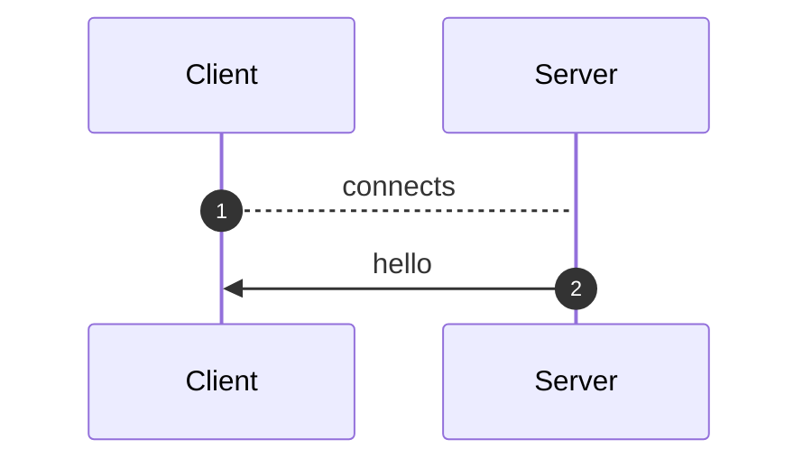
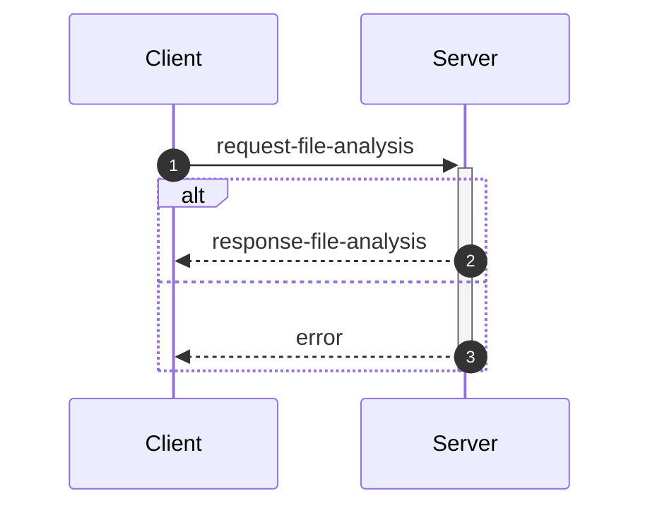
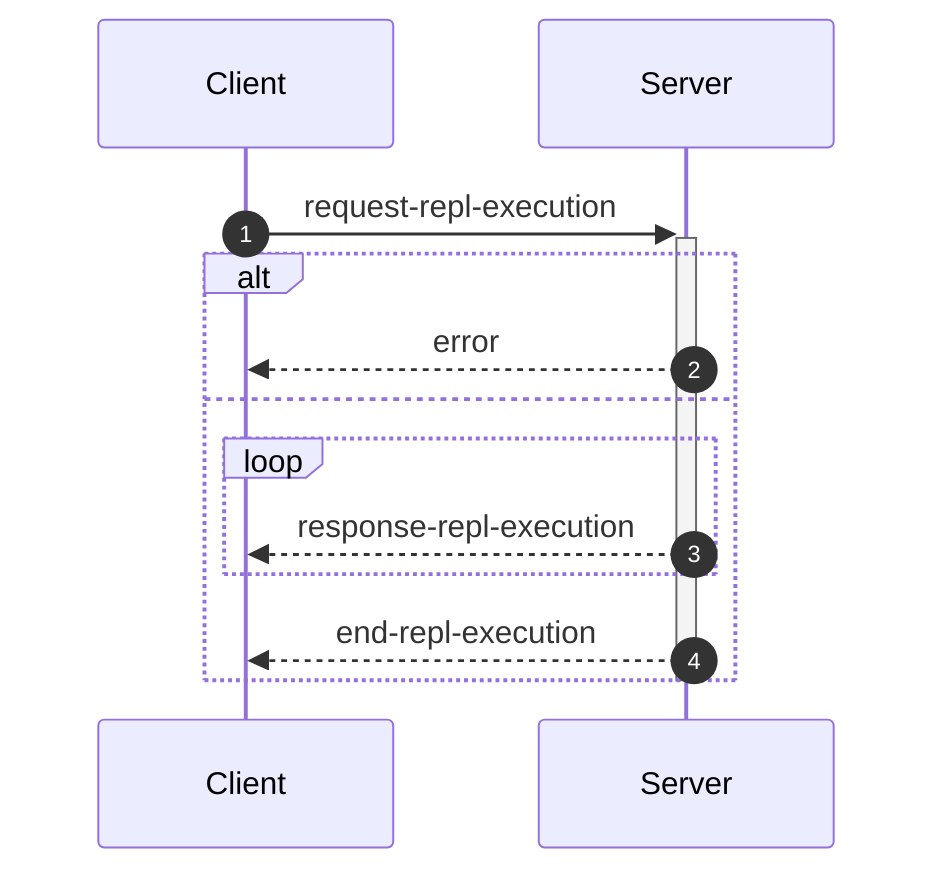
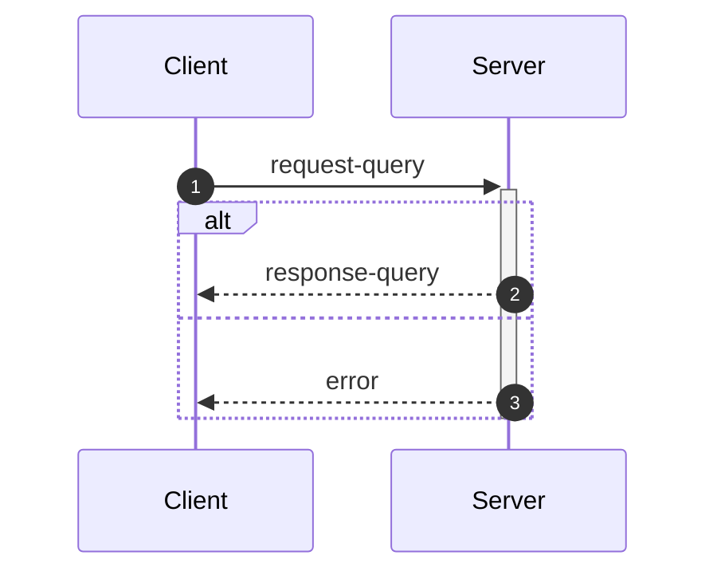

_<span title="an overview of flowR's interface">Generated</span> from '[wiki-interface.ts](https://github.com/flowr-analysis/flowr/tree/main/src/documentation/wiki-interface.ts "src/documentation/wiki-interface.ts")' on 2026-11-08, 20:46:01 UTC (v2.17.5, R v4.6.1), do not edit directly._

Although far from being as detailed as the in-depth explanation of [_flowR_](https://github.com/flowr-analysis/flowr/wiki/Core),
this wiki page explains how to interface with _flowR_ in more detail.
In general, command line arguments and other options provide short descriptions on hover over.

* [💻 Using the REPL](#using-the-repl)
* [⚙️ Configuring FlowR](#configuring-flowr)
* [⚒️ Writing Code](#writing-code)
* [💬 Communicating with the Server](#communicating-with-the-server)

<a id='using-the-repl'></a>
## 💻 Using the REPL

> [!NOTE]
> To execute arbitrary R commands with a repl request, _flowR_ has to be started explicitly with <span title="Description (Command Line Argument): Allow to access the underlying R session when using flowR (security warning: this allows the execution of arbitrary R code!)">`--r-session-access`</span>.
> Please be aware that this introduces a security risk and note that this relies on the [`r-shell` engine](https://github.com/flowr-analysis/flowr/wiki/Engines) .

Although primarily meant for users to explore,
there is nothing which forbids calling _flowR_ as a subprocess to use standard-in, -output, and -error
for communication (although you can access the REPL using the server as well,
with the [REPL Request](#message-request-repl-execution) message).

The read-eval-print loop&nbsp;(REPL) works relatively simple.
You can submit an expression (using <kbd>Enter</kbd>),
which is interpreted as an R&nbsp;expression by default but interpreted as a *command* if it starts with a colon (`:`).
The best command to get started with the REPL is <span title="Description (Repl Command): Show help information (aliases: :h, :?)">`:help`</span>.
Besides, you can leave the REPL either with the command <span title="Description (Repl Command): End the repl (aliases: :q, :exit)">`:quit`</span> or by pressing <kbd>Ctrl</kbd>+<kbd>C</kbd> twice.
When writing a *command*, you may press <kbd>Tab</kbd> to get a list of completions, if available.
Multiple commands can be entered in a single line by separating them with a semicolon (`;`), e.g. `:parse "x<-2"; :df*`.
If a command is given without R code, the REPL will re-use R code given in a previous command.
The prior example will hence return first the parsed AST of the program and then the dataflow graph for `"x <- 2"`.

> [!NOTE]
> If you develop flowR, you may want to launch the repl using the `npm run main-dev` command, this way, you get a non-minified version of flowR with debug information and hot-reloading of source files.

<details>
<summary>Available Commands</summary>

We currently offer the following commands (this with a `[*]` suffix are available with and without the star):

| Command | Description |
| ------- | ----------- |
| **<span title="Description (Repl Command): End the repl (aliases: :q, :exit)">:quit</span>** | End the repl (aliases: **:<span title="Alias of ':quit'. End the repl">q</span>**, **:<span title="Alias of ':quit'. End the repl">exit</span>**) |
| **<span title="Description (Repl Command): Execute the given code as R code. This requires the `--r-session-access` flag to be set and requires the r-shell engine. (aliases: :e, :r)">:execute</span>** | Execute the given code as R code. This requires the `--r-session-access` flag to be set and requires the r-shell engine. (aliases: **:<span title="Alias of ':execute'. Execute the given code as R code. This requires the `--r-session-access` flag to be set and requires the r-shell engine.">e</span>**, **:<span title="Alias of ':execute'. Execute the given code as R code. This requires the `--r-session-access` flag to be set and requires the r-shell engine.">r</span>**) |
| **<span title="Description (Repl Command): Get mermaid code for the control-flow graph of R code (aliases: :cfg, :cf)">:controlflow[*]</span>** | Get mermaid code for the control-flow graph of R code (star: Returns the URL to mermaid.live) (aliases: **:<span title="Alias of ':controlflow'. Get mermaid code for the control-flow graph of R code">cfg</span>**, **:<span title="Alias of ':controlflow'. Get mermaid code for the control-flow graph of R code">cf</span>**) |
| **<span title="Description (Repl Command): Get mermaid code for the control-flow graph with basic blocks (aliases: :cfgb, :cfb)">:controlflowbb[*]</span>** | Get mermaid code for the control-flow graph with basic blocks (star: Returns the URL to mermaid.live) (aliases: **:<span title="Alias of ':controlflowbb'. Get mermaid code for the control-flow graph with basic blocks">cfgb</span>**, **:<span title="Alias of ':controlflowbb'. Get mermaid code for the control-flow graph with basic blocks">cfb</span>**) |
| **<span title="Description (Repl Command): Get mermaid code for the dataflow graph (aliases: :d, :df)">:dataflow[*]</span>** | Get mermaid code for the dataflow graph (star: Returns the URL to mermaid.live) (aliases: **:<span title="Alias of ':dataflow'. Get mermaid code for the dataflow graph">d</span>**, **:<span title="Alias of ':dataflow'. Get mermaid code for the dataflow graph">df</span>**) |
| **<span title="Description (Repl Command): Get mermaid code for the normalized AST of R code (aliases: :n)">:normalize[*]</span>** | Get mermaid code for the normalized AST of R code (star: Returns the URL to mermaid.live) (alias: **:<span title="Alias of ':normalize'. Get mermaid code for the normalized AST of R code">n</span>**) |
| **<span title="Description (Repl Command): Get mermaid code for the simplified dataflow graph (aliases: :ds, :dfs)">:dataflowsimple[*]</span>** | Get mermaid code for the simplified dataflow graph (star: Returns the URL to mermaid.live) (aliases: **:<span title="Alias of ':dataflowsimple'. Get mermaid code for the simplified dataflow graph">ds</span>**, **:<span title="Alias of ':dataflowsimple'. Get mermaid code for the simplified dataflow graph">dfs</span>**) |
| **<span title="Description (Repl Command): Inspect and extend the signature database: `query` (identical to :query @signature), `info <name>` for where a function comes from (identical to :query @function-info), `add <path>` to mount another database/source, `download` to fetch the full-history database. (aliases: :sig)">:signature</span>** | Inspect and extend the signature database: `query` (identical to :query @signature), `info <name>` for where a function comes from (identical to :query @function-info), `add <path>` to mount another database/source, `download` to fetch the full-history database. (alias: **:<span title="Alias of ':signature'. Inspect and extend the signature database: `query` (identical to :query @signature), `info <name>` for where a function comes from (identical to :query @function-info), `add <path>` to mount another database/source, `download` to fetch the full-history database.">sig</span>**) |
| **<span title="Description (Repl Command): Just calculates the DFG, but only prints summary info (aliases: :d#, :df#)">:dataflowsilent</span>** | Just calculates the DFG, but only prints summary info (aliases: **:<span title="Alias of ':dataflowsilent'. Just calculates the DFG, but only prints summary info">d#</span>**, **:<span title="Alias of ':dataflowsilent'. Just calculates the DFG, but only prints summary info">df#</span>**) |
| **<span title="Description (Repl Command): Prints ASCII Art of the parsed, unmodified AST (aliases: :p)">:parse</span>** | Prints ASCII Art of the parsed, unmodified AST (alias: **:<span title="Alias of ':parse'. Prints ASCII Art of the parsed, unmodified AST">p</span>**) |
| **<span title="Description (Repl Command): Prints the version of flowR as well as the current version of R">:version</span>** | Prints the version of flowR as well as the current version of R
| **<span title="Description (Repl Command): Query the given R code (use 'help' for more information)">:query[*]</span>** | Query the given R code (use 'help' for more information) (star: Similar to query, but returns the output in json format.)
| **<span title="Description (Repl Command): Returns an ASCII representation of the dataflow graph (aliases: :df!)">:dataflowascii</span>** | Returns an ASCII representation of the dataflow graph (alias: **:<span title="Alias of ':dataflowascii'. Returns an ASCII representation of the dataflow graph">df!</span>**) |
| **<span title="Description (Repl Command): Returns summarization stats for the normalized AST (aliases: :n#)">:normalize#</span>** | Returns summarization stats for the normalized AST (alias: **:<span title="Alias of ':normalize#'. Returns summarization stats for the normalized AST">n#</span>**) |
| **<span title="Description (Repl Command): Show help information (aliases: :h, :?)">:help</span>** | Show help information (aliases: **:<span title="Alias of ':help'. Show help information">h</span>**, **:<span title="Alias of ':help'. Show help information">?</span>**) |

</details>

> [!TIP]
> 
> As indicated by the examples before, all REPL commands that operate on code keep track of the state.
> Hence, if you run a command like <span title="Description (Repl Command, starred version): Returns the URL to mermaid.live; Base Command: Get mermaid code for the dataflow graph (aliases: :d*, :df*)">`:dataflow*`</span> without providing R code,
> the REPL will re-use the R code provided in a previous command.
> Likewise, doing this will benefit from incrementality!
> If you request the dataflow graph with `:df* x <- 2 * y` and then want to see the parsed AST with `:parse`,
> the REPL will re-use previously obtained information and not re-parse the code again.
> 		

Generally, many commands offer shortcut versions in the REPL. Many queries, for example, offer a shortened format (see the example below).
Of special note, the [Config Query](https://github.com/flowr-analysis/flowr/wiki/%5BQuery%5D-Config)
can be used to also modify the currently active configuration of _flowR_ within the REPL (see the [wiki page](https://github.com/flowr-analysis/flowr/wiki/%5BQuery%5D-Config) for more information).

### Example: Retrieving the Dataflow Graph

To retrieve a URL to the [mermaid](https://mermaid.js.org/) diagram of the dataflow of a given expression,
use <span title="Description (Repl Command, starred version): Returns the URL to mermaid.live; Base Command: Get mermaid code for the dataflow graph (aliases: :d*, :df*)">`:dataflow*`</span> (or <span title="Description (Repl Command): Get mermaid code for the dataflow graph (aliases: :d, :df)">`:dataflow`</span> to get the mermaid code in the cli):

```shell
$ docker run -it --rm eagleoutice/flowr # or npm run flowr 
flowR repl v2.17.5, R grammar v14 (tree-sitter engine)
R> :dataflow* y <- 1 + x
```

<details>
<summary style='color:gray'>Output</summary>

```text
https://mermaid.live/view#base64:eyJjb2RlIjoiZmxvd2NoYXJ0IFREXG4gICAgMXt7XCJgKiM5MTtSTnVtYmVyIzkzOyogKioxKipcbiAgICAgICoxLjYqICgqKmlkOiAxKiopYFwifX1cbiAgICAyKFtcImAqIzkxO1JTeW1ib2wjOTM7KiAqKngqKlxuICAgICAgKjEuMTAqICgqKmlkOiAyKiopYFwiXSlcbiAgICAzW1tcImAqIzkxO1JCaW5hcnlPcCM5MzsqIGJhc2UjNTg7IzU4OyoqIzQzOyoqXG4gICAgICAqMS42LTEwKiAoKippZDogMyoqKVxuICAgIGFyZzogKDEsIDIpYFwiXV1cbiAgICBidWlsdC1pbjpfNDNfW1wiYEJ1aWx0LUluOlxuIzQzO2BcIl1cbiAgICBzdHlsZSBidWlsdC1pbjpfNDNfIHN0cm9rZTpncmF5LGZpbGw6Z3JheSxzdHJva2Utd2lkdGg6MnB4LG9wYWNpdHk6Ljg7XG4gICAgMFtcImAqIzkxO1JTeW1ib2wjOTM7KiAqKnkqKlxuICAgICAgKjEuMSogKCoqaWQ6IDAqKiwgdjogMylgXCJdXG4gICAgNFtbXCJgKiM5MTtSQmluYXJ5T3AjOTM7KiBiYXNlIzU4OyM1ODsqKiM2MDsjNDU7KipcbiAgICAgICoxLjEtMTAqICgqKmlkOiA0KiopXG4gICAgYXJnOiAoMCwgMylgXCJdXVxuICAgIGJ1aWx0LWluOl82MF8tW1wiYEJ1aWx0LUluOlxuIzYwOyM0NTtgXCJdXG4gICAgc3R5bGUgYnVpbHQtaW46XzYwXy0gc3Ryb2tlOmdyYXksZmlsbDpncmF5LHN0cm9rZS13aWR0aDoycHgsb3BhY2l0eTouODtcbiAgICAxIC0uLT58XCJmbG93XCJ8IDJcbiAgICBsaW5rU3R5bGUgMCBzdHJva2U6Z3JheSxjb2xvcjpncmF5O1xuICAgIDIgLS4tPnxcImZsb3dcInwgM1xuICAgIGxpbmtTdHlsZSAxIHN0cm9rZTpncmF5LGNvbG9yOmdyYXk7XG4gICAgMyAtLT58XCJyZWFkcywgYXJnXCJ8IDFcbiAgICAzIC0tPnxcInJlYWRzLCBhcmdcInwgMlxuICAgIDMgLS4tPnxcImZsb3dcInwgMFxuICAgIGxpbmtTdHlsZSA0IHN0cm9rZTpncmF5LGNvbG9yOmdyYXk7XG4gICAgMyAtLi0+fFwicmVhZHMsIGNhbGxzXCJ8IGJ1aWx0LWluOl80M19cbiAgICBsaW5rU3R5bGUgNSBzdHJva2U6Z3JheTtcbiAgICAwIC0tPnxcImRlZmluZWQtYnksIGZsb3dcInwgNFxuICAgIDAgLS0+fFwiZGVmaW5lZC1ieVwifCAzXG4gICAgNCAtLT58XCJyZWFkcywgYXJnXCJ8IDNcbiAgICA0IC0tPnxcInJldHVybnMsIGFyZ1wifCAwXG4gICAgNCAtLi0+fFwicmVhZHMsIGNhbGxzXCJ8IGJ1aWx0LWluOl82MF8tXG4gICAgbGlua1N0eWxlIDEwIHN0cm9rZTpncmF5OyIsIm1lcm1haWQiOnsiYXV0b1N5bmMiOnRydWV9fQ==
```

Retrieve the dataflow graph of the expression `y <- 1 + x`. It looks like this:


<details>

<summary style="color:gray">R Code of the Dataflow Graph</summary>

The analysis ran (parse and normalize with the [tree-sitter](https://github.com/flowr-analysis/flowr/wiki/Engines) engine) in the generation environment. No [signature database](https://github.com/flowr-analysis/flowr/wiki/Signature-Database) is mounted, so `library()` attaches no exports (base-R names are still qualified, e.g., `stats::acf`). 
We encountered no unknown side effects during the analysis.

```r
y <- 1 + x
```

</details>

</details>

For small graphs like this, <span title="Description (Repl Command): Returns an ASCII representation of the dataflow graph (aliases: :df!)">`:dataflowascii`</span> also provides an ASCII representation directly in the REPL:

```shell
$ docker run -it --rm eagleoutice/flowr # or npm run flowr 
flowR repl v2.17.5, R grammar v14 (tree-sitter engine)
R> :df! y <- 1 + x
```

<details open>
<summary style='color:gray'>Output</summary>

```text
                        v<0>v
 c<4>c──────────────────| y |
 |<- |     ┌────────────v---v
 c---c     │
    │   c<3>c   0<1>0
    └───| + |───| 1 |───u<2>u
        c---c   0---0   | x |
           └────────────u---u
Edges:
3 -> 1: reads, arg          3 -> 2: reads, arg
3 -> 0: flows-to            1 -> 2: flows-to
2 -> 3: flows-to            4 -> 3: reads, arg
4 -> 0: returns, arg        0 -> 4: defined-by, flows-to
0 -> 3: defined-by
```

Retrieve the dataflow graph of the expression `y <- 1 + x` as ASCII art.

</details>

For the slicing with <span title="Description (Repl Command): Static backwards executable slicer for R">`:slicer`</span>, you have access to the same [magic comments](#slice-magic-comments) as with the [slice request](#message-request-slice).
Pass `--inline` to splice resolvable `source()` calls into the reconstruction so the slice is a single self-contained R text (the same as the static slice query's `inlineSources` flag).
See `--help` for more flags!

### Example: Interfacing with the File System

Many commands that allow for an R-expression (like <span title="Description (Repl Command, starred version): Returns the URL to mermaid.live; Base Command: Get mermaid code for the dataflow graph (aliases: :d*, :df*)">`:dataflow*`</span>) allow for a file as well
if the argument starts with `file://`.
If you are working from the root directory of the _flowR_ repository, the following gives you the parsed AST of the example file using the <span title="Description (Repl Command): Prints ASCII Art of the parsed, unmodified AST (aliases: :p)">`:parse`</span> command:

> **Watch mode**: Replace `file://` with `watch://` to enter watch mode.
> flowR runs the command immediately and then re-runs it every time the file (or any file inside the folder) changes.
> Enter any other command to leave watch mode.
> For example: `:df watch://analysis.R`

```shell
$ docker run -it --rm eagleoutice/flowr # or npm run flowr 
flowR repl v2.17.5, R grammar v14 (tree-sitter engine)
R> :parse file://test/testfiles/example.R
```

<details>
<summary style='color:gray'>Output</summary>

```text
File: test/testfiles/example.R

program
├ binaryoperator
│ ├ identifier "sum" (1:1─4)
│ ├ <- "<-" (1:5─7)
│ ╰ float "0" (1:8─9)
├ binaryoperator
│ ├ identifier "product" (2:1─8)
│ ├ <- "<-" (2:9─11)
│ ╰ float "1" (2:12─13)
├ binaryoperator
│ ├ identifier "w" (3:1─2)
│ ├ <- "<-" (3:3─5)
│ ╰ float "7" (3:6─7)
├ binaryoperator
│ ├ identifier "N" (4:1─2)
│ ├ <- "<-" (4:3─5)
│ ╰ float "10" (4:6─8)
├ forstatement
│ ├ for "for" (6:1─4)
│ ├ ( "(" (6:5─6)
│ ├ identifier "i" (6:6─7)
│ ├ in "in" (6:8─10)
│ ├ binaryoperator
│ │ ├ float "1" (6:11─12)
│ │ ├ : ":" (6:12─13)
│ │ ╰ parenthesizedexpression
│ │   ├ ( "(" (6:13─14)
│ │   ├ binaryoperator
│ │   │ ├ identifier "N" (6:14─15)
│ │   │ ├ - "-" (6:15─16)
│ │   │ ╰ float "1" (6:16─17)
│ │   ╰ ) ")" (6:17─18)
│ ├ ) ")" (6:18─19)
│ ╰ bracedexpression
│   ├ { "{" (6:20─21)
│   ├ binaryoperator
│   │ ├ identifier "sum" (7:3─6)
│   │ ├ <- "<-" (7:7─9)
│   │ ╰ binaryoperator
│   │   ├ binaryoperator
│   │   │ ├ identifier "sum" (7:10─13)
│   │   │ ├ + "+" (7:14─15)
│   │   │ ╰ identifier "i" (7:16─17)
│   │   ├ + "+" (7:18─19)
│   │   ╰ identifier "w" (7:20─21)
│   ├ binaryoperator
│   │ ├ identifier "product" (8:3─10)
│   │ ├ <- "<-" (8:11─13)
│   │ ╰ binaryoperator
│   │   ├ identifier "product" (8:14─21)
│   │   ├  "" (8:22─23)
│   │   ╰ identifier "i" (8:24─25)
│   ╰ } "}" (9:1─2)
├ call
│ ├ identifier "cat" (11:1─4)
│ ╰ arguments
│   ├ ( "(" (11:4─5)
│   ├ argument
│   │ ╰ string
│   │   ├ stringopen "\"" (11:5─6)
│   │   ├ stringcontent "Sum:" (11:6─10)
│   │   ╰ stringclose "\"" (11:10─11)
│   ├ comma "," (11:11─12)
│   ├ argument
│   │ ╰ identifier "sum" (11:13─16)
│   ├ comma "," (11:16─17)
│   ├ argument
│   │ ╰ string
│   │   ├ stringopen "\"" (11:18─19)
│   │   ├ stringcontent
│   │   │ ╰ escapesequence "\\n" (11:19─21)
│   │   ╰ stringclose "\"" (11:21─22)
│   ╰ ) ")" (11:22─23)
╰ call
  ├ identifier "cat" (12:1─4)
  ╰ arguments
    ├ ( "(" (12:4─5)
    ├ argument
    │ ╰ string
    │   ├ stringopen "\"" (12:5─6)
    │   ├ stringcontent "Product:" (12:6─14)
    │   ╰ stringclose "\"" (12:14─15)
    ├ comma "," (12:15─16)
    ├ argument
    │ ╰ identifier "product" (12:17─24)
    ├ comma "," (12:24─25)
    ├ argument
    │ ╰ string
    │   ├ stringopen "\"" (12:26─27)
    │   ├ stringcontent
    │   │ ╰ escapesequence "\\n" (12:27─29)
    │   ╰ stringclose "\"" (12:29─30)
    ╰ ) ")" (12:30─31)
```

Retrieve the parsed AST of the example file.

<details>

<summary>File Content</summary>

```r
sum <- 0
product <- 1
w <- 7
N <- 10

for (i in 1:(N-1)) {
  sum <- sum + i + w
  product <- product * i
}

cat("Sum:", sum, "\n")
cat("Product:", product, "\n")
```

</details>

As _flowR_ directly transforms this AST the output focuses on being human-readable instead of being machine-readable.
		
</details>

### Example: Run a Query

You can run any query supported by _flowR_ using the <span title="Description (Repl Command): Query the given R code (use 'help' for more information)">`:query`</span> command.
For example, to obtain the shapes of all data frames in a given piece of code, you can run:

```shell
$ docker run -it --rm eagleoutice/flowr # or npm run flowr 
flowR repl v2.17.5, R grammar v14 (tree-sitter engine)
R> :query @absint df-shape "x <- data.frame(a = 1:10, b = 1:10)\ny <- x$a"
```

<details open>
<summary style='color:gray'>Output</summary>

```text
Query: absint (1 ms)
   ╰ $12: (colnames: [{"a", "b"}, {}], cols: [2, 2], rows: [10, 10])
   ╰ $0: (colnames: [{"a", "b"}, {}], cols: [2, 2], rows: [10, 10])
```

Retrieve the shapes of all data frames in the given code.

</details>

To run the linter on a file, you can use (in this example, we just issue the `dead-code` linter on a small piece of code):

```shell
$ docker run -it --rm eagleoutice/flowr # or npm run flowr 
flowR repl v2.17.5, R grammar v14 (tree-sitter engine)
R> :query @linter rules:dead-code "if(FALSE) x <- 2"
```

<details open>
<summary style='color:gray'>Output</summary>

```text
Query: linter (2 ms)
   ╰ Dead Code (dead-code):
       ╰ certain:
           ╰ Code at 1.11-16 (1 quick fix(es) available)
```

Run the linter on the given code, with only the `dead-code` rule enabled.

</details>

For more information on the available queries, please check out the [Query API](https://github.com/flowr-analysis/flowr/wiki/Query-API).

<a id='configuring-flowr'></a>
## ⚙️ Configuring FlowR

When running _flowR_, you may want to specify some behaviors with a dedicated configuration file.
By default, flowR looks for a file named `flowr.json` in the current working directory (or any higher directory).
You can also specify a different file with <span title="Description (Command Line Argument): The name of the configuration file to use">`--config-file`</span> or pass the configuration inline using <span title="Description (Command Line Argument): The flowR configuration to use, as a JSON string">`--config-json`</span>.
A `flowr.json` found this way belongs to the analyzed project, so flowR ignores its options that decide what flowR executes or loads
(`engines.*.wasmPath`, `engines.*.treeSitterWasmPath`, `engines.*.rPath`, `solver.sigdb.additionalPaths`, `solver.sigdb.downloadRepo`, `solver.sigdb.installedLibrary.paths`, `solver.sigdb.onDemand.enabled`, `solver.sigdb.onDemand.repositories`, `solver.sigdb.onDemand.cranMirror`, `solver.sigdb.onDemand.bioconductorMirror`, `solver.sigdb.onDemand.cacheDir`),
unless you pass <span title="Description (Command Line Argument): Keep the security-sensitive options (e.g., the R executable) of the flowr.json found in the working directory or a parent. Only use this for projects you trust.">`--trust-config`</span>.
To analyze code you do not trust, use the secure mode (<span title="Description (Command Line Argument): Run in secure mode for analyzing untrusted code: flowR does not start R (or any other process), does not access the network, does not search for project configs, and ignores security-sensitive options in every config. Cannot be disabled once enabled. Can also be enabled with the environment variable {italic FLOWR_SECURE_MODE=1}.">`--secure`</span>, see the [security policy](https://github.com/flowr-analysis/flowr/blob/main/.github/SECURITY.md)).
To inspect the current configuration, you can run flowr with the <span title="Description (Command Line Argument): Run with verbose logging (will be passed to the corresponding script)">`--verbose`</span> flag, or use the `config` [Query](https://github.com/flowr-analysis/flowr/wiki/Query-API).
Within the REPL this works by running the following:

```shell
:query @config
```

To work with the <a href="https://github.com/flowr-analysis/flowr/tree/main/src/config.ts#L125"><code><span title="The configuration file format for flowR.">FlowrConfig</span></code></a> you can use the provided helper objects alongside its methods like
<a href="https://github.com/flowr-analysis/flowr/tree/main/src/config.ts#L991"><code><span title="Creates a new flowr config that has the updated values.">FlowrConfig::<b>amend</b></span></code></a>.
The schema below documents every option; the ones you most likely want are:

- <a href="https://github.com/flowr-analysis/flowr/wiki/Interface#configuring-flowr" title="Configuration Option (boolean): Whether source calls should be ignored, causing {@link processSourceCall}&#39;s behavior to be skipped.">ignoreSourceCalls</a>: ignore source calls when analyzing the code, i.e., ignore the inclusion of other files.
- <a href="https://github.com/flowr-analysis/flowr/wiki/Interface#configuring-flowr" title="Configuration Option (boolean): Whether load calls should be ignored, causing {@link processLoadCall}&#39;s behavior to be skipped.">ignoreLoadCalls</a>: ignore load calls when analyzing the code, i.e., ignore the loading of r-data files.
- <a href="https://github.com/flowr-analysis/flowr/wiki/Interface#configuring-flowr" title="Configuration Option (object): Do you want to overwrite (parts) of the builtin definition?">semantics.environment.overwriteBuiltIns</a>: overwrite _flowR_'s handling of built-in functions, or clear the preset definitions entirely.
  See [Configure BuiltIn Semantics](#configure-builtin-semantics) for more information.
- <a href="https://github.com/flowr-analysis/flowr/wiki/Interface#configuring-flowr" title="Configuration Option (boolean): Whether calls drawing on a graphics device (e.g., `plot`) count as writing to it, which the ambient state queries then report.">semantics.ambient.drawingWritesDevice</a>: whether calls drawing on a graphics device (e.g., `plot`) count as writing the device in the ambient state queries.
- <a href="https://github.com/flowr-analysis/flowr/wiki/Interface#configuring-flowr" title="Configuration Option (string): How to resolve variables and their values. (one of &quot;disabled&quot;, &quot;alias&quot;, &quot;builtin&quot;)">solver.variables</a>: how to resolve variables and their values (`disabled`, `alias`, `builtin`).
- <a href="https://github.com/flowr-analysis/flowr/wiki/Interface#configuring-flowr" title="Configuration Option (array): The engine or set of engines to use for interacting with R code. An empty array means all available engines will be used.">engines</a> and <a href="https://github.com/flowr-analysis/flowr/wiki/Interface#configuring-flowr" title="Configuration Option (string): The default engine to use for interacting with R code. If this is undefined, an arbitrary engine from the specified list will be used. (one of &quot;tree-sitter&quot;, &quot;r-shell&quot;)">defaultEngine</a>: the engines used to interact with R code, see the [Engines wiki page](https://github.com/flowr-analysis/flowr/wiki/Engines).
- <a href="https://github.com/flowr-analysis/flowr/wiki/Interface#configuring-flowr" title="Configuration Option (array): Files a framework loads on its own, without any source() call (e.g. global.R in a shiny app), in the order they are loaded; flowR orders the matching project files accordingly and analyzes them as one program. Entries are case-insensitive globs matched against the file path, a plain name matches any file with that name, and entries matching no project file are warned about. Usually set per project kind via specializeConfig.">project.implicitSources</a>: the files a framework loads without any `source()` call, in the order in which they are
  loaded. Entries are globs (e.g. `R/*.R`) matched against the file path ignoring capitalization; one matching no file is reported.
- <a href="https://github.com/flowr-analysis/flowr/wiki/Interface#configuring-flowr" title="Configuration Option (object): Overwrite (parts of) the configuration depending on the project kind flowR detects, e.g. to give a shiny app its implicit sources.">specializeConfig</a>: overwrite (parts of) the configuration depending on the kind of project _flowR_ detects
  (e.g. `shiny-app`), which is how a shiny app gets its implicit sources by default. What you configure directly wins.
- <a href="https://github.com/flowr-analysis/flowr/wiki/Interface#configuring-flowr" title="Configuration Option (string): Overwrite the project kind flowR would otherwise infer from the analyzed files, e.g. when auto-detection guesses wrong. (one of &quot;package&quot;, &quot;script&quot;, &quot;shiny-app&quot;, &quot;notebook&quot;, &quot;project&quot;, &quot;unknown&quot;)">project.useProjectType</a>: skip that detection and force a project kind yourself, when auto-detection guesses wrong.
- <a href="https://github.com/flowr-analysis/flowr/wiki/Interface#configuring-flowr" title="Configuration Option (array): The default plugins to load when creating a new instance of FlowrAnalyzer">defaultPlugins</a> and <a href="https://github.com/flowr-analysis/flowr/wiki/Interface#configuring-flowr" title="Configuration Option (array): The plugins to load in REPL mode">repl.plugins</a>: the plugins to load for a new <a href="https://github.com/flowr-analysis/flowr/tree/main/src/project/flowr-analyzer.ts#L240"><code><span title="Central class for conducting analyses with FlowR. Use the FlowrAnalyzerBuilder to create a new instance. If you want the original pattern of creating a pipeline and running all steps, you can still do this with FlowrAnalyzer#runFull . To inspect the context of the analyzer, use FlowrAnalyzer#inspectContext (if you are a plugin and need to modify it, use FlowrAnalyzer#context instead).">FlowrAnalyzer</span></code></a> and in the REPL
  (use `flowr:default` to reference the former).

So you can configure _flowR_ by adding a file like the following:

<details>

<summary>Example Configuration File</summary>

```json
{
  "ignoreSourceCalls": true,
  "ignoreLoadCalls": true,
  "semantics": {
    "environment": {
      "overwriteBuiltIns": {
        "definitions": [
          {
            "type": "function",
            "names": [
              "foo"
            ],
            "processor": "builtin:assign",
            "config": {}
          }
        ]
      }
    }
  },
  "defaultPlugins": [
    "file:description",
    "versions:description"
  ],
  "repl": {
    "quickStats": false,
    "dfProcessorHeat": false,
    "hints": true,
    "plugins": [
      "flowr:default"
    ]
  },
  "project": {
    "resolveUnknownPathsOnDisk": true,
    "implicitSources": [
      "global.R",
      "app.R"
    ]
  },
  "linter": {
    "disabledRules": []
  },
  "specializeConfig": {
    "shiny-app": {
      "project": {
        "implicitSources": [
          "global.R",
          "ui.R",
          "server.R",
          "app.R"
        ]
      }
    }
  },
  "engines": [
    {
      "type": "r-shell"
    }
  ],
  "solver": {
    "variables": "alias",
    "evalStrings": true,
    "trackEnvironments": true,
    "sigdb": {
      "enabled": true,
      "loadProjectDependencies": true,
      "eagerlyLoad": false,
      "eagerlyLoadExports": false,
      "linkBaseR": false,
      "linkDescriptionDependencies": false
    },
    "resolveSource": {
      "dropPaths": "no",
      "ignoreCapitalization": true,
      "inferWorkingDirectory": "active-script",
      "searchPath": []
    },
    "instrument": {},
    "slicer": {
      "threshold": 50
    }
  },
  "abstractInterpretation": {
    "wideningThreshold": 4,
    "followCalls": true,
    "dataFrame": {
      "maxColNames": 20,
      "readLoadedData": {
        "readExternalFiles": true,
        "maxReadLines": 1000000
      }
    }
  },
  "incremental": {
    "alwaysIncremental": false,
    "parsing": {
      "activated": false,
      "heuristics": {
        "activated": true,
        "mtime": true,
        "linesFrom": 500,
        "bytesFrom": 50000,
        "alwaysWithEdits": false,
        "minFiles": 1
      }
    }
  },
  "gas": {
    "thresholds": {
      "memory": {
        "problematic": 0.7,
        "critical": 0.9
      },
      "timeMs": {
        "problematic": 100000,
        "critical": 120000
      }
    },
    "features": {}
  }
}
```

</details>

<details>
<a id='configure-builtin-semantics'></a>
<summary>Configure Built-In Semantics</summary>

`semantics/environment/overwriteBuiltins` accepts two keys:

- `loadDefaults` (boolean, initially `true`): If set to `true`, the default built-in definitions are loaded before applying the custom definitions. Setting this flag to `false` explicitly disables the loading of the default definitions.
- `definitions` (array, initially empty): Allows to overwrite or define new built-in elements. Each object within must have a `type` which is one of the below. Furthermore, they may define a string array of `names` which specifies the identifiers to bind the definitions to. You may use `assumePrimitive` to specify whether _flowR_ should assume that this is a primitive non-library definition (so you probably just do not want to specify the key).

  | Type            | Description                                                                                                                                                                                                                                                                                              | Example                                                                                                    |
  | --------------- | -------------------------------------------------------------------------------------------------------------------------------------------------------------------------------------------------------------------------------------------------------------------------------------------------------- | ---------------------------------------------------------------------------------------------------------- |
  | `constant`    | Additionally allows for a `value` this should resolve to.                                                                                                                                                                                                                                                | `{ type: 'constant', names: ['NULL', 'NA'],  value: null }`                                                |
  | `function`    | Is a rather flexible way to define and bind built-in functions. For the time, we do not have extensive documentation to cover all the cases, so please either consult the sources with the `default-builtin-config/` folder or open a [new issue](https://github.com/flowr-analysis/flowr/issues/new/choose). | `{ type: 'function', names: ['next'], processor: 'builtin:d', config: { cfg: ExitPointType.Next } }` |
  | `replacement` | A comfortable way to specify replacement functions like `$<-` or `names<-`. `suffixes` describes the... suffixes to attach automatically. | `{ type: 'replacement', suffixes: ['<-', '<<-'], names: ['[', '[['] }` |

</details>

<details>

<summary style='color:gray'>Full Configuration-File Schema</summary>

- _The configuration file format for flowR._ (object)
    - **logLevel** [optional] _flowR's global minimum log level, applied when the config is loaded._ (string)
        Only allows: 'silly', 'trace', 'debug', 'info', 'warn', 'error', 'fatal'
    - **ignoreSourceCalls** [optional] _Whether source calls should be ignored, causing {@link processSourceCall}'s behavior to be skipped._ (boolean)
    - **ignoreLoadCalls** [optional] _Whether load calls should be ignored, causing {@link processLoadCall}'s behavior to be skipped._ (boolean)
    - **semantics** _Configure language semantics and how flowR handles them._ (object)
        - **environment** [optional] _Semantics regarding how to handle the R environment._ (object)
            - **overwriteBuiltIns** [optional] _Do you want to overwrite (parts) of the builtin definition?_ (object)
                - **loadDefaults** [optional] _Should the default configuration still be loaded?_ (boolean)
                - **definitions** [optional] _The definitions to load/overwrite._ (array)
                Valid item types:
                    - (object)
        - **ambient** [optional] _Semantics regarding the global state (options, devices, files, ...) calls access._ (object)
            - **drawingWritesDevice** [optional] _Whether calls drawing on a graphics device (e.g., `plot`) count as writing to it, which the ambient state queries then report._ (boolean)
    - **defaultPlugins** [optional] _The default plugins to load when creating a new instance of FlowrAnalyzer_ (array)
    Valid item types:
        - (alternatives)
            - (string)
            - (array)
    - **repl** _Configuration options for the REPL._ (object)
        - **quickStats** [optional] _Whether to show quick stats in the REPL after each evaluation._ (boolean)
        - **dfProcessorHeat** [optional] _This instruments the dataflow processors to count how often each processor is called._ (boolean)
        - **hints** [optional] _Whether to show dim inline hints on the empty prompt (automatically disabled on non-interactive terminals)._ (boolean)
        - **plugins** [optional] _The plugins to load in REPL mode_ (array)
        Valid item types:
            - (alternatives)
                - (string)
                - (array)
        - **autoUseFileProtocol** [optional] _Prepend the file protocol to a repl input that looks like a path, instead of only warning about it._ (boolean)
        - **queryStats** [optional] _Whether `:query` closes with the line stating how long the queries took (`:query*` never prints it)._ (boolean)
        - **showPlugins** [optional] _Whether `:version` grays out the plugins that did not activate during the last analysis._ (boolean)
    - **project** _Project specific configuration options._ (object)
        - **resolveUnknownPathsOnDisk** [optional] _Whether to resolve unknown paths loaded by the r project disk when trying to source/analyze files._ (boolean)
        - **failOnInaccessiblePath** [optional] _Whether a directory that cannot be traversed during file discovery (e.g. due to permissions) aborts the analysis; when false (the default) such paths are logged and skipped._ (boolean)
        - **basePackages** [optional] _The packages considered part of R itself (base and recommended); if unset, flowR uses its built-in list._ (array)
        Valid item types:
            - (string)
        - **implicitSources** [optional] _Files a framework loads on its own, without any source() call (e.g. global.R in a shiny app), in the order they are loaded; flowR orders the matching project files accordingly and analyzes them as one program. Entries are case-insensitive globs matched against the file path, a plain name matches any file with that name, and entries matching no project file are warned about. Usually set per project kind via specializeConfig._ (array)
        Valid item types:
            - (string)
        - **useProjectType** [optional] _Overwrite the project kind flowR would otherwise infer from the analyzed files, e.g. when auto-detection guesses wrong._ (string)
            Only allows: 'package', 'script', 'shiny-app', 'notebook', 'project', 'unknown'
        - **assumeImplicitEcho** [optional] _Whether the top level of the analyzed code is echoed, so that every visible result printed there is collected as an output by the dependencies query (default true, false for a package)._ (boolean)
        - **discovery** [optional] _Scoping options for the default project discovery._ (object)
            - **full** [optional] _Collect every file below the project root (greedy) instead of only the files the detected project kind needs (default false)._ (boolean)
            - **perKind** [optional] _Per-kind include/exclude glob overrides layered on the default scoping._ (object)
            - **ignore** [optional] _Case-insensitive globs that drop matching files from the intelligent discovery, regardless of kind (e.g. .Renviron to ignore environment files)._ (array)
            Valid item types:
                - (string)
        - **classification** [optional] _Overrides for the signals flowR uses to classify the project kind._ (object)
            - **shinyDescriptionTypes** [optional] _DESCRIPTION Type: values that mark a shiny app._ (array)
            Valid item types:
                - (string)
            - **shinyEntryFiles** [optional] _File names a shiny app is assembled from._ (array)
            Valid item types:
                - (string)
            - **shinyUsagePattern** [optional] _Regex source evidencing shiny usage in an entry file._ (string)
            - **notebookExtensions** [optional] _File extensions marking a notebook._ (array)
            Valid item types:
                - (string)
    - **linter** _Linter configuration options._ (object)
        - **disabledRules** _Linting rule names excluded from the default rule set (a rule requested explicitly via a linter query still runs). Usually set per project kind via specializeConfig._ (array)
        Valid item types:
            - (string)
        - **disabledTags** [optional] _Linting rule tags whose rules are excluded from the default rule set (a rule requested explicitly via a linter query still runs). By default the cmd-check rules are disabled for everything but a package; a configured list replaces that default._ (array)
        Valid item types:
            - (string)
    - **inputSources** [optional] _Further frameworks the input-sources analysis should know about; entries are added to flowR's defaults._ (object)
        - **pure** [optional] _Functions that only pass the constantness of their arguments on._ (array)
        Valid item types:
            - (string)
        - **param** [optional] _Functions whose result is a 'param' input._ (array)
        Valid item types:
            - (string)
        - **file** [optional] _Functions whose result is a 'file' input._ (array)
        Valid item types:
            - (string)
        - **tempfile** [optional] _Functions whose result is a 'tempfile' input._ (array)
        Valid item types:
            - (string)
        - **glob** [optional] _Functions whose result is a 'glob' input._ (array)
        Valid item types:
            - (string)
        - **net** [optional] _Functions whose result is a 'net' input._ (array)
        Valid item types:
            - (string)
        - **rand** [optional] _Functions whose result is a 'rand' input._ (array)
        Valid item types:
            - (string)
        - **system** [optional] _Functions whose result is a 'system' input._ (array)
        Valid item types:
            - (string)
        - **ffi** [optional] _Functions whose result is a 'ffi' input._ (array)
        Valid item types:
            - (string)
        - **lang** [optional] _Functions whose result is a 'lang' input._ (array)
        Valid item types:
            - (string)
        - **options** [optional] _Functions whose result is a 'options' input._ (array)
        Valid item types:
            - (string)
        - **cmdline** [optional] _Functions whose result is a 'cmdline' input._ (array)
        Valid item types:
            - (string)
        - **user** [optional] _Functions whose result is a 'user' input._ (array)
        Valid item types:
            - (string)
        - **const** [optional] _Functions whose result is a 'const' input._ (array)
        Valid item types:
            - (string)
        - **scope** [optional] _Functions whose result is a 'scope' input._ (array)
        Valid item types:
            - (string)
        - **dconst** [optional] _Functions whose result is a 'dconst' input._ (array)
        Valid item types:
            - (string)
        - **unknown** [optional] _Functions whose result is a 'unknown' input._ (array)
        Valid item types:
            - (string)
        - **linkedObjects** [optional] _Objects a framework provides without a definition in the code, e.g. shiny's input._ (array)
        Valid item types:
            - (object)
        - **linkedEntryPoints** [optional] _Calls that hand a function to a framework, which binds its objects to the parameters by position._ (array)
        Valid item types:
            - (object)
    - **specializeConfig** [optional] _Overwrite (parts of) the configuration depending on the project kind flowR detects, e.g. to give a shiny app its implicit sources._ (object)
    - **engines** _The engine or set of engines to use for interacting with R code. An empty array means all available engines will be used._ (array)
    Valid item types:
        - (alternatives)
            - _The configuration for the tree sitter engine._ (object)
                - **type** [required] _Use the tree sitter engine._ (string)
                    Only allows: 'tree-sitter'
                - **wasmPath** [optional] _The path to the tree-sitter-r WASM binary to use. If this is undefined, this uses the default path._ (string)
                - **treeSitterWasmPath** [optional] _The path to the tree-sitter WASM binary to use. If this is undefined, this uses the default path._ (string)
                - **lax** [optional] _Whether to use the lax parser for parsing R code (allowing for syntax errors). If this is undefined, the strict parser will be used._ (boolean)
            - _The configuration for the R shell engine._ (object)
                - **type** [required] _Use the R shell engine._ (string)
                    Only allows: 'r-shell'
                - **rPath** [optional] _The path to the R executable to use. If this is undefined, this uses the default path._ (string)
                - **pipeBind** [optional] _Whether to enable R's experimental pipe-bind operator "=>" by setting _R_USE_PIPEBIND_ for the R session (default false); R itself keeps this off by default, as it is experimental and has never shipped in a release version of R._ (boolean)
    - **defaultEngine** [optional] _The default engine to use for interacting with R code. If this is undefined, an arbitrary engine from the specified list will be used._ (string)
        Only allows: 'tree-sitter', 'r-shell'
    - **solver** _How to resolve constants, constraints, cells, ..._ (object)
        - **variables** _How to resolve variables and their values._ (string)
            Only allows: 'disabled', 'alias', 'builtin'
        - **evalStrings** _Should we include eval(parse(text="...")) calls in the dataflow graph?_ (boolean)
        - **trackEnvironments** [optional] _Track user-created environments (new.env, assign/get/local with envir=, dollar-assign, attach). When false, all envir-style calls fall through conservatively._ (boolean)
        - **sigdb** _Resolving library exports from a signature database._ (object)
            - **enabled** [optional] _Resolve library()/use() exports from a signature database (default true); when false no database is consulted._ (boolean)
            - **loadProjectDependencies** [optional] _Load the project's declared dependencies from its metadata files (DESCRIPTION Imports/Depends, rproject.toml, uvr.toml, rig rproj.toml and script blocks, renv.lock, rv.lock, uvr.lock, rig lockfiles) (default true); when false these files are not read for dependencies._ (boolean)
            - **eagerlyLoad** [optional] _Parse the database up front rather than on the first package load (default false, ignored if disabled)._ (boolean)
            - **eagerlyLoadExports** [optional] _Add a vertex for every export on load rather than on demand (default false); keeps the dataflow graph small._ (boolean)
            - **assumedRVersion** [optional] _R version assumed when resolving versioned (base-R) exports: a pin like "4.5" or "auto" to detect the installed R (default "auto")._ (string)
            - **linkBaseR** [optional] _Eagerly attach base-R namespaces so bare base calls resolve without library() (default false)._ (boolean)
            - **linkBaseRCalls** [optional] _Add a lightweight Reads edge from a bare base-R call to its signature-database function vertex (default false; base-R qualification is edge-free otherwise)._ (boolean)
            - **linkPackageCalls** [optional] _Add a lightweight Reads edge from a resolved package call to its signature-database function vertex (default false)._ (boolean)
            - **linkDescriptionDependencies** [optional] _Eagerly attach the namespaces of the project's declared DESCRIPTION dependencies (Imports/Depends) so their exports resolve without an explicit library() (default false)._ (boolean)
            - **warmInBackground** [optional] _Decompress the hot shards (base + most-downloaded) in a background task on startup so the first library() lookup is warm (default false; for long-running servers/REPLs)._ (boolean)
            - **additionalPaths** [optional] _Extra directories or bundle/manifest files searched for signature databases (alongside the shipped default and $FLOWR_SIGDB_DIR); a downloaded full-history bundle placed here is mounted automatically._ (array)
            Valid item types:
                - (string)
            - **downloadRepo** [optional] _GitHub owner/repo the full-history bundle is downloaded from via ":signature download" (default "flowr-analysis/flowr"; the release tag comes from the committed sigdb.remote.json unless a version is given)._ (string)
            - **autoSync** [optional] _On startup, re-download shards whose committed sigdb.remote.json hash no longer matches the cache, in the background (default false; opt-in network sync after a git pull)._ (boolean)
            - **installedLibrary** [optional] _Recovering packages no signature database knows from the copy installed on this machine._ (object)
                - **enabled** [required] _Recover packages no signature database knows from their installed copy (default false)._ (boolean)
                - **paths** [optional] _Library directories to search; when empty they are discovered from the environment and the project._ (array)
                Valid item types:
                    - (string)
                - **useEnvironment** [optional] _Search the libraries R_LIBS_USER/R_LIBS/R_LIBS_SITE name (default true)._ (boolean)
                - **useProjectLibrary** [optional] _Search a project-local renv/packrat library (default true)._ (boolean)
                - **maxDepth** [optional] _How far to descend into the nested layout of a project-local library (default 3)._ (number)
                - **packages** [optional] _Only recover packages whose name matches one of these regular expressions; empty means any._ (array)
                Valid item types:
                    - (string)
            - **onDemand** [optional] _Recovering packages no signature database knows from their sources on CRAN, Bioconductor, or GitHub._ (object)
                - **enabled** [required] _Fetch and recover the sources of packages no signature database knows when the analyzed code uses them (default false, accesses the network)._ (boolean)
                - **sources** [optional] _Where to look, in order: github, cran, bioconductor, or a source a plugin adds (default ["github", "cran", "bioconductor"])._ (array)
                Valid item types:
                    - (string)
                - **repositories** [optional] _GitHub repositories (owner/repo[/subdir][@ref]) to fetch packages from, by package name. The analyzed project may name more (DESCRIPTION Remotes, install_github calls)._ (object)
                - **packages** [optional] _Only recover packages whose name matches one of these regular expressions, empty means any._ (array)
                Valid item types:
                    - (string)
                - **cranMirror** [optional] _The CRAN src/contrib/ to fetch from, over https (default https://cloud.r-project.org/src/contrib/). It may be on the local network._ (string)
                - **bioconductorMirror** [optional] _The Bioconductor host, over https (default https://bioconductor.org). It may be on the local network._ (string)
                - **bioconductorRelease** [optional] _The Bioconductor release to fetch from: release, devel, or a number like 3.20 (default release)._ (string)
                - **githubMirrors** [optional] _Use the GitHub mirrors of CRAN (cran/<pkg>) and Bioconductor (bioc/<pkg>) (default true)._ (boolean)
                - **maxPackages** [optional] _The most packages to fetch for one analysis (default 25)._ (number)
                - **maxArchiveMb** [optional] _The most MiB a package archive may have (default 32). It may unpack to three times that, at most 128 MiB._ (number)
                - **offline** [optional] _Only use what was fetched before, never the network (default false)._ (boolean)
                - **retryAfterHours** [optional] _How many hours to wait before asking again for a package no source had (default 24)._ (number)
                - **cacheDir** [optional] _Where to cache what was fetched (default the on-demand directory of the signature cache)._ (string)
            - **blobCacheBudgetMb** [optional] _How many MiB of decoded package blobs every open bundle may hold together (default 16)._ (number)
            - **versionSelection** [optional] _When a project constrains a dependency, resolve to the newest (default), oldest, or system-installed version satisfying it; system needs R and falls back to newest. Base-R packages always resolve against the assumed R version._ (string)
                Only allows: 'newest', 'oldest', 'system'
            - **versionOverrides** [optional] _Force an exact version for specific packages (name -> version), overriding both the project constraint and the versionSelection policy (default {})._ (object)
        - **versionManagement** _Policies for reasoning about dependency versions._ (object)
            - **linkedVersionGroups** [optional] _Groups of packages that must resolve to the same version; version guessing intersects each group so its members stay mutually compatible (default [])._ (array)
            Valid item types:
                - (array)
                Valid item types:
                    - (string)
        - **assumeAttachedPackages** [optional] _Packages to treat as attached without a `library()` call, so what the built-in configuration states about them applies to the analyzed code. The base packages R attaches on startup already resolve without it._ (array)
        Valid item types:
            - (string)
        - **transitiveSideEffectRounds** [optional] _How many rounds the transitive side-effect fixpoint may run before it is cut off (default 32); the propagation stops on its own as soon as a round adds nothing._ (number)
        - **maxOverlayDepth** [optional] _How many binding overlays may stack on one environment frame before a write flattens them (default 4); a pure performance knob, trading lookup cost against copy cost without changing any result._ (number)
        - **instrument** (object)
            - **dataflowExtractors** [optional] _These keys are only intended for use within code, allowing to instrument the dataflow analyzer!_ (any)
        - **resolveSource** [optional] _If lax source calls are active, flowR searches for sourced files much more freely, based on the configurations you give it. This option is only in effect if `ignoreSourceCalls` is set to false._ (object)
            - **dropPaths** _Allow to drop the first or all parts of the sourced path, if it is relative._ (string)
                Only allows: 'no', 'once', 'all'
            - **ignoreCapitalization** _Search for filenames matching in the lowercase._ (boolean)
            - **inferWorkingDirectory** _Try to infer the working directory from the main or any script to analyze._ (string)
                Only allows: 'no', 'main-script', 'active-script', 'any-script'
            - **searchPath** _Additionally search in these paths._ (array)
            Valid item types:
                - (string)
            - **repeatedSourceLimit** [optional] _How often the same file can be sourced within a single run? Please be aware: in case of cyclic sources this may not reach a fixpoint so give this a sensible limit._ (number)
            - **applyReplacements** _Provide name replacements for loaded files_ (array)
            Valid item types:
                - (object)
            - **assumeFilesExist** [optional] _Assume a sourced file is always there, making what it defines certain instead of conditional on the source call._ (boolean)
        - **slicer** [optional] _The configuration for the slicer._ (object)
            - **threshold** [optional] _The maximum number of iterations to perform on a single function call during slicing._ (number)
            - **autoExtend** [optional] _If set, the slicer will gain an additional post-pass._ (boolean)
    - **abstractInterpretation** _The configuration options for abstract interpretation._ (object)
        - **wideningThreshold** _The threshold for the number of visitations of a node at which widening should be performed to ensure the termination of the fixpoint iteration._ (number)
        - **followCalls** _Whether the abstract interpretation is interprocedural, i.e. whether it steps into the functions a call may dispatch to._ (boolean)
        - **dataFrame** _The configuration of the shape inference for data frames._ (object)
            - **maxColNames** _The maximum number of columns names to infer for data frames before over-approximating the column names to top._ (number)
            - **readLoadedData** _Configuration options for reading data frame shapes from loaded external data files, such as CSV files._ (object)
                - **readExternalFiles** _Whether data frame shapes should be extracted from loaded external files, such as CSV files._ (boolean)
                - **maxReadLines** _The maximum number of lines to read when extracting data frame shapes from loaded files, such as CSV files._ (number)
    - **incremental** (object)
        - **alwaysIncremental** _Always take the incremental path, regardless of heuristics._ (boolean)
        - **parsing** (object)
            - **activated** _If set, incremental parsing will be used._ (boolean)
            - **heuristics** (object)
                - **activated** [optional] _If set, the heuristics for incremental parsing will be used._ (boolean)
                - **mtime** [optional] _Skip reparsing entirely if the file's modification time is unchanged since the last parse._ (boolean)
                - **linesFrom** [optional] _Only consider incremental parsing for files with at least this many lines._ (number)
                - **bytesFrom** [optional] _Only consider incremental parsing for files with at least this many bytes._ (number)
                - **alwaysWithEdits** [optional] _Always take the incremental path whenever there is a computed edit region, regardless of the other thresholds._ (boolean)
                - **minFiles** [optional] _Only apply these heuristics once the project has at least this many files loaded._ (number)
    - **gas** [optional] _Resource-usage guard (gas) configuration. All feature factors default to 0 (disabled). See https://github.com/flowr-analysis/flowr/wiki/Core#gas-resource-guard._ (object)
        - **thresholds** [optional] _Thresholds for all gas checks (scaled by per-feature factor), boundable per feature._ (object)
            - **memory** [optional] _Heap-usage fraction thresholds (0-1), either shared or given per feature key (with `default` covering the rest)._ (object)
                - **problematic** [optional] _Heap fraction (0-1) above which Problematic is returned, for every feature without an entry of its own._ (number)
                - **critical** [optional] _Heap fraction (0-1) above which Critical is returned, for every feature without an entry of its own._ (number)
            - **timeMs** [optional] _Elapsed analysis time thresholds in milliseconds, either shared or given per feature key (with `default` covering the rest)._ (object)
                - **problematic** [optional] _Elapsed ms above which Problematic is returned, for every feature without an entry of its own._ (number)
                - **critical** [optional] _Elapsed ms above which Critical is returned, for every feature without an entry of its own._ (number)
            - **steps** [optional] _Processed-AST-node thresholds, counted rather than sampled; only a key that arms a budget (`dataflow`) reads them._ (object)
                - **problematic** [optional] _Processed AST nodes above which Problematic is returned, for every feature without an entry of its own._ (number)
                - **critical** [optional] _Processed AST nodes above which the extraction is cut short, for every feature without an entry of its own._ (number)
            - **vertices** [optional] _Created-dataflow-vertex thresholds, counted like `steps`._ (object)
                - **problematic** [optional] _Created dataflow vertices above which Problematic is returned, for every feature without an entry of its own._ (number)
                - **critical** [optional] _Created dataflow vertices above which the extraction is cut short, for every feature without an entry of its own._ (number)
        - **features** [optional] _Per-feature sensitivity factors. 0 or absent disables gas checking for that feature. A factor of 2 makes the feature twice as sensitive. Recognised keys: `source`, `side-effect-linking`, `linter`, `slicer`, `dataflow`._ (object)
        - **countedCheckEvery** [optional] _How many counted steps pass between two accountings of an armed check, be it a dataflow budget or the slicer's traversal (default 128); trades overshoot against the cost of the check._ (number)
        - **heapProvider** [optional] _Custom heap statistics source (programmatic configs only), overriding the built-in v8/performance.memory detection._ (function)

</details>

<a id='writing-code'></a>
## ⚒️ Writing Code

_flowR_ can be used as a [module](https://www.npmjs.com/package/@eagleoutice/flowr) and offers several main classes and interfaces that are interesting for extension writers 
(see the [Visual Studio Code extension](https://marketplace.visualstudio.com/items?itemName=code-inspect.vscode-flowr) or the [Core](https://github.com/flowr-analysis/flowr/wiki/Core) wiki page for more information).

### Creating Analyses with _flowR_

Nowadays, instances of the <a href="https://github.com/flowr-analysis/flowr/tree/main/src/project/flowr-analyzer.ts#L240"><code><span title="Central class for conducting analyses with FlowR. Use the FlowrAnalyzerBuilder to create a new instance. If you want the original pattern of creating a pipeline and running all steps, you can still do this with FlowrAnalyzer#runFull . To inspect the context of the analyzer, use FlowrAnalyzer#inspectContext (if you are a plugin and need to modify it, use FlowrAnalyzer#context instead).">FlowrAnalyzer</span></code></a> should be used as central frontend to get analysis results from _flowR_.
The entry points an analysis is written against are re-exported from the package root (`import { FlowrAnalyzerBuilder } from '@eagleoutice/flowr'`);
everything else stays reachable under its own path, as in `@eagleoutice/flowr/dataflow/graph/graph`.
For example, a program slice can be created like this:

```ts
const analyzer = await new FlowrAnalyzerBuilder()
    .setEngine('tree-sitter')
    .build();
analyzer.addRequest('x <- 1\ny <- x\nx');
const { slice, reconstruct } = await analyzer.query({
    type:     'static-slice',
    criteria: ['3@x']
});
```

For more information, please have a look at the [Analyzer](https://github.com/flowr-analysis/flowr/wiki/Analyzer) wiki page, which explains how to construct and use the <a href="https://github.com/flowr-analysis/flowr/tree/main/src/project/flowr-analyzer.ts#L240"><code><span title="Central class for conducting analyses with FlowR. Use the FlowrAnalyzerBuilder to create a new instance. If you want the original pattern of creating a pipeline and running all steps, you can still do this with FlowrAnalyzer#runFull . To inspect the context of the analyzer, use FlowrAnalyzer#inspectContext (if you are a plugin and need to modify it, use FlowrAnalyzer#context instead).">FlowrAnalyzer</span></code></a> in more detail.
To work with specific perspectives, you can also consult the respective pages like the [Dataflow Graph](https://github.com/flowr-analysis/flowr/wiki/Dataflow-Graph) or the [Abstract Interpretation](https://github.com/flowr-analysis/flowr/wiki/Abstract-Interpretation) wiki pages.
### The Pipeline Executor (Low-Level Interface)

Once, in the beginning, _flowR_ was meant to produce a dataflow graph merely to provide *program slices*. 
However, with continuous updates, the [Dataflow Graph](https://github.com/flowr-analysis/flowr/wiki/Dataflow-Graph) repeatedly proves to be the more interesting part.
With this, we restructured _flowR_'s originally *hardcoded* pipeline to be far more flexible. 
Now, it can be theoretically extended or replaced with arbitrary steps, optional steps, and what we call 'decorations' of these steps. 
In short, a slicing pipeline using the <a href="https://github.com/flowr-analysis/flowr/tree/main/src/core/pipeline-executor.ts#L97"><code><span title="**Please note:** The PipelineExecutor is now considered to be a rather low-level API for flowR. While it still works and is the basis for all other layers, we strongly recommend using the FlowrAnalyzer and its builder to create and use an analyzer instance that is pre-configured for your use-case. The pipeline executor allows to execute arbitrary pipelines in a step-by-step fashion. If you are not...">PipelineExecutor</span></code></a> looks like this:

```ts

const slicer = new PipelineExecutor(DEFAULT_SLICING_PIPELINE, {
  parser:    new RShell(),
  request:   requestFromInput('x <- 1\nx + 1'),
  criterion: ['2@x']
})
const slice = await slicer.allRemainingSteps()
// console.log(slice.reconstruct.code)
```

<details><summary>More Information</summary>

If you compare this, with what you would have done with the old (and removed) `SteppingSlicer`, 
this essentially just requires you to replace the `SteppingSlicer` with the <a href="https://github.com/flowr-analysis/flowr/tree/main/src/core/pipeline-executor.ts#L97"><code><span title="**Please note:** The PipelineExecutor is now considered to be a rather low-level API for flowR. While it still works and is the basis for all other layers, we strongly recommend using the FlowrAnalyzer and its builder to create and use an analyzer instance that is pre-configured for your use-case. The pipeline executor allows to execute arbitrary pipelines in a step-by-step fashion. If you are not...">PipelineExecutor</span></code></a>
and to pass the <a href="https://github.com/flowr-analysis/flowr/tree/main/src/core/steps/pipeline/default-pipelines.ts#L18"><code>DEFAULT_SLICING_PIPELINE</code></a> as the first argument.
The <a href="https://github.com/flowr-analysis/flowr/tree/main/src/core/pipeline-executor.ts#L97"><code><span title="**Please note:** The PipelineExecutor is now considered to be a rather low-level API for flowR. While it still works and is the basis for all other layers, we strongly recommend using the FlowrAnalyzer and its builder to create and use an analyzer instance that is pre-configured for your use-case. The pipeline executor allows to execute arbitrary pipelines in a step-by-step fashion. If you are not...">PipelineExecutor</span></code></a>...

1. Provides structures to investigate the results of all intermediate steps
2. Can be executed step-by-step
3. Can repeat steps (e.g., to calculate multiple slices on the same input)

See the in-code documentation for more information.

</details>

### Using the <a href="https://github.com/flowr-analysis/flowr/tree/main/src/r-bridge/shell.ts#L144"><code><span title="The RShell represents an interactive session with the R interpreter. You can configure it by RShellOptions . At the moment we are using a live R session (and not networking etc.) to communicate with R easily, which allows us to install packages etc. However, this might and probably will change in the future (leaving this as a legacy mode :D)">RShell</span></code></a> to Interact with R

The <a href="https://github.com/flowr-analysis/flowr/tree/main/src/r-bridge/shell.ts#L144"><code><span title="The RShell represents an interactive session with the R interpreter. You can configure it by RShellOptions . At the moment we are using a live R session (and not networking etc.) to communicate with R easily, which allows us to install packages etc. However, this might and probably will change in the future (leaving this as a legacy mode :D)">RShell</span></code></a> class allows interfacing with the `R`&nbsp;ecosystem installed on the host system.
Please have a look at [flowR's Engines](https://github.com/flowr-analysis/flowr/wiki/Engines) for more information on alternatives (for example, the <a href="https://github.com/flowr-analysis/flowr/tree/main/src/r-bridge/lang-4.x/tree-sitter/tree-sitter-executor.ts#L29"><code><span title="Synchronous and (way) faster alternative to the RShell using tree-sitter.">TreeSitterExecutor</span></code></a>).

> [!IMPORTANT]
> 
> Each <a href="https://github.com/flowr-analysis/flowr/tree/main/src/r-bridge/shell.ts#L144"><code><span title="The RShell represents an interactive session with the R interpreter. You can configure it by RShellOptions . At the moment we are using a live R session (and not networking etc.) to communicate with R easily, which allows us to install packages etc. However, this might and probably will change in the future (leaving this as a legacy mode :D)">RShell</span></code></a> controls a new instance of the R&nbsp;interpreter, 
> make sure to call <code><a href="https://github.com/flowr-analysis/flowr/tree/main/src/r-bridge/shell.ts#L350"><span title="Close the current R session, makes the object effectively invalid (can no longer be reopened etc.)">RShell::<i>close</i></span></a>()</code> when you are done.

You can start a new "session" by constructing a new object with <code>new <a href="https://github.com/flowr-analysis/flowr/tree/main/src/r-bridge/shell.ts#L144"><span title="The RShell represents an interactive session with the R interpreter. You can configure it by RShellOptions . At the moment we are using a live R session (and not networking etc.) to communicate with R easily, which allows us to install packages etc. However, this might and probably will change in the future (leaving this as a legacy mode :D)">RShell</span></a>()</code>.

However, there are several options that may be of interest 
(e.g., to automatically revive the shell in case of errors or to control the name location of the R process on the system).

With a shell object (let's call it `shell`), you can execute R code by using <a href="https://github.com/flowr-analysis/flowr/tree/main/src/r-bridge/shell.ts#L213"><code><span title="sends the given command directly to the current R session will not do anything to alter input markers!">RShell::<i>sendCommand</i></span></code></a>,
for example <code>shell.<a href="https://github.com/flowr-analysis/flowr/tree/main/src/r-bridge/shell.ts#L213"><span title="sends the given command directly to the current R session will not do anything to alter input markers!">sendCommand</span></a>("1 + 1")</code>.
However, this does not return anything, so if you want to collect the output of your command, use
<a href="https://github.com/flowr-analysis/flowr/tree/main/src/r-bridge/shell.ts#L296"><code><span title="Send a command and collect the output">RShell::<i>sendCommandWithOutput</i></span></code></a> instead.

<a id='communicating-with-the-server'></a>
## 💬 Communicating with the Server

As explained in the [Overview](https://github.com/flowr-analysis/flowr/wiki/Overview), you can run the [TCP](https://de.wikipedia.org/wiki/Transmission_Control_Protocol)&nbsp;server by adding the <span title="Description (Command Line Argument): Do not drop into a repl, but instead start a server on the given port (default: 1042) and listen for messages.">`--server`</span> flag (and, due to the interactive mode, exit with the conventional <kbd>CTRL</kbd>+<kbd>C</kbd>).
Currently, every connection is handled by the same underlying `RShell` - so the server is not designed to handle many clients at a time.
Additionally, the server is not well guarded against attacks (e.g., you can theoretically spawn an arbitrary number of&nbsp;RShell sessions on the target machine).

Every message has to be given in a single line (i.e., without a newline in-between) and end with a newline character. Nevertheless, we will pretty-print example given in the following segments for the ease of reading.

> [!NOTE]
> 
> The default <span title="Description (Command Line Argument): Do not drop into a repl, but instead start a server on the given port (default: 1042) and listen for messages.">`--server`</span> uses a simple [TCP](https://de.wikipedia.org/wiki/Transmission_Control_Protocol)
> connection. If you want _flowR_ to expose a [WebSocket](https://de.wikipedia.org/wiki/WebSocket) server instead, add the <span title="Description (Command Line Argument): If the server flag is set, use websocket for messaging">`--ws`</span> flag (i.e., <span title="Description (Command Line Argument): Do not drop into a repl, but instead start a server on the given port (default: 1042) and listen for messages.">`--server`</span> <span title="Description (Command Line Argument): If the server flag is set, use websocket for messaging">`--ws`</span>) when starting _flowR_ from the command line.

<ul><li>
<a id="message-hello"></a>
<b>Hello</b> Message (<code>hello</code>) 
<details>

<summary style="color:gray"> View Details. <i>The server informs the client about the successful connection and provides Meta-Information.</i> </summary>



After launching _flowR_, for example, with <code>docker run -it --rm eagleoutice/flowr <span title="Description (Command Line Argument): Do not drop into a repl, but instead start a server on the given port (default: 1042) and listen for messages.">-<span/>-server</span></code>&nbsp;(🐳️), connecting should present you with a `hello` message, that amongst others should reveal the versions of&nbsp;_flowR_ and&nbsp;R, using the [semver 2.0](https://semver.org/spec/v2.0.0.html) versioning scheme.
The message looks like this:

```json
{
  "type": "hello",
  "clientName": "client-0",
  "versions": {
    "flowr": "2.17.5",
    "r": "4.6.1",
    "engine": "r-shell"
  }
}
```

There are currently a few messages that you can send after the hello message.
If you want to _slice_ a piece of R code you first have to send an [analysis request](#message-request-file-analysis), so that you can send one or multiple slice requests afterward.
Requests for the [REPL](#message-request-repl-execution) are independent of that.
	
<hr>

<details>
<summary style="color:gray">Message schema (<code>hello</code>)</summary>

For the definition of the hello message, please see it's implementation at [`./src/cli/repl/server/messages/message-hello.ts`](https://github.com/flowr-analysis/flowr/tree/main/src/cli/repl/server/messages/message-hello.ts).

- [required] (object)
    - **type** [required] _The type of the hello message._ (string)
        Only allows: 'hello'
    - **id** [forbidden] _The id of the message is always undefined (as it is the initial message and not requested)._ (any)
    - **clientName** [required] _A unique name that is assigned to each client. It has no semantic meaning and is only used/useful for debugging._ (string)
    - **versions** [required] (object)
        - **flowr** [required] _The version of the flowr server running in semver format._ (string)
        - **r** [required] _The version of the underlying R shell running in semver format._ (string)
        - **engine** [required] _The parser backend that is used to parse the R code._ (string)

</details>

<hr>

</details>
	</li>

<li>
<a id="message-request-file-analysis"></a>
<b>Analysis</b> Message (<code>request-file-analysis</code>) 
<details>

<summary style="color:gray"> View Details. <i>The server builds the dataflow graph for a given input file (or a set of files).</i> </summary>



The request allows the server to analyze a file and prepare it for slicing.
The message can contain a `filetoken`, which is used to identify the file in later slice or query requests (if you do not add one, the request will not be stored and therefore, it is not available for subsequent requests).

> **Please note!**\
> If you want to send and process a lot of analysis requests, but do not want to slice them, please do not pass the `filetoken` field. This will save the server a lot of memory allocation.

Furthermore, the request must contain either a `content` field to directly pass the file's content or a `filepath` field which contains the path to the file (this path must be accessible for the server to be useful).
If you add the `id` field, the answer will use the same `id` so you can match requests and the corresponding answers.
See the implementation of the request-file-analysis message for more information.

You can drop one or more stored file tokens by adding the `invalidateToken` field (a single token or an array of tokens).
The server frees the corresponding analyses _after_ it has answered the request.

> **Tip!**\
> If you only want to drop tokens, you do not need a separate message: send a `request-file-analysis` that contains _just_ the `invalidateToken` field (and no `content` or `filepath`).
> Such a request behaves like an empty file analysis and the server replies with an empty `results` object.
> Because invalidation happens after the response, you may even pass the _current_ `filetoken` in `invalidateToken` to analyze a file once and have the server forget it right after you received the results.

<details>
<summary>Example of the <code>request-file-analysis</code> Message</summary>

_Note:_ even though we pretty-print these messages, they are sent as a single line, ending with a newline.

The following lists all messages that were sent and received in case you want to reproduce the scenario:

<ol>
<li> <code>hello</code> (response)
<details> 

<summary> Show Details </summary>

The first message is always a hello message.

```json
{"type":"hello","clientName":"client-0","versions":{"flowr":"2.17.5","r":"4.6.1","engine":"r-shell"}}
```

</details>
</li>

<li> <b><code>request-file-analysis</code> (request)</b>
<details open> 

<summary> Show Details </summary>

Let's suppose you simply want to analyze the following script:
 
```r
x <- 1
x + 1
```

 For this, you can send the following request:

```json
{"type":"request-file-analysis","id":"1","filetoken":"x","content":"x <- 1\nx + 1"}
```

</details>
</li>

<li> <code>response-file-analysis</code> (response)
<details> 

<summary> Show Details </summary>

The `results` field of the response effectively contains three keys of importance:

- `parse`: which contains 1:1 the parse result in CSV format that we received from the `RShell` (i.e., the AST produced by the parser of the R interpreter).
- `normalize`: which contains the normalized AST, including ids (see the `info` field and the [Normalized AST](https://github.com/flowr-analysis/flowr/wiki/Normalized-AST) wiki page).
- `dataflow`: especially important is the `graph` field which contains the dataflow graph as a set of root vertices (see the [Dataflow Graph](https://github.com/flowr-analysis/flowr/wiki/Dataflow-Graph) wiki page).
			
_As the code is pretty long, we inhibit pretty printing and syntax highlighting (JSON, hiding built-in):_

```text
{"type":"response-file-analysis","format":"json","id":"1","results":{"parse":{"files":[{"parsed":"[1,1,1,6,7,0,\"expr\",false,\"x <- 1\"],[1,1,1,1,1,3,\"SYMBOL\",true,\"x\"],[1,1,1,1,3,7,\"expr\",false,\"x\"],[1,3,1,4,2,7,\"LEFT_ASSIGN\",true,\"<-\"],[1,6,1,6,4,5,\"NUM_CONST\",true,\"1\"],[1,6,1,6,5,7,\"expr\",false,\"1\"],[2,1,2,5,16,0,\"expr\",false,\"x + 1\"],[2,1,2,1,10,12,\"SYMBOL\",true,\"x\"],[2,1,2,1,12,16,\"expr\",false,\"x\"],[2,3,2,3,11,16,\"'+'\",true,\"+\"],[2,5,2,5,13,14,\"NUM_CONST\",true,\"1\"],[2,5,2,5,14,16,\"expr\",false,\"1\"]","filePath":"/tmp/tmp-1390874-uf5pajzqttju-.R"}],".meta":{}},"normalize":{"ast":{"type":"RProject","files":[{"root":{"type":"RExpressionList","children":[{"type":"RBinaryOp","location":[1,3,1,4],"lhs":{"type":"RSymbol","location":[1,1,1,1],"content":"x","lexeme":"x","info":{"fullRange":[1,1,1,1],"adToks":[],"id":0,"parent":2,"role":"bin-l","index":0,"nest":0,"file":"/tmp/tmp-1390874-uf5pajzqttju-.R"}},"rhs":{"location":[1,6,1,6],"lexeme":"1","info":{"fullRange":[1,6,1,6],"adToks":[],"id":1,"parent":2,"role":"bin-r","index":1,"nest":0,"file":"/tmp/tmp-1390874-uf5pajzqttju-.R"},"type":"RNumber","content":{"num":1,"complexNumber":false,"markedAsInt":false}},"operator":"<-","lexeme":"<-","info":{"fullRange":[1,1,1,6],"adToks":[],"id":2,"parent":6,"nest":0,"file":"/tmp/tmp-1390874-uf5pajzqttju-.R","index":0,"role":"el-c"}},{"type":"RBinaryOp","location":[2,3,2,3],"lhs":{"type":"RSymbol","location":[2,1,2,1],"content":"x","lexeme":"x","info":{"fullRange":[2,1,2,1],"adToks":[],"id":3,"parent":5,"role":"bin-l","index":0,"nest":0,"file":"/tmp/tmp-1390874-uf5pajzqttju-.R"}},"rhs":{"location":[2,5,2,5],"lexeme":"1","info":{"fullRange":[2,5,2,5],"adToks":[],"id":4,"parent":5,"role":"bin-r","index":1,"nest":0,"file":"/tmp/tmp-1390874-uf5pajzqttju-.R"},"type":"RNumber","content":{"num":1,"complexNumber":false,"markedAsInt":false}},"operator":"+","lexeme":"+","info":{"fullRange":[2,1,2,5],"adToks":[],"id":5,"parent":6,"nest":0,"file":"/tmp/tmp-1390874-uf5pajzqttju-.R","index":1,"role":"el-c"}}],"info":{"adToks":[],"id":6,"nest":0,"file":"/tmp/tmp-1390874-uf5pajzqttju-.R","role":"root","index":0}},"filePath":"/tmp/tmp-1390874-uf5pajzqttju-.R"}],"info":{"id":7}},".meta":{}},"dataflow":{"unknownReferences":[],"in":[{"nodeId":2,"name":"<-","type":2},{"nodeId":5,"name":"+","type":2}],"out":[{"nodeId":0,"name":"x","type":4,"definedAt":2,"value":[1]}],"environment":{"current":{"id":2309,"parent":"<BuiltInEnvironment>","memory":[["x",[{"nodeId":0,"name":"x","type":4,"definedAt":2,"value":[1]}]]],"globalEnv":true},"level":0},"graph":{"rootVertices":[1,0,2,3,4,5],"vertexInformation":[[1,{"tag":"value","id":1}],[0,{"tag":"vdef","id":0,"source":[1]}],[2,{"tag":"fcall","id":2,"name":"<-","onlyBuiltin":true,"args":[{"nodeId":0,"type":32},{"nodeId":1,"type":32}],"origin":["builtin:assign"]}],[3,{"tag":"use","id":3}],[4,{"tag":"value","id":4}],[5,{"tag":"fcall","id":5,"name":"+","onlyBuiltin":true,"args":[{"nodeId":3,"type":32},{"nodeId":4,"type":32}],"origin":["builtin:d"]}]],"edgeInformation":[[2,[[1,{"types":65}],[0,{"types":72}],["built-in:<-",{"types":5}],[3,{"types":4096}]]],[1,[[0,{"types":4096}]]],[0,[[2,{"types":4098}],[1,{"types":2}]]],[5,[[3,{"types":65}],[4,{"types":65}],["built-in:+",{"types":5}]]],[3,[[0,{"types":1}],[4,{"types":4096}]]],[4,[[5,{"types":4096}]]]],"_unknownSideEffects":[],"_ambientAccess":[[5,{"reads":["#options"],"writes":[],"assumed":[],"local":[]}]]},"entryPoint":2,"cfgEntry":1,"exitPoints":[{"type":0,"nodeId":5}],"hooks":[],".meta":{}}}}
```

</details>
</li>
</ol>

The complete round-trip covers validating the messages as well as starting and stopping the internal mock server.

</details>

You receive an error if, for whatever reason, the analysis fails (e.g., the message or code you sent contained syntax errors).
It contains a human-readable description *why* the analysis failed (see the error message implementation for more details).

<details>
<summary>Example Error Message</summary>

_Note:_ even though we pretty-print these messages, they are sent as a single line, ending with a newline.

The following lists all messages that were sent and received in case you want to reproduce the scenario:

<ol>
<li> <code>hello</code> (response)
<details> 

<summary> Show Details </summary>

The first message is always a hello message.

```json
{"type":"hello","clientName":"client-0","versions":{"flowr":"2.17.5","r":"4.6.1","engine":"r-shell"}}
```

</details>
</li>

<li> <code>request-file-analysis</code> (request)
<details> 

<summary> Show Details </summary>

```json
{"type":"request-file-analysis","id":"1","filename":"sample.R","content":"x <-"}
```

</details>
</li>

<li> <b><code>error</code> (response)</b>
<details open> 

<summary> Show Details </summary>

```json
{"id":"1","type":"error","fatal":false,"reason":"Error while analyzing file sample.R: GuardError: unable to parse R code (see the log for more information) for request {\"request\":\"text\",\"content\":\"x <-\"}}\n Report a Bug: https://github.com/flowr-analysis/flowr/issues/new?body=%3C!%2D%2D%20Please%20describe%20your%20issue%20in%20more%20detail%20below!%20%2D%2D%3E%0A%0A%0A%3C!%2D%2D%20Automatically%20generated%20issue%20metadata%2C%20please%20do%20not%20edit%20or%20delete%20content%20below%20this%20line%20%2D%2D%3E%0A%2D%2D%2D%0A%0AflowR%20version%3A%202.17.5%0Anode%20version%3A%20v26.10.0%0Anode%20arch%3A%20x64%0Anode%20platform%3A%20linux%0Amessage%3A%20%60unable%20to%20parse%20R%20code%20%28see%20the%20log%20for%20more%20information%29%20for%20request%20%7B%22request%22%3A%22text%22%2C%22content%22%3A%22x%20%3C%2D%22%7D%7D%60%0Astack%20trace%3A%0A%60%60%60%0A%20%20%20%20at%20guard%20%28%3C%3E%2Fsrc%2Futil%2Fassert.ts%3A128%3A9%29%0A%20%20%20%20at%20guardRetrievedOutput%20%28%3C%3E%2Fsrc%2Fr%2Dbridge%2Fretriever.ts%3A155%3A7%29%0A%20%20%20%20at%20%2Fhome%2Fostwind%2Fgit%2Fphd%2Fflowr%2Dfield%2Fflowr%2Fsrc%2Fr%2Dbridge%2Fretriever.ts%3A122%3A4%0A%20%20%20%20at%20processTicksAndRejections%20%28node%3Ainternal%2Fprocess%2Ftask_queues%3A104%3A5%29%0A%20%20%20%20at%20async%20Object.parseRequests%20%5Bas%20processor%5D%20%28%3C%3E%2Fsrc%2Fr%2Dbridge%2Fparser.ts%3A115%3A19%29%0A%20%20%20%20at%20async%20PipelineExecutor.nextStep%20%28%3C%3E%2Fsrc%2Fcore%2Fpipeline%2Dexecutor.ts%3A192%3A25%29%0A%20%20%20%20at%20async%20FlowrAnalyzerCache.stepTapeUntil%20%28%3C%3E%2Fsrc%2Fproject%2Fcache%2Fflowr%2Danalyzer%2Dcache.ts%3A127%3A4%29%0A%60%60%60%0A%0A%2D%2D%2D%0A%09"}
```

</details>
</li>
</ol>

The complete round-trip covers validating the messages as well as starting and stopping the internal mock server.

</details>

&nbsp;

<a id="analysis-include-cfg"></a>
**Including the Control Flow Graph**

The control flow graph is a view on the dataflow graph: the dataflow analysis records the control flow while it walks
the program, and the graph projects those edges on demand. The server can expose that structure as well (please create
a [new issue](https://github.com/flowr-analysis/flowr/issues/new/choose) for any bug you may encounter).
For this, the analysis request may add `cfg: true` to its list of options.

<details>
<summary>Requesting a Control Flow Graph</summary>

_Note:_ even though we pretty-print these messages, they are sent as a single line, ending with a newline.

The following lists all messages that were sent and received in case you want to reproduce the scenario:

<ol>
<li> <code>hello</code> (response)
<details> 

<summary> Show Details </summary>

The first message is always a hello message.

```json
{"type":"hello","clientName":"client-0","versions":{"flowr":"2.17.5","r":"4.6.1","engine":"r-shell"}}
```

</details>
</li>

<li> <b><code>request-file-analysis</code> (request)</b>
<details open> 

<summary> Show Details </summary>

```json
{"type":"request-file-analysis","id":"1","filetoken":"x","content":"if(unknown > 0) { x <- 2 } else { x <- 5 }\nfor(i in 1:x) { print(x); print(i) }","cfg":true}
```

</details>
</li>

<li> <code>response-file-analysis</code> (response)
<details> 

<summary> Show Details </summary>

The response looks basically the same as a response sent without the `cfg` flag. However, additionally it contains a `cfg` field. 
If you are interested in a visual representation of the control flow graph, see the 
[visualization with mermaid](https://mermaid.live/view#base64:eyJjb2RlIjoiZmxvd2NoYXJ0IFREXG4gICAgbjAoW1wiYFJTeW1ib2wgKDApXG4qKnVua25vd24qKmBcIl0pXG4gICAgbjEoW1wiYFJOdW1iZXIgKDEpXG4qKjAqKmBcIl0pXG4gICAgbjIoW1wiYFJCaW5hcnlPcCAoMilcbioqdW5rbm93biAjNjI7IDAqKmBcIl0pXG4gICAgbjYoW1wiYFJOdW1iZXIgKDYpXG4qKjIqKmBcIl0pXG4gICAgbjUoW1wiYFJTeW1ib2wgKDUpXG4qKngqKmBcIl0pXG4gICAgbjdbXCJgUkJpbmFyeU9wICg3KVxuKip4ICM2MDsjNDU7IDIqKmBcIl1cbiAgICBuOChbXCJgUkV4cHJlc3Npb25MaXN0ICg4KWBcIl0pXG4gICAgbjEyKFtcImBSTnVtYmVyICgxMilcbioqNSoqYFwiXSlcbiAgICBuMTEoW1wiYFJTeW1ib2wgKDExKVxuKip4KipgXCJdKVxuICAgIG4xM1tcImBSQmluYXJ5T3AgKDEzKVxuKip4ICM2MDsjNDU7IDUqKmBcIl1cbiAgICBuMTQoW1wiYFJFeHByZXNzaW9uTGlzdCAoMTQpYFwiXSlcbiAgICBuMTVbXCJgUklmVGhlbkVsc2UgKDE1KVxuKippZih1bmtub3duICM2MjsgMCkgIzEyMzsgeCAjNjA7IzQ1OyAyICMxMjU7IGVsc2UgIzEyMzsgeCAjNjA7IzQ1OyA1ICMxMjU7KipgXCJdXG4gICAgbjE2KFtcImBSU3ltYm9sICgxNilcbioqaSoqYFwiXSlcbiAgICBuMTcoW1wiYFJOdW1iZXIgKDE3KVxuKioxKipgXCJdKVxuICAgIG4xOChbXCJgUlN5bWJvbCAoMTgpXG4qKngqKmBcIl0pXG4gICAgbjE5KFtcImBSQmluYXJ5T3AgKDE5KVxuKioxIzU4O3gqKmBcIl0pXG4gICAgbjIzKFtcImBSU3ltYm9sICgyMylcbioqeCoqYFwiXSlcbiAgICBuMjVbXCJgUkZ1bmN0aW9uQ2FsbCAoMjUpXG4qKnByaW50KHgpKipgXCJdXG4gICAgbjI3KFtcImBSU3ltYm9sICgyNylcbioqaSoqYFwiXSlcbiAgICBuMjlbXCJgUkZ1bmN0aW9uQ2FsbCAoMjkpXG4qKnByaW50KGkpKipgXCJdXG4gICAgbjMwKFtcImBSRXhwcmVzc2lvbkxpc3QgKDMwKWBcIl0pXG4gICAgbjMxW1wiYFJGb3JMb29wICgzMSlcbioqZm9yKGkgaW4gMSM1ODt4KSAjMTIzOyBwcmludCh4KTsgcHJpbnQoaSkgIzEyNTsqKmBcIl1cbiAgICBuMiAtLi0+fFwiYnJhbmNoIG9uIHVua25vd24gIzYyOyAwICgyKSBpZiBUXCJ8IG42XG4gICAgbjIgLS4tPnxcImJyYW5jaCBvbiB1bmtub3duICM2MjsgMCAoMikgaWYgRlwifCBuMTJcbiAgICBuMCAtLT58XCJmbG93cyB0b1wifCBuMVxuICAgIG4xIC0tPnxcImZsb3dzIHRvXCJ8IG4yXG4gICAgbjcgLS0+fFwiZmxvd3MgdG9cInwgbjhcbiAgICBuNiAtLT58XCJmbG93cyB0b1wifCBuNVxuICAgIG41IC0tPnxcImZsb3dzIHRvXCJ8IG43XG4gICAgbjggLS0+fFwiZmxvd3MgdG9cInwgbjE1XG4gICAgbjE1IC0tPnxcImZsb3dzIHRvXCJ8IG4xN1xuICAgIG4xMyAtLT58XCJmbG93cyB0b1wifCBuMTRcbiAgICBuMTIgLS0+fFwiZmxvd3MgdG9cInwgbjExXG4gICAgbjExIC0tPnxcImZsb3dzIHRvXCJ8IG4xM1xuICAgIG4xNCAtLT58XCJmbG93cyB0b1wifCBuMTVcbiAgICBuMTkgLS0+fFwiZmxvd3MgdG9cInwgbjE2XG4gICAgbjE4IC0tPnxcImZsb3dzIHRvXCJ8IG4xOVxuICAgIG4xNyAtLT58XCJmbG93cyB0b1wifCBuMThcbiAgICBuMjUgLS0+fFwiZmxvd3MgdG9cInwgbjI3XG4gICAgbjIzIC0tPnxcImZsb3dzIHRvXCJ8IG4yNVxuICAgIG4yOSAtLT58XCJmbG93cyB0b1wifCBuMzBcbiAgICBuMjcgLS0+fFwiZmxvd3MgdG9cInwgbjI5XG4gICAgbjMwIC0tPnxcImZsb3dzIHRvXCJ8IG4xNlxuICAgIG4xNiAtLi0+fFwiYnJhbmNoIG9uIGkgKDE2KSBpZiBUXCJ8IG4yM1xuICAgIG4xNiAtLi0+fFwiYnJhbmNoIG9uIGkgKDE2KSBpZiBGXCJ8IG4zMVxuICAgIHN0eWxlIG4wIHN0cm9rZTpjeWFuLHN0cm9rZS13aWR0aDo2LjVweDsgICAgc3R5bGUgbjMxIHN0cm9rZTpncmVlbixzdHJva2Utd2lkdGg6Ni41cHg7IiwibWVybWFpZCI6eyJhdXRvU3luYyI6dHJ1ZX19).
			
_As the code is pretty long, we inhibit pretty printing and syntax highlighting (JSON, hiding built-in):_

```text
{"type":"response-file-analysis","format":"json","id":"1","cfg":{"graph":{"roots":[0,1,2,6,5,7,8,12,11,13,14,15,16,17,18,19,23,25,27,29,30,31],"vtxInfos":[[0,[2,0]],[1,[2,1]],[2,[2,2]],[6,[2,6]],[5,[2,5]],[7,[1,7]],[8,[2,8]],[12,[2,12]],[11,[2,11]],[13,[1,13]],[14,[2,14]],[15,[1,15]],[16,[2,16]],[17,[2,17]],[18,[2,18]],[19,[2,19]],[23,[2,23]],[25,[1,25]],[27,[2,27]],[29,[1,29]],[30,[2,30]],[31,[1,31]]],"bbChildren":[],"edgeInfos":[[2,[[6,{"id":15,"when":true}],[12,{"id":15,"when":false}]]],[0,[[1,0]]],[1,[[2,0]]],[7,[[8,0]]],[6,[[5,0]]],[5,[[7,0]]],[8,[[15,0]]],[15,[[17,0]]],[13,[[14,0]]],[12,[[11,0]]],[11,[[13,0]]],[14,[[15,0]]],[19,[[16,0]]],[18,[[19,0]]],[17,[[18,0]]],[25,[[27,0]]],[23,[[25,0]]],[29,[[30,0]]],[27,[[29,0]]],[30,[[16,0]]],[16,[[23,{"id":31,"when":true}],[31,{"id":31,"when":false}]]]],"mayHaveBasicBlocks":false},"entryPoints":[0],"exitPoints":[31],"returns":[],"breaks":[],"nexts":[]},"results":{"parse":{"files":[{"parsed":"[1,1,1,42,38,0,\"expr\",false,\"if(unknown > 0) { x <- 2 } else { x <- 5 }\"],[1,1,1,2,1,38,\"IF\",true,\"if\"],[1,3,1,3,2,38,\"'('\",true,\"(\"],[1,4,1,14,9,38,\"expr\",false,\"unknown > 0\"],[1,4,1,10,3,5,\"SYMBOL\",true,\"unknown\"],[1,4,1,10,5,9,\"expr\",false,\"unknown\"],[1,12,1,12,4,9,\"GT\",true,\">\"],[1,14,1,14,6,7,\"NUM_CONST\",true,\"0\"],[1,14,1,14,7,9,\"expr\",false,\"0\"],[1,15,1,15,8,38,\"')'\",true,\")\"],[1,17,1,26,22,38,\"expr\",false,\"{ x <- 2 }\"],[1,17,1,17,12,22,\"'{'\",true,\"{\"],[1,19,1,24,19,22,\"expr\",false,\"x <- 2\"],[1,19,1,19,13,15,\"SYMBOL\",true,\"x\"],[1,19,1,19,15,19,\"expr\",false,\"x\"],[1,21,1,22,14,19,\"LEFT_ASSIGN\",true,\"<-\"],[1,24,1,24,16,17,\"NUM_CONST\",true,\"2\"],[1,24,1,24,17,19,\"expr\",false,\"2\"],[1,26,1,26,18,22,\"'}'\",true,\"}\"],[1,28,1,31,23,38,\"ELSE\",true,\"else\"],[1,33,1,42,35,38,\"expr\",false,\"{ x <- 5 }\"],[1,33,1,33,25,35,\"'{'\",true,\"{\"],[1,35,1,40,32,35,\"expr\",false,\"x <- 5\"],[1,35,1,35,26,28,\"SYMBOL\",true,\"x\"],[1,35,1,35,28,32,\"expr\",false,\"x\"],[1,37,1,38,27,32,\"LEFT_ASSIGN\",true,\"<-\"],[1,40,1,40,29,30,\"NUM_CONST\",true,\"5\"],[1,40,1,40,30,32,\"expr\",false,\"5\"],[1,42,1,42,31,35,\"'}'\",true,\"}\"],[2,1,2,36,84,0,\"expr\",false,\"for(i in 1:x) { print(x); print(i) }\"],[2,1,2,3,41,84,\"FOR\",true,\"for\"],[2,4,2,13,53,84,\"forcond\",false,\"(i in 1:x)\"],[2,4,2,4,42,53,\"'('\",true,\"(\"],[2,5,2,5,43,53,\"SYMBOL\",true,\"i\"],[2,7,2,8,44,53,\"IN\",true,\"in\"],[2,10,2,12,51,53,\"expr\",false,\"1:x\"],[2,10,2,10,45,46,\"NUM_CONST\",true,\"1\"],[2,10,2,10,46,51,\"expr\",false,\"1\"],[2,11,2,11,47,51,\"':'\",true,\":\"],[2,12,2,12,48,50,\"SYMBOL\",true,\"x\"],[2,12,2,12,50,51,\"expr\",false,\"x\"],[2,13,2,13,49,53,\"')'\",true,\")\"],[2,15,2,36,81,84,\"expr\",false,\"{ print(x); print(i) }\"],[2,15,2,15,54,81,\"'{'\",true,\"{\"],[2,17,2,24,64,81,\"expr\",false,\"print(x)\"],[2,17,2,21,55,57,\"SYMBOL_FUNCTION_CALL\",true,\"print\"],[2,17,2,21,57,64,\"expr\",false,\"print\"],[2,22,2,22,56,64,\"'('\",true,\"(\"],[2,23,2,23,58,60,\"SYMBOL\",true,\"x\"],[2,23,2,23,60,64,\"expr\",false,\"x\"],[2,24,2,24,59,64,\"')'\",true,\")\"],[2,25,2,25,65,81,\"';'\",true,\";\"],[2,27,2,34,77,81,\"expr\",false,\"print(i)\"],[2,27,2,31,68,70,\"SYMBOL_FUNCTION_CALL\",true,\"print\"],[2,27,2,31,70,77,\"expr\",false,\"print\"],[2,32,2,32,69,77,\"'('\",true,\"(\"],[2,33,2,33,71,73,\"SYMBOL\",true,\"i\"],[2,33,2,33,73,77,\"expr\",false,\"i\"],[2,34,2,34,72,77,\"')'\",true,\")\"],[2,36,2,36,78,81,\"'}'\",true,\"}\"]","filePath":"/tmp/tmp-1390874-0D4QgsZEX7ue-.R"}],".meta":{}},"normalize":{"ast":{"type":"RProject","files":[{"root":{"type":"RExpressionList","children":[{"type":"RIfThenElse","condition":{"type":"RBinaryOp","location":[1,12,1,12],"lhs":{"type":"RSymbol","location":[1,4,1,10],"content":"unknown","lexeme":"unknown","info":{"fullRange":[1,4,1,10],"adToks":[],"id":0,"parent":2,"role":"bin-l","index":0,"nest":1,"file":"/tmp/tmp-1390874-0D4QgsZEX7ue-.R"}},"rhs":{"location":[1,14,1,14],"lexeme":"0","info":{"fullRange":[1,14,1,14],"adToks":[],"id":1,"parent":2,"role":"bin-r","index":1,"nest":1,"file":"/tmp/tmp-1390874-0D4QgsZEX7ue-.R"},"type":"RNumber","content":{"num":0,"complexNumber":false,"markedAsInt":false}},"operator":">","lexeme":">","info":{"fullRange":[1,4,1,14],"adToks":[],"id":2,"parent":15,"nest":1,"file":"/tmp/tmp-1390874-0D4QgsZEX7ue-.R","role":"if-c"}},"then":{"type":"RExpressionList","children":[{"type":"RBinaryOp","location":[1,21,1,22],"lhs":{"type":"RSymbol","location":[1,19,1,19],"content":"x","lexeme":"x","info":{"fullRange":[1,19,1,19],"adToks":[],"id":5,"parent":7,"role":"bin-l","index":0,"nest":1,"file":"/tmp/tmp-1390874-0D4QgsZEX7ue-.R"}},"rhs":{"location":[1,24,1,24],"lexeme":"2","info":{"fullRange":[1,24,1,24],"adToks":[],"id":6,"parent":7,"role":"bin-r","index":1,"nest":1,"file":"/tmp/tmp-1390874-0D4QgsZEX7ue-.R"},"type":"RNumber","content":{"num":2,"complexNumber":false,"markedAsInt":false}},"operator":"<-","lexeme":"<-","info":{"fullRange":[1,19,1,24],"adToks":[],"id":7,"parent":8,"nest":1,"file":"/tmp/tmp-1390874-0D4QgsZEX7ue-.R","index":0,"role":"el-c"}}],"grouping":[{"type":"RSymbol","location":[1,17,1,17],"content":"{","lexeme":"{","info":{"fullRange":[1,17,1,26],"adToks":[],"id":3,"parent":8,"role":"el-g","index":0,"nest":1,"file":"/tmp/tmp-1390874-0D4QgsZEX7ue-.R"}},{"type":"RSymbol","location":[1,26,1,26],"content":"}","lexeme":"}","info":{"fullRange":[1,17,1,26],"adToks":[],"id":4,"parent":8,"role":"el-g","index":0,"nest":1,"file":"/tmp/tmp-1390874-0D4QgsZEX7ue-.R"}}],"info":{"adToks":[],"id":8,"parent":15,"nest":1,"file":"/tmp/tmp-1390874-0D4QgsZEX7ue-.R","index":1,"role":"if-then"}},"location":[1,1,1,2],"lexeme":"if","info":{"fullRange":[1,1,1,42],"adToks":[],"id":15,"parent":32,"nest":1,"file":"/tmp/tmp-1390874-0D4QgsZEX7ue-.R","index":0,"role":"el-c"},"otherwise":{"type":"RExpressionList","children":[{"type":"RBinaryOp","location":[1,37,1,38],"lhs":{"type":"RSymbol","location":[1,35,1,35],"content":"x","lexeme":"x","info":{"fullRange":[1,35,1,35],"adToks":[],"id":11,"parent":13,"role":"bin-l","index":0,"nest":1,"file":"/tmp/tmp-1390874-0D4QgsZEX7ue-.R"}},"rhs":{"location":[1,40,1,40],"lexeme":"5","info":{"fullRange":[1,40,1,40],"adToks":[],"id":12,"parent":13,"role":"bin-r","index":1,"nest":1,"file":"/tmp/tmp-1390874-0D4QgsZEX7ue-.R"},"type":"RNumber","content":{"num":5,"complexNumber":false,"markedAsInt":false}},"operator":"<-","lexeme":"<-","info":{"fullRange":[1,35,1,40],"adToks":[],"id":13,"parent":14,"nest":1,"file":"/tmp/tmp-1390874-0D4QgsZEX7ue-.R","index":0,"role":"el-c"}}],"grouping":[{"type":"RSymbol","location":[1,33,1,33],"content":"{","lexeme":"{","info":{"fullRange":[1,33,1,42],"adToks":[],"id":9,"parent":14,"role":"el-g","index":0,"nest":1,"file":"/tmp/tmp-1390874-0D4QgsZEX7ue-.R"}},{"type":"RSymbol","location":[1,42,1,42],"content":"}","lexeme":"}","info":{"fullRange":[1,33,1,42],"adToks":[],"id":10,"parent":14,"role":"el-g","index":0,"nest":1,"file":"/tmp/tmp-1390874-0D4QgsZEX7ue-.R"}}],"info":{"adToks":[],"id":14,"parent":15,"nest":1,"file":"/tmp/tmp-1390874-0D4QgsZEX7ue-.R","index":2,"role":"if-other"}}},{"type":"RForLoop","variable":{"type":"RSymbol","location":[2,5,2,5],"content":"i","lexeme":"i","info":{"adToks":[],"id":16,"parent":31,"role":"for-var","index":0,"nest":1,"file":"/tmp/tmp-1390874-0D4QgsZEX7ue-.R"}},"vector":{"type":"RBinaryOp","location":[2,11,2,11],"lhs":{"location":[2,10,2,10],"lexeme":"1","info":{"fullRange":[2,10,2,10],"adToks":[],"id":17,"parent":19,"role":"bin-l","index":0,"nest":1,"file":"/tmp/tmp-1390874-0D4QgsZEX7ue-.R"},"type":"RNumber","content":{"num":1,"complexNumber":false,"markedAsInt":false}},"rhs":{"type":"RSymbol","location":[2,12,2,12],"content":"x","lexeme":"x","info":{"fullRange":[2,12,2,12],"adToks":[],"id":18,"parent":19,"role":"bin-r","index":1,"nest":1,"file":"/tmp/tmp-1390874-0D4QgsZEX7ue-.R"}},"operator":":","lexeme":":","info":{"fullRange":[2,10,2,12],"adToks":[],"id":19,"parent":31,"nest":1,"file":"/tmp/tmp-1390874-0D4QgsZEX7ue-.R","index":1,"role":"for-vec"}},"body":{"type":"RExpressionList","children":[{"type":"RFunctionCall","named":true,"location":[2,17,2,21],"lexeme":"print","functionName":{"type":"RSymbol","location":[2,17,2,21],"content":"print","lexeme":"print","info":{"fullRange":[2,17,2,24],"adToks":[],"id":22,"parent":25,"role":"call-name","index":0,"nest":1,"file":"/tmp/tmp-1390874-0D4QgsZEX7ue-.R"}},"arguments":[{"type":"RArgument","location":[2,23,2,23],"lexeme":"x","value":{"type":"RSymbol","location":[2,23,2,23],"content":"x","lexeme":"x","info":{"fullRange":[2,23,2,23],"adToks":[],"id":23,"parent":24,"role":"arg-v","index":0,"nest":1,"file":"/tmp/tmp-1390874-0D4QgsZEX7ue-.R"}},"info":{"fullRange":[2,23,2,23],"adToks":[],"id":24,"parent":25,"nest":1,"file":"/tmp/tmp-1390874-0D4QgsZEX7ue-.R","index":1,"role":"call-arg"}}],"info":{"fullRange":[2,17,2,24],"adToks":[],"id":25,"parent":30,"nest":1,"file":"/tmp/tmp-1390874-0D4QgsZEX7ue-.R","index":0,"role":"el-c"}},{"type":"RFunctionCall","named":true,"location":[2,27,2,31],"lexeme":"print","functionName":{"type":"RSymbol","location":[2,27,2,31],"content":"print","lexeme":"print","info":{"fullRange":[2,27,2,34],"adToks":[],"id":26,"parent":29,"role":"call-name","index":0,"nest":1,"file":"/tmp/tmp-1390874-0D4QgsZEX7ue-.R"}},"arguments":[{"type":"RArgument","location":[2,33,2,33],"lexeme":"i","value":{"type":"RSymbol","location":[2,33,2,33],"content":"i","lexeme":"i","info":{"fullRange":[2,33,2,33],"adToks":[],"id":27,"parent":28,"role":"arg-v","index":0,"nest":1,"file":"/tmp/tmp-1390874-0D4QgsZEX7ue-.R"}},"info":{"fullRange":[2,33,2,33],"adToks":[],"id":28,"parent":29,"nest":1,"file":"/tmp/tmp-1390874-0D4QgsZEX7ue-.R","index":1,"role":"call-arg"}}],"info":{"fullRange":[2,27,2,34],"adToks":[],"id":29,"parent":30,"nest":1,"file":"/tmp/tmp-1390874-0D4QgsZEX7ue-.R","index":1,"role":"el-c"}}],"grouping":[{"type":"RSymbol","location":[2,15,2,15],"content":"{","lexeme":"{","info":{"fullRange":[2,15,2,36],"adToks":[],"id":20,"parent":30,"role":"el-g","index":0,"nest":1,"file":"/tmp/tmp-1390874-0D4QgsZEX7ue-.R"}},{"type":"RSymbol","location":[2,36,2,36],"content":"}","lexeme":"}","info":{"fullRange":[2,15,2,36],"adToks":[],"id":21,"parent":30,"role":"el-g","index":0,"nest":1,"file":"/tmp/tmp-1390874-0D4QgsZEX7ue-.R"}}],"info":{"adToks":[],"id":30,"parent":31,"nest":1,"file":"/tmp/tmp-1390874-0D4QgsZEX7ue-.R","index":2,"role":"for-b"}},"lexeme":"for","info":{"fullRange":[2,1,2,36],"adToks":[],"id":31,"parent":32,"nest":1,"file":"/tmp/tmp-1390874-0D4QgsZEX7ue-.R","index":1,"role":"el-c"},"location":[2,1,2,3]}],"info":{"adToks":[],"id":32,"nest":0,"file":"/tmp/tmp-1390874-0D4QgsZEX7ue-.R","role":"root","index":0}},"filePath":"/tmp/tmp-1390874-0D4QgsZEX7ue-.R"}],"info":{"id":33}},".meta":{}},"dataflow":{"unknownReferences":[],"in":[{"nodeId":15,"name":"if","type":2},{"nodeId":0,"name":"unknown","type":1024},{"nodeId":2,"name":">","type":2},{"nodeId":7,"name":"<-","cds":[{"id":15,"when":true}],"type":2},{"nodeId":13,"name":"<-","cds":[{"id":15,"when":false}],"type":2},{"nodeId":8,"name":"{","cds":[{"id":15,"when":true}],"type":2},{"nodeId":14,"name":"{","cds":[{"id":15,"when":false}],"type":2},{"nodeId":31,"name":"for","type":2},{"nodeId":19,"name":":","type":2},{"nodeId":25,"name":"print","type":2},{"nodeId":29,"name":"print","type":2}],"out":[{"nodeId":5,"name":"x","type":4,"definedAt":7,"cds":[{"id":15,"when":true}],"value":[6]},{"nodeId":11,"name":"x","type":4,"definedAt":13,"cds":[{"id":15,"when":false}],"value":[12]},{"nodeId":16,"name":"i","type":1}],"environment":{"current":{"id":2344,"parent":"<BuiltInEnvironment>","memory":[["x",[{"nodeId":5,"name":"x","type":4,"definedAt":7,"cds":[{"id":15,"when":true}],"value":[6]},{"nodeId":11,"name":"x","type":4,"definedAt":13,"cds":[{"id":15,"when":false}],"value":[12]}]],["i",[{"nodeId":16,"name":"i","type":1,"definedAt":31,"value":[19],"iterated":true}]]],"globalEnv":true},"level":0},"graph":{"rootVertices":[0,1,2,6,5,7,8,12,11,13,14,15,16,17,18,19,23,25,27,29,30,31],"vertexInformation":[[0,{"tag":"use","id":0}],[1,{"tag":"value","id":1}],[2,{"tag":"fcall","id":2,"name":">","onlyBuiltin":true,"args":[{"nodeId":0,"type":32},{"nodeId":1,"type":32}],"origin":["builtin:d"]}],[6,{"tag":"value","id":6}],[5,{"tag":"vdef","id":5,"cds":[{"id":15,"when":true}],"source":[6]}],[7,{"tag":"fcall","id":7,"name":"<-","onlyBuiltin":true,"cds":[{"id":15,"when":true}],"args":[{"nodeId":5,"type":32},{"nodeId":6,"type":32}],"origin":["builtin:assign"]}],[8,{"tag":"fcall","id":8,"name":"{","onlyBuiltin":true,"cds":[{"id":15,"when":true}],"args":[{"nodeId":7,"type":32}],"origin":["builtin:el"]}],[12,{"tag":"value","id":12}],[11,{"tag":"vdef","id":11,"cds":[{"id":15,"when":false}],"source":[12]}],[13,{"tag":"fcall","id":13,"name":"<-","onlyBuiltin":true,"cds":[{"id":15,"when":false}],"args":[{"nodeId":11,"type":32},{"nodeId":12,"type":32}],"origin":["builtin:assign"]}],[14,{"tag":"fcall","id":14,"name":"{","onlyBuiltin":true,"cds":[{"id":15,"when":false}],"args":[{"nodeId":13,"type":32}],"origin":["builtin:el"]}],[15,{"tag":"fcall","id":15,"name":"if","onlyBuiltin":true,"args":[{"nodeId":2,"type":32},{"nodeId":8,"type":32},{"nodeId":14,"type":32}],"origin":["builtin:ite"]}],[16,{"tag":"vdef","id":16,"source":[19]}],[17,{"tag":"value","id":17}],[18,{"tag":"use","id":18}],[19,{"tag":"fcall","id":19,"name":":","onlyBuiltin":true,"args":[{"nodeId":17,"type":32},{"nodeId":18,"type":32}],"origin":["builtin:d"]}],[23,{"tag":"use","id":23,"cds":[{"id":31,"when":true}]}],[25,{"tag":"fcall","id":25,"name":"print","onlyBuiltin":true,"cds":[{"id":31,"when":true}],"args":[{"nodeId":23,"type":32}],"origin":["builtin:d"]}],[27,{"tag":"use","id":27,"cds":[{"id":31,"when":true}]}],[29,{"tag":"fcall","id":29,"name":"print","onlyBuiltin":true,"cds":[{"id":31,"when":true}],"args":[{"nodeId":27,"type":32}],"origin":["builtin:d"]}],[30,{"tag":"fcall","id":30,"name":"{","onlyBuiltin":true,"cds":[{"id":31,"when":true}],"args":[{"nodeId":25,"type":32},{"nodeId":29,"type":32}],"origin":["builtin:el"]}],[31,{"tag":"fcall","id":31,"name":"for","onlyBuiltin":true,"args":[{"nodeId":16,"type":32},{"nodeId":19,"type":32},{"nodeId":30,"type":32}],"origin":["builtin:fl"]}]],"edgeInformation":[[2,[[0,{"types":65}],[1,{"types":65}],[6,{"types":8192,"cd":{"id":15,"when":true}}],[12,{"types":8192,"cd":{"id":15,"when":false}}],["built-in:>",{"types":5}]]],[0,[[1,{"types":4096}]]],[1,[[2,{"types":4096}]]],[7,[[6,{"types":65}],[5,{"types":72}],["built-in:<-",{"types":5}],[8,{"types":4096}]]],[6,[[5,{"types":4096}]]],[5,[[7,{"types":4098}],[6,{"types":2}]]],[8,[[7,{"types":72}],["built-in:{",{"types":5}],[15,{"types":4096}]]],[15,[[8,{"types":72}],[14,{"types":72}],[2,{"types":65}],["built-in:if",{"types":5}],[17,{"types":4096}]]],[13,[[12,{"types":65}],[11,{"types":72}],["built-in:<-",{"types":5}],[14,{"types":4096}]]],[12,[[11,{"types":4096}]]],[11,[[13,{"types":4098}],[12,{"types":2}]]],[14,[[13,{"types":72}],["built-in:{",{"types":5}],[15,{"types":4096}]]],[19,[[17,{"types":65}],[18,{"types":65}],[16,{"types":4096}],["built-in::",{"types":5}]]],[18,[[5,{"types":1}],[11,{"types":1}],[19,{"types":4096}]]],[17,[[18,{"types":4096}]]],[25,[[23,{"types":73}],["built-in:print",{"types":5}],[27,{"types":4096}]]],[23,[[5,{"types":1}],[11,{"types":1}],[25,{"types":4096}]]],[29,[[27,{"types":73}],["built-in:print",{"types":5}],[30,{"types":4096}]]],[27,[[16,{"types":1}],[29,{"types":4096}]]],[30,[[25,{"types":64}],[29,{"types":72}],["built-in:{",{"types":5}],[16,{"types":4096}]]],[16,[[19,{"types":2}],[23,{"types":8192,"cd":{"id":31,"when":true}}],[31,{"types":8192,"cd":{"id":31,"when":false}}]]],[31,[[16,{"types":64}],[19,{"types":65}],[30,{"types":320}],["built-in:for",{"types":5}]]]],"_unknownSideEffects":[{"id":25,"linkTo":{"type":"link-to-last-call","callName":{}}},{"id":29,"linkTo":{"type":"link-to-last-call","callName":{}}}],"_ambientAccess":[[15,{"reads":["#options"],"writes":[],"assumed":[],"local":[]}],[25,{"reads":["#option:digits","#option:width","#option:max.print","#option:digits.secs","#option:useFancyQuotes","#option:*"],"writes":[],"assumed":[],"local":[]}],[29,{"reads":["#options"],"writes":[],"assumed":[],"local":[]}]]},"entryPoint":15,"cfgEntry":0,"exitPoints":[{"type":0,"nodeId":31}],"hooks":[],".meta":{}}}}
```

</details>
</li>
</ol>

The complete round-trip covers validating the messages as well as starting and stopping the internal mock server.

</details>

&nbsp;

<a id="analysis-format-n-quads"></a>
**Retrieve the Output as RDF N-Quads**

The default response is formatted as JSON.
However, by specifying `format: "n-quads"`, you can retrieve the individual results (e.g., the [Normalized AST](https://github.com/flowr-analysis/flowr/wiki/Normalized-AST)),
as [RDF N-Quads](https://www.w3.org/TR/n-quads/).
This works with and without the control flow graph as described [above](#analysis-include-cfg).

<details>
<summary>Requesting RDF N-Quads</summary>

_Note:_ even though we pretty-print these messages, they are sent as a single line, ending with a newline.

The following lists all messages that were sent and received in case you want to reproduce the scenario:

<ol>
<li> <code>hello</code> (response)
<details> 

<summary> Show Details </summary>

The first message is always a hello message.

```json
{"type":"hello","clientName":"client-0","versions":{"flowr":"2.17.5","r":"4.6.1","engine":"r-shell"}}
```

</details>
</li>

<li> <b><code>request-file-analysis</code> (request)</b>
<details open> 

<summary> Show Details </summary>

```json
{"type":"request-file-analysis","id":"1","filetoken":"x","content":"x <- 1\nx + 1","format":"n-quads","cfg":true}
```

</details>
</li>

<li> <code>response-file-analysis</code> (response)
<details> 

<summary> Show Details </summary>

The base message format is still JSON, only the individual results get converted.
While the context is derived from the `filename`, we currently offer no way to customize other parts of the quads 
(please open a [new issue](https://github.com/flowr-analysis/flowr/issues/new/choose) if you require this).

_As the code is pretty long, we inhibit pretty printing and syntax highlighting (JSON, hiding built-in):_

```text
{"type":"response-file-analysis","format":"n-quads","id":"1","cfg":"<https://uni-ulm.de/r-ast/unknown/0> <https://uni-ulm.de/r-ast/rootIds> \"1\"^^<http://www.w3.org/2001/XMLSchema#integer> <unknown> .\n<https://uni-ulm.de/r-ast/unknown/0> <https://uni-ulm.de/r-ast/rootIds> \"0\"^^<http://www.w3.org/2001/XMLSchema#integer> <unknown> .\n<https://uni-ulm.de/r-ast/unknown/0> <https://uni-ulm.de/r-ast/rootIds> \"2\"^^<http://www.w3.org/2001/XMLSchema#integer> <unknown> .\n<https://uni-ulm.de/r-ast/unknown/0> <https://uni-ulm.de/r-ast/rootIds> \"3\"^^<http://www.w3.org/2001/XMLSchema#integer> <unknown> .\n<https://uni-ulm.de/r-ast/unknown/0> <https://uni-ulm.de/r-ast/rootIds> \"4\"^^<http://www.w3.org/2001/XMLSchema#integer> <unknown> .\n<https://uni-ulm.de/r-ast/unknown/0> <https://uni-ulm.de/r-ast/rootIds> \"5\"^^<http://www.w3.org/2001/XMLSchema#integer> <unknown> .\n<https://uni-ulm.de/r-ast/unknown/0> <https://uni-ulm.de/r-ast/vertices> <https://uni-ulm.de/r-ast/unknown/1> <unknown> .\n<https://uni-ulm.de/r-ast/unknown/1> <https://uni-ulm.de/r-ast/next> <https://uni-ulm.de/r-ast/unknown/2> <unknown> .\n<https://uni-ulm.de/r-ast/unknown/1> <https://uni-ulm.de/r-ast/id> \"1\"^^<http://www.w3.org/2001/XMLSchema#integer> <unknown> .\n<https://uni-ulm.de/r-ast/unknown/0> <https://uni-ulm.de/r-ast/vertices> <https://uni-ulm.de/r-ast/unknown/2> <unknown> .\n<https://uni-ulm.de/r-ast/unknown/2> <https://uni-ulm.de/r-ast/next> <https://uni-ulm.de/r-ast/unknown/3> <unknown> .\n<https://uni-ulm.de/r-ast/unknown/2> <https://uni-ulm.de/r-ast/id> \"0\"^^<http://www.w3.org/2001/XMLSchema#integer> <unknown> .\n<https://uni-ulm.de/r-ast/unknown/0> <https://uni-ulm.de/r-ast/vertices> <https://uni-ulm.de/r-ast/unknown/3> <unknown> .\n<https://uni-ulm.de/r-ast/unknown/3> <https://uni-ulm.de/r-ast/next> <https://uni-ulm.de/r-ast/unknown/4> <unknown> .\n<https://uni-ulm.de/r-ast/unknown/3> <https://uni-ulm.de/r-ast/id> \"2\"^^<http://www.w3.org/2001/XMLSchema#integer> <unknown> .\n<https://uni-ulm.de/r-ast/unknown/0> <https://uni-ulm.de/r-ast/vertices> <https://uni-ulm.de/r-ast/unknown/4> <unknown> .\n<https://uni-ulm.de/r-ast/unknown/4> <https://uni-ulm.de/r-ast/next> <https://uni-ulm.de/r-ast/unknown/5> <unknown> .\n<https://uni-ulm.de/r-ast/unknown/4> <https://uni-ulm.de/r-ast/id> \"3\"^^<http://www.w3.org/2001/XMLSchema#integer> <unknown> .\n<https://uni-ulm.de/r-ast/unknown/0> <https://uni-ulm.de/r-ast/vertices> <https://uni-ulm.de/r-ast/unknown/5> <unknown> .\n<https://uni-ulm.de/r-ast/unknown/5> <https://uni-ulm.de/r-ast/next> <https://uni-ulm.de/r-ast/unknown/6> <unknown> .\n<https://uni-ulm.de/r-ast/unknown/5> <https://uni-ulm.de/r-ast/id> \"4\"^^<http://www.w3.org/2001/XMLSchema#integer> <unknown> .\n<https://uni-ulm.de/r-ast/unknown/0> <https://uni-ulm.de/r-ast/vertices> <https://uni-ulm.de/r-ast/unknown/6> <unknown> .\n<https://uni-ulm.de/r-ast/unknown/6> <https://uni-ulm.de/r-ast/id> \"5\"^^<http://www.w3.org/2001/XMLSchema#integer> <unknown> .\n<https://uni-ulm.de/r-ast/unknown/0> <https://uni-ulm.de/r-ast/edges> <https://uni-ulm.de/r-ast/unknown/7> <unknown> .\n<https://uni-ulm.de/r-ast/unknown/7> <https://uni-ulm.de/r-ast/next> <https://uni-ulm.de/r-ast/unknown/8> <unknown> .\n<https://uni-ulm.de/r-ast/unknown/7> <https://uni-ulm.de/r-ast/from> \"2\"^^<http://www.w3.org/2001/XMLSchema#integer> <unknown> .\n<https://uni-ulm.de/r-ast/unknown/7> <https://uni-ulm.de/r-ast/to> \"3\"^^<http://www.w3.org/2001/XMLSchema#integer> <unknown> .\n<https://uni-ulm.de/r-ast/unknown/7> <https://uni-ulm.de/r-ast/type> \"0\"^^<http://www.w3.org/2001/XMLSchema#integer> <unknown> .\n<https://uni-ulm.de/r-ast/unknown/0> <https://uni-ulm.de/r-ast/edges> <https://uni-ulm.de/r-ast/unknown/8> <unknown> .\n<https://uni-ulm.de/r-ast/unknown/8> <https://uni-ulm.de/r-ast/next> <https://uni-ulm.de/r-ast/unknown/9> <unknown> .\n<https://uni-ulm.de/r-ast/unknown/8> <https://uni-ulm.de/r-ast/from> \"1\"^^<http://www.w3.org/2001/XMLSchema#integer> <unknown> .\n<https://uni-ulm.de/r-ast/unknown/8> <https://uni-ulm.de/r-ast/to> \"0\"^^<http://www.w3.org/2001/XMLSchema#integer> <unknown> .\n<https://uni-ulm.de/r-ast/unknown/8> <https://uni-ulm.de/r-ast/type> \"0\"^^<http://www.w3.org/2001/XMLSchema#integer> <unknown> .\n<https://uni-ulm.de/r-ast/unknown/0> <https://uni-ulm.de/r-ast/edges> <https://uni-ulm.de/r-ast/unknown/9> <unknown> .\n<https://uni-ulm.de/r-ast/unknown/9> <https://uni-ulm.de/r-ast/next> <https://uni-ulm.de/r-ast/unknown/10> <unknown> .\n<https://uni-ulm.de/r-ast/unknown/9> <https://uni-ulm.de/r-ast/from> \"0\"^^<http://www.w3.org/2001/XMLSchema#integer> <unknown> .\n<https://uni-ulm.de/r-ast/unknown/9> <https://uni-ulm.de/r-ast/to> \"2\"^^<http://www.w3.org/2001/XMLSchema#integer> <unknown> .\n<https://uni-ulm.de/r-ast/unknown/9> <https://uni-ulm.de/r-ast/type> \"0\"^^<http://www.w3.org/2001/XMLSchema#integer> <unknown> .\n<https://uni-ulm.de/r-ast/unknown/0> <https://uni-ulm.de/r-ast/edges> <https://uni-ulm.de/r-ast/unknown/10> <unknown> .\n<https://uni-ulm.de/r-ast/unknown/10> <https://uni-ulm.de/r-ast/next> <https://uni-ulm.de/r-ast/unknown/11> <unknown> .\n<https://uni-ulm.de/r-ast/unknown/10> <https://uni-ulm.de/r-ast/from> \"3\"^^<http://www.w3.org/2001/XMLSchema#integer> <unknown> .\n<https://uni-ulm.de/r-ast/unknown/10> <https://uni-ulm.de/r-ast/to> \"4\"^^<http://www.w3.org/2001/XMLSchema#integer> <unknown> .\n<https://uni-ulm.de/r-ast/unknown/10> <https://uni-ulm.de/r-ast/type> \"0\"^^<http://www.w3.org/2001/XMLSchema#integer> <unknown> .\n<https://uni-ulm.de/r-ast/unknown/0> <https://uni-ulm.de/r-ast/edges> <https://uni-ulm.de/r-ast/unknown/11> <unknown> .\n<https://uni-ulm.de/r-ast/unknown/11> <https://uni-ulm.de/r-ast/from> \"4\"^^<http://www.w3.org/2001/XMLSchema#integer> <unknown> .\n<https://uni-ulm.de/r-ast/unknown/11> <https://uni-ulm.de/r-ast/to> \"5\"^^<http://www.w3.org/2001/XMLSchema#integer> <unknown> .\n<https://uni-ulm.de/r-ast/unknown/11> <https://uni-ulm.de/r-ast/type> \"0\"^^<http://www.w3.org/2001/XMLSchema#integer> <unknown> .\n<https://uni-ulm.de/r-ast/unknown/0> <https://uni-ulm.de/r-ast/entryPoints> \"1\"^^<http://www.w3.org/2001/XMLSchema#integer> <unknown> .\n<https://uni-ulm.de/r-ast/unknown/0> <https://uni-ulm.de/r-ast/exitPoints> \"5\"^^<http://www.w3.org/2001/XMLSchema#integer> <unknown> .\n","results":{"parse":"<https://uni-ulm.de/r-ast/unknown/0> <https://uni-ulm.de/r-ast/token> \"exprlist\" <unknown> .\n<https://uni-ulm.de/r-ast/unknown/0> <https://uni-ulm.de/r-ast/text> \"\" <unknown> .\n<https://uni-ulm.de/r-ast/unknown/0> <https://uni-ulm.de/r-ast/id> \"0\"^^<http://www.w3.org/2001/XMLSchema#integer> <unknown> .\n<https://uni-ulm.de/r-ast/unknown/0> <https://uni-ulm.de/r-ast/parent> \"0\"^^<http://www.w3.org/2001/XMLSchema#integer> <unknown> .\n<https://uni-ulm.de/r-ast/unknown/0> <https://uni-ulm.de/r-ast/line1> \"1\"^^<http://www.w3.org/2001/XMLSchema#integer> <unknown> .\n<https://uni-ulm.de/r-ast/unknown/0> <https://uni-ulm.de/r-ast/col1> \"1\"^^<http://www.w3.org/2001/XMLSchema#integer> <unknown> .\n<https://uni-ulm.de/r-ast/unknown/0> <https://uni-ulm.de/r-ast/line2> \"2\"^^<http://www.w3.org/2001/XMLSchema#integer> <unknown> .\n<https://uni-ulm.de/r-ast/unknown/0> <https://uni-ulm.de/r-ast/col2> \"5\"^^<http://www.w3.org/2001/XMLSchema#integer> <unknown> .\n<https://uni-ulm.de/r-ast/unknown/0> <https://uni-ulm.de/r-ast/children> <https://uni-ulm.de/r-ast/unknown/1> <unknown> .\n<https://uni-ulm.de/r-ast/unknown/1> <https://uni-ulm.de/r-ast/next> <https://uni-ulm.de/r-ast/unknown/2> <unknown> .\n<https://uni-ulm.de/r-ast/unknown/1> <https://uni-ulm.de/r-ast/line1> \"1\"^^<http://www.w3.org/2001/XMLSchema#integer> <unknown> .\n<https://uni-ulm.de/r-ast/unknown/1> <https://uni-ulm.de/r-ast/col1> \"1\"^^<http://www.w3.org/2001/XMLSchema#integer> <unknown> .\n<https://uni-ulm.de/r-ast/unknown/1> <https://uni-ulm.de/r-ast/line2> \"1\"^^<http://www.w3.org/2001/XMLSchema#integer> <unknown> .\n<https://uni-ulm.de/r-ast/unknown/1> <https://uni-ulm.de/r-ast/col2> \"6\"^^<http://www.w3.org/2001/XMLSchema#integer> <unknown> .\n<https://uni-ulm.de/r-ast/unknown/1> <https://uni-ulm.de/r-ast/id> \"7\"^^<http://www.w3.org/2001/XMLSchema#integer> <unknown> .\n<https://uni-ulm.de/r-ast/unknown/1> <https://uni-ulm.de/r-ast/parent> \"0\"^^<http://www.w3.org/2001/XMLSchema#integer> <unknown> .\n<https://uni-ulm.de/r-ast/unknown/1> <https://uni-ulm.de/r-ast/token> \"expr\" <unknown> .\n<https://uni-ulm.de/r-ast/unknown/1> <https://uni-ulm.de/r-ast/terminal> \"false\"^^<http://www.w3.org/2001/XMLSchema#boolean> <unknown> .\n<https://uni-ulm.de/r-ast/unknown/1> <https://uni-ulm.de/r-ast/text> \"x <- 1\" <unknown> .\n<https://uni-ulm.de/r-ast/unknown/1> <https://uni-ulm.de/r-ast/children> <https://uni-ulm.de/r-ast/unknown/3> <unknown> .\n<https://uni-ulm.de/r-ast/unknown/3> <https://uni-ulm.de/r-ast/next> <https://uni-ulm.de/r-ast/unknown/4> <unknown> .\n<https://uni-ulm.de/r-ast/unknown/3> <https://uni-ulm.de/r-ast/line1> \"1\"^^<http://www.w3.org/2001/XMLSchema#integer> <unknown> .\n<https://uni-ulm.de/r-ast/unknown/3> <https://uni-ulm.de/r-ast/col1> \"1\"^^<http://www.w3.org/2001/XMLSchema#integer> <unknown> .\n<https://uni-ulm.de/r-ast/unknown/3> <https://uni-ulm.de/r-ast/line2> \"1\"^^<http://www.w3.org/2001/XMLSchema#integer> <unknown> .\n<https://uni-ulm.de/r-ast/unknown/3> <https://uni-ulm.de/r-ast/col2> \"1\"^^<http://www.w3.org/2001/XMLSchema#integer> <unknown> .\n<https://uni-ulm.de/r-ast/unknown/3> <https://uni-ulm.de/r-ast/id> \"3\"^^<http://www.w3.org/2001/XMLSchema#integer> <unknown> .\n<https://uni-ulm.de/r-ast/unknown/3> <https://uni-ulm.de/r-ast/parent> \"7\"^^<http://www.w3.org/2001/XMLSchema#integer> <unknown> .\n<https://uni-ulm.de/r-ast/unknown/3> <https://uni-ulm.de/r-ast/token> \"expr\" <unknown> .\n<https://uni-ulm.de/r-ast/unknown/3> <https://uni-ulm.de/r-ast/terminal> \"false\"^^<http://www.w3.org/2001/XMLSchema#boolean> <unknown> .\n<https://uni-ulm.de/r-ast/unknown/3> <https://uni-ulm.de/r-ast/text> \"x\" <unknown> .\n<https://uni-ulm.de/r-ast/unknown/3> <https://uni-ulm.de/r-ast/children> <https://uni-ulm.de/r-ast/unknown/5> <unknown> .\n<https://uni-ulm.de/r-ast/unknown/5> <https://uni-ulm.de/r-ast/line1> \"1\"^^<http://www.w3.org/2001/XMLSchema#integer> <unknown> .\n<https://uni-ulm.de/r-ast/unknown/5> <https://uni-ulm.de/r-ast/col1> \"1\"^^<http://www.w3.org/2001/XMLSchema#integer> <unknown> .\n<https://uni-ulm.de/r-ast/unknown/5> <https://uni-ulm.de/r-ast/line2> \"1\"^^<http://www.w3.org/2001/XMLSchema#integer> <unknown> .\n<https://uni-ulm.de/r-ast/unknown/5> <https://uni-ulm.de/r-ast/col2> \"1\"^^<http://www.w3.org/2001/XMLSchema#integer> <unknown> .\n<https://uni-ulm.de/r-ast/unknown/5> <https://uni-ulm.de/r-ast/id> \"1\"^^<http://www.w3.org/2001/XMLSchema#integer> <unknown> .\n<https://uni-ulm.de/r-ast/unknown/5> <https://uni-ulm.de/r-ast/parent> \"3\"^^<http://www.w3.org/2001/XMLSchema#integer> <unknown> .\n<https://uni-ulm.de/r-ast/unknown/5> <https://uni-ulm.de/r-ast/token> \"SYMBOL\" <unknown> .\n<https://uni-ulm.de/r-ast/unknown/5> <https://uni-ulm.de/r-ast/terminal> \"true\"^^<http://www.w3.org/2001/XMLSchema#boolean> <unknown> .\n<https://uni-ulm.de/r-ast/unknown/5> <https://uni-ulm.de/r-ast/text> \"x\" <unknown> .\n<https://uni-ulm.de/r-ast/unknown/1> <https://uni-ulm.de/r-ast/children> <https://uni-ulm.de/r-ast/unknown/4> <unknown> .\n<https://uni-ulm.de/r-ast/unknown/4> <https://uni-ulm.de/r-ast/next> <https://uni-ulm.de/r-ast/unknown/6> <unknown> .\n<https://uni-ulm.de/r-ast/unknown/4> <https://uni-ulm.de/r-ast/line1> \"1\"^^<http://www.w3.org/2001/XMLSchema#integer> <unknown> .\n<https://uni-ulm.de/r-ast/unknown/4> <https://uni-ulm.de/r-ast/col1> \"3\"^^<http://www.w3.org/2001/XMLSchema#integer> <unknown> .\n<https://uni-ulm.de/r-ast/unknown/4> <https://uni-ulm.de/r-ast/line2> \"1\"^^<http://www.w3.org/2001/XMLSchema#integer> <unknown> .\n<https://uni-ulm.de/r-ast/unknown/4> <https://uni-ulm.de/r-ast/col2> \"4\"^^<http://www.w3.org/2001/XMLSchema#integer> <unknown> .\n<https://uni-ulm.de/r-ast/unknown/4> <https://uni-ulm.de/r-ast/id> \"2\"^^<http://www.w3.org/2001/XMLSchema#integer> <unknown> .\n<https://uni-ulm.de/r-ast/unknown/4> <https://uni-ulm.de/r-ast/parent> \"7\"^^<http://www.w3.org/2001/XMLSchema#integer> <unknown> .\n<https://uni-ulm.de/r-ast/unknown/4> <https://uni-ulm.de/r-ast/token> \"LEFT_ASSIGN\" <unknown> .\n<https://uni-ulm.de/r-ast/unknown/4> <https://uni-ulm.de/r-ast/terminal> \"true\"^^<http://www.w3.org/2001/XMLSchema#boolean> <unknown> .\n<https://uni-ulm.de/r-ast/unknown/4> <https://uni-ulm.de/r-ast/text> \"<-\" <unknown> .\n<https://uni-ulm.de/r-ast/unknown/1> <https://uni-ulm.de/r-ast/children> <https://uni-ulm.de/r-ast/unknown/6> <unknown> .\n<https://uni-ulm.de/r-ast/unknown/6> <https://uni-ulm.de/r-ast/line1> \"1\"^^<http://www.w3.org/2001/XMLSchema#integer> <unknown> .\n<https://uni-ulm.de/r-ast/unknown/6> <https://uni-ulm.de/r-ast/col1> \"6\"^^<http://www.w3.org/2001/XMLSchema#integer> <unknown> .\n<https://uni-ulm.de/r-ast/unknown/6> <https://uni-ulm.de/r-ast/line2> \"1\"^^<http://www.w3.org/2001/XMLSchema#integer> <unknown> .\n<https://uni-ulm.de/r-ast/unknown/6> <https://uni-ulm.de/r-ast/col2> \"6\"^^<http://www.w3.org/2001/XMLSchema#integer> <unknown> .\n<https://uni-ulm.de/r-ast/unknown/6> <https://uni-ulm.de/r-ast/id> \"5\"^^<http://www.w3.org/2001/XMLSchema#integer> <unknown> .\n<https://uni-ulm.de/r-ast/unknown/6> <https://uni-ulm.de/r-ast/parent> \"7\"^^<http://www.w3.org/2001/XMLSchema#integer> <unknown> .\n<https://uni-ulm.de/r-ast/unknown/6> <https://uni-ulm.de/r-ast/token> \"expr\" <unknown> .\n<https://uni-ulm.de/r-ast/unknown/6> <https://uni-ulm.de/r-ast/terminal> \"false\"^^<http://www.w3.org/2001/XMLSchema#boolean> <unknown> .\n<https://uni-ulm.de/r-ast/unknown/6> <https://uni-ulm.de/r-ast/text> \"1\" <unknown> .\n<https://uni-ulm.de/r-ast/unknown/6> <https://uni-ulm.de/r-ast/children> <https://uni-ulm.de/r-ast/unknown/7> <unknown> .\n<https://uni-ulm.de/r-ast/unknown/7> <https://uni-ulm.de/r-ast/line1> \"1\"^^<http://www.w3.org/2001/XMLSchema#integer> <unknown> .\n<https://uni-ulm.de/r-ast/unknown/7> <https://uni-ulm.de/r-ast/col1> \"6\"^^<http://www.w3.org/2001/XMLSchema#integer> <unknown> .\n<https://uni-ulm.de/r-ast/unknown/7> <https://uni-ulm.de/r-ast/line2> \"1\"^^<http://www.w3.org/2001/XMLSchema#integer> <unknown> .\n<https://uni-ulm.de/r-ast/unknown/7> <https://uni-ulm.de/r-ast/col2> \"6\"^^<http://www.w3.org/2001/XMLSchema#integer> <unknown> .\n<https://uni-ulm.de/r-ast/unknown/7> <https://uni-ulm.de/r-ast/id> \"4\"^^<http://www.w3.org/2001/XMLSchema#integer> <unknown> .\n<https://uni-ulm.de/r-ast/unknown/7> <https://uni-ulm.de/r-ast/parent> \"5\"^^<http://www.w3.org/2001/XMLSchema#integer> <unknown> .\n<https://uni-ulm.de/r-ast/unknown/7> <https://uni-ulm.de/r-ast/token> \"NUM_CONST\" <unknown> .\n<https://uni-ulm.de/r-ast/unknown/7> <https://uni-ulm.de/r-ast/terminal> \"true\"^^<http://www.w3.org/2001/XMLSchema#boolean> <unknown> .\n<https://uni-ulm.de/r-ast/unknown/7> <https://uni-ulm.de/r-ast/text> \"1\" <unknown> .\n<https://uni-ulm.de/r-ast/unknown/0> <https://uni-ulm.de/r-ast/children> <https://uni-ulm.de/r-ast/unknown/2> <unknown> .\n<https://uni-ulm.de/r-ast/unknown/2> <https://uni-ulm.de/r-ast/line1> \"2\"^^<http://www.w3.org/2001/XMLSchema#integer> <unknown> .\n<https://uni-ulm.de/r-ast/unknown/2> <https://uni-ulm.de/r-ast/col1> \"1\"^^<http://www.w3.org/2001/XMLSchema#integer> <unknown> .\n<https://uni-ulm.de/r-ast/unknown/2> <https://uni-ulm.de/r-ast/line2> \"2\"^^<http://www.w3.org/2001/XMLSchema#integer> <unknown> .\n<https://uni-ulm.de/r-ast/unknown/2> <https://uni-ulm.de/r-ast/col2> \"5\"^^<http://www.w3.org/2001/XMLSchema#integer> <unknown> .\n<https://uni-ulm.de/r-ast/unknown/2> <https://uni-ulm.de/r-ast/id> \"16\"^^<http://www.w3.org/2001/XMLSchema#integer> <unknown> .\n<https://uni-ulm.de/r-ast/unknown/2> <https://uni-ulm.de/r-ast/parent> \"0\"^^<http://www.w3.org/2001/XMLSchema#integer> <unknown> .\n<https://uni-ulm.de/r-ast/unknown/2> <https://uni-ulm.de/r-ast/token> \"expr\" <unknown> .\n<https://uni-ulm.de/r-ast/unknown/2> <https://uni-ulm.de/r-ast/terminal> \"false\"^^<http://www.w3.org/2001/XMLSchema#boolean> <unknown> .\n<https://uni-ulm.de/r-ast/unknown/2> <https://uni-ulm.de/r-ast/text> \"x + 1\" <unknown> .\n<https://uni-ulm.de/r-ast/unknown/2> <https://uni-ulm.de/r-ast/children> <https://uni-ulm.de/r-ast/unknown/8> <unknown> .\n<https://uni-ulm.de/r-ast/unknown/8> <https://uni-ulm.de/r-ast/next> <https://uni-ulm.de/r-ast/unknown/9> <unknown> .\n<https://uni-ulm.de/r-ast/unknown/8> <https://uni-ulm.de/r-ast/line1> \"2\"^^<http://www.w3.org/2001/XMLSchema#integer> <unknown> .\n<https://uni-ulm.de/r-ast/unknown/8> <https://uni-ulm.de/r-ast/col1> \"1\"^^<http://www.w3.org/2001/XMLSchema#integer> <unknown> .\n<https://uni-ulm.de/r-ast/unknown/8> <https://uni-ulm.de/r-ast/line2> \"2\"^^<http://www.w3.org/2001/XMLSchema#integer> <unknown> .\n<https://uni-ulm.de/r-ast/unknown/8> <https://uni-ulm.de/r-ast/col2> \"1\"^^<http://www.w3.org/2001/XMLSchema#integer> <unknown> .\n<https://uni-ulm.de/r-ast/unknown/8> <https://uni-ulm.de/r-ast/id> \"12\"^^<http://www.w3.org/2001/XMLSchema#integer> <unknown> .\n<https://uni-ulm.de/r-ast/unknown/8> <https://uni-ulm.de/r-ast/parent> \"16\"^^<http://www.w3.org/2001/XMLSchema#integer> <unknown> .\n<https://uni-ulm.de/r-ast/unknown/8> <https://uni-ulm.de/r-ast/token> \"expr\" <unknown> .\n<https://uni-ulm.de/r-ast/unknown/8> <https://uni-ulm.de/r-ast/terminal> \"false\"^^<http://www.w3.org/2001/XMLSchema#boolean> <unknown> .\n<https://uni-ulm.de/r-ast/unknown/8> <https://uni-ulm.de/r-ast/text> \"x\" <unknown> .\n<https://uni-ulm.de/r-ast/unknown/8> <https://uni-ulm.de/r-ast/children> <https://uni-ulm.de/r-ast/unknown/10> <unknown> .\n<https://uni-ulm.de/r-ast/unknown/10> <https://uni-ulm.de/r-ast/line1> \"2\"^^<http://www.w3.org/2001/XMLSchema#integer> <unknown> .\n<https://uni-ulm.de/r-ast/unknown/10> <https://uni-ulm.de/r-ast/col1> \"1\"^^<http://www.w3.org/2001/XMLSchema#integer> <unknown> .\n<https://uni-ulm.de/r-ast/unknown/10> <https://uni-ulm.de/r-ast/line2> \"2\"^^<http://www.w3.org/2001/XMLSchema#integer> <unknown> .\n<https://uni-ulm.de/r-ast/unknown/10> <https://uni-ulm.de/r-ast/col2> \"1\"^^<http://www.w3.org/2001/XMLSchema#integer> <unknown> .\n<https://uni-ulm.de/r-ast/unknown/10> <https://uni-ulm.de/r-ast/id> \"10\"^^<http://www.w3.org/2001/XMLSchema#integer> <unknown> .\n<https://uni-ulm.de/r-ast/unknown/10> <https://uni-ulm.de/r-ast/parent> \"12\"^^<http://www.w3.org/2001/XMLSchema#integer> <unknown> .\n<https://uni-ulm.de/r-ast/unknown/10> <https://uni-ulm.de/r-ast/token> \"SYMBOL\" <unknown> .\n<https://uni-ulm.de/r-ast/unknown/10> <https://uni-ulm.de/r-ast/terminal> \"true\"^^<http://www.w3.org/2001/XMLSchema#boolean> <unknown> .\n<https://uni-ulm.de/r-ast/unknown/10> <https://uni-ulm.de/r-ast/text> \"x\" <unknown> .\n<https://uni-ulm.de/r-ast/unknown/2> <https://uni-ulm.de/r-ast/children> <https://uni-ulm.de/r-ast/unknown/9> <unknown> .\n<https://uni-ulm.de/r-ast/unknown/9> <https://uni-ulm.de/r-ast/next> <https://uni-ulm.de/r-ast/unknown/11> <unknown> .\n<https://uni-ulm.de/r-ast/unknown/9> <https://uni-ulm.de/r-ast/line1> \"2\"^^<http://www.w3.org/2001/XMLSchema#integer> <unknown> .\n<https://uni-ulm.de/r-ast/unknown/9> <https://uni-ulm.de/r-ast/col1> \"3\"^^<http://www.w3.org/2001/XMLSchema#integer> <unknown> .\n<https://uni-ulm.de/r-ast/unknown/9> <https://uni-ulm.de/r-ast/line2> \"2\"^^<http://www.w3.org/2001/XMLSchema#integer> <unknown> .\n<https://uni-ulm.de/r-ast/unknown/9> <https://uni-ulm.de/r-ast/col2> \"3\"^^<http://www.w3.org/2001/XMLSchema#integer> <unknown> .\n<https://uni-ulm.de/r-ast/unknown/9> <https://uni-ulm.de/r-ast/id> \"11\"^^<http://www.w3.org/2001/XMLSchema#integer> <unknown> .\n<https://uni-ulm.de/r-ast/unknown/9> <https://uni-ulm.de/r-ast/parent> \"16\"^^<http://www.w3.org/2001/XMLSchema#integer> <unk
... [23500 more characters cut, run the example to see the whole response]
```

</details>
</li>
</ol>

The complete round-trip covers validating the messages as well as starting and stopping the internal mock server.

</details>

<a id="analysis-format-compact"></a>
**Retrieve the Output in a Compacted Form**

The default JSON response can get very big quickly.
By specifying `format: "compact"`, you can retrieve the results heavily compacted (using [lz-string](https://www.npmjs.com/package/lz-string)).
This works with and without the control flow graph as described [above](#analysis-include-cfg).

<details>
<summary>Requesting Compacted Results</summary>

_Note:_ even though we pretty-print these messages, they are sent as a single line, ending with a newline.

The following lists all messages that were sent and received in case you want to reproduce the scenario:

<ol>
<li> <code>hello</code> (response)
<details> 

<summary> Show Details </summary>

The first message is always a hello message.

```json
{"type":"hello","clientName":"client-0","versions":{"flowr":"2.17.5","r":"4.6.1","engine":"r-shell"}}
```

</details>
</li>

<li> <b><code>request-file-analysis</code> (request)</b>
<details open> 

<summary> Show Details </summary>

```json
{"type":"request-file-analysis","id":"1","filetoken":"x","content":"x <- 1\nx + 1","format":"compact","cfg":true}
```

</details>
</li>

<li> <code>response-file-analysis</code> (response)
<details> 

<summary> Show Details </summary>

The base message format is still JSON, only the individual results are printed as binary objects.
			
_As the code is pretty long, we inhibit pretty printing and syntax highlighting (JSON, hiding built-in):_

```text
{"type":"response-file-analysis","format":"compact","id":"1","cfg":"ᯡ࡙䂼ࢀܠ墠⹰ₛ⨢灓䤦栱䀭&℡ᤨ೨‶™堥樲Wؠ㰤䠧〬檧ᅎŢ尵礻ᬅᜲ╌⋈夥峴獊嗳䧊彬⢳ʰfጡ䊐ŌŒlဢ䲙獑җ㘱瞠傱▊祵ᄨ咸䕍ᖳ䮦嗵㢔ᤉ㛎άᜀג䀢㰠ተ噧0䨫րٔᓺ僪ö⅞ᐭ䬱怫熆㢀⃒*呋བ༲⻱拐挗笧䉬ᙇؠᗢϧ玑ᥙℋ⹌ṧܴ眱䋴  ","results":"ᯡࠣ䄬Ԁ朥ᢠ⹰ڀ■㚑䤦檲ⲐŒ≎ĸó⻀ᬵǸ吠拀ຨ㠠禥Ꮚᐰᨀ㢦瀠‣怫₱⧠ᝪ劭᫺⨡䲂ƴŔƄ¤Ȅ„Ƞ峀˙憮牲凃㮓✾㸢䉧溔㤦⫋㗈L⨠ጳ౬怪ဣࠠ吡稠䄽ຠበเβ嫹籡㉮唦㴵᱀૦ᗨˈ඲â፼仂⃎晀吮㥳䰚呕睎⽟аⱊᔁ甥⏈兕ਦᬧ䲛敔Ⲱͳ敫玱畖Դ㎿Ⲏ㔊瀍吮❔ٕ垤柺㹃㻲䒦椾†犍倅㦩嬻䛈声←厯⩔ⵖ䏁᭸崹䰸㥍憅䱩玭፿ᯄ偬ₔଠH₶\"晠ȉᘠ᛬φᥒԳ•㡸'ᆪࣩᓆ告䧰㙤䀢ᜁ璹=捀ĈEࠠؖ⡠㦝ᜤ塀⑈ঃ∉㐠ހιဴ㋙⫀䁦䀾攧厤㐠؀䍀
ة㌊)猡嵀˔䪢洠ᖼ&ᮛ嚲㬧䊠懻㯾砛ǒŻভ堸ഫ㔺晔௴╧ᓬᢥǠ䛤矰ദૃ᣽Ț♐ࢱ䋺冪㽓⹁䅕ᑆ咁ᒼൟ⺆㩟㺰ĺ洸ދ娌஘஦䍵⌥斺嵯䐽伮ӵ䣼ᅘ楢浞䨦惠〪䐴殖呎᫂قዖ䀺晝惵㑉ࢣ㄀ᨡ湨ੁ䬣ၓ壱䠫嫶᫤ޢ₠⣶惉倯䛔䆲㋸㖰狼垷犢塵ਲ䩵䪪䕲嬀㒑窽寗橋忐唔ᢐṧ儡4ᔒᬇ化廗弑᪯䖯瑏且绿堗维ࠪ噦啓İ⡖䅦䙢䁜ㄩẨ᙭ⅅ䀫䚸ࡖ㉘△㊼䞳爢䡱ଂ剱䬒䥶刉䇕摖ᚓ䀺㫴渪␯㩦巯᫾㛴㉸ᮣ㤾⍬⃏ỡ®䨠繄ᕁ䂹Ū⁑㋶嫖偒䀴廳გᾖ炧䡔ᘐ㞨弎䬑店䈕⼊౮嫏帒纘ᩭǶ傣礬۳⇨レ䆼ⓩᦘ⋬ᇶ⒫娄㇬楨⃯ȓ䡓䀸٢䙴⪣樳厬㛭䨥㜍嫷凫俕恿ᄄ棣嚯ู宊仓应⸬㟓性Ẁ湻俫溧㶪ه峋煵嗢☍崋䧈䧍㿗㖨᭣䦞⛀ⶣ␥⧐㚎楈⿏䶸⢎慃㳨ᅶ㢭妄⇬冹⚫ເऌㅇ∴Ⲍ㣈煼➨ψ࠺য庺ം◊䨐䀗Ԑ浌₨祪䅐⯩(⺍楸挪᥸ㆷ搘㋪ᅖ㒯头⧮婎㍐䕓叭ᘿ⑽!㺲Հ᎕՜úᯱ㎆嬑ㅎჩ㕍☹㪮斾⽊䕀ᮂᕅⲠࠟ㋏㍕㎽̫޸䎜淈୨ᄺ畂柋樈₎ᦘ眨ᎊ抉፺暏ᕺ㋿஼㦍⵴㠐啞姌䨑穿绉繸杪瓫Ãタ⮳㒾此哘ⵉ崾ℴ繗ቴ嗙⮃⢸歳Ⲻ㥵涸㝨ᆠ区䭱檉䃶᪆䀨古ʰ䁈Ꮦ䩞䛢ᨿ件䩦䅳䁈Ꮾ噱䅖䐅㛓媨㍇纀⣰䃬泋噗≁ⴹ嫺㰗繤㜞暂༟有M⦍ۢ卞úࠫ䀯砊᭣统⑨竱¥儫偊૛⊶娠Ζ࡛ռ䔪哶䵸⑍ãࣲ㕉奻ජ䂙ᕬ倧糀⧀琹䆥䎥ៜ森ඤ恫ժ墤㑄ᒡ䢶ᕕẳ洿刀⸡ А䱄ৡᎥ擶侣䚩ᖗᡦ䑬䌺∣⤀嘂㐣廀഍⤪mأኡ䊚௓ႁ΢ဧ䱛殡䩑⍸ࡁ抪סѤ⡕␀泆ᳫী岴ᇈ䱆ᾬà㷅摬ઢᄱ䄚䒉࠸䇴䝳ⴤٞ⪪ሹ攔Ц咏檣羥ೲ㋣ಆ◈櫇碰烱ⷅ党ᮜ穈䍲⣤䱴ԙ㨢夐̬〡ঔਰⰶ╜⥥㡗ੴԡお䠑㠡࠳ਰ獁㋈㏉䍜♄否┆㑑璲ㇹ᮴䒿ጐΌ੩✔㈭Î佩媸䀡惲⨤„ᵦ㚭櫔䠥棢൨̽⤯ᜓ晟劝ేڙ劬磮婩倌攷S᫓獑㎶㚅ᅦ昬垅晄䥩乀㤹ᖲ㥔犑㥥Ū᥼奩⃔෥r㆏ᴓ䩀É潚ϭɃ㒗柔濯紎䳩♼ֶᨪ䍄㋦⊄֌ᝬ䫫ⴄⲵ㑻ॻᖫ㭇૊㑥ກᘄ煉^⭅砭㨅ᕫ䫞牬⦷楨ò㍌棖⮉ȿ冗፲♌氙₅䆐啢䞫ଏࢵ呰奏ᓒ㋝㌅㌴ኖ᠌畭⪳併์儮巋╏ፉ㋅煣斺䧈]㧉㓫⤅歹槴叫࠭ᬽぷ䉤ᒪ瑏㫘⡥⥳畈墫结㌣➅癪䪦普᳼䣡䣲%医㫞ᮍ∅卩吠⤰矆柬暿䧕峸㖹ቛ䛢抽⡴䮋哢䟏䋟⺵⽲ड巓䇙婵㗕啧㐴崎媂䧵੻㧳型㏔㮧⚲䝪䂜寂糩槭ͳ㶨њ࿞㩡㷳ᶒ皪垨嚭滍෾䖑჊䷖櫣㷕亟゠㠌㺾泝િ浆ᒦ⪤ቾ↵禓➮筋㻟佣幵喝ᙊЩ㪔䳗ć囶朏冨᾵⃸啁傚Ӝᮯ㴆焅摾岊庯梙Ṓ㔠௢ᎃ匚Ꮣ䫇ぬ䱸伞䔸挐⧲䡴ͳỚ富ۗ⦬᭾瓡戌爘ṱ祖㸄忦梚稾㹬䵠ȳ䓳瓒亲䨌湃䭒㆖デ௘婴瓕嶍ಉ紺槦᧽⡔喘嬦䓓婜瓭磭摹沼撯ᥕ'悳噸⏲㼛ৄ捲烗罵ཌ⾽⺰ᳳ㡳⵲叇㯕䠗㄄೼ಊ湹∓῵泙䧉㊷皟݄捌崗ᓮ戦☛᫖˧綴㸇օ㯫⺭⭹⾡䡹㈈ờ࣑ഥᡗ㲖ᬂ旌楻⾩䧊䡔媓ố槎シ࠿㜒沏ᓤ淉磈ֹ嬀狛ᘕ啷ஃ箶殬ᄙ浕書✍孛ⱟ煲৷保ᛍ㤍笇産枺ᛋ嵳ᩞ厵咪䆂堆燕䋫㒑絼盈㦫෗嗟㞺儘㨹㈕㬈ᶆ硙ᇏ楇梟䰃㝠兑ඪ氋奟䜘歜嗰它嫙䞱㊚㔗ྛ嬕᷾瘾⣁湔劒ާ㘮峊佅棳ᄙ඙嗿䐑Ⱊ嚒秺䍙ၪ䁙甽瓲淵彟᳥㹣珷䞝圇㏊⸡昆㢣䱺凿䮻㱠䞜ᬫ匮⍑俵援倸ほ⥽稫曳䎝Ⱊ㯮⮜牝狽؜ⲫ朵妣嶝䳒㭂率㔒白✌㵿欥珺玺忥㛺㜨㦿ۖ̕潖㏩吠㼪㽙敛㮦磛㽐䜳İ售䅗⯜簇ᱍ穟ㇲ纯њ潀£ᠧË悿竣㸍偋ᏹ㣇垚㮟拎㺻墭࣡怭禠ؠ䁧犁哣ሕ嬯℻弝祥绐ⓜ夨怪઀淸⾣緯磓楜⛒䠑⊲繚叢唳⎘左♂爻ܛ崫㹛珿ș࿯擇牳ナ⿽帺甏㾫濱纬ڟو廨㹜焟▩㿣癀Ȼ’巷㜂癈ᥱ៵ờ㠟㬘䛱♐ǐ๳ኳ继皱Ⅳ㲾硰஠㼚࿤呂枠䀸糩Ǭ營ᨧ䡡o瀿ᩙ忤挘॔℧惲䇟盗ᬘB䅒׫㔥᯵㹂狰嚘㱺⠰̠ຣ恪¯敨ᇁ强â⅟✥ⶻ䇛瘀䰤ў慽`猑䂹伈ર昤幼⅒੗᯺㉡ⅪੵƧ᫶㺿偐䧉㑛⅒燀玚仾ᆦ઀䬤በ䈌ౠ㰤怸懆ཐ斧ⱑზ૴ܤ㱒Ǯఀ氦с懢ಀ㞥⛷愳ࠐ瘚偈ᄱ癗∡䉌廏ᙫ⍺䡅ም࿗㊨,䩑‫䮨̞湑䌨ΐ儴⎱ܫ䁝簵੘'⩲᫑攻ઁ٤䮰䴅ᮜ磐ᶰ嬃焵䢼⮰堹ͷ笷䓤〣ၙ怽Ќ挱ᣪ祤⪽㌲㔠ě㹒ㅋ皸床繎㄰x令桵ㄻ૸往抬繞灘嘙㺬㋇இק太焽ඛ㡺㉡煯୏㊫ŝ煟㋇い䵭煚ภ噸晄ঀ䢖㹂㱇暳㠓≚婁癒哠晆灟૘仪㹄䀭燿㐸䣘♇爟੃јṯ熍瞸拦慁䧷㑤巸堵䧞啥݇䏫स爄珥೤r䰴媤䗯燣嗔㓚ᳩᆚఛᄊ䵐憛౤䀠㑆ڑဣ栳収᳦夫屩嵧慎᭪ተ勍ᎉ懶瀹厽救⩫暰瑣ᮉː㩻剾⬉綗㪎䵚ሱ⤑㲂ස 䍪媔㉭ⓡ᧧䁌ぉḹ甓綡㊫ᢁᬳ墣䒀Ԃᠡ㣇ࣼ⤑б䡚ƀସ祫烖刌⺒欧帬ǯĈޯ潖凎♁ঢ屫攅͙䧮♮̄᫺㹨噹⏓ᱎ狩塁㋪ኊ绪ᩀ琍оየɤ㐚毙編㨵㏀Ș嬷壃䖼≠圱師㊊⻹ዣ䊙凛ᄠ廨↹犧Ὠᇨ὘犮᝙槭乵Qᇉ⹪Ჿ᎟႙痗䟕㵯᮴㷫繨挂䨄ႂ㮦㕉ᙹ㳴樽䓄ᨎ凕稷珟ఈ摏ẟ犄ਖ਼ᵥҡⴈथ䗯⚎吐妥ͯ⹾੐傠፲繩僋ʈ੢䡱珥ᕮ幏熀䬬ᏹ㉍䆐珈堥㩏參૝᳥൳ॼ$巘≢稥ᇇ我㞓⥦䯘兡ᠧ澺ƫᢱ崬ʟⱬ冠㍌䦉ଛᅥ㿨Ÿ爴嬮╌䞨籓ᎅ㭋⹢㷫᪅潧暖僃Șㅫ➤后ስニ㞴䬼偙杋䦋䯿዆ཊ瑷䮕᷅僊ቄ籤¥梨㲶⫢劊㐂ᖘ⮈ᜎ勎䖝䯟᳂᥊六௎⟑ى㿇卜咚嵪喁粂兞絣敬糉旵泉᪵む२ጪ॥䪐夵䲵඘橓ଵ݉繳䨯ጅ婋╺㉒凊㧈䵶䯕ঀ嵎ቻ岖冸ṉჄ毭ᦅᏬ纤Ǯ卵楉ⶌ䬺姩♊涇㖎塥浈ᶞ⭤垕ዋ満⯪岱ᆕᖀᬶ孵版▊檲廕囎Җቴ姺傍妇㌃恕䫈ͪ᫰娀篦ြ儘嗢ⱈᇉ㊆墠᲎增ᫀ࡭≌⦼⮶唭⟏䥦樱圕ʷ፾ᨩ婠㽌ↇ痹奭⸱᪦įᕕኊ厰媃Ṗ嶂ⶒ䓞屸絢䙔綹冮嚏᳘寁⿕䏈پ㗥劊፣⮐䩂啮㶊ޭ᭵愲⦈䎌嫝ڠ֌в宧懵൶᭾檔吕㞖㭩咭޵⊎痈嫽昍ᰣ㞽剨妍緋䭭嬵圭哩㎃孛‽ណ続᭮漽፷激碝幮ᅋ㮺㭛ḡ倧൬Ċຜ䰂ᨮ䄟ܠ墡‽碃լ䝑M䯯䍀䬥婌ढ़Ͳ满幉ー⣖怠匽᮴⥸ࠦ䨣挘劁狥孺冹捙㥠䰥ǐ惩ࢢଯ秀䠄ᦗļſ̀刋X窐Ŭ᮫㖚⬙Ꮍ硋扜³剎ᐉ᪡僟ᆕヮẎచ掝㙋枙੗妀擇䐱傺܂䯧炅䆲৭喈䁁墏Ҍ瑰᝱㩏䮈Ⰳគो嵽濎崰〻刘✉㝡糝૔怊灭炛埽榎糎⦧嗝峁潤㪠学樍侜箤ᣝ⛅为ŷ坽⫤澖算廔氪ះ䬙ᴝ䉏ュۯ圠ఋ綿۰坘帤癙䭎嵕⪐䣩箂嫣ဉ䀷窟姽⫇羀ۉ怘攰ῈېDŽ࠼稴٫圣ଊ垔グ㛝吿ℋ㫐ㇽ眰㤞޼䡣䈉რ䙇墩樿⸻䫧ལཤㄓڐ⻝㘻ყࠗ刉碎⭿ᐄ㕃≠礀㪂䉃㳵䔀稓᚜␁䄇䠴ろ્ᶳΘ䲜治䓻㵀㱽ᠽយ㨰㦃嬎ӭ䞻垃眉愃䌐㎪弉㣤᫼㉝ジ億竆渃㨍礈ࢷ堳昶ԋߒ₳丸ὴ➧泙಺ᓴ4㈠⦺ऒ⟌僓Ⲻ⳼♭Ⱳ涿➎➡堖㶾ⴋ篌༝倎羏穔㤜:âഔ㳔̻宕僪㴣堺哥䚋合㪾ᨺغ㦣⚼瞎ِഃ஋ᅷ❨㙝庺磸ଦ㊵缾⽳ۦ㗔Ⴜ䳯➍儳ᓬ橼暝ᙪ綼皊暲㟅发ᳮ晈Ṹ㟬ᴅ匓⥫崈だ擾㪃侼ℍ❱㽳఻㞖ޡ㋳偻㓡ݚ㱣溾䌇䞰ሊƽ僵റ㩓ķ೦篱㉋㸏孯᳙冹㩿䓦ᜲ㧐疼绚噭␄服グ᪉㿶Ϳᢁ䊹ㅳ㌾唗枰㙠๼㔗᜼㷽繸瓤ᚥ㔫爽૴笁㥋潖䫪穱㎔㑼笘➵㉾㹫᫱埍ѫ浹የ峃㇄唌礩䮭㖅俱敊㝪㲃犸紜۞㖃㬈㬀ᚽ㗽嚸煛⟡㺒䡺䳿⛈㰋↼†㞱㭋呸䴈㙈㖫׮⦊垕ᦻ枭䜏䂕ㄒ绻↜䒀Ġᮉ擨娿婭燼仴ㅮルὤ嫾㟬㫫᾿㋿枌㉻ܻ᛿ᙋか睺ྐ囝㢕ό佯䘱㉓䃽㜐㟻㕓⻾烱笑㽛⧹ᓪ杕㌐㣺ᶉ泿㣛牿碷僉嘠㋦䁔䠏喽精堺Š繕⠧勷巽૛䪿曦眍㧤拺狾癡㘫ᄎἛ䛟㝻⦰䬃㞻㐳㛿䫧㝑㸻桋挐ྀ瘧ј欂域㑛磿ᙬༀ縧㑉᥾䗇㍃㾏擸Ș爛堉∕嘫㛫惺戝䞺㔃坺团ಋ㑧塼弜ᘷ厛᛼漝盈礛婚⺝๤窤於༙穘瞺㹙ᨀ๾⤠稴ޕ៳㉛䧽䀥嚓㼓呟⻭⚔犣淸̖င猋䏻㬕㙝㭻㕙價໔照嵝ԋ຿㮑ḻ拽佼猻⿻⳥倚抷㸈傔ࠤ礧䎋㮾⻤糛摟㨓ᛰ縇౟坿余㝇Ṹ⨐⺴灝ポ⧸垴⩧毸ㄍ皜癠ߺ绢⼯姕ᢽ䇧盞嗋癝绨嶪皳捊䘵ぼ႓᧺䇨岀བྷ㠤⸂ྨ兇ᙺ嘕䞊礋ᱝ狾ရ呣᏾则砚・⻘ӯ⿊翷磘᧶▷ỗ䷘❤濬畗狭㷵穈Ꮍ㥥℩硓峞ᗛ緟漡眇䌍朇亍㡻徼㞟倊紋狻㩅㠐稷珟؛⿵඗ٯ㊲ᚂ琸ߛἔ杂㴽梾◴䘡眠ₜ缋๒瘗㳷ϭỰ巠Ὅ℺㟎儒㚝ᥧΐ㔯ཛྷ䨚ဖ炯㫚̒ḯ㪯⏸搁ླྀ籧煴痾Ὶ緇篛槠溾篻൱珣㰘㺷扼㐟ⷕ矂㑊䙋Ԏ尯୪㧩䕭甠玝᭯暴㦓㔸⸭曕׃⸰㳨ھ㸣橁清⾍㉏羻ఉ㞐磇璞⨋⼅焷⯺Ⰽ湵盝抛۴㪑㋋䣻ᰎ怉翏ⶍᬚ㻰屠ᓢ㇤࿐呇ᆗ栅䄫礯ጺ嬎渣瑻ϝ漀⹱篈榘䠆Ỻ熛䣙▞ẅ㯷乄⠇㙕矩㌘基⽓琛洜绐耀琵ਬ㩅䈒籿姺厼纷㒧㵤㯪䛎㻃吤椝枔㘏〼ᤏ忪絿羛䏶睥碗䜜䰓㹢竿妙ᐜ忥㮯愮矽渳盏䟞⟴ବ熹ᘘ绹仢᪅樚䀝㎒Ǿ∴慉ǰƨ淡㲨玷἗ࡠᕨ㐢ᒥ䁒很㲥珻仞䰘ᰀ殰⹲秿拷ᮜ刖揱⽷綵瑇俎倘䨈ᯌ曉篱撠吢᬴〪㼲㰹炿僊䘤倹〺ņ倠इ恢绤楏朎£Ⱆ淤罕涁皳埮ᰤ̇䁳㻨×摠䐜᱒㿣圷糈掟幞ᘻ⠴侷ک㣞憹ᢢ掐歭䝯屘॑ӡ〤幣ᱏ¼穟⨚ᶣ伷৲₸㳄瘏䛎㤥ሏ嶩滎ᩧ椟㒜᪗၎Ὢ̛珰₞瀚廃ঢ়䇌Ґ滠亄⥗塇䕀栠牻偮ᄦ仡缷㄂ى䠏ួ㘗䏨Ὃ簴য়䥡䈥伊偬ᛄڈḆ㚢愩ۿ❈䊛㐄孁㒦ই埘纩ࠕ䛰濽繇ḵ䊓恐ـࡡ徊㈲ᜠ慰Ĭቐ䥼民?ᄉ͜ඳ屾弥䐊㮪乄җ挿ࡢԒۨ伨䊈皈⥎೪☽ᢉ亽٭榀晩✯並セδ⠛宠弳怸灨癴祜Ạ惜㘗ῦ➚縄ࢷ信䅻࠸࡭∊㨚泆㵢笪偎᜺̧瓇䕐㥠㸷ࢀ䙹箔ᆻ㯣੅❪佟族ש؁劋缃䑡粿ѵ恰俣㈮ᑗ ⋶တ㠱㔥ȾѸ炰䗾濐䱃稩䳼佼ⱓᑄℒ層夆悊ᄼ⦅涨潃䒪扁जࡀۜࣞ愦䈄枵Ẳ䝪ቨ樜撩䡞歟䊜യ䧎焘吺㷝ᇀ䚗欿⻢Ⲯ䉁⭸⊮੐⿖զ澥ᒚ├䟤ᡈ羵犨䩆棅⏥೐๰䑂㿠灡ᇶ䞚`ᖜ刨硚垅䉣癛䚱⁥⨽疵満䙖注枣縔᱀惁屹噞俱ȫ洲䑷Ⅲ䟂ገ矃䅶䀡枅崪皣僑敥̼៖ƴ䠜᫐盃欨џ⣍䎢૰⊡⡧䈶撄⇩䗰ᄻ㴽媥◮伡⏓ઔ㫪㻤猏煆烃ڇ≸䊍奥䱂₡㵩౸⑑൤嘵呡ǭ㩴ៈ畢䶬㉉˜捵焌⥑๤吃汦㈳䐠ᆐ䖢梨㲼礛䉶〲䶤䤀⸅㫋慆ႺĘ爴⿵ᗿᵗ͐ై⌞櫦㔾౽㇔䕦ᦗ㶍ㆪ矵墳⏻୔㶱㊘伷⎱̏䝠ਘ愴圬‥ӧ挊䗶䓰咸收᡼初㏞ᾤ禃測噈傽沋୼㜞෤㘲Ѯ熑䝡Ⴘ䇢䫐婘㞏硨䷔ቦ甈ฉ紷ड़⓯瀂㰂殕⁅䄜⊭埑ᦡ⦂尰屪八䘧敤倳඗⹇⣭扎瓁䒮媤ℼ扡熐⚖Ი倝侔煊ⓑዅ䃢⑩楄丏㐡ᙞ䕳䧘ᬩ㤬㋷礏䋵ೣ䖑ヤ咻≺䨔♖ጸ懂㬩矯⒭ᎈഄ㺡∨᲻㊐ŗ䓹៰涼剗㯫䴩Ꮣ偪⠦ä〺牲愾┽昄祢瑨㙛㤟Ꮦঌ㑁㛦ᨾ埛৉䞟䎽≳❆幄戺加ㅕᩰ㈻ሣ亱ㄹԱᨚ୲☳㕊⍠瘍獋乩૥〹⊂ị䜡᫄綂璬ᕂҠ剪乔▩䏥墵汸⧇䝈⏴堠絩☠㒬ፖ仺㰊䆈噌婄煀筮᠖ᘡ杰怩撵汼䭟䷩⼦±᪎⦈筭ᘤ暲ଖ楉䣽቟発㒾汹ಹ埓ᢷⒽማز⃮嵆枅घ㎴ᔉ䮘္䤬ᥗ┭ᠸ礳⍨ʼn┇吐༒⸉ⷧ⌷᪑⦕ԝᯀ忳Ⅼ⅗羅ұ䬦㻉䒆ᴬቌᥰ杫ఄ⹰ㆥ瘡䴔䈪珩䑼换怸㽍ᤌ斍枰巳⪪敛惌㌴ක㐩㲇䂵劄०䔥ᰔ纲䞨⅐೾ඹ䰆ⶹ斻䜎ばƜ⑜䏬俑⳨ᘠⳔᖀപι䘙㪰礹姨攞᱔婓羭籌⳯Ꮡ䯪⟩ˇ熻᚜楤暵ጤ祲怕ⵜ䴃ቓᇖ㓡垈ሳ䲕妾⎻ᑄ籲⦦␾≤ᄀ䙪㔌᫆Ꮌ娹ট䞲Ỉ珒㥭㭒⳨揅䤚㨞㦆ʾ義ᥪ操ᢄ瑣啨╝ᴗࡐ䭮い沋椨㐡桉撫䢘ᮓ᧬教㣼珏琤₮⌇吳䟉㤫⑋ᅼ䡲炪ၫ峸ᴊ䲮ⓤ娇嬪仍停撕᧬凬䴕⽁␡勮ヿ啦殸砋㧍⦾簈搏⯭䋨⥊壬㉽䢶㥡畅㈈扭溫✥ᓰ悓⫮◻㴏喱ූ䉙懤㎅繸煏ᄋ滜旓杮歯≽珟ஞ䊰➚ྼ⑎绺ᬠ暜刜៯孋Ყ卣௮⼙દ粻᩷妤杉乧ᥳপ坅Ⲻ牓ᄡ㍑怆ᴳ暣摴ᔎ⏠IJ厪獏皍懘ж₄玺恹忓废欿៟㶔ࠖ㳨掔஛䱲㲉尅䨰⹰示⒯ᙠ响冑ვ䔟叛㙘㝲瘴㨶῅慔攄ⓢ娴ȫ娢禇掄㔰⾡⌴䷇幥曜០呀ª䡍Ὓ潴ఆೞ㡑षЍ䆔䘗昀娌柲揯竩⋟㍨⵱㨖็ాㅼଊ殧᭢䅴嘨䓂社ᖕ晗䓥ጙ绢Ʈ庲Ⰿᗟ௜䟫㯰⋧䴯熙䗥ㄷ溺ᙳ楲ᘯፏㄒಪㅗ泅卋䤩メザ畎䦒┣䑚ᑘ崫爲Ⓝ伳⨉ӱ⻩㞓穿冂䛶ᐿᷟȫ癈篿㼴પ⡸ⷥ氆⑹熅☗筴傈愫彫哕粪叿䣁▪ƴ羱篎夸✬凢娴堦ऺ慡䭮惙㫐啹ⱳ憘教ᙬ垲䎪㍊㣎㋷ੈ䣦⦅Ȅ⌻ᆃ祥❖ᐌ䰓૪佒咪㵈⽲伅樵๼ᶩ䓗ᕼ叙ᦴ笀睍䊴⬨備㥦➷硺禔敢᛬婂橒ᡋᓆ紅䰞⫉⹥᪵₵奸ᖏ杷ደ幍窤堯⺖䫓ৱ↙䲳᥹ȯૼ̶ඒ䣘ဣ狊˙䏘⻥㭅屵溆祡ᔿᔲ冴楪緯ᓜ䪰ጫ䫅㶅恴璻▄稔垰壪䚄䋏狐犽㐁⴨塵㑉䀯᰿偆䃎ʲ磢愔嫚櫢ӑ⮡⊅㬵煳冬喥ᗪ嘐䋋湉ᑚ䢵⨡⾏䠵左ု屽ᕛᑒ廂䛈ᛈ怪檻⫹⧁㏅墶㉫ග㕕䃏᜺搡揥嫊沦卍⻭㪰冶ṱᖋ干堂偲䢫䠑ᓄ⳥⫩Ⱉさ䩶Ű♦喻ᚢ巊撋㫎䛓婔欫ⶥ㣵棇獵䵥ჴ䋇ⓣÊ愗໘嬑⬘⭍┙瞵㵽ⶑᘂᙌ刂䎊卪䭍⫇琅低⹶劇➷涴疩嗢塚檋揉൲挩欓⋌ِ䲵䙺ⶎ★咚奺稓䕎⻗櫵氝ⷌ⎕啷᭰↋㖛䜳៚䍪擨罃᤻櫔ⰼ⎵耄ṡΏ༊⬿䨢泃恎奡ڽ恥⹂䱵᝷Ṷ畳痨ᛪ哚糋㗋竊䤏檑䳽〕㼷㶹喛㗠㞢寒廋ᥳ⇇㴞欟䬉✲晖ັ⃊ॐ᥁塤䨺㝳シ䛛橫ⶽ㈕秶㵵⵺؏圱娚椺㑫㭗್橣ⷉ㚭䩛睱շᅍᔩ屝⬺ㅍ१⛀અ嚼ຐ澉兹㎩专䂁孭ᙪ抉㳏ۧଷ⺳⢭Ⰵ䚶嶉⅋ᜊ᳆䮋⇏ۃ媠狃Ⳕ⍴ᠢ⳽监産嘋ᾑ⡺䚉 €䮓⠳∄㣕婼畭䗎噀兺炫⿏䳛狇㊵⽽㲭忷ͳ玊䴳旱及䁒筈檹ᛞ㱜⍐ⶭᓶဣ⭱䬞ጅ؈➱ᤣ华結୸⻝ⷚ໕㫲፬痖ᒅ崚噻义旝೜尋⤓⊵喷㳿綏䵠㟉刦䈋孷痊n宏右㥕⪑嫻v浀悭⎀ᧀ঍痟噻Ů氺㶞篵泻䍤䵏呭嘒哺ᒩ䷀ᪿ檣⳸╭᩵哻ொ涺㞥ᯉ◺㮎䇝䛤ơ淶䤥㏖㞼≴᷷㓠屖空卋ැ䫢᪝ⶳⷭ⿴ᓳᅳ㗥㙍婶漊⮏凐ᜆ䪽厧〡፶ゴ䆎曼╾忶Ҭ䎎懒⪧實洙⛕坔繾玛涥㚝僤矺㯉桜囮歊沃⍴ڕ൰歼䛔砊殅㮓䖯ᷓ穈憅沇ⵍ᱖䛿䍳䶏哙僒晛犌䵇仼㫞楋⠍㋕ৱ⭺䕡㚖䓎崒ጏ槍溋㮷䶿䊰୵垷❨Ǯ瘠勎乊珏擕伏⬷৷㎽ⲗ痸卥඘畱凒怺嫊ீᛎ歍桉֞侖添孰放盛埲䕀呎䏄殗㩹ⲡ⯽߷泲枊ᷮ㟃凮瓻㽍䷑嬙孈楎㪭㛶䷷箑ᶑ皳姺ᴜ娏ג⻴笓毲പ ⣽梙㜒ካ悭猎ℎʀȩ悷䩡两◑琚໔ٗ㭴౐綱㚄䁞䘋ᘥカ纓ᩎ櫴ޝ䌩⌢䀮磒⊯嘠㤛䠂保慸傌ޠ᥈僠卉༵・畠ࡡ㍵㼆揹儾ま唷㦸᠖࿺㶘ᴧ痟幃⬬ㅳ濉愐ܬᏟ⸠ࠕ䨉༬烰ྙʞ䝱㐊䒦ሠ㯶䬫ᤣ瘖ဤ䃦童⡰⪤᧫娊寳ሲݘ⳿ᔣ墀勏壆ϫ矧噠┧珩䇄戶٭┠ಣ҇崤ໝિ疌ᑘ〛ሀ杛繎ܐᴠӴ攳㡚粆⓲࿣噊橱䐡孻„傔ƣ哰瓂ᶫάⳠ⥆⨥☌ၲ悞ⅈ惶䜟ṣేᑥᄔ䎰౜䈊㔊䨹⢖妕ۉ哰溲儣埈䤦ć⯤ӣモ㐎㕷⇺ᥕ树᯦⌮ᡖ䳁粆ര⾁带ề᪠2ℚ♂⒁戋Ҽ᭰捣ḃ恊᫜灞ธ䀘Ⴅ瑲Ҋ㈰䙾⍙ቀ漓杊ॢᩱ༔⪱带䤹᪠!㉧᥅㒍ህࠂⓨ痣沬᱋䤗䎐̘㳔Ⅶ男炞㺩昔ṱ˃㼓⩔榍⏆༔⇱帧ⴹ᪽湖䟽愗ᘚ΅忼ံ䐔䭓䘠ࠁ➍徺ㆴ䥂ԭ㺣⟙睃ဴ⏙䌔⻑倧欻ⲑ燻٬⓸烢ᶯ㾢矎≳ㄼ㊑羨㌼岎㺦٩桦䜃㮬በ礃掘ಜ㶝ਠᬻ‡৖禹戒஺摫ᵃ爬’䄂ડ௩䈠穗য়ऻ㋘磣䒆㓍缲Ꮜඣ啩俤ऴ畑ᚳ৞ᒋᘚᅚ̪⑋䊴䋼ᨄ⯹䤢ሬᅓÎ䎴䀣㠖Ֆ᰼勬炮࠽ᔅ䩂䀶䑪䄆ᥬ⌼㙯傴啓Ᏼ乕廉焈㚆▴᤾媁洝࢔ᵯᗭŪ匼倐◩烢㲺⪲笯⅒ᑰ䱳綬㱒ᔁぢ侈㝉嶅ᙄ刲怽礎䕓⚝䥯敓ᔅᡋቊ㷸䍳ゕ⪙䱃➕ᣴ慼捭僅㰱偦朏彎䇆ག⚅᧔䓆旐囪㟪晓甸悽煴Ʃᴦ₺㷥Šᖏ䘈卓媁捖睍㏯₺仠 漼撥娌枈旬湺括篨⳿å侤㘩䙙ᖿ悷儮暠ᤌ擴⇨㙓᳿Д炒ࣱⴸ摂礫庀栀Ѐ⊀௃筚峸㎋Ⓒ䒜ඇ祢†㦫欣Ä΃⫣何⃽᳐牎㣉ᆆ娣溈᳈;䩵ଓ砋歚㬧猷何Ṹ⩊榹柁犉∟᳥㓳縯夤峴撈䷂ⴉᅇ䅆ࢋ冉⃿ẆЫ䖁V䋯ᔴࡄ㕡‷搼‧ײ⥿傹凣碱ᵛ墶䆠↤▞乱㻠ᔮ䪏砺ᣢカ㑈烛䋣ጪ瑜䛥儷偉ᆝᇒ៼ᣂ滁⩏浘慄緔⽗⠌ᒠ4ㆋ禱㧘孢姃癌㞴˩䑪ⴑ㝐弶崺㼮⥷籤宀屫ᾂⓟ⋪僿獌ㆤ窷੾䦑㹜ᚘᩲ红䵏斊⋮䯺ฉ㓴⢶㑺ᦟᑮᇌ嵒梢獎瑿㋽ᐴࠠ„ᵓ⍣傥㇑塶ᅺ䖜ന⶘ᇝな刢კ嫌㩡䃥㤵岶羄斊ᖳ⨊͐ೠϒ䙪䥾㐥ⴵ㩢⒤䠠Ԧ硜ⷪ徢劽竏狚䡑⮘ቒ㦲⹠⵼喁繉㴊嬊綪㘬㫒欓⯩;᱄ᐠ精Ϥ嗛⫪嵨ᒋ彃䛙᫨íै៵糷室ⶁ嗀ݚ彺稵্僃嬋ظɭ㓞㓶秊඙၃嚶奺矚㗍⻕嫾Χⲏⲕ䇶獾嬿㸾n妷ഋ盎ဣ嬛殁⍽㕵櫶ᦷ綄ᐯ埘ɺ洺淍廞܀ᯏ⽄ӧὓṢ綑昿坘契​硛ᇟ嬗⬴Ⴃ㯉ᙗ倡掊ී᤾定笻ᣠ凐㫤Ù˕㩵罹䥃厏෗₊壠໋媌ố䉳ᮈ⧪ධ➁䕀怢≉ࣆ宊挻䲱秐ᜐ䃢洲Ε由㪴䮖桡㚅弆凍䖏ᗙᅏ᭦´䓺঵簱⮔痑㟳ᥑ๰涏怫圄¯惋㳕灗㝸晴涽㝐⏶櫻䶎嗕✣将浛㦍䖕᫹᪣涿㙥屖憻俳緝㛼官媧㬍䃶愌䞊∳⤲tເ墣槓ᬟⰩ浇㭍灗瀵橽Ḅ盽宗᝛㑊ሢ伙殨̷㋭䴚㧺玗⌂癭➨ᕀ㌠琧仰㯉溞佽掖秹宇嘒ᜑ㞎槛欎㥸䀿㯩混㉽濷焤枛巡ល堾炋∍僊䩒ፍ溷㣝攗磻㎏୵砓嵛ᖛ㢩㟜式歒Ə㗽笖ɣ拨緾ᆇ嬧⌛ѭ䝶Ἐ宨©曝寁ᨣ䨢䁵䣊Ң溠⪢㐢ⴛႬϒܬ∊埼㗉綳⤂Ѩᅀ墠ᔣ偝篦溄䄣吮ぞ㾜犞嚬Ʉী≡䔤⑇㬳潺ධᅀ 䤲রᅀ\"䤲 㒱ဵⲠ€ᅁ䳹$恂ⅩɄ 䕂₵۔ᘧ正䯒=⁤䀠ۄ⑚扤䉚ⶈ⊄†+⯊ۉ࡞䄇䐈眺澱礧⏄砲䶼ߊ⺄䖠㪯綩⶙⊖梇Ռࢰ啺࣌䓪晤䄶嵌ᅁ憢ሧ喗࡭呀呜瀡ऩ崕偲怭᧹ඡ㋺ሶ佟偠ؑР杢撙洮䟐Эᴭ带慘椏勍慉δЦ⌾䗜໣攒၉༳扮⡘↬䐛悩ިภⒽ條1჉.㶈Ꭹśᄌ粒࿏ʼn攍≠琫悱၆˾嶈⹡㚡஄Q⇃ĩ慝㢼ና᱁➱᲼忳景ㅟ─ྒྷ䘯增浇⩢⚔㰥㯹῾΀஀祘ᔖ恵俪㺠೐ኽ砩䀱ဵ᳴筶啮燋唄桛筛ᒉ氠淢⊬槬な泐ሠ㭯杵崚梎亯摖ღ埻窑⣲䟫礜犲༄ᬹ庛ḯ摗࿊䶊挅婅ᤈ禎䫅㌽↸᫅⍬䶬ᎃ䷱嫐፠獶洂xʺκ籛Ľ㪴瞏焬淘曒⡽㺡⁚劄乃⁲⹏ᣚ夘㏽ఉ㼾Ӵ支ׁ挜ݹ်ō㨘䓜ფ䯐恨㗐䙹ᐨ栭◤⌨嶃䁲㭎⁚厶Ⰻ痑ᮿ䪺㿃㆜Ⱖ倴䃊篫亘ᮬଗ䛒⾛ᄾ〈⩿὘ښⰇᏊ糋娡繚㌐㷫⽕㻕洪畿䶩爭媨侂㌋啕儽㊘刞⹁叵硷牽ඛẤ埣䱛⢫枉付俋毙⻽抭缪㝽ື䘜司峒罉䅏挼⌸䮾ᬣ㱕焲捾奋Ĝ朩䆈Ɣ㱏䫷ᬁ猬⻉©攷晿⮛≂圠砩་玎඗Ɓ㨙篓㵅摷੼ச㘋檵彣ላ䮏対獄㯮璻㽚弇㠦泛ᄂĊ彮粅紆瞺眀⮼渾ᘍ硗煼ޓ涰矲掂㓛爆罛䜐篫ฒ䊍椻⪎枙时䜫徂㖛娢⯟䉫ᰕ溛㨭罗ჾ瞞檤㜥Ꮚ礛揯㛛侟篪㞘ࣀ嵷仠䴣㚾捒ຳ℧淀傘睻⮨⥟漍桷䷼㾐彷砅徦絋䗏墼䈚ࠗࢠ秄悯ѝऔ瘖Ꭽ䳺囋唾柢暙箴ỷ䀕掗;䖗佖༺簎绋甿бሑ嚾 篌槗㳯ᡶ㩣笰㴖㣧䪹⢛㼝ߖἛ㴃暷ᖈჩᏻ片庽䛇婎ߜ穞ɽ㧚湣≯汯琉峋ᕞ庖笛䬿濛朋޽源祵宯捝甚斟ུ珊犇线ᒛ䨬㘑ጇ㮣笳὜撱渊瞶㶱※䘾㚜䲄氛ṫ撓篯׎ėⷽ圡㱅璻㠾࿛䎉ѸỼ磫書缿䴒ఎ埌㶎稛嶾岝缟ߙ‡嫫捯燽⬙䯩灭弰櫻獿功汴᠓䧢硳算棟䬗䐊俸仕筷梭Κཫ柜慭\"眗籏喑᯾媀ⷬሞ猾憞ᘓ߈彣㦏⩷帻ㅗᯫ佩㼡珗眐塼ʈ⮭䚭՛淏⋟ⴞ搔៝㽉翛秾さ䜙ᵳ彝哼ᥙ㽝⧬䳣梷㷉ᗷ䥿㚛帒⮪湊硣ᰏ扟眖ޘἧⱊʀ⢯妛㮷ၸ䀁磭牺㿞圙௾䍠綦焇桟䩂␎ဇ幥恇瑧糌娡⬖៙γ粧甹椞帑⟒怎篧樇檝䞗笵 ƙ瞂猏㒛䨻倃渪罖亿祜Ȟ尗砉⧥翯哑⺝Ἇ俞㉏㽫珱Ё稛䨢柜糱⋏秧⤛⮸〝⽥竧掏ᆔ羟氐睪羊৏䋯䎛暽栅㸣搥煿筢Ⴅⰲ⦿㻫礏縑睎؈⿔ἕ筻惿熝勜栚堎罛瑯䣾犡ࠁ祖⸭ߩྭᘵ㦞昌㽔籊⠯懞ᜌࠄ瀏䢃窖江㳲ᐓ倇婙籃粽ᆟ嬙欕ᾠ绖篥䥟㚝獤俬崿炌㓎掞涛俐熀䚴縧眯䣺る⸌ⰸ❗甩䣴ᕒ᠛ு⺋筏狸㆜挞笰ᵃ纊߿嗙Ͽက循׾秏笷瘞䰘៴耞糯縉ᨃ玠倆⿳壗硿瞮摠挪愡倜㑟㰧ච堚嘹῏೥Т䘷漸෤栆䀗繟硥ਟ⮔怊罥囙⍆ᲇ㵠ۗ疳文䑿῞༜㯛㗠丣׭戬ٮ噻䷗ᭈ䝟⊠㓗▞ႝᨛፗ䇫俿嘾Ă亝ᖫǭ烸梈ፂ⚦ࠢጹ㈑〨庻—㽷泄ϗ䀰ठⳠ㍣㩬๼⩻烒どㅫ激ಈ粿糛笃真栴ᛟ۬஁⧱䌡㰍ᯧ䆸⑯㺫㶝㬇䃰⦛ࡠ乞壝䴛搭〲ᶺ⁸皃℄Дۗ煈愾䵠曾ᰢ粲ണ爉߱囅䃑汢嗨߸੐ᓩ¥⦡⎜ጛᨔ㨣㗺悒纛Ń⢿য犜⥟冲㊡塼䦳砕匎㤭Ӗ䂳ࡱͳ勸๏榝Ṁ偡盝Ȥᠩ࠼㺩႟罐㳖̂٘໥映Ꮰ犞㜝⤧䈩⨀硰傘䂬沥ɭ₧烸歰㪠箞ᜢ椤㐬栏⡊濟ⱺ䅜⢭͜ᖗ新寀兡Ĭ䕪尯⠅⿿⫟⃪䄯ሏʂჀ䇏仿᫞庣☒渕Ⰰ寸䕐㩍䋿泊䚈᭟䍴ⳡ斣儦孢ⰿ㟿戮屉廼ʘ᪼ॸᣆ඀兲ජ嬦䨯漉㡀灮⊔䫠δⅦղ̀㴀紎ྡྷࡡਭ禪㮢஬ᨪ⻾ᤎՏ坰Ꮠ⫽⟡枣㼥ᅰ健:ࡢ⃟堨䌞՘඲ࠨ㈊ʹ祉刑䄮氰㿨ໂᄖ䆿偱עထठ᷍ۦ牢ᒻሮᐾ她楜#值炔⌶ۭ♸ਘƮ߽ₚ彰䈿䑆᫟ⶇ䅴䋾ԡދ⋠ኰ罺兢ദ利㲠摎௓ო㜅磖ᆱ└շ䮰玪Ṣᄤფ਱ᑈ䢓丱↩䲬䋣ᄽ⭙䃰徊䥢璧稱䨶ࡎ⢋ქ∇ᆵС獴 ㆠ䧢።䚤☨Ẋ瑕䮺羗ნʻ礚ର፨㣠䜾砜恳ة咎く୉废搡䋒؆䊬ᰈ㽶㮰ⴢ䢥挪☻偍ࢉ⾇␿紑Ҋ྘ᚸ␤ు糣␢ጭ㝇䡁み汈愵̣ݘଵ斸㑐亁㊢ⱂ䬪砿濷⋅ヿǾ䍻䨸೿漄ी伞患ᦦ䉗嘰硙俅ャŚ䏍猖࿰ኰ䕰煖毼ᬻ洭⨿硆墐ペ懊Ȼࠎ瑼᝘⨗ԁ傩Ყ㜪ᬣ᱕埖ចⅣ㸛Ӈ璸曘⸷὾嚥⎚樅䘳桮硸瘭瓉䶄߮瓴ள䷏Ἠ䯢䎧圩ู俣硵䃶憣洠䘇扤擝峐庞灃䨛㼫梅㱌ၭ烜⳪ೋ卜๢ᮝ壪㷀ㅝ烫枑沢׫奘ᝬ↰巗㭚③໗ᏰଡⰢػ⼪而岳ғ惼ᆈ⣋ȧ㒢῞叇㨁塃〧悫ؿᣢᢘവ䓯ʸ䗁⍞ڠྡ␘汽䉦䒪尶㚬஺䥀⇯⤧Ӝ䙔༕墻㺾䄈層㜮㐁ቑ繎烤z⊥ܰڀ䮅ƨЄᓣ綀ಭᥬ㉁₊悢堼⍪᯦⚦⸗冰઱Ⱐ橦缮儼၅偰繣ᇰ㷗ˊ悜ᥟᯨ斱㑉䪥ⶕ⬂扆甲圧⼙㸘ԉג᭸ⷨ䈱ᩂ磐䊪䔼硅ᑬ๦廼㖬礼ྸ᜘㒺㋁㶢嬛墨⤻ᓦ͑㝷ᅏᇒ䋳ƣ槀ഠ桡湂䪻ᴩ㓍䩜澼惟绾Д僕ࢠƏ䡰狁兜தऒ䨌䡎ᒊ炤儭⏣ᬒྚ䡔㵯㾱䦣卧㔖⨺䉢/⃜凂⧑᥍఩汴㛯㪱翣㞤ኔ㹈৶㒜䊕儧⋰册▜Ǒ崈喱殢㙤䪯唱剓᾵梼咝⥕匈劚Ꮩኖ߾嗂漃㔧洅籎璖ヽ公啞䝝િ܍ᔌ⿱נ絈䠣
籛ெ傅ڿ䎦䗽༞݈ᣥ⵱㇂ཤⰩ䌴䙛ⳅᴤ㇐打⡰┲ᾘ࿊พ礜矘䦨⤮䋹ಖ棬ㅠ掬࣌盆᫪伸倦⪂擧ʪ刏៦篗愜兼抇㭟珆ᕤㅈ䞱䡢Ճᔪ䰆䩟䲑䮉曼掇᧫ป搘㡸磱緭፤੤䬾瑚炼墹憱糞ࠊ㏝泈㝸惑▂⨧岯⨸汐汴G㹆⊔䙻໖ᱸ⊢ଆඬ仦ᖫ䄿♑Ѧ㈷㆕㕽剳劖Ᾱླྀ憾⹼〣⺮䤻⟤沝梦ㆹ⥵㋓௠氼㎸籾෍㺛㺪摂䯱ᱰ⽥Ȕ瀡ש瘗榯厨篑Ⓝ竊厫涅ᙁᲑ㢹憤㲰窹ࢪᝈ˘䰾櫣梧㎭會㯥乞㣱ㆊ挍ֱ瑣杼⤈弁ᬃ撙ᄑ丹痭段㣙凭尳㮚熪኿䟿᎑ڜ㭤㶮㔶ṕ比⌾燽ࡧ㮯ྮሇ䴀绑籌էᴒ䤽眠₎弹燤⍻䞻೼ᔇ哯㭱恂珺瞬弿๚垸⤄熢喒硣㙼ჼ⨠云朂攺䶩ଶ㹙保傦幅房䟧෻湬㱯ᝎ散⁄悪帍Wᱽ䢰憟䐇䛉⑛楗䬘匞ᰂ⡇朒稍縵宮Ҭ慧扂禟ୖᔈ㵀幌杽٘㪬樁痧⠳㜢ࢆ⣠➁ဓ柯声㴩㠂う㾭伵䙌䉵༶৴䉷䔑瘁ᑈ㵷ᨀ䄳ⷘ䑪ᨪ慟ʔ磢়ፃ䒊䘱ᆂɤ弩䨲疛䑭ゴ添籋烾ㅙ㵆㥚咾ᜮ¤睾䇢牆⎖傴ɝʉཽঈ⢭͚ܠᶫ䛤砡ᩣဤ圗吂㹄扡␧ਘ͕䙀ԑᱠ㣪ἢ晘⏧湀ҷ䉐䮨₰䜎Ꮾ⃠ĩὤ♄扪㤝恄ඬᙦ慎䲄⒤ᡀᤷ箣వⲲ㪓➀揭壚㊀ఏ先ᢔ᜵ㅡ攻ش亷拂「╩᎘瀢〠儹忾剣㩋嬇䈬┞୩ἐ㧄䔱ᵃ࿠ᩨ瀱₹ࡒ㎀⻖Ʀ⠀䤉ᒢ㏔ჩ昃啅獦䲽䚶ზᝯIቆ␷෴䳒㯤狩䆈࢘入✃奅㉻壮䨕樖➘䲣泒ᮄ䧀㦰ᬺℒ岾ᥐ犄據⸨㶎┉৙ᩈ㽒ڂ₲㢰㹪㢳⁏ᱱ攟≚␓ࡰ┐ཨڄዩ帡⃄ح粿Ō剹垆㹀劆℉ࡥẒ䨄峚⠂ᝪ兪䊸桞ᑱ撻䧯ࡷ䘂七䷸㱈慴燢浆ث粰祊ኘ炵焳㷌䡄䲁ᾄ困㖺儂⤦剪劰䌳㡆⓪㩼卭䧣ॅኂ᭰ẩഃ֛奫Ⲵ䗩౪磁⦼掩⟂䯭๤㡴疱ଢ଼䙄㥨爳╖㊃焉懼㖙⚜伈䏊⠄癉凂䝆࿦㊶䩗䩯ઉ⧚刯䉊䧚᳊ⱴ宑峢Ả⵭嬽ᕝ牱偂櫸屆祸睅ᴪ✴櫉㝱滇梮ᨪᵭ㿓ᒯ⤢卒→伕ῂ⊴䱉⸳࠙䛁䈶൏䪀㓽⥢參⒪䦝拊㱴哩篡೘㕬纮䵆⪊㒳慾勑➆䢕ᆌⳔ瞩ղ⇇籡᪸䵊橴㔒樖匟䚇炍Ὰ㬘塚໳䅥୪媷浀橥㓖槍ЧⓏ໕᝺☄ᢀ㐀Ǧ瀒猅ᵊ犽擜煏ᆴᥡ眞⬪゗㍞秲繤୭䇏Ĵ䢔傢Ѵ䶕⚟䉝ὼ⼈䬉㍉⹧繬Ếㇶ䩭璴⧇㔖⛔义ዘ㓄羨㤑㿤䡬礷䖲ߓ惿楛䨇ƌ春栦㩰⏮έۅ彪᲼溱㍓愈ᥠ㈠材⇪దㄬ堹ᣳ㻅൯窸㖬2ഏॸ㊰攎⋆佨᝭᪉䉓䒇ረ湃ـ甬䀦Ჺ౯䓜䍢揓动犨㑍宣᷒䡮嵏㯓Ἰᱤ㏙┠㜃ᯆ垆२ભ壚ⷥ紎͑ॉ傮᧦粂ㄩ䫷拜㑬燡旳瑃Ө䚽旷㇅徑᧸祄柦䷴䳁嵬娩Ⲳ羁瓫Ტ㔦簦捓ᦆ䎹挤甝ᜀ⍟ὄ୒㩥䳩᪩正ㆫ䳫ᥳ㇌敩侐ᦿ䷬亱ᝒ⛀ఠᘻ啐ᙨ㢣煒㷰杈䔓Ꮖ⍴ࡹ枣ㆄ䵡幡壱᚛䳺ᡱ㊮❅䧲ᢶ⓴፠ˡ㙚畩斴㐯 甌㲉㐝␵䩋ዜ㳌疩棽䏧汩喱ṓᩳ༨ᨕ栻㬰䷓ᩐ㝲ᄑᦲ巆᫲疲㞩㢎咧⅍卅᫕䧓ቐ㞨滄⇓幅ۨ岱⏷⪍㣧ಈ㎺旆王Ṗ⧈䛈ג翇箫沍㺵ែ፝奉㋆⃍䬻Ḹ㶌撎ϒ㩦̓柧幃㇆礝燗䳓➃晛ᘆ⻬刱ᯓ幅滬ㄶ᯷⩹烅妨䦾来䴍ї䖘獾㝲塇ཪḏ㭔ஸ㣉堠珏⛀䨭Ⴎ⓴ሎẃ寤硑⎼ᭊ㙚㥴Ȟᄁ栚䣧Ḃ⌼䚚ཥ皡攦伀灄乴R㥝ᵽ䛱䝛澄⛰ᦦ្ᶄ㕣信࿪亙ᴏঌ獩枳䦼ၮ㓔留ƃއ抩㲭䝋‘哓湢玍䙫䦶Ἠ㞢㉠屽ុ旬⮼᝔㒐Ԧ渱緇梽䨂ᚖ⃄ᘆ֓嬳㱯殸坟⬸〤䣩䍗离䥒亸㣌碑皑Ą੧䷬敚湰⳾䥶狔Ԏ⊗Ẏ㵐癎猙漄淬榷㝕㚉泲ु擝擛份᏶⪼Ῑ枒ἄ⡆瀯䥕♢㴔煪劕礧价ᣴ㑜滄攓伤班涾৲竎咽䜐ź㮱䨶ẑ͜䓱䝳䘆௬嶼晤庖侁ᅔ㵴敗䧕᫪⼈緙⎳⸇Ḯ瞿䲫⠺ࢭ䙥䠧曳䮭ጒᏜ翉∓偧㱬侲䉘亃ഘㄴ䄸朵亱ᒂ㳜䤴作ベ洣俨捙椲䤐㛮≫㭓䢻᫮㆜枉ଲ㘦俯ᫍ彜᩼哌峷牻Ⓩ俷據⻊⯡愒㬅㏩䛏㽛扡⃫稚娀熟䳿瀞㌜姁䠒〦䟩㾱彈纎崓䡬㣟朔䨠僈⯯㋰㜩ⷛ၏に篴żӻ墐∉ێ⊠刞㓤乆Ⱑ栶⻮抆䃄м粬亖၉斶ߺᴚ㇌浞䰫䷦汀㎶ⰵ㲹୨䁌ŢЀ⼝᠟ᔜ崥枣堄ш媿㰷㊊䴋⥈再敭䟗ေผ暙帪ⵉլ䡶ᵉ↘䙓ᓲ䃌ხ䣆ᾥ娨■പ௅⑊皀杉Ꭿˑ㈇ᆔ᠈ⲯẞ⹦㪥䴪樵瑉ᠪ䝐ᱽ眫֮୑攸⦥抁⇼禥甪渷㱭㡶䯽窚䌛⒩玏敘ᘨ呲↢孉暑㥃ᵂ硴㥂慨⋊䥱犪灤Ⱘ宀嵢亠狠⠢Ⱐ吊卂慶⋄⛙௼ᕬ䖨堩乢喙䛢Է㉎ᑿ烓ᅭ⋂四ᨊᔴ⬁扆㧂乥⸽ض䩈㎵缴憛㢤ᣵ੺᝜స凱㻢瓀皼塤張፡ヂㅩ⌑⢅ਲៈⶸ坱⽢泥䢔⸰㙓煡壄ƃ㢹ृ旓⫠ᘈ怂ᰘ瓐䔩皡怢嘅㤩䚘o႐⁑䓜䝠౴஺㷥攱〹ణ稪捇๱操䘛熾Ԝ⪦ᲅ࿑Ǵ疨晰濮梶眻┢ุ@䰑㪉䪀姢㛮ᖀ䞪ᔶ喬㪹Әঈጚᅠ䯁ᚂ⥕ޒ䜲噎啓碴慈暺佑皜ዚᥒ梌ŷ⒕楾㔲掁扫ᢶ㙮塠Ⓜ㪌卆也㉙៷ပᖙ䁨卮㼒簨Ꭼྷ0⥯ᥗ焳牥ᔪ⺿᥉Ⱳ纄㲬౅♊厥烮潛ࢩ稒䰈䟊⨂䎴஠婙秼፳౶ി畟⥩婑槺䬳ᠾ⃜毊〒◅碕㾊夶撥⩗堠楤傞䁁㉸䓝ᰃ倐㹎伣リ屔癡㵀甼倲礣▀ᯤߜԸ࿰ᬮᬠ⦠ጣ⨬僾⡹〳䁸&䋛ɔ⸔狑漪ࢃⵎ⌂䣔瘮㋦ᇜࣅᖯ牌噉⇀佅勪楡෬噽司ʀ泠ਅ䪓♛䢌寲〤煙⵽㫆䊫䱱由商粫廮䧁窘ⰔƗ䘂嚞穠㘙穌㪵泋亊⢾ᓇ⋍⟮⡕ᒉ㆒変參竓朡栣瑉徦狍断䭋⠎瞛槙䀒኉ఠ䞴拲ଆ㳒禬٫斛䮧☂惜寙❨䐅揫殴〠ᠢ籁䪂匛㬓䇿ᐮ⋥ 㸏々㷨➵Ïṳƴյ猉‰⮏ᖞ䭐傦ࡷ㐵⟫恴㽎捩㄰湲擔ᖍ狢柕砕ὲ㌅㏡㱋嬳噋⊾Ӕ瘯挎支Ӭ䤼ⶰ匫䂢㧥䮪㫃⹉攧㣎咗統斯੬䚮⮘刑ⓗ⤅捡杲ɨ挽磗䦗䔒ᘉᢲ㪚䳼䄞ウ┹ި㒅䴧汵⋁乵獷Ԉ஽Ⴜ⯂啸ƪ咤凫䱴燨㱽㗳䕽⤎ᖿ௥摯䪲嵞⩪滔˩᬴泉汱ڶ▕ೌ䘴尮ᚙۂ廩㫂ਥ᡼᩵乊楽氱䖎䫻䘚⮴ₑ⺘岅㸠㯥半䉷絯墡㋇⒌⫃༂⮠爯䳼䲵㻪头䝋牴ᅉ䭤Ӂ乷偾⒔䯪⠎烌䶀Ẩ橵勊䥷᳎Ế⫗凔䪧ᗪೈ斅⤾ₒ姲Ⰴ壡亲Ɓ≴⫙侩⫺営⬫ፙ⸪䬠఺⟉欠㹲䉬朁⍁啼䬇ᖴ䩜↣▊墅ⱊ奁⃋圴䳍煶ⷢ㹸櫐㒠取喃∺剅㒊嬨⹫悅㛎ᵿ䕇㩴⪓嘝㏠煘ⶽល僞ઙ孳⋆伄敻ᫀ֔纄䗶఍檝⣟悧ᖙℙ次䷱倠兲湖悵择断䎠猣⫤怕␺䘊慁ྸ䭌⍶⧩㥳㋨䇰唿ᥞ⳦偙嶂䩕㯋娴硒汿䛟禚᪤ᣤ檩ᯥ。䮩䄺䈀㌭䣵槍፿峓㪆᪺㧸欱唔皼憉㋠☮⭫島秋⍼曓ᾮ㊡㕋扥圥໣ጪ䫴擕̫枥൉䭵バ暜咥㘆咦⇪ʘᯊⰴ㫕堒涛絪歱囇⒞嫷禌嵷ᎂ瑢ŕ㲌㿉王⡧㝆ᥩ␪ᥬ㋡稖毃ᝲஶ噭♺㏕䞋吆㷌楠䛚繩㞄㘞橹➁⪺妚⧪浵⎳籱ϋ牲㐺ᶚ犢㖩ᐐ塙ᙯ急㤗಑Ȝଛ䜰甍峍䒄磴疽ᷳ嗖໮劊Υ٩ත◷ቭ歾盜‮尡劥欧塷⦫⃦ⰲ滅劉䷵櫉㢻Œᴰ嫞┍毜⟗Ⱌ掍ṇա汽䷴㖖䔵ࣖ䡥ጟ⦃櫋ӏ඾凸㿤ⴕ女⑴䗦⽵䋁癳ⴖ১抇垯☾廊⽒嬕㸊᪡㕪Ǣᓀ湶䓶番䯯哋乿ᯑ㯏Ӆ㸤៷梩彴⋘教笁%䄿⛉䣼沰ᐚ唡㰊ῤ矎坻统絵浺⤿歛,䭞圃叴䣅栳暧繯䃽ᓓ㧞㉍碣珰㟥㝙তᷧ㳌Dž乀ṅ䂅移༮ۖ‴ù’⍌憡坩ጘჹ熢皷㤩秡祔笲จ⳨㑰滽ဒ㌦恉琺៊弤穌㽩⺟܂¢᫐㞆⧆ᅓ᧘中瀍瓥⢎䒣⇌૝۳䢬ᩝ礗㖁城٦暅⨱ᇷ斀ࣻ㵒疌橽ൂᯰ䛕垵䎜ቤ㴨朒愶想᣻Ⅎ捦竄愒奲þӟ⺦䚝⓺學䔻槤爨ॶ塐♂摮⩄兤哲䧤 ㅍѤæ偖䇷
嘕ᐊ㻴⃡慖緖䓷⍩⍾␵ශ籸㘼㎔ᧃ⠘䇘㕡➐炋⋬湔梎⚨熋㒡書棑僢ྲ氀猺瑀檋㌄䱖皓⛖硎䲀Ȩ瘦毅䈫ᠰ䊺㓤媷傼湟呬ញ෾儒㟯↞⭣₆眀㛨䙠ᢌ䔬懂⧌᳉ẫ⩔㖬潉帰⻢ឱ䙡⡧᪎于䋠剭ᣓ䲤᧝䃼㜺䶁ᖵᅭ䤻㹙⧄籲ṫ棜湸Ვ业ό䎱尃㿐ᬔ榺瀢暉㤼凁㎟灅䷔〾㒡暙千㭦翉⊺拶ᖥ歬琧Ζᜳ⃐媮㝠啛䪓∂㧭戡᝔⒋想㧐㍥កⵯᮾ䃜渤浣⮅ᓭ宻录劉娡䧑㎖䎆㤘寎㨲欥嫈ي才㷝ߵ绠⋹䈷㍋ᚥ◆ᕩㄒ濚互ᔶ罀岉ᣖ奶峽㐫玓㤚ⷀ孾㟀㞱婫㐆祍Ὰ◙⦏糶凎䮖g䴬媍⥒桨偋㿢䃍ጊۗ㆖瀠㗁↩曠悇᭥㖸狥嬘‰ᓍ㱺嫔䆌㋷ᗉ㟛曒⸔ት㟬檁倫㚶哸᥻⻖㢏窶㗒ୡ䛤Á寁㑰⍞ආ㱨䶩䅺ࢃ֏⋶ᗐ䔤嚰®導㝚桅寋ⷶ磦ེ䫕㶌勾㘷武嚠浹媕㖟䏵怊♖侙磻筕碢婴䓹揑暨㑩媍㔲˙嶫㉶祍楻旖斎ደ嗒㍡㚹䵥寉㘚桘晻ⶎ்᳻䇗⯏†淇⒜皫恅⥿ᢌ㖁ࣖ㑵◍櫠棗宋撥吺⡝倾哷᭓㕮滭奻㝖枎偭ぷ積㱺巛抚盾ᱽ䄲䄓⡌તƯ⟉⟺媠૫㻼秂残㛋ⵛ婎㟁៽墛⿘㙍ሄ岹彃˶种⦈⩏淏孌㈲氥ᨛ☖净Ὼ䶻忍審爬愼໩䖜孶犙2厧㨖䊍攰淕čᲢρᐸ༛ⴴ嵀盦ڣ彋⬖筹搓᷃怢懵8䞊牠⦤㯐瓁欛ᵈᰖ戽⬻⯷ᄪཤᏁ䞿盒ᔄ㩑㒍䚇Ӎ剐⭮♢䲔祏ৰ䏒❨᳕ᶈ㮤申ਣ䦀ӯḽᒼ兰഍ᇹ眫憦沗ⴵᨪ↚œ嵞㽮簨浜㚖㲠❸敂ঞ伇᷆㫑ᩍʊ䞻⫮呩睚汁ㅊ㰎䣇ᖒ䍫痮ઘࠉ歅Ძウួ䡀Ⓕ䭖⨌岪យ䓅㕃䓢皻ኁⅇ㨆濙ⳛ檖羍㽧㓌䁉曆瑬ᕶ䐅檌懘䙮籽䑨ખ௮⧹㏚嶆䖌嵨㫅★滳喹䛀嗍㪣嶗┗磧槕䪦㛤⑞ⅇᆗ䖄䠬Ⅶ嶔⾻廕纉ᛵ䧊㘨漐ᒃ㯽䔼䵙崐ⶎ徙㠠း翈淣檿墟⻢౥᪦瞃摻嗨ᦎ嚭䧛䅓✍໾嗞㞍౳帇㯦㞢椡寗☚国㑉❗欐痳䯕⚇溿ᄈ㨳⮲䲢懘䤎侍੼ྕ⨧෼᱒瞊ᚋ嶓ᮆ盈毛崥䛵᧽䢚⮗絫緱⯁᪪磬㷿㩐瞮ᔌࣥ㎟⅝⢓᪓ᛶۧߗ獥ⅅ㫬叐ª棃剜唎䔠䀽⟧⾌㪳⟑䖏⒲㵆硩疝栧帷㼊劕庛羔甈఼ߚỌἅ⵪ᯉ璳氣孇㰾䩝暚略疦屸ـ֐廌㷉㪙⒋毧勘ᝄ帚ᜊᆔ硒ἠ㟆俑՟㊴稳ͱդ棏▾凩᎛ෆឈ㾨䵆⻍ἇസz琶Ԝ徧⋐䥝瞛἗Î䨎攴眧Ớ㷩孪⏋殗厘^漹㰭∗縌毾㳞⬱ま窼䭿Ç浵勻Ⲫ➍婛ഔ海ヹ倵䥛䪰¿䆢埆溠؞ᒒ䐐ူᑧ椨縫έ搫ડ渙孇䣽殻堫㤾堘̚䘔᧭៽㣘慈΋䗵竢皽叏僿㛇ᦵᴻ樗珶噽ῗ庿܂m䀥瘳⾽慓ঞ榽ᴛ䐣ᮬⷸ揝歬Ệ窍笱璗漵ϟ㿴ᔝ䘚߷㻎纏ᖽ㽢细䁾ቫᛞߟ屳䱦䡵㭺尔ᘏỼ濟㾝効帉ᮎ眿椕ટ㚖侕篫狓 絶䯘䢘Ȝī稵ƪȁ椟㢠㰣䔼娗わ㿵ᇝ׎络浟筭ਟ歵廿㿶洸冺‭潋焷⧁č✄δ۹㦌淵ᱠມ咽琧拗䄌≢₅砰⥺ญ夯的氠㜟ⶆ椣㚛ඤᠾ燲幄№住䴹篝甹泩ी暞厩熚Ζࣄ㫹夵滓⪱䪸专皈݁塿ⴚ捁缱歶ςॻ䂓䑅庿ⵧ窨൬䆊喽⯞皣฻劤㥎㩨る熓ᜊ疒ݳ甉ྐ㖏⊢៭瘛㫆簾䗹Ở禺䥰㷘婧䧵橳厀技⌽⇺厕☏䏿翐䃤盺ᠱߺ啤ᩅ崗㐡䚄¦嬔プዻ㿇愙ᚨ̻ೞ㜴ᢠᣀ焎罭゛愬朤⧶䢅牐ƮΗ㥝㒮桨だ拡牣⦱⤮塉仹䢌䄎割䍾፜ഴᶠ㲅Њਣ䈓挮⠿ᑛ槒儀漊䏕㮊࿵瀈⛣⻡溣⚦⬐娸勶梘孧↯ܒ㪶๤ᡒ城ᯞ患ᙛ倴რ仮㪢ㄔ糉䏐ḓႝⒸ㋉㨥Ⲟ品权㲁嗢Ⱑថ⇅͘嬎㕪෱䋓▁䂣ඦ繡㘿恛増䄅䆳ǘ犡༼᪰䕻␦揣宦罱䘿ᵭ珰㛑璯吸䟖椧椧啰汁嬣Ⱖ狖戺巿ࢗ玂⇝䏑↹提ᶐㄊ㚤㥽彀ⲋ椆扖ᆥࣥ拑ೱ糉攐ζ䵀痛Ϩ㵒㢻ն罄悜⍫Ǽ紲㊒㑾浽拿㕆代ㇻ◖棥ᓶ㿊涝с⏜䝰䗊ᨄ㘈ٍ㲀ҽ☻湔㛵䀿⤖搭紸ى㣷獉噎㣡匽ጦ瑗攸]҃橅刕䷶䝖埻桔ᤩ噞䘲㵦庯ⱨ婻㊵核硣㶢窘ᡸ劔и淰淅䜔䆡汁䠠㷁ᑖ碊ᔔᇯ㨍В泵ሴⓃᳵ亳┦ᨣ3̱㕱昔䁎㯌┣嚅㫚碃䃦瀣̾㰹ⲅ桕㇃↌峠Ƌ䭖峸拺帆દჲ䈽᥸᤭⃽棲උ݈㙊殨㡻⇱剣綦滧愽佨᲌烺沢Ւ峻ແ౼㳴岶䥣嗦碬䈸ቓ沏㎫൙嘌܍මᡧ唨珁䣙縦ࢬ唻㡞岘ㄚ䓢䐔ጔ㗎ᯜ㲃⚿ゝ㦧䨬ᘻ⾰ᲇ⃰燲⎲筧౲ᾈ㲘抑琙扡⬭㼽乒ཁⅦ呏丗䠛垲濜㊊᱐ᦴ⟽壚Ⴝ椈エ垇ࡗഊ⁘Ҏᙢ便˸㜎厭ፋទ〯ⵞ∹硸惄⚮⛁᧼ዜ⚩戁捈ڢ焰劉畉䓡籷㗰ᑐ乴ᛢ㚈ˁḳჀ㺖ᓁö抈᎗壤瑠ഓ̶ᾂ㑈⊖ැ拪㿴羠綅ᓚᤁᶀ汸⛿欑ᷢ㮭i矣械ᐆᒾᩖⳐ੡䦮⎉‾೻Ҹㆄ淜ᜳ畆㡭咷煐⊟⓵䨃ጶ➮桨䢢ᶃ♀炱猽֔挻ါ㊓┝䨍Ꭾ⟋嚬䵝ώ⺛ᡳጻᏄⱴ庋ચ擿䧬Ꮴᢘ丙㕛䄄棅㽣淉煭䒽㴼忶ᓨ橵ဢ⚞昵ᰀᝐ䛩牳േ⥮ࢇ╙ໄ唛湈ϐ㔊䲭↗⟨瓛ዬ嘅䇷崧ᕔấᓿ਀匹⚤ဎ瞊㢊䝉䍳ᢢ⵮ୌⲺ半塌ℵᎢ畱〥᫊ㄭۉ䖅姆ᅭ䇱䵘睵嚠䩲憷䲖乚ݢ㢴箩敳㻇嘰璹牿媝婚槦媖႟䀽ᡊ㻜ጓ⇐㇨८咺ب媔甞ড吇ࠇ๤ບ㖔泡╚ѣཬ䛆瘠翲䠪棱᷷員䶶Ӻ᧤椉䟳ⵆ杬䊺摔ݦ೤ᨚ占柱佬උ♸ᣐⰭ槆磯≬ᵖ窟擥⧛ᎉ⠚乧⩆㜃咉噓䩹⡗愮त⪌㿓᧲古⧚仪Ś㒬氉撕㚇ᣭPᅠኄ㔤ᦼᦃ絥仁䭊ガ粹恳䪇䣯㺻乙ʈ๤妯ຠ朥䳋ᲂᆠṉ夞ⶇᅉ暸㑈䚈ᔜ姨痚昭᝽᯻⪌牠籁䉝⵮绕㺎⏳唈n㏝⚙侽ᴪ㎌恹带箆傛佊䥑䤥䴔槟㏦䂪個ᭊ⢌湹潓Ṫ䇭㟬筑䉡桔冀獶杺椺ϊ㐖╙抓ኇ獭咹䭔媌䔪槰吉暃伤淪㤴烙烓硣 ჆淹犖㕅㨛悛㰁亳ᩪ㏴箹凓䤇Ⅽ殿Ἣທ⋌\"ѵ朸䘹瀄㌰⼨珓圆ᇭ嶽⍝媳奙娃哺㳆੾㈒㣼歙篳ᴇὬ➼敔ݜ掬稏曱➅᪡䭠ూᠶᤞ縇߬㞈獝ᚅ峥ᨊ却暙ᒿᴽ杬灹帓䧽炦猸怩就籴ᦫ嫏柿亇ᡖ㫜痹䩓ฆ笇㾽双⺌㔌樰ஹ␋☱伊᥄憐䰫⃪㳚庾⽖⚒紌娋珦枷ᓿ②㊍ᮙ惊ж灌䵠縨ɖ泣箂ୈ⮰⸟᭡㮼牀专欋摍罋Ù❡䌐૜╙䅒Ⴉ櫞圎ܰ⺀⑛枧≤栥ˢỌ捲䆜䢘Ⲑ巨㞡履庀㶚猄䴦ソ磾士仏旷簄ⰰ䂬㥌紙厓瘈㻮怵䳸冕栲㙥⑔ᠾᒸ孃剡埪ස䛛ᗅ祇煠冃⌄ǀ㐊⨌⵶ᤫ勓Ẻ檹፠අ㑹⃗澬籞䖧஛椱ဩ⮼5⻈棴嗩汶䞒壛珉᝾ᙏட૶䂭⇴咏㖞筓柋࠰窢汊⊘ʴ余瓖㥭☘䈕൳⳥卒ⶩ㝖τ೤箠楰ᴳ☁娲⡰⒔嘏⟎浐䞆጗΀Ӵ榕䋽ͦëĠ䉑ᐓ墻⋖矃崴嵌拲丣寫⡍Э䘳ᚣᕬ媮氄筥䁭ᝪ㛥抋ိᦚ栫勺琡瀤䵖⏑Ş䅨ಠ笝⦴䙡磳⥰㌒䑹䭥䡖ⴉ૙㽒湛Ԥ妶涬㙾挄禁ȭ日䯞ᙜ↊ư˒穘䉭疶凹㙼帨༵扞昃硧ᘫ碼屮İ῅䪺ஶ‡幾渥໥㱲ᘉ䭆円⺵⟙㍒痲峀ⱷ䣎珊䭔妇狿斤瑫₡ⷠ֔刪瞅岰䰰㮦㿠刭㿼爩灒䡙簰惒嫥䬮അ竊ۢ粲ㅻ湭䖛抟ᘋ䯞派⼂婌䒔஘橫劈睌奲⸦㏩㳣ↅ䮴坶Ⱒ峣佊炪か⫁⃎㢤ဧ░玣ᗀŐତ卺卬㢔͵潮㉉䙦䵼⢦吧怦‚䣹⥘䆸ʈڰ჋✬༺䡑㲊狕惜狼▬擒坅ⰹ䳇⠺拵䙋煶媡䰢ढ姳Ջ斨毙௃⼂ᴮ㢢ක㋋㽡⫌Ⓡ⫑溳⬅ᘍ䭚囬甪䴌䌉Ⲡᦠ咡㤣㈣吪䠻ဨ筀ࡑᩩⳊ怙㦺殠Ջ⩷嫌楺抈ⶎ揅ᖲ殅噋⵶姍㛈Ᏽ夀潶採⨥䋗疆拾ᙹ⭱坭æ席㐡媕抋⏔伋ロᴉ泄慞籘㎓҅䎐ŐʠṀႾ柁獣牣滐㶙᧍ᡷൂ恠Ϥψࣣ䴘⢱ᣪ柍㍒ⱡ炩㞶◉塗垹奴Ř´⢓᭝෶ᘤ㝻⻓剑桊疼㏠ᒠ湣ᬁ㎒刭柦欨㰢佼Ổ户⑆Ѥᰇ垛ɾ巼ਚ杊ᇀ߷审ύ嚂綈◊瞗比㇤㬦㛣㑐ࠕ烑㿶㽯忦憷撠縸ෟ槐㞱曡巵ᙢ᦭官᷶梏ό⇙吷䛥瘐⮿ⅈ汯䗣㌍⢃ሻ㻠⏍ᤕᇕ᤼䜟䑪᯿嚨亞宴ࡃ䇛ږޡ㿌猨Ǘ䖳䜆瘇䈚㝮㡜ᬃ㨊㶭籚ṗ篍⓼嬢㶊朚ජ悸㛨ʩ忝ㅆ悭刋ᥖ䷑捇Ũ厖竤悅᯺㟢܉弒了皴欻湕⚏䑊燑㎞܎痛ᯯ囟䋁宫㑆紇㙤毷㺏ⴡ㧘続曱ඤⰤ∹冂๪䶯ᱧᄳ漸呭ἂג楪ᜉ劣ᬿ≂泷ᦘᔶ箃౻䅖䟌ዸ৔䮃ܐ䷋毮㟤涅忓㵆沃㿌㳖⡳⇇䤴⮏য磒孔届汪䫋㸻㭰㌻Ò☰㙒㢢灺˅䷗᭬⁰䉅峻㒈ᇭ朰猽ᦏ烾旑玈⌟屟᯴㚟䛱屶㽁ƭ幌嗖熇᛹吾禙⋯廜栮㭔⹉䃻㶶淍尠ᛖຍ㫺懞䮌⛾෩ᰝ㘢ᥪ挓㰹兒Ի瓗續棹槗㮃ᤧ淧ୠ౱淁☐溲क़栓㜍≂㻸ಭ箜༑疽孲㠖漲ǣ㨮瞍䑛⇖⑔⻺ᅗ稺盤৻孚䡕⊃巂㸻ⶽ䌳䕗⢧㆕碋ᛝ㜓ⶮ孻㙶搝寻㠮沠⇻廗䞍৽ᷖ悎休抰ᓒ䳝᫦б㠩䑈〥䚗瀇棹㏙洯伂嫪㪚盰劲څᚅႶ癎掖禠ଈ௕刴⼚ѻᯛ㛩湫峇㊖炍優㦖咏槼⯞ȹ⻶獂፻牕湃姷ひ˽槛沛懔䏾ਇᝂ摰⚲旱癘䱐⭛㵑䆼兆痬ڢ䳁‫焵⼈䗐Α砇⶛ᦐ䐄⡰丐̓࿣䳩ဠ翴侁ḇ毻㟺汛強ゖ抽殻ពḳ☳ᅯ燷䊀䧗㯔癝汋弓㣄⥤埛⪈⚣㵕篟ⵔ懛䢆ፚ⪨乩Ὧ㦾愫㥻⒗㪳௸埜硙㼉㷟ƕ㚑满坓㓶曽僛㻡粍绿濘瞑廿⸇款㠖ᇩ張෰挃⦫尗漦簑ᜏ䦀㵍硛⌀憴→㈧䴞瑀哻ݲ㎍ǩן⦌᛹ჟ▴䍠Ჯ僻䆞倽瘚眻侊ᶵ㷉⽻亻奎ᐍ壦ⶖ嶍そᷲ䣃峧䐣㵊ો瓈擠㋩䯟摇揠̬岹剒䒻䏉熴洪♼Ḧ睉渽搂➌篌梻喿䅒淁䮧‌㮎獰嚉以ᤸ欀༭嚠㺦Ⴒᜱ籑峠䧎忇Έ䎆Ǯⷍ㪅産桷匇♦䷹ࡢ䘮纷ᮮ磧ᗁ䫾⩫䎉盐Ϟ⬰盥ƟԌ⿥椹歖柗羲⇻ਵ燆࿖歕჏売㕬䄝लW⑜䂛ᄚ㻜䏁毄唰Ỉ㭧䈞发头☮娽䃁梐₪さᒻㄋࢼᰠ涐珲ⴳ⢛᫠嘼ػ䒞ǜ᭢␈ฝ眈∆ÿᛋ䋦幧ն猨摞䂝焂绣ᱠ໅㷡Ԩ᭶⮱愙孍Ⱋ峪੘㒔ᑈ㥉㷞㔶३皴㥫㥞峃毛↝ጸ橛凔䉷⥛⏜筞䠍Ϗ弣梤᪸翀䑭㌿ᥲ滜⊧凡旫’๏潴㸅㙢ㆃ妴䏃懗䯃䲞Ι≉ݽ⧇ခ櫌㫟⿱瘕沄図㔾㟖㰺⇽ፖೱ哰䯲Ằ娮ᢦ㘃汧㠕寡婼岗椆纣獒伋ᬧ篠ڴ淑篪៧峠㼽屝癩㋅燬ᐗ䟜㧁᱄䉐皁恚倕呮疰汜柽Šৢ䠭䜮হ愲㔤礞戳橧惕墿兝形ᦐ㷚≞Ù䂉Ἡƫ⃩瘃祀僉㟳呗Ǭ悹䨆ᐚ完侓’㤜ש栲潇屯缾㱛ᒔԛཉᎢ㴿火㪋徰婑檳扇ұ䊾䕙犖/䧽Ꮩ皢俵ᾕ⓴炧ᱳ熧漦柵瑊桸仇䆱㊉⃁㋚亐ᵭ㐒慑綝卡䦬⃰⢪㋱⍸燊⎨䤔擔➔㏲濅繃煦‗溏傯甒৳ഫ❏毃ᾦ廤漄᧤๋磯ຠᭅ罖⩶፠ᘀ䶩ᨳỆ㻔ॄ⾈ॅݛᢏݼᐭօ♗ᘆ㢂獁嘒工㎹柊⩋嫮⦽ࡗ᪗ᦄ摼گ⌐䚜婵㐒痙獴湷揬ࢼ≩洋䵓刷⟃仵汚ذ݈Დ幵ፆ㎾儮嚟⎫⡋㐝㬲♷Ხ㭢䃈᳕䂵ᤷ䰕ⵟ伍崛၎珞ப埳἖㠡幙繀໋ᓪ⥱䝼Ĩᴂ䮩є啫乓ᄾ㥜瘾綶庈矮⧓爉㲤㴖㨎咠ៈ䎳⺘ဩ奴玅䈰毯㭎潝俅搽䠯⡧权攠尮⠬ベ憔絁秮⡾⍘檬̀慪磜ᜮ揿⒠䊣㵊橽ㄠ斮䋫姶ف㾀⌂㸂⃵ᴪ喡嗴䝘ʫ烥቏暵❛᧊博楸⵹ቒ㒷૱㴨ࡂ涡挷埮挼̽檖ݷ䗬ⴺ焧枣ಜ㯝杅暐ʷ᪝䪏䨊ء䴔⓺旐䷖⢇èэ⁔当忀䋮ࡃ୙汭㟊㘤Ṻᗩ䰿扁ѡㅩ婊翋֌穾哞碼匕◯ંV࠻፛撕㵼殝粤潎┲糛㢯猇岢唯ᰊ⿛澞寊᯹ₒ秦煏⩳˞㢧猛唺⢴埁⺏Υ㰏ᦀႧⷀ㼛涿狛矿ݷ戜䐁ӱ⾹憒㔜ദط㠚壎搏Ẋ㦙ᶛ收傂堕俣㔶➊窌䖹⽍ᤦ䬳础䖛⵾ŋ欛破屠婺⸬濹መឰ䄷ఢᠣ皇ԯ䪪嶨䄓⼶嵚䬗㓡璝䈉䔩್–矜捜勴䊀暴㍧湲㪹᯵瘬旷㱫啔ଧ⁴奖痸䭊旅⼀ᶚ怈枣㬓么砨浥⏳╚羆医㊝䅃撳ᩮ≷峿ℵ嶭ذ␴垬䎗㬂䅥əₜᖕ♃㾳䴢䳋濦⨹ᵸణ枌叚奍牚攗䥊⇕⻡ஆ帥੗甸ᶑ㇞➆吮⡖っ䖛ర懪ˆ綒ᄻ篣暎㓿戤愼䊭上₌㝌漉巙⸰೒ᆻ筗歡擼〤卪掤⸏ᰊ㞂渥弌ザ畓᩻彗ᵐ榵䙢爠䖜⸓惍㞞清徜ヸ歭接⃗㐆呼ә农┟卓ᯋ↑⃏ჾ◌佹ᇒ࠳໨⓾滳᎛ᵲ䷬尞㝦渵崓㥶癍猧㋗妏檢㧘⇭朐᷷尚㜸ƥ岛㰖终᧾ⓗኙ懼槛殝ᴉⷬ㰊㞅仉㯋㳶犽房᠇绑۾⏝王曛ோᰔ努࿰炃㥃䖍眻淗᫨瞰ᭆヴ眝➶൵㩞䃕嵇㮶縍罻林㤏㻽ϛ䨢༗㥟㮨矦濃忊Զ眽淤ʗู㷾௞ᮓἂ䌲㯬矜䇙ʋ㴶帻㖻忖∏峿ᇙ澔䙟䘖嵪眶潑庛㻖瞭绻慗গ皒㭅㞝睴'㰔矃溝巯㠮甝掻块岼現珟ྔ朓淭ᰘ瞉湇怟㬎礽熛淔明㵏㏞㦑唰㸇篩ସ─㺧㷩母篛僗Ύ㿽ۜ঒㼚巹篺眩ℍ屗㲖籭睸⥗঵࿿䞟ἅ縛簟㝃湟彀祚ॣ悛是堏叽›羕∗Ḙߒᒼṓ嵠签猣珔㔯澭䨶㟜愗盰К⹲睲 烝㻂粝揢ᔔᬏ珰⿚ᄔ漄䏢ᵆ㬎䁈㸐纞珽皧得㨏篽ᢛ検伍ϴ㰚သ濸㶞朞熃枧累ᘏ停嫘⮋ል䂮䤑㜮ὰ㶠絹䩽箧櫬社曾ᒞ剙㜏Њ䟚砘渽岈秞猍瑭ᯗ殹ٜ䒘㎘䨍縓޶㝆Ọ㿊ց犳曧哗䒿繞沟㾔爐⏫䟸༥ἄ㳏੩磍悎ぉ㇏㫄噃圴殉⺭䁤მ㞇⬄④ᦤ⷇痬㥩栋ח壽䢤㗬䫑坃撩᧭㾺磒Ӆ䱎ࠁԖ攩⧳◡只ୖ㒕ằ▭㿵䦉㎟ළ䐎ᗼ廱杏䭪廊䤿捭瓰Ẍ巭㵻ଣ䏍⽪噘絊涜摕㪑ΰ斄࿣ᙰ㦬夽ᢖ監翧Ⴌ榉ṗ⽤㎈ম෺᫈㜤㺀㜘眶檣左¬䂹᱓Ნ瘃岻╋戸䌑旬㢡㤔牏☓֕ㇽ沏吼甽專᜶憉章㞠攞䯂Ṥ㍈䰅᜖㖻࠾楉၎๩⻸痂筟Ḣ焠⥏䐫䅰્൰⫞ແី¯瓊执䟪匀䚣ა◝泃㝵梖⊦㻶x䁢㓅䍙沨僵㨈ⱏ罛᳞楮㝥媛⸹嗿㦆堁欋䊝廒欺碝坘⃸䥜㺀毖ዣ唋¡᱔⮊窵ᚸ悬忀 ⣝㖘㬜ÇⰝࡐ咅怭㳺橕稠๷忐㽾ᷗᬡ帨墤ԗ掃ᯠ仜䏡ྦྷ㜟ⱗ澨ᄶゔ榔嬓ʯ㑃埅秖幽㻒稐㨩㧾㜐䈽廞ᓟ憌䘀⠻䑼瀙弬ጊ窕㩐ᔺ䠬䱃抻㑔ᬕ☲星䱳⼩␜漉ẃ厖段㛏Ƨ姜䮝ᨧ丈ޟ㆙痝序ʶ簽猶佺ዖ愠㧟箛᜛啒㰀嬹潆䀧㻩瀌⡷⺐ᑅ㔺ෟᰆ䟦渁ᯥ堎潮棅墛氍糛溗籵揾䯜垘ᣣ୿䖇炇Ԉ䰖撰䟝玜ሗ䩆⧑ᇞ撏䴚⨜皓矤像徒垘䯝耛洨༼㙾⊐倣娨Ẕ嶠埄♰㾳篱㵋㣒ಀₔ≆㢠䰤ᱛన䔄喩䃟矵ۡ粣篤半᫏㡟㱪喞攪␑极≞坣暑፱箣㳳症咻皾ำ䙜玓㰩瞫ۀ䟓ۛྺᢤ䟑堻稶䄶岢䝉戔῍䅹㻆ݘ䴊㻋姼撀疋䋷঺຾導窘ʄᐑǁᾌ兤翪孏崸ளⒿ㽫劜檫−䐗滺氐፺砎Ᏹ翃䶇礮欨榮䂓䕾娙畉栝俪篖⹺㶣奬拧揢⴨㞦旡⚝䟫碗΍༞Ἣ䄤縋䘳畿⪇䧠敚䝞耉灝稈Ӵ搼൱㼊䙣㶾䄰὆叼䒰溟ᝅ㨕椞䑡⾧ᾪ⌏䌘Ѥ晷玾慽牼ူତ咪捓奚㗑怡ᵵ㗺ڀ泛⺣≄۞ᎌ嬝∖垝儳湩ह䢱᭍ԇ忢㋏僁㨧烗㤈碛悿叴ᯘУ໗嗉ᑹ烯岇歄୵犞⚘㓰杍椟䒀槎巟䭕㽴ᣠ睲⌣ᘂ孖痂模ᑚ㠅䂍⇓㻠ϭ箦筱܃巉凎ʞ䬗⸝尜᧬᝝思矪Ⲛ⻘奧悁ط᳣➝᷆帗磒က娢潜ഘ怈䳊疅煋奁䊷㊝慢䴜璺㷭㽔㽠↔㦟䝼榤㎪紛ֿቂ᤾⋒ᒗ⤸ⴢ⥑㕲໣羽歯检扟㪓䤜੺渜⦇㠂»愅⏖幱⯧瘎眨兟᳢ಬඃ㣷䖡倗䒦㾢椅偤ƙ㫆㑯೟ַ䕆䈥ଙᲝ࿧῍࡙䐅糼峇絏朅䅉嶟⋏籧別ᰕ⚑徹怘佀ᵝ窚獉抷䔹ᆿᾜᔙ⩡䠈濪ђ締缗⑮䀛碗棡曵᩽愝寷Ḟ෌瀖侍⏿旡⒊ᮉ刡侒❭⨍嵕弞഑簖枷瀚ᥧ⺙罖备竵㾀嚠≆羜ᲨД㰗濣唟㾌榥൩㲋⨿晍Ⴅႏ毌ᔫ琈挂爅忧垣Ặ繐⡯縷焲┻㧎岣㿸㳵ᛋỳ溂耇჋翷篐翡␻哟␭᭚厐Ὓ䨻Ⱇ㎱ピ᫳Ⲇ天帒箇╀͎冭㕽 䶏⬆傚⮱ອ⺊౔盥ஂ㗲≡ᮜ㬠ὗ湛毊储繾榍ⳍ䄨粟掌⡛䪰ລ瀞᧛ⶎ䚺旌构Ţ㘉㣿燍拣Ū䂈䃼┌ߕ僿甄玂䕠⑟Ѵᒠऴ焦Ѳ加ર䅋㌢䏣率史璃ㆿ瓹憙ᛠ௕玷ᔲᅬ㉷ᑀ࿺產焙反㇉Յ㘟甂ޠͿ琠૑拿癄ǿ癆揿灕た犅㉟癠೑慚❟瑉㇋䆼۟界ן灌ՙ斅㝟攀ࡠট炳㎟瘰࿟睺̥∟猲㑩倠౒瘠ৰ扠䕛䜠૿垠੭ㆠ஄႘䓖撰ਰຬ̜ǰౠ಴㌀࿟㈟㓷灞㗑ㄴ儱Հध័ੀࣕᄪ䓄Ö携砍᎐ऐई獀౿矍㝭㒍ㅿ痀࣐䝿畔ᄠҀ৹㟥病㖀ऑ枀ટ挧怺⃟玉˕償凁܀҃瑂䉲Ꮢ烘儰࢟癝̫摶䌟片⑰৲焠ࠟ灞㟀৫䜒մቬ啙杊癈惰ు䋰ࡐຟ砄戀■ே呐໻ℾ␯剂㙨৩㆟㕨మ䐸സӨ਋盨ഓ焟玭燐౉摰圐ଖ攐কၸࡿ朖摌兀஠Ȑৃ玊㚐ૌ˸౐䖯朖揈౸䞠䂔ᙘ໇㝟ʈࢦ䆈୐೥⋸䔪䖈଀੠੐ૐ੣甤み灰೬牰ట煰ऽ⇫䊛䓠ଠヸ࿸໌嘤౸ो痱䗔֜Ĥ௹ᚤ༤േ员က䝘ྰ獘ர࢈೮ᙷ猠ત໰༈ཐ૳ᎈ඘ୠੳ皈㔘໲獵㝈ธਠ௄㝴ᐤು⛤तঙោྤ࿴჆䗤໸บ恁Ϧ䎄ୗ勘૕㟘൐༄ྱ₍䁥㔄౔ᓐ౽偢̴੐෻ᛲ䌡䌄ຟ珇玣揼䛴δ઴හ爄ౢ疫堄ಘ੐਴ඬ⁥㏬ㅴૠ޴๠ब冚ኅ瑔஑ŀʹ঄睕⚟琱昜甁㍂目䟔ಔ࢑偾䘄ঠ围ෘतᘴ਱灉΄࢔ฎね◪䅎㌧␬ஔ௔๠༉敝働匴ᚬ఍啜灯㔔അ᜔ఴࢽ㝖ᙞ䚟熬໵嘝唬અ玄৬ຽ嗳埤攲怺ဥᙙ偂䓐ԉ勆䖟ឰ璔Дϭ睚䐫ዌϖ熿▦盗瑫ါ焇睰૟㘬ᘬ期☬晨১烫燀΅߻瞕᜗獚睋㍌๪ᖼືሥ቗炠Ѫըֆ❚䉿儿傐ᅼ୼஠ü౨熫勌ৌඦᔓ柌๺ኌ஠ƌ஠懋畘஑Ơ͐䏫瞰焌๟̌཯睟璈ఌ๓∯ج曏皭疜଼ੴ狏ለ䖝䙼஠懼௼ࠡ唿盼໥痼ࡢƀᅖ偟Ш඀䄙ፖ噺ٺቪ޼࢛狗皏焐䔧㟜ో瞰琌⏐䉜ௌྠ䂌ཛྷ೜஌ಜએ燼Ɯନ䇤抮搨攰䏰扂㜟⍼摹ߟ߂श擧甲攂೫璼刢࣬䉮⍢ඖ޼ର㕢ౢୌఖ懰ӰϿ猄擔疓啛δڲ඲඗ᓌੂຠٜ఺Ղढࣉ摖ƿ⠂䎶䃱恂ൈ䀱МæԂ⛌ɾዊ㋌ઈ؏戔͒৓㉵̤琒旫矢ഁـ۲؛㍀Ų์ᄠ࿂瓙⋒࡚狖ϒਪ਒஼䐫㔲捦®晲૴β໶熪ૄLၦ呒ഃ冲ඪਫᙦ兪ࡪப౺䑜ࣲू࢐䒔ѪײஔǨ杲䅪ौ焐䑂ୈ䞔’็㚆ә⅓኶䇒௒්ऒಒຆڒ໗埃玊ഒ༟̪ୌ甠໧䒊མ昬暒പཪଆ䅚熫眼ࢪടʪంᗱ㛣卪౪୼矯㉺൪࠺ๆႳヸ攧㑐䔧㙌煄剰掺ТЉ盂ছ癃ォς炭瘌懬ᏺ௥䟚৲ᏺ෹䟚ळᒚඞ䁚ధ㖄噚དྷधㇺ෥Қ୚ࢉ嚛燗犵䌀具皍獉愱㊛䒚ং璚ླᚚ๒䝊卒䞙ㅪ债兦ྯ㙂䔚จ燾≚ফ㝡ׁǜ䈚ೖȦ࠹瑻疛狛ۚප璜恌捷眪দ৺࿃䙦໿♱៮甝Ŋ僦਴ጳ珹ᓎᗔ凋瘕瓶朌ਛ狍砕牌抍睳Ҝ杹唼ࣷ眨ጳ珄ฆࡅᇳ皊⊄唾劄垧⏅原掄Ըྡྷ慌恪ዂ㍌抛䉍瘎卶฽猔ቾ唤兾嚣㍾僖ྔࣤ៫㉂ᘔ瓶೰۶৆෶ึ៶඿⑖୶਍狄ӟ劅牍畞坈懇䘂෵ᐧ䄮ྲྀ઻N䉍✟㙮֬ܟ㏬֔ߏ⊃愍砀爑ᛷ烵̮௷眭哮౗熙}瘰ַ矋㟮෥摅㍄噮৫皪䆰ݮ഍َ૮ஆ࢙׎෮๱ӗюప瓩Ǝ౷爨㏲㇅扊䋎મ憂煉ώઈ癙䐾઎଀҄ࠔ֎૖ఛќۙ杭㔎୎༫ᅮ೓燤䓎໎ஆ䂾྾ഉ憦瓾ཥ㋪ᔂ୆ૌ倷ኜढʐᖢ瓬஼࡞ࡻ皚猽ፀ坚໳斮म࿨ᘢrܮਕᙾ๴瀰爍↞ౄ慥㜭咞௾༛盞೐׊炚瘦໗痊爙ᄞೈ匱㟞ಡদ玡౳႘⚅᝶嗔ʞ൳ᓻ畡ஞୣᚡ࿄噞䅡ຎ䜮ॾᓡుడී䈞ਊጴខӁඟ坾䉞&爚瞍灥㒞ਚ真Ⴡਚ瀣ዕ嚂់㍵焙ㆫ噺㠚燎䐦煩ʁနఌ䕙图ྻケฃ䗥㖁ও狃拯瞧√猭◢㐱ૃᒁ࿽烞༒䖱౱ළᇱ੡ऑ߱ཟ晝ቑ௤玸♱জ〱࿁਱ࣱ༝狱೪䕑୏牴咑॥ლុᛤဘᅬଡ଼㇃唬牄ヱ到揔㜀㕳牫睳煫狠㈰曄࣠ऑਝᚩ಄ࣚᖐචࡼᄈཥ獜琖≿爨ೲ烾䔨࿀འ班㇅㗿犹㎨෺瑟瑚燔器ଃҵ像匛剞ǖ䚀牯挧拷悺眔ʹ֟烒瓮甹ʂසʉ਋癨༟ト期㖐盉੒᜞⋉㚻㙩૑枸౩্᜹ਲ጖䊄൸ഐ஭勰ࢄ྿獩ࠨ๿瓩ீ༨ನ຀๸៿癉ऀຸ擶䎅㉙௖䞉࠼疑䝾߰ਔจ೉れዙࢹࣵ͞ٹຄ࿝厹தࡹࢤअΐෛ႙୬煭ダนろ㍅㍀Ĩୌǩ൙疍㛿矩ঀ౉૲䞨ऑዷ杉ນඩྟ珨਀瑋猰྄ጃƉະୀͥர೪Մໄፈഩ匥ନಌに僙ഉ䂙ଈஈจམ攸࠸ࡐ㞙ຘ剂ぅ୽㇧眸皼๳搙੢ᐅ৲᝖呩அ捡ৣ䍖唵൦盽㐷㋇㞺ɛ㌓瑃㞠䙌Ѩ˸䈓瓚ඳ㏗瑯皇܉്掅ܟ㘍抂犂䠟ㆵ悵ਅ䌰ㅕࠤ堑ψޠޜ啺ࣸ拕ࣜ಺ར㠆ॹ䓒ভ攂*ভ拪ӣ癋圕ྉହΥ㗃ĕ฾ቂ㇟㙇炕ᆠӰۂ䈯㝙ߕ৕৪৲ᖭಕࡌ⛐䚠ـۨ֕෋ሞ刵៾˖᝭ൢԕྦྷ⒱儮璔ϰ烈砕ྗ㉂ㅠ̼我䇫璭स♫嗦䕭௭ప෺咍෭࣭੩ダ䗨ʁ⎭࣪൳ᜍँ☍௔獖߱❤అ怭હȭ୐攸য়㔸஘෍ભఄ䀽೐Ƚຘᙽൽ࿪杲䆯㠍૽೦౳Ӻ♆ྺǘᙀ㞷㜨ᆠҀưɊ༙儍㗐ʷᑆ旽ࢸ痱✍౒䍢䂔ঽ柌ヸ掝ಲ愝ஏ]࿦੝ෘ皇ɳ㈝㍝ࣝ૝಄㈟晽惬䌝࿔ȝ৲ᆣ૆䑮ఖ攬˾ڢࡖ煣౔ͣ༃㚵໫㐢ε঵୊๴啡ɔˢചَஜೝ偿㚭ಆ烣ൗ㏗䓉痃ୣఖ枖ٖ灖熃ਖ監௿ㆵ௣ષ㞵ྒྷ㞚牃༱ߞୀ݃ೱဝ㑿㖡瞃࿶瞒犳৻Ⴠ䘹嚿睳搯ቊ•൤嘹品∺៷煌Փᚬǡ䛥懞Ǫ⚡⏲猞䀬扊№໑㝴ቪ戅䉿㗳ൕ༭偓พ䟬䖱໓ㅑ௃朧㚴䁞ㅓྰ獞ē䉬垉扔ʱ攒ה̌ਲ焲犀৥Џձ໑ཱਦ瑤䐎唹࢕ዓ੹犩ᚓྒྷథᕫഋ卿抏恙၆╳ਮ⁇፜↤ᆱ໤晖∄㚣瘚愫⅋੔ݴ㏢ᝦ熏畄戝盓嗥㕋๺牋狋োആᆤ༰冠Ź୦疚瓊஠e㔔„ෞ࿸ယ䅳់㍞̳ᐋࡱ狋䆱e㊻ளᜭ呻ੜ̄㋋扱䞄࢞搴㍂ᏽඅᓈ爃盯勼㖬勬㉍⍉圑䋯ぜ㝄㖋灴㉧圵ٴな᠏牙᛻ࣻ೴㋇ᇻ਴ᚙఙ䍽化䌛স㘬甥砘㗓捉凝▁Ϭݗ䌅સ犿㙣璠}მ฼㍄㐜㛛ಔ㈙皥昧ຬԧୠܧ್ಧ୯瞆䚼ଏማ଎㎙ൡ䍢䖹㍌Ѯ≬煴Ⴧఛ೼㞸㑄㟤ਠ੅唷ᖗ盯灐㞠٨ό獚瓛౧ཐ㍳煛మ䋔ㆇ১疠愇ઌ矧ပፇೄۇෙ㗥㝇੪ࣀ䏴㞛๔ᙔ㉷ශ༌㙛ཹ⍉区䆡䖤琘猇ු㞧ผ㖈㔙燛ఀ㔨ዷട㗷ൔ˻琈㐺㚇摷ছ༑႗ྞ䎈灔ዌޱݗ䑙噔㞗उ敇友૊ග㐘ヷ௿呗ࣇ勛งऩ಩स猞ྲྀ᎗౜ؗຘᏴ㈗൤㠑ֹ㜬Ɠ஭㛤杯୫໹瀯☩砛ਯౚ䞫獀ќ㓄㍳犯഍瘮◴䍯ওষ૯໓㟹具໪Ղ甬㞽摷ຏ୔ㄬ炕垜㇄㔥㊇ொ䔯̦瓊ဲ匙卯焧ฎ㋧૮匠Дôȷ྅ຏୗ抧ྍ琩ૃ䑫眽噫眵ʨຨ㝹嚎䐂ထؗઠԿඇಽᝧࢿધ࢈み໔㞿຿౿ਅྙ炤㕗ઔㄪ吏༟㗿ীƇ嘿ഒɟ১眿ଧཟ྘ᓟிિি഼䉿࣏൮ਦ▯એ຿౯ࡔႼ♘犥烘兇੔㉠丛ഴ㜑फ獨཭刏઻˿ဏय־䄟ୃ儿ོ㈟ൟట୯瞠䶿ౢӀ䡿ഠ俷य๏ජ₟๧ࣿဗЏ୉原ණ矿ी䲱ፀ䧗䃀也ࠠ䧟૟ภ䷟ඇࣹߟ୿౴ㅫ熟क़ᐿੀ䥏嘀䲒牂㘟೧ဟ฻İ䨠䣟য়࿀䢰传䥾૏ࣵϴ㙠䢴๔ㅇಏࣘ儫⟄٠䬗ૐ亼Ր䭠㌴㕭匍因俇ฏ੊㔀䡰䯊ၟ༟൰佀佰䷀䫰䧀䨰䳰䤠䨩厧ಀ乳玴ㅗ඀䴩೿ऀ䧿ి૫爀䬟ീ倐䠰䰨䴨䫀䴰䧰伨䥰亟ʰ丩ཿྨ侀䩊㖟༐䵨䱟ཨ䵑哨䲿௨什䣰䫀䯰䲛ऴࡔᛐ䵐䪥噔ㄈ䬛೐䭦ᛌʹ戂环ົஸ⠗ඪث癉呏ࣅ揠䬐䱀䭍掙兿೾䚰䷛ୈ䨯ָ䬼ട扈䶨似㕈亟཈侰䮸䣓甞੐䴍ɯ࠸䳗挈䣘垲Qดㅶ兠䡩揘你䱠䨑༏ྐ䷠䩒ƹȿଡ଼ㅥ۠㓝呸仩ٸ䭗ྫྷԘ䥨侤㈘䯍˸䩧৸䰑̘ࣳ䱠䥥ˉ㉵皐䢘䵨ච乔ヽㆥ⎕ဪ皾೓䍠䵹఑啥䋲煅ང୅จ䥩剗ङ犤䨔睱偤ォ༘㘥皐䪸䢫痄䧢玃占䯝ጎ㇈ᛋୋைᜄ䶋ে໊焕癄ͲȄ䪊ڕ෤昊ௗ㉵dž傦ࠜޒ໲џ㖑ܒ煑斔⏔␲曂ў͠⒴䴓㉀䓴䲙摴⍴侻༶ෛེ֖疜̆䏵২冀೓ငJ爊䗴䆋ฒ䇲ኔ䢞ౌ⓻ଅ摀ˋ琛ህ㉤䳂剀4ប䰚储_ˀቚ儬䨲Ԧ啃䁥㘣䂬䢢ഊ盐ά丂㐤加Ʒ瞁㏼琦啬亱㉬౾ຨ垥㌱೘㑬们䴜瘾೓䉌佬䰜琤㌔ځჄ㑳औⓅ劐䣠䲸䦭䀶憒労㜟唯࡫癈佂恐乘䲠䵶䎶䇌䵵勳࿌侧匄㗛ᘶಌ亘䳠䠺⁽玌䧭☘䦴㠘䦀䧸丌䦡੢ᘶର㜬犷盌䯳ᑴଶ䐼䯼䴏ঐ䴫煹䖌䱲偼亴㞤䖴㉇␤䳸ͼ䯡ਝᑜ俓䐝᚜䶓䎬矦䖌䷵ᖹ㎼䭷ః獜䩶枼侴摼仜乼䯜丐œ佉ᇌ盤昜䯏ജ䰢䦼ጵ་೘垍抨嚩Ӥด䨻࢝暉䗞ॢ䣕ൌ਴㒄炱〺ᑂ䶘燬䣩㔢ƀں怹が䤄ᕂ丁ㅌ䪅癴ᙌ䥌྘Ᏻ൳ᑓୢ串瑣琔ಋ๕㏓࿎໗䒓࿾ࢻஎൾᙍ景拆ূ䰂佩ᛁი伭噴ᅓ៾໐倔拕ᇻ攫⒲伂䣬࿘瑎ሬ僲䧍ᝲ俚ߢ䡑杅恼垤癨ኲ俬䦲䥒佒䵼嘌䅖匔䤔䯝摢Ғ䳲䬫າ俑෸ᘀ䈬䤛ᜒ䠬䧚疚੄嘃ୗ圦໲亯क़䮆䘪亄呦ထƒ侔䬥ᕳᎪ䩀ѥ៻唪䳢䷂䤅Ғ䱥ጲ૪䯐ᗏ牢俋㈰唂䷬䡘䏀â߸ኍ䔉࿧⁥㉊䧢䨯砀叽䊓໢䩞㈞喷ವॊ伏݊䢫૊䢯⇔䧲䢑ຊ䯮界仒䎊亞㒓琺俼䢤唺侧獢䴊䮬Ê䲫ཪ仒䱑ࢺ䮋௢䦫ⅅ枤矑៵࣒䮺伫ंιࠑ䄒倊䣮৺䥾ᓺ䶄痥㘂˯瞱ࠧ䖁෺䭊侺䧥њ䨶ٚ伪倌䳘㋚俚䯱क愁ࡦ熼䙺݋࢞暾䐦䦍ᒱ匴Ǻ╓ேំ࣪䤦䮟ㄑ瀦䯔␖憼䙛ᕎ煦䴻ᙋᜦ䲦侰皇ߧ疄䡉ھ䙛ၦ䧎ᖋᙦ伇癦熼䂿擳ዦ䮚牱狒熦乺亾䙟擾瓆䵿柍ၳ༰坳൪䣢䫸⚦࣪䪔ƺၲ倊Ꮴ域F㟋㑹痆㛋眜䘕牌攕畦嚹㈶ੑ㊆⚗䟖ԫ࡛ཙջ甹璜朹睫皗疶৳珥䂶䡂唶仦䄂ථࣸ摹瑔ខƒ燨༉睱䄉監ጉ皃爉盰敆มୱ偉ච◶惶䫦全甊Ȟച焂՛㍪供瞏盆୉景牯さ๲䕻瑖䭖䨞๖亼睖䮅搔ۋ૰ෛᕮ䰎᎑ฺᕹĜനᐊ侚䨿䓮佮䤛ᙎ䤑૛無਌ݚ䐔枼Ѿ支כ癩ڢৎ䣠ώ䦢᝶猪䳏च乱ϐ䒎佰于䶎䴲勴؎从䴫▎䤜䯐䊾ດ൛Ȝ䰵㇄ᓬ㞉㘟勀༘༌෩໅㚨ഖ䮀࡙ࡨລ挳㓌䒟砄愃皴֨Ӿೕ㚅㍙ऎ䢠亢俦䖾䢌熢以ㄜ䭜ߎ䵳ᖹ㒞䩈ើ䮚䴎䫞䶞䨵㗥㖞伾䫴ij䞲ॱㄷƾ便䛆䎉ឞ䫒䴒䴍ԡ䰡亘ᖡ䠶䃀䁴ͳ㒬ਢ煡丬ྔ࣬㌹Þ䱐䬎丬ݡ䣬休ᙡ䨬࣬䤜俴תጲ䶹㝁䵇勡䢽ช俦余ˁ䡔ҝా抁䵻ଵ㛤曁五Lʒ俢掁䮠܁䷋₡仡䩺亡䡉ࠁ䰱䦁䮾悱䨁䯯䛽࿋㏰䮾䤱䤞䳞䩢ᔲ㌰ゲ䊰ጌݶ嚁䬠盱仁䮞乱䪡䥚䨍⋹DZ侲䰲䵭⍑䡑俯ᑖ⋣ࡈ瘆⇼౑䯁丙灎䴞䭁᝶⊑䨣甑䪃ࣀ䏐䁴Ĝ矼灲षࠑ䰩䣴ৡ䰌䰄䔩䵡侪勴)䲬ज䶟憂㚞䷥㉩䧁䪵䈊䶑䢁䡣ֹ㍩価䵩䳱䰑俽刡䮛㙂♉候ഐ⎬㚔牬㏳ᕬ㓤⍌撡䥋⁥㏐䗔犧疬瞞卿瘴唉䳁㙱⓾䕈ॄ佅৩ྉಉ今䣪佅ঞ唉䰏፿異๝ዩୌƹ䭀ๅྩ劍㍅ஹ䣅අ恥䓩䨞᎑䵱䶊皹䰘ࢹ䴨൰࿹偽ᑙ堇㉅㌙㞍䠉䥹䰹䰍⍌瑺䥱䷡䰄䔄ദ᠊䅜搘ዴ刹щㅜጥЀ࿤个⛙䥿畹䫹ಌ㓹䯮京倆丙䭔ଦᓇ⅐䌙䢽狴Όț剎౥䮬ਉ䰖⎬㌉㝬㟂䄹俁䰔䦕ླྀ獥䶩䱅䲯㋮啌ᛐ䎌࿌坅䶖Ւ䩱䢜疫優Ҕې䖢ٗ䏴ಫ䁥㛖ʅ䧅䷒伭唅䷦䎌ઊ䧙搿ᖔ刵䷁࡞䁷囅䭓点砏㑘厗瘒勐俓勷ᐂ垵䨬倫喺珊ᙐ䓑㏊ᙔѼㆥ曷ິӷឿ䁡ϟ猛坓卯瓐ዾ֔΅ࢼ࿈烿ᇧ盁䢓厹犨䥄ಾ␥䱩叾ব䤵䱜΋ਵ䰵䱜̰倴猕俄Ұ劼伵䯯咵仯瞺疄䟵ಮ䯋◓埄፵䯪八北ㇵ䫷Ꭲ斖断䳵䥷㏊ვ䱔˕䭯砂噌ֈ獯炕䭭䤌䪀䤭䎕䰟焕䬹䨭䬱瓑亅珍七䕟猚ጲ䬺䊙䕓匭主埄΅ભ䨣䆍䢇቞̜䂇ጘ捏勭䭏卜䚲㍏噌㌔Ռ㛃唨䮀烍䫙䬘൅্乺侍䠲为來࠽俬䆍䨴㇇ᔕᏽ䲆僼ヰ炍ڸ䳳焳瞸䴌䯠㋍䬩卽䬱䪩ቝ乊܋ዽ䱊䊝䴆君䒬擄ጝ䷁໋呂䌍仧䐭凕⍫矿ซ嚫瓼Ӽ໖皕䳸㉹䤥௝䴵㚁ਝ䱖匝䡿垫≠㞫⊘䡁冰Ɂ嘔ထ↴づス䃣䪐ගé␈䮀嗇噷ࣘ坃伔䳽傦䋣䧣䮅䲯≾ஈ䥷໊猻眭呷ஃ上ႌ䏰۠މ怺ᄜ؃䨋ຍ堁ੴႌ䑁垃嗣侅倆䨃䰃云柬ඥ䶳丳個၊瞠ȼ䲺䵟挃佳䵓埃䲳䲃䧹䪙䲬ዳ䳅偳䨠曃䣘嚷卿拳䰔琻ᛓ䲼䴳䤎ᕐࢃ䢩佼䭜⏓䪶Փ䮯垓亜ဪ݀ᛌܑ旁ෳ伡䆓䲜仐瘓䣫㝔࿦᠓侣⋠Ƭβ狅䇻喫䤔⌆䢓䶲䪓䯳䤫䪢乼牫侫䬑撫佼燫丶䫭牔̴֦ᒣ憐暐矋㗬ㅋ䭋䡣惋侐畫䤄ᝫ丫䴱䥑䡉ۋ䵋䴞兔ߋ䫛┓䯺♔ԋ佋䰺噋䰻䡣慈〻䷋俀哣⑁䈫乁咙䲩䯥䄋䲻䶙䬬ಋ≻䬋䳫咄Υ啳ᇙ挠ɉ劼䷻䥵劳䪃䢋࢝䨜䖾ଭ傍䷻䬅吹ᖾ৓䷫咄Ǔ䪘䱛䳢߳伦烪䷻䪛䮋咛仼䣀䗠ٲ懤個ࠛ䣲時䋲抐惘઄⟲拨䑒旪ْ戒悂憨曪揭ا䭢䠛䠧䪾䤷ͧ䤧䱳̧䠲愓㌄ʧ䱰䔒斧伒慰䐒晰䃐旱⋧䵧䥧䷵ᜑ’攧䪒栂択ߧ䱇仗玌̒抲恧䣇䳇䰾柇个树߇佧䶏െ䈷仧䠹ק䦇䦏灇侒恒摄炲敇丒架扵֨擐曇䱏恿昷䥿商䖯悇䧧䪇仲总ଏ䎇乇䯂枧佇䵚乑৲ᗷ䠷佈抖昒攮࿗䯷䢷䡗伧䬽ಧ䶷产侷䴇䡊Ʋ惬䚆䢍䷷䣰䖪仯擷䧒恱䴯仠ڗ䨔ҷ䩗䯧䅗䦧䭗䨟×䴍߯拗䫼似埗䷗䳠瓯䳷䫷䡜畆䍯䪯亯侔֯䢧䯼众䥇䪲搗䷳ᒯ䪑஗ɏ䦠ɷ侳๚ℰ߯丩䣚⎏亏伷䦯䶗䯧亷䳏䱅䨗佗乷䴩朏䰝ᜏ丯佷ዚ⚏䤏両䬏䶿䢗䱍ဏ䪷䣆ग䯔掷丿仏丗伇䣻Ⴟ䵙኿亿佥晭枿䵉䴝ͭ慏䲑喜ڒ掯䮒擿䬗仿䩯䷏俿乭撿䵟仯䦋ᕟ䭟倊瓟䫟䭥䗟住䬭∿䤇䧿䨒憟伿䮟䱟伟䴟侅戟䷃眅柄ࠟ䭏侗䣏䴗䩇䱯䮧乯䬿䦵扡㐵ࡔٟ䬼傗䭖偀⹠⵿䯟䳂杠⾇䡷䧏䯿䵯䯠⣯䦏俍ሀ⋆䘱փហⵎ敠▀⾙㈏䱐䅠⤓㚺曂擠ⱷ䯀⼶ᆀ⡞㈀⭪ᜰ⮀⪯䴟䬀⢰⾀⤀⸚枰⦰⮿丏䵏佀⨠ⰰ⤒昰ⷀ⥯䬰⦣䕰⪰ⱐ⨀⪀⿤憀⩰⢞挀⭀⧟亇䣀⼓۰⫿䴠⺟䴰⯔ᆀ⹐⪠р⻐Ⳑ⢡ა⧐⹀РⵠⱠҐⲟ亐⫠⩷乪ថ⺹໐͐⢟ㄟȐ⢚嘏栐Ⱘ⠰⩾䇰⫏䦐⿰⦠優ଇ垨ⴟ䬤癀⤂䩨⹨⯐⫰⭨⪐⧀ⷿ䫨ⴅᇨ⡥癈ⴟ䥿振䲢凗䰀⳰⨨⤨⣠⣨⼨ⶐ⾢垿昼俉㐈⸀⸿拞ʗ伯䬲䲈⹏佰⻟䠨ⵈ⾈⽈⴨Ⳉ⼠⨈ⵊᄸ⽯䠸⵸Ⲹ⻒⋶㋯仼囸⪈ⲯ痐ⱗ䭈⫀ⵗ伈⻈⠠䯸〈⢍䭟新⫸⨯䬸Ⱗ䱷≟攸ⶈⱘ⮗䵨⥘ⷰ⫈⧠⦠嚘⭸⻘Ⱈ⳸⧚眡๟h⿢慞ࡲň⩘⮸ⴘ⬈⤰⽘⽯瑞෬喝䱾⟞ీ⢤Ⳑш⼶䭤⪤⾘⦏焈⻀⤿䭇䨘⡣ä⡂凤ⴟ䶂琔̤⨀拄ⷤ⠿使䴢݁埂盏瀼૊播䱳熜ݨ⪟䭘⥄⺎ं砐兂瑀⯄⧄⾽愴⪸⠠ⶸⵛ㚄ⴲ珦䯟ބ⼹砏֤⨄ⱷ䢠⡉˄⾂烂疨⹄Ҳ甴ⵆ䆲矄⭿䭵ઍ䆴⥁咂玄⼎愄⩴⢟䴈⥴⬇䡤⦲瑯෴ⴟ䡔⯴⫇֔⢴　⦏炨Ք⧄㝔⢰䓔ⱴ⢹圄⬨⵴⹸⧴⬂炏俬嗴ⱀ⻗ሆℒ㎍䪀瑾㌎຋ᅠࠉ₇ᎀ燀畟ᛥૼᆆ⍠⠙ቬ⿂ᑌ⫤⚉火俋㟿Ռ⯢᝸⑪旳ฒ᐀痡俽惌⺗噤⡌ஞ㚌⭢䊭㇤擢僸攌ⱂ嗖೙಄爪቙ᘌ⼌⼑ᄼ⿢咁⠌䓚㘥拴תڼⷁ঒䩪揌⪣ᖼ⬜䏚チዛ䵼⺼⹭䁲ͼⷺ㓶凼ϼ⡚ぼ⧌⨼⯶呜⾼ⱖ僜⽼⪬ರഔ⑬ઔष䫇΄࿜ⶬ૗㗃䡪搼⹪柌Ⰼ䲌⺟疜ⷬඋ堞လ⨣䶂䥹䝼⧫ᎂ瞽炢⠴⪘䱼ⷌ⢜䜘冢⪢⾪噢⡠䪅侻惴瘲ԡൗ爲̈́ڟ璡઼侢⭜⻎僢⿢⹠ྡ࿊䵡ዢ⳸ࡑဈ䣀㑠㕳ែ⻀㕠㒋䳪䩼Ɫ〕ᚂ⧘ㄑ点䂸㐖拘㗿ڸ㕎琲⨂⩂ⵜ⼜⩙ሬ变㛶甲⧀㖿䑜β瓣ࣳ䤷αɲⰧ玢⢲⹼〕፲ⷒ䙲ⰰ呲⯲⤔埕獎䗥戦䬅擕畒ⵞೲ⬜⻲⪋叺˒⧞ྻを⩒͒㐹ᘊ珀煃ቤဌ⧅ිⴂ⿒⼒⫚琪⡃ቤॢጒⲞϽ㙬⺻丒⤂⥪擣ᄒ⬪⧲ᚺ牟㗾㘌㖞೼מο䌠爆⟋擪⫹玂⹂Ⲳ⯶呓烪⭬⾥砞ॊⷔϪ⡺Ꮤߟм俶䜰嗊⠶乫佩㌁‼ⶪ⨜Ⳉ哼ኊⴳ懎Ꮙろ俜ĉ暊Ⰺ⽙⟄ځᄔ⎆曙ጺ⽠º⿞㜲Ⱂ⮪⻎制䜺⮍戺䪅発⦺⵺ⴺ⮴ڴӺⲺ⾻ጺⷺ⭒䋺⥜⡺ⴊ⿄埽智⩚ⶺ⳽佺ⱚ⯺⦍时䃺⹚⿺⾥嚚⧚⥖玊⦪⡢ⱺⲾ㇎ྚ⥚⣝皺⦚Ⲛⰹᄜʬȍ严朦Ⲧⵚ⤊⪣ᚦ⭺൥恦ⵖℜϴ㒦ኦ⭦⤦ᖦ⨚⽚⼊哯擐զ⡔ᝦⷣᑆ⹔㝦⧼䕆⣘埛䧻䳆ⴔ⟓䤜⻍䋲〒Ⱊ⡉F⯴㌛侻㗆Ⱄ烆⭻卭ᄜ؆⧒⮦ⳣ᠆⸋剪⤶⮞兘ᜦ⼇吆⴯啓告⯒⦆Ⰼ䊶⣃䥆ⶶ⣆⮌ㅲ⮁ℜö⮶⪆⸚⨡㉶⧶⥆⧶⣆⢹䊦⭖⻦⥂ⱶ⨜䄜Ö⬶⭖ⵓᙀΊ−俳ખⶒ䳖⩊⻎側Ζ⨒䲓ሖ〒䣀䊈t͍㇔င猲䨮⤮⮄உ㛌⭚⩙ႮⷨԮ⪬⤷ޮⱮ⭢䚔֣䈼䨴㚺睒⯝杮⬠Ӯ⪁⏬ⷶⶮ〕Ꮾ⡎⤁≎⼑ፎ⯴㑎Ⰶ⑌冣撟唚⨙䞊⧦⪿卺⪑㎳࿍ᐻ暚慂䩚晎⨶⻎啜ሎ⡒係⹒䧳搎⩏ᜎⲉ灊⯶ⷦ⮥ᓯ杵悾ⵀ唾⸆攴༄๦獾⡄శⶎ⬂⳾⼴೉現⺴ࡦ瑍┮⡖煞⽾⻾⫖⡖Ⲇ睞⫾ⳉ痞⬀൮䌬䣡ࢋ䣙䬤㍾䅋呢ρݿ㝄䬯ਇੜ㚁勎瓿ඒ⽘捉几盬㠑˸䈗ちᛜᒍ䟜矪↺⅀睷ೠ㗥攡⽹圡⩍⚔䊡⸿㟈㊛叶倡吂䜉朞⣷ಎ⛨癱ܬЬܞ埋チ⽲䃉佀ษ䔞⥸䅰攔焼㙗ૄ䳩刡〗ġ⡹挡⫙炇ᛡ⤿ㆡ⡢Ꭱ⼽㞖②⠺♡⽝䵡⨁⽡Ⰱ⦥怱ⷡ⽉囎凁⫛⑁⪁⭂擇ⅱ⼱䇹嗵ᆼDZⰐञ⫕勌晁⦁⡧஁⢯സ揆䣳皱⽜㝖෠瓡ⲡ⯢吱⮾ᄱ⿅䩋⎱璱⺄䣈昁⿑、⪑ⱱ⭷囎叱⠽䊠Ɂ⼧䳇☩ⵖ⊿ᘗ኿ၑ⯎䒁⥑⹈ఞ⽑⠡ⳑⷸ䱠休ⶱ⸑⾱】⣬⸼ᛁ„䞡⬱⾚↎܍厘仑⽘䷑⿃Ꮁ⫡ⷩ⨱Ⲧ咘ᖩ⭱⹁⵻亯ᚢ៬䅁ˁ⮍䴉⯁ⷁ偩⺁⩩⨬Տࠢ㐡⧡瘡⧑⻿௑⢡⦙q⯩ⱡᖑ⡡⥉⺼䮐䰧ৄ㜁⫉⺃ᇉⲑ⺡⮾ᄡ刉⭫䌩⣱⢲㈉⽹瓑厊♀lⲘ⧜↓䗔ݙ⪪ⱳÍ倉⨞Ⲥ䣑⪦䬩ࢹ⿠䣡Ⱁ⧹⥻叜由⩳
甑⦤䳩⪹⢑⦹⯉ⷹ⻖⮂䭙⬠Ù⣵䑙⥁⮌ᇙ⯙⽕⎥⳶卥⮩⢁⩑⬞⠹⸞⨹⼯൩⮙⼹⣹⦅ǩ⨙⻉⻩⦑Ⱉ⮑⸇➨♹⹛卹⠰㞠ၺ䗉⽅⳹ⳅⶇ垚䲌⣥⺉⼩⨠斥⵪⳻灚䗬ೄᚅᘵ⤥嘉ⱑ⻌ّⷥ⦙ⱅ⧦侘䪅⯊䁠ᖅ⧡⢇ጙ⿉ⴁ囅ⱹ⩎╉⥹⣷ಅ⥅⥷啵⺑ⴥ⮹⬊垾⿡৴ㄵ⡙⽱ⱥⰾ戵⮜ⶇ䄥׵ᜀƕ⳥ⵥ䊙⼂䏥⥏ࡅ⭏ഹ⫑⾙⩕⥵⻹⭵⦥惵⫅ⱉ〙⬯ℑ⩛ॡ⸭⦅ⴭⵕ⣅⺹⯡⻎厕⠵ו⦉⪅热⹬䨨傄ٻ㗱⭒䔣㒵⾩⻥⯕ⵑ⣄䥼䱧唁⣠䴀䤭⼥⮅⽭勹⫱偉⣊皭⾑⾑爥⧄䲹⺅⾃ቭⱱ⢭ⴅⴎ俽旰免⫭Ⰵ⯠挽⪛㔝䫆愞㋙⢬掽ⵍ⫥⺵⧥⺙ⶁⳄ䶙⡵⣉⸍⹵Ɑⲍ⬭⧬ㆍ⯡⡹⹉ⷵ⿅
... [4223 more characters cut, run the example to see the whole response]
```

</details>
</li>
</ol>

The complete round-trip covers validating the messages as well as starting and stopping the internal mock server.

</details>

<hr>

<details>
<summary style="color:gray">Message schema (<code>request-file-analysis</code>)</summary>

For the definition of the hello message, please see it's implementation at [`./src/cli/repl/server/messages/message-analysis.ts`](https://github.com/flowr-analysis/flowr/tree/main/src/cli/repl/server/messages/message-analysis.ts).

- (object)
    - **type** [required] _The type of the message._ (string)
        Only allows: 'request-file-analysis'
    - **id** [optional] _You may pass an id to link requests with responses (they get the same id)._ (string)
    - **filetoken** [optional] _A unique token to identify the file for subsequent requests. Only use this if you plan to send more queries!_ (string)
    - **filename** [optional] _A human-readable name of the file, only for debugging purposes._ (string)
    - **content** [optional] _The content of the file or an R expression (either give this or the filepath)._ (string)
    - **filepath** [optional] _The path to the file(s) on the local machine (either give this or the content)._ (alternatives)
        - (string)
        - (array)
        Valid item types:
            - (string)
    - **cfg** [optional] _If you want to extract the control flow information of the file._ (boolean)
    - **format** [optional] _The format of the results, if missing we assume json._ (string)
        Only allows: 'json', 'n-quads', 'compact'
    - **invalidateToken** [optional] _One or more file tokens to drop from the server store after this request has been answered._ (alternatives)
        - (string)
        - (array)
        Valid item types:
            - (string)

</details>

<details>
<summary style="color:gray">Message schema (<code>response-file-analysis</code>)</summary>

For the definition of the hello message, please see it's implementation at [`./src/cli/repl/server/messages/message-analysis.ts`](https://github.com/flowr-analysis/flowr/tree/main/src/cli/repl/server/messages/message-analysis.ts).

- [required] _The response to a file analysis request (based on the `format` field)._ (alternatives)
    - _The response in JSON format._ (object)
        - **type** [required] _The type of the message._ (string)
            Only allows: 'response-file-analysis'
        - **id** [optional] _The id of the message, if you passed one in the request._ (string)
        - **format** [required] _The format of the results in json format._ (string)
            Only allows: 'json'
        - **results** [required] _The results of the analysis (one field per step)._ (object)
        - **cfg** [optional] _The control flow information of the file, only present if requested._ (object)
    - _The response as n-quads._ (object)
        - **type** [required] _The type of the message._ (string)
            Only allows: 'response-file-analysis'
        - **id** [optional] _The id of the message, if you passed one in the request._ (string)
        - **format** [required] _The format of the results in n-quads format._ (string)
            Only allows: 'n-quads'
        - **results** [required] _The results of the analysis (one field per step). Quads are presented as string._ (object)
        - **cfg** [optional] _The control flow information of the file, only present if requested._ (string)
    - (object)
        - **type** [required] _The type of the message._ (string)
            Only allows: 'response-file-analysis'
        - **id** [optional] _The id of the message, if you passed one in the request._ (string)
        - **format** [required] _The format of the results in compact format._ (string)
            Only allows: 'compact'
        - **results** [required] _The results of the analysis (one field per step)._ (string)
        - **cfg** [optional] _The control flow information of the file, only present if requested._ (string)

</details>

<hr>

</details>
	</li>

<li>
<a id="message-request-slice"></a>
<b>Slice</b> Message (<code>request-slice</code>) 
<details>

<summary style="color:gray"> View Details. <i>(<a href="https://github.com/flowr-analysis/flowr/wiki/Query%20API">deprecated</a>) The server slices a file based on the given criteria.</i> </summary>


**We deprecated the slice request in favor of the `static-slice` [Query](https://github.com/flowr-analysis/flowr/wiki/Query-API).**

To slice, you have to send a file analysis request first. The `filetoken` you assign is of use here as you can re-use it to repeatedly slice the same file.
Besides that, you only need to add an array of slicing criteria, using one of the formats described on the [terminology wiki page](https://github.com/flowr-analysis/flowr/wiki/Terminology#slicing-criterion) 
(however, instead of using `;`, you can pass separate array elements).
See the implementation of the request-slice message for more information.

Additionally, you may pass `"noMagicComments": true` to disable the automatic selection of elements based on magic comments (see below).

<details>
<summary>Example of the <code>request-slice</code> Message</summary>

_Note:_ even though we pretty-print these messages, they are sent as a single line, ending with a newline.

The following lists all messages that were sent and received in case you want to reproduce the scenario:

<ol>
<li> <code>hello</code> (response)
<details> 

<summary> Show Details </summary>

The first message is always a hello message.

```json
{"type":"hello","clientName":"client-0","versions":{"flowr":"2.17.5","r":"4.6.1","engine":"r-shell"}}
```

</details>
</li>

<li> <code>request-file-analysis</code> (request)
<details> 

<summary> Show Details </summary>

Let's assume you want to slice the following script:

```r
x <- 1
x + 1
```

For this we first request the analysis, using a `filetoken` of `x` to slice the file in the next request.

```json
{"type":"request-file-analysis","id":"1","filetoken":"x","content":"x <- 1\nx + 1"}
```

</details>
</li>

<li> <code>response-file-analysis</code> (response)
<details> 

<summary> Show Details </summary>

See [above](#message-request-file-analysis) for the general structure of the response.
			
_As the code is pretty long, we inhibit pretty printing and syntax highlighting (JSON, hiding built-in):_

```text
{"type":"response-file-analysis","format":"json","id":"1","results":{"parse":{"files":[{"parsed":"[1,1,1,6,7,0,\"expr\",false,\"x <- 1\"],[1,1,1,1,1,3,\"SYMBOL\",true,\"x\"],[1,1,1,1,3,7,\"expr\",false,\"x\"],[1,3,1,4,2,7,\"LEFT_ASSIGN\",true,\"<-\"],[1,6,1,6,4,5,\"NUM_CONST\",true,\"1\"],[1,6,1,6,5,7,\"expr\",false,\"1\"],[2,1,2,5,16,0,\"expr\",false,\"x + 1\"],[2,1,2,1,10,12,\"SYMBOL\",true,\"x\"],[2,1,2,1,12,16,\"expr\",false,\"x\"],[2,3,2,3,11,16,\"'+'\",true,\"+\"],[2,5,2,5,13,14,\"NUM_CONST\",true,\"1\"],[2,5,2,5,14,16,\"expr\",false,\"1\"]","filePath":"/tmp/tmp-1390874-hYvpItZKNCP1-.R"}],".meta":{}},"normalize":{"ast":{"type":"RProject","files":[{"root":{"type":"RExpressionList","children":[{"type":"RBinaryOp","location":[1,3,1,4],"lhs":{"type":"RSymbol","location":[1,1,1,1],"content":"x","lexeme":"x","info":{"fullRange":[1,1,1,1],"adToks":[],"id":0,"parent":2,"role":"bin-l","index":0,"nest":0,"file":"/tmp/tmp-1390874-hYvpItZKNCP1-.R"}},"rhs":{"location":[1,6,1,6],"lexeme":"1","info":{"fullRange":[1,6,1,6],"adToks":[],"id":1,"parent":2,"role":"bin-r","index":1,"nest":0,"file":"/tmp/tmp-1390874-hYvpItZKNCP1-.R"},"type":"RNumber","content":{"num":1,"complexNumber":false,"markedAsInt":false}},"operator":"<-","lexeme":"<-","info":{"fullRange":[1,1,1,6],"adToks":[],"id":2,"parent":6,"nest":0,"file":"/tmp/tmp-1390874-hYvpItZKNCP1-.R","index":0,"role":"el-c"}},{"type":"RBinaryOp","location":[2,3,2,3],"lhs":{"type":"RSymbol","location":[2,1,2,1],"content":"x","lexeme":"x","info":{"fullRange":[2,1,2,1],"adToks":[],"id":3,"parent":5,"role":"bin-l","index":0,"nest":0,"file":"/tmp/tmp-1390874-hYvpItZKNCP1-.R"}},"rhs":{"location":[2,5,2,5],"lexeme":"1","info":{"fullRange":[2,5,2,5],"adToks":[],"id":4,"parent":5,"role":"bin-r","index":1,"nest":0,"file":"/tmp/tmp-1390874-hYvpItZKNCP1-.R"},"type":"RNumber","content":{"num":1,"complexNumber":false,"markedAsInt":false}},"operator":"+","lexeme":"+","info":{"fullRange":[2,1,2,5],"adToks":[],"id":5,"parent":6,"nest":0,"file":"/tmp/tmp-1390874-hYvpItZKNCP1-.R","index":1,"role":"el-c"}}],"info":{"adToks":[],"id":6,"nest":0,"file":"/tmp/tmp-1390874-hYvpItZKNCP1-.R","role":"root","index":0}},"filePath":"/tmp/tmp-1390874-hYvpItZKNCP1-.R"}],"info":{"id":7}},".meta":{}},"dataflow":{"unknownReferences":[],"in":[{"nodeId":2,"name":"<-","type":2},{"nodeId":5,"name":"+","type":2}],"out":[{"nodeId":0,"name":"x","type":4,"definedAt":2,"value":[1]}],"environment":{"current":{"id":2373,"parent":"<BuiltInEnvironment>","memory":[["x",[{"nodeId":0,"name":"x","type":4,"definedAt":2,"value":[1]}]]],"globalEnv":true},"level":0},"graph":{"rootVertices":[1,0,2,3,4,5],"vertexInformation":[[1,{"tag":"value","id":1}],[0,{"tag":"vdef","id":0,"source":[1]}],[2,{"tag":"fcall","id":2,"name":"<-","onlyBuiltin":true,"args":[{"nodeId":0,"type":32},{"nodeId":1,"type":32}],"origin":["builtin:assign"]}],[3,{"tag":"use","id":3}],[4,{"tag":"value","id":4}],[5,{"tag":"fcall","id":5,"name":"+","onlyBuiltin":true,"args":[{"nodeId":3,"type":32},{"nodeId":4,"type":32}],"origin":["builtin:d"]}]],"edgeInformation":[[2,[[1,{"types":65}],[0,{"types":72}],["built-in:<-",{"types":5}],[3,{"types":4096}]]],[1,[[0,{"types":4096}]]],[0,[[2,{"types":4098}],[1,{"types":2}]]],[5,[[3,{"types":65}],[4,{"types":65}],["built-in:+",{"types":5}]]],[3,[[0,{"types":1}],[4,{"types":4096}]]],[4,[[5,{"types":4096}]]]],"_unknownSideEffects":[],"_ambientAccess":[[5,{"reads":["#options"],"writes":[],"assumed":[],"local":[]}]]},"entryPoint":2,"cfgEntry":1,"exitPoints":[{"type":0,"nodeId":5}],"hooks":[],".meta":{}}}}
```

</details>
</li>

<li> <b><code>request-slice</code> (request)</b>
<details open> 

<summary> Show Details </summary>

The second slice criterion `2:1` is redundant for the input, as they refer to the same variable. It is only for demonstration purposes.

```json
{"type":"request-slice","id":"2","filetoken":"x","criterion":["2@x","2:1"]}
```

</details>
</li>

<li> <code>response-slice</code> (response)
<details> 

<summary> Show Details </summary>

The `results` field of the response contains two keys of importance:

- `slice`: which contains the result of the slicing (e.g., the ids included in the slice in `result`).
- `reconstruct`: contains the reconstructed code, as well as additional meta information. 
                   The automatically selected lines correspond to additional filters (e.g., magic comments) which force the unconditional inclusion of certain elements.

```json
{"type":"response-slice","id":"2","results":{"slice":{"timesHitThreshold":0,"result":[3,0,2,1],"slicedFor":[3,3],"freeNames":[],".meta":{}},"reconstruct":{"code":"x <- 1\nx","files":[{"path":"/tmp/tmp-1390874-hYvpItZKNCP1-.R","code":"x <- 1\nx"}],"linesWithAutoSelected":0,".meta":{}}}}
```

</details>
</li>
</ol>

The complete round-trip covers validating the messages as well as starting and stopping the internal mock server.

</details>

The semantics of the error message are similar. If, for example, the slicing criterion is invalid or the `filetoken` is unknown, _flowR_ will respond with an error.

&nbsp;

<a id="slice-magic-comments"></a>
**Magic Comments**

Within a document that is to be sliced, you can use magic comments to influence the slicing process:

- `# flowr@include_next_line` will cause the next line to be included, independent of if it is important for the slice.
- `# flowr@include_this_line` will cause the current line to be included, independent of if it is important for the slice.
- `# flowr@include_start` and `# flowr@include_end` will cause the lines between them to be included, independent of if they are important for the slice. These magic comments can be nested but should appear on a separate line.

<hr>

<details>
<summary style="color:gray">Message schema (<code>request-slice</code>)</summary>

For the definition of the hello message, please see it's implementation at [`./src/cli/repl/server/messages/message-slice.ts`](https://github.com/flowr-analysis/flowr/tree/main/src/cli/repl/server/messages/message-slice.ts).

- (object)
    - **type** [required] _The type of the message._ (string)
        Only allows: 'request-slice'
    - **id** [optional] _The id of the message, if you passed one in the request._ (string)
    - **filetoken** [required] _The filetoken of the file to slice must be the same as with the analysis request._ (string)
    - **criterion** [required] _The slicing criteria to use._ (array)
    Valid item types:
        - (string)
    - **direction** _The direction to slice in. Defaults to backward slicing if unset._ (string)
        Only allows: 'backward', 'forward'

</details>

<details>
<summary style="color:gray">Message schema (<code>response-slice</code>)</summary>

For the definition of the hello message, please see it's implementation at [`./src/cli/repl/server/messages/message-slice.ts`](https://github.com/flowr-analysis/flowr/tree/main/src/cli/repl/server/messages/message-slice.ts).

- _The response to a slice request._ (object)
    - **type** [required] _The type of the message._ (string)
        Only allows: 'response-slice'
    - **id** [optional] _The id of the message, if you passed one in the request._ (string)
    - **results** [required] _The results of the slice (one field per step slicing step)._ (object)

</details>

<hr>

</details>
	</li>

<li>
<a id="message-request-repl-execution"></a>
<b>REPL</b> Message (<code>request-repl-execution</code>) 
<details>

<summary style="color:gray"> View Details. <i>Access the read evaluate print loop of flowR.</i> </summary>



> [!WARNING]
> To execute arbitrary R commands with a request, the server has to be started explicitly with <span title="Description (Command Line Argument): Allow to access the underlying R session when using flowR (security warning: this allows the execution of arbitrary R code!)">`--r-session-access`</span>.
> Please be aware that this introduces a security risk.

The REPL execution message allows to send a REPL command to receive its output. 
For more on the REPL, see the [introduction](https://github.com/flowr-analysis/flowr/wiki/Overview#the-read-eval-print-loop-repl), or the [description below](#using-the-repl).
You only have to pass the command you want to execute in the `expression` field. 
Furthermore, you can set the `ansi` field to `true` if you are interested in output formatted using [ANSI escape codes](https://en.wikipedia.org/wiki/ANSI_escape_code).
We strongly recommend you to make use of the `id` field to link answers with requests as you can theoretically request the execution of multiple scripts at the same time, which then happens in parallel.

> [!WARNING]
> There is currently no automatic sandboxing or safeguarding against such requests. They execute the respective&nbsp;R code on your machine.
> Please be very careful (and do not use <span title="Description (Command Line Argument): Allow to access the underlying R session when using flowR (security warning: this allows the execution of arbitrary R code!)">`--r-session-access`</span> if you are unsure).

The answer on such a request is different from the other messages as the `response-repl-execution` message may be sent multiple times. 
This allows to better handle requests that require more time but already output intermediate results.
You can detect the end of the execution by receiving the `end-repl-execution` message.

The semantics of the error message are similar to that of the other messages.

<details>
<summary>Example of the <code>request-slice</code> Message</summary>

_Note:_ even though we pretty-print these messages, they are sent as a single line, ending with a newline.

The following lists all messages that were sent and received in case you want to reproduce the scenario:

<ol>
<li> <code>hello</code> (response)
<details> 

<summary> Show Details </summary>

The first message is always a hello message.

```json
{"type":"hello","clientName":"client-0","versions":{"flowr":"2.17.5","r":"4.6.1","engine":"r-shell"}}
```

</details>
</li>

<li> <b><code>request-repl-execution</code> (request)</b>
<details open> 

<summary> Show Details </summary>

```json
{"type":"request-repl-execution","id":"1","expression":":help"}
```

</details>
</li>

<li> <code>response-repl-execution</code> (response)
<details> 

<summary> Show Details </summary>

The `stream` field (either `stdout` or `stderr`) informs you of the output's origin: either the standard output or the standard error channel. After this message follows the end marker.

<details>
<summary>Pretty-Printed Result</summary>

```text

If enabled ('--r-session-access' and if using the 'r-shell' engine), you can just enter R expressions which get evaluated right away:
R> 1 + 1
[1] 2

Besides that, you can use the following commands. The scripts can accept further arguments. In general, those ending with [*] may be called with and without the star. 
There are the following basic commands:
  :controlflow[*]     Get mermaid code for the control-flow graph of R code (star: Returns the URL to mermaid.live) (aliases: :cfg, :cf)
     variants: :controlflowbb[*] (:cfgb, :cfb)
  :dataflow[*]        Get mermaid code for the dataflow graph (star: Returns the URL to mermaid.live) (aliases: :d, :df)
     variants: :dataflowascii (:df!), :dataflowsilent (:d#, :df#), :dataflowsimple[*] (:ds, :dfs)
  :execute            Execute the given code as R code. This requires the `--r-session-access` flag to be set and requires the r-shell engine. (aliases: :e, :r)
  :help               Show help information (aliases: :h, :?)
  :normalize[*]       Get mermaid code for the normalized AST of R code (star: Returns the URL to mermaid.live) (alias: :n)
     variants: :normalize# (:n#)
  :parse              Prints ASCII Art of the parsed, unmodified AST (alias: :p)
  :query[*]           Query the given R code (use 'help' for more information) (star: Similar to query, but returns the output in json format.)
  :quit               End the repl (aliases: :q, :exit)
  :signature          Inspect and extend the signature database: `query` (identical to :query @signature), `info <name>` for where a function comes from (identical to :query @function-info), `add <path>` to mount another database/source, `download` to fetch the full-history database. (alias: :sig)
  :version            Prints the version of flowR as well as the current version of R

Furthermore, you can directly call the following scripts which accept arguments. If you are unsure, try to add --help after the command.
  :benchmark          Benchmark the static backwards slicer
  :slicer             Static backwards executable slicer for R
  :summarizer         Summarize the results of the benchmark

You can combine commands by separating them with a semicolon ;.

Commands that accept a file path support two path prefixes:
  file://<path>   run the command once on the given file or folder
  watch://<path>  re-run the command whenever the file (or any file in the folder) changes
                     Press Ctrl+C or enter any other command to leave watch mode.

You are running flowR v2.17.5 (use :version for details). Check for newer releases and per-install upgrade steps (Docker, npm, source) at:
  https://github.com/flowr-analysis/flowr/releases
```

</details>
				
```json
{"type":"response-repl-execution","id":"1","result":"\nIf enabled ('--r-session-access' and if using the 'r-shell' engine), you can just enter R expressions which get evaluated right away:\nR> 1 + 1\n[1] 2\n\nBesides that, you can use the following commands. The scripts can accept further arguments. In general, those ending with [*] may be called with and without the star. \nThere are the following basic commands:\n  :controlflow[*]     Get mermaid code for the control-flow graph of R code (star: Returns the URL to mermaid.live) (aliases: :cfg, :cf)\n     variants: :controlflowbb[*] (:cfgb, :cfb)\n  :dataflow[*]        Get mermaid code for the dataflow graph (star: Returns the URL to mermaid.live) (aliases: :d, :df)\n     variants: :dataflowascii (:df!), :dataflowsilent (:d#, :df#), :dataflowsimple[*] (:ds, :dfs)\n  :execute            Execute the given code as R code. This requires the `--r-session-access` flag to be set and requires the r-shell engine. (aliases: :e, :r)\n  :help               Show help information (aliases: :h, :?)\n  :normalize[*]       Get mermaid code for the normalized AST of R code (star: Returns the URL to mermaid.live) (alias: :n)\n     variants: :normalize# (:n#)\n  :parse              Prints ASCII Art of the parsed, unmodified AST (alias: :p)\n  :query[*]           Query the given R code (use 'help' for more information) (star: Similar to query, but returns the output in json format.)\n  :quit               End the repl (aliases: :q, :exit)\n  :signature          Inspect and extend the signature database: `query` (identical to :query @signature), `info <name>` for where a function comes from (identical to :query @function-info), `add <path>` to mount another database/source, `download` to fetch the full-history database. (alias: :sig)\n  :version            Prints the version of flowR as well as the current version of R\n\nFurthermore, you can directly call the following scripts which accept arguments. If you are unsure, try to add --help after the command.\n  :benchmark          Benchmark the static backwards slicer\n  :slicer             Static backwards executable slicer for R\n  :summarizer         Summarize the results of the benchmark\n\nYou can combine commands by separating them with a semicolon ;.\n\nCommands that accept a file path support two path prefixes:\n  file://<path>   run the command once on the given file or folder\n  watch://<path>  re-run the command whenever the file (or any file in the folder) changes\n                     Press Ctrl+C or enter any other command to leave watch mode.\n\nYou are running flowR v2.17.5 (use :version for details). Check for newer releases and per-install upgrade steps (Docker, npm, source) at:\n  https://github.com/flowr-analysis/flowr/releases\n","stream":"stdout"}
```

</details>
</li>

<li> <code>end-repl-execution</code> (response)
<details> 

<summary> Show Details </summary>

```json
{"type":"end-repl-execution","id":"1"}
```

</details>
</li>
</ol>

The complete round-trip covers validating the messages as well as starting and stopping the internal mock server.

</details>

<hr>

<details>
<summary style="color:gray">Message schema (<code>request-repl-execution</code>)</summary>

For the definition of the hello message, please see it's implementation at [`./src/cli/repl/server/messages/message-repl.ts`](https://github.com/flowr-analysis/flowr/tree/main/src/cli/repl/server/messages/message-repl.ts).

- (object)
    - **type** [required] _The type of the message._ (string)
        Only allows: 'request-repl-execution'
    - **id** [optional] _The id of the message, will be the same for the request._ (string)
    - **ansi** [optional] _Should ansi formatting be enabled for the response? Is `false` by default._ (boolean)
    - **expression** [required] _The expression to execute._ (string)

</details>

<details>
<summary style="color:gray">Message schema (<code>response-repl-execution</code>)</summary>

For the definition of the hello message, please see it's implementation at [`./src/cli/repl/server/messages/message-repl.ts`](https://github.com/flowr-analysis/flowr/tree/main/src/cli/repl/server/messages/message-repl.ts).

- (object)
    - **type** [required] _The type of the message._ (string)
        Only allows: 'response-repl-execution'
    - **id** [optional] _The id of the message, will be the same for the request._ (string)
    - **stream** [required] _The stream the message is from._ (string)
        Only allows: 'stdout', 'stderr'
    - **result** [required] _The output of the execution._ (string)

</details>

<details>
<summary style="color:gray">Message schema (<code>end-repl-execution</code>)</summary>

For the definition of the hello message, please see it's implementation at [`./src/cli/repl/server/messages/message-repl.ts`](https://github.com/flowr-analysis/flowr/tree/main/src/cli/repl/server/messages/message-repl.ts).

- (object)
    - **type** [required] _The type of the message._ (string)
        Only allows: 'end-repl-execution'
    - **id** [optional] _The id of the message, will be the same for the request._ (string)

</details>

<hr>

</details>
	</li>

<li>
<a id="message-request-query"></a>
<b>Query</b> Message (<code>request-query</code>) 
<details>

<summary style="color:gray"> View Details. <i>Query an analysis result for specific information.</i> </summary>



To send queries, you have to send an [analysis request](#message-request-file-analysis) first. The `filetoken` you assign is of use here as you can re-use it to repeatedly query the same file.
This message provides direct access to _flowR_'s Query API. Please consult the [Query API documentation](https://github.com/flowr-analysis/flowr/wiki/Query-API) for more information.

<details>
<summary>Example of the <code>request-query</code> Message</summary>

_Note:_ even though we pretty-print these messages, they are sent as a single line, ending with a newline.

The following lists all messages that were sent and received in case you want to reproduce the scenario:

<ol>
<li> <code>hello</code> (response)
<details> 

<summary> Show Details </summary>

The first message is always a hello message.

```json
{"type":"hello","clientName":"client-0","versions":{"flowr":"2.17.5","r":"4.6.1","engine":"r-shell"}}
```

</details>
</li>

<li> <code>request-file-analysis</code> (request)
<details> 

<summary> Show Details </summary>

Let's assume you want to query the following script:

```r
library(ggplot)
library(dplyr)
library(readr)

# read data with read_csv
data <- read_csv('data.csv')
data2 <- read_csv('data2.csv')

m <- mean(data$x) 
print(m)

data %>%
	ggplot(aes(x = x, y = y)) +
	geom_point()
	
plot(data2$x, data2$y)
points(data2$x, data2$y)
	
print(mean(data2$k))
```
.

For this we first request the analysis, using a dummy `filetoken` of `x` to slice the file in the next request.

```json
{"type":"request-file-analysis","id":"1","filetoken":"x","content":"library(ggplot)\nlibrary(dplyr)\nlibrary(readr)\n\n# read data with read_csv\ndata <- read_csv('data.csv')\ndata2 <- read_csv('data2.csv')\n\nm <- mean(data$x) \nprint(m)\n\ndata %>%\n\tggplot(aes(x = x, y = y)) +\n\tgeom_point()\n\t\nplot(data2$x, data2$y)\npoints(data2$x, data2$y)\n\t\nprint(mean(data2$k))"}
```

</details>
</li>

<li> <code>response-file-analysis</code> (response)
<details> 

<summary> Show Details </summary>

See [above](#message-request-file-analysis) for the general structure of the response.
			
_As the code is pretty long, we inhibit pretty printing and syntax highlighting (JSON, hiding built-in):_

```text
{"type":"response-file-analysis","format":"json","id":"1","results":{"parse":{"files":[{"parsed":"[1,1,1,15,10,0,\"expr\",false,\"library(ggplot)\"],[1,1,1,7,1,3,\"SYMBOL_FUNCTION_CALL\",true,\"library\"],[1,1,1,7,3,10,\"expr\",false,\"library\"],[1,8,1,8,2,10,\"'('\",true,\"(\"],[1,9,1,14,4,6,\"SYMBOL\",true,\"ggplot\"],[1,9,1,14,6,10,\"expr\",false,\"ggplot\"],[1,15,1,15,5,10,\"')'\",true,\")\"],[2,1,2,14,23,0,\"expr\",false,\"library(dplyr)\"],[2,1,2,7,14,16,\"SYMBOL_FUNCTION_CALL\",true,\"library\"],[2,1,2,7,16,23,\"expr\",false,\"library\"],[2,8,2,8,15,23,\"'('\",true,\"(\"],[2,9,2,13,17,19,\"SYMBOL\",true,\"dplyr\"],[2,9,2,13,19,23,\"expr\",false,\"dplyr\"],[2,14,2,14,18,23,\"')'\",true,\")\"],[3,1,3,14,36,0,\"expr\",false,\"library(readr)\"],[3,1,3,7,27,29,\"SYMBOL_FUNCTION_CALL\",true,\"library\"],[3,1,3,7,29,36,\"expr\",false,\"library\"],[3,8,3,8,28,36,\"'('\",true,\"(\"],[3,9,3,13,30,32,\"SYMBOL\",true,\"readr\"],[3,9,3,13,32,36,\"expr\",false,\"readr\"],[3,14,3,14,31,36,\"')'\",true,\")\"],[5,1,5,25,42,-59,\"COMMENT\",true,\"# read data with read_csv\"],[6,1,6,28,59,0,\"expr\",false,\"data <- read_csv('data.csv')\"],[6,1,6,4,45,47,\"SYMBOL\",true,\"data\"],[6,1,6,4,47,59,\"expr\",false,\"data\"],[6,6,6,7,46,59,\"LEFT_ASSIGN\",true,\"<-\"],[6,9,6,28,57,59,\"expr\",false,\"read_csv('data.csv')\"],[6,9,6,16,48,50,\"SYMBOL_FUNCTION_CALL\",true,\"read_csv\"],[6,9,6,16,50,57,\"expr\",false,\"read_csv\"],[6,17,6,17,49,57,\"'('\",true,\"(\"],[6,18,6,27,51,53,\"STR_CONST\",true,\"'data.csv'\"],[6,18,6,27,53,57,\"expr\",false,\"'data.csv'\"],[6,28,6,28,52,57,\"')'\",true,\")\"],[7,1,7,30,76,0,\"expr\",false,\"data2 <- read_csv('data2.csv')\"],[7,1,7,5,62,64,\"SYMBOL\",true,\"data2\"],[7,1,7,5,64,76,\"expr\",false,\"data2\"],[7,7,7,8,63,76,\"LEFT_ASSIGN\",true,\"<-\"],[7,10,7,30,74,76,\"expr\",false,\"read_csv('data2.csv')\"],[7,10,7,17,65,67,\"SYMBOL_FUNCTION_CALL\",true,\"read_csv\"],[7,10,7,17,67,74,\"expr\",false,\"read_csv\"],[7,18,7,18,66,74,\"'('\",true,\"(\"],[7,19,7,29,68,70,\"STR_CONST\",true,\"'data2.csv'\"],[7,19,7,29,70,74,\"expr\",false,\"'data2.csv'\"],[7,30,7,30,69,74,\"')'\",true,\")\"],[9,1,9,17,98,0,\"expr\",false,\"m <- mean(data$x)\"],[9,1,9,1,81,83,\"SYMBOL\",true,\"m\"],[9,1,9,1,83,98,\"expr\",false,\"m\"],[9,3,9,4,82,98,\"LEFT_ASSIGN\",true,\"<-\"],[9,6,9,17,96,98,\"expr\",false,\"mean(data$x)\"],[9,6,9,9,84,86,\"SYMBOL_FUNCTION_CALL\",true,\"mean\"],[9,6,9,9,86,96,\"expr\",false,\"mean\"],[9,10,9,10,85,96,\"'('\",true,\"(\"],[9,11,9,16,91,96,\"expr\",false,\"data$x\"],[9,11,9,14,87,89,\"SYMBOL\",true,\"data\"],[9,11,9,14,89,91,\"expr\",false,\"data\"],[9,15,9,15,88,91,\"'$'\",true,\"$\"],[9,16,9,16,90,91,\"SYMBOL\",true,\"x\"],[9,17,9,17,92,96,\"')'\",true,\")\"],[10,1,10,8,110,0,\"expr\",false,\"print(m)\"],[10,1,10,5,101,103,\"SYMBOL_FUNCTION_CALL\",true,\"print\"],[10,1,10,5,103,110,\"expr\",false,\"print\"],[10,6,10,6,102,110,\"'('\",true,\"(\"],[10,7,10,7,104,106,\"SYMBOL\",true,\"m\"],[10,7,10,7,106,110,\"expr\",false,\"m\"],[10,8,10,8,105,110,\"')'\",true,\")\"],[12,1,14,20,158,0,\"expr\",false,\"data %>%\\n\\tggplot(aes(x = x, y = y)) +\\n\\tgeom_point()\"],[12,1,13,33,149,158,\"expr\",false,\"data %>%\\n\\tggplot(aes(x = x, y = y))\"],[12,1,12,4,116,118,\"SYMBOL\",true,\"data\"],[12,1,12,4,118,149,\"expr\",false,\"data\"],[12,6,12,8,117,149,\"SPECIAL\",true,\"%>%\"],[13,9,13,33,147,149,\"expr\",false,\"ggplot(aes(x = x, y = y))\"],[13,9,13,14,120,122,\"SYMBOL_FUNCTION_CALL\",true,\"ggplot\"],[13,9,13,14,122,147,\"expr\",false,\"ggplot\"],[13,15,13,15,121,147,\"'('\",true,\"(\"],[13,16,13,32,142,147,\"expr\",false,\"aes(x = x, y = y)\"],[13,16,13,18,123,125,\"SYMBOL_FUNCTION_CALL\",true,\"aes\"],[13,16,13,18,125,142,\"expr\",false,\"aes\"],[13,19,13,19,124,142,\"'('\",true,\"(\"],[13,20,13,20,126,142,\"SYMBOL_SUB\",true,\"x\"],[13,22,13,22,127,142,\"EQ_SUB\",true,\"=\"],[13,24,13,24,128,130,\"SYMBOL\",true,\"x\"],[13,24,13,24,130,142,\"expr\",false,\"x\"],[13,25,13,25,129,142,\"','\",true,\",\"],[13,27,13,27,134,142,\"SYMBOL_SUB\",true,\"y\"],[13,29,13,29,135,142,\"EQ_SUB\",true,\"=\"],[13,31,13,31,136,138,\"SYMBOL\",true,\"y\"],[13,31,13,31,138,142,\"expr\",false,\"y\"],[13,32,13,32,137,142,\"')'\",true,\")\"],[13,33,13,33,143,147,\"')'\",true,\")\"],[13,35,13,35,148,158,\"'+'\",true,\"+\"],[14,9,14,20,156,158,\"expr\",false,\"geom_point()\"],[14,9,14,18,151,153,\"SYMBOL_FUNCTION_CALL\",true,\"geom_point\"],[14,9,14,18,153,156,\"expr\",false,\"geom_point\"],[14,19,14,19,152,156,\"'('\",true,\"(\"],[14,20,14,20,154,156,\"')'\",true,\")\"],[16,1,16,22,184,0,\"expr\",false,\"plot(data2$x, data2$y)\"],[16,1,16,4,163,165,\"SYMBOL_FUNCTION_CALL\",true,\"plot\"],[16,1,16,4,165,184,\"expr\",false,\"plot\"],[16,5,16,5,164,184,\"'('\",true,\"(\"],[16,6,16,12,170,184,\"expr\",false,\"data2$x\"],[16,6,16,10,166,168,\"SYMBOL\",true,\"data2\"],[16,6,16,10,168,170,\"expr\",false,\"data2\"],[16,11,16,11,167,170,\"'$'\",true,\"$\"],[16,12,16,12,169,170,\"SYMBOL\",true,\"x\"],[16,13,16,13,171,184,\"','\",true,\",\"],[16,15,16,21,179,184,\"expr\",false,\"data2$y\"],[16,15,16,19,175,177,\"SYMBOL\",true,\"data2\"],[16,15,16,19,177,179,\"expr\",false,\"data2\"],[16,20,16,20,176,179,\"'$'\",true,\"$\"],[16,21,16,21,178,179,\"SYMBOL\",true,\"y\"],[16,22,16,22,180,184,\"')'\",true,\")\"],[17,1,17,24,209,0,\"expr\",false,\"points(data2$x, data2$y)\"],[17,1,17,6,188,190,\"SYMBOL_FUNCTION_CALL\",true,\"points\"],[17,1,17,6,190,209,\"expr\",false,\"points\"],[17,7,17,7,189,209,\"'('\",true,\"(\"],[17,8,17,14,195,209,\"expr\",false,\"data2$x\"],[17,8,17,12,191,193,\"SYMBOL\",true,\"data2\"],[17,8,17,12,193,195,\"expr\",false,\"data2\"],[17,13,17,13,192,195,\"'$'\",true,\"$\"],[17,14,17,14,194,195,\"SYMBOL\",true,\"x\"],[17,15,17,15,196,209,\"','\",true,\",\"],[17,17,17,23,204,209,\"expr\",false,\"data2$y\"],[17,17,17,21,200,202,\"SYMBOL\",true,\"data2\"],[17,17,17,21,202,204,\"expr\",false,\"data2\"],[17,22,17,22,201,204,\"'$'\",true,\"$\"],[17,23,17,23,203,204,\"SYMBOL\",true,\"y\"],[17,24,17,24,205,209,\"')'\",true,\")\"],[19,1,19,20,235,0,\"expr\",false,\"print(mean(data2$k))\"],[19,1,19,5,215,217,\"SYMBOL_FUNCTION_CALL\",true,\"print\"],[19,1,19,5,217,235,\"expr\",false,\"print\"],[19,6,19,6,216,235,\"'('\",true,\"(\"],[19,7,19,19,230,235,\"expr\",false,\"mean(data2$k)\"],[19,7,19,10,218,220,\"SYMBOL_FUNCTION_CALL\",true,\"mean\"],[19,7,19,10,220,230,\"expr\",false,\"mean\"],[19,11,19,11,219,230,\"'('\",true,\"(\"],[19,12,19,18,225,230,\"expr\",false,\"data2$k\"],[19,12,19,16,221,223,\"SYMBOL\",true,\"data2\"],[19,12,19,16,223,225,\"expr\",false,\"data2\"],[19,17,19,17,222,225,\"'$'\",true,\"$\"],[19,18,19,18,224,225,\"SYMBOL\",true,\"k\"],[19,19,19,19,226,230,\"')'\",true,\")\"],[19,20,19,20,231,235,\"')'\",true,\")\"]","filePath":"/tmp/tmp-1390874-eb6j9LwQwP2w-.R"}],".meta":{}},"normalize":{"ast":{"type":"RProject","files":[{"root":{"type":"RExpressionList","children":[{"type":"RFunctionCall","named":true,"location":[1,1,1,7],"lexeme":"library","functionName":{"type":"RSymbol","location":[1,1,1,7],"content":"library","lexeme":"library","info":{"fullRange":[1,1,1,15],"adToks":[],"id":0,"parent":3,"role":"call-name","index":0,"nest":0,"file":"/tmp/tmp-1390874-eb6j9LwQwP2w-.R"}},"arguments":[{"type":"RArgument","location":[1,9,1,14],"lexeme":"ggplot","value":{"type":"RSymbol","location":[1,9,1,14],"content":"ggplot","lexeme":"ggplot","info":{"fullRange":[1,9,1,14],"adToks":[],"id":1,"parent":2,"role":"arg-v","index":0,"nest":0,"file":"/tmp/tmp-1390874-eb6j9LwQwP2w-.R"}},"info":{"fullRange":[1,9,1,14],"adToks":[],"id":2,"parent":3,"nest":0,"file":"/tmp/tmp-1390874-eb6j9LwQwP2w-.R","index":1,"role":"call-arg"}}],"info":{"fullRange":[1,1,1,15],"adToks":[],"id":3,"parent":90,"nest":0,"file":"/tmp/tmp-1390874-eb6j9LwQwP2w-.R","index":0,"role":"el-c"}},{"type":"RFunctionCall","named":true,"location":[2,1,2,7],"lexeme":"library","functionName":{"type":"RSymbol","location":[2,1,2,7],"content":"library","lexeme":"library","info":{"fullRange":[2,1,2,14],"adToks":[],"id":4,"parent":7,"role":"call-name","index":0,"nest":0,"file":"/tmp/tmp-1390874-eb6j9LwQwP2w-.R"}},"arguments":[{"type":"RArgument","location":[2,9,2,13],"lexeme":"dplyr","value":{"type":"RSymbol","location":[2,9,2,13],"content":"dplyr","lexeme":"dplyr","info":{"fullRange":[2,9,2,13],"adToks":[],"id":5,"parent":6,"role":"arg-v","index":0,"nest":0,"file":"/tmp/tmp-1390874-eb6j9LwQwP2w-.R"}},"info":{"fullRange":[2,9,2,13],"adToks":[],"id":6,"parent":7,"nest":0,"file":"/tmp/tmp-1390874-eb6j9LwQwP2w-.R","index":1,"role":"call-arg"}}],"info":{"fullRange":[2,1,2,14],"adToks":[],"id":7,"parent":90,"nest":0,"file":"/tmp/tmp-1390874-eb6j9LwQwP2w-.R","index":1,"role":"el-c"}},{"type":"RFunctionCall","named":true,"location":[3,1,3,7],"lexeme":"library","functionName":{"type":"RSymbol","location":[3,1,3,7],"content":"library","lexeme":"library","info":{"fullRange":[3,1,3,14],"adToks":[],"id":8,"parent":11,"role":"call-name","index":0,"nest":0,"file":"/tmp/tmp-1390874-eb6j9LwQwP2w-.R"}},"arguments":[{"type":"RArgument","location":[3,9,3,13],"lexeme":"readr","value":{"type":"RSymbol","location":[3,9,3,13],"content":"readr","lexeme":"readr","info":{"fullRange":[3,9,3,13],"adToks":[],"id":9,"parent":10,"role":"arg-v","index":0,"nest":0,"file":"/tmp/tmp-1390874-eb6j9LwQwP2w-.R"}},"info":{"fullRange":[3,9,3,13],"adToks":[],"id":10,"parent":11,"nest":0,"file":"/tmp/tmp-1390874-eb6j9LwQwP2w-.R","index":1,"role":"call-arg"}}],"info":{"fullRange":[3,1,3,14],"adToks":[],"id":11,"parent":90,"nest":0,"file":"/tmp/tmp-1390874-eb6j9LwQwP2w-.R","index":2,"role":"el-c"}},{"type":"RBinaryOp","location":[6,6,6,7],"lhs":{"type":"RSymbol","location":[6,1,6,4],"content":"data","lexeme":"data","info":{"fullRange":[6,1,6,4],"adToks":[],"id":12,"parent":17,"role":"bin-l","index":0,"nest":0,"file":"/tmp/tmp-1390874-eb6j9LwQwP2w-.R"}},"rhs":{"type":"RFunctionCall","named":true,"location":[6,9,6,16],"lexeme":"read_csv","functionName":{"type":"RSymbol","location":[6,9,6,16],"content":"read_csv","lexeme":"read_csv","info":{"fullRange":[6,9,6,28],"adToks":[],"id":13,"parent":16,"role":"call-name","index":0,"nest":0,"file":"/tmp/tmp-1390874-eb6j9LwQwP2w-.R"}},"arguments":[{"type":"RArgument","location":[6,18,6,27],"lexeme":"'data.csv'","value":{"type":"RString","location":[6,18,6,27],"content":{"str":"data.csv","quotes":"'"},"lexeme":"'data.csv'","info":{"fullRange":[6,18,6,27],"adToks":[],"id":14,"parent":15,"role":"arg-v","index":0,"nest":0,"file":"/tmp/tmp-1390874-eb6j9LwQwP2w-.R"}},"info":{"fullRange":[6,18,6,27],"adToks":[],"id":15,"parent":16,"nest":0,"file":"/tmp/tmp-1390874-eb6j9LwQwP2w-.R","index":1,"role":"call-arg"}}],"info":{"fullRange":[6,9,6,28],"adToks":[],"id":16,"parent":17,"nest":0,"file":"/tmp/tmp-1390874-eb6j9LwQwP2w-.R","index":1,"role":"bin-r"}},"operator":"<-","lexeme":"<-","info":{"fullRange":[6,1,6,28],"adToks":[{"type":"RComment","location":[5,1,5,25],"lexeme":"# read data with read_csv","info":{"fullRange":[6,1,6,28],"adToks":[]}}],"id":17,"parent":90,"nest":0,"file":"/tmp/tmp-1390874-eb6j9LwQwP2w-.R","index":3,"role":"el-c"}},{"type":"RBinaryOp","location":[7,7,7,8],"lhs":{"type":"RSymbol","location":[7,1,7,5],"content":"data2","lexeme":"data2","info":{"fullRange":[7,1,7,5],"adToks":[],"id":18,"parent":23,"role":"bin-l","index":0,"nest":0,"file":"/tmp/tmp-1390874-eb6j9LwQwP2w-.R"}},"rhs":{"type":"RFunctionCall","named":true,"location":[7,10,7,17],"lexeme":"read_csv","functionName":{"type":"RSymbol","location":[7,10,7,17],"content":"read_csv","lexeme":"read_csv","info":{"fullRange":[7,10,7,30],"adToks":[],"id":19,"parent":22,"role":"call-name","index":0,"nest":0,"file":"/tmp/tmp-1390874-eb6j9LwQwP2w-.R"}},"arguments":[{"type":"RArgument","location":[7,19,7,29],"lexeme":"'data2.csv'","value":{"type":"RString","location":[7,19,7,29],"content":{"str":"data2.csv","quotes":"'"},"lexeme":"'data2.csv'","info":{"fullRange":[7,19,7,29],"adToks":[],"id":20,"parent":21,"role":"arg-v","index":0,"nest":0,"file":"/tmp/tmp-1390874-eb6j9LwQwP2w-.R"}},"info":{"fullRange":[7,19,7,29],"adToks":[],"id":21,"parent":22,"nest":0,"file":"/tmp/tmp-1390874-eb6j9LwQwP2w-.R","index":1,"role":"call-arg"}}],"info":{"fullRange":[7,10,7,30],"adToks":[],"id":22,"parent":23,"nest":0,"file":"/tmp/tmp-1390874-eb6j9LwQwP2w-.R","index":1,"role":"bin-r"}},"operator":"<-","lexeme":"<-","info":{"fullRange":[7,1,7,30],"adToks":[],"id":23,"parent":90,"nest":0,"file":"/tmp/tmp-1390874-eb6j9LwQwP2w-.R","index":4,"role":"el-c"}},{"type":"RBinaryOp","location":[9,3,9,4],"lhs":{"type":"RSymbol","location":[9,1,9,1],"content":"m","lexeme":"m","info":{"fullRange":[9,1,9,1],"adToks":[],"id":24,"parent":32,"role":"bin-l","index":0,"nest":0,"file":"/tmp/tmp-1390874-eb6j9LwQwP2w-.R"}},"rhs":{"type":"RFunctionCall","named":true,"location":[9,6,9,9],"lexeme":"mean","functionName":{"type":"RSymbol","location":[9,6,9,9],"content":"mean","lexeme":"mean","info":{"fullRange":[9,6,9,17],"adToks":[],"id":25,"parent":31,"role":"call-name","index":0,"nest":0,"file":"/tmp/tmp-1390874-eb6j9LwQwP2w-.R"}},"arguments":[{"type":"RArgument","location":[9,11,9,16],"lexeme":"data$x","value":{"type":"RAccess","location":[9,15,9,15],"lexeme":"$","accessed":{"type":"RSymbol","location":[9,11,9,14],"content":"data","lexeme":"data","info":{"fullRange":[9,11,9,14],"adToks":[],"id":26,"parent":29,"role":"acc","index":0,"nest":0,"file":"/tmp/tmp-1390874-eb6j9LwQwP2w-.R"}},"operator":"$","access":[{"type":"RArgument","location":[9,16,9,16],"lexeme":"x","value":{"type":"RSymbol","location":[9,16,9,16],"content":"x","lexeme":"x","info":{"fullRange":[9,16,9,16],"adToks":[],"id":27,"parent":28,"role":"arg-v","index":0,"nest":0,"file":"/tmp/tmp-1390874-eb6j9LwQwP2w-.R"}},"info":{"fullRange":[9,16,9,16],"adToks":[],"id":28,"parent":29,"nest":0,"file":"/tmp/tmp-1390874-eb6j9LwQwP2w-.R","index":1,"role":"idx-acc"}}],"info":{"fullRange":[9,11,9,16],"adToks":[],"id":29,"parent":30,"nest":0,"file":"/tmp/tmp-1390874-eb6j9LwQwP2w-.R","index":0,"role":"arg-v"}},"info":{"fullRange":[9,11,9,16],"adToks":[],"id":30,"parent":31,"nest":0,"file":"/tmp/tmp-1390874-eb6j9LwQwP2w-.R","index":1,"role":"call-arg"}}],"info":{"fullRange":[9,6,9,17],"adToks":[],"id":31,"parent":32,"nest":0,"file":"/tmp/tmp-1390874-eb6j9LwQwP2w-.R","index":1,"role":"bin-r"}},"operator":"<-","lexeme":"<-","info":{"fullRange":[9,1,9,17],"adToks":[],"id":32,"parent":90,"nest":0,"file":"/tmp/tmp-1390874-eb6j9LwQwP2w-.R","index":5,"role":"el-c"}},{"type":"RFunctionCall","named":true,"location":[10,1,10,5],"lexeme":"print","functionName":{"type":"RSymbol","location":[10,1,10,5],"content":"print","lexeme":"print","info":{"fullRange":[10,1,10,8],"adToks":[],"id":33,"parent":36,"role":"call-name","index":0,"nest":0,"file":"/tmp/tmp-1390874-eb6j9LwQwP2w-.R"}},"arguments":[{"type":"RArgument","location":[10,7,10,7],"lexeme":"m","value":{"type":"RSymbol","location":[10,7,10,7],"content":"m","lexeme":"m","info":{"fullRange":[10,7,10,7],"adToks":[],"id":34,"parent":35,"role":"arg-v","index":0,"nest":0,"file":"/tmp/tmp-1390874-eb6j9LwQwP2w-.R"}},"info":{"fullRange":[10,7,10,7],"adToks":[],"id":35,"parent":36,"nest":0,"file":"/tmp/tmp-1390874-eb6j9LwQwP2w-.R","index":1,"role":"call-arg"}}],"info":{"fullRange":[10,1,10,8],"adToks":[],"id":36,"parent":90,"nest":0,"file":"/tmp/tmp-1390874-eb6j9LwQwP2w-.R","index":6,"role":"el-c"}},{"type":"RBinaryOp","location":[13,35,13,35],"lhs":{"type":"RFunctionCall","named":true,"infixSpecial":true,"lexeme":"data %>%\n\tggplot(aes(x = x, y = y))","location":[12,6,12,8],"functionName":{"type":"RSymbol","location":[12,6,12,8],"lexeme":"%>%","content":"%>%","info":{"id":37,"parent":52,"role":"call-name","index":0,"nest":0,"file":"/tmp/tmp-1390874-eb6j9LwQwP2w-.R"}},"arguments":[{"type":"RArgument","location":[12,1,12,4],"value":{"type":"RSymbol","location":[12,1,12,4],"content":"data","lexeme":"data","info":{"fullRange":[12,1,12,4],"adToks":[],"id":38,"parent":39,"role":"arg-v","index":0,"nest":0,"file":"/tmp/tmp-1390874-eb6j9LwQwP2w-.R"}},"lexeme":"data","info":{"id":39,"parent":52,"nest":0,"file":"/tmp/tmp-1390874-eb6j9LwQwP2w-.R","index":1,"role":"call-arg"}},{"type":"RArgument","location":[13,9,13,14],"value":{"type":"RFunctionCall","named":true,"location":[13,9,13,14],"lexeme":"ggplot","functionName":{"type":"RSymbol","location":[13,9,13,14],"content":"ggplot","lexeme":"ggplot","info":{"fullRange":[13,9,13,33],"adToks":[],"id":40,"parent":50,"role":"call-name","index":0,"nest":0,"file":"/tmp/tmp-1390874-eb6j9LwQwP2w-.R"}},"arguments":[{"type":"RArgument","location":[13,16,13,32],"lexeme":"aes(x = x, y = y)","value":{"type":"RFunctionCall","named":true,"location":[13,16,13,18],"lexeme":"aes","functionName":{"type":"RSymbol","location":[13,16,13,18],"content":"aes","lexeme":"aes","info":{"fullRange":[13,16,13,32],"adToks":[],"id":41,"parent":48,"role":"call-name","index":0,"nest":0,"file":"/tmp/tmp-1390874-eb6j9LwQwP2w-.R"}},"arguments":[{"type":"RArgument","location":[13,20,13,20],"lexeme":"x","name":{"type":"RSymbol","location":[13,20,13,20],"content":"x","lexeme":"x","info":{"fullRange":[13,20,13,20],"adToks":[],"id":42,"parent":44,"role":"arg-n","index":0,"nest":0,"file":"/tmp/tmp-1390874-eb6j9LwQwP2w-.R"}},"value":{"type":"RSymbol","location":[13,24,13,24],"content":"x","lexeme":"x","info":{"fullRange":[13,24,13,24],"adToks":[],"id":43,"parent":44,"role":"arg-v","index":1,"nest":0,"file":"/tmp/tmp-1390874-eb6j9LwQwP2w-.R"}},"info":{"fullRange":[13,20,13,20],"adToks":[],"id":44,"parent":48,"nest":0,"file":"/tmp/tmp-1390874-eb6j9LwQwP2w-.R","index":1,"role":"call-arg"}},{"type":"RArgument","location":[13,27,13,27],"lexeme":"y","name":{"type":"RSymbol","location":[13,27,13,27],"content":"y","lexeme":"y","info":{"fullRange":[13,27,13,27],"adToks":[],"id":45,"parent":47,"role":"arg-n","index":0,"nest":0,"file":"/tmp/tmp-1390874-eb6j9LwQwP2w-.R"}},"value":{"type":"RSymbol","location":[13,31,13,31],"content":"y","lexeme":"y","info":{"fullRange":[13,31,13,31],"adToks":[],"id":46,"parent":47,"role":"arg-v","index":1,"nest":0,"file":"/tmp/tmp-1390874-eb6j9LwQwP2w-.R"}},"info":{"fullRange":[13,27,13,27],"adToks":[],"id":47,"parent":48,"nest":0,"file":"/tmp/tmp-1390874-eb6j9LwQwP2w-.R","index":2,"role":"call-arg"}}],"info":{"fullRange":[13,16,13,32],"adToks":[],"id":48,"parent":49,"nest":0,"file":"/tmp/tmp-1390874-eb6j9LwQwP2w-.R","index":0,"role":"arg-v"}},"info":{"fullRange":[13,16,13,32],"adToks":[],"id":49,"parent":50,"nest":0,"file":"/tmp/tmp-1390874-eb6j9LwQwP2w-.R","index":1,"role":"call-arg"}}],"info":{"fullRange":[13,9,13,33],"adToks":[],"id":50,"parent":51,"nest":0,"file":"/tmp/tmp-1390874-eb6j9LwQwP2w-.R","index":0,"role":"arg-v"}},"lexeme":"ggplot","info":{"id":51,"parent":52,"nest":0,"file":"/tmp/tmp-1390874-eb6j9LwQwP2w-.R","index":2,"role":"call-arg"}}],"info":{"adToks":[],"id":52,"parent":55,"nest":0,"file":"/tmp/tmp-1390874-eb6j9LwQwP2w-.R","role":"bin-l"}},"rhs":{"type":"RFunctionCall","named":true,"location":[14,9,14,18],"lexeme":"geom_point","functionName":{"type":"RSymbol","location":[14,9,14,18],"content":"geom_point","lexeme":"geom_point","info":{"fullRange":[14,9,14,20],"adToks":[],"id":53,"parent":54,"role":"call-name","index":0,"nest":0,"file":"/tmp/tmp-1390874-eb6j9LwQwP2w-.R"}},"arguments":[],"info":{"fullRange":[14,9,14,20],"adToks":[],"id":54,"parent":55,"nest":0,"file":"/tmp/tmp-1390874-eb6j9LwQwP2w-.R","index":1,"role":"bin-r"}},"operator":"+","lexeme":"+","info":{"fullRange":[12,1,14,20],"adToks":[],"id":55,"parent":90,"nest":0,"file":"/tmp/tmp-1390874-eb6j9LwQwP2w-.R","index":7,"role":"el-c"}},{"type":"RFunctionCall","named":true,"location":[16,1,16,4],"lexeme":"plot","functionName":{"type":"RSymbol","location":[16,1,16,4],"content":"plot","lexeme":"plot","info":{"fullRange":[16,1,16,22],"adToks":[],"id":56,"parent":67,"role":"call-name","index":0,"nest":0,"file":"/tmp/tmp-1390874-eb6j9LwQwP2w-.R"}},"arguments":[{"type":"RArgument","location":[16,6,16,12],"lexeme":"data2$x","value":{"type":"RAccess","location":[16,11,16,11],"lexeme":"$","accessed":{"t
... [889147 more characters cut, run the example to see the whole response]
```

</details>
</li>

<li> <b><code>request-query</code> (request)</b>
<details open> 

<summary> Show Details </summary>

```json
{"type":"request-query","id":"2","filetoken":"x","query":[{"type":"compound","query":"call-context","commonArguments":{"kind":"visualize","subkind":"text","callTargets":"global"},"arguments":[{"callName":"^mean$"},{"callName":"^print$","callTargets":"local"}]}]}
```

</details>
</li>

<li> <code>response-query</code> (response)
<details> 

<summary> Show Details </summary>

```json
{"type":"response-query","id":"2","results":{"call-context":{".meta":{},"kinds":{"visualize":{"subkinds":{"text":[{"id":31,"name":"mean","calls":["built-in"]},{"id":87,"name":"mean","calls":["built-in"]}]}}}},".meta":{}}}
```

</details>
</li>
</ol>

The complete round-trip covers validating the messages as well as starting and stopping the internal mock server.

</details>

<hr>

<details>
<summary style="color:gray">Message schema (<code>request-query</code>)</summary>

For the definition of the hello message, please see it's implementation at [`./src/cli/repl/server/messages/message-query.ts`](https://github.com/flowr-analysis/flowr/tree/main/src/cli/repl/server/messages/message-query.ts).

- _Request a query to be run on the file analysis information._ (object)
    - **type** [required] _The type of the message._ (string)
        Only allows: 'request-query'
    - **id** [optional] _If you give the id, the response will be sent to the client with the same id._ (string)
    - **filetoken** [required] _The filetoken of the file/data retrieved from the analysis request._ (string)
    - **query** [required] _The query to run on the file analysis information._ (array)
    Valid item types:
        - _A virtual or an active query!_ (alternatives)
            - _Supported queries_ (alternatives)
                - _Call context query used to find calls in the dataflow graph_ (object)
                    - **type** [required] _The type of the query._ (string)
                        Only allows: 'call-context'
                    - **callName** [required] _Regex regarding the function name!_ (string)
                    - **callNameExact** [optional] _Should we automatically add the `^` and `$` anchors to the regex to make it an exact match?_ (boolean)
                    - **kind** [optional] _The kind of the call, this can be used to group calls together (e.g., linking `plot` to `visualize`). Defaults to `.`_ (string)
                    - **subkind** [optional] _The subkind of the call, this can be used to uniquely identify the respective call type when grouping the output (e.g., the normalized name, linking `ggplot` to `plot`). Defaults to `.`_ (string)
                    - **callTargets** [optional] _Call targets the function may have. This defaults to `any`. Request this specifically to gain all call targets we can resolve._ (string)
                        Only allows: 'global', 'must-include-global', 'local', 'must-include-local', 'any'
                    - **callTargetNamespace** [optional] _Only keep calls that resolve to (or are explicitly qualified with) this package (e.g. `bar` to find `bar::foo`)._ (string)
                    - **ignoreParameterValues** [optional] _Should we ignore default values for parameters in the results?_ (boolean)
                    - **includeAliases** [optional] _Consider a case like `f <- function_of_interest`, do you want uses of `f` to be included in the results?_ (boolean)
                    - **fileFilter** [optional] _Filter that, when set, a node's file attribute must match to be considered_ (object)
                        - **fileFilter** [required] _Regex that a node's file attribute must match to be considered_ (string)
                        - **includeUndefinedFiles** [optional] _If `fileFilter` is set, but a nodes `file` attribute is `undefined`, should we include it in the results? Defaults to `true`._ (boolean)
                    - **linkTo** [optional] _Links the current call to the last call of the given kind. This way, you can link a call like `points` to the latest graphics plot etc._ (alternatives)
                        - (alternatives)
                            - _Links the current call to the last call of the given kind. This way, you can link a call like `points` to the latest graphics plot etc._ (object)
                                - **type** [required] _The type of the linkTo sub-query._ (string)
                                    Only allows: 'link-to-last-call'
                                - **callName** [required] _Test regarding the function name of the last call. Similar to `callName`, strings are interpreted as a regular expression, and string arrays are checked for containment._ (alternatives)
                                    - (string)
                                    - (array)
                                    Valid item types:
                                        - (string)
                                - **ignoreIf** [optional] _Should we ignore this (source) call? Currently, there is no well working serialization for this._ (function)
                                - **cascadeIf** [optional] _Should we continue searching after the link was created? Currently, there is no well working serialization for this._ (function)
                                - **attachLinkInfo** [optional] _Additional information to attach to the link._ (object)
                            - _Allows to link nested calls to their parent calls. This way, you can link an `assert_equal` call to the parent `test_that` call etc._ (object)
                                - **type** [required] _The type of the linkTo sub-query._ (string)
                                    Only allows: 'link-to-nested-call'
                                - **callName** [required] _Test regarding the function name of the last call. Similar to `callName`, strings are interpreted as a regular expression, and string arrays are checked for containment._ (alternatives)
                                    - (string)
                                    - (array)
                                    Valid item types:
                                        - (string)
                                - **ignoreIf** [optional] _Should we ignore this (source) call? Currently, there is no well working serialization for this._ (function)
                                - **attachLinkInfo** [optional] _Additional information to attach to the link._ (object)
                        - (array)
                        Valid item types:
                            - (alternatives)
                                - _Links the current call to the last call of the given kind. This way, you can link a call like `points` to the latest graphics plot etc._ (object)
                                    - **type** [required] _The type of the linkTo sub-query._ (string)
                                        Only allows: 'link-to-last-call'
                                    - **callName** [required] _Test regarding the function name of the last call. Similar to `callName`, strings are interpreted as a regular expression, and string arrays are checked for containment._ (alternatives)
                                        - (string)
                                        - (array)
                                        Valid item types:
                                            - (string)
                                    - **ignoreIf** [optional] _Should we ignore this (source) call? Currently, there is no well working serialization for this._ (function)
                                    - **cascadeIf** [optional] _Should we continue searching after the link was created? Currently, there is no well working serialization for this._ (function)
                                    - **attachLinkInfo** [optional] _Additional information to attach to the link._ (object)
                                - _Allows to link nested calls to their parent calls. This way, you can link an `assert_equal` call to the parent `test_that` call etc._ (object)
                                    - **type** [required] _The type of the linkTo sub-query._ (string)
                                        Only allows: 'link-to-nested-call'
                                    - **callName** [required] _Test regarding the function name of the last call. Similar to `callName`, strings are interpreted as a regular expression, and string arrays are checked for containment._ (alternatives)
                                        - (string)
                                        - (array)
                                        Valid item types:
                                            - (string)
                                    - **ignoreIf** [optional] _Should we ignore this (source) call? Currently, there is no well working serialization for this._ (function)
                                    - **attachLinkInfo** [optional] _Additional information to attach to the link._ (object)
                - _The config query retrieves the current configuration of the flowR instance and optionally also updates it._ (object)
                    - **type** [required] _The type of the query._ (string)
                        Only allows: 'config'
                    - **update** [optional] _An optional partial configuration to update the current configuration with before returning it. Only the provided fields will be updated, all other fields will remain unchanged._ (object)
                    - **inspect** [optional] _An optional `.`-separated path (as a string array) to read a single configuration value instead of returning the whole configuration._ (array)
                    Valid item types:
                        - (string)
                    - **reset** [optional] _If true, discard every prior update and revert to the config the analyzer was created with, before returning it._ (boolean)
                - _The control flow query provides the control flow graph of the analysis, optionally simplified._ (object)
                    - **type** [required] _The type of the query._ (string)
                        Only allows: 'control-flow'
                    - **config** [optional] _Optional configuration for the control flow query._ (object)
                        - **simplificationPasses** _The simplification passes to apply to the control flow graph. If unset, the default simplification order will be used._ (array)
                        Valid item types:
                            - (string)
                                Only allows: 'unique-cf-sets', 'analyze-dead-code', 'remove-dead-code', 'to-basic-blocks'
                - _A query to compute the Call Graph of the analyzed project._ (object)
                    - **type** [required] _The type of the query._ (string)
                        Only allows: 'call-graph'
                    - **expandLibraryInternals** [optional] _Expand library/built-in leaf calls into their internal callees via the signature database (default false)._ (boolean)
                    - **reportUnreachable** [optional] _Also report the calls that top-level execution never reaches (default false)._ (boolean)
                - _The dataflow query simply returns the dataflow graph, there is no need to pass it multiple times!_ (object)
                    - **type** [required] _The type of the query._ (string)
                        Only allows: 'dataflow'
                    - **environments** [optional] _Whether to include the environments of the vertices and function definitions (default: true). They make up most of the answer, so leave them out if only the graph itself is of interest._ (boolean)
                - _Either returns all function definitions alongside whether they are recursive, or just those matching the filters._ (object)
                    - **type** [required] _The type of the query._ (string)
                        Only allows: 'does-call'
                    - **queryId** [optional] _An optional unique identifier for this query, to identify it in the output._ (string)
                    - **call** _The function from which calls are being made. This is a slicing criterion that resolves to a function definition node._ (string)
                    - **calls** [required] _The constraints on which functions are being called. This can be a combination of name-based or id-based constraints, combined with logical operators (and, or, one-of)._ (object)
                    - **expandLibraryInternals** [optional] _Expand a reached library/built-in leaf call into its internal callees via the signature database and match constraints against those too (default false)._ (boolean)
                - _The dataflow-lens query returns a simplified view on the dataflow graph_ (object)
                    - **type** [required] _The type of the query._ (string)
                        Only allows: 'dataflow-lens'
                - _The abstract interpretation query retrieves inferred abstract values_ (object)
                    - **type** [required] _The type of the query._ (string)
                        Only allows: 'absint'
                    - **inference** [required] _The type of abstract interpretation inference._ (string)
                        Only allows: 'df-shape'
                    - **criteria** [optional] _The slicing criteria of the nodes to get the inferred abstract values for._ (array)
                    Valid item types:
                        - (string)
                - _The taint query conducts taint analyses and returns their results._ (object)
                    - **type** [required] _The type of the query._ (string)
                        Only allows: 'taint'
                    - **defs** _The taint analyses to run._ (array)
                - _The file query finds files in the project based on their roles and path patterns._ (object)
                    - **type** [required] _The type of the query._ (string)
                        Only allows: 'files'
                    - **roles** [optional] _Optional roles of the files to query. If not provided, all roles are considered._ (array)
                    Valid item types:
                        - (string)
                            Only allows: 'description', 'namespace', 'news', 'vignette', 'test', 'install', 'data', 'documentation', 'license', 'virtual-env', 'manifest', 'startup', 'environment', 'source', 'other'
                    - **matchesPathRegex** [optional] _An optional regular expression to match the file paths against._ (string)
                - _The id map query retrieves the id map from the normalized AST._ (object)
                    - **type** [required] _The type of the query._ (string)
                        Only allows: 'id-map'
                - _The normalized AST query simply returns the normalized AST, there is no need to pass it multiple times!_ (object)
                    - **type** [required] _The type of the query._ (string)
                        Only allows: 'normalized-ast'
                - _The cluster query calculates and returns all clusters in the dataflow graph._ (object)
                    - **type** [required] _The type of the query._ (string)
                        Only allows: 'dataflow-cluster'
                - _Slice query used to slice the dataflow graph_ (object)
                    - **type** [required] _The type of the query._ (string)
                        Only allows: 'static-slice'
                    - **criteria** [required] _The slicing criteria to use._ (array)
                    Valid item types:
                        - (string)
                    - **direction** [optional] _The direction to slice in. Defaults to backward slicing if unset._ (string)
                        Only allows: 'backward', 'forward'
                    - **removal** [optional] _Compute the removal slice instead: the code that only exists for the criteria, which can go while the rest keeps working. The result holds the removed statements, the reconstruction the program without them._ (boolean)
                    - **name** [optional] _What to call this slice: the results are keyed by it instead of by the serialized query._ (string)
                    - **noReconstruction** [optional] _Do not reconstruct the slice into readable code._ (boolean)
                    - **noMagicComments** [optional] _Should the magic comments (force-including lines within the slice) be ignored?_ (boolean)
                    - **inlineSources** [optional] _Inline resolvable source() calls into the reconstruction so the result is a single self-contained R text; "banner" marks where each spliced file begins and ends with a banner comment naming it._ (alternatives)
                        - (boolean)
                        - (string)
                            Only allows: 'banner'
                    - **inlineFull** [optional] _Inline all files into the reconstruction, in flowR's loading order and independent of whether they are sourced explicitly; "banner" precedes every file with a banner comment naming it._ (alternatives)
                        - (boolean)
                        - (string)
                            Only allows: 'banner'
                    - **includeCallees** [optional] _If set (and slicing backward), continue the slice past a function-definition boundary, also including the definition's binding and call sites._ (boolean)
                    - **perFile** [optional] _Reconstruct the slice as the project's files, reported in `reconstruct.files` in loading order with their paths, instead of only the entry file._ (boolean)
                    - **reportPackages** [optional] _Also report the packages the slice calls into, i.e. what this selection needs installed rather than what the whole program loads._ (boolean)
                - _Provenance query definition_ (object)
                    - **type** [required] _The type of the query._ (string)
                        Only allows: 'provenance'
                    - **criterion** [required] _The slicing criterion to use._ (string)
                    - **restrictFdef** [required] _Whether to stop on fdef boundaries._ (boolean)
                - _Input Sources query definition_ (object)
                    - **type** [required] _The type of the query._ (string)
                        Only allows: 'input-sources'
                    - **criterion** [required] _The slicing criterion or array of criteria to use._ (alternatives)
                        - (string)
                        - (array)
                        Valid item types:
                            - (string)
                    - **config** [optional] (object)
                        - **pure** [optional] _Deterministic/pure functions: functions that preserve constantness of their inputs (e.g., arithmetic, parse)._ (array)
                        Valid item types:
                            - (string)
                        - **file** [optional] _Functions that read from the filesystem and produce data (e.g., read.csv, readRDS)._ (array)
                        Valid item types:
                            - (string)
                        - **tempfile** [optional] _Functions that produce a temporary file path, which on its own touches no file system (e.g., tempfile, tempdir)._ (array)
                        Valid item types:
                            - (string)
                        - **glob** [optional] _Functions that answer with the paths they match at run time (e.g., list.files, Sys.glob)._ (array)
                        Valid item types:
                            - (string)
                        - **net** [optional] _Functions that fetch data from the network (e.g., download.file, url connections)._ (array)
                        Valid item types:
                            - (string)
                        - **rand** [optional] _Functions that produce randomness (e.g., runif, rnorm)._ (array)
                        Valid item types:
                            - (string)
                        - **system** [optional] _Functions that execute system commands (e.g., system, system2, shell, pipe)._ (array)
                        Valid item types:
                            - (string)
                        - **ffi** [optional] _Functions that call native code via the R FFI (.C, .Call, .Fortran, .External, dyn.load)._ (array)
                        Valid item types:
                            - (string)
                        - **lang** [optional] _Functions that produce language objects (e.g., substitute, quote, bquote, expression)._ (array)
                        Valid item types:
                            - (string)
                        - **options** [optional] _Functions that access or set global options (e.g., options, getOption)._ (array)
                        Valid item types:
                            - (string)
                        - **cmdline** [optional] _Functions that hand back what the program was invoked with (e.g., commandArgs)._ (array)
                        Valid item types:
                            - (string)
                        - **user** [optional] _Functions that read interactive user input (e.g., file.choose, readline, menu, askYesNo)._ (array)
                        Valid item types:
                            - (string)
                        - **sanitizers** [optional] _Functions whose result counts as a derived constant whatever flows in (e.g., an escaping function)._ (array)
                        Valid item types:
                            - (string)
                        - **evaluating** [optional] _Functions that evaluate code or look up names at run time, whose result is unknown (e.g., eval, do.call, exists)._ (array)
                        Valid item types:
                            - (string)
                        - **editing** [optional] _Functions that cut or replace parts of a string, undoing what a sanitizer escaped (e.g., gsub, substr)._ (array)
                        Valid item types:
                            - (string)
                        - **linkedObjects** [optional] _Objects a framework provides without a definition in the code, e.g. shiny's input._ (array)
                        Valid item types:
                            - (object)
                                - **name** [required] _Name of the object, e.g. input._ (string)
                                - **type** [required] _How reads of the object (or of its fields) are classified._ (string)
                                    Only allows: 'param', 'file', 'tempfile', 'glob', 'net', 'rand', 'system', 'ffi', 'lang', 'options', 'cmdline', 'user', 'const', 'scope', 'dconst', 'unknown'
                                - **withParams** [optional] _Only link the object if the function binding it declares all of these parameters as well._ (array)
                                Valid item types:
                                    - (string)
                        - **linkedEntryPoints** [optional] _Calls that hand a function to a framework, which binds its objects to the parameters by position._ (array)
                        Valid item types:
                            - (object)
                                - **call** [required] _The call taking the function, e.g. shiny::shinyApp._ (string)
                                - **argName** [required] _Name of the argument holding the function._ (string)
                                - **argIdx** [required] _Index of that argument when it is passed positionally._ (number)
                                - **params** [required] _Which linkedObject the framework binds to each parameter, by position._ (array)
                                Valid item types:
                                    - (string)
                                        Only allows: 'null'
                - _The dependencies query retrieves and returns the set of all dependencies in the dataflow graph, which includes libraries, sourced files, read data, and written data._ (object)
                    - **type** [required] _The type of the query._ (string)
                        Only allows: 'dependencies'
                    - **ignoreDefaultFunctions** [optional] _Should the set of functions that are detected by default be ignored/skipped? Defaults to false._ (boolean)
                    - **libraryFunctions** [optional] _The set of library functions to search for._ (array)
                    Valid item types:
                        - (object)
                            - **name** [required] _The name of the library function._ (string)
                            - **package** [optional] _The package name of the library function_ (string)
                            - **argIdx** [optional] _The index of the argument that contains the library name._ (number)
                            - **argName** [optional] _The name of the argument that contains the library name._ (string)
                    - **remoteFunctions** [optional] _The set of remote functions to search for._ (array)
                    Valid item types:
                        - (object)
                            - **name** [required] _The name of the library function._ (string)
                            - **package** [optional] _The package name of the library function_ (string)
                            - **argIdx** [optional] _The index of the argument that contains the library name._ (number)
                            - **argName** [optional] _The name of the argument that contains the library name._ (string)
                    - **sourceFunctions** [optional] _The set of source functions to search for._ (array)
                    Valid item types:
                        - (object)
                            - **name** [required] _The name of the library function._ (string)
                            - **package** [optional] _The package name of the library function_ (string)
                            - **argIdx** [optional] _The index of the argument that contains the library name._ (number)
                            - **argName** [optional] _The name of the argument that contains the library name._ (string)
                    - **readFunctions** [optional] _The set of read functions to search for._ (array)
                    Valid item types:
                        - (object)
                            - **name** [required] _The name of the library function._ (string)
                            - **package** [optional] _The package name of the library function_ (string)
                            - **argIdx** [optional] _The index of the argument that contains the library name._ (number)
                            - **argName** [optional] _The name of the argument that contains the library name._ (string)
                    - **writeFunctions** [optional] _The set of write functions to search for._ (array)
                    Valid item types:
                        - (object)
                            - **name** [required] _The name of the library function._ (string)
                            - **package** [optional] _The package name of the library function_ (string)
                            - **argIdx** [optional] _The index of the argument that contains the library name._ (number)
                            - **argName** [optional] _The name of the argument that contains the library name._ (string)
                    - **visualizeFunctions** [optional] _The set of visualize functions to search for._ (array)
                    Valid item types:
                        - (object)
                            - **name** [required] _The name of the library function._ (string)
                            - **package** [optional] _The package name of the library function_ (string)
                            - **argIdx** [optional] _The index of the argument that contains the library name._ (number)
                            - **argName** [optional] _The name of the argument that contains the library name._ (string)
                    - **transformFunctions** [optional] _The set of transform functions to search for._ (array)
                    Valid item types:
                        - (object)
                            - **name** [required] _The name of the library function._ (string)
                            - **package** [optional] _The package name of the library function_ (string)
                            - **argIdx** [optional] _The index of the argument that contains the library name._ (number)
                            - **argName** [optional] _The name of the argument that contains the library name._ (string)
                    - **testFunctions** [optional] _The set of test functions to search for._ (array)
                    Valid item types:
                        - (object)
                            - **name** [required] _The name of the library function._ (string)
                            - **package** [optional] _The package name of the library function_ (string)
                            - **argIdx** [optional] _The index of the argument that contains the library name._ (number)
                            - **argName** [optional] _The name of the argument that contains the library name._ (string)
                    - **statisticsFunctions** [optional] _The set of statistics functions to search for._ (array)
                    Valid item types:
                        - (object)
                            - **name** [required] _The name of the library function._ (string)
                            - **package** [optional] _The package name of the library function_ (string)
                            - **argIdx** [optional] _The index of the argument that contains the library name._ (number)
                            - **argName** [optional] _The name of the argument that contains the library name._ (string)
                    - **enabledCategories** [optional] _A set of flags that determines what types of dependencies are searched for. If unset, all dependency types are searched for._ (array)
                    Valid item types:
                        - (string)
                    - **focus** [optional] _Focus on the dependencies at these slicing criteria: the result names every node taking part in them in `.meta.focus`._ (array)
                    Valid item types:
                        - (string)
                    - **assumedPackages** [optional] _Also report the base packages R attaches on startup (e.g. `stats` for a bare `sd()`) that the code uses but never asks for explicitly, as `library` entries marked `implicit`. `base` is reported too, additionally marked `alwaysAttached`. Defaults to false._ (boolean)
                    - **additionalCategories** [optional] _A set of additional, user-supplied dependency categories, whose results will be included in the query return value. Using the name of a built-in category extends it instead of replacing it._ (object)
                        Only allows: '[object Object]'
                - _The location map query retrieves the location of every id in the ast._ (object)
                    - **type** [required] _The type of the query._ (string)
                        Only allows: 'location-map'
                    - **ids** [optional] _Optional list of ids to filter the results by._ (array)
                    Valid item types:
                        - (string)
                    - **span** [optional] _How much of the source the reported range covers: the token itself (default), the whole subtree of the node, or the top-level statement it belongs to._ (string)
                        Only allows: 'token', 'full', 'statement'
                - _The search query searches the normalized AST and dataflow graph for nodes that match the given search query._ (object)
                    - **type** [required] _The type of the query._ (string)
                        Only allows: 'search'
                    - **search** [required] _The search query to execute._ (object)
                - _Happens-Before tracks whether a always happens before b._ (object)
                    - **type** [required] _The type of the query._ (string)
                        Only allows: 'happens-before'
                    - **a** [required] _The first slicing criterion._ (string)
                    - **b** [required] _The second slicing criterion._ (string)
                - _Query to inspect which functions throw exceptions._ (object)
                    - **type** [required] _The type of the query._ (string)
                        Only allows: 'inspect-exception'
                    - **filter** [optional] _If given, only function definitions that match one of the given slicing criteria are considered. Each criterion can be either `line:column`, `line@variable-name`, or `$id`, where the latter directly specifies the node id of the function definition to be considered._ (array)
                    Valid item types:
                        - [required] (string)
                - _Either returns all function definitions alongside whether they are higher-order functions, or just those matching the filters._ (object)
                    - **type** [required] _The type of the query._ (string)
                        Only allows: 'inspect-higher-order'
                    - **filter** [optional] _If given, only function definitions that match one of the given slicing criteria are considered. Each criterion can be either `line:column`, `line@variable-name`, or `$id`, where the latter directly specifies the node id of the function definition to be considered._ (array)
                    Valid item types:
                        - [required] (string)
                - _Either returns all function definitions alongside whether they are recursive, or just those matching the filters._ (object)
                    - **type** [required] _The type of the query._ (string)
                        Only allows: 'inspect-recursion'
                    - **filter** [optional] _If given, only function definitions that match one of the given slicing criteria are considered. Each criterion can be either `line:column`, `line@variable-name`, or `$id`, where the latter directly specifies the node id of the function definition to be considered._ (array)
                    Valid item types:
                        - [required] (string)
                - _Either returns all function definitions alongside what they and their formals do, or just those matching the filters._ (object)
                    - **type** [required] _The type of the query._ (string)
                        Only allows: 'inspect-fn-props'
                    - **filter** [optional] _If given, only function definitions that match one of the given slicing criteria are considered. Each criterion can be either `line:column`, `line@variable-name`, or `$id`, where the latter directly specifies the node id of the function definition to be considered._ (array)
                    Valid item types:
                        - [required] (string)
                    - **maxDepth** [optional] _How far a value is followed back through names and calls when deciding what a formal stands for (default 6)._ (number)
                    - **only** [optional] _Infer only what the formals do, or only what the function itself does; both are inferred when this is left out._ (string)
                        Only allows: 'arguments', 'function'
                    - **formals** [optional] _Keep only the formals written as one of these names._ (array)
                    Valid item types:
                        - (string)
                    - **props** [optional] _Keep only these properties, named as the ArgProp/CallProp/SemanticCallTag members they are._ (array)
                    Valid item types:
                        - (string)
                            Only allows: 'Forced', 'NoDefault', 'Alias', 'Value', 'Shape', 'Flag', 'Resource', 'Written', 'Nse', 'Callee', 'Presence', 'Bounds', 'Atomic', 'Handle', 'Lazy', 'Injectable', 'Deparsed', 'Optional', 'Required', 'Guarded', 'Pure', 'MayPure', 'Throws', 'Invisible', 'Generic', 'Method', 'Scope', 'NonDet', 'Ambient', 'Configures', 'Ffi', 'Lang', 'Strict', 'Concurrent', 'Primitive', 'Random', 'File', 'TempFile', 'Network', 'Process', 'User', 'CommandLine', 'Glob', 'Graphics', 'Console', 'Database', 'Opens', 'Closes', 'Reads', 'Writes', 'Prints', 'Narrows', 'Edits', 'Statistics', 'Transforms', 'Deprecated', 'Eval', 'Html', 'JavaScript', 'LoadsPackage', 'AttachesPackage', 'ChecksPackage', 'DetachesPackage', 'Declares', 'Frames'
                - _Returns what function definitions ask of the calls they return from, for all of them or just those matching the filter._ (object)
                    - **type** [required] _The type of the query._ (string)
                        Only allows: 'inspect-fn-guards'
                    - **filter** [optional] _If given, only function definitions that match one of the given slicing criteria are considered. Each criterion can be either `line:column`, `line@variable-name`, or `$id`, where the latter directly specifies the node id of the function definition to be considered._ (array)
                    Valid item types:
                        - [required] (string)
                    - **kind** [optional] _Keep only the conditions the function checks itself, or only those R checks for it._ (string)
                        Only allows: 'explicit', 'implicit'
                    - **onlyPure** [optional] _Keep only the conditions failing before any side effect._ (boolean)
                    - **formals** [optional] _Keep only what is said about the formals written as one of these names._ (array)
                    Valid item types:
                        - (string)
                - _What code reads and writes of the global state (options, environment variables, devices, ...)._ (object)
                    - **type** [required] _The type of the query._ (string)
                        Only allows: 'ambient-access'
                    - **criteria** [optional] _The code to ask for, each slicing criterion with all the code its node spans. Without, every file and the whole project._ (array)
                    Valid item types:
                        - (string)
                    - **functions** [optional] _Also answer for every function definition the code writes._ (boolean)
                    - **includeCallees** [optional] _Whether what the called functions access counts as well (default true)._ (boolean)
                - _The resolve value query used to get definitions of an identifier_ (object)
                    - **type** [required] _The type of the query._ (string)
                        Only allows: 'resolve-value'
                    - **criteria** [required] _The slicing criteria to use._ (array)
                    Valid item types:
                        - (string)
                - _The project query provides information on the analyzed project._ (object)
                    - **type** [required] _The type of the query._ (string)
                        Only allows: 'project'
                    - **withDf** [optional] _Whether to include Dataflow information in the result._ (boolean)
                    - **showFiles** [optional] _Whether to include the list of files in the result._ (boolean)
                - _Inspects the loaded signature database(s): loaded databases, a package, a function, or wildcard matches (optionally filtered by parameter name or required-parameter count). Names no database records are answered from flowR's own built-in configuration instead and marked as such._ (object)
                    - **type** [required] _The type of the query._ (string)
                        Only allows: 'signature'
                    - **package** [optional] _The package to inspect (glob wildcards allowed); omit for a summary of the loaded databases._ (string)
                    - **function** [optional] _A function/symbol to inspect (glob wildcards allowed)._ (string)
                    - **version** [optional] _A version spec: an exact version, a glob (3.*), a semver range (>=3.0.0, 3.x), or a release-date bound (<=2026, >=2021.05 in YYYY.MM.DD)._ (string)
                    - **parameters** [optional] _Keep only functions that have a parameter matching every one of these names (glob wildcards allowed, position-independent)._ (array)
                    Valid item types:
                        - (string)
                    - **requiredParameters** [optional] _Keep only functions with exactly this many required (no-default) parameters, excluding `...`._ (number)
                    - **flowr** [optional] _A spec over flowR's own built-in view: name(arg, [role], name[role], *) [prop], e.g. p*([alias]) [invisible]._ (string)
                    - **callGraph** [optional] _For a single function, also render its transitive call graph as a mermaid.live link (`--cg`)._ (boolean)
                    - **callGraphMaxNodes** [optional] _How many nodes the rendered call graph may hold before the expansion stops (default 300, `--cg-max <n>`)._ (number)
                - _The resolve value query used to get definitions of an identifier_ (object)
                    - **type** [required] _The type of the query._ (string)
                        Only allows: 'origin'
                    - **criterion** [required] _The slicing criteria to use_ (string)
                - _The linter query lints for the given set of rules and returns the result._ (object)
                    - **type** [required] _The type of the query._ (string)
                        Only allows: 'linter'
                    - **format** [optional] _Print the findings in a machine-readable format instead of the human-readable summary._ (string)
                        Only allows: 'text', 'sarif', 'github'
                    - **rules** _The rules to lint for. If unset, all rules will be included._ (array)
                    Valid item types:
                        - (string)
                            Only allows: 'deprecated-functions', 'file-path-validity', 'seeded-randomness', 'absolute-file-paths', 'unused-definitions', 'naming-convention', 'network-functions', 'dataframe-access-validation', 'dead-code', 'useless-loop', 'problematic-inputs', 'stop-call', 'roxygen-arguments', 'software-has-license', 'software-has-tests', 'no-leaked-credentials', 'undefined-symbol', 'unused-import', 'syntactically-valid', 'unclosed-connection', 'overwritten-file', 'unescaped-arguments', 'namespace-access', 'class-string-comparison', 'description-metadata', 'documentation-mismatch', 'non-ascii-code', 'true-false-abbreviation', 'bogus-return', 'package-hooks', 'global-environment-modification', 'namespace-tampering', 's3-method-consistency', 'foreign-function-calls', 'dependency-declaration', 'call-arguments', 'package-structure', 'compiled-code', 'package-metafiles', 'rd-files', 'package-data', 'package-runtime', 'secret-exfiltration', 'process-state-in-session', 'code-clones'
                        - (object)
                            - **name** [required] (string)
                                Only allows: 'deprecated-functions', 'file-path-validity', 'seeded-randomness', 'absolute-file-paths', 'unused-definitions', 'naming-convention', 'network-functions', 'dataframe-access-validation', 'dead-code', 'useless-loop', 'problematic-inputs', 'stop-call', 'roxygen-arguments', 'software-has-license', 'software-has-tests', 'no-leaked-credentials', 'undefined-symbol', 'unused-import', 'syntactically-valid', 'unclosed-connection', 'overwritten-file', 'unescaped-arguments', 'namespace-access', 'class-string-comparison', 'description-metadata', 'documentation-mismatch', 'non-ascii-code', 'true-false-abbreviation', 'bogus-return', 'package-hooks', 'global-environment-modification', 'namespace-tampering', 's3-method-consistency', 'foreign-function-calls', 'dependency-declaration', 'call-arguments', 'package-structure', 'compiled-code', 'package-metafiles', 'rd-files', 'package-data', 'package-runtime', 'secret-exfiltration', 'process-state-in-session', 'code-clones'
                            - **config** (object)
                    - **tags** [optional] _Lint for every rule carrying one of these tags, e.g. cmd-check for the R CMD check rules._ (array)
                    Valid item types:
                        - (string)
                            Only allows: 'bug', 'deprecated', 'documentation', 'experimental', 'performance', 'robustness', 'rver3', 'rver4', 'readability', 'reproducibility', 'security', 'shiny', 'smell', 'style', 'usability', 'cmd-check', 'quickfix'
                - _Dice query: selects only paths from the given start nodes that reach the given end nodes._ (object)
                    - **type** [required] _The type of the query._ (string)
                        Only allows: 'dice'
                    - **from** [required] _Slicing criteria for the start of the dice (forward slice seeds)._ (array)
                    Valid item types:
                        - (string)
                    - **to** [required] _Slicing criteria for the end of the dice (backward slice seeds)._ (array)
                    Valid item types:
                        - (string)
                    - **name** [optional] _What to call this slice: the results are keyed by it instead of by the serialized query._ (string)
                    - **noReconstruction** [optional] _Do not reconstruct the slice into readable code._ (boolean)
                    - **noMagicComments** [optional] _Should the magic comments (force-including lines within the slice) be ignored?_ (boolean)
                    - **inlineSources** [optional] _Inline resolvable source() calls into the reconstruction so the result is a single self-contained R text; "banner" marks where each spliced file begins and ends with a banner comment naming it._ (alternatives)
                        - (boolean)
                        - (string)
                            Only allows: 'banner'
                    - **inlineFull** [optional] _Inline all files into the reconstruction, in flowR's loading order and independent of whether they are sourced explicitly; "banner" precedes every file with a banner comment naming it._ (alternatives)
                        - (boolean)
                        - (string)
                            Only allows: 'banner'
                    - **includeCallees** [optional] _If set (and slicing backward), continue the slice past a function-definition boundary, also including the definition's binding and call sites._ (boolean)
                    - **perFile** [optional] _Reconstruct the slice as the project's files, reported in `reconstruct.files` in loading order with their paths, instead of only the entry file._ (boolean)
                    - **reportPackages** [optional] _Also report the packages the slice calls into, i.e. what this selection needs installed rather than what the whole program loads._ (boolean)
                - _Guesses the possible version range of every dependency from declared constraints and signature-database usage._ (object)
                    - **type** [required] _The type of the query._ (string)
                        Only allows: 'guess-dep-versions'
                    - **packages** [optional] _Restrict the guess to these packages; omit to guess for every declared and used dependency._ (array)
                    Valid item types:
                        - (string)
                    - **date** [optional] _Only consider versions released on or before this day, written YYYY.MM.DD (also YYYY or YYYY.MM)._ (string)
                    - **maxCandidates** [optional] _Cap the number of candidate versions listed per dependency._ (number)
                    - **maxIterations** [optional] _Bound both fixpoint loops (mutual transitive refinement and arc consistency)._ (number)
                    - **clean** [optional] _Ignore the project declared constraints (DESCRIPTION/lockfile/transitive); guess purely from code usage and the date/R bounds._ (boolean)
                    - **disabled** [optional] _Exclude these evidence sources from consideration entirely (repl: --disabled followed by their one-letter codes, e.g. --disabled ds for declared+signature)._ (array)
                    Valid item types:
                        - (string)
                            Only allows: 'declared', 'transitive', 'signature', 'date', 'base-r', 'available', 'indirect'
                    - **explode** [optional] _Also explode the guessed space into concrete per-dependency version assignments._ (object)
                        - **order** [optional] _Iterate each dependency newest-first (default) or oldest-first._ (string)
                            Only allows: 'newest', 'oldest'
                        - **prefer** [optional] _A version to prefer per dependency when it survives the constraints._ (object)
                        - **limit** [optional] _Cap the number of version combinations considered. Combinations whose versions cannot be loaded together are skipped, so fewer assignments may come out._ (number)
                - _Reports which packages export a function name, its signature/details in each, and whether flowR itself carries a built-in definition for it._ (object)
                    - **type** [required] _The type of the query._ (string)
                        Only allows: 'function-info'
                    - **name** [required] _The bare function/symbol name to look up._ (string)
                    - **packages** [optional] _Restrict the package list to these names; every exporting package is considered when omitted._ (array)
                    Valid item types:
                        - (string)
                - _Finds code clones with a configurable selection of algorithms (AST, token, and fingerprint based)._ (object)
                    - **type** [required] _The type of the query._ (string)
                        Only allows: 'code-clones'
                    - **algorithms** [optional] _The clone detection algorithms to run (default: gst)._ (array)
                    Valid item types:
                        - (string)
                            Only allows: 'baxter', 'gst', 'winnowing'
                    - **perspective** [optional] _How the code is presented to the algorithms: as written (syntax), with sugar and newer R features rewritten (canonical, default), or additionally with single-use temporaries inlined along the dataflow (dataflow)._ (string)
                        Only allows: 'syntax', 'canonical', 'dataflow'
                    - **config** [optional] _Thresholds and options of the algorithms, merged into the defaults._ (object)
                        - **scope** [optional] (string)
                            Only allows: 'all', 'cross-file'
                        - **maxPairs** [optional] (number)
                        - **gst** [optional] (object)
                            - **tokens** (string)
                                Only allows: 'normalized', 'exact'
                            - **minimumMatchLength** (number)
                            - **threshold** (number)
                            - **unit** (string)
                                Only allows: 'function', 'file'
                        - **winnowing** [optional] (object)
                            - **tokens** (string)
                                Only allows: 'normalized', 'exact'
                            - **k** (number)
                            - **t** (number)
                            - **threshold** (number)
                            - **maxDocumentFrequency** (number)
                            - **unit** (string)
                                Only allows: 'function', 'file'
                        - **baxter** [optional] (object)
                            - **massThreshold** (number)
                            - **similarityThreshold** (number)
                    - **exportIndex** [optional] _Also return the clone index of the analyzed files, to search against it later._ (boolean)
                    - **against** [optional] _Previously exported clone indices to search the analyzed files against. They must use the same perspective as the query._ (array)
                    Valid item types:
                        - (object)
                            - **format** [required] (string)
                                Only allows: 'flowr-clone-index'
                            - **version** [required] (number)
                                Only allows: '1'
                            - **perspective** [required] (string)
                                Only allows: 'syntax', 'canonical', 'dataflow'
                            - **files** [required] (array)
                            Valid item types:
                                - (object)
            - _Virtual queries (used for structure)_ (alternatives)
                - _Compound query used to combine queries of the same type_ (object)
                    - **type** [required] _The type of the query._ (string)
                        Only allows: 'compound'
                    - **query** [required] _The query to run on the file analysis information._ (string)
                    - **commonArguments** [required] _Common arguments for all queries._ (object)
                    - **arguments** [required] _Arguments for each query._ (array)
                    Valid item types:
                        - (object)

</details>

<details>
<summary style="color:gray">Message schema (<code>response-query</code>)</summary>

For the definition of the hello message, please see it's implementation at [`./src/cli/repl/server/messages/message-query.ts`](https://github.com/flowr-analysis/flowr/tree/main/src/cli/repl/server/messages/message-query.ts).

- _The response to a query request._ (object)
    - **type** [required] (string)
        Only allows: 'response-query'
    - **id** [optional] _The id of the message, will be the same for the request._ (string)
    - **results** [required] _The results of the query._ (object)

</details>

<hr>

</details>
	</li>

</ul>

### 📡 Ways of Connecting

If you are interested in clients that communicate with _flowR_, please check out the [R adapter](https://github.com/flowr-analysis/flowr-r-adapter)
as well as the [Visual Studio Code extension](https://github.com/flowr-analysis/vscode-flowr).

<ol>

<li>
<a id="using-netcat-without-websocket"></a>Using Netcat

<details>

<summary>Without Websocket</summary>

Suppose, you want to launch the server using a docker container. Then, start the server by (forwarding the internal default port):

```shell
docker run -p1042:1042 -it --rm eagleoutice/flowr --server
```

Now, using a tool like [_netcat_](https://linux.die.net/man/1/nc) to connect:

```shell
nc 127.0.0.1 1042
```

Within the started session, type the following message (as a single line) and press enter to see the response:

```json
{"type":"request-file-analysis","content":"x <- 1","id":"1"}
```

</details>
</li>

<li> Using Python
<details>
<summary>Without Websocket</summary>

In Python, a similar process would look like this. After starting the server as with using [netcat](#using-netcat-without-websocket), you can use the following script to connect:

```python

import socket

with socket.socket(socket.AF_INET, socket.SOCK_STREAM) as s:
    s.connect(('127.0.0.1', 1042))
    print(s.recv(4096))  # for the hello message

    s.send(b'{"type":"request-file-analysis","content":"x <- 1","id":"1"}\n')

    print(s.recv(65536))  # for the response (please use a more sophisticated mechanism)
```

</details>
</li>

</ol>
