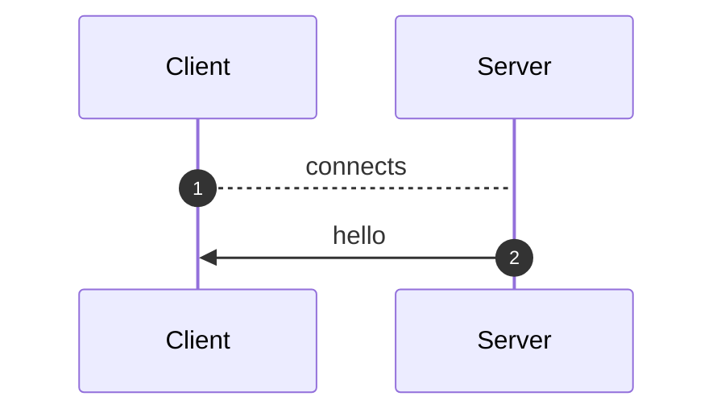
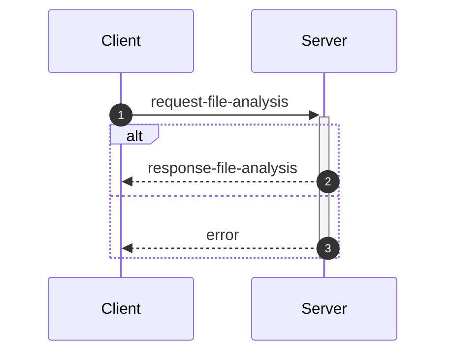
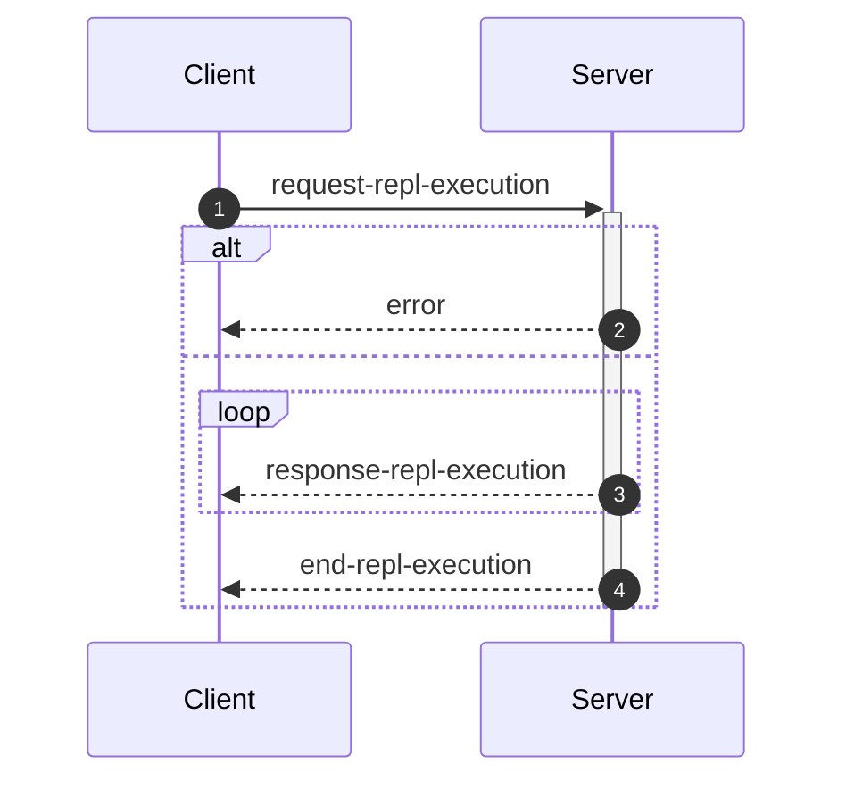
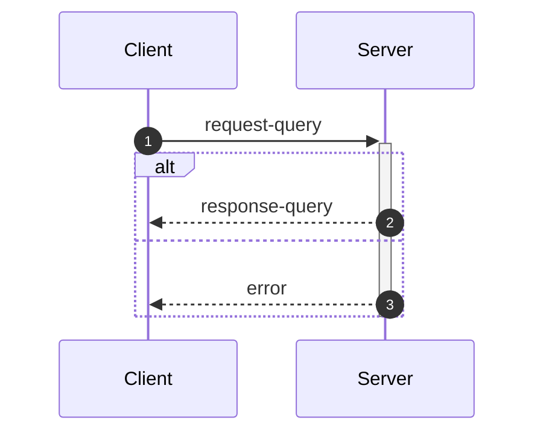

_<span title="an overview of flowR's interface">Generated</span> from '[wiki-interface.ts](https://github.com/flowr-analysis/flowr/tree/main/src/documentation/wiki-interface.ts "src/documentation/wiki-interface.ts")' on 2026-11-06, 13:56:07 UTC (v2.17.3, R v4.6.1), do not edit directly._

Although far from being as detailed as the in-depth explanation of [_flowR_](https://github.com/flowr-analysis/flowr/wiki/Core),
this wiki page explains how to interface with _flowR_ in more detail.
In general, command line arguments and other options provide short descriptions on hover over.

* [💻 Using the REPL](#using-the-repl)
* [⚙️ Configuring FlowR](#configuring-flowr)
* [⚒️ Writing Code](#writing-code)
* [💬 Communicating with the Server](#communicating-with-the-server)

<a id='using-the-repl'></a>
## 💻 Using the REPL

> [!NOTE]
> To execute arbitrary R commands with a repl request, _flowR_ has to be started explicitly with <span title="Description (Command Line Argument): Allow to access the underlying R session when using flowR (security warning: this allows the execution of arbitrary R code!)">`--r-session-access`</span>.
> Please be aware that this introduces a security risk and note that this relies on the [`r-shell` engine](https://github.com/flowr-analysis/flowr/wiki/Engines) .

Although primarily meant for users to explore,
there is nothing which forbids calling _flowR_ as a subprocess to use standard-in, -output, and -error
for communication (although you can access the REPL using the server as well,
with the [REPL Request](#message-request-repl-execution) message).

The read-eval-print loop&nbsp;(REPL) works relatively simple.
You can submit an expression (using <kbd>Enter</kbd>),
which is interpreted as an R&nbsp;expression by default but interpreted as a *command* if it starts with a colon (`:`).
The best command to get started with the REPL is <span title="Description (Repl Command): Show help information (aliases: :h, :?)">`:help`</span>.
Besides, you can leave the REPL either with the command <span title="Description (Repl Command): End the repl (aliases: :q, :exit)">`:quit`</span> or by pressing <kbd>Ctrl</kbd>+<kbd>C</kbd> twice.
When writing a *command*, you may press <kbd>Tab</kbd> to get a list of completions, if available.
Multiple commands can be entered in a single line by separating them with a semicolon (`;`), e.g. `:parse "x<-2"; :df*`.
If a command is given without R code, the REPL will re-use R code given in a previous command.
The prior example will hence return first the parsed AST of the program and then the dataflow graph for `"x <- 2"`.

> [!NOTE]
> If you develop flowR, you may want to launch the repl using the `npm run main-dev` command, this way, you get a non-minified version of flowR with debug information and hot-reloading of source files.

<details>
<summary>Available Commands</summary>

We currently offer the following commands (this with a `[*]` suffix are available with and without the star):

| Command | Description |
| ------- | ----------- |
| **<span title="Description (Repl Command): End the repl (aliases: :q, :exit)">:quit</span>** | End the repl (aliases: **:<span title="Alias of ':quit'. End the repl">q</span>**, **:<span title="Alias of ':quit'. End the repl">exit</span>**) |
| **<span title="Description (Repl Command): Execute the given code as R code. This requires the `--r-session-access` flag to be set and requires the r-shell engine. (aliases: :e, :r)">:execute</span>** | Execute the given code as R code. This requires the `--r-session-access` flag to be set and requires the r-shell engine. (aliases: **:<span title="Alias of ':execute'. Execute the given code as R code. This requires the `--r-session-access` flag to be set and requires the r-shell engine.">e</span>**, **:<span title="Alias of ':execute'. Execute the given code as R code. This requires the `--r-session-access` flag to be set and requires the r-shell engine.">r</span>**) |
| **<span title="Description (Repl Command): Get mermaid code for the control-flow graph of R code (aliases: :cfg, :cf)">:controlflow[*]</span>** | Get mermaid code for the control-flow graph of R code (star: Returns the URL to mermaid.live) (aliases: **:<span title="Alias of ':controlflow'. Get mermaid code for the control-flow graph of R code">cfg</span>**, **:<span title="Alias of ':controlflow'. Get mermaid code for the control-flow graph of R code">cf</span>**) |
| **<span title="Description (Repl Command): Get mermaid code for the control-flow graph with basic blocks (aliases: :cfgb, :cfb)">:controlflowbb[*]</span>** | Get mermaid code for the control-flow graph with basic blocks (star: Returns the URL to mermaid.live) (aliases: **:<span title="Alias of ':controlflowbb'. Get mermaid code for the control-flow graph with basic blocks">cfgb</span>**, **:<span title="Alias of ':controlflowbb'. Get mermaid code for the control-flow graph with basic blocks">cfb</span>**) |
| **<span title="Description (Repl Command): Get mermaid code for the dataflow graph (aliases: :d, :df)">:dataflow[*]</span>** | Get mermaid code for the dataflow graph (star: Returns the URL to mermaid.live) (aliases: **:<span title="Alias of ':dataflow'. Get mermaid code for the dataflow graph">d</span>**, **:<span title="Alias of ':dataflow'. Get mermaid code for the dataflow graph">df</span>**) |
| **<span title="Description (Repl Command): Get mermaid code for the normalized AST of R code (aliases: :n)">:normalize[*]</span>** | Get mermaid code for the normalized AST of R code (star: Returns the URL to mermaid.live) (alias: **:<span title="Alias of ':normalize'. Get mermaid code for the normalized AST of R code">n</span>**) |
| **<span title="Description (Repl Command): Get mermaid code for the simplified dataflow graph (aliases: :ds, :dfs)">:dataflowsimple[*]</span>** | Get mermaid code for the simplified dataflow graph (star: Returns the URL to mermaid.live) (aliases: **:<span title="Alias of ':dataflowsimple'. Get mermaid code for the simplified dataflow graph">ds</span>**, **:<span title="Alias of ':dataflowsimple'. Get mermaid code for the simplified dataflow graph">dfs</span>**) |
| **<span title="Description (Repl Command): Inspect and extend the signature database: `query` (identical to :query @signature), `info <name>` for where a function comes from (identical to :query @function-info), `add <path>` to mount another database/source, `download` to fetch the full-history database. (aliases: :sig)">:signature</span>** | Inspect and extend the signature database: `query` (identical to :query @signature), `info <name>` for where a function comes from (identical to :query @function-info), `add <path>` to mount another database/source, `download` to fetch the full-history database. (alias: **:<span title="Alias of ':signature'. Inspect and extend the signature database: `query` (identical to :query @signature), `info <name>` for where a function comes from (identical to :query @function-info), `add <path>` to mount another database/source, `download` to fetch the full-history database.">sig</span>**) |
| **<span title="Description (Repl Command): Just calculates the DFG, but only prints summary info (aliases: :d#, :df#)">:dataflowsilent</span>** | Just calculates the DFG, but only prints summary info (aliases: **:<span title="Alias of ':dataflowsilent'. Just calculates the DFG, but only prints summary info">d#</span>**, **:<span title="Alias of ':dataflowsilent'. Just calculates the DFG, but only prints summary info">df#</span>**) |
| **<span title="Description (Repl Command): Prints ASCII Art of the parsed, unmodified AST (aliases: :p)">:parse</span>** | Prints ASCII Art of the parsed, unmodified AST (alias: **:<span title="Alias of ':parse'. Prints ASCII Art of the parsed, unmodified AST">p</span>**) |
| **<span title="Description (Repl Command): Prints the version of flowR as well as the current version of R">:version</span>** | Prints the version of flowR as well as the current version of R
| **<span title="Description (Repl Command): Query the given R code (use 'help' for more information)">:query[*]</span>** | Query the given R code (use 'help' for more information) (star: Similar to query, but returns the output in json format.)
| **<span title="Description (Repl Command): Returns an ASCII representation of the dataflow graph (aliases: :df!)">:dataflowascii</span>** | Returns an ASCII representation of the dataflow graph (alias: **:<span title="Alias of ':dataflowascii'. Returns an ASCII representation of the dataflow graph">df!</span>**) |
| **<span title="Description (Repl Command): Returns summarization stats for the normalized AST (aliases: :n#)">:normalize#</span>** | Returns summarization stats for the normalized AST (alias: **:<span title="Alias of ':normalize#'. Returns summarization stats for the normalized AST">n#</span>**) |
| **<span title="Description (Repl Command): Show help information (aliases: :h, :?)">:help</span>** | Show help information (aliases: **:<span title="Alias of ':help'. Show help information">h</span>**, **:<span title="Alias of ':help'. Show help information">?</span>**) |

</details>

> [!TIP]
> 
> As indicated by the examples before, all REPL commands that operate on code keep track of the state.
> Hence, if you run a command like <span title="Description (Repl Command, starred version): Returns the URL to mermaid.live; Base Command: Get mermaid code for the dataflow graph (aliases: :d*, :df*)">`:dataflow*`</span> without providing R code,
> the REPL will re-use the R code provided in a previous command.
> Likewise, doing this will benefit from incrementality!
> If you request the dataflow graph with `:df* x <- 2 * y` and then want to see the parsed AST with `:parse`,
> the REPL will re-use previously obtained information and not re-parse the code again.
> 		

Generally, many commands offer shortcut versions in the REPL. Many queries, for example, offer a shortened format (see the example below).
Of special note, the [Config Query](https://github.com/flowr-analysis/flowr/wiki/%5BQuery%5D-Config)
can be used to also modify the currently active configuration of _flowR_ within the REPL (see the [wiki page](https://github.com/flowr-analysis/flowr/wiki/%5BQuery%5D-Config) for more information).

### Example: Retrieving the Dataflow Graph

To retrieve a URL to the [mermaid](https://mermaid.js.org/) diagram of the dataflow of a given expression,
use <span title="Description (Repl Command, starred version): Returns the URL to mermaid.live; Base Command: Get mermaid code for the dataflow graph (aliases: :d*, :df*)">`:dataflow*`</span> (or <span title="Description (Repl Command): Get mermaid code for the dataflow graph (aliases: :d, :df)">`:dataflow`</span> to get the mermaid code in the cli):

```shell
$ docker run -it --rm eagleoutice/flowr # or npm run flowr 
flowR repl v2.17.3, R grammar v14 (tree-sitter engine)
R> :dataflow* y <- 1 + x
```

<details>
<summary style='color:gray'>Output</summary>

```text
https://mermaid.live/view#base64:eyJjb2RlIjoiZmxvd2NoYXJ0IFREXG4gICAgMXt7XCJgKiM5MTtSTnVtYmVyIzkzOyogKioxKipcbiAgICAgICoxLjYqICgqKmlkOiAxKiopYFwifX1cbiAgICAyKFtcImAqIzkxO1JTeW1ib2wjOTM7KiAqKngqKlxuICAgICAgKjEuMTAqICgqKmlkOiAyKiopYFwiXSlcbiAgICAzW1tcImAqIzkxO1JCaW5hcnlPcCM5MzsqIGJhc2UjNTg7IzU4OyoqIzQzOyoqXG4gICAgICAqMS42LTEwKiAoKippZDogMyoqKVxuICAgIGFyZzogKDEsIDIpYFwiXV1cbiAgICBidWlsdC1pbjpfNDNfW1wiYEJ1aWx0LUluOlxuIzQzO2BcIl1cbiAgICBzdHlsZSBidWlsdC1pbjpfNDNfIHN0cm9rZTpncmF5LGZpbGw6Z3JheSxzdHJva2Utd2lkdGg6MnB4LG9wYWNpdHk6Ljg7XG4gICAgMFtcImAqIzkxO1JTeW1ib2wjOTM7KiAqKnkqKlxuICAgICAgKjEuMSogKCoqaWQ6IDAqKiwgdjogMylgXCJdXG4gICAgNFtbXCJgKiM5MTtSQmluYXJ5T3AjOTM7KiBiYXNlIzU4OyM1ODsqKiM2MDsjNDU7KipcbiAgICAgICoxLjEtMTAqICgqKmlkOiA0KiopXG4gICAgYXJnOiAoMCwgMylgXCJdXVxuICAgIGJ1aWx0LWluOl82MF8tW1wiYEJ1aWx0LUluOlxuIzYwOyM0NTtgXCJdXG4gICAgc3R5bGUgYnVpbHQtaW46XzYwXy0gc3Ryb2tlOmdyYXksZmlsbDpncmF5LHN0cm9rZS13aWR0aDoycHgsb3BhY2l0eTouODtcbiAgICAxIC0uLT58XCJmbG93XCJ8IDJcbiAgICBsaW5rU3R5bGUgMCBzdHJva2U6Z3JheSxjb2xvcjpncmF5O1xuICAgIDIgLS4tPnxcImZsb3dcInwgM1xuICAgIGxpbmtTdHlsZSAxIHN0cm9rZTpncmF5LGNvbG9yOmdyYXk7XG4gICAgMyAtLT58XCJyZWFkcywgYXJnXCJ8IDFcbiAgICAzIC0tPnxcInJlYWRzLCBhcmdcInwgMlxuICAgIDMgLS4tPnxcImZsb3dcInwgMFxuICAgIGxpbmtTdHlsZSA0IHN0cm9rZTpncmF5LGNvbG9yOmdyYXk7XG4gICAgMyAtLi0+fFwicmVhZHMsIGNhbGxzXCJ8IGJ1aWx0LWluOl80M19cbiAgICBsaW5rU3R5bGUgNSBzdHJva2U6Z3JheTtcbiAgICAwIC0tPnxcImRlZmluZWQtYnksIGZsb3dcInwgNFxuICAgIDAgLS0+fFwiZGVmaW5lZC1ieVwifCAzXG4gICAgNCAtLT58XCJyZWFkcywgYXJnXCJ8IDNcbiAgICA0IC0tPnxcInJldHVybnMsIGFyZ1wifCAwXG4gICAgNCAtLi0+fFwicmVhZHMsIGNhbGxzXCJ8IGJ1aWx0LWluOl82MF8tXG4gICAgbGlua1N0eWxlIDEwIHN0cm9rZTpncmF5OyIsIm1lcm1haWQiOnsiYXV0b1N5bmMiOnRydWV9fQ==
```

Retrieve the dataflow graph of the expression `y <- 1 + x`. It looks like this:


<details>

<summary style="color:gray">R Code of the Dataflow Graph</summary>

The analysis ran (parse and normalize with the [tree-sitter](https://github.com/flowr-analysis/flowr/wiki/Engines) engine) in the generation environment. No [signature database](https://github.com/flowr-analysis/flowr/wiki/Signature-Database) is mounted, so `library()` attaches no exports (base-R names are still qualified, e.g., `stats::acf`). 
We encountered no unknown side effects during the analysis.

```r
y <- 1 + x
```

</details>

</details>

For small graphs like this, <span title="Description (Repl Command): Returns an ASCII representation of the dataflow graph (aliases: :df!)">`:dataflowascii`</span> also provides an ASCII representation directly in the REPL:

```shell
$ docker run -it --rm eagleoutice/flowr # or npm run flowr 
flowR repl v2.17.3, R grammar v14 (tree-sitter engine)
R> :df! y <- 1 + x
```

<details open>
<summary style='color:gray'>Output</summary>

```text
                        v<0>v
 c<4>c──────────────────| y |
 |<- |     ┌────────────v---v
 c---c     │
    │   c<3>c   0<1>0
    └───| + |───| 1 |───u<2>u
        c---c   0---0   | x |
           └────────────u---u
Edges:
3 -> 1: reads, arg          3 -> 2: reads, arg
3 -> 0: flows-to            1 -> 2: flows-to
2 -> 3: flows-to            4 -> 3: reads, arg
4 -> 0: returns, arg        0 -> 4: defined-by, flows-to
0 -> 3: defined-by
```

Retrieve the dataflow graph of the expression `y <- 1 + x` as ASCII art.

</details>

For the slicing with <span title="Description (Repl Command): Static backwards executable slicer for R">`:slicer`</span>, you have access to the same [magic comments](#slice-magic-comments) as with the [slice request](#message-request-slice).
Pass `--inline` to splice resolvable `source()` calls into the reconstruction so the slice is a single self-contained R text (the same as the static slice query's `inlineSources` flag).
See `--help` for more flags!

### Example: Interfacing with the File System

Many commands that allow for an R-expression (like <span title="Description (Repl Command, starred version): Returns the URL to mermaid.live; Base Command: Get mermaid code for the dataflow graph (aliases: :d*, :df*)">`:dataflow*`</span>) allow for a file as well
if the argument starts with `file://`.
If you are working from the root directory of the _flowR_ repository, the following gives you the parsed AST of the example file using the <span title="Description (Repl Command): Prints ASCII Art of the parsed, unmodified AST (aliases: :p)">`:parse`</span> command:

> **Watch mode**: Replace `file://` with `watch://` to enter watch mode.
> flowR runs the command immediately and then re-runs it every time the file (or any file inside the folder) changes.
> Enter any other command to leave watch mode.
> For example: `:df watch://analysis.R`

```shell
$ docker run -it --rm eagleoutice/flowr # or npm run flowr 
flowR repl v2.17.3, R grammar v14 (tree-sitter engine)
R> :parse file://test/testfiles/example.R
```

<details>
<summary style='color:gray'>Output</summary>

```text
File: test/testfiles/example.R

program
├ binaryoperator
│ ├ identifier "sum" (1:1─4)
│ ├ <- "<-" (1:5─7)
│ ╰ float "0" (1:8─9)
├ binaryoperator
│ ├ identifier "product" (2:1─8)
│ ├ <- "<-" (2:9─11)
│ ╰ float "1" (2:12─13)
├ binaryoperator
│ ├ identifier "w" (3:1─2)
│ ├ <- "<-" (3:3─5)
│ ╰ float "7" (3:6─7)
├ binaryoperator
│ ├ identifier "N" (4:1─2)
│ ├ <- "<-" (4:3─5)
│ ╰ float "10" (4:6─8)
├ forstatement
│ ├ for "for" (6:1─4)
│ ├ ( "(" (6:5─6)
│ ├ identifier "i" (6:6─7)
│ ├ in "in" (6:8─10)
│ ├ binaryoperator
│ │ ├ float "1" (6:11─12)
│ │ ├ : ":" (6:12─13)
│ │ ╰ parenthesizedexpression
│ │   ├ ( "(" (6:13─14)
│ │   ├ binaryoperator
│ │   │ ├ identifier "N" (6:14─15)
│ │   │ ├ - "-" (6:15─16)
│ │   │ ╰ float "1" (6:16─17)
│ │   ╰ ) ")" (6:17─18)
│ ├ ) ")" (6:18─19)
│ ╰ bracedexpression
│   ├ { "{" (6:20─21)
│   ├ binaryoperator
│   │ ├ identifier "sum" (7:3─6)
│   │ ├ <- "<-" (7:7─9)
│   │ ╰ binaryoperator
│   │   ├ binaryoperator
│   │   │ ├ identifier "sum" (7:10─13)
│   │   │ ├ + "+" (7:14─15)
│   │   │ ╰ identifier "i" (7:16─17)
│   │   ├ + "+" (7:18─19)
│   │   ╰ identifier "w" (7:20─21)
│   ├ binaryoperator
│   │ ├ identifier "product" (8:3─10)
│   │ ├ <- "<-" (8:11─13)
│   │ ╰ binaryoperator
│   │   ├ identifier "product" (8:14─21)
│   │   ├  "" (8:22─23)
│   │   ╰ identifier "i" (8:24─25)
│   ╰ } "}" (9:1─2)
├ call
│ ├ identifier "cat" (11:1─4)
│ ╰ arguments
│   ├ ( "(" (11:4─5)
│   ├ argument
│   │ ╰ string
│   │   ├ stringopen "\"" (11:5─6)
│   │   ├ stringcontent "Sum:" (11:6─10)
│   │   ╰ stringclose "\"" (11:10─11)
│   ├ comma "," (11:11─12)
│   ├ argument
│   │ ╰ identifier "sum" (11:13─16)
│   ├ comma "," (11:16─17)
│   ├ argument
│   │ ╰ string
│   │   ├ stringopen "\"" (11:18─19)
│   │   ├ stringcontent
│   │   │ ╰ escapesequence "\\n" (11:19─21)
│   │   ╰ stringclose "\"" (11:21─22)
│   ╰ ) ")" (11:22─23)
╰ call
  ├ identifier "cat" (12:1─4)
  ╰ arguments
    ├ ( "(" (12:4─5)
    ├ argument
    │ ╰ string
    │   ├ stringopen "\"" (12:5─6)
    │   ├ stringcontent "Product:" (12:6─14)
    │   ╰ stringclose "\"" (12:14─15)
    ├ comma "," (12:15─16)
    ├ argument
    │ ╰ identifier "product" (12:17─24)
    ├ comma "," (12:24─25)
    ├ argument
    │ ╰ string
    │   ├ stringopen "\"" (12:26─27)
    │   ├ stringcontent
    │   │ ╰ escapesequence "\\n" (12:27─29)
    │   ╰ stringclose "\"" (12:29─30)
    ╰ ) ")" (12:30─31)
```

Retrieve the parsed AST of the example file.

<details>

<summary>File Content</summary>

```r
sum <- 0
product <- 1
w <- 7
N <- 10

for (i in 1:(N-1)) {
  sum <- sum + i + w
  product <- product * i
}

cat("Sum:", sum, "\n")
cat("Product:", product, "\n")
```

</details>

As _flowR_ directly transforms this AST the output focuses on being human-readable instead of being machine-readable.
		
</details>

### Example: Run a Query

You can run any query supported by _flowR_ using the <span title="Description (Repl Command): Query the given R code (use 'help' for more information)">`:query`</span> command.
For example, to obtain the shapes of all data frames in a given piece of code, you can run:

```shell
$ docker run -it --rm eagleoutice/flowr # or npm run flowr 
flowR repl v2.17.3, R grammar v14 (tree-sitter engine)
R> :query @absint df-shape "x <- data.frame(a = 1:10, b = 1:10)\ny <- x$a"
```

<details open>
<summary style='color:gray'>Output</summary>

```text
Query: absint (2 ms)
   ╰ $12: (colnames: [{"a", "b"}, {}], cols: [2, 2], rows: [10, 10])
   ╰ $0: (colnames: [{"a", "b"}, {}], cols: [2, 2], rows: [10, 10])
```

Retrieve the shapes of all data frames in the given code.

</details>

To run the linter on a file, you can use (in this example, we just issue the `dead-code` linter on a small piece of code):

```shell
$ docker run -it --rm eagleoutice/flowr # or npm run flowr 
flowR repl v2.17.3, R grammar v14 (tree-sitter engine)
R> :query @linter rules:dead-code "if(FALSE) x <- 2"
```

<details open>
<summary style='color:gray'>Output</summary>

```text
Query: linter (2 ms)
   ╰ Dead Code (dead-code):
       ╰ certain:
           ╰ Code at 1.11-16 (1 quick fix(es) available)
```

Run the linter on the given code, with only the `dead-code` rule enabled.

</details>

For more information on the available queries, please check out the [Query API](https://github.com/flowr-analysis/flowr/wiki/Query-API).

<a id='configuring-flowr'></a>
## ⚙️ Configuring FlowR

When running _flowR_, you may want to specify some behaviors with a dedicated configuration file.
By default, flowR looks for a file named `flowr.json` in the current working directory (or any higher directory).
You can also specify a different file with <span title="Description (Command Line Argument): The name of the configuration file to use">`--config-file`</span> or pass the configuration inline using <span title="Description (Command Line Argument): The flowR configuration to use, as a JSON string">`--config-json`</span>.
A `flowr.json` found this way belongs to the analyzed project, so flowR ignores its options that decide what flowR executes or loads
(`engines.*.wasmPath`, `engines.*.treeSitterWasmPath`, `engines.*.rPath`, `solver.sigdb.additionalPaths`, `solver.sigdb.downloadRepo`, `solver.sigdb.installedLibrary.paths`, `solver.sigdb.onDemand.enabled`, `solver.sigdb.onDemand.repositories`, `solver.sigdb.onDemand.cranMirror`, `solver.sigdb.onDemand.bioconductorMirror`, `solver.sigdb.onDemand.cacheDir`),
unless you pass <span title="Description (Command Line Argument): Keep the security-sensitive options (e.g., the R executable) of the flowr.json found in the working directory or a parent. Only use this for projects you trust.">`--trust-config`</span>.
To analyze code you do not trust, use the secure mode (<span title="Description (Command Line Argument): Run in secure mode for analyzing untrusted code: flowR does not start R (or any other process), does not access the network, does not search for project configs, and ignores security-sensitive options in every config. Cannot be disabled once enabled. Can also be enabled with the environment variable {italic FLOWR_SECURE_MODE=1}.">`--secure`</span>, see the [security policy](https://github.com/flowr-analysis/flowr/blob/main/.github/SECURITY.md)).
To inspect the current configuration, you can run flowr with the <span title="Description (Command Line Argument): Run with verbose logging (will be passed to the corresponding script)">`--verbose`</span> flag, or use the `config` [Query](https://github.com/flowr-analysis/flowr/wiki/Query-API).
Within the REPL this works by running the following:

```shell
:query @config
```

To work with the <a href="https://github.com/flowr-analysis/flowr/tree/main/src/config.ts#L119"><code><span title="The configuration file format for flowR.">FlowrConfig</span></code></a> you can use the provided helper objects alongside its methods like
<a href="https://github.com/flowr-analysis/flowr/tree/main/src/config.ts#L966"><code><span title="Creates a new flowr config that has the updated values.">FlowrConfig::<b>amend</b></span></code></a>.
The schema below documents every option; the ones you most likely want are:

- <a href="https://github.com/flowr-analysis/flowr/wiki/Interface#configuring-flowr" title="Configuration Option (boolean): Whether source calls should be ignored, causing {@link processSourceCall}&#39;s behavior to be skipped.">ignoreSourceCalls</a>: ignore source calls when analyzing the code, i.e., ignore the inclusion of other files.
- <a href="https://github.com/flowr-analysis/flowr/wiki/Interface#configuring-flowr" title="Configuration Option (boolean): Whether load calls should be ignored, causing {@link processLoadCall}&#39;s behavior to be skipped.">ignoreLoadCalls</a>: ignore load calls when analyzing the code, i.e., ignore the loading of r-data files.
- <a href="https://github.com/flowr-analysis/flowr/wiki/Interface#configuring-flowr" title="Configuration Option (object): Do you want to overwrite (parts) of the builtin definition?">semantics.environment.overwriteBuiltIns</a>: overwrite _flowR_'s handling of built-in functions, or clear the preset definitions entirely.
  See [Configure BuiltIn Semantics](#configure-builtin-semantics) for more information.
- <a href="https://github.com/flowr-analysis/flowr/wiki/Interface#configuring-flowr" title="Configuration Option (string): How to resolve variables and their values. (one of &quot;disabled&quot;, &quot;alias&quot;, &quot;builtin&quot;)">solver.variables</a>: how to resolve variables and their values (`disabled`, `alias`, `builtin`).
- <a href="https://github.com/flowr-analysis/flowr/wiki/Interface#configuring-flowr" title="Configuration Option (array): The engine or set of engines to use for interacting with R code. An empty array means all available engines will be used.">engines</a> and <a href="https://github.com/flowr-analysis/flowr/wiki/Interface#configuring-flowr" title="Configuration Option (string): The default engine to use for interacting with R code. If this is undefined, an arbitrary engine from the specified list will be used. (one of &quot;tree-sitter&quot;, &quot;r-shell&quot;)">defaultEngine</a>: the engines used to interact with R code, see the [Engines wiki page](https://github.com/flowr-analysis/flowr/wiki/Engines).
- <a href="https://github.com/flowr-analysis/flowr/wiki/Interface#configuring-flowr" title="Configuration Option (array): Files a framework loads on its own, without any source() call (e.g. global.R in a shiny app), in the order they are loaded; flowR orders the matching project files accordingly and analyzes them as one program. Entries are case-insensitive globs matched against the file path, a plain name matches any file with that name, and entries matching no project file are warned about. Usually set per project kind via specializeConfig.">project.implicitSources</a>: the files a framework loads without any `source()` call, in the order in which they are
  loaded. Entries are globs (e.g. `R/*.R`) matched against the file path ignoring capitalization; one matching no file is reported.
- <a href="https://github.com/flowr-analysis/flowr/wiki/Interface#configuring-flowr" title="Configuration Option (object): Overwrite (parts of) the configuration depending on the project kind flowR detects, e.g. to give a shiny app its implicit sources.">specializeConfig</a>: overwrite (parts of) the configuration depending on the kind of project _flowR_ detects
  (e.g. `shiny-app`), which is how a shiny app gets its implicit sources by default. What you configure directly wins.
- <a href="https://github.com/flowr-analysis/flowr/wiki/Interface#configuring-flowr" title="Configuration Option (string): Overwrite the project kind flowR would otherwise infer from the analyzed files, e.g. when auto-detection guesses wrong. (one of &quot;package&quot;, &quot;script&quot;, &quot;shiny-app&quot;, &quot;notebook&quot;, &quot;project&quot;, &quot;unknown&quot;)">project.useProjectType</a>: skip that detection and force a project kind yourself, when auto-detection guesses wrong.
- <a href="https://github.com/flowr-analysis/flowr/wiki/Interface#configuring-flowr" title="Configuration Option (array): The default plugins to load when creating a new instance of FlowrAnalyzer">defaultPlugins</a> and <a href="https://github.com/flowr-analysis/flowr/wiki/Interface#configuring-flowr" title="Configuration Option (array): The plugins to load in REPL mode">repl.plugins</a>: the plugins to load for a new <a href="https://github.com/flowr-analysis/flowr/tree/main/src/project/flowr-analyzer.ts#L210"><code><span title="Central class for conducting analyses with FlowR. Use the FlowrAnalyzerBuilder to create a new instance. If you want the original pattern of creating a pipeline and running all steps, you can still do this with FlowrAnalyzer#runFull . To inspect the context of the analyzer, use FlowrAnalyzer#inspectContext (if you are a plugin and need to modify it, use FlowrAnalyzer#context instead).">FlowrAnalyzer</span></code></a> and in the REPL
  (use `flowr:default` to reference the former).

So you can configure _flowR_ by adding a file like the following:

<details>

<summary>Example Configuration File</summary>

```json
{
  "ignoreSourceCalls": true,
  "ignoreLoadCalls": true,
  "semantics": {
    "environment": {
      "overwriteBuiltIns": {
        "definitions": [
          {
            "type": "function",
            "names": [
              "foo"
            ],
            "processor": "builtin:assign",
            "config": {}
          }
        ]
      }
    }
  },
  "defaultPlugins": [
    "file:description",
    "versions:description"
  ],
  "repl": {
    "quickStats": false,
    "dfProcessorHeat": false,
    "hints": true,
    "plugins": [
      "flowr:default"
    ]
  },
  "project": {
    "resolveUnknownPathsOnDisk": true,
    "implicitSources": [
      "global.R",
      "app.R"
    ]
  },
  "linter": {
    "disabledRules": []
  },
  "specializeConfig": {
    "shiny-app": {
      "project": {
        "implicitSources": [
          "global.R",
          "ui.R",
          "server.R",
          "app.R"
        ]
      }
    }
  },
  "engines": [
    {
      "type": "r-shell"
    }
  ],
  "solver": {
    "variables": "alias",
    "evalStrings": true,
    "trackEnvironments": true,
    "sigdb": {
      "enabled": true,
      "loadProjectDependencies": true,
      "eagerlyLoad": false,
      "eagerlyLoadExports": false,
      "linkBaseR": false,
      "linkDescriptionDependencies": false
    },
    "resolveSource": {
      "dropPaths": "no",
      "ignoreCapitalization": true,
      "inferWorkingDirectory": "active-script",
      "searchPath": []
    },
    "instrument": {},
    "slicer": {
      "threshold": 50
    }
  },
  "abstractInterpretation": {
    "wideningThreshold": 4,
    "followCalls": true,
    "dataFrame": {
      "maxColNames": 20,
      "readLoadedData": {
        "readExternalFiles": true,
        "maxReadLines": 1000000
      }
    }
  },
  "incremental": {
    "alwaysIncremental": false,
    "parsing": {
      "activated": false,
      "heuristics": {
        "activated": true,
        "mtime": true,
        "linesFrom": 500,
        "bytesFrom": 50000,
        "alwaysWithEdits": false,
        "minFiles": 1
      }
    }
  },
  "gas": {
    "thresholds": {
      "memory": {
        "problematic": 0.7,
        "critical": 0.9
      },
      "timeMs": {
        "problematic": 100000,
        "critical": 120000
      }
    },
    "features": {}
  }
}
```

</details>

<details>
<a id='configure-builtin-semantics'></a>
<summary>Configure Built-In Semantics</summary>

`semantics/environment/overwriteBuiltins` accepts two keys:

- `loadDefaults` (boolean, initially `true`): If set to `true`, the default built-in definitions are loaded before applying the custom definitions. Setting this flag to `false` explicitly disables the loading of the default definitions.
- `definitions` (array, initially empty): Allows to overwrite or define new built-in elements. Each object within must have a `type` which is one of the below. Furthermore, they may define a string array of `names` which specifies the identifiers to bind the definitions to. You may use `assumePrimitive` to specify whether _flowR_ should assume that this is a primitive non-library definition (so you probably just do not want to specify the key).

  | Type            | Description                                                                                                                                                                                                                                                                                              | Example                                                                                                    |
  | --------------- | -------------------------------------------------------------------------------------------------------------------------------------------------------------------------------------------------------------------------------------------------------------------------------------------------------- | ---------------------------------------------------------------------------------------------------------- |
  | `constant`    | Additionally allows for a `value` this should resolve to.                                                                                                                                                                                                                                                | `{ type: 'constant', names: ['NULL', 'NA'],  value: null }`                                                |
  | `function`    | Is a rather flexible way to define and bind built-in functions. For the time, we do not have extensive documentation to cover all the cases, so please either consult the sources with the `default-builtin-config.ts` or open a [new issue](https://github.com/flowr-analysis/flowr/issues/new/choose). | `{ type: 'function', names: ['next'], processor: 'builtin:d', config: { cfg: ExitPointType.Next } }` |
  | `replacement` | A comfortable way to specify replacement functions like `$<-` or `names<-`. `suffixes` describes the... suffixes to attach automatically. | `{ type: 'replacement', suffixes: ['<-', '<<-'], names: ['[', '[['] }` |

</details>

<details>

<summary style='color:gray'>Full Configuration-File Schema</summary>

- _The configuration file format for flowR._ (object)
    - **logLevel** [optional] _flowR's global minimum log level, applied when the config is loaded._ (string)
        Only allows: 'silly', 'trace', 'debug', 'info', 'warn', 'error', 'fatal'
    - **ignoreSourceCalls** [optional] _Whether source calls should be ignored, causing {@link processSourceCall}'s behavior to be skipped._ (boolean)
    - **ignoreLoadCalls** [optional] _Whether load calls should be ignored, causing {@link processLoadCall}'s behavior to be skipped._ (boolean)
    - **semantics** _Configure language semantics and how flowR handles them._ (object)
        - **environment** [optional] _Semantics regarding how to handle the R environment._ (object)
            - **overwriteBuiltIns** [optional] _Do you want to overwrite (parts) of the builtin definition?_ (object)
                - **loadDefaults** [optional] _Should the default configuration still be loaded?_ (boolean)
                - **definitions** [optional] _The definitions to load/overwrite._ (array)
                Valid item types:
                    - (object)
    - **defaultPlugins** [optional] _The default plugins to load when creating a new instance of FlowrAnalyzer_ (array)
    Valid item types:
        - (alternatives)
            - (string)
            - (array)
    - **repl** _Configuration options for the REPL._ (object)
        - **quickStats** [optional] _Whether to show quick stats in the REPL after each evaluation._ (boolean)
        - **dfProcessorHeat** [optional] _This instruments the dataflow processors to count how often each processor is called._ (boolean)
        - **hints** [optional] _Whether to show dim inline hints on the empty prompt (automatically disabled on non-interactive terminals)._ (boolean)
        - **plugins** [optional] _The plugins to load in REPL mode_ (array)
        Valid item types:
            - (alternatives)
                - (string)
                - (array)
        - **autoUseFileProtocol** [optional] _Prepend the file protocol to a repl input that looks like a path, instead of only warning about it._ (boolean)
        - **queryStats** [optional] _Whether `:query` closes with the line stating how long the queries took (`:query*` never prints it)._ (boolean)
        - **showPlugins** [optional] _Whether `:version` grays out the plugins that did not activate during the last analysis._ (boolean)
    - **project** _Project specific configuration options._ (object)
        - **resolveUnknownPathsOnDisk** [optional] _Whether to resolve unknown paths loaded by the r project disk when trying to source/analyze files._ (boolean)
        - **failOnInaccessiblePath** [optional] _Whether a directory that cannot be traversed during file discovery (e.g. due to permissions) aborts the analysis; when false (the default) such paths are logged and skipped._ (boolean)
        - **basePackages** [optional] _The packages considered part of R itself (base and recommended); if unset, flowR uses its built-in list._ (array)
        Valid item types:
            - (string)
        - **implicitSources** [optional] _Files a framework loads on its own, without any source() call (e.g. global.R in a shiny app), in the order they are loaded; flowR orders the matching project files accordingly and analyzes them as one program. Entries are case-insensitive globs matched against the file path, a plain name matches any file with that name, and entries matching no project file are warned about. Usually set per project kind via specializeConfig._ (array)
        Valid item types:
            - (string)
        - **useProjectType** [optional] _Overwrite the project kind flowR would otherwise infer from the analyzed files, e.g. when auto-detection guesses wrong._ (string)
            Only allows: 'package', 'script', 'shiny-app', 'notebook', 'project', 'unknown'
        - **assumeImplicitEcho** [optional] _Whether the top level of the analyzed code is echoed, so that every visible result printed there is collected as an output by the dependencies query (default true, false for a package)._ (boolean)
        - **discovery** [optional] _Scoping options for the default project discovery._ (object)
            - **full** [optional] _Collect every file below the project root (greedy) instead of only the files the detected project kind needs (default false)._ (boolean)
            - **perKind** [optional] _Per-kind include/exclude glob overrides layered on the default scoping._ (object)
            - **ignore** [optional] _Case-insensitive globs that drop matching files from the intelligent discovery, regardless of kind (e.g. .Renviron to ignore environment files)._ (array)
            Valid item types:
                - (string)
        - **classification** [optional] _Overrides for the signals flowR uses to classify the project kind._ (object)
            - **shinyDescriptionTypes** [optional] _DESCRIPTION Type: values that mark a shiny app._ (array)
            Valid item types:
                - (string)
            - **shinyEntryFiles** [optional] _File names a shiny app is assembled from._ (array)
            Valid item types:
                - (string)
            - **shinyUsagePattern** [optional] _Regex source evidencing shiny usage in an entry file._ (string)
            - **notebookExtensions** [optional] _File extensions marking a notebook._ (array)
            Valid item types:
                - (string)
    - **linter** _Linter configuration options._ (object)
        - **disabledRules** _Linting rule names excluded from the default rule set (a rule requested explicitly via a linter query still runs). Usually set per project kind via specializeConfig._ (array)
        Valid item types:
            - (string)
        - **disabledTags** [optional] _Linting rule tags whose rules are excluded from the default rule set (a rule requested explicitly via a linter query still runs). By default the cmd-check rules are disabled for everything but a package; a configured list replaces that default._ (array)
        Valid item types:
            - (string)
    - **inputSources** [optional] _Further frameworks the input-sources analysis should know about; entries are added to flowR's defaults._ (object)
        - **pure** [optional] _Functions that only pass the constantness of their arguments on._ (array)
        Valid item types:
            - (string)
        - **param** [optional] _Functions whose result is a 'param' input._ (array)
        Valid item types:
            - (string)
        - **file** [optional] _Functions whose result is a 'file' input._ (array)
        Valid item types:
            - (string)
        - **tempfile** [optional] _Functions whose result is a 'tempfile' input._ (array)
        Valid item types:
            - (string)
        - **glob** [optional] _Functions whose result is a 'glob' input._ (array)
        Valid item types:
            - (string)
        - **net** [optional] _Functions whose result is a 'net' input._ (array)
        Valid item types:
            - (string)
        - **rand** [optional] _Functions whose result is a 'rand' input._ (array)
        Valid item types:
            - (string)
        - **system** [optional] _Functions whose result is a 'system' input._ (array)
        Valid item types:
            - (string)
        - **ffi** [optional] _Functions whose result is a 'ffi' input._ (array)
        Valid item types:
            - (string)
        - **lang** [optional] _Functions whose result is a 'lang' input._ (array)
        Valid item types:
            - (string)
        - **options** [optional] _Functions whose result is a 'options' input._ (array)
        Valid item types:
            - (string)
        - **cmdline** [optional] _Functions whose result is a 'cmdline' input._ (array)
        Valid item types:
            - (string)
        - **user** [optional] _Functions whose result is a 'user' input._ (array)
        Valid item types:
            - (string)
        - **const** [optional] _Functions whose result is a 'const' input._ (array)
        Valid item types:
            - (string)
        - **scope** [optional] _Functions whose result is a 'scope' input._ (array)
        Valid item types:
            - (string)
        - **dconst** [optional] _Functions whose result is a 'dconst' input._ (array)
        Valid item types:
            - (string)
        - **unknown** [optional] _Functions whose result is a 'unknown' input._ (array)
        Valid item types:
            - (string)
        - **linkedObjects** [optional] _Objects a framework provides without a definition in the code, e.g. shiny's input._ (array)
        Valid item types:
            - (object)
        - **linkedEntryPoints** [optional] _Calls that hand a function to a framework, which binds its objects to the parameters by position._ (array)
        Valid item types:
            - (object)
    - **specializeConfig** [optional] _Overwrite (parts of) the configuration depending on the project kind flowR detects, e.g. to give a shiny app its implicit sources._ (object)
    - **engines** _The engine or set of engines to use for interacting with R code. An empty array means all available engines will be used._ (array)
    Valid item types:
        - (alternatives)
            - _The configuration for the tree sitter engine._ (object)
                - **type** [required] _Use the tree sitter engine._ (string)
                    Only allows: 'tree-sitter'
                - **wasmPath** [optional] _The path to the tree-sitter-r WASM binary to use. If this is undefined, this uses the default path._ (string)
                - **treeSitterWasmPath** [optional] _The path to the tree-sitter WASM binary to use. If this is undefined, this uses the default path._ (string)
                - **lax** [optional] _Whether to use the lax parser for parsing R code (allowing for syntax errors). If this is undefined, the strict parser will be used._ (boolean)
            - _The configuration for the R shell engine._ (object)
                - **type** [required] _Use the R shell engine._ (string)
                    Only allows: 'r-shell'
                - **rPath** [optional] _The path to the R executable to use. If this is undefined, this uses the default path._ (string)
                - **pipeBind** [optional] _Whether to enable R's experimental pipe-bind operator "=>" by setting _R_USE_PIPEBIND_ for the R session (default false); R itself keeps this off by default, as it is experimental and has never shipped in a release version of R._ (boolean)
    - **defaultEngine** [optional] _The default engine to use for interacting with R code. If this is undefined, an arbitrary engine from the specified list will be used._ (string)
        Only allows: 'tree-sitter', 'r-shell'
    - **solver** _How to resolve constants, constraints, cells, ..._ (object)
        - **variables** _How to resolve variables and their values._ (string)
            Only allows: 'disabled', 'alias', 'builtin'
        - **evalStrings** _Should we include eval(parse(text="...")) calls in the dataflow graph?_ (boolean)
        - **trackEnvironments** [optional] _Track user-created environments (new.env, assign/get/local with envir=, dollar-assign, attach). When false, all envir-style calls fall through conservatively._ (boolean)
        - **sigdb** _Resolving library exports from a signature database._ (object)
            - **enabled** [optional] _Resolve library()/use() exports from a signature database (default true); when false no database is consulted._ (boolean)
            - **loadProjectDependencies** [optional] _Load the project's declared dependencies from its metadata files (DESCRIPTION Imports/Depends, rproject.toml, uvr.toml, rig rproj.toml and script blocks, renv.lock, rv.lock, uvr.lock, rig lockfiles) (default true); when false these files are not read for dependencies._ (boolean)
            - **eagerlyLoad** [optional] _Parse the database up front rather than on the first package load (default false, ignored if disabled)._ (boolean)
            - **eagerlyLoadExports** [optional] _Add a vertex for every export on load rather than on demand (default false); keeps the dataflow graph small._ (boolean)
            - **assumedRVersion** [optional] _R version assumed when resolving versioned (base-R) exports: a pin like "4.5" or "auto" to detect the installed R (default "auto")._ (string)
            - **linkBaseR** [optional] _Eagerly attach base-R namespaces so bare base calls resolve without library() (default false)._ (boolean)
            - **linkBaseRCalls** [optional] _Add a lightweight Reads edge from a bare base-R call to its signature-database function vertex (default false; base-R qualification is edge-free otherwise)._ (boolean)
            - **linkPackageCalls** [optional] _Add a lightweight Reads edge from a resolved package call to its signature-database function vertex (default false)._ (boolean)
            - **linkDescriptionDependencies** [optional] _Eagerly attach the namespaces of the project's declared DESCRIPTION dependencies (Imports/Depends) so their exports resolve without an explicit library() (default false)._ (boolean)
            - **warmInBackground** [optional] _Decompress the hot shards (base + most-downloaded) in a background task on startup so the first library() lookup is warm (default false; for long-running servers/REPLs)._ (boolean)
            - **additionalPaths** [optional] _Extra directories or bundle/manifest files searched for signature databases (alongside the shipped default and $FLOWR_SIGDB_DIR); a downloaded full-history bundle placed here is mounted automatically._ (array)
            Valid item types:
                - (string)
            - **downloadRepo** [optional] _GitHub owner/repo the full-history bundle is downloaded from via ":signature download" (default "flowr-analysis/flowr"; the release tag comes from the committed sigdb.remote.json unless a version is given)._ (string)
            - **autoSync** [optional] _On startup, re-download shards whose committed sigdb.remote.json hash no longer matches the cache, in the background (default false; opt-in network sync after a git pull)._ (boolean)
            - **installedLibrary** [optional] _Recovering packages no signature database knows from the copy installed on this machine._ (object)
                - **enabled** [required] _Recover packages no signature database knows from their installed copy (default false)._ (boolean)
                - **paths** [optional] _Library directories to search; when empty they are discovered from the environment and the project._ (array)
                Valid item types:
                    - (string)
                - **useEnvironment** [optional] _Search the libraries R_LIBS_USER/R_LIBS/R_LIBS_SITE name (default true)._ (boolean)
                - **useProjectLibrary** [optional] _Search a project-local renv/packrat library (default true)._ (boolean)
                - **maxDepth** [optional] _How far to descend into the nested layout of a project-local library (default 3)._ (number)
                - **packages** [optional] _Only recover packages whose name matches one of these regular expressions; empty means any._ (array)
                Valid item types:
                    - (string)
            - **onDemand** [optional] _Recovering packages no signature database knows from their sources on CRAN, Bioconductor, or GitHub._ (object)
                - **enabled** [required] _Fetch and recover the sources of packages no signature database knows when the analyzed code uses them (default false, accesses the network)._ (boolean)
                - **sources** [optional] _Where to look, in order: github, cran, bioconductor, or a source a plugin adds (default ["github", "cran", "bioconductor"])._ (array)
                Valid item types:
                    - (string)
                - **repositories** [optional] _GitHub repositories (owner/repo[/subdir][@ref]) to fetch packages from, by package name. The analyzed project may name more (DESCRIPTION Remotes, install_github calls)._ (object)
                - **packages** [optional] _Only recover packages whose name matches one of these regular expressions, empty means any._ (array)
                Valid item types:
                    - (string)
                - **cranMirror** [optional] _The CRAN src/contrib/ to fetch from, over https (default https://cloud.r-project.org/src/contrib/). It may be on the local network._ (string)
                - **bioconductorMirror** [optional] _The Bioconductor host, over https (default https://bioconductor.org). It may be on the local network._ (string)
                - **bioconductorRelease** [optional] _The Bioconductor release to fetch from: release, devel, or a number like 3.20 (default release)._ (string)
                - **githubMirrors** [optional] _Use the GitHub mirrors of CRAN (cran/<pkg>) and Bioconductor (bioc/<pkg>) (default true)._ (boolean)
                - **maxPackages** [optional] _The most packages to fetch for one analysis (default 25)._ (number)
                - **maxArchiveMb** [optional] _The most MiB a package archive may have (default 32). It may unpack to three times that, at most 128 MiB._ (number)
                - **offline** [optional] _Only use what was fetched before, never the network (default false)._ (boolean)
                - **retryAfterHours** [optional] _How many hours to wait before asking again for a package no source had (default 24)._ (number)
                - **cacheDir** [optional] _Where to cache what was fetched (default the on-demand directory of the signature cache)._ (string)
            - **blobCacheBudgetMb** [optional] _How many MiB of decoded package blobs every open bundle may hold together (default 16)._ (number)
            - **versionSelection** [optional] _When a project constrains a dependency, resolve to the newest (default), oldest, or system-installed version satisfying it; system needs R and falls back to newest. Base-R packages always resolve against the assumed R version._ (string)
                Only allows: 'newest', 'oldest', 'system'
            - **versionOverrides** [optional] _Force an exact version for specific packages (name -> version), overriding both the project constraint and the versionSelection policy (default {})._ (object)
        - **versionManagement** _Policies for reasoning about dependency versions._ (object)
            - **linkedVersionGroups** [optional] _Groups of packages that must resolve to the same version; version guessing intersects each group so its members stay mutually compatible (default [])._ (array)
            Valid item types:
                - (array)
                Valid item types:
                    - (string)
        - **assumeAttachedPackages** [optional] _Packages to treat as attached without a `library()` call, so what the built-in configuration states about them applies to the analyzed code. The base packages R attaches on startup already resolve without it._ (array)
        Valid item types:
            - (string)
        - **transitiveSideEffectRounds** [optional] _How many rounds the transitive side-effect fixpoint may run before it is cut off (default 32); the propagation stops on its own as soon as a round adds nothing._ (number)
        - **maxOverlayDepth** [optional] _How many binding overlays may stack on one environment frame before a write flattens them (default 4); a pure performance knob, trading lookup cost against copy cost without changing any result._ (number)
        - **instrument** (object)
            - **dataflowExtractors** [optional] _These keys are only intended for use within code, allowing to instrument the dataflow analyzer!_ (any)
        - **resolveSource** [optional] _If lax source calls are active, flowR searches for sourced files much more freely, based on the configurations you give it. This option is only in effect if `ignoreSourceCalls` is set to false._ (object)
            - **dropPaths** _Allow to drop the first or all parts of the sourced path, if it is relative._ (string)
                Only allows: 'no', 'once', 'all'
            - **ignoreCapitalization** _Search for filenames matching in the lowercase._ (boolean)
            - **inferWorkingDirectory** _Try to infer the working directory from the main or any script to analyze._ (string)
                Only allows: 'no', 'main-script', 'active-script', 'any-script'
            - **searchPath** _Additionally search in these paths._ (array)
            Valid item types:
                - (string)
            - **repeatedSourceLimit** [optional] _How often the same file can be sourced within a single run? Please be aware: in case of cyclic sources this may not reach a fixpoint so give this a sensible limit._ (number)
            - **applyReplacements** _Provide name replacements for loaded files_ (array)
            Valid item types:
                - (object)
            - **assumeFilesExist** [optional] _Assume a sourced file is always there, making what it defines certain instead of conditional on the source call._ (boolean)
        - **slicer** [optional] _The configuration for the slicer._ (object)
            - **threshold** [optional] _The maximum number of iterations to perform on a single function call during slicing._ (number)
            - **autoExtend** [optional] _If set, the slicer will gain an additional post-pass._ (boolean)
    - **abstractInterpretation** _The configuration options for abstract interpretation._ (object)
        - **wideningThreshold** _The threshold for the number of visitations of a node at which widening should be performed to ensure the termination of the fixpoint iteration._ (number)
        - **followCalls** _Whether the abstract interpretation is interprocedural, i.e. whether it steps into the functions a call may dispatch to._ (boolean)
        - **dataFrame** _The configuration of the shape inference for data frames._ (object)
            - **maxColNames** _The maximum number of columns names to infer for data frames before over-approximating the column names to top._ (number)
            - **readLoadedData** _Configuration options for reading data frame shapes from loaded external data files, such as CSV files._ (object)
                - **readExternalFiles** _Whether data frame shapes should be extracted from loaded external files, such as CSV files._ (boolean)
                - **maxReadLines** _The maximum number of lines to read when extracting data frame shapes from loaded files, such as CSV files._ (number)
    - **incremental** (object)
        - **alwaysIncremental** _Always take the incremental path, regardless of heuristics._ (boolean)
        - **parsing** (object)
            - **activated** _If set, incremental parsing will be used._ (boolean)
            - **heuristics** (object)
                - **activated** [optional] _If set, the heuristics for incremental parsing will be used._ (boolean)
                - **mtime** [optional] _Skip reparsing entirely if the file's modification time is unchanged since the last parse._ (boolean)
                - **linesFrom** [optional] _Only consider incremental parsing for files with at least this many lines._ (number)
                - **bytesFrom** [optional] _Only consider incremental parsing for files with at least this many bytes._ (number)
                - **alwaysWithEdits** [optional] _Always take the incremental path whenever there is a computed edit region, regardless of the other thresholds._ (boolean)
                - **minFiles** [optional] _Only apply these heuristics once the project has at least this many files loaded._ (number)
    - **gas** [optional] _Resource-usage guard (gas) configuration. All feature factors default to 0 (disabled). See https://github.com/flowr-analysis/flowr/wiki/Core#gas-resource-guard._ (object)
        - **thresholds** [optional] _Thresholds for all gas checks (scaled by per-feature factor), boundable per feature._ (object)
            - **memory** [optional] _Heap-usage fraction thresholds (0-1), either shared or given per feature key (with `default` covering the rest)._ (object)
                - **problematic** [optional] _Heap fraction (0-1) above which Problematic is returned, for every feature without an entry of its own._ (number)
                - **critical** [optional] _Heap fraction (0-1) above which Critical is returned, for every feature without an entry of its own._ (number)
            - **timeMs** [optional] _Elapsed analysis time thresholds in milliseconds, either shared or given per feature key (with `default` covering the rest)._ (object)
                - **problematic** [optional] _Elapsed ms above which Problematic is returned, for every feature without an entry of its own._ (number)
                - **critical** [optional] _Elapsed ms above which Critical is returned, for every feature without an entry of its own._ (number)
            - **steps** [optional] _Processed-AST-node thresholds, counted rather than sampled; only a key that arms a budget (`dataflow`) reads them._ (object)
                - **problematic** [optional] _Processed AST nodes above which Problematic is returned, for every feature without an entry of its own._ (number)
                - **critical** [optional] _Processed AST nodes above which the extraction is cut short, for every feature without an entry of its own._ (number)
            - **vertices** [optional] _Created-dataflow-vertex thresholds, counted like `steps`._ (object)
                - **problematic** [optional] _Created dataflow vertices above which Problematic is returned, for every feature without an entry of its own._ (number)
                - **critical** [optional] _Created dataflow vertices above which the extraction is cut short, for every feature without an entry of its own._ (number)
        - **features** [optional] _Per-feature sensitivity factors. 0 or absent disables gas checking for that feature. A factor of 2 makes the feature twice as sensitive. Recognised keys: `source`, `side-effect-linking`, `linter`, `slicer`, `dataflow`._ (object)
        - **countedCheckEvery** [optional] _How many counted steps pass between two accountings of an armed check, be it a dataflow budget or the slicer's traversal (default 128); trades overshoot against the cost of the check._ (number)
        - **heapProvider** [optional] _Custom heap statistics source (programmatic configs only), overriding the built-in v8/performance.memory detection._ (function)

</details>

<a id='writing-code'></a>
## ⚒️ Writing Code

_flowR_ can be used as a [module](https://www.npmjs.com/package/@eagleoutice/flowr) and offers several main classes and interfaces that are interesting for extension writers 
(see the [Visual Studio Code extension](https://marketplace.visualstudio.com/items?itemName=code-inspect.vscode-flowr) or the [Core](https://github.com/flowr-analysis/flowr/wiki/Core) wiki page for more information).

### Creating Analyses with _flowR_

Nowadays, instances of the <a href="https://github.com/flowr-analysis/flowr/tree/main/src/project/flowr-analyzer.ts#L210"><code><span title="Central class for conducting analyses with FlowR. Use the FlowrAnalyzerBuilder to create a new instance. If you want the original pattern of creating a pipeline and running all steps, you can still do this with FlowrAnalyzer#runFull . To inspect the context of the analyzer, use FlowrAnalyzer#inspectContext (if you are a plugin and need to modify it, use FlowrAnalyzer#context instead).">FlowrAnalyzer</span></code></a> should be used as central frontend to get analysis results from _flowR_.
The entry points an analysis is written against are re-exported from the package root (`import { FlowrAnalyzerBuilder } from '@eagleoutice/flowr'`);
everything else stays reachable under its own path, as in `@eagleoutice/flowr/dataflow/graph/graph`.
For example, a program slice can be created like this:

```ts
const analyzer = await new FlowrAnalyzerBuilder()
    .setEngine('tree-sitter')
    .build();
analyzer.addRequest('x <- 1\ny <- x\nx');
const result = await analyzer.query([
    {
        type:     'static-slice',
        criteria: ['3@x']
    }
]);
```

For more information, please have a look at the [Analyzer](https://github.com/flowr-analysis/flowr/wiki/Analyzer) wiki page, which explains how to construct and use the <a href="https://github.com/flowr-analysis/flowr/tree/main/src/project/flowr-analyzer.ts#L210"><code><span title="Central class for conducting analyses with FlowR. Use the FlowrAnalyzerBuilder to create a new instance. If you want the original pattern of creating a pipeline and running all steps, you can still do this with FlowrAnalyzer#runFull . To inspect the context of the analyzer, use FlowrAnalyzer#inspectContext (if you are a plugin and need to modify it, use FlowrAnalyzer#context instead).">FlowrAnalyzer</span></code></a> in more detail.
To work with specific perspectives, you can also consult the respective pages like the [Dataflow Graph](https://github.com/flowr-analysis/flowr/wiki/Dataflow-Graph) or the [Abstract Interpretation](https://github.com/flowr-analysis/flowr/wiki/Abstract-Interpretation) wiki pages.
### The Pipeline Executor (Low-Level Interface)

Once, in the beginning, _flowR_ was meant to produce a dataflow graph merely to provide *program slices*. 
However, with continuous updates, the [Dataflow Graph](https://github.com/flowr-analysis/flowr/wiki/Dataflow-Graph) repeatedly proves to be the more interesting part.
With this, we restructured _flowR_'s originally *hardcoded* pipeline to be far more flexible. 
Now, it can be theoretically extended or replaced with arbitrary steps, optional steps, and what we call 'decorations' of these steps. 
In short, a slicing pipeline using the <a href="https://github.com/flowr-analysis/flowr/tree/main/src/core/pipeline-executor.ts#L97"><code><span title="**Please note:** The PipelineExecutor is now considered to be a rather low-level API for flowR. While it still works and is the basis for all other layers, we strongly recommend using the FlowrAnalyzer and its builder to create and use an analyzer instance that is pre-configured for your use-case. The pipeline executor allows to execute arbitrary pipelines in a step-by-step fashion. If you are not...">PipelineExecutor</span></code></a> looks like this:

```ts

const slicer = new PipelineExecutor(DEFAULT_SLICING_PIPELINE, {
  parser:    new RShell(),
  request:   requestFromInput('x <- 1\nx + 1'),
  criterion: ['2@x']
})
const slice = await slicer.allRemainingSteps()
// console.log(slice.reconstruct.code)
```

<details><summary>More Information</summary>

If you compare this, with what you would have done with the old (and removed) `SteppingSlicer`, 
this essentially just requires you to replace the `SteppingSlicer` with the <a href="https://github.com/flowr-analysis/flowr/tree/main/src/core/pipeline-executor.ts#L97"><code><span title="**Please note:** The PipelineExecutor is now considered to be a rather low-level API for flowR. While it still works and is the basis for all other layers, we strongly recommend using the FlowrAnalyzer and its builder to create and use an analyzer instance that is pre-configured for your use-case. The pipeline executor allows to execute arbitrary pipelines in a step-by-step fashion. If you are not...">PipelineExecutor</span></code></a>
and to pass the <a href="https://github.com/flowr-analysis/flowr/tree/main/src/core/steps/pipeline/default-pipelines.ts#L18"><code>DEFAULT_SLICING_PIPELINE</code></a> as the first argument.
The <a href="https://github.com/flowr-analysis/flowr/tree/main/src/core/pipeline-executor.ts#L97"><code><span title="**Please note:** The PipelineExecutor is now considered to be a rather low-level API for flowR. While it still works and is the basis for all other layers, we strongly recommend using the FlowrAnalyzer and its builder to create and use an analyzer instance that is pre-configured for your use-case. The pipeline executor allows to execute arbitrary pipelines in a step-by-step fashion. If you are not...">PipelineExecutor</span></code></a>...

1. Provides structures to investigate the results of all intermediate steps
2. Can be executed step-by-step
3. Can repeat steps (e.g., to calculate multiple slices on the same input)

See the in-code documentation for more information.

</details>

### Using the <a href="https://github.com/flowr-analysis/flowr/tree/main/src/r-bridge/shell.ts#L144"><code><span title="The RShell represents an interactive session with the R interpreter. You can configure it by RShellOptions . At the moment we are using a live R session (and not networking etc.) to communicate with R easily, which allows us to install packages etc. However, this might and probably will change in the future (leaving this as a legacy mode :D)">RShell</span></code></a> to Interact with R

The <a href="https://github.com/flowr-analysis/flowr/tree/main/src/r-bridge/shell.ts#L144"><code><span title="The RShell represents an interactive session with the R interpreter. You can configure it by RShellOptions . At the moment we are using a live R session (and not networking etc.) to communicate with R easily, which allows us to install packages etc. However, this might and probably will change in the future (leaving this as a legacy mode :D)">RShell</span></code></a> class allows interfacing with the `R`&nbsp;ecosystem installed on the host system.
Please have a look at [flowR's Engines](https://github.com/flowr-analysis/flowr/wiki/Engines) for more information on alternatives (for example, the <a href="https://github.com/flowr-analysis/flowr/tree/main/src/r-bridge/lang-4.x/tree-sitter/tree-sitter-executor.ts#L29"><code><span title="Synchronous and (way) faster alternative to the RShell using tree-sitter.">TreeSitterExecutor</span></code></a>).

> [!IMPORTANT]
> 
> Each <a href="https://github.com/flowr-analysis/flowr/tree/main/src/r-bridge/shell.ts#L144"><code><span title="The RShell represents an interactive session with the R interpreter. You can configure it by RShellOptions . At the moment we are using a live R session (and not networking etc.) to communicate with R easily, which allows us to install packages etc. However, this might and probably will change in the future (leaving this as a legacy mode :D)">RShell</span></code></a> controls a new instance of the R&nbsp;interpreter, 
> make sure to call <code><a href="https://github.com/flowr-analysis/flowr/tree/main/src/r-bridge/shell.ts#L350"><span title="Close the current R session, makes the object effectively invalid (can no longer be reopened etc.)">RShell::<i>close</i></span></a>()</code> when you are done.

You can start a new "session" by constructing a new object with <code>new <a href="https://github.com/flowr-analysis/flowr/tree/main/src/r-bridge/shell.ts#L144"><span title="The RShell represents an interactive session with the R interpreter. You can configure it by RShellOptions . At the moment we are using a live R session (and not networking etc.) to communicate with R easily, which allows us to install packages etc. However, this might and probably will change in the future (leaving this as a legacy mode :D)">RShell</span></a>()</code>.

However, there are several options that may be of interest 
(e.g., to automatically revive the shell in case of errors or to control the name location of the R process on the system).

With a shell object (let's call it `shell`), you can execute R code by using <a href="https://github.com/flowr-analysis/flowr/tree/main/src/r-bridge/shell.ts#L213"><code><span title="sends the given command directly to the current R session will not do anything to alter input markers!">RShell::<i>sendCommand</i></span></code></a>,
for example <code>shell.<a href="https://github.com/flowr-analysis/flowr/tree/main/src/r-bridge/shell.ts#L213"><span title="sends the given command directly to the current R session will not do anything to alter input markers!">sendCommand</span></a>("1 + 1")</code>.
However, this does not return anything, so if you want to collect the output of your command, use
<a href="https://github.com/flowr-analysis/flowr/tree/main/src/r-bridge/shell.ts#L296"><code><span title="Send a command and collect the output">RShell::<i>sendCommandWithOutput</i></span></code></a> instead.

<a id='communicating-with-the-server'></a>
## 💬 Communicating with the Server

As explained in the [Overview](https://github.com/flowr-analysis/flowr/wiki/Overview), you can run the [TCP](https://de.wikipedia.org/wiki/Transmission_Control_Protocol)&nbsp;server by adding the <span title="Description (Command Line Argument): Do not drop into a repl, but instead start a server on the given port (default: 1042) and listen for messages.">`--server`</span> flag (and, due to the interactive mode, exit with the conventional <kbd>CTRL</kbd>+<kbd>C</kbd>).
Currently, every connection is handled by the same underlying `RShell` - so the server is not designed to handle many clients at a time.
Additionally, the server is not well guarded against attacks (e.g., you can theoretically spawn an arbitrary number of&nbsp;RShell sessions on the target machine).

Every message has to be given in a single line (i.e., without a newline in-between) and end with a newline character. Nevertheless, we will pretty-print example given in the following segments for the ease of reading.

> [!NOTE]
> 
> The default <span title="Description (Command Line Argument): Do not drop into a repl, but instead start a server on the given port (default: 1042) and listen for messages.">`--server`</span> uses a simple [TCP](https://de.wikipedia.org/wiki/Transmission_Control_Protocol)
> connection. If you want _flowR_ to expose a [WebSocket](https://de.wikipedia.org/wiki/WebSocket) server instead, add the <span title="Description (Command Line Argument): If the server flag is set, use websocket for messaging">`--ws`</span> flag (i.e., <span title="Description (Command Line Argument): Do not drop into a repl, but instead start a server on the given port (default: 1042) and listen for messages.">`--server`</span> <span title="Description (Command Line Argument): If the server flag is set, use websocket for messaging">`--ws`</span>) when starting _flowR_ from the command line.

<ul><li>
<a id="message-hello"></a>
<b>Hello</b> Message (<code>hello</code>) 
<details>

<summary style="color:gray"> View Details. <i>The server informs the client about the successful connection and provides Meta-Information.</i> </summary>



After launching _flowR_, for example, with <code>docker run -it --rm eagleoutice/flowr <span title="Description (Command Line Argument): Do not drop into a repl, but instead start a server on the given port (default: 1042) and listen for messages.">-<span/>-server</span></code>&nbsp;(🐳️), connecting should present you with a `hello` message, that amongst others should reveal the versions of&nbsp;_flowR_ and&nbsp;R, using the [semver 2.0](https://semver.org/spec/v2.0.0.html) versioning scheme.
The message looks like this:

```json
{
  "type": "hello",
  "clientName": "client-0",
  "versions": {
    "flowr": "2.17.3",
    "r": "4.6.1",
    "engine": "r-shell"
  }
}
```

There are currently a few messages that you can send after the hello message.
If you want to _slice_ a piece of R code you first have to send an [analysis request](#message-request-file-analysis), so that you can send one or multiple slice requests afterward.
Requests for the [REPL](#message-request-repl-execution) are independent of that.
	
<hr>

<details>
<summary style="color:gray">Message schema (<code>hello</code>)</summary>

For the definition of the hello message, please see it's implementation at [`./src/cli/repl/server/messages/message-hello.ts`](https://github.com/flowr-analysis/flowr/tree/main/src/cli/repl/server/messages/message-hello.ts).

- [required] (object)
    - **type** [required] _The type of the hello message._ (string)
        Only allows: 'hello'
    - **id** [forbidden] _The id of the message is always undefined (as it is the initial message and not requested)._ (any)
    - **clientName** [required] _A unique name that is assigned to each client. It has no semantic meaning and is only used/useful for debugging._ (string)
    - **versions** [required] (object)
        - **flowr** [required] _The version of the flowr server running in semver format._ (string)
        - **r** [required] _The version of the underlying R shell running in semver format._ (string)
        - **engine** [required] _The parser backend that is used to parse the R code._ (string)

</details>

<hr>

</details>
	</li>

<li>
<a id="message-request-file-analysis"></a>
<b>Analysis</b> Message (<code>request-file-analysis</code>) 
<details>

<summary style="color:gray"> View Details. <i>The server builds the dataflow graph for a given input file (or a set of files).</i> </summary>



The request allows the server to analyze a file and prepare it for slicing.
The message can contain a `filetoken`, which is used to identify the file in later slice or query requests (if you do not add one, the request will not be stored and therefore, it is not available for subsequent requests).

> **Please note!**\
> If you want to send and process a lot of analysis requests, but do not want to slice them, please do not pass the `filetoken` field. This will save the server a lot of memory allocation.

Furthermore, the request must contain either a `content` field to directly pass the file's content or a `filepath` field which contains the path to the file (this path must be accessible for the server to be useful).
If you add the `id` field, the answer will use the same `id` so you can match requests and the corresponding answers.
See the implementation of the request-file-analysis message for more information.

You can drop one or more stored file tokens by adding the `invalidateToken` field (a single token or an array of tokens).
The server frees the corresponding analyses _after_ it has answered the request.

> **Tip!**\
> If you only want to drop tokens, you do not need a separate message: send a `request-file-analysis` that contains _just_ the `invalidateToken` field (and no `content` or `filepath`).
> Such a request behaves like an empty file analysis and the server replies with an empty `results` object.
> Because invalidation happens after the response, you may even pass the _current_ `filetoken` in `invalidateToken` to analyze a file once and have the server forget it right after you received the results.

<details>
<summary>Example of the <code>request-file-analysis</code> Message</summary>

_Note:_ even though we pretty-print these messages, they are sent as a single line, ending with a newline.

The following lists all messages that were sent and received in case you want to reproduce the scenario:

<ol>
<li> <code>hello</code> (response)
<details> 

<summary> Show Details </summary>

The first message is always a hello message.

```json
{"type":"hello","clientName":"client-0","versions":{"flowr":"2.17.3","r":"4.6.1","engine":"r-shell"}}
```

</details>
</li>

<li> <b><code>request-file-analysis</code> (request)</b>
<details open> 

<summary> Show Details </summary>

Let's suppose you simply want to analyze the following script:
 
```r
x <- 1
x + 1
```

 For this, you can send the following request:

```json
{"type":"request-file-analysis","id":"1","filetoken":"x","content":"x <- 1\nx + 1"}
```

</details>
</li>

<li> <code>response-file-analysis</code> (response)
<details> 

<summary> Show Details </summary>

The `results` field of the response effectively contains three keys of importance:

- `parse`: which contains 1:1 the parse result in CSV format that we received from the `RShell` (i.e., the AST produced by the parser of the R interpreter).
- `normalize`: which contains the normalized AST, including ids (see the `info` field and the [Normalized AST](https://github.com/flowr-analysis/flowr/wiki/Normalized-AST) wiki page).
- `dataflow`: especially important is the `graph` field which contains the dataflow graph as a set of root vertices (see the [Dataflow Graph](https://github.com/flowr-analysis/flowr/wiki/Dataflow-Graph) wiki page).
			
_As the code is pretty long, we inhibit pretty printing and syntax highlighting (JSON, hiding built-in):_

```text
{"type":"response-file-analysis","format":"json","id":"1","results":{"parse":{"files":[{"parsed":"[1,1,1,6,7,0,\"expr\",false,\"x <- 1\"],[1,1,1,1,1,3,\"SYMBOL\",true,\"x\"],[1,1,1,1,3,7,\"expr\",false,\"x\"],[1,3,1,4,2,7,\"LEFT_ASSIGN\",true,\"<-\"],[1,6,1,6,4,5,\"NUM_CONST\",true,\"1\"],[1,6,1,6,5,7,\"expr\",false,\"1\"],[2,1,2,5,16,0,\"expr\",false,\"x + 1\"],[2,1,2,1,10,12,\"SYMBOL\",true,\"x\"],[2,1,2,1,12,16,\"expr\",false,\"x\"],[2,3,2,3,11,16,\"'+'\",true,\"+\"],[2,5,2,5,13,14,\"NUM_CONST\",true,\"1\"],[2,5,2,5,14,16,\"expr\",false,\"1\"]","filePath":"/tmp/tmp-761668-Odpanf56eb81-.R"}],".meta":{}},"normalize":{"ast":{"type":"RProject","files":[{"root":{"type":"RExpressionList","children":[{"type":"RBinaryOp","location":[1,3,1,4],"lhs":{"type":"RSymbol","location":[1,1,1,1],"content":"x","lexeme":"x","info":{"fullRange":[1,1,1,1],"adToks":[],"id":0,"parent":2,"role":"bin-l","index":0,"nest":0,"file":"/tmp/tmp-761668-Odpanf56eb81-.R"}},"rhs":{"location":[1,6,1,6],"lexeme":"1","info":{"fullRange":[1,6,1,6],"adToks":[],"id":1,"parent":2,"role":"bin-r","index":1,"nest":0,"file":"/tmp/tmp-761668-Odpanf56eb81-.R"},"type":"RNumber","content":{"num":1,"complexNumber":false,"markedAsInt":false}},"operator":"<-","lexeme":"<-","info":{"fullRange":[1,1,1,6],"adToks":[],"id":2,"parent":6,"nest":0,"file":"/tmp/tmp-761668-Odpanf56eb81-.R","index":0,"role":"el-c"}},{"type":"RBinaryOp","location":[2,3,2,3],"lhs":{"type":"RSymbol","location":[2,1,2,1],"content":"x","lexeme":"x","info":{"fullRange":[2,1,2,1],"adToks":[],"id":3,"parent":5,"role":"bin-l","index":0,"nest":0,"file":"/tmp/tmp-761668-Odpanf56eb81-.R"}},"rhs":{"location":[2,5,2,5],"lexeme":"1","info":{"fullRange":[2,5,2,5],"adToks":[],"id":4,"parent":5,"role":"bin-r","index":1,"nest":0,"file":"/tmp/tmp-761668-Odpanf56eb81-.R"},"type":"RNumber","content":{"num":1,"complexNumber":false,"markedAsInt":false}},"operator":"+","lexeme":"+","info":{"fullRange":[2,1,2,5],"adToks":[],"id":5,"parent":6,"nest":0,"file":"/tmp/tmp-761668-Odpanf56eb81-.R","index":1,"role":"el-c"}}],"info":{"adToks":[],"id":6,"nest":0,"file":"/tmp/tmp-761668-Odpanf56eb81-.R","role":"root","index":0}},"filePath":"/tmp/tmp-761668-Odpanf56eb81-.R"}],"info":{"id":7}},".meta":{}},"dataflow":{"unknownReferences":[],"in":[{"nodeId":2,"name":"<-","type":2},{"nodeId":5,"name":"+","type":2}],"out":[{"nodeId":0,"name":"x","type":4,"definedAt":2,"value":[1]}],"environment":{"current":{"id":2354,"parent":"<BuiltInEnvironment>","memory":[["x",[{"nodeId":0,"name":"x","type":4,"definedAt":2,"value":[1]}]]],"globalEnv":true},"level":0},"graph":{"rootVertices":[1,0,2,3,4,5],"vertexInformation":[[1,{"tag":"value","id":1}],[0,{"tag":"vdef","id":0,"source":[1]}],[2,{"tag":"fcall","id":2,"name":"<-","onlyBuiltin":true,"args":[{"nodeId":0,"type":32},{"nodeId":1,"type":32}],"origin":["builtin:assign"]}],[3,{"tag":"use","id":3}],[4,{"tag":"value","id":4}],[5,{"tag":"fcall","id":5,"name":"+","onlyBuiltin":true,"args":[{"nodeId":3,"type":32},{"nodeId":4,"type":32}],"origin":["builtin:d"]}]],"edgeInformation":[[2,[[1,{"types":65}],[0,{"types":72}],["built-in:<-",{"types":5}],[3,{"types":4096}]]],[1,[[0,{"types":4096}]]],[0,[[2,{"types":4098}],[1,{"types":2}]]],[5,[[3,{"types":65}],[4,{"types":65}],["built-in:+",{"types":5}]]],[3,[[0,{"types":1}],[4,{"types":4096}]]],[4,[[5,{"types":4096}]]]],"_unknownSideEffects":[]},"entryPoint":2,"cfgEntry":1,"exitPoints":[{"type":0,"nodeId":5}],"hooks":[],".meta":{}}}}
```

</details>
</li>
</ol>

The complete round-trip covers validating the messages as well as starting and stopping the internal mock server.

</details>

You receive an error if, for whatever reason, the analysis fails (e.g., the message or code you sent contained syntax errors).
It contains a human-readable description *why* the analysis failed (see the error message implementation for more details).

<details>
<summary>Example Error Message</summary>

_Note:_ even though we pretty-print these messages, they are sent as a single line, ending with a newline.

The following lists all messages that were sent and received in case you want to reproduce the scenario:

<ol>
<li> <code>hello</code> (response)
<details> 

<summary> Show Details </summary>

The first message is always a hello message.

```json
{"type":"hello","clientName":"client-0","versions":{"flowr":"2.17.3","r":"4.6.1","engine":"r-shell"}}
```

</details>
</li>

<li> <code>request-file-analysis</code> (request)
<details> 

<summary> Show Details </summary>

```json
{"type":"request-file-analysis","id":"1","filename":"sample.R","content":"x <-"}
```

</details>
</li>

<li> <b><code>error</code> (response)</b>
<details open> 

<summary> Show Details </summary>

```json
{
  "id": "1",
  "type": "error",
  "fatal": false,
  "reason": "Error while analyzing file sample.R: GuardError: unable to parse R code (see the log for more information) for request {\"request\":\"text\",\"content\":\"x <-\"}}\n Report a Bug: https://github.com/flowr-analysis/flowr/issues/new?body=%3C!%2D%2D%20Please%20describe%20your%20issue%20in%20more%20detail%20below!%20%2D%2D%3E%0A%0A%0A%3C!%2D%2D%20Automatically%20generated%20issue%20metadata%2C%20please%20do%20not%20edit%20or%20delete%20content%20below%20this%20line%20%2D%2D%3E%0A%2D%2D%2D%0A%0AflowR%20version%3A%202.17.3%0Anode%20version%3A%20v26.10.0%0Anode%20arch%3A%20x64%0Anode%20platform%3A%20linux%0Amessage%3A%20%60unable%20to%20parse%20R%20code%20%28see%20the%20log%20for%20more%20information%29%20for%20request%20%7B%22request%22%3A%22text%22%2C%22content%22%3A%22x%20%3C%2D%22%7D%7D%60%0Astack%20trace%3A%0A%60%60%60%0A%20%20%20%20at%20guard%20%28%3C%3E%2Fsrc%2Futil%2Fassert.ts%3A128%3A9%29%0A%20%20%20%20at%20guardRetrievedOutput%20%28%3C%3E%2Fsrc%2Fr%2Dbridge%2Fretriever.ts%3A155%3A7%29%0A%20%20%20%20at%20%2Fhome%2Fostwind%2Fgit%2Fphd%2Fflowr%2Dfield%2Fflowr%2Fsrc%2Fr%2Dbridge%2Fretriever.ts%3A122%3A4%0A%20%20%20%20at%20processTicksAndRejections%20%28node%3Ainternal%2Fprocess%2Ftask_queues%3A104%3A5%29%0A%20%20%20%20at%20async%20Object.parseRequests%20%5Bas%20processor%5D%20%28%3C%3E%2Fsrc%2Fr%2Dbridge%2Fparser.ts%3A108%3A19%29%0A%20%20%20%20at%20async%20PipelineExecutor.nextStep%20%28%3C%3E%2Fsrc%2Fcore%2Fpipeline%2Dexecutor.ts%3A192%3A25%29%0A%20%20%20%20at%20async%20FlowrAnalyzerCache.stepTapeUntil%20%28%3C%3E%2Fsrc%2Fproject%2Fcache%2Fflowr%2Danalyzer%2Dcache.ts%3A125%3A4%29%0A%60%60%60%0A%0A%2D%2D%2D%0A%09"
}
```

</details>
</li>
</ol>

The complete round-trip covers validating the messages as well as starting and stopping the internal mock server.

</details>

&nbsp;

<a id="analysis-include-cfg"></a>
**Including the Control Flow Graph**

The control flow graph is a view on the dataflow graph: the dataflow analysis records the control flow while it walks
the program, and the graph projects those edges on demand. The server can expose that structure as well (please create
a [new issue](https://github.com/flowr-analysis/flowr/issues/new/choose) for any bug you may encounter).
For this, the analysis request may add `cfg: true` to its list of options.

<details>
<summary>Requesting a Control Flow Graph</summary>

_Note:_ even though we pretty-print these messages, they are sent as a single line, ending with a newline.

The following lists all messages that were sent and received in case you want to reproduce the scenario:

<ol>
<li> <code>hello</code> (response)
<details> 

<summary> Show Details </summary>

The first message is always a hello message.

```json
{"type":"hello","clientName":"client-0","versions":{"flowr":"2.17.3","r":"4.6.1","engine":"r-shell"}}
```

</details>
</li>

<li> <b><code>request-file-analysis</code> (request)</b>
<details open> 

<summary> Show Details </summary>

```json
{
  "type": "request-file-analysis",
  "id": "1",
  "filetoken": "x",
  "content": "if(unknown > 0) { x <- 2 } else { x <- 5 }\nfor(i in 1:x) { print(x); print(i) }",
  "cfg": true
}
```

</details>
</li>

<li> <code>response-file-analysis</code> (response)
<details> 

<summary> Show Details </summary>

The response looks basically the same as a response sent without the `cfg` flag. However, additionally it contains a `cfg` field. 
If you are interested in a visual representation of the control flow graph, see the 
[visualization with mermaid](https://mermaid.live/view#base64:eyJjb2RlIjoiZmxvd2NoYXJ0IFREXG4gICAgbjAoW1wiYFJTeW1ib2wgKDApXG4qKnVua25vd24qKmBcIl0pXG4gICAgbjEoW1wiYFJOdW1iZXIgKDEpXG4qKjAqKmBcIl0pXG4gICAgbjIoW1wiYFJCaW5hcnlPcCAoMilcbioqdW5rbm93biAjNjI7IDAqKmBcIl0pXG4gICAgbjYoW1wiYFJOdW1iZXIgKDYpXG4qKjIqKmBcIl0pXG4gICAgbjUoW1wiYFJTeW1ib2wgKDUpXG4qKngqKmBcIl0pXG4gICAgbjdbXCJgUkJpbmFyeU9wICg3KVxuKip4ICM2MDsjNDU7IDIqKmBcIl1cbiAgICBuOChbXCJgUkV4cHJlc3Npb25MaXN0ICg4KWBcIl0pXG4gICAgbjEyKFtcImBSTnVtYmVyICgxMilcbioqNSoqYFwiXSlcbiAgICBuMTEoW1wiYFJTeW1ib2wgKDExKVxuKip4KipgXCJdKVxuICAgIG4xM1tcImBSQmluYXJ5T3AgKDEzKVxuKip4ICM2MDsjNDU7IDUqKmBcIl1cbiAgICBuMTQoW1wiYFJFeHByZXNzaW9uTGlzdCAoMTQpYFwiXSlcbiAgICBuMTVbXCJgUklmVGhlbkVsc2UgKDE1KVxuKippZih1bmtub3duICM2MjsgMCkgIzEyMzsgeCAjNjA7IzQ1OyAyICMxMjU7IGVsc2UgIzEyMzsgeCAjNjA7IzQ1OyA1ICMxMjU7KipgXCJdXG4gICAgbjE2KFtcImBSU3ltYm9sICgxNilcbioqaSoqYFwiXSlcbiAgICBuMTcoW1wiYFJOdW1iZXIgKDE3KVxuKioxKipgXCJdKVxuICAgIG4xOChbXCJgUlN5bWJvbCAoMTgpXG4qKngqKmBcIl0pXG4gICAgbjE5KFtcImBSQmluYXJ5T3AgKDE5KVxuKioxIzU4O3gqKmBcIl0pXG4gICAgbjIzKFtcImBSU3ltYm9sICgyMylcbioqeCoqYFwiXSlcbiAgICBuMjVbXCJgUkZ1bmN0aW9uQ2FsbCAoMjUpXG4qKnByaW50KHgpKipgXCJdXG4gICAgbjI3KFtcImBSU3ltYm9sICgyNylcbioqaSoqYFwiXSlcbiAgICBuMjlbXCJgUkZ1bmN0aW9uQ2FsbCAoMjkpXG4qKnByaW50KGkpKipgXCJdXG4gICAgbjMwKFtcImBSRXhwcmVzc2lvbkxpc3QgKDMwKWBcIl0pXG4gICAgbjMxW1wiYFJGb3JMb29wICgzMSlcbioqZm9yKGkgaW4gMSM1ODt4KSAjMTIzOyBwcmludCh4KTsgcHJpbnQoaSkgIzEyNTsqKmBcIl1cbiAgICBuMiAtLi0+fFwiYnJhbmNoIG9uIHVua25vd24gIzYyOyAwICgyKSBpZiBUXCJ8IG42XG4gICAgbjIgLS4tPnxcImJyYW5jaCBvbiB1bmtub3duICM2MjsgMCAoMikgaWYgRlwifCBuMTJcbiAgICBuMCAtLT58XCJmbG93cyB0b1wifCBuMVxuICAgIG4xIC0tPnxcImZsb3dzIHRvXCJ8IG4yXG4gICAgbjcgLS0+fFwiZmxvd3MgdG9cInwgbjhcbiAgICBuNiAtLT58XCJmbG93cyB0b1wifCBuNVxuICAgIG41IC0tPnxcImZsb3dzIHRvXCJ8IG43XG4gICAgbjggLS0+fFwiZmxvd3MgdG9cInwgbjE1XG4gICAgbjE1IC0tPnxcImZsb3dzIHRvXCJ8IG4xN1xuICAgIG4xMyAtLT58XCJmbG93cyB0b1wifCBuMTRcbiAgICBuMTIgLS0+fFwiZmxvd3MgdG9cInwgbjExXG4gICAgbjExIC0tPnxcImZsb3dzIHRvXCJ8IG4xM1xuICAgIG4xNCAtLT58XCJmbG93cyB0b1wifCBuMTVcbiAgICBuMTkgLS0+fFwiZmxvd3MgdG9cInwgbjE2XG4gICAgbjE4IC0tPnxcImZsb3dzIHRvXCJ8IG4xOVxuICAgIG4xNyAtLT58XCJmbG93cyB0b1wifCBuMThcbiAgICBuMjUgLS0+fFwiZmxvd3MgdG9cInwgbjI3XG4gICAgbjIzIC0tPnxcImZsb3dzIHRvXCJ8IG4yNVxuICAgIG4yOSAtLT58XCJmbG93cyB0b1wifCBuMzBcbiAgICBuMjcgLS0+fFwiZmxvd3MgdG9cInwgbjI5XG4gICAgbjMwIC0tPnxcImZsb3dzIHRvXCJ8IG4xNlxuICAgIG4xNiAtLi0+fFwiYnJhbmNoIG9uIGkgKDE2KSBpZiBUXCJ8IG4yM1xuICAgIG4xNiAtLi0+fFwiYnJhbmNoIG9uIGkgKDE2KSBpZiBGXCJ8IG4zMVxuICAgIHN0eWxlIG4wIHN0cm9rZTpjeWFuLHN0cm9rZS13aWR0aDo2LjVweDsgICAgc3R5bGUgbjMxIHN0cm9rZTpncmVlbixzdHJva2Utd2lkdGg6Ni41cHg7IiwibWVybWFpZCI6eyJhdXRvU3luYyI6dHJ1ZX19).
			
_As the code is pretty long, we inhibit pretty printing and syntax highlighting (JSON, hiding built-in):_

```text
{"type":"response-file-analysis","format":"json","id":"1","cfg":{"graph":{"roots":[0,1,2,6,5,7,8,12,11,13,14,15,16,17,18,19,23,25,27,29,30,31],"vtxInfos":[[0,[2,0]],[1,[2,1]],[2,[2,2]],[6,[2,6]],[5,[2,5]],[7,[1,7]],[8,[2,8]],[12,[2,12]],[11,[2,11]],[13,[1,13]],[14,[2,14]],[15,[1,15]],[16,[2,16]],[17,[2,17]],[18,[2,18]],[19,[2,19]],[23,[2,23]],[25,[1,25]],[27,[2,27]],[29,[1,29]],[30,[2,30]],[31,[1,31]]],"bbChildren":[],"edgeInfos":[[2,[[6,{"id":15,"when":true}],[12,{"id":15,"when":false}]]],[0,[[1,0]]],[1,[[2,0]]],[7,[[8,0]]],[6,[[5,0]]],[5,[[7,0]]],[8,[[15,0]]],[15,[[17,0]]],[13,[[14,0]]],[12,[[11,0]]],[11,[[13,0]]],[14,[[15,0]]],[19,[[16,0]]],[18,[[19,0]]],[17,[[18,0]]],[25,[[27,0]]],[23,[[25,0]]],[29,[[30,0]]],[27,[[29,0]]],[30,[[16,0]]],[16,[[23,{"id":31,"when":true}],[31,{"id":31,"when":false}]]]],"mayHaveBasicBlocks":false},"entryPoints":[0],"exitPoints":[31],"returns":[],"breaks":[],"nexts":[]},"results":{"parse":{"files":[{"parsed":"[1,1,1,42,38,0,\"expr\",false,\"if(unknown > 0) { x <- 2 } else { x <- 5 }\"],[1,1,1,2,1,38,\"IF\",true,\"if\"],[1,3,1,3,2,38,\"'('\",true,\"(\"],[1,4,1,14,9,38,\"expr\",false,\"unknown > 0\"],[1,4,1,10,3,5,\"SYMBOL\",true,\"unknown\"],[1,4,1,10,5,9,\"expr\",false,\"unknown\"],[1,12,1,12,4,9,\"GT\",true,\">\"],[1,14,1,14,6,7,\"NUM_CONST\",true,\"0\"],[1,14,1,14,7,9,\"expr\",false,\"0\"],[1,15,1,15,8,38,\"')'\",true,\")\"],[1,17,1,26,22,38,\"expr\",false,\"{ x <- 2 }\"],[1,17,1,17,12,22,\"'{'\",true,\"{\"],[1,19,1,24,19,22,\"expr\",false,\"x <- 2\"],[1,19,1,19,13,15,\"SYMBOL\",true,\"x\"],[1,19,1,19,15,19,\"expr\",false,\"x\"],[1,21,1,22,14,19,\"LEFT_ASSIGN\",true,\"<-\"],[1,24,1,24,16,17,\"NUM_CONST\",true,\"2\"],[1,24,1,24,17,19,\"expr\",false,\"2\"],[1,26,1,26,18,22,\"'}'\",true,\"}\"],[1,28,1,31,23,38,\"ELSE\",true,\"else\"],[1,33,1,42,35,38,\"expr\",false,\"{ x <- 5 }\"],[1,33,1,33,25,35,\"'{'\",true,\"{\"],[1,35,1,40,32,35,\"expr\",false,\"x <- 5\"],[1,35,1,35,26,28,\"SYMBOL\",true,\"x\"],[1,35,1,35,28,32,\"expr\",false,\"x\"],[1,37,1,38,27,32,\"LEFT_ASSIGN\",true,\"<-\"],[1,40,1,40,29,30,\"NUM_CONST\",true,\"5\"],[1,40,1,40,30,32,\"expr\",false,\"5\"],[1,42,1,42,31,35,\"'}'\",true,\"}\"],[2,1,2,36,84,0,\"expr\",false,\"for(i in 1:x) { print(x); print(i) }\"],[2,1,2,3,41,84,\"FOR\",true,\"for\"],[2,4,2,13,53,84,\"forcond\",false,\"(i in 1:x)\"],[2,4,2,4,42,53,\"'('\",true,\"(\"],[2,5,2,5,43,53,\"SYMBOL\",true,\"i\"],[2,7,2,8,44,53,\"IN\",true,\"in\"],[2,10,2,12,51,53,\"expr\",false,\"1:x\"],[2,10,2,10,45,46,\"NUM_CONST\",true,\"1\"],[2,10,2,10,46,51,\"expr\",false,\"1\"],[2,11,2,11,47,51,\"':'\",true,\":\"],[2,12,2,12,48,50,\"SYMBOL\",true,\"x\"],[2,12,2,12,50,51,\"expr\",false,\"x\"],[2,13,2,13,49,53,\"')'\",true,\")\"],[2,15,2,36,81,84,\"expr\",false,\"{ print(x); print(i) }\"],[2,15,2,15,54,81,\"'{'\",true,\"{\"],[2,17,2,24,64,81,\"expr\",false,\"print(x)\"],[2,17,2,21,55,57,\"SYMBOL_FUNCTION_CALL\",true,\"print\"],[2,17,2,21,57,64,\"expr\",false,\"print\"],[2,22,2,22,56,64,\"'('\",true,\"(\"],[2,23,2,23,58,60,\"SYMBOL\",true,\"x\"],[2,23,2,23,60,64,\"expr\",false,\"x\"],[2,24,2,24,59,64,\"')'\",true,\")\"],[2,25,2,25,65,81,\"';'\",true,\";\"],[2,27,2,34,77,81,\"expr\",false,\"print(i)\"],[2,27,2,31,68,70,\"SYMBOL_FUNCTION_CALL\",true,\"print\"],[2,27,2,31,70,77,\"expr\",false,\"print\"],[2,32,2,32,69,77,\"'('\",true,\"(\"],[2,33,2,33,71,73,\"SYMBOL\",true,\"i\"],[2,33,2,33,73,77,\"expr\",false,\"i\"],[2,34,2,34,72,77,\"')'\",true,\")\"],[2,36,2,36,78,81,\"'}'\",true,\"}\"]","filePath":"/tmp/tmp-761668-wLq5Hc2s2gqH-.R"}],".meta":{}},"normalize":{"ast":{"type":"RProject","files":[{"root":{"type":"RExpressionList","children":[{"type":"RIfThenElse","condition":{"type":"RBinaryOp","location":[1,12,1,12],"lhs":{"type":"RSymbol","location":[1,4,1,10],"content":"unknown","lexeme":"unknown","info":{"fullRange":[1,4,1,10],"adToks":[],"id":0,"parent":2,"role":"bin-l","index":0,"nest":1,"file":"/tmp/tmp-761668-wLq5Hc2s2gqH-.R"}},"rhs":{"location":[1,14,1,14],"lexeme":"0","info":{"fullRange":[1,14,1,14],"adToks":[],"id":1,"parent":2,"role":"bin-r","index":1,"nest":1,"file":"/tmp/tmp-761668-wLq5Hc2s2gqH-.R"},"type":"RNumber","content":{"num":0,"complexNumber":false,"markedAsInt":false}},"operator":">","lexeme":">","info":{"fullRange":[1,4,1,14],"adToks":[],"id":2,"parent":15,"nest":1,"file":"/tmp/tmp-761668-wLq5Hc2s2gqH-.R","role":"if-c"}},"then":{"type":"RExpressionList","children":[{"type":"RBinaryOp","location":[1,21,1,22],"lhs":{"type":"RSymbol","location":[1,19,1,19],"content":"x","lexeme":"x","info":{"fullRange":[1,19,1,19],"adToks":[],"id":5,"parent":7,"role":"bin-l","index":0,"nest":1,"file":"/tmp/tmp-761668-wLq5Hc2s2gqH-.R"}},"rhs":{"location":[1,24,1,24],"lexeme":"2","info":{"fullRange":[1,24,1,24],"adToks":[],"id":6,"parent":7,"role":"bin-r","index":1,"nest":1,"file":"/tmp/tmp-761668-wLq5Hc2s2gqH-.R"},"type":"RNumber","content":{"num":2,"complexNumber":false,"markedAsInt":false}},"operator":"<-","lexeme":"<-","info":{"fullRange":[1,19,1,24],"adToks":[],"id":7,"parent":8,"nest":1,"file":"/tmp/tmp-761668-wLq5Hc2s2gqH-.R","index":0,"role":"el-c"}}],"grouping":[{"type":"RSymbol","location":[1,17,1,17],"content":"{","lexeme":"{","info":{"fullRange":[1,17,1,26],"adToks":[],"id":3,"role":"el-g","index":0,"nest":1,"file":"/tmp/tmp-761668-wLq5Hc2s2gqH-.R"}},{"type":"RSymbol","location":[1,26,1,26],"content":"}","lexeme":"}","info":{"fullRange":[1,17,1,26],"adToks":[],"id":4,"role":"el-g","index":0,"nest":1,"file":"/tmp/tmp-761668-wLq5Hc2s2gqH-.R"}}],"info":{"adToks":[],"id":8,"parent":15,"nest":1,"file":"/tmp/tmp-761668-wLq5Hc2s2gqH-.R","index":1,"role":"if-then"}},"location":[1,1,1,2],"lexeme":"if","info":{"fullRange":[1,1,1,42],"adToks":[],"id":15,"parent":32,"nest":1,"file":"/tmp/tmp-761668-wLq5Hc2s2gqH-.R","index":0,"role":"el-c"},"otherwise":{"type":"RExpressionList","children":[{"type":"RBinaryOp","location":[1,37,1,38],"lhs":{"type":"RSymbol","location":[1,35,1,35],"content":"x","lexeme":"x","info":{"fullRange":[1,35,1,35],"adToks":[],"id":11,"parent":13,"role":"bin-l","index":0,"nest":1,"file":"/tmp/tmp-761668-wLq5Hc2s2gqH-.R"}},"rhs":{"location":[1,40,1,40],"lexeme":"5","info":{"fullRange":[1,40,1,40],"adToks":[],"id":12,"parent":13,"role":"bin-r","index":1,"nest":1,"file":"/tmp/tmp-761668-wLq5Hc2s2gqH-.R"},"type":"RNumber","content":{"num":5,"complexNumber":false,"markedAsInt":false}},"operator":"<-","lexeme":"<-","info":{"fullRange":[1,35,1,40],"adToks":[],"id":13,"parent":14,"nest":1,"file":"/tmp/tmp-761668-wLq5Hc2s2gqH-.R","index":0,"role":"el-c"}}],"grouping":[{"type":"RSymbol","location":[1,33,1,33],"content":"{","lexeme":"{","info":{"fullRange":[1,33,1,42],"adToks":[],"id":9,"role":"el-g","index":0,"nest":1,"file":"/tmp/tmp-761668-wLq5Hc2s2gqH-.R"}},{"type":"RSymbol","location":[1,42,1,42],"content":"}","lexeme":"}","info":{"fullRange":[1,33,1,42],"adToks":[],"id":10,"role":"el-g","index":0,"nest":1,"file":"/tmp/tmp-761668-wLq5Hc2s2gqH-.R"}}],"info":{"adToks":[],"id":14,"parent":15,"nest":1,"file":"/tmp/tmp-761668-wLq5Hc2s2gqH-.R","index":2,"role":"if-other"}}},{"type":"RForLoop","variable":{"type":"RSymbol","location":[2,5,2,5],"content":"i","lexeme":"i","info":{"adToks":[],"id":16,"parent":31,"role":"for-var","index":0,"nest":1,"file":"/tmp/tmp-761668-wLq5Hc2s2gqH-.R"}},"vector":{"type":"RBinaryOp","location":[2,11,2,11],"lhs":{"location":[2,10,2,10],"lexeme":"1","info":{"fullRange":[2,10,2,10],"adToks":[],"id":17,"parent":19,"role":"bin-l","index":0,"nest":1,"file":"/tmp/tmp-761668-wLq5Hc2s2gqH-.R"},"type":"RNumber","content":{"num":1,"complexNumber":false,"markedAsInt":false}},"rhs":{"type":"RSymbol","location":[2,12,2,12],"content":"x","lexeme":"x","info":{"fullRange":[2,12,2,12],"adToks":[],"id":18,"parent":19,"role":"bin-r","index":1,"nest":1,"file":"/tmp/tmp-761668-wLq5Hc2s2gqH-.R"}},"operator":":","lexeme":":","info":{"fullRange":[2,10,2,12],"adToks":[],"id":19,"parent":31,"nest":1,"file":"/tmp/tmp-761668-wLq5Hc2s2gqH-.R","index":1,"role":"for-vec"}},"body":{"type":"RExpressionList","children":[{"type":"RFunctionCall","named":true,"location":[2,17,2,21],"lexeme":"print","functionName":{"type":"RSymbol","location":[2,17,2,21],"content":"print","lexeme":"print","info":{"fullRange":[2,17,2,24],"adToks":[],"id":22,"parent":25,"role":"call-name","index":0,"nest":1,"file":"/tmp/tmp-761668-wLq5Hc2s2gqH-.R"}},"arguments":[{"type":"RArgument","location":[2,23,2,23],"lexeme":"x","value":{"type":"RSymbol","location":[2,23,2,23],"content":"x","lexeme":"x","info":{"fullRange":[2,23,2,23],"adToks":[],"id":23,"parent":24,"role":"arg-v","index":0,"nest":1,"file":"/tmp/tmp-761668-wLq5Hc2s2gqH-.R"}},"info":{"fullRange":[2,23,2,23],"adToks":[],"id":24,"parent":25,"nest":1,"file":"/tmp/tmp-761668-wLq5Hc2s2gqH-.R","index":1,"role":"call-arg"}}],"info":{"fullRange":[2,17,2,24],"adToks":[],"id":25,"parent":30,"nest":1,"file":"/tmp/tmp-761668-wLq5Hc2s2gqH-.R","index":0,"role":"el-c"}},{"type":"RFunctionCall","named":true,"location":[2,27,2,31],"lexeme":"print","functionName":{"type":"RSymbol","location":[2,27,2,31],"content":"print","lexeme":"print","info":{"fullRange":[2,27,2,34],"adToks":[],"id":26,"parent":29,"role":"call-name","index":0,"nest":1,"file":"/tmp/tmp-761668-wLq5Hc2s2gqH-.R"}},"arguments":[{"type":"RArgument","location":[2,33,2,33],"lexeme":"i","value":{"type":"RSymbol","location":[2,33,2,33],"content":"i","lexeme":"i","info":{"fullRange":[2,33,2,33],"adToks":[],"id":27,"parent":28,"role":"arg-v","index":0,"nest":1,"file":"/tmp/tmp-761668-wLq5Hc2s2gqH-.R"}},"info":{"fullRange":[2,33,2,33],"adToks":[],"id":28,"parent":29,"nest":1,"file":"/tmp/tmp-761668-wLq5Hc2s2gqH-.R","index":1,"role":"call-arg"}}],"info":{"fullRange":[2,27,2,34],"adToks":[],"id":29,"parent":30,"nest":1,"file":"/tmp/tmp-761668-wLq5Hc2s2gqH-.R","index":1,"role":"el-c"}}],"grouping":[{"type":"RSymbol","location":[2,15,2,15],"content":"{","lexeme":"{","info":{"fullRange":[2,15,2,36],"adToks":[],"id":20,"role":"el-g","index":0,"nest":1,"file":"/tmp/tmp-761668-wLq5Hc2s2gqH-.R"}},{"type":"RSymbol","location":[2,36,2,36],"content":"}","lexeme":"}","info":{"fullRange":[2,15,2,36],"adToks":[],"id":21,"role":"el-g","index":0,"nest":1,"file":"/tmp/tmp-761668-wLq5Hc2s2gqH-.R"}}],"info":{"adToks":[],"id":30,"parent":31,"nest":1,"file":"/tmp/tmp-761668-wLq5Hc2s2gqH-.R","index":2,"role":"for-b"}},"lexeme":"for","info":{"fullRange":[2,1,2,36],"adToks":[],"id":31,"parent":32,"nest":1,"file":"/tmp/tmp-761668-wLq5Hc2s2gqH-.R","index":1,"role":"el-c"},"location":[2,1,2,3]}],"info":{"adToks":[],"id":32,"nest":0,"file":"/tmp/tmp-761668-wLq5Hc2s2gqH-.R","role":"root","index":0}},"filePath":"/tmp/tmp-761668-wLq5Hc2s2gqH-.R"}],"info":{"id":33}},".meta":{}},"dataflow":{"unknownReferences":[],"in":[{"nodeId":15,"name":"if","type":2},{"nodeId":0,"name":"unknown","type":1024},{"nodeId":2,"name":">","type":2},{"nodeId":7,"name":"<-","cds":[{"id":15,"when":true}],"type":2},{"nodeId":13,"name":"<-","cds":[{"id":15,"when":false}],"type":2},{"nodeId":8,"name":"{","cds":[{"id":15,"when":true}],"type":2},{"nodeId":14,"name":"{","cds":[{"id":15,"when":false}],"type":2},{"nodeId":31,"name":"for","type":2},{"nodeId":19,"name":":","type":2},{"nodeId":25,"name":"print","type":2},{"nodeId":29,"name":"print","type":2}],"out":[{"nodeId":5,"name":"x","type":4,"definedAt":7,"cds":[{"id":15,"when":true}],"value":[6]},{"nodeId":11,"name":"x","type":4,"definedAt":13,"cds":[{"id":15,"when":false}],"value":[12]},{"nodeId":16,"name":"i","type":1}],"environment":{"current":{"id":2376,"parent":"<BuiltInEnvironment>","memory":[["x",[{"nodeId":5,"name":"x","type":4,"definedAt":7,"cds":[{"id":15,"when":true}],"value":[6]},{"nodeId":11,"name":"x","type":4,"definedAt":13,"cds":[{"id":15,"when":false}],"value":[12]}]],["i",[{"nodeId":16,"name":"i","type":1,"definedAt":31,"value":[19],"iterated":true}]]],"globalEnv":true},"level":0},"graph":{"rootVertices":[0,1,2,6,5,7,8,12,11,13,14,15,16,17,18,19,23,25,27,29,30,31],"vertexInformation":[[0,{"tag":"use","id":0}],[1,{"tag":"value","id":1}],[2,{"tag":"fcall","id":2,"name":">","onlyBuiltin":true,"args":[{"nodeId":0,"type":32},{"nodeId":1,"type":32}],"origin":["builtin:d"]}],[6,{"tag":"value","id":6}],[5,{"tag":"vdef","id":5,"cds":[{"id":15,"when":true}],"source":[6]}],[7,{"tag":"fcall","id":7,"name":"<-","onlyBuiltin":true,"cds":[{"id":15,"when":true}],"args":[{"nodeId":5,"type":32},{"nodeId":6,"type":32}],"origin":["builtin:assign"]}],[8,{"tag":"fcall","id":8,"name":"{","onlyBuiltin":true,"cds":[{"id":15,"when":true}],"args":[{"nodeId":7,"type":32}],"origin":["builtin:el"]}],[12,{"tag":"value","id":12}],[11,{"tag":"vdef","id":11,"cds":[{"id":15,"when":false}],"source":[12]}],[13,{"tag":"fcall","id":13,"name":"<-","onlyBuiltin":true,"cds":[{"id":15,"when":false}],"args":[{"nodeId":11,"type":32},{"nodeId":12,"type":32}],"origin":["builtin:assign"]}],[14,{"tag":"fcall","id":14,"name":"{","onlyBuiltin":true,"cds":[{"id":15,"when":false}],"args":[{"nodeId":13,"type":32}],"origin":["builtin:el"]}],[15,{"tag":"fcall","id":15,"name":"if","onlyBuiltin":true,"args":[{"nodeId":2,"type":32},{"nodeId":8,"type":32},{"nodeId":14,"type":32}],"origin":["builtin:ite"]}],[16,{"tag":"vdef","id":16,"source":[19]}],[17,{"tag":"value","id":17}],[18,{"tag":"use","id":18}],[19,{"tag":"fcall","id":19,"name":":","onlyBuiltin":true,"args":[{"nodeId":17,"type":32},{"nodeId":18,"type":32}],"origin":["builtin:d"]}],[23,{"tag":"use","id":23,"cds":[{"id":31,"when":true}]}],[25,{"tag":"fcall","id":25,"name":"print","onlyBuiltin":true,"cds":[{"id":31,"when":true}],"args":[{"nodeId":23,"type":32}],"origin":["builtin:d"]}],[27,{"tag":"use","id":27,"cds":[{"id":31,"when":true}]}],[29,{"tag":"fcall","id":29,"name":"print","onlyBuiltin":true,"cds":[{"id":31,"when":true}],"args":[{"nodeId":27,"type":32}],"origin":["builtin:d"]}],[30,{"tag":"fcall","id":30,"name":"{","onlyBuiltin":true,"cds":[{"id":31,"when":true}],"args":[{"nodeId":25,"type":32},{"nodeId":29,"type":32}],"origin":["builtin:el"]}],[31,{"tag":"fcall","id":31,"name":"for","onlyBuiltin":true,"args":[{"nodeId":16,"type":32},{"nodeId":19,"type":32},{"nodeId":30,"type":32}],"origin":["builtin:fl"]}]],"edgeInformation":[[2,[[0,{"types":65}],[1,{"types":65}],[6,{"types":8192,"cd":{"id":15,"when":true}}],[12,{"types":8192,"cd":{"id":15,"when":false}}],["built-in:>",{"types":5}]]],[0,[[1,{"types":4096}]]],[1,[[2,{"types":4096}]]],[7,[[6,{"types":65}],[5,{"types":72}],["built-in:<-",{"types":5}],[8,{"types":4096}]]],[6,[[5,{"types":4096}]]],[5,[[7,{"types":4098}],[6,{"types":2}]]],[8,[[7,{"types":72}],["built-in:{",{"types":5}],[15,{"types":4096}]]],[15,[[8,{"types":72}],[14,{"types":72}],[2,{"types":65}],["built-in:if",{"types":5}],[17,{"types":4096}]]],[13,[[12,{"types":65}],[11,{"types":72}],["built-in:<-",{"types":5}],[14,{"types":4096}]]],[12,[[11,{"types":4096}]]],[11,[[13,{"types":4098}],[12,{"types":2}]]],[14,[[13,{"types":72}],["built-in:{",{"types":5}],[15,{"types":4096}]]],[19,[[17,{"types":65}],[18,{"types":65}],[16,{"types":4096}],["built-in::",{"types":5}]]],[18,[[5,{"types":1}],[11,{"types":1}],[19,{"types":4096}]]],[17,[[18,{"types":4096}]]],[25,[[23,{"types":73}],["built-in:print",{"types":5}],[27,{"types":4096}]]],[23,[[5,{"types":1}],[11,{"types":1}],[25,{"types":4096}]]],[29,[[27,{"types":73}],["built-in:print",{"types":5}],[30,{"types":4096}]]],[27,[[16,{"types":1}],[29,{"types":4096}]]],[30,[[25,{"types":64}],[29,{"types":72}],["built-in:{",{"types":5}],[16,{"types":4096}]]],[16,[[19,{"types":2}],[23,{"types":8192,"cd":{"id":31,"when":true}}],[31,{"types":8192,"cd":{"id":31,"when":false}}]]],[31,[[16,{"types":64}],[19,{"types":65}],[30,{"types":320}],["built-in:for",{"types":5}]]]],"_unknownSideEffects":[{"id":25,"linkTo":{"type":"link-to-last-call","callName":{}}},{"id":29,"linkTo":{"type":"link-to-last-call","callName":{}}}]},"entryPoint":15,"cfgEntry":0,"exitPoints":[{"type":0,"nodeId":31}],"hooks":[],".meta":{}}}}
```

</details>
</li>
</ol>

The complete round-trip covers validating the messages as well as starting and stopping the internal mock server.

</details>

&nbsp;

<a id="analysis-format-n-quads"></a>
**Retrieve the Output as RDF N-Quads**

The default response is formatted as JSON.
However, by specifying `format: "n-quads"`, you can retrieve the individual results (e.g., the [Normalized AST](https://github.com/flowr-analysis/flowr/wiki/Normalized-AST)),
as [RDF N-Quads](https://www.w3.org/TR/n-quads/).
This works with and without the control flow graph as described [above](#analysis-include-cfg).

<details>
<summary>Requesting RDF N-Quads</summary>

_Note:_ even though we pretty-print these messages, they are sent as a single line, ending with a newline.

The following lists all messages that were sent and received in case you want to reproduce the scenario:

<ol>
<li> <code>hello</code> (response)
<details> 

<summary> Show Details </summary>

The first message is always a hello message.

```json
{"type":"hello","clientName":"client-0","versions":{"flowr":"2.17.3","r":"4.6.1","engine":"r-shell"}}
```

</details>
</li>

<li> <b><code>request-file-analysis</code> (request)</b>
<details open> 

<summary> Show Details </summary>

```json
{"type":"request-file-analysis","id":"1","filetoken":"x","content":"x <- 1\nx + 1","format":"n-quads","cfg":true}
```

</details>
</li>

<li> <code>response-file-analysis</code> (response)
<details> 

<summary> Show Details </summary>

The base message format is still JSON, only the individual results get converted.
While the context is derived from the `filename`, we currently offer no way to customize other parts of the quads 
(please open a [new issue](https://github.com/flowr-analysis/flowr/issues/new/choose) if you require this).

_As the code is pretty long, we inhibit pretty printing and syntax highlighting (JSON, hiding built-in):_

```text
{"type":"response-file-analysis","format":"n-quads","id":"1","cfg":"<https://uni-ulm.de/r-ast/unknown/0> <https://uni-ulm.de/r-ast/rootIds> \"1\"^^<http://www.w3.org/2001/XMLSchema#integer> <unknown> .\n<https://uni-ulm.de/r-ast/unknown/0> <https://uni-ulm.de/r-ast/rootIds> \"0\"^^<http://www.w3.org/2001/XMLSchema#integer> <unknown> .\n<https://uni-ulm.de/r-ast/unknown/0> <https://uni-ulm.de/r-ast/rootIds> \"2\"^^<http://www.w3.org/2001/XMLSchema#integer> <unknown> .\n<https://uni-ulm.de/r-ast/unknown/0> <https://uni-ulm.de/r-ast/rootIds> \"3\"^^<http://www.w3.org/2001/XMLSchema#integer> <unknown> .\n<https://uni-ulm.de/r-ast/unknown/0> <https://uni-ulm.de/r-ast/rootIds> \"4\"^^<http://www.w3.org/2001/XMLSchema#integer> <unknown> .\n<https://uni-ulm.de/r-ast/unknown/0> <https://uni-ulm.de/r-ast/rootIds> \"5\"^^<http://www.w3.org/2001/XMLSchema#integer> <unknown> .\n<https://uni-ulm.de/r-ast/unknown/0> <https://uni-ulm.de/r-ast/vertices> <https://uni-ulm.de/r-ast/unknown/1> <unknown> .\n<https://uni-ulm.de/r-ast/unknown/1> <https://uni-ulm.de/r-ast/next> <https://uni-ulm.de/r-ast/unknown/2> <unknown> .\n<https://uni-ulm.de/r-ast/unknown/1> <https://uni-ulm.de/r-ast/id> \"1\"^^<http://www.w3.org/2001/XMLSchema#integer> <unknown> .\n<https://uni-ulm.de/r-ast/unknown/0> <https://uni-ulm.de/r-ast/vertices> <https://uni-ulm.de/r-ast/unknown/2> <unknown> .\n<https://uni-ulm.de/r-ast/unknown/2> <https://uni-ulm.de/r-ast/next> <https://uni-ulm.de/r-ast/unknown/3> <unknown> .\n<https://uni-ulm.de/r-ast/unknown/2> <https://uni-ulm.de/r-ast/id> \"0\"^^<http://www.w3.org/2001/XMLSchema#integer> <unknown> .\n<https://uni-ulm.de/r-ast/unknown/0> <https://uni-ulm.de/r-ast/vertices> <https://uni-ulm.de/r-ast/unknown/3> <unknown> .\n<https://uni-ulm.de/r-ast/unknown/3> <https://uni-ulm.de/r-ast/next> <https://uni-ulm.de/r-ast/unknown/4> <unknown> .\n<https://uni-ulm.de/r-ast/unknown/3> <https://uni-ulm.de/r-ast/id> \"2\"^^<http://www.w3.org/2001/XMLSchema#integer> <unknown> .\n<https://uni-ulm.de/r-ast/unknown/0> <https://uni-ulm.de/r-ast/vertices> <https://uni-ulm.de/r-ast/unknown/4> <unknown> .\n<https://uni-ulm.de/r-ast/unknown/4> <https://uni-ulm.de/r-ast/next> <https://uni-ulm.de/r-ast/unknown/5> <unknown> .\n<https://uni-ulm.de/r-ast/unknown/4> <https://uni-ulm.de/r-ast/id> \"3\"^^<http://www.w3.org/2001/XMLSchema#integer> <unknown> .\n<https://uni-ulm.de/r-ast/unknown/0> <https://uni-ulm.de/r-ast/vertices> <https://uni-ulm.de/r-ast/unknown/5> <unknown> .\n<https://uni-ulm.de/r-ast/unknown/5> <https://uni-ulm.de/r-ast/next> <https://uni-ulm.de/r-ast/unknown/6> <unknown> .\n<https://uni-ulm.de/r-ast/unknown/5> <https://uni-ulm.de/r-ast/id> \"4\"^^<http://www.w3.org/2001/XMLSchema#integer> <unknown> .\n<https://uni-ulm.de/r-ast/unknown/0> <https://uni-ulm.de/r-ast/vertices> <https://uni-ulm.de/r-ast/unknown/6> <unknown> .\n<https://uni-ulm.de/r-ast/unknown/6> <https://uni-ulm.de/r-ast/id> \"5\"^^<http://www.w3.org/2001/XMLSchema#integer> <unknown> .\n<https://uni-ulm.de/r-ast/unknown/0> <https://uni-ulm.de/r-ast/edges> <https://uni-ulm.de/r-ast/unknown/7> <unknown> .\n<https://uni-ulm.de/r-ast/unknown/7> <https://uni-ulm.de/r-ast/next> <https://uni-ulm.de/r-ast/unknown/8> <unknown> .\n<https://uni-ulm.de/r-ast/unknown/7> <https://uni-ulm.de/r-ast/from> \"2\"^^<http://www.w3.org/2001/XMLSchema#integer> <unknown> .\n<https://uni-ulm.de/r-ast/unknown/7> <https://uni-ulm.de/r-ast/to> \"3\"^^<http://www.w3.org/2001/XMLSchema#integer> <unknown> .\n<https://uni-ulm.de/r-ast/unknown/7> <https://uni-ulm.de/r-ast/type> \"0\"^^<http://www.w3.org/2001/XMLSchema#integer> <unknown> .\n<https://uni-ulm.de/r-ast/unknown/0> <https://uni-ulm.de/r-ast/edges> <https://uni-ulm.de/r-ast/unknown/8> <unknown> .\n<https://uni-ulm.de/r-ast/unknown/8> <https://uni-ulm.de/r-ast/next> <https://uni-ulm.de/r-ast/unknown/9> <unknown> .\n<https://uni-ulm.de/r-ast/unknown/8> <https://uni-ulm.de/r-ast/from> \"1\"^^<http://www.w3.org/2001/XMLSchema#integer> <unknown> .\n<https://uni-ulm.de/r-ast/unknown/8> <https://uni-ulm.de/r-ast/to> \"0\"^^<http://www.w3.org/2001/XMLSchema#integer> <unknown> .\n<https://uni-ulm.de/r-ast/unknown/8> <https://uni-ulm.de/r-ast/type> \"0\"^^<http://www.w3.org/2001/XMLSchema#integer> <unknown> .\n<https://uni-ulm.de/r-ast/unknown/0> <https://uni-ulm.de/r-ast/edges> <https://uni-ulm.de/r-ast/unknown/9> <unknown> .\n<https://uni-ulm.de/r-ast/unknown/9> <https://uni-ulm.de/r-ast/next> <https://uni-ulm.de/r-ast/unknown/10> <unknown> .\n<https://uni-ulm.de/r-ast/unknown/9> <https://uni-ulm.de/r-ast/from> \"0\"^^<http://www.w3.org/2001/XMLSchema#integer> <unknown> .\n<https://uni-ulm.de/r-ast/unknown/9> <https://uni-ulm.de/r-ast/to> \"2\"^^<http://www.w3.org/2001/XMLSchema#integer> <unknown> .\n<https://uni-ulm.de/r-ast/unknown/9> <https://uni-ulm.de/r-ast/type> \"0\"^^<http://www.w3.org/2001/XMLSchema#integer> <unknown> .\n<https://uni-ulm.de/r-ast/unknown/0> <https://uni-ulm.de/r-ast/edges> <https://uni-ulm.de/r-ast/unknown/10> <unknown> .\n<https://uni-ulm.de/r-ast/unknown/10> <https://uni-ulm.de/r-ast/next> <https://uni-ulm.de/r-ast/unknown/11> <unknown> .\n<https://uni-ulm.de/r-ast/unknown/10> <https://uni-ulm.de/r-ast/from> \"3\"^^<http://www.w3.org/2001/XMLSchema#integer> <unknown> .\n<https://uni-ulm.de/r-ast/unknown/10> <https://uni-ulm.de/r-ast/to> \"4\"^^<http://www.w3.org/2001/XMLSchema#integer> <unknown> .\n<https://uni-ulm.de/r-ast/unknown/10> <https://uni-ulm.de/r-ast/type> \"0\"^^<http://www.w3.org/2001/XMLSchema#integer> <unknown> .\n<https://uni-ulm.de/r-ast/unknown/0> <https://uni-ulm.de/r-ast/edges> <https://uni-ulm.de/r-ast/unknown/11> <unknown> .\n<https://uni-ulm.de/r-ast/unknown/11> <https://uni-ulm.de/r-ast/from> \"4\"^^<http://www.w3.org/2001/XMLSchema#integer> <unknown> .\n<https://uni-ulm.de/r-ast/unknown/11> <https://uni-ulm.de/r-ast/to> \"5\"^^<http://www.w3.org/2001/XMLSchema#integer> <unknown> .\n<https://uni-ulm.de/r-ast/unknown/11> <https://uni-ulm.de/r-ast/type> \"0\"^^<http://www.w3.org/2001/XMLSchema#integer> <unknown> .\n<https://uni-ulm.de/r-ast/unknown/0> <https://uni-ulm.de/r-ast/entryPoints> \"1\"^^<http://www.w3.org/2001/XMLSchema#integer> <unknown> .\n<https://uni-ulm.de/r-ast/unknown/0> <https://uni-ulm.de/r-ast/exitPoints> \"5\"^^<http://www.w3.org/2001/XMLSchema#integer> <unknown> .\n","results":{"parse":"<https://uni-ulm.de/r-ast/unknown/0> <https://uni-ulm.de/r-ast/token> \"exprlist\" <unknown> .\n<https://uni-ulm.de/r-ast/unknown/0> <https://uni-ulm.de/r-ast/text> \"\" <unknown> .\n<https://uni-ulm.de/r-ast/unknown/0> <https://uni-ulm.de/r-ast/id> \"0\"^^<http://www.w3.org/2001/XMLSchema#integer> <unknown> .\n<https://uni-ulm.de/r-ast/unknown/0> <https://uni-ulm.de/r-ast/parent> \"0\"^^<http://www.w3.org/2001/XMLSchema#integer> <unknown> .\n<https://uni-ulm.de/r-ast/unknown/0> <https://uni-ulm.de/r-ast/line1> \"1\"^^<http://www.w3.org/2001/XMLSchema#integer> <unknown> .\n<https://uni-ulm.de/r-ast/unknown/0> <https://uni-ulm.de/r-ast/col1> \"1\"^^<http://www.w3.org/2001/XMLSchema#integer> <unknown> .\n<https://uni-ulm.de/r-ast/unknown/0> <https://uni-ulm.de/r-ast/line2> \"2\"^^<http://www.w3.org/2001/XMLSchema#integer> <unknown> .\n<https://uni-ulm.de/r-ast/unknown/0> <https://uni-ulm.de/r-ast/col2> \"5\"^^<http://www.w3.org/2001/XMLSchema#integer> <unknown> .\n<https://uni-ulm.de/r-ast/unknown/0> <https://uni-ulm.de/r-ast/children> <https://uni-ulm.de/r-ast/unknown/1> <unknown> .\n<https://uni-ulm.de/r-ast/unknown/1> <https://uni-ulm.de/r-ast/next> <https://uni-ulm.de/r-ast/unknown/2> <unknown> .\n<https://uni-ulm.de/r-ast/unknown/1> <https://uni-ulm.de/r-ast/line1> \"1\"^^<http://www.w3.org/2001/XMLSchema#integer> <unknown> .\n<https://uni-ulm.de/r-ast/unknown/1> <https://uni-ulm.de/r-ast/col1> \"1\"^^<http://www.w3.org/2001/XMLSchema#integer> <unknown> .\n<https://uni-ulm.de/r-ast/unknown/1> <https://uni-ulm.de/r-ast/line2> \"1\"^^<http://www.w3.org/2001/XMLSchema#integer> <unknown> .\n<https://uni-ulm.de/r-ast/unknown/1> <https://uni-ulm.de/r-ast/col2> \"6\"^^<http://www.w3.org/2001/XMLSchema#integer> <unknown> .\n<https://uni-ulm.de/r-ast/unknown/1> <https://uni-ulm.de/r-ast/id> \"7\"^^<http://www.w3.org/2001/XMLSchema#integer> <unknown> .\n<https://uni-ulm.de/r-ast/unknown/1> <https://uni-ulm.de/r-ast/parent> \"0\"^^<http://www.w3.org/2001/XMLSchema#integer> <unknown> .\n<https://uni-ulm.de/r-ast/unknown/1> <https://uni-ulm.de/r-ast/token> \"expr\" <unknown> .\n<https://uni-ulm.de/r-ast/unknown/1> <https://uni-ulm.de/r-ast/terminal> \"false\"^^<http://www.w3.org/2001/XMLSchema#boolean> <unknown> .\n<https://uni-ulm.de/r-ast/unknown/1> <https://uni-ulm.de/r-ast/text> \"x <- 1\" <unknown> .\n<https://uni-ulm.de/r-ast/unknown/1> <https://uni-ulm.de/r-ast/children> <https://uni-ulm.de/r-ast/unknown/3> <unknown> .\n<https://uni-ulm.de/r-ast/unknown/3> <https://uni-ulm.de/r-ast/next> <https://uni-ulm.de/r-ast/unknown/4> <unknown> .\n<https://uni-ulm.de/r-ast/unknown/3> <https://uni-ulm.de/r-ast/line1> \"1\"^^<http://www.w3.org/2001/XMLSchema#integer> <unknown> .\n<https://uni-ulm.de/r-ast/unknown/3> <https://uni-ulm.de/r-ast/col1> \"1\"^^<http://www.w3.org/2001/XMLSchema#integer> <unknown> .\n<https://uni-ulm.de/r-ast/unknown/3> <https://uni-ulm.de/r-ast/line2> \"1\"^^<http://www.w3.org/2001/XMLSchema#integer> <unknown> .\n<https://uni-ulm.de/r-ast/unknown/3> <https://uni-ulm.de/r-ast/col2> \"1\"^^<http://www.w3.org/2001/XMLSchema#integer> <unknown> .\n<https://uni-ulm.de/r-ast/unknown/3> <https://uni-ulm.de/r-ast/id> \"3\"^^<http://www.w3.org/2001/XMLSchema#integer> <unknown> .\n<https://uni-ulm.de/r-ast/unknown/3> <https://uni-ulm.de/r-ast/parent> \"7\"^^<http://www.w3.org/2001/XMLSchema#integer> <unknown> .\n<https://uni-ulm.de/r-ast/unknown/3> <https://uni-ulm.de/r-ast/token> \"expr\" <unknown> .\n<https://uni-ulm.de/r-ast/unknown/3> <https://uni-ulm.de/r-ast/terminal> \"false\"^^<http://www.w3.org/2001/XMLSchema#boolean> <unknown> .\n<https://uni-ulm.de/r-ast/unknown/3> <https://uni-ulm.de/r-ast/text> \"x\" <unknown> .\n<https://uni-ulm.de/r-ast/unknown/3> <https://uni-ulm.de/r-ast/children> <https://uni-ulm.de/r-ast/unknown/5> <unknown> .\n<https://uni-ulm.de/r-ast/unknown/5> <https://uni-ulm.de/r-ast/line1> \"1\"^^<http://www.w3.org/2001/XMLSchema#integer> <unknown> .\n<https://uni-ulm.de/r-ast/unknown/5> <https://uni-ulm.de/r-ast/col1> \"1\"^^<http://www.w3.org/2001/XMLSchema#integer> <unknown> .\n<https://uni-ulm.de/r-ast/unknown/5> <https://uni-ulm.de/r-ast/line2> \"1\"^^<http://www.w3.org/2001/XMLSchema#integer> <unknown> .\n<https://uni-ulm.de/r-ast/unknown/5> <https://uni-ulm.de/r-ast/col2> \"1\"^^<http://www.w3.org/2001/XMLSchema#integer> <unknown> .\n<https://uni-ulm.de/r-ast/unknown/5> <https://uni-ulm.de/r-ast/id> \"1\"^^<http://www.w3.org/2001/XMLSchema#integer> <unknown> .\n<https://uni-ulm.de/r-ast/unknown/5> <https://uni-ulm.de/r-ast/parent> \"3\"^^<http://www.w3.org/2001/XMLSchema#integer> <unknown> .\n<https://uni-ulm.de/r-ast/unknown/5> <https://uni-ulm.de/r-ast/token> \"SYMBOL\" <unknown> .\n<https://uni-ulm.de/r-ast/unknown/5> <https://uni-ulm.de/r-ast/terminal> \"true\"^^<http://www.w3.org/2001/XMLSchema#boolean> <unknown> .\n<https://uni-ulm.de/r-ast/unknown/5> <https://uni-ulm.de/r-ast/text> \"x\" <unknown> .\n<https://uni-ulm.de/r-ast/unknown/1> <https://uni-ulm.de/r-ast/children> <https://uni-ulm.de/r-ast/unknown/4> <unknown> .\n<https://uni-ulm.de/r-ast/unknown/4> <https://uni-ulm.de/r-ast/next> <https://uni-ulm.de/r-ast/unknown/6> <unknown> .\n<https://uni-ulm.de/r-ast/unknown/4> <https://uni-ulm.de/r-ast/line1> \"1\"^^<http://www.w3.org/2001/XMLSchema#integer> <unknown> .\n<https://uni-ulm.de/r-ast/unknown/4> <https://uni-ulm.de/r-ast/col1> \"3\"^^<http://www.w3.org/2001/XMLSchema#integer> <unknown> .\n<https://uni-ulm.de/r-ast/unknown/4> <https://uni-ulm.de/r-ast/line2> \"1\"^^<http://www.w3.org/2001/XMLSchema#integer> <unknown> .\n<https://uni-ulm.de/r-ast/unknown/4> <https://uni-ulm.de/r-ast/col2> \"4\"^^<http://www.w3.org/2001/XMLSchema#integer> <unknown> .\n<https://uni-ulm.de/r-ast/unknown/4> <https://uni-ulm.de/r-ast/id> \"2\"^^<http://www.w3.org/2001/XMLSchema#integer> <unknown> .\n<https://uni-ulm.de/r-ast/unknown/4> <https://uni-ulm.de/r-ast/parent> \"7\"^^<http://www.w3.org/2001/XMLSchema#integer> <unknown> .\n<https://uni-ulm.de/r-ast/unknown/4> <https://uni-ulm.de/r-ast/token> \"LEFT_ASSIGN\" <unknown> .\n<https://uni-ulm.de/r-ast/unknown/4> <https://uni-ulm.de/r-ast/terminal> \"true\"^^<http://www.w3.org/2001/XMLSchema#boolean> <unknown> .\n<https://uni-ulm.de/r-ast/unknown/4> <https://uni-ulm.de/r-ast/text> \"<-\" <unknown> .\n<https://uni-ulm.de/r-ast/unknown/1> <https://uni-ulm.de/r-ast/children> <https://uni-ulm.de/r-ast/unknown/6> <unknown> .\n<https://uni-ulm.de/r-ast/unknown/6> <https://uni-ulm.de/r-ast/line1> \"1\"^^<http://www.w3.org/2001/XMLSchema#integer> <unknown> .\n<https://uni-ulm.de/r-ast/unknown/6> <https://uni-ulm.de/r-ast/col1> \"6\"^^<http://www.w3.org/2001/XMLSchema#integer> <unknown> .\n<https://uni-ulm.de/r-ast/unknown/6> <https://uni-ulm.de/r-ast/line2> \"1\"^^<http://www.w3.org/2001/XMLSchema#integer> <unknown> .\n<https://uni-ulm.de/r-ast/unknown/6> <https://uni-ulm.de/r-ast/col2> \"6\"^^<http://www.w3.org/2001/XMLSchema#integer> <unknown> .\n<https://uni-ulm.de/r-ast/unknown/6> <https://uni-ulm.de/r-ast/id> \"5\"^^<http://www.w3.org/2001/XMLSchema#integer> <unknown> .\n<https://uni-ulm.de/r-ast/unknown/6> <https://uni-ulm.de/r-ast/parent> \"7\"^^<http://www.w3.org/2001/XMLSchema#integer> <unknown> .\n<https://uni-ulm.de/r-ast/unknown/6> <https://uni-ulm.de/r-ast/token> \"expr\" <unknown> .\n<https://uni-ulm.de/r-ast/unknown/6> <https://uni-ulm.de/r-ast/terminal> \"false\"^^<http://www.w3.org/2001/XMLSchema#boolean> <unknown> .\n<https://uni-ulm.de/r-ast/unknown/6> <https://uni-ulm.de/r-ast/text> \"1\" <unknown> .\n<https://uni-ulm.de/r-ast/unknown/6> <https://uni-ulm.de/r-ast/children> <https://uni-ulm.de/r-ast/unknown/7> <unknown> .\n<https://uni-ulm.de/r-ast/unknown/7> <https://uni-ulm.de/r-ast/line1> \"1\"^^<http://www.w3.org/2001/XMLSchema#integer> <unknown> .\n<https://uni-ulm.de/r-ast/unknown/7> <https://uni-ulm.de/r-ast/col1> \"6\"^^<http://www.w3.org/2001/XMLSchema#integer> <unknown> .\n<https://uni-ulm.de/r-ast/unknown/7> <https://uni-ulm.de/r-ast/line2> \"1\"^^<http://www.w3.org/2001/XMLSchema#integer> <unknown> .\n<https://uni-ulm.de/r-ast/unknown/7> <https://uni-ulm.de/r-ast/col2> \"6\"^^<http://www.w3.org/2001/XMLSchema#integer> <unknown> .\n<https://uni-ulm.de/r-ast/unknown/7> <https://uni-ulm.de/r-ast/id> \"4\"^^<http://www.w3.org/2001/XMLSchema#integer> <unknown> .\n<https://uni-ulm.de/r-ast/unknown/7> <https://uni-ulm.de/r-ast/parent> \"5\"^^<http://www.w3.org/2001/XMLSchema#integer> <unknown> .\n<https://uni-ulm.de/r-ast/unknown/7> <https://uni-ulm.de/r-ast/token> \"NUM_CONST\" <unknown> .\n<https://uni-ulm.de/r-ast/unknown/7> <https://uni-ulm.de/r-ast/terminal> \"true\"^^<http://www.w3.org/2001/XMLSchema#boolean> <unknown> .\n<https://uni-ulm.de/r-ast/unknown/7> <https://uni-ulm.de/r-ast/text> \"1\" <unknown> .\n<https://uni-ulm.de/r-ast/unknown/0> <https://uni-ulm.de/r-ast/children> <https://uni-ulm.de/r-ast/unknown/2> <unknown> .\n<https://uni-ulm.de/r-ast/unknown/2> <https://uni-ulm.de/r-ast/line1> \"2\"^^<http://www.w3.org/2001/XMLSchema#integer> <unknown> .\n<https://uni-ulm.de/r-ast/unknown/2> <https://uni-ulm.de/r-ast/col1> \"1\"^^<http://www.w3.org/2001/XMLSchema#integer> <unknown> .\n<https://uni-ulm.de/r-ast/unknown/2> <https://uni-ulm.de/r-ast/line2> \"2\"^^<http://www.w3.org/2001/XMLSchema#integer> <unknown> .\n<https://uni-ulm.de/r-ast/unknown/2> <https://uni-ulm.de/r-ast/col2> \"5\"^^<http://www.w3.org/2001/XMLSchema#integer> <unknown> .\n<https://uni-ulm.de/r-ast/unknown/2> <https://uni-ulm.de/r-ast/id> \"16\"^^<http://www.w3.org/2001/XMLSchema#integer> <unknown> .\n<https://uni-ulm.de/r-ast/unknown/2> <https://uni-ulm.de/r-ast/parent> \"0\"^^<http://www.w3.org/2001/XMLSchema#integer> <unknown> .\n<https://uni-ulm.de/r-ast/unknown/2> <https://uni-ulm.de/r-ast/token> \"expr\" <unknown> .\n<https://uni-ulm.de/r-ast/unknown/2> <https://uni-ulm.de/r-ast/terminal> \"false\"^^<http://www.w3.org/2001/XMLSchema#boolean> <unknown> .\n<https://uni-ulm.de/r-ast/unknown/2> <https://uni-ulm.de/r-ast/text> \"x + 1\" <unknown> .\n<https://uni-ulm.de/r-ast/unknown/2> <https://uni-ulm.de/r-ast/children> <https://uni-ulm.de/r-ast/unknown/8> <unknown> .\n<https://uni-ulm.de/r-ast/unknown/8> <https://uni-ulm.de/r-ast/next> <https://uni-ulm.de/r-ast/unknown/9> <unknown> .\n<https://uni-ulm.de/r-ast/unknown/8> <https://uni-ulm.de/r-ast/line1> \"2\"^^<http://www.w3.org/2001/XMLSchema#integer> <unknown> .\n<https://uni-ulm.de/r-ast/unknown/8> <https://uni-ulm.de/r-ast/col1> \"1\"^^<http://www.w3.org/2001/XMLSchema#integer> <unknown> .\n<https://uni-ulm.de/r-ast/unknown/8> <https://uni-ulm.de/r-ast/line2> \"2\"^^<http://www.w3.org/2001/XMLSchema#integer> <unknown> .\n<https://uni-ulm.de/r-ast/unknown/8> <https://uni-ulm.de/r-ast/col2> \"1\"^^<http://www.w3.org/2001/XMLSchema#integer> <unknown> .\n<https://uni-ulm.de/r-ast/unknown/8> <https://uni-ulm.de/r-ast/id> \"12\"^^<http://www.w3.org/2001/XMLSchema#integer> <unknown> .\n<https://uni-ulm.de/r-ast/unknown/8> <https://uni-ulm.de/r-ast/parent> \"16\"^^<http://www.w3.org/2001/XMLSchema#integer> <unknown> .\n<https://uni-ulm.de/r-ast/unknown/8> <https://uni-ulm.de/r-ast/token> \"expr\" <unknown> .\n<https://uni-ulm.de/r-ast/unknown/8> <https://uni-ulm.de/r-ast/terminal> \"false\"^^<http://www.w3.org/2001/XMLSchema#boolean> <unknown> .\n<https://uni-ulm.de/r-ast/unknown/8> <https://uni-ulm.de/r-ast/text> \"x\" <unknown> .\n<https://uni-ulm.de/r-ast/unknown/8> <https://uni-ulm.de/r-ast/children> <https://uni-ulm.de/r-ast/unknown/10> <unknown> .\n<https://uni-ulm.de/r-ast/unknown/10> <https://uni-ulm.de/r-ast/line1> \"2\"^^<http://www.w3.org/2001/XMLSchema#integer> <unknown> .\n<https://uni-ulm.de/r-ast/unknown/10> <https://uni-ulm.de/r-ast/col1> \"1\"^^<http://www.w3.org/2001/XMLSchema#integer> <unknown> .\n<https://uni-ulm.de/r-ast/unknown/10> <https://uni-ulm.de/r-ast/line2> \"2\"^^<http://www.w3.org/2001/XMLSchema#integer> <unknown> .\n<https://uni-ulm.de/r-ast/unknown/10> <https://uni-ulm.de/r-ast/col2> \"1\"^^<http://www.w3.org/2001/XMLSchema#integer> <unknown> .\n<https://uni-ulm.de/r-ast/unknown/10> <https://uni-ulm.de/r-ast/id> \"10\"^^<http://www.w3.org/2001/XMLSchema#integer> <unknown> .\n<https://uni-ulm.de/r-ast/unknown/10> <https://uni-ulm.de/r-ast/parent> \"12\"^^<http://www.w3.org/2001/XMLSchema#integer> <unknown> .\n<https://uni-ulm.de/r-ast/unknown/10> <https://uni-ulm.de/r-ast/token> \"SYMBOL\" <unknown> .\n<https://uni-ulm.de/r-ast/unknown/10> <https://uni-ulm.de/r-ast/terminal> \"true\"^^<http://www.w3.org/2001/XMLSchema#boolean> <unknown> .\n<https://uni-ulm.de/r-ast/unknown/10> <https://uni-ulm.de/r-ast/text> \"x\" <unknown> .\n<https://uni-ulm.de/r-ast/unknown/2> <https://uni-ulm.de/r-ast/children> <https://uni-ulm.de/r-ast/unknown/9> <unknown> .\n<https://uni-ulm.de/r-ast/unknown/9> <https://uni-ulm.de/r-ast/next> <https://uni-ulm.de/r-ast/unknown/11> <unknown> .\n<https://uni-ulm.de/r-ast/unknown/9> <https://uni-ulm.de/r-ast/line1> \"2\"^^<http://www.w3.org/2001/XMLSchema#integer> <unknown> .\n<https://uni-ulm.de/r-ast/unknown/9> <https://uni-ulm.de/r-ast/col1> \"3\"^^<http://www.w3.org/2001/XMLSchema#integer> <unknown> .\n<https://uni-ulm.de/r-ast/unknown/9> <https://uni-ulm.de/r-ast/line2> \"2\"^^<http://www.w3.org/2001/XMLSchema#integer> <unknown> .\n<https://uni-ulm.de/r-ast/unknown/9> <https://uni-ulm.de/r-ast/col2> \"3\"^^<http://www.w3.org/2001/XMLSchema#integer> <unknown> .\n<https://uni-ulm.de/r-ast/unknown/9> <https://uni-ulm.de/r-ast/id> \"11\"^^<http://www.w3.org/2001/XMLSchema#integer> <unknown> .\n<https://uni-ulm.de/r-ast/unknown/9> <https://uni-ulm.de/r-ast/parent> \"16\"^^<http://www.w3.org/2001/XMLSchema#integer> <unk
... [23500 more characters cut, run the example to see the whole response]
```

</details>
</li>
</ol>

The complete round-trip covers validating the messages as well as starting and stopping the internal mock server.

</details>

<a id="analysis-format-compact"></a>
**Retrieve the Output in a Compacted Form**

The default JSON response can get very big quickly.
By specifying `format: "compact"`, you can retrieve the results heavily compacted (using [lz-string](https://www.npmjs.com/package/lz-string)).
This works with and without the control flow graph as described [above](#analysis-include-cfg).

<details>
<summary>Requesting Compacted Results</summary>

_Note:_ even though we pretty-print these messages, they are sent as a single line, ending with a newline.

The following lists all messages that were sent and received in case you want to reproduce the scenario:

<ol>
<li> <code>hello</code> (response)
<details> 

<summary> Show Details </summary>

The first message is always a hello message.

```json
{"type":"hello","clientName":"client-0","versions":{"flowr":"2.17.3","r":"4.6.1","engine":"r-shell"}}
```

</details>
</li>

<li> <b><code>request-file-analysis</code> (request)</b>
<details open> 

<summary> Show Details </summary>

```json
{"type":"request-file-analysis","id":"1","filetoken":"x","content":"x <- 1\nx + 1","format":"compact","cfg":true}
```

</details>
</li>

<li> <code>response-file-analysis</code> (response)
<details> 

<summary> Show Details </summary>

The base message format is still JSON, only the individual results are printed as binary objects.
			
_As the code is pretty long, we inhibit pretty printing and syntax highlighting (JSON, hiding built-in):_

```text
{"type":"response-file-analysis","format":"compact","id":"1","cfg":"ᯡ࡙䂼ࢀܠ墠⹰ₛ⨢灓䤦栱䀭&℡ᤨ೨‶™堥樲Wؠ㰤䠧〬檧ᅎŢ尵礻ᬅᜲ╌⋈夥峴獊嗳䧊彬⢳ʰfጡ䊐ŌŒlဢ䲙獑җ㘱瞠傱▊祵ᄨ咸䕍ᖳ䮦嗵㢔ᤉ㛎άᜀג䀢㰠ተ噧0䨫րٔᓺ僪ö⅞ᐭ䬱怫熆㢀⃒*呋བ༲⻱拐挗笧䉬ᙇؠᗢϧ玑ᥙℋ⹌ṧܴ眱䋴  ","results":"ᯡࠣ䄬Ԁ朥ᢠ⹰ڀ■㚑䤦檲ⲐŒ≎ĸó⻀ᬵǸ吠拀ຨ㠠禥Ꮚᐰᨀ㢦瀠‣怫₱⧠ᝪ劭᫺⨡䲂ƴŔƄ¤Ȅ„Ƞ峀˙憮牲凃㮓✾㸢䉧溔㤦⫋㗈L⨠ጳ౬怪ဣࠠ吡稠䄽ຠበเβ嫹籡㉮唦㴵᱀૦ᗨˈ඲â፼仂⃎晀吮㥳䰚呕睎⽟аⱊᔁ甥⏈兕ਦᬧ䲛敔Ⲱͳ敫玱畖Դ㎿Ⲏ㔊瀍吮❔ٕ垤柺㹃㻲䒦椾†犍倅㦩嬻䛈声←厯⩔ⵖ䏁᭸崹䰸㥍憅䱩玭፿ᯄ偬ₔଠH₶\"晠ȉᘠ᛬φᥒ⌮䙹栠ܬ佬ㄊ=占ͪ㈠㦬ரǼoಠπ´†៹℡昔尲悡Ⴠ▭߅儜棉«ᗪ唤ࠄĖ⡝᱃†⼤ᤢ`にᝲɹ勐ײKⓈ᫰Ź怠㇇妉Ꮠ㱈ా孝坯堋ဵ墸涡䃰殟ᚃ⁝⊘㥬憨⠼࿫䟝徟僊᢭桔劃©ౕ常劓䬂ళ⥢㕦३憳᫺㏆䰉1嫱䋗淮睗䃘㑕㱛乸ᗄ籪洐灭ⲭ愲䚴᫵瓀㘬̠呡䚷㕢燊ႂᅍ㐡団渭⭢䢨ᬼڢ㝳⦋͌٢❃⍂杫⒋࠾ҡ羞ⶡ፟挺椦⓫僶⻩桎⏩祡≋䕉⭊ᔵↈ䁈љ㵖懻略揸⪚Z瞝梠䀪қ礳暘⽋掚䕛棧穧洙弯昘羊ရ䮞Ⓓ∪፛綐Ῠ摈০惣梡ⓤ᡺羈榣綆↤奖⇫㥾⁋Ցⅈ料Ⓥ䢴歺爻ՙ恕ᦉ坹ᠦ嶞⌅၉ᛚ᥌෣᳷ᛆၷ侀䂛┢弲ર恬䭅ၨ床ⶋ⠉‪⮉䡹ϛ㡝瀉猈ᗦ佷⺚⾋殙ផెⵇ挛彜ŅĉḄᡋ⒧愝ᨥ壃ᒅビឦⳢᎄ䣅≴㔎僆竎Ơ撐晥⡝⩙壚惹⁆拺ⴺმ㭼ؒ๭Y⢱檹圑敘杙步㭜“晵滛㴍揔够⢘䬎Ṷ磊假滻䋛櫱ᓴ笶墣㑖岶်䍕ᒨᔤ䀸ᜥ瓮寄傣ᚦᤡ媄焓ᾥⳂᮆ䣔兦仰௕椝優ᚆၶ外᧧㻴గ磛捭ر᣷䔈ᐛ䉈㒺憰Ἤ唗ᒯ祉嗆ⴽᲤ竣Ấ爌ᮤⲢᶇࣛዊⵧᚺ䋩朅இ崮䁿Ὣ粯ᶉʾ௏疨姒ⴸ圷ࠤ咵፴幤㋗ᶷ䊰ී狢噢総噴姪囬ƥ䧯Ȏ㳶秄ମ࢖嵍㫴㪥窥㦦爅の䜕㩦⚴㕇גܣ曥庉㽲嘈᫑ጽᆿ懴昉媼䂞冽ᘜ㉕嘂ㅕ懒¹⎑㥌塲㌻䥊▯೐ࡕ爁嫍਑勈Ⰶ㝽ၦ੬㕍⏋ጣ⒈䵿橯ࠪ℠偖楉㴻࿪弻⥋礥✠偗ᅻ䍸昬䫊掊惬䐛攞℠ᨂ嵹杬榶䫳ⵇ礞ⱕ缦㐮䀲璆䛉嚦悳ἢ䂘ݭᐨ終⛶䐯曐⺡ࡩ洄勰;塡氲版⫄娪晁㐬ജ䧈䛤ǣۡ‬䥆⠦繳⓰乡権擢展േۢぅ䅅Ⱨ犂੠摥઺佩㚺⤐ᜠ䁝↸ᦠ䰴໡㨫䈗撉煫㦤㑤搱剀⪯⢲ୁᝫ犷䵌翮硴⻁呱ቮ㯀⁕℞㠥纀≂ᠲ憬㾲䲃䟈櫂е൨ല嬇ⷃᚯ̔ェ㱱䒸湧ҫ࣠爼䄄↢砬Ꮌ㗦穊ژ倁cฑ缺㈁ሲ⨬Ꮂࣰ㜠䥠㉠䓸੠梲Ñၣ⤠抜⿥ኊ⃴垷哦䵩璼¹ឃ奙ᐚ⻅岰朴幯㣐౉Һ⧝ᕒ瀰㌷呆⚙㌨წ棵喉皿凫Ᏺś㌀ចॉׄ䯅೻ං放㦷ᦈ⹞Ȓ⏥㱻ࢴ槯ᔄ䇹న榵ᤒ結ᓠᡉ的ⓚ⇭梮䬉䒶㥀册惇䆆㬄䙸摜畭̐ⷩ㞰妈ᘓ嵌卆㬴円整䥌劈 䣣ᥭᗂ㩟ήシ憏朶㕍劦䫙䬻吸徃ᓃ䩗ழ府杫⋬紂䩅喾敹⧫Ñ⃖∢牝ᐼ捋䓮䥙扴嗼厒䠺扐ἇ禖咪幋ઢⲵ噻䣺含檻჻פ〤䕨䪤䊶䭵塹商ᝈ盚栽⧴疚ᘺ癮笛⸰署㖎ᚊ䭅䩶⁄䎏喦撯ጅழ〉煶姈〲ƿ屗癴⟚獈嫸池哾䶖ᖺ㓎ǣ␡再昒炋✘í氭䵵咺ᇝ珥⣇㹹⚶厏ᛶ瀕᭷涍崊秊ਫ㹄捯撮疍图⨭Ữ咭婛㣒ᨪ≴筷哎儈⫊䱨է⣑ˋ秆ኁフ㝠␾刈ڷ↱䗼凷岚ᷟ௃⣔繳睆䠤␳梽㏴敳弚敇箦⼖ਣ瞞嬌眓ⳝ䐣絖弱⤬悔ᨗ䝻堞立䌂汣摜絕叫㛿࣍ᲅᝮು吽㻭檵¶⏧傧㿝ۺ㴖Č࿤⸉╛㙃䱶捏唺咕䫸曵ኪQ戦䊠ᣵ槶⧢㻧࠿⩀普磦瞖甼‹᧕ᤨ厈㙇Ꮢ⚠擦㓷૩粺爛౓ᅔ匿዇Ⳝ曟Ⱑ偈侩昼窠俓奙傒䅡™䃊\"㡂ມ⩆䅴❅秦ؓ䢅䥫圇ᚋ婼無峭嗤≤⑸䁴ᴨ珚㖦㽙ᝲ絎攒䓄䠢ᡂ⊈≠B≧䍜㈡夨䠠ɨ䥒ࢰ4䢱ԱᎸ䠠ᡂ♵䭢つ䩨䒠Ĵ䒧屒狰䃨ǴᅀUᅀ•ᅀ-ᅃ桂†⶗䥃攻䮉ㅖ獔殴繍眞⳺嘤塁⧠᝼楚ㆦỊ♬⌍⻡ⷚ㎪ᙂ╀樴␶㈠⚲槉ᨩनㄲⰅ㙂╖榄Ⓡ䦉孤 ᇨ䣥嬏㴱ჸᗪቓ瓔係ªᦉົ㝑㨍岪Ờ笊娘幇堥縒ᭅᒮ⡀ኒ❆⿽䘍⧺㫄ڔ柏㋶㞨䨂รᨅ倸㐢ቴ䐀≢ម爠ⶂ絺挑䗭䐝䠡桘Χጩೝ㶉仄Ǫ扒ਝ䒓絜㏁㱛犗ய〲䜋侹曷ⷶ⓽䍍㎶ᾇ痯✮羧㫉㮙矪᭟ḫ涣簁㺠拦វডጂDž百ნ岀㓝⑅㧐䋩㓊瘠ᮬᒩ;ⱏ堋◅撍㯼㶆ᚚ紝᨝抖穉巼傛奞䇗涣箞ᥖ倠绂㊑Ჹ演瘭尙妑ᨣ潰–咥Ă䂴⌆Ľ䲣тᮆἕ悅௧ᘪ਒ᬤ偢ᄗ㰣̸̮㋡烰䝂㸮汹䮉䷄牬㢢咮偡澛ᰚ考拶潖匠㘲㨀੓㓧㶗登ᒷ箟ⵠ㚞稯婉倪簱禯䘠ᐅὖჯ䙡䉇熔ˠ˜䠃徟ፐᯰီᒌ䭸ܐ〢㱛⃠١߭咜䧯䥥⽩摰䧪᪢ጩ⃪ૣ塑俣8ʿ䒭濁㽂Ⅵ奤耎缪ᨑ嫭䗃悠Ӻ䜣粧䃻≣吜ᄩ潆ᡩ䠜♊ᄑ׺ဣ栬ā窯䘡搎璈ךጐ瀴䄹ɀ╜封䩽節㭰場嵥ࠀ㺱м₽⇊ಢ㶬兯剰⫅吷ᑺъ儝ల㽈ƿ媔ᰱ΋Ѩ⾣䞉㝤¤㥢∾澉ޟ幌ϩ牵֚Ԣ昵噬Ҟᯰ奦Ⴛ׸⤙␰ᾒڝ៬吳⃊´㺢☴悶࠘ⶣ彁㽋窐㋜ϧ⽪ᠨ⠅ầ㝗ᐝᇽ⭥罹ݙ䉃᪪ἤȗ奃䦡䤌ބ⥣㘴ℜ䗊ᕃ繧‿ܿ妣ⰰ暚䐤匜奤棬⬬⟂砆椘尌℠㛉䃱⎶ᑰᒪᣉӨ⤄⼊斓䙼㬂⨸⢩䙸㥤儻ᤛࠄ冂婬墦ی⛂ľ惍䙔∬伾夷䙺ϰᒣ䁃䑤㈲圱屏榆䌠校罷⦉โ̰箝ᠤ䴲ᢺ礀Ѹ㍂強䢲ь㮝㰀ӊ䘘␳ᬸ䂍䝿哭奈Ⓐ䚪屃碸䂖⛂㭱憦ݾ䞽ῃ眽潵᫢⁳䒵瑲╬㜣㤷ᣪ☢㔣缲夊䟌⥩嵀梽䑡䉳ʲD઀ḳ簿୽▞䌙⚴ᒷ₪㦬抺斓⠒⽲䤶磝≬⫣匿ᒿ䕲㓢䬺唚◴㍲悽哶╎廲㓇咣⒨Ἕ洶⥰晪⛵斣J⫆ዳ繣䓱⟨⁄঴䳱䝐坑挲璯䖄⹲ሱ⒧ܚⶃ㔱墠敒㰳䆼兌摠ᥒ‫ӫĺ⮳む泴憼㢤㜵䔋◨㹌ဣ泉⟜ⲳ溲ⲥ▶〲檹ⲭ⚨䭲ⲵ惗⌮☳媪泈昮㢒㛎㓐⤲╓墷㢻⒆ㄠ㮾䓤䘆㧲ᠸⴒ♮ぁ於ԟ⟮こஹ⽳明㄃䚱ࣗ暔⾕䩉瀻挰๰᜵憝栖ゃ岿粩ㄡ⨠⁻䳀ݪ㗳ἾᲢ۾㋂䠃Ღ❶㦳㬿ㅨᘡ㠪征紖曉伫偵憓婨⿒榴㳪㩣丫禲ㄅ╩ٲ䯂沢搊᱑炿㴕➿娒㡽䤬DZ◒涱✨䘩Ⱅ⊮ደ᝱ₒᄹዚᕚ㠢缼拤᝖ⶓ汶䁮ᗾ㪒纵ⳇ擶⡒䮿ዂ〈⎒牾ኻⰒቓ剸㳹ធ⫪⤈労䝲⳸垹䣖ᒚ፪屳努暁㽫塱̧ᒹⶒ≱㞛ᙦ⛵ǫ㤘䑤☤乺璅ឈ䖠剤炥禐Ωᔡ‶Ŵᑄ瀡ࠩ䎙孋帳犧昉㟤ி担棠嗃᾽擿ら噃㙾˸ᣨҒТ猟䚤᥊ザ磔嗠͋ճ䫊䨅⃊女䫔᜘㟫྾⫞ᑡ嗋ㆃ͵᫕⛴%⒊䱷㥍㖃೜扵㫅ᗝⰜ䃵䛗ᘙ⳪兴⛈ड़Ⱘ泵歄{⩂梶㛋穔䝺湅姵䩏⻺労㫙゛⨊級໔㕥⸺槶ۘ喔䪺奷甦畫䴚䏵䋖ُ⧕!畾庹磕⍷殼帉从疓㈮庵₊ൿ獡岕ை憔毁傅៬拆ᰁ壕噵⍭吠੬曔㓱≃⳶櫦ᓲ》磰ۢ㖽㢺尪✓垑㚓㱽⛪坈䮺୰潵ᦓ►㒦暻ᒍ㘭䳼圎㜍⼻⥸ہ㒽⢻惾䋽ᗮ⚊勱̭㓋㺻狺敫㖞䖊孽૗呜㣔໵嚿堝㲣絸㚰㘻㲺⛹ᚠ国ⷺ狰缿䧛⛴+撮筕泖۱澖乖织ⴤ漖绖緟⸞沦槕⧈ᵫ䡮梗⍄戩槕\"ࢃ嫍枍媑㗫墽♊▞樥嚽よ杸᫓婵ᴈ啤උ塽磕坭吠߫༆囉䢚声䪿呗㏻丸ᚶ璳⿻拷狓㘇㋜揽㛐疴䢚㛅ႁ瘂㘬㯾἖啇⪛糵盃圣㺛᧸廪㖗㜊߾廂琤䞛ϱ⻇㟃≂ϱ⼚ᔍ㊚系囹眽㗚擽㻈㛿⦓ῶࣧ囡䈧寺绊ᕕ⾛⪅၏知⤛痷维瞿㡺⍵㺲啽㐳曷㻏瓵㢫Ⳍ䇏歓▊⫶纮㞒㊦固䆾㕌➥ワ缂䚤似ᔲǮ瓣㋝瑙Ƥ㑋⪦ᑔ㒊࿠浺ૺᇚ眏媚楾懊䮊ኑ⣃㙭⏛ǻⳅ杓⩧㷹曉೺䶩ᗾ缎☸簛彼㺶໨祤⠬౨㧯㯰ㄆ漎ಈ烫ᘊㆲൠ畬汦⻽矝⛛剔墬ఫ㐈乗䆩㝽ウ䮺⺡౓㿦㛀ž⾬巇犩ᱞ樔柍ᴱˈᴠිჹᵱ旷䊀䍋泥⩯畟⢱䡤睆ኜ瘵䔴㤑ಖ䏐㋠㇀᪌揸潡幔壙⋟掁㗂┰䇰ˠ掤৓琴ҀŬ⧔Ϝᩇᵭ媃探ᶅ୯檚䡖噀ǁኚ嵟᝹䊴⽜掽ᥲ憆窘ᠣᦰჭ孍䌳ܹ擬ςፅῑ໬抆淥咙䷈ଣ⠴䆢柰梎᷊㞙緃ⰭX璁盖ຓᇧ 惬㑀凡᫙䓯察ά俙癫纓獠媙䜔䱵஠屜ᯬ怦幎⎒⚶㚘稏ᥖᅎᚭᏀ彨凯․獰帹單庺猨婉剎㒒庄居䰶⦁縑㌅烧খ反᫂⍮纉㎓ᴵ筬⟂掼䖦㝯࣯叇Ὑ䱍੎ுᙯᰠ毼娳Ӱㇲ妉㷙椅泬䖔亼䴑䓎䶋穼峜ॏ禟చ倩翦ⲍ旹Ⴅ狏ↄ㏐姀㱏᲎珦忑෎ᆡ㏑ᨙႏ⶟ଢ଼䲬๱䖄㷌垙和珬ⱀ岾䯌ᖝ欬壙棯喀歗榹悎⎂ᡩ壥搖အ᭥姪ṍ攦⩔刵᷌≝獕崅Ꮝ矮⭔弥嵎↌玾媅壮綌Ꭶ嬡杏熉宕己睆ᮊ䫒反喍嬴⢺⸰㶌➟ஓ塽扐厖Ⱂ嵲䚏㮑䰉᮱亍綘匡奥䬏ⴾ㬽䘭秎ᚘ嬏ᵽ昌⎎⤇䠄⒁溶ᮨᾭ繏ᾕ箫䋅檍宕歫函䫍㶍⭞姙皔岆䴥媝䘐羒夃嶣㯯㾊䲯彤䪘纎ᯗ好笴宎䂉廽枌㶏㮷ἣ溏⚒Ꮳ宴㨼㥈瘶廣甾焊寤ѡኮ策皀⤝䌼夕绪ẵ娬楀䟔婵暎喆㶝墣窯綕掸垙伽处尖宴㲾䂪寕᝹ẚㄋ䞁忥窿橯ݢ㤍䢾瞋᯾妅刏妆❐㯳庙禁寚㠹㻑⮔䫿ἱ喖䦄㭨嘪Ƽĝ᭤㴳栿䔐笣寭放攓架懧࢏ẇ⟵嬓就⮋ᑸ狳微按᝞㫽炿榄枂㡝夼ⴋՇ婽㯯匑ޟῥ穽⮛ᣦ䙱䩿ኌ匏ị撴獃㰕汓寏紇ឡ㯫禼䌂䟨幋繍ᬏ䟱㳥䁪ᬗ㳊㸜嗀争㯐㠄⳽羉ḍ夋熼䄗寡㢦咿ྊ枎屻嶿泖㞶⭼ᐱ欋㎅ᆝ痱ᜉ䕋㨣板土㭎೻燖ℚ⟰㮕䧾ᔂᆷ㶼්爡⡆ɻ㰎匘䨠稧缽ᢊⲠ㨉緼箑矬怍图ᆐ埛㩽㿾ȋ矼佧勹缅儆፛爆爯ཌྷ巛䱝圎࿄㸋剝妅ဏ㭧煝䬒櫤竍傣⎝搤穳歟ச睒ầ拏㌁瞴籧䯿㜒枔繱㈾殆ᬧ㩣堍☍⓬㩞ᐍ㊿㣠翋噏熞懪缹ཞ峏栄祃皏猏坜ᬫ䰽㘆捚禷祿ᔉ⾶翼ᖎ洶ԅ䌛ݟ洎⡮粞ℶ嬗倚砷䕝ช佂繧羵ଂ〘崗䯞㈖⼾窠㏜䠫穛ᣡ㗹帛䥩秵滞燑嶀㨯媬䐙㶁箉ǃᐚῊ㝯暉㽤徊罛䦩Ⰲ࿴徧䒿䤔漣㦧䖞ᨘ婅秕㢀〽桉箓熮惧徝磫䛿บ侣忭癫࠙䇅綅ജ瀾᨝᫏檜㭙㼹翏䟖ᰙ瞙秇梞刞娋羏痞奤獽纻䧼堀㽭ᵳ☜㠇濎⨷撿琈欧緬䘡气㟅察䖟Όࢱ䖁ᶮ氲㤂ީ䐾䋸 禀┗䏮⢒娒ᅱ巢㊩㢂㞴໲槉℠斡+俰↟結ઠ㤎⧹朊匫皤ڇ櫻♼䚗篰潓᱆ぱ咐ЧᑣὟ⛩ጊ沔ᕨ煣⮥䃍ȕか從熙ⴣᕖşႰᩎ֢ᷘ㗨䃶⤭ڀ垘创㠃‫1Ж೿⨢ႆ䡂₮粞❰㙡᭱⥩僈粲ܶ䟀砥倯罡湌咴ຟ侞̙怌ち䈖憊२ᠩⅵ۬剛ɭڟ࿨欛ག罎朐⣪悓ፌḰ䰹©絢疏姒⼤倈Ⴟ䡖儿䬏㘝拖ᚾნᲢ㝀塁ᔸ吶箺ʼnڈᙲ੢戨⇵㾖㢭ը╚ƈ㈺࢐㻶۟濠懀࢖䑋⃲䌍悠ᗮ๘擅䎶䇍ִᶿകᔪ塒㽓㷒⟔੎毺尲ㄨ慿厄⏱ㅣ⠓ܬ䂳瘟堈⭁ᷛ砽ᡮ㉿篥仐嶹甬ᡇ牐Ɩࡸ◶▥ူᢘ↥砼ᩰ幢♄屒塘䍆༐㹌Χ㨴㡠็ژ⦰漢㘯灙烱䌈燝征䦤浩྾憅Ⴂᬐ欬Ӷⱋ烺䋰༤㇁づ搄珔湗䈃䭐熉⢫䡝炰䋮ဋ僞䱧⸰ॆᆋ᧻拏ဢ細瑛❒䡍獄㓡⡥䩈ଵ⃁έ⌨儍ᣁ削潭䉂ᄄ⇾槚ᒋ⯂↽ִ俨䭼筐瓷侌␚ˈ঱ᙤ倽䢐⊬炭晐䱽䊬⩔焫綴䁨㷁к䀰क़ズ䔔ᩯᆄ㤰乳楀䈹ິ㦱層專⿞児ℨᙲ᷂ዢ䱀棧䉂አᗱ丛࿇暢噗䦺ጠ䗂㊮婕⃻呝࿔ケ䐡䌼瑼∎䃂✈睅ဠ稴⤟Ȥ皁丁穤㸲⢵┐΍հ漝̨䑑ᣘ戱৘㙑畦䉤ⱼLʢ᩸劃喨䉜棬换⇬✱ᖥ䘃䡹㈕䒶ᬆ➂忁䘮⡨:㝤⠄绦ܸܷ再㯆ᅰ槢啁‥壯䌅൸ⴡ凤⤮ᱷᇼ䣎Ṝ㞜⹥硆壝⊗ન∞ⴙ䠅䱪㓇ז᭯ᨢⱅ塪ᄕ抧灜㓸淦᤬శ几ٲᯈ戡垭摂㣾㗪ଣ唑畣伺摴繫冞ጘ䏂♃Ōɏ槏࢘㢑䝤岠硯熡᨞ᐷ̣j㙂磞ˏౢ☁滦㼻䊎ᘷ穁ᖐ簳ၩᅁ僃掳嘈⽎Gℸ岛㄰㋡ᖐ縳䱫居ࢱ泇㗍卮䅥⤲ㅛ僵妑᳻ˢ椫ⅎ䓀ሸ䳜∲乆ի㎽燊〩ᩛ㉃⅀॔坒ኩ࣋䈠ⲓႼ㲜䈂⚁ᰤ僢䯅⥋⒨ቔ䮴ዎ槚㔧杜ㆭ灼䥤壂ī⑯⓲䐬䲲㬩㔧沶㊂ö⟑ᨲ㫬⠠妽Ⓠ⓰Ъ◖琪䤏劋ㆦ⑤ဴ濹牭㊮ᓴ▍Ӥ孱ऺ奣⣙牉䙣湓ᇂ纯䱤礟ቃǹ͡㵺岽છ䧿׀ᦴ瞲㕯䙮Q榘䤜㳐ᶑ⢱ੱ幱⑎ᘰ幂瀑㕛擞受᠄ഠ碓䡫㊊䰷挭ᩔ亳㥫珿ᓥ⑼䫉ࣰ偳⥦揕沽☆ᡳƃؐ䵄㒭䎵଻䔒⇆皸侭䃛䫱¿ᣳ७ᵝও叝璒㕑ⵃ媽疠५╂䋔嘠歯ᕋ唊䋖䮟墠毄ខ屁਩ⓜ怬淲忀ी୏䴗ౠሹ㑻Ə㩮⥯⠞ᘔ䛲卑婍罘㊑㜒⬹梅义埉ᅚ笥၄佃䦨ㅹ▄㋤䴩Ԇ浻尀ɦ⡴扎淠橓䆯䩖甲㌩䵷弩ງ㔭埏ᅊ━憧፳欗᥆䞐匪䱠ⷩ滄ㆿ恠䦂摦ᝌ匼ᱨ㎭䉈碁䠲⺶㖅䠹⚍ौ斁ᕴ璲⫪攺⸰㊞⃶㕹䔲琱㥋焴䔊ቌ戡ᒦ孜ⲥ勯શ⠉玦水皅倱䣘ወ䦩໪㸫窍⁃據㣔愇垈䙥ᤲ曛ᅴ瓒↪⹼᳔㡊㘖℉䔅㩎妭䧡⚊Ƽ䎳奪䝅洂ᡌ䲧೉䦆掾癯⦕Ұڠ඲橳䉬斎◓从⿩⪰䚳㰥✄䜪⼘緓ⷭ䤳಍㏃䣢ⳙ糤㶿息㨍朥❼啭ゃནಜ㊿㞷嵹㦙娇⒓榚擥ᾨ匓崖獓㳪淆猇䙖惇瞼䷄㥻穥ᛜ敳エ䆨紏Ꮟ䮾㉞ே঱ྲᅱ禰ၜ紲燫㍉㤡ᐏ並㾉勻㾼繢㹖劰仯ヒ㘐Ҥʵ牱䵎㰉戄⮶䂄׋䩯᭵ⰹ၎㾦泮猍伡➲㯅玺㹧⨇撟ᓘ仅ѵᥪ㴑╨ξ⛮倵劾珀爮㭬䲜師庪瓰䜣㵬皡♙堶㚲ṺĢ❰厬䌪᪐⯹ⴛ油䲞㪮珹垈㑿Ỡ㠧櫜䰪棭峸䌖㋯ポ䦹渆⑾冏滪枲揫⌒Ӕ૷䭊ቯ吗䯖䆘ࡸ冋᥊ᖟᄋ㝍䓐⭎拃ੁ䳷單Ŧ桸ᾢ䧎ᜑ晬倔ⱋ˵㝊ɘ⫆⫥綆⾺冒于ᘍ‐磣晩⧼壊䤴侫䷁㟥ぼ㲲▱㣨嚂焽䅍歔ጕ獑䢫头㾧䷫ঌᥥយ杜烼ᷪ婫崌ਤ仉㧹沴̆繤䥤ᙑᄲ捫๋䨱勊涟䆦Ⲷᙨ䱳瑻աᜅ攗㜫棯䝊䞞䩃హ㈖簰ㅃ⦊㊉ᚓ撈ዪ奍೜挙ੱ䬩ⶱᡚᙼⲉ夭㦞滒䩄檗瞨㓘探侙夐㎶籿姏無ᗽ滢磫⽢⣕眻ૈ珙⬅梶䩷皘渮㨼傲碝嫒ᑌʯ᳡⳹⭎涷⠻奡☜ج僰燪ᬒ䋒敧ℤമ㡡౶䠽᪞ໞ㦌厲寫汓泄Ҿ䲑ⴷɑ繠⥲ᆓ㈐煠઴橫楬ࡾ䫌叩丞唩嶆䥴㊗ˌ囵៪姤瀇⭈⪱ፙ⢹␅写Ⓘ晨嗼攪厊਑嚠ὂଘ堵⺷墅ㅷ幽ㅧ╫䫊噌੊Ņ櫆ӘŐְ⬵䝧ൾ䓑偒ᖿᷪ䑣信᫊檨損ⳕ⏡㹦氢綬᧨䂚婊䴳拊櫊⪤珽⸅彵䢩͵絇䁐摦吊慳㛌៪ᬜቃ⽛ᴖ友ʷ᷉檘嚩ᗪ䉊栫⛛擼檳ⴴ୊ᢅ构ⶔ㕎⛦土ঊ嶩ۊ嫴␧朥⏥ᰘ㊿⵶ᄤᑶ忠崙䣋罄椶檍┐Ằೋʿ浦⪘圼᛺皊ႆ໛擉樫⣀ᮈ哷侇ᶋ㗋柖厺挊焁囝㫚樻⪅⺥ࢫ⬌嶜ᔷ栌囩ଲ⇈ớ律∛璍⥁ᾱ在犩离壦党淵矎祍窱Փ乵≂浢玾敳瘅哞傼䶒⇍绅拲Ꮯ⼄巰ᙄ䱶ᵪ畠㙷䴦垊ㅈ˜匆䉱஝⳵繆ヺᵴ照埔债戺㢉ۆ䩋橁䬣⬭≤⣻䎄ሐ㜾噪寁咉ᇌ܇碭Чᡉ櫛䜻;൴曎叉ᬻ㕨৒竤撁保⮭䟶✻⎞ฅ擫ᖘ嘊殮盂ᅑ᪣䧜ᶭ䡖惫綘䷬ᙩ崚紺㳈恿䠥ᩰ浮㕭灖೸幠䴭䘡埆䑢䢊᧟犣匌梦㥭䩖憲獭ේ㐱刄筓溉ᇙ⛓䕔潶き⭔浰䎆ᑧ掹僌恺䰐弣˺䭶⾔ㄤ来䭶㹵┋ᯮ滙⓫䩎櫒庀憂瀊⥍䨷✉消⥐撵尖㫋㻌櫍ᚡ硑ᔚ⾭寋䫸ᎈ偣⒩䁺熋柖嫒挅ऋ拫㐅᳕৩此㆓大ፘ㽬㱩廈⢥Ӧ沴ᛮ湕⓻捸⸖ᄇ䪜Ჳ઎牥㜑安⡱儤〢㊩疎減㒥幚䶻ؑ枴瓃尐佛⾍敄ᒃ˝ဣ᪚徖揻⿫珪島撄ܠ㙡滙絵⥄偅䊧䳬忺■渢媇炧䨁㸥悫Ỷ㗑䷅娢愖挝厓Ꭱ満剱櫗庍♹䜱ݴ斿晷亮坒⇈Ꮔૂ糀է㵭㌙桡睆Ḑ箃埶擋床⹽㍒㭙ཻ㘬暕㉣㔽硐枓岖䃔ԇ叅缳檷☇㼩溕ө⋄涜␤䦰ᾣ翉槞༡㩅⨷↭妗㲶坭否͡ᬆ四㡏䯐✾᫲剷㿵䚖⯫垗䨆瓺䊀殻圈科⺼㯒汃㌴宔䍲ね呭̆Ȯ⮺Ἇ爫滛㰟噗⇍◨緷睨㕁癷澂敍䅫棁挟㨩噹䇆斔樼ᝯ⚱瞙ጾ妐᠒ौ㮀労䪁㽽㓤ᛶ䪢㶠煇尔缢稏㻛ỻ宴⌱㔎કᚅᅣ皜瞰≾䏛綊㯞扚笓⪏㆖㞺ᴃ↎疾៦恞戊㏳㟐⼄稸栱⺅刕嚅६ᨑᖯ屾操済㏀泻咷梬⦝磪䲺玉⺑琫⅞妛㱈䆠纰歌二㊎斴ཌ敯摽᝭ᓫ㈚✈濉㤧篯⻟Ⱄ䓹ᕵᝧ燿砇堂䋛翵⾴ㄲ王浿㊝猔ၱⶾ喌盉倞䵘ᒥ䟮⡈沁䠥夣吮延゛䠠➚办呛㝷ₖ栴ࠕ悬⢣⠠䡙你妴ྒྷ慂䈦⸉ә∰ݸট㱅嬴桝ឩඥ孏ὴ堡䤡㓦ഒ愘ᠰ憣㲷䁒ᖧ幨ᇏ勎纺䈿炂增勵枰秙ᢘ㸈㑃ᗖ旿冗Р樿㹭哜厰團䃉碚給ె崈⟟ፆ瓫ᣅ缷↡烨⥡㢡ᴬⶤⓗ㻡䍐⮰溛渺暼ӱޞ汿ᩣ⨗瓾౗䏿䒦刱嘊㸾䅄ℨ䙜Ḑ硉䬢払ࣾ嶠఻呾羧㤄ҊȀ䒲ᬨ渣噲ቚघॖ厐О儚䷎ᚴ冠ܾⲟ寍䲮⁚㾍橵ྙᳱ羚垂ᛠ㋏Ⴈݐ爝̆㢊惪㸂揔㏱䢋檖璇礭Ⲧ丝塉৆羋椊ⴡ౔ち包㌾⇁曲浶ᵤ䭰Ⓠ峾缮搓෴㿱傛ᘃ沔ᔘ吒ᰰ它㎮ၘ䣺䷟矻ါ⁚眎㓋圡牥৤⫄᭢Ṛ⾈Ⓩ♒༔沀䬽䧍₪₾᤭㰃ᶦ䅗㤙⏗堄ᄩ喺⼸壁⋯䓵૨燃◫ḻ㤗䦸产䷿ᔍ炽柟ৈ✄౤枅䘬぀厰᏶࿸䍊㱇ⱪኋ৊汫䑊᥈块庌攃Ҍ囄㟏⅊ⵏ䏤尯䟘ဠ䪳㲗䌇ᐧᎠ⇬徫Ӈ䥡㑖熵㐞拮⨳կ›⓼ᕓ椬桉猨丬楰ন䁸Ԩἣ恮࡜唆厄຺む䁺㞡⛁庬⎟⽭⚽耋穕⤩ᕫ㞄䄶窋䲎媋窐ᅌҴᕀ擕凱䓟叩㘿幡㘘jந樊⟒☔摓怅懿଼㌡䴵娲ᲆ☤࿓⇝毙ᝬ竃煦௴斤㎉䷂㳑繛䆸暛擼暝Ḭ禌㊭㍜ᾑ㒑件㞹厲ֿ䏨姊䣃ᠸ憭⛮㡑㣯擝侍叶炆㨡ᘥkȑ痔悓ᇭ䝑ᴒ綬֊ェ㒇⊿墮᧱杢䮼扑㗮杜॒ᵓ䲎ㅔႆ线⺜㦾焽ᡆ䏓Ẹ䭜㓲狻䰾㥹缇➾嚏榢硔᳡⭣ጱ捚紜玏オ㘒晈徼☡禷暠姕̂㖓毿㤖؀ⶢ䉩潇⼽参䡁⢷ᴩṦঘ嫻㐶嘽䇜䐮犩ᥢ䄬Ȃ₡ペカ䵹భᑈᵌ༼㦪శ埔⚎╁ڔ⺌㭰ٴ怠嬦ደ俶ㅱ縚ⱽ㙽䗖䲉歴睅ಭ砫克叇㗟欩⬷籿姞峸ᣄ専掫烴▦拲䯎㑶ౠ⪶ɸ䧍ᇃ⌄⽴汣䢦ʾ䖿猣㜁⋅䲷又妉◾ܤ᭷߁㝭ᝤᄂ䍍䍟䜠㱘犥咬圗᝜嶄捕擊᳔ᓧ䭾ⱦἠぷ㊾ᗆ㠵摘檪戅糮Ẹଓ㋑⻵Ჵ姥ᥤ䯆৉媩ཪ籉䓎ᭆ爽੄㔅㽊䒤ᒡ䍆慒囲㐞ᰨ潁ㅁ≕奒Sᗸ੘煦䨳ᆔ嬊泧ᰐ㚸䘰ᱬઞⲕ㫹ཪᆡ⎳⮘䂏ܬᩰ懐氨䱌り䏌慺ⷦ☦瘸㱅▼䡸炙华㯽䤥⯔㯌㋊楶ጺ咨⇿᛿ᾫ␓䳩嗪㫦⺩ⲽ㈵縲睸䖔ሷᵤ湩✋ौ⯶竳喏ⷪ㴬殺僩ᦌᦹ璞ᝢ↎纺᝙篚঳䍪ࣗℷ昔ʙ㨟札枦㯩ࢲ剥娊暃ㄨ幷壾獓෫橐ǰޑ埍৒⛮ᬿⷩ噭涥濉丸䶺㚷璴ẻ毶㋝ង㈝᭓㼕垻」旃丒㘾将憻ఘ朠そ䥌涑㬩搲⋻஋䷋ٷế婻尪槑䁈孪湓㫍墥ȿ瓣⶧比歨看涌旑౩晚澦偞ʧ橿ᮏ笎➽㎵克捴Ҧ壼䭄⥻ㅅ㎷⺉䆇秡掰嫴洫⒀マⱕ㚙ጁ㸠᮰ѻす⊙档彠È⿒䣟Yழⲧ㒈྄ೊ冑ᗯ㙃ഖ珡←㣺缼஥䯝塡៺囉緟硫壼䅢礋ࡎ⭩攏孺俶妥傖㡼ᆟֶއโ湛ए畀以஠䶵ᵥ綨者啟᷐ឧ外粛枮哄⼇涠媷㖮刷ᗺ檑䗺睅ᠢ⿻䜎ϝ䌈Ͻ淗㴽林淾⢬䗞矎怾捛䨌䍾ᑈ篥㛟丠奻㟾堠巬䒇奎擰㌍緐勶匾䂅඙䲇Ɒ㾖Ț៙ሀ创ᴎ忟㻻粓潋䡅甗歐緜ϒ癗܀੐Eూ䈈ⓝ磇䢭妶沰Ĕ欜በ䀊痵晎怫岹歋ᑽ㏩㖡㲰⊖Ϛ宇婁碵」䢕哬㭄⼏㘽或㷻䀱Ḟ皘ೆ杲樼墚૰䞇䨒⛢㶷㬾堽涺ᬲ张♧珷⒟㋾Ᏸɟ㬆䳈橚侐巘ྫ媡筪溍塙⼦䞠‍㓆唍⁞ᗚ怼砼抱憵歠沔܁䯝㞀緕欴噟外唗฼柊⁨ㆡ泛燤尴永硑旤㢤⢀Ꮑ朞攩濧ྏ⊘਌䜢ỽ⸥䑯幮┌Ꮏྗʯ⪓㊳⊚⃢⟡᱑害炋綹攃✢僈ᶼㄋ㋒峻嬕⠙ᷫ㒭件啙彙叔圝Ь筇繄滺೵ঙ⾔点榮傏甎暍礅ޘ痭ᐩ䚚䓹Ʃ⹬繓縲獝⊍㎁➢䶢ள᪭㒨䫺柾➌紞╁卽䶌圝了幌㟇䒽忼㨁柁⹼纒瓽᜶粐਀后㪤瀳庬ᖂ绾䞣澄䴓淧⽘忝㈧亱溚滓矯㍔Ὰ啚〙ࢵ嬁䤁չ渙綗严燉⡏ཆ屋⦰庌纓冯嬀佝㦒਱㪱Ӄ䔻䗚ף㍟ፀ磮⻖،挀吝ᩉ㦵⇣刺⩜◤ᥖ䊰仌孎䍈挆㒥ⱜ儂寪婾泹明ᝉ栟᱋姤戶䀭Q仚䖓㜢⥼斜マ䎜稒瘅㺮൙愘擩⺀呵绣㡿熑䒖埲庣咕佻⩞㶷⮸㉼₅⋷፽᩺勊坺⦜瓚㗏ᘥ嬖⯺猑㲐疴坿嶘ⱅ甴෺练焦䇞䵜愧⿴唒䧷桼䎑瘃᠔㧾嬻翎篯≥囗ᅍ㧉畗䑂Α瘒埜幦翫竎灉庒帳爋⽭瑗磼Ķ⤹㞉崆粻桨㙓․䂛∙í焙ᡈ宓㰦㞁崺ᤋ䃎᫝㤚据澨֍柗⫽䩴混㞍巺玊Ⰱ㘤侸ₖ潚㠩ẗ攒弤师㞙屦秸ᒎϞᜏ縅ࣷ㱽挠燿疝瘑㓧岎窛洏厗㸹㮴。柝殗湿䎘ⳟ㝥幣剻晉俛䜜篆⺞☝懗⪳洣けㄑ灞竭䠃₟Ț⠾濗㾝惗㕿ᶔ惤€㹲ħ斏翘✌券Ṑ箣眗ᘒᕸʰ㝹朱缧氎線√ᯌ⼖ᝃ欯搴ě䐝ཽ⃺䫼氱႘䮋ᗤǸ竵䘗㶍偅␎瞥峁炮ච侣爏篦Ẑ祑ឯ䭼䑉搉៼⼪ᅧ䂿ཪਟ⡝潟㷧㇇⬩依ᐕ㜪௩絗≠㘥㖞嘽Ŋ斓㓯獞ⴟ㘂࿢㽁碵䶾瀦䨢柋Ὕ㴵繌᝝崗㐐װɉ纕塏瀸؟䠊⺙㧽獯ᅞዒƞ佾嵑犂Ɀқ緓U懘Ы抧惞奩ᑊ⿶䏅瘷䷖ᆘ㨊ះᾈ翑ݏడ北௷伱ࡵ畷牿఩挎⯆廾㲫捪ᩞ֟䑫⼳廁儠๎㛆⤢氬徏櫫燓⍡ܐ⯦柯ថⵧ缎応Ἐ劑怉ۋ縷㇝㹜㐈⑦ȅ籗䠣盪渟៼濙㣳総㧜甙嘒䔛㳍炋俩ម㘛⦢恜嵃斗俤䬣C澧㷉絗柎➞樑滳㭑♌ȏ⯜⾗㶋瀏㼡綃Ɓ໯圜䎱廩㧍樿ૼ㼞఑潺㺩纠⊄䤞ᡧ垣剑级掏ၜ漭坕籪伪笖纏ຘ瘐㰟徱孇珯嗝㨾ᗵ䦍撷ժր㮛哘祶湗мȠ皞✟૷漿庩緯歞紙伊⠘庄竗ֿ废稚揵䨁䉁̴ݞঈ㝉⿝慢繧烏咟⌖Ⱀ愺糋烧哟ښ宰濍㹁礠ᝐ㠢┥ཊ徴ύ箏䄿嬚丗⿲彚箟凿㮟ณⰗቾ罛福搠瑁昞^噒䟗璏綤‬࿡ぺ姬猏惞漚吀簙㟂暯樠ᄝ搚᧯弬耄ế暞戛 俜᠓綯沇ट戚ⱬ㿁繸ે䩞⫝丗瞮窉绩࡟ഝ䰛⿮㿷㸇絿弿䘟縷忙ℊ绻樏䟼≆濡㿣簽瓋凾ผ吔矟庙峥ʟ㌝⠜ߢ⽝䘯盟巾性复ㄩ㺥䬿慑㸜塀䀚枩緯牷犟玝⠏ֳ羓ݿ穿ӓ瀖㿷瓄䊲ſ犾♇䀎徽㽏稛瑯သ⼜ℙ䩢0埢壖㽹⻡☃磯甛撿䆟㎞☝癀怫欀㏬努±企緌‰㔟楍嗬㚞᥀⒘ᐕ㚅ޢ侵缤ȋ甬㭏灀Ꭰ㠠䜞Ӑ㐥⃃师䲱夽ҋ⃘Ϙ磐࿓స᠟⯞耜椙撒♦恑翉弾③ʘ׽砛⧅Ꭻኾ㰣ࠡ␪㲃Ǧ઱ᕱḪ΄宗煑ۀⰔ᪡ྸ⥉㤓㎃偉Ҳ䃪ː呈Өエ⢀⼩ࢊ䬣棻Ƕ䠱吢ڱ罸ᢦʀ殒知Ⅰ偅⦡✝ᐦّ㠴監⁠⑟Żก捈㜒戰④ᚮጢ⨥撗㦊ࡔᗌ₡ڎⱢܨ׬ࣉ娏ᡶ撠⤦ᵴ䐹灚႞彶ᓑ˒݋䝝⡰ⷐᗊ⒢愧ᶴ䩂燥御⃤㤑̱懤ᒕⴠ㭀挬櫍䷛↦榥㟽厱Ȧ勚䵕䇵㒴̥ΐ↤̀⤀䶦ហ侴᪷ₘ㱑䀽戥䔩η墠⊚傱໨ߤ刮䇿኷劅⑵ȕ᤺ፌׄ傢פ䛨Ĉ凥℩㐨ひ斁ᙤⱺㄋ恸኷妀俦⪰欦䔠氵哲憪㽽ẘⷒѼ⏷ୢঢ⺞ᮥ攧✁ا琭ၳ䃵ᣀ䏶⎓➈Ḅீ䟐ᕁっ縭ᱢĻȨk䅃ʃά঒ॐ⠐㸈妢٣昮୤塅ん悧㚏Ɍᤡᛸ᱘ក怀ոܦ了ᰶ4灯汞猈䎦׭㊅䝐⼀煁滌伧ᑡ㰱⑝㓗㎝ᩰ䎵挜ఈဨ⁀戠ㅢ㺺ᤢ嬏ᑊ喴瀮䇨ᄊ塂จᲨ₀淸癢䭊䘨絉悧ࡷ庉ऀ〩ۼ൷侐㥤ु繢•Ԭ氵慫䍕ი炛̙灒੘ᖴᦰ嫎㦁ᤀ㤮尽摜梏ყ䅺䶍ߜஉⵯ䤠沆䕢兙縭檋矶ل炙⅂ৎ᫙埴ش䥰䵶亢檤稪∿桂桀悮↚䍾㡬੔ᵐ⩈䀔㽣⌰⴯∷摈ᢙმ↻ⰽ׍㊔ᝨ㕪⯁ᤠ䲤太稱㡇桻斒愳ŋպৌỐ⻐䟡ᰜ弧㴢☵౒⢇ᄚʼn䋺欵噁ศ⨯㷒ᠠத愮⨷ѓᡥ〭⅙䍱ۍǴᦨⲀ䇁ダ匧焫ᘸ⑇䢂愊戈▣ٲࡒ⤈☸㏁穢䦑崩᰹瑆灮㈬⇳䋯ֺ࣌း㒰䃁嫢↥嶴簾㯹奊烫′䎱ۦ༴䫘㯞㪞歡䤡䀦ဤ੹瞧ざƨ⎰䗎ཬ᫈㭰竁泣愊献樹籀墖ᄃ憘䉭ޞ࣌Ƙ∀老᭣f漮䕏㱖䢞愇憍䏽ҖྜḈ⬀侁珣约⼬ؽ㱞䒐僱Ẉ⎣ปत♐恁㵥灧䒫妩䉂㎢䢨㳐䉓܁૬ᕘ⭰婁扂墥༭戼㑆ゅࣞ懢槕䈩਼ᗉ䂐䌱侤䱦Ἡ㘺扝塻焓䈛䋟г❘᥸ⓨ䀲ᯢhⲮऻ᧩⒄䣉⅀ʎઁந▚嗒ࡦ㐡樀憵瀁琦X⣨冉䉵նͤឤ⍨愱ⵃ禤璮䬨㑊Ἡノ↝擼䟰ᄒᑄ㾨洱桥噧ᬬᙪ汞摶䩮慮⎝ࠅ๒ᡴ㖀煱ᩃ嚤䜫Ḅ᷼H⣸児⨂䙮ઢᵄ㨟౱㣃⛛䐦⑪獻䁘椅ላ䍴䝅ིᧈⵈ弁浃ޥ㊫ᄿ剔填䢦凁ᇼ䝕୒Ấ寨嬒狂ⱦหㄺ籆咇࣎懼⋫嫙ಊᲹࣈ廱⽂垤粯搲炪㒟䤉慯絆䘴※憩Ự㴊柝㺹纪愸䩇塆烤⇉⎗޽ʒቤ㝨熁口᭧ᒀᔷ㩗㒋惚愧⋖ٖ࢜ᅴ㷋ᶱ療๥夬縿⩑಍棱䔗⍱䞹ચᡢ䱐唡嗭㽦ᭂሮ穚ѯ坚㇎ⷆ珹䗅߀㙠眾皂䡛ƨ渶剋㢞ࢴ↙䎕څ૔ප┐䔱҃㾧㚪㔶⑁瑩⣖兴䍑䝑ঔᮬⴈ姡ʃ嶧⺪洷⁹ಜ夒㈛⍉䠄冚Ḡ፪⽑ࡂ倣⌨Կ⁇䱢⺉屨䊋惻瑿⃴䧸皲⏥⫤咨炠ᙜౢ椃冬䌑䝿焊᭰㥤⏑䑁婪᦬ശ๙汭咅場ħ⭝玮ቚ䏸珁⾃励眩┷癍Ⱪ椊先熀䊩㜦⩇䥘䍑⮂厥᦮ᚬ⹄凜㢸㋼Nj䚇攖ፔ㯸峱䆂ყ㎨ܱ噓瘺岒悥挲嫷ऽ⤼㩰徑洢ぢↁ䍃䯢ⱈ礚燉挻䟇દᦼ➐宑២ầ亯朽湚煉uŃ找氕લᵈ㲘䬼䟔沛䔐㋀᝸ᓋ㤳煮堻䞁඾ ẘ䄱羂䯤㢭⼱ఽ㲗䄓ƥ积䙸7⏜⛸吞倂Ԁ浧༽ʤ灸磃⃠Ꮉٿ຾ᶜⴈ⸑秂௥Ἡ朸๏ᱷ㢷煠擿䔤バᘢ㷐䦑殂ὦ䐪½䅐ɸӭ⃺䇮ܥሡቢ㤘ᭁᔂ羡厩䂶‮籪ქ燇⎷䝀䡎ᬜ㎘宎䨳๤ެԸࡘ䊆硴ၤዻ㮧䖄湢Ⱔ梩琜␥⾩̶ٛ㢝礆৙捛䟐䭡᧢⿋㷶帳琥l䢵᡺法㘵憖ⲿЈ佥涴䅶⎱ᶱ᩸碮ጼ橂⟛䡢ᜓ䐠䢭ዙ怤嘨╌吽ᠣ䏖̏␳䧀䥪⫢␊䃯ദ᷈⋤䱑嗂穦ࣥࠪ㑆ⱹ჻ॼ᰼⚤䊑᜸䗤椦眳㛐䏔ԣ煓ય䣱ḶᎬ╇ᑔ䡔㝄朴䉽䖈㬡滏偃磌⢺犬ᣬ◒࣑ኮ᭢ℤ䵸橠疮⣡″⁜㣭Đ契䛖栆ݢ⯀䡩ㆂ䖤犬䔧䩍剧┖䧞奤祴倐២➲ᥩ崲䙇ࠧآ䉂ࢉ繝৫ቊ橃ᗉ៧Ễ喩梳皦㟤╯张ኔҡ䤭Ⲧ⑫ਜ੒⩄冱䏃㝸㙩Ⲹ僩㉳攚剦ተɪչᓘ㬥⹩ྲ孆䱭⥮ㅚ沱ᢣ䨕䍗搔䯊桒█磑㗂ᅄ㚨ୣ㩞犉壿䦿ᐒ♴掹ኪ⺐畒殄矢④〾⥋䱻ᬫ৘厈⏰䜆䆂㕀☀瀩Ӓ撦ฯ䑏₠偋烫碔Ξˍ࠴䣖ᵉ፣ॲ糠᪊㥄౷℗磓淁ኚ研 ᢦ䉂U咫⋁䘪䦌䎹๴夠煲䧃╯稥՟⡸│慗ᐟ凳哌ᙴ⣱၉⟡圤畮୮橑㿎㩔ˤ劈␂亙ᱠҴ痉㞳s䝖䴄积≳哪☰碖┆⏹᫲㐴狢㹳糥儫⪸ⱊ牧ూᢦ⋅ू䤗曐嗴糮Ო◒繯㲆妥摟棕䧀敃ِ杌ޠ䱢⳸ɐ㝇๯禯啋Ⱶ棇竘㧰䩂䴩《㚈勱ೃ僇٪䰵啞ỉ㓴䧞勉عဲ\\ঽ㊉ᶼ巇敳睈㹺䊖擵ᐨ䌨ᅲ䂶ߧô斩䯃ᑹ䯕䄣橂ᒊศ樗䎚♶䧢Ẵ㑸涉ჲ烅ᦅ亲ᩍ笢惪ई糹Ҧ刱ᵗᑰ⏀㈳侙佬㤳⥈㪛✱椠⧧◴严ᗤ㪔眉氡㯆羇溳楟િⓠ䥽ζ䟊䦥Ḳ⇔䃔ᷳ㵤ᝯ溺吣ᷙ瓃楅ᱬⅾ䶾Ⲯ䘬箪澳䞲✦↷૴㥖⒁楒ŧ✰ҝᯒ㨔唉权₇彯Ʒ嵜㕗璳䦎䄟⒫࡜ᠦ⻔痩乑翱䃯亱⍛慈侔᦮⊩梁䬝෠ឬ䓱ŒỆ潨嘯㵌㩮㈩楈焩䗜喃Ếᶬ匉ῲ⯅ኮ嚾嵁䚆環ᨄ঄摡䦄⩇徬眹㡒Ł瓬↹ᣴ粓漫烿抏☶⇣ឦ€埉≒畤擫ᆶ捓窅಼努㊈於䯃ᜠᑄ倹䵳䲄ূ榿ፊډ夓᧾╢朖伂ͳ呉ౘ慒嚅潭憰終♳瓣⥏剨暉䪓ᝆ◬凩翹㿆㳪ᄳⵍ⚌ᒭ᧠汒枉䤃ᢵ崠⑹籅ᖆ伦湥2׊ഘ壌၃䠢䮫ᩆ⅌碹丨媢┥娧咻橻瓙榹㈰熞䮓῞ᅋ㍹ビ疇ኰ੥吧滂࢘ᲅ㗻ǥӐݖ⣖ᰌ壓ᤳⳬ▵歏槏Ⳅ㣯勫奘ᅯɖ㤄杀Б⛤塁䶲字ᡜ沥椤Ჶ曭䧛ᛖ㆐᮶⠡⧸琠㶻߷㟖֘㋼䂝䫛ᷭŶ᛹仒䧢盭䔯孅ᚁ泰冗ሴ断䣛ᜄḌ柹嫅इ绮⎻彲⡊沥娛瓔䦃䯛ᦆ㎌籹᭓毃翅ᢁ棳Ⴕ೓姗ⶑ敝仧ᄕ䚼罀寒睡老燥筓侩剫Ì犡曉┒ˡᐨ᱙⪒㚋⪴玸䄯㗀梯⁼特旙Ӭ桪㋄杙榓崆୅玸刷焮Ⲹ勢玽炸眷὎ⶤὄ疸Ӆ̔堀⒳事䃶妹঵栓䳇ẖぷۙ㏴څ⢗殴๧䁕泦㧯㈭暅牗ᤱ᧼幙痒洦ɫ䢴䇯扇䡆㥏㊭ࢣ俣ቮ₺ᥙ猬ᔱⷬ█ཇ湼捰᫾玉曁枿⎜ැᆩ泰ᯘҡገ㝋羶抅粹猠厇䳠䬓冦㩄䧡焣㬧戾䶻噾泺凲㋫妠֜֡ᴩⴉ᎓湢畯Ṅ午ቺ甚᧡努栙䠶䋾ⷜ物঒瑁湪氾坂ء磋ᓶ䃓斦⍏ᩕ奙ᒑ⌒ఄ䯪⾻佋稢Ⴘ㋛獓煈ᑍ៧ড়卌佁㐱㊅偈㥑硍ജ姊㌧朡丿ṡജ唠习᠆⍮匸᣿㺞ॽ禎ⴀȪ℃✠လ双䐒紒Ჩ᾿޹纋糊䂷狡❿䯫῾㯬早−懄ৄ䁶罚㹢᳀ؑʠᜢញ朷ᗼ癙惄ࢧ灉޽㛪㟞ย槀ફ⛞䢠尛ਢ䰥㽲ẇ祪禳獑䚈㓨䨟棰ᝠ⾟ሤ㏈焥愒漇㲷灺余乥繖恘ⶓ殨ⳣᄔ䐢崩ᘪ㩤Ს玵჌♤㳗䪰ੈe䋆ᯡ⑘猨⤫濉瑎知Ⴤ䆀䌕๦ਤᗳ䶣⥡⹢渙ȓ఑റ知㵻'⳵օ淴ᚈ⯶Ꮭ䭢椁偂ึ䐗ᡷ㭜ᆹ䊱Տ㉳㭇䆰ι⹠䨐カ䀶狭䢳パƁ焒Ⴜଈᒈ、攺㦑ᩨᅔᆩ≉ৈパ憅ᒬ©獕媸⿨妘ࣂ啎ᮌ㈰ᖅ硴烘亚Ԍ䛏哄ᐴ⽈忁㓂慥悫᫸ᵯ昣到抑Ž䘅猧☶⒳ᛁ㠖㭩亲〵⯖⢦簫䏍归㩼Ჿ䆠䕕․劜ѱ杁Ṅ׭䑰൏㡰㓲ᄯ牰ᐫ⚟ᙑ㊄桨䦪圚Մᆋᣁ݁ଥ䘚琞捌⶜૑ⅼ㍒ϲཅἧ瑻ݰ㎧㊋㌏ଶ✰ߌ༎⸿ƙ䣥囫繌⮹䢸ㆋ䋌夻஛枼䪜ૡ㵬搙ᨉ倆⃩撲ӎ湰ݏ䕯䅡ᑚ䪈੠䗴吀屫ᓈ㛩涌䭒抄ጁ姎㍮暌⫍ᔬ➂汑ᆳࢵ勆≳单熑b╺珅Ѹ侄少ⅰ㥸৑碶浫牶ӄ䦁ೈ㦃ኅ䝢⪀嗑㚲䗩ෳ䠴㡎䬻ݘᚚ⋓穘劥᜻㍴冶ආ㮉䘔㪵劄窹݌䦘勸㥐䭁⛪ⱋ៑ⅲ䉉ⷂ⼶䶮ဧ哟ӝ匁ӳ㥟Ԝⶓ⬉⽤ե爫ᨢ⡈᩼⍅ไ䔋䆡狕ᨼ⢹ᗲ㧑⒮E䟹Ꮠྊ㓞ᆜጙ☐叨ጦ⽢⨹㲂䒅峤᫒篑䙳恵⁧თ☘⑝ᔔⰡᇨ㐲篅勫✇䌐偿ሯ楣䳒盱猋ݒ⼥᎞™䊅䭪䦴柀㙲ೊ঒劯礬㕟ֶⱌ兹╣Ꮁ湫斵ᙳ๺ᵷ榀ᔊ։㍛᙮͐棹⨲岅囪䠷孊㋥法᥯㋜攳䮑⭸ऄᷩ㨜ᄄ㠡㲷祏␼㳔祡争散இ᝼೼峺⬆ᢅ溲労楏稠͞繿䴝䘄ਏᙖ琎⒑㱒淅ᕫඈ⽏⩰⇤ն匂嫧䫪楡⭩䲿ैよ㊨‡䖳䎽㳜঍狗䬝ӊ⏫ႜ壚▒䪹嬫璷歬㉸㥋ճ㓿时ጠ嘖⿳⌠ت堵ⷩၴ筄福㐦ベ狦ᔦ䃫敚拈卙㤜监捫㡴彍⺿䋁ᅥ勯敶䯨ቂ䳂巁⳺നׁۢ㋶Ŷ拙䕿斑㧧䪸咑⮢Ếအ⒦䬠怡⑗⤈沯¶噱㧚⫄␶⍢句㣔䂂⛤᷻䙯♸䥸㎨㬳ሖᎤ㫦⠲峆⨸簅嶫≴㭋╩䋒࿍䬃䘖⯺㦗㖶Ჹ᧪墮枫㶵Ⓣ匽ᾠ敶䬃ᖚ⯪〴亴ᇸ፪悖Ӌ⍧笱瀮抯ṧ峀╹⯘ą⸴哚Ȳ掂፫⎅仫慳ᓎॺ猏ᖅ⬷╥⼐姴⃊兵沪٣䕔ᕳ੏壛⬃恐爛▀ؒ敶₼䣅㭒抵ⳏᕵⓊ喊唓┿䨹ᖞⰈↈ峌槑绥㵴澱畹⸦橘瀪島敍Ⱏ些旕⋩໵⍡າُ᥺᫈榘欞ᖳ⫼嘗仸单⯪峵ㅊ୴㸱≸䫠略䓽嗾◾唽Ⳟ෵₊皀条敻嫈ͽ჊䆈劫喲䑦摢丩ᾕオ匹秋㹶ᛌ䥴櫇↟㄰㖋Ⱎ啚Ň⿸庰㻀喙絵㖅捰㐴ඍ㌞妷⫁哖⯚卵⹲笅犊ⲷᛏ㕴⛐仝岼㖘橩歓儊嫵㖇ᴨ亊嵷畎煾㫈檊焩啙㋆嘗֦凊㈊侵ጜ൒廋婳曛ᕿ᫧┪歚城☍ၕ⚴㕤₊᫷䌢歿曆禘ᬋ䅵祋ݐ㚘喎ⱺ嬰㩫ድࣈ⍶澰঩嫥䤉洯┋⯶嵶㷊曕Ⳡ罵怦␪῱噤∸恞殨ֹ⤺墉⼒盰䉍ὢ⬫採⛞ŵ᫫磕⫅咎⼮巽剚烔椋瓵É櫀㈰ᶑ䈿㊣∣嗽燔ވǰ㏀㈁愵狋䠴⻞桚ቲ痢樲䛵㛴Ỻ♠ཹ壁㯡ࡃ傣ò泗瓄含消䞯ঠণ值ℶ穡䨂Ⱐⶠ潌緉壊畅欀Ʒ⽯⩵䛚洕憊歐䳌⿊廈烊ર瘞䪩Ȧ⪁智〒吅曫ㇴ㳈ᖻ᫆浳櫣ᜇПᕬ䫹滝ㇲ欕ዪᭋ䝍ᴁ䗫䕡媯懽䈸ዴ䛘᠍䉪䗕梂৷俎䭽⭿敤勦嗡揣Վ䔜Ḅ娦搕෡䪑Ṯ㽵喳㊇ૃ礿歌咍㋞墝⸢猥磫W懈影䣫Κ㌄㔰᪂啠椄Ⴃ㴃م啑ᾥ⢎根⇜㏙ӦෳᲔ䧟⭚媶⠚欮Њ癶ᠰ㥸⋱ኇ䌌抱䪯圀浼卭⻊䆒戻ŵ碎յ懰⍼⒱හ᫭✘ঁ弊⽚弑㔺厒ᘬ僼⥌㲎䚣হ秸㖏⯌停婦䀵耋ṵ懏ぼǗ絯܃䗪ᬰް泔ႃ❼ڭ㦲瑕璋䃵䋥㡭却楟ᅜ㜘浡嘭㴦䴥䰻癔ⲉ嵿絔絣櫀ආᩂ㓿ⵖᠳ㢤㪊眺婆岏敠畊㏅ጡ◹ᬘ猭⥊婩␴祵梋DŽ◍禸他牣⫴╦ᐆ㧄檟殲ㅔ差඲◠㚇濂槝़嵫擄樮昑⦮噃⹚宅䤻懅旌杻䭣卻⛄嘈合܄䭿Ǔ୆煩㼺绷㥂ᒴয়ⵧ܀ო᫊㠔溴嵕㪺䢵䪺⍔㏊共ࡵ㍪⛔⨅択↼泩峳⦄歭穠䭔⩯孋᧞獣即商᫩唼洱寓㱺续㐊їˆ䥾Dž⎁✩䴯ᩎ㘴䬥厓㿩㬙瞲緇ἓ侼⽉笠瓕Ủ᪠珷䢧᭴⾄眕㌌ᎄ⍫◄䈪綛䋆ڮו橘䤱౉墚揕哪㓂ᶱᠡ欤ᷓ崍⑥⎌⚝ჍᔳⳲ忭墺Õᦃ拹ⱃ幵窨䀠⑨╘ጛ๫㧗ᒀ⩻だ䍍勷>䮜挄໬媌❛掅喞╴夠⬻围福䏧䗂䀱⤯⁤寛墪歅傲⊶操⍻哔°瘬Ⱞ⭣ᜋ䖪孏᧱අ吤ㆨ囮塻໅夯哺ၑ୦約᫊ⷺ₦ä䎾娏₍ଌⶺ䀦塶䑁䢊䢒䅦䗒ბ敖༝䊀ܘ姤௪堡⥏ᄢ簴ゅ磂㵣㖮柢➻⛝㹔ላ㸓⹷␰㐢硐哟㧰ጊ学歇∀乖䀴஁⬇࿃䤁ⷔ宜唌Ểϓ¶榘䒙㋸㗶嶬翣ᅤ໽ᩆ宖僚淑嬙珦溍凑⹧ㄍNj睻佰⻵喫旟㜄⣰⭍䈓ઁԻ⥎಍ۻ叕ᮌ⛿᷋㮈⬵浳ц䦜䪙吒㌖眍✂箦➈Ự喦㮑眄⧗媰⢻獉⼊响㲄⬋ȹ羏坳巁签眚涺愯㑯ඝ噓㌴ᥚ储ῖ⺉攇緞᥀漬囷宯ᅦᚍ堧㼖呑䟺悗ᾊỿ⣝ৎⶄᵂ崪✱澬䯟䃐₦ਗ਼庵⮧箱᷄ݴ盜ᴰ㨨皶㚣嵧⒮杅癛番砣妃揓ݭ磒X㬴ᘶ↝勧㰗㶨狠粗樔牸䵮玵抏ॄ綾窯䐞ྈ༖䂽㙀䊖ᮎㇳ䥞➊付ᶥ᎔甊ɣ姜ၣỐሩ粗桨槰揉箊䩱ᵙዬ瓒⎭ᗐ䇮哢໡梙儲⧶珘塔岊涑஗㖉៽宧㛮總Ჲ庖⤦䮤珝梸⻫㊗ᴡ秝琰朷㻀复㽛䂔̍ǼᏓᄽ任嚩㩘璂䧫弹hؽ➽֕㪎i෕ង偠崹㯞㢥淚扷㝎䳭竛熳䌊᷄秥坼浤㌅㯐睹樫則㛎牉盛ベ倭⇉∦塄➚夠㪾㢟斣岷⇚羽䫛榕㔈⛶Ꮑ㞤溹嶱㩶㝭溨䞓喖⹵䁪爧櫪䣃⏕样⼟₺㯠睍槩ᯗ⇎䍭毛熰䮎䍤⯉❣滅床㭌痔䈋嵷⧫㽽⡚ኔ弊粃㯔⁽倫悯㬿ৼ砄౧㾝ѝ埚ᚖ殌練寖㮍殈㴠簔皒⹧峻㹒➊沨筷粉攅䟆砩欌勇㬤矣棛墯㤴繝忋⤔ㅬ叶ܾ᤻᳕㸽䥬哽⮧嚷ㆮ災浛㝺倬绲ᯔ㑴K淒玾㠜䢂䱯⫮孝᭚綖㨎⊻笣㝧㉌⧧ⶆ槀رڲ⨇⋝斚ⶄ䘋凿ᯊ坢Ứᵇᬫ炇癕⻏〾堍㖛㱡☲倈ჲ澌ἚḂ箚皅樛忏㟉㗝楚ᣆ⸋ᱯ㭧↯㛌㜌⪚⩬渓块⋎仝㊚笗⋌ಅᗾ栿廁ᑽ嫪⡧欗当⼗⾲㷛徇ཅ㸤俍瞋ấ希筅白汪暿⣻⯝稣稕嗖䷣䐫ᠻ癁檹䂄৬㋂⚖㍠㲰䥤奐犅嫆䁬徕㻹䨔˻瞆Ĩ嶪㑰㉍态௴旨䑽揲煟㺹瘁婹瓣⾽䒸䨠⣡Ț壴ᘂ㋪᢯⮌煋䳁ᇍ稵⽕嶶㙶㗙Ꮊᛇ噣࿸῜Ꮑ纥紲⣒㬃澣ᲂ収囝涪១栏࿷マཊ㮉恍淛塆Ⓟ巽䋈㫥㤒䌄⃥ਬ⧦䎋ᒟ絳Ѱ瘫標᩷み㚨油畷៥ᅲ伶ý羋堨ۘȂ侒ಠ涭ᅌ䳔㧖ಶ⡦㽰嗝崍帋窦杇澇ᄱো⺀揚ᇔ瀉䪵吱嗑ǐᴴ斶ȞҴ⟋◞䐸爧䔷㿯偙嫍嗐欭愍冢䠽⾟͢͞盁䅳⵸⺱઼⸽娨v団䅰˸暿ਫ਼ڴ徨⼘⬳毁犿春䃨僢ᑫ䢤ඊİㄸ彡缣ኳ⅀້᥸ゐℏƫ͒أ甡槀㠂ɡ椪㗩红ఽ䡚現ℑၥ͐঴ຒㆰۀ數珁洦氮滇ᡔ䄭惨㕐䍆۟‽⽔䂀恡绵带焯∹寶䑜ℋ佩̪勸䇘᮰㚘ᯡ環㬱秖㭰別䁩㩁瀪砵磪෾❰㍩፡絵嘦㐆䈺⑖Ⴞხ屨䏭ޤཊ亻䲀瞈ਹ呛熀稿丯䧚羘盔䏔ڼ༂研௰杒⹣狁礮ࠤᑛ㎸儁䫸喕ဴ⃽ذ๮ݶ⠲殩⊣嘻⨣瀣+䑩⒌⃬ŔͨԂᒸ͉䰁埣礡㊻ȶၛᓨ悼劆ޒ丅ᦕ⇁瀝⚦䎑㔦䱕竗䄛籟䍜ڞ౮㠂็䖪䘝±䘭䰣ɑ拂杠唑䌹޼೜⎂ࠐ狰ⳣԧ䷕墥玻絠㱋⭒†Ų̄ۨݰᕀ㙠㩑櫕墧⑝ᐳძ䈉͚灑඘᫤㜥ᘲᾶ籧✭हቖ⒂䣺傋䍬劏䏼ᮅᄜᨁ竱䂧䰬㌳⿲࢏⃠ᇍ⁐䞭΢Ṳ嵈㨱汃翀⴩盷䞦䃱夸ᐿᶨ斱䎐ŐʠṀ᰼呙⣠だᩔ㒅笵ᢊ⦕泸䏤ψ߶ὲ㽀䄺ᚬ᛭攱⫃呟穛⎝ナ¼̚❡ჩᛃ㐤罧㔽⎅咃⤙汐挾㭁เ؏仈東癲㵧暯഻崥ެ椁刄揙䇍ೝ̔㚮ৱ䧮㠠⺬䴿戺㭃棡᩵塏獢℆ᨸఈ春㿃㵕Ƭ⃥䙒ಘ㛄㇏竍䝼檰䎬㷭ᅑ窃䭦⦯㒣墤䲏夆ㇿϹ䠍༆Ẕㆸ曜坉翹▬ׇᙖ点∵ㆿ⍉媷࿺᮴ୖबจޠ纬䔨㙛㪳夓㈜ኧ䟣๡⬌㑛㴑䑜ủ֯笼᪤Პܶ㈈぀Ë๚᲼㱘窑毣່ต䬺硥⤹㣭㇎ક䞉㰎ᮟ⻸氪垃㚼᪭斔幘憺磴燶傉䚏ಮᴴˀ沠ఃఀ澮崾ᙕ粀懑㈴ᔞ䘟厶ᵼ㧕嬡綃㷔籊⼺ᖂಓ站熤䚀➀䱫Ȁ྘擱倐䇧㶬Ἵ๔粝Ӿㇹ器♟൥И䍹㕪ᳲܨ䳑ࢺ絊⊘ԙথ⊴⠍枊¢㵗Ѽઉ斻めᒾ癘抟⤛঳⌨⃸丑Ნ㗘᠌س糦籮䔼䏭粁੤怵換䟙⢡᭗⽬≑᪳恥愭ࠈ坽援⹧⺤挺➸䳆ᶂ㧈ᯩ爳呇㚯䜾筃抃㠩䧗⎢⛤伞ṱ໖ˑ怃惆噮欻湝ኖ畛䦮▓ዲ䶞䞨ੂʍળ啑奮籠祐抮ԛ爔ࣚ⛇ဉᭀࢄ瑉䆃硆ᅬ炽䰹㊀ӥʄ厐炷ဵ῭刺䏉再泆ᵛ⌽畒䣸ĩ⧷⍚✜䶉ᬌॴ涨㕳䱆䖬朹据㊜╳⨂Ꮞ৉䨍࿏劑⋸ㅆ૦㙬势㕞౿Ҡ槗繷呑ၷ溛橨ᤉ繙嵦幯䚿優᪎⭭樞₳➩nṒ㝴笩糳⹢䭮僖䕑∭㔑৏䙻⚠䵱ⷒ㦪ᴉ皀«眅䆹ᵓ濚嶹榈⑎匁䳟⭳惔暚⧥ゼ煯㡀ᨫ岥>Ვ卲䟦㙃ᱴㆪ∫⁒ኔ矣纷ϊ獼䳸཰㗣⟔䷾ᢚ㔔窉毳勇畬㺼㕝ⲃ㸮槖厵燉乳ᬷ≠ڹ哢盦佛梺嵑刿攗〡掃✔云ᡒ㌔瞩寳㧇Ꭹ朾繰峜云ফᣤ☷爢㙠㞢៤Ӡ搦丩㇦⁑䡲┐᧽叙㓠䱿喌㜰忋͝䨼㩅劀灆?ⓩ䁉ڎ䜙໼ᰴ㤐硱笄矛㭴搡枩ȶᢢ根硥䂇怤┹๤ᑾ絶㡪ᰬ嫐硝䤰㖴䳋慀৲祛ᩏ䆶䠁秱㇌፹⛗晖没㗀熂惫⸀䃴ᵔ࿬Ŷ⼕⓻ᇡ喊籑䓾洖ፆ玠Ꮐĭᚈᴗ匂縮䘸⻭嶸筟╝桃ᔏ㏌厝䲒佳咥㤊傓歠⇬㴣ݖ䥙䉄㦲ᣱ曈暏⺫ྌ笀䙢奤㜄⃢睝䡚恻㦽ɶⓓǢ᫮Ⲝ愂ྒྷ䀫⻭斿㭔䰠㳬A珬剧䵜‖㝵偙炓䰼䈇䎸礨底䑒秨㲈嬐寏ᣢ噱ங弝佅䰱愿慉䴦䖊刉屉氫ŋ氈㘠璶ṉ泡滄⾻⮧準紒姡ᰱョ犠嬯嗑ഡ㰫㐶䪪=廪䆑̖᫻₴术䣰崦导笙羓᰷㔻㶀გ䛙㵒熚୍᳀1஡㬤៙࿀ƴɏ產ࣜ皒糶׳Ꮺ⨐ⴈṁ㉂挲৒箓Ⳇѹ䗺ह噋䶕ର礸ⳁᴄ掜橥縪㩕寮滄棒൹噇䅝娩䣸堿Ṕɠ熾磄௕ᙌᛦ壖潋⋤䗆௸ᘬ䛇↩汍ݹ痸₇э᥆啀熋ᠳ䗒㫛恞ឫ丩㳡ᑅ箓Ⱙ晎䓖なᛢ̖糽䙱ᝀᆿᠸ嶴孥䪣㴶溯翇⍓熓Ϝ_௒ᚕᇄ婩㌢瀇㷙᠐ᙍ㌠哜录ऺ☒•䣫攈؂檔廅䩫㴍㕏ᡆ㓓低;◵฽ᙒ⹰ᾐ㦢緥榳粷幏Ồᓘӿ拧ؓ⦅ᚚⳠЉ㫲緅堠亶問䡿忄榋㹠昕䮻ᚡ㥴䌥Х䊇ᮀ暚廮Ᾰ㱜纓惺თ珳晟䷯ώ䐜滔៽儃櫦塮Ñ硵䄆᣹״ܖ㙿䉱ᩬథ淴Ꮆ挅焧䀭ᑌକ噅ᔣᖁ《⧹ঀň㖙⚡懯䪤嚩〹အਡᒬ火䆀ƉṤጅ䃃⠆绮湻渿㦆㴇稙玷塐ŧᵆ¢㷘柫㌌ᤨ繻ᥝⓋݠᖶौ䎡Ⱔ巰㧫ḵ呮༂Ⴭ怦䨾拖˺㍜廰坼歮؀ຒ格手摷粢兽嫮䖙籆ᘌ⭫军爋Ӝ࿌ዂᅋ㮦Ⓧ䞸ݙẝ紈㦺⬱杏Dz宙㈗ㄤ䞑晶攲奼फ़斜㳨Ⓚ⮭ޏᩪ宵㦌⡵摰楢㋏ⅼ硅戵㚴I⮙沣ⶍ劵ㄯή俓᮷揬⥼㳞㖛紅嗅琔垌䛺媅㽰箞狄㾷⌮ڋ㫐溄熥砥⫓㑣⶚尵㨒硵瓁᠑懌䭸ۜ䝺H㖠ㄭ囫⳴䡵㌠Ե婋吠ᣍㅹ䅣簶廎ᖽ⬤嘡戯᧘㖒桱凋堆⛌ṻ᫕纁㴒㗿珉坊䒜妄ᾊ簅嚋懠㧌匎啸։ɲ桃ௗ䶻⺼彍ㇸ㟵峩歼痎嘭ᚼੵ瞥斱氜䘭⽼嵅㜺檕敋➶ᛎ楹⛝㖊咎痵殲䞞⽚徛嬊瞕佋ֶ䄲滁廒⹇欆悉ℰ㝏⫩ѡ̄美眾佁枈⠎䛘㖄⤑嗫灳板⹆宽㈚憕堋旷䢚㍿帹嶐ᾖ痎⮊屠涰欣㓙ԭ䈻䡖ᗎ使倰掕䈽䰲㣪⠚ྯ甃㷭ᴭ搋৷媧捹仝▅猏ᑂᰉ噷⺱思㯾㎶伋༂㒌䆌ӑ̳ᐶ㑆ᭇ埀淬䵳㫬⢯വ䵉ා⌿䢧厜ᡄ㗦ജ㟧⺁岽㶦瓵洓㱖㓍⵸㼵⎉比䷖⯒㚁嗢⿭㿚狜ᆻ検⚍䭺⢹ⶎ㉯丝ᮒ土猕ࣱ晶倶ᠠࣖ楓䳽ཙ㎈⛫疤毓堌溞岓㓂㠕䬀㉖擺㧘徽櫩捈孑㞯⺚ঃ㔟䰍㑻猽⢳泤℠㎏ᓦ⤺嬰ⲯⶹ寝㱜恭䉻㮶䦌䓾㳟ᶕ猚⶿歎㚽ⷙ孉分砭䅻䱰姁瑤䛐஌圗㛦嬷垮⿇痑㤌榍弻囖描拹㽘䮚朔痻ᭉ㛤沄䂳㣪橭䟣痷ᗯۻ曖ᮀ嬒罵対垸溉巖᫖栈嵻湖㦸⊩㛘䙮ᜌ㗌ᯏ䂐潅崳㯶籭罻㭷΍㼹旞玞✇日᭮ᬈ涶㒭㪅၍紡灀ஏ㡁҉㺋櫧ൔ㭭㞏⿿ᴽ㱪緍囻他㮎烿淘ސ眐ᶬ毇㟒汽峃㨆搵尚ⲗ焍憔⏞⮑伈ⷖ㈇᛽䕥ഇ㸼ⶍ湛篶㇍ό緗箛圛疧᮪ሦ浳峦ፁᙙ倻՗掏ဩ珜癎盦䷿p嚵涿ň桩ᙜӱ涗⃵㻺௕㎗盭䷊⭝㘨渕墷㈮橽耓᪗᳍槽狖䁻䀾帕ᯅ㘾溝ທ㷘倌梺嘰⮰㵫㛑涅⫷㗕⭝圤␖廵㾪罧Ǜ䅖䔏෽淚㞌⻺ⷫ㮴瞢ཫ巗㰓㈽睋֗吐緹晣ᮍ漈䂶ࡾ砇櫼㕱棞児ㅻᛗ納嫸姘➜䫷ⷝ嬠短洣婯㊖敝䷛䨚⎌㏾凕侉㨫า箉汵滛孷㝒⿝䑻㥬⾏ၾᱡ␴朖攟㭪坛⼲܍㇊汝幋嵷ӏ囿揓⾌䫴ᤁᬭ盭澫墅㤜⒭痛㾨㌏繿⟗䮏㬝ḏ᯳砜漎妇㩀‶ਜ਼曩牂ጤ刣倶䑐㜈捐ſ浲ğ㣝䴭䜛߶小὾Ꮯ箟㼂㷣箷睒湚夊䚞睕浛⯖庌⛽翞羓缍乜篣砈ԟ屵⠞紣摮碑焀⟾࿶曰䇬縌剱癚混嬠穎楕厛犖⸏࿻㟚㾍ἅ媦圖睠洰墣١法䉛姖效硝ƌ䝯䝺ᵉᶵ瘿亏峻㷞檁綛礖琼࿻⛜㮉䇤凌寉癛湽德㶖疓ᒽ䰯Ⴭ佹燿䙲皑Ϸᎌ洛珖݀烥ኣ涛ḗ㈽彿䢙đ⇱縇ᭇ眀Ố㮮㗾歪㑛ἢ尾呲ᢗ㾊۶χ纆༜洨㲍悦攐ؠ戡䘽჻㎂㰵䈤⏈䜿㙈ᴠ㰷㴾窣沛ኗฌᑚ⻙᎙∔煕気䐀ᶎ寗㒡笝晈㢯純朤⒔㶗⇨嗙䤵าὟ嬥㝈ᮠᒃ竗䤪㧽㒗枂∐ω߀๒ᾠ㡯㡦抽殛ᔯ〼燂ᒑ⎄分䐄ު眳Ô㺷ୱ絽糧⺮焪㧹塩ⷛ伜掭䟝秚ḃ师縖棽䣛㸖䌼ⷺ䂑䮔໤揗ޒ盁洗寢滑扢⛧䈖㕧硝⇌椇ㇱ亮㰓༐⇁灖㚒簃縐微㤌穝⒕℆懭γ䠖ྦṐ㺐糡痣窧䐮㌽䩛䲛⿧燨ặ㭏ဓ激ഇ㚩惹嫧o᷉㙝⊝䀥嫌ⶴ䜸㟌᳨㢤睁缭癧ᲃ㤾慛ಖ㮑D搛ϳྎᶈ㶏掩撳䭺౯垂幘ᵌ椖㪏㕫໰ƶ湧瘟˥咅喧椮搢矹劚䮚ਙ揩㮐从᱂㾄禾玳宮ㅮ粼帢抚䍪▱昅ࢋ䇂᳇澫ʉ楃斧牮Ԏ敝≛ㄎ曡淟珪仍滊㹴䫩掵䘛ฯ㒌籟凑䨿戝淠䜥眝Ấ㫉ੈଂ⫒櫀ỻ䍞汆┊廦淣䟻㘦Ự㷄焁权劧䙯礽罿㟛ឝ䈉⎧㮫儞捦㾸⽠ⱓ曒櫀恺䔧竑䞒窅㏯⯭㝞潺㤠籎擽嶧ᓮ䪾ᱞ䂙㤍樕揼杨倓ἦ⑌畹椕吞ヮ䎾䚫ڕ⥌᭬ᤩ栘༖ᰫ壄箉抙畇囯ઽ乘皑㤅懺厼柃㜛Ẑ㹳す暓䀧丩∦ཚ亐෴嬉旼竖䁏ἢ㿸稩犳峇筯┏桚㪞崅⧳Ꮲ䝝亗Გ㶸癠طง揮敋罚㒞㦄Ỽⴳܿ䓡ⶡ㮼絾濃率㤖⮾ᵜ⻟┝᧦禧⯬俽᳚希琙礳夠⡏壍㓽Ɲ䖄妃㉤ሇ៥ẛ䨸ᩥ氵瓇䛮災๙㚐甌伋珔杮໰尴㭰緙揣繻ⵯ沧⣟ᆘ̕ڵ௞ٔ⻟ↀȌ䆠ᓳ椣湩扼䮠墙㲦⨟␃䜪亰崽宂瘒歓䬧畯ẽ獛溗斁䱌䯩ច嚿稹㺟㙊湟㖇棧晼ܴ媐匎䗢㎸篪⼰彑㹢粼碭䚇璥桾㽞榖愛稆叿枌⇌幦媟搵綽濦⺭㗑㬡妙㴙瞸捨圯縄张⑲缥獃䐧盯Ȿ㭜溝洇昛䏫签࿬ܰ墪缧ᩋ睝繯窼ຳ䖜⬙绰呀偑⿃೵㱪瘈᥋䌷ю䱼彝㦛澝昛௭᠐付帅㯘縈Ë፛㬄ဍ䩰㖖ଘ猈ரح㍾满䊢絕昫粇䎗ঽ᳛㖗┍旣ᐎ埊࿓᾿帒緥欝羇⣑怡⛜Ⲩ䘩翜毳堁嗜⑥ಭⶕ渼㢧㯮஽ᓜ㆜紝㘇⯭场⿖嶉㰊瘉業纷圦睾Әᵇ尰栮七䰖ᶉ╥ࢦ罅㗕䗨⑷淏柼ߘ徘ἒ緄ᔣ噃渊忒糕燫䯷ⲯ⦼僟⦓ę䨙ූ❚⾗ᾚ㿼熩娻䩘▮媏⧛ঙ瓘嫃ᮤ⮐漵⽊嶼૊歰㐷䵷棽埾໗ഒ⇣䰔䟋⽾怃㣺窥琋磧泷愎㯿疕唖廓᮲宸伣ᶴ哕⬸Ѣ㏙併᫼姘刦朁㼋Ṏ㟈滕⻏娽㎈⬻婧灮䦾⅛㚖崃ᗦ珷✻嚅岈㧢碕秂㛗▎敼嗝⇌್䟜ᱩ巯㴨ᰡ気㫭愻筗㏠䰎筹拞ྏ䷹审㜧࿑弫㷦皵盻䅗䳎໿仹斓㤟明௅梡濶睓場穻ཛ愣䒴䩑瑦૆圞⫨㮠笼溣渻㲮班穛槗曎⭽ᏝᲜ澙樒㶯枼⾖弅㸚献柳戺㌎㬌㷛檕眑曐箲㫘毕嶇ᅬ尽睻梗綎ᇾ䏻⎔漒Ἑ寐❴仍峉㦒盅浛瞗᷎࠼㕞矟᜚ᐼ篺㠔χ彀猲燇࿉筧ᾰ堢ᷔ൝ᒮ㻸㯮㠊嘻峏尽㻝湛縇䗯犿᳟㖗弞淡簏埝滓岿㠪縡䨛滇减⢊Ῐ榄๣लֲܿ䕤⼬ᵑᬝ榛䩗倏⯼䷙羒ԉ痪⯡䝰乳徫㱆痹碐☷䁗塿㏝㮙䔽Ў㸛箥渲ፀ祇⫰劮峎今嗼៙垞༇Ϫ簃㟿潑弟㩁狵畋算د᷾䙜暕笗嘘ߺྰẓ幐ᜁ紑珻座稢ᱝ൚甿༯ムዓ⠃粇ͪϱ珣縻弯砏峽㿘掞徔⏭吇埍⽥必㵮爣癧哗⨾徿盟斑䅇Ⴑ䞳ྊủ岈罚簃昹帞礐甋‪ᤗ❾㷹䟤㟕澱忷㰱篭秛䜗߮皿᝛ⶖ᜝痤寂㟾⺞弉㣆耕痟⑯㬋⏽悜જ⨋㢻ᤆ湱⏊㴋㦩眝滛䠗䒾毼䒜ᄗ㈘䐒㏵朽滿᳚㴡罃椛套ណ穼爵唚⨅䐘羊倕◬ᣚ䨈欭瞧汯績ढ़筻愜ሆ揻⟆栂Ṩ㳻㼉瞍縓殯౎ṝ旚䄟⫧冥箦䴽೼媪Ԅ慥栲簠⮿ᮢ䙾怿ᨁ吜⟆俫Ấ㽸耆结纫殗ܾ磽Ჟᄟ弟㐎➥ྞ⺴㿰稾怫䈇氯熿䁙↜䎑矞䬶᭄⾕ἕ嵃㡖眓橛縯嚿ཿ媜洙樕◨揜䞾⹘帿㹈硓溧烯ࡨ⊐憟ᖟ繦䰓簩想䇌傑劅獘ሇ嘯瑿䯿庚┐∗௦柿伲Ὠ㴌纑矓撷佷ⷯ⃞㲘ඓ-䰕䩑侔幭ᇪ绱硡狛殺啿旾农⾕昀⏯ា例’㴜秦砓祛䣏䁾⹟䖛䤙ᘀ㏾毃俪ḱ揣䍵罯䳇冗䝿旾矱俻ᝤ糲仒扰Ý㾿ᶿ㵽憇䖯⎏㳜熟亗䘐⯶柎佲ẚ㶗㸥珽曷得精罼⵭笟瘉䏠⏠你篳㻢徬䓎ၣƏ⵿晞᪜夒娓琌㰏佢潍岫䀙癣歇䔯ⳏ湞㏜⤙焀㘍䂑⇬ἵ㿚၍瘥剛汮塈獟檞愔娋ఊ柏侦忋㶏㷍窋癗滯庾ঢ়䦚䲑☜௵ោ伝帵㾯㵍䱥礽Ṿ⭼篟ஞܚ⸔ᰞ垩漱帥㼺稵緓溗棏׿ᛝ岚‭∗ᜟ㰏޴瀑栾糽綻泅ೋᡅ梱㣼俔卯簉䟔⾑ṑ㶶礙猽旛昏棿Ӝ慚涐縅䨁枷漥⺸䤡耑猋糳倿爗瓿绖俓䐚Ꮸ࿥侸弻徂硕纛棷抗፿ቜ壝弟พ篡架澀廻㺿㪟㾧洇搛㱟忴湓⮓㨎⁠ᘾῠ㿕㺡缅癛拗吿䩞埜掙刞㘌Ⱃ檩⿹⼒㾳㵭爩䷷⋗癞敋礜㎜姸䈰㭔啗琬㷇斖᪵▁婬䬓嘆䲿ਓ⸍帐垻潒㼏㷩竫さ燸熿Ⱕᛦ灯䇱㼨柼⬜Ȯ捽䝺լ᫓俯檁ᵄ⮬皢⯾㐍椌㦺䘒ኸ♹纽綇笗璿ۿ᠌㲦⡼烖暇۩㟅᝗椥碲᩼₈瓁䞃纟明⢫乃漠⿫楨Ꮺ缫槖櫌⳯缳㜯冝֪ሦ䖆∹࿸ᝳ弿ῄ粑罻縅䟷哟ิ呈易䗔䛠毒忥㺐▷఺ṗ汉㚿櫹沎島㨐將⒳㻐彵爺粒梧㑊㣑ᙣအ⋇ᬜ剛䬁⩧监⥢挰ǟ幤⑫揫䎿侧䝝᜛଩光翝濤糎搅䨥秳罌䖏琣ਇ殞䲽ᓸ᧘矴䇖ᄛ㹁䜅尧篗搿牁珞咢⼛䈕䰟ഛᅷ必功䘀䭉⤌ⱹ᳿璋ஞ嶪搕簃呝⿟徴歈澣範㰯意摑乶├儻渖㰂矨䕋怐㿒絓凧疭㊏䅿ሖⴞNj业䫑丩喝₯ᰱ㖙粠ฤഒ㎎冷ɯ㼘ᐙఈ倅Ὶ⍇㼵➳笧睏栿䵟⧣償∔⼠栞࿳俁㿜罥络璛縋㝿䣟Ꮗ櫾紙樛悻࿥态♁䀎ĝ碫羨㙙䰠᳝㜸挟寷㐎䟬積Ʈ㽯幛೗犯揯囤Ჟ亵઱樘䈺緵忇ㄱ羍翩ʷ礏矛珟౩䖡帞ěᐍᕗ忻怖心䝧籗皯痸碟凃໦䓖⌏㼚䣋夂羷挍緧祔ᔏ旿犟犞焝䯐栔栒帱㿞劎㻆縵罏灔媎 ਸ㌝翤⾬姱㧘ᝅ篳‬䜓塸ᔙ⪤@耚ȝ综娚㜢猱狄睹栎➔昛ဨᕅ嵣挃ℍ毛䕆挎家缦䶭淳ᐅᠥ晳楑䀳ǔශ檄枿粀ڱ㻷簘䥠͛䗫〓ࢉᄝ偩硐斂ྟ籇姏Ⓕ歊ⳏ愯挄ශѨ௔䧔ͅ䩎⿄挐朠ż瀑ݰ漯ઍ⍰⧢愦ࠟ渠ᒀ星渠ᣟ汕䄜亰◈ޠở敠搠᭠棗✆⒠ᓧ⦗⓫༠Ɣ䀤䯟晋⇔汽⪛䃠ᘝ䋛❈ૠᗕ倅൴䡠᭠ᜟ敺毠ᠡ⪹䕲È౨檽䷿⿃浅欦ੀᶰเᰎ≐湫敨晠ᶰ⃠ἰ฀櫕䤯ૌ╠᭛⓫ౢޝ䗠ᚠᮕ̀ᝀᒾ⾎Ⲁቮੁ⨲̀᧠ᰴ䶀῔枀戉擀᠂ਧ⺨挤ۀᖨ懀ᢵਸ਼Ǵවᢻ⓫ৠᮡ䃝⇠Ḹ䳑⻠ူዿ榪ހᨹ䈺䔰᱀᏶䘢۱歕櫆൘ౠ༸斉殃擹湟毞ݿ⊬暵ഛఝ䞓ڠ䊰ᣂ淒晲౰៸䃝⯧淧䅵佋愕湧渖新 ΰᗨ❎€ᣒ殕Ͱᄲ浈⧰ᘚࣧक़ٽ╰᛭䟰ၐ᥿潄ԏ歠敯抩య楾⍀٘䊮ठᵈഠᒢଠỔ⒱௮溤䓔䚲ǧ丬樁₯澂౐᫘䗰ᝒ⢐ᕨස攘ഘශ໭沐掯⩿濤䱠ঐᥞඐᘹࣕ桍摎棰ጬޏ晸⓴淽䈭䮡䏏ઠỰᘜ䄐ᢰ֐፞ΐᎬ䈨ᘨᦘĨᣟ潶࣊䮐ᒰᆴ䗈༨ᵑ⬹敻漐ዢ樐᮰၈₨᚞຤䔽䐈淽伵斑┟愫曩ʨႨኮ⦀નᝯ✊䥺Ԗ䃨Ẩᥛ榨ፐ⼓䶒ܒ倖䥵䣘摹ജނℰ࣠ۨவয়⯋Hᑈᢲ䔸Ϩᔌ滔涸佺䉰攠䆬溨⴯䩑Ϩ἖䩈ᄰ᳖䭊Ѭ捘◈᳅䩪⮸ݽ仅䪠悈᥉䔺抳朠᧓⢊⛀ቦྨ⾏̈\"潵䊜Ǫ⢁୨䶔⫰᧨઱⳩毲⁕斊⽢࢈Ⴚ䲈ტࠤౚؽ欆䝈ਸᚈᆰᜥ漬ⅰ䲲€ചା∡଴มুडශՐ⑥䒡֢৫朳游ᚪ抺ܸᲚۈ݈Ƹಥ䣛Ӛ݈ࡸᾲุ᰺ոᱸἰʴ䶱୸᪰༸ᵸ᩸᥽䱀ྵŸ᝸ᦈ޸ᦘย⋨ⷸዸᑸ᯸Ỹዮ䪛䓂⑘᫸ᆕӥ࣠׵২U柸ᝥ䨑⫆Әᯰᙘၟ⌬䉸Უ䇸ᇏ➅攸ჰᕌ⬸᱘᫸侌ਡʸᗁफ़Ƹᚣ䶸ᐻ挓曘ᕘቘỈǘṸၸኘᱸᙶघᵸჸც䓸ᘘᱸጘᆠ׸᜘ᵘ᯸ử恘ᛋ倘ᩘᏘṘᄤᗅဘႠṓམᣘᠤḄ䷘ᙸᓥ企൳䰴䍸᳨ὰ᫨ᰣ⥸ኘᅮⒸᘡǁঘᏁΘᗌθᘈĘሤᔘẤᯘ᳸ᨤỈਘὤḘ᣸៮ԤᴘጤၟⰤỈϸ᫤፞ܤᦱѤዤᣤᬤᥘỤፘᚁತ᪝殤ᾤ䍸ᱚИᩁטዄᓸឤᇷ恤ᐰ䕸ቤềġԡ඘ᝢಁԓ汛播杤၄Ἐᴤᆤ᳤ფᛤᦄṄỄᗤᵄᶄᯘῤᙄង᱄ᕄᄄფᠤቄᮄᨛ䭘ᝄᲓ杈Ԅᇿ┟䨴᧤቙⅄៤ᗘᠤᜓⲱ悘᷄ጠ䯄ᢸῄ᪸ᢄᑲդᖱޘპ憄ሄᛸᯤᬘᐄᵸᾄၴὸᔴဴဤᑴᐤᕴᘤᘄᯚ淤ጴᓛ丄Ṵᢤ᝘ዠØὄἴᚤᏴሸჴᑊ掤Ḥံ椸ᆨᒊ挸Ằ䪴᧞ິᅤᒄᖸᵤ᮴Ẅ᜝挄Ꮴᎄᓴᙴᡄᤴᰘᴄቴᵴᆤἄ᧔᱔ᣴዔ᳴ᅘᲔᯔỴᰴᾋ擘 ᄸ䎔ᐪ浗ઔᮔᎤ᠄ቔᝰᗄṔᒘᥔᱤᚴẘṤᚸᖘᖴᲄၜ઄ᡧ欈ྴ᧔᪤Ổ᝴Ỉشጬ᪔႔ᖄᑄῸ᫴᤬፴ Ⴄᖟ斔Ṩᅸᬔᾞ棄ឬ჆橿⇨ễ䉬ᖘ挛ැ᭴漘朝檘↖䊴䟤朝排⌌攊ྪ⎈歾ⵝ䇨ᙽ京潿⡈ጡⰈᗉ䔜แ⪘ᅵ⯟′惴䇂䓙์᳘ᡔ╌ጤ䥵䮾䥵䩔የᆍ漷敧掇栜瀗楦悼樮Ҽ毾歶佅ↄ⺼滂⁕俌Ꮌ橕传๕䌛|歕丅ཁ⅃⢓⋁接⶝⇦⋜摄漝⦷昝⤭榶攌ᶣ⁕此༚䙵䴞ݿ湽⋟泘ⰼጨ⡴拮俈Ϲʸἀ᪌ԯো´иࡳ्ࢿ斩䥮⺱䈠ରೖ੨Ŕࠨᬮ慖渼ᨵ丼ὴ䖺➅䙼ᚳ˒⟜Մ඲毂波捐⢼ዒ毟्঺⫢ð䪖⦼ᡨᇈṍⅼፓ◈ۼ៩Н䕃䑜ᄯࣼ᲼ፙ઼Ꮎྕ抠ߜ࿬ખ⍁ర捋敜ᨃ䐝䉁৔Ԗ䚰ᦙӃӖⱼ̳䚍湆⵮Ʋӟ⌳䢸ᕩ⢄䶀ൎ࠺䉰ዘၱ仜ᛜᵈપ溼Ⴑ䧔जᣀ⢬䷜ነ橐༳䱮⢜ᨠൎ⎴ධ柳ٌྡྷ͞ࣂՔ惸ঘ׽⿩䊜ᘔ䢴椯䁟┤擿☈ᐚ⺜Ờᴮ䄜ᗔ斖䌜ᱩ䑢╨໭毜ྲྀࢶ⵮༉⇥侢ᲈࡢႜᩒ戜ᘮධ柜ᣮʴ䱘Β␜ὀ曐ᓽ̢ጢ䖄杛⟆䆜ᚠ䌏楨٢ᩈŢᄾⱢ᡹⩢፞bᑢ᷃抽䜘ʙ⒤੾曩䥂͂វਝ䚳ဝΡ䟌䐟ⲓ浂᜴ೂᯥ丄䷂ᭂ᨝䠟ƴ਴䎈Č慉映䕜᪂ό樗䎨ቤ汈០ඖ౤推ʀ໌溁䱤毰梌扈⸝來ʠڂᱎ⊂᠂ᒚ棃䠲 ၗ䏒ࢨဧ掹䄲ٜᷭ᳼ᄳक़̲ሄ͜᫴ڜᯥ梲ᆒ߉ԟ䆲ᄠݨኑ⍝洗䁿淭ռᒠबڲဵ槴ി攟䑲ᎊਠଆ䝲ᤃ䗢䳀䢄䁉䁹惲ᔟ䨠ഞ¦止溰᭬ⷲ慬ᎀତì᫷抈⾡ജøᦘอ䗚⩖⫝̸樣➟浢৬៥⽿⧨ࡥ䨂ᣫⱸ̮૽侌湉䉬ፈ᠙ِઝ䙈᳿〝▍ⅳ✳╳Ⳓ᫒ᑐ潑⇒ᗣ䥂⏒ᓬ䟒ᘜᱢᏬᑈᤃ⬛拡ૢ࿬朞䟲ኵ䘒ቮ䭋摗ఒᯑ䀨氪Ṭ᏿ࡒᕬἧͬኈ⍢༥ⶰ檠揝⼩揳⊶⃒ᣛЊ⩈ዒ᷽俬፠ы⸓⬙↞抟浒Ḻ⦒ᶪᢪ᮪ᄈ⢄䨒ᯢ掹ܞ䨪‒᭴佪፪ᘚೂଆ䫪ᴳ撴໓ӡ´۲棣䵒ჿǕ䆰佒慭槍⍟滪ᔟ䳂Ίڵ۪Ừᑛ槪ጸ⏪ៃ䵒Ⴙଵ䶴扼๤⨘瀂䫲䈐䱊ᓆ橊ၹ浊ὠ⚵Ί ɣ٦㔷⨏ᔽ攳+攻ၦ璂唱䀣沦唹ए内唰⹠眤䄳㊋囃 㔿⁆㔳㔠 ᆦ∭ೕࢶu৕ੵ࿤႕કຍ憕ஆタ癤斄䏩䚏倬㜕ࡌ焭࿀ርࡑ䑑䘪①Ց䂂㍺๋፪䔿᙭兘凷䌆㓱ૂ匰䍙䗶唖偌班ਦ畍䂍໭৭ປ揭࿭૚㍺ࢺা䅍ನ͍൷䃍श౒⛍ख喿䟍ࢍஹឍ໕䀷啡矖╋╱ൠ嗬̛̊䘓˕僀ㄊ吩時㘰׏杦㇭响ࠩ㊞值瞽࿀ም厡ゞؐ9❝ৢ晲ᚥ䖔Ԓɉԭ懄㘼קьፊԡ€け㙬喵時㊝്ഘ憧̆㑒⑝੼䔪ⅎ۝സ拝े⏴嘪ₔ噐ᛩֶ෎㖙ঠ嚪᝴ฺ䝅ี囅呂惠㘸ᕞ捄௼炔剒䇗瓞愯甬狴ߌ↣ୃઞ枣౹ྰ≣෪䝣੃暵噮摓ⓠ㗣ธ戩೐Ψ癫⟮ࠩC೏ލᛍ⟗ဳଲ琸ज◈ஐᔫ瞧䂗\"Ⅳ૰ڑࢃ౩⠌૏䊙༖找摴೪⅂搣௳↲兣㚥璌㙘࿀Ⴊ䚻䂌唳࿖⅓௣䒳୐․࣌⍃⎳࿃൅ዴ昲๳โ㕳ஸ坳४⓳ऴᇳல圸ᓏݓࢬ❓ཛނ䂨Ӑ㚛懃䄫ැ㎐ᔨԨ~ை懥एĴᜫஐ㉼䉫র㇍☫र㏗ڣປ柄֣ஐឋ䉽cି䏃ୣ࢓ར╖勣ःଃಀ౺Ↄৣ཮揳␃௸䂔圤懴名╶啓໡⑶冦瑦▎େ↠ǭ጗ϭ᠝䄐ᑋৃൃ䅋೔ᙴൣజ䁳฽懷䊙࣋༎曣ഊ撪咋ৗ璶ऋຽ⋻ழ晌֣䒰௑㊰♴柨ཇ愆ཥઅ䋌㈆औ࿵嚞٫⏦㎍჻য়㞴慛ડ㙛ஷȫ౩ਯխ≷勪͡ර偅ઐর¸㞷牰यӄָॉ璄㇑䚄へㅁቸ㎴ॸ㍯憉じ䒖⒲燾嗓ਛ璱♑⛏⃀旬ôト㆞ŏ晧ཽб剉ϯ℗䋒䓖⑛焩ᒸଵᆸஸ೷璧䒀Ζ೨䙏ᑀ䕏ၘ䉢斵垇௹㎙ℇസ䙂㍖㑫੷凭∛ਯߢⓏᘛ൱㛎愺ℎ叒斷ࡴရల傐㈧੤㒸㋿烙؁㜧઩犧ྸ㛅Χ๧gൈ㉇ဉ㉄է஧ֳ೧ূɌǧࣇ࿧ౕӨ䠇࿩Շజ痗௧ેࣇ烟㗇౵ះ੘ಇ෺䜛灵䎇ࢧ็ঋ瓛܇यൗऒҖ‴䈇യຏᘇ఍ড❖〩㓏៿偷໴ཙ烯གྷ⠄䓄ڍ̧⟳犰ࡲ✯์߯ඍΛ偤㒐㍷धຌ䓷๯燷෶೤㞮ࡈし॒䉗ઠ∣䀬僧࿮ჲ慧Ȁ¥ઃ༶?੒哇ࡗܥ䌂䛇ࢊ朗ຸ੷傧୘ಇ௯♺惴㞭ฆ䐯൲䘯ગ࿊ŏಖ⎯ൗ୎晈冓ී௶㍷؏଑ฺ䜀ؿఝࢷ䀹ः林്༅⍯ࢤ䛿୏઄༆⚟࠽„࿊⃯টਉຬ㝌ܟटဆ㒁䙯䖍ɿଡ࿤ᑿിॿ఩䍿ౌ䃿౯໴悬ޜүं偯യ੯ଁ⏽೻疶皿௻瘗྿ล倾熬ㄷ൴倠䳭ݏࣴ區䦍ԟົ䙏ሟ౏౛ํπ䰠䴦儠䳍̠䵒㒠乿घบ䆫੔➠侯ࡾ杠䰷ୈ䋠䳶භ瘵Ⴇ矠䫂р䶝璟ේ䚀佀䶟೽⊜߀伊劢䓿ဍჰ䡠䩜╻琇䇕喯ॠ倚ǩ瀺矡ӿᝠ䮖困䴯ဏ▤䇵㝐倉㔋ॡ㗐䫠ߐ䢉たᖠ佗ᆯ๠䪗ॐ䵞牔ڐ䥀<⏹ㅿᙪ厹᠐仴ϐ䨨乇໱砇රÐຸ暛斨侨䭀垪揰仈匐䷿ൠ䴻畞牨䶠ݻጕ坠ᏹ㎨䯨䤩砜ه௷лၽᚠᏹト䤝ᅨ䥀፨䨇შ䩐䲯ᘥ瀺砇෈佃Ꮈ恈䮘燈䵋ᓐૉӵ䆦∸䭩䆵㏈Ιڠ䱠ڇက䣿ᓨ䴇໿ઐ刐䨰䪯โ㋸ಥௗ௧н༰䬗ठേ珠䶿ࢇධ䦰枰䥸朣࿗ሸ仾䞺䘪‡ҁ䍉ቐֱଥվ暦Ȁ䪠㕶㍢♂㊮昷䀩㐏䕄瀼瀡ʟ揪ʮ䆦Ⅱ䑦⏘䢘丏䍏ܒƘ亄⎘䯫䄘䨅ʀϼㆰ☄灌猞䊟憮䑐畄璞⑄砆儸䓐ǭᆢ䕤掔㟔Γ晜勷❌Ŭ൒㘔॔඲Ő⁥ୋஓᆤ䬿䈄મ抴ීઙྫະ䜪皧敻࿛࿌㙤䢈◑⇤仾⑄瑿琻༜q㜒柤䢔Ρ擾ॄ䆌Ⴌ؏䁬䟩Ș䦋⇔㆔䏤䡄从⁳䙄䪯с਌䝄䮠ӄ䮔㛄䨬හ䡐⟄䲿ᝂ䕏Ω琥࣯˿用Ǣ䏄䴁ـӲϚ㍀ʈɉ㌣坌Ս公㔗´䨱だຸ侧䌔䤿䃠亪Յ匛ق㠛⒞̑༅ⁿ䕲ŎϺȀິ佤䖴䢧ʬ䰯爄䋴ܴ䣬䱿瓨Ґ䥔䋴ь乊售ᑴ䠢Ό䇔䱴䬔ߔ䯼Ҕ五䣔䶔侔䡌灿䄂۔佼گ挰䆔䯎Ӳڶ㠔䓩哹吔係ɦҟ吘䄬䴀剉リ䛶㉉㕚䙂㈭晠㍼Βӆ㙠ㅾ敼䭬承Ѹᚻ཭勉ی䣓٠㚗ᔳጌ֑౼卟മᛔėⓖάⅯ௼瑬且䥬䧴䅌䥧ٕ僚坋㚜䫸擐Զ拄۷†匜䪬丩埄჌乴䲜4䴄柬Ϊb䓴䪵扄䢠䧜ߘ䯞Ҙ䲤亦Ǚᆂ懴喔ܜƌ䠼王↤䘙࣢䮔䡢㎀䞉ڦ㏘⟖ѹލ㗔«眀䊔䳈䒖情䈌䳢䭊ゆǢ䷰吏䙔䥡҂䵬㎀䙸㋠⋁Ć㙂㈂䡴๟ౙ⎝䆬䧼习㗍̬䬽๠㞠Ӹ㌛ל䣆矜乬䯛᎟⋴ܜ䴵哬䨜䮜伍卲䠢䱿瑢䢤䮠ݲ东䡀೐R䳍ْ乀ྏ㈢丿䄢俊̢䳼¢䷙à䚢䱄䧴䮢倄b䧎晢䶖ԃ͢䫴ن晒擲و޺䆒佢二䪂倔Ƃ仅༧⟢䳲ؒ㍛冥ł䬣儠惂䪠˂二䇂佂ς䨅䂂䡂䵔㎀䆂䧪䳲䐪䦮旪Ԫ䡿䞂䢪䬂䢆в佴┚ガ䯊作䷤䙪䢬䶬䨲䴩Ҳ伔䷼䨴掲侬䱒≲䤼䰴䥘拴ݒ亞Ӓ䳲䴵囬侟̺䩒䯲亇措ը֝䈌䠘嗘哴㑺乺䨁憢܎㐽ᖒ仴上ߤᅄ俴䩒䳢晔䮢䳜Ǖ௢俤ᕔ䴄揄䥠ㇷ/ඤ伀䂼Țㅛ஡࿚䫙䌄䧒〴䨬㗩੔䳺䵺信朤搚䩺亮ૺ䬭ฤቊ☏䇄㊖Ț仧皦侪Φ䶑㍷Ɔఔત䥔ᐱ儛ႅஔ㠒亴䮒䡚䥔ቚ䭄䵚䷝໚䰬ේ䣔䮔4伴憰㒚䬿䞤䷵ϩ䕴໙dž井\"╴䮍摐ㅘȃཉ☴亇灦䶦临䤭⍿ʯѦ䴴亻䊰يۘ䧘䱦⇉㎒jԍ⎆॔ጤ䶺䩶䳵ཡ䜛畃䂆䴺⌘䯼焆䦿璶䴪䠤䰤亻䆰̾䘪⍖伆䚗璌䋦䧅६攤௤䴀侢伤䪘䤑〲ㄊ䒼䡆䔘会㐍༚䰆䮀䓖䮹ᓖ䣳>䝖些捖䭾䒁䎶䪠v俍⍶䵌ᗗ挠ז亞ߖ䨹䀠䎔ㅶ伒䦄掖䳦ᔖ䠶䜖䦔柟ࠬ㉦䩚炮䲍ྫ͎䥄❓啹枠⇲Ⓖ䵚➶䢒亘䬚࢓癠㞶⊴౯எ䩷勧ຊ亟咐嚊䧥๠㑏ï愄᠊䧓❝׽䍠Ω抹囬䨘䇕 ͇佩䍄⽮獥矤㨧m䊮岠⨢ภⶤ㭀渐眫࿡⺨Ń採⺭檪ၬၦ両獔抡⽨䙁⽩媠!篿ⓣ቟⛏①Ϗ╲▏┏☏⚿硵⪇Ҥ惐ˎ䒐怵†斿⒜䗠₯Վ⃟⑦ჟ⑏❏⛟⟟⠒䒒兵南ↅ∓ګ⌋⑳㡿①晷䅏⛿▞䅟⛙倰摣懏■䜭䗚䠄宿⇀攣₀敉妀敿⟸䄰撦兟⑟▧❦᯿♧♧ၥ૯⨹╘ቤ㧙¢⋬䂓▸ʽü䨕䘆¨朱⥁⪪愒ٱͽ䍔䘉叹䅖ℽ㯐枷⑤⃈擓⊷ ↨捦᭓⊈摐抐昚ʲĐ整㰐旐ₜᅳ⚖匨晐䚑䆨數攟⛨搸Į௼♽͒穬寧卨杳ኪ揨曲版曲䗐⌈斈曈旰戈昖Ꮱᣴ熤摣搟ℬ揫ᅀ䞿䚎䒥䍀䟣䫲烀̔ଝ䄽㣁揍䥟炄暴⟐(̥ጄ敻⑾㊯䃤栄懤柙Ƅ抠擨ツ昀䃯破旬䠴政ॼ熿ఆᮓ∨櫠ө㊒䓃Ȟ͓޳⟃⟋➄ڤϷ欿ߤ擆䘉偈殐㣔摦၈栭玬旃厬摣懔旫ᦉ㉲ʔ斁┹ᨼ熜䏬攔栊ֺ┇▹ᠺ㋥䗐䒬撪௬曾㏬攳卬擿㉠炂⎤ᡠ犙⊀ᅃᡑ≌撯竲䢔撉᭭ð䎠⋌曙⎌曓ؔ柛╇⍔ݠ䜼暵䖘⎒劼昶孼摜暇䞖桟ー曼炀獼䛙凌䓾䙸∟Ն䉺▫Ƥ狰䑫䋐䖛⍬媵䞿硅䑟䕂摈⚲暎偞挀䒧й筘৉㉤搥䯠Ꮤ䨾ⓤ灴摩ᭀ䘹ሐ䜐䗲杸ࣹペ⢑㉘ৼࠐ䥲ɶ⮔欩ᨸ㊶⃩䩒暈͒柤攒ԫ䑉䢒旲敎∐䟂⣿ܶ䃊撮⮧૓ⓣᆊ旘ᥧ␳∈ሣ䍀ᰐ䎆楿刣⯆榐䛲牁è᥎⌊旅䟻䧺暸ᬨ榹⟿ũ┶⠎劭⛚枕◐氌ଡ❮୶┗拶◕ず♻⬒悀䈅▁┽㧚斡棁妖⠈ᄭᰅ⑅☞㪖⠘Ⓟ┷䏫⛾䒑⠅⠖╵᫦䙮䫠䂊䟠Ҡ䊑♥䇐⋞ⓞ▆⛌ٴ␟⍦摦⟀ϊ䕀ᬢ狩Ǧ杕➶杕⟕⚬⏀᧵䒂⋌夔⊻᪨⒪੆♛㋆◿À˶晦▉❭⚚斮枚□㊦䃔悷祂ܶ䉩⁆䁎攙披؎㬊⃨ͅ䠑䟮摤ᤩ䘎斔ᧆ㋘䊥䝦ᦳ䈊栅䘫䫲熎攎搡ゾ柺暴ڞ㏾敚昞≒Ěʾ昪晀Ȏχ䃲ᩥ䚝烀䘉僾擺晷䎞柞摞旊攜䊡朞擞敳⛓☜斨䭝瀩ჽ⚺ߊ劘ԃِ፪㌔昙㆐㇡旃╝㉍寐䎊摬瀡˩ı朁傎杯磉墱攎䞡昭ࢺ枊昖冁晸ЂԮ兑栂ޱ攚ב曓剞搤䍁曩ƿ䂥ం愇䄱摤礩某ࡾ栞敄柺筥ব玩曱敢奾勩摑旓ୱ易ၐⓍ娱旺ֶ♚ր͜ᣚެ䉺杩曉斉摦Ᏹ斉撨⁂੎敤䒉剹枉架Ś؉斉昹柁摘揔燔᧩᫹晒禞拲Ⴂ䞙撃剃ᆉ晁筮毿̉撝兙栎䗎秲䘙杓⤑攒⌐᮹朵句斲Ꮪ朠煅柿急曲ᄥ杞梥杚ޥ攮䚿㨢䗉搹䞵姅期拰⒏䢕刧Ⴉ႘⒜榌梬歈Ⴜ䞴槐⬲䙊Ⱄ͔䒲敵斲暕擈◤؝䏮斊◊Ⴥ曡䃎摚䀭曍ዜߧ㪝ࠔ晞笚曹◮⧅ⅷ惙䚗Ⓣၜ֯✼碭木ƭ昡䤔␽ႍ撀ƍ斻磉ᎏ䔥匇䚨᦬᥷䓣⟋䚣䖋䗯䞮ጋ䓣䠋䐸ᨻ䓕只޵煲䍀₃䒛䉼Ⰰ⦶炪ᠳ䒖憓ᆒښNJÛ䒶ࢡ墋╝╊ٵ㈿䙖暜ㄋ捀ᮝ敄⃽ᆀᨎᬽ敟䚽敥劽昭ቈ❰✟䚞摿ă搷䖽明୲᫲᭳竩⓽摗䗕㈄ᡝ斲ᄴᯗ䟸䊋㐝旚息䞞䩰ъ✇䙌✓䠏䙖曺劏Ŝヌ㏯䫈ⓐ▥䤫朰Lj❌炃春碃敋䟙Ⱊʳ杂ᥬ۷䖣䛽攋ݳ旬᫳晌᭝期Ƀ䗻⯃䚭ㆫ擻䛩ጃ䚯䝦ΐ孓旽搎£栆ᦳ䗛䚯䗅ŋ穨☌⚪䡳柷䝏⡉䯓晵ఓ攏䓔◜偛䌺政䙬㌷䣭䞊㌻撌⒧斬䚠ㆉ䘪玛敯⛧枏勧撵㉁売曉䐀ⅾ⧸䙀勒木毴ஂ䓒撪ࢿï秇柴㩂狣᧣㧹㈚ɋٸ⧸䞓Ҫ७䠶㤨ㆷ朳ᡷ暭२ࣀ硡㯻዗暣Ⰶ䧸䟾䜠映斴攷☉剪ƽ㧐⊗攤杘ࢶК桾┧ニ桂毐৹宫ᥑᡝ᭭ό斥᥋ᣬ࠶Ʉɛტ䝭曻ㄘֽ䛮ŗ篝曐፨⃏橐።懔֔珰杇ᯯ曮嬫⛿曺惺䎬◭▉ⓣ፟摭╵㋾䚠̵♍Ǒğ杣䇘䖎Ɩ⩁Յ⎪ᠫ␟摦⚎⭧敱⣠ʈİ⍿敎䏟搡⑦ᅀᛟ昝捛䢟朥ጄ€ᝀᛂ暘ᰟ星摶r怠ᖾ◑̠ᖝǙǧ֚╾労᭢ⓐƠឰ⁠ᔯ☠᝕⟪敲䗠ᕤ㧀ᎀᝀ炟栁᎐᠞◀᜵冊΄İ᠈匌㌨ᚨᛧ倴殶◭旖⃊愙ǐₛ䐄խᯝ䓜䃡zթ䞶䔵ှ⚤䁼⌍北♸䋶摃枩⑶ፍ曪ӝ撹筀ᩗ؋䄨ς㤕☝䉨ឦ¹᯸ᔖ歂䅅Ē✞卟⑺枞䥲䙐И᣻燖੘ᛆ⒨ឆ狧凖搨ٸʤᜰᙹ⍋孧卋塣扵⚆杵⒚◑ͦ昑⓶枕⒨⒜၉⛰暤è¬⛽₌Ѯ敭☭ଓ妡㋭䮕⑱䓍䮚曼┴奵✖♥⚚⛮枒僠Єᘴᘱ䓴ឦ⒴᝘፭穴ᒯ恴ᖔᝐ⃸ᝮ㰔ᜬ៿̴䟴ᝄᙔᐵ⑓τᛔ។᝾䚔ᗚ撬ᑘቮ昔ᔬᓠ¬ᘬᔈ)㢛〥☌ᙄᕬᒜ⃄ᐶ㯬ᕲ䙌ᘘ擱〼ᙆv柌ᝪ௖䬌᛼ᛂ⎼將䖵勜ៅ枅ᅄᒼᓬᛄᒠμᘡ晼᝵ႜ᜿恤ᗬ䠯⩆ǜᘂ拭䇰䊀ጨ˶擼倭䛢ឩ爴⫴ᚢ✼ᒞʼᐮ㠢᝾攢ᑡ䀶âᑒ僂ឮ斢ᒾ䕂ᔲ២ᓔគ䯨䄖⁂ᕉ樎ȷ䎮旴ᗑ❬ᚑ☜ᔂᓠᘂᚦၒᛲរ暲ូ磲ᗠϬគ䯟䇲ᘟ䞀Ƭᚬ宜ᚂ᜜ᖼᓔᑼᐴᕌឬ檪ᘒᙶ擩棊ᐬᚾ䬆⓪♪⠌ᗆ☦◪▚ͪᕶǒᗪᚊᑊᒔ᠑䞊ំ✊ᔔញ▴取䨆♪⠃቏ቬᓒᔜᚑ┆旄ᓔᒎ⣐ᑦ⛶搩☢掸㍒暺摌ᙊᕼ៸䏚ɭ✔ᝪ०ᘂ怬兪ᒂᒺឆ曖◮♓䚳䨚ᛮ☗揮➘䖒ᒡ䗼ᚴᚪ守篟䁅Ū⚶ᔸ櫭敊⠚敆ᔤ䪺ខ♈ᨑ♼⏑₳䁦曙ℽ㤇䆡榶ੈᡦ⒖ᑦ⓴摦⟎⚖枎◦⑺摺ᕊᑭ妊ζᗺᕮ柣㮦傕䚀᝝玕䟄嫟旄感曖᛬ᕥⓦ擶ᖆ昖␶㥕⒄ᓙॿ䠓ℋ曙簖攄ᜆឦᛗ毮ᜀ᠒ᚨॎᑭ✈ᏚNᝦᨈጐᙐ懎ᕖ⛪ខ▎៚ᓪᚚᘎᑓ柆ᘾᙕ☡៸ᗐᘢᙾᑡ䋞ᓾᗊᗬ䭡ᘨᜈᜉⓎ᝴ᗞᙃ႞ᑆ晦昵┞ᝐ⁔᠞ᐮ㰎᝽ाᕕ□ᐮ斦ᙺ᝼ᐨᒉ◌ᘶᗬ䯖䡞ᔨᚥ杞᚞柠ɑᜀ៞ᙘ៎ᘜᓑ✺ᛶᓆ᠁ᘡᐾᑹᢡᑸᚾᗒ斱ឮᙢ竑ᓎᝮ៟祩ᒉ⟵ሪᕑᕎ敼椒ᓟ敱ᑣ揁ᖚǶោ极៦昞ᘑᔽ㠱ᑕ␩⚡ᖾᗍ暒ᙡធᙉᓡ៼ᜳ᭹ᑁ᝚斪ᝑᙪᘡ⑊⛨᠄䍐㋑⃱⛅稗拺┦敆ፗ䗔ᙖ⒁ᕔរᐬᘗ䌧᎖⚞ᔽ㫦曆枱Ǩ䌷䌁ᐹᗐℨ㏟歖旽䩙ȶ昱ਹᘼᚅᕶ昢ℇ䉙ώᕆ旑Ŀ䈵ᚮʳʄឦ✱᫅ᑪៅᗞ挺朦εᝆⅎⓆ朴⡩┊ᖨ孀᪮䛣敭䒮ᑩ❄❕⛩ⓘ❕⚏䝀ᤈʈǖ擘ᘌᝠᐤ壠И៺ǥ˩⦨⌀፫拉⚌ᝦ៺ᐺ㣙ᙏ秚搪ʽᮟ婪᠍ᓷ櫟⩶ᙶ⒙ᙛ⦙᠄䀦旺✦柶╲ᥚ☺䊑ᐶ㪓傥ᡭ᪞ᘁᔽ㡅ᒳ䈎她䐮䓏䏆朰䜸᠕ម䑍ᘝ❍ហᆡ熏Ꮝᘍᕬごዾᖴ傊ᝐ⌽ᒮ⮀ᝂ⏉摸䖼䅢≜晾〈㮜曃ͨ墓᪐䘘ᔒΣᔂᢀᇍᙷ䇃ᜪ䢦即ᑂ整䇤◓拓站剓ᕆ捓ᑣ戃ៜ搳᚞䓯␞᫭ᚎ斣ᕍឳᕣᙳᚂ䋓᛺ϓᒦ厫ᓡ↓穝Ԧďƣ▎߫ៈ㇀̛塑ᡫ᭏曃ˏ敢䛭ᣬ୦䚘䐒˃⓲▎ȍ敂䔏栦᩻᪂䇪͋ᒽᬛ墦卻៽勻ᒳ凪Ûő֦ۛឮ߉ᢋឥ᨞΋ឥᥦ䞀˥㎨䅑新ʻᑥ撪䙻ᐼқᚎ׽ݧᘗ勰╾妥䝃箾㋨穴攤㊝磅䝃篅䙻燿Ɇ嫸ӟ୲婃፷窘嫨禀➴䕱⧏௯᥎⌇ᗿ斸зᚁݝ▞憤曒祗ᚵ᪹箥碍硿Ͼ孍〷䐒䇙ͺDz┐┢春晔⒩椅晙曚Ւ掛笄ᔰ♷ᒯ摭寥摤枾兏ᚵᮗ抩冕勇ᒪ௰㋞叞办◜ឨᝑ暜៷炆ᖾ⚣㉣䄓☴破ि᜿拫殪↊Ţᙅ摧抓⒪ܙ摳䚓⫾㰁խ搢普ၱ杉穕匐ᡟ玅⦫䥶娠哟ᛘゑᇈ◪灪«暉Ս㮟ᐭ㯚Š垏ၫ杭恿γ卦ᯀ堙晅֭ځ姕窿㦀哥摡擦≓䭗䁛ओ⧃寣ᡂ桰噂妗曆括䑽સ橁㋫⢺䦴∃᩸棤歸棕撯䧷⮗䢜ᏽ䚩炓⩰唼叻䤨困喺ⅹ⌽⬬♨啳楮⣓䒸殠⪱扶஗ૐ䎆Î⅜䙧撧昁⏊Ԁ検槑ʊ榼䞊楈圫⃈嘄⟈嚋ᮐ姹䗤搡℈唼⒀䮍შ嘊₦倳敨圢ᨩዏ䌟笐ᬶ˜咏⯨嘴桹⦤栳⁓䠂楐㊁䜱᪊捄Ơԟ秹䜈吣䐠毻޼䞊䨛䒤啷䅑䕜䑤啤垼⨡䚩瀽⮘型吁ጄ噲˜埋⦁㎨啥䠭⬨咳⠫⪅窅婶੆␔惤室夈垻⮀┩⤬桛ۨ秴圻ᩔ哸嫸坛⪴嗣㣢普珕⩴喛⨽⨪ឋ⦊掶l嗠嗜ޟ᛿碭碫Ґ嗿䮒棸槸吶ፎᏕ⭬嘷䂃⥬囉᚟簂悦͗ᙄᨼ呤柝ߠ嘀咺૶⮠⮌⠈嚐喊槌堌ބ䀽⤼嗗ᐴ圐᫜呍䢴嗥憠Ʉݹ曇撬咅Ⱥᖁ䰘嘫⣴喒஖ᗙࣣ䊚մ䌯❠楸埶⁦ˈ囋ᕧ朢猜咊Ƥ嗂嗡猰⋂噪⫼圅㤲䔶䜮炁楢嚝⟳዇㏢啜䚸嗈囂嘎┢咂嗄型᯲唂囸嚛䗼哌喐唲啒ᩣ䆿摘慼挲楻灲嚯⑂咼筂垸喂呒囲场㭒坢
嚸☢圜圌唜坫䚠橑慳栳⧊吠ڪ柛ٺࠆ晈哙੢圹ୢ吪嗢圪啲啂喸啪圆⏂呵䕒埂哒哤哔堂嚼䝕斒坣䙣䊲呲䟏椪啟⮺嘷売咧撺㧡狺呪呚嘒◻м橄吺咁欒圖ᓢ啬⤚嗦ሚ喪啺唦噪嘦哪商垄埪吭⪝⧕⬆囘嘏ጣ⡮Ȇ咊囪篲Ȇ圲⪢埬䕐喖ᒲ唺堒垗㊺圚哵ᑺ否咪嗆咦嗲基囪嘮䝽⭚啕摂⫻⮒啯䪜⍢嘂䛢噆啺坲哂咆哺嚂垖垂圖圵⁦堜椟◶唒垍଺啖啮咧擮垪噎埆咖嚆圂
... [3821 more characters cut, run the example to see the whole response]
```

</details>
</li>
</ol>

The complete round-trip covers validating the messages as well as starting and stopping the internal mock server.

</details>

<hr>

<details>
<summary style="color:gray">Message schema (<code>request-file-analysis</code>)</summary>

For the definition of the hello message, please see it's implementation at [`./src/cli/repl/server/messages/message-analysis.ts`](https://github.com/flowr-analysis/flowr/tree/main/src/cli/repl/server/messages/message-analysis.ts).

- (object)
    - **type** [required] _The type of the message._ (string)
        Only allows: 'request-file-analysis'
    - **id** [optional] _You may pass an id to link requests with responses (they get the same id)._ (string)
    - **filetoken** [optional] _A unique token to identify the file for subsequent requests. Only use this if you plan to send more queries!_ (string)
    - **filename** [optional] _A human-readable name of the file, only for debugging purposes._ (string)
    - **content** [optional] _The content of the file or an R expression (either give this or the filepath)._ (string)
    - **filepath** [optional] _The path to the file(s) on the local machine (either give this or the content)._ (alternatives)
        - (string)
        - (array)
        Valid item types:
            - (string)
    - **cfg** [optional] _If you want to extract the control flow information of the file._ (boolean)
    - **format** [optional] _The format of the results, if missing we assume json._ (string)
        Only allows: 'json', 'n-quads', 'compact'
    - **invalidateToken** [optional] _One or more file tokens to drop from the server store after this request has been answered._ (alternatives)
        - (string)
        - (array)
        Valid item types:
            - (string)

</details>

<details>
<summary style="color:gray">Message schema (<code>response-file-analysis</code>)</summary>

For the definition of the hello message, please see it's implementation at [`./src/cli/repl/server/messages/message-analysis.ts`](https://github.com/flowr-analysis/flowr/tree/main/src/cli/repl/server/messages/message-analysis.ts).

- [required] _The response to a file analysis request (based on the `format` field)._ (alternatives)
    - _The response in JSON format._ (object)
        - **type** [required] _The type of the message._ (string)
            Only allows: 'response-file-analysis'
        - **id** [optional] _The id of the message, if you passed one in the request._ (string)
        - **format** [required] _The format of the results in json format._ (string)
            Only allows: 'json'
        - **results** [required] _The results of the analysis (one field per step)._ (object)
        - **cfg** [optional] _The control flow information of the file, only present if requested._ (object)
    - _The response as n-quads._ (object)
        - **type** [required] _The type of the message._ (string)
            Only allows: 'response-file-analysis'
        - **id** [optional] _The id of the message, if you passed one in the request._ (string)
        - **format** [required] _The format of the results in n-quads format._ (string)
            Only allows: 'n-quads'
        - **results** [required] _The results of the analysis (one field per step). Quads are presented as string._ (object)
        - **cfg** [optional] _The control flow information of the file, only present if requested._ (string)
    - (object)
        - **type** [required] _The type of the message._ (string)
            Only allows: 'response-file-analysis'
        - **id** [optional] _The id of the message, if you passed one in the request._ (string)
        - **format** [required] _The format of the results in compact format._ (string)
            Only allows: 'compact'
        - **results** [required] _The results of the analysis (one field per step)._ (string)
        - **cfg** [optional] _The control flow information of the file, only present if requested._ (string)

</details>

<hr>

</details>
	</li>

<li>
<a id="message-request-slice"></a>
<b>Slice</b> Message (<code>request-slice</code>) 
<details>

<summary style="color:gray"> View Details. <i>(<a href="https://github.com/flowr-analysis/flowr/wiki/Query%20API">deprecated</a>) The server slices a file based on the given criteria.</i> </summary>


**We deprecated the slice request in favor of the `static-slice` [Query](https://github.com/flowr-analysis/flowr/wiki/Query-API).**

To slice, you have to send a file analysis request first. The `filetoken` you assign is of use here as you can re-use it to repeatedly slice the same file.
Besides that, you only need to add an array of slicing criteria, using one of the formats described on the [terminology wiki page](https://github.com/flowr-analysis/flowr/wiki/Terminology#slicing-criterion) 
(however, instead of using `;`, you can pass separate array elements).
See the implementation of the request-slice message for more information.

Additionally, you may pass `"noMagicComments": true` to disable the automatic selection of elements based on magic comments (see below).

<details>
<summary>Example of the <code>request-slice</code> Message</summary>

_Note:_ even though we pretty-print these messages, they are sent as a single line, ending with a newline.

The following lists all messages that were sent and received in case you want to reproduce the scenario:

<ol>
<li> <code>hello</code> (response)
<details> 

<summary> Show Details </summary>

The first message is always a hello message.

```json
{"type":"hello","clientName":"client-0","versions":{"flowr":"2.17.3","r":"4.6.1","engine":"r-shell"}}
```

</details>
</li>

<li> <code>request-file-analysis</code> (request)
<details> 

<summary> Show Details </summary>

Let's assume you want to slice the following script:

```r
x <- 1
x + 1
```

For this we first request the analysis, using a `filetoken` of `x` to slice the file in the next request.

```json
{"type":"request-file-analysis","id":"1","filetoken":"x","content":"x <- 1\nx + 1"}
```

</details>
</li>

<li> <code>response-file-analysis</code> (response)
<details> 

<summary> Show Details </summary>

See [above](#message-request-file-analysis) for the general structure of the response.
			
_As the code is pretty long, we inhibit pretty printing and syntax highlighting (JSON, hiding built-in):_

```text
{"type":"response-file-analysis","format":"json","id":"1","results":{"parse":{"files":[{"parsed":"[1,1,1,6,7,0,\"expr\",false,\"x <- 1\"],[1,1,1,1,1,3,\"SYMBOL\",true,\"x\"],[1,1,1,1,3,7,\"expr\",false,\"x\"],[1,3,1,4,2,7,\"LEFT_ASSIGN\",true,\"<-\"],[1,6,1,6,4,5,\"NUM_CONST\",true,\"1\"],[1,6,1,6,5,7,\"expr\",false,\"1\"],[2,1,2,5,16,0,\"expr\",false,\"x + 1\"],[2,1,2,1,10,12,\"SYMBOL\",true,\"x\"],[2,1,2,1,12,16,\"expr\",false,\"x\"],[2,3,2,3,11,16,\"'+'\",true,\"+\"],[2,5,2,5,13,14,\"NUM_CONST\",true,\"1\"],[2,5,2,5,14,16,\"expr\",false,\"1\"]","filePath":"/tmp/tmp-761668-16ar44WI9Ei7-.R"}],".meta":{}},"normalize":{"ast":{"type":"RProject","files":[{"root":{"type":"RExpressionList","children":[{"type":"RBinaryOp","location":[1,3,1,4],"lhs":{"type":"RSymbol","location":[1,1,1,1],"content":"x","lexeme":"x","info":{"fullRange":[1,1,1,1],"adToks":[],"id":0,"parent":2,"role":"bin-l","index":0,"nest":0,"file":"/tmp/tmp-761668-16ar44WI9Ei7-.R"}},"rhs":{"location":[1,6,1,6],"lexeme":"1","info":{"fullRange":[1,6,1,6],"adToks":[],"id":1,"parent":2,"role":"bin-r","index":1,"nest":0,"file":"/tmp/tmp-761668-16ar44WI9Ei7-.R"},"type":"RNumber","content":{"num":1,"complexNumber":false,"markedAsInt":false}},"operator":"<-","lexeme":"<-","info":{"fullRange":[1,1,1,6],"adToks":[],"id":2,"parent":6,"nest":0,"file":"/tmp/tmp-761668-16ar44WI9Ei7-.R","index":0,"role":"el-c"}},{"type":"RBinaryOp","location":[2,3,2,3],"lhs":{"type":"RSymbol","location":[2,1,2,1],"content":"x","lexeme":"x","info":{"fullRange":[2,1,2,1],"adToks":[],"id":3,"parent":5,"role":"bin-l","index":0,"nest":0,"file":"/tmp/tmp-761668-16ar44WI9Ei7-.R"}},"rhs":{"location":[2,5,2,5],"lexeme":"1","info":{"fullRange":[2,5,2,5],"adToks":[],"id":4,"parent":5,"role":"bin-r","index":1,"nest":0,"file":"/tmp/tmp-761668-16ar44WI9Ei7-.R"},"type":"RNumber","content":{"num":1,"complexNumber":false,"markedAsInt":false}},"operator":"+","lexeme":"+","info":{"fullRange":[2,1,2,5],"adToks":[],"id":5,"parent":6,"nest":0,"file":"/tmp/tmp-761668-16ar44WI9Ei7-.R","index":1,"role":"el-c"}}],"info":{"adToks":[],"id":6,"nest":0,"file":"/tmp/tmp-761668-16ar44WI9Ei7-.R","role":"root","index":0}},"filePath":"/tmp/tmp-761668-16ar44WI9Ei7-.R"}],"info":{"id":7}},".meta":{}},"dataflow":{"unknownReferences":[],"in":[{"nodeId":2,"name":"<-","type":2},{"nodeId":5,"name":"+","type":2}],"out":[{"nodeId":0,"name":"x","type":4,"definedAt":2,"value":[1]}],"environment":{"current":{"id":2390,"parent":"<BuiltInEnvironment>","memory":[["x",[{"nodeId":0,"name":"x","type":4,"definedAt":2,"value":[1]}]]],"globalEnv":true},"level":0},"graph":{"rootVertices":[1,0,2,3,4,5],"vertexInformation":[[1,{"tag":"value","id":1}],[0,{"tag":"vdef","id":0,"source":[1]}],[2,{"tag":"fcall","id":2,"name":"<-","onlyBuiltin":true,"args":[{"nodeId":0,"type":32},{"nodeId":1,"type":32}],"origin":["builtin:assign"]}],[3,{"tag":"use","id":3}],[4,{"tag":"value","id":4}],[5,{"tag":"fcall","id":5,"name":"+","onlyBuiltin":true,"args":[{"nodeId":3,"type":32},{"nodeId":4,"type":32}],"origin":["builtin:d"]}]],"edgeInformation":[[2,[[1,{"types":65}],[0,{"types":72}],["built-in:<-",{"types":5}],[3,{"types":4096}]]],[1,[[0,{"types":4096}]]],[0,[[2,{"types":4098}],[1,{"types":2}]]],[5,[[3,{"types":65}],[4,{"types":65}],["built-in:+",{"types":5}]]],[3,[[0,{"types":1}],[4,{"types":4096}]]],[4,[[5,{"types":4096}]]]],"_unknownSideEffects":[]},"entryPoint":2,"cfgEntry":1,"exitPoints":[{"type":0,"nodeId":5}],"hooks":[],".meta":{}}}}
```

</details>
</li>

<li> <b><code>request-slice</code> (request)</b>
<details open> 

<summary> Show Details </summary>

The second slice criterion `2:1` is redundant for the input, as they refer to the same variable. It is only for demonstration purposes.

```json
{"type":"request-slice","id":"2","filetoken":"x","criterion":["2@x","2:1"]}
```

</details>
</li>

<li> <code>response-slice</code> (response)
<details> 

<summary> Show Details </summary>

The `results` field of the response contains two keys of importance:

- `slice`: which contains the result of the slicing (e.g., the ids included in the slice in `result`).
- `reconstruct`: contains the reconstructed code, as well as additional meta information. 
                   The automatically selected lines correspond to additional filters (e.g., magic comments) which force the unconditional inclusion of certain elements.

```json
{"type":"response-slice","id":"2","results":{}}
```

</details>
</li>
</ol>

The complete round-trip covers validating the messages as well as starting and stopping the internal mock server.

</details>

The semantics of the error message are similar. If, for example, the slicing criterion is invalid or the `filetoken` is unknown, _flowR_ will respond with an error.

&nbsp;

<a id="slice-magic-comments"></a>
**Magic Comments**

Within a document that is to be sliced, you can use magic comments to influence the slicing process:

- `# flowr@include_next_line` will cause the next line to be included, independent of if it is important for the slice.
- `# flowr@include_this_line` will cause the current line to be included, independent of if it is important for the slice.
- `# flowr@include_start` and `# flowr@include_end` will cause the lines between them to be included, independent of if they are important for the slice. These magic comments can be nested but should appear on a separate line.

<hr>

<details>
<summary style="color:gray">Message schema (<code>request-slice</code>)</summary>

For the definition of the hello message, please see it's implementation at [`./src/cli/repl/server/messages/message-slice.ts`](https://github.com/flowr-analysis/flowr/tree/main/src/cli/repl/server/messages/message-slice.ts).

- (object)
    - **type** [required] _The type of the message._ (string)
        Only allows: 'request-slice'
    - **id** [optional] _The id of the message, if you passed one in the request._ (string)
    - **filetoken** [required] _The filetoken of the file to slice must be the same as with the analysis request._ (string)
    - **criterion** [required] _The slicing criteria to use._ (array)
    Valid item types:
        - (string)
    - **direction** _The direction to slice in. Defaults to backward slicing if unset._ (string)
        Only allows: 'backward', 'forward'

</details>

<details>
<summary style="color:gray">Message schema (<code>response-slice</code>)</summary>

For the definition of the hello message, please see it's implementation at [`./src/cli/repl/server/messages/message-slice.ts`](https://github.com/flowr-analysis/flowr/tree/main/src/cli/repl/server/messages/message-slice.ts).

- _The response to a slice request._ (object)
    - **type** [required] _The type of the message._ (string)
        Only allows: 'response-slice'
    - **id** [optional] _The id of the message, if you passed one in the request._ (string)
    - **results** [required] _The results of the slice (one field per step slicing step)._ (object)

</details>

<hr>

</details>
	</li>

<li>
<a id="message-request-repl-execution"></a>
<b>REPL</b> Message (<code>request-repl-execution</code>) 
<details>

<summary style="color:gray"> View Details. <i>Access the read evaluate print loop of flowR.</i> </summary>



> [!WARNING]
> To execute arbitrary R commands with a request, the server has to be started explicitly with <span title="Description (Command Line Argument): Allow to access the underlying R session when using flowR (security warning: this allows the execution of arbitrary R code!)">`--r-session-access`</span>.
> Please be aware that this introduces a security risk.

The REPL execution message allows to send a REPL command to receive its output. 
For more on the REPL, see the [introduction](https://github.com/flowr-analysis/flowr/wiki/Overview#the-read-eval-print-loop-repl), or the [description below](#using-the-repl).
You only have to pass the command you want to execute in the `expression` field. 
Furthermore, you can set the `ansi` field to `true` if you are interested in output formatted using [ANSI escape codes](https://en.wikipedia.org/wiki/ANSI_escape_code).
We strongly recommend you to make use of the `id` field to link answers with requests as you can theoretically request the execution of multiple scripts at the same time, which then happens in parallel.

> [!WARNING]
> There is currently no automatic sandboxing or safeguarding against such requests. They execute the respective&nbsp;R code on your machine.
> Please be very careful (and do not use <span title="Description (Command Line Argument): Allow to access the underlying R session when using flowR (security warning: this allows the execution of arbitrary R code!)">`--r-session-access`</span> if you are unsure).

The answer on such a request is different from the other messages as the `response-repl-execution` message may be sent multiple times. 
This allows to better handle requests that require more time but already output intermediate results.
You can detect the end of the execution by receiving the `end-repl-execution` message.

The semantics of the error message are similar to that of the other messages.

<details>
<summary>Example of the <code>request-slice</code> Message</summary>

_Note:_ even though we pretty-print these messages, they are sent as a single line, ending with a newline.

The following lists all messages that were sent and received in case you want to reproduce the scenario:

<ol>
<li> <code>hello</code> (response)
<details> 

<summary> Show Details </summary>

The first message is always a hello message.

```json
{"type":"hello","clientName":"client-0","versions":{"flowr":"2.17.3","r":"4.6.1","engine":"r-shell"}}
```

</details>
</li>

<li> <b><code>request-repl-execution</code> (request)</b>
<details open> 

<summary> Show Details </summary>

```json
{"type":"request-repl-execution","id":"1","expression":":help"}
```

</details>
</li>

<li> <code>response-repl-execution</code> (response)
<details> 

<summary> Show Details </summary>

The `stream` field (either `stdout` or `stderr`) informs you of the output's origin: either the standard output or the standard error channel. After this message follows the end marker.

<details>
<summary>Pretty-Printed Result</summary>

```text

If enabled ('--r-session-access' and if using the 'r-shell' engine), you can just enter R expressions which get evaluated right away:
R> 1 + 1
[1] 2

Besides that, you can use the following commands. The scripts can accept further arguments. In general, those ending with [*] may be called with and without the star. 
There are the following basic commands:
  :controlflow[*]     Get mermaid code for the control-flow graph of R code (star: Returns the URL to mermaid.live) (aliases: :cfg, :cf)
     variants: :controlflowbb[*] (:cfgb, :cfb)
  :dataflow[*]        Get mermaid code for the dataflow graph (star: Returns the URL to mermaid.live) (aliases: :d, :df)
     variants: :dataflowascii (:df!), :dataflowsilent (:d#, :df#), :dataflowsimple[*] (:ds, :dfs)
  :execute            Execute the given code as R code. This requires the `--r-session-access` flag to be set and requires the r-shell engine. (aliases: :e, :r)
  :help               Show help information (aliases: :h, :?)
  :normalize[*]       Get mermaid code for the normalized AST of R code (star: Returns the URL to mermaid.live) (alias: :n)
     variants: :normalize# (:n#)
  :parse              Prints ASCII Art of the parsed, unmodified AST (alias: :p)
  :query[*]           Query the given R code (use 'help' for more information) (star: Similar to query, but returns the output in json format.)
  :quit               End the repl (aliases: :q, :exit)
  :signature          Inspect and extend the signature database: `query` (identical to :query @signature), `info <name>` for where a function comes from (identical to :query @function-info), `add <path>` to mount another database/source, `download` to fetch the full-history database. (alias: :sig)
  :version            Prints the version of flowR as well as the current version of R

Furthermore, you can directly call the following scripts which accept arguments. If you are unsure, try to add --help after the command.
  :benchmark          Benchmark the static backwards slicer
  :slicer             Static backwards executable slicer for R
  :summarizer         Summarize the results of the benchmark

You can combine commands by separating them with a semicolon ;.

Commands that accept a file path support two path prefixes:
  file://<path>   run the command once on the given file or folder
  watch://<path>  re-run the command whenever the file (or any file in the folder) changes
                     Press Ctrl+C or enter any other command to leave watch mode.

You are running flowR v2.17.3 (use :version for details). Check for newer releases and per-install upgrade steps (Docker, npm, source) at:
  https://github.com/flowr-analysis/flowr/releases
```

</details>
				
```json
{
  "type": "response-repl-execution",
  "id": "1",
  "result": "\nIf enabled ('--r-session-access' and if using the 'r-shell' engine), you can just enter R expressions which get evaluated right away:\nR> 1 + 1\n[1] 2\n\nBesides that, you can use the following commands. The scripts can accept further arguments. In general, those ending with [*] may be called with and without the star. \nThere are the following basic commands:\n  :controlflow[*]     Get mermaid code for the control-flow graph of R code (star: Returns the URL to mermaid.live) (aliases: :cfg, :cf)\n     variants: :controlflowbb[*] (:cfgb, :cfb)\n  :dataflow[*]        Get mermaid code for the dataflow graph (star: Returns the URL to mermaid.live) (aliases: :d, :df)\n     variants: :dataflowascii (:df!), :dataflowsilent (:d#, :df#), :dataflowsimple[*] (:ds, :dfs)\n  :execute            Execute the given code as R code. This requires the `--r-session-access` flag to be set and requires the r-shell engine. (aliases: :e, :r)\n  :help               Show help information (aliases: :h, :?)\n  :normalize[*]       Get mermaid code for the normalized AST of R code (star: Returns the URL to mermaid.live) (alias: :n)\n     variants: :normalize# (:n#)\n  :parse              Prints ASCII Art of the parsed, unmodified AST (alias: :p)\n  :query[*]           Query the given R code (use 'help' for more information) (star: Similar to query, but returns the output in json format.)\n  :quit               End the repl (aliases: :q, :exit)\n  :signature          Inspect and extend the signature database: `query` (identical to :query @signature), `info <name>` for where a function comes from (identical to :query @function-info), `add <path>` to mount another database/source, `download` to fetch the full-history database. (alias: :sig)\n  :version            Prints the version of flowR as well as the current version of R\n\nFurthermore, you can directly call the following scripts which accept arguments. If you are unsure, try to add --help after the command.\n  :benchmark          Benchmark the static backwards slicer\n  :slicer             Static backwards executable slicer for R\n  :summarizer         Summarize the results of the benchmark\n\nYou can combine commands by separating them with a semicolon ;.\n\nCommands that accept a file path support two path prefixes:\n  file://<path>   run the command once on the given file or folder\n  watch://<path>  re-run the command whenever the file (or any file in the folder) changes\n                     Press Ctrl+C or enter any other command to leave watch mode.\n\nYou are running flowR v2.17.3 (use :version for details). Check for newer releases and per-install upgrade steps (Docker, npm, source) at:\n  https://github.com/flowr-analysis/flowr/releases\n",
  "stream": "stdout"
}
```

</details>
</li>

<li> <code>end-repl-execution</code> (response)
<details> 

<summary> Show Details </summary>

```json
{"type":"end-repl-execution","id":"1"}
```

</details>
</li>
</ol>

The complete round-trip covers validating the messages as well as starting and stopping the internal mock server.

</details>

<hr>

<details>
<summary style="color:gray">Message schema (<code>request-repl-execution</code>)</summary>

For the definition of the hello message, please see it's implementation at [`./src/cli/repl/server/messages/message-repl.ts`](https://github.com/flowr-analysis/flowr/tree/main/src/cli/repl/server/messages/message-repl.ts).

- (object)
    - **type** [required] _The type of the message._ (string)
        Only allows: 'request-repl-execution'
    - **id** [optional] _The id of the message, will be the same for the request._ (string)
    - **ansi** [optional] _Should ansi formatting be enabled for the response? Is `false` by default._ (boolean)
    - **expression** [required] _The expression to execute._ (string)

</details>

<details>
<summary style="color:gray">Message schema (<code>response-repl-execution</code>)</summary>

For the definition of the hello message, please see it's implementation at [`./src/cli/repl/server/messages/message-repl.ts`](https://github.com/flowr-analysis/flowr/tree/main/src/cli/repl/server/messages/message-repl.ts).

- (object)
    - **type** [required] _The type of the message._ (string)
        Only allows: 'response-repl-execution'
    - **id** [optional] _The id of the message, will be the same for the request._ (string)
    - **stream** [required] _The stream the message is from._ (string)
        Only allows: 'stdout', 'stderr'
    - **result** [required] _The output of the execution._ (string)

</details>

<details>
<summary style="color:gray">Message schema (<code>end-repl-execution</code>)</summary>

For the definition of the hello message, please see it's implementation at [`./src/cli/repl/server/messages/message-repl.ts`](https://github.com/flowr-analysis/flowr/tree/main/src/cli/repl/server/messages/message-repl.ts).

- (object)
    - **type** [required] _The type of the message._ (string)
        Only allows: 'end-repl-execution'
    - **id** [optional] _The id of the message, will be the same for the request._ (string)

</details>

<hr>

</details>
	</li>

<li>
<a id="message-request-query"></a>
<b>Query</b> Message (<code>request-query</code>) 
<details>

<summary style="color:gray"> View Details. <i>Query an analysis result for specific information.</i> </summary>



To send queries, you have to send an [analysis request](#message-request-file-analysis) first. The `filetoken` you assign is of use here as you can re-use it to repeatedly query the same file.
This message provides direct access to _flowR_'s Query API. Please consult the [Query API documentation](https://github.com/flowr-analysis/flowr/wiki/Query-API) for more information.

<details>
<summary>Example of the <code>request-query</code> Message</summary>

_Note:_ even though we pretty-print these messages, they are sent as a single line, ending with a newline.

The following lists all messages that were sent and received in case you want to reproduce the scenario:

<ol>
<li> <code>hello</code> (response)
<details> 

<summary> Show Details </summary>

The first message is always a hello message.

```json
{"type":"hello","clientName":"client-0","versions":{"flowr":"2.17.3","r":"4.6.1","engine":"r-shell"}}
```

</details>
</li>

<li> <code>request-file-analysis</code> (request)
<details> 

<summary> Show Details </summary>

Let's assume you want to query the following script:

```r
library(ggplot)
library(dplyr)
library(readr)

# read data with read_csv
data <- read_csv('data.csv')
data2 <- read_csv('data2.csv')

m <- mean(data$x) 
print(m)

data %>%
	ggplot(aes(x = x, y = y)) +
	geom_point()
	
plot(data2$x, data2$y)
points(data2$x, data2$y)
	
print(mean(data2$k))
```
.

For this we first request the analysis, using a dummy `filetoken` of `x` to slice the file in the next request.

```json
{
  "type": "request-file-analysis",
  "id": "1",
  "filetoken": "x",
  "content": "library(ggplot)\nlibrary(dplyr)\nlibrary(readr)\n\n# read data with read_csv\ndata <- read_csv('data.csv')\ndata2 <- read_csv('data2.csv')\n\nm <- mean(data$x) \nprint(m)\n\ndata %>%\n\tggplot(aes(x = x, y = y)) +\n\tgeom_point()\n\t\nplot(data2$x, data2$y)\npoints(data2$x, data2$y)\n\t\nprint(mean(data2$k))"
}
```

</details>
</li>

<li> <code>response-file-analysis</code> (response)
<details> 

<summary> Show Details </summary>

See [above](#message-request-file-analysis) for the general structure of the response.
			
_As the code is pretty long, we inhibit pretty printing and syntax highlighting (JSON, hiding built-in):_

```text
{"type":"response-file-analysis","format":"json","id":"1","results":{"parse":{"files":[{"parsed":"[1,1,1,15,10,0,\"expr\",false,\"library(ggplot)\"],[1,1,1,7,1,3,\"SYMBOL_FUNCTION_CALL\",true,\"library\"],[1,1,1,7,3,10,\"expr\",false,\"library\"],[1,8,1,8,2,10,\"'('\",true,\"(\"],[1,9,1,14,4,6,\"SYMBOL\",true,\"ggplot\"],[1,9,1,14,6,10,\"expr\",false,\"ggplot\"],[1,15,1,15,5,10,\"')'\",true,\")\"],[2,1,2,14,23,0,\"expr\",false,\"library(dplyr)\"],[2,1,2,7,14,16,\"SYMBOL_FUNCTION_CALL\",true,\"library\"],[2,1,2,7,16,23,\"expr\",false,\"library\"],[2,8,2,8,15,23,\"'('\",true,\"(\"],[2,9,2,13,17,19,\"SYMBOL\",true,\"dplyr\"],[2,9,2,13,19,23,\"expr\",false,\"dplyr\"],[2,14,2,14,18,23,\"')'\",true,\")\"],[3,1,3,14,36,0,\"expr\",false,\"library(readr)\"],[3,1,3,7,27,29,\"SYMBOL_FUNCTION_CALL\",true,\"library\"],[3,1,3,7,29,36,\"expr\",false,\"library\"],[3,8,3,8,28,36,\"'('\",true,\"(\"],[3,9,3,13,30,32,\"SYMBOL\",true,\"readr\"],[3,9,3,13,32,36,\"expr\",false,\"readr\"],[3,14,3,14,31,36,\"')'\",true,\")\"],[5,1,5,25,42,-59,\"COMMENT\",true,\"# read data with read_csv\"],[6,1,6,28,59,0,\"expr\",false,\"data <- read_csv('data.csv')\"],[6,1,6,4,45,47,\"SYMBOL\",true,\"data\"],[6,1,6,4,47,59,\"expr\",false,\"data\"],[6,6,6,7,46,59,\"LEFT_ASSIGN\",true,\"<-\"],[6,9,6,28,57,59,\"expr\",false,\"read_csv('data.csv')\"],[6,9,6,16,48,50,\"SYMBOL_FUNCTION_CALL\",true,\"read_csv\"],[6,9,6,16,50,57,\"expr\",false,\"read_csv\"],[6,17,6,17,49,57,\"'('\",true,\"(\"],[6,18,6,27,51,53,\"STR_CONST\",true,\"'data.csv'\"],[6,18,6,27,53,57,\"expr\",false,\"'data.csv'\"],[6,28,6,28,52,57,\"')'\",true,\")\"],[7,1,7,30,76,0,\"expr\",false,\"data2 <- read_csv('data2.csv')\"],[7,1,7,5,62,64,\"SYMBOL\",true,\"data2\"],[7,1,7,5,64,76,\"expr\",false,\"data2\"],[7,7,7,8,63,76,\"LEFT_ASSIGN\",true,\"<-\"],[7,10,7,30,74,76,\"expr\",false,\"read_csv('data2.csv')\"],[7,10,7,17,65,67,\"SYMBOL_FUNCTION_CALL\",true,\"read_csv\"],[7,10,7,17,67,74,\"expr\",false,\"read_csv\"],[7,18,7,18,66,74,\"'('\",true,\"(\"],[7,19,7,29,68,70,\"STR_CONST\",true,\"'data2.csv'\"],[7,19,7,29,70,74,\"expr\",false,\"'data2.csv'\"],[7,30,7,30,69,74,\"')'\",true,\")\"],[9,1,9,17,98,0,\"expr\",false,\"m <- mean(data$x)\"],[9,1,9,1,81,83,\"SYMBOL\",true,\"m\"],[9,1,9,1,83,98,\"expr\",false,\"m\"],[9,3,9,4,82,98,\"LEFT_ASSIGN\",true,\"<-\"],[9,6,9,17,96,98,\"expr\",false,\"mean(data$x)\"],[9,6,9,9,84,86,\"SYMBOL_FUNCTION_CALL\",true,\"mean\"],[9,6,9,9,86,96,\"expr\",false,\"mean\"],[9,10,9,10,85,96,\"'('\",true,\"(\"],[9,11,9,16,91,96,\"expr\",false,\"data$x\"],[9,11,9,14,87,89,\"SYMBOL\",true,\"data\"],[9,11,9,14,89,91,\"expr\",false,\"data\"],[9,15,9,15,88,91,\"'$'\",true,\"$\"],[9,16,9,16,90,91,\"SYMBOL\",true,\"x\"],[9,17,9,17,92,96,\"')'\",true,\")\"],[10,1,10,8,110,0,\"expr\",false,\"print(m)\"],[10,1,10,5,101,103,\"SYMBOL_FUNCTION_CALL\",true,\"print\"],[10,1,10,5,103,110,\"expr\",false,\"print\"],[10,6,10,6,102,110,\"'('\",true,\"(\"],[10,7,10,7,104,106,\"SYMBOL\",true,\"m\"],[10,7,10,7,106,110,\"expr\",false,\"m\"],[10,8,10,8,105,110,\"')'\",true,\")\"],[12,1,14,20,158,0,\"expr\",false,\"data %>%\\n\\tggplot(aes(x = x, y = y)) +\\n\\tgeom_point()\"],[12,1,13,33,149,158,\"expr\",false,\"data %>%\\n\\tggplot(aes(x = x, y = y))\"],[12,1,12,4,116,118,\"SYMBOL\",true,\"data\"],[12,1,12,4,118,149,\"expr\",false,\"data\"],[12,6,12,8,117,149,\"SPECIAL\",true,\"%>%\"],[13,9,13,33,147,149,\"expr\",false,\"ggplot(aes(x = x, y = y))\"],[13,9,13,14,120,122,\"SYMBOL_FUNCTION_CALL\",true,\"ggplot\"],[13,9,13,14,122,147,\"expr\",false,\"ggplot\"],[13,15,13,15,121,147,\"'('\",true,\"(\"],[13,16,13,32,142,147,\"expr\",false,\"aes(x = x, y = y)\"],[13,16,13,18,123,125,\"SYMBOL_FUNCTION_CALL\",true,\"aes\"],[13,16,13,18,125,142,\"expr\",false,\"aes\"],[13,19,13,19,124,142,\"'('\",true,\"(\"],[13,20,13,20,126,142,\"SYMBOL_SUB\",true,\"x\"],[13,22,13,22,127,142,\"EQ_SUB\",true,\"=\"],[13,24,13,24,128,130,\"SYMBOL\",true,\"x\"],[13,24,13,24,130,142,\"expr\",false,\"x\"],[13,25,13,25,129,142,\"','\",true,\",\"],[13,27,13,27,134,142,\"SYMBOL_SUB\",true,\"y\"],[13,29,13,29,135,142,\"EQ_SUB\",true,\"=\"],[13,31,13,31,136,138,\"SYMBOL\",true,\"y\"],[13,31,13,31,138,142,\"expr\",false,\"y\"],[13,32,13,32,137,142,\"')'\",true,\")\"],[13,33,13,33,143,147,\"')'\",true,\")\"],[13,35,13,35,148,158,\"'+'\",true,\"+\"],[14,9,14,20,156,158,\"expr\",false,\"geom_point()\"],[14,9,14,18,151,153,\"SYMBOL_FUNCTION_CALL\",true,\"geom_point\"],[14,9,14,18,153,156,\"expr\",false,\"geom_point\"],[14,19,14,19,152,156,\"'('\",true,\"(\"],[14,20,14,20,154,156,\"')'\",true,\")\"],[16,1,16,22,184,0,\"expr\",false,\"plot(data2$x, data2$y)\"],[16,1,16,4,163,165,\"SYMBOL_FUNCTION_CALL\",true,\"plot\"],[16,1,16,4,165,184,\"expr\",false,\"plot\"],[16,5,16,5,164,184,\"'('\",true,\"(\"],[16,6,16,12,170,184,\"expr\",false,\"data2$x\"],[16,6,16,10,166,168,\"SYMBOL\",true,\"data2\"],[16,6,16,10,168,170,\"expr\",false,\"data2\"],[16,11,16,11,167,170,\"'$'\",true,\"$\"],[16,12,16,12,169,170,\"SYMBOL\",true,\"x\"],[16,13,16,13,171,184,\"','\",true,\",\"],[16,15,16,21,179,184,\"expr\",false,\"data2$y\"],[16,15,16,19,175,177,\"SYMBOL\",true,\"data2\"],[16,15,16,19,177,179,\"expr\",false,\"data2\"],[16,20,16,20,176,179,\"'$'\",true,\"$\"],[16,21,16,21,178,179,\"SYMBOL\",true,\"y\"],[16,22,16,22,180,184,\"')'\",true,\")\"],[17,1,17,24,209,0,\"expr\",false,\"points(data2$x, data2$y)\"],[17,1,17,6,188,190,\"SYMBOL_FUNCTION_CALL\",true,\"points\"],[17,1,17,6,190,209,\"expr\",false,\"points\"],[17,7,17,7,189,209,\"'('\",true,\"(\"],[17,8,17,14,195,209,\"expr\",false,\"data2$x\"],[17,8,17,12,191,193,\"SYMBOL\",true,\"data2\"],[17,8,17,12,193,195,\"expr\",false,\"data2\"],[17,13,17,13,192,195,\"'$'\",true,\"$\"],[17,14,17,14,194,195,\"SYMBOL\",true,\"x\"],[17,15,17,15,196,209,\"','\",true,\",\"],[17,17,17,23,204,209,\"expr\",false,\"data2$y\"],[17,17,17,21,200,202,\"SYMBOL\",true,\"data2\"],[17,17,17,21,202,204,\"expr\",false,\"data2\"],[17,22,17,22,201,204,\"'$'\",true,\"$\"],[17,23,17,23,203,204,\"SYMBOL\",true,\"y\"],[17,24,17,24,205,209,\"')'\",true,\")\"],[19,1,19,20,235,0,\"expr\",false,\"print(mean(data2$k))\"],[19,1,19,5,215,217,\"SYMBOL_FUNCTION_CALL\",true,\"print\"],[19,1,19,5,217,235,\"expr\",false,\"print\"],[19,6,19,6,216,235,\"'('\",true,\"(\"],[19,7,19,19,230,235,\"expr\",false,\"mean(data2$k)\"],[19,7,19,10,218,220,\"SYMBOL_FUNCTION_CALL\",true,\"mean\"],[19,7,19,10,220,230,\"expr\",false,\"mean\"],[19,11,19,11,219,230,\"'('\",true,\"(\"],[19,12,19,18,225,230,\"expr\",false,\"data2$k\"],[19,12,19,16,221,223,\"SYMBOL\",true,\"data2\"],[19,12,19,16,223,225,\"expr\",false,\"data2\"],[19,17,19,17,222,225,\"'$'\",true,\"$\"],[19,18,19,18,224,225,\"SYMBOL\",true,\"k\"],[19,19,19,19,226,230,\"')'\",true,\")\"],[19,20,19,20,231,235,\"')'\",true,\")\"]","filePath":"/tmp/tmp-761668-J4bY55H1Ke6e-.R"}],".meta":{}},"normalize":{"ast":{"type":"RProject","files":[{"root":{"type":"RExpressionList","children":[{"type":"RFunctionCall","named":true,"location":[1,1,1,7],"lexeme":"library","functionName":{"type":"RSymbol","location":[1,1,1,7],"content":"library","lexeme":"library","info":{"fullRange":[1,1,1,15],"adToks":[],"id":0,"parent":3,"role":"call-name","index":0,"nest":0,"file":"/tmp/tmp-761668-J4bY55H1Ke6e-.R"}},"arguments":[{"type":"RArgument","location":[1,9,1,14],"lexeme":"ggplot","value":{"type":"RSymbol","location":[1,9,1,14],"content":"ggplot","lexeme":"ggplot","info":{"fullRange":[1,9,1,14],"adToks":[],"id":1,"parent":2,"role":"arg-v","index":0,"nest":0,"file":"/tmp/tmp-761668-J4bY55H1Ke6e-.R"}},"info":{"fullRange":[1,9,1,14],"adToks":[],"id":2,"parent":3,"nest":0,"file":"/tmp/tmp-761668-J4bY55H1Ke6e-.R","index":1,"role":"call-arg"}}],"info":{"fullRange":[1,1,1,15],"adToks":[],"id":3,"parent":90,"nest":0,"file":"/tmp/tmp-761668-J4bY55H1Ke6e-.R","index":0,"role":"el-c"}},{"type":"RFunctionCall","named":true,"location":[2,1,2,7],"lexeme":"library","functionName":{"type":"RSymbol","location":[2,1,2,7],"content":"library","lexeme":"library","info":{"fullRange":[2,1,2,14],"adToks":[],"id":4,"parent":7,"role":"call-name","index":0,"nest":0,"file":"/tmp/tmp-761668-J4bY55H1Ke6e-.R"}},"arguments":[{"type":"RArgument","location":[2,9,2,13],"lexeme":"dplyr","value":{"type":"RSymbol","location":[2,9,2,13],"content":"dplyr","lexeme":"dplyr","info":{"fullRange":[2,9,2,13],"adToks":[],"id":5,"parent":6,"role":"arg-v","index":0,"nest":0,"file":"/tmp/tmp-761668-J4bY55H1Ke6e-.R"}},"info":{"fullRange":[2,9,2,13],"adToks":[],"id":6,"parent":7,"nest":0,"file":"/tmp/tmp-761668-J4bY55H1Ke6e-.R","index":1,"role":"call-arg"}}],"info":{"fullRange":[2,1,2,14],"adToks":[],"id":7,"parent":90,"nest":0,"file":"/tmp/tmp-761668-J4bY55H1Ke6e-.R","index":1,"role":"el-c"}},{"type":"RFunctionCall","named":true,"location":[3,1,3,7],"lexeme":"library","functionName":{"type":"RSymbol","location":[3,1,3,7],"content":"library","lexeme":"library","info":{"fullRange":[3,1,3,14],"adToks":[],"id":8,"parent":11,"role":"call-name","index":0,"nest":0,"file":"/tmp/tmp-761668-J4bY55H1Ke6e-.R"}},"arguments":[{"type":"RArgument","location":[3,9,3,13],"lexeme":"readr","value":{"type":"RSymbol","location":[3,9,3,13],"content":"readr","lexeme":"readr","info":{"fullRange":[3,9,3,13],"adToks":[],"id":9,"parent":10,"role":"arg-v","index":0,"nest":0,"file":"/tmp/tmp-761668-J4bY55H1Ke6e-.R"}},"info":{"fullRange":[3,9,3,13],"adToks":[],"id":10,"parent":11,"nest":0,"file":"/tmp/tmp-761668-J4bY55H1Ke6e-.R","index":1,"role":"call-arg"}}],"info":{"fullRange":[3,1,3,14],"adToks":[],"id":11,"parent":90,"nest":0,"file":"/tmp/tmp-761668-J4bY55H1Ke6e-.R","index":2,"role":"el-c"}},{"type":"RBinaryOp","location":[6,6,6,7],"lhs":{"type":"RSymbol","location":[6,1,6,4],"content":"data","lexeme":"data","info":{"fullRange":[6,1,6,4],"adToks":[],"id":12,"parent":17,"role":"bin-l","index":0,"nest":0,"file":"/tmp/tmp-761668-J4bY55H1Ke6e-.R"}},"rhs":{"type":"RFunctionCall","named":true,"location":[6,9,6,16],"lexeme":"read_csv","functionName":{"type":"RSymbol","location":[6,9,6,16],"content":"read_csv","lexeme":"read_csv","info":{"fullRange":[6,9,6,28],"adToks":[],"id":13,"parent":16,"role":"call-name","index":0,"nest":0,"file":"/tmp/tmp-761668-J4bY55H1Ke6e-.R"}},"arguments":[{"type":"RArgument","location":[6,18,6,27],"lexeme":"'data.csv'","value":{"type":"RString","location":[6,18,6,27],"content":{"str":"data.csv","quotes":"'"},"lexeme":"'data.csv'","info":{"fullRange":[6,18,6,27],"adToks":[],"id":14,"parent":15,"role":"arg-v","index":0,"nest":0,"file":"/tmp/tmp-761668-J4bY55H1Ke6e-.R"}},"info":{"fullRange":[6,18,6,27],"adToks":[],"id":15,"parent":16,"nest":0,"file":"/tmp/tmp-761668-J4bY55H1Ke6e-.R","index":1,"role":"call-arg"}}],"info":{"fullRange":[6,9,6,28],"adToks":[],"id":16,"parent":17,"nest":0,"file":"/tmp/tmp-761668-J4bY55H1Ke6e-.R","index":1,"role":"bin-r"}},"operator":"<-","lexeme":"<-","info":{"fullRange":[6,1,6,28],"adToks":[{"type":"RComment","location":[5,1,5,25],"lexeme":"# read data with read_csv","info":{"fullRange":[6,1,6,28],"adToks":[]}}],"id":17,"parent":90,"nest":0,"file":"/tmp/tmp-761668-J4bY55H1Ke6e-.R","index":3,"role":"el-c"}},{"type":"RBinaryOp","location":[7,7,7,8],"lhs":{"type":"RSymbol","location":[7,1,7,5],"content":"data2","lexeme":"data2","info":{"fullRange":[7,1,7,5],"adToks":[],"id":18,"parent":23,"role":"bin-l","index":0,"nest":0,"file":"/tmp/tmp-761668-J4bY55H1Ke6e-.R"}},"rhs":{"type":"RFunctionCall","named":true,"location":[7,10,7,17],"lexeme":"read_csv","functionName":{"type":"RSymbol","location":[7,10,7,17],"content":"read_csv","lexeme":"read_csv","info":{"fullRange":[7,10,7,30],"adToks":[],"id":19,"parent":22,"role":"call-name","index":0,"nest":0,"file":"/tmp/tmp-761668-J4bY55H1Ke6e-.R"}},"arguments":[{"type":"RArgument","location":[7,19,7,29],"lexeme":"'data2.csv'","value":{"type":"RString","location":[7,19,7,29],"content":{"str":"data2.csv","quotes":"'"},"lexeme":"'data2.csv'","info":{"fullRange":[7,19,7,29],"adToks":[],"id":20,"parent":21,"role":"arg-v","index":0,"nest":0,"file":"/tmp/tmp-761668-J4bY55H1Ke6e-.R"}},"info":{"fullRange":[7,19,7,29],"adToks":[],"id":21,"parent":22,"nest":0,"file":"/tmp/tmp-761668-J4bY55H1Ke6e-.R","index":1,"role":"call-arg"}}],"info":{"fullRange":[7,10,7,30],"adToks":[],"id":22,"parent":23,"nest":0,"file":"/tmp/tmp-761668-J4bY55H1Ke6e-.R","index":1,"role":"bin-r"}},"operator":"<-","lexeme":"<-","info":{"fullRange":[7,1,7,30],"adToks":[],"id":23,"parent":90,"nest":0,"file":"/tmp/tmp-761668-J4bY55H1Ke6e-.R","index":4,"role":"el-c"}},{"type":"RBinaryOp","location":[9,3,9,4],"lhs":{"type":"RSymbol","location":[9,1,9,1],"content":"m","lexeme":"m","info":{"fullRange":[9,1,9,1],"adToks":[],"id":24,"parent":32,"role":"bin-l","index":0,"nest":0,"file":"/tmp/tmp-761668-J4bY55H1Ke6e-.R"}},"rhs":{"type":"RFunctionCall","named":true,"location":[9,6,9,9],"lexeme":"mean","functionName":{"type":"RSymbol","location":[9,6,9,9],"content":"mean","lexeme":"mean","info":{"fullRange":[9,6,9,17],"adToks":[],"id":25,"parent":31,"role":"call-name","index":0,"nest":0,"file":"/tmp/tmp-761668-J4bY55H1Ke6e-.R"}},"arguments":[{"type":"RArgument","location":[9,11,9,16],"lexeme":"data$x","value":{"type":"RAccess","location":[9,15,9,15],"lexeme":"$","accessed":{"type":"RSymbol","location":[9,11,9,14],"content":"data","lexeme":"data","info":{"fullRange":[9,11,9,14],"adToks":[],"id":26,"parent":29,"role":"acc","index":0,"nest":0,"file":"/tmp/tmp-761668-J4bY55H1Ke6e-.R"}},"operator":"$","access":[{"type":"RArgument","location":[9,16,9,16],"lexeme":"x","value":{"type":"RSymbol","location":[9,16,9,16],"content":"x","lexeme":"x","info":{"fullRange":[9,16,9,16],"adToks":[],"id":27,"parent":28,"role":"arg-v","index":0,"nest":0,"file":"/tmp/tmp-761668-J4bY55H1Ke6e-.R"}},"info":{"fullRange":[9,16,9,16],"adToks":[],"id":28,"parent":29,"nest":0,"file":"/tmp/tmp-761668-J4bY55H1Ke6e-.R","index":1,"role":"idx-acc"}}],"info":{"fullRange":[9,11,9,16],"adToks":[],"id":29,"parent":30,"nest":0,"file":"/tmp/tmp-761668-J4bY55H1Ke6e-.R","index":0,"role":"arg-v"}},"info":{"fullRange":[9,11,9,16],"adToks":[],"id":30,"parent":31,"nest":0,"file":"/tmp/tmp-761668-J4bY55H1Ke6e-.R","index":1,"role":"call-arg"}}],"info":{"fullRange":[9,6,9,17],"adToks":[],"id":31,"parent":32,"nest":0,"file":"/tmp/tmp-761668-J4bY55H1Ke6e-.R","index":1,"role":"bin-r"}},"operator":"<-","lexeme":"<-","info":{"fullRange":[9,1,9,17],"adToks":[],"id":32,"parent":90,"nest":0,"file":"/tmp/tmp-761668-J4bY55H1Ke6e-.R","index":5,"role":"el-c"}},{"type":"RFunctionCall","named":true,"location":[10,1,10,5],"lexeme":"print","functionName":{"type":"RSymbol","location":[10,1,10,5],"content":"print","lexeme":"print","info":{"fullRange":[10,1,10,8],"adToks":[],"id":33,"parent":36,"role":"call-name","index":0,"nest":0,"file":"/tmp/tmp-761668-J4bY55H1Ke6e-.R"}},"arguments":[{"type":"RArgument","location":[10,7,10,7],"lexeme":"m","value":{"type":"RSymbol","location":[10,7,10,7],"content":"m","lexeme":"m","info":{"fullRange":[10,7,10,7],"adToks":[],"id":34,"parent":35,"role":"arg-v","index":0,"nest":0,"file":"/tmp/tmp-761668-J4bY55H1Ke6e-.R"}},"info":{"fullRange":[10,7,10,7],"adToks":[],"id":35,"parent":36,"nest":0,"file":"/tmp/tmp-761668-J4bY55H1Ke6e-.R","index":1,"role":"call-arg"}}],"info":{"fullRange":[10,1,10,8],"adToks":[],"id":36,"parent":90,"nest":0,"file":"/tmp/tmp-761668-J4bY55H1Ke6e-.R","index":6,"role":"el-c"}},{"type":"RBinaryOp","location":[13,35,13,35],"lhs":{"type":"RFunctionCall","named":true,"infixSpecial":true,"lexeme":"data %>%\n\tggplot(aes(x = x, y = y))","location":[12,6,12,8],"functionName":{"type":"RSymbol","location":[12,6,12,8],"lexeme":"%>%","content":"%>%","info":{"id":37,"parent":52,"role":"call-name","index":0,"nest":0,"file":"/tmp/tmp-761668-J4bY55H1Ke6e-.R"}},"arguments":[{"type":"RArgument","location":[12,1,12,4],"value":{"type":"RSymbol","location":[12,1,12,4],"content":"data","lexeme":"data","info":{"fullRange":[12,1,12,4],"adToks":[],"id":38,"parent":39,"role":"arg-v","index":0,"nest":0,"file":"/tmp/tmp-761668-J4bY55H1Ke6e-.R"}},"lexeme":"data","info":{"id":39,"parent":52,"nest":0,"file":"/tmp/tmp-761668-J4bY55H1Ke6e-.R","index":1,"role":"call-arg"}},{"type":"RArgument","location":[13,9,13,14],"value":{"type":"RFunctionCall","named":true,"location":[13,9,13,14],"lexeme":"ggplot","functionName":{"type":"RSymbol","location":[13,9,13,14],"content":"ggplot","lexeme":"ggplot","info":{"fullRange":[13,9,13,33],"adToks":[],"id":40,"parent":50,"role":"call-name","index":0,"nest":0,"file":"/tmp/tmp-761668-J4bY55H1Ke6e-.R"}},"arguments":[{"type":"RArgument","location":[13,16,13,32],"lexeme":"aes(x = x, y = y)","value":{"type":"RFunctionCall","named":true,"location":[13,16,13,18],"lexeme":"aes","functionName":{"type":"RSymbol","location":[13,16,13,18],"content":"aes","lexeme":"aes","info":{"fullRange":[13,16,13,32],"adToks":[],"id":41,"parent":48,"role":"call-name","index":0,"nest":0,"file":"/tmp/tmp-761668-J4bY55H1Ke6e-.R"}},"arguments":[{"type":"RArgument","location":[13,20,13,20],"lexeme":"x","name":{"type":"RSymbol","location":[13,20,13,20],"content":"x","lexeme":"x","info":{"fullRange":[13,20,13,20],"adToks":[],"id":42,"parent":44,"role":"arg-n","index":0,"nest":0,"file":"/tmp/tmp-761668-J4bY55H1Ke6e-.R"}},"value":{"type":"RSymbol","location":[13,24,13,24],"content":"x","lexeme":"x","info":{"fullRange":[13,24,13,24],"adToks":[],"id":43,"parent":44,"role":"arg-v","index":1,"nest":0,"file":"/tmp/tmp-761668-J4bY55H1Ke6e-.R"}},"info":{"fullRange":[13,20,13,20],"adToks":[],"id":44,"parent":48,"nest":0,"file":"/tmp/tmp-761668-J4bY55H1Ke6e-.R","index":1,"role":"call-arg"}},{"type":"RArgument","location":[13,27,13,27],"lexeme":"y","name":{"type":"RSymbol","location":[13,27,13,27],"content":"y","lexeme":"y","info":{"fullRange":[13,27,13,27],"adToks":[],"id":45,"parent":47,"role":"arg-n","index":0,"nest":0,"file":"/tmp/tmp-761668-J4bY55H1Ke6e-.R"}},"value":{"type":"RSymbol","location":[13,31,13,31],"content":"y","lexeme":"y","info":{"fullRange":[13,31,13,31],"adToks":[],"id":46,"parent":47,"role":"arg-v","index":1,"nest":0,"file":"/tmp/tmp-761668-J4bY55H1Ke6e-.R"}},"info":{"fullRange":[13,27,13,27],"adToks":[],"id":47,"parent":48,"nest":0,"file":"/tmp/tmp-761668-J4bY55H1Ke6e-.R","index":2,"role":"call-arg"}}],"info":{"fullRange":[13,16,13,32],"adToks":[],"id":48,"parent":49,"nest":0,"file":"/tmp/tmp-761668-J4bY55H1Ke6e-.R","index":0,"role":"arg-v"}},"info":{"fullRange":[13,16,13,32],"adToks":[],"id":49,"parent":50,"nest":0,"file":"/tmp/tmp-761668-J4bY55H1Ke6e-.R","index":1,"role":"call-arg"}}],"info":{"fullRange":[13,9,13,33],"adToks":[],"id":50,"parent":51,"nest":0,"file":"/tmp/tmp-761668-J4bY55H1Ke6e-.R","index":0,"role":"arg-v"}},"lexeme":"ggplot","info":{"id":51,"parent":52,"nest":0,"file":"/tmp/tmp-761668-J4bY55H1Ke6e-.R","index":2,"role":"call-arg"}}],"info":{"adToks":[],"id":52,"parent":55,"nest":0,"file":"/tmp/tmp-761668-J4bY55H1Ke6e-.R","role":"bin-l"}},"rhs":{"type":"RFunctionCall","named":true,"location":[14,9,14,18],"lexeme":"geom_point","functionName":{"type":"RSymbol","location":[14,9,14,18],"content":"geom_point","lexeme":"geom_point","info":{"fullRange":[14,9,14,20],"adToks":[],"id":53,"parent":54,"role":"call-name","index":0,"nest":0,"file":"/tmp/tmp-761668-J4bY55H1Ke6e-.R"}},"arguments":[],"info":{"fullRange":[14,9,14,20],"adToks":[],"id":54,"parent":55,"nest":0,"file":"/tmp/tmp-761668-J4bY55H1Ke6e-.R","index":1,"role":"bin-r"}},"operator":"+","lexeme":"+","info":{"fullRange":[12,1,14,20],"adToks":[],"id":55,"parent":90,"nest":0,"file":"/tmp/tmp-761668-J4bY55H1Ke6e-.R","index":7,"role":"el-c"}},{"type":"RFunctionCall","named":true,"location":[16,1,16,4],"lexeme":"plot","functionName":{"type":"RSymbol","location":[16,1,16,4],"content":"plot","lexeme":"plot","info":{"fullRange":[16,1,16,22],"adToks":[],"id":56,"parent":67,"role":"call-name","index":0,"nest":0,"file":"/tmp/tmp-761668-J4bY55H1Ke6e-.R"}},"arguments":[{"type":"RArgument","location":[16,6,16,12],"lexeme":"data2$x","value":{"type":"RAccess","location":[16,11,16,11],"lexeme":"$","accessed":{"type":"RSymbol","location":[16,6,16,10],"content":"data2","
... [841313 more characters cut, run the example to see the whole response]
```

</details>
</li>

<li> <b><code>request-query</code> (request)</b>
<details open> 

<summary> Show Details </summary>

```json
{
  "type": "request-query",
  "id": "2",
  "filetoken": "x",
  "query": [
    {
      "type": "compound",
      "query": "call-context",
      "commonArguments": {"kind":"visualize","subkind":"text","callTargets":"global"},
      "arguments": [{"callName":"^mean$"},{"callName":"^print$","callTargets":"local"}]
    }
  ]
}
```

</details>
</li>

<li> <code>response-query</code> (response)
<details> 

<summary> Show Details </summary>

```json
{
  "type": "response-query",
  "id": "2",
  "results": {
    "call-context": {".meta":{},"kinds":{"visualize":{"subkinds":{"text":[{"id":31,"name":"mean","calls":["built-in"]},{"id":87,"name":"mean","calls":["built-in"]}]}}}},
    ".meta": {}
  }
}
```

</details>
</li>
</ol>

The complete round-trip covers validating the messages as well as starting and stopping the internal mock server.

</details>

<hr>

<details>
<summary style="color:gray">Message schema (<code>request-query</code>)</summary>

For the definition of the hello message, please see it's implementation at [`./src/cli/repl/server/messages/message-query.ts`](https://github.com/flowr-analysis/flowr/tree/main/src/cli/repl/server/messages/message-query.ts).

- _Request a query to be run on the file analysis information._ (object)
    - **type** [required] _The type of the message._ (string)
        Only allows: 'request-query'
    - **id** [optional] _If you give the id, the response will be sent to the client with the same id._ (string)
    - **filetoken** [required] _The filetoken of the file/data retrieved from the analysis request._ (string)
    - **query** [required] _The query to run on the file analysis information._ (array)
    Valid item types:
        - _A virtual or an active query!_ (alternatives)
            - _Supported queries_ (alternatives)
                - _Call context query used to find calls in the dataflow graph_ (object)
                    - **type** [required] _The type of the query._ (string)
                        Only allows: 'call-context'
                    - **callName** [required] _Regex regarding the function name!_ (string)
                    - **callNameExact** [optional] _Should we automatically add the `^` and `$` anchors to the regex to make it an exact match?_ (boolean)
                    - **kind** [optional] _The kind of the call, this can be used to group calls together (e.g., linking `plot` to `visualize`). Defaults to `.`_ (string)
                    - **subkind** [optional] _The subkind of the call, this can be used to uniquely identify the respective call type when grouping the output (e.g., the normalized name, linking `ggplot` to `plot`). Defaults to `.`_ (string)
                    - **callTargets** [optional] _Call targets the function may have. This defaults to `any`. Request this specifically to gain all call targets we can resolve._ (string)
                        Only allows: 'global', 'must-include-global', 'local', 'must-include-local', 'any'
                    - **callTargetNamespace** [optional] _Only keep calls that resolve to (or are explicitly qualified with) this package (e.g. `bar` to find `bar::foo`)._ (string)
                    - **ignoreParameterValues** [optional] _Should we ignore default values for parameters in the results?_ (boolean)
                    - **includeAliases** [optional] _Consider a case like `f <- function_of_interest`, do you want uses of `f` to be included in the results?_ (boolean)
                    - **fileFilter** [optional] _Filter that, when set, a node's file attribute must match to be considered_ (object)
                        - **fileFilter** [required] _Regex that a node's file attribute must match to be considered_ (string)
                        - **includeUndefinedFiles** [optional] _If `fileFilter` is set, but a nodes `file` attribute is `undefined`, should we include it in the results? Defaults to `true`._ (boolean)
                    - **linkTo** [optional] _Links the current call to the last call of the given kind. This way, you can link a call like `points` to the latest graphics plot etc._ (alternatives)
                        - (alternatives)
                            - _Links the current call to the last call of the given kind. This way, you can link a call like `points` to the latest graphics plot etc._ (object)
                                - **type** [required] _The type of the linkTo sub-query._ (string)
                                    Only allows: 'link-to-last-call'
                                - **callName** [required] _Test regarding the function name of the last call. Similar to `callName`, strings are interpreted as a regular expression, and string arrays are checked for containment._ (alternatives)
                                    - (string)
                                    - (array)
                                    Valid item types:
                                        - (string)
                                - **ignoreIf** [optional] _Should we ignore this (source) call? Currently, there is no well working serialization for this._ (function)
                                - **cascadeIf** [optional] _Should we continue searching after the link was created? Currently, there is no well working serialization for this._ (function)
                                - **attachLinkInfo** [optional] _Additional information to attach to the link._ (object)
                            - _Allows to link nested calls to their parent calls. This way, you can link an `assert_equal` call to the parent `test_that` call etc._ (object)
                                - **type** [required] _The type of the linkTo sub-query._ (string)
                                    Only allows: 'link-to-nested-call'
                                - **callName** [required] _Test regarding the function name of the last call. Similar to `callName`, strings are interpreted as a regular expression, and string arrays are checked for containment._ (alternatives)
                                    - (string)
                                    - (array)
                                    Valid item types:
                                        - (string)
                                - **ignoreIf** [optional] _Should we ignore this (source) call? Currently, there is no well working serialization for this._ (function)
                                - **attachLinkInfo** [optional] _Additional information to attach to the link._ (object)
                        - (array)
                        Valid item types:
                            - (alternatives)
                                - _Links the current call to the last call of the given kind. This way, you can link a call like `points` to the latest graphics plot etc._ (object)
                                    - **type** [required] _The type of the linkTo sub-query._ (string)
                                        Only allows: 'link-to-last-call'
                                    - **callName** [required] _Test regarding the function name of the last call. Similar to `callName`, strings are interpreted as a regular expression, and string arrays are checked for containment._ (alternatives)
                                        - (string)
                                        - (array)
                                        Valid item types:
                                            - (string)
                                    - **ignoreIf** [optional] _Should we ignore this (source) call? Currently, there is no well working serialization for this._ (function)
                                    - **cascadeIf** [optional] _Should we continue searching after the link was created? Currently, there is no well working serialization for this._ (function)
                                    - **attachLinkInfo** [optional] _Additional information to attach to the link._ (object)
                                - _Allows to link nested calls to their parent calls. This way, you can link an `assert_equal` call to the parent `test_that` call etc._ (object)
                                    - **type** [required] _The type of the linkTo sub-query._ (string)
                                        Only allows: 'link-to-nested-call'
                                    - **callName** [required] _Test regarding the function name of the last call. Similar to `callName`, strings are interpreted as a regular expression, and string arrays are checked for containment._ (alternatives)
                                        - (string)
                                        - (array)
                                        Valid item types:
                                            - (string)
                                    - **ignoreIf** [optional] _Should we ignore this (source) call? Currently, there is no well working serialization for this._ (function)
                                    - **attachLinkInfo** [optional] _Additional information to attach to the link._ (object)
                - _The config query retrieves the current configuration of the flowR instance and optionally also updates it._ (object)
                    - **type** [required] _The type of the query._ (string)
                        Only allows: 'config'
                    - **update** [optional] _An optional partial configuration to update the current configuration with before returning it. Only the provided fields will be updated, all other fields will remain unchanged._ (object)
                    - **inspect** [optional] _An optional `.`-separated path (as a string array) to read a single configuration value instead of returning the whole configuration._ (array)
                    Valid item types:
                        - (string)
                    - **reset** [optional] _If true, discard every prior update and revert to the config the analyzer was created with, before returning it._ (boolean)
                - _The control flow query provides the control flow graph of the analysis, optionally simplified._ (object)
                    - **type** [required] _The type of the query._ (string)
                        Only allows: 'control-flow'
                    - **config** [optional] _Optional configuration for the control flow query._ (object)
                        - **simplificationPasses** _The simplification passes to apply to the control flow graph. If unset, the default simplification order will be used._ (array)
                        Valid item types:
                            - (string)
                                Only allows: 'unique-cf-sets', 'analyze-dead-code', 'remove-dead-code', 'to-basic-blocks'
                - _A query to compute the Call Graph of the analyzed project._ (object)
                    - **type** [required] _The type of the query._ (string)
                        Only allows: 'call-graph'
                    - **expandLibraryInternals** [optional] _Expand library/built-in leaf calls into their internal callees via the signature database (default false)._ (boolean)
                    - **reportUnreachable** [optional] _Also report the calls that top-level execution never reaches (default false)._ (boolean)
                - _The dataflow query simply returns the dataflow graph, there is no need to pass it multiple times!_ (object)
                    - **type** [required] _The type of the query._ (string)
                        Only allows: 'dataflow'
                    - **environments** [optional] _Whether to include the environments of the vertices and function definitions (default: true). They make up most of the answer, so leave them out if only the graph itself is of interest._ (boolean)
                - _Either returns all function definitions alongside whether they are recursive, or just those matching the filters._ (object)
                    - **type** [required] _The type of the query._ (string)
                        Only allows: 'does-call'
                    - **queryId** [optional] _An optional unique identifier for this query, to identify it in the output._ (string)
                    - **call** _The function from which calls are being made. This is a slicing criterion that resolves to a function definition node._ (string)
                    - **calls** [required] _The constraints on which functions are being called. This can be a combination of name-based or id-based constraints, combined with logical operators (and, or, one-of)._ (object)
                    - **expandLibraryInternals** [optional] _Expand a reached library/built-in leaf call into its internal callees via the signature database and match constraints against those too (default false)._ (boolean)
                - _The dataflow-lens query returns a simplified view on the dataflow graph_ (object)
                    - **type** [required] _The type of the query._ (string)
                        Only allows: 'dataflow-lens'
                - _The abstract interpretation query retrieves inferred abstract values_ (object)
                    - **type** [required] _The type of the query._ (string)
                        Only allows: 'absint'
                    - **inference** [required] _The type of abstract interpretation inference._ (string)
                        Only allows: 'df-shape'
                    - **criteria** [optional] _The slicing criteria of the nodes to get the inferred abstract values for._ (array)
                    Valid item types:
                        - (string)
                - _The taint query conducts taint analyses and returns their results._ (object)
                    - **type** [required] _The type of the query._ (string)
                        Only allows: 'taint'
                    - **defs** _The taint analyses to run._ (array)
                - _The file query finds files in the project based on their roles and path patterns._ (object)
                    - **type** [required] _The type of the query._ (string)
                        Only allows: 'files'
                    - **roles** [optional] _Optional roles of the files to query. If not provided, all roles are considered._ (array)
                    Valid item types:
                        - (string)
                            Only allows: 'description', 'namespace', 'news', 'vignette', 'test', 'install', 'data', 'documentation', 'license', 'virtual-env', 'manifest', 'startup', 'environment', 'source', 'other'
                    - **matchesPathRegex** [optional] _An optional regular expression to match the file paths against._ (string)
                - _The id map query retrieves the id map from the normalized AST._ (object)
                    - **type** [required] _The type of the query._ (string)
                        Only allows: 'id-map'
                - _The normalized AST query simply returns the normalized AST, there is no need to pass it multiple times!_ (object)
                    - **type** [required] _The type of the query._ (string)
                        Only allows: 'normalized-ast'
                - _The cluster query calculates and returns all clusters in the dataflow graph._ (object)
                    - **type** [required] _The type of the query._ (string)
                        Only allows: 'dataflow-cluster'
                - _Slice query used to slice the dataflow graph_ (object)
                    - **type** [required] _The type of the query._ (string)
                        Only allows: 'static-slice'
                    - **criteria** [required] _The slicing criteria to use._ (array)
                    Valid item types:
                        - (string)
                    - **direction** [optional] _The direction to slice in. Defaults to backward slicing if unset._ (string)
                        Only allows: 'backward', 'forward'
                    - **removal** [optional] _Compute the removal slice instead: the code that only exists for the criteria, which can go while the rest keeps working. The result holds the removed statements, the reconstruction the program without them._ (boolean)
                    - **name** [optional] _What to call this slice: the results are keyed by it instead of by the serialized query._ (string)
                    - **noReconstruction** [optional] _Do not reconstruct the slice into readable code._ (boolean)
                    - **noMagicComments** [optional] _Should the magic comments (force-including lines within the slice) be ignored?_ (boolean)
                    - **inlineSources** [optional] _Inline resolvable source() calls into the reconstruction so the result is a single self-contained R text; "banner" marks where each spliced file begins and ends with a banner comment naming it._ (alternatives)
                        - (boolean)
                        - (string)
                            Only allows: 'banner'
                    - **inlineFull** [optional] _Inline all files into the reconstruction, in flowR's loading order and independent of whether they are sourced explicitly; "banner" precedes every file with a banner comment naming it._ (alternatives)
                        - (boolean)
                        - (string)
                            Only allows: 'banner'
                    - **includeCallees** [optional] _If set (and slicing backward), continue the slice past a function-definition boundary, also including the definition's binding and call sites._ (boolean)
                    - **perFile** [optional] _Reconstruct the slice as the project's files, reported in `reconstruct.files` in loading order with their paths, instead of only the entry file._ (boolean)
                    - **reportPackages** [optional] _Also report the packages the slice calls into, i.e. what this selection needs installed rather than what the whole program loads._ (boolean)
                - _Provenance query definition_ (object)
                    - **type** [required] _The type of the query._ (string)
                        Only allows: 'provenance'
                    - **criterion** [required] _The slicing criterion to use._ (string)
                    - **restrictFdef** [required] _Whether to stop on fdef boundaries._ (boolean)
                - _Input Sources query definition_ (object)
                    - **type** [required] _The type of the query._ (string)
                        Only allows: 'input-sources'
                    - **criterion** [required] _The slicing criterion or array of criteria to use._ (alternatives)
                        - (string)
                        - (array)
                        Valid item types:
                            - (string)
                    - **config** [optional] (object)
                        - **pure** [optional] _Deterministic/pure functions: functions that preserve constantness of their inputs (e.g., arithmetic, parse)._ (array)
                        Valid item types:
                            - (string)
                        - **file** [optional] _Functions that read from the filesystem and produce data (e.g., read.csv, readRDS)._ (array)
                        Valid item types:
                            - (string)
                        - **tempfile** [optional] _Functions that produce a temporary file path, which on its own touches no file system (e.g., tempfile, tempdir)._ (array)
                        Valid item types:
                            - (string)
                        - **glob** [optional] _Functions that answer with the paths they match at run time (e.g., list.files, Sys.glob)._ (array)
                        Valid item types:
                            - (string)
                        - **net** [optional] _Functions that fetch data from the network (e.g., download.file, url connections)._ (array)
                        Valid item types:
                            - (string)
                        - **rand** [optional] _Functions that produce randomness (e.g., runif, rnorm)._ (array)
                        Valid item types:
                            - (string)
                        - **system** [optional] _Functions that execute system commands (e.g., system, system2, shell, pipe)._ (array)
                        Valid item types:
                            - (string)
                        - **ffi** [optional] _Functions that call native code via the R FFI (.C, .Call, .Fortran, .External, dyn.load)._ (array)
                        Valid item types:
                            - (string)
                        - **lang** [optional] _Functions that produce language objects (e.g., substitute, quote, bquote, expression)._ (array)
                        Valid item types:
                            - (string)
                        - **options** [optional] _Functions that access or set global options (e.g., options, getOption)._ (array)
                        Valid item types:
                            - (string)
                        - **cmdline** [optional] _Functions that hand back what the program was invoked with (e.g., commandArgs)._ (array)
                        Valid item types:
                            - (string)
                        - **user** [optional] _Functions that read interactive user input (e.g., file.choose, readline, menu, askYesNo)._ (array)
                        Valid item types:
                            - (string)
                        - **sanitizers** [optional] _Functions whose result counts as a derived constant whatever flows in (e.g., an escaping function)._ (array)
                        Valid item types:
                            - (string)
                        - **evaluating** [optional] _Functions that evaluate code or look up names at run time, whose result is unknown (e.g., eval, do.call, exists)._ (array)
                        Valid item types:
                            - (string)
                        - **editing** [optional] _Functions that cut or replace parts of a string, undoing what a sanitizer escaped (e.g., gsub, substr)._ (array)
                        Valid item types:
                            - (string)
                        - **linkedObjects** [optional] _Objects a framework provides without a definition in the code, e.g. shiny's input._ (array)
                        Valid item types:
                            - (object)
                                - **name** [required] _Name of the object, e.g. input._ (string)
                                - **type** [required] _How reads of the object (or of its fields) are classified._ (string)
                                    Only allows: 'param', 'file', 'tempfile', 'glob', 'net', 'rand', 'system', 'ffi', 'lang', 'options', 'cmdline', 'user', 'const', 'scope', 'dconst', 'unknown'
                                - **withParams** [optional] _Only link the object if the function binding it declares all of these parameters as well._ (array)
                                Valid item types:
                                    - (string)
                        - **linkedEntryPoints** [optional] _Calls that hand a function to a framework, which binds its objects to the parameters by position._ (array)
                        Valid item types:
                            - (object)
                                - **call** [required] _The call taking the function, e.g. shiny::shinyApp._ (string)
                                - **argName** [required] _Name of the argument holding the function._ (string)
                                - **argIdx** [required] _Index of that argument when it is passed positionally._ (number)
                                - **params** [required] _Which linkedObject the framework binds to each parameter, by position._ (array)
                                Valid item types:
                                    - (string)
                                        Only allows: 'null'
                - _The dependencies query retrieves and returns the set of all dependencies in the dataflow graph, which includes libraries, sourced files, read data, and written data._ (object)
                    - **type** [required] _The type of the query._ (string)
                        Only allows: 'dependencies'
                    - **ignoreDefaultFunctions** [optional] _Should the set of functions that are detected by default be ignored/skipped? Defaults to false._ (boolean)
                    - **libraryFunctions** [optional] _The set of library functions to search for._ (array)
                    Valid item types:
                        - (object)
                            - **name** [required] _The name of the library function._ (string)
                            - **package** [optional] _The package name of the library function_ (string)
                            - **argIdx** [optional] _The index of the argument that contains the library name._ (number)
                            - **argName** [optional] _The name of the argument that contains the library name._ (string)
                    - **remoteFunctions** [optional] _The set of remote functions to search for._ (array)
                    Valid item types:
                        - (object)
                            - **name** [required] _The name of the library function._ (string)
                            - **package** [optional] _The package name of the library function_ (string)
                            - **argIdx** [optional] _The index of the argument that contains the library name._ (number)
                            - **argName** [optional] _The name of the argument that contains the library name._ (string)
                    - **sourceFunctions** [optional] _The set of source functions to search for._ (array)
                    Valid item types:
                        - (object)
                            - **name** [required] _The name of the library function._ (string)
                            - **package** [optional] _The package name of the library function_ (string)
                            - **argIdx** [optional] _The index of the argument that contains the library name._ (number)
                            - **argName** [optional] _The name of the argument that contains the library name._ (string)
                    - **readFunctions** [optional] _The set of read functions to search for._ (array)
                    Valid item types:
                        - (object)
                            - **name** [required] _The name of the library function._ (string)
                            - **package** [optional] _The package name of the library function_ (string)
                            - **argIdx** [optional] _The index of the argument that contains the library name._ (number)
                            - **argName** [optional] _The name of the argument that contains the library name._ (string)
                    - **writeFunctions** [optional] _The set of write functions to search for._ (array)
                    Valid item types:
                        - (object)
                            - **name** [required] _The name of the library function._ (string)
                            - **package** [optional] _The package name of the library function_ (string)
                            - **argIdx** [optional] _The index of the argument that contains the library name._ (number)
                            - **argName** [optional] _The name of the argument that contains the library name._ (string)
                    - **visualizeFunctions** [optional] _The set of visualize functions to search for._ (array)
                    Valid item types:
                        - (object)
                            - **name** [required] _The name of the library function._ (string)
                            - **package** [optional] _The package name of the library function_ (string)
                            - **argIdx** [optional] _The index of the argument that contains the library name._ (number)
                            - **argName** [optional] _The name of the argument that contains the library name._ (string)
                    - **transformFunctions** [optional] _The set of transform functions to search for._ (array)
                    Valid item types:
                        - (object)
                            - **name** [required] _The name of the library function._ (string)
                            - **package** [optional] _The package name of the library function_ (string)
                            - **argIdx** [optional] _The index of the argument that contains the library name._ (number)
                            - **argName** [optional] _The name of the argument that contains the library name._ (string)
                    - **testFunctions** [optional] _The set of test functions to search for._ (array)
                    Valid item types:
                        - (object)
                            - **name** [required] _The name of the library function._ (string)
                            - **package** [optional] _The package name of the library function_ (string)
                            - **argIdx** [optional] _The index of the argument that contains the library name._ (number)
                            - **argName** [optional] _The name of the argument that contains the library name._ (string)
                    - **statisticsFunctions** [optional] _The set of statistics functions to search for._ (array)
                    Valid item types:
                        - (object)
                            - **name** [required] _The name of the library function._ (string)
                            - **package** [optional] _The package name of the library function_ (string)
                            - **argIdx** [optional] _The index of the argument that contains the library name._ (number)
                            - **argName** [optional] _The name of the argument that contains the library name._ (string)
                    - **enabledCategories** [optional] _A set of flags that determines what types of dependencies are searched for. If unset, all dependency types are searched for._ (array)
                    Valid item types:
                        - (string)
                    - **focus** [optional] _Focus on the dependencies at these slicing criteria: the result names every node taking part in them in `.meta.focus`._ (array)
                    Valid item types:
                        - (string)
                    - **assumedPackages** [optional] _Also report the base packages R attaches on startup (e.g. `stats` for a bare `sd()`) that the code uses but never asks for explicitly, as `library` entries marked `implicit`. `base` is reported too, additionally marked `alwaysAttached`. Defaults to false._ (boolean)
                    - **additionalCategories** [optional] _A set of additional, user-supplied dependency categories, whose results will be included in the query return value. Using the name of a built-in category extends it instead of replacing it._ (object)
                        Only allows: '[object Object]'
                - _The location map query retrieves the location of every id in the ast._ (object)
                    - **type** [required] _The type of the query._ (string)
                        Only allows: 'location-map'
                    - **ids** [optional] _Optional list of ids to filter the results by._ (array)
                    Valid item types:
                        - (string)
                    - **span** [optional] _How much of the source the reported range covers: the token itself (default), the whole subtree of the node, or the top-level statement it belongs to._ (string)
                        Only allows: 'token', 'full', 'statement'
                - _The search query searches the normalized AST and dataflow graph for nodes that match the given search query._ (object)
                    - **type** [required] _The type of the query._ (string)
                        Only allows: 'search'
                    - **search** [required] _The search query to execute._ (object)
                - _Happens-Before tracks whether a always happens before b._ (object)
                    - **type** [required] _The type of the query._ (string)
                        Only allows: 'happens-before'
                    - **a** [required] _The first slicing criterion._ (string)
                    - **b** [required] _The second slicing criterion._ (string)
                - _Query to inspect which functions throw exceptions._ (object)
                    - **type** [required] _The type of the query._ (string)
                        Only allows: 'inspect-exception'
                    - **filter** [optional] _If given, only function definitions that match one of the given slicing criteria are considered. Each criterion can be either `line:column`, `line@variable-name`, or `$id`, where the latter directly specifies the node id of the function definition to be considered._ (array)
                    Valid item types:
                        - [required] (string)
                - _Either returns all function definitions alongside whether they are higher-order functions, or just those matching the filters._ (object)
                    - **type** [required] _The type of the query._ (string)
                        Only allows: 'inspect-higher-order'
                    - **filter** [optional] _If given, only function definitions that match one of the given slicing criteria are considered. Each criterion can be either `line:column`, `line@variable-name`, or `$id`, where the latter directly specifies the node id of the function definition to be considered._ (array)
                    Valid item types:
                        - [required] (string)
                - _Either returns all function definitions alongside whether they are recursive, or just those matching the filters._ (object)
                    - **type** [required] _The type of the query._ (string)
                        Only allows: 'inspect-recursion'
                    - **filter** [optional] _If given, only function definitions that match one of the given slicing criteria are considered. Each criterion can be either `line:column`, `line@variable-name`, or `$id`, where the latter directly specifies the node id of the function definition to be considered._ (array)
                    Valid item types:
                        - [required] (string)
                - _Either returns all function definitions alongside what they and their formals do, or just those matching the filters._ (object)
                    - **type** [required] _The type of the query._ (string)
                        Only allows: 'inspect-fn-props'
                    - **filter** [optional] _If given, only function definitions that match one of the given slicing criteria are considered. Each criterion can be either `line:column`, `line@variable-name`, or `$id`, where the latter directly specifies the node id of the function definition to be considered._ (array)
                    Valid item types:
                        - [required] (string)
                    - **maxDepth** [optional] _How far a value is followed back through names and calls when deciding what a formal stands for (default 6)._ (number)
                    - **only** [optional] _Infer only what the formals do, or only what the function itself does; both are inferred when this is left out._ (string)
                        Only allows: 'arguments', 'function'
                    - **formals** [optional] _Keep only the formals written as one of these names._ (array)
                    Valid item types:
                        - (string)
                    - **props** [optional] _Keep only these properties, named as the ArgProp/CallProp/SemanticCallTag members they are._ (array)
                    Valid item types:
                        - (string)
                            Only allows: 'Forced', 'NoDefault', 'Alias', 'Value', 'Shape', 'Flag', 'Resource', 'Written', 'Nse', 'Callee', 'Presence', 'Bounds', 'Atomic', 'Handle', 'Lazy', 'Injectable', 'Deparsed', 'Optional', 'Pure', 'MayPure', 'Throws', 'Invisible', 'Generic', 'Method', 'Scope', 'NonDet', 'Ambient', 'Configures', 'Ffi', 'Lang', 'Strict', 'Concurrent', 'Primitive', 'Random', 'File', 'TempFile', 'Network', 'Process', 'User', 'CommandLine', 'Glob', 'Graphics', 'Console', 'Database', 'Opens', 'Closes', 'Reads', 'Writes', 'Prints', 'Narrows', 'Edits', 'Statistics', 'Transforms', 'Deprecated', 'Eval', 'Html', 'JavaScript', 'LoadsPackage', 'AttachesPackage', 'ChecksPackage', 'DetachesPackage', 'Declares', 'Frames'
                - _The resolve value query used to get definitions of an identifier_ (object)
                    - **type** [required] _The type of the query._ (string)
                        Only allows: 'resolve-value'
                    - **criteria** [required] _The slicing criteria to use._ (array)
                    Valid item types:
                        - (string)
                - _The project query provides information on the analyzed project._ (object)
                    - **type** [required] _The type of the query._ (string)
                        Only allows: 'project'
                    - **withDf** [optional] _Whether to include Dataflow information in the result._ (boolean)
                    - **showFiles** [optional] _Whether to include the list of files in the result._ (boolean)
                - _Inspects the loaded signature database(s): loaded databases, a package, a function, or wildcard matches (optionally filtered by parameter name or required-parameter count). Names no database records are answered from flowR's own built-in configuration instead and marked as such._ (object)
                    - **type** [required] _The type of the query._ (string)
                        Only allows: 'signature'
                    - **package** [optional] _The package to inspect (glob wildcards allowed); omit for a summary of the loaded databases._ (string)
                    - **function** [optional] _A function/symbol to inspect (glob wildcards allowed)._ (string)
                    - **version** [optional] _A version spec: an exact version, a glob (3.*), a semver range (>=3.0.0, 3.x), or a release-date bound (<=2026, >=2021.05 in YYYY.MM.DD)._ (string)
                    - **parameters** [optional] _Keep only functions that have a parameter matching every one of these names (glob wildcards allowed, position-independent)._ (array)
                    Valid item types:
                        - (string)
                    - **requiredParameters** [optional] _Keep only functions with exactly this many required (no-default) parameters, excluding `...`._ (number)
                    - **flowr** [optional] _A spec over flowR's own built-in view: name(arg, [role], name[role], *) [prop], e.g. p*([alias]) [invisible]._ (string)
                    - **callGraph** [optional] _For a single function, also render its transitive call graph as a mermaid.live link (`--cg`)._ (boolean)
                    - **callGraphMaxNodes** [optional] _How many nodes the rendered call graph may hold before the expansion stops (default 300, `--cg-max <n>`)._ (number)
                - _The resolve value query used to get definitions of an identifier_ (object)
                    - **type** [required] _The type of the query._ (string)
                        Only allows: 'origin'
                    - **criterion** [required] _The slicing criteria to use_ (string)
                - _The linter query lints for the given set of rules and returns the result._ (object)
                    - **type** [required] _The type of the query._ (string)
                        Only allows: 'linter'
                    - **format** [optional] _Print the findings in a machine-readable format instead of the human-readable summary._ (string)
                        Only allows: 'text', 'sarif', 'github'
                    - **rules** _The rules to lint for. If unset, all rules will be included._ (array)
                    Valid item types:
                        - (string)
                            Only allows: 'deprecated-functions', 'file-path-validity', 'seeded-randomness', 'absolute-file-paths', 'unused-definitions', 'naming-convention', 'network-functions', 'dataframe-access-validation', 'dead-code', 'useless-loop', 'problematic-inputs', 'stop-call', 'roxygen-arguments', 'software-has-license', 'software-has-tests', 'no-leaked-credentials', 'undefined-symbol', 'unused-import', 'syntactically-valid', 'unclosed-connection', 'overwritten-file', 'unescaped-arguments', 'namespace-access', 'class-string-comparison', 'description-metadata', 'documentation-mismatch', 'non-ascii-code', 'true-false-abbreviation', 'bogus-return', 'package-hooks', 'global-environment-modification', 'namespace-tampering', 's3-method-consistency', 'foreign-function-calls', 'dependency-declaration', 'call-arguments', 'package-structure', 'compiled-code', 'package-metafiles', 'rd-files', 'package-data', 'package-runtime', 'secret-exfiltration', 'process-state-in-session'
                        - (object)
                            - **name** [required] (string)
                                Only allows: 'deprecated-functions', 'file-path-validity', 'seeded-randomness', 'absolute-file-paths', 'unused-definitions', 'naming-convention', 'network-functions', 'dataframe-access-validation', 'dead-code', 'useless-loop', 'problematic-inputs', 'stop-call', 'roxygen-arguments', 'software-has-license', 'software-has-tests', 'no-leaked-credentials', 'undefined-symbol', 'unused-import', 'syntactically-valid', 'unclosed-connection', 'overwritten-file', 'unescaped-arguments', 'namespace-access', 'class-string-comparison', 'description-metadata', 'documentation-mismatch', 'non-ascii-code', 'true-false-abbreviation', 'bogus-return', 'package-hooks', 'global-environment-modification', 'namespace-tampering', 's3-method-consistency', 'foreign-function-calls', 'dependency-declaration', 'call-arguments', 'package-structure', 'compiled-code', 'package-metafiles', 'rd-files', 'package-data', 'package-runtime', 'secret-exfiltration', 'process-state-in-session'
                            - **config** (object)
                    - **tags** [optional] _Lint for every rule carrying one of these tags, e.g. cmd-check for the R CMD check rules._ (array)
                    Valid item types:
                        - (string)
                            Only allows: 'bug', 'deprecated', 'documentation', 'experimental', 'performance', 'robustness', 'rver3', 'rver4', 'readability', 'reproducibility', 'security', 'shiny', 'smell', 'style', 'usability', 'cmd-check', 'quickfix'
                - _Dice query: selects only paths from the given start nodes that reach the given end nodes._ (object)
                    - **type** [required] _The type of the query._ (string)
                        Only allows: 'dice'
                    - **from** [required] _Slicing criteria for the start of the dice (forward slice seeds)._ (array)
                    Valid item types:
                        - (string)
                    - **to** [required] _Slicing criteria for the end of the dice (backward slice seeds)._ (array)
                    Valid item types:
                        - (string)
                    - **name** [optional] _What to call this slice: the results are keyed by it instead of by the serialized query._ (string)
                    - **noReconstruction** [optional] _Do not reconstruct the slice into readable code._ (boolean)
                    - **noMagicComments** [optional] _Should the magic comments (force-including lines within the slice) be ignored?_ (boolean)
                    - **inlineSources** [optional] _Inline resolvable source() calls into the reconstruction so the result is a single self-contained R text; "banner" marks where each spliced file begins and ends with a banner comment naming it._ (alternatives)
                        - (boolean)
                        - (string)
                            Only allows: 'banner'
                    - **inlineFull** [optional] _Inline all files into the reconstruction, in flowR's loading order and independent of whether they are sourced explicitly; "banner" precedes every file with a banner comment naming it._ (alternatives)
                        - (boolean)
                        - (string)
                            Only allows: 'banner'
                    - **includeCallees** [optional] _If set (and slicing backward), continue the slice past a function-definition boundary, also including the definition's binding and call sites._ (boolean)
                    - **perFile** [optional] _Reconstruct the slice as the project's files, reported in `reconstruct.files` in loading order with their paths, instead of only the entry file._ (boolean)
                    - **reportPackages** [optional] _Also report the packages the slice calls into, i.e. what this selection needs installed rather than what the whole program loads._ (boolean)
                - _Guesses the possible version range of every dependency from declared constraints and signature-database usage._ (object)
                    - **type** [required] _The type of the query._ (string)
                        Only allows: 'guess-dep-versions'
                    - **packages** [optional] _Restrict the guess to these packages; omit to guess for every declared and used dependency._ (array)
                    Valid item types:
                        - (string)
                    - **date** [optional] _Only consider versions released on or before this day, written YYYY.MM.DD (also YYYY or YYYY.MM)._ (string)
                    - **maxCandidates** [optional] _Cap the number of candidate versions listed per dependency._ (number)
                    - **maxIterations** [optional] _Bound both fixpoint loops (mutual transitive refinement and arc consistency)._ (number)
                    - **clean** [optional] _Ignore the project declared constraints (DESCRIPTION/lockfile/transitive); guess purely from code usage and the date/R bounds._ (boolean)
                    - **disabled** [optional] _Exclude these evidence sources from consideration entirely (repl: --disabled followed by their one-letter codes, e.g. --disabled ds for declared+signature)._ (array)
                    Valid item types:
                        - (string)
                            Only allows: 'declared', 'transitive', 'signature', 'date', 'base-r', 'available', 'indirect'
                    - **explode** [optional] _Also explode the guessed space into concrete per-dependency version assignments._ (object)
                        - **order** [optional] _Iterate each dependency newest-first (default) or oldest-first._ (string)
                            Only allows: 'newest', 'oldest'
                        - **prefer** [optional] _A version to prefer per dependency when it survives the constraints._ (object)
                        - **limit** [optional] _Cap the number of version combinations considered. Combinations whose versions cannot be loaded together are skipped, so fewer assignments may come out._ (number)
                - _Reports which packages export a function name, its signature/details in each, and whether flowR itself carries a built-in definition for it._ (object)
                    - **type** [required] _The type of the query._ (string)
                        Only allows: 'function-info'
                    - **name** [required] _The bare function/symbol name to look up._ (string)
                    - **packages** [optional] _Restrict the package list to these names; every exporting package is considered when omitted._ (array)
                    Valid item types:
                        - (string)
            - _Virtual queries (used for structure)_ (alternatives)
                - _Compound query used to combine queries of the same type_ (object)
                    - **type** [required] _The type of the query._ (string)
                        Only allows: 'compound'
                    - **query** [required] _The query to run on the file analysis information._ (string)
                    - **commonArguments** [required] _Common arguments for all queries._ (object)
                    - **arguments** [required] _Arguments for each query._ (array)
                    Valid item types:
                        - (object)

</details>

<details>
<summary style="color:gray">Message schema (<code>response-query</code>)</summary>

For the definition of the hello message, please see it's implementation at [`./src/cli/repl/server/messages/message-query.ts`](https://github.com/flowr-analysis/flowr/tree/main/src/cli/repl/server/messages/message-query.ts).

- _The response to a query request._ (object)
    - **type** [required] (string)
        Only allows: 'response-query'
    - **id** [optional] _The id of the message, will be the same for the request._ (string)
    - **results** [required] _The results of the query._ (object)

</details>

<hr>

</details>
	</li>

</ul>

### 📡 Ways of Connecting

If you are interested in clients that communicate with _flowR_, please check out the [R adapter](https://github.com/flowr-analysis/flowr-r-adapter)
as well as the [Visual Studio Code extension](https://github.com/flowr-analysis/vscode-flowr).

<ol>

<li>
<a id="using-netcat-without-websocket"></a>Using Netcat

<details>

<summary>Without Websocket</summary>

Suppose, you want to launch the server using a docker container. Then, start the server by (forwarding the internal default port):

```shell
docker run -p1042:1042 -it --rm eagleoutice/flowr --server
```

Now, using a tool like [_netcat_](https://linux.die.net/man/1/nc) to connect:

```shell
nc 127.0.0.1 1042
```

Within the started session, type the following message (as a single line) and press enter to see the response:

```json
{"type":"request-file-analysis","content":"x <- 1","id":"1"}
```

</details>
</li>

<li> Using Python
<details>
<summary>Without Websocket</summary>

In Python, a similar process would look like this. After starting the server as with using [netcat](#using-netcat-without-websocket), you can use the following script to connect:

```python

import socket

with socket.socket(socket.AF_INET, socket.SOCK_STREAM) as s:
    s.connect(('127.0.0.1', 1042))
    print(s.recv(4096))  # for the hello message

    s.send(b'{"type":"request-file-analysis","content":"x <- 1","id":"1"}\n')

    print(s.recv(65536))  # for the response (please use a more sophisticated mechanism)
```

</details>
</li>

</ol>
