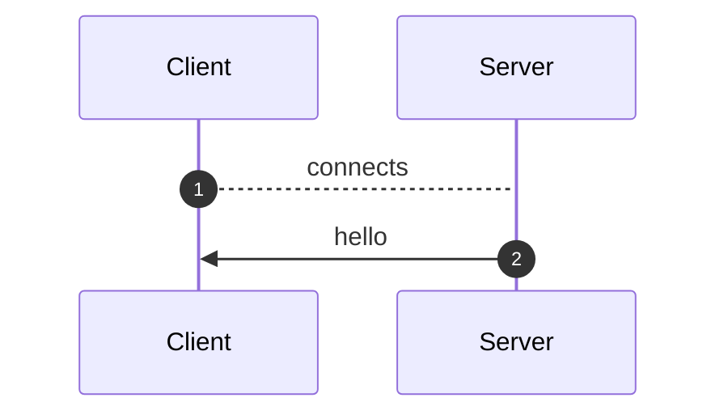
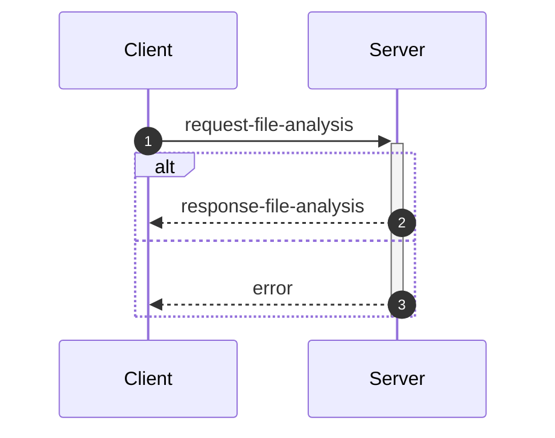
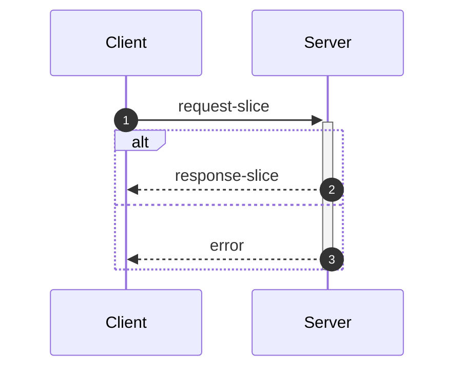
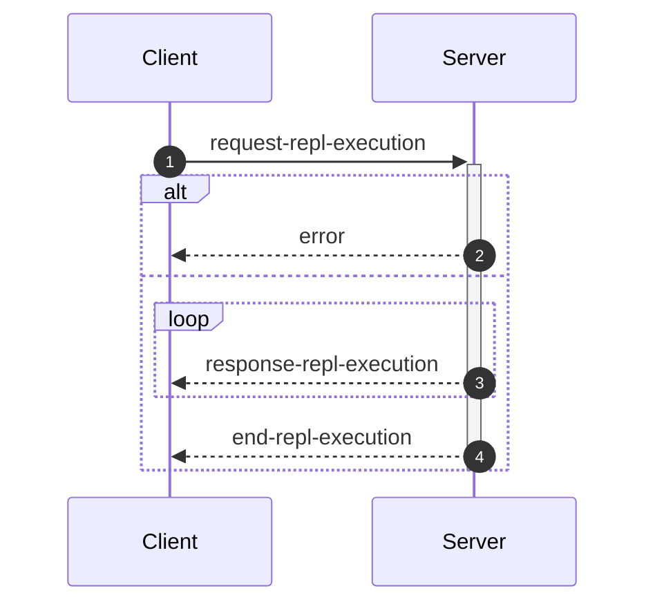

_<span title="an overview of flowR's interface">Generated</span> from '[wiki-interface.ts](https://github.com/flowr-analysis/flowr/tree/main/src/documentation/wiki-interface.ts "src/documentation/wiki-interface.ts")' on 2026-10-19, 07:05:31 UTC (v2.16.3, R v4.5.0), do not edit directly._

Although far from being as detailed as the in-depth explanation of [_flowR_](https://github.com/flowr-analysis/flowr/wiki/Core),
this wiki page explains how to interface with _flowR_ in more detail.
In general, command line arguments and other options provide short descriptions on hover over.

* [💻 Using the REPL](#using-the-repl)
* [⚙️ Configuring FlowR](#configuring-flowr)
* [⚒️ Writing Code](#writing-code)
* [💬 Communicating with the Server](#communicating-with-the-server)

<a id='using-the-repl'></a>
## 💻 Using the REPL

> [!NOTE]
> To execute arbitrary R commands with a repl request, _flowR_ has to be started explicitly with <span title="Description (Command Line Argument): Allow to access the underlying R session when using flowR (security warning: this allows the execution of arbitrary R code!)">`--r-session-access`</span>.
> Please be aware that this introduces a security risk and note that this relies on the [`r-shell` engine](https://github.com/flowr-analysis/flowr/wiki/Engines) .

Although primarily meant for users to explore,
there is nothing which forbids calling _flowR_ as a subprocess to use standard-in, -output, and -error
for communication (although you can access the REPL using the server as well,
with the [REPL Request](#message-request-repl-execution) message).

The read-eval-print loop&nbsp;(REPL) works relatively simple.
You can submit an expression (using <kbd>Enter</kbd>),
which is interpreted as an R&nbsp;expression by default but interpreted as a *command* if it starts with a colon (`:`).
The best command to get started with the REPL is <span title="Description (Repl Command): Show help information (aliases: :h, :?)">`:help`</span>.
Besides, you can leave the REPL either with the command <span title="Description (Repl Command): End the repl (aliases: :q, :exit)">`:quit`</span> or by pressing <kbd>Ctrl</kbd>+<kbd>C</kbd> twice.
When writing a *command*, you may press <kbd>Tab</kbd> to get a list of completions, if available.
Multiple commands can be entered in a single line by separating them with a semicolon (`;`), e.g. `:parse "x<-2"; :df*`.
If a command is given without R code, the REPL will re-use R code given in a previous command.
The prior example will hence return first the parsed AST of the program and then the dataflow graph for `"x <- 2"`.

> [!NOTE]
> If you develop flowR, you may want to launch the repl using the `npm run main-dev` command, this way, you get a non-minified version of flowR with debug information and hot-reloading of source files.

<details>
<summary>Available Commands</summary>

We currently offer the following commands (this with a `[*]` suffix are available with and without the star):

| Command | Description |
| ------- | ----------- |
| **<span title="Description (Repl Command): End the repl (aliases: :q, :exit)">:quit</span>** | End the repl (aliases: **:<span title="Alias of ':quit'. End the repl">q</span>**, **:<span title="Alias of ':quit'. End the repl">exit</span>**) |
| **<span title="Description (Repl Command): Execute the given code as R code. This requires the `--r-session-access` flag to be set and requires the r-shell engine. (aliases: :e, :r)">:execute</span>** | Execute the given code as R code. This requires the `--r-session-access` flag to be set and requires the r-shell engine. (aliases: **:<span title="Alias of ':execute'. Execute the given code as R code. This requires the `--r-session-access` flag to be set and requires the r-shell engine.">e</span>**, **:<span title="Alias of ':execute'. Execute the given code as R code. This requires the `--r-session-access` flag to be set and requires the r-shell engine.">r</span>**) |
| **<span title="Description (Repl Command): Get mermaid code for the control-flow graph of R code (aliases: :cfg, :cf)">:controlflow[*]</span>** | Get mermaid code for the control-flow graph of R code (star: Returns the URL to mermaid.live) (aliases: **:<span title="Alias of ':controlflow'. Get mermaid code for the control-flow graph of R code">cfg</span>**, **:<span title="Alias of ':controlflow'. Get mermaid code for the control-flow graph of R code">cf</span>**) |
| **<span title="Description (Repl Command): Get mermaid code for the control-flow graph with basic blocks (aliases: :cfgb, :cfb)">:controlflowbb[*]</span>** | Get mermaid code for the control-flow graph with basic blocks (star: Returns the URL to mermaid.live) (aliases: **:<span title="Alias of ':controlflowbb'. Get mermaid code for the control-flow graph with basic blocks">cfgb</span>**, **:<span title="Alias of ':controlflowbb'. Get mermaid code for the control-flow graph with basic blocks">cfb</span>**) |
| **<span title="Description (Repl Command): Get mermaid code for the dataflow graph (aliases: :d, :df)">:dataflow[*]</span>** | Get mermaid code for the dataflow graph (star: Returns the URL to mermaid.live) (aliases: **:<span title="Alias of ':dataflow'. Get mermaid code for the dataflow graph">d</span>**, **:<span title="Alias of ':dataflow'. Get mermaid code for the dataflow graph">df</span>**) |
| **<span title="Description (Repl Command): Get mermaid code for the normalized AST of R code (aliases: :n)">:normalize[*]</span>** | Get mermaid code for the normalized AST of R code (star: Returns the URL to mermaid.live) (alias: **:<span title="Alias of ':normalize'. Get mermaid code for the normalized AST of R code">n</span>**) |
| **<span title="Description (Repl Command): Get mermaid code for the simplified dataflow graph (aliases: :ds, :dfs)">:dataflowsimple[*]</span>** | Get mermaid code for the simplified dataflow graph (star: Returns the URL to mermaid.live) (aliases: **:<span title="Alias of ':dataflowsimple'. Get mermaid code for the simplified dataflow graph">ds</span>**, **:<span title="Alias of ':dataflowsimple'. Get mermaid code for the simplified dataflow graph">dfs</span>**) |
| **<span title="Description (Repl Command): Inspect and extend the signature database: `query` (identical to :query @signature), `info <name>` for where a function comes from (identical to :query @function-info), `add <path>` to mount another database/source, `download` to fetch the full-history database. (aliases: :sig)">:signature</span>** | Inspect and extend the signature database: `query` (identical to :query @signature), `info <name>` for where a function comes from (identical to :query @function-info), `add <path>` to mount another database/source, `download` to fetch the full-history database. (alias: **:<span title="Alias of ':signature'. Inspect and extend the signature database: `query` (identical to :query @signature), `info <name>` for where a function comes from (identical to :query @function-info), `add <path>` to mount another database/source, `download` to fetch the full-history database.">sig</span>**) |
| **<span title="Description (Repl Command): Just calculates the DFG, but only prints summary info (aliases: :d#, :df#)">:dataflowsilent</span>** | Just calculates the DFG, but only prints summary info (aliases: **:<span title="Alias of ':dataflowsilent'. Just calculates the DFG, but only prints summary info">d#</span>**, **:<span title="Alias of ':dataflowsilent'. Just calculates the DFG, but only prints summary info">df#</span>**) |
| **<span title="Description (Repl Command): Prints ASCII Art of the parsed, unmodified AST (aliases: :p)">:parse</span>** | Prints ASCII Art of the parsed, unmodified AST (alias: **:<span title="Alias of ':parse'. Prints ASCII Art of the parsed, unmodified AST">p</span>**) |
| **<span title="Description (Repl Command): Prints the version of flowR as well as the current version of R">:version</span>** | Prints the version of flowR as well as the current version of R
| **<span title="Description (Repl Command): Query the given R code (use 'help' for more information)">:query[*]</span>** | Query the given R code (use 'help' for more information) (star: Similar to query, but returns the output in json format.)
| **<span title="Description (Repl Command): Returns an ASCII representation of the dataflow graph (aliases: :df!)">:dataflowascii</span>** | Returns an ASCII representation of the dataflow graph (alias: **:<span title="Alias of ':dataflowascii'. Returns an ASCII representation of the dataflow graph">df!</span>**) |
| **<span title="Description (Repl Command): Returns summarization stats for the normalized AST (aliases: :n#)">:normalize#</span>** | Returns summarization stats for the normalized AST (alias: **:<span title="Alias of ':normalize#'. Returns summarization stats for the normalized AST">n#</span>**) |
| **<span title="Description (Repl Command): Show help information (aliases: :h, :?)">:help</span>** | Show help information (aliases: **:<span title="Alias of ':help'. Show help information">h</span>**, **:<span title="Alias of ':help'. Show help information">?</span>**) |

</details>

> [!TIP]
> 
> As indicated by the examples before, all REPL commands that operate on code keep track of the state.
> Hence, if you run a command like <span title="Description (Repl Command, starred version): Returns the URL to mermaid.live; Base Command: Get mermaid code for the dataflow graph (aliases: :d*, :df*)">`:dataflow*`</span> without providing R code,
> the REPL will re-use the R code provided in a previous command.
> Likewise, doing this will benefit from incrementality!
> If you request the dataflow graph with `:df* x <- 2 * y` and then want to see the parsed AST with `:parse`,
> the REPL will re-use previously obtained information and not re-parse the code again.
> 		

Generally, many commands offer shortcut versions in the REPL. Many queries, for example, offer a shortened format (see the example below).
Of special note, the [Config Query](https://github.com/flowr-analysis/flowr/wiki/%5BQuery%5D-Config)
can be used to also modify the currently active configuration of _flowR_ within the REPL (see the [wiki page](https://github.com/flowr-analysis/flowr/wiki/%5BQuery%5D-Config) for more information).

### Example: Retrieving the Dataflow Graph

To retrieve a URL to the [mermaid](https://mermaid.js.org/) diagram of the dataflow of a given expression,
use <span title="Description (Repl Command, starred version): Returns the URL to mermaid.live; Base Command: Get mermaid code for the dataflow graph (aliases: :d*, :df*)">`:dataflow*`</span> (or <span title="Description (Repl Command): Get mermaid code for the dataflow graph (aliases: :d, :df)">`:dataflow`</span> to get the mermaid code in the cli):

```shell
$ docker run -it --rm eagleoutice/flowr # or npm run flowr 
flowR repl v2.16.3, R grammar v14 (tree-sitter engine)
R> :dataflow* y <- 1 + x
```

<details>
<summary style='color:gray'>Output</summary>

```text
https://mermaid.live/view#base64:eyJjb2RlIjoiZmxvd2NoYXJ0IFREXG4gICAgMXt7XCJgKiM5MTtSTnVtYmVyIzkzOyogKioxKipcbiAgICAgICoxLjYqICgqKmlkOiAxKiopYFwifX1cbiAgICAyKFtcImAqIzkxO1JTeW1ib2wjOTM7KiAqKngqKlxuICAgICAgKjEuMTAqICgqKmlkOiAyKiopYFwiXSlcbiAgICAzW1tcImAqIzkxO1JCaW5hcnlPcCM5MzsqIGJhc2UjNTg7IzU4OyoqIzQzOyoqXG4gICAgICAqMS42LTEwKiAoKippZDogMyoqKVxuICAgIGFyZzogKDEsIDIpYFwiXV1cbiAgICBidWlsdC1pbjpfNDNfW1wiYEJ1aWx0LUluOlxuIzQzO2BcIl1cbiAgICBzdHlsZSBidWlsdC1pbjpfNDNfIHN0cm9rZTpncmF5LGZpbGw6Z3JheSxzdHJva2Utd2lkdGg6MnB4LG9wYWNpdHk6Ljg7XG4gICAgMFtcImAqIzkxO1JTeW1ib2wjOTM7KiAqKnkqKlxuICAgICAgKjEuMSogKCoqaWQ6IDAqKiwgdjogMylgXCJdXG4gICAgNFtbXCJgKiM5MTtSQmluYXJ5T3AjOTM7KiBiYXNlIzU4OyM1ODsqKiM2MDsjNDU7KipcbiAgICAgICoxLjEtMTAqICgqKmlkOiA0KiopXG4gICAgYXJnOiAoMCwgMylgXCJdXVxuICAgIGJ1aWx0LWluOl82MF8tW1wiYEJ1aWx0LUluOlxuIzYwOyM0NTtgXCJdXG4gICAgc3R5bGUgYnVpbHQtaW46XzYwXy0gc3Ryb2tlOmdyYXksZmlsbDpncmF5LHN0cm9rZS13aWR0aDoycHgsb3BhY2l0eTouODtcbiAgICAxIC0uLT58XCJmbG93XCJ8IDJcbiAgICBsaW5rU3R5bGUgMCBzdHJva2U6Z3JheSxjb2xvcjpncmF5O1xuICAgIDIgLS4tPnxcImZsb3dcInwgM1xuICAgIGxpbmtTdHlsZSAxIHN0cm9rZTpncmF5LGNvbG9yOmdyYXk7XG4gICAgMyAtLT58XCJyZWFkcywgYXJnXCJ8IDFcbiAgICAzIC0tPnxcInJlYWRzLCBhcmdcInwgMlxuICAgIDMgLS4tPnxcImZsb3dcInwgMFxuICAgIGxpbmtTdHlsZSA0IHN0cm9rZTpncmF5LGNvbG9yOmdyYXk7XG4gICAgMyAtLi0+fFwicmVhZHMsIGNhbGxzXCJ8IGJ1aWx0LWluOl80M19cbiAgICBsaW5rU3R5bGUgNSBzdHJva2U6Z3JheTtcbiAgICAwIC0tPnxcImRlZmluZWQtYnksIGZsb3dcInwgNFxuICAgIDAgLS0+fFwiZGVmaW5lZC1ieVwifCAzXG4gICAgNCAtLT58XCJyZWFkcywgYXJnXCJ8IDNcbiAgICA0IC0tPnxcInJldHVybnMsIGFyZ1wifCAwXG4gICAgNCAtLi0+fFwicmVhZHMsIGNhbGxzXCJ8IGJ1aWx0LWluOl82MF8tXG4gICAgbGlua1N0eWxlIDEwIHN0cm9rZTpncmF5OyIsIm1lcm1haWQiOnsiYXV0b1N5bmMiOnRydWV9fQ==
```

Retrieve the dataflow graph of the expression `y <- 1 + x`. It looks like this:


<details>

<summary style="color:gray">R Code of the Dataflow Graph</summary>

The analysis ran (including parse and normalize, using the [tree-sitter](https://github.com/flowr-analysis/flowr/wiki/Engines) engine) within the generation environment. No [signature database](https://github.com/flowr-analysis/flowr/wiki/Signature-Database) is mounted for these generated graphs, so `library()` calls attach no package exports; base-R names are still qualified via the generated base-package store (e.g. `acf` as `stats::acf`). 
We encountered no unknown side effects during the analysis.

```r
y <- 1 + x
```

</details>

</details>

For small graphs like this, <span title="Description (Repl Command): Returns an ASCII representation of the dataflow graph (aliases: :df!)">`:dataflowascii`</span> also provides an ASCII representation directly in the REPL:

```shell
$ docker run -it --rm eagleoutice/flowr # or npm run flowr 
flowR repl v2.16.3, R grammar v14 (tree-sitter engine)
R> :df! y <- 1 + x
```

<details open>
<summary style='color:gray'>Output</summary>

```text
                        v<0>v
 c<4>c──────────────────| y |
 |<- |     ┌────────────v---v
 c---c     │
    │   c<3>c   0<1>0
    └───| + |───| 1 |───u<2>u
        c---c   0---0   | x |
           └────────────u---u
Edges:
3 -> 1: reads, arg          3 -> 2: reads, arg
3 -> 0: flows-to            1 -> 2: flows-to
2 -> 3: flows-to            4 -> 3: reads, arg
4 -> 0: returns, arg        0 -> 4: defined-by, flows-to
0 -> 3: defined-by
```

Retrieve the dataflow graph of the expression `y <- 1 + x` as ASCII art.

</details>

For the slicing with <span title="Description (Repl Command): Static backwards executable slicer for R">`:slicer`</span>, you have access to the same [magic comments](#slice-magic-comments) as with the [slice request](#message-request-slice).
Pass `--inline` to splice resolvable `source()` calls into the reconstruction so the slice is a single self-contained R text (the same as the static slice query's `inlineSources` flag).
See `--help` for more flags!

### Example: Interfacing with the File System

Many commands that allow for an R-expression (like <span title="Description (Repl Command, starred version): Returns the URL to mermaid.live; Base Command: Get mermaid code for the dataflow graph (aliases: :d*, :df*)">`:dataflow*`</span>) allow for a file as well
if the argument starts with `file://`.
If you are working from the root directory of the _flowR_ repository, the following gives you the parsed AST of the example file using the <span title="Description (Repl Command): Prints ASCII Art of the parsed, unmodified AST (aliases: :p)">`:parse`</span> command:

> **Watch mode**: Replace `file://` with `watch://` to enter watch mode.
> flowR runs the command immediately and then re-runs it every time the file (or any file inside the folder) changes.
> Enter any other command to leave watch mode.
> For example: `:df watch://analysis.R`

```shell
$ docker run -it --rm eagleoutice/flowr # or npm run flowr 
flowR repl v2.16.3, R grammar v14 (tree-sitter engine)
R> :parse file://test/testfiles/example.R
```

<details>
<summary style='color:gray'>Output</summary>

```text
File: test/testfiles/example.R

program
├ binaryoperator
│ ├ identifier "sum" (1:1─4)
│ ├ <- "<-" (1:5─7)
│ ╰ float "0" (1:8─9)
├ binaryoperator
│ ├ identifier "product" (2:1─8)
│ ├ <- "<-" (2:9─11)
│ ╰ float "1" (2:12─13)
├ binaryoperator
│ ├ identifier "w" (3:1─2)
│ ├ <- "<-" (3:3─5)
│ ╰ float "7" (3:6─7)
├ binaryoperator
│ ├ identifier "N" (4:1─2)
│ ├ <- "<-" (4:3─5)
│ ╰ float "10" (4:6─8)
├ forstatement
│ ├ for "for" (6:1─4)
│ ├ ( "(" (6:5─6)
│ ├ identifier "i" (6:6─7)
│ ├ in "in" (6:8─10)
│ ├ binaryoperator
│ │ ├ float "1" (6:11─12)
│ │ ├ : ":" (6:12─13)
│ │ ╰ parenthesizedexpression
│ │   ├ ( "(" (6:13─14)
│ │   ├ binaryoperator
│ │   │ ├ identifier "N" (6:14─15)
│ │   │ ├ - "-" (6:15─16)
│ │   │ ╰ float "1" (6:16─17)
│ │   ╰ ) ")" (6:17─18)
│ ├ ) ")" (6:18─19)
│ ╰ bracedexpression
│   ├ { "{" (6:20─21)
│   ├ binaryoperator
│   │ ├ identifier "sum" (7:3─6)
│   │ ├ <- "<-" (7:7─9)
│   │ ╰ binaryoperator
│   │   ├ binaryoperator
│   │   │ ├ identifier "sum" (7:10─13)
│   │   │ ├ + "+" (7:14─15)
│   │   │ ╰ identifier "i" (7:16─17)
│   │   ├ + "+" (7:18─19)
│   │   ╰ identifier "w" (7:20─21)
│   ├ binaryoperator
│   │ ├ identifier "product" (8:3─10)
│   │ ├ <- "<-" (8:11─13)
│   │ ╰ binaryoperator
│   │   ├ identifier "product" (8:14─21)
│   │   ├  "" (8:22─23)
│   │   ╰ identifier "i" (8:24─25)
│   ╰ } "}" (9:1─2)
├ call
│ ├ identifier "cat" (11:1─4)
│ ╰ arguments
│   ├ ( "(" (11:4─5)
│   ├ argument
│   │ ╰ string
│   │   ├ " "\"" (11:5─6)
│   │   ├ stringcontent "Sum:" (11:6─10)
│   │   ╰ " "\"" (11:10─11)
│   ├ comma "," (11:11─12)
│   ├ argument
│   │ ╰ identifier "sum" (11:13─16)
│   ├ comma "," (11:16─17)
│   ├ argument
│   │ ╰ string
│   │   ├ " "\"" (11:18─19)
│   │   ├ stringcontent
│   │   │ ╰ escapesequence "\\n" (11:19─21)
│   │   ╰ " "\"" (11:21─22)
│   ╰ ) ")" (11:22─23)
╰ call
  ├ identifier "cat" (12:1─4)
  ╰ arguments
    ├ ( "(" (12:4─5)
    ├ argument
    │ ╰ string
    │   ├ " "\"" (12:5─6)
    │   ├ stringcontent "Product:" (12:6─14)
    │   ╰ " "\"" (12:14─15)
    ├ comma "," (12:15─16)
    ├ argument
    │ ╰ identifier "product" (12:17─24)
    ├ comma "," (12:24─25)
    ├ argument
    │ ╰ string
    │   ├ " "\"" (12:26─27)
    │   ├ stringcontent
    │   │ ╰ escapesequence "\\n" (12:27─29)
    │   ╰ " "\"" (12:29─30)
    ╰ ) ")" (12:30─31)
```

Retrieve the parsed AST of the example file.

<details>

<summary>File Content</summary>

```r
sum <- 0
product <- 1
w <- 7
N <- 10

for (i in 1:(N-1)) {
  sum <- sum + i + w
  product <- product * i
}

cat("Sum:", sum, "\n")
cat("Product:", product, "\n")
```

</details>

As _flowR_ directly transforms this AST the output focuses on being human-readable instead of being machine-readable.
		
</details>

### Example: Run a Query

You can run any query supported by _flowR_ using the <span title="Description (Repl Command): Query the given R code (use 'help' for more information)">`:query`</span> command.
For example, to obtain the shapes of all data frames in a given piece of code, you can run:

```shell
$ docker run -it --rm eagleoutice/flowr # or npm run flowr 
flowR repl v2.16.3, R grammar v14 (tree-sitter engine)
R> :query @absint df-shape "x <- data.frame(a = 1:10, b = 1:10)\ny <- x$a"
```

<details open>
<summary style='color:gray'>Output</summary>

```text
Query: absint (1 ms)
```

Retrieve the shapes of all data frames in the given code.

</details>

To run the linter on a file, you can use (in this example, we just issue the `dead-code` linter on a small piece of code):

```shell
$ docker run -it --rm eagleoutice/flowr # or npm run flowr 
flowR repl v2.16.3, R grammar v14 (tree-sitter engine)
R> :query @linter rules:dead-code "if(FALSE) x <- 2"
```

<details open>
<summary style='color:gray'>Output</summary>

```text
Query: linter (2 ms)
   ╰ Dead Code (dead-code):
       ╰ certain:
           ╰ Code at 1.11-16
```

Run the linter on the given code, with only the `dead-code` rule enabled.

</details>

For more information on the available queries, please check out the [Query API](https://github.com/flowr-analysis/flowr/wiki/Query-API).

<a id='configuring-flowr'></a>
## ⚙️ Configuring FlowR

When running _flowR_, you may want to specify some behaviors with a dedicated configuration file.
By default, flowR looks for a file named `flowr.json` in the current working directory (or any higher directory).
You can also specify a different file with <span title="Description (Command Line Argument): The name of the configuration file to use">`--config-file`</span> or pass the configuration inline using <span title="Description (Command Line Argument): The flowR configuration to use, as a JSON string">`--config-json`</span>.
A `flowr.json` found this way belongs to the analyzed project, so flowR ignores its options that decide what flowR executes or loads
(`engines.*.wasmPath`, `engines.*.treeSitterWasmPath`, `engines.*.rPath`, `solver.sigdb.additionalPaths`, `solver.sigdb.downloadRepo`, `solver.sigdb.installedLibrary.paths`),
unless you pass <span title="Description (Command Line Argument): Keep the security-sensitive options (e.g., the R executable) of the flowr.json found in the working directory or a parent. Only use this for projects you trust.">`--trust-config`</span>.
To analyze code you do not trust, use the secure mode (<span title="Description (Command Line Argument): Run in secure mode for analyzing untrusted code: flowR does not start R (or any other process), does not access the network, does not search for project configs, and ignores security-sensitive options in every config. Cannot be disabled once enabled. Can also be enabled with the environment variable {italic FLOWR_SECURE_MODE=1}.">`--secure`</span>, see the [security policy](https://github.com/flowr-analysis/flowr/blob/main/.github/SECURITY.md)).
To inspect the current configuration, you can run flowr with the <span title="Description (Command Line Argument): Run with verbose logging (will be passed to the corresponding script)">`--verbose`</span> flag, or use the `config` [Query](https://github.com/flowr-analysis/flowr/wiki/Query-API).
Within the REPL this works by running the following:

```shell
:query @config
```

To work with the <a href="https://github.com/flowr-analysis/flowr/tree/main/src/config.ts#L119"><code><span title="The configuration file format for flowR.">FlowrConfig</span></code></a> you can use the provided helper objects alongside its methods like
<a href="https://github.com/flowr-analysis/flowr/tree/main/src/config.ts#L914"><code><span title="Creates a new flowr config that has the updated values.">FlowrConfig::<b>amend</b></span></code></a>.
The schema below documents every option; the ones you most likely want are:

- <a href="https://github.com/flowr-analysis/flowr/wiki/Interface#configuring-flowr" title="Configuration Option (boolean): Whether source calls should be ignored, causing {@link processSourceCall}&#39;s behavior to be skipped.">ignoreSourceCalls</a>: ignore source calls when analyzing the code, i.e., ignore the inclusion of other files.
- <a href="https://github.com/flowr-analysis/flowr/wiki/Interface#configuring-flowr" title="Configuration Option (boolean): Whether load calls should be ignored, causing {@link processLoadCall}&#39;s behavior to be skipped.">ignoreLoadCalls</a>: ignore load calls when analyzing the code, i.e., ignore the loading of r-data files.
- <a href="https://github.com/flowr-analysis/flowr/wiki/Interface#configuring-flowr" title="Configuration Option (object): Do you want to overwrite (parts) of the builtin definition?">semantics.environment.overwriteBuiltIns</a>: overwrite _flowR_'s handling of built-in functions, or clear the preset definitions entirely.
  See [Configure BuiltIn Semantics](#configure-builtin-semantics) for more information.
- <a href="https://github.com/flowr-analysis/flowr/wiki/Interface#configuring-flowr" title="Configuration Option (string): How to resolve variables and their values. (one of &quot;disabled&quot;, &quot;alias&quot;, &quot;builtin&quot;)">solver.variables</a>: how to resolve variables and their values (`disabled`, `alias`, `builtin`).
- <a href="https://github.com/flowr-analysis/flowr/wiki/Interface#configuring-flowr" title="Configuration Option (array): The engine or set of engines to use for interacting with R code. An empty array means all available engines will be used.">engines</a> and <a href="https://github.com/flowr-analysis/flowr/wiki/Interface#configuring-flowr" title="Configuration Option (string): The default engine to use for interacting with R code. If this is undefined, an arbitrary engine from the specified list will be used. (one of &quot;tree-sitter&quot;, &quot;r-shell&quot;)">defaultEngine</a>: the engines used to interact with R code, see the [Engines wiki page](https://github.com/flowr-analysis/flowr/wiki/Engines).
- <a href="https://github.com/flowr-analysis/flowr/wiki/Interface#configuring-flowr" title="Configuration Option (array): Files a framework loads on its own, without any source() call (e.g. global.R in a shiny app), in the order they are loaded; flowR orders the matching project files accordingly and analyzes them as one program. Entries are case-insensitive globs matched against the file path, a plain name matches any file with that name, and entries matching no project file are warned about. Usually set per project kind via specializeConfig.">project.implicitSources</a>: the files a framework loads without any `source()` call, in the order in which they are
  loaded. Entries are globs (e.g. `R/*.R`) matched against the file path ignoring capitalization; one matching no file is reported.
- <a href="https://github.com/flowr-analysis/flowr/wiki/Interface#configuring-flowr" title="Configuration Option (object): Overwrite (parts of) the configuration depending on the project kind flowR detects, e.g. to give a shiny app its implicit sources.">specializeConfig</a>: overwrite (parts of) the configuration depending on the kind of project _flowR_ detects
  (e.g. `shiny-app`), which is how a shiny app gets its implicit sources by default. What you configure directly wins.
- <a href="https://github.com/flowr-analysis/flowr/wiki/Interface#configuring-flowr" title="Configuration Option (string): Overwrite the project kind flowR would otherwise infer from the analyzed files, e.g. when auto-detection guesses wrong. (one of &quot;package&quot;, &quot;script&quot;, &quot;shiny-app&quot;, &quot;notebook&quot;, &quot;project&quot;, &quot;unknown&quot;)">project.useProjectType</a>: skip that detection and force a project kind yourself, when auto-detection guesses wrong.
- <a href="https://github.com/flowr-analysis/flowr/wiki/Interface#configuring-flowr" title="Configuration Option (array): The default plugins to load when creating a new instance of FlowrAnalyzer">defaultPlugins</a> and <a href="https://github.com/flowr-analysis/flowr/wiki/Interface#configuring-flowr" title="Configuration Option (array): The plugins to load in REPL mode">repl.plugins</a>: the plugins to load for a new <a href="https://github.com/flowr-analysis/flowr/tree/main/src/project/flowr-analyzer.ts#L205"><code><span title="Central class for conducting analyses with FlowR. Use the FlowrAnalyzerBuilder to create a new instance. If you want the original pattern of creating a pipeline and running all steps, you can still do this with FlowrAnalyzer#runFull . To inspect the context of the analyzer, use FlowrAnalyzer#inspectContext (if you are a plugin and need to modify it, use FlowrAnalyzer#context instead).">FlowrAnalyzer</span></code></a> and in the REPL
  (use `flowr:default` to reference the former).

So you can configure _flowR_ by adding a file like the following:

<details>

<summary>Example Configuration File</summary>

```json
{
  "ignoreSourceCalls": true,
  "ignoreLoadCalls": true,
  "semantics": {
    "environment": {
      "overwriteBuiltIns": {
        "definitions": [
          {
            "type": "function",
            "names": [
              "foo"
            ],
            "processor": "builtin:assign",
            "config": {}
          }
        ]
      }
    }
  },
  "defaultPlugins": [
    "file:description",
    "versions:description"
  ],
  "repl": {
    "quickStats": false,
    "dfProcessorHeat": false,
    "hints": true,
    "plugins": [
      "flowr:default"
    ]
  },
  "project": {
    "resolveUnknownPathsOnDisk": true,
    "implicitSources": [
      "global.R",
      "app.R"
    ]
  },
  "linter": {
    "disabledRules": []
  },
  "specializeConfig": {
    "shiny-app": {
      "project": {
        "implicitSources": [
          "global.R",
          "ui.R",
          "server.R",
          "app.R"
        ]
      }
    }
  },
  "engines": [
    {
      "type": "r-shell"
    }
  ],
  "solver": {
    "variables": "alias",
    "evalStrings": true,
    "trackEnvironments": true,
    "sigdb": {
      "enabled": true,
      "loadProjectDependencies": true,
      "eagerlyLoad": false,
      "eagerlyLoadExports": false,
      "linkBaseR": false,
      "linkDescriptionDependencies": false
    },
    "resolveSource": {
      "dropPaths": "no",
      "ignoreCapitalization": true,
      "inferWorkingDirectory": "active-script",
      "searchPath": []
    },
    "instrument": {},
    "slicer": {
      "threshold": 50
    }
  },
  "abstractInterpretation": {
    "wideningThreshold": 4,
    "followCalls": true,
    "dataFrame": {
      "maxColNames": 20,
      "readLoadedData": {
        "readExternalFiles": true,
        "maxReadLines": 1000000
      }
    }
  },
  "incremental": {
    "alwaysIncremental": false,
    "parsing": {
      "activated": false,
      "heuristics": {
        "activated": true,
        "mtime": true,
        "linesFrom": 500,
        "bytesFrom": 50000,
        "alwaysWithEdits": false,
        "minFiles": 1
      }
    }
  },
  "gas": {
    "thresholds": {
      "memory": {
        "problematic": 0.7,
        "critical": 0.9
      },
      "timeMs": {
        "problematic": 100000,
        "critical": 120000
      }
    },
    "features": {}
  }
}
```

</details>

<details>
<a id='configure-builtin-semantics'></a>
<summary>Configure Built-In Semantics</summary>

`semantics/environment/overwriteBuiltins` accepts two keys:

- `loadDefaults` (boolean, initially `true`): If set to `true`, the default built-in definitions are loaded before applying the custom definitions. Setting this flag to `false` explicitly disables the loading of the default definitions.
- `definitions` (array, initially empty): Allows to overwrite or define new built-in elements. Each object within must have a `type` which is one of the below. Furthermore, they may define a string array of `names` which specifies the identifiers to bind the definitions to. You may use `assumePrimitive` to specify whether _flowR_ should assume that this is a primitive non-library definition (so you probably just do not want to specify the key).

  | Type            | Description                                                                                                                                                                                                                                                                                              | Example                                                                                                    |
  | --------------- | -------------------------------------------------------------------------------------------------------------------------------------------------------------------------------------------------------------------------------------------------------------------------------------------------------- | ---------------------------------------------------------------------------------------------------------- |
  | `constant`    | Additionally allows for a `value` this should resolve to.                                                                                                                                                                                                                                                | `{ type: 'constant', names: ['NULL', 'NA'],  value: null }`                                                |
  | `function`    | Is a rather flexible way to define and bind built-in functions. For the time, we do not have extensive documentation to cover all the cases, so please either consult the sources with the `default-builtin-config.ts` or open a [new issue](https://github.com/flowr-analysis/flowr/issues/new/choose). | `{ type: 'function', names: ['next'], processor: 'builtin:d', config: { cfg: ExitPointType.Next } }` |
  | `replacement` | A comfortable way to specify replacement functions like `$<-` or `names<-`. `suffixes` describes the... suffixes to attach automatically. | `{ type: 'replacement', suffixes: ['<-', '<<-'], names: ['[', '[['] }` |

</details>

<details>

<summary style='color:gray'>Full Configuration-File Schema</summary>

- _The configuration file format for flowR._ (object)
    - **logLevel** [optional] _flowR's global minimum log level, applied when the config is loaded._ (string)
        Only allows: 'silly', 'trace', 'debug', 'info', 'warn', 'error', 'fatal'
    - **ignoreSourceCalls** [optional] _Whether source calls should be ignored, causing {@link processSourceCall}'s behavior to be skipped._ (boolean)
    - **ignoreLoadCalls** [optional] _Whether load calls should be ignored, causing {@link processLoadCall}'s behavior to be skipped._ (boolean)
    - **semantics** _Configure language semantics and how flowR handles them._ (object)
        - **environment** [optional] _Semantics regarding how to handle the R environment._ (object)
            - **overwriteBuiltIns** [optional] _Do you want to overwrite (parts) of the builtin definition?_ (object)
                - **loadDefaults** [optional] _Should the default configuration still be loaded?_ (boolean)
                - **definitions** [optional] _The definitions to load/overwrite._ (array)
                Valid item types:
                    - (object)
    - **defaultPlugins** [optional] _The default plugins to load when creating a new instance of FlowrAnalyzer_ (array)
    Valid item types:
        - (alternatives)
            - (string)
            - (array)
    - **repl** _Configuration options for the REPL._ (object)
        - **quickStats** [optional] _Whether to show quick stats in the REPL after each evaluation._ (boolean)
        - **dfProcessorHeat** [optional] _This instruments the dataflow processors to count how often each processor is called._ (boolean)
        - **hints** [optional] _Whether to show dim inline hints on the empty prompt (automatically disabled on non-interactive terminals)._ (boolean)
        - **plugins** [optional] _The plugins to load in REPL mode_ (array)
        Valid item types:
            - (alternatives)
                - (string)
                - (array)
        - **autoUseFileProtocol** [optional] _Prepend the file protocol to a repl input that looks like a path, instead of only warning about it._ (boolean)
        - **queryStats** [optional] _Whether `:query` closes with the line stating how long the queries took (`:query*` never prints it)._ (boolean)
        - **showPlugins** [optional] _Whether `:version` grays out the plugins that did not activate during the last analysis._ (boolean)
    - **project** _Project specific configuration options._ (object)
        - **resolveUnknownPathsOnDisk** [optional] _Whether to resolve unknown paths loaded by the r project disk when trying to source/analyze files._ (boolean)
        - **failOnInaccessiblePath** [optional] _Whether a directory that cannot be traversed during file discovery (e.g. due to permissions) aborts the analysis; when false (the default) such paths are logged and skipped._ (boolean)
        - **basePackages** [optional] _The packages considered part of R itself (base and recommended); if unset, flowR uses its built-in list._ (array)
        Valid item types:
            - (string)
        - **implicitSources** [optional] _Files a framework loads on its own, without any source() call (e.g. global.R in a shiny app), in the order they are loaded; flowR orders the matching project files accordingly and analyzes them as one program. Entries are case-insensitive globs matched against the file path, a plain name matches any file with that name, and entries matching no project file are warned about. Usually set per project kind via specializeConfig._ (array)
        Valid item types:
            - (string)
        - **useProjectType** [optional] _Overwrite the project kind flowR would otherwise infer from the analyzed files, e.g. when auto-detection guesses wrong._ (string)
            Only allows: 'package', 'script', 'shiny-app', 'notebook', 'project', 'unknown'
        - **assumeImplicitEcho** [optional] _Whether the top level of the analyzed code is echoed, so that every visible result printed there is collected as an output by the dependencies query (default true, false for a package)._ (boolean)
        - **discovery** [optional] _Scoping options for the default project discovery._ (object)
            - **full** [optional] _Collect every file below the project root (greedy) instead of only the files the detected project kind needs (default false)._ (boolean)
            - **perKind** [optional] _Per-kind include/exclude glob overrides layered on the default scoping._ (object)
            - **ignore** [optional] _Case-insensitive globs that drop matching files from the intelligent discovery, regardless of kind (e.g. .Renviron to ignore environment files)._ (array)
            Valid item types:
                - (string)
        - **classification** [optional] _Overrides for the signals flowR uses to classify the project kind._ (object)
            - **shinyDescriptionTypes** [optional] _DESCRIPTION Type: values that mark a shiny app._ (array)
            Valid item types:
                - (string)
            - **shinyEntryFiles** [optional] _File names a shiny app is assembled from._ (array)
            Valid item types:
                - (string)
            - **shinyUsagePattern** [optional] _Regex source evidencing shiny usage in an entry file._ (string)
            - **notebookExtensions** [optional] _File extensions marking a notebook._ (array)
            Valid item types:
                - (string)
    - **linter** _Linter configuration options._ (object)
        - **disabledRules** _Linting rule names excluded from the default rule set (a rule requested explicitly via a linter query still runs). Usually set per project kind via specializeConfig._ (array)
        Valid item types:
            - (string)
        - **disabledTags** [optional] _Linting rule tags whose rules are excluded from the default rule set (a rule requested explicitly via a linter query still runs). By default the cmd-check rules are disabled for everything but a package; a configured list replaces that default._ (array)
        Valid item types:
            - (string)
    - **inputSources** [optional] _Further frameworks the input-sources analysis should know about; entries are added to flowR's defaults._ (object)
        - **pure** [optional] _Functions that only pass the constantness of their arguments on._ (array)
        Valid item types:
            - (string)
        - **param** [optional] _Functions whose result is a 'param' input._ (array)
        Valid item types:
            - (string)
        - **file** [optional] _Functions whose result is a 'file' input._ (array)
        Valid item types:
            - (string)
        - **tempfile** [optional] _Functions whose result is a 'tempfile' input._ (array)
        Valid item types:
            - (string)
        - **glob** [optional] _Functions whose result is a 'glob' input._ (array)
        Valid item types:
            - (string)
        - **net** [optional] _Functions whose result is a 'net' input._ (array)
        Valid item types:
            - (string)
        - **rand** [optional] _Functions whose result is a 'rand' input._ (array)
        Valid item types:
            - (string)
        - **system** [optional] _Functions whose result is a 'system' input._ (array)
        Valid item types:
            - (string)
        - **ffi** [optional] _Functions whose result is a 'ffi' input._ (array)
        Valid item types:
            - (string)
        - **lang** [optional] _Functions whose result is a 'lang' input._ (array)
        Valid item types:
            - (string)
        - **options** [optional] _Functions whose result is a 'options' input._ (array)
        Valid item types:
            - (string)
        - **cmdline** [optional] _Functions whose result is a 'cmdline' input._ (array)
        Valid item types:
            - (string)
        - **user** [optional] _Functions whose result is a 'user' input._ (array)
        Valid item types:
            - (string)
        - **const** [optional] _Functions whose result is a 'const' input._ (array)
        Valid item types:
            - (string)
        - **scope** [optional] _Functions whose result is a 'scope' input._ (array)
        Valid item types:
            - (string)
        - **dconst** [optional] _Functions whose result is a 'dconst' input._ (array)
        Valid item types:
            - (string)
        - **unknown** [optional] _Functions whose result is a 'unknown' input._ (array)
        Valid item types:
            - (string)
        - **linkedObjects** [optional] _Objects a framework provides without a definition in the code, e.g. shiny's input._ (array)
        Valid item types:
            - (object)
        - **linkedEntryPoints** [optional] _Calls that hand a function to a framework, which binds its objects to the parameters by position._ (array)
        Valid item types:
            - (object)
    - **specializeConfig** [optional] _Overwrite (parts of) the configuration depending on the project kind flowR detects, e.g. to give a shiny app its implicit sources._ (object)
    - **engines** _The engine or set of engines to use for interacting with R code. An empty array means all available engines will be used._ (array)
    Valid item types:
        - (alternatives)
            - _The configuration for the tree sitter engine._ (object)
                - **type** [required] _Use the tree sitter engine._ (string)
                    Only allows: 'tree-sitter'
                - **wasmPath** [optional] _The path to the tree-sitter-r WASM binary to use. If this is undefined, this uses the default path._ (string)
                - **treeSitterWasmPath** [optional] _The path to the tree-sitter WASM binary to use. If this is undefined, this uses the default path._ (string)
                - **lax** [optional] _Whether to use the lax parser for parsing R code (allowing for syntax errors). If this is undefined, the strict parser will be used._ (boolean)
            - _The configuration for the R shell engine._ (object)
                - **type** [required] _Use the R shell engine._ (string)
                    Only allows: 'r-shell'
                - **rPath** [optional] _The path to the R executable to use. If this is undefined, this uses the default path._ (string)
                - **pipeBind** [optional] _Whether to enable R's experimental pipe-bind operator "=>" by setting _R_USE_PIPEBIND_ for the R session (default false); R itself keeps this off by default, as it is experimental and has never shipped in a release version of R._ (boolean)
    - **defaultEngine** [optional] _The default engine to use for interacting with R code. If this is undefined, an arbitrary engine from the specified list will be used._ (string)
        Only allows: 'tree-sitter', 'r-shell'
    - **solver** _How to resolve constants, constraints, cells, ..._ (object)
        - **variables** _How to resolve variables and their values._ (string)
            Only allows: 'disabled', 'alias', 'builtin'
        - **evalStrings** _Should we include eval(parse(text="...")) calls in the dataflow graph?_ (boolean)
        - **trackEnvironments** [optional] _Track user-created environments (new.env, assign/get/local with envir=, dollar-assign, attach). When false, all envir-style calls fall through conservatively._ (boolean)
        - **sigdb** _Resolving library exports from a signature database._ (object)
            - **enabled** [optional] _Resolve library()/use() exports from a signature database (default true); when false no database is consulted._ (boolean)
            - **loadProjectDependencies** [optional] _Load the project's declared dependencies from its metadata files (DESCRIPTION Imports/Depends, rproject.toml, uvr.toml, renv.lock, rv.lock, uvr.lock) (default true); when false these files are not read for dependencies._ (boolean)
            - **eagerlyLoad** [optional] _Parse the database up front rather than on the first package load (default false, ignored if disabled)._ (boolean)
            - **eagerlyLoadExports** [optional] _Add a vertex for every export on load rather than on demand (default false); keeps the dataflow graph small._ (boolean)
            - **assumedRVersion** [optional] _R version assumed when resolving versioned (base-R) exports: a pin like "4.5" or "auto" to detect the installed R (default "auto")._ (string)
            - **linkBaseR** [optional] _Eagerly attach base-R namespaces so bare base calls resolve without library() (default false)._ (boolean)
            - **linkBaseRCalls** [optional] _Add a lightweight Reads edge from a bare base-R call to its signature-database function vertex (default false; base-R qualification is edge-free otherwise)._ (boolean)
            - **linkPackageCalls** [optional] _Add a lightweight Reads edge from a resolved package call to its signature-database function vertex (default false)._ (boolean)
            - **linkDescriptionDependencies** [optional] _Eagerly attach the namespaces of the project's declared DESCRIPTION dependencies (Imports/Depends) so their exports resolve without an explicit library() (default false)._ (boolean)
            - **warmInBackground** [optional] _Decompress the hot shards (base + most-downloaded) in a background task on startup so the first library() lookup is warm (default false; for long-running servers/REPLs)._ (boolean)
            - **additionalPaths** [optional] _Extra directories or bundle/manifest files searched for signature databases (alongside the shipped default and $FLOWR_SIGDB_DIR); a downloaded full-history bundle placed here is mounted automatically._ (array)
            Valid item types:
                - (string)
            - **downloadRepo** [optional] _GitHub owner/repo the full-history bundle is downloaded from via ":signature download" (default "flowr-analysis/flowr", release tag "sigdb-v<flowR-version>")._ (string)
            - **autoSync** [optional] _On startup, re-download shards whose committed sigdb.remote.json hash no longer matches the cache, in the background (default false; opt-in network sync after a git pull)._ (boolean)
            - **installedLibrary** [optional] _Recovering packages no signature database knows from the copy installed on this machine._ (object)
                - **enabled** [required] _Recover packages no signature database knows from their installed copy (default false)._ (boolean)
                - **paths** [optional] _Library directories to search; when empty they are discovered from the environment and the project._ (array)
                Valid item types:
                    - (string)
                - **useEnvironment** [optional] _Search the libraries R_LIBS_USER/R_LIBS/R_LIBS_SITE name (default true)._ (boolean)
                - **useProjectLibrary** [optional] _Search a project-local renv/packrat library (default true)._ (boolean)
                - **maxDepth** [optional] _How far to descend into the nested layout of a project-local library (default 3)._ (number)
                - **packages** [optional] _Only recover packages whose name matches one of these regular expressions; empty means any._ (array)
                Valid item types:
                    - (string)
            - **blobCacheBudgetMb** [optional] _How many MiB of decoded package blobs every open bundle may hold together (default 16)._ (number)
            - **versionSelection** [optional] _When a project constrains a dependency, resolve to the newest (default), oldest, or system-installed version satisfying it; system needs R and falls back to newest. Base-R packages always resolve against the assumed R version._ (string)
                Only allows: 'newest', 'oldest', 'system'
            - **versionOverrides** [optional] _Force an exact version for specific packages (name -> version), overriding both the project constraint and the versionSelection policy (default {})._ (object)
        - **versionManagement** _Policies for reasoning about dependency versions._ (object)
            - **linkedVersionGroups** [optional] _Groups of packages that must resolve to the same version; version guessing intersects each group so its members stay mutually compatible (default [])._ (array)
            Valid item types:
                - (array)
                Valid item types:
                    - (string)
        - **assumeAttachedPackages** [optional] _Packages to treat as attached without a `library()` call, so what the built-in configuration states about them applies to the analyzed code. The base packages R attaches on startup already resolve without it._ (array)
        Valid item types:
            - (string)
        - **transitiveSideEffectRounds** [optional] _How many rounds the transitive side-effect fixpoint may run before it is cut off (default 32); the propagation stops on its own as soon as a round adds nothing._ (number)
        - **maxOverlayDepth** [optional] _How many binding overlays may stack on one environment frame before a write flattens them (default 4); a pure performance knob, trading lookup cost against copy cost without changing any result._ (number)
        - **instrument** (object)
            - **dataflowExtractors** [optional] _These keys are only intended for use within code, allowing to instrument the dataflow analyzer!_ (any)
        - **resolveSource** [optional] _If lax source calls are active, flowR searches for sourced files much more freely, based on the configurations you give it. This option is only in effect if `ignoreSourceCalls` is set to false._ (object)
            - **dropPaths** _Allow to drop the first or all parts of the sourced path, if it is relative._ (string)
                Only allows: 'no', 'once', 'all'
            - **ignoreCapitalization** _Search for filenames matching in the lowercase._ (boolean)
            - **inferWorkingDirectory** _Try to infer the working directory from the main or any script to analyze._ (string)
                Only allows: 'no', 'main-script', 'active-script', 'any-script'
            - **searchPath** _Additionally search in these paths._ (array)
            Valid item types:
                - (string)
            - **repeatedSourceLimit** [optional] _How often the same file can be sourced within a single run? Please be aware: in case of cyclic sources this may not reach a fixpoint so give this a sensible limit._ (number)
            - **applyReplacements** _Provide name replacements for loaded files_ (array)
            Valid item types:
                - (object)
            - **assumeFilesExist** [optional] _Assume a sourced file is always there, making what it defines certain instead of conditional on the source call._ (boolean)
        - **slicer** [optional] _The configuration for the slicer._ (object)
            - **threshold** [optional] _The maximum number of iterations to perform on a single function call during slicing._ (number)
            - **autoExtend** [optional] _If set, the slicer will gain an additional post-pass._ (boolean)
    - **abstractInterpretation** _The configuration options for abstract interpretation._ (object)
        - **wideningThreshold** _The threshold for the number of visitations of a node at which widening should be performed to ensure the termination of the fixpoint iteration._ (number)
        - **followCalls** _Whether the abstract interpretation is interprocedural, i.e. whether it steps into the functions a call may dispatch to._ (boolean)
        - **dataFrame** _The configuration of the shape inference for data frames._ (object)
            - **maxColNames** _The maximum number of columns names to infer for data frames before over-approximating the column names to top._ (number)
            - **readLoadedData** _Configuration options for reading data frame shapes from loaded external data files, such as CSV files._ (object)
                - **readExternalFiles** _Whether data frame shapes should be extracted from loaded external files, such as CSV files._ (boolean)
                - **maxReadLines** _The maximum number of lines to read when extracting data frame shapes from loaded files, such as CSV files._ (number)
    - **incremental** (object)
        - **alwaysIncremental** _Always take the incremental path, regardless of heuristics._ (boolean)
        - **parsing** (object)
            - **activated** _If set, incremental parsing will be used._ (boolean)
            - **heuristics** (object)
                - **activated** [optional] _If set, the heuristics for incremental parsing will be used._ (boolean)
                - **mtime** [optional] _Skip reparsing entirely if the file's modification time is unchanged since the last parse._ (boolean)
                - **linesFrom** [optional] _Only consider incremental parsing for files with at least this many lines._ (number)
                - **bytesFrom** [optional] _Only consider incremental parsing for files with at least this many bytes._ (number)
                - **alwaysWithEdits** [optional] _Always take the incremental path whenever there is a computed edit region, regardless of the other thresholds._ (boolean)
                - **minFiles** [optional] _Only apply these heuristics once the project has at least this many files loaded._ (number)
    - **gas** [optional] _Resource-usage guard (gas) configuration. All feature factors default to 0 (disabled). See https://github.com/flowr-analysis/flowr/wiki/Core#gas-resource-guard._ (object)
        - **thresholds** [optional] _Thresholds for all gas checks (scaled by per-feature factor), boundable per feature._ (object)
            - **memory** [optional] _Heap-usage fraction thresholds (0-1), either shared or given per feature key (with `default` covering the rest)._ (object)
                - **problematic** [optional] _Heap fraction (0-1) above which Problematic is returned, for every feature without an entry of its own._ (number)
                - **critical** [optional] _Heap fraction (0-1) above which Critical is returned, for every feature without an entry of its own._ (number)
            - **timeMs** [optional] _Elapsed analysis time thresholds in milliseconds, either shared or given per feature key (with `default` covering the rest)._ (object)
                - **problematic** [optional] _Elapsed ms above which Problematic is returned, for every feature without an entry of its own._ (number)
                - **critical** [optional] _Elapsed ms above which Critical is returned, for every feature without an entry of its own._ (number)
            - **steps** [optional] _Processed-AST-node thresholds, counted rather than sampled; only a key that arms a budget (`dataflow`) reads them._ (object)
                - **problematic** [optional] _Processed AST nodes above which Problematic is returned, for every feature without an entry of its own._ (number)
                - **critical** [optional] _Processed AST nodes above which the extraction is cut short, for every feature without an entry of its own._ (number)
            - **vertices** [optional] _Created-dataflow-vertex thresholds, counted like `steps`._ (object)
                - **problematic** [optional] _Created dataflow vertices above which Problematic is returned, for every feature without an entry of its own._ (number)
                - **critical** [optional] _Created dataflow vertices above which the extraction is cut short, for every feature without an entry of its own._ (number)
        - **features** [optional] _Per-feature sensitivity factors. 0 or absent disables gas checking for that feature. A factor of 2 makes the feature twice as sensitive. Recognised keys: `source`, `side-effect-linking`, `linter`, `slicer`, `dataflow`._ (object)
        - **countedCheckEvery** [optional] _How many counted steps pass between two accountings of an armed check, be it a dataflow budget or the slicer's traversal (default 128); trades overshoot against the cost of the check._ (number)
        - **heapProvider** [optional] _Custom heap statistics source (programmatic configs only), overriding the built-in v8/performance.memory detection._ (function)

</details>

<a id='writing-code'></a>
## ⚒️ Writing Code

_flowR_ can be used as a [module](https://www.npmjs.com/package/@eagleoutice/flowr) and offers several main classes and interfaces that are interesting for extension writers 
(see the [Visual Studio Code extension](https://marketplace.visualstudio.com/items?itemName=code-inspect.vscode-flowr) or the [Core](https://github.com/flowr-analysis/flowr/wiki/Core) wiki page for more information).

### Creating Analyses with _flowR_

Nowadays, instances of the <a href="https://github.com/flowr-analysis/flowr/tree/main/src/project/flowr-analyzer.ts#L205"><code><span title="Central class for conducting analyses with FlowR. Use the FlowrAnalyzerBuilder to create a new instance. If you want the original pattern of creating a pipeline and running all steps, you can still do this with FlowrAnalyzer#runFull . To inspect the context of the analyzer, use FlowrAnalyzer#inspectContext (if you are a plugin and need to modify it, use FlowrAnalyzer#context instead).">FlowrAnalyzer</span></code></a> should be used as central frontend to get analysis results from _flowR_.
The entry points an analysis is written against are re-exported from the package root (`import { FlowrAnalyzerBuilder } from '@eagleoutice/flowr'`);
everything else stays reachable under its own path, as in `@eagleoutice/flowr/dataflow/graph/graph`.
For example, a program slice can be created like this:

```ts
const analyzer = await new FlowrAnalyzerBuilder()
    .setEngine('tree-sitter')
    .build();
analyzer.addRequest('x <- 1\ny <- x\nx');
const result = await analyzer.query([
    {
        type:     'static-slice',
        criteria: ['3@x']
    }
]);
```

For more information, please have a look at the [Analyzer](https://github.com/flowr-analysis/flowr/wiki/Analyzer) wiki page, which explains how to construct and use the <a href="https://github.com/flowr-analysis/flowr/tree/main/src/project/flowr-analyzer.ts#L205"><code><span title="Central class for conducting analyses with FlowR. Use the FlowrAnalyzerBuilder to create a new instance. If you want the original pattern of creating a pipeline and running all steps, you can still do this with FlowrAnalyzer#runFull . To inspect the context of the analyzer, use FlowrAnalyzer#inspectContext (if you are a plugin and need to modify it, use FlowrAnalyzer#context instead).">FlowrAnalyzer</span></code></a> in more detail.
To work with specific perspectives, you can also consult the respective pages like the [Dataflow Graph](https://github.com/flowr-analysis/flowr/wiki/Dataflow-Graph) or the [Abstract Interpretation](https://github.com/flowr-analysis/flowr/wiki/Abstract-Interpretation) wiki pages.
### The Pipeline Executor (Low-Level Interface)

Once, in the beginning, _flowR_ was meant to produce a dataflow graph merely to provide *program slices*. 
However, with continuous updates, the [Dataflow Graph](https://github.com/flowr-analysis/flowr/wiki/Dataflow-Graph) repeatedly proves to be the more interesting part.
With this, we restructured _flowR_'s originally *hardcoded* pipeline to be far more flexible. 
Now, it can be theoretically extended or replaced with arbitrary steps, optional steps, and what we call 'decorations' of these steps. 
In short, a slicing pipeline using the <a href="https://github.com/flowr-analysis/flowr/tree/main/src/core/pipeline-executor.ts#L97"><code><span title="**Please note:** The PipelineExecutor is now considered to be a rather low-level API for flowR. While it still works and is the basis for all other layers, we strongly recommend using the FlowrAnalyzer and its builder to create and use an analyzer instance that is pre-configured for your use-case. The pipeline executor allows to execute arbitrary pipelines in a step-by-step fashion. If you are not...">PipelineExecutor</span></code></a> looks like this:

```ts

const slicer = new PipelineExecutor(DEFAULT_SLICING_PIPELINE, {
  parser:    new RShell(),
  request:   requestFromInput('x <- 1\nx + 1'),
  criterion: ['2@x']
})
const slice = await slicer.allRemainingSteps()
// console.log(slice.reconstruct.code)
```

<details><summary>More Information</summary>

If you compare this, with what you would have done with the old (and removed) `SteppingSlicer`, 
this essentially just requires you to replace the `SteppingSlicer` with the <a href="https://github.com/flowr-analysis/flowr/tree/main/src/core/pipeline-executor.ts#L97"><code><span title="**Please note:** The PipelineExecutor is now considered to be a rather low-level API for flowR. While it still works and is the basis for all other layers, we strongly recommend using the FlowrAnalyzer and its builder to create and use an analyzer instance that is pre-configured for your use-case. The pipeline executor allows to execute arbitrary pipelines in a step-by-step fashion. If you are not...">PipelineExecutor</span></code></a>
and to pass the <a href="https://github.com/flowr-analysis/flowr/tree/main/src/core/steps/pipeline/default-pipelines.ts#L18"><code>DEFAULT_SLICING_PIPELINE</code></a> as the first argument.
The <a href="https://github.com/flowr-analysis/flowr/tree/main/src/core/pipeline-executor.ts#L97"><code><span title="**Please note:** The PipelineExecutor is now considered to be a rather low-level API for flowR. While it still works and is the basis for all other layers, we strongly recommend using the FlowrAnalyzer and its builder to create and use an analyzer instance that is pre-configured for your use-case. The pipeline executor allows to execute arbitrary pipelines in a step-by-step fashion. If you are not...">PipelineExecutor</span></code></a>...

1. Provides structures to investigate the results of all intermediate steps
2. Can be executed step-by-step
3. Can repeat steps (e.g., to calculate multiple slices on the same input)

See the in-code documentation for more information.

</details>

### Using the <a href="https://github.com/flowr-analysis/flowr/tree/main/src/r-bridge/shell.ts#L144"><code><span title="The RShell represents an interactive session with the R interpreter. You can configure it by RShellOptions . At the moment we are using a live R session (and not networking etc.) to communicate with R easily, which allows us to install packages etc. However, this might and probably will change in the future (leaving this as a legacy mode :D)">RShell</span></code></a> to Interact with R

The <a href="https://github.com/flowr-analysis/flowr/tree/main/src/r-bridge/shell.ts#L144"><code><span title="The RShell represents an interactive session with the R interpreter. You can configure it by RShellOptions . At the moment we are using a live R session (and not networking etc.) to communicate with R easily, which allows us to install packages etc. However, this might and probably will change in the future (leaving this as a legacy mode :D)">RShell</span></code></a> class allows interfacing with the `R`&nbsp;ecosystem installed on the host system.
Please have a look at [flowR's Engines](https://github.com/flowr-analysis/flowr/wiki/Engines) for more information on alternatives (for example, the <a href="https://github.com/flowr-analysis/flowr/tree/main/src/r-bridge/lang-4.x/tree-sitter/tree-sitter-executor.ts#L29"><code><span title="Synchronous and (way) faster alternative to the RShell using tree-sitter.">TreeSitterExecutor</span></code></a>).

> [!IMPORTANT]
> 
> Each <a href="https://github.com/flowr-analysis/flowr/tree/main/src/r-bridge/shell.ts#L144"><code><span title="The RShell represents an interactive session with the R interpreter. You can configure it by RShellOptions . At the moment we are using a live R session (and not networking etc.) to communicate with R easily, which allows us to install packages etc. However, this might and probably will change in the future (leaving this as a legacy mode :D)">RShell</span></code></a> controls a new instance of the R&nbsp;interpreter, 
> make sure to call <code><a href="https://github.com/flowr-analysis/flowr/tree/main/src/r-bridge/shell.ts#L350"><span title="Close the current R session, makes the object effectively invalid (can no longer be reopened etc.)">RShell::<i>close</i></span></a>()</code> when you are done.

You can start a new "session" by constructing a new object with <code>new <a href="https://github.com/flowr-analysis/flowr/tree/main/src/r-bridge/shell.ts#L144"><span title="The RShell represents an interactive session with the R interpreter. You can configure it by RShellOptions . At the moment we are using a live R session (and not networking etc.) to communicate with R easily, which allows us to install packages etc. However, this might and probably will change in the future (leaving this as a legacy mode :D)">RShell</span></a>()</code>.

However, there are several options that may be of interest 
(e.g., to automatically revive the shell in case of errors or to control the name location of the R process on the system).

With a shell object (let's call it `shell`), you can execute R code by using <a href="https://github.com/flowr-analysis/flowr/tree/main/src/r-bridge/shell.ts#L213"><code><span title="sends the given command directly to the current R session will not do anything to alter input markers!">RShell::<i>sendCommand</i></span></code></a>,
for example <code>shell.<a href="https://github.com/flowr-analysis/flowr/tree/main/src/r-bridge/shell.ts#L213"><span title="sends the given command directly to the current R session will not do anything to alter input markers!">sendCommand</span></a>("1 + 1")</code>.
However, this does not return anything, so if you want to collect the output of your command, use
<a href="https://github.com/flowr-analysis/flowr/tree/main/src/r-bridge/shell.ts#L296"><code><span title="Send a command and collect the output">RShell::<i>sendCommandWithOutput</i></span></code></a> instead.

<a id='communicating-with-the-server'></a>
## 💬 Communicating with the Server

As explained in the [Overview](https://github.com/flowr-analysis/flowr/wiki/Overview), you can run the [TCP](https://de.wikipedia.org/wiki/Transmission_Control_Protocol)&nbsp;server by adding the <span title="Description (Command Line Argument): Do not drop into a repl, but instead start a server on the given port (default: 1042) and listen for messages.">`--server`</span> flag (and, due to the interactive mode, exit with the conventional <kbd>CTRL</kbd>+<kbd>C</kbd>).
Currently, every connection is handled by the same underlying `RShell` - so the server is not designed to handle many clients at a time.
Additionally, the server is not well guarded against attacks (e.g., you can theoretically spawn an arbitrary number of&nbsp;RShell sessions on the target machine).

Every message has to be given in a single line (i.e., without a newline in-between) and end with a newline character. Nevertheless, we will pretty-print example given in the following segments for the ease of reading.

> [!NOTE]
> 
> The default <span title="Description (Command Line Argument): Do not drop into a repl, but instead start a server on the given port (default: 1042) and listen for messages.">`--server`</span> uses a simple [TCP](https://de.wikipedia.org/wiki/Transmission_Control_Protocol)
> connection. If you want _flowR_ to expose a [WebSocket](https://de.wikipedia.org/wiki/WebSocket) server instead, add the <span title="Description (Command Line Argument): If the server flag is set, use websocket for messaging">`--ws`</span> flag (i.e., <span title="Description (Command Line Argument): Do not drop into a repl, but instead start a server on the given port (default: 1042) and listen for messages.">`--server`</span> <span title="Description (Command Line Argument): If the server flag is set, use websocket for messaging">`--ws`</span>) when starting _flowR_ from the command line.

<ul><li>
<a id="message-hello"></a>
<b>Hello</b> Message (<code>hello</code>) 
<details>

<summary style="color:gray"> View Details. <i>The server informs the client about the successful connection and provides Meta-Information.</i> </summary>



After launching _flowR_, for example, with <code>docker run -it --rm eagleoutice/flowr <span title="Description (Command Line Argument): Do not drop into a repl, but instead start a server on the given port (default: 1042) and listen for messages.">-<span/>-server</span></code>&nbsp;(🐳️), connecting should present you with a `hello` message, that amongst others should reveal the versions of&nbsp;_flowR_ and&nbsp;R, using the [semver 2.0](https://semver.org/spec/v2.0.0.html) versioning scheme.
The message looks like this:

```json
{
  "type": "hello",
  "clientName": "client-0",
  "versions": {
    "flowr": "2.16.3",
    "r": "4.5.0",
    "engine": "r-shell"
  }
}
```

There are currently a few messages that you can send after the hello message.
If you want to _slice_ a piece of R code you first have to send an [analysis request](#message-request-file-analysis), so that you can send one or multiple slice requests afterward.
Requests for the [REPL](#message-request-repl-execution) are independent of that.
	
<hr>

<details>
<summary style="color:gray">Message schema (<code>hello</code>)</summary>

For the definition of the hello message, please see it's implementation at [`./src/cli/repl/server/messages/message-hello.ts`](https://github.com/flowr-analysis/flowr/tree/main/src/cli/repl/server/messages/message-hello.ts).

- [required] (object)
    - **type** [required] _The type of the hello message._ (string)
        Only allows: 'hello'
    - **id** [forbidden] _The id of the message is always undefined (as it is the initial message and not requested)._ (any)
    - **clientName** [required] _A unique name that is assigned to each client. It has no semantic meaning and is only used/useful for debugging._ (string)
    - **versions** [required] (object)
        - **flowr** [required] _The version of the flowr server running in semver format._ (string)
        - **r** [required] _The version of the underlying R shell running in semver format._ (string)
        - **engine** [required] _The parser backend that is used to parse the R code._ (string)

</details>

<hr>

</details>
	</li>

<li>
<a id="message-request-file-analysis"></a>
<b>Analysis</b> Message (<code>request-file-analysis</code>) 
<details>

<summary style="color:gray"> View Details. <i>The server builds the dataflow graph for a given input file (or a set of files).</i> </summary>



The request allows the server to analyze a file and prepare it for slicing.
The message can contain a `filetoken`, which is used to identify the file in later slice or query requests (if you do not add one, the request will not be stored and therefore, it is not available for subsequent requests).

> **Please note!**\
> If you want to send and process a lot of analysis requests, but do not want to slice them, please do not pass the `filetoken` field. This will save the server a lot of memory allocation.

Furthermore, the request must contain either a `content` field to directly pass the file's content or a `filepath` field which contains the path to the file (this path must be accessible for the server to be useful).
If you add the `id` field, the answer will use the same `id` so you can match requests and the corresponding answers.
See the implementation of the request-file-analysis message for more information.

You can drop one or more stored file tokens by adding the `invalidateToken` field (a single token or an array of tokens).
The server frees the corresponding analyses _after_ it has answered the request.

> **Tip!**\
> If you only want to drop tokens, you do not need a separate message: send a `request-file-analysis` that contains _just_ the `invalidateToken` field (and no `content` or `filepath`).
> Such a request behaves like an empty file analysis and the server replies with an empty `results` object.
> Because invalidation happens after the response, you may even pass the _current_ `filetoken` in `invalidateToken` to analyze a file once and have the server forget it right after you received the results.

<details>
<summary>Example of the <code>request-file-analysis</code> Message</summary>

_Note:_ even though we pretty-print these messages, they are sent as a single line, ending with a newline.

The following lists all messages that were sent and received in case you want to reproduce the scenario:

<ol>
<li> <code>hello</code> (response)
<details> 

<summary> Show Details </summary>

The first message is always a hello message.

```json
{"type":"hello","clientName":"client-0","versions":{"flowr":"2.16.3","r":"4.5.0","engine":"r-shell"}}
```

</details>
</li>

<li> <b><code>request-file-analysis</code> (request)</b>
<details open> 

<summary> Show Details </summary>

Let's suppose you simply want to analyze the following script:
 
```r
x <- 1
x + 1
```

 For this, you can send the following request:

```json
{"type":"request-file-analysis","id":"1","filetoken":"x","content":"x <- 1\nx + 1"}
```

</details>
</li>

<li> <code>response-file-analysis</code> (response)
<details> 

<summary> Show Details </summary>

The `results` field of the response effectively contains three keys of importance:

- `parse`: which contains 1:1 the parse result in CSV format that we received from the `RShell` (i.e., the AST produced by the parser of the R interpreter).
- `normalize`: which contains the normalized AST, including ids (see the `info` field and the [Normalized AST](https://github.com/flowr-analysis/flowr/wiki/Normalized-AST) wiki page).
- `dataflow`: especially important is the `graph` field which contains the dataflow graph as a set of root vertices (see the [Dataflow Graph](https://github.com/flowr-analysis/flowr/wiki/Dataflow-Graph) wiki page).
			
_As the code is pretty long, we inhibit pretty printing and syntax highlighting (JSON, hiding built-in):_

```text
{"type":"response-file-analysis","format":"json","id":"1","results":{"parse":{"files":[{"parsed":"[1,1,1,6,7,0,\"expr\",false,\"x <- 1\"],[1,1,1,1,1,3,\"SYMBOL\",true,\"x\"],[1,1,1,1,3,7,\"expr\",false,\"x\"],[1,3,1,4,2,7,\"LEFT_ASSIGN\",true,\"<-\"],[1,6,1,6,4,5,\"NUM_CONST\",true,\"1\"],[1,6,1,6,5,7,\"expr\",false,\"1\"],[2,1,2,5,16,0,\"expr\",false,\"x + 1\"],[2,1,2,1,10,12,\"SYMBOL\",true,\"x\"],[2,1,2,1,12,16,\"expr\",false,\"x\"],[2,3,2,3,11,16,\"'+'\",true,\"+\"],[2,5,2,5,13,14,\"NUM_CONST\",true,\"1\"],[2,5,2,5,14,16,\"expr\",false,\"1\"]","filePath":"/tmp/tmp-22886-F4UYsdG7C9Zn-.R"}],".meta":{}},"normalize":{"ast":{"type":"RProject","files":[{"root":{"type":"RExpressionList","children":[{"type":"RBinaryOp","location":[1,3,1,4],"lhs":{"type":"RSymbol","location":[1,1,1,1],"content":"x","lexeme":"x","info":{"fullRange":[1,1,1,1],"adToks":[],"id":0,"parent":2,"role":"bin-l","index":0,"nest":0,"file":"/tmp/tmp-22886-F4UYsdG7C9Zn-.R"}},"rhs":{"location":[1,6,1,6],"lexeme":"1","info":{"fullRange":[1,6,1,6],"adToks":[],"id":1,"parent":2,"role":"bin-r","index":1,"nest":0,"file":"/tmp/tmp-22886-F4UYsdG7C9Zn-.R"},"type":"RNumber","content":{"num":1,"complexNumber":false,"markedAsInt":false}},"operator":"<-","lexeme":"<-","info":{"fullRange":[1,1,1,6],"adToks":[],"id":2,"parent":6,"nest":0,"file":"/tmp/tmp-22886-F4UYsdG7C9Zn-.R","index":0,"role":"el-c"}},{"type":"RBinaryOp","location":[2,3,2,3],"lhs":{"type":"RSymbol","location":[2,1,2,1],"content":"x","lexeme":"x","info":{"fullRange":[2,1,2,1],"adToks":[],"id":3,"parent":5,"role":"bin-l","index":0,"nest":0,"file":"/tmp/tmp-22886-F4UYsdG7C9Zn-.R"}},"rhs":{"location":[2,5,2,5],"lexeme":"1","info":{"fullRange":[2,5,2,5],"adToks":[],"id":4,"parent":5,"role":"bin-r","index":1,"nest":0,"file":"/tmp/tmp-22886-F4UYsdG7C9Zn-.R"},"type":"RNumber","content":{"num":1,"complexNumber":false,"markedAsInt":false}},"operator":"+","lexeme":"+","info":{"fullRange":[2,1,2,5],"adToks":[],"id":5,"parent":6,"nest":0,"file":"/tmp/tmp-22886-F4UYsdG7C9Zn-.R","index":1,"role":"el-c"}}],"info":{"adToks":[],"id":6,"nest":0,"file":"/tmp/tmp-22886-F4UYsdG7C9Zn-.R","role":"root","index":0}},"filePath":"/tmp/tmp-22886-F4UYsdG7C9Zn-.R"}],"info":{"id":7}},".meta":{}},"dataflow":{"unknownReferences":[],"in":[{"nodeId":2,"name":"<-","type":2},{"nodeId":5,"name":"+","type":2}],"out":[{"nodeId":0,"name":"x","type":4,"definedAt":2,"value":[1]}],"environment":{"current":{"id":973,"parent":"<BuiltInEnvironment>","memory":[["x",[{"nodeId":0,"name":"x","type":4,"definedAt":2,"value":[1]}]]],"globalEnv":true},"level":0},"graph":{"rootVertices":[1,0,2,3,4,5],"vertexInformation":[[1,{"tag":"value","id":1}],[0,{"tag":"vdef","id":0,"source":[1]}],[2,{"tag":"fcall","id":2,"name":"<-","onlyBuiltin":true,"args":[{"nodeId":0,"type":32},{"nodeId":1,"type":32}],"origin":["builtin:assign"]}],[3,{"tag":"use","id":3}],[4,{"tag":"value","id":4}],[5,{"tag":"fcall","id":5,"name":"+","onlyBuiltin":true,"args":[{"nodeId":3,"type":32},{"nodeId":4,"type":32}],"origin":["builtin:d"]}]],"edgeInformation":[[2,[[1,{"types":65}],[0,{"types":72}],["built-in:<-",{"types":5}],[3,{"types":4096}]]],[1,[[0,{"types":4096}]]],[0,[[2,{"types":4098}],[1,{"types":2}]]],[5,[[3,{"types":65}],[4,{"types":65}],["built-in:+",{"types":5}]]],[3,[[0,{"types":1}],[4,{"types":4096}]]],[4,[[5,{"types":4096}]]]],"_unknownSideEffects":[]},"entryPoint":2,"cfgEntry":1,"exitPoints":[{"type":0,"nodeId":5}],"hooks":[],".meta":{}}}}
```

</details>
</li>
</ol>

The complete round-trip covers validating the messages as well as starting and stopping the internal mock server.

</details>

You receive an error if, for whatever reason, the analysis fails (e.g., the message or code you sent contained syntax errors).
It contains a human-readable description *why* the analysis failed (see the error message implementation for more details).

<details>
<summary>Example Error Message</summary>

_Note:_ even though we pretty-print these messages, they are sent as a single line, ending with a newline.

The following lists all messages that were sent and received in case you want to reproduce the scenario:

<ol>
<li> <code>hello</code> (response)
<details> 

<summary> Show Details </summary>

The first message is always a hello message.

```json
{"type":"hello","clientName":"client-0","versions":{"flowr":"2.16.3","r":"4.5.0","engine":"r-shell"}}
```

</details>
</li>

<li> <code>request-file-analysis</code> (request)
<details> 

<summary> Show Details </summary>

```json
{"type":"request-file-analysis","id":"1","filename":"sample.R","content":"x <-"}
```

</details>
</li>

<li> <b><code>error</code> (response)</b>
<details open> 

<summary> Show Details </summary>

```json
{
  "id": "1",
  "type": "error",
  "fatal": false,
  "reason": "Error while analyzing file sample.R: GuardError: unable to parse R code (see the log for more information) for request {\"request\":\"text\",\"content\":\"x <-\"}}\n Report a Bug: https://github.com/flowr-analysis/flowr/issues/new?body=%3C!%2D%2D%20Please%20describe%20your%20issue%20in%20more%20detail%20below!%20%2D%2D%3E%0A%0A%0A%3C!%2D%2D%20Automatically%20generated%20issue%20metadata%2C%20please%20do%20not%20edit%20or%20delete%20content%20below%20this%20line%20%2D%2D%3E%0A%2D%2D%2D%0A%0AflowR%20version%3A%202.16.3%0Anode%20version%3A%20v25.6.1%0Anode%20arch%3A%20x64%0Anode%20platform%3A%20linux%0Amessage%3A%20%60unable%20to%20parse%20R%20code%20%28see%20the%20log%20for%20more%20information%29%20for%20request%20%7B%22request%22%3A%22text%22%2C%22content%22%3A%22x%20%3C%2D%22%7D%7D%60%0Astack%20trace%3A%0A%60%60%60%0A%20%20%20%20at%20guard%20%28%3C%3E%2Fsrc%2Futil%2Fassert.ts%3A128%3A9%29%0A%20%20%20%20at%20guardRetrievedOutput%20%28%3C%3E%2Fsrc%2Fr%2Dbridge%2Fretriever.ts%3A155%3A7%29%0A%20%20%20%20at%20%2Fhome%2Frunner%2Fwork%2Fflowr%2Fflowr%2Fsrc%2Fr%2Dbridge%2Fretriever.ts%3A122%3A4%0A%20%20%20%20at%20processTicksAndRejections%20%28node%3Ainternal%2Fprocess%2Ftask_queues%3A104%3A5%29%0A%20%20%20%20at%20async%20Object.parseRequests%20%5Bas%20processor%5D%20%28%3C%3E%2Fsrc%2Fr%2Dbridge%2Fparser.ts%3A108%3A19%29%0A%20%20%20%20at%20async%20PipelineExecutor.nextStep%20%28%3C%3E%2Fsrc%2Fcore%2Fpipeline%2Dexecutor.ts%3A192%3A25%29%0A%20%20%20%20at%20async%20FlowrAnalyzerCache.stepTapeUntil%20%28%3C%3E%2Fsrc%2Fproject%2Fcache%2Fflowr%2Danalyzer%2Dcache.ts%3A117%3A4%29%0A%20%20%20%20at%20async%20FlowRServerConnection.sendFileAnalysisResponse%20%28%3C%3E%2Fsrc%2Fcli%2Frepl%2Fserver%2Fconnection.ts%3A206%3A53%29%0A%60%60%60%0A%0A%2D%2D%2D%0A%09"
}
```

</details>
</li>
</ol>

The complete round-trip covers validating the messages as well as starting and stopping the internal mock server.

</details>

&nbsp;

<a id="analysis-include-cfg"></a>
**Including the Control Flow Graph**

The control flow graph is a view on the dataflow graph: the dataflow analysis records the control flow while it walks
the program, and the graph projects those edges on demand. The server can expose that structure as well (please create
a [new issue](https://github.com/flowr-analysis/flowr/issues/new/choose) for any bug you may encounter).
For this, the analysis request may add `cfg: true` to its list of options.

<details>
<summary>Requesting a Control Flow Graph</summary>

_Note:_ even though we pretty-print these messages, they are sent as a single line, ending with a newline.

The following lists all messages that were sent and received in case you want to reproduce the scenario:

<ol>
<li> <code>hello</code> (response)
<details> 

<summary> Show Details </summary>

The first message is always a hello message.

```json
{"type":"hello","clientName":"client-0","versions":{"flowr":"2.16.3","r":"4.5.0","engine":"r-shell"}}
```

</details>
</li>

<li> <b><code>request-file-analysis</code> (request)</b>
<details open> 

<summary> Show Details </summary>

```json
{
  "type": "request-file-analysis",
  "id": "1",
  "filetoken": "x",
  "content": "if(unknown > 0) { x <- 2 } else { x <- 5 }\nfor(i in 1:x) { print(x); print(i) }",
  "cfg": true
}
```

</details>
</li>

<li> <code>response-file-analysis</code> (response)
<details> 

<summary> Show Details </summary>

The response looks basically the same as a response sent without the `cfg` flag. However, additionally it contains a `cfg` field. 
If you are interested in a visual representation of the control flow graph, see the 
[visualization with mermaid](https://mermaid.live/view#base64:eyJjb2RlIjoiZmxvd2NoYXJ0IFREXG4gICAgbjAoW1wiYFJTeW1ib2wgKDApXG4qKnVua25vd24qKmBcIl0pXG4gICAgbjEoW1wiYFJOdW1iZXIgKDEpXG4qKjAqKmBcIl0pXG4gICAgbjIoW1wiYFJCaW5hcnlPcCAoMilcbioqdW5rbm93biAjNjI7IDAqKmBcIl0pXG4gICAgbjYoW1wiYFJOdW1iZXIgKDYpXG4qKjIqKmBcIl0pXG4gICAgbjUoW1wiYFJTeW1ib2wgKDUpXG4qKngqKmBcIl0pXG4gICAgbjdbXCJgUkJpbmFyeU9wICg3KVxuKip4ICM2MDsjNDU7IDIqKmBcIl1cbiAgICBuOChbXCJgUkV4cHJlc3Npb25MaXN0ICg4KWBcIl0pXG4gICAgbjEyKFtcImBSTnVtYmVyICgxMilcbioqNSoqYFwiXSlcbiAgICBuMTEoW1wiYFJTeW1ib2wgKDExKVxuKip4KipgXCJdKVxuICAgIG4xM1tcImBSQmluYXJ5T3AgKDEzKVxuKip4ICM2MDsjNDU7IDUqKmBcIl1cbiAgICBuMTQoW1wiYFJFeHByZXNzaW9uTGlzdCAoMTQpYFwiXSlcbiAgICBuMTVbXCJgUklmVGhlbkVsc2UgKDE1KVxuKippZih1bmtub3duICM2MjsgMCkgIzEyMzsgeCAjNjA7IzQ1OyAyICMxMjU7IGVsc2UgIzEyMzsgeCAjNjA7IzQ1OyA1ICMxMjU7KipgXCJdXG4gICAgbjE2KFtcImBSU3ltYm9sICgxNilcbioqaSoqYFwiXSlcbiAgICBuMTcoW1wiYFJOdW1iZXIgKDE3KVxuKioxKipgXCJdKVxuICAgIG4xOChbXCJgUlN5bWJvbCAoMTgpXG4qKngqKmBcIl0pXG4gICAgbjE5KFtcImBSQmluYXJ5T3AgKDE5KVxuKioxIzU4O3gqKmBcIl0pXG4gICAgbjIzKFtcImBSU3ltYm9sICgyMylcbioqeCoqYFwiXSlcbiAgICBuMjVbXCJgUkZ1bmN0aW9uQ2FsbCAoMjUpXG4qKnByaW50KHgpKipgXCJdXG4gICAgbjI3KFtcImBSU3ltYm9sICgyNylcbioqaSoqYFwiXSlcbiAgICBuMjlbXCJgUkZ1bmN0aW9uQ2FsbCAoMjkpXG4qKnByaW50KGkpKipgXCJdXG4gICAgbjMwKFtcImBSRXhwcmVzc2lvbkxpc3QgKDMwKWBcIl0pXG4gICAgbjMxW1wiYFJGb3JMb29wICgzMSlcbioqZm9yKGkgaW4gMSM1ODt4KSAjMTIzOyBwcmludCh4KTsgcHJpbnQoaSkgIzEyNTsqKmBcIl1cbiAgICBuMiAtLi0+fFwiYnJhbmNoIG9uIHVua25vd24gIzYyOyAwICgyKSBpZiBUXCJ8IG42XG4gICAgbjIgLS4tPnxcImJyYW5jaCBvbiB1bmtub3duICM2MjsgMCAoMikgaWYgRlwifCBuMTJcbiAgICBuMCAtLT58XCJmbG93cyB0b1wifCBuMVxuICAgIG4xIC0tPnxcImZsb3dzIHRvXCJ8IG4yXG4gICAgbjcgLS0+fFwiZmxvd3MgdG9cInwgbjhcbiAgICBuNiAtLT58XCJmbG93cyB0b1wifCBuNVxuICAgIG41IC0tPnxcImZsb3dzIHRvXCJ8IG43XG4gICAgbjggLS0+fFwiZmxvd3MgdG9cInwgbjE1XG4gICAgbjE1IC0tPnxcImZsb3dzIHRvXCJ8IG4xN1xuICAgIG4xMyAtLT58XCJmbG93cyB0b1wifCBuMTRcbiAgICBuMTIgLS0+fFwiZmxvd3MgdG9cInwgbjExXG4gICAgbjExIC0tPnxcImZsb3dzIHRvXCJ8IG4xM1xuICAgIG4xNCAtLT58XCJmbG93cyB0b1wifCBuMTVcbiAgICBuMTkgLS0+fFwiZmxvd3MgdG9cInwgbjE2XG4gICAgbjE4IC0tPnxcImZsb3dzIHRvXCJ8IG4xOVxuICAgIG4xNyAtLT58XCJmbG93cyB0b1wifCBuMThcbiAgICBuMjUgLS0+fFwiZmxvd3MgdG9cInwgbjI3XG4gICAgbjIzIC0tPnxcImZsb3dzIHRvXCJ8IG4yNVxuICAgIG4yOSAtLT58XCJmbG93cyB0b1wifCBuMzBcbiAgICBuMjcgLS0+fFwiZmxvd3MgdG9cInwgbjI5XG4gICAgbjMwIC0tPnxcImZsb3dzIHRvXCJ8IG4xNlxuICAgIG4xNiAtLi0+fFwiYnJhbmNoIG9uIGkgKDE2KSBpZiBUXCJ8IG4yM1xuICAgIG4xNiAtLi0+fFwiYnJhbmNoIG9uIGkgKDE2KSBpZiBGXCJ8IG4zMVxuICAgIHN0eWxlIG4wIHN0cm9rZTpjeWFuLHN0cm9rZS13aWR0aDo2LjVweDsgICAgc3R5bGUgbjMxIHN0cm9rZTpncmVlbixzdHJva2Utd2lkdGg6Ni41cHg7IiwibWVybWFpZCI6eyJhdXRvU3luYyI6dHJ1ZX19).
			
_As the code is pretty long, we inhibit pretty printing and syntax highlighting (JSON, hiding built-in):_

```text
{"type":"response-file-analysis","format":"json","id":"1","cfg":{"graph":{"roots":[0,1,2,6,5,7,8,12,11,13,14,15,16,17,18,19,23,25,27,29,30,31],"vtxInfos":[[0,[2,0]],[1,[2,1]],[2,[2,2]],[6,[2,6]],[5,[2,5]],[7,[1,7]],[8,[2,8]],[12,[2,12]],[11,[2,11]],[13,[1,13]],[14,[2,14]],[15,[1,15]],[16,[2,16]],[17,[2,17]],[18,[2,18]],[19,[2,19]],[23,[2,23]],[25,[1,25]],[27,[2,27]],[29,[1,29]],[30,[2,30]],[31,[1,31]]],"bbChildren":[],"edgeInfos":[[2,[[6,{"id":15,"when":true}],[12,{"id":15,"when":false}]]],[0,[[1,0]]],[1,[[2,0]]],[7,[[8,0]]],[6,[[5,0]]],[5,[[7,0]]],[8,[[15,0]]],[15,[[17,0]]],[13,[[14,0]]],[12,[[11,0]]],[11,[[13,0]]],[14,[[15,0]]],[19,[[16,0]]],[18,[[19,0]]],[17,[[18,0]]],[25,[[27,0]]],[23,[[25,0]]],[29,[[30,0]]],[27,[[29,0]]],[30,[[16,0]]],[16,[[23,{"id":31,"when":true}],[31,{"id":31,"when":false}]]]],"mayHaveBasicBlocks":false},"entryPoints":[0],"exitPoints":[31],"returns":[],"breaks":[],"nexts":[]},"results":{"parse":{"files":[{"parsed":"[1,1,1,42,38,0,\"expr\",false,\"if(unknown > 0) { x <- 2 } else { x <- 5 }\"],[1,1,1,2,1,38,\"IF\",true,\"if\"],[1,3,1,3,2,38,\"'('\",true,\"(\"],[1,4,1,14,9,38,\"expr\",false,\"unknown > 0\"],[1,4,1,10,3,5,\"SYMBOL\",true,\"unknown\"],[1,4,1,10,5,9,\"expr\",false,\"unknown\"],[1,12,1,12,4,9,\"GT\",true,\">\"],[1,14,1,14,6,7,\"NUM_CONST\",true,\"0\"],[1,14,1,14,7,9,\"expr\",false,\"0\"],[1,15,1,15,8,38,\"')'\",true,\")\"],[1,17,1,26,22,38,\"expr\",false,\"{ x <- 2 }\"],[1,17,1,17,12,22,\"'{'\",true,\"{\"],[1,19,1,24,19,22,\"expr\",false,\"x <- 2\"],[1,19,1,19,13,15,\"SYMBOL\",true,\"x\"],[1,19,1,19,15,19,\"expr\",false,\"x\"],[1,21,1,22,14,19,\"LEFT_ASSIGN\",true,\"<-\"],[1,24,1,24,16,17,\"NUM_CONST\",true,\"2\"],[1,24,1,24,17,19,\"expr\",false,\"2\"],[1,26,1,26,18,22,\"'}'\",true,\"}\"],[1,28,1,31,23,38,\"ELSE\",true,\"else\"],[1,33,1,42,35,38,\"expr\",false,\"{ x <- 5 }\"],[1,33,1,33,25,35,\"'{'\",true,\"{\"],[1,35,1,40,32,35,\"expr\",false,\"x <- 5\"],[1,35,1,35,26,28,\"SYMBOL\",true,\"x\"],[1,35,1,35,28,32,\"expr\",false,\"x\"],[1,37,1,38,27,32,\"LEFT_ASSIGN\",true,\"<-\"],[1,40,1,40,29,30,\"NUM_CONST\",true,\"5\"],[1,40,1,40,30,32,\"expr\",false,\"5\"],[1,42,1,42,31,35,\"'}'\",true,\"}\"],[2,1,2,36,84,0,\"expr\",false,\"for(i in 1:x) { print(x); print(i) }\"],[2,1,2,3,41,84,\"FOR\",true,\"for\"],[2,4,2,13,53,84,\"forcond\",false,\"(i in 1:x)\"],[2,4,2,4,42,53,\"'('\",true,\"(\"],[2,5,2,5,43,53,\"SYMBOL\",true,\"i\"],[2,7,2,8,44,53,\"IN\",true,\"in\"],[2,10,2,12,51,53,\"expr\",false,\"1:x\"],[2,10,2,10,45,46,\"NUM_CONST\",true,\"1\"],[2,10,2,10,46,51,\"expr\",false,\"1\"],[2,11,2,11,47,51,\"':'\",true,\":\"],[2,12,2,12,48,50,\"SYMBOL\",true,\"x\"],[2,12,2,12,50,51,\"expr\",false,\"x\"],[2,13,2,13,49,53,\"')'\",true,\")\"],[2,15,2,36,81,84,\"expr\",false,\"{ print(x); print(i) }\"],[2,15,2,15,54,81,\"'{'\",true,\"{\"],[2,17,2,24,64,81,\"expr\",false,\"print(x)\"],[2,17,2,21,55,57,\"SYMBOL_FUNCTION_CALL\",true,\"print\"],[2,17,2,21,57,64,\"expr\",false,\"print\"],[2,22,2,22,56,64,\"'('\",true,\"(\"],[2,23,2,23,58,60,\"SYMBOL\",true,\"x\"],[2,23,2,23,60,64,\"expr\",false,\"x\"],[2,24,2,24,59,64,\"')'\",true,\")\"],[2,25,2,25,65,81,\"';'\",true,\";\"],[2,27,2,34,77,81,\"expr\",false,\"print(i)\"],[2,27,2,31,68,70,\"SYMBOL_FUNCTION_CALL\",true,\"print\"],[2,27,2,31,70,77,\"expr\",false,\"print\"],[2,32,2,32,69,77,\"'('\",true,\"(\"],[2,33,2,33,71,73,\"SYMBOL\",true,\"i\"],[2,33,2,33,73,77,\"expr\",false,\"i\"],[2,34,2,34,72,77,\"')'\",true,\")\"],[2,36,2,36,78,81,\"'}'\",true,\"}\"]","filePath":"/tmp/tmp-22886-swpB8he2PyzR-.R"}],".meta":{}},"normalize":{"ast":{"type":"RProject","files":[{"root":{"type":"RExpressionList","children":[{"type":"RIfThenElse","condition":{"type":"RBinaryOp","location":[1,12,1,12],"lhs":{"type":"RSymbol","location":[1,4,1,10],"content":"unknown","lexeme":"unknown","info":{"fullRange":[1,4,1,10],"adToks":[],"id":0,"parent":2,"role":"bin-l","index":0,"nest":1,"file":"/tmp/tmp-22886-swpB8he2PyzR-.R"}},"rhs":{"location":[1,14,1,14],"lexeme":"0","info":{"fullRange":[1,14,1,14],"adToks":[],"id":1,"parent":2,"role":"bin-r","index":1,"nest":1,"file":"/tmp/tmp-22886-swpB8he2PyzR-.R"},"type":"RNumber","content":{"num":0,"complexNumber":false,"markedAsInt":false}},"operator":">","lexeme":">","info":{"fullRange":[1,4,1,14],"adToks":[],"id":2,"parent":15,"nest":1,"file":"/tmp/tmp-22886-swpB8he2PyzR-.R","role":"if-c"}},"then":{"type":"RExpressionList","children":[{"type":"RBinaryOp","location":[1,21,1,22],"lhs":{"type":"RSymbol","location":[1,19,1,19],"content":"x","lexeme":"x","info":{"fullRange":[1,19,1,19],"adToks":[],"id":5,"parent":7,"role":"bin-l","index":0,"nest":1,"file":"/tmp/tmp-22886-swpB8he2PyzR-.R"}},"rhs":{"location":[1,24,1,24],"lexeme":"2","info":{"fullRange":[1,24,1,24],"adToks":[],"id":6,"parent":7,"role":"bin-r","index":1,"nest":1,"file":"/tmp/tmp-22886-swpB8he2PyzR-.R"},"type":"RNumber","content":{"num":2,"complexNumber":false,"markedAsInt":false}},"operator":"<-","lexeme":"<-","info":{"fullRange":[1,19,1,24],"adToks":[],"id":7,"parent":8,"nest":1,"file":"/tmp/tmp-22886-swpB8he2PyzR-.R","index":0,"role":"el-c"}}],"grouping":[{"type":"RSymbol","location":[1,17,1,17],"content":"{","lexeme":"{","info":{"fullRange":[1,17,1,26],"adToks":[],"id":3,"role":"el-g","index":0,"nest":1,"file":"/tmp/tmp-22886-swpB8he2PyzR-.R"}},{"type":"RSymbol","location":[1,26,1,26],"content":"}","lexeme":"}","info":{"fullRange":[1,17,1,26],"adToks":[],"id":4,"role":"el-g","index":0,"nest":1,"file":"/tmp/tmp-22886-swpB8he2PyzR-.R"}}],"info":{"adToks":[],"id":8,"parent":15,"nest":1,"file":"/tmp/tmp-22886-swpB8he2PyzR-.R","index":1,"role":"if-then"}},"location":[1,1,1,2],"lexeme":"if","info":{"fullRange":[1,1,1,42],"adToks":[],"id":15,"parent":32,"nest":1,"file":"/tmp/tmp-22886-swpB8he2PyzR-.R","index":0,"role":"el-c"},"otherwise":{"type":"RExpressionList","children":[{"type":"RBinaryOp","location":[1,37,1,38],"lhs":{"type":"RSymbol","location":[1,35,1,35],"content":"x","lexeme":"x","info":{"fullRange":[1,35,1,35],"adToks":[],"id":11,"parent":13,"role":"bin-l","index":0,"nest":1,"file":"/tmp/tmp-22886-swpB8he2PyzR-.R"}},"rhs":{"location":[1,40,1,40],"lexeme":"5","info":{"fullRange":[1,40,1,40],"adToks":[],"id":12,"parent":13,"role":"bin-r","index":1,"nest":1,"file":"/tmp/tmp-22886-swpB8he2PyzR-.R"},"type":"RNumber","content":{"num":5,"complexNumber":false,"markedAsInt":false}},"operator":"<-","lexeme":"<-","info":{"fullRange":[1,35,1,40],"adToks":[],"id":13,"parent":14,"nest":1,"file":"/tmp/tmp-22886-swpB8he2PyzR-.R","index":0,"role":"el-c"}}],"grouping":[{"type":"RSymbol","location":[1,33,1,33],"content":"{","lexeme":"{","info":{"fullRange":[1,33,1,42],"adToks":[],"id":9,"role":"el-g","index":0,"nest":1,"file":"/tmp/tmp-22886-swpB8he2PyzR-.R"}},{"type":"RSymbol","location":[1,42,1,42],"content":"}","lexeme":"}","info":{"fullRange":[1,33,1,42],"adToks":[],"id":10,"role":"el-g","index":0,"nest":1,"file":"/tmp/tmp-22886-swpB8he2PyzR-.R"}}],"info":{"adToks":[],"id":14,"parent":15,"nest":1,"file":"/tmp/tmp-22886-swpB8he2PyzR-.R","index":2,"role":"if-other"}}},{"type":"RForLoop","variable":{"type":"RSymbol","location":[2,5,2,5],"content":"i","lexeme":"i","info":{"adToks":[],"id":16,"parent":31,"role":"for-var","index":0,"nest":1,"file":"/tmp/tmp-22886-swpB8he2PyzR-.R"}},"vector":{"type":"RBinaryOp","location":[2,11,2,11],"lhs":{"location":[2,10,2,10],"lexeme":"1","info":{"fullRange":[2,10,2,10],"adToks":[],"id":17,"parent":19,"role":"bin-l","index":0,"nest":1,"file":"/tmp/tmp-22886-swpB8he2PyzR-.R"},"type":"RNumber","content":{"num":1,"complexNumber":false,"markedAsInt":false}},"rhs":{"type":"RSymbol","location":[2,12,2,12],"content":"x","lexeme":"x","info":{"fullRange":[2,12,2,12],"adToks":[],"id":18,"parent":19,"role":"bin-r","index":1,"nest":1,"file":"/tmp/tmp-22886-swpB8he2PyzR-.R"}},"operator":":","lexeme":":","info":{"fullRange":[2,10,2,12],"adToks":[],"id":19,"parent":31,"nest":1,"file":"/tmp/tmp-22886-swpB8he2PyzR-.R","index":1,"role":"for-vec"}},"body":{"type":"RExpressionList","children":[{"type":"RFunctionCall","named":true,"location":[2,17,2,21],"lexeme":"print","functionName":{"type":"RSymbol","location":[2,17,2,21],"content":"print","lexeme":"print","info":{"fullRange":[2,17,2,24],"adToks":[],"id":22,"parent":25,"role":"call-name","index":0,"nest":1,"file":"/tmp/tmp-22886-swpB8he2PyzR-.R"}},"arguments":[{"type":"RArgument","location":[2,23,2,23],"lexeme":"x","value":{"type":"RSymbol","location":[2,23,2,23],"content":"x","lexeme":"x","info":{"fullRange":[2,23,2,23],"adToks":[],"id":23,"parent":24,"role":"arg-v","index":0,"nest":1,"file":"/tmp/tmp-22886-swpB8he2PyzR-.R"}},"info":{"fullRange":[2,23,2,23],"adToks":[],"id":24,"parent":25,"nest":1,"file":"/tmp/tmp-22886-swpB8he2PyzR-.R","index":1,"role":"call-arg"}}],"info":{"fullRange":[2,17,2,24],"adToks":[],"id":25,"parent":30,"nest":1,"file":"/tmp/tmp-22886-swpB8he2PyzR-.R","index":0,"role":"el-c"}},{"type":"RFunctionCall","named":true,"location":[2,27,2,31],"lexeme":"print","functionName":{"type":"RSymbol","location":[2,27,2,31],"content":"print","lexeme":"print","info":{"fullRange":[2,27,2,34],"adToks":[],"id":26,"parent":29,"role":"call-name","index":0,"nest":1,"file":"/tmp/tmp-22886-swpB8he2PyzR-.R"}},"arguments":[{"type":"RArgument","location":[2,33,2,33],"lexeme":"i","value":{"type":"RSymbol","location":[2,33,2,33],"content":"i","lexeme":"i","info":{"fullRange":[2,33,2,33],"adToks":[],"id":27,"parent":28,"role":"arg-v","index":0,"nest":1,"file":"/tmp/tmp-22886-swpB8he2PyzR-.R"}},"info":{"fullRange":[2,33,2,33],"adToks":[],"id":28,"parent":29,"nest":1,"file":"/tmp/tmp-22886-swpB8he2PyzR-.R","index":1,"role":"call-arg"}}],"info":{"fullRange":[2,27,2,34],"adToks":[],"id":29,"parent":30,"nest":1,"file":"/tmp/tmp-22886-swpB8he2PyzR-.R","index":1,"role":"el-c"}}],"grouping":[{"type":"RSymbol","location":[2,15,2,15],"content":"{","lexeme":"{","info":{"fullRange":[2,15,2,36],"adToks":[],"id":20,"role":"el-g","index":0,"nest":1,"file":"/tmp/tmp-22886-swpB8he2PyzR-.R"}},{"type":"RSymbol","location":[2,36,2,36],"content":"}","lexeme":"}","info":{"fullRange":[2,15,2,36],"adToks":[],"id":21,"role":"el-g","index":0,"nest":1,"file":"/tmp/tmp-22886-swpB8he2PyzR-.R"}}],"info":{"adToks":[],"id":30,"parent":31,"nest":1,"file":"/tmp/tmp-22886-swpB8he2PyzR-.R","index":2,"role":"for-b"}},"lexeme":"for","info":{"fullRange":[2,1,2,36],"adToks":[],"id":31,"parent":32,"nest":1,"file":"/tmp/tmp-22886-swpB8he2PyzR-.R","index":1,"role":"el-c"},"location":[2,1,2,3]}],"info":{"adToks":[],"id":32,"nest":0,"file":"/tmp/tmp-22886-swpB8he2PyzR-.R","role":"root","index":0}},"filePath":"/tmp/tmp-22886-swpB8he2PyzR-.R"}],"info":{"id":33}},".meta":{}},"dataflow":{"unknownReferences":[],"in":[{"nodeId":15,"name":"if","type":2},{"nodeId":0,"name":"unknown","type":1024},{"nodeId":2,"name":">","type":2},{"nodeId":7,"name":"<-","cds":[{"id":15,"when":true}],"type":2},{"nodeId":13,"name":"<-","cds":[{"id":15,"when":false}],"type":2},{"nodeId":8,"name":"{","cds":[{"id":15,"when":true}],"type":2},{"nodeId":14,"name":"{","cds":[{"id":15,"when":false}],"type":2},{"nodeId":31,"name":"for","type":2},{"nodeId":19,"name":":","type":2},{"nodeId":25,"name":"print","type":2},{"nodeId":29,"name":"print","type":2}],"out":[{"nodeId":5,"name":"x","type":4,"definedAt":7,"cds":[{"id":15,"when":true}],"value":[6]},{"nodeId":11,"name":"x","type":4,"definedAt":13,"cds":[{"id":15,"when":false}],"value":[12]},{"nodeId":16,"name":"i","type":1}],"environment":{"current":{"id":995,"parent":"<BuiltInEnvironment>","memory":[["x",[{"nodeId":5,"name":"x","type":4,"definedAt":7,"cds":[{"id":15,"when":true}],"value":[6]},{"nodeId":11,"name":"x","type":4,"definedAt":13,"cds":[{"id":15,"when":false}],"value":[12]}]],["i",[{"nodeId":16,"name":"i","type":1,"definedAt":31,"value":[19],"iterated":true}]]],"globalEnv":true},"level":0},"graph":{"rootVertices":[0,1,2,6,5,7,8,12,11,13,14,15,16,17,18,19,23,25,27,29,30,31],"vertexInformation":[[0,{"tag":"use","id":0}],[1,{"tag":"value","id":1}],[2,{"tag":"fcall","id":2,"name":">","onlyBuiltin":true,"args":[{"nodeId":0,"type":32},{"nodeId":1,"type":32}],"origin":["builtin:d"]}],[6,{"tag":"value","id":6}],[5,{"tag":"vdef","id":5,"cds":[{"id":15,"when":true}],"source":[6]}],[7,{"tag":"fcall","id":7,"name":"<-","onlyBuiltin":true,"cds":[{"id":15,"when":true}],"args":[{"nodeId":5,"type":32},{"nodeId":6,"type":32}],"origin":["builtin:assign"]}],[8,{"tag":"fcall","id":8,"name":"{","onlyBuiltin":true,"cds":[{"id":15,"when":true}],"args":[{"nodeId":7,"type":32}],"origin":["builtin:el"]}],[12,{"tag":"value","id":12}],[11,{"tag":"vdef","id":11,"cds":[{"id":15,"when":false}],"source":[12]}],[13,{"tag":"fcall","id":13,"name":"<-","onlyBuiltin":true,"cds":[{"id":15,"when":false}],"args":[{"nodeId":11,"type":32},{"nodeId":12,"type":32}],"origin":["builtin:assign"]}],[14,{"tag":"fcall","id":14,"name":"{","onlyBuiltin":true,"cds":[{"id":15,"when":false}],"args":[{"nodeId":13,"type":32}],"origin":["builtin:el"]}],[15,{"tag":"fcall","id":15,"name":"if","onlyBuiltin":true,"args":[{"nodeId":2,"type":32},{"nodeId":8,"type":32},{"nodeId":14,"type":32}],"origin":["builtin:ite"]}],[16,{"tag":"vdef","id":16,"source":[19]}],[17,{"tag":"value","id":17}],[18,{"tag":"use","id":18}],[19,{"tag":"fcall","id":19,"name":":","onlyBuiltin":true,"args":[{"nodeId":17,"type":32},{"nodeId":18,"type":32}],"origin":["builtin:d"]}],[23,{"tag":"use","id":23,"cds":[{"id":31,"when":true}]}],[25,{"tag":"fcall","id":25,"name":"print","onlyBuiltin":true,"cds":[{"id":31,"when":true}],"args":[{"nodeId":23,"type":32}],"origin":["builtin:d"]}],[27,{"tag":"use","id":27,"cds":[{"id":31,"when":true}]}],[29,{"tag":"fcall","id":29,"name":"print","onlyBuiltin":true,"cds":[{"id":31,"when":true}],"args":[{"nodeId":27,"type":32}],"origin":["builtin:d"]}],[30,{"tag":"fcall","id":30,"name":"{","onlyBuiltin":true,"cds":[{"id":31,"when":true}],"args":[{"nodeId":25,"type":32},{"nodeId":29,"type":32}],"origin":["builtin:el"]}],[31,{"tag":"fcall","id":31,"name":"for","onlyBuiltin":true,"args":[{"nodeId":16,"type":32},{"nodeId":19,"type":32},{"nodeId":30,"type":32}],"origin":["builtin:fl"]}]],"edgeInformation":[[2,[[0,{"types":65}],[1,{"types":65}],[6,{"types":8192,"cd":{"id":15,"when":true}}],[12,{"types":8192,"cd":{"id":15,"when":false}}],["built-in:>",{"types":5}]]],[0,[[1,{"types":4096}]]],[1,[[2,{"types":4096}]]],[7,[[6,{"types":65}],[5,{"types":72}],["built-in:<-",{"types":5}],[8,{"types":4096}]]],[6,[[5,{"types":4096}]]],[5,[[7,{"types":4098}],[6,{"types":2}]]],[8,[[7,{"types":72}],["built-in:{",{"types":5}],[15,{"types":4096}]]],[15,[[8,{"types":72}],[14,{"types":72}],[2,{"types":65}],["built-in:if",{"types":5}],[17,{"types":4096}]]],[13,[[12,{"types":65}],[11,{"types":72}],["built-in:<-",{"types":5}],[14,{"types":4096}]]],[12,[[11,{"types":4096}]]],[11,[[13,{"types":4098}],[12,{"types":2}]]],[14,[[13,{"types":72}],["built-in:{",{"types":5}],[15,{"types":4096}]]],[19,[[17,{"types":65}],[18,{"types":65}],[16,{"types":4096}],["built-in::",{"types":5}]]],[18,[[5,{"types":1}],[11,{"types":1}],[19,{"types":4096}]]],[17,[[18,{"types":4096}]]],[25,[[23,{"types":73}],["built-in:print",{"types":5}],[27,{"types":4096}]]],[23,[[5,{"types":1}],[11,{"types":1}],[25,{"types":4096}]]],[29,[[27,{"types":73}],["built-in:print",{"types":5}],[30,{"types":4096}]]],[27,[[16,{"types":1}],[29,{"types":4096}]]],[30,[[25,{"types":64}],[29,{"types":72}],["built-in:{",{"types":5}],[16,{"types":4096}]]],[16,[[19,{"types":2}],[23,{"types":8192,"cd":{"id":31,"when":true}}],[31,{"types":8192,"cd":{"id":31,"when":false}}]]],[31,[[16,{"types":64}],[19,{"types":65}],[30,{"types":320}],["built-in:for",{"types":5}]]]],"_unknownSideEffects":[{"id":25,"linkTo":{"type":"link-to-last-call","callName":{}}},{"id":29,"linkTo":{"type":"link-to-last-call","callName":{}}}]},"entryPoint":15,"cfgEntry":0,"exitPoints":[{"type":0,"nodeId":31}],"hooks":[],".meta":{}}}}
```

</details>
</li>
</ol>

The complete round-trip covers validating the messages as well as starting and stopping the internal mock server.

</details>

&nbsp;

<a id="analysis-format-n-quads"></a>
**Retrieve the Output as RDF N-Quads**

The default response is formatted as JSON.
However, by specifying `format: "n-quads"`, you can retrieve the individual results (e.g., the [Normalized AST](https://github.com/flowr-analysis/flowr/wiki/Normalized-AST)),
as [RDF N-Quads](https://www.w3.org/TR/n-quads/).
This works with and without the control flow graph as described [above](#analysis-include-cfg).

<details>
<summary>Requesting RDF N-Quads</summary>

_Note:_ even though we pretty-print these messages, they are sent as a single line, ending with a newline.

The following lists all messages that were sent and received in case you want to reproduce the scenario:

<ol>
<li> <code>hello</code> (response)
<details> 

<summary> Show Details </summary>

The first message is always a hello message.

```json
{"type":"hello","clientName":"client-0","versions":{"flowr":"2.16.3","r":"4.5.0","engine":"r-shell"}}
```

</details>
</li>

<li> <b><code>request-file-analysis</code> (request)</b>
<details open> 

<summary> Show Details </summary>

```json
{"type":"request-file-analysis","id":"1","filetoken":"x","content":"x <- 1\nx + 1","format":"n-quads","cfg":true}
```

</details>
</li>

<li> <code>response-file-analysis</code> (response)
<details> 

<summary> Show Details </summary>

The base message format is still JSON, only the individual results get converted.
While the context is derived from the `filename`, we currently offer no way to customize other parts of the quads 
(please open a [new issue](https://github.com/flowr-analysis/flowr/issues/new/choose) if you require this).

_As the code is pretty long, we inhibit pretty printing and syntax highlighting (JSON, hiding built-in):_

```text
{"type":"response-file-analysis","format":"n-quads","id":"1","cfg":"<https://uni-ulm.de/r-ast/unknown/0> <https://uni-ulm.de/r-ast/rootIds> \"1\"^^<http://www.w3.org/2001/XMLSchema#integer> <unknown> .\n<https://uni-ulm.de/r-ast/unknown/0> <https://uni-ulm.de/r-ast/rootIds> \"0\"^^<http://www.w3.org/2001/XMLSchema#integer> <unknown> .\n<https://uni-ulm.de/r-ast/unknown/0> <https://uni-ulm.de/r-ast/rootIds> \"2\"^^<http://www.w3.org/2001/XMLSchema#integer> <unknown> .\n<https://uni-ulm.de/r-ast/unknown/0> <https://uni-ulm.de/r-ast/rootIds> \"3\"^^<http://www.w3.org/2001/XMLSchema#integer> <unknown> .\n<https://uni-ulm.de/r-ast/unknown/0> <https://uni-ulm.de/r-ast/rootIds> \"4\"^^<http://www.w3.org/2001/XMLSchema#integer> <unknown> .\n<https://uni-ulm.de/r-ast/unknown/0> <https://uni-ulm.de/r-ast/rootIds> \"5\"^^<http://www.w3.org/2001/XMLSchema#integer> <unknown> .\n<https://uni-ulm.de/r-ast/unknown/0> <https://uni-ulm.de/r-ast/vertices> <https://uni-ulm.de/r-ast/unknown/1> <unknown> .\n<https://uni-ulm.de/r-ast/unknown/1> <https://uni-ulm.de/r-ast/next> <https://uni-ulm.de/r-ast/unknown/2> <unknown> .\n<https://uni-ulm.de/r-ast/unknown/1> <https://uni-ulm.de/r-ast/id> \"1\"^^<http://www.w3.org/2001/XMLSchema#integer> <unknown> .\n<https://uni-ulm.de/r-ast/unknown/0> <https://uni-ulm.de/r-ast/vertices> <https://uni-ulm.de/r-ast/unknown/2> <unknown> .\n<https://uni-ulm.de/r-ast/unknown/2> <https://uni-ulm.de/r-ast/next> <https://uni-ulm.de/r-ast/unknown/3> <unknown> .\n<https://uni-ulm.de/r-ast/unknown/2> <https://uni-ulm.de/r-ast/id> \"0\"^^<http://www.w3.org/2001/XMLSchema#integer> <unknown> .\n<https://uni-ulm.de/r-ast/unknown/0> <https://uni-ulm.de/r-ast/vertices> <https://uni-ulm.de/r-ast/unknown/3> <unknown> .\n<https://uni-ulm.de/r-ast/unknown/3> <https://uni-ulm.de/r-ast/next> <https://uni-ulm.de/r-ast/unknown/4> <unknown> .\n<https://uni-ulm.de/r-ast/unknown/3> <https://uni-ulm.de/r-ast/id> \"2\"^^<http://www.w3.org/2001/XMLSchema#integer> <unknown> .\n<https://uni-ulm.de/r-ast/unknown/0> <https://uni-ulm.de/r-ast/vertices> <https://uni-ulm.de/r-ast/unknown/4> <unknown> .\n<https://uni-ulm.de/r-ast/unknown/4> <https://uni-ulm.de/r-ast/next> <https://uni-ulm.de/r-ast/unknown/5> <unknown> .\n<https://uni-ulm.de/r-ast/unknown/4> <https://uni-ulm.de/r-ast/id> \"3\"^^<http://www.w3.org/2001/XMLSchema#integer> <unknown> .\n<https://uni-ulm.de/r-ast/unknown/0> <https://uni-ulm.de/r-ast/vertices> <https://uni-ulm.de/r-ast/unknown/5> <unknown> .\n<https://uni-ulm.de/r-ast/unknown/5> <https://uni-ulm.de/r-ast/next> <https://uni-ulm.de/r-ast/unknown/6> <unknown> .\n<https://uni-ulm.de/r-ast/unknown/5> <https://uni-ulm.de/r-ast/id> \"4\"^^<http://www.w3.org/2001/XMLSchema#integer> <unknown> .\n<https://uni-ulm.de/r-ast/unknown/0> <https://uni-ulm.de/r-ast/vertices> <https://uni-ulm.de/r-ast/unknown/6> <unknown> .\n<https://uni-ulm.de/r-ast/unknown/6> <https://uni-ulm.de/r-ast/id> \"5\"^^<http://www.w3.org/2001/XMLSchema#integer> <unknown> .\n<https://uni-ulm.de/r-ast/unknown/0> <https://uni-ulm.de/r-ast/edges> <https://uni-ulm.de/r-ast/unknown/7> <unknown> .\n<https://uni-ulm.de/r-ast/unknown/7> <https://uni-ulm.de/r-ast/next> <https://uni-ulm.de/r-ast/unknown/8> <unknown> .\n<https://uni-ulm.de/r-ast/unknown/7> <https://uni-ulm.de/r-ast/from> \"2\"^^<http://www.w3.org/2001/XMLSchema#integer> <unknown> .\n<https://uni-ulm.de/r-ast/unknown/7> <https://uni-ulm.de/r-ast/to> \"3\"^^<http://www.w3.org/2001/XMLSchema#integer> <unknown> .\n<https://uni-ulm.de/r-ast/unknown/7> <https://uni-ulm.de/r-ast/type> \"0\"^^<http://www.w3.org/2001/XMLSchema#integer> <unknown> .\n<https://uni-ulm.de/r-ast/unknown/0> <https://uni-ulm.de/r-ast/edges> <https://uni-ulm.de/r-ast/unknown/8> <unknown> .\n<https://uni-ulm.de/r-ast/unknown/8> <https://uni-ulm.de/r-ast/next> <https://uni-ulm.de/r-ast/unknown/9> <unknown> .\n<https://uni-ulm.de/r-ast/unknown/8> <https://uni-ulm.de/r-ast/from> \"1\"^^<http://www.w3.org/2001/XMLSchema#integer> <unknown> .\n<https://uni-ulm.de/r-ast/unknown/8> <https://uni-ulm.de/r-ast/to> \"0\"^^<http://www.w3.org/2001/XMLSchema#integer> <unknown> .\n<https://uni-ulm.de/r-ast/unknown/8> <https://uni-ulm.de/r-ast/type> \"0\"^^<http://www.w3.org/2001/XMLSchema#integer> <unknown> .\n<https://uni-ulm.de/r-ast/unknown/0> <https://uni-ulm.de/r-ast/edges> <https://uni-ulm.de/r-ast/unknown/9> <unknown> .\n<https://uni-ulm.de/r-ast/unknown/9> <https://uni-ulm.de/r-ast/next> <https://uni-ulm.de/r-ast/unknown/10> <unknown> .\n<https://uni-ulm.de/r-ast/unknown/9> <https://uni-ulm.de/r-ast/from> \"0\"^^<http://www.w3.org/2001/XMLSchema#integer> <unknown> .\n<https://uni-ulm.de/r-ast/unknown/9> <https://uni-ulm.de/r-ast/to> \"2\"^^<http://www.w3.org/2001/XMLSchema#integer> <unknown> .\n<https://uni-ulm.de/r-ast/unknown/9> <https://uni-ulm.de/r-ast/type> \"0\"^^<http://www.w3.org/2001/XMLSchema#integer> <unknown> .\n<https://uni-ulm.de/r-ast/unknown/0> <https://uni-ulm.de/r-ast/edges> <https://uni-ulm.de/r-ast/unknown/10> <unknown> .\n<https://uni-ulm.de/r-ast/unknown/10> <https://uni-ulm.de/r-ast/next> <https://uni-ulm.de/r-ast/unknown/11> <unknown> .\n<https://uni-ulm.de/r-ast/unknown/10> <https://uni-ulm.de/r-ast/from> \"3\"^^<http://www.w3.org/2001/XMLSchema#integer> <unknown> .\n<https://uni-ulm.de/r-ast/unknown/10> <https://uni-ulm.de/r-ast/to> \"4\"^^<http://www.w3.org/2001/XMLSchema#integer> <unknown> .\n<https://uni-ulm.de/r-ast/unknown/10> <https://uni-ulm.de/r-ast/type> \"0\"^^<http://www.w3.org/2001/XMLSchema#integer> <unknown> .\n<https://uni-ulm.de/r-ast/unknown/0> <https://uni-ulm.de/r-ast/edges> <https://uni-ulm.de/r-ast/unknown/11> <unknown> .\n<https://uni-ulm.de/r-ast/unknown/11> <https://uni-ulm.de/r-ast/from> \"4\"^^<http://www.w3.org/2001/XMLSchema#integer> <unknown> .\n<https://uni-ulm.de/r-ast/unknown/11> <https://uni-ulm.de/r-ast/to> \"5\"^^<http://www.w3.org/2001/XMLSchema#integer> <unknown> .\n<https://uni-ulm.de/r-ast/unknown/11> <https://uni-ulm.de/r-ast/type> \"0\"^^<http://www.w3.org/2001/XMLSchema#integer> <unknown> .\n<https://uni-ulm.de/r-ast/unknown/0> <https://uni-ulm.de/r-ast/entryPoints> \"1\"^^<http://www.w3.org/2001/XMLSchema#integer> <unknown> .\n<https://uni-ulm.de/r-ast/unknown/0> <https://uni-ulm.de/r-ast/exitPoints> \"5\"^^<http://www.w3.org/2001/XMLSchema#integer> <unknown> .\n","results":{"parse":"<https://uni-ulm.de/r-ast/unknown/0> <https://uni-ulm.de/r-ast/token> \"exprlist\" <unknown> .\n<https://uni-ulm.de/r-ast/unknown/0> <https://uni-ulm.de/r-ast/text> \"\" <unknown> .\n<https://uni-ulm.de/r-ast/unknown/0> <https://uni-ulm.de/r-ast/id> \"0\"^^<http://www.w3.org/2001/XMLSchema#integer> <unknown> .\n<https://uni-ulm.de/r-ast/unknown/0> <https://uni-ulm.de/r-ast/parent> \"0\"^^<http://www.w3.org/2001/XMLSchema#integer> <unknown> .\n<https://uni-ulm.de/r-ast/unknown/0> <https://uni-ulm.de/r-ast/line1> \"1\"^^<http://www.w3.org/2001/XMLSchema#integer> <unknown> .\n<https://uni-ulm.de/r-ast/unknown/0> <https://uni-ulm.de/r-ast/col1> \"1\"^^<http://www.w3.org/2001/XMLSchema#integer> <unknown> .\n<https://uni-ulm.de/r-ast/unknown/0> <https://uni-ulm.de/r-ast/line2> \"2\"^^<http://www.w3.org/2001/XMLSchema#integer> <unknown> .\n<https://uni-ulm.de/r-ast/unknown/0> <https://uni-ulm.de/r-ast/col2> \"5\"^^<http://www.w3.org/2001/XMLSchema#integer> <unknown> .\n<https://uni-ulm.de/r-ast/unknown/0> <https://uni-ulm.de/r-ast/children> <https://uni-ulm.de/r-ast/unknown/1> <unknown> .\n<https://uni-ulm.de/r-ast/unknown/1> <https://uni-ulm.de/r-ast/next> <https://uni-ulm.de/r-ast/unknown/2> <unknown> .\n<https://uni-ulm.de/r-ast/unknown/1> <https://uni-ulm.de/r-ast/line1> \"1\"^^<http://www.w3.org/2001/XMLSchema#integer> <unknown> .\n<https://uni-ulm.de/r-ast/unknown/1> <https://uni-ulm.de/r-ast/col1> \"1\"^^<http://www.w3.org/2001/XMLSchema#integer> <unknown> .\n<https://uni-ulm.de/r-ast/unknown/1> <https://uni-ulm.de/r-ast/line2> \"1\"^^<http://www.w3.org/2001/XMLSchema#integer> <unknown> .\n<https://uni-ulm.de/r-ast/unknown/1> <https://uni-ulm.de/r-ast/col2> \"6\"^^<http://www.w3.org/2001/XMLSchema#integer> <unknown> .\n<https://uni-ulm.de/r-ast/unknown/1> <https://uni-ulm.de/r-ast/id> \"7\"^^<http://www.w3.org/2001/XMLSchema#integer> <unknown> .\n<https://uni-ulm.de/r-ast/unknown/1> <https://uni-ulm.de/r-ast/parent> \"0\"^^<http://www.w3.org/2001/XMLSchema#integer> <unknown> .\n<https://uni-ulm.de/r-ast/unknown/1> <https://uni-ulm.de/r-ast/token> \"expr\" <unknown> .\n<https://uni-ulm.de/r-ast/unknown/1> <https://uni-ulm.de/r-ast/terminal> \"false\"^^<http://www.w3.org/2001/XMLSchema#boolean> <unknown> .\n<https://uni-ulm.de/r-ast/unknown/1> <https://uni-ulm.de/r-ast/text> \"x <- 1\" <unknown> .\n<https://uni-ulm.de/r-ast/unknown/1> <https://uni-ulm.de/r-ast/children> <https://uni-ulm.de/r-ast/unknown/3> <unknown> .\n<https://uni-ulm.de/r-ast/unknown/3> <https://uni-ulm.de/r-ast/next> <https://uni-ulm.de/r-ast/unknown/4> <unknown> .\n<https://uni-ulm.de/r-ast/unknown/3> <https://uni-ulm.de/r-ast/line1> \"1\"^^<http://www.w3.org/2001/XMLSchema#integer> <unknown> .\n<https://uni-ulm.de/r-ast/unknown/3> <https://uni-ulm.de/r-ast/col1> \"1\"^^<http://www.w3.org/2001/XMLSchema#integer> <unknown> .\n<https://uni-ulm.de/r-ast/unknown/3> <https://uni-ulm.de/r-ast/line2> \"1\"^^<http://www.w3.org/2001/XMLSchema#integer> <unknown> .\n<https://uni-ulm.de/r-ast/unknown/3> <https://uni-ulm.de/r-ast/col2> \"1\"^^<http://www.w3.org/2001/XMLSchema#integer> <unknown> .\n<https://uni-ulm.de/r-ast/unknown/3> <https://uni-ulm.de/r-ast/id> \"3\"^^<http://www.w3.org/2001/XMLSchema#integer> <unknown> .\n<https://uni-ulm.de/r-ast/unknown/3> <https://uni-ulm.de/r-ast/parent> \"7\"^^<http://www.w3.org/2001/XMLSchema#integer> <unknown> .\n<https://uni-ulm.de/r-ast/unknown/3> <https://uni-ulm.de/r-ast/token> \"expr\" <unknown> .\n<https://uni-ulm.de/r-ast/unknown/3> <https://uni-ulm.de/r-ast/terminal> \"false\"^^<http://www.w3.org/2001/XMLSchema#boolean> <unknown> .\n<https://uni-ulm.de/r-ast/unknown/3> <https://uni-ulm.de/r-ast/text> \"x\" <unknown> .\n<https://uni-ulm.de/r-ast/unknown/3> <https://uni-ulm.de/r-ast/children> <https://uni-ulm.de/r-ast/unknown/5> <unknown> .\n<https://uni-ulm.de/r-ast/unknown/5> <https://uni-ulm.de/r-ast/line1> \"1\"^^<http://www.w3.org/2001/XMLSchema#integer> <unknown> .\n<https://uni-ulm.de/r-ast/unknown/5> <https://uni-ulm.de/r-ast/col1> \"1\"^^<http://www.w3.org/2001/XMLSchema#integer> <unknown> .\n<https://uni-ulm.de/r-ast/unknown/5> <https://uni-ulm.de/r-ast/line2> \"1\"^^<http://www.w3.org/2001/XMLSchema#integer> <unknown> .\n<https://uni-ulm.de/r-ast/unknown/5> <https://uni-ulm.de/r-ast/col2> \"1\"^^<http://www.w3.org/2001/XMLSchema#integer> <unknown> .\n<https://uni-ulm.de/r-ast/unknown/5> <https://uni-ulm.de/r-ast/id> \"1\"^^<http://www.w3.org/2001/XMLSchema#integer> <unknown> .\n<https://uni-ulm.de/r-ast/unknown/5> <https://uni-ulm.de/r-ast/parent> \"3\"^^<http://www.w3.org/2001/XMLSchema#integer> <unknown> .\n<https://uni-ulm.de/r-ast/unknown/5> <https://uni-ulm.de/r-ast/token> \"SYMBOL\" <unknown> .\n<https://uni-ulm.de/r-ast/unknown/5> <https://uni-ulm.de/r-ast/terminal> \"true\"^^<http://www.w3.org/2001/XMLSchema#boolean> <unknown> .\n<https://uni-ulm.de/r-ast/unknown/5> <https://uni-ulm.de/r-ast/text> \"x\" <unknown> .\n<https://uni-ulm.de/r-ast/unknown/1> <https://uni-ulm.de/r-ast/children> <https://uni-ulm.de/r-ast/unknown/4> <unknown> .\n<https://uni-ulm.de/r-ast/unknown/4> <https://uni-ulm.de/r-ast/next> <https://uni-ulm.de/r-ast/unknown/6> <unknown> .\n<https://uni-ulm.de/r-ast/unknown/4> <https://uni-ulm.de/r-ast/line1> \"1\"^^<http://www.w3.org/2001/XMLSchema#integer> <unknown> .\n<https://uni-ulm.de/r-ast/unknown/4> <https://uni-ulm.de/r-ast/col1> \"3\"^^<http://www.w3.org/2001/XMLSchema#integer> <unknown> .\n<https://uni-ulm.de/r-ast/unknown/4> <https://uni-ulm.de/r-ast/line2> \"1\"^^<http://www.w3.org/2001/XMLSchema#integer> <unknown> .\n<https://uni-ulm.de/r-ast/unknown/4> <https://uni-ulm.de/r-ast/col2> \"4\"^^<http://www.w3.org/2001/XMLSchema#integer> <unknown> .\n<https://uni-ulm.de/r-ast/unknown/4> <https://uni-ulm.de/r-ast/id> \"2\"^^<http://www.w3.org/2001/XMLSchema#integer> <unknown> .\n<https://uni-ulm.de/r-ast/unknown/4> <https://uni-ulm.de/r-ast/parent> \"7\"^^<http://www.w3.org/2001/XMLSchema#integer> <unknown> .\n<https://uni-ulm.de/r-ast/unknown/4> <https://uni-ulm.de/r-ast/token> \"LEFT_ASSIGN\" <unknown> .\n<https://uni-ulm.de/r-ast/unknown/4> <https://uni-ulm.de/r-ast/terminal> \"true\"^^<http://www.w3.org/2001/XMLSchema#boolean> <unknown> .\n<https://uni-ulm.de/r-ast/unknown/4> <https://uni-ulm.de/r-ast/text> \"<-\" <unknown> .\n<https://uni-ulm.de/r-ast/unknown/1> <https://uni-ulm.de/r-ast/children> <https://uni-ulm.de/r-ast/unknown/6> <unknown> .\n<https://uni-ulm.de/r-ast/unknown/6> <https://uni-ulm.de/r-ast/line1> \"1\"^^<http://www.w3.org/2001/XMLSchema#integer> <unknown> .\n<https://uni-ulm.de/r-ast/unknown/6> <https://uni-ulm.de/r-ast/col1> \"6\"^^<http://www.w3.org/2001/XMLSchema#integer> <unknown> .\n<https://uni-ulm.de/r-ast/unknown/6> <https://uni-ulm.de/r-ast/line2> \"1\"^^<http://www.w3.org/2001/XMLSchema#integer> <unknown> .\n<https://uni-ulm.de/r-ast/unknown/6> <https://uni-ulm.de/r-ast/col2> \"6\"^^<http://www.w3.org/2001/XMLSchema#integer> <unknown> .\n<https://uni-ulm.de/r-ast/unknown/6> <https://uni-ulm.de/r-ast/id> \"5\"^^<http://www.w3.org/2001/XMLSchema#integer> <unknown> .\n<https://uni-ulm.de/r-ast/unknown/6> <https://uni-ulm.de/r-ast/parent> \"7\"^^<http://www.w3.org/2001/XMLSchema#integer> <unknown> .\n<https://uni-ulm.de/r-ast/unknown/6> <https://uni-ulm.de/r-ast/token> \"expr\" <unknown> .\n<https://uni-ulm.de/r-ast/unknown/6> <https://uni-ulm.de/r-ast/terminal> \"false\"^^<http://www.w3.org/2001/XMLSchema#boolean> <unknown> .\n<https://uni-ulm.de/r-ast/unknown/6> <https://uni-ulm.de/r-ast/text> \"1\" <unknown> .\n<https://uni-ulm.de/r-ast/unknown/6> <https://uni-ulm.de/r-ast/children> <https://uni-ulm.de/r-ast/unknown/7> <unknown> .\n<https://uni-ulm.de/r-ast/unknown/7> <https://uni-ulm.de/r-ast/line1> \"1\"^^<http://www.w3.org/2001/XMLSchema#integer> <unknown> .\n<https://uni-ulm.de/r-ast/unknown/7> <https://uni-ulm.de/r-ast/col1> \"6\"^^<http://www.w3.org/2001/XMLSchema#integer> <unknown> .\n<https://uni-ulm.de/r-ast/unknown/7> <https://uni-ulm.de/r-ast/line2> \"1\"^^<http://www.w3.org/2001/XMLSchema#integer> <unknown> .\n<https://uni-ulm.de/r-ast/unknown/7> <https://uni-ulm.de/r-ast/col2> \"6\"^^<http://www.w3.org/2001/XMLSchema#integer> <unknown> .\n<https://uni-ulm.de/r-ast/unknown/7> <https://uni-ulm.de/r-ast/id> \"4\"^^<http://www.w3.org/2001/XMLSchema#integer> <unknown> .\n<https://uni-ulm.de/r-ast/unknown/7> <https://uni-ulm.de/r-ast/parent> \"5\"^^<http://www.w3.org/2001/XMLSchema#integer> <unknown> .\n<https://uni-ulm.de/r-ast/unknown/7> <https://uni-ulm.de/r-ast/token> \"NUM_CONST\" <unknown> .\n<https://uni-ulm.de/r-ast/unknown/7> <https://uni-ulm.de/r-ast/terminal> \"true\"^^<http://www.w3.org/2001/XMLSchema#boolean> <unknown> .\n<https://uni-ulm.de/r-ast/unknown/7> <https://uni-ulm.de/r-ast/text> \"1\" <unknown> .\n<https://uni-ulm.de/r-ast/unknown/0> <https://uni-ulm.de/r-ast/children> <https://uni-ulm.de/r-ast/unknown/2> <unknown> .\n<https://uni-ulm.de/r-ast/unknown/2> <https://uni-ulm.de/r-ast/line1> \"2\"^^<http://www.w3.org/2001/XMLSchema#integer> <unknown> .\n<https://uni-ulm.de/r-ast/unknown/2> <https://uni-ulm.de/r-ast/col1> \"1\"^^<http://www.w3.org/2001/XMLSchema#integer> <unknown> .\n<https://uni-ulm.de/r-ast/unknown/2> <https://uni-ulm.de/r-ast/line2> \"2\"^^<http://www.w3.org/2001/XMLSchema#integer> <unknown> .\n<https://uni-ulm.de/r-ast/unknown/2> <https://uni-ulm.de/r-ast/col2> \"5\"^^<http://www.w3.org/2001/XMLSchema#integer> <unknown> .\n<https://uni-ulm.de/r-ast/unknown/2> <https://uni-ulm.de/r-ast/id> \"16\"^^<http://www.w3.org/2001/XMLSchema#integer> <unknown> .\n<https://uni-ulm.de/r-ast/unknown/2> <https://uni-ulm.de/r-ast/parent> \"0\"^^<http://www.w3.org/2001/XMLSchema#integer> <unknown> .\n<https://uni-ulm.de/r-ast/unknown/2> <https://uni-ulm.de/r-ast/token> \"expr\" <unknown> .\n<https://uni-ulm.de/r-ast/unknown/2> <https://uni-ulm.de/r-ast/terminal> \"false\"^^<http://www.w3.org/2001/XMLSchema#boolean> <unknown> .\n<https://uni-ulm.de/r-ast/unknown/2> <https://uni-ulm.de/r-ast/text> \"x + 1\" <unknown> .\n<https://uni-ulm.de/r-ast/unknown/2> <https://uni-ulm.de/r-ast/children> <https://uni-ulm.de/r-ast/unknown/8> <unknown> .\n<https://uni-ulm.de/r-ast/unknown/8> <https://uni-ulm.de/r-ast/next> <https://uni-ulm.de/r-ast/unknown/9> <unknown> .\n<https://uni-ulm.de/r-ast/unknown/8> <https://uni-ulm.de/r-ast/line1> \"2\"^^<http://www.w3.org/2001/XMLSchema#integer> <unknown> .\n<https://uni-ulm.de/r-ast/unknown/8> <https://uni-ulm.de/r-ast/col1> \"1\"^^<http://www.w3.org/2001/XMLSchema#integer> <unknown> .\n<https://uni-ulm.de/r-ast/unknown/8> <https://uni-ulm.de/r-ast/line2> \"2\"^^<http://www.w3.org/2001/XMLSchema#integer> <unknown> .\n<https://uni-ulm.de/r-ast/unknown/8> <https://uni-ulm.de/r-ast/col2> \"1\"^^<http://www.w3.org/2001/XMLSchema#integer> <unknown> .\n<https://uni-ulm.de/r-ast/unknown/8> <https://uni-ulm.de/r-ast/id> \"12\"^^<http://www.w3.org/2001/XMLSchema#integer> <unknown> .\n<https://uni-ulm.de/r-ast/unknown/8> <https://uni-ulm.de/r-ast/parent> \"16\"^^<http://www.w3.org/2001/XMLSchema#integer> <unknown> .\n<https://uni-ulm.de/r-ast/unknown/8> <https://uni-ulm.de/r-ast/token> \"expr\" <unknown> .\n<https://uni-ulm.de/r-ast/unknown/8> <https://uni-ulm.de/r-ast/terminal> \"false\"^^<http://www.w3.org/2001/XMLSchema#boolean> <unknown> .\n<https://uni-ulm.de/r-ast/unknown/8> <https://uni-ulm.de/r-ast/text> \"x\" <unknown> .\n<https://uni-ulm.de/r-ast/unknown/8> <https://uni-ulm.de/r-ast/children> <https://uni-ulm.de/r-ast/unknown/10> <unknown> .\n<https://uni-ulm.de/r-ast/unknown/10> <https://uni-ulm.de/r-ast/line1> \"2\"^^<http://www.w3.org/2001/XMLSchema#integer> <unknown> .\n<https://uni-ulm.de/r-ast/unknown/10> <https://uni-ulm.de/r-ast/col1> \"1\"^^<http://www.w3.org/2001/XMLSchema#integer> <unknown> .\n<https://uni-ulm.de/r-ast/unknown/10> <https://uni-ulm.de/r-ast/line2> \"2\"^^<http://www.w3.org/2001/XMLSchema#integer> <unknown> .\n<https://uni-ulm.de/r-ast/unknown/10> <https://uni-ulm.de/r-ast/col2> \"1\"^^<http://www.w3.org/2001/XMLSchema#integer> <unknown> .\n<https://uni-ulm.de/r-ast/unknown/10> <https://uni-ulm.de/r-ast/id> \"10\"^^<http://www.w3.org/2001/XMLSchema#integer> <unknown> .\n<https://uni-ulm.de/r-ast/unknown/10> <https://uni-ulm.de/r-ast/parent> \"12\"^^<http://www.w3.org/2001/XMLSchema#integer> <unknown> .\n<https://uni-ulm.de/r-ast/unknown/10> <https://uni-ulm.de/r-ast/token> \"SYMBOL\" <unknown> .\n<https://uni-ulm.de/r-ast/unknown/10> <https://uni-ulm.de/r-ast/terminal> \"true\"^^<http://www.w3.org/2001/XMLSchema#boolean> <unknown> .\n<https://uni-ulm.de/r-ast/unknown/10> <https://uni-ulm.de/r-ast/text> \"x\" <unknown> .\n<https://uni-ulm.de/r-ast/unknown/2> <https://uni-ulm.de/r-ast/children> <https://uni-ulm.de/r-ast/unknown/9> <unknown> .\n<https://uni-ulm.de/r-ast/unknown/9> <https://uni-ulm.de/r-ast/next> <https://uni-ulm.de/r-ast/unknown/11> <unknown> .\n<https://uni-ulm.de/r-ast/unknown/9> <https://uni-ulm.de/r-ast/line1> \"2\"^^<http://www.w3.org/2001/XMLSchema#integer> <unknown> .\n<https://uni-ulm.de/r-ast/unknown/9> <https://uni-ulm.de/r-ast/col1> \"3\"^^<http://www.w3.org/2001/XMLSchema#integer> <unknown> .\n<https://uni-ulm.de/r-ast/unknown/9> <https://uni-ulm.de/r-ast/line2> \"2\"^^<http://www.w3.org/2001/XMLSchema#integer> <unknown> .\n<https://uni-ulm.de/r-ast/unknown/9> <https://uni-ulm.de/r-ast/col2> \"3\"^^<http://www.w3.org/2001/XMLSchema#integer> <unknown> .\n<https://uni-ulm.de/r-ast/unknown/9> <https://uni-ulm.de/r-ast/id> \"11\"^^<http://www.w3.org/2001/XMLSchema#integer> <unknown> .\n<https://uni-ulm.de/r-ast/unknown/9> <https://uni-ulm.de/r-ast/parent> \"16\"^^<http://www.w3.org/2001/XMLSchema#integer> <unk
... [23500 more characters cut, run the example to see the whole response]
```

</details>
</li>
</ol>

The complete round-trip covers validating the messages as well as starting and stopping the internal mock server.

</details>

<a id="analysis-format-compact"></a>
**Retrieve the Output in a Compacted Form**

The default JSON response can get very big quickly.
By specifying `format: "compact"`, you can retrieve the results heavily compacted (using [lz-string](https://www.npmjs.com/package/lz-string)).
This works with and without the control flow graph as described [above](#analysis-include-cfg).

<details>
<summary>Requesting Compacted Results</summary>

_Note:_ even though we pretty-print these messages, they are sent as a single line, ending with a newline.

The following lists all messages that were sent and received in case you want to reproduce the scenario:

<ol>
<li> <code>hello</code> (response)
<details> 

<summary> Show Details </summary>

The first message is always a hello message.

```json
{"type":"hello","clientName":"client-0","versions":{"flowr":"2.16.3","r":"4.5.0","engine":"r-shell"}}
```

</details>
</li>

<li> <b><code>request-file-analysis</code> (request)</b>
<details open> 

<summary> Show Details </summary>

```json
{"type":"request-file-analysis","id":"1","filetoken":"x","content":"x <- 1\nx + 1","format":"compact","cfg":true}
```

</details>
</li>

<li> <code>response-file-analysis</code> (response)
<details> 

<summary> Show Details </summary>

The base message format is still JSON, only the individual results are printed as binary objects.
			
_As the code is pretty long, we inhibit pretty printing and syntax highlighting (JSON, hiding built-in):_

```text
{"type":"response-file-analysis","format":"compact","id":"1","cfg":"ᯡ࡙䂼ࢀܠ墠⹰ₛ⨢灓䤦栱䀭&℡ᤨ೨‶™堥樲Wؠ㰤䠧〬檧ᅎŢ尵礻ᬅᜲ╌⋈夥峴獊嗳䧊彬⢳ʰfጡ䊐ŌŒlဢ䲙獑җ㘱瞠傱▊祵ᄨ咸䕍ᖳ䮦嗵㢔ᤉ㛎άᜀג䀢㰠ተ噧0䨫րٔᓺ僪ö⅞ᐭ䬱怫熆㢀⃒*呋བ༲⻱拐挗笧䉬ᙇؠᗢϧ玑ᥙℋ⹌ṧܴ眱䋴  ","results":"ᯡࠣ䄬Ԁ朥ᢠ⹰ڀ■㚑䤦檲ⲐŒ≎ĸó⻀ᬵǸ吠拀ຨ㠠禥Ꮚᐰᨀ㢦瀠‣怫₱⧠ᝪ劭᫺⨡䲂ƴŔƄ¤Ȅ„Ƞ峀˙憮牲凃㮓✾㸢䉧溔㤦⫋㗈L⨠ጳ౬怪ဣࠠ吡稠䄽ຠበเβ嫹籡㉮唦㴵᱀૦ᗨˈ඲â፼仂⃎晀吮㥳䰚呕睎⽟аⱊᔁ甥⏈兕ਦᬧ䲛敔Ⲱͳ敫玱畖Դ㎿Ⲏ㔊瀍吮❔ٕ垤柺㹃㻲䒦椾†犍倅㦩嬻䛈声←厯⩔ⵖ䏁᭸崹䰸㥍憅䱩玭፿ᯄ偬ₔଠH₶\"晠ȉᘠ᛬φᥒѢဠ㧹㨬䏀䘂䘠օ⬄˲‮嗨®ᤠݠň䀠⿒䈡䰉㡅䄢Ⅰ䬺ཫ†㬠ᳩªᖪ唤TĖ⡝᱃†⼤ᤢ`に᭲ɸoᠥ椡旄吺栵怠㇇妉Ꮠ㱈Ⱦ孝垏怋ᄅ墸涡䃰歡嚃⁝⊘㥬憨⠼‹䟝㽠㝊᤭栯劃©ౕ常劓䬂ళ⥢ᕦ३憳᫺㏁簉1嫱䋗淮睗䃘㐵㱛乸ᗄ籪洐炕ⲭ愳ڴ᫵瓀㘬̧ᑡ䚷㕢烊ႂᅍ㐡団渥⭢䢨ᬼڢ㝳⦈䍌٢❣⍂杫⢋࠾ҡ缣ⶡ፟挺椦⓫僶⇩㤾⟪ց⩈▉⽉ᔫ∡⁁昉嬮毊᜾慳校毛睤Ƞ⡃悈体憙⼻撉漦ῲᾇ朘㽏搛⢟湸ൄ攳䢹总䂣⍁‮ᬦཤॆტ氛⍬;᤬ዩ奮ⷪ禞⑈䖑╊攥♤卺殰汉朢哫⛘擠ᬈඇᒢⓕ棩ゎԄ峵ᢢ庛ȣ浈ଘ䡴䌢㈹ᒠ⌓⦋⶟┠⥻♢搽淡眠殷⃮᪚嶓榛⽻擛呁ᦉἷ漙炑ᐥⓏსⵄἥ瓰᫦ೣᖦ䳼ᆄऋᱤᖂ廅㬙Ᏽ㠬̓䍲ᕠ畱櫥欦攡ᬶ榋⢥淺灏䢒㐡楤䝴櫗䝉捙机ᗹ瀣佒垕昇㞍峤ͣ汵㣒另⬞ព渵杴䓦叻᫤ෂ嫄墠檉壄⃈ሠ惘ᯄ㪽ኧ瓔ᣫ窳Ꭷ䴜ᖅࣻᣗ䢳娠盺។Ⅵ䓧状ᛤ㣏媠绞យ⧁䱄᫑ᴤ羐䤭ጸ㈥戅ᜆᆣ⥖㓫⷇ᄎ傇儌㶥䳜ᦆࢻቧ沵堸䋩欅େ售䀿Ὡ紗ᶊʾ׌瘐姒ⶈ嬷࢘墵ጴ噧勷ᖵ䊰ෑ犢噡㷯婵ᦪ勯纥仭Ǯ㓷㧄̮ࡖ奎㪴㪦站㦤燥㱔৵㹖䘑㥆גܡ暥庉㼲嘋櫱᤾ᆿ滵◉咼䁞媼ᗁ徬嗑呫珶Ⴙ⌼粬塴屫甒╪㇃ᘠۼ㓌䛢㛎䯦㵽ၦ࡝唭○፝⢈䵿桟ࠪ℠偖怣峝ච㕿හ㸭᳇p⮱ⷣⲊު喃㖀晣約䇁ĉ兽ⳮ姂ⵋ⛔砃籐渜瓯渟䗱䴪卺ජ⚜ء倵ᨰἔ䒡撰ឺ惚Ɂ㷕䥫†㞁ϐ◨僪䦈ᖰ䋰ѐ൚吋ࠧػʠ楄䳀ธ繥䁸٘£Ґ䩔主Ӡ䬨䫑‰щƱቋ啝ዺ࿃恼Ġ窦ゆŐ䡓̰ຣろ稺ᱲ湡ัᤨ㒨ೃ⩈䉨◰糅牫ဓ幅ைᔴ⒳伈ࠥ⣿丠㾸न䘤塃ࡔጰ燊᳈䄩⍲൧ᚹ榈旁惽࿡⼸㇦᮰慜扐ᒧ္ী帥Ӈ঑庬䄾ᐘ†抜⿤䱸✤䪥Ԅ䑔෯扰ಱ慚ʰ੄䀬☀橧椏ฑ䒺䣵ᨄ畁割ⵇ&⛸噪ⓞ䷉坈ᥥ᮲湄Ȫ㹄䩯♬尠೅⑰Ⴑᨅ䱁͝≶䗅婾䕌睯礍䮠嶴ⓤ᪲⺤㊌▪ᒙ晼旆㤘ϩ眹燌ⱳ❌厲ބ〣⑴揭璠匠⃇失ጉ݇⏺㏄ቹ撢槓ʾƹ殼ᧃᄒ啔௡❅府擀埪瓲䢹汲䔻ᗒ⃒䧀Ȣ⍔晔䚮䋼๙䉿ןᱹ哖䰊⬄Ⲗ傂嶩ዊ⳪乳᧏ᬃዡ㍞⣅४柒僈湎⨥┱Ùཪݛ⊹⹄妒於狎犻䩠⬱䄗Ύ㫅猆㱴ॴ囒湥櫥⦴沦泮ᆠ扂≴ሷ᪚囤䝩ᳲ俕䝼၎埋棘櫒⿷ⴳ嘦始披ⱹ⵳禁儻扜䭊♱ఫ䓺竁䁨Ҟ䣿妱ᨋデ殬㕗厍䖆䵋䁨椠㑻㦜娺槞S㬣㎅㕆咋ଜ䲵澻甭圠䷜媓⥕涏㜆篌梢溅⭽喨ɻ瀪媋㞴䍯㋊ऋ㛹亭仸⧽屻⯂⌵ㅁ攽⋤⫏月䦥䧽帞ႚ䟈᩽੥គ䝾爏㜗䢵ⷽᕷ墛䟟㩯⨴➆啮俬⑻沱䊠絀ద⿟ஃ〮䪐๊籥⑓ǰ柷䶟嚚᫛欃㓆ᄒཞ疉狋㟤⭦᧫宦⢗ਜ਼␇律ឱ砌泪侨忱甸㘊烚㪸梄崤⮡朿⻊ᮝ⋿煬㣋॥Ƹ粖夁㞁熫রᱠ䍾Β㔦㇋婟ㄡ攂哨㊻↶ᶉ珰η墡媓䘄煬䤆ᒹ碹⧭樳捙匬㣂怭D熵壽余粼根⃀傡⁵!ᰱݠ唳⃊ᶰ̃%䑔攅洓᭝⌾㌇૎ᄲᅂ戼儈⮿绌ᶣ挺䰉㦷犑⎲␡ఱᅔᅀ1ᅇ懞Ứ≠2≩䡤䀠剤䀡剤䚂†悩ն⴩䄲⥂ሠѲኌ狫䭩̀ݰ䒠ô䒬⢩ 㒩ཡठƋ庉่䅸昉怃培㕦ゖ䖑⫐ዣ敮ǚ卬䨝᳣癓祷㎗䖍梼⣑ॉɰ兆妰Ŕ䭭⓰⑨ʨ䥿ᗑऱ婫ᅅṫ⋺ဩᒽ摩㞛梩ۡ⹱Ⴟ◀細ޱ䭨瓛㦫⾕敱瑴们ഹ䥝䂄汱夳ኴ䍈ဲ㥇᭍ⓥ矉絚剆㦇矖歗䑩焮Ź狰౔IJ⩣灂⌷粒㚝涂硅曢ǨĈᰠ⎳Ҭǝ㓎删喂ᢩ滥㨃ὓ䣞Ḉ᭳噲㝜端૆潒⼌᥮⽝楨㯑䬃ⲿ杞⣹̘⾌៾䘔̶ӛ灬ڷࠫ᠒碥ଃƅ畀嗭䈶◇⯐ü僄⑺禁懇ⵍᝂ痾王࣐ᯧ烯㜷孱⻙഑湍畬椔矛缄⪠А䦳䞄皘㐊㫾⛳䓰ᮚ䁍嫄ᐢᨸު㆓–晡䈡ීᮚ灂䠃䑢呚ĩ夻ɰⳟ没䟠ё䁐獌⚧㉰䏍旳濕箆㊟捻煴怭䉮㰢䙽ᳲ๩濙㒆码繕᝹篠絥㐥㹐絧湞睢俋ࢇ捀䄵磚ƀ௼㸧┡綸จࠥྶ◌Θᠡḽ傀̀㸄樾┇惂ំ澪㒅͈দ濙נ樞䠔冥᳍浚ᨮ翂嗰ႈ䰭婔ᶿ滾㠕㯑䕸ỡ㭡翚ğ摞ሓྫྷG昡㝤幄Ȱ⍀ᠮ⟎簰᠄␬橊η⿡Ⱟ刮̐ᗈᕤၯㄴ∔ሬ⢹Ϩᕠ䨭ῂ䕔ᇡ㨬寝㲞⎁䄯寋䤞䔎ᗆ炃淼斞䐧⨨簰௾愪稺䉟จ䳃ぶ䊔῜㲷䂞紜䝠⬪䕋䈢ᆞ䓑硿䌞䣊ᐪᩙキŨª炋糜ᵆ㳗磖⎒ᾱℯ矐≰ᨱ✮梎ςወ墨ᾢ⏠湱㖴咅偝Ũᰧ塽䱚ឱ෥叙৐ժ哧㡹楜ᒒ⼕㋙む๑ᒨ礰⎳ୱ㐯Ѡ䈺ᯁ䂤⒜挶ኮ䵤堿⌋枆㶨䁊ㄵ⠌䊨矑≙櫪⠶ⲕ⍽˱碭Ыń䂁ؒ灛ॊŠ渱ҼBŐ㽗籵Ɍ枂⠷Ꮯ⊜ᘌⵓ㞱⊆἞畑䠵⌟挑䵂棛揚ᔑ⾫䀯扡ᕰjʏ捡ᢱᑨ◀䲜ኩ䕰5Ḳ㜸䓾࠘亳Ĵ碢ȏ嗂漱碼♈伳䂷磢♴倳粺┐ᣒ㕃ᒺ⣤Dzㅴ㒯Ⓘ׹乳Ⲷ䒮⛜⬲
磾⠂⁲䒲ᓢ▢㙍੄咩⚽嵬犸唠ȋ敖燓ຽᗇᕋ椈乸ᝇㅞ㹺䯴滄䥟⦩࿔䧆⧽♶䱵\"䢣ᶉ䙫妨㍱ᤉ啨扫剕Ꮹ澨穰厩ၩ䶴⒄㉉᪉噴䚐㊉ਹ䦩㩔戬撩泫晴㎾ጹ杯⪆匳ᘉ佭♡剋搹㋬暟卫ᨹ婩㊕戵ᐁᩯઃ扵᳁ই䙻压᪹擨窃㍑⟹㬩᲏㊅ᤆဠO঒憼Ⳇ♀֓斾擁敶㮳⎷據摮⻒厷ㅍ曖↢㽅峥⠠Ⴕ㤥䰒ɇ坎暗仼劥扖᧵䡬戇䝗䥉䧴樅㉵礷䢐楪彑⨠Ѓ⹳洌攥ݨ嚎獑Ῑ∩繮厯ჹ䒫䅿协ᩲ⡌⪴䇀币⥨ᆜગሙ㷭㩪௕‑瑈Ƃ≨嶥偎ᢡୀ徙滩婩㏇℥篬ノぶᙥ乪繡珈塉㿬了ઘ唩㧪䪗੦ᕀ㙋ັ㊀吁祋㹳劰奥䌫๺૤劙穌䦙問汥嗮٭ᐓụ烩硰㋬囅䫫倱粁䍹࿀֨☑挅䁎⻕䰓ᣥࣩ妐㌭຅䕊㺒䫅ᐹÍ妎獔嘑杉ӆ兇ਤ⨧㦚㏢別࣯ւ啸䄙᠐㊓犜ᦵ幍翔㌰儅⣌⢪cമ忮稼᱐带糊䥱䪬櫤寬ᅩ⊬掙࣏ᅦ䩧ᑡ࿅喘አ孙䛏⦧⬵†繶嗼㪔፺⊾喉ㄓ䰊徃晍ⵓ悃᪰@匡䜼᫶⡭㌌ᖤ㑱熅⥪䑵✣唽⃋籾糡ᙩт奍縶୺घ㠽tࠈ⅒ὡ⁦ˍ₋䯅䂃⁽⇊椵ᔟ嘽㪱ૌ⁝≭㛲㽉܈㩽ⶳ坶哻嗌㦔ིಇ哨ᘋ孴犩䆝⠋ں楈㛅⟢烲ᢢ懊ʰ倦䀯偹㝊励✛⍸ڻᵳ㫫⇽ⴻ倡䚷喨₢ί䜏咙ㅥ೵⚶㒳↺〩✆㘾ᅴᓸ㙷ᇀƉ䝼૳埉乻习囅㑃を嵷ಮ㙈崺佳曗嚵☉磴ᛤ㉫㹻哵囀㙪⣭櫷烥㒬㐺咫㭚㒥ⴊù≹埉Ⓥ䠾傣㖓⣺壻朗嚮㐋役⥄秠ٰ桋㭭Ľ˻⻳皿ᔘ╚㠫ᛋ㔑ᨻᱳ禕㙾ᖻ焿眝㒱刋᣽䛞㑧⁺ӱ⼢瑃໺妽ᶚ瞳㉻сಌ秙ϻ⫺攪㟗㉑奫盛ᒷ㔺䇾⼃㔃㾺㐨ᛤ䘗⏛϶亩㓪Ί᷺溹⋪䚵狋亭摳⎛᳄⺬⒯ず旽曰璻⺋关⺫㜏ふ᯻佥瑛㉺篵廌瓪ැ䚨圁Ώ⻬ᓾ绯瑃’䕵櫃皤ヺᗶ໳㙧㛛ᣋ缋₟⏐෸㌀㙟⸚灟绕瞾ñᆫ㪅㔅㏺櫹᛬ྀ熐䏼⬖⃣ᓚ恑Ị眕⬛㏸⇓猰狑拲䇂౳කᠠⱇ礥⼦㷼滩㚐煣P䌀ྰ綻⏲㺰癷㱛㑝Ἀ෸堚屔ᬄర渚䩚缂Ϡ幊Գ憾敏㍧砀䬍㔠痂 㬀瞠紛㣷ላ癫⃧婜创㛈继纺䧌坝巶櫵࿘滄߸㽑ధ㐦ᙝ↹ඉ⨧㙓ᑿ࿿㇚涿懈倔䝹⿺╺㜈措㯴组⤥ῧ癸৪ತ洛ᏽ⺻࿰続套ȶ່敆毹䪌㦘檋秹᛺䴄泧᳾Ợ䳰籆瑞̪㝔狇㷴榨¿ᘛ妬㐤埴昻╁⛱䴺ࣧ䉐ጂ瘄扦呑槐乿Ⓠ㵙ᚹ䴸癆㡼ㆉ䶏ᗧர㐬㞟⟢❔笟ྨ礚⭝ᇨྔ砊ۺ㨞佮䌇䍜㧕慡ʆ秺⥌ൽᒧ摽㨀俔漆៴ェ丳〇ࡑ崵໒䨶⌻䡙₸֍㡗凃ᩂ礶坔ਓಢ戦惖㚹瞡䌶⣐缕ᬲ愶⴦㆏䲎㝁ᓕ䘜伂櫦叾㛤䛲糡๔溿䧒桅ற⛁/⯚楙㋅砒疚Ð㽀ⴂ甛⃝ㆶ⺌晱⋐廽䵑㿤糙弌傈羘૙䪝拂絆㿷㇍⾵⏽䙒ᆩ⾂淇勗䗹⸲爇ᛳᑽފ擷䫐㖧ⴺ杶ࠪ绻⋡᳐㾍◷⾚缘㾊㖥伮↶囔昂䷪滶ᓸ෿Ⲓ湇൓ᑘ沰҂烿໓䵪㵖旃䧘擺繦奍䷬框澇繄ⷸ扊䍖竜ᗃ᥶摖䣹約ᖔ掆盗⶷⾼杗૎బϚ᷺䋟⛃ᮖ矖ⵘਜ汻⢖〦❄൘疴Ꮩ以撃⫗结烥洆籷䛯䖨伌⨊淝ᷮ⺴喗䗕涹慎翗硛ᶳ淎绖亿㦶渳㐇㯓ֹ潮䈗ᷘ岯⋸ቑ䱃创墽㯧ⳁ綻ƞ糐壓ⲹⅵ婃ॲ॓Ѭो吼䒀᳄㷖劸ϤᲬ⬧ˉ䷺滪䒖ᑜ妢䳪禶函ヱ慡狄㐄竄䡬ᅚ⅋ਭ㥱歠䧸䢬ᾫ䘆㽂揵ᏻ䃐㍕䏮㮑殙㢛㷟䑤ῐ᛿呩氩涮漏搃€⪴搂὾Ồ幮䀺Τ晛塯⊘䢵ṉ書᪩␰஍㘷參厳⋿埩嗐ḕ᧿帻獐涪᠂昮傑㚻Ჶ敷ࠪ珥⯠⿶柗憿䮙睖䉴⃇ᷡ滶ƕᐃࠥ殯䱜巉⠊ᦧ埗㋜汆⑎ל嶘巙滬ᦟ㜨˄砖⫿綦笅灎䷕磴嶩磎ᆟ熛⃫↗䇩㐓潮层游䯤ᝅ璓斛多庲溃䇥玬展濯╆!廕瑧๲䯒ۡ济亊ᰄᴹ䒏ڢᢱ幵癎ஓ⯡ṙ檏亘䢵弃序檇宱䗦楯参㰕渿㒗᎞ヰ帳㴎㶖㯈Ě撂㞯䝕忉嘏ᮖЍ廽拝ᾕ⯤ʝ戻滑瞗廒凷䛛嗑徺簎㞓᯶䢣樾ޞߤ㺚熓憤刿 瞧֓礬㳡ӏዑ傭䙤㇃砶姳ԝ縿礖ᙬ崘⚿␨啈ʃ甎㽌枢㱽懯◿⣈䞳瓻ᶞΖ㻳怾䌘查晠ϰ㿑兟汔碏溬ᣮ㼄抎ᶕ⟪䯠உ㾙䔩㱋戏纟។㲤孾瀢恶㷫牾✘堟㛣窎欑垉屻⣾᜛埓㲎ӿૃహ≠ऊ愝ᴯ㶛砽儘娅㼥畾敾堛㹄⿾ᒠင㼛罩Ἕྱ䕐孢ᚓ矜㽙ᗯଞ毹೙㒢焞ᶬ籹秿䙌俯ῃ秩憖俲䭇籏Ș添漇犿稘䢺粦ᡗ㈞俦⇗楟乡寡弃竟㸙⯚籙竧บ告㰷纰縜〟େ掎巛濅怗百☔徤巹絫娜渑簫滷琜忹繀ğᖥ䣇盿㾚Ⱉᨃ௚ᶚ᠕廌紥枟備ῤ䛿稚ㅗ巤溴帟研䧥替柳ᖜ㠔೻ั線匿䘞望婊}Ṳ䨠ᑓࣥ檠ப缿䶬♠⎞㹊ᇄ璲ʰ؇愿㠸ᠫ䁈時Ɂ占Ԡ歓6ⷙȟ㊏楹⸢叵濵羐᥁僀㢡畒堾ፍ糖䎐涯ᩍ嚑灟挦Ϊ㜿嘨烠癣揃๰аឋడȨϮ⃈ŝʇ丠坱⠸䁙゚燰ᯙア㨖䡇㝡㵴ྀ⺂⌦ᕦ㸺²䊰䪠䜅昬塉ㅌʕ呠䇞ႲപՕᓺ᫽䓠琢盕塊惃綜ࡗ勄戠氦Շ稻䆃浏ŽⰓᛤხಈ䕭厾崧 ⥋䅨变ᖠ➣稬毮技䍢ྨ㷞〚䮈䁎↑ࠄ♏Ⱶ✓灨ℇАࡐ⻶开㰊⥒䄠٫⓭㕔禔䑇ྈ䌡疈㑺岓㐾⊲∋ᦘፀ慕㠓㑌ⵃ緦ఈ☎䍺㔤痎圊ۿ愯ߍ唬滦潥ࡑ厮䶖爛务☷穲۴ᶰ噩䬭⏸愉楮ྸ㈾䂦ᑫ㿀䛜ڔῠ歈眪⣱Ⴚ䊻甸『ĺ帵ᢗ憥䆿擮଩ሄ呌兩㓙嘤⸁疥䤁硽Ↄ֢ᐨ泙ഩP࣬刄⑵ኰர∱炴⇷簘䆨吀欫恆ः䎷⟤㡖䷈䐯⃛亄䒬⧈㢙嘫妮䢠఼॑䕢瞤⠍炁ᩬ䟃䯈╃傲䩻䢷Ձ兠㵡畣Թ䂁⪆姒ᔨ礝忡䨰Ⅳ䎩ྦྷ䱱㐠倱品扦㭞搒ૂ̄⪲悻憙ષ嬱⺦焸䁞兒₃न兂Წ籓ઓ⌭ࡘ埂⩥泯㑦ᠠ䙊桋ἣ竑硶缯⋴焰⭁碚紾喨塨䚢჋ࢂ⌳穁䢿׃ि嶱㸚ে౸ㅶ怪歐犌侒ۤࢾ䉓ਕ䅁磤攸౥嫗磆恰名篖≔墱䖨└㈁潥╃ⲟ冚ԼἯ⎃崰橙梿Իෟ଱⦨然䂟䑐̦恐䱝పᙑᅁ挽੘发ᑛ䨾⏄嫱᫶ᲈ叢ᜨ⹑ጱで๦䢾㈈⎄⧓ㅪ䜶ᛘ哩↬ᑝ杻紷ཬ〚л㌷㡺۷䙟抭෬Җ嫬㢶振ൡ带Φ縱粚ؠ䝻ⴍಃ瀮杩浍㕗࿏䋶ᷥ⒂籠㆏䗟氤曕朩粶羟掫䆈⇶ⴻ䚋玠绨䓘澀擃⇒珿ݦⴗ๨ℑ㡇傸ㆲ໇䐬➃ز㜫㨳ፓず๼㻑⍓怎⧟⅌䕪Ḥ碌偬䛿㢻⎁ଘⳆ♆Ⴓ翃২勵戲⸝孒ᩏ墳∧৬㙩㖦碹ㆩৣޮጠ䳁䩨Ϧⓣ丈䮶䭰䁄傍繁Ḱ♨曄杬ᩬ䓴撠㴬䣡僰㐠ᘎ偿ᚮ┋昤愲侮ᅊ攐Ⲥ䦡傦㝅⢾ⲗ缛ᠥႈᎲ٫⹗Ȩ叓ࣆ夐䃅䲺劈⛮٤漴硲㬑♎ᓞ秲䲪㮁ᣙソ梁䤲䕽◟㫄䥭⳥ᓲ䷟䁫卉⮊甼㧃偘㬹Ệǁ൬懲潅䳜䷼⟩ៀ䤰㚻⧌㤿櫴丽㠄䨩ℌ技̺㟘ང‶ᱫ乳▩ᲂ⓳捪摡縻拶䢜㋉皨㚵᡺樎秖࡝㪣ߦ娡㴹受盒㉞τ似ੱ⇧⒊溯ᰡᠤ䧽⃧炾䶳厉䋧䞈窇܏┿欔俲暔⹹ࡌීฦ㐩⹄ࢻ᩠ㄶ榣ᣔ義レ⪳悌抱䤚㈡ஈ冴㾲ᦷ㇠汩㪣濶ቼē厜䰊␠粅憸䀹᧸攺ࠑ㚃濱单೙匲Ꮖ⧾ᓧᦲᢼ紙▚፻㖽縆ᕛā瓎皦⊑庇䦱晨抾ϲБ㪢ዩ籼Ë㴹伣ٹ犅ᖵ♥{∃ᜣ᫒徐⭎歚㈱斆㍹ᛢ濬忚䇃ᮋᑌ甥ࠑ♌洃洛㌆⫮௺凣᪜夶栏消ᔌ㝯㧭㢙涂儴⃉卦㔧暃䅡禍ὰ嫂⦬ݖコ㐝䱲㷰䐛ᶸᙾ䆧䕻ᵤ係㛨[治捓䤊㡞栛ଽ乴憹斄⤼獳伩ᝎⳤ猓䮟峙ᓧ瞪㿛皦䌣䪌掓曪❘ⲣ₃畮┮ᜆ涴湬㤻䮛ဿʓ㧨嵜١珩伾▢ᯡ箿㚃⺮୯᫼喓悄ݓ峯㌹ࡾⴞᜆ䮺屶礵撯ᱬ傃⍕⽀☪捡਎⍙瞄枷ⲗ᧯ޯᎼ梒挫彐峫牾煾✑㠇澹窕㤫有᜜卝灆௽₰惯䘼∹筙↰ኄᨿ歮᠄嶩䁎௨羘ଇ౱ι爤⚻智Ԭ擡ᣂᐪ乬摅本ఞ曖ゥញ悋♹ոᐩṮⰪ奇㽼䳚੸ᆼਊ伻箸摳է揿ⱜ䐒ᘆ枸籯糷䨐垥昶㤄ڜҀ…ਬ墪ቌ罍೤䗓愨㩥␛摾ᆟ绑⭳⽨㏵⃯⣓⋮㷗଀ሺ⎨搡綠临笕ሲሐ□ޱ⢰L⢪ₔ¨䦼暦䔾撿ሴ籓婉筒剱⤽杰㯥፹㡿䗟廖䗸䠂剜巪ᦴጚፁ加ߥ嘶䧃ℭ㰡ᓶ␲䴫䯆䓆帴揲⬹ᅴᰃ㌻䥬䔩䨳䪲抩祊ῷዱᥘᎩ⩲䲢洆ſ媵斜⑲䥒㕏ፅ勥⠬ġ᭑ຶ䁿䊘Վ攰⓲籝嵏ፘ㋥⥴盾⠄熵瞺㛀收楬劸檽ૂ㐷ᡐ㡆ⵉᦅ͢噽ᦞᛓᙄ⇒囪⦯泝ܭ㒍囬┩䘅㹂仐☗⢼値僳㝍⅄ሯ粷ྲ░㲙老屽┢栏ᩬ秵䄁ፙ犩牞ⵁ㐑⾹⩵✽煿䕄傹ᗫ䕍ፒଈ⵼⩈⬑《旎岌⨈吴婙ⱊⓨ幎攔⩁参㭑屄⹸儮ᘐ碲倯ॊ䴔⁍㌃च㛹⛒牴ⷀ敪㇭ᬻᙓᲳַ癃㤽ራઅ々殷ᝧ斑ּ坶Ὕ௫峈⥃㤵畮䬙Ⲧᾷ埠ࢭີፒ墱ⳋ坪⋝札⪰ࣄ͑昊෧▕⺚固Š硓㵉廿ଳ䱖૔ॺኅ᧏喟㬄摚媊及©櫈檼扝ⲅ㘑㪐᙭⎳๺➚孼宔ዉ౼塐Ʋࠚ孑ࣵ⍱ⱉᖆᛊ堒犌ࡂ૓キ㤃⧊㱅畒捽අ㘰͆濈ϢⱩ录猢歭䊒╩स稆➾䋆殦䘸㛙催ॄ䳙≋⸎߂槧礻ⷙ㕥啇戸┍ᘗ˝⚑Ͻ䫭ᯞⱴҶ狕ḣ垮姲䁝⏌໛弶Է⮽㟑⥵年梊痕筢嶢幘槎稻㪩檴⩝㏅䕳㠨㪐痌偾娒䗋ᖷ㉚㪫㒏⽆㨕㑴满溦ᘏ啖忪濋篋䋝捂ǟ⳪㏨䁗ᨲख़䅄ᯈᄦ傓Ⲯ๺棧欲ᚣ㲹⑖濡呇ij◁占厃⑫组䳧称桰㌭㘤猉〵䗂䑲ւ盫敬ᇯ㫘吲喴㓸੗繲灿暬䏄ᬸ᱊䳴凅ᣎᯡ圷垭泤圊⍰稒垭柂淭偨ॎ䚧ఁ爳㮭泶奧፿൯ᘪ䁆柋㋃⧊䛂Ꮪ䵑♊䪳⓰㵦䵬㔢崠»⿴ᜠ呄兝⣆䋭稳⚺᎙围㙩录ᐱ搕偿竩㖌氢໩何〧㎎嗢㘢ᠮ㤻ƍ㵾䮍ᬘ佲㜁嵛䠌ⱕ傪梑儰ଡ℧嫉䛀宽⭫ⱍ挄漫䙵男اၬ漊䐶仒券喫ࡋ㲹㬅ň啘ࢶĿર‪禉粶圚娰⩋⭪⍇䠂ᜩ᥍㑕噸囊皅痖伺媼䩞Ӡ䥶Ὅᖀ淃㞭傺杺ⅆ痞༶宆栧妍ᄴ᛺ᮊ沷囯ᑗㆨⶊ淖窲叞ⵖ庍⼴ཿ孲嘪㝮䆖竺幍෇′恰Ӑશ⛖䩢正渄ݝ坖䷋䱑痞盧嫞浻䀍俔禁孽ⴿ㕝幔⾫䄌䏛眆殞橻☽䬣㎢䲛洠痹ࣙ୻稆ᛕ狶Ᏼ拧ㅐ㢕绷⮖Ḅ搳嘦敨㤰殬ઽ寐們ઽひ㜄玟ॺ⦛潊ɛ▉嫗䳻Ↄ儌ค欴㊥Ȫ喅⣳₰烚᭷䀨怿⁗n偕㭸᧸䕬煦か廬曀䨩䀬⡇ዏ䥍⇹䘩嗴㣆崷⠤峮呻৊㦼墔ê梼㽽ඕ㗺᙭嶦睉呉ᣑ㜎篵眃ࡋـᗽᅕ潰喘䷯䓓凄嫜㘠偌ⴲ㍝漗㥹ព᷾ൽ庾呦剷⻤爌⃎潴ᭅi䜽෵燰μĉ瓴䢾甥㨈柔Ⳃ簓漀⌠眈⚳᱅㶩Ѯᵾ偲Ή确₪簈佘嗨䪶槽桻㴪䒯泜㭤ᥧ䍶岡竃ऀ䊰泥㑆ᾌ機採؄ᤉ⌲㸦⁝䋛էᙈὢ䉋䅬Ֆឞƕൽ἖卪曂㗀⫹䉐咐描࠭焁䄚ٖඡথ䘥⡨㗫☳ⓠ滠ޯݝĩ䝐ឋԚപ巇犏箃欠ᣝ礔㗤þ祩瘠㾾䣜※៝༮Ꮣ້䝙᜙恐嵼̈́㟔ᶸ䓣ᱭ篌✜ⷖឧ㨆奦㺃㖄灞䍜湎禍硌⑳Ƭ寅军䄱ᯧ桘䄛⊬൬ὡ爌ᠡ栣ᾘڇԀ筢屙ၑ惷͈ศ㟡耒䟥炎洋玕殇䨊य硘៌䍢เ壁梧〸怠怫䣸ᜀ絣䴭ᶰ獰㸢ಈㆡԒ㎢ᢋ⇑۬Ჰ杽㨄྄竅䐒෺憭㶦⌓増∑㐛枭㏵䟇碣Ηडᥴࢱ㞧Ḽ捃戚牢₇㭑ࢮ❺来ᄌ瓺埆烔䚡娼墕疒‷㗨↕ຩ⤢瓶ᙻ噎噧ੁ䝪⺹㨣⦃㷚燅␱㚴⍧硤㺇ࣙ⛯復亩౨ϡ⣥暊攊ㅻ᷎ₓ庺塈ᗇ秙媤䜱䉨枽咯秾ក巅๴䞱俹挊ᒚ⺮᪈熓凃Ԧᩘ啈籋࿈ᇑ秙䜎㒀押֬⤈瓺⺬扳㕤㕝媷丆礜䌾珅ᇞ㮵⡈簠ಭ♒ឞ⣓๜㽑䥧ᔼ⑻㈒㎞ᯈ搖ে濨ԇ秅棔㢂懦⚥槆檾䑊ᮓ㭜ඛ戃⃕䃂朢㊩䁇派ם满拱῿㕼嶯࿎ӡ掸䴕ᇘ㜠冧࿡K♢∍奜㱖煙Ꮁ绨丂㫎氡ℬ柒㛭檶仐୔主泽䄉䚽⚤⑩学Ⲿ䊙嫾❋⺍⚃ឭṕF␀㙫僑泚䢹犝䨛㫹ᰄ疳Ԗ㵱綮厀࿡拢㊛囮堡Ỏ津Ⅴ絭୮໿晿帆⒪㤩令揮媄曅Ύ楡㫠洐峫唇向㑆呑甪碍窛槆➣ᶯ㾨ㆠ捱燄㍬๘㴹哘倸䚊⺕䞒ᇤቃ哬捐㔜崹䱆㍱亇溽ౢ᧣⪠⺬烵ⳮু䳹㎌嚶㤒嫜戁䤲䄌♜矌狠娧瑙㮯效ϲ൩氳吱㚈䋿筪✽⛄⸦ᝍ羅Ⲿ垮㄁劃␌堢㧃糇᫨䕥䛖㯺㒙挞䇕廹䔠瀖⺟囅㩞痼皱暒ズ崂䤦㚓杂爆ฏ溕䨣᫜珿ٰ珯吻ࣃ獷倘毗Ї枺ῥ秛朷ᖢγ泉㥖⷗簷䳐ሥ初羿㍒䢋箏梺㨫ᰗ岵峤爐⻡ダ䨷䌱⡈桾ᩘ楌欫♔㣰ⱸᐛສ㊂劚硾ী䘊柨幌˖堬⛸̖㵏姪偉徰䠹ଳ嫭⍯也弉➶痭惶䅨⶯៥箂亮盄㫞៯⮪䫣岖䭳祙Ꮼ爈㋥暱ष䦇㒮ᚏẽᕫ伶渳㑑ї䜉㒄澚穌盋䍥㔚᎟䃫⧦㣖熀Ặⶄ⛡㐠栤㺓呯⩐ᒒ秫ℹ㝚傤䙆Ⲛڅ叆盓㦚䴯ᙛ⤌Ⱬ枤᳜૬崴癈䴂ኣ⾁֛ᣘ坌j穋⫷࿋猎儁䎹㸦㉷⥹㦝⣱ោ傩㨠ᓌ㔩あ⯧奠ࢵ窻⛋▒ࣲ畒怒粖㫌૞匘⭬⽵㚵绳㳭㤦嗃単㉨濋竍ೞ㉳⯹Ⱕ㒸惷ࡢ疍嗐垪彳ᄘ廎曟硸珴械ྈǁ絺㚜啔V姜ۋ凎᫘㣉䬳ⱻ⯕绶孹ඝ喥坹⃚碠䷎⫘峋烖ɯ䱀㛷➸湥痄祿ޚ撋ཇ㳑䫩殞ⶽ㢱㟶潸怰疻嚖嚽᰻忎⇝欓殲毵㻀簁ݸΘ昀㛒姪滶㒏⻟᫬᭟ሃ㧴๼䂔刮ḯ囄᧐紡ࠡ䧑✟歾⺃㧸ࡖ㣼፾桚㚝ʦ悻捛㔻✑ㄔ河㣙Ⲩ⁄厚懽寊煚㢠璎᧖᫶ᯭ⵰㥍坖䕼ᎍ湥㜱天ά塂䗓ጔ䏅ኋ㬽͖䩺絩䷽⁹岺拜綍ᗕ涍毳剻㻍纻嫺柖◆䏅婖瀻傫䛚曯ն潹㑰䕷盼㺦恵笺懰ی佶ሤ໼^䂧㘽凶㹻䮔ฐᡃ帮瑛⭌㓔̈́㯱滇㣊ඃ໼犑䖿䦓屖植ᴤ䷚㫷宸儷㝕狖㳽ᒪ巵埬Ⳡඐ渡珐挓實ᄿӽ痀ⷾព槡䋫孖拺伌〬滯尉溴䱝椖ǻ㨸◅䎤层繛暏㇞㜆ᐰϯ㴭涖㠐䦓໣Ⅽ䖎晾卥ᒧ式㯡斦棝槗䯸孨縚⃧夊种希濝ự䃽瀏㏪嶹俹瞀喯ሧ峞煂ဎ濓㛯攟潯㱸Ɓ樉⎉姰ཆ䶖擛䁺旔弜寮䶠瀣䫖☑ᘺЉ矰x墋ᝍະⰦᅋ〒㬣掻柿ច㷛࣐㡁攧丏籩⇮ܭ湴䧕滘䙯ᇒ旽ఀ㣞焧㭹ᢗ勨䯶滀粊嶶䋸ᩐ届⡋֞檍璨䒘ᰤĂᲿ㬦搂Ỹ➂布㧄㬱欋欏碓∏䊊Ứ燃䌮甇ر҈偄㨢矢⌽眭,ޝ沰琭䈯৾焂掳ထ姎歱㞑Ვ㈔篙䇠Ҝ⒙♘ប劏ྜ㴆繧㼬翕懽溨⌤絣宯䙂ԏ搉着ǁᏛ砡矾䩟䠍瀘䒳吠⥝䝧秏盗Ἡ懧䊋㊛䧺➠೘痃汮奘䀹Ꭲ愒㴜灻䎚檓䨝➯䲄篍摼ⵛᔟ涢亭婉敧Ⲳ䪖樏➪࢏㵳戡䍝└㎸堟ω畇䨌忑ȇ款㎔盳拯ῼ禟厮໨㢗䶇ֽ㯙娈⯎ᶑ㕓沔᭚㶐澘孇㗬χ檍㊝㧼䈚ᴰ玃䜍䝿夐㏘夾㷙狇徏崆W柯Წ⩨⥀睟஑0⿌㵞照Ⲳ㷞⇶⒰弜繝熩ࣚ㔒劜侳暜燇⶿࢖稉ޣ沞㺳剎矾෻௹亟Ẳ੻施⧞ץើ畢烃䃯烛䖳秪⺂㵙疷穿⟐壙扔፺ث嵚ẗ౯䮦⻢㧹悷樫֒౛᝖ⴒ紆㓏叽壌䛆暵㨗㜷໯緽牰箶᜿Ძ義⫙౵⯪㖸䧶缇䐡ඓᾡᏠ変墱׏䐑♎毉ፊ⃕穙ᖼ籂瘏䎰曔椤斳嫜⭱乙崧ᤎ杷㕡ᜆ來㔸㙪Ļ框ᆍ笂㣼篃㪄慗㳷往丐䃙䆂㜋䨼槛㘷瓋⻅㒫㦷ᐴ玑䷩㵱忆筇᪛ᇜቚ眣氀ɧႭ⒑㴎窓玙嶠嵞延僦㾤wㆴ䖢᪤䠁ᔤĦ䑖ᝳ⇘㲥穥⎦夸愽愫ᇛ戡໎ᾦም牲Ϲ夳䴱䙪偄嬔⭌ࢆᰨ牎㣅䗈狁ঈሐ換忔洹湝掽秷渗᣹⥒睦䋎玊抂ᘃ7璼䐭怽挗ľ⚙⸂爢䐚঻䵏˜ȍ㉗摛㬒ᯗ廾灊偢ⵣ巯嚛䑲Ꮨ摅ฤ擏㷵䜗䔲㯐帝瞪቞紛王ᶐ漈㥍漟Վ垗䲈ྖ1瞟㉺ᩛ嶪㵨戀ᅌỗ淣曵ɝ垒涜Ẁ㻋䨛尿࿣紎晾ṦᒼᆰⓏ䔕ὴ炽幀䝞䰿緟䈂桤`㥣悫槿璫Ḉ䪌㹎爲✾⿝㿤䞯擨秽盆緾㊣␟䭒憃些槛䲘䰵䞼Ẕ碝篣䉜䘷ո伨琑縛傾㸰稖䣌᭝ⷴඡ⥜柵淼伻仡縛䈿瞀㈜㮸惇㽣捯毽㔘現ཀȉ瑧䆾瀍ማ㰓ፈ筓焗䭝ޤㆲཅຸ垇罠⦛弃䞷Ộ綝猴⃟绥珢ⵞ㰪ᖦ渙цȌⷡ⺀ԋ戯楝℞௥ケ㹉籛䛑▛䀵➤彧჋懯櫟᭱䯻佩⨹籘ㆾ禝ᨆ₊ᾈ竓甗᭝ᤔ䰆ཱུ㿑烗浿窜牂幾弘窠గᛝ疑玿⽽壔綈㉠怦ေ姌漧㊛昏㟟笚ఌ佑㿩灇柌掛ᴶ៩怂筣暏Ϝ夔㯳倘㺽禷玜⮞䜷ឪṖ竻棏ᏽ䈛㐔‖㻣皷拿ᩯ濫矷庺绛栿回㼗昗濃主搗柋┝縆⟊恧㰧橏╜挑᯴澰細⊛欿ᡁḅ㯎ὲ筛扞撟↪䟤䜙㺍纇盿䖙③㞼㸲堇璮◼ሞᾨ徨簾壯旁䶜਎矦㻜瞖⤂焥倦佀䷦糠એ秞↞㐇塁弛㨧穏ᇽ㨑ࠅ瞶䓋煑᫞䌙嫓⿅廳᜷涏㒝瞓᠁⼳ⴍ綯绿䬚樀』㺿㸷纏羜ḉ㠕忝戋琛皮Ø稪瀊㗭罝⡂佷㠠〝㚰㶥瀯䑾જ༃侷㹴算缶㺜搚堎倊翮眯眿摄ࠒ〃病磧籟禟ⴘ搙⼾繗瘏玞㼞㛏濂㼩剏竂嶟䨝珽潓縣ᘮ緁櫪㚖囵纹簻糟懞Ⱌࠒ俨㷷织璟ㅲ㠙树繕籯粑伟䤕᠚ῒ纃罧拞则䐔翱翯羯矿Ⱎ筗㖦耇ल຿势㹚❅ᰙ㴄⭦⓰⛘ª䱅簦禷疇慿䧿㖞燝㘚➑琅务徻缹ᨿ絼竗獫汧孏ᆾ⼝氋瀓ࠌ㷩羾潁繇縔榿瞧憟圠棞㡵亂楥推@澴Ç⹘ᕴ১∑汪䮠呮Ј殚䰓ィ忱濛ἳṁ綛窜甀ᡢᮠ堢嘢ⓛ౧看၄ㅊ氪r撻᫈බ☤偠氡愣瀦研‾၊䞣罞绐℘f͈⑻䐠⚡#琚漐⠿焦悙畕ǹ䗘Øࣛ䏀』つ඀洚䜗⸁၄悊᱓ȅ䈒ॸஐᭌ幠怮励愦එ䄤㚻ᣇ㭑ㄑɜ܅爰Ḁ㐿⾡⬜䘤ଐ娊ぃ⸨⃫ţ洂Ԉ倧ހ㽿Ρ獽䔧㓔⎣〴喱▕̚䒴ऴ叏䨀⻿Ϟᇜ大簮ᠺ⁛癞₫ȁӌٔ೐೰㉀瀎↣Ԃᕤ␳ᐫ㞢⃣⃳΅砨൨ᯀ㵀䂀䲣䄙㨩搷៸႟⃴汥˖壬ி掗峀呡༌猤昬䰷ᡝ⡆倳漊ӆռ࡞ཧ孠勡⼣❢嘨‶၃よ㽼䅡̚ڤ௸᫜ᬀ紾冣婙渫⼪䈢灶欶曓́ࠏ写檝嗀洚ᄢᴧ嘮ࠍ桛炏ℓƟ΍㧬તᢐ⊿᷾⦢傤吲㸮康垴㌲⇹Ⱔ嬔啎䖯䞄៚᠜礛ᰒ㸫似⻘㺆檶հ媨ᑕ⥩匠ˆ䪰š泳忪掩᾽⢅䈖粂秲༇漏䪠籞晢湢夫䟎ᾣ䡢幎↖呢₲Єᣂp最Ⅲ湡ᐖ⨤佢䡹ძ‴䒠Ҹቔ៚Ḗހ亄ₛ㨲将呮札ᄚẔ䍱抠⇠䌽ᕨ┡堝挘ʅ猦䡜⡨睩Ⅷ紲碿焏慘嫰棒ࣣ䒥◖ီఽ矍僳⊔䈽㇦ஜ䔈⣦ு٣ᖙରးᓯ桸儎湡䍰ݪඟ欤䖵♂擢θѲ䩤䱖ᢍὪ䡩䉰Ŀެ᷷寁΁⛣⦤⒅刹䑩⾩ィ拂䉾ж೤╈㻟ㄞ氝ڥ◔㘿笴桽潖憕䏳⥞Ǟโྷශᛣদㄴ⸽ℶ䈫♀墚ᓛ՞՗⊲喯㥼绢眚ܨ⿌౔㥁烍Ụ㷧Ҏ๼Ṭ亰币ⷣ冤ᖂ㺄泡塷獧↽䎽ޖ೬ᒘ㊞ਁ渝ƥܨ帻柴㢉ㄑ懏䋿ᨐ獔ᓷ᳐叺㟬ჰⰆዌ䉖㔺ゥ㸴ͭ叼ᇕ↠⸑ກ䖸禤ܨ ௨增ᚌᇲ䷠䟎瑨䰰副ж摃漒ⴳ愇᦬ˉ㩾湘ࣉ↫ɑ䟘㺰滾䈝⛲悡栆㟽䌶タ⇙ᤨ䚾โḯ咨䶄Ń⨘炃伆౜ضἴ挀䌷ᄺҔΐ⧓㪱Ⲝ徧࿃ㄳဣ䒑Nᅟ䐗Я獋濤㬠Ჱሸ੧炬差ቈҒã绲∳ዩ෯汄Ⅸ䇁灑婧椑♍版猢洭ᆬ⏷稥ຂᵨ≦㺱䍃䙧匭縻扜撎ͫᆎ␄䠊◒ᰈ〨尡䝂⑦儐夸ቍḲ⢠纩े¥ໜ慰ト檱Ⴑ尡ભ㠹⩍Ҙ⢭朌⊏Ĺ२䷤㔼㐞匵⹥ҫ攺ቈ繝䤔净絽筙഼仴㝈疱潨俋⪪ῡ⩌咔㩶勹䓯䍔ෲᨱɈ䍱⣂⤰㌭䔳緦③⢮元⊗援刊‗䛟Ꮁⳃ煤犯㤺ᩑڬ梠㲓⋃ரᎧޣ䮨൱㵂畤ಮⴴ橄摯ࣨ纍⋖䜭ກ䎄⿅㈘㓂ݤ㊪䤼㩓㒉森冾⋟櫽ཆ⺠நᦢ祭㍤ᆬ㴸婙璄⢴䒨ℊ櫺§త᠐埱炂㭥㪮ᾨ䍩ಟ䄤ㇼף˥μ殸ᄨጬ⬔ᓤ㔠泃♘⒝㙶ᇈ捾䔲æᒜସ析岃⛰ആ➧穏㑽㶚ㅴ戭œৡ䓩巐║䚂ᷲ溥⇅<冮䁉ㅀ⵭䫙Ѷ᳌⸰䵤⟂ᖣ檬焾䙃⠷ᢸ停捬䚸堆ᔸၸ䃒ᐑ؈ᖭ㤤噄Ⱪ㴻ㅰč䙳༭⑓ٸ浑礔滧⦭䬲↥䲍⢽ㅏ⌕䔕ႍ√姮ੱㅂ嶑ྦྷ㬼晍䪷壑ㅞ拢ᰉ刀ੌ㱸携⛬撸厨✵忡䉞䄅္搆䎛ෆᾄῸ嬤䄃൧ά丨浺䧁ᣋ㈕ֳ䝧ࢶᄼ廘憑瘸巑嬧珂穽屾ক⹂㤡䓌ୀ࿴㔯㆑搉巓嶶怦⹔щ䔯ဴࡈͥ䊿慾ᒘ罚㿄工ᐂ眶⦾ᱧ壮熃揷䛇ക柲䞐寀ㅣቧ㨖༺ࢱ㲘磔ㅝ◇䑸▾ᤑ䁿㣚竜癃侩漵乁㪺碯მ拃ૄ䁸乞尘嫎垽ࠢ箬ἲ硘籤ὒၕ䧏䟒מἯᄘኘ嵼ᔦ恩缶湌㲊怭掓ͩ㊖槳亞ទ吲ᠣ偪梁㮦煉㪓燚揫䞮旡ᚢ◘猚ਅᑇ灮傱䅖ẳ炜惺⇩ܰƁၥ䆈器曂埤皬咣棧寖ᤑ㫞ᵮ᭸傞Ȣቮᮺ埠朙Რ⪃⹏屠キゥ䍡䑆⛞᫧䁤尀奬≇ᢇ௎ᅒ൛楉॒ኵ掜㍌᳢㝤ப᧣ᢨ㡮吷⑞堪烳⼀嶌⟧ᆂḘ㩈䧑厈橇ኯ紿婅侲䒰ᄣ⊨ኘ俪ᢀ䨐ᶩߣᢩ䉮䘴栽咩㍇惱ጦ䦐乽Ϣ⪘䅑焃嵤ᑫḼ‸㡤Ңㆰ手᪂ឩ᧊勤屩䱙冥攢喭ᬶኑ’䥧ㄲ⒫厑Ὠ⯰捁礳䁄⒨䨿煅≴ὰ憙ቋ扞ࣉḲ←罩ࢉ籠Ðᾈ剸䀨撮懧榲✶ຉᆲ⺝㊩㕜↧㴩璹䔢㊘୬䪳ፆ޾监Ⴐ➄禩淢牣傫ᤰ⋥姉崬煖咢⛻摤洽ॳ៦▭獆㨑‹楈䄥攆橷Ꭻ㣼䱈枒ㆃጼ∍筆塨ϡ᯷㊖撨劁፝⡭眥ᝌ䄘燩痃✈䎪㛋୵ኋ⒧ᆝ⎾╌䴼䂪⮯ၩ䕂盒Ⅹ❅ⱈ晞ᓤ燸㷯㨴䯹ᄴ岴旜ᡳ⹄カ焿䖫અ攄⨞䏛㨯ࣥᑡᆴ篩岳罆⥯㕄㾢㟙ᓻ砰ǻ僴䢺ⱊ⸠⣉橲䝆楩ᲿՒ岈㢾⇁䌾☽೪Ừ⭪❉䕲⭄崇હᕉ䦮品䨏姥▪䧏⴪㩴瓩爣瓇⸆㛎≓⩼撴⧝∣ǒ亻房฾⫊垥㛄䒭ⲷㄦ1咥ɦ劥⟗⊩侈෢⧒煲䇄偆眰Ř䉬哘⦟䋜ⓒ䴡ဲ㴠椁屳Ӱ絬ڷ吢᪈奐榹卒Ꮓ杘䦀ᰖઊ䬠怢卷⧀ⵈ媜в榅匝䞺䥋榤⮎⯉窳㶥崤ẍㅾ粃捩♱䀾⟺䨦ᚪ⤈嫉㋙∓簒显⎭媘崮楁მ⚴㕭ნ⋔䩦⫳◆箦丱⡃堺㱪椨Ⴗ⓽ૠ͈ޠᜬ䰳秺㊗ԯྯ㪖㽉䧁ࢆ♖䯕។㥴復珢䧅ݯᡡ牜疩甎ě劁䛞依ფ➔爀㯂㭻搅纾㵛䊛棳㩮㡍䖰我ᣂ㐿⋩杲婱䃯ᴴ剀ٹ㠠㰾礠枞䶮䶸᧰㤚礙ᢆ⍫羫՞㻃┞㳻㤞䑆侉ᾚ☄尹ቒࢅ↩溻䍃穽ೇ℔⑝玖㏴ת儔瘩揲㯆壪䏧⥄㪁೰᧴㊗憱丢ᅦゔ䱂柳ሓ搁熼⩄炍މ᧚䂻戞㋽ᨊ墠હ即㮤⵪粋弦剉嵁䘸̿І౭ᥦ⡝㎉暲廆இ⦹䥫㪈ᔇቊ巯㠿⚭᝺⺴皹㎲㵫瓩⚻㵟媊哸ᧆ㉧♩伣ŗ岹ၹ孓ㇲ欨励尢境䳭ᨕ卍✞偓ᘆㇴ穉归߫♑⚱㍙㨤潈奠可㥥䴫ᬙ䇦щ峓ᾧ孒㦱㵋♦椘妴⍻⒎㞘懍䄫Ϧ⧳ધӪᦴ祀㩪ⳓ㬞㋔篎㔗⭉奰捹殲挚涖ᖽɃ㕏ᅸᅟგ朞㝑⮶㊰䑹底䚥氃ᖼ͖ᙼ⤋∩㎛✘伓ሬ㱬杹͒ᦆ䥨䕊⑏⸪瓙ᨆ嶆斲࿫ᥨ㝍߾畐妇⻮䖾㉫࿋⤖∻㉤朣໩ᕶ㯄佉䣒྄䴯ධ⑂皁Ҋ娫姫מෛẈ⪷⣹㹓ះဖ稸䭌䀬೔ſਖ暸䪧ᡶⲌ围抳椇粯嘾ⱃ㹑ᩊ䤮夫䌳◍Ṷ⇄侁㭳澇⃨璻孕ຄࢢ㨐楮朞燌ቮ⣸ఁ㿒䔅绫Ꮂ孕㒏ᢱ慪卖敡䠬Ү㚄柉㒓䞄শ㎽凩ᡣ沷憬犎摆౲⫮㎦㵀䋔⹇ᳮ᬴⍀⺜᳁㦹፞斔䫵ხⶼ哙’ᔤ嗫樢݄ቆ䙋炍䁩ډࢧᵚۼ䇀㮒Ꭶḭᖾ፠沗ᢨ繏㐑㍐䊢૧䁨殆櫒圤ഁ綤呈∨஑㩪啎⓲䃤⊀ᯌᢩ牭ᥠ欓䨹䡯Ѿ崃᧛㐝晒ਨ⒤ᜨ嵘絙珈⏫涍浑熬㴗䦑猀G䶴沼╜䧾㔒ధ᜖儳嶵湢嚚Ỳ牆㭛䮏ᕔㅤÀ❄ဓ吷瞽㬳䋛㝃煑㵈磉Ӎ柂层⚬⎁抸∧⨹౵䁔䥹ࢇ惃Ðȃ恞㾥⎚⥩䐄忀㝏␢砷⊆牧犛㉁㘉〈⺝┙ᢴ暐柨㔺㘦ᄽ䪁㊇狚ስ㋉日子Ⱉ్ۅ䶢Š൏纄̸ŀቇ更抿ឞ㳩ⴙ䠒㗤✱缬䔴Ǖ奘՟劲䄪䭖يⴢ淞䑢⏘濮侹Á纜糸Ըକ◀⪇亀姐䎩䅽㘣䊳㚉㽜㺖ːח犧㨀⩨ၡまᤥ㔍朇塊㏬䣣庲岭摑ᖌኀ⧮ᇌܢ䐥匈倶塌㢃惃䅹没׮࠷㍿ㆭ⣁⡢庡ᄪశ灏ࡿ䃊恰幧祐⊇و⪇䀫䃐ಊ⌫੹⻂徺È㍘ˆֺ੸ឈⵐ十▼䎥ᔥ㰡⍕㡲僟岋ࡱՖ੄と⻰冬岇᜶狡⸵ᨃ摭ᾥ䏛烐䘖䇓䛈ⴧ渁㔘器㼪ⳉ≌ᦈࣆ斨簿烱હ王ߠ伾䝂憶㭘ᘷ桊塸惁ᆒ瑄䗛਒ᙘ⦷ᕱ⦾ހ㊌澓弯呼ⰶ⹁⋚֊੪ᒈ⸐嗁▵㍥䩡㌁削ᑅ/兺ᄥ汰᰻㤠圸匱㏢歨甪户㩋塻棝Σ㞗礳㈯ㅬ⴨圠ᝢ倪繁㨷K㐹ト籕䋒䖻Қᜌ◸弭ႂ箼缩စᨇ瑽ᅨ˝拱秔੠᜴⩘婱㼜拥嶨伷壖玁᧢䐭〢朒䷄៧僠ȩ㾂嘥ຫ漵㩎ὡ⣐⼸ዡ׋ઇт⾰刲ṳᨬϲ淺㣯≱纬憂ᩂ䕰䮮᚜⮿᷁〚ᔎ㾪䄵䥏ۆ㽗⠭偾׋䎵擲⢞浑㘀夠碫䒷⁍汤擎䦕⌟䗼䮎ᑎ恔ು⠥Ⴥ晪Ḷ奊硷ᣇ憌ዓ䖢祥ᔒ⯰庎㹲䃅㑪ᳫ䉆挴ŭ⥭炌㄰䮤ᗤ⪴劑㲨ⳅ䜬媷侥牴ࣔ楤᱆㳃ዿ壎擶ᬈ²绅享猴敊籸ី玧純䗓᳀ΰ⫡ᚋ䟲䭅氒ڴ㥌䡱⳿瘵拳䒓䏨䂐占ࡂლ㲚ᣪ熷ᤱ㱰㣍煱ጆՄ䩹⩆⧮䣉㙢皅䌈䴐㚑䛄Ⳝ⥰㌇◲䭢ᇢⲐ批⤲秙⋪夳呰ᛅ罁䇆㔍ዄ狺ᛜⱄ刑⍒杅昭⶷᭍晻緱旝偖昌玾墀ᓤ噒Ⰻԅ䃫ܷ卍塹䳌ඬ狡旺ᵿîⱦ⦸ɮ᪑䞒㽀焢昡ᙃ擑籭’⃍⚏佦⧙㭐⿑ᓤ箵㝉ኸ⳽店确೮䈈奮ⵘ䛒Ȓ䏀柫㎷­承ᔢ㯃狆ᦼ㥭値⃀່⼺ࡨ漼濅䯭洹㙌䖧狇敛獌┺ޢ堥⒂ᇀ█嬻䵷᡾棚ٹ碟斿䭩慐⧌乱媐㣦䞭猱⏬㲎⨮≺Ⓜㅾ⎍儦矇⭹厁㵅ਫⶦ橲ᮅ儥㹑ഓһ狽❇䐂唆᷹Ӡ䅊尡ᜫ㤪ዑ岢娸ઇ䫙ᑞ଼儥⠈攅孪励៴ズⳆៃ籥穪⪸ᔀᙸ࠘૴栵ஈ橶ࡪῢ㋚傘炃稻䃻⏈ᓒ巄䍰ᔨ㟩犑樧Ἡ㸠栮䂏悵偈ࢗ☼ྚᰥx擔㱷䃈孧㋑繃䪠㳁⨼售䑼䞅ⴘᡵᭊ䶺拋づ૊䡵檇ᗎ⪗゙ⶢରᯪ撀彊悃糌յ㵅㠨⫕穒䄂哅⽆⒵㹊旁Ⴑᅴ勗丢㳯䅽䲚啛Ⅲ䗅⾔̅⌘♵佊㥵澣敺̫偁⫾ウⰁ狕Ⲋ孆㠗㣵й瑩泊⺾૖敹⬙喋儌珅⼊喜୊垵绋厪ဣ祾䒭㟈櫲喲榶嘋䅬❕ℤ⎵䕱畵䰣焫⡄᪂⫒喯炎场Ϛ垦⯰᫵㝋᭵竉祸᫒ᑞ櫼座⬲፽ⷚ喺≊揵ൡ併ഥ㵻啼⊼㰬܋䴁园≦෠Ӡਠ碡౓墁⌦䄵කᫌఴ悠ႋ⊦ȠṀᵠ䇐᭰ധ疻䛖䲎檢嘕ᗺ䃶ⅆ塖ીৠ紥ᘲ࠰⍸䑱䕮䝸㗃ઉᢓⷆ⿭⤺壐Ḡ㣴㇍崬᲻ൺ᫑㗙䀩堙喂࣭㴼Օے哶㇋浰ᙾ䵢㊕堶ࡢ⁋⨸˭㛁᭕嶅˵ခ監曚壀嬕ˤჭ唫⽲੍⼺磕ⵁ㙁淊ルᛙ瑎嬒㖴毅垖Ͷ噣ͺ椄ⶊ☳্፱ᠹ䶂糦ᣄ檅M䉣ΚȀ⭕囥䛴匲孶Է䵺師㕭䲝❻⿍䲭㧺晕䞋檠珊瘪盈䶛嫓炾氍嗱Ȗ则Ԓ曕ਨ㫷ϋ歶ໆࣁ嫔椩櫙咇⹮北᫺勢䴊皓㏊䭾⻛堷硇㘝橽咯䑆嗘Ӛ動尔⫷䗌坼᰺嶟媩䂭欤䫩』⇽㝩᧕⨄巷厮᭻滘⵪᪱疸檧堇ⱞ塽Ⲛ峕ℊ擶䯎⭵盗疍䢥畤ࣕ坏⪓䫝ⱙ⚕अ糷婷耉畬⸢ᱝ痖歯嗱bౝ⚚䳕琋佡✪佱尴Η嫺㕑䠿埀म忍⧚僪瀊䠒翎ᷡ㫅祪䫃ᡵ厾ᕽ␎匣◈ⓕᠺ䗴⟏坱盆絠竛甭堰㖜‮刲ᎌ㛕焊䳷ႌौ滂帾ۂ䤵˘㒬➨ూ֥༅᱐ɔ浓羨⇖絶᪰ൾ櫨㖰ҡ噽㪺崕ᛁ叙ႎ⽼ゾཟڿࢨ⩊҈桟Ꮝ⎾㪢縻ᮺ穷ࣽ⇒⍩竲฀᪩嗨櫁僃⸦億㨺数咏ᔻ⻞墘羃敁ᄉ᜹囶再ღ弆洺Ԓᕥሮ癩撮ڕɡᯓ͓သ前〦䰚捰׵䂊䍱㻚掔窩ඪᬠ♾犑姮妦曢㜻䯶㲎ো⻂浘⚰䵷䫙圴涎ᨮ⽁ਙ矣唉䈳㵽扡捵倻⪉䷒㟦␪๠弼㮭㋢啔㊲獾㣮卨戻烡ԧ㪚刹吧Ệ笨縋煖抏ɭᧆ⎋ࢄ䷰᭲㗸櫎决⇚籜ㆺ⍕䩱ီ᧕沖竁ด喗喠兑嵭⽚疙ᢻ獗त⭿ᇕ⵪曡⚞橙⟪䪍ⳝ㫬㌕㧸ᲊ䓉患焤▎佫䱋玊૟⣌櫽ゴ亊個挒愬ুז㔽๐„ᩬˆ准呕␊併泋㥴盋促穵砬䂌碰∅班ƿѸڜᎈ幰摢ᵉழᱜ斘᱈看瘛戀勧བྷ怜஖屣ࠉ灷奷濬纥絋稭㏖偟北䱸᨝㰰㉁梱mᝦ獜⧕烯穅᳁㞞ゥ奐㨠㡲᛼⫛斌㊇㎦୼ᚤ⶞⮱㒍⸊嚫㢐ٍ䍠壔熍劋無̠قⷄてK渾䍪㤚ᣍ⃋泡ߖ⫻穡殳圅纬᳓ʣⴴ∋◎⫍㠠ᬃ喊☩嗓啦⬍ⷈ寖嘊榫榫㬶痀屺ả熏䙸愼歫࡫ⷖ⎶擒痳Ᏼ䧮㟄䈥廖⛎椉䴧橾㓒䘥䆃ᕕ⢄叝ঐ皀ಓ㻗綌壹〾஀㛛䷥槂拾曭医ዖ榍㳺ፚദ傥⷗๹⩻⁃᪮䨮梹删൶嶍ۺ㑖⵶壦淆㧐拎浼Ⳑᅷ瘅䬤˱⿀壅⯖甧⻽׏殌ᚩ洺媻㗡劾䭛⻚✍❅᳴䆍睦㷝㭷乖恖䭄㥪⌥࡮嚊ᛍ睊㫗䎉䱵෈歾ᛳⶤ孏̲潩ࢉ⟟⁡䳻宑೏役́㉰烩Ǥ恪㧾毀䞨Ḡա⟻㍚獯ㆵ䓌殺໴慛ᅌϥިˆীō㋀ᗂⰦ␣䢿䈹ᖆ㢥惐ʚୂଛⰊ滍俺ۗ⎍䛲㗀䮛䡄淕傠環ཤ᪂䧮㠽娻႗䣪撳ϐ㱁ᩌᶓ粚ف殠Ű⬮䵺漌⢕ዐ⧿ύѮໜᴤ㪨盀Ń噧㪺က䩛嫢⼡欦Ҿ䞛皿唲䭩䭑漝圻㠖䜽翺ᛖޥ∹塙嗝嚡ᷢ媤皩䤳刧Ɱ䖘槡㰠唍ᐵᏂᐩ⤅ᶤ痬犑Ё┠ᅮ滆㐁䝨㡴䗿珕㖐㜕喏嫣㖹濵府֮燍磺曕洎⛰珎羠₾䆜㫠瓡⿑弇⼔枽ả庖ㅣ微௘⊴⺠师䏄瑴෋嬷㗨⊽᫕倡⌍磅毁ᝫࣕᵐȐ瘱汎䱧㈘⤽牚窖䦲凸㏖䝰᱄嶿⭬琭⽓嘛♖噽᭛৖猊燽䡋炍ྂ帆ॼ矠潋卮↝⢽˃㶗ᾌ㗽寨᝹泘嘽㬷Ꮐ矝嚃䈎厵秚⣕㛋◹ි枊溿渌㩖璀#劻㐀䰽㷛䅴℈⢵τ睷伍ᱟҀ睕歛ᴗ㤖ರ砱塔ᾌ໮尹ཫ溸}⨶盅橻康ヶ矽歛㾖䶈Ͽ䯛徯໽嵎㭪畷⩛幫㈾啽␬䤗ᡥ堸௓お甔㷬竜犳䍿悓⭇㝝䲛夕弎絷䟓睦⻋ᶌ㨳㒳濓巧ノ漽⪛挙kዸ䝚ݴἐᠹ⃓⃓檋嶗㠗㫝⎄䋻嶵唎఻坳㍹࡞匵偕汫喯⑖䩽矚⌔䞑ⷺ換᝿真已篖眣澷嘯⡼䑝䫛梧⬎ᮠ㟜澟仸㷺簓㐧橗弧㜜㍔〡㋂Ἀԍ擷ᾬ㺡㷶稸璞湻嘗ㇾ竽⦚禔昋∹⟘啡滒帀箤甍瀒栏㘷ᒝ䔛ን㘋㏶㭘拔㺫✌於扁ٗ寯㧓⺨ச恈䴍揾䗔⽡Ậ緤筘璲殗刧␾䥵侚䬗㮡⯰柏姛㻀絀㬁眞狭ୟ㑎磜ᚽ䩶刌ᷦ忉ᾒ⺴紿㰍矇死偟㎎儝ₚ␔㸌৴⿃杩㺩嚅笂憏櫏喗⛞仝⸛㟖ጦ⠰柮箛缚汽箍甗濿噏ゾ䓝᳚⼗㐎࿴⯜羚ሻ䐳笨板泮䯗ᐞ缡ࠛᚘ䐈䴂䏙ₙ畩♑焫窀ᴽ吟㡾思඀༖ဌ䯸ῐݸǙ㸙築眮ʠ㎥⺾保婝㠕ు恙埑羏䀪䇼Ƹ๏懖ἡ妤৉䝢Ε܌槼␻❤滺૳㪈琥㏠㣧ⵞ䀣缚␯ဋၚ㿜ąȑ㹔ݛ᜽激㩿◞⼣ᒩ䈕‎椄愻䄁ᖁ᫅ⶩ⩆ӏ帟㘎梍怚ᇗ耋矼ₘĉẼ絮㫮塠᦬䛀畒䕽堧ゔ⯤棢も凅漄Кۛ枸ᢏ剦䗞獵⤼◅笎到ႃ❨滍ᶃ㪔瑱檻傇≡熽⬦㜗瀽塘₀罯漙̀ۖ畈ᣀ㢕㕖昝⼧➗姎䑑㯏⃻Ǔ奬椎畮丶敨ݠര䈓槷ᨼ刪梖ᇞۤ㑲ݳ砃泫徰燡毝抦稖䨸㛡炒०䈏άٕኔἈ㉞⑸ⵣ⑛㘔ᘻ㑚兲剄偩‱߫㓚ᇸ㌰揊嗝ḛஔ࠽Єₘㄓ廇Єߦ໶猿奐糁䳣䪦盓㘸㗾勡㾖䝷䌱筑毘⸑⼁㋡燣Ლ㘭ᤍ䡐炊焈懧᷾ݧ琷検䕐潲崣妦է縹ⱓᏆ睨⊶䊒ף睞橸⎓䬱緅倡紭砍摚Ғ焍仢䍇筁࿛楰㙰毾熝枦炪ㄸ㗲䒂傏㚖悭߆ᭃ楜Ơ൬䪽懻䱁㤹牑㯒澀弋Ϲ١࿸ᵄ㠗㬁壣杛咬ḽ剕㿞䣥㰳愜䚇Ȫ᭯潟┡挍书檯夺㦩翛䁃⋶綈ܭྏ樤㙈晡䓃⊚ԯ┼剖㿎⤄ǧ䌨䚵උ恔㭎ᦱ姹፦⧷画㿵傸纀䵯綞䚛ㆺᨷ嵀炁磝➚撮洸ᗻ俖⣤懧〉䙊໋欫䠸探㿃␧戙㔹妆䂈᣶偷紵Ⲑ⋳㜙刟⸞憃௡碯匔摛忎澑ᇋ⍠ߡຠᦴ㬀懱箣❧䬗樍篿”复硂挺䝹痴᧷娟ⳑ短糧䔅䖱ᙐⲛ(夷浵䝮ഄ὘㞰竱䣣䛦皯ᐿ䙚沑ᣳ戄掐㯛ྮᰨ㦸硁槮⇦厭ቕ⯍=㽹䝸⚘䬟戲᧌ヘ撱匃ۦ䔮圹ᑗ㢆कǖ掳穛౐ỗ⺘斡偣ǧ婙⼺⟮䨷䤄ݰ።䝛目Ἇ彘恐ף䟦冬ℹ䙒炐⚞滊ͨā໤⺔㷘憘䐳㻧嘖¸䴆尯⤘˜婒⁏෧梙憻㕮䗨屛Η戽个ᯃ⡒⇩嵝売ഹ毃崤砱旃↦࡭┺⅞⟖⾍憵㲈☵盳澌㧀朞滼㉇ᰈ㴹毳ኚ偯椼᙭䲴佾Ḩ䜰碎挳䒧䱮䐻絮ႃ䓼滠⏁䘦༗渂㽸焩䬃摆傭尼៹岛Ԕ绽㈧ቓ໽䋬㲪䄄䬤攃⃪㲹兑␽➆䧓恂ޔ疨ᾂ㭗㋑决兦憮䲸䙙俔䄀ặ揢♽⚣棟垄扩扃昅幯眹㥘㲆斥擝⊲䁡ᑔ࿪㢩㾡洳㽆䈯禁楔એⓨ⧩ͼ♍ྦᰠ㤸義斳䅇ㆯᬿ⹛㊚Ą傷⎖ᇖྡྷ⾘㬄緮έ嬩⭩ᒿⵆ᪇擽ৡ̩ޤൄᷲ㿇㪮䆳テ⊭㈼䕗れ擳⧌緯䛌䵲ᤊ㬨琑䰣Ệ✫担梯粀礁ৎᛧ䵮俻䎙ᩈ丄䭑േ敮ʹ⑖抑㔈⧻掇܀乎ὒ㳴箉歳ᑇₖ䒹剕檊㾇㇢̗✄倆淪㣙ଠྦ痴ᲅ䶕䍛歒㓹⦹匵⟦畵᡺㍗㛉硳嗆♯嚾䕔㿜䤂䈘厑䛿࿁ᱠত暂睳᱇䔀㲀⃉ڂ㎲ᨁ婠撼䦶殂值䶹植次╯梿祔抃೫樝ᐏ✊䷍᷌㇔晉䊣㣆㭯活浑粅ᓷ燩᎐޷䦓᭚㖴按乳喆失彨兔㵗ᝑ䊴㎜暾䷭᳦㪰渉乓ᗇ單㺻ုʇ瓶榪⍒曷ླᵰゔ暹䎳ㆤ㫭喹㰭䪈僞娊䄠崃愺ۼ夰爖䴀ὠ䇭瞩獛犈泺ᨇ双➥䱻ṯ坘籱䓓⊇冯纾奒沈㤵ᨓᶎ曡䶥挮ㄼ毹䟣吧׮ᜢᰇ༥ዓ獐獉ᐾ伓Ẻ㗄皉敳ↆ㕬㈽捕㚖ӭ娏去➂䶳湀ᑄ油䢳Ⓠব䆾繕傍⽭㧤糮⟝䲋ᩈ‼濰⊜〣梖彉硬猻䴃槸獆晻侻ᮎ㦌祙伳䊆㚬ҿ睖檕Ԑ禭揃暵䴘᫷䟕壙想ⓑ瑨䈭䟴㵉紖༚猬☢䶏ᾮ㫼玩箓縆൭搾⹗窄糠ᨈ⌴暓供歪㜹尕⍓₪Ὴ僲憉尷ⴇഘ¨៨䷟Ắー琙玓瀆㯮羻潓ʅᴁ秀ମ晓伍ẖ㰬皡橳⏇䋉噣姊䜶̌坚୨ᜈᮓ₀曢烹嘫ƆⱯʻ惘㊀䌗ঠ஀䙌传屍䅯゙扳箦⏭⡼⭕ƌヘ穛獞曯ࡈ巟Ř᪐╂嵬橌朣⥜䰣㴃㨔㍜៊丐幺㒼炥䈓䛇ዯা䭖↖⳥ؙ⎷朄ⱽ狱㇂獉䴓喧గ᱾吽墂㔁⦩厕材ⲟἁ㽔泹癓帇♎Ѻ䕑ㆍᴑ科ଣ柺䷸庱㻀绩纓䊉幎亻桲⺋䖺▸硔啅煠lj⨋㸐络粷䇇垿㽟暛─姼ு᠐⾤忊㤲瀥吃制⁎㎻䭑䊕洈ᦿ探禪ⰴ妋䣢梂佫劷懈嗡䛂ᦓ䌀◪䮦ᛑ俄᷉㊐泥傫䥧盬䦼㭚粈㳴䖫獒ᜮ仳ᮡ♒痥晫璪⍌卐炩畴℘斪䭭曊⼐姉㿢滅壓篦疬箺䭗準ጉ秠㐇染䲔嬾㕄毨偳樇筍ਵ࡟Ꮔ殿匐⻞㩐⵭ᢹ㆒檅䡫ᦶ㝍晸䓐⚊ዱ禶卍៨ⷌ徜㻲慹囫瞆㺗㯔⣛ẝ朸ᗖ熆縀᪐搞忷㳅燓ᰶ坎慹ᣟ֞匂ᗦ䭂ឺⳜ崡㎄羉噋㴆嵏砃ዟ䖝拡䇾Ⰱش俣⥍᱊洅啋䮶䙏⹻勞㒎狷榧掖枛佘ᶉゲ掅剫樷孍㉠㑖ᖏ㌝秈䍦௰ⲱ啲㉊磵磋万响╽勑窓崋ࡻ㎯ᛌ⽜孩⹂繅穋瀷Ὅ⾻䱔暴欎嗅୹㡉̺墦䗠ⶔ憉ၙ⪅Ϳ人ᷓ䍄炜ᵔᯍⴰ婥㉢禅䶫➇⻌ⷂ⠼ඛ筍䃃䄹糛枦彽ሧၕ䲡歡䆛吲⠼ⶆ䆚坰痻Ↄᓦ履头᪼䂀球䢧Ḑ綺Ɋ䚈䦪ࡒ垬䴲Ῑ㪼礵梫❶煍ᶲ眶ⅅ㒌哗䭅⯈䖐ཌྷ㖺缰䕡㋷䒉咬м䶤嫶䤅歓噲؞ʭ㭺濪䎋㈠䷍砒ሤ⏊∲č夦獄ⴹⴍ㜺糥卋忆Ⳏݽ㳞爤㫤磗凋㍊曆娘滚硏⥡泶欷౤䠲嶊ᥲ䄗᫅囘ߙ冈ᾐˮ璋堺䍷‹䀩滸⛓㘅⮈嚨်璽㘥䙠砻恣㧎ヾで糯䂗䧰᭒̰䎲〰ᤦ箕䰻竷᭏惺㥌Ⱙۭ憩୺⣰湾壣㷠㒭幁؝珌ࣽᇘⶏ㺱䅐歒Ϭۅ⠡ᕺ樭伋ˊ炌჻凘㶙܍䗱擬㙉⦐ਲ਼㭚玭姹┣䪎ᕠ!⛬ⷆ枖涍䒻ᮢ➋四⋇犧栳涔憔漞盳㪦仍㱓౛惚ῢἣ楨烠䖫⎉᫞吉。።໗Ǒ㼻㘖糿㍁吾敢ⅵㄵ⸀Іᄌ娀琿ᚵ滫橰ˍ猠峚Ɖ媐封玈炓悃➈ḋ㒩憘溉၍䝭䮕᛫乀孉㙫榥尕岢卸㙠˖祊爢嗑枷⥶৒Q㞞䠵徨ŵၶ碑࣑浢ዿ侺㚺圜ᵱ窰渚漅尟᱖掆浻绖效⛸ӹ䝤ȱ冰猱ᔆ沦ᢪ㪿㷭刅䚻ᡓ仲ⷚ孩㜛幡寨᛭㡯冑㱈眅櫻䏺ᐣ囼开圮઱涫नᐖ滲ስ೜朦窸琨孔仿勝ႏ數ᎋ䡝⑌⩯吮圖新䑠䘡డᛅ牥˚䜨᷐㯲Ⓝȧⷤἃ⵾⽒੡᧎媈壏㸥掏ሣੰ码焣彆➮焹㢵峠̻▲Ꮧ℻暠ᇷ᭿㘪坼ᓥ㵛嬍吩㨂〶ᖳᏐᣳೋᷠ႖刜亚冴෮犽槻㍚繵䄂⒠〹穛䨻〠ࢠᎨ⒰䪻Ɔ䴨䔨凬ⅿ᳛枈䞉䈱㯧偵êì໮䰚㌈ᥡ欍牥珚ഠ漆帘䁜עጻ嵨੎烽盛溭䈡Ń毒㞒株巫愓ʚٛ嫗㇎秽淛ᢵ潸愈篝㞌मŗ䔌䄲მ屷ⅰ㱝䣤⶗撹淹叀宝☬㶽㯩䩼氫婻呎敎Ǜ㄃耀抢䯒²㹌巁烐ࡐ∈嬔Ծ恝埛啠㼎Ὄ寘ྙ漅Ⱚ箦盭淚〷ࣾ獽疛算㘎⯿ߖ瞝ࡻ㸏㯑瞝湣㠗㛎珽䁶愖Ⱒ䏿Ƥ侎Ἑ᤹筣矃汮㝰⒎暑怓㌶ᨌ㬂柞ជἀɑԙ盄ᅲㅏ㥪暉禛刖瘍⯼࿓⾟弊倦箇矛潗嶀䗾曽昛众堌篹࿚吩滥縄篝瞈秗嫕叀䑝墛秬⦩෻媠羂滯ᶨܮ䋀䷏异㇞硎᜛ḑ∳@䡪°弁縖㓅睽ʿ崟㙞緝䰛䙆砎෽志䄜绬傈ޛ⃨ᾗ夏ㆠǽ焧䶗ᩮ翿禆羖䈓Ω土癲䙐Ƞ絞犣崛㸮盂桜⮷墇慜緧昊玚⭾塠眦⤣䫀ᐯ匏停ᒩ䄌ᅑ緦珘ပ瀀㠿㲾樝挧ᴯ伍硝゘℞䈕βݓ燸Ấ⃰繡涣䠛䬮ᬌ\\ృ愎欸䏮笠禼ᷰ㱿㚁瘾猛☯ㄗ秼緖㮈㖐巑篹砄‏壠罎矘⋛咆樿禸ゕ儖㻻緲ߖົ澻嶏㜱簝岛振䤾ᡜ碒ϐ懯綻݆砌Ṁ⒐硭ḝ紝␙攽⬌⹦焜或ㅺ䟞๞滪堨礴ࡃ痛Ⴏግ矻ₐ⾉⇤⏃笡឵滤㥐灡筣执㴯⪠౟⒖焋ᇷ緊䞝盆ὸ㯨烡磃䪤劮ᘀᩘ咚đ㈕⎠ⓟ㛜ᨌ㫮喣ᕄⰰᠻ糭׸⣃恴燱຾ᢃ宗㓚䙼ᝍ㰍獦志♈媎Ṻޘ䜸䫭懭᪮Ἡ⻯㑌ㅹǧ毫㾎἖㽙捆䑒淜㍝堅ⱜ峑㵈澕沫䩻ᚢ埱勴㽾䮑潦⶛璠ᒏ噟⻫㸠㨚ⰸ峖濱斅佃嚊⹔姿㋲⓺潇ጆ㔄汁㐆ᑧ㩫ཉὯ璸絻硲㟕梓ᱲ⍦惆唚䴻㼎甧㝥ឍ圃紁摑樂䌦ތָᭈᲈ◄Ჽध哃祶၊汲℃ℐ毪㡰⽉敡ࢋ笲⃎⡈樬愯㱼ㄍ炲⇧㐹妲҆濪磇ᠡኾԔ⡂㤾䪡叱ਟ⊞⤄㝓㹫❳䝑羪亽潈種䨢㒢ፗ擶侍Ὢ㤖ฒ᮳㿇着⠣㞥猯⥦煀ᬘᲱ佣ᰚ㦀䇔୥⭥〵煱▨ᜩ䳭౭Ე䣠⪃ᮏ堤罰䵓䁜次庭䉁稨⏗䨚䄪杕佈槹括煬❓溆㳮ᇖ岡ء瘳姢穼ࡓ爄⇫岜圭㰤砄⋯稪䏏⨰氲砲簵破枝ר僺ù縤姹端䚈⸪利劋㱃ⱷ兔灁▋哼粈ᮓ廑巯痓᭘䎪戥卻傉愊疲䍻ӌ㲙潶䤇Ϩ掾樰亜枏ઞ玹硻亗᷽孛Ⴆ犰ȇ⍠䞾᪩厦䕰䈻瀩⥨Ⅼཹ圱ĥ朘ⱆ૦㖱甮昽煖㵌௸儐〕殳ል圥樫䫲矸ࢻ䠱娦Ԍ殿吇ᡈƨ怘撉匝′ᣠ寑䯴無ᠤ秊ᡒ竖啟᩼爱㣂熗⓳㩰≎Ⱄᛱ没哝㿀䯀栐EᲦϔ獉瀬Ỻᅎ冿㞣䤢ⴖᘱ⑹៟嵇©㳍䡦槓ऻ૧䚽ဠ䌨匔䘧⢖ᯟ巔岬┠ਊ峫俊㖷Ö೜妝凴WƆࡣ寳坃澛㲓⤃䶠Ꭾ廵乙叒᷌漅火䱤ㅤЏ୕፩歼橘唤忱ᩪ校搼⺻௑঑㖅ᣖ㗽៑焽䑛㸠৳⇽⾨㍈䒑㻖歈獍ା⾄ܵ燊涙䓎̊愩▐㡭ᘈ怬坰睡澅㡛ᇉᗫ䌍奼⵿妴㵾欓⋶晎垞ྺḫ屝嚻ⳬ乑千ᑀ幛ழ⬗⊘䫜㐱Ǘ求㦠㾵碋擷䞬呃㳹倫ᬘኌ䅮坮⽺崴ᆠ෕纖䣤䔱ịໟ磒ᄬⰫ⾘做iᤥ㰚咷ਞᾹ❘᱕榥ᶝ凱≂呏䑇⽮岵ᣄࢴሺ₾⯎㝼湟䱯⽿䎁㠿愎㙀⤁劚皷Რ⯷়弲ᕠ\"⛬⊭犉忷䯎〣⻙㊌㎔ㅓ㶖璀濙൮濚穷ᕌ傔嵸⭰㳁&䜗箪ᯥ⠠%妪᧟⎑㬀෶ᮻ垞⩡峗呆焭納勜癥༂⧝ᾢ9丏睦㜹⥒又ᑠྵྚ棧ᮯ䥊弤Χ䧃湂紗杪⿅嶚㬂懍扻擗⛭勼旟㦚ᤚ⇷扐ª溷咘楶睙托匈␠᫽仯殞⚷楢ᨐ⺸ᘋ㄄丷䜑L቉㘩㯄捖⽼ဢ喫⛓旔⮋䕉㶖緃䴥Ⳕ㰁㸢抶䞔幐冏᩷‾K₭㈔Ԝ༼Ķ᭠搡㏙Ⲕ㷔㥝⮅疉瀈岘殧્皚Თ巏溓䠴ᜦ礽ㆪ壍ሀ⸓㭎䒪筘ᱳ㯧傖坚㋘ɭᬙ媥㴑㩲⫧㣊㋈懒⮺囩㕂᪠⸂沁Ἁ凁᎑坰䗻府㵺粥熧㿊欴Ͻ榋⾕挕妠բ孟෇尣愹ᜏع䇻災䞍㝑֩Ά奃岑籹粑潛團糺䳣喌ᫎ✻ᢄݸ偠ぬⰘ㱎᝹䭴૥ኝ灷䀗Ჹ⊍⿘箣㼏燭⯅睖咿巎憞珰瑤簗Ḥ按䯟ƤȀ༰߫塼ᡂM⥲㖣籊慒傡熾署䄞嬙痽䒛䋸ỷ⋓Ꮱ紵⶜ⓩ併璣梚構Ἂᘍ瘥矽渿徯搎礑侫眗ဴ崈㮶䥴Ἂ䆳޾᪃澈忞䬐揌玝ᶼ狠㪼怠ⶨ⌦爂叝੍濼柵㤎紋䂧㋊َ㷾⥕ⱅ缅㸌ࡹ✋満⥌㐨浃砓瀎右厨䣶ᘠ喺盨⶛ྻ㟸㤝嶁羫᝺笯㴒圛ᆺ瓵⃭ᚫ䟃糜㐼㷾⪭㦴೓幒士慜㍚⦈怴ᘍ֋ℛ䊄Ά䘚拷ᙃᖙᰨ⥝㍬璃┵Ꮰ⊇痻㢌弳䊩砾Ӻ䥯㓮⨪ⰱ催箃㽩䅊俁圩䮑⽒⬎㍇湯傊溣⻠攜䨍可嚬∴捺㱳໩粑䟇繯紤䕝恵柄ᄡ吕㎚俍畚㼶ࠍ˺ḙ⛀־旁᚝䵬祹纼᫼㝻確㺷↉緳炇婯禾ᢨڛ攓橰䊒竻砟᭘۵䷛੅➠㞌住⍜到禕囷ᡂ᪴ྡⱮ㹌磍ॶ䠇嫯㾿ᕝ⚛皨ؙ昋㼒惓ᾞ㷙㸉⼽הᛯǮ繶㚙㮸䘏丈⁝伲ᠮ㶄縉焸Ḑ⇯玾㥝ນ㴓Ѽ㐂⋩俵῁㹷㮜唫氷紲垓ᓟ䡲㸠昖㔼ឪ栨庈㝂绹礭瑀ℯ㴴壜䚙畍䘘䯪笏瞩ᾨ͒祖噋憷䌱ㆀ਑ঞ憻ᘈ⯡穥咚ᒈ尔翥瑓敡咹䕾˜僩䄧ᘜ珺ᔾ䒦㫅太砡硴䶢⛀፾ۜ⍩棚ඥⰙ䥕⾘庵㶠廞䦋暜ठ᭿籢俳᮶㭐桑埌Æ幦䀛᤹烖ᒼ⡭⛬䋝䎝䀠㳝妣垲ঝ᾽㰪綕篗ᑗ碏徃Ḇ亓✓ผ崊绂⼦爑䜊㺖硋䡷䆏⭂篧ֈ挒ṑ᯹柭⼩仢炬筍碴⍗濏栛租㺨哸哦叹䜸璏䦜痴Ιϓ晒ᱯ㹾拞殞ᴒ娔珦域傤忮㹤ƃ┓縇䩏玎ᛲ箚崻⼑㤱⢕ʟ愌獺੐थ濃◦⢁峝᪞壬廇ᇍ噅ស懔㬅ѵÅᗞ伴巾㞣瞙弨㸒曃㛁嗛Ḿ㝖杝珪ঠⱗṉ婘䳀扝ᲇࣾ燏戞ौɈ细䜙圻緀植拄㩷ᘥឆ䍲簂㮻䅴灾㨎縢崷砏疹Ǵ牗䏑ȗ⏣簖硌㐨㢏㰑猠侑䢊ㆄ㚎ᒜ烠ㅾ㛨䐌湰㸽ő碣慇ृ᳕ᵡ⽰㔦䈚呡挼࿨磻俻允箠ʧ眻娿犖㉢ㄚ粝玌䐼瘲碭栖幫扖૤ؠ⡠຃㙂ㄟガ‣⑐ۚねƉ᪇⇦ẞ㱺䄸䙟柖瓎༘様栐皙瀎嫉Ϯ噾庮瑕楏娶沝ⴞ滴䢹栖峀ᐜ㿸罹秓㦰᳷槂䠑↝彂⨑థ⟺綔硭㛔缺䗳絼ï䷗㧹汢ᔟ⸫⧭䅒』怺⃮㠎奓絶䳯滰㈡䘶珙༟䖽᠙尞Ⅵ㺊罸→橅ⶐ⮰ᆻ≷乓紓㨈剞ᱱᖎ㸢ᅕ祓炎᫬ϯ外氱㬢㆕⹇獰↋⃫ᓭ䁋愓类䑤⩘儓ڑ漐䘝⡑縦䍟Ἰ㕌ʍ笯᧧掹ᶺ糡ㅠ橄䈐ᐖ߲᠇漧幎ᯞ緜籦ൽⓩ坠禞偤ᦕ恻兛⯧怚㾨㘹㮉ɳ㔞ැֱΖ津囒䅫⟸ሿں榒纝筑倸ᘏ挨፟ኝၢ㸑ᛐ旧ᤴ㬥埪篵礼东ѕ彿殒ヂ缜搛氒㠂䐺椖㽇㌳磴䆒ၗ笷磼㮝௮۬尟柤札怔缢潃囇ⅺត紊僗⿟⼚琜玟ॷྐྵ`㓰̽絸䪗燫㧿ˊ篝⼟璅爦爝澭₼ൣ梉و๩ᤢ␿⽠䤞ങ䐔⋝矾侭ყ樣ĝ綎‗恨玛悞᪲䈛ᄮࠆ浄ῴ忟⣎㓻磌্᥿旚᳁欝枀␐㠃㬲䯴㽘繖⇌湾怏甽柭粟䉦崞椑⠔俩侪䀐ƤDុ祯綿小纞儃樛绘ᱣ⡏΅㿌纒狥ըඣᷚᶩ紲嶙㥘湯㐠忱㿘E繵㓘䢷猧桯徵硟⊝性ਙᐂ砅灌㠏㼜坩篓❇缧堏擖Ꭲㇾር㮂㨝箹垄ổⱠˏ硉曟䰰䙬㲊栘䨝〖怟睜㽝壳忻ȷ篠⮟屰帞窍䀧岛ℱ燡⬞奪抖峰汷盧營佰朞⊞ᄙ珁瀀啿㾬ᾪ㧠ᄫ緽ᛚ࢟呂忿竂∣䋢癛廓䋋䠂箂禳䀚嵠丠䦰㟢⏠ဘ椙㧊性㠛抡椚㞙㞙᭑␠瞙䁱濠㊠倦禱候ۈ昘琙྘㾙滙嬂侙⟃耙ⰲ⾚೚〧嘘澚澚ᝀ搡惃吳ᠥ彃惻乂〛枉竲ሡ礚䠤㤈ഠ徘㨘䠧৙݂⬛ࣉ羚㹘㺡㺙ᓙ堥仩堥㓠⃀堥᭓ᠥチ洀瀦岡瀧㤙㲡׺粑䀡㠦ᾠ砥砤㦚⼛ࠤ漙ޙ䐦᪈⾛᲋枙⧚否㗘泓氧Ȃ牊䭺℁᛫㩀䈲㐥ؘࠦ婙渺䓋䢫懺疛簦捊傁ᗂ䓈䣉䞨⨘䢚䓈௠犐᳨埩卹尦㎘泓㙂ᕠ!䣲ϓࡒ˿ႛㄽű㲦呻崅§åQै汬涏ㅝ巧爑慝巇綷⇒ȡ燒̵†œ䴣妨ⴢ㤢ဠ礣⢝址䔢ᬉ┣㞝䅼⩜傩ᔣ⹱䂰ⰠƁ㔣ੁ洢đ洣椢夢ᴢ崣㝽懤䓩婰Ⱑ௽羰欣焑ᤢഢ⌱ⴣỈ笣痑㤢ν䩜⓽䁵呱欢⊰㐣ᣀܢ⦩ⴣ䴣䨣⸔䴢樢畈朘瀡⒡垜ڑ岭⹠”†㍁怢䤸映❡䃼㺽£䎡狼ト㻱Ǵᑡ㞀媐㛼伢ย䔩炣䆰㞰ၱű⸔䆰⢣幱ᰑ⼣漢ᗁἢ㻐㼣昰౨ᳩ₢̣ᅠ牝ڽ⒢䬢ⓠሰ䌙篜ᝡ橌㑔䳉Ⴂ梴㻱ィ༜ᢣ⢢ࢣ溑Ტᶰ掹㟵Ꮈʢ滼঱⽱摤⭰䊰综䀢櫼⾜䊣婘汐狥ற氠ȡ樨䪣氢⊢␀抣㎼ኢস封ヽ⪢枅⪢窨අ妩綄澱綄摕弈罽緡䢼眼ᴍ䟝枍ឍ磐ⵔ䋽悁⚢đ⚢㖈溣㹈溣痑暢痕ᚣ篴卡埵へ彀㺢ピ⠝條皣῝灕䦈䑝侼㪣㎼埸㺣⤈ả濐梸乨᝴䂸က寕ᦣ㍰纣暼܈嬈嚢༜呀䀱䖢ᯑ憢皣簣皑ຢ㖱亢媣㲰淁ጢ᪱榣ׅ㵕៕ఱⶣᦣ壩瞨᫩瞨☙৽‡๴墜࿽㕽嶽ᆸ侼⡰ㆸ媘⑜撝䧱╼Đ汽殽᲼窽崩羼檣ͥ႐ᐡᨡ䎜㪢捜国墥ð峵殣䮣⻘਍ⳁ羽乄慥䟰㗉嬰浤客㮣㑼箢ÔޣƄ嬈Ӆ㰄䓅澢瞴兙ဢ杈㹘羣㍰㖱犑䄁≵㇠嚉≵璄ढ⇽䲐c硜⦩㾣᝵⧙洜⠠攜憝岽娝㟠桢农Μ㆜庡⪝熝巠嫰桁眝侜䚝㈝ᦜ㉡妜ઐ扔儜䜝篌妝络䰴㉀䘁弜⦝㼜⾜筹岭⤀๡㳼瘠ᴘ䤜ㆁٽജ䮜᨝㽵ფ㖱塣ຜ⌉惽睝㱸呢䱣ᶜ≢ᔜ䔝ᶝ♝撡狝ᶜ㑼䖌⡢剣㺜戅᨜ẑᡣ⡢ᑢ橥绁罰樨婥晣硜৩⇼ᘁ㍑懀ਜ呝⏽噣㑜幈⹀㡝⸕⋀㙣柽嵤枕憍乢ᶣ䶈Ṣ湣㲱ಡ㺡ṣ枣叀箠樀槼⭵㹢瑴盐ㅢᅣţᾣ檁䥢煣㕵玩ဢ༽庈㢬㥣⠜ᔌ杨屁摨瀜ࠈ⇈գᆣ擙㱁Ǽॵ䚬㕣bᗨ癢嬐ൣ灢峵恣㕢奢亀ൣ㔌ഘ㵢ٜ䵣⧝ⱀନ哝⯭絣奉ர散ᘡ䓔常喢㍣͢ⴍᮤ啣獣垴獢፣᷽ྐྵ糙ᅢⲜ஑滩᭣ൣ㙣剭䣸季⥢ܘ筣娀羣ై᮹ᙣ⸔ࢸ㹣ᱴ繣䯩㷙❴峴督Ⅲ᪰敵㵣⛩ὢ͢皑㔍ᓬっ吰㽣仐淵䃢䪄叄惣䩭⸕⪜⍢盝䒡⬨ã⡼䃣ѐỐ噜䁭უ੬拝೜̝僘屵嶌㇄ʄ羥⊐अ㉍୽纄媑玢ҩ஢壣䗩Ꮭ䭜爅݅⛱羌ⱽ᷼ᔝༀ㶝狕毤䭸ʹण嗨瓣㿨瓢箌⤔晘堰ᮢ䐰涩㪣㜐ෘ⭼综国ལ༝⋢枅⋢⨩纡ᐈ▹⫣ࡽ⎼স䧱ã༜ᇉ㑭岢澴᫣ۘ□泭⮣⚩㙉浵ࣱ滼㾀⌣媢湡⫽㫢䩽ᛣ棤ፘ⻢槑糘㚕◍ợ䔕湼T䑔⣡䆢䭕♕ჼ䠁磢ⱝⷼ䳢哀昄Ს⁵撑㳰烉ᩑ⤸৕᥈㻢ֵரϜ渝ⴝỉ᧢樜吉΢Ā⼝❉ⱡ㜜睉೅ⱡ೅㧼喰ٴ঱◢䫱䯵᳄㈢ᘁ㧣姢䠐ⷢ宝ુ㤡䧤秣樨巣撸秢Σ樱†痢搠⏢楡䱼搡ᗣὡ⹠⊽璡䚝滩᧌ᘣ㫰屁⛰揢ㄢᏢ婣՝焐緢甜宜Đ㯢樜㚍夠䗢i↍䟢㍸睈ৼ䏣༜㘁ᮌ୔଀摡ᤑ祵Ľ檑᛼稄䎝愹䁈孡愢ᙀ剢㶜初ᶜ䫝ᶜ∝溜川煡Ν㶬ᔜ痢䑕䁂窡䣁ॠᒝǩ࿡泝偣恉㔝柢ࡨ窐纝٣ကᡃ❈᩼畐婼㰤᭝焝৽ज儜㬜搡塣᷍ባ㈝剢⋜ᛱ࠭穢⮜ᔥ簤痼玸瑂叼᱂ຝ痐弜摂㼝儜呃♢篽屃攜塂٢瞘⍅呃揽≂〡Νᄸ೥㡢ᗍࣰ籃ǰɃᑃⱡ剂≂档牃扂ⱂ构剂䩂桴䬜矕桢᮰⍄㨡♂㡣㷐汣嬜㛼婂幤♃ড≣塃ቂ乃㙝濐矕緀፨幂埑㯝⑂橃汣Ƀᩃ䉃吱㹃䗐穂䴝 慃㑸⸨ੜ㑁ׅ䈠剢⹩煂䨩㔥硄瑃㱂łᾡ橃癃⅂㇑⥃ू᥂㱃䩣㊕Ճ楃剂梴箠؁䥂㕕㉁淰穣繂㙃籂䅂ᩂ†โ熹畂瀠穣╃㈵啂ൃ♢啃ခ㕂ო堡ੂ㱂䵃Ꮡ㙂ᑂ祃䏐䵼ᑵ㉃樝⹃朄捃ୃ求ಝ御嚜❍Ɲ府ㅜ坱⩂㥃ⵃ㍃攜䵼⍄ᭂᲝᅃ٢杂䆜㟔⴨㞨烢݂喠䤜֜⅂獃♉෢⅀剣䈝䳰䷉䎜ᰅߨ䭂ቂⲭ唤۬⥃噂卂ⵃ佂榜疜㑂রὃ㖝㷑䒰䷣繩Ã穃㿙斝䡣煡宜壂⑃䵃ł療ૣ涍᷍㤰屑━④䤜瓡娀䑵梙涍瑂哃瑂㡁ᤝ涝⶝晈B䨝က㣃䱂兂䱌瑭择ᙜ㷢䶸㙜ሱⷢ皐痣擂浃ㄝགྷ护僃༜⁂椐䈜叅䤌ȝᯣ㱵焐䋂ϣ㵃噝糂稝瞕溠˃⸕犐ϣ⋂⟣憡拂㛽ዃ奂佂儜⽂夜椝狃瘙ᤜ狂ᔝ婣媐竃᫃ⷣ婙ۂ㫃愸᪡竂兢㽀⍄䛂恈拂”㥂ૢ䰴勃摃禜㛼仃ヂ㎙ໂ䫃∝箣䏽㯢箝ᝂ湃⧂柉⧘堡ᆠ绂㭣嚐ᚉ㧂⋃䇂⛂曃懃ઝᛃ勃囂㇃ৃ検ૂ䤌䤸盃仂寢䖌㧃ᧂജ扢ⶕ׃淃㈈嵂秃昜澴緃䗃㵈⇃㑢༜䩼ᛂ磃݂㋂缝㗃盃䩕瑂仂⫂㔝ب䏂篢峃٣斠毂箜㚌⍃绂䎹捂扃痐㈅䋉ℜ俍㷑䪝硢熜箠ঝ媝檠旂䩽呃㸀璨㦝⇃༜Ṡ⿃⚜䤱Ⅱ千凂竢紥瀠呣䳥㱣扢䁀缜噃泰㖠籢瀡᷍瀱娀๡擃瑣Ⱡ炃ড⎡ϡ㑂ຝ䯴ᇈᑴ䂂㡐恢↡炃⒐䶝ౣф㿣㭂ᔜ㓀皼⩢泂⅁改឵䱑ၢ唝ਝ䵙ᩣ≴㨡ᨡ䩣䁂ႃ䣃廅߂⹂䃃續歃䡢桢⹴ᇝ僢粃⊃㻤皐⟂ℜ祁冝巐埂檝㟂䦜濂ӂ䩽᥀摡傉擂㛂Ᵽѵ梃⿢ᓼ氁؁ѵᶝ⩣泂ኃ慩㻤ể䴜ᚂઢ孁ᴰ皅⸔巢䌱⏔柙朱斢⣡叕梘乔ᛱ亂瀄⦨纂䀄⅀懜ː䲅妨Ↄᷰ憃㍰溂怠Ẃ羠広⎱㫴澽रᆃ㚠冂䠑⦃哰墄盁䆡ᯡ琝甽㦂䗈栠簬绣兔Ǣ羠䇢瀠ǣ᳽堡瘉≀喣⏣晢ઽふ名ւ⅔⛅‼涃禂盁໡㐌㴍㶂ఌ㛴斂ቔᖂ偔喃䭔䍴峽深疂䭣䌝ඃ๢࣠ٽᣀ㊠΂㘍⸽⮃⣈ロ⼩ᅜ㣘E縹盕䶣摤敜ٙƠᘥ熵樨㟡ᨔ恈ᒌ䲢縢狣ॣӱឃ㾔⦨侃槢ტ౑呕嵼⅜ụܢ㗌攣擵䦕倉稀ڠ宁⹡嚡ᢜ殍℡䞵冠࣢ໜ㖰梍泃ὢ䊣囨䤃呔巑瀸晨囅䶢౴䅣嘐洝幃㪸᪠Ԃ㿉ᣄᯣ㊩儀碈䔂埐ᆴ丈唂䟑濐敵㝘範⑼ຍം孹䴃Ⴜᷭ∣≑䵣廄洃㻼劸䲹紂ᴂ树䳜㢬ዜ䴽巍樍Ԡ灨ዜ⇉勝ர柡ㅉ⸔䬃繉〼唌ⴼᝤ᥈峵⬃惢䄨㑁毰㢕川ᑭ䔨܃戩㑭㠭⋬ⴼㆅ㒽孰㟅ᨄ涄㺄ᭁ呤朂䜃擩光܂ᜂ⌰癵䖡氁妨㼃ᒠ缃Ⰼᬂͼ䍴҅㼅眃獼仅伃悀Ȃ䈂䠐爂姃悈⼄ە㍤⨂暵䈂樌㭴伽ᬅ㇄ⵄ刃䦄㈂㸩樂㪴⦨柡ᣕ寅ㇰ寂؁墄㯅嘂▃ሼ圃∃ᅡ戂ළሃⶄ⫄㮅珐劄瘃絃⍢劰ἑ瘃䲅爑剡ℑ翅㸃ॉ欂娃俢⸂Ӣሃᛤⓢ愘⟤⿄ᐂ⃣㤃䙁Ђᖡ止ᒽ㴉楡䲜σㆩ爑䑬筂紬七匂戂琂渂ం༃ḃ䰂㸃㰂怠។楢睸䠂簃ᘂ橐ᨂ䱥ㇰᘃᨃ總丂㜃揍稂ḃⷍ⠤䵼ἐ䀂ஹ爐ᘃ梄䴀淄怃〳㖅ᴃ篬㨂慼稂⇽ః刂怳爐㶄ࡈ⩥堳޸坴整ʠʣ୵ዱ䐳ᾂ絼匃娂յ⸃瓄؃涄䘃Ӱ癵搲㾂杴䐳㟴᳈䉽僣⨃䀃絽栂搣䁑咽㴅2挄婀ⶅ㥽㠂擢紘ᓣ淩☂淵⨂庑ⲑ侸ॅ涸ࢥ炬䶌᪡席ᚠ瘨᭡倈⹴桁䐡壼寠㐃娲瘠᭠ⱅ澠⾡燍㟌䭍ᛕ㊌⧍ቍ≴㚡犩ᢨὝ嶝㊉ͨ咭ᨙ持ខሀ嗄˴㺡縳ᯌݬ婵⊔ಌ⻌៍忼縲㗄帲䳭儳㍘㨘绔䗝皌㶙會䄸伤羠炍ᨲ愲䶬಼ⲍ㈨椲঑ㄳ Գ⯥寥ळḸ寥⥘ᔲᗝᯙ伤册ơℲ底愲礳唐毤㔲廭⯅洳┳㠁油婩┳㪸紲ᴲḥႌ夳㹀㤳⓬ᄳ淍䅴Ꭸ䌲̳⹌ⶔ猳斡燉ਲ━ʈਜ␅ଥᤳ咍ᨳဠ欳瘳⭍拢翝礲╘ᬲ㬑墌姝笲宂橽ච໐㺠၁㓩敝᳹䐡眲㿠䠳氌մ㞃㣼၅ᒡ˼Ⲃ珝ⱼ℣呡ᤜᄣ紉≴ἑ幭≴⻃悀慝㜲⼲༳஢伲眲༲䛜囝ჸ曜ᣈǜ廝᱄吂考簳嗍傍崃狭ᑐ弄䛤㼄ළ琲伂䵽络梳墲㻜夅㊕滝⼌ᢳી䴃ᄍỈ河̃⭴❩枽䒡䩠ᴂ畠ע榸ᾝ揃ټ榹ⓕ䐠㾠ɂ㛂価䇑䎬仡ᬡⓔ侉ᛠɂ䢂溡䪲⋡犳扣Ꭳ獰ㆹ≵㊲ᒂ᪳汼代᱕洃沲晴暳ᗉਲ䐡欲㚳儹࿄㌲欕枭縂஑亳Ⲹᄠ㷑૕僣嘠Ẳ籠৉粕⪸倡㺳仔淴㺳Ẳ滔Ẹ䆲㞵璂Ƽ冲឵㇜རൈエ✲ម㺳决෥↲熳春㞴⻰屑渄奤㮂ᕸ瘘㄄₄%ແ˜叭悄㴃ం䤄䵽眩禳ᑸ峵疲恄羸歽◌歼㴄䥅△㬙斲㥜䝰喳㦤㖳㔅市Ⱘᶳ᥈જ宂Ạ໑猍༲厳先烢҄此ā㶳䍝網幅渂ሲ帬ⶲ䳨禳玳瑉㮲㎳гደ๣甸ཱུ䞳斳䣥䈲⍼ὤ➲ᖲ滱埅堃獽㖲䝵匤ឲਂ敵㞲¨廢䶹瀑㻢䛹䠁㳜嫜婩殔ᕣ㿔©榳䇭秃伩ẉ熲劂燜Ⱐⵁ痜炩㻽妲ㆳ㩨び⡲皃粥沔⽨羳櫘ឌ儃呼▕揑侂峴恲桩䬃篃䢩ᐃ羳ѳ猕摩嬃氃憨᪂桩筽ᝡ爌偳⮩婩乍繑㖣仭摨汳ಣ桳屳汲琹⠱⹸ৢ␐籲῍䰹扳ⰹ⠱ǍРᷤ䶸昤溳ᴑ剳ᄲ槌ᬀ橲ၹ婲㚳Ԍ庣˂掃䫝ㆣ瑲ⴍ䦢峴ᖡ⦢礜䩳ޱ₍㙲娥灳r䡳㸬穳瀡㋩᥈湲粰癝ഁ徳⸕䅜垃羲Ⰰ⡡㄂ᐢ㉳屘榈⁲峴Ųӕ⩌俰㡳槴敵ų硳摐琠ⅳ⒀焃米䣣䧢ል㘔䥳ㅲഃ煲帜፩祳䕳橳䅲㄂ᥲ慳ᩲᎩ╲㿽⃢䕳ᒩ秈ৣ樨཰牳޴ᕳ烣⒁᪐晳ⷑᗰĐ浳殜敵ᱠٝ形囱㵢剳ᵳ罢㵲䁲孽捲͢⤃獳尃㜩摤䬨䞂恨䦉乲眬⺣Ÿ䞃㗩塥ࣩ址ጵ˂䝳徴᫠ⷽ㔥揙綅ഐ⥥ຢ湝ᇢ亢ㆹৰⰠ⊐ᱜ歽戉❲Đⷼ䷙፣址਑ⱁ䣨署ᵢ澱⸩䜽掂ϴ㹽ļ᜼䨨圼⎔㜽ᖣ㎂狵䩝哀圥弢㧑䷽ᦹᖡ䴰㕢涍⒀楕᭲䍼尠珼疢佳儍Ἴउ棨䃲㕣䫨哲òჱ眳⡐哣◌ೳ⼄䈨∍㵳ӱ炳ೲ纍㿘峳ⳳ求㛁琜ಢ㎠技翅⸔⍅˳䖂瀡䋲ᠡ⋲泳ᐌᳳ癢唂䋳乌狲߽䫲勲㋲狲䞳匥ᕵỈ癴⍅督硲琡ᢱ૳ᣀ۲竳澳䞳ᕴ㫳…竲整盳怩⛳㍲䰲໳䢄囲ॐ烤ㅴᾲ᪡亀皌⯬劰ᛲ◅䝌仲漰曲癀䇲绲啴㻳䇲ᖌ⍄二੃㚌㥑仲⹳ᣁ燲㳳婙槳͕ᇵ槝䤲Dz䚀犠㧲㧝㔳ࡰ⧲奲监׳凜桲效䗲ㆲ㫳અ䜂䟄癴ෳ䧲懲⻲ᘁ䷲沅凳䣸巳痲沅ມ幙缂整ෲϲ堭⇲㗣慳⻲㷳檡⏲⺳檁ᷲ㏳ϳ丣ෳᲄ砱⏕橰旳Ᏻ㸭纃ࠣᔱ瞹涡ྸ已ഘች߳㲅柽᯲㕲欔⟲ⷲđ瀱憡⟲٨₉ᯰ勳Ὲ满嘝ⷲᏳ៳淕狁俲ᶂ峴‰㿳瑨⍄犠璂抂味甉娝⁒灲䩹ᥲ寲槳ၓ㧲缸ࡓ䗳异整႑຃恓ࠠ癵桓毳灕啳匳梌监塒㯲䱲塒桒篲㉃䶡䉤层呒঳塵櫌◣ᨲ♴㚝◲淳⧲癀⍅㑓╕⑓᱒㽤愴拠⢝㕸ɓ盡ቲ㍩仲⑅⛡᭸奄捬⧜䉸≒䉒罨剒൤⢜煳熝嵽橓ᶳ月劽攜⥄≒ᩝἼˆ㩄㱜⌸⤸Ạّ側⤩♒ᢅᘠ㻑犥༹㹘効緼ڠ⪄溈ڐ䟡䗄䯅䧐學ṡ丈㩜氁๩窡亡㌹䯴㷔◕ք㕼ෲ䄳䖼ⶂ獳ᩓ୳熜橒管䈼ࠂ⢑埂欄䂄Ⳙ㩓✈ʤ൤ٓ剨ৢ幜Ẹᙒス㙓ᶽ╓穅␝ڡ⹒ᱝ祓仙㕙ᙒ甁Œ䲄⅓䗔緕繓窈沅兓瞃㴃ベ楒Ө॓䥒偹咔灸⍓ឲ奒咂句璠⅒Ἴ叄ᢩ熵ᒸ㷑ā搐䙒婄൓㊹簱栄΄甀䨁ᘠ抡弄㕽࿥ベ獓㥳ఔ❓䍓⼍㮠ᡵ槴❓㻼斸粄矲妡ᦥ䭼䢹㝒坓⋨潓祡䱵怡⼣ဤጰ婒㷘泤䇥妙ፓ奥旜儍䕽༹㷙㘄网☝眐⚲㟭罒⦩亀ᜱ℄侠㹌㕕棓楌Ò溤㈠ẤᏌᣌ癥掤繍喸壒㥌掸䠂ڑᄣᎹᓒ❩燼ᬅℱ㣓磓⻜࣒ᑙ㓓哓ဲ㯄熉ᄢ树⾠稡堡稁睂糒˒焀㣓ᐁ溥瀡ấ懲✩ᐁ糒〡˓羄ಲ枅‰狓˓暸瓓ㇰ漘⽨哓⥙䖲೒㋒磝䳓勓䯁峓㫓⑥䤢䔩⛓᫓″椐㫒憄涳ၘ盓厳≔嫥೓拒磓ዒӓ唐仓先㲨䫓㿘囓仒䠨ᖠᤀ౜⇓ᥓ㜩滒䛓淳ᣁ瑁⇓ᤄ粩甭懓⢈淂橑ᣙ槵巂槒ᖭ◰䳓Ồ牓㈩᧒䞂ᛓ溑瀡⧒ݳறत喁⪩濰䘲庳ᡓᗓ嗒灑㗓碹竓䯁㧒䚕䛓墙ڠ嗓様䚡䷒结৓㿘ී㷓緒Ⴄ㷒瑈箼ڡ插ᑈ拓ے秓᷒專叓ී⬁䗒皁䏒ై䃨ㅢ༅ᡓ樀怠㩥ⷒගⲡ⡠Ⳓ䣢痥ಡ䩥⽢寒溩ᯓಡ㻓Ƙㅢ矒Ó㯓⪘廓劢඘࿒掳៓㟒Ꮂ⅁㠡栣⸔翓Ἔ恈璤᣽笘䯣䎠ⵁ缣䌝䶠满⯱Ⱡ翡ᘜ渝ሁ嫡₃༝烼屹’䝼琣妨習堣㵈ₓ⳼俠楕႓帣ڌᥡ滠㥠࢒Ⱌ㌀⢒痍䋽梒㙹㢓咱ரఁ翓ᡓⲒ䂓碓ᢩₒ䒓ߔ⒒ޜ撓を剼咓ㅠ㒒矀㌂㛽ώ㿘Გ䝼䲒㢒犓㍰ғ罽㲓冢䎱粓砣ʓᥠ炓䔠⊒䢒㺡㒒⟍ኒಒ䔩ⲓఢ᛽ᧀ沓ᱳ沐旀碒坰䪓㞙悒窀傒皈を媓䊓欝࢒抓⢓ა埐ࡢ㚓䲓暓堡墓ỉ燱䆓痑皒悓䒒纥⒒ᚽ撓媒憓ẓ䢓抓籣悁࿑倂旈ᚒ暓笃璡↓撱液㦓纒澰ᆒ⪒Ȳ႓冒ʓ㆒䊒ỡ㪒庒璓⎲֒ᅂၸ窡㦒槑䶒㚓ᚓ⥒䚀ᐸ憓㉝岓Ғ☲ෑ檓娣ᖒ溓喒㖒䦓库㸬涓ඓ掲ඒ䆒妓㜩垁哰倰䆒禒㾲䮓ㆴ᝴〡㚓ࣱ䖒Γ械䎓傒熓溒儁咒᎒疓彝䳰⮒棢ፙㄹ䮒宒ஒᵜ垒ྒᶓ曣㇨ᮓ垒㶓䂒經䪓箒ㆱޒ⺓䞒排Ẓ枓窓䦒ゃ洰ᾒ宓罝侒㌉墓㓢倡⾓䗜师䮒㮒耀箒䒲互㆓痔䄒Ἕ➓⊓枓ړន展䫓⤒Ɠ撑⤒䤒⤲⤓嘠徒岒侠㲒羒檓斒᪒⎒ᒓ炓排愓᎓⯸䮒ㄓओྒ珐唓秲⏈⚜椒庠ᤓຒཱྀ亓᪓洒欝礒窒ڒኒ㳌㱂⦩̓攒媥⌒䌒⾍㏑ᬓᲒ皒㾒ຒ冒畡夓⺓㌒ওℓ଒⦓䬒䟃⬓㬒⻱⨨㗼嬓㕝叀堡淰∠挓⺠ጒ䜓䒣ⴒ㤒喒礒ጌԒ崒នӱ⼒㗽瑈༓漓欓㽈漓宒伒晘戓漒ἓ熠ܓᆒ粒ⴓ䎒缓⎓ᒒℒ䈓ᜒᄓ㫩ሒ㞒屹਒爓刓ߑ⮒㇈㯑֓ઓ⨒▓㙤Ē㌓熓㨒ଓ愓寐埡㺒絕嘒ᚓ易帓玒殒ნ縒昒䖒瘒䴒ᾱฒ洓熓ᴓ稓渒榒㎤䐓焒樸ⶓ㕸悴㘓憓␓ᤒ匒✓㤓炒⸓㖒䔓矑័㎒摲䠓ᘓ氹↓爒✃⿑ᦒ笓㮒ᰓጒᐒ娒朓吒渒䉹Ⱃ䠓⑓堓縓拨喣᠒䟄卣䨓҅ഓᰓဓ✓专猓簒䬓Ӱ卢刉ࣳᮡྒ*耓ᲅࠫ㠓椓砓弓匓ᐓ䊒〓崒癀〪彳䀓ྒ⧰䠫࣬罉*弓樓䜒ᖒ倓怫ȓ⸓㠫㑉ˉ஢搫刓䐪␫⟼搫搫栫ᐪ㼓ᨒ怫堪簓Ԓ倪ᘁト⛵ᰫ划烱氫˙ራ⠫挓尫⪓搒ᨒ䞓缓㰒ဪ䈪圓ᳳ┅㎓ྒྷሪ别崩㨫㈫ἓ爫▒夓含簫䄒樫䈒ࠒ厓Љࠢ窡ఒஈ玌稫߸丫ت⨒ഓ經ᰒᄠ樤ᮌ഍㒂翝淽奼含㼓昪ȓ耀稓〓䀙完䠑厠⼳ྒྷㄪ㺡䆓㹈个尪ḫ㾒帪㸪垌濽縪#ī䊅尒⨪㪓Ȫ嘫䈫ᣀप攈⤫刓㞍丫੩唪渪䀫ḫጓ師៽梘縫夸Ī好礪昪㰒猒琫ဪᨫ䪬ྌ⢅箍ྒྷ唪㔪᮰挫甪ᐪਫ珵ᤫ瘘洪├ᴪർ崪K㴫朒ᄪప䥄䌪ஸ⌫ྒ䣽挪皁笪匫砒✣䴓䄪簪欫䔪㐒㛼㓽婘䜪⌱笪ܪ㸱༫䜪椪ຓ✫ਫ末䨫娒ᴒ圫ᄪ䩽㜪ፘ⼪⌱瓼伪励₫⼫䐡䀫咢ޒ䨫ēԪ㠪∓ٽ⋽婘Ⴊ₪䤪䶹₫⤪傫പἪ斒弫炪㼪䔫ᘫ圫༜⢪ፘ墪唪≕㘂တ│ɨ⒠တ屝姣ⲥṵ樄媤㑀䱀㷑癒Ⲉ劸ⓨಫ矰㔂Ѓ咫ሔ爉⛨ᮡ操垣ℰ盔ೄ攂叅䑬堤⡈㍴㛉光⿤Ꮔ侍㊹ጐ焱䷉壤䆹䨉ʪ 披䮐⏹忤ⴂ◝䚫㭒ᇓ突ᢥԥ瀬佝਱䣓暪➂㝵㯅ℹ妩亪䄹ᇬ匙㼤㚫悁溫⺪Đ纪㸹㒨᪡ᥠ⤴幭栰憫捓㝜Ԥ̤ヨ↪⠱ᤵٸ䷤ᆫফ䮑ᮠফ愵ʉ榫ᆪÓ嬤墤欕妫⦫㟳֫ᦫਲ䓜掭惒絣斪䍥ᅔߒ嚪ㆫ㬥⧝喪ᷜᦳ⑒䋜ᖫ䷜瞴⤵䭈⼳ᄹপ㶪⠃碄庫嚫ㆪ㼹綫儫㹥掫㶪㦑᳈ᩢ祜㍣ⱙ㍐漢⍝獢粄禪㺪ᅳ㎪⮪氃榓㳸宪䓝䓔盀絅ᕄ䶸⸳ͅ㕄疫殫⎫名䞪琍㞪盁槄ዅ組㴍ྫ㫄殫庫垪丽⾫侫ᔽ循妀⸰㟹⬄᯼廕j禂ள䎪ණ␠抐箠橐䗉䘒㙸㉁な瓕⦼㺠ṵ罱⚫崨ᖼ桪䕣ឪᾫණ䯨᭡填散⽣Ѫ᪙㍘䄌˕Ƙ侍ᑫ㦪硪偪஼泜姉⑒ᑪ瞴ᑫ⯍㝣呫忍澪⎫硫▼泝忌ᇩᱪ况䥽䶜嶸櫣ᇝᕽ≪䳱ᚪ垫㱪勔㕀救㟡剫㟳ቫ嚠䩪沼(ٹ疲ᠡⱴ澒᮰㞡䱙婪ᱴ坰ᒘ瑪嘤٫址禲㩫ᖈ婪噪ੵ⫈㟹栠ᕹہ㓩๪乨燰㦵㑪㱫瑪ゲ湫乫ṫ⳨繪Ṫ澂๪㊠䶥湪⹫Ỉ㩪慪乫䅪⨍ࣱ♫幪嘥八慫繪⧢䶲㟹⥪煪桵八ㅫᅪ嬹㥪ᅫṫ屫ၪ嘥㍐䅫ᅪ㔹ժ楫㎠ⰱ⾡憡卓⃩畫൪冫疪㬤㹫甩䵪᧲ፙᘠ嵫㒩⾠ἑ岩Ƙͫ爐䍪幫╪ヨ⍪㯄捪ᇨ卪۹㕙㕪䃨獪䇓䍪ἑ࿒╫浪嘥㵪歫ΐ䱫䭫㻒畫僓䍪䝫捫᭫፪❫㍫僒畫柤䵪㝫⵫㉪ᵪ岩番⯥施佪㳒䭪䯄晃಩⾡Ὢ㉪晫፫㽫⽫㽪番璤䵫⃫睫罪版⽹ᢩ礍僪Ҩ㥉䐠⾘橲ឃ࣫㙲罪䥪ᛰ犡⣪㩲⾃士穳ர䴠犡⤡㤠璳妩ӫ䓫⓪ცᣪ筈䓪⓪ᢲđ擪瓫䇜⌱ຠ朘ඳ㻼澌ᡫ⚩Ⳬ8Ⴓ䨅ᯱ棪፫र㳫泪瘄˪Đ⋪糫ᳪ䱄ᱳᶒ㧈唝˪杫ڥ❒㌄૪©罁睂枫煪䎫帙ც婨᫫䉲᫫⿰۪⥂嫫૫禪Ղ曪㺈曪盁㡀䇝ᩣ䰌盫墳曪᮪攼仪䁃ᔽ滪˜盁缑仪㴍㻪Ừ᭪ᛪ攼ǫ㫝ᔽ⇫狝ી ١䤔湡䡱旹䑑斑攩整敢敖湩昑斦慞࠹攩旡ႀ䡒႒გᡨႉࢍᇘ瀺၎灍‫儔‽籛灇䤡偩倷㦩礽㚷㬂祇⑰㻎⁹Ɐ惊Œ'⃵J䄅಄䳂榹㚸樫烴Ü㻻悶㺞Ԝ჻䱡Œă斄¤Ⴌ共恈悒ѷ绵攴ᄛ⃣屈࣒ᬋ㬜ႊ䦟悎०}ၫ㣘溵椂䉅新ㆇ⃧䨼粉ࣗ⡋⃷斐ჴ栿桴༁什䒂搽籊úē旌₋庫愀总昁ÿ斳敉ज၇灡U`ᕈÛ斀ၖ湰Ⴇ旧星ㆇ日斴䠰怺ჷ斀ㆴ䠩㜗旐ႉ敇旑Ⱘᗥћ࡛灄Ĝ⁣敬椂樫灱Ã敀籯恁〻斓旰უ䂑ḻ旤⤄䢰僋㰻敿敬ᕸᄃĩࢻၡô+炬ᔮ⃣䂾漜ᖮれtᗔᖂᘃǁ皢ᕒᗆ䂙敊U+烼ᗂᗭအౡ ᕜᖺၺᕾᔊゞ怼ᗱ惪ᗘúâᖪᗪ⳺ᖶᘂᗆᘁ+瀰ᗚᗖᔢᕊ䃩‡悘䥛⪿䂄₻䀻⁡ᬙ甉᪬ჱ亂ဵ主壬熞ᘈᛢ狈Ⴔ䤚ᘉ㱜䥼惊䄗ˡࢻ惒㣪ⴆ䁠  "}
```

</details>
</li>
</ol>

The complete round-trip covers validating the messages as well as starting and stopping the internal mock server.

</details>

<hr>

<details>
<summary style="color:gray">Message schema (<code>request-file-analysis</code>)</summary>

For the definition of the hello message, please see it's implementation at [`./src/cli/repl/server/messages/message-analysis.ts`](https://github.com/flowr-analysis/flowr/tree/main/src/cli/repl/server/messages/message-analysis.ts).

- (object)
    - **type** [required] _The type of the message._ (string)
        Only allows: 'request-file-analysis'
    - **id** [optional] _You may pass an id to link requests with responses (they get the same id)._ (string)
    - **filetoken** [optional] _A unique token to identify the file for subsequent requests. Only use this if you plan to send more queries!_ (string)
    - **filename** [optional] _A human-readable name of the file, only for debugging purposes._ (string)
    - **content** [optional] _The content of the file or an R expression (either give this or the filepath)._ (string)
    - **filepath** [optional] _The path to the file(s) on the local machine (either give this or the content)._ (alternatives)
        - (string)
        - (array)
        Valid item types:
            - (string)
    - **cfg** [optional] _If you want to extract the control flow information of the file._ (boolean)
    - **format** [optional] _The format of the results, if missing we assume json._ (string)
        Only allows: 'json', 'n-quads', 'compact'
    - **invalidateToken** [optional] _One or more file tokens to drop from the server store after this request has been answered._ (alternatives)
        - (string)
        - (array)
        Valid item types:
            - (string)

</details>

<details>
<summary style="color:gray">Message schema (<code>response-file-analysis</code>)</summary>

For the definition of the hello message, please see it's implementation at [`./src/cli/repl/server/messages/message-analysis.ts`](https://github.com/flowr-analysis/flowr/tree/main/src/cli/repl/server/messages/message-analysis.ts).

- [required] _The response to a file analysis request (based on the `format` field)._ (alternatives)
    - _The response in JSON format._ (object)
        - **type** [required] _The type of the message._ (string)
            Only allows: 'response-file-analysis'
        - **id** [optional] _The id of the message, if you passed one in the request._ (string)
        - **format** [required] _The format of the results in json format._ (string)
            Only allows: 'json'
        - **results** [required] _The results of the analysis (one field per step)._ (object)
        - **cfg** [optional] _The control flow information of the file, only present if requested._ (object)
    - _The response as n-quads._ (object)
        - **type** [required] _The type of the message._ (string)
            Only allows: 'response-file-analysis'
        - **id** [optional] _The id of the message, if you passed one in the request._ (string)
        - **format** [required] _The format of the results in n-quads format._ (string)
            Only allows: 'n-quads'
        - **results** [required] _The results of the analysis (one field per step). Quads are presented as string._ (object)
        - **cfg** [optional] _The control flow information of the file, only present if requested._ (string)
    - (object)
        - **type** [required] _The type of the message._ (string)
            Only allows: 'response-file-analysis'
        - **id** [optional] _The id of the message, if you passed one in the request._ (string)
        - **format** [required] _The format of the results in compact format._ (string)
            Only allows: 'compact'
        - **results** [required] _The results of the analysis (one field per step)._ (string)
        - **cfg** [optional] _The control flow information of the file, only present if requested._ (string)

</details>

<hr>

</details>
	</li>

<li>
<a id="message-request-slice"></a>
<b>Slice</b> Message (<code>request-slice</code>) 
<details>

<summary style="color:gray"> View Details. <i>(<a href="https://github.com/flowr-analysis/flowr/wiki/Query%20API">deprecated</a>) The server slices a file based on the given criteria.</i> </summary>



**We deprecated the slice request in favor of the `static-slice` [Query](https://github.com/flowr-analysis/flowr/wiki/Query-API).**

To slice, you have to send a file analysis request first. The `filetoken` you assign is of use here as you can re-use it to repeatedly slice the same file.
Besides that, you only need to add an array of slicing criteria, using one of the formats described on the [terminology wiki page](https://github.com/flowr-analysis/flowr/wiki/Terminology#slicing-criterion) 
(however, instead of using `;`, you can pass separate array elements).
See the implementation of the request-slice message for more information.

Additionally, you may pass `"noMagicComments": true` to disable the automatic selection of elements based on magic comments (see below).

<details>
<summary>Example of the <code>request-slice</code> Message</summary>

_Note:_ even though we pretty-print these messages, they are sent as a single line, ending with a newline.

The following lists all messages that were sent and received in case you want to reproduce the scenario:

<ol>
<li> <code>hello</code> (response)
<details> 

<summary> Show Details </summary>

The first message is always a hello message.

```json
{"type":"hello","clientName":"client-0","versions":{"flowr":"2.16.3","r":"4.5.0","engine":"r-shell"}}
```

</details>
</li>

<li> <code>request-file-analysis</code> (request)
<details> 

<summary> Show Details </summary>

Let's assume you want to slice the following script:

```r
x <- 1
x + 1
```

For this we first request the analysis, using a `filetoken` of `x` to slice the file in the next request.

```json
{"type":"request-file-analysis","id":"1","filetoken":"x","content":"x <- 1\nx + 1"}
```

</details>
</li>

<li> <code>response-file-analysis</code> (response)
<details> 

<summary> Show Details </summary>

See [above](#message-request-file-analysis) for the general structure of the response.
			
_As the code is pretty long, we inhibit pretty printing and syntax highlighting (JSON, hiding built-in):_

```text
{"type":"response-file-analysis","format":"json","id":"1","results":{"parse":{"files":[{"parsed":"[1,1,1,6,7,0,\"expr\",false,\"x <- 1\"],[1,1,1,1,1,3,\"SYMBOL\",true,\"x\"],[1,1,1,1,3,7,\"expr\",false,\"x\"],[1,3,1,4,2,7,\"LEFT_ASSIGN\",true,\"<-\"],[1,6,1,6,4,5,\"NUM_CONST\",true,\"1\"],[1,6,1,6,5,7,\"expr\",false,\"1\"],[2,1,2,5,16,0,\"expr\",false,\"x + 1\"],[2,1,2,1,10,12,\"SYMBOL\",true,\"x\"],[2,1,2,1,12,16,\"expr\",false,\"x\"],[2,3,2,3,11,16,\"'+'\",true,\"+\"],[2,5,2,5,13,14,\"NUM_CONST\",true,\"1\"],[2,5,2,5,14,16,\"expr\",false,\"1\"]","filePath":"/tmp/tmp-22886-6zb8nSaFOnLZ-.R"}],".meta":{}},"normalize":{"ast":{"type":"RProject","files":[{"root":{"type":"RExpressionList","children":[{"type":"RBinaryOp","location":[1,3,1,4],"lhs":{"type":"RSymbol","location":[1,1,1,1],"content":"x","lexeme":"x","info":{"fullRange":[1,1,1,1],"adToks":[],"id":0,"parent":2,"role":"bin-l","index":0,"nest":0,"file":"/tmp/tmp-22886-6zb8nSaFOnLZ-.R"}},"rhs":{"location":[1,6,1,6],"lexeme":"1","info":{"fullRange":[1,6,1,6],"adToks":[],"id":1,"parent":2,"role":"bin-r","index":1,"nest":0,"file":"/tmp/tmp-22886-6zb8nSaFOnLZ-.R"},"type":"RNumber","content":{"num":1,"complexNumber":false,"markedAsInt":false}},"operator":"<-","lexeme":"<-","info":{"fullRange":[1,1,1,6],"adToks":[],"id":2,"parent":6,"nest":0,"file":"/tmp/tmp-22886-6zb8nSaFOnLZ-.R","index":0,"role":"el-c"}},{"type":"RBinaryOp","location":[2,3,2,3],"lhs":{"type":"RSymbol","location":[2,1,2,1],"content":"x","lexeme":"x","info":{"fullRange":[2,1,2,1],"adToks":[],"id":3,"parent":5,"role":"bin-l","index":0,"nest":0,"file":"/tmp/tmp-22886-6zb8nSaFOnLZ-.R"}},"rhs":{"location":[2,5,2,5],"lexeme":"1","info":{"fullRange":[2,5,2,5],"adToks":[],"id":4,"parent":5,"role":"bin-r","index":1,"nest":0,"file":"/tmp/tmp-22886-6zb8nSaFOnLZ-.R"},"type":"RNumber","content":{"num":1,"complexNumber":false,"markedAsInt":false}},"operator":"+","lexeme":"+","info":{"fullRange":[2,1,2,5],"adToks":[],"id":5,"parent":6,"nest":0,"file":"/tmp/tmp-22886-6zb8nSaFOnLZ-.R","index":1,"role":"el-c"}}],"info":{"adToks":[],"id":6,"nest":0,"file":"/tmp/tmp-22886-6zb8nSaFOnLZ-.R","role":"root","index":0}},"filePath":"/tmp/tmp-22886-6zb8nSaFOnLZ-.R"}],"info":{"id":7}},".meta":{}},"dataflow":{"unknownReferences":[],"in":[{"nodeId":2,"name":"<-","type":2},{"nodeId":5,"name":"+","type":2}],"out":[{"nodeId":0,"name":"x","type":4,"definedAt":2,"value":[1]}],"environment":{"current":{"id":1009,"parent":"<BuiltInEnvironment>","memory":[["x",[{"nodeId":0,"name":"x","type":4,"definedAt":2,"value":[1]}]]],"globalEnv":true},"level":0},"graph":{"rootVertices":[1,0,2,3,4,5],"vertexInformation":[[1,{"tag":"value","id":1}],[0,{"tag":"vdef","id":0,"source":[1]}],[2,{"tag":"fcall","id":2,"name":"<-","onlyBuiltin":true,"args":[{"nodeId":0,"type":32},{"nodeId":1,"type":32}],"origin":["builtin:assign"]}],[3,{"tag":"use","id":3}],[4,{"tag":"value","id":4}],[5,{"tag":"fcall","id":5,"name":"+","onlyBuiltin":true,"args":[{"nodeId":3,"type":32},{"nodeId":4,"type":32}],"origin":["builtin:d"]}]],"edgeInformation":[[2,[[1,{"types":65}],[0,{"types":72}],["built-in:<-",{"types":5}],[3,{"types":4096}]]],[1,[[0,{"types":4096}]]],[0,[[2,{"types":4098}],[1,{"types":2}]]],[5,[[3,{"types":65}],[4,{"types":65}],["built-in:+",{"types":5}]]],[3,[[0,{"types":1}],[4,{"types":4096}]]],[4,[[5,{"types":4096}]]]],"_unknownSideEffects":[]},"entryPoint":2,"cfgEntry":1,"exitPoints":[{"type":0,"nodeId":5}],"hooks":[],".meta":{}}}}
```

</details>
</li>

<li> <b><code>request-slice</code> (request)</b>
<details open> 

<summary> Show Details </summary>

The second slice criterion `2:1` is redundant for the input, as they refer to the same variable. It is only for demonstration purposes.

```json
{"type":"request-slice","id":"2","filetoken":"x","criterion":["2@x","2:1"]}
```

</details>
</li>

<li> <code>response-slice</code> (response)
<details> 

<summary> Show Details </summary>

The `results` field of the response contains two keys of importance:

- `slice`: which contains the result of the slicing (e.g., the ids included in the slice in `result`).
- `reconstruct`: contains the reconstructed code, as well as additional meta information. 
                   The automatically selected lines correspond to additional filters (e.g., magic comments) which force the unconditional inclusion of certain elements.

```json
{"type":"response-slice","id":"2","results":{}}
```

</details>
</li>
</ol>

The complete round-trip covers validating the messages as well as starting and stopping the internal mock server.

</details>

The semantics of the error message are similar. If, for example, the slicing criterion is invalid or the `filetoken` is unknown, _flowR_ will respond with an error.

&nbsp;

<a id="slice-magic-comments"></a>
**Magic Comments**

Within a document that is to be sliced, you can use magic comments to influence the slicing process:

- `# flowr@include_next_line` will cause the next line to be included, independent of if it is important for the slice.
- `# flowr@include_this_line` will cause the current line to be included, independent of if it is important for the slice.
- `# flowr@include_start` and `# flowr@include_end` will cause the lines between them to be included, independent of if they are important for the slice. These magic comments can be nested but should appear on a separate line.

<hr>

<details>
<summary style="color:gray">Message schema (<code>request-slice</code>)</summary>

For the definition of the hello message, please see it's implementation at [`./src/cli/repl/server/messages/message-slice.ts`](https://github.com/flowr-analysis/flowr/tree/main/src/cli/repl/server/messages/message-slice.ts).

- (object)
    - **type** [required] _The type of the message._ (string)
        Only allows: 'request-slice'
    - **id** [optional] _The id of the message, if you passed one in the request._ (string)
    - **filetoken** [required] _The filetoken of the file to slice must be the same as with the analysis request._ (string)
    - **criterion** [required] _The slicing criteria to use._ (array)
    Valid item types:
        - (string)
    - **direction** _The direction to slice in. Defaults to backward slicing if unset._ (string)
        Only allows: 'backward', 'forward'

</details>

<details>
<summary style="color:gray">Message schema (<code>response-slice</code>)</summary>

For the definition of the hello message, please see it's implementation at [`./src/cli/repl/server/messages/message-slice.ts`](https://github.com/flowr-analysis/flowr/tree/main/src/cli/repl/server/messages/message-slice.ts).

- _The response to a slice request._ (object)
    - **type** [required] _The type of the message._ (string)
        Only allows: 'response-slice'
    - **id** [optional] _The id of the message, if you passed one in the request._ (string)
    - **results** [required] _The results of the slice (one field per step slicing step)._ (object)

</details>

<hr>

</details>
	</li>

<li>
<a id="message-request-repl-execution"></a>
<b>REPL</b> Message (<code>request-repl-execution</code>) 
<details>

<summary style="color:gray"> View Details. <i>Access the read evaluate print loop of flowR.</i> </summary>



> [!WARNING]
> To execute arbitrary R commands with a request, the server has to be started explicitly with <span title="Description (Command Line Argument): Allow to access the underlying R session when using flowR (security warning: this allows the execution of arbitrary R code!)">`--r-session-access`</span>.
> Please be aware that this introduces a security risk.

The REPL execution message allows to send a REPL command to receive its output. 
For more on the REPL, see the [introduction](https://github.com/flowr-analysis/flowr/wiki/Overview#the-read-eval-print-loop-repl), or the [description below](#using-the-repl).
You only have to pass the command you want to execute in the `expression` field. 
Furthermore, you can set the `ansi` field to `true` if you are interested in output formatted using [ANSI escape codes](https://en.wikipedia.org/wiki/ANSI_escape_code).
We strongly recommend you to make use of the `id` field to link answers with requests as you can theoretically request the execution of multiple scripts at the same time, which then happens in parallel.

> [!WARNING]
> There is currently no automatic sandboxing or safeguarding against such requests. They execute the respective&nbsp;R code on your machine.
> Please be very careful (and do not use <span title="Description (Command Line Argument): Allow to access the underlying R session when using flowR (security warning: this allows the execution of arbitrary R code!)">`--r-session-access`</span> if you are unsure).

The answer on such a request is different from the other messages as the `response-repl-execution` message may be sent multiple times. 
This allows to better handle requests that require more time but already output intermediate results.
You can detect the end of the execution by receiving the `end-repl-execution` message.

The semantics of the error message are similar to that of the other messages.

<details>
<summary>Example of the <code>request-slice</code> Message</summary>

_Note:_ even though we pretty-print these messages, they are sent as a single line, ending with a newline.

The following lists all messages that were sent and received in case you want to reproduce the scenario:

<ol>
<li> <code>hello</code> (response)
<details> 

<summary> Show Details </summary>

The first message is always a hello message.

```json
{"type":"hello","clientName":"client-0","versions":{"flowr":"2.16.3","r":"4.5.0","engine":"r-shell"}}
```

</details>
</li>

<li> <b><code>request-repl-execution</code> (request)</b>
<details open> 

<summary> Show Details </summary>

```json
{"type":"request-repl-execution","id":"1","expression":":help"}
```

</details>
</li>

<li> <code>response-repl-execution</code> (response)
<details> 

<summary> Show Details </summary>

The `stream` field (either `stdout` or `stderr`) informs you of the output's origin: either the standard output or the standard error channel. After this message follows the end marker.

<details>
<summary>Pretty-Printed Result</summary>

```text

If enabled ('--r-session-access' and if using the 'r-shell' engine), you can just enter R expressions which get evaluated right away:
R> 1 + 1
[1] 2

Besides that, you can use the following commands. The scripts can accept further arguments. In general, those ending with [*] may be called with and without the star. 
There are the following basic commands:
  :controlflow[*]     Get mermaid code for the control-flow graph of R code (star: Returns the URL to mermaid.live) (aliases: :cfg, :cf)
     variants: :controlflowbb[*] (:cfgb, :cfb)
  :dataflow[*]        Get mermaid code for the dataflow graph (star: Returns the URL to mermaid.live) (aliases: :d, :df)
     variants: :dataflowascii (:df!), :dataflowsilent (:d#, :df#), :dataflowsimple[*] (:ds, :dfs)
  :execute            Execute the given code as R code. This requires the `--r-session-access` flag to be set and requires the r-shell engine. (aliases: :e, :r)
  :help               Show help information (aliases: :h, :?)
  :normalize[*]       Get mermaid code for the normalized AST of R code (star: Returns the URL to mermaid.live) (alias: :n)
     variants: :normalize# (:n#)
  :parse              Prints ASCII Art of the parsed, unmodified AST (alias: :p)
  :query[*]           Query the given R code (use 'help' for more information) (star: Similar to query, but returns the output in json format.)
  :quit               End the repl (aliases: :q, :exit)
  :signature          Inspect and extend the signature database: `query` (identical to :query @signature), `info <name>` for where a function comes from (identical to :query @function-info), `add <path>` to mount another database/source, `download` to fetch the full-history database. (alias: :sig)
  :version            Prints the version of flowR as well as the current version of R

Furthermore, you can directly call the following scripts which accept arguments. If you are unsure, try to add --help after the command.
  :benchmark          Benchmark the static backwards slicer
  :slicer             Static backwards executable slicer for R
  :summarizer         Summarize the results of the benchmark

You can combine commands by separating them with a semicolon ;.

Commands that accept a file path support two path prefixes:
  file://<path>   run the command once on the given file or folder
  watch://<path>  re-run the command whenever the file (or any file in the folder) changes
                     Press Ctrl+C or enter any other command to leave watch mode.

You are running flowR v2.16.3 (use :version for details). Check for newer releases and per-install upgrade steps (Docker, npm, source) at:
  https://github.com/flowr-analysis/flowr/releases
```

</details>
				
```json
{
  "type": "response-repl-execution",
  "id": "1",
  "result": "\nIf enabled ('--r-session-access' and if using the 'r-shell' engine), you can just enter R expressions which get evaluated right away:\nR> 1 + 1\n[1] 2\n\nBesides that, you can use the following commands. The scripts can accept further arguments. In general, those ending with [*] may be called with and without the star. \nThere are the following basic commands:\n  :controlflow[*]     Get mermaid code for the control-flow graph of R code (star: Returns the URL to mermaid.live) (aliases: :cfg, :cf)\n     variants: :controlflowbb[*] (:cfgb, :cfb)\n  :dataflow[*]        Get mermaid code for the dataflow graph (star: Returns the URL to mermaid.live) (aliases: :d, :df)\n     variants: :dataflowascii (:df!), :dataflowsilent (:d#, :df#), :dataflowsimple[*] (:ds, :dfs)\n  :execute            Execute the given code as R code. This requires the `--r-session-access` flag to be set and requires the r-shell engine. (aliases: :e, :r)\n  :help               Show help information (aliases: :h, :?)\n  :normalize[*]       Get mermaid code for the normalized AST of R code (star: Returns the URL to mermaid.live) (alias: :n)\n     variants: :normalize# (:n#)\n  :parse              Prints ASCII Art of the parsed, unmodified AST (alias: :p)\n  :query[*]           Query the given R code (use 'help' for more information) (star: Similar to query, but returns the output in json format.)\n  :quit               End the repl (aliases: :q, :exit)\n  :signature          Inspect and extend the signature database: `query` (identical to :query @signature), `info <name>` for where a function comes from (identical to :query @function-info), `add <path>` to mount another database/source, `download` to fetch the full-history database. (alias: :sig)\n  :version            Prints the version of flowR as well as the current version of R\n\nFurthermore, you can directly call the following scripts which accept arguments. If you are unsure, try to add --help after the command.\n  :benchmark          Benchmark the static backwards slicer\n  :slicer             Static backwards executable slicer for R\n  :summarizer         Summarize the results of the benchmark\n\nYou can combine commands by separating them with a semicolon ;.\n\nCommands that accept a file path support two path prefixes:\n  file://<path>   run the command once on the given file or folder\n  watch://<path>  re-run the command whenever the file (or any file in the folder) changes\n                     Press Ctrl+C or enter any other command to leave watch mode.\n\nYou are running flowR v2.16.3 (use :version for details). Check for newer releases and per-install upgrade steps (Docker, npm, source) at:\n  https://github.com/flowr-analysis/flowr/releases\n",
  "stream": "stdout"
}
```

</details>
</li>

<li> <code>end-repl-execution</code> (response)
<details> 

<summary> Show Details </summary>

```json
{"type":"end-repl-execution","id":"1"}
```

</details>
</li>
</ol>

The complete round-trip covers validating the messages as well as starting and stopping the internal mock server.

</details>

<hr>

<details>
<summary style="color:gray">Message schema (<code>request-repl-execution</code>)</summary>

For the definition of the hello message, please see it's implementation at [`./src/cli/repl/server/messages/message-repl.ts`](https://github.com/flowr-analysis/flowr/tree/main/src/cli/repl/server/messages/message-repl.ts).

- (object)
    - **type** [required] _The type of the message._ (string)
        Only allows: 'request-repl-execution'
    - **id** [optional] _The id of the message, will be the same for the request._ (string)
    - **ansi** [optional] _Should ansi formatting be enabled for the response? Is `false` by default._ (boolean)
    - **expression** [required] _The expression to execute._ (string)

</details>

<details>
<summary style="color:gray">Message schema (<code>response-repl-execution</code>)</summary>

For the definition of the hello message, please see it's implementation at [`./src/cli/repl/server/messages/message-repl.ts`](https://github.com/flowr-analysis/flowr/tree/main/src/cli/repl/server/messages/message-repl.ts).

- (object)
    - **type** [required] _The type of the message._ (string)
        Only allows: 'response-repl-execution'
    - **id** [optional] _The id of the message, will be the same for the request._ (string)
    - **stream** [required] _The stream the message is from._ (string)
        Only allows: 'stdout', 'stderr'
    - **result** [required] _The output of the execution._ (string)

</details>

<details>
<summary style="color:gray">Message schema (<code>end-repl-execution</code>)</summary>

For the definition of the hello message, please see it's implementation at [`./src/cli/repl/server/messages/message-repl.ts`](https://github.com/flowr-analysis/flowr/tree/main/src/cli/repl/server/messages/message-repl.ts).

- (object)
    - **type** [required] _The type of the message._ (string)
        Only allows: 'end-repl-execution'
    - **id** [optional] _The id of the message, will be the same for the request._ (string)

</details>

<hr>

</details>
	</li>

<li>
<a id="message-request-query"></a>
<b>Query</b> Message (<code>request-query</code>) 
<details>

<summary style="color:gray"> View Details. <i>Query an analysis result for specific information.</i> </summary>


To send queries, you have to send an [analysis request](#message-request-file-analysis) first. The `filetoken` you assign is of use here as you can re-use it to repeatedly query the same file.
This message provides direct access to _flowR_'s Query API. Please consult the [Query API documentation](https://github.com/flowr-analysis/flowr/wiki/Query-API) for more information.

<details>
<summary>Example of the <code>request-query</code> Message</summary>

_Note:_ even though we pretty-print these messages, they are sent as a single line, ending with a newline.

The following lists all messages that were sent and received in case you want to reproduce the scenario:

<ol>
<li> <code>hello</code> (response)
<details> 

<summary> Show Details </summary>

The first message is always a hello message.

```json
{"type":"hello","clientName":"client-0","versions":{"flowr":"2.16.3","r":"4.5.0","engine":"r-shell"}}
```

</details>
</li>

<li> <code>request-file-analysis</code> (request)
<details> 

<summary> Show Details </summary>

Let's assume you want to query the following script:

```r
library(ggplot)
library(dplyr)
library(readr)

# read data with read_csv
data <- read_csv('data.csv')
data2 <- read_csv('data2.csv')

m <- mean(data$x) 
print(m)

data %>%
	ggplot(aes(x = x, y = y)) +
	geom_point()
	
plot(data2$x, data2$y)
points(data2$x, data2$y)
	
print(mean(data2$k))
```
.

For this we first request the analysis, using a dummy `filetoken` of `x` to slice the file in the next request.

```json
{
  "type": "request-file-analysis",
  "id": "1",
  "filetoken": "x",
  "content": "library(ggplot)\nlibrary(dplyr)\nlibrary(readr)\n\n# read data with read_csv\ndata <- read_csv('data.csv')\ndata2 <- read_csv('data2.csv')\n\nm <- mean(data$x) \nprint(m)\n\ndata %>%\n\tggplot(aes(x = x, y = y)) +\n\tgeom_point()\n\t\nplot(data2$x, data2$y)\npoints(data2$x, data2$y)\n\t\nprint(mean(data2$k))"
}
```

</details>
</li>

<li> <code>response-file-analysis</code> (response)
<details> 

<summary> Show Details </summary>

See [above](#message-request-file-analysis) for the general structure of the response.
			
_As the code is pretty long, we inhibit pretty printing and syntax highlighting (JSON, hiding built-in):_

```text
{"type":"response-file-analysis","format":"json","id":"1","results":{"parse":{"files":[{"parsed":"[1,1,1,15,10,0,\"expr\",false,\"library(ggplot)\"],[1,1,1,7,1,3,\"SYMBOL_FUNCTION_CALL\",true,\"library\"],[1,1,1,7,3,10,\"expr\",false,\"library\"],[1,8,1,8,2,10,\"'('\",true,\"(\"],[1,9,1,14,4,6,\"SYMBOL\",true,\"ggplot\"],[1,9,1,14,6,10,\"expr\",false,\"ggplot\"],[1,15,1,15,5,10,\"')'\",true,\")\"],[2,1,2,14,23,0,\"expr\",false,\"library(dplyr)\"],[2,1,2,7,14,16,\"SYMBOL_FUNCTION_CALL\",true,\"library\"],[2,1,2,7,16,23,\"expr\",false,\"library\"],[2,8,2,8,15,23,\"'('\",true,\"(\"],[2,9,2,13,17,19,\"SYMBOL\",true,\"dplyr\"],[2,9,2,13,19,23,\"expr\",false,\"dplyr\"],[2,14,2,14,18,23,\"')'\",true,\")\"],[3,1,3,14,36,0,\"expr\",false,\"library(readr)\"],[3,1,3,7,27,29,\"SYMBOL_FUNCTION_CALL\",true,\"library\"],[3,1,3,7,29,36,\"expr\",false,\"library\"],[3,8,3,8,28,36,\"'('\",true,\"(\"],[3,9,3,13,30,32,\"SYMBOL\",true,\"readr\"],[3,9,3,13,32,36,\"expr\",false,\"readr\"],[3,14,3,14,31,36,\"')'\",true,\")\"],[5,1,5,25,42,-59,\"COMMENT\",true,\"# read data with read_csv\"],[6,1,6,28,59,0,\"expr\",false,\"data <- read_csv('data.csv')\"],[6,1,6,4,45,47,\"SYMBOL\",true,\"data\"],[6,1,6,4,47,59,\"expr\",false,\"data\"],[6,6,6,7,46,59,\"LEFT_ASSIGN\",true,\"<-\"],[6,9,6,28,57,59,\"expr\",false,\"read_csv('data.csv')\"],[6,9,6,16,48,50,\"SYMBOL_FUNCTION_CALL\",true,\"read_csv\"],[6,9,6,16,50,57,\"expr\",false,\"read_csv\"],[6,17,6,17,49,57,\"'('\",true,\"(\"],[6,18,6,27,51,53,\"STR_CONST\",true,\"'data.csv'\"],[6,18,6,27,53,57,\"expr\",false,\"'data.csv'\"],[6,28,6,28,52,57,\"')'\",true,\")\"],[7,1,7,30,76,0,\"expr\",false,\"data2 <- read_csv('data2.csv')\"],[7,1,7,5,62,64,\"SYMBOL\",true,\"data2\"],[7,1,7,5,64,76,\"expr\",false,\"data2\"],[7,7,7,8,63,76,\"LEFT_ASSIGN\",true,\"<-\"],[7,10,7,30,74,76,\"expr\",false,\"read_csv('data2.csv')\"],[7,10,7,17,65,67,\"SYMBOL_FUNCTION_CALL\",true,\"read_csv\"],[7,10,7,17,67,74,\"expr\",false,\"read_csv\"],[7,18,7,18,66,74,\"'('\",true,\"(\"],[7,19,7,29,68,70,\"STR_CONST\",true,\"'data2.csv'\"],[7,19,7,29,70,74,\"expr\",false,\"'data2.csv'\"],[7,30,7,30,69,74,\"')'\",true,\")\"],[9,1,9,17,98,0,\"expr\",false,\"m <- mean(data$x)\"],[9,1,9,1,81,83,\"SYMBOL\",true,\"m\"],[9,1,9,1,83,98,\"expr\",false,\"m\"],[9,3,9,4,82,98,\"LEFT_ASSIGN\",true,\"<-\"],[9,6,9,17,96,98,\"expr\",false,\"mean(data$x)\"],[9,6,9,9,84,86,\"SYMBOL_FUNCTION_CALL\",true,\"mean\"],[9,6,9,9,86,96,\"expr\",false,\"mean\"],[9,10,9,10,85,96,\"'('\",true,\"(\"],[9,11,9,16,91,96,\"expr\",false,\"data$x\"],[9,11,9,14,87,89,\"SYMBOL\",true,\"data\"],[9,11,9,14,89,91,\"expr\",false,\"data\"],[9,15,9,15,88,91,\"'$'\",true,\"$\"],[9,16,9,16,90,91,\"SYMBOL\",true,\"x\"],[9,17,9,17,92,96,\"')'\",true,\")\"],[10,1,10,8,110,0,\"expr\",false,\"print(m)\"],[10,1,10,5,101,103,\"SYMBOL_FUNCTION_CALL\",true,\"print\"],[10,1,10,5,103,110,\"expr\",false,\"print\"],[10,6,10,6,102,110,\"'('\",true,\"(\"],[10,7,10,7,104,106,\"SYMBOL\",true,\"m\"],[10,7,10,7,106,110,\"expr\",false,\"m\"],[10,8,10,8,105,110,\"')'\",true,\")\"],[12,1,14,20,158,0,\"expr\",false,\"data %>%\\n\\tggplot(aes(x = x, y = y)) +\\n\\tgeom_point()\"],[12,1,13,33,149,158,\"expr\",false,\"data %>%\\n\\tggplot(aes(x = x, y = y))\"],[12,1,12,4,116,118,\"SYMBOL\",true,\"data\"],[12,1,12,4,118,149,\"expr\",false,\"data\"],[12,6,12,8,117,149,\"SPECIAL\",true,\"%>%\"],[13,9,13,33,147,149,\"expr\",false,\"ggplot(aes(x = x, y = y))\"],[13,9,13,14,120,122,\"SYMBOL_FUNCTION_CALL\",true,\"ggplot\"],[13,9,13,14,122,147,\"expr\",false,\"ggplot\"],[13,15,13,15,121,147,\"'('\",true,\"(\"],[13,16,13,32,142,147,\"expr\",false,\"aes(x = x, y = y)\"],[13,16,13,18,123,125,\"SYMBOL_FUNCTION_CALL\",true,\"aes\"],[13,16,13,18,125,142,\"expr\",false,\"aes\"],[13,19,13,19,124,142,\"'('\",true,\"(\"],[13,20,13,20,126,142,\"SYMBOL_SUB\",true,\"x\"],[13,22,13,22,127,142,\"EQ_SUB\",true,\"=\"],[13,24,13,24,128,130,\"SYMBOL\",true,\"x\"],[13,24,13,24,130,142,\"expr\",false,\"x\"],[13,25,13,25,129,142,\"','\",true,\",\"],[13,27,13,27,134,142,\"SYMBOL_SUB\",true,\"y\"],[13,29,13,29,135,142,\"EQ_SUB\",true,\"=\"],[13,31,13,31,136,138,\"SYMBOL\",true,\"y\"],[13,31,13,31,138,142,\"expr\",false,\"y\"],[13,32,13,32,137,142,\"')'\",true,\")\"],[13,33,13,33,143,147,\"')'\",true,\")\"],[13,35,13,35,148,158,\"'+'\",true,\"+\"],[14,9,14,20,156,158,\"expr\",false,\"geom_point()\"],[14,9,14,18,151,153,\"SYMBOL_FUNCTION_CALL\",true,\"geom_point\"],[14,9,14,18,153,156,\"expr\",false,\"geom_point\"],[14,19,14,19,152,156,\"'('\",true,\"(\"],[14,20,14,20,154,156,\"')'\",true,\")\"],[16,1,16,22,184,0,\"expr\",false,\"plot(data2$x, data2$y)\"],[16,1,16,4,163,165,\"SYMBOL_FUNCTION_CALL\",true,\"plot\"],[16,1,16,4,165,184,\"expr\",false,\"plot\"],[16,5,16,5,164,184,\"'('\",true,\"(\"],[16,6,16,12,170,184,\"expr\",false,\"data2$x\"],[16,6,16,10,166,168,\"SYMBOL\",true,\"data2\"],[16,6,16,10,168,170,\"expr\",false,\"data2\"],[16,11,16,11,167,170,\"'$'\",true,\"$\"],[16,12,16,12,169,170,\"SYMBOL\",true,\"x\"],[16,13,16,13,171,184,\"','\",true,\",\"],[16,15,16,21,179,184,\"expr\",false,\"data2$y\"],[16,15,16,19,175,177,\"SYMBOL\",true,\"data2\"],[16,15,16,19,177,179,\"expr\",false,\"data2\"],[16,20,16,20,176,179,\"'$'\",true,\"$\"],[16,21,16,21,178,179,\"SYMBOL\",true,\"y\"],[16,22,16,22,180,184,\"')'\",true,\")\"],[17,1,17,24,209,0,\"expr\",false,\"points(data2$x, data2$y)\"],[17,1,17,6,188,190,\"SYMBOL_FUNCTION_CALL\",true,\"points\"],[17,1,17,6,190,209,\"expr\",false,\"points\"],[17,7,17,7,189,209,\"'('\",true,\"(\"],[17,8,17,14,195,209,\"expr\",false,\"data2$x\"],[17,8,17,12,191,193,\"SYMBOL\",true,\"data2\"],[17,8,17,12,193,195,\"expr\",false,\"data2\"],[17,13,17,13,192,195,\"'$'\",true,\"$\"],[17,14,17,14,194,195,\"SYMBOL\",true,\"x\"],[17,15,17,15,196,209,\"','\",true,\",\"],[17,17,17,23,204,209,\"expr\",false,\"data2$y\"],[17,17,17,21,200,202,\"SYMBOL\",true,\"data2\"],[17,17,17,21,202,204,\"expr\",false,\"data2\"],[17,22,17,22,201,204,\"'$'\",true,\"$\"],[17,23,17,23,203,204,\"SYMBOL\",true,\"y\"],[17,24,17,24,205,209,\"')'\",true,\")\"],[19,1,19,20,235,0,\"expr\",false,\"print(mean(data2$k))\"],[19,1,19,5,215,217,\"SYMBOL_FUNCTION_CALL\",true,\"print\"],[19,1,19,5,217,235,\"expr\",false,\"print\"],[19,6,19,6,216,235,\"'('\",true,\"(\"],[19,7,19,19,230,235,\"expr\",false,\"mean(data2$k)\"],[19,7,19,10,218,220,\"SYMBOL_FUNCTION_CALL\",true,\"mean\"],[19,7,19,10,220,230,\"expr\",false,\"mean\"],[19,11,19,11,219,230,\"'('\",true,\"(\"],[19,12,19,18,225,230,\"expr\",false,\"data2$k\"],[19,12,19,16,221,223,\"SYMBOL\",true,\"data2\"],[19,12,19,16,223,225,\"expr\",false,\"data2\"],[19,17,19,17,222,225,\"'$'\",true,\"$\"],[19,18,19,18,224,225,\"SYMBOL\",true,\"k\"],[19,19,19,19,226,230,\"')'\",true,\")\"],[19,20,19,20,231,235,\"')'\",true,\")\"]","filePath":"/tmp/tmp-22886-7Ece54viP0pa-.R"}],".meta":{}},"normalize":{"ast":{"type":"RProject","files":[{"root":{"type":"RExpressionList","children":[{"type":"RFunctionCall","named":true,"location":[1,1,1,7],"lexeme":"library","functionName":{"type":"RSymbol","location":[1,1,1,7],"content":"library","lexeme":"library","info":{"fullRange":[1,1,1,15],"adToks":[],"id":0,"parent":3,"role":"call-name","index":0,"nest":0,"file":"/tmp/tmp-22886-7Ece54viP0pa-.R"}},"arguments":[{"type":"RArgument","location":[1,9,1,14],"lexeme":"ggplot","value":{"type":"RSymbol","location":[1,9,1,14],"content":"ggplot","lexeme":"ggplot","info":{"fullRange":[1,9,1,14],"adToks":[],"id":1,"parent":2,"role":"arg-v","index":0,"nest":0,"file":"/tmp/tmp-22886-7Ece54viP0pa-.R"}},"info":{"fullRange":[1,9,1,14],"adToks":[],"id":2,"parent":3,"nest":0,"file":"/tmp/tmp-22886-7Ece54viP0pa-.R","index":1,"role":"call-arg"}}],"info":{"fullRange":[1,1,1,15],"adToks":[],"id":3,"parent":90,"nest":0,"file":"/tmp/tmp-22886-7Ece54viP0pa-.R","index":0,"role":"el-c"}},{"type":"RFunctionCall","named":true,"location":[2,1,2,7],"lexeme":"library","functionName":{"type":"RSymbol","location":[2,1,2,7],"content":"library","lexeme":"library","info":{"fullRange":[2,1,2,14],"adToks":[],"id":4,"parent":7,"role":"call-name","index":0,"nest":0,"file":"/tmp/tmp-22886-7Ece54viP0pa-.R"}},"arguments":[{"type":"RArgument","location":[2,9,2,13],"lexeme":"dplyr","value":{"type":"RSymbol","location":[2,9,2,13],"content":"dplyr","lexeme":"dplyr","info":{"fullRange":[2,9,2,13],"adToks":[],"id":5,"parent":6,"role":"arg-v","index":0,"nest":0,"file":"/tmp/tmp-22886-7Ece54viP0pa-.R"}},"info":{"fullRange":[2,9,2,13],"adToks":[],"id":6,"parent":7,"nest":0,"file":"/tmp/tmp-22886-7Ece54viP0pa-.R","index":1,"role":"call-arg"}}],"info":{"fullRange":[2,1,2,14],"adToks":[],"id":7,"parent":90,"nest":0,"file":"/tmp/tmp-22886-7Ece54viP0pa-.R","index":1,"role":"el-c"}},{"type":"RFunctionCall","named":true,"location":[3,1,3,7],"lexeme":"library","functionName":{"type":"RSymbol","location":[3,1,3,7],"content":"library","lexeme":"library","info":{"fullRange":[3,1,3,14],"adToks":[],"id":8,"parent":11,"role":"call-name","index":0,"nest":0,"file":"/tmp/tmp-22886-7Ece54viP0pa-.R"}},"arguments":[{"type":"RArgument","location":[3,9,3,13],"lexeme":"readr","value":{"type":"RSymbol","location":[3,9,3,13],"content":"readr","lexeme":"readr","info":{"fullRange":[3,9,3,13],"adToks":[],"id":9,"parent":10,"role":"arg-v","index":0,"nest":0,"file":"/tmp/tmp-22886-7Ece54viP0pa-.R"}},"info":{"fullRange":[3,9,3,13],"adToks":[],"id":10,"parent":11,"nest":0,"file":"/tmp/tmp-22886-7Ece54viP0pa-.R","index":1,"role":"call-arg"}}],"info":{"fullRange":[3,1,3,14],"adToks":[],"id":11,"parent":90,"nest":0,"file":"/tmp/tmp-22886-7Ece54viP0pa-.R","index":2,"role":"el-c"}},{"type":"RBinaryOp","location":[6,6,6,7],"lhs":{"type":"RSymbol","location":[6,1,6,4],"content":"data","lexeme":"data","info":{"fullRange":[6,1,6,4],"adToks":[],"id":12,"parent":17,"role":"bin-l","index":0,"nest":0,"file":"/tmp/tmp-22886-7Ece54viP0pa-.R"}},"rhs":{"type":"RFunctionCall","named":true,"location":[6,9,6,16],"lexeme":"read_csv","functionName":{"type":"RSymbol","location":[6,9,6,16],"content":"read_csv","lexeme":"read_csv","info":{"fullRange":[6,9,6,28],"adToks":[],"id":13,"parent":16,"role":"call-name","index":0,"nest":0,"file":"/tmp/tmp-22886-7Ece54viP0pa-.R"}},"arguments":[{"type":"RArgument","location":[6,18,6,27],"lexeme":"'data.csv'","value":{"type":"RString","location":[6,18,6,27],"content":{"str":"data.csv","quotes":"'"},"lexeme":"'data.csv'","info":{"fullRange":[6,18,6,27],"adToks":[],"id":14,"parent":15,"role":"arg-v","index":0,"nest":0,"file":"/tmp/tmp-22886-7Ece54viP0pa-.R"}},"info":{"fullRange":[6,18,6,27],"adToks":[],"id":15,"parent":16,"nest":0,"file":"/tmp/tmp-22886-7Ece54viP0pa-.R","index":1,"role":"call-arg"}}],"info":{"fullRange":[6,9,6,28],"adToks":[],"id":16,"parent":17,"nest":0,"file":"/tmp/tmp-22886-7Ece54viP0pa-.R","index":1,"role":"bin-r"}},"operator":"<-","lexeme":"<-","info":{"fullRange":[6,1,6,28],"adToks":[{"type":"RComment","location":[5,1,5,25],"lexeme":"# read data with read_csv","info":{"fullRange":[6,1,6,28],"adToks":[]}}],"id":17,"parent":90,"nest":0,"file":"/tmp/tmp-22886-7Ece54viP0pa-.R","index":3,"role":"el-c"}},{"type":"RBinaryOp","location":[7,7,7,8],"lhs":{"type":"RSymbol","location":[7,1,7,5],"content":"data2","lexeme":"data2","info":{"fullRange":[7,1,7,5],"adToks":[],"id":18,"parent":23,"role":"bin-l","index":0,"nest":0,"file":"/tmp/tmp-22886-7Ece54viP0pa-.R"}},"rhs":{"type":"RFunctionCall","named":true,"location":[7,10,7,17],"lexeme":"read_csv","functionName":{"type":"RSymbol","location":[7,10,7,17],"content":"read_csv","lexeme":"read_csv","info":{"fullRange":[7,10,7,30],"adToks":[],"id":19,"parent":22,"role":"call-name","index":0,"nest":0,"file":"/tmp/tmp-22886-7Ece54viP0pa-.R"}},"arguments":[{"type":"RArgument","location":[7,19,7,29],"lexeme":"'data2.csv'","value":{"type":"RString","location":[7,19,7,29],"content":{"str":"data2.csv","quotes":"'"},"lexeme":"'data2.csv'","info":{"fullRange":[7,19,7,29],"adToks":[],"id":20,"parent":21,"role":"arg-v","index":0,"nest":0,"file":"/tmp/tmp-22886-7Ece54viP0pa-.R"}},"info":{"fullRange":[7,19,7,29],"adToks":[],"id":21,"parent":22,"nest":0,"file":"/tmp/tmp-22886-7Ece54viP0pa-.R","index":1,"role":"call-arg"}}],"info":{"fullRange":[7,10,7,30],"adToks":[],"id":22,"parent":23,"nest":0,"file":"/tmp/tmp-22886-7Ece54viP0pa-.R","index":1,"role":"bin-r"}},"operator":"<-","lexeme":"<-","info":{"fullRange":[7,1,7,30],"adToks":[],"id":23,"parent":90,"nest":0,"file":"/tmp/tmp-22886-7Ece54viP0pa-.R","index":4,"role":"el-c"}},{"type":"RBinaryOp","location":[9,3,9,4],"lhs":{"type":"RSymbol","location":[9,1,9,1],"content":"m","lexeme":"m","info":{"fullRange":[9,1,9,1],"adToks":[],"id":24,"parent":32,"role":"bin-l","index":0,"nest":0,"file":"/tmp/tmp-22886-7Ece54viP0pa-.R"}},"rhs":{"type":"RFunctionCall","named":true,"location":[9,6,9,9],"lexeme":"mean","functionName":{"type":"RSymbol","location":[9,6,9,9],"content":"mean","lexeme":"mean","info":{"fullRange":[9,6,9,17],"adToks":[],"id":25,"parent":31,"role":"call-name","index":0,"nest":0,"file":"/tmp/tmp-22886-7Ece54viP0pa-.R"}},"arguments":[{"type":"RArgument","location":[9,11,9,16],"lexeme":"data$x","value":{"type":"RAccess","location":[9,15,9,15],"lexeme":"$","accessed":{"type":"RSymbol","location":[9,11,9,14],"content":"data","lexeme":"data","info":{"fullRange":[9,11,9,14],"adToks":[],"id":26,"parent":29,"role":"acc","index":0,"nest":0,"file":"/tmp/tmp-22886-7Ece54viP0pa-.R"}},"operator":"$","access":[{"type":"RArgument","location":[9,16,9,16],"lexeme":"x","value":{"type":"RSymbol","location":[9,16,9,16],"content":"x","lexeme":"x","info":{"fullRange":[9,16,9,16],"adToks":[],"id":27,"parent":28,"role":"arg-v","index":0,"nest":0,"file":"/tmp/tmp-22886-7Ece54viP0pa-.R"}},"info":{"fullRange":[9,16,9,16],"adToks":[],"id":28,"parent":29,"nest":0,"file":"/tmp/tmp-22886-7Ece54viP0pa-.R","index":1,"role":"idx-acc"}}],"info":{"fullRange":[9,11,9,16],"adToks":[],"id":29,"parent":30,"nest":0,"file":"/tmp/tmp-22886-7Ece54viP0pa-.R","index":0,"role":"arg-v"}},"info":{"fullRange":[9,11,9,16],"adToks":[],"id":30,"parent":31,"nest":0,"file":"/tmp/tmp-22886-7Ece54viP0pa-.R","index":1,"role":"call-arg"}}],"info":{"fullRange":[9,6,9,17],"adToks":[],"id":31,"parent":32,"nest":0,"file":"/tmp/tmp-22886-7Ece54viP0pa-.R","index":1,"role":"bin-r"}},"operator":"<-","lexeme":"<-","info":{"fullRange":[9,1,9,17],"adToks":[],"id":32,"parent":90,"nest":0,"file":"/tmp/tmp-22886-7Ece54viP0pa-.R","index":5,"role":"el-c"}},{"type":"RFunctionCall","named":true,"location":[10,1,10,5],"lexeme":"print","functionName":{"type":"RSymbol","location":[10,1,10,5],"content":"print","lexeme":"print","info":{"fullRange":[10,1,10,8],"adToks":[],"id":33,"parent":36,"role":"call-name","index":0,"nest":0,"file":"/tmp/tmp-22886-7Ece54viP0pa-.R"}},"arguments":[{"type":"RArgument","location":[10,7,10,7],"lexeme":"m","value":{"type":"RSymbol","location":[10,7,10,7],"content":"m","lexeme":"m","info":{"fullRange":[10,7,10,7],"adToks":[],"id":34,"parent":35,"role":"arg-v","index":0,"nest":0,"file":"/tmp/tmp-22886-7Ece54viP0pa-.R"}},"info":{"fullRange":[10,7,10,7],"adToks":[],"id":35,"parent":36,"nest":0,"file":"/tmp/tmp-22886-7Ece54viP0pa-.R","index":1,"role":"call-arg"}}],"info":{"fullRange":[10,1,10,8],"adToks":[],"id":36,"parent":90,"nest":0,"file":"/tmp/tmp-22886-7Ece54viP0pa-.R","index":6,"role":"el-c"}},{"type":"RBinaryOp","location":[13,35,13,35],"lhs":{"type":"RFunctionCall","named":true,"infixSpecial":true,"lexeme":"data %>%\n\tggplot(aes(x = x, y = y))","location":[12,6,12,8],"functionName":{"type":"RSymbol","location":[12,6,12,8],"lexeme":"%>%","content":"%>%","info":{"id":37,"parent":52,"role":"call-name","index":0,"nest":0,"file":"/tmp/tmp-22886-7Ece54viP0pa-.R"}},"arguments":[{"type":"RArgument","location":[12,1,12,4],"value":{"type":"RSymbol","location":[12,1,12,4],"content":"data","lexeme":"data","info":{"fullRange":[12,1,12,4],"adToks":[],"id":38,"parent":39,"role":"arg-v","index":0,"nest":0,"file":"/tmp/tmp-22886-7Ece54viP0pa-.R"}},"lexeme":"data","info":{"id":39,"parent":52,"nest":0,"file":"/tmp/tmp-22886-7Ece54viP0pa-.R","index":1,"role":"call-arg"}},{"type":"RArgument","location":[13,9,13,14],"value":{"type":"RFunctionCall","named":true,"location":[13,9,13,14],"lexeme":"ggplot","functionName":{"type":"RSymbol","location":[13,9,13,14],"content":"ggplot","lexeme":"ggplot","info":{"fullRange":[13,9,13,33],"adToks":[],"id":40,"parent":50,"role":"call-name","index":0,"nest":0,"file":"/tmp/tmp-22886-7Ece54viP0pa-.R"}},"arguments":[{"type":"RArgument","location":[13,16,13,32],"lexeme":"aes(x = x, y = y)","value":{"type":"RFunctionCall","named":true,"location":[13,16,13,18],"lexeme":"aes","functionName":{"type":"RSymbol","location":[13,16,13,18],"content":"aes","lexeme":"aes","info":{"fullRange":[13,16,13,32],"adToks":[],"id":41,"parent":48,"role":"call-name","index":0,"nest":0,"file":"/tmp/tmp-22886-7Ece54viP0pa-.R"}},"arguments":[{"type":"RArgument","location":[13,20,13,20],"lexeme":"x","name":{"type":"RSymbol","location":[13,20,13,20],"content":"x","lexeme":"x","info":{"fullRange":[13,20,13,20],"adToks":[],"id":42,"parent":44,"role":"arg-n","index":0,"nest":0,"file":"/tmp/tmp-22886-7Ece54viP0pa-.R"}},"value":{"type":"RSymbol","location":[13,24,13,24],"content":"x","lexeme":"x","info":{"fullRange":[13,24,13,24],"adToks":[],"id":43,"parent":44,"role":"arg-v","index":1,"nest":0,"file":"/tmp/tmp-22886-7Ece54viP0pa-.R"}},"info":{"fullRange":[13,20,13,20],"adToks":[],"id":44,"parent":48,"nest":0,"file":"/tmp/tmp-22886-7Ece54viP0pa-.R","index":1,"role":"call-arg"}},{"type":"RArgument","location":[13,27,13,27],"lexeme":"y","name":{"type":"RSymbol","location":[13,27,13,27],"content":"y","lexeme":"y","info":{"fullRange":[13,27,13,27],"adToks":[],"id":45,"parent":47,"role":"arg-n","index":0,"nest":0,"file":"/tmp/tmp-22886-7Ece54viP0pa-.R"}},"value":{"type":"RSymbol","location":[13,31,13,31],"content":"y","lexeme":"y","info":{"fullRange":[13,31,13,31],"adToks":[],"id":46,"parent":47,"role":"arg-v","index":1,"nest":0,"file":"/tmp/tmp-22886-7Ece54viP0pa-.R"}},"info":{"fullRange":[13,27,13,27],"adToks":[],"id":47,"parent":48,"nest":0,"file":"/tmp/tmp-22886-7Ece54viP0pa-.R","index":2,"role":"call-arg"}}],"info":{"fullRange":[13,16,13,32],"adToks":[],"id":48,"parent":49,"nest":0,"file":"/tmp/tmp-22886-7Ece54viP0pa-.R","index":0,"role":"arg-v"}},"info":{"fullRange":[13,16,13,32],"adToks":[],"id":49,"parent":50,"nest":0,"file":"/tmp/tmp-22886-7Ece54viP0pa-.R","index":1,"role":"call-arg"}}],"info":{"fullRange":[13,9,13,33],"adToks":[],"id":50,"parent":51,"nest":0,"file":"/tmp/tmp-22886-7Ece54viP0pa-.R","index":0,"role":"arg-v"}},"lexeme":"ggplot","info":{"id":51,"parent":52,"nest":0,"file":"/tmp/tmp-22886-7Ece54viP0pa-.R","index":2,"role":"call-arg"}}],"info":{"adToks":[],"id":52,"parent":55,"nest":0,"file":"/tmp/tmp-22886-7Ece54viP0pa-.R","role":"bin-l"}},"rhs":{"type":"RFunctionCall","named":true,"location":[14,9,14,18],"lexeme":"geom_point","functionName":{"type":"RSymbol","location":[14,9,14,18],"content":"geom_point","lexeme":"geom_point","info":{"fullRange":[14,9,14,20],"adToks":[],"id":53,"parent":54,"role":"call-name","index":0,"nest":0,"file":"/tmp/tmp-22886-7Ece54viP0pa-.R"}},"arguments":[],"info":{"fullRange":[14,9,14,20],"adToks":[],"id":54,"parent":55,"nest":0,"file":"/tmp/tmp-22886-7Ece54viP0pa-.R","index":1,"role":"bin-r"}},"operator":"+","lexeme":"+","info":{"fullRange":[12,1,14,20],"adToks":[],"id":55,"parent":90,"nest":0,"file":"/tmp/tmp-22886-7Ece54viP0pa-.R","index":7,"role":"el-c"}},{"type":"RFunctionCall","named":true,"location":[16,1,16,4],"lexeme":"plot","functionName":{"type":"RSymbol","location":[16,1,16,4],"content":"plot","lexeme":"plot","info":{"fullRange":[16,1,16,22],"adToks":[],"id":56,"parent":67,"role":"call-name","index":0,"nest":0,"file":"/tmp/tmp-22886-7Ece54viP0pa-.R"}},"arguments":[{"type":"RArgument","location":[16,6,16,12],"lexeme":"data2$x","value":{"type":"RAccess","location":[16,11,16,11],"lexeme":"$","accessed":{"type":"RSymbol","location":[16,6,16,10],"content":"data2","lexeme":"data2","info":{"fullRange":[16,6,16,10],"adToks":
... [760165 more characters cut, run the example to see the whole response]
```

</details>
</li>

<li> <b><code>request-query</code> (request)</b>
<details open> 

<summary> Show Details </summary>

```json
{
  "type": "request-query",
  "id": "2",
  "filetoken": "x",
  "query": [
    {
      "type": "compound",
      "query": "call-context",
      "commonArguments": {"kind":"visualize","subkind":"text","callTargets":"global"},
      "arguments": [{"callName":"^mean$"},{"callName":"^print$","callTargets":"local"}]
    }
  ]
}
```

</details>
</li>

<li> <code>response-query</code> (response)
<details> 

<summary> Show Details </summary>

```json
{
  "type": "response-query",
  "id": "2",
  "results": {
    "call-context": {".meta":{},"kinds":{"visualize":{"subkinds":{"text":[{"id":31,"name":"mean","calls":["built-in"]},{"id":87,"name":"mean","calls":["built-in"]}]}}}},
    ".meta": {}
  }
}
```

</details>
</li>
</ol>

The complete round-trip covers validating the messages as well as starting and stopping the internal mock server.

</details>

<hr>

<details>
<summary style="color:gray">Message schema (<code>request-query</code>)</summary>

For the definition of the hello message, please see it's implementation at [`./src/cli/repl/server/messages/message-query.ts`](https://github.com/flowr-analysis/flowr/tree/main/src/cli/repl/server/messages/message-query.ts).

- _Request a query to be run on the file analysis information._ (object)
    - **type** [required] _The type of the message._ (string)
        Only allows: 'request-query'
    - **id** [optional] _If you give the id, the response will be sent to the client with the same id._ (string)
    - **filetoken** [required] _The filetoken of the file/data retrieved from the analysis request._ (string)
    - **query** [required] _The query to run on the file analysis information._ (array)
    Valid item types:
        - _A virtual or an active query!_ (alternatives)
            - _Supported queries_ (alternatives)
                - _Call context query used to find calls in the dataflow graph_ (object)
                    - **type** [required] _The type of the query._ (string)
                        Only allows: 'call-context'
                    - **callName** [required] _Regex regarding the function name!_ (string)
                    - **callNameExact** [optional] _Should we automatically add the `^` and `$` anchors to the regex to make it an exact match?_ (boolean)
                    - **kind** [optional] _The kind of the call, this can be used to group calls together (e.g., linking `plot` to `visualize`). Defaults to `.`_ (string)
                    - **subkind** [optional] _The subkind of the call, this can be used to uniquely identify the respective call type when grouping the output (e.g., the normalized name, linking `ggplot` to `plot`). Defaults to `.`_ (string)
                    - **callTargets** [optional] _Call targets the function may have. This defaults to `any`. Request this specifically to gain all call targets we can resolve._ (string)
                        Only allows: 'global', 'must-include-global', 'local', 'must-include-local', 'any'
                    - **callTargetNamespace** [optional] _Only keep calls that resolve to (or are explicitly qualified with) this package (e.g. `bar` to find `bar::foo`)._ (string)
                    - **ignoreParameterValues** [optional] _Should we ignore default values for parameters in the results?_ (boolean)
                    - **includeAliases** [optional] _Consider a case like `f <- function_of_interest`, do you want uses of `f` to be included in the results?_ (boolean)
                    - **fileFilter** [optional] _Filter that, when set, a node's file attribute must match to be considered_ (object)
                        - **fileFilter** [required] _Regex that a node's file attribute must match to be considered_ (string)
                        - **includeUndefinedFiles** [optional] _If `fileFilter` is set, but a nodes `file` attribute is `undefined`, should we include it in the results? Defaults to `true`._ (boolean)
                    - **linkTo** [optional] _Links the current call to the last call of the given kind. This way, you can link a call like `points` to the latest graphics plot etc._ (alternatives)
                        - (alternatives)
                            - _Links the current call to the last call of the given kind. This way, you can link a call like `points` to the latest graphics plot etc._ (object)
                                - **type** [required] _The type of the linkTo sub-query._ (string)
                                    Only allows: 'link-to-last-call'
                                - **callName** [required] _Test regarding the function name of the last call. Similar to `callName`, strings are interpreted as a regular expression, and string arrays are checked for containment._ (alternatives)
                                    - (string)
                                    - (array)
                                    Valid item types:
                                        - (string)
                                - **ignoreIf** [optional] _Should we ignore this (source) call? Currently, there is no well working serialization for this._ (function)
                                - **cascadeIf** [optional] _Should we continue searching after the link was created? Currently, there is no well working serialization for this._ (function)
                                - **attachLinkInfo** [optional] _Additional information to attach to the link._ (object)
                            - _Allows to link nested calls to their parent calls. This way, you can link an `assert_equal` call to the parent `test_that` call etc._ (object)
                                - **type** [required] _The type of the linkTo sub-query._ (string)
                                    Only allows: 'link-to-nested-call'
                                - **callName** [required] _Test regarding the function name of the last call. Similar to `callName`, strings are interpreted as a regular expression, and string arrays are checked for containment._ (alternatives)
                                    - (string)
                                    - (array)
                                    Valid item types:
                                        - (string)
                                - **ignoreIf** [optional] _Should we ignore this (source) call? Currently, there is no well working serialization for this._ (function)
                                - **attachLinkInfo** [optional] _Additional information to attach to the link._ (object)
                        - (array)
                        Valid item types:
                            - (alternatives)
                                - _Links the current call to the last call of the given kind. This way, you can link a call like `points` to the latest graphics plot etc._ (object)
                                    - **type** [required] _The type of the linkTo sub-query._ (string)
                                        Only allows: 'link-to-last-call'
                                    - **callName** [required] _Test regarding the function name of the last call. Similar to `callName`, strings are interpreted as a regular expression, and string arrays are checked for containment._ (alternatives)
                                        - (string)
                                        - (array)
                                        Valid item types:
                                            - (string)
                                    - **ignoreIf** [optional] _Should we ignore this (source) call? Currently, there is no well working serialization for this._ (function)
                                    - **cascadeIf** [optional] _Should we continue searching after the link was created? Currently, there is no well working serialization for this._ (function)
                                    - **attachLinkInfo** [optional] _Additional information to attach to the link._ (object)
                                - _Allows to link nested calls to their parent calls. This way, you can link an `assert_equal` call to the parent `test_that` call etc._ (object)
                                    - **type** [required] _The type of the linkTo sub-query._ (string)
                                        Only allows: 'link-to-nested-call'
                                    - **callName** [required] _Test regarding the function name of the last call. Similar to `callName`, strings are interpreted as a regular expression, and string arrays are checked for containment._ (alternatives)
                                        - (string)
                                        - (array)
                                        Valid item types:
                                            - (string)
                                    - **ignoreIf** [optional] _Should we ignore this (source) call? Currently, there is no well working serialization for this._ (function)
                                    - **attachLinkInfo** [optional] _Additional information to attach to the link._ (object)
                - _The config query retrieves the current configuration of the flowR instance and optionally also updates it._ (object)
                    - **type** [required] _The type of the query._ (string)
                        Only allows: 'config'
                    - **update** [optional] _An optional partial configuration to update the current configuration with before returning it. Only the provided fields will be updated, all other fields will remain unchanged._ (object)
                    - **inspect** [optional] _An optional `.`-separated path (as a string array) to read a single configuration value instead of returning the whole configuration._ (array)
                    Valid item types:
                        - (string)
                    - **reset** [optional] _If true, discard every prior update and revert to the config the analyzer was created with, before returning it._ (boolean)
                - _The control flow query provides the control flow graph of the analysis, optionally simplified._ (object)
                    - **type** [required] _The type of the query._ (string)
                        Only allows: 'control-flow'
                    - **config** [optional] _Optional configuration for the control flow query._ (object)
                        - **simplificationPasses** _The simplification passes to apply to the control flow graph. If unset, the default simplification order will be used._ (array)
                        Valid item types:
                            - (string)
                                Only allows: 'unique-cf-sets', 'analyze-dead-code', 'remove-dead-code', 'to-basic-blocks'
                - _A query to compute the Call Graph of the analyzed project._ (object)
                    - **type** [required] _The type of the query._ (string)
                        Only allows: 'call-graph'
                    - **expandLibraryInternals** [optional] _Expand library/built-in leaf calls into their internal callees via the signature database (default false)._ (boolean)
                    - **reportUnreachable** [optional] _Also report the calls that top-level execution never reaches (default false)._ (boolean)
                - _The dataflow query simply returns the dataflow graph, there is no need to pass it multiple times!_ (object)
                    - **type** [required] _The type of the query._ (string)
                        Only allows: 'dataflow'
                    - **environments** [optional] _Whether to include the environments of the vertices and function definitions (default: true). They make up most of the answer, so leave them out if only the graph itself is of interest._ (boolean)
                - _Either returns all function definitions alongside whether they are recursive, or just those matching the filters._ (object)
                    - **type** [required] _The type of the query._ (string)
                        Only allows: 'does-call'
                    - **queryId** [optional] _An optional unique identifier for this query, to identify it in the output._ (string)
                    - **call** _The function from which calls are being made. This is a slicing criterion that resolves to a function definition node._ (string)
                    - **calls** [required] _The constraints on which functions are being called. This can be a combination of name-based or id-based constraints, combined with logical operators (and, or, one-of)._ (object)
                    - **expandLibraryInternals** [optional] _Expand a reached library/built-in leaf call into its internal callees via the signature database and match constraints against those too (default false)._ (boolean)
                - _The dataflow-lens query returns a simplified view on the dataflow graph_ (object)
                    - **type** [required] _The type of the query._ (string)
                        Only allows: 'dataflow-lens'
                - _The abstract interpretation query retrieves inferred abstract values_ (object)
                    - **type** [required] _The type of the query._ (string)
                        Only allows: 'absint'
                    - **inference** [required] _The type of abstract interpretation inference._ (string)
                        Only allows: 'df-shape'
                    - **criteria** [optional] _The slicing criteria of the nodes to get the inferred abstract values for._ (array)
                    Valid item types:
                        - (string)
                - _The file query finds files in the project based on their roles and path patterns._ (object)
                    - **type** [required] _The type of the query._ (string)
                        Only allows: 'files'
                    - **roles** [optional] _Optional roles of the files to query. If not provided, all roles are considered._ (array)
                    Valid item types:
                        - (string)
                            Only allows: 'description', 'namespace', 'news', 'vignette', 'test', 'install', 'data', 'documentation', 'license', 'virtual-env', 'manifest', 'startup', 'environment', 'source', 'other'
                    - **matchesPathRegex** [optional] _An optional regular expression to match the file paths against._ (string)
                - _The id map query retrieves the id map from the normalized AST._ (object)
                    - **type** [required] _The type of the query._ (string)
                        Only allows: 'id-map'
                - _The normalized AST query simply returns the normalized AST, there is no need to pass it multiple times!_ (object)
                    - **type** [required] _The type of the query._ (string)
                        Only allows: 'normalized-ast'
                - _The cluster query calculates and returns all clusters in the dataflow graph._ (object)
                    - **type** [required] _The type of the query._ (string)
                        Only allows: 'dataflow-cluster'
                - _Slice query used to slice the dataflow graph_ (object)
                    - **type** [required] _The type of the query._ (string)
                        Only allows: 'static-slice'
                    - **criteria** [required] _The slicing criteria to use._ (array)
                    Valid item types:
                        - (string)
                    - **direction** [optional] _The direction to slice in. Defaults to backward slicing if unset._ (string)
                        Only allows: 'backward', 'forward'
                    - **name** [optional] _What to call this slice: the results are keyed by it instead of by the serialized query._ (string)
                    - **noReconstruction** [optional] _Do not reconstruct the slice into readable code._ (boolean)
                    - **noMagicComments** [optional] _Should the magic comments (force-including lines within the slice) be ignored?_ (boolean)
                    - **inlineSources** [optional] _Inline resolvable source() calls into the reconstruction so the result is a single self-contained R text._ (boolean)
                    - **inlineFull** [optional] _Inline all files into the reconstruction, in flowR's loading order and independent of whether they are sourced explicitly; "banner" precedes every file with a banner comment naming it._ (alternatives)
                        - (boolean)
                        - (string)
                            Only allows: 'banner'
                    - **includeCallees** [optional] _If set (and slicing backward), continue the slice past a function-definition boundary, also including the definition's binding and call sites._ (boolean)
                    - **perFile** [optional] _Reconstruct the slice as the project's files, reported in `reconstruct.files` in loading order with their paths, instead of only the entry file._ (boolean)
                    - **reportPackages** [optional] _Also report the packages the slice calls into, i.e. what this selection needs installed rather than what the whole program loads._ (boolean)
                - _Provenance query definition_ (object)
                    - **type** [required] _The type of the query._ (string)
                        Only allows: 'provenance'
                    - **criterion** [required] _The slicing criterion to use._ (string)
                    - **restrictFdef** [required] _Whether to stop on fdef boundaries._ (boolean)
                - _Input Sources query definition_ (object)
                    - **type** [required] _The type of the query._ (string)
                        Only allows: 'input-sources'
                    - **criterion** [required] _The slicing criterion or array of criteria to use._ (alternatives)
                        - (string)
                        - (array)
                        Valid item types:
                            - (string)
                    - **config** [optional] (object)
                        - **pure** [optional] _Deterministic/pure functions: functions that preserve constantness of their inputs (e.g., arithmetic, parse)._ (array)
                        Valid item types:
                            - (string)
                        - **file** [optional] _Functions that read from the filesystem and produce data (e.g., read.csv, readRDS)._ (array)
                        Valid item types:
                            - (string)
                        - **tempfile** [optional] _Functions that produce a temporary file path, which on its own touches no file system (e.g., tempfile, tempdir)._ (array)
                        Valid item types:
                            - (string)
                        - **glob** [optional] _Functions that answer with the paths they match at run time (e.g., list.files, Sys.glob)._ (array)
                        Valid item types:
                            - (string)
                        - **net** [optional] _Functions that fetch data from the network (e.g., download.file, url connections)._ (array)
                        Valid item types:
                            - (string)
                        - **rand** [optional] _Functions that produce randomness (e.g., runif, rnorm)._ (array)
                        Valid item types:
                            - (string)
                        - **system** [optional] _Functions that execute system commands (e.g., system, system2, shell, pipe)._ (array)
                        Valid item types:
                            - (string)
                        - **ffi** [optional] _Functions that call native code via the R FFI (.C, .Call, .Fortran, .External, dyn.load)._ (array)
                        Valid item types:
                            - (string)
                        - **lang** [optional] _Functions that produce language objects (e.g., substitute, quote, bquote, expression)._ (array)
                        Valid item types:
                            - (string)
                        - **options** [optional] _Functions that access or set global options (e.g., options, getOption)._ (array)
                        Valid item types:
                            - (string)
                        - **cmdline** [optional] _Functions that hand back what the program was invoked with (e.g., commandArgs)._ (array)
                        Valid item types:
                            - (string)
                        - **user** [optional] _Functions that read interactive user input (e.g., file.choose, readline, menu, askYesNo)._ (array)
                        Valid item types:
                            - (string)
                        - **sanitizers** [optional] _Functions whose result counts as a derived constant whatever flows in (e.g., an escaping function)._ (array)
                        Valid item types:
                            - (string)
                        - **evaluating** [optional] _Functions that evaluate code or look up names at run time, whose result is unknown (e.g., eval, do.call, exists)._ (array)
                        Valid item types:
                            - (string)
                        - **editing** [optional] _Functions that cut or replace parts of a string, undoing what a sanitizer escaped (e.g., gsub, substr)._ (array)
                        Valid item types:
                            - (string)
                        - **linkedObjects** [optional] _Objects a framework provides without a definition in the code, e.g. shiny's input._ (array)
                        Valid item types:
                            - (object)
                                - **name** [required] _Name of the object, e.g. input._ (string)
                                - **type** [required] _How reads of the object (or of its fields) are classified._ (string)
                                    Only allows: 'param', 'file', 'tempfile', 'glob', 'net', 'rand', 'system', 'ffi', 'lang', 'options', 'cmdline', 'user', 'const', 'scope', 'dconst', 'unknown'
                                - **withParams** [optional] _Only link the object if the function binding it declares all of these parameters as well._ (array)
                                Valid item types:
                                    - (string)
                        - **linkedEntryPoints** [optional] _Calls that hand a function to a framework, which binds its objects to the parameters by position._ (array)
                        Valid item types:
                            - (object)
                                - **call** [required] _The call taking the function, e.g. shiny::shinyApp._ (string)
                                - **argName** [required] _Name of the argument holding the function._ (string)
                                - **argIdx** [required] _Index of that argument when it is passed positionally._ (number)
                                - **params** [required] _Which linkedObject the framework binds to each parameter, by position._ (array)
                                Valid item types:
                                    - (string)
                                        Only allows: 'null'
                - _The dependencies query retrieves and returns the set of all dependencies in the dataflow graph, which includes libraries, sourced files, read data, and written data._ (object)
                    - **type** [required] _The type of the query._ (string)
                        Only allows: 'dependencies'
                    - **ignoreDefaultFunctions** [optional] _Should the set of functions that are detected by default be ignored/skipped? Defaults to false._ (boolean)
                    - **libraryFunctions** [optional] _The set of library functions to search for._ (array)
                    Valid item types:
                        - (object)
                            - **name** [required] _The name of the library function._ (string)
                            - **package** [optional] _The package name of the library function_ (string)
                            - **argIdx** [optional] _The index of the argument that contains the library name._ (number)
                            - **argName** [optional] _The name of the argument that contains the library name._ (string)
                    - **remoteFunctions** [optional] _The set of remote functions to search for._ (array)
                    Valid item types:
                        - (object)
                            - **name** [required] _The name of the library function._ (string)
                            - **package** [optional] _The package name of the library function_ (string)
                            - **argIdx** [optional] _The index of the argument that contains the library name._ (number)
                            - **argName** [optional] _The name of the argument that contains the library name._ (string)
                    - **sourceFunctions** [optional] _The set of source functions to search for._ (array)
                    Valid item types:
                        - (object)
                            - **name** [required] _The name of the library function._ (string)
                            - **package** [optional] _The package name of the library function_ (string)
                            - **argIdx** [optional] _The index of the argument that contains the library name._ (number)
                            - **argName** [optional] _The name of the argument that contains the library name._ (string)
                    - **readFunctions** [optional] _The set of read functions to search for._ (array)
                    Valid item types:
                        - (object)
                            - **name** [required] _The name of the library function._ (string)
                            - **package** [optional] _The package name of the library function_ (string)
                            - **argIdx** [optional] _The index of the argument that contains the library name._ (number)
                            - **argName** [optional] _The name of the argument that contains the library name._ (string)
                    - **writeFunctions** [optional] _The set of write functions to search for._ (array)
                    Valid item types:
                        - (object)
                            - **name** [required] _The name of the library function._ (string)
                            - **package** [optional] _The package name of the library function_ (string)
                            - **argIdx** [optional] _The index of the argument that contains the library name._ (number)
                            - **argName** [optional] _The name of the argument that contains the library name._ (string)
                    - **visualizeFunctions** [optional] _The set of visualize functions to search for._ (array)
                    Valid item types:
                        - (object)
                            - **name** [required] _The name of the library function._ (string)
                            - **package** [optional] _The package name of the library function_ (string)
                            - **argIdx** [optional] _The index of the argument that contains the library name._ (number)
                            - **argName** [optional] _The name of the argument that contains the library name._ (string)
                    - **transformFunctions** [optional] _The set of transform functions to search for._ (array)
                    Valid item types:
                        - (object)
                            - **name** [required] _The name of the library function._ (string)
                            - **package** [optional] _The package name of the library function_ (string)
                            - **argIdx** [optional] _The index of the argument that contains the library name._ (number)
                            - **argName** [optional] _The name of the argument that contains the library name._ (string)
                    - **testFunctions** [optional] _The set of test functions to search for._ (array)
                    Valid item types:
                        - (object)
                            - **name** [required] _The name of the library function._ (string)
                            - **package** [optional] _The package name of the library function_ (string)
                            - **argIdx** [optional] _The index of the argument that contains the library name._ (number)
                            - **argName** [optional] _The name of the argument that contains the library name._ (string)
                    - **statisticsFunctions** [optional] _The set of statistics functions to search for._ (array)
                    Valid item types:
                        - (object)
                            - **name** [required] _The name of the library function._ (string)
                            - **package** [optional] _The package name of the library function_ (string)
                            - **argIdx** [optional] _The index of the argument that contains the library name._ (number)
                            - **argName** [optional] _The name of the argument that contains the library name._ (string)
                    - **enabledCategories** [optional] _A set of flags that determines what types of dependencies are searched for. If unset, all dependency types are searched for._ (array)
                    Valid item types:
                        - (string)
                    - **assumedPackages** [optional] _Also report the base packages R attaches on startup (e.g. `stats` for a bare `sd()`) that the code uses but never asks for explicitly, as `library` entries marked `implicit`. `base` is reported too, additionally marked `alwaysAttached`. Defaults to false._ (boolean)
                    - **additionalCategories** [optional] _A set of additional, user-supplied dependency categories, whose results will be included in the query return value. Using the name of a built-in category extends it instead of replacing it._ (object)
                        Only allows: '[object Object]'
                - _The location map query retrieves the location of every id in the ast._ (object)
                    - **type** [required] _The type of the query._ (string)
                        Only allows: 'location-map'
                    - **ids** [optional] _Optional list of ids to filter the results by._ (array)
                    Valid item types:
                        - (string)
                    - **span** [optional] _How much of the source the reported range covers: the token itself (default), the whole subtree of the node, or the top-level statement it belongs to._ (string)
                        Only allows: 'token', 'full', 'statement'
                - _The search query searches the normalized AST and dataflow graph for nodes that match the given search query._ (object)
                    - **type** [required] _The type of the query._ (string)
                        Only allows: 'search'
                    - **search** [required] _The search query to execute._ (object)
                - _Happens-Before tracks whether a always happens before b._ (object)
                    - **type** [required] _The type of the query._ (string)
                        Only allows: 'happens-before'
                    - **a** [required] _The first slicing criterion._ (string)
                    - **b** [required] _The second slicing criterion._ (string)
                - _Query to inspect which functions throw exceptions._ (object)
                    - **type** [required] _The type of the query._ (string)
                        Only allows: 'inspect-exception'
                    - **filter** [optional] _If given, only function definitions that match one of the given slicing criteria are considered. Each criterion can be either `line:column`, `line@variable-name`, or `$id`, where the latter directly specifies the node id of the function definition to be considered._ (array)
                    Valid item types:
                        - [required] (string)
                - _Either returns all function definitions alongside whether they are higher-order functions, or just those matching the filters._ (object)
                    - **type** [required] _The type of the query._ (string)
                        Only allows: 'inspect-higher-order'
                    - **filter** [optional] _If given, only function definitions that match one of the given slicing criteria are considered. Each criterion can be either `line:column`, `line@variable-name`, or `$id`, where the latter directly specifies the node id of the function definition to be considered._ (array)
                    Valid item types:
                        - [required] (string)
                - _Either returns all function definitions alongside whether they are recursive, or just those matching the filters._ (object)
                    - **type** [required] _The type of the query._ (string)
                        Only allows: 'inspect-recursion'
                    - **filter** [optional] _If given, only function definitions that match one of the given slicing criteria are considered. Each criterion can be either `line:column`, `line@variable-name`, or `$id`, where the latter directly specifies the node id of the function definition to be considered._ (array)
                    Valid item types:
                        - [required] (string)
                - _Either returns all function definitions alongside what they and their formals do, or just those matching the filters._ (object)
                    - **type** [required] _The type of the query._ (string)
                        Only allows: 'inspect-fn-props'
                    - **filter** [optional] _If given, only function definitions that match one of the given slicing criteria are considered. Each criterion can be either `line:column`, `line@variable-name`, or `$id`, where the latter directly specifies the node id of the function definition to be considered._ (array)
                    Valid item types:
                        - [required] (string)
                    - **maxDepth** [optional] _How far a value is followed back through names and calls when deciding what a formal stands for (default 6)._ (number)
                    - **only** [optional] _Infer only what the formals do, or only what the function itself does; both are inferred when this is left out._ (string)
                        Only allows: 'arguments', 'function'
                    - **formals** [optional] _Keep only the formals written as one of these names._ (array)
                    Valid item types:
                        - (string)
                    - **props** [optional] _Keep only these properties, named as the ArgProp/CallProp/SemanticCallTag members they are._ (array)
                    Valid item types:
                        - (string)
                            Only allows: 'Forced', 'NoDefault', 'Alias', 'Value', 'Shape', 'Flag', 'Resource', 'Written', 'Nse', 'Callee', 'Presence', 'Bounds', 'Atomic', 'Handle', 'Lazy', 'Injectable', 'Pure', 'MayPure', 'Throws', 'Invisible', 'Generic', 'Method', 'Scope', 'NonDet', 'Ambient', 'Configures', 'Ffi', 'Lang', 'Strict', 'Concurrent', 'Primitive', 'Random', 'File', 'TempFile', 'Network', 'Process', 'User', 'CommandLine', 'Glob', 'Graphics', 'Database', 'Opens', 'Closes', 'Reads', 'Writes', 'Prints', 'Narrows', 'Edits', 'Statistics', 'Transforms', 'Deprecated', 'Eval', 'Html', 'JavaScript', 'LoadsPackage', 'AttachesPackage', 'ChecksPackage'
                - _The resolve value query used to get definitions of an identifier_ (object)
                    - **type** [required] _The type of the query._ (string)
                        Only allows: 'resolve-value'
                    - **criteria** [required] _The slicing criteria to use._ (array)
                    Valid item types:
                        - (string)
                - _The project query provides information on the analyzed project._ (object)
                    - **type** [required] _The type of the query._ (string)
                        Only allows: 'project'
                    - **withDf** [optional] _Whether to include Dataflow information in the result._ (boolean)
                - _Inspects the loaded signature database(s): loaded databases, a package, a function, or wildcard matches (optionally filtered by parameter name or required-parameter count). Names no database records are answered from flowR's own built-in configuration instead and marked as such._ (object)
                    - **type** [required] _The type of the query._ (string)
                        Only allows: 'signature'
                    - **package** [optional] _The package to inspect (glob wildcards allowed); omit for a summary of the loaded databases._ (string)
                    - **function** [optional] _A function/symbol to inspect (glob wildcards allowed)._ (string)
                    - **version** [optional] _A version spec: an exact version, a glob (3.*), a semver range (>=3.0.0, 3.x), or a release-date bound (<=2026, >=2021.05 in YYYY.MM.DD)._ (string)
                    - **parameters** [optional] _Keep only functions that have a parameter matching every one of these names (glob wildcards allowed, position-independent)._ (array)
                    Valid item types:
                        - (string)
                    - **requiredParameters** [optional] _Keep only functions with exactly this many required (no-default) parameters, excluding `...`._ (number)
                    - **callGraph** [optional] _For a single function, also render its transitive call graph as a mermaid.live link (`--cg`)._ (boolean)
                    - **callGraphMaxNodes** [optional] _How many nodes the rendered call graph may hold before the expansion stops (default 300, `--cg-max <n>`)._ (number)
                - _The resolve value query used to get definitions of an identifier_ (object)
                    - **type** [required] _The type of the query._ (string)
                        Only allows: 'origin'
                    - **criterion** [required] _The slicing criteria to use_ (string)
                - _The linter query lints for the given set of rules and returns the result._ (object)
                    - **type** [required] _The type of the query._ (string)
                        Only allows: 'linter'
                    - **format** [optional] _Print the findings in a machine-readable format instead of the human-readable summary._ (string)
                        Only allows: 'text', 'sarif', 'github'
                    - **rules** _The rules to lint for. If unset, all rules will be included._ (array)
                    Valid item types:
                        - (string)
                            Only allows: 'deprecated-functions', 'file-path-validity', 'seeded-randomness', 'absolute-file-paths', 'unused-definitions', 'naming-convention', 'network-functions', 'dataframe-access-validation', 'dead-code', 'useless-loop', 'problematic-inputs', 'stop-call', 'roxygen-arguments', 'software-has-license', 'software-has-tests', 'no-leaked-credentials', 'undefined-symbol', 'unused-import', 'syntactically-valid', 'unclosed-connection', 'unescaped-arguments', 'namespace-access', 'class-string-comparison', 'description-metadata', 'documentation-mismatch', 'non-ascii-code', 'true-false-abbreviation', 'bogus-return', 'package-hooks', 'global-environment-modification', 'namespace-tampering', 's3-method-consistency', 'foreign-function-calls', 'dependency-declaration', 'call-arguments', 'package-structure', 'compiled-code', 'package-metafiles', 'rd-files', 'package-data', 'package-runtime'
                        - (object)
                            - **name** [required] (string)
                                Only allows: 'deprecated-functions', 'file-path-validity', 'seeded-randomness', 'absolute-file-paths', 'unused-definitions', 'naming-convention', 'network-functions', 'dataframe-access-validation', 'dead-code', 'useless-loop', 'problematic-inputs', 'stop-call', 'roxygen-arguments', 'software-has-license', 'software-has-tests', 'no-leaked-credentials', 'undefined-symbol', 'unused-import', 'syntactically-valid', 'unclosed-connection', 'unescaped-arguments', 'namespace-access', 'class-string-comparison', 'description-metadata', 'documentation-mismatch', 'non-ascii-code', 'true-false-abbreviation', 'bogus-return', 'package-hooks', 'global-environment-modification', 'namespace-tampering', 's3-method-consistency', 'foreign-function-calls', 'dependency-declaration', 'call-arguments', 'package-structure', 'compiled-code', 'package-metafiles', 'rd-files', 'package-data', 'package-runtime'
                            - **config** (object)
                    - **tags** [optional] _Lint for every rule carrying one of these tags, e.g. cmd-check for the R CMD check rules._ (array)
                    Valid item types:
                        - (string)
                            Only allows: 'bug', 'deprecated', 'documentation', 'experimental', 'performance', 'robustness', 'rver3', 'rver4', 'readability', 'reproducibility', 'security', 'shiny', 'smell', 'style', 'usability', 'cmd-check', 'quickfix'
                - _Dice query: selects only paths from the given start nodes that reach the given end nodes._ (object)
                    - **type** [required] _The type of the query._ (string)
                        Only allows: 'dice'
                    - **from** [required] _Slicing criteria for the start of the dice (forward slice seeds)._ (array)
                    Valid item types:
                        - (string)
                    - **to** [required] _Slicing criteria for the end of the dice (backward slice seeds)._ (array)
                    Valid item types:
                        - (string)
                    - **name** [optional] _What to call this slice: the results are keyed by it instead of by the serialized query._ (string)
                    - **noReconstruction** [optional] _Do not reconstruct the slice into readable code._ (boolean)
                    - **noMagicComments** [optional] _Should the magic comments (force-including lines within the slice) be ignored?_ (boolean)
                    - **inlineSources** [optional] _Inline resolvable source() calls into the reconstruction so the result is a single self-contained R text._ (boolean)
                    - **inlineFull** [optional] _Inline all files into the reconstruction, in flowR's loading order and independent of whether they are sourced explicitly; "banner" precedes every file with a banner comment naming it._ (alternatives)
                        - (boolean)
                        - (string)
                            Only allows: 'banner'
                    - **includeCallees** [optional] _If set (and slicing backward), continue the slice past a function-definition boundary, also including the definition's binding and call sites._ (boolean)
                    - **perFile** [optional] _Reconstruct the slice as the project's files, reported in `reconstruct.files` in loading order with their paths, instead of only the entry file._ (boolean)
                    - **reportPackages** [optional] _Also report the packages the slice calls into, i.e. what this selection needs installed rather than what the whole program loads._ (boolean)
                - _Guesses the possible version range of every dependency from declared constraints and signature-database usage._ (object)
                    - **type** [required] _The type of the query._ (string)
                        Only allows: 'guess-dep-versions'
                    - **packages** [optional] _Restrict the guess to these packages; omit to guess for every declared and used dependency._ (array)
                    Valid item types:
                        - (string)
                    - **date** [optional] _Only consider versions released on or before this day, written YYYY.MM.DD (also YYYY or YYYY.MM)._ (string)
                    - **maxCandidates** [optional] _Cap the number of candidate versions listed per dependency._ (number)
                    - **maxIterations** [optional] _Bound both fixpoint loops (mutual transitive refinement and arc consistency)._ (number)
                    - **clean** [optional] _Ignore the project declared constraints (DESCRIPTION/lockfile/transitive); guess purely from code usage and the date/R bounds._ (boolean)
                    - **disabled** [optional] _Exclude these evidence sources from consideration entirely (repl: --disabled followed by their one-letter codes, e.g. --disabled ds for declared+signature)._ (array)
                    Valid item types:
                        - (string)
                            Only allows: 'declared', 'transitive', 'signature', 'date', 'base-r', 'available', 'indirect'
                    - **explode** [optional] _Also explode the guessed space into concrete per-dependency version assignments._ (object)
                        - **order** [optional] _Iterate each dependency newest-first (default) or oldest-first._ (string)
                            Only allows: 'newest', 'oldest'
                        - **prefer** [optional] _A version to prefer per dependency when it survives the constraints._ (object)
                        - **limit** [optional] _Cap the number of version combinations considered. Combinations whose versions cannot be loaded together are skipped, so fewer assignments may come out._ (number)
                - _Reports which packages export a function name, its signature/details in each, and whether flowR itself carries a built-in definition for it._ (object)
                    - **type** [required] _The type of the query._ (string)
                        Only allows: 'function-info'
                    - **name** [required] _The bare function/symbol name to look up._ (string)
                    - **packages** [optional] _Restrict the package list to these names; every exporting package is considered when omitted._ (array)
                    Valid item types:
                        - (string)
            - _Virtual queries (used for structure)_ (alternatives)
                - _Compound query used to combine queries of the same type_ (object)
                    - **type** [required] _The type of the query._ (string)
                        Only allows: 'compound'
                    - **query** [required] _The query to run on the file analysis information._ (string)
                    - **commonArguments** [required] _Common arguments for all queries._ (object)
                    - **arguments** [required] _Arguments for each query._ (array)
                    Valid item types:
                        - (object)

</details>

<details>
<summary style="color:gray">Message schema (<code>response-query</code>)</summary>

For the definition of the hello message, please see it's implementation at [`./src/cli/repl/server/messages/message-query.ts`](https://github.com/flowr-analysis/flowr/tree/main/src/cli/repl/server/messages/message-query.ts).

- _The response to a query request._ (object)
    - **type** [required] (string)
        Only allows: 'response-query'
    - **id** [optional] _The id of the message, will be the same for the request._ (string)
    - **results** [required] _The results of the query._ (object)

</details>

<hr>

</details>
	</li>

</ul>

### 📡 Ways of Connecting

If you are interested in clients that communicate with _flowR_, please check out the [R adapter](https://github.com/flowr-analysis/flowr-r-adapter)
as well as the [Visual Studio Code extension](https://github.com/flowr-analysis/vscode-flowr).

<ol>

<li>
<a id="using-netcat-without-websocket"></a>Using Netcat

<details>

<summary>Without Websocket</summary>

Suppose, you want to launch the server using a docker container. Then, start the server by (forwarding the internal default port):

```shell
docker run -p1042:1042 -it --rm eagleoutice/flowr --server
```

Now, using a tool like [_netcat_](https://linux.die.net/man/1/nc) to connect:

```shell
nc 127.0.0.1 1042
```

Within the started session, type the following message (as a single line) and press enter to see the response:

```json
{"type":"request-file-analysis","content":"x <- 1","id":"1"}
```

</details>
</li>

<li> Using Python
<details>
<summary>Without Websocket</summary>

In Python, a similar process would look like this. After starting the server as with using [netcat](#using-netcat-without-websocket), you can use the following script to connect:

```python

import socket

with socket.socket(socket.AF_INET, socket.SOCK_STREAM) as s:
    s.connect(('127.0.0.1', 1042))
    print(s.recv(4096))  # for the hello message

    s.send(b'{"type":"request-file-analysis","content":"x <- 1","id":"1"}\n')

    print(s.recv(65536))  # for the response (please use a more sophisticated mechanism)
```

</details>
</li>

</ol>
