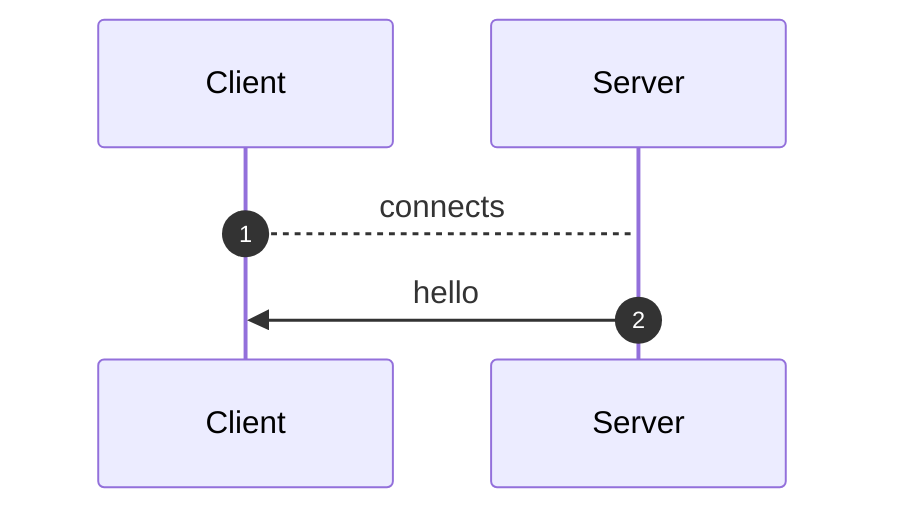
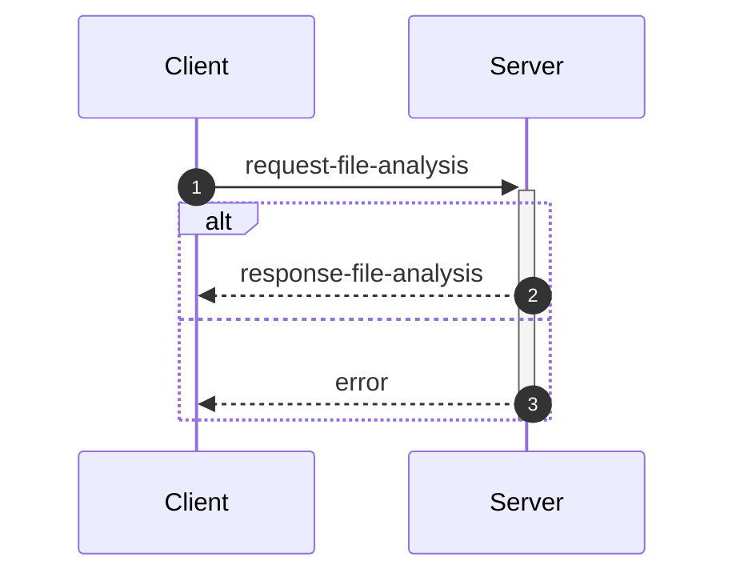
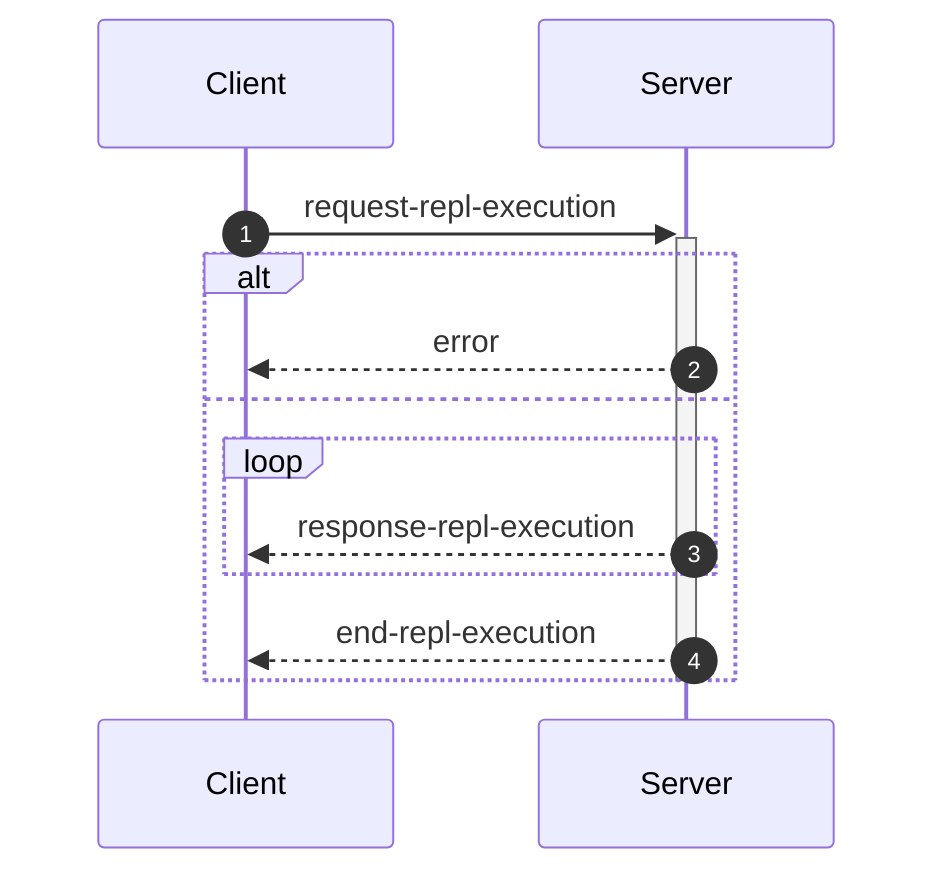
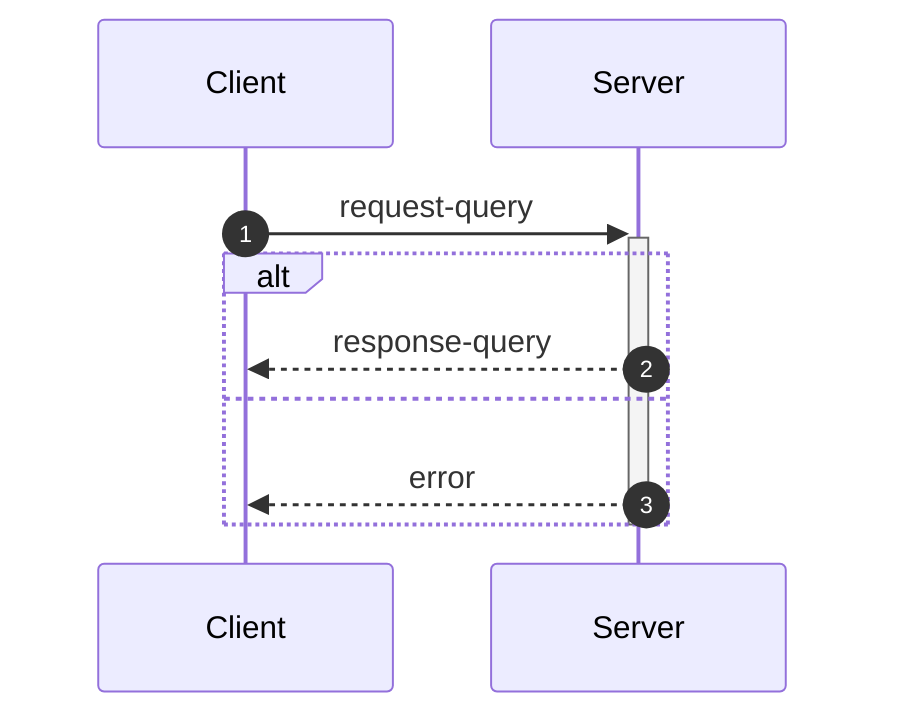

_<span title="an overview of flowR's interface">Generated</span> from '[wiki-interface.ts](https://github.com/flowr-analysis/flowr/tree/main/src/documentation/wiki-interface.ts "src/documentation/wiki-interface.ts")' on 2026-11-03, 15:30:02 UTC (v2.17.0, R v4.6.1), do not edit directly._

Although far from being as detailed as the in-depth explanation of [_flowR_](https://github.com/flowr-analysis/flowr/wiki/Core),
this wiki page explains how to interface with _flowR_ in more detail.
In general, command line arguments and other options provide short descriptions on hover over.

* [💻 Using the REPL](#using-the-repl)
* [⚙️ Configuring FlowR](#configuring-flowr)
* [⚒️ Writing Code](#writing-code)
* [💬 Communicating with the Server](#communicating-with-the-server)

<a id='using-the-repl'></a>
## 💻 Using the REPL

> [!NOTE]
> To execute arbitrary R commands with a repl request, _flowR_ has to be started explicitly with <span title="Description (Command Line Argument): Allow to access the underlying R session when using flowR (security warning: this allows the execution of arbitrary R code!)">`--r-session-access`</span>.
> Please be aware that this introduces a security risk and note that this relies on the [`r-shell` engine](https://github.com/flowr-analysis/flowr/wiki/Engines) .

Although primarily meant for users to explore,
there is nothing which forbids calling _flowR_ as a subprocess to use standard-in, -output, and -error
for communication (although you can access the REPL using the server as well,
with the [REPL Request](#message-request-repl-execution) message).

The read-eval-print loop&nbsp;(REPL) works relatively simple.
You can submit an expression (using <kbd>Enter</kbd>),
which is interpreted as an R&nbsp;expression by default but interpreted as a *command* if it starts with a colon (`:`).
The best command to get started with the REPL is <span title="Description (Repl Command): Show help information (aliases: :h, :?)">`:help`</span>.
Besides, you can leave the REPL either with the command <span title="Description (Repl Command): End the repl (aliases: :q, :exit)">`:quit`</span> or by pressing <kbd>Ctrl</kbd>+<kbd>C</kbd> twice.
When writing a *command*, you may press <kbd>Tab</kbd> to get a list of completions, if available.
Multiple commands can be entered in a single line by separating them with a semicolon (`;`), e.g. `:parse "x<-2"; :df*`.
If a command is given without R code, the REPL will re-use R code given in a previous command.
The prior example will hence return first the parsed AST of the program and then the dataflow graph for `"x <- 2"`.

> [!NOTE]
> If you develop flowR, you may want to launch the repl using the `npm run main-dev` command, this way, you get a non-minified version of flowR with debug information and hot-reloading of source files.

<details>
<summary>Available Commands</summary>

We currently offer the following commands (this with a `[*]` suffix are available with and without the star):

| Command | Description |
| ------- | ----------- |
| **<span title="Description (Repl Command): End the repl (aliases: :q, :exit)">:quit</span>** | End the repl (aliases: **:<span title="Alias of ':quit'. End the repl">q</span>**, **:<span title="Alias of ':quit'. End the repl">exit</span>**) |
| **<span title="Description (Repl Command): Execute the given code as R code. This requires the `--r-session-access` flag to be set and requires the r-shell engine. (aliases: :e, :r)">:execute</span>** | Execute the given code as R code. This requires the `--r-session-access` flag to be set and requires the r-shell engine. (aliases: **:<span title="Alias of ':execute'. Execute the given code as R code. This requires the `--r-session-access` flag to be set and requires the r-shell engine.">e</span>**, **:<span title="Alias of ':execute'. Execute the given code as R code. This requires the `--r-session-access` flag to be set and requires the r-shell engine.">r</span>**) |
| **<span title="Description (Repl Command): Get mermaid code for the control-flow graph of R code (aliases: :cfg, :cf)">:controlflow[*]</span>** | Get mermaid code for the control-flow graph of R code (star: Returns the URL to mermaid.live) (aliases: **:<span title="Alias of ':controlflow'. Get mermaid code for the control-flow graph of R code">cfg</span>**, **:<span title="Alias of ':controlflow'. Get mermaid code for the control-flow graph of R code">cf</span>**) |
| **<span title="Description (Repl Command): Get mermaid code for the control-flow graph with basic blocks (aliases: :cfgb, :cfb)">:controlflowbb[*]</span>** | Get mermaid code for the control-flow graph with basic blocks (star: Returns the URL to mermaid.live) (aliases: **:<span title="Alias of ':controlflowbb'. Get mermaid code for the control-flow graph with basic blocks">cfgb</span>**, **:<span title="Alias of ':controlflowbb'. Get mermaid code for the control-flow graph with basic blocks">cfb</span>**) |
| **<span title="Description (Repl Command): Get mermaid code for the dataflow graph (aliases: :d, :df)">:dataflow[*]</span>** | Get mermaid code for the dataflow graph (star: Returns the URL to mermaid.live) (aliases: **:<span title="Alias of ':dataflow'. Get mermaid code for the dataflow graph">d</span>**, **:<span title="Alias of ':dataflow'. Get mermaid code for the dataflow graph">df</span>**) |
| **<span title="Description (Repl Command): Get mermaid code for the normalized AST of R code (aliases: :n)">:normalize[*]</span>** | Get mermaid code for the normalized AST of R code (star: Returns the URL to mermaid.live) (alias: **:<span title="Alias of ':normalize'. Get mermaid code for the normalized AST of R code">n</span>**) |
| **<span title="Description (Repl Command): Get mermaid code for the simplified dataflow graph (aliases: :ds, :dfs)">:dataflowsimple[*]</span>** | Get mermaid code for the simplified dataflow graph (star: Returns the URL to mermaid.live) (aliases: **:<span title="Alias of ':dataflowsimple'. Get mermaid code for the simplified dataflow graph">ds</span>**, **:<span title="Alias of ':dataflowsimple'. Get mermaid code for the simplified dataflow graph">dfs</span>**) |
| **<span title="Description (Repl Command): Inspect and extend the signature database: `query` (identical to :query @signature), `info <name>` for where a function comes from (identical to :query @function-info), `add <path>` to mount another database/source, `download` to fetch the full-history database. (aliases: :sig)">:signature</span>** | Inspect and extend the signature database: `query` (identical to :query @signature), `info <name>` for where a function comes from (identical to :query @function-info), `add <path>` to mount another database/source, `download` to fetch the full-history database. (alias: **:<span title="Alias of ':signature'. Inspect and extend the signature database: `query` (identical to :query @signature), `info <name>` for where a function comes from (identical to :query @function-info), `add <path>` to mount another database/source, `download` to fetch the full-history database.">sig</span>**) |
| **<span title="Description (Repl Command): Just calculates the DFG, but only prints summary info (aliases: :d#, :df#)">:dataflowsilent</span>** | Just calculates the DFG, but only prints summary info (aliases: **:<span title="Alias of ':dataflowsilent'. Just calculates the DFG, but only prints summary info">d#</span>**, **:<span title="Alias of ':dataflowsilent'. Just calculates the DFG, but only prints summary info">df#</span>**) |
| **<span title="Description (Repl Command): Prints ASCII Art of the parsed, unmodified AST (aliases: :p)">:parse</span>** | Prints ASCII Art of the parsed, unmodified AST (alias: **:<span title="Alias of ':parse'. Prints ASCII Art of the parsed, unmodified AST">p</span>**) |
| **<span title="Description (Repl Command): Prints the version of flowR as well as the current version of R">:version</span>** | Prints the version of flowR as well as the current version of R
| **<span title="Description (Repl Command): Query the given R code (use 'help' for more information)">:query[*]</span>** | Query the given R code (use 'help' for more information) (star: Similar to query, but returns the output in json format.)
| **<span title="Description (Repl Command): Returns an ASCII representation of the dataflow graph (aliases: :df!)">:dataflowascii</span>** | Returns an ASCII representation of the dataflow graph (alias: **:<span title="Alias of ':dataflowascii'. Returns an ASCII representation of the dataflow graph">df!</span>**) |
| **<span title="Description (Repl Command): Returns summarization stats for the normalized AST (aliases: :n#)">:normalize#</span>** | Returns summarization stats for the normalized AST (alias: **:<span title="Alias of ':normalize#'. Returns summarization stats for the normalized AST">n#</span>**) |
| **<span title="Description (Repl Command): Show help information (aliases: :h, :?)">:help</span>** | Show help information (aliases: **:<span title="Alias of ':help'. Show help information">h</span>**, **:<span title="Alias of ':help'. Show help information">?</span>**) |

</details>

> [!TIP]
> 
> As indicated by the examples before, all REPL commands that operate on code keep track of the state.
> Hence, if you run a command like <span title="Description (Repl Command, starred version): Returns the URL to mermaid.live; Base Command: Get mermaid code for the dataflow graph (aliases: :d*, :df*)">`:dataflow*`</span> without providing R code,
> the REPL will re-use the R code provided in a previous command.
> Likewise, doing this will benefit from incrementality!
> If you request the dataflow graph with `:df* x <- 2 * y` and then want to see the parsed AST with `:parse`,
> the REPL will re-use previously obtained information and not re-parse the code again.
> 		

Generally, many commands offer shortcut versions in the REPL. Many queries, for example, offer a shortened format (see the example below).
Of special note, the [Config Query](https://github.com/flowr-analysis/flowr/wiki/%5BQuery%5D-Config)
can be used to also modify the currently active configuration of _flowR_ within the REPL (see the [wiki page](https://github.com/flowr-analysis/flowr/wiki/%5BQuery%5D-Config) for more information).

### Example: Retrieving the Dataflow Graph

To retrieve a URL to the [mermaid](https://mermaid.js.org/) diagram of the dataflow of a given expression,
use <span title="Description (Repl Command, starred version): Returns the URL to mermaid.live; Base Command: Get mermaid code for the dataflow graph (aliases: :d*, :df*)">`:dataflow*`</span> (or <span title="Description (Repl Command): Get mermaid code for the dataflow graph (aliases: :d, :df)">`:dataflow`</span> to get the mermaid code in the cli):

```shell
$ docker run -it --rm eagleoutice/flowr # or npm run flowr 
flowR repl v2.17.0, R grammar v14 (tree-sitter engine)
R> :dataflow* y <- 1 + x
```

<details>
<summary style='color:gray'>Output</summary>

```text
https://mermaid.live/view#base64:eyJjb2RlIjoiZmxvd2NoYXJ0IFREXG4gICAgMXt7XCJgKiM5MTtSTnVtYmVyIzkzOyogKioxKipcbiAgICAgICoxLjYqICgqKmlkOiAxKiopYFwifX1cbiAgICAyKFtcImAqIzkxO1JTeW1ib2wjOTM7KiAqKngqKlxuICAgICAgKjEuMTAqICgqKmlkOiAyKiopYFwiXSlcbiAgICAzW1tcImAqIzkxO1JCaW5hcnlPcCM5MzsqIGJhc2UjNTg7IzU4OyoqIzQzOyoqXG4gICAgICAqMS42LTEwKiAoKippZDogMyoqKVxuICAgIGFyZzogKDEsIDIpYFwiXV1cbiAgICBidWlsdC1pbjpfNDNfW1wiYEJ1aWx0LUluOlxuIzQzO2BcIl1cbiAgICBzdHlsZSBidWlsdC1pbjpfNDNfIHN0cm9rZTpncmF5LGZpbGw6Z3JheSxzdHJva2Utd2lkdGg6MnB4LG9wYWNpdHk6Ljg7XG4gICAgMFtcImAqIzkxO1JTeW1ib2wjOTM7KiAqKnkqKlxuICAgICAgKjEuMSogKCoqaWQ6IDAqKiwgdjogMylgXCJdXG4gICAgNFtbXCJgKiM5MTtSQmluYXJ5T3AjOTM7KiBiYXNlIzU4OyM1ODsqKiM2MDsjNDU7KipcbiAgICAgICoxLjEtMTAqICgqKmlkOiA0KiopXG4gICAgYXJnOiAoMCwgMylgXCJdXVxuICAgIGJ1aWx0LWluOl82MF8tW1wiYEJ1aWx0LUluOlxuIzYwOyM0NTtgXCJdXG4gICAgc3R5bGUgYnVpbHQtaW46XzYwXy0gc3Ryb2tlOmdyYXksZmlsbDpncmF5LHN0cm9rZS13aWR0aDoycHgsb3BhY2l0eTouODtcbiAgICAxIC0uLT58XCJmbG93XCJ8IDJcbiAgICBsaW5rU3R5bGUgMCBzdHJva2U6Z3JheSxjb2xvcjpncmF5O1xuICAgIDIgLS4tPnxcImZsb3dcInwgM1xuICAgIGxpbmtTdHlsZSAxIHN0cm9rZTpncmF5LGNvbG9yOmdyYXk7XG4gICAgMyAtLT58XCJyZWFkcywgYXJnXCJ8IDFcbiAgICAzIC0tPnxcInJlYWRzLCBhcmdcInwgMlxuICAgIDMgLS4tPnxcImZsb3dcInwgMFxuICAgIGxpbmtTdHlsZSA0IHN0cm9rZTpncmF5LGNvbG9yOmdyYXk7XG4gICAgMyAtLi0+fFwicmVhZHMsIGNhbGxzXCJ8IGJ1aWx0LWluOl80M19cbiAgICBsaW5rU3R5bGUgNSBzdHJva2U6Z3JheTtcbiAgICAwIC0tPnxcImRlZmluZWQtYnksIGZsb3dcInwgNFxuICAgIDAgLS0+fFwiZGVmaW5lZC1ieVwifCAzXG4gICAgNCAtLT58XCJyZWFkcywgYXJnXCJ8IDNcbiAgICA0IC0tPnxcInJldHVybnMsIGFyZ1wifCAwXG4gICAgNCAtLi0+fFwicmVhZHMsIGNhbGxzXCJ8IGJ1aWx0LWluOl82MF8tXG4gICAgbGlua1N0eWxlIDEwIHN0cm9rZTpncmF5OyIsIm1lcm1haWQiOnsiYXV0b1N5bmMiOnRydWV9fQ==
```

Retrieve the dataflow graph of the expression `y <- 1 + x`. It looks like this:


<details>

<summary style="color:gray">R Code of the Dataflow Graph</summary>

The analysis ran (parse and normalize with the [tree-sitter](https://github.com/flowr-analysis/flowr/wiki/Engines) engine) in the generation environment. No [signature database](https://github.com/flowr-analysis/flowr/wiki/Signature-Database) is mounted, so `library()` attaches no exports (base-R names are still qualified, e.g., `stats::acf`). 
We encountered no unknown side effects during the analysis.

```r
y <- 1 + x
```

</details>

</details>

For small graphs like this, <span title="Description (Repl Command): Returns an ASCII representation of the dataflow graph (aliases: :df!)">`:dataflowascii`</span> also provides an ASCII representation directly in the REPL:

```shell
$ docker run -it --rm eagleoutice/flowr # or npm run flowr 
flowR repl v2.17.0, R grammar v14 (tree-sitter engine)
R> :df! y <- 1 + x
```

<details open>
<summary style='color:gray'>Output</summary>

```text
                        v<0>v
 c<4>c──────────────────| y |
 |<- |     ┌────────────v---v
 c---c     │
    │   c<3>c   0<1>0
    └───| + |───| 1 |───u<2>u
        c---c   0---0   | x |
           └────────────u---u
Edges:
3 -> 1: reads, arg          3 -> 2: reads, arg
3 -> 0: flows-to            1 -> 2: flows-to
2 -> 3: flows-to            4 -> 3: reads, arg
4 -> 0: returns, arg        0 -> 4: defined-by, flows-to
0 -> 3: defined-by
```

Retrieve the dataflow graph of the expression `y <- 1 + x` as ASCII art.

</details>

For the slicing with <span title="Description (Repl Command): Static backwards executable slicer for R">`:slicer`</span>, you have access to the same [magic comments](#slice-magic-comments) as with the [slice request](#message-request-slice).
Pass `--inline` to splice resolvable `source()` calls into the reconstruction so the slice is a single self-contained R text (the same as the static slice query's `inlineSources` flag).
See `--help` for more flags!

### Example: Interfacing with the File System

Many commands that allow for an R-expression (like <span title="Description (Repl Command, starred version): Returns the URL to mermaid.live; Base Command: Get mermaid code for the dataflow graph (aliases: :d*, :df*)">`:dataflow*`</span>) allow for a file as well
if the argument starts with `file://`.
If you are working from the root directory of the _flowR_ repository, the following gives you the parsed AST of the example file using the <span title="Description (Repl Command): Prints ASCII Art of the parsed, unmodified AST (aliases: :p)">`:parse`</span> command:

> **Watch mode**: Replace `file://` with `watch://` to enter watch mode.
> flowR runs the command immediately and then re-runs it every time the file (or any file inside the folder) changes.
> Enter any other command to leave watch mode.
> For example: `:df watch://analysis.R`

```shell
$ docker run -it --rm eagleoutice/flowr # or npm run flowr 
flowR repl v2.17.0, R grammar v14 (tree-sitter engine)
R> :parse file://test/testfiles/example.R
```

<details>
<summary style='color:gray'>Output</summary>

```text
File: test/testfiles/example.R

program
├ binaryoperator
│ ├ identifier "sum" (1:1─4)
│ ├ <- "<-" (1:5─7)
│ ╰ float "0" (1:8─9)
├ binaryoperator
│ ├ identifier "product" (2:1─8)
│ ├ <- "<-" (2:9─11)
│ ╰ float "1" (2:12─13)
├ binaryoperator
│ ├ identifier "w" (3:1─2)
│ ├ <- "<-" (3:3─5)
│ ╰ float "7" (3:6─7)
├ binaryoperator
│ ├ identifier "N" (4:1─2)
│ ├ <- "<-" (4:3─5)
│ ╰ float "10" (4:6─8)
├ forstatement
│ ├ for "for" (6:1─4)
│ ├ ( "(" (6:5─6)
│ ├ identifier "i" (6:6─7)
│ ├ in "in" (6:8─10)
│ ├ binaryoperator
│ │ ├ float "1" (6:11─12)
│ │ ├ : ":" (6:12─13)
│ │ ╰ parenthesizedexpression
│ │   ├ ( "(" (6:13─14)
│ │   ├ binaryoperator
│ │   │ ├ identifier "N" (6:14─15)
│ │   │ ├ - "-" (6:15─16)
│ │   │ ╰ float "1" (6:16─17)
│ │   ╰ ) ")" (6:17─18)
│ ├ ) ")" (6:18─19)
│ ╰ bracedexpression
│   ├ { "{" (6:20─21)
│   ├ binaryoperator
│   │ ├ identifier "sum" (7:3─6)
│   │ ├ <- "<-" (7:7─9)
│   │ ╰ binaryoperator
│   │   ├ binaryoperator
│   │   │ ├ identifier "sum" (7:10─13)
│   │   │ ├ + "+" (7:14─15)
│   │   │ ╰ identifier "i" (7:16─17)
│   │   ├ + "+" (7:18─19)
│   │   ╰ identifier "w" (7:20─21)
│   ├ binaryoperator
│   │ ├ identifier "product" (8:3─10)
│   │ ├ <- "<-" (8:11─13)
│   │ ╰ binaryoperator
│   │   ├ identifier "product" (8:14─21)
│   │   ├  "" (8:22─23)
│   │   ╰ identifier "i" (8:24─25)
│   ╰ } "}" (9:1─2)
├ call
│ ├ identifier "cat" (11:1─4)
│ ╰ arguments
│   ├ ( "(" (11:4─5)
│   ├ argument
│   │ ╰ string
│   │   ├ stringopen "\"" (11:5─6)
│   │   ├ stringcontent "Sum:" (11:6─10)
│   │   ╰ stringclose "\"" (11:10─11)
│   ├ comma "," (11:11─12)
│   ├ argument
│   │ ╰ identifier "sum" (11:13─16)
│   ├ comma "," (11:16─17)
│   ├ argument
│   │ ╰ string
│   │   ├ stringopen "\"" (11:18─19)
│   │   ├ stringcontent
│   │   │ ╰ escapesequence "\\n" (11:19─21)
│   │   ╰ stringclose "\"" (11:21─22)
│   ╰ ) ")" (11:22─23)
╰ call
  ├ identifier "cat" (12:1─4)
  ╰ arguments
    ├ ( "(" (12:4─5)
    ├ argument
    │ ╰ string
    │   ├ stringopen "\"" (12:5─6)
    │   ├ stringcontent "Product:" (12:6─14)
    │   ╰ stringclose "\"" (12:14─15)
    ├ comma "," (12:15─16)
    ├ argument
    │ ╰ identifier "product" (12:17─24)
    ├ comma "," (12:24─25)
    ├ argument
    │ ╰ string
    │   ├ stringopen "\"" (12:26─27)
    │   ├ stringcontent
    │   │ ╰ escapesequence "\\n" (12:27─29)
    │   ╰ stringclose "\"" (12:29─30)
    ╰ ) ")" (12:30─31)
```

Retrieve the parsed AST of the example file.

<details>

<summary>File Content</summary>

```r
sum <- 0
product <- 1
w <- 7
N <- 10

for (i in 1:(N-1)) {
  sum <- sum + i + w
  product <- product * i
}

cat("Sum:", sum, "\n")
cat("Product:", product, "\n")
```

</details>

As _flowR_ directly transforms this AST the output focuses on being human-readable instead of being machine-readable.
		
</details>

### Example: Run a Query

You can run any query supported by _flowR_ using the <span title="Description (Repl Command): Query the given R code (use 'help' for more information)">`:query`</span> command.
For example, to obtain the shapes of all data frames in a given piece of code, you can run:

```shell
$ docker run -it --rm eagleoutice/flowr # or npm run flowr 
flowR repl v2.17.0, R grammar v14 (tree-sitter engine)
R> :query @absint df-shape "x <- data.frame(a = 1:10, b = 1:10)\ny <- x$a"
```

<details open>
<summary style='color:gray'>Output</summary>

```text
Query: absint (6 ms)
   ╰ $12: (colnames: [{"a", "b"}, {}], cols: [2, 2], rows: [10, 10])
   ╰ $0: (colnames: [{"a", "b"}, {}], cols: [2, 2], rows: [10, 10])
```

Retrieve the shapes of all data frames in the given code.

</details>

To run the linter on a file, you can use (in this example, we just issue the `dead-code` linter on a small piece of code):

```shell
$ docker run -it --rm eagleoutice/flowr # or npm run flowr 
flowR repl v2.17.0, R grammar v14 (tree-sitter engine)
R> :query @linter rules:dead-code "if(FALSE) x <- 2"
```

<details open>
<summary style='color:gray'>Output</summary>

```text
Query: linter (2 ms)
   ╰ Dead Code (dead-code):
       ╰ certain:
           ╰ Code at 1.11-16 (1 quick fix(es) available)
```

Run the linter on the given code, with only the `dead-code` rule enabled.

</details>

For more information on the available queries, please check out the [Query API](https://github.com/flowr-analysis/flowr/wiki/Query-API).

<a id='configuring-flowr'></a>
## ⚙️ Configuring FlowR

When running _flowR_, you may want to specify some behaviors with a dedicated configuration file.
By default, flowR looks for a file named `flowr.json` in the current working directory (or any higher directory).
You can also specify a different file with <span title="Description (Command Line Argument): The name of the configuration file to use">`--config-file`</span> or pass the configuration inline using <span title="Description (Command Line Argument): The flowR configuration to use, as a JSON string">`--config-json`</span>.
A `flowr.json` found this way belongs to the analyzed project, so flowR ignores its options that decide what flowR executes or loads
(`engines.*.wasmPath`, `engines.*.treeSitterWasmPath`, `engines.*.rPath`, `solver.sigdb.additionalPaths`, `solver.sigdb.downloadRepo`, `solver.sigdb.installedLibrary.paths`, `solver.sigdb.onDemand.enabled`, `solver.sigdb.onDemand.repositories`, `solver.sigdb.onDemand.cranMirror`, `solver.sigdb.onDemand.bioconductorMirror`, `solver.sigdb.onDemand.cacheDir`),
unless you pass <span title="Description (Command Line Argument): Keep the security-sensitive options (e.g., the R executable) of the flowr.json found in the working directory or a parent. Only use this for projects you trust.">`--trust-config`</span>.
To analyze code you do not trust, use the secure mode (<span title="Description (Command Line Argument): Run in secure mode for analyzing untrusted code: flowR does not start R (or any other process), does not access the network, does not search for project configs, and ignores security-sensitive options in every config. Cannot be disabled once enabled. Can also be enabled with the environment variable {italic FLOWR_SECURE_MODE=1}.">`--secure`</span>, see the [security policy](https://github.com/flowr-analysis/flowr/blob/main/.github/SECURITY.md)).
To inspect the current configuration, you can run flowr with the <span title="Description (Command Line Argument): Run with verbose logging (will be passed to the corresponding script)">`--verbose`</span> flag, or use the `config` [Query](https://github.com/flowr-analysis/flowr/wiki/Query-API).
Within the REPL this works by running the following:

```shell
:query @config
```

To work with the <a href="https://github.com/flowr-analysis/flowr/tree/main/src/config.ts#L119"><code><span title="The configuration file format for flowR.">FlowrConfig</span></code></a> you can use the provided helper objects alongside its methods like
<a href="https://github.com/flowr-analysis/flowr/tree/main/src/config.ts#L966"><code><span title="Creates a new flowr config that has the updated values.">FlowrConfig::<b>amend</b></span></code></a>.
The schema below documents every option; the ones you most likely want are:

- <a href="https://github.com/flowr-analysis/flowr/wiki/Interface#configuring-flowr" title="Configuration Option (boolean): Whether source calls should be ignored, causing {@link processSourceCall}&#39;s behavior to be skipped.">ignoreSourceCalls</a>: ignore source calls when analyzing the code, i.e., ignore the inclusion of other files.
- <a href="https://github.com/flowr-analysis/flowr/wiki/Interface#configuring-flowr" title="Configuration Option (boolean): Whether load calls should be ignored, causing {@link processLoadCall}&#39;s behavior to be skipped.">ignoreLoadCalls</a>: ignore load calls when analyzing the code, i.e., ignore the loading of r-data files.
- <a href="https://github.com/flowr-analysis/flowr/wiki/Interface#configuring-flowr" title="Configuration Option (object): Do you want to overwrite (parts) of the builtin definition?">semantics.environment.overwriteBuiltIns</a>: overwrite _flowR_'s handling of built-in functions, or clear the preset definitions entirely.
  See [Configure BuiltIn Semantics](#configure-builtin-semantics) for more information.
- <a href="https://github.com/flowr-analysis/flowr/wiki/Interface#configuring-flowr" title="Configuration Option (string): How to resolve variables and their values. (one of &quot;disabled&quot;, &quot;alias&quot;, &quot;builtin&quot;)">solver.variables</a>: how to resolve variables and their values (`disabled`, `alias`, `builtin`).
- <a href="https://github.com/flowr-analysis/flowr/wiki/Interface#configuring-flowr" title="Configuration Option (array): The engine or set of engines to use for interacting with R code. An empty array means all available engines will be used.">engines</a> and <a href="https://github.com/flowr-analysis/flowr/wiki/Interface#configuring-flowr" title="Configuration Option (string): The default engine to use for interacting with R code. If this is undefined, an arbitrary engine from the specified list will be used. (one of &quot;tree-sitter&quot;, &quot;r-shell&quot;)">defaultEngine</a>: the engines used to interact with R code, see the [Engines wiki page](https://github.com/flowr-analysis/flowr/wiki/Engines).
- <a href="https://github.com/flowr-analysis/flowr/wiki/Interface#configuring-flowr" title="Configuration Option (array): Files a framework loads on its own, without any source() call (e.g. global.R in a shiny app), in the order they are loaded; flowR orders the matching project files accordingly and analyzes them as one program. Entries are case-insensitive globs matched against the file path, a plain name matches any file with that name, and entries matching no project file are warned about. Usually set per project kind via specializeConfig.">project.implicitSources</a>: the files a framework loads without any `source()` call, in the order in which they are
  loaded. Entries are globs (e.g. `R/*.R`) matched against the file path ignoring capitalization; one matching no file is reported.
- <a href="https://github.com/flowr-analysis/flowr/wiki/Interface#configuring-flowr" title="Configuration Option (object): Overwrite (parts of) the configuration depending on the project kind flowR detects, e.g. to give a shiny app its implicit sources.">specializeConfig</a>: overwrite (parts of) the configuration depending on the kind of project _flowR_ detects
  (e.g. `shiny-app`), which is how a shiny app gets its implicit sources by default. What you configure directly wins.
- <a href="https://github.com/flowr-analysis/flowr/wiki/Interface#configuring-flowr" title="Configuration Option (string): Overwrite the project kind flowR would otherwise infer from the analyzed files, e.g. when auto-detection guesses wrong. (one of &quot;package&quot;, &quot;script&quot;, &quot;shiny-app&quot;, &quot;notebook&quot;, &quot;project&quot;, &quot;unknown&quot;)">project.useProjectType</a>: skip that detection and force a project kind yourself, when auto-detection guesses wrong.
- <a href="https://github.com/flowr-analysis/flowr/wiki/Interface#configuring-flowr" title="Configuration Option (array): The default plugins to load when creating a new instance of FlowrAnalyzer">defaultPlugins</a> and <a href="https://github.com/flowr-analysis/flowr/wiki/Interface#configuring-flowr" title="Configuration Option (array): The plugins to load in REPL mode">repl.plugins</a>: the plugins to load for a new <a href="https://github.com/flowr-analysis/flowr/tree/main/src/project/flowr-analyzer.ts#L210"><code><span title="Central class for conducting analyses with FlowR. Use the FlowrAnalyzerBuilder to create a new instance. If you want the original pattern of creating a pipeline and running all steps, you can still do this with FlowrAnalyzer#runFull . To inspect the context of the analyzer, use FlowrAnalyzer#inspectContext (if you are a plugin and need to modify it, use FlowrAnalyzer#context instead).">FlowrAnalyzer</span></code></a> and in the REPL
  (use `flowr:default` to reference the former).

So you can configure _flowR_ by adding a file like the following:

<details>

<summary>Example Configuration File</summary>

```json
{
  "ignoreSourceCalls": true,
  "ignoreLoadCalls": true,
  "semantics": {
    "environment": {
      "overwriteBuiltIns": {
        "definitions": [
          {
            "type": "function",
            "names": [
              "foo"
            ],
            "processor": "builtin:assign",
            "config": {}
          }
        ]
      }
    }
  },
  "defaultPlugins": [
    "file:description",
    "versions:description"
  ],
  "repl": {
    "quickStats": false,
    "dfProcessorHeat": false,
    "hints": true,
    "plugins": [
      "flowr:default"
    ]
  },
  "project": {
    "resolveUnknownPathsOnDisk": true,
    "implicitSources": [
      "global.R",
      "app.R"
    ]
  },
  "linter": {
    "disabledRules": []
  },
  "specializeConfig": {
    "shiny-app": {
      "project": {
        "implicitSources": [
          "global.R",
          "ui.R",
          "server.R",
          "app.R"
        ]
      }
    }
  },
  "engines": [
    {
      "type": "r-shell"
    }
  ],
  "solver": {
    "variables": "alias",
    "evalStrings": true,
    "trackEnvironments": true,
    "sigdb": {
      "enabled": true,
      "loadProjectDependencies": true,
      "eagerlyLoad": false,
      "eagerlyLoadExports": false,
      "linkBaseR": false,
      "linkDescriptionDependencies": false
    },
    "resolveSource": {
      "dropPaths": "no",
      "ignoreCapitalization": true,
      "inferWorkingDirectory": "active-script",
      "searchPath": []
    },
    "instrument": {},
    "slicer": {
      "threshold": 50
    }
  },
  "abstractInterpretation": {
    "wideningThreshold": 4,
    "followCalls": true,
    "dataFrame": {
      "maxColNames": 20,
      "readLoadedData": {
        "readExternalFiles": true,
        "maxReadLines": 1000000
      }
    }
  },
  "incremental": {
    "alwaysIncremental": false,
    "parsing": {
      "activated": false,
      "heuristics": {
        "activated": true,
        "mtime": true,
        "linesFrom": 500,
        "bytesFrom": 50000,
        "alwaysWithEdits": false,
        "minFiles": 1
      }
    }
  },
  "gas": {
    "thresholds": {
      "memory": {
        "problematic": 0.7,
        "critical": 0.9
      },
      "timeMs": {
        "problematic": 100000,
        "critical": 120000
      }
    },
    "features": {}
  }
}
```

</details>

<details>
<a id='configure-builtin-semantics'></a>
<summary>Configure Built-In Semantics</summary>

`semantics/environment/overwriteBuiltins` accepts two keys:

- `loadDefaults` (boolean, initially `true`): If set to `true`, the default built-in definitions are loaded before applying the custom definitions. Setting this flag to `false` explicitly disables the loading of the default definitions.
- `definitions` (array, initially empty): Allows to overwrite or define new built-in elements. Each object within must have a `type` which is one of the below. Furthermore, they may define a string array of `names` which specifies the identifiers to bind the definitions to. You may use `assumePrimitive` to specify whether _flowR_ should assume that this is a primitive non-library definition (so you probably just do not want to specify the key).

  | Type            | Description                                                                                                                                                                                                                                                                                              | Example                                                                                                    |
  | --------------- | -------------------------------------------------------------------------------------------------------------------------------------------------------------------------------------------------------------------------------------------------------------------------------------------------------- | ---------------------------------------------------------------------------------------------------------- |
  | `constant`    | Additionally allows for a `value` this should resolve to.                                                                                                                                                                                                                                                | `{ type: 'constant', names: ['NULL', 'NA'],  value: null }`                                                |
  | `function`    | Is a rather flexible way to define and bind built-in functions. For the time, we do not have extensive documentation to cover all the cases, so please either consult the sources with the `default-builtin-config.ts` or open a [new issue](https://github.com/flowr-analysis/flowr/issues/new/choose). | `{ type: 'function', names: ['next'], processor: 'builtin:d', config: { cfg: ExitPointType.Next } }` |
  | `replacement` | A comfortable way to specify replacement functions like `$<-` or `names<-`. `suffixes` describes the... suffixes to attach automatically. | `{ type: 'replacement', suffixes: ['<-', '<<-'], names: ['[', '[['] }` |

</details>

<details>

<summary style='color:gray'>Full Configuration-File Schema</summary>

- _The configuration file format for flowR._ (object)
    - **logLevel** [optional] _flowR's global minimum log level, applied when the config is loaded._ (string)
        Only allows: 'silly', 'trace', 'debug', 'info', 'warn', 'error', 'fatal'
    - **ignoreSourceCalls** [optional] _Whether source calls should be ignored, causing {@link processSourceCall}'s behavior to be skipped._ (boolean)
    - **ignoreLoadCalls** [optional] _Whether load calls should be ignored, causing {@link processLoadCall}'s behavior to be skipped._ (boolean)
    - **semantics** _Configure language semantics and how flowR handles them._ (object)
        - **environment** [optional] _Semantics regarding how to handle the R environment._ (object)
            - **overwriteBuiltIns** [optional] _Do you want to overwrite (parts) of the builtin definition?_ (object)
                - **loadDefaults** [optional] _Should the default configuration still be loaded?_ (boolean)
                - **definitions** [optional] _The definitions to load/overwrite._ (array)
                Valid item types:
                    - (object)
    - **defaultPlugins** [optional] _The default plugins to load when creating a new instance of FlowrAnalyzer_ (array)
    Valid item types:
        - (alternatives)
            - (string)
            - (array)
    - **repl** _Configuration options for the REPL._ (object)
        - **quickStats** [optional] _Whether to show quick stats in the REPL after each evaluation._ (boolean)
        - **dfProcessorHeat** [optional] _This instruments the dataflow processors to count how often each processor is called._ (boolean)
        - **hints** [optional] _Whether to show dim inline hints on the empty prompt (automatically disabled on non-interactive terminals)._ (boolean)
        - **plugins** [optional] _The plugins to load in REPL mode_ (array)
        Valid item types:
            - (alternatives)
                - (string)
                - (array)
        - **autoUseFileProtocol** [optional] _Prepend the file protocol to a repl input that looks like a path, instead of only warning about it._ (boolean)
        - **queryStats** [optional] _Whether `:query` closes with the line stating how long the queries took (`:query*` never prints it)._ (boolean)
        - **showPlugins** [optional] _Whether `:version` grays out the plugins that did not activate during the last analysis._ (boolean)
    - **project** _Project specific configuration options._ (object)
        - **resolveUnknownPathsOnDisk** [optional] _Whether to resolve unknown paths loaded by the r project disk when trying to source/analyze files._ (boolean)
        - **failOnInaccessiblePath** [optional] _Whether a directory that cannot be traversed during file discovery (e.g. due to permissions) aborts the analysis; when false (the default) such paths are logged and skipped._ (boolean)
        - **basePackages** [optional] _The packages considered part of R itself (base and recommended); if unset, flowR uses its built-in list._ (array)
        Valid item types:
            - (string)
        - **implicitSources** [optional] _Files a framework loads on its own, without any source() call (e.g. global.R in a shiny app), in the order they are loaded; flowR orders the matching project files accordingly and analyzes them as one program. Entries are case-insensitive globs matched against the file path, a plain name matches any file with that name, and entries matching no project file are warned about. Usually set per project kind via specializeConfig._ (array)
        Valid item types:
            - (string)
        - **useProjectType** [optional] _Overwrite the project kind flowR would otherwise infer from the analyzed files, e.g. when auto-detection guesses wrong._ (string)
            Only allows: 'package', 'script', 'shiny-app', 'notebook', 'project', 'unknown'
        - **assumeImplicitEcho** [optional] _Whether the top level of the analyzed code is echoed, so that every visible result printed there is collected as an output by the dependencies query (default true, false for a package)._ (boolean)
        - **discovery** [optional] _Scoping options for the default project discovery._ (object)
            - **full** [optional] _Collect every file below the project root (greedy) instead of only the files the detected project kind needs (default false)._ (boolean)
            - **perKind** [optional] _Per-kind include/exclude glob overrides layered on the default scoping._ (object)
            - **ignore** [optional] _Case-insensitive globs that drop matching files from the intelligent discovery, regardless of kind (e.g. .Renviron to ignore environment files)._ (array)
            Valid item types:
                - (string)
        - **classification** [optional] _Overrides for the signals flowR uses to classify the project kind._ (object)
            - **shinyDescriptionTypes** [optional] _DESCRIPTION Type: values that mark a shiny app._ (array)
            Valid item types:
                - (string)
            - **shinyEntryFiles** [optional] _File names a shiny app is assembled from._ (array)
            Valid item types:
                - (string)
            - **shinyUsagePattern** [optional] _Regex source evidencing shiny usage in an entry file._ (string)
            - **notebookExtensions** [optional] _File extensions marking a notebook._ (array)
            Valid item types:
                - (string)
    - **linter** _Linter configuration options._ (object)
        - **disabledRules** _Linting rule names excluded from the default rule set (a rule requested explicitly via a linter query still runs). Usually set per project kind via specializeConfig._ (array)
        Valid item types:
            - (string)
        - **disabledTags** [optional] _Linting rule tags whose rules are excluded from the default rule set (a rule requested explicitly via a linter query still runs). By default the cmd-check rules are disabled for everything but a package; a configured list replaces that default._ (array)
        Valid item types:
            - (string)
    - **inputSources** [optional] _Further frameworks the input-sources analysis should know about; entries are added to flowR's defaults._ (object)
        - **pure** [optional] _Functions that only pass the constantness of their arguments on._ (array)
        Valid item types:
            - (string)
        - **param** [optional] _Functions whose result is a 'param' input._ (array)
        Valid item types:
            - (string)
        - **file** [optional] _Functions whose result is a 'file' input._ (array)
        Valid item types:
            - (string)
        - **tempfile** [optional] _Functions whose result is a 'tempfile' input._ (array)
        Valid item types:
            - (string)
        - **glob** [optional] _Functions whose result is a 'glob' input._ (array)
        Valid item types:
            - (string)
        - **net** [optional] _Functions whose result is a 'net' input._ (array)
        Valid item types:
            - (string)
        - **rand** [optional] _Functions whose result is a 'rand' input._ (array)
        Valid item types:
            - (string)
        - **system** [optional] _Functions whose result is a 'system' input._ (array)
        Valid item types:
            - (string)
        - **ffi** [optional] _Functions whose result is a 'ffi' input._ (array)
        Valid item types:
            - (string)
        - **lang** [optional] _Functions whose result is a 'lang' input._ (array)
        Valid item types:
            - (string)
        - **options** [optional] _Functions whose result is a 'options' input._ (array)
        Valid item types:
            - (string)
        - **cmdline** [optional] _Functions whose result is a 'cmdline' input._ (array)
        Valid item types:
            - (string)
        - **user** [optional] _Functions whose result is a 'user' input._ (array)
        Valid item types:
            - (string)
        - **const** [optional] _Functions whose result is a 'const' input._ (array)
        Valid item types:
            - (string)
        - **scope** [optional] _Functions whose result is a 'scope' input._ (array)
        Valid item types:
            - (string)
        - **dconst** [optional] _Functions whose result is a 'dconst' input._ (array)
        Valid item types:
            - (string)
        - **unknown** [optional] _Functions whose result is a 'unknown' input._ (array)
        Valid item types:
            - (string)
        - **linkedObjects** [optional] _Objects a framework provides without a definition in the code, e.g. shiny's input._ (array)
        Valid item types:
            - (object)
        - **linkedEntryPoints** [optional] _Calls that hand a function to a framework, which binds its objects to the parameters by position._ (array)
        Valid item types:
            - (object)
    - **specializeConfig** [optional] _Overwrite (parts of) the configuration depending on the project kind flowR detects, e.g. to give a shiny app its implicit sources._ (object)
    - **engines** _The engine or set of engines to use for interacting with R code. An empty array means all available engines will be used._ (array)
    Valid item types:
        - (alternatives)
            - _The configuration for the tree sitter engine._ (object)
                - **type** [required] _Use the tree sitter engine._ (string)
                    Only allows: 'tree-sitter'
                - **wasmPath** [optional] _The path to the tree-sitter-r WASM binary to use. If this is undefined, this uses the default path._ (string)
                - **treeSitterWasmPath** [optional] _The path to the tree-sitter WASM binary to use. If this is undefined, this uses the default path._ (string)
                - **lax** [optional] _Whether to use the lax parser for parsing R code (allowing for syntax errors). If this is undefined, the strict parser will be used._ (boolean)
            - _The configuration for the R shell engine._ (object)
                - **type** [required] _Use the R shell engine._ (string)
                    Only allows: 'r-shell'
                - **rPath** [optional] _The path to the R executable to use. If this is undefined, this uses the default path._ (string)
                - **pipeBind** [optional] _Whether to enable R's experimental pipe-bind operator "=>" by setting _R_USE_PIPEBIND_ for the R session (default false); R itself keeps this off by default, as it is experimental and has never shipped in a release version of R._ (boolean)
    - **defaultEngine** [optional] _The default engine to use for interacting with R code. If this is undefined, an arbitrary engine from the specified list will be used._ (string)
        Only allows: 'tree-sitter', 'r-shell'
    - **solver** _How to resolve constants, constraints, cells, ..._ (object)
        - **variables** _How to resolve variables and their values._ (string)
            Only allows: 'disabled', 'alias', 'builtin'
        - **evalStrings** _Should we include eval(parse(text="...")) calls in the dataflow graph?_ (boolean)
        - **trackEnvironments** [optional] _Track user-created environments (new.env, assign/get/local with envir=, dollar-assign, attach). When false, all envir-style calls fall through conservatively._ (boolean)
        - **sigdb** _Resolving library exports from a signature database._ (object)
            - **enabled** [optional] _Resolve library()/use() exports from a signature database (default true); when false no database is consulted._ (boolean)
            - **loadProjectDependencies** [optional] _Load the project's declared dependencies from its metadata files (DESCRIPTION Imports/Depends, rproject.toml, uvr.toml, rig rproj.toml and script blocks, renv.lock, rv.lock, uvr.lock, rig lockfiles) (default true); when false these files are not read for dependencies._ (boolean)
            - **eagerlyLoad** [optional] _Parse the database up front rather than on the first package load (default false, ignored if disabled)._ (boolean)
            - **eagerlyLoadExports** [optional] _Add a vertex for every export on load rather than on demand (default false); keeps the dataflow graph small._ (boolean)
            - **assumedRVersion** [optional] _R version assumed when resolving versioned (base-R) exports: a pin like "4.5" or "auto" to detect the installed R (default "auto")._ (string)
            - **linkBaseR** [optional] _Eagerly attach base-R namespaces so bare base calls resolve without library() (default false)._ (boolean)
            - **linkBaseRCalls** [optional] _Add a lightweight Reads edge from a bare base-R call to its signature-database function vertex (default false; base-R qualification is edge-free otherwise)._ (boolean)
            - **linkPackageCalls** [optional] _Add a lightweight Reads edge from a resolved package call to its signature-database function vertex (default false)._ (boolean)
            - **linkDescriptionDependencies** [optional] _Eagerly attach the namespaces of the project's declared DESCRIPTION dependencies (Imports/Depends) so their exports resolve without an explicit library() (default false)._ (boolean)
            - **warmInBackground** [optional] _Decompress the hot shards (base + most-downloaded) in a background task on startup so the first library() lookup is warm (default false; for long-running servers/REPLs)._ (boolean)
            - **additionalPaths** [optional] _Extra directories or bundle/manifest files searched for signature databases (alongside the shipped default and $FLOWR_SIGDB_DIR); a downloaded full-history bundle placed here is mounted automatically._ (array)
            Valid item types:
                - (string)
            - **downloadRepo** [optional] _GitHub owner/repo the full-history bundle is downloaded from via ":signature download" (default "flowr-analysis/flowr"; the release tag comes from the committed sigdb.remote.json unless a version is given)._ (string)
            - **autoSync** [optional] _On startup, re-download shards whose committed sigdb.remote.json hash no longer matches the cache, in the background (default false; opt-in network sync after a git pull)._ (boolean)
            - **installedLibrary** [optional] _Recovering packages no signature database knows from the copy installed on this machine._ (object)
                - **enabled** [required] _Recover packages no signature database knows from their installed copy (default false)._ (boolean)
                - **paths** [optional] _Library directories to search; when empty they are discovered from the environment and the project._ (array)
                Valid item types:
                    - (string)
                - **useEnvironment** [optional] _Search the libraries R_LIBS_USER/R_LIBS/R_LIBS_SITE name (default true)._ (boolean)
                - **useProjectLibrary** [optional] _Search a project-local renv/packrat library (default true)._ (boolean)
                - **maxDepth** [optional] _How far to descend into the nested layout of a project-local library (default 3)._ (number)
                - **packages** [optional] _Only recover packages whose name matches one of these regular expressions; empty means any._ (array)
                Valid item types:
                    - (string)
            - **onDemand** [optional] _Recovering packages no signature database knows from their sources on CRAN, Bioconductor, or GitHub._ (object)
                - **enabled** [required] _Fetch and recover the sources of packages no signature database knows when the analyzed code uses them (default false, accesses the network)._ (boolean)
                - **sources** [optional] _Where to look, in order: github, cran, bioconductor, or a source a plugin adds (default ["github", "cran", "bioconductor"])._ (array)
                Valid item types:
                    - (string)
                - **repositories** [optional] _GitHub repositories (owner/repo[/subdir][@ref]) to fetch packages from, by package name. The analyzed project may name more (DESCRIPTION Remotes, install_github calls)._ (object)
                - **packages** [optional] _Only recover packages whose name matches one of these regular expressions, empty means any._ (array)
                Valid item types:
                    - (string)
                - **cranMirror** [optional] _The CRAN src/contrib/ to fetch from, over https (default https://cloud.r-project.org/src/contrib/). It may be on the local network._ (string)
                - **bioconductorMirror** [optional] _The Bioconductor host, over https (default https://bioconductor.org). It may be on the local network._ (string)
                - **bioconductorRelease** [optional] _The Bioconductor release to fetch from: release, devel, or a number like 3.20 (default release)._ (string)
                - **githubMirrors** [optional] _Use the GitHub mirrors of CRAN (cran/<pkg>) and Bioconductor (bioc/<pkg>) (default true)._ (boolean)
                - **maxPackages** [optional] _The most packages to fetch for one analysis (default 25)._ (number)
                - **maxArchiveMb** [optional] _The most MiB a package archive may have (default 32). It may unpack to three times that, at most 128 MiB._ (number)
                - **offline** [optional] _Only use what was fetched before, never the network (default false)._ (boolean)
                - **retryAfterHours** [optional] _How many hours to wait before asking again for a package no source had (default 24)._ (number)
                - **cacheDir** [optional] _Where to cache what was fetched (default the on-demand directory of the signature cache)._ (string)
            - **blobCacheBudgetMb** [optional] _How many MiB of decoded package blobs every open bundle may hold together (default 16)._ (number)
            - **versionSelection** [optional] _When a project constrains a dependency, resolve to the newest (default), oldest, or system-installed version satisfying it; system needs R and falls back to newest. Base-R packages always resolve against the assumed R version._ (string)
                Only allows: 'newest', 'oldest', 'system'
            - **versionOverrides** [optional] _Force an exact version for specific packages (name -> version), overriding both the project constraint and the versionSelection policy (default {})._ (object)
        - **versionManagement** _Policies for reasoning about dependency versions._ (object)
            - **linkedVersionGroups** [optional] _Groups of packages that must resolve to the same version; version guessing intersects each group so its members stay mutually compatible (default [])._ (array)
            Valid item types:
                - (array)
                Valid item types:
                    - (string)
        - **assumeAttachedPackages** [optional] _Packages to treat as attached without a `library()` call, so what the built-in configuration states about them applies to the analyzed code. The base packages R attaches on startup already resolve without it._ (array)
        Valid item types:
            - (string)
        - **transitiveSideEffectRounds** [optional] _How many rounds the transitive side-effect fixpoint may run before it is cut off (default 32); the propagation stops on its own as soon as a round adds nothing._ (number)
        - **maxOverlayDepth** [optional] _How many binding overlays may stack on one environment frame before a write flattens them (default 4); a pure performance knob, trading lookup cost against copy cost without changing any result._ (number)
        - **instrument** (object)
            - **dataflowExtractors** [optional] _These keys are only intended for use within code, allowing to instrument the dataflow analyzer!_ (any)
        - **resolveSource** [optional] _If lax source calls are active, flowR searches for sourced files much more freely, based on the configurations you give it. This option is only in effect if `ignoreSourceCalls` is set to false._ (object)
            - **dropPaths** _Allow to drop the first or all parts of the sourced path, if it is relative._ (string)
                Only allows: 'no', 'once', 'all'
            - **ignoreCapitalization** _Search for filenames matching in the lowercase._ (boolean)
            - **inferWorkingDirectory** _Try to infer the working directory from the main or any script to analyze._ (string)
                Only allows: 'no', 'main-script', 'active-script', 'any-script'
            - **searchPath** _Additionally search in these paths._ (array)
            Valid item types:
                - (string)
            - **repeatedSourceLimit** [optional] _How often the same file can be sourced within a single run? Please be aware: in case of cyclic sources this may not reach a fixpoint so give this a sensible limit._ (number)
            - **applyReplacements** _Provide name replacements for loaded files_ (array)
            Valid item types:
                - (object)
            - **assumeFilesExist** [optional] _Assume a sourced file is always there, making what it defines certain instead of conditional on the source call._ (boolean)
        - **slicer** [optional] _The configuration for the slicer._ (object)
            - **threshold** [optional] _The maximum number of iterations to perform on a single function call during slicing._ (number)
            - **autoExtend** [optional] _If set, the slicer will gain an additional post-pass._ (boolean)
    - **abstractInterpretation** _The configuration options for abstract interpretation._ (object)
        - **wideningThreshold** _The threshold for the number of visitations of a node at which widening should be performed to ensure the termination of the fixpoint iteration._ (number)
        - **followCalls** _Whether the abstract interpretation is interprocedural, i.e. whether it steps into the functions a call may dispatch to._ (boolean)
        - **dataFrame** _The configuration of the shape inference for data frames._ (object)
            - **maxColNames** _The maximum number of columns names to infer for data frames before over-approximating the column names to top._ (number)
            - **readLoadedData** _Configuration options for reading data frame shapes from loaded external data files, such as CSV files._ (object)
                - **readExternalFiles** _Whether data frame shapes should be extracted from loaded external files, such as CSV files._ (boolean)
                - **maxReadLines** _The maximum number of lines to read when extracting data frame shapes from loaded files, such as CSV files._ (number)
    - **incremental** (object)
        - **alwaysIncremental** _Always take the incremental path, regardless of heuristics._ (boolean)
        - **parsing** (object)
            - **activated** _If set, incremental parsing will be used._ (boolean)
            - **heuristics** (object)
                - **activated** [optional] _If set, the heuristics for incremental parsing will be used._ (boolean)
                - **mtime** [optional] _Skip reparsing entirely if the file's modification time is unchanged since the last parse._ (boolean)
                - **linesFrom** [optional] _Only consider incremental parsing for files with at least this many lines._ (number)
                - **bytesFrom** [optional] _Only consider incremental parsing for files with at least this many bytes._ (number)
                - **alwaysWithEdits** [optional] _Always take the incremental path whenever there is a computed edit region, regardless of the other thresholds._ (boolean)
                - **minFiles** [optional] _Only apply these heuristics once the project has at least this many files loaded._ (number)
    - **gas** [optional] _Resource-usage guard (gas) configuration. All feature factors default to 0 (disabled). See https://github.com/flowr-analysis/flowr/wiki/Core#gas-resource-guard._ (object)
        - **thresholds** [optional] _Thresholds for all gas checks (scaled by per-feature factor), boundable per feature._ (object)
            - **memory** [optional] _Heap-usage fraction thresholds (0-1), either shared or given per feature key (with `default` covering the rest)._ (object)
                - **problematic** [optional] _Heap fraction (0-1) above which Problematic is returned, for every feature without an entry of its own._ (number)
                - **critical** [optional] _Heap fraction (0-1) above which Critical is returned, for every feature without an entry of its own._ (number)
            - **timeMs** [optional] _Elapsed analysis time thresholds in milliseconds, either shared or given per feature key (with `default` covering the rest)._ (object)
                - **problematic** [optional] _Elapsed ms above which Problematic is returned, for every feature without an entry of its own._ (number)
                - **critical** [optional] _Elapsed ms above which Critical is returned, for every feature without an entry of its own._ (number)
            - **steps** [optional] _Processed-AST-node thresholds, counted rather than sampled; only a key that arms a budget (`dataflow`) reads them._ (object)
                - **problematic** [optional] _Processed AST nodes above which Problematic is returned, for every feature without an entry of its own._ (number)
                - **critical** [optional] _Processed AST nodes above which the extraction is cut short, for every feature without an entry of its own._ (number)
            - **vertices** [optional] _Created-dataflow-vertex thresholds, counted like `steps`._ (object)
                - **problematic** [optional] _Created dataflow vertices above which Problematic is returned, for every feature without an entry of its own._ (number)
                - **critical** [optional] _Created dataflow vertices above which the extraction is cut short, for every feature without an entry of its own._ (number)
        - **features** [optional] _Per-feature sensitivity factors. 0 or absent disables gas checking for that feature. A factor of 2 makes the feature twice as sensitive. Recognised keys: `source`, `side-effect-linking`, `linter`, `slicer`, `dataflow`._ (object)
        - **countedCheckEvery** [optional] _How many counted steps pass between two accountings of an armed check, be it a dataflow budget or the slicer's traversal (default 128); trades overshoot against the cost of the check._ (number)
        - **heapProvider** [optional] _Custom heap statistics source (programmatic configs only), overriding the built-in v8/performance.memory detection._ (function)

</details>

<a id='writing-code'></a>
## ⚒️ Writing Code

_flowR_ can be used as a [module](https://www.npmjs.com/package/@eagleoutice/flowr) and offers several main classes and interfaces that are interesting for extension writers 
(see the [Visual Studio Code extension](https://marketplace.visualstudio.com/items?itemName=code-inspect.vscode-flowr) or the [Core](https://github.com/flowr-analysis/flowr/wiki/Core) wiki page for more information).

### Creating Analyses with _flowR_

Nowadays, instances of the <a href="https://github.com/flowr-analysis/flowr/tree/main/src/project/flowr-analyzer.ts#L210"><code><span title="Central class for conducting analyses with FlowR. Use the FlowrAnalyzerBuilder to create a new instance. If you want the original pattern of creating a pipeline and running all steps, you can still do this with FlowrAnalyzer#runFull . To inspect the context of the analyzer, use FlowrAnalyzer#inspectContext (if you are a plugin and need to modify it, use FlowrAnalyzer#context instead).">FlowrAnalyzer</span></code></a> should be used as central frontend to get analysis results from _flowR_.
The entry points an analysis is written against are re-exported from the package root (`import { FlowrAnalyzerBuilder } from '@eagleoutice/flowr'`);
everything else stays reachable under its own path, as in `@eagleoutice/flowr/dataflow/graph/graph`.
For example, a program slice can be created like this:

```ts
const analyzer = await new FlowrAnalyzerBuilder()
    .setEngine('tree-sitter')
    .build();
analyzer.addRequest('x <- 1\ny <- x\nx');
const result = await analyzer.query([
    {
        type:     'static-slice',
        criteria: ['3@x']
    }
]);
```

For more information, please have a look at the [Analyzer](https://github.com/flowr-analysis/flowr/wiki/Analyzer) wiki page, which explains how to construct and use the <a href="https://github.com/flowr-analysis/flowr/tree/main/src/project/flowr-analyzer.ts#L210"><code><span title="Central class for conducting analyses with FlowR. Use the FlowrAnalyzerBuilder to create a new instance. If you want the original pattern of creating a pipeline and running all steps, you can still do this with FlowrAnalyzer#runFull . To inspect the context of the analyzer, use FlowrAnalyzer#inspectContext (if you are a plugin and need to modify it, use FlowrAnalyzer#context instead).">FlowrAnalyzer</span></code></a> in more detail.
To work with specific perspectives, you can also consult the respective pages like the [Dataflow Graph](https://github.com/flowr-analysis/flowr/wiki/Dataflow-Graph) or the [Abstract Interpretation](https://github.com/flowr-analysis/flowr/wiki/Abstract-Interpretation) wiki pages.
### The Pipeline Executor (Low-Level Interface)

Once, in the beginning, _flowR_ was meant to produce a dataflow graph merely to provide *program slices*. 
However, with continuous updates, the [Dataflow Graph](https://github.com/flowr-analysis/flowr/wiki/Dataflow-Graph) repeatedly proves to be the more interesting part.
With this, we restructured _flowR_'s originally *hardcoded* pipeline to be far more flexible. 
Now, it can be theoretically extended or replaced with arbitrary steps, optional steps, and what we call 'decorations' of these steps. 
In short, a slicing pipeline using the <a href="https://github.com/flowr-analysis/flowr/tree/main/src/core/pipeline-executor.ts#L97"><code><span title="**Please note:** The PipelineExecutor is now considered to be a rather low-level API for flowR. While it still works and is the basis for all other layers, we strongly recommend using the FlowrAnalyzer and its builder to create and use an analyzer instance that is pre-configured for your use-case. The pipeline executor allows to execute arbitrary pipelines in a step-by-step fashion. If you are not...">PipelineExecutor</span></code></a> looks like this:

```ts

const slicer = new PipelineExecutor(DEFAULT_SLICING_PIPELINE, {
  parser:    new RShell(),
  request:   requestFromInput('x <- 1\nx + 1'),
  criterion: ['2@x']
})
const slice = await slicer.allRemainingSteps()
// console.log(slice.reconstruct.code)
```

<details><summary>More Information</summary>

If you compare this, with what you would have done with the old (and removed) `SteppingSlicer`, 
this essentially just requires you to replace the `SteppingSlicer` with the <a href="https://github.com/flowr-analysis/flowr/tree/main/src/core/pipeline-executor.ts#L97"><code><span title="**Please note:** The PipelineExecutor is now considered to be a rather low-level API for flowR. While it still works and is the basis for all other layers, we strongly recommend using the FlowrAnalyzer and its builder to create and use an analyzer instance that is pre-configured for your use-case. The pipeline executor allows to execute arbitrary pipelines in a step-by-step fashion. If you are not...">PipelineExecutor</span></code></a>
and to pass the <a href="https://github.com/flowr-analysis/flowr/tree/main/src/core/steps/pipeline/default-pipelines.ts#L18"><code>DEFAULT_SLICING_PIPELINE</code></a> as the first argument.
The <a href="https://github.com/flowr-analysis/flowr/tree/main/src/core/pipeline-executor.ts#L97"><code><span title="**Please note:** The PipelineExecutor is now considered to be a rather low-level API for flowR. While it still works and is the basis for all other layers, we strongly recommend using the FlowrAnalyzer and its builder to create and use an analyzer instance that is pre-configured for your use-case. The pipeline executor allows to execute arbitrary pipelines in a step-by-step fashion. If you are not...">PipelineExecutor</span></code></a>...

1. Provides structures to investigate the results of all intermediate steps
2. Can be executed step-by-step
3. Can repeat steps (e.g., to calculate multiple slices on the same input)

See the in-code documentation for more information.

</details>

### Using the <a href="https://github.com/flowr-analysis/flowr/tree/main/src/r-bridge/shell.ts#L144"><code><span title="The RShell represents an interactive session with the R interpreter. You can configure it by RShellOptions . At the moment we are using a live R session (and not networking etc.) to communicate with R easily, which allows us to install packages etc. However, this might and probably will change in the future (leaving this as a legacy mode :D)">RShell</span></code></a> to Interact with R

The <a href="https://github.com/flowr-analysis/flowr/tree/main/src/r-bridge/shell.ts#L144"><code><span title="The RShell represents an interactive session with the R interpreter. You can configure it by RShellOptions . At the moment we are using a live R session (and not networking etc.) to communicate with R easily, which allows us to install packages etc. However, this might and probably will change in the future (leaving this as a legacy mode :D)">RShell</span></code></a> class allows interfacing with the `R`&nbsp;ecosystem installed on the host system.
Please have a look at [flowR's Engines](https://github.com/flowr-analysis/flowr/wiki/Engines) for more information on alternatives (for example, the <a href="https://github.com/flowr-analysis/flowr/tree/main/src/r-bridge/lang-4.x/tree-sitter/tree-sitter-executor.ts#L29"><code><span title="Synchronous and (way) faster alternative to the RShell using tree-sitter.">TreeSitterExecutor</span></code></a>).

> [!IMPORTANT]
> 
> Each <a href="https://github.com/flowr-analysis/flowr/tree/main/src/r-bridge/shell.ts#L144"><code><span title="The RShell represents an interactive session with the R interpreter. You can configure it by RShellOptions . At the moment we are using a live R session (and not networking etc.) to communicate with R easily, which allows us to install packages etc. However, this might and probably will change in the future (leaving this as a legacy mode :D)">RShell</span></code></a> controls a new instance of the R&nbsp;interpreter, 
> make sure to call <code><a href="https://github.com/flowr-analysis/flowr/tree/main/src/r-bridge/shell.ts#L350"><span title="Close the current R session, makes the object effectively invalid (can no longer be reopened etc.)">RShell::<i>close</i></span></a>()</code> when you are done.

You can start a new "session" by constructing a new object with <code>new <a href="https://github.com/flowr-analysis/flowr/tree/main/src/r-bridge/shell.ts#L144"><span title="The RShell represents an interactive session with the R interpreter. You can configure it by RShellOptions . At the moment we are using a live R session (and not networking etc.) to communicate with R easily, which allows us to install packages etc. However, this might and probably will change in the future (leaving this as a legacy mode :D)">RShell</span></a>()</code>.

However, there are several options that may be of interest 
(e.g., to automatically revive the shell in case of errors or to control the name location of the R process on the system).

With a shell object (let's call it `shell`), you can execute R code by using <a href="https://github.com/flowr-analysis/flowr/tree/main/src/r-bridge/shell.ts#L213"><code><span title="sends the given command directly to the current R session will not do anything to alter input markers!">RShell::<i>sendCommand</i></span></code></a>,
for example <code>shell.<a href="https://github.com/flowr-analysis/flowr/tree/main/src/r-bridge/shell.ts#L213"><span title="sends the given command directly to the current R session will not do anything to alter input markers!">sendCommand</span></a>("1 + 1")</code>.
However, this does not return anything, so if you want to collect the output of your command, use
<a href="https://github.com/flowr-analysis/flowr/tree/main/src/r-bridge/shell.ts#L296"><code><span title="Send a command and collect the output">RShell::<i>sendCommandWithOutput</i></span></code></a> instead.

<a id='communicating-with-the-server'></a>
## 💬 Communicating with the Server

As explained in the [Overview](https://github.com/flowr-analysis/flowr/wiki/Overview), you can run the [TCP](https://de.wikipedia.org/wiki/Transmission_Control_Protocol)&nbsp;server by adding the <span title="Description (Command Line Argument): Do not drop into a repl, but instead start a server on the given port (default: 1042) and listen for messages.">`--server`</span> flag (and, due to the interactive mode, exit with the conventional <kbd>CTRL</kbd>+<kbd>C</kbd>).
Currently, every connection is handled by the same underlying `RShell` - so the server is not designed to handle many clients at a time.
Additionally, the server is not well guarded against attacks (e.g., you can theoretically spawn an arbitrary number of&nbsp;RShell sessions on the target machine).

Every message has to be given in a single line (i.e., without a newline in-between) and end with a newline character. Nevertheless, we will pretty-print example given in the following segments for the ease of reading.

> [!NOTE]
> 
> The default <span title="Description (Command Line Argument): Do not drop into a repl, but instead start a server on the given port (default: 1042) and listen for messages.">`--server`</span> uses a simple [TCP](https://de.wikipedia.org/wiki/Transmission_Control_Protocol)
> connection. If you want _flowR_ to expose a [WebSocket](https://de.wikipedia.org/wiki/WebSocket) server instead, add the <span title="Description (Command Line Argument): If the server flag is set, use websocket for messaging">`--ws`</span> flag (i.e., <span title="Description (Command Line Argument): Do not drop into a repl, but instead start a server on the given port (default: 1042) and listen for messages.">`--server`</span> <span title="Description (Command Line Argument): If the server flag is set, use websocket for messaging">`--ws`</span>) when starting _flowR_ from the command line.

<ul><li>
<a id="message-hello"></a>
<b>Hello</b> Message (<code>hello</code>) 
<details>

<summary style="color:gray"> View Details. <i>The server informs the client about the successful connection and provides Meta-Information.</i> </summary>



After launching _flowR_, for example, with <code>docker run -it --rm eagleoutice/flowr <span title="Description (Command Line Argument): Do not drop into a repl, but instead start a server on the given port (default: 1042) and listen for messages.">-<span/>-server</span></code>&nbsp;(🐳️), connecting should present you with a `hello` message, that amongst others should reveal the versions of&nbsp;_flowR_ and&nbsp;R, using the [semver 2.0](https://semver.org/spec/v2.0.0.html) versioning scheme.
The message looks like this:

```json
{
  "type": "hello",
  "clientName": "client-0",
  "versions": {
    "flowr": "2.17.0",
    "r": "4.6.1",
    "engine": "r-shell"
  }
}
```

There are currently a few messages that you can send after the hello message.
If you want to _slice_ a piece of R code you first have to send an [analysis request](#message-request-file-analysis), so that you can send one or multiple slice requests afterward.
Requests for the [REPL](#message-request-repl-execution) are independent of that.
	
<hr>

<details>
<summary style="color:gray">Message schema (<code>hello</code>)</summary>

For the definition of the hello message, please see it's implementation at [`./src/cli/repl/server/messages/message-hello.ts`](https://github.com/flowr-analysis/flowr/tree/main/src/cli/repl/server/messages/message-hello.ts).

- [required] (object)
    - **type** [required] _The type of the hello message._ (string)
        Only allows: 'hello'
    - **id** [forbidden] _The id of the message is always undefined (as it is the initial message and not requested)._ (any)
    - **clientName** [required] _A unique name that is assigned to each client. It has no semantic meaning and is only used/useful for debugging._ (string)
    - **versions** [required] (object)
        - **flowr** [required] _The version of the flowr server running in semver format._ (string)
        - **r** [required] _The version of the underlying R shell running in semver format._ (string)
        - **engine** [required] _The parser backend that is used to parse the R code._ (string)

</details>

<hr>

</details>
	</li>

<li>
<a id="message-request-file-analysis"></a>
<b>Analysis</b> Message (<code>request-file-analysis</code>) 
<details>

<summary style="color:gray"> View Details. <i>The server builds the dataflow graph for a given input file (or a set of files).</i> </summary>



The request allows the server to analyze a file and prepare it for slicing.
The message can contain a `filetoken`, which is used to identify the file in later slice or query requests (if you do not add one, the request will not be stored and therefore, it is not available for subsequent requests).

> **Please note!**\
> If you want to send and process a lot of analysis requests, but do not want to slice them, please do not pass the `filetoken` field. This will save the server a lot of memory allocation.

Furthermore, the request must contain either a `content` field to directly pass the file's content or a `filepath` field which contains the path to the file (this path must be accessible for the server to be useful).
If you add the `id` field, the answer will use the same `id` so you can match requests and the corresponding answers.
See the implementation of the request-file-analysis message for more information.

You can drop one or more stored file tokens by adding the `invalidateToken` field (a single token or an array of tokens).
The server frees the corresponding analyses _after_ it has answered the request.

> **Tip!**\
> If you only want to drop tokens, you do not need a separate message: send a `request-file-analysis` that contains _just_ the `invalidateToken` field (and no `content` or `filepath`).
> Such a request behaves like an empty file analysis and the server replies with an empty `results` object.
> Because invalidation happens after the response, you may even pass the _current_ `filetoken` in `invalidateToken` to analyze a file once and have the server forget it right after you received the results.

<details>
<summary>Example of the <code>request-file-analysis</code> Message</summary>

_Note:_ even though we pretty-print these messages, they are sent as a single line, ending with a newline.

The following lists all messages that were sent and received in case you want to reproduce the scenario:

<ol>
<li> <code>hello</code> (response)
<details> 

<summary> Show Details </summary>

The first message is always a hello message.

```json
{"type":"hello","clientName":"client-0","versions":{"flowr":"2.17.0","r":"4.6.1","engine":"r-shell"}}
```

</details>
</li>

<li> <b><code>request-file-analysis</code> (request)</b>
<details open> 

<summary> Show Details </summary>

Let's suppose you simply want to analyze the following script:
 
```r
x <- 1
x + 1
```

 For this, you can send the following request:

```json
{"type":"request-file-analysis","id":"1","filetoken":"x","content":"x <- 1\nx + 1"}
```

</details>
</li>

<li> <code>response-file-analysis</code> (response)
<details> 

<summary> Show Details </summary>

The `results` field of the response effectively contains three keys of importance:

- `parse`: which contains 1:1 the parse result in CSV format that we received from the `RShell` (i.e., the AST produced by the parser of the R interpreter).
- `normalize`: which contains the normalized AST, including ids (see the `info` field and the [Normalized AST](https://github.com/flowr-analysis/flowr/wiki/Normalized-AST) wiki page).
- `dataflow`: especially important is the `graph` field which contains the dataflow graph as a set of root vertices (see the [Dataflow Graph](https://github.com/flowr-analysis/flowr/wiki/Dataflow-Graph) wiki page).
			
_As the code is pretty long, we inhibit pretty printing and syntax highlighting (JSON, hiding built-in):_

```text
{"type":"response-file-analysis","format":"json","id":"1","results":{"parse":{"files":[{"parsed":"[1,1,1,6,7,0,\"expr\",false,\"x <- 1\"],[1,1,1,1,1,3,\"SYMBOL\",true,\"x\"],[1,1,1,1,3,7,\"expr\",false,\"x\"],[1,3,1,4,2,7,\"LEFT_ASSIGN\",true,\"<-\"],[1,6,1,6,4,5,\"NUM_CONST\",true,\"1\"],[1,6,1,6,5,7,\"expr\",false,\"1\"],[2,1,2,5,16,0,\"expr\",false,\"x + 1\"],[2,1,2,1,10,12,\"SYMBOL\",true,\"x\"],[2,1,2,1,12,16,\"expr\",false,\"x\"],[2,3,2,3,11,16,\"'+'\",true,\"+\"],[2,5,2,5,13,14,\"NUM_CONST\",true,\"1\"],[2,5,2,5,14,16,\"expr\",false,\"1\"]","filePath":"/tmp/tmp-1188229-fH6vd9NiYTnM-.R"}],".meta":{}},"normalize":{"ast":{"type":"RProject","files":[{"root":{"type":"RExpressionList","children":[{"type":"RBinaryOp","location":[1,3,1,4],"lhs":{"type":"RSymbol","location":[1,1,1,1],"content":"x","lexeme":"x","info":{"fullRange":[1,1,1,1],"adToks":[],"id":0,"parent":2,"role":"bin-l","index":0,"nest":0,"file":"/tmp/tmp-1188229-fH6vd9NiYTnM-.R"}},"rhs":{"location":[1,6,1,6],"lexeme":"1","info":{"fullRange":[1,6,1,6],"adToks":[],"id":1,"parent":2,"role":"bin-r","index":1,"nest":0,"file":"/tmp/tmp-1188229-fH6vd9NiYTnM-.R"},"type":"RNumber","content":{"num":1,"complexNumber":false,"markedAsInt":false}},"operator":"<-","lexeme":"<-","info":{"fullRange":[1,1,1,6],"adToks":[],"id":2,"parent":6,"nest":0,"file":"/tmp/tmp-1188229-fH6vd9NiYTnM-.R","index":0,"role":"el-c"}},{"type":"RBinaryOp","location":[2,3,2,3],"lhs":{"type":"RSymbol","location":[2,1,2,1],"content":"x","lexeme":"x","info":{"fullRange":[2,1,2,1],"adToks":[],"id":3,"parent":5,"role":"bin-l","index":0,"nest":0,"file":"/tmp/tmp-1188229-fH6vd9NiYTnM-.R"}},"rhs":{"location":[2,5,2,5],"lexeme":"1","info":{"fullRange":[2,5,2,5],"adToks":[],"id":4,"parent":5,"role":"bin-r","index":1,"nest":0,"file":"/tmp/tmp-1188229-fH6vd9NiYTnM-.R"},"type":"RNumber","content":{"num":1,"complexNumber":false,"markedAsInt":false}},"operator":"+","lexeme":"+","info":{"fullRange":[2,1,2,5],"adToks":[],"id":5,"parent":6,"nest":0,"file":"/tmp/tmp-1188229-fH6vd9NiYTnM-.R","index":1,"role":"el-c"}}],"info":{"adToks":[],"id":6,"nest":0,"file":"/tmp/tmp-1188229-fH6vd9NiYTnM-.R","role":"root","index":0}},"filePath":"/tmp/tmp-1188229-fH6vd9NiYTnM-.R"}],"info":{"id":7}},".meta":{}},"dataflow":{"unknownReferences":[],"in":[{"nodeId":2,"name":"<-","type":2},{"nodeId":5,"name":"+","type":2}],"out":[{"nodeId":0,"name":"x","type":4,"definedAt":2,"value":[1]}],"environment":{"current":{"id":1535,"parent":"<BuiltInEnvironment>","memory":[["x",[{"nodeId":0,"name":"x","type":4,"definedAt":2,"value":[1]}]]],"globalEnv":true},"level":0},"graph":{"rootVertices":[1,0,2,3,4,5],"vertexInformation":[[1,{"tag":"value","id":1}],[0,{"tag":"vdef","id":0,"source":[1]}],[2,{"tag":"fcall","id":2,"name":"<-","onlyBuiltin":true,"args":[{"nodeId":0,"type":32},{"nodeId":1,"type":32}],"origin":["builtin:assign"]}],[3,{"tag":"use","id":3}],[4,{"tag":"value","id":4}],[5,{"tag":"fcall","id":5,"name":"+","onlyBuiltin":true,"args":[{"nodeId":3,"type":32},{"nodeId":4,"type":32}],"origin":["builtin:d"]}]],"edgeInformation":[[2,[[1,{"types":65}],[0,{"types":72}],["built-in:<-",{"types":5}],[3,{"types":4096}]]],[1,[[0,{"types":4096}]]],[0,[[2,{"types":4098}],[1,{"types":2}]]],[5,[[3,{"types":65}],[4,{"types":65}],["built-in:+",{"types":5}]]],[3,[[0,{"types":1}],[4,{"types":4096}]]],[4,[[5,{"types":4096}]]]],"_unknownSideEffects":[]},"entryPoint":2,"cfgEntry":1,"exitPoints":[{"type":0,"nodeId":5}],"hooks":[],".meta":{}}}}
```

</details>
</li>
</ol>

The complete round-trip covers validating the messages as well as starting and stopping the internal mock server.

</details>

You receive an error if, for whatever reason, the analysis fails (e.g., the message or code you sent contained syntax errors).
It contains a human-readable description *why* the analysis failed (see the error message implementation for more details).

<details>
<summary>Example Error Message</summary>

_Note:_ even though we pretty-print these messages, they are sent as a single line, ending with a newline.

The following lists all messages that were sent and received in case you want to reproduce the scenario:

<ol>
<li> <code>hello</code> (response)
<details> 

<summary> Show Details </summary>

The first message is always a hello message.

```json
{"type":"hello","clientName":"client-0","versions":{"flowr":"2.17.0","r":"4.6.1","engine":"r-shell"}}
```

</details>
</li>

<li> <code>request-file-analysis</code> (request)
<details> 

<summary> Show Details </summary>

```json
{"type":"request-file-analysis","id":"1","filename":"sample.R","content":"x <-"}
```

</details>
</li>

<li> <b><code>error</code> (response)</b>
<details open> 

<summary> Show Details </summary>

```json
{
  "id": "1",
  "type": "error",
  "fatal": false,
  "reason": "Error while analyzing file sample.R: GuardError: unable to parse R code (see the log for more information) for request {\"request\":\"text\",\"content\":\"x <-\"}}\n Report a Bug: https://github.com/flowr-analysis/flowr/issues/new?body=%3C!%2D%2D%20Please%20describe%20your%20issue%20in%20more%20detail%20below!%20%2D%2D%3E%0A%0A%0A%3C!%2D%2D%20Automatically%20generated%20issue%20metadata%2C%20please%20do%20not%20edit%20or%20delete%20content%20below%20this%20line%20%2D%2D%3E%0A%2D%2D%2D%0A%0AflowR%20version%3A%202.17.0%0Anode%20version%3A%20v26.10.0%0Anode%20arch%3A%20x64%0Anode%20platform%3A%20linux%0Amessage%3A%20%60unable%20to%20parse%20R%20code%20%28see%20the%20log%20for%20more%20information%29%20for%20request%20%7B%22request%22%3A%22text%22%2C%22content%22%3A%22x%20%3C%2D%22%7D%7D%60%0Astack%20trace%3A%0A%60%60%60%0A%20%20%20%20at%20guard%20%28%3C%3E%2Fsrc%2Futil%2Fassert.ts%3A128%3A9%29%0A%20%20%20%20at%20guardRetrievedOutput%20%28%3C%3E%2Fsrc%2Fr%2Dbridge%2Fretriever.ts%3A155%3A7%29%0A%20%20%20%20at%20%2Fhome%2Fostwind%2Fgit%2Fphd%2Fflowr%2Dfield%2Fflowr%2Fsrc%2Fr%2Dbridge%2Fretriever.ts%3A122%3A4%0A%20%20%20%20at%20processTicksAndRejections%20%28node%3Ainternal%2Fprocess%2Ftask_queues%3A104%3A5%29%0A%20%20%20%20at%20async%20Object.parseRequests%20%5Bas%20processor%5D%20%28%3C%3E%2Fsrc%2Fr%2Dbridge%2Fparser.ts%3A108%3A19%29%0A%20%20%20%20at%20async%20PipelineExecutor.nextStep%20%28%3C%3E%2Fsrc%2Fcore%2Fpipeline%2Dexecutor.ts%3A192%3A25%29%0A%20%20%20%20at%20async%20FlowrAnalyzerCache.stepTapeUntil%20%28%3C%3E%2Fsrc%2Fproject%2Fcache%2Fflowr%2Danalyzer%2Dcache.ts%3A125%3A4%29%0A%60%60%60%0A%0A%2D%2D%2D%0A%09"
}
```

</details>
</li>
</ol>

The complete round-trip covers validating the messages as well as starting and stopping the internal mock server.

</details>

&nbsp;

<a id="analysis-include-cfg"></a>
**Including the Control Flow Graph**

The control flow graph is a view on the dataflow graph: the dataflow analysis records the control flow while it walks
the program, and the graph projects those edges on demand. The server can expose that structure as well (please create
a [new issue](https://github.com/flowr-analysis/flowr/issues/new/choose) for any bug you may encounter).
For this, the analysis request may add `cfg: true` to its list of options.

<details>
<summary>Requesting a Control Flow Graph</summary>

_Note:_ even though we pretty-print these messages, they are sent as a single line, ending with a newline.

The following lists all messages that were sent and received in case you want to reproduce the scenario:

<ol>
<li> <code>hello</code> (response)
<details> 

<summary> Show Details </summary>

The first message is always a hello message.

```json
{"type":"hello","clientName":"client-0","versions":{"flowr":"2.17.0","r":"4.6.1","engine":"r-shell"}}
```

</details>
</li>

<li> <b><code>request-file-analysis</code> (request)</b>
<details open> 

<summary> Show Details </summary>

```json
{
  "type": "request-file-analysis",
  "id": "1",
  "filetoken": "x",
  "content": "if(unknown > 0) { x <- 2 } else { x <- 5 }\nfor(i in 1:x) { print(x); print(i) }",
  "cfg": true
}
```

</details>
</li>

<li> <code>response-file-analysis</code> (response)
<details> 

<summary> Show Details </summary>

The response looks basically the same as a response sent without the `cfg` flag. However, additionally it contains a `cfg` field. 
If you are interested in a visual representation of the control flow graph, see the 
[visualization with mermaid](https://mermaid.live/view#base64:eyJjb2RlIjoiZmxvd2NoYXJ0IFREXG4gICAgbjAoW1wiYFJTeW1ib2wgKDApXG4qKnVua25vd24qKmBcIl0pXG4gICAgbjEoW1wiYFJOdW1iZXIgKDEpXG4qKjAqKmBcIl0pXG4gICAgbjIoW1wiYFJCaW5hcnlPcCAoMilcbioqdW5rbm93biAjNjI7IDAqKmBcIl0pXG4gICAgbjYoW1wiYFJOdW1iZXIgKDYpXG4qKjIqKmBcIl0pXG4gICAgbjUoW1wiYFJTeW1ib2wgKDUpXG4qKngqKmBcIl0pXG4gICAgbjdbXCJgUkJpbmFyeU9wICg3KVxuKip4ICM2MDsjNDU7IDIqKmBcIl1cbiAgICBuOChbXCJgUkV4cHJlc3Npb25MaXN0ICg4KWBcIl0pXG4gICAgbjEyKFtcImBSTnVtYmVyICgxMilcbioqNSoqYFwiXSlcbiAgICBuMTEoW1wiYFJTeW1ib2wgKDExKVxuKip4KipgXCJdKVxuICAgIG4xM1tcImBSQmluYXJ5T3AgKDEzKVxuKip4ICM2MDsjNDU7IDUqKmBcIl1cbiAgICBuMTQoW1wiYFJFeHByZXNzaW9uTGlzdCAoMTQpYFwiXSlcbiAgICBuMTVbXCJgUklmVGhlbkVsc2UgKDE1KVxuKippZih1bmtub3duICM2MjsgMCkgIzEyMzsgeCAjNjA7IzQ1OyAyICMxMjU7IGVsc2UgIzEyMzsgeCAjNjA7IzQ1OyA1ICMxMjU7KipgXCJdXG4gICAgbjE2KFtcImBSU3ltYm9sICgxNilcbioqaSoqYFwiXSlcbiAgICBuMTcoW1wiYFJOdW1iZXIgKDE3KVxuKioxKipgXCJdKVxuICAgIG4xOChbXCJgUlN5bWJvbCAoMTgpXG4qKngqKmBcIl0pXG4gICAgbjE5KFtcImBSQmluYXJ5T3AgKDE5KVxuKioxIzU4O3gqKmBcIl0pXG4gICAgbjIzKFtcImBSU3ltYm9sICgyMylcbioqeCoqYFwiXSlcbiAgICBuMjVbXCJgUkZ1bmN0aW9uQ2FsbCAoMjUpXG4qKnByaW50KHgpKipgXCJdXG4gICAgbjI3KFtcImBSU3ltYm9sICgyNylcbioqaSoqYFwiXSlcbiAgICBuMjlbXCJgUkZ1bmN0aW9uQ2FsbCAoMjkpXG4qKnByaW50KGkpKipgXCJdXG4gICAgbjMwKFtcImBSRXhwcmVzc2lvbkxpc3QgKDMwKWBcIl0pXG4gICAgbjMxW1wiYFJGb3JMb29wICgzMSlcbioqZm9yKGkgaW4gMSM1ODt4KSAjMTIzOyBwcmludCh4KTsgcHJpbnQoaSkgIzEyNTsqKmBcIl1cbiAgICBuMiAtLi0+fFwiYnJhbmNoIG9uIHVua25vd24gIzYyOyAwICgyKSBpZiBUXCJ8IG42XG4gICAgbjIgLS4tPnxcImJyYW5jaCBvbiB1bmtub3duICM2MjsgMCAoMikgaWYgRlwifCBuMTJcbiAgICBuMCAtLT58XCJmbG93cyB0b1wifCBuMVxuICAgIG4xIC0tPnxcImZsb3dzIHRvXCJ8IG4yXG4gICAgbjcgLS0+fFwiZmxvd3MgdG9cInwgbjhcbiAgICBuNiAtLT58XCJmbG93cyB0b1wifCBuNVxuICAgIG41IC0tPnxcImZsb3dzIHRvXCJ8IG43XG4gICAgbjggLS0+fFwiZmxvd3MgdG9cInwgbjE1XG4gICAgbjE1IC0tPnxcImZsb3dzIHRvXCJ8IG4xN1xuICAgIG4xMyAtLT58XCJmbG93cyB0b1wifCBuMTRcbiAgICBuMTIgLS0+fFwiZmxvd3MgdG9cInwgbjExXG4gICAgbjExIC0tPnxcImZsb3dzIHRvXCJ8IG4xM1xuICAgIG4xNCAtLT58XCJmbG93cyB0b1wifCBuMTVcbiAgICBuMTkgLS0+fFwiZmxvd3MgdG9cInwgbjE2XG4gICAgbjE4IC0tPnxcImZsb3dzIHRvXCJ8IG4xOVxuICAgIG4xNyAtLT58XCJmbG93cyB0b1wifCBuMThcbiAgICBuMjUgLS0+fFwiZmxvd3MgdG9cInwgbjI3XG4gICAgbjIzIC0tPnxcImZsb3dzIHRvXCJ8IG4yNVxuICAgIG4yOSAtLT58XCJmbG93cyB0b1wifCBuMzBcbiAgICBuMjcgLS0+fFwiZmxvd3MgdG9cInwgbjI5XG4gICAgbjMwIC0tPnxcImZsb3dzIHRvXCJ8IG4xNlxuICAgIG4xNiAtLi0+fFwiYnJhbmNoIG9uIGkgKDE2KSBpZiBUXCJ8IG4yM1xuICAgIG4xNiAtLi0+fFwiYnJhbmNoIG9uIGkgKDE2KSBpZiBGXCJ8IG4zMVxuICAgIHN0eWxlIG4wIHN0cm9rZTpjeWFuLHN0cm9rZS13aWR0aDo2LjVweDsgICAgc3R5bGUgbjMxIHN0cm9rZTpncmVlbixzdHJva2Utd2lkdGg6Ni41cHg7IiwibWVybWFpZCI6eyJhdXRvU3luYyI6dHJ1ZX19).
			
_As the code is pretty long, we inhibit pretty printing and syntax highlighting (JSON, hiding built-in):_

```text
{"type":"response-file-analysis","format":"json","id":"1","cfg":{"graph":{"roots":[0,1,2,6,5,7,8,12,11,13,14,15,16,17,18,19,23,25,27,29,30,31],"vtxInfos":[[0,[2,0]],[1,[2,1]],[2,[2,2]],[6,[2,6]],[5,[2,5]],[7,[1,7]],[8,[2,8]],[12,[2,12]],[11,[2,11]],[13,[1,13]],[14,[2,14]],[15,[1,15]],[16,[2,16]],[17,[2,17]],[18,[2,18]],[19,[2,19]],[23,[2,23]],[25,[1,25]],[27,[2,27]],[29,[1,29]],[30,[2,30]],[31,[1,31]]],"bbChildren":[],"edgeInfos":[[2,[[6,{"id":15,"when":true}],[12,{"id":15,"when":false}]]],[0,[[1,0]]],[1,[[2,0]]],[7,[[8,0]]],[6,[[5,0]]],[5,[[7,0]]],[8,[[15,0]]],[15,[[17,0]]],[13,[[14,0]]],[12,[[11,0]]],[11,[[13,0]]],[14,[[15,0]]],[19,[[16,0]]],[18,[[19,0]]],[17,[[18,0]]],[25,[[27,0]]],[23,[[25,0]]],[29,[[30,0]]],[27,[[29,0]]],[30,[[16,0]]],[16,[[23,{"id":31,"when":true}],[31,{"id":31,"when":false}]]]],"mayHaveBasicBlocks":false},"entryPoints":[0],"exitPoints":[31],"returns":[],"breaks":[],"nexts":[]},"results":{"parse":{"files":[{"parsed":"[1,1,1,42,38,0,\"expr\",false,\"if(unknown > 0) { x <- 2 } else { x <- 5 }\"],[1,1,1,2,1,38,\"IF\",true,\"if\"],[1,3,1,3,2,38,\"'('\",true,\"(\"],[1,4,1,14,9,38,\"expr\",false,\"unknown > 0\"],[1,4,1,10,3,5,\"SYMBOL\",true,\"unknown\"],[1,4,1,10,5,9,\"expr\",false,\"unknown\"],[1,12,1,12,4,9,\"GT\",true,\">\"],[1,14,1,14,6,7,\"NUM_CONST\",true,\"0\"],[1,14,1,14,7,9,\"expr\",false,\"0\"],[1,15,1,15,8,38,\"')'\",true,\")\"],[1,17,1,26,22,38,\"expr\",false,\"{ x <- 2 }\"],[1,17,1,17,12,22,\"'{'\",true,\"{\"],[1,19,1,24,19,22,\"expr\",false,\"x <- 2\"],[1,19,1,19,13,15,\"SYMBOL\",true,\"x\"],[1,19,1,19,15,19,\"expr\",false,\"x\"],[1,21,1,22,14,19,\"LEFT_ASSIGN\",true,\"<-\"],[1,24,1,24,16,17,\"NUM_CONST\",true,\"2\"],[1,24,1,24,17,19,\"expr\",false,\"2\"],[1,26,1,26,18,22,\"'}'\",true,\"}\"],[1,28,1,31,23,38,\"ELSE\",true,\"else\"],[1,33,1,42,35,38,\"expr\",false,\"{ x <- 5 }\"],[1,33,1,33,25,35,\"'{'\",true,\"{\"],[1,35,1,40,32,35,\"expr\",false,\"x <- 5\"],[1,35,1,35,26,28,\"SYMBOL\",true,\"x\"],[1,35,1,35,28,32,\"expr\",false,\"x\"],[1,37,1,38,27,32,\"LEFT_ASSIGN\",true,\"<-\"],[1,40,1,40,29,30,\"NUM_CONST\",true,\"5\"],[1,40,1,40,30,32,\"expr\",false,\"5\"],[1,42,1,42,31,35,\"'}'\",true,\"}\"],[2,1,2,36,84,0,\"expr\",false,\"for(i in 1:x) { print(x); print(i) }\"],[2,1,2,3,41,84,\"FOR\",true,\"for\"],[2,4,2,13,53,84,\"forcond\",false,\"(i in 1:x)\"],[2,4,2,4,42,53,\"'('\",true,\"(\"],[2,5,2,5,43,53,\"SYMBOL\",true,\"i\"],[2,7,2,8,44,53,\"IN\",true,\"in\"],[2,10,2,12,51,53,\"expr\",false,\"1:x\"],[2,10,2,10,45,46,\"NUM_CONST\",true,\"1\"],[2,10,2,10,46,51,\"expr\",false,\"1\"],[2,11,2,11,47,51,\"':'\",true,\":\"],[2,12,2,12,48,50,\"SYMBOL\",true,\"x\"],[2,12,2,12,50,51,\"expr\",false,\"x\"],[2,13,2,13,49,53,\"')'\",true,\")\"],[2,15,2,36,81,84,\"expr\",false,\"{ print(x); print(i) }\"],[2,15,2,15,54,81,\"'{'\",true,\"{\"],[2,17,2,24,64,81,\"expr\",false,\"print(x)\"],[2,17,2,21,55,57,\"SYMBOL_FUNCTION_CALL\",true,\"print\"],[2,17,2,21,57,64,\"expr\",false,\"print\"],[2,22,2,22,56,64,\"'('\",true,\"(\"],[2,23,2,23,58,60,\"SYMBOL\",true,\"x\"],[2,23,2,23,60,64,\"expr\",false,\"x\"],[2,24,2,24,59,64,\"')'\",true,\")\"],[2,25,2,25,65,81,\"';'\",true,\";\"],[2,27,2,34,77,81,\"expr\",false,\"print(i)\"],[2,27,2,31,68,70,\"SYMBOL_FUNCTION_CALL\",true,\"print\"],[2,27,2,31,70,77,\"expr\",false,\"print\"],[2,32,2,32,69,77,\"'('\",true,\"(\"],[2,33,2,33,71,73,\"SYMBOL\",true,\"i\"],[2,33,2,33,73,77,\"expr\",false,\"i\"],[2,34,2,34,72,77,\"')'\",true,\")\"],[2,36,2,36,78,81,\"'}'\",true,\"}\"]","filePath":"/tmp/tmp-1188229-nuuNaoPEAWZ5-.R"}],".meta":{}},"normalize":{"ast":{"type":"RProject","files":[{"root":{"type":"RExpressionList","children":[{"type":"RIfThenElse","condition":{"type":"RBinaryOp","location":[1,12,1,12],"lhs":{"type":"RSymbol","location":[1,4,1,10],"content":"unknown","lexeme":"unknown","info":{"fullRange":[1,4,1,10],"adToks":[],"id":0,"parent":2,"role":"bin-l","index":0,"nest":1,"file":"/tmp/tmp-1188229-nuuNaoPEAWZ5-.R"}},"rhs":{"location":[1,14,1,14],"lexeme":"0","info":{"fullRange":[1,14,1,14],"adToks":[],"id":1,"parent":2,"role":"bin-r","index":1,"nest":1,"file":"/tmp/tmp-1188229-nuuNaoPEAWZ5-.R"},"type":"RNumber","content":{"num":0,"complexNumber":false,"markedAsInt":false}},"operator":">","lexeme":">","info":{"fullRange":[1,4,1,14],"adToks":[],"id":2,"parent":15,"nest":1,"file":"/tmp/tmp-1188229-nuuNaoPEAWZ5-.R","role":"if-c"}},"then":{"type":"RExpressionList","children":[{"type":"RBinaryOp","location":[1,21,1,22],"lhs":{"type":"RSymbol","location":[1,19,1,19],"content":"x","lexeme":"x","info":{"fullRange":[1,19,1,19],"adToks":[],"id":5,"parent":7,"role":"bin-l","index":0,"nest":1,"file":"/tmp/tmp-1188229-nuuNaoPEAWZ5-.R"}},"rhs":{"location":[1,24,1,24],"lexeme":"2","info":{"fullRange":[1,24,1,24],"adToks":[],"id":6,"parent":7,"role":"bin-r","index":1,"nest":1,"file":"/tmp/tmp-1188229-nuuNaoPEAWZ5-.R"},"type":"RNumber","content":{"num":2,"complexNumber":false,"markedAsInt":false}},"operator":"<-","lexeme":"<-","info":{"fullRange":[1,19,1,24],"adToks":[],"id":7,"parent":8,"nest":1,"file":"/tmp/tmp-1188229-nuuNaoPEAWZ5-.R","index":0,"role":"el-c"}}],"grouping":[{"type":"RSymbol","location":[1,17,1,17],"content":"{","lexeme":"{","info":{"fullRange":[1,17,1,26],"adToks":[],"id":3,"role":"el-g","index":0,"nest":1,"file":"/tmp/tmp-1188229-nuuNaoPEAWZ5-.R"}},{"type":"RSymbol","location":[1,26,1,26],"content":"}","lexeme":"}","info":{"fullRange":[1,17,1,26],"adToks":[],"id":4,"role":"el-g","index":0,"nest":1,"file":"/tmp/tmp-1188229-nuuNaoPEAWZ5-.R"}}],"info":{"adToks":[],"id":8,"parent":15,"nest":1,"file":"/tmp/tmp-1188229-nuuNaoPEAWZ5-.R","index":1,"role":"if-then"}},"location":[1,1,1,2],"lexeme":"if","info":{"fullRange":[1,1,1,42],"adToks":[],"id":15,"parent":32,"nest":1,"file":"/tmp/tmp-1188229-nuuNaoPEAWZ5-.R","index":0,"role":"el-c"},"otherwise":{"type":"RExpressionList","children":[{"type":"RBinaryOp","location":[1,37,1,38],"lhs":{"type":"RSymbol","location":[1,35,1,35],"content":"x","lexeme":"x","info":{"fullRange":[1,35,1,35],"adToks":[],"id":11,"parent":13,"role":"bin-l","index":0,"nest":1,"file":"/tmp/tmp-1188229-nuuNaoPEAWZ5-.R"}},"rhs":{"location":[1,40,1,40],"lexeme":"5","info":{"fullRange":[1,40,1,40],"adToks":[],"id":12,"parent":13,"role":"bin-r","index":1,"nest":1,"file":"/tmp/tmp-1188229-nuuNaoPEAWZ5-.R"},"type":"RNumber","content":{"num":5,"complexNumber":false,"markedAsInt":false}},"operator":"<-","lexeme":"<-","info":{"fullRange":[1,35,1,40],"adToks":[],"id":13,"parent":14,"nest":1,"file":"/tmp/tmp-1188229-nuuNaoPEAWZ5-.R","index":0,"role":"el-c"}}],"grouping":[{"type":"RSymbol","location":[1,33,1,33],"content":"{","lexeme":"{","info":{"fullRange":[1,33,1,42],"adToks":[],"id":9,"role":"el-g","index":0,"nest":1,"file":"/tmp/tmp-1188229-nuuNaoPEAWZ5-.R"}},{"type":"RSymbol","location":[1,42,1,42],"content":"}","lexeme":"}","info":{"fullRange":[1,33,1,42],"adToks":[],"id":10,"role":"el-g","index":0,"nest":1,"file":"/tmp/tmp-1188229-nuuNaoPEAWZ5-.R"}}],"info":{"adToks":[],"id":14,"parent":15,"nest":1,"file":"/tmp/tmp-1188229-nuuNaoPEAWZ5-.R","index":2,"role":"if-other"}}},{"type":"RForLoop","variable":{"type":"RSymbol","location":[2,5,2,5],"content":"i","lexeme":"i","info":{"adToks":[],"id":16,"parent":31,"role":"for-var","index":0,"nest":1,"file":"/tmp/tmp-1188229-nuuNaoPEAWZ5-.R"}},"vector":{"type":"RBinaryOp","location":[2,11,2,11],"lhs":{"location":[2,10,2,10],"lexeme":"1","info":{"fullRange":[2,10,2,10],"adToks":[],"id":17,"parent":19,"role":"bin-l","index":0,"nest":1,"file":"/tmp/tmp-1188229-nuuNaoPEAWZ5-.R"},"type":"RNumber","content":{"num":1,"complexNumber":false,"markedAsInt":false}},"rhs":{"type":"RSymbol","location":[2,12,2,12],"content":"x","lexeme":"x","info":{"fullRange":[2,12,2,12],"adToks":[],"id":18,"parent":19,"role":"bin-r","index":1,"nest":1,"file":"/tmp/tmp-1188229-nuuNaoPEAWZ5-.R"}},"operator":":","lexeme":":","info":{"fullRange":[2,10,2,12],"adToks":[],"id":19,"parent":31,"nest":1,"file":"/tmp/tmp-1188229-nuuNaoPEAWZ5-.R","index":1,"role":"for-vec"}},"body":{"type":"RExpressionList","children":[{"type":"RFunctionCall","named":true,"location":[2,17,2,21],"lexeme":"print","functionName":{"type":"RSymbol","location":[2,17,2,21],"content":"print","lexeme":"print","info":{"fullRange":[2,17,2,24],"adToks":[],"id":22,"parent":25,"role":"call-name","index":0,"nest":1,"file":"/tmp/tmp-1188229-nuuNaoPEAWZ5-.R"}},"arguments":[{"type":"RArgument","location":[2,23,2,23],"lexeme":"x","value":{"type":"RSymbol","location":[2,23,2,23],"content":"x","lexeme":"x","info":{"fullRange":[2,23,2,23],"adToks":[],"id":23,"parent":24,"role":"arg-v","index":0,"nest":1,"file":"/tmp/tmp-1188229-nuuNaoPEAWZ5-.R"}},"info":{"fullRange":[2,23,2,23],"adToks":[],"id":24,"parent":25,"nest":1,"file":"/tmp/tmp-1188229-nuuNaoPEAWZ5-.R","index":1,"role":"call-arg"}}],"info":{"fullRange":[2,17,2,24],"adToks":[],"id":25,"parent":30,"nest":1,"file":"/tmp/tmp-1188229-nuuNaoPEAWZ5-.R","index":0,"role":"el-c"}},{"type":"RFunctionCall","named":true,"location":[2,27,2,31],"lexeme":"print","functionName":{"type":"RSymbol","location":[2,27,2,31],"content":"print","lexeme":"print","info":{"fullRange":[2,27,2,34],"adToks":[],"id":26,"parent":29,"role":"call-name","index":0,"nest":1,"file":"/tmp/tmp-1188229-nuuNaoPEAWZ5-.R"}},"arguments":[{"type":"RArgument","location":[2,33,2,33],"lexeme":"i","value":{"type":"RSymbol","location":[2,33,2,33],"content":"i","lexeme":"i","info":{"fullRange":[2,33,2,33],"adToks":[],"id":27,"parent":28,"role":"arg-v","index":0,"nest":1,"file":"/tmp/tmp-1188229-nuuNaoPEAWZ5-.R"}},"info":{"fullRange":[2,33,2,33],"adToks":[],"id":28,"parent":29,"nest":1,"file":"/tmp/tmp-1188229-nuuNaoPEAWZ5-.R","index":1,"role":"call-arg"}}],"info":{"fullRange":[2,27,2,34],"adToks":[],"id":29,"parent":30,"nest":1,"file":"/tmp/tmp-1188229-nuuNaoPEAWZ5-.R","index":1,"role":"el-c"}}],"grouping":[{"type":"RSymbol","location":[2,15,2,15],"content":"{","lexeme":"{","info":{"fullRange":[2,15,2,36],"adToks":[],"id":20,"role":"el-g","index":0,"nest":1,"file":"/tmp/tmp-1188229-nuuNaoPEAWZ5-.R"}},{"type":"RSymbol","location":[2,36,2,36],"content":"}","lexeme":"}","info":{"fullRange":[2,15,2,36],"adToks":[],"id":21,"role":"el-g","index":0,"nest":1,"file":"/tmp/tmp-1188229-nuuNaoPEAWZ5-.R"}}],"info":{"adToks":[],"id":30,"parent":31,"nest":1,"file":"/tmp/tmp-1188229-nuuNaoPEAWZ5-.R","index":2,"role":"for-b"}},"lexeme":"for","info":{"fullRange":[2,1,2,36],"adToks":[],"id":31,"parent":32,"nest":1,"file":"/tmp/tmp-1188229-nuuNaoPEAWZ5-.R","index":1,"role":"el-c"},"location":[2,1,2,3]}],"info":{"adToks":[],"id":32,"nest":0,"file":"/tmp/tmp-1188229-nuuNaoPEAWZ5-.R","role":"root","index":0}},"filePath":"/tmp/tmp-1188229-nuuNaoPEAWZ5-.R"}],"info":{"id":33}},".meta":{}},"dataflow":{"unknownReferences":[],"in":[{"nodeId":15,"name":"if","type":2},{"nodeId":0,"name":"unknown","type":1024},{"nodeId":2,"name":">","type":2},{"nodeId":7,"name":"<-","cds":[{"id":15,"when":true}],"type":2},{"nodeId":13,"name":"<-","cds":[{"id":15,"when":false}],"type":2},{"nodeId":8,"name":"{","cds":[{"id":15,"when":true}],"type":2},{"nodeId":14,"name":"{","cds":[{"id":15,"when":false}],"type":2},{"nodeId":31,"name":"for","type":2},{"nodeId":19,"name":":","type":2},{"nodeId":25,"name":"print","type":2},{"nodeId":29,"name":"print","type":2}],"out":[{"nodeId":5,"name":"x","type":4,"definedAt":7,"cds":[{"id":15,"when":true}],"value":[6]},{"nodeId":11,"name":"x","type":4,"definedAt":13,"cds":[{"id":15,"when":false}],"value":[12]},{"nodeId":16,"name":"i","type":1}],"environment":{"current":{"id":1557,"parent":"<BuiltInEnvironment>","memory":[["x",[{"nodeId":5,"name":"x","type":4,"definedAt":7,"cds":[{"id":15,"when":true}],"value":[6]},{"nodeId":11,"name":"x","type":4,"definedAt":13,"cds":[{"id":15,"when":false}],"value":[12]}]],["i",[{"nodeId":16,"name":"i","type":1,"definedAt":31,"value":[19],"iterated":true}]]],"globalEnv":true},"level":0},"graph":{"rootVertices":[0,1,2,6,5,7,8,12,11,13,14,15,16,17,18,19,23,25,27,29,30,31],"vertexInformation":[[0,{"tag":"use","id":0}],[1,{"tag":"value","id":1}],[2,{"tag":"fcall","id":2,"name":">","onlyBuiltin":true,"args":[{"nodeId":0,"type":32},{"nodeId":1,"type":32}],"origin":["builtin:d"]}],[6,{"tag":"value","id":6}],[5,{"tag":"vdef","id":5,"cds":[{"id":15,"when":true}],"source":[6]}],[7,{"tag":"fcall","id":7,"name":"<-","onlyBuiltin":true,"cds":[{"id":15,"when":true}],"args":[{"nodeId":5,"type":32},{"nodeId":6,"type":32}],"origin":["builtin:assign"]}],[8,{"tag":"fcall","id":8,"name":"{","onlyBuiltin":true,"cds":[{"id":15,"when":true}],"args":[{"nodeId":7,"type":32}],"origin":["builtin:el"]}],[12,{"tag":"value","id":12}],[11,{"tag":"vdef","id":11,"cds":[{"id":15,"when":false}],"source":[12]}],[13,{"tag":"fcall","id":13,"name":"<-","onlyBuiltin":true,"cds":[{"id":15,"when":false}],"args":[{"nodeId":11,"type":32},{"nodeId":12,"type":32}],"origin":["builtin:assign"]}],[14,{"tag":"fcall","id":14,"name":"{","onlyBuiltin":true,"cds":[{"id":15,"when":false}],"args":[{"nodeId":13,"type":32}],"origin":["builtin:el"]}],[15,{"tag":"fcall","id":15,"name":"if","onlyBuiltin":true,"args":[{"nodeId":2,"type":32},{"nodeId":8,"type":32},{"nodeId":14,"type":32}],"origin":["builtin:ite"]}],[16,{"tag":"vdef","id":16,"source":[19]}],[17,{"tag":"value","id":17}],[18,{"tag":"use","id":18}],[19,{"tag":"fcall","id":19,"name":":","onlyBuiltin":true,"args":[{"nodeId":17,"type":32},{"nodeId":18,"type":32}],"origin":["builtin:d"]}],[23,{"tag":"use","id":23,"cds":[{"id":31,"when":true}]}],[25,{"tag":"fcall","id":25,"name":"print","onlyBuiltin":true,"cds":[{"id":31,"when":true}],"args":[{"nodeId":23,"type":32}],"origin":["builtin:d"]}],[27,{"tag":"use","id":27,"cds":[{"id":31,"when":true}]}],[29,{"tag":"fcall","id":29,"name":"print","onlyBuiltin":true,"cds":[{"id":31,"when":true}],"args":[{"nodeId":27,"type":32}],"origin":["builtin:d"]}],[30,{"tag":"fcall","id":30,"name":"{","onlyBuiltin":true,"cds":[{"id":31,"when":true}],"args":[{"nodeId":25,"type":32},{"nodeId":29,"type":32}],"origin":["builtin:el"]}],[31,{"tag":"fcall","id":31,"name":"for","onlyBuiltin":true,"args":[{"nodeId":16,"type":32},{"nodeId":19,"type":32},{"nodeId":30,"type":32}],"origin":["builtin:fl"]}]],"edgeInformation":[[2,[[0,{"types":65}],[1,{"types":65}],[6,{"types":8192,"cd":{"id":15,"when":true}}],[12,{"types":8192,"cd":{"id":15,"when":false}}],["built-in:>",{"types":5}]]],[0,[[1,{"types":4096}]]],[1,[[2,{"types":4096}]]],[7,[[6,{"types":65}],[5,{"types":72}],["built-in:<-",{"types":5}],[8,{"types":4096}]]],[6,[[5,{"types":4096}]]],[5,[[7,{"types":4098}],[6,{"types":2}]]],[8,[[7,{"types":72}],["built-in:{",{"types":5}],[15,{"types":4096}]]],[15,[[8,{"types":72}],[14,{"types":72}],[2,{"types":65}],["built-in:if",{"types":5}],[17,{"types":4096}]]],[13,[[12,{"types":65}],[11,{"types":72}],["built-in:<-",{"types":5}],[14,{"types":4096}]]],[12,[[11,{"types":4096}]]],[11,[[13,{"types":4098}],[12,{"types":2}]]],[14,[[13,{"types":72}],["built-in:{",{"types":5}],[15,{"types":4096}]]],[19,[[17,{"types":65}],[18,{"types":65}],[16,{"types":4096}],["built-in::",{"types":5}]]],[18,[[5,{"types":1}],[11,{"types":1}],[19,{"types":4096}]]],[17,[[18,{"types":4096}]]],[25,[[23,{"types":73}],["built-in:print",{"types":5}],[27,{"types":4096}]]],[23,[[5,{"types":1}],[11,{"types":1}],[25,{"types":4096}]]],[29,[[27,{"types":73}],["built-in:print",{"types":5}],[30,{"types":4096}]]],[27,[[16,{"types":1}],[29,{"types":4096}]]],[30,[[25,{"types":64}],[29,{"types":72}],["built-in:{",{"types":5}],[16,{"types":4096}]]],[16,[[19,{"types":2}],[23,{"types":8192,"cd":{"id":31,"when":true}}],[31,{"types":8192,"cd":{"id":31,"when":false}}]]],[31,[[16,{"types":64}],[19,{"types":65}],[30,{"types":320}],["built-in:for",{"types":5}]]]],"_unknownSideEffects":[{"id":25,"linkTo":{"type":"link-to-last-call","callName":{}}},{"id":29,"linkTo":{"type":"link-to-last-call","callName":{}}}]},"entryPoint":15,"cfgEntry":0,"exitPoints":[{"type":0,"nodeId":31}],"hooks":[],".meta":{}}}}
```

</details>
</li>
</ol>

The complete round-trip covers validating the messages as well as starting and stopping the internal mock server.

</details>

&nbsp;

<a id="analysis-format-n-quads"></a>
**Retrieve the Output as RDF N-Quads**

The default response is formatted as JSON.
However, by specifying `format: "n-quads"`, you can retrieve the individual results (e.g., the [Normalized AST](https://github.com/flowr-analysis/flowr/wiki/Normalized-AST)),
as [RDF N-Quads](https://www.w3.org/TR/n-quads/).
This works with and without the control flow graph as described [above](#analysis-include-cfg).

<details>
<summary>Requesting RDF N-Quads</summary>

_Note:_ even though we pretty-print these messages, they are sent as a single line, ending with a newline.

The following lists all messages that were sent and received in case you want to reproduce the scenario:

<ol>
<li> <code>hello</code> (response)
<details> 

<summary> Show Details </summary>

The first message is always a hello message.

```json
{"type":"hello","clientName":"client-0","versions":{"flowr":"2.17.0","r":"4.6.1","engine":"r-shell"}}
```

</details>
</li>

<li> <b><code>request-file-analysis</code> (request)</b>
<details open> 

<summary> Show Details </summary>

```json
{"type":"request-file-analysis","id":"1","filetoken":"x","content":"x <- 1\nx + 1","format":"n-quads","cfg":true}
```

</details>
</li>

<li> <code>response-file-analysis</code> (response)
<details> 

<summary> Show Details </summary>

The base message format is still JSON, only the individual results get converted.
While the context is derived from the `filename`, we currently offer no way to customize other parts of the quads 
(please open a [new issue](https://github.com/flowr-analysis/flowr/issues/new/choose) if you require this).

_As the code is pretty long, we inhibit pretty printing and syntax highlighting (JSON, hiding built-in):_

```text
{"type":"response-file-analysis","format":"n-quads","id":"1","cfg":"<https://uni-ulm.de/r-ast/unknown/0> <https://uni-ulm.de/r-ast/rootIds> \"1\"^^<http://www.w3.org/2001/XMLSchema#integer> <unknown> .\n<https://uni-ulm.de/r-ast/unknown/0> <https://uni-ulm.de/r-ast/rootIds> \"0\"^^<http://www.w3.org/2001/XMLSchema#integer> <unknown> .\n<https://uni-ulm.de/r-ast/unknown/0> <https://uni-ulm.de/r-ast/rootIds> \"2\"^^<http://www.w3.org/2001/XMLSchema#integer> <unknown> .\n<https://uni-ulm.de/r-ast/unknown/0> <https://uni-ulm.de/r-ast/rootIds> \"3\"^^<http://www.w3.org/2001/XMLSchema#integer> <unknown> .\n<https://uni-ulm.de/r-ast/unknown/0> <https://uni-ulm.de/r-ast/rootIds> \"4\"^^<http://www.w3.org/2001/XMLSchema#integer> <unknown> .\n<https://uni-ulm.de/r-ast/unknown/0> <https://uni-ulm.de/r-ast/rootIds> \"5\"^^<http://www.w3.org/2001/XMLSchema#integer> <unknown> .\n<https://uni-ulm.de/r-ast/unknown/0> <https://uni-ulm.de/r-ast/vertices> <https://uni-ulm.de/r-ast/unknown/1> <unknown> .\n<https://uni-ulm.de/r-ast/unknown/1> <https://uni-ulm.de/r-ast/next> <https://uni-ulm.de/r-ast/unknown/2> <unknown> .\n<https://uni-ulm.de/r-ast/unknown/1> <https://uni-ulm.de/r-ast/id> \"1\"^^<http://www.w3.org/2001/XMLSchema#integer> <unknown> .\n<https://uni-ulm.de/r-ast/unknown/0> <https://uni-ulm.de/r-ast/vertices> <https://uni-ulm.de/r-ast/unknown/2> <unknown> .\n<https://uni-ulm.de/r-ast/unknown/2> <https://uni-ulm.de/r-ast/next> <https://uni-ulm.de/r-ast/unknown/3> <unknown> .\n<https://uni-ulm.de/r-ast/unknown/2> <https://uni-ulm.de/r-ast/id> \"0\"^^<http://www.w3.org/2001/XMLSchema#integer> <unknown> .\n<https://uni-ulm.de/r-ast/unknown/0> <https://uni-ulm.de/r-ast/vertices> <https://uni-ulm.de/r-ast/unknown/3> <unknown> .\n<https://uni-ulm.de/r-ast/unknown/3> <https://uni-ulm.de/r-ast/next> <https://uni-ulm.de/r-ast/unknown/4> <unknown> .\n<https://uni-ulm.de/r-ast/unknown/3> <https://uni-ulm.de/r-ast/id> \"2\"^^<http://www.w3.org/2001/XMLSchema#integer> <unknown> .\n<https://uni-ulm.de/r-ast/unknown/0> <https://uni-ulm.de/r-ast/vertices> <https://uni-ulm.de/r-ast/unknown/4> <unknown> .\n<https://uni-ulm.de/r-ast/unknown/4> <https://uni-ulm.de/r-ast/next> <https://uni-ulm.de/r-ast/unknown/5> <unknown> .\n<https://uni-ulm.de/r-ast/unknown/4> <https://uni-ulm.de/r-ast/id> \"3\"^^<http://www.w3.org/2001/XMLSchema#integer> <unknown> .\n<https://uni-ulm.de/r-ast/unknown/0> <https://uni-ulm.de/r-ast/vertices> <https://uni-ulm.de/r-ast/unknown/5> <unknown> .\n<https://uni-ulm.de/r-ast/unknown/5> <https://uni-ulm.de/r-ast/next> <https://uni-ulm.de/r-ast/unknown/6> <unknown> .\n<https://uni-ulm.de/r-ast/unknown/5> <https://uni-ulm.de/r-ast/id> \"4\"^^<http://www.w3.org/2001/XMLSchema#integer> <unknown> .\n<https://uni-ulm.de/r-ast/unknown/0> <https://uni-ulm.de/r-ast/vertices> <https://uni-ulm.de/r-ast/unknown/6> <unknown> .\n<https://uni-ulm.de/r-ast/unknown/6> <https://uni-ulm.de/r-ast/id> \"5\"^^<http://www.w3.org/2001/XMLSchema#integer> <unknown> .\n<https://uni-ulm.de/r-ast/unknown/0> <https://uni-ulm.de/r-ast/edges> <https://uni-ulm.de/r-ast/unknown/7> <unknown> .\n<https://uni-ulm.de/r-ast/unknown/7> <https://uni-ulm.de/r-ast/next> <https://uni-ulm.de/r-ast/unknown/8> <unknown> .\n<https://uni-ulm.de/r-ast/unknown/7> <https://uni-ulm.de/r-ast/from> \"2\"^^<http://www.w3.org/2001/XMLSchema#integer> <unknown> .\n<https://uni-ulm.de/r-ast/unknown/7> <https://uni-ulm.de/r-ast/to> \"3\"^^<http://www.w3.org/2001/XMLSchema#integer> <unknown> .\n<https://uni-ulm.de/r-ast/unknown/7> <https://uni-ulm.de/r-ast/type> \"0\"^^<http://www.w3.org/2001/XMLSchema#integer> <unknown> .\n<https://uni-ulm.de/r-ast/unknown/0> <https://uni-ulm.de/r-ast/edges> <https://uni-ulm.de/r-ast/unknown/8> <unknown> .\n<https://uni-ulm.de/r-ast/unknown/8> <https://uni-ulm.de/r-ast/next> <https://uni-ulm.de/r-ast/unknown/9> <unknown> .\n<https://uni-ulm.de/r-ast/unknown/8> <https://uni-ulm.de/r-ast/from> \"1\"^^<http://www.w3.org/2001/XMLSchema#integer> <unknown> .\n<https://uni-ulm.de/r-ast/unknown/8> <https://uni-ulm.de/r-ast/to> \"0\"^^<http://www.w3.org/2001/XMLSchema#integer> <unknown> .\n<https://uni-ulm.de/r-ast/unknown/8> <https://uni-ulm.de/r-ast/type> \"0\"^^<http://www.w3.org/2001/XMLSchema#integer> <unknown> .\n<https://uni-ulm.de/r-ast/unknown/0> <https://uni-ulm.de/r-ast/edges> <https://uni-ulm.de/r-ast/unknown/9> <unknown> .\n<https://uni-ulm.de/r-ast/unknown/9> <https://uni-ulm.de/r-ast/next> <https://uni-ulm.de/r-ast/unknown/10> <unknown> .\n<https://uni-ulm.de/r-ast/unknown/9> <https://uni-ulm.de/r-ast/from> \"0\"^^<http://www.w3.org/2001/XMLSchema#integer> <unknown> .\n<https://uni-ulm.de/r-ast/unknown/9> <https://uni-ulm.de/r-ast/to> \"2\"^^<http://www.w3.org/2001/XMLSchema#integer> <unknown> .\n<https://uni-ulm.de/r-ast/unknown/9> <https://uni-ulm.de/r-ast/type> \"0\"^^<http://www.w3.org/2001/XMLSchema#integer> <unknown> .\n<https://uni-ulm.de/r-ast/unknown/0> <https://uni-ulm.de/r-ast/edges> <https://uni-ulm.de/r-ast/unknown/10> <unknown> .\n<https://uni-ulm.de/r-ast/unknown/10> <https://uni-ulm.de/r-ast/next> <https://uni-ulm.de/r-ast/unknown/11> <unknown> .\n<https://uni-ulm.de/r-ast/unknown/10> <https://uni-ulm.de/r-ast/from> \"3\"^^<http://www.w3.org/2001/XMLSchema#integer> <unknown> .\n<https://uni-ulm.de/r-ast/unknown/10> <https://uni-ulm.de/r-ast/to> \"4\"^^<http://www.w3.org/2001/XMLSchema#integer> <unknown> .\n<https://uni-ulm.de/r-ast/unknown/10> <https://uni-ulm.de/r-ast/type> \"0\"^^<http://www.w3.org/2001/XMLSchema#integer> <unknown> .\n<https://uni-ulm.de/r-ast/unknown/0> <https://uni-ulm.de/r-ast/edges> <https://uni-ulm.de/r-ast/unknown/11> <unknown> .\n<https://uni-ulm.de/r-ast/unknown/11> <https://uni-ulm.de/r-ast/from> \"4\"^^<http://www.w3.org/2001/XMLSchema#integer> <unknown> .\n<https://uni-ulm.de/r-ast/unknown/11> <https://uni-ulm.de/r-ast/to> \"5\"^^<http://www.w3.org/2001/XMLSchema#integer> <unknown> .\n<https://uni-ulm.de/r-ast/unknown/11> <https://uni-ulm.de/r-ast/type> \"0\"^^<http://www.w3.org/2001/XMLSchema#integer> <unknown> .\n<https://uni-ulm.de/r-ast/unknown/0> <https://uni-ulm.de/r-ast/entryPoints> \"1\"^^<http://www.w3.org/2001/XMLSchema#integer> <unknown> .\n<https://uni-ulm.de/r-ast/unknown/0> <https://uni-ulm.de/r-ast/exitPoints> \"5\"^^<http://www.w3.org/2001/XMLSchema#integer> <unknown> .\n","results":{"parse":"<https://uni-ulm.de/r-ast/unknown/0> <https://uni-ulm.de/r-ast/token> \"exprlist\" <unknown> .\n<https://uni-ulm.de/r-ast/unknown/0> <https://uni-ulm.de/r-ast/text> \"\" <unknown> .\n<https://uni-ulm.de/r-ast/unknown/0> <https://uni-ulm.de/r-ast/id> \"0\"^^<http://www.w3.org/2001/XMLSchema#integer> <unknown> .\n<https://uni-ulm.de/r-ast/unknown/0> <https://uni-ulm.de/r-ast/parent> \"0\"^^<http://www.w3.org/2001/XMLSchema#integer> <unknown> .\n<https://uni-ulm.de/r-ast/unknown/0> <https://uni-ulm.de/r-ast/line1> \"1\"^^<http://www.w3.org/2001/XMLSchema#integer> <unknown> .\n<https://uni-ulm.de/r-ast/unknown/0> <https://uni-ulm.de/r-ast/col1> \"1\"^^<http://www.w3.org/2001/XMLSchema#integer> <unknown> .\n<https://uni-ulm.de/r-ast/unknown/0> <https://uni-ulm.de/r-ast/line2> \"2\"^^<http://www.w3.org/2001/XMLSchema#integer> <unknown> .\n<https://uni-ulm.de/r-ast/unknown/0> <https://uni-ulm.de/r-ast/col2> \"5\"^^<http://www.w3.org/2001/XMLSchema#integer> <unknown> .\n<https://uni-ulm.de/r-ast/unknown/0> <https://uni-ulm.de/r-ast/children> <https://uni-ulm.de/r-ast/unknown/1> <unknown> .\n<https://uni-ulm.de/r-ast/unknown/1> <https://uni-ulm.de/r-ast/next> <https://uni-ulm.de/r-ast/unknown/2> <unknown> .\n<https://uni-ulm.de/r-ast/unknown/1> <https://uni-ulm.de/r-ast/line1> \"1\"^^<http://www.w3.org/2001/XMLSchema#integer> <unknown> .\n<https://uni-ulm.de/r-ast/unknown/1> <https://uni-ulm.de/r-ast/col1> \"1\"^^<http://www.w3.org/2001/XMLSchema#integer> <unknown> .\n<https://uni-ulm.de/r-ast/unknown/1> <https://uni-ulm.de/r-ast/line2> \"1\"^^<http://www.w3.org/2001/XMLSchema#integer> <unknown> .\n<https://uni-ulm.de/r-ast/unknown/1> <https://uni-ulm.de/r-ast/col2> \"6\"^^<http://www.w3.org/2001/XMLSchema#integer> <unknown> .\n<https://uni-ulm.de/r-ast/unknown/1> <https://uni-ulm.de/r-ast/id> \"7\"^^<http://www.w3.org/2001/XMLSchema#integer> <unknown> .\n<https://uni-ulm.de/r-ast/unknown/1> <https://uni-ulm.de/r-ast/parent> \"0\"^^<http://www.w3.org/2001/XMLSchema#integer> <unknown> .\n<https://uni-ulm.de/r-ast/unknown/1> <https://uni-ulm.de/r-ast/token> \"expr\" <unknown> .\n<https://uni-ulm.de/r-ast/unknown/1> <https://uni-ulm.de/r-ast/terminal> \"false\"^^<http://www.w3.org/2001/XMLSchema#boolean> <unknown> .\n<https://uni-ulm.de/r-ast/unknown/1> <https://uni-ulm.de/r-ast/text> \"x <- 1\" <unknown> .\n<https://uni-ulm.de/r-ast/unknown/1> <https://uni-ulm.de/r-ast/children> <https://uni-ulm.de/r-ast/unknown/3> <unknown> .\n<https://uni-ulm.de/r-ast/unknown/3> <https://uni-ulm.de/r-ast/next> <https://uni-ulm.de/r-ast/unknown/4> <unknown> .\n<https://uni-ulm.de/r-ast/unknown/3> <https://uni-ulm.de/r-ast/line1> \"1\"^^<http://www.w3.org/2001/XMLSchema#integer> <unknown> .\n<https://uni-ulm.de/r-ast/unknown/3> <https://uni-ulm.de/r-ast/col1> \"1\"^^<http://www.w3.org/2001/XMLSchema#integer> <unknown> .\n<https://uni-ulm.de/r-ast/unknown/3> <https://uni-ulm.de/r-ast/line2> \"1\"^^<http://www.w3.org/2001/XMLSchema#integer> <unknown> .\n<https://uni-ulm.de/r-ast/unknown/3> <https://uni-ulm.de/r-ast/col2> \"1\"^^<http://www.w3.org/2001/XMLSchema#integer> <unknown> .\n<https://uni-ulm.de/r-ast/unknown/3> <https://uni-ulm.de/r-ast/id> \"3\"^^<http://www.w3.org/2001/XMLSchema#integer> <unknown> .\n<https://uni-ulm.de/r-ast/unknown/3> <https://uni-ulm.de/r-ast/parent> \"7\"^^<http://www.w3.org/2001/XMLSchema#integer> <unknown> .\n<https://uni-ulm.de/r-ast/unknown/3> <https://uni-ulm.de/r-ast/token> \"expr\" <unknown> .\n<https://uni-ulm.de/r-ast/unknown/3> <https://uni-ulm.de/r-ast/terminal> \"false\"^^<http://www.w3.org/2001/XMLSchema#boolean> <unknown> .\n<https://uni-ulm.de/r-ast/unknown/3> <https://uni-ulm.de/r-ast/text> \"x\" <unknown> .\n<https://uni-ulm.de/r-ast/unknown/3> <https://uni-ulm.de/r-ast/children> <https://uni-ulm.de/r-ast/unknown/5> <unknown> .\n<https://uni-ulm.de/r-ast/unknown/5> <https://uni-ulm.de/r-ast/line1> \"1\"^^<http://www.w3.org/2001/XMLSchema#integer> <unknown> .\n<https://uni-ulm.de/r-ast/unknown/5> <https://uni-ulm.de/r-ast/col1> \"1\"^^<http://www.w3.org/2001/XMLSchema#integer> <unknown> .\n<https://uni-ulm.de/r-ast/unknown/5> <https://uni-ulm.de/r-ast/line2> \"1\"^^<http://www.w3.org/2001/XMLSchema#integer> <unknown> .\n<https://uni-ulm.de/r-ast/unknown/5> <https://uni-ulm.de/r-ast/col2> \"1\"^^<http://www.w3.org/2001/XMLSchema#integer> <unknown> .\n<https://uni-ulm.de/r-ast/unknown/5> <https://uni-ulm.de/r-ast/id> \"1\"^^<http://www.w3.org/2001/XMLSchema#integer> <unknown> .\n<https://uni-ulm.de/r-ast/unknown/5> <https://uni-ulm.de/r-ast/parent> \"3\"^^<http://www.w3.org/2001/XMLSchema#integer> <unknown> .\n<https://uni-ulm.de/r-ast/unknown/5> <https://uni-ulm.de/r-ast/token> \"SYMBOL\" <unknown> .\n<https://uni-ulm.de/r-ast/unknown/5> <https://uni-ulm.de/r-ast/terminal> \"true\"^^<http://www.w3.org/2001/XMLSchema#boolean> <unknown> .\n<https://uni-ulm.de/r-ast/unknown/5> <https://uni-ulm.de/r-ast/text> \"x\" <unknown> .\n<https://uni-ulm.de/r-ast/unknown/1> <https://uni-ulm.de/r-ast/children> <https://uni-ulm.de/r-ast/unknown/4> <unknown> .\n<https://uni-ulm.de/r-ast/unknown/4> <https://uni-ulm.de/r-ast/next> <https://uni-ulm.de/r-ast/unknown/6> <unknown> .\n<https://uni-ulm.de/r-ast/unknown/4> <https://uni-ulm.de/r-ast/line1> \"1\"^^<http://www.w3.org/2001/XMLSchema#integer> <unknown> .\n<https://uni-ulm.de/r-ast/unknown/4> <https://uni-ulm.de/r-ast/col1> \"3\"^^<http://www.w3.org/2001/XMLSchema#integer> <unknown> .\n<https://uni-ulm.de/r-ast/unknown/4> <https://uni-ulm.de/r-ast/line2> \"1\"^^<http://www.w3.org/2001/XMLSchema#integer> <unknown> .\n<https://uni-ulm.de/r-ast/unknown/4> <https://uni-ulm.de/r-ast/col2> \"4\"^^<http://www.w3.org/2001/XMLSchema#integer> <unknown> .\n<https://uni-ulm.de/r-ast/unknown/4> <https://uni-ulm.de/r-ast/id> \"2\"^^<http://www.w3.org/2001/XMLSchema#integer> <unknown> .\n<https://uni-ulm.de/r-ast/unknown/4> <https://uni-ulm.de/r-ast/parent> \"7\"^^<http://www.w3.org/2001/XMLSchema#integer> <unknown> .\n<https://uni-ulm.de/r-ast/unknown/4> <https://uni-ulm.de/r-ast/token> \"LEFT_ASSIGN\" <unknown> .\n<https://uni-ulm.de/r-ast/unknown/4> <https://uni-ulm.de/r-ast/terminal> \"true\"^^<http://www.w3.org/2001/XMLSchema#boolean> <unknown> .\n<https://uni-ulm.de/r-ast/unknown/4> <https://uni-ulm.de/r-ast/text> \"<-\" <unknown> .\n<https://uni-ulm.de/r-ast/unknown/1> <https://uni-ulm.de/r-ast/children> <https://uni-ulm.de/r-ast/unknown/6> <unknown> .\n<https://uni-ulm.de/r-ast/unknown/6> <https://uni-ulm.de/r-ast/line1> \"1\"^^<http://www.w3.org/2001/XMLSchema#integer> <unknown> .\n<https://uni-ulm.de/r-ast/unknown/6> <https://uni-ulm.de/r-ast/col1> \"6\"^^<http://www.w3.org/2001/XMLSchema#integer> <unknown> .\n<https://uni-ulm.de/r-ast/unknown/6> <https://uni-ulm.de/r-ast/line2> \"1\"^^<http://www.w3.org/2001/XMLSchema#integer> <unknown> .\n<https://uni-ulm.de/r-ast/unknown/6> <https://uni-ulm.de/r-ast/col2> \"6\"^^<http://www.w3.org/2001/XMLSchema#integer> <unknown> .\n<https://uni-ulm.de/r-ast/unknown/6> <https://uni-ulm.de/r-ast/id> \"5\"^^<http://www.w3.org/2001/XMLSchema#integer> <unknown> .\n<https://uni-ulm.de/r-ast/unknown/6> <https://uni-ulm.de/r-ast/parent> \"7\"^^<http://www.w3.org/2001/XMLSchema#integer> <unknown> .\n<https://uni-ulm.de/r-ast/unknown/6> <https://uni-ulm.de/r-ast/token> \"expr\" <unknown> .\n<https://uni-ulm.de/r-ast/unknown/6> <https://uni-ulm.de/r-ast/terminal> \"false\"^^<http://www.w3.org/2001/XMLSchema#boolean> <unknown> .\n<https://uni-ulm.de/r-ast/unknown/6> <https://uni-ulm.de/r-ast/text> \"1\" <unknown> .\n<https://uni-ulm.de/r-ast/unknown/6> <https://uni-ulm.de/r-ast/children> <https://uni-ulm.de/r-ast/unknown/7> <unknown> .\n<https://uni-ulm.de/r-ast/unknown/7> <https://uni-ulm.de/r-ast/line1> \"1\"^^<http://www.w3.org/2001/XMLSchema#integer> <unknown> .\n<https://uni-ulm.de/r-ast/unknown/7> <https://uni-ulm.de/r-ast/col1> \"6\"^^<http://www.w3.org/2001/XMLSchema#integer> <unknown> .\n<https://uni-ulm.de/r-ast/unknown/7> <https://uni-ulm.de/r-ast/line2> \"1\"^^<http://www.w3.org/2001/XMLSchema#integer> <unknown> .\n<https://uni-ulm.de/r-ast/unknown/7> <https://uni-ulm.de/r-ast/col2> \"6\"^^<http://www.w3.org/2001/XMLSchema#integer> <unknown> .\n<https://uni-ulm.de/r-ast/unknown/7> <https://uni-ulm.de/r-ast/id> \"4\"^^<http://www.w3.org/2001/XMLSchema#integer> <unknown> .\n<https://uni-ulm.de/r-ast/unknown/7> <https://uni-ulm.de/r-ast/parent> \"5\"^^<http://www.w3.org/2001/XMLSchema#integer> <unknown> .\n<https://uni-ulm.de/r-ast/unknown/7> <https://uni-ulm.de/r-ast/token> \"NUM_CONST\" <unknown> .\n<https://uni-ulm.de/r-ast/unknown/7> <https://uni-ulm.de/r-ast/terminal> \"true\"^^<http://www.w3.org/2001/XMLSchema#boolean> <unknown> .\n<https://uni-ulm.de/r-ast/unknown/7> <https://uni-ulm.de/r-ast/text> \"1\" <unknown> .\n<https://uni-ulm.de/r-ast/unknown/0> <https://uni-ulm.de/r-ast/children> <https://uni-ulm.de/r-ast/unknown/2> <unknown> .\n<https://uni-ulm.de/r-ast/unknown/2> <https://uni-ulm.de/r-ast/line1> \"2\"^^<http://www.w3.org/2001/XMLSchema#integer> <unknown> .\n<https://uni-ulm.de/r-ast/unknown/2> <https://uni-ulm.de/r-ast/col1> \"1\"^^<http://www.w3.org/2001/XMLSchema#integer> <unknown> .\n<https://uni-ulm.de/r-ast/unknown/2> <https://uni-ulm.de/r-ast/line2> \"2\"^^<http://www.w3.org/2001/XMLSchema#integer> <unknown> .\n<https://uni-ulm.de/r-ast/unknown/2> <https://uni-ulm.de/r-ast/col2> \"5\"^^<http://www.w3.org/2001/XMLSchema#integer> <unknown> .\n<https://uni-ulm.de/r-ast/unknown/2> <https://uni-ulm.de/r-ast/id> \"16\"^^<http://www.w3.org/2001/XMLSchema#integer> <unknown> .\n<https://uni-ulm.de/r-ast/unknown/2> <https://uni-ulm.de/r-ast/parent> \"0\"^^<http://www.w3.org/2001/XMLSchema#integer> <unknown> .\n<https://uni-ulm.de/r-ast/unknown/2> <https://uni-ulm.de/r-ast/token> \"expr\" <unknown> .\n<https://uni-ulm.de/r-ast/unknown/2> <https://uni-ulm.de/r-ast/terminal> \"false\"^^<http://www.w3.org/2001/XMLSchema#boolean> <unknown> .\n<https://uni-ulm.de/r-ast/unknown/2> <https://uni-ulm.de/r-ast/text> \"x + 1\" <unknown> .\n<https://uni-ulm.de/r-ast/unknown/2> <https://uni-ulm.de/r-ast/children> <https://uni-ulm.de/r-ast/unknown/8> <unknown> .\n<https://uni-ulm.de/r-ast/unknown/8> <https://uni-ulm.de/r-ast/next> <https://uni-ulm.de/r-ast/unknown/9> <unknown> .\n<https://uni-ulm.de/r-ast/unknown/8> <https://uni-ulm.de/r-ast/line1> \"2\"^^<http://www.w3.org/2001/XMLSchema#integer> <unknown> .\n<https://uni-ulm.de/r-ast/unknown/8> <https://uni-ulm.de/r-ast/col1> \"1\"^^<http://www.w3.org/2001/XMLSchema#integer> <unknown> .\n<https://uni-ulm.de/r-ast/unknown/8> <https://uni-ulm.de/r-ast/line2> \"2\"^^<http://www.w3.org/2001/XMLSchema#integer> <unknown> .\n<https://uni-ulm.de/r-ast/unknown/8> <https://uni-ulm.de/r-ast/col2> \"1\"^^<http://www.w3.org/2001/XMLSchema#integer> <unknown> .\n<https://uni-ulm.de/r-ast/unknown/8> <https://uni-ulm.de/r-ast/id> \"12\"^^<http://www.w3.org/2001/XMLSchema#integer> <unknown> .\n<https://uni-ulm.de/r-ast/unknown/8> <https://uni-ulm.de/r-ast/parent> \"16\"^^<http://www.w3.org/2001/XMLSchema#integer> <unknown> .\n<https://uni-ulm.de/r-ast/unknown/8> <https://uni-ulm.de/r-ast/token> \"expr\" <unknown> .\n<https://uni-ulm.de/r-ast/unknown/8> <https://uni-ulm.de/r-ast/terminal> \"false\"^^<http://www.w3.org/2001/XMLSchema#boolean> <unknown> .\n<https://uni-ulm.de/r-ast/unknown/8> <https://uni-ulm.de/r-ast/text> \"x\" <unknown> .\n<https://uni-ulm.de/r-ast/unknown/8> <https://uni-ulm.de/r-ast/children> <https://uni-ulm.de/r-ast/unknown/10> <unknown> .\n<https://uni-ulm.de/r-ast/unknown/10> <https://uni-ulm.de/r-ast/line1> \"2\"^^<http://www.w3.org/2001/XMLSchema#integer> <unknown> .\n<https://uni-ulm.de/r-ast/unknown/10> <https://uni-ulm.de/r-ast/col1> \"1\"^^<http://www.w3.org/2001/XMLSchema#integer> <unknown> .\n<https://uni-ulm.de/r-ast/unknown/10> <https://uni-ulm.de/r-ast/line2> \"2\"^^<http://www.w3.org/2001/XMLSchema#integer> <unknown> .\n<https://uni-ulm.de/r-ast/unknown/10> <https://uni-ulm.de/r-ast/col2> \"1\"^^<http://www.w3.org/2001/XMLSchema#integer> <unknown> .\n<https://uni-ulm.de/r-ast/unknown/10> <https://uni-ulm.de/r-ast/id> \"10\"^^<http://www.w3.org/2001/XMLSchema#integer> <unknown> .\n<https://uni-ulm.de/r-ast/unknown/10> <https://uni-ulm.de/r-ast/parent> \"12\"^^<http://www.w3.org/2001/XMLSchema#integer> <unknown> .\n<https://uni-ulm.de/r-ast/unknown/10> <https://uni-ulm.de/r-ast/token> \"SYMBOL\" <unknown> .\n<https://uni-ulm.de/r-ast/unknown/10> <https://uni-ulm.de/r-ast/terminal> \"true\"^^<http://www.w3.org/2001/XMLSchema#boolean> <unknown> .\n<https://uni-ulm.de/r-ast/unknown/10> <https://uni-ulm.de/r-ast/text> \"x\" <unknown> .\n<https://uni-ulm.de/r-ast/unknown/2> <https://uni-ulm.de/r-ast/children> <https://uni-ulm.de/r-ast/unknown/9> <unknown> .\n<https://uni-ulm.de/r-ast/unknown/9> <https://uni-ulm.de/r-ast/next> <https://uni-ulm.de/r-ast/unknown/11> <unknown> .\n<https://uni-ulm.de/r-ast/unknown/9> <https://uni-ulm.de/r-ast/line1> \"2\"^^<http://www.w3.org/2001/XMLSchema#integer> <unknown> .\n<https://uni-ulm.de/r-ast/unknown/9> <https://uni-ulm.de/r-ast/col1> \"3\"^^<http://www.w3.org/2001/XMLSchema#integer> <unknown> .\n<https://uni-ulm.de/r-ast/unknown/9> <https://uni-ulm.de/r-ast/line2> \"2\"^^<http://www.w3.org/2001/XMLSchema#integer> <unknown> .\n<https://uni-ulm.de/r-ast/unknown/9> <https://uni-ulm.de/r-ast/col2> \"3\"^^<http://www.w3.org/2001/XMLSchema#integer> <unknown> .\n<https://uni-ulm.de/r-ast/unknown/9> <https://uni-ulm.de/r-ast/id> \"11\"^^<http://www.w3.org/2001/XMLSchema#integer> <unknown> .\n<https://uni-ulm.de/r-ast/unknown/9> <https://uni-ulm.de/r-ast/parent> \"16\"^^<http://www.w3.org/2001/XMLSchema#integer> <unk
... [23500 more characters cut, run the example to see the whole response]
```

</details>
</li>
</ol>

The complete round-trip covers validating the messages as well as starting and stopping the internal mock server.

</details>

<a id="analysis-format-compact"></a>
**Retrieve the Output in a Compacted Form**

The default JSON response can get very big quickly.
By specifying `format: "compact"`, you can retrieve the results heavily compacted (using [lz-string](https://www.npmjs.com/package/lz-string)).
This works with and without the control flow graph as described [above](#analysis-include-cfg).

<details>
<summary>Requesting Compacted Results</summary>

_Note:_ even though we pretty-print these messages, they are sent as a single line, ending with a newline.

The following lists all messages that were sent and received in case you want to reproduce the scenario:

<ol>
<li> <code>hello</code> (response)
<details> 

<summary> Show Details </summary>

The first message is always a hello message.

```json
{"type":"hello","clientName":"client-0","versions":{"flowr":"2.17.0","r":"4.6.1","engine":"r-shell"}}
```

</details>
</li>

<li> <b><code>request-file-analysis</code> (request)</b>
<details open> 

<summary> Show Details </summary>

```json
{"type":"request-file-analysis","id":"1","filetoken":"x","content":"x <- 1\nx + 1","format":"compact","cfg":true}
```

</details>
</li>

<li> <code>response-file-analysis</code> (response)
<details> 

<summary> Show Details </summary>

The base message format is still JSON, only the individual results are printed as binary objects.
			
_As the code is pretty long, we inhibit pretty printing and syntax highlighting (JSON, hiding built-in):_

```text
{"type":"response-file-analysis","format":"compact","id":"1","cfg":"ᯡ࡙䂼ࢀܠ墠⹰ₛ⨢灓䤦栱䀭&℡ᤨ೨‶™堥樲Wؠ㰤䠧〬檧ᅎŢ尵礻ᬅᜲ╌⋈夥峴獊嗳䧊彬⢳ʰfጡ䊐ŌŒlဢ䲙獑җ㘱瞠傱▊祵ᄨ咸䕍ᖳ䮦嗵㢔ᤉ㛎άᜀג䀢㰠ተ噧0䨫րٔᓺ僪ö⅞ᐭ䬱怫熆㢀⃒*呋བ༲⻱拐挗笧䉬ᙇؠᗢϧ玑ᥙℋ⹌ṧܴ眱䋴  ","results":"ᯡࠣ䄬Ԁ朥ᢠ⹰ڀ■㚑䤦檲ⲐŒ≎ĸó⻀ᬵǸ吠拀ຨ㠠禥Ꮚᐰᨀ㢦瀠‣怫₱⧠ᝪ劭᫺⨡䲂ƴŔƄ¤Ȅ„Ƞ峀˙憮牲凃㮓✾㸢䉧溔㤦⫋㗈L⨠ጳ౬怪ဣࠠ吡稠䄽ຠበเβ嫹籡㉮唦㴵᱀૦ᗨˈ඲â፼仂⃎晀吮㥳䰚呕睎⽟аⱊᔁ甥⏈兕ਦᬧ䲛敔Ⲱͳ敫玱畖Դ㎿Ⲏ㔊瀍吮❔ٕ垤柺㹃㻲䒦椾†犍倅㦩嬻䛈声←厯⩔ⵖ䏁᭸崹䰸㥍憅䱩玭፿ᯄ偬ₔଠH₶\"晠ȉᘠ᛬φᥒԢ䀠㧹ࢤ․烨㲠Ꮰ˲哰↎⼰ü䊠૯䠡栠┰+癰䄒絎Ӑ⁨⠲捣榈.性᥀琵╵₡䚠Ừ߇҈+悦⁠ࠬঃ橠䬠嘧㩠䖉ᔣ媅㠠ಃ瓺┌༪Ʀ皿⏿瘦摥㙆ᮀご໼㖸梏⢹๳ᢂਧ̺য়⁔๊䘳㨠ᒸ恂⌧㙦ᓜ竘䌤橰嵱䉲㡴滑䴈̚․㏔ㄍ枛忭灎ഽⲯ玶ᖅἳ孜ᰫ⭃㡤䧅ϖ絈ඣâᔰ᧝浰崊䐸䑩洠㗈箧⫰剂ۧðᮒⁱУٸದ乆䙧乖䓶ၜठǦ嬡☠⹕刬䦲懌䎲狜徶ૂ屲䫒䅶⩶䛲䁃埰白䃶⺝䋇偣徔ẨР假壳ḷ䬑店哰㻬㿆㻏䐒繟倖傠㋖ᩉ启š䨮ᩒਦ焨㤔⁒┮ᜟ噔恡妶慌䶴狼侴ੂ䱰䫲乱䡪啱媉廕摖ړ䄊⛰漒㠨竦巪⁒⎔㉸ᮣ㤾㵬⃏ỡn䨧㹄ᕁ䂹Ṫ⁑㊩–偒䀴䇳გྖ瀧䡔ᖐ➯Ḿ化廗弑⼊ᑩ婏且纘੩Ŗ傣礬ᛵⅨ⃨䄼㣮᧘㳨ᅶ㢭妄⇮⬅㍯疀⺒ڐ̡䢱啶嬚岐焭䧒䁍䷑媔⦕盘ఄᲺ࢑冃嵑涳䚓丫庩皘ć䴋厓秛䤋ㅡ夗ᗜ⫏燕⡭㷗ඒ㘂㗋眍ㄦ棒⿩咫らJ☨榨㽭疚㴬ᦸㆱආ㼬奤⛭ሖ㇬旴㒕ç↭ᴰ内㇥㶬燼〽⃠灨㺬梃्㉫䆟局⎉ㄢ⍪㈮䅾␧䆸杫畸挪൸セ愶ギ奄⻯ᅮ㛕巡䉎亾ⓔ綂琠ؔ䡎禖呉灦擾䖻۷䖩㢦◉═时䭉料⩉ûࣉᖄࡘε㎹嗼永Ⲝ爸஍⡺⁨毋ଢ଼㝫℣⣭⭘⢸欳ⲹ歓⌺楒㉸煋ⶈ浟䋍竭≬⟒瀗➪眹⏣㝟Ⰳ㒾毳㇪八Ⲣ♑噾ᬓ䀔斑岲匘擫Ã㢼殳㲽殊屝竟䤤ス㍶櫚啔ᩆ峰佞碠到Ԡ瘠᷷棸捽篺Ⱈ橊㠥ʙ⫲᯦ᢜ哶筡ڄ㿪˦䄡ⳬ嘕巰≆櫺᷇罟扦怺暁渢㳒䛠卞͠氨ⴤచ≢牨Ɍࡽp巸ᒭ剪ィ堵摰吵Ⲳ䚠憸棕᳸䁄ヸᐣ䤴攠不創ݡ䰴ⷘ⧘ᛔ烸☤塴喨捩ᑨ಩ㅫ⨉ǰԾ̀ࠧ呓͐঩䄤ᢠ琨䍿䓱ኮ熨䒩䠳①വ儴ᕣ溠ᗏ۲灾ψ嵤棂⚼⽠䄊䠜瀠̀層ぅ䎸燄壷૱㕤ऊ᪱婋㖎彤浑Ը夯磓࣑岭ॖᆡ呙䧥笴⟘枭瑌ฑ㿪䘡ᐲ楚ቂ╡⊒₺ᜂै٨ᢼ䆚ႂ⑘扲ぇʅ䛄㵭祆䦉䲽䧠ல⁁礊⇅怰昴簦ᒿ఑๊ㅝᕲ͑卜䗄橺䟄牤嚁عᴽ嬑ሡ॔䍲Ӥ⪏✌绨悁䤠䨵䨎䙓โ㎼✅怡旬垬㢸൉溹⥁ሒ彛㌊⑉䀸⨼汯㨳䭙⺼奷ᛓ惒઩ሆ䚘柑໯甄⨀箱爓Ḃ罉㏪㕅Ɩ᛻э拵⑰䢻姅䴠်ᥖ㗆璌ᘸ秬峲Ⰹ撯◙⓫䵕஌⽰ㆄ旲敀㌞⯥⊸◸Ⴊ峌⩅⮐ֈᜄХ搶⹙ິ䤷ါ坍⬥⨅ၝ䒀⯬挕࿵᭯䕟ታ䓅㌡㋧疈៪㙠瘯࣠椻ᅊപᚫ⩙㝴ⲓ囚炠窣⽥卹ᦡ垈滄᭍㩶續咲櫩Ө溭᤽▱Ὀ䘳捵⭰恄ʟಊ᳘丕硸世妻姂㌓ㆵ怬㑜僉攐溑૿Y嶡秖嫳㙔জ㠜峊⛤ƍ㠦淵偺槉櫓㸢஗埔䉯㋲毕庴ᶕ嚫佄⮻㊖㮇囃Ᲊ嫒䱽ù嵁娫ऱ⤊ᙀ㖑㗮杮┞濕叾㷁弉牉尒∔⾗㝺拯滤⤩矾䷕ᢱំ੫㜕䮏┡䣮㻢䖝㔹͛叺篟欟‭咜⋄ᦡ栯橍ၝ㷺姪ϝݐ搗殁啛㹅婗俩≕䏿გ䓇站⚬⾈៤〹竜ᰕ㯻榌㔧楹浈泶磢ඞ䌾⇤΃偺䩈໧㏔琇Ⱜཨ❩吊ᬞᖣဢ县彦৉✰ծ䅬䆉丸爙᧝ᵽ挶ᒆ㱵✰ᣴ㔕䳩皹䫞漣⭐㍔孲怭Ƅ涷䳡࿺瞽姭޴ਪ࠴հ㲢ᄈૂ㐵⏒ང〾➦㲶兡㴇㷖殟ㄡ̈ᗤ≤⑸䑴ᴫ珀ㆆ溄ᐒ烏଍䷈䙩CɄ⚤␠Ʉ⑄㱇夨䠠ɨ䥒ࢰ4䢰T䢳ⱨ8ᅇ⪻⅐≪⑤䀡੤䭔․嚍ḭ樱ဠ᪱ဠ㪱ဠڱለᅂਥ䫃㔵⭥㛖⊇❼潭⻭⺢嘤塅⧠⽶榞㾧抅盾盎㵛䒶ᅅျ⁠壤┆䎉咮ҩٱज़珖ᅂ孧੄珩橤䀡๤䍍澏梩ۢ共ჿ෇細ű᭢甇㚋㾓斑櫵滶ⶒ䵝䁴᮪䷩┒䄡厺㥪玬ពⵈ粰珎㨇㹟䤣㞘䒾ᄀᑼ✔IJ⩣灂⁐࠮❀V矰㛏ż汄ọ尤ᴰŐ棥ᮖ䷚ⶊᣉ犆׵ና睛冷ᲇdz㟢羏⃅瀅৤㼋ᖵ䁽璯㬗剝䦊ᅎŹ壅晾汘㳺૚䁲恷㸩䃪竎嬅ӕ挡嘊⌋䶦ᘻ⇰Ε岱⑩䜒惃⓸济↻䈆ᬹプ倄⿾ᆖ洈⽝渄㋲๹䡨ߗ䴥'疳Ꭾ撜磇妟庍䞩偑窠⯕⑈Քᠬ䩊猠滬䆤ᘨ䁎㌿⸣⤒㦀䢴儨⬤ᄳ柠౑䁈獌⚧㉰䈖㸩汙䄈淀ੌ㢡哎傉夝巧㲃ǿ激匠㘭Იæӭ婡ࡁ禹對Ḉ䀠Ԡ㭱⛡Ὁ秥ᨡ澫ᾙ穏䯰Ⰱ払磨౤䅎䁸¯༝栄੡ऊẝ乍せ惠഑ຣ9ƿݱ䕉彵஝ᶰ᧏ᒙᶣ㑉橐抟ؠ〨罊ᦶ䘜䒪䬭稠㠢༉䬿篺嘣刺Պܺڢຬ䝰د墝文厅ۈㇰ࠾䁄ӯ亜ఃE禀㏱垫䄔ࣨ£㨊㾌偿䲢အℜ䬈㚣璯⃦܊ᵰⰷ汕ఝᶣ㕉惎հޣ㠏悧祠ਜ矆Ⴍᯘⵢ㈱漪婀Ń稴傡箠⭢缁ㄱ焙უ㺬⃇ݙע徧瑼僈⏢帾㺆ٯ喣罣搮ڤ㇃㰰炡Ԩ㩂∷㔷租屢丂ẚ㮟屬㺮睯ኣ᯽孩僨֑䕂媧ὐ㧐彐Ժ䱲䙰⋂稹炦Ӵ㵰䔴੫∐㼝ȼჶ㎔⑅》䩞䖺亃挵罹ީ嬂ࠪԷںዑ⚡⑐㢈⭃匿李⭜㘃漰ペ䓌㗢橆䣭䞘㣅㬽劝䗔⩂ㄺდ䜔⍬缳ᤠ⓺ᯰᒣ䁁䝠┲漵屶㨆䌠栢¹楬⸴␅敢✲〲䠾⃒䖢㫂䰳壓硿䘲砎椃䝉˄㴱㢭ᥲ₃㯍綑ᰒ₲㪩త㡬㜈撰厍ޅ䌳抳⓿⇲ⶃ吵⣍䕒ℂ␽Ҩ䘼⏃為㣤μ㸝ʉᦙ⑪␡桉䁌◼㨢暺杛燺㉳溭ᔟᮩ䇲抾㔜䔢㽱⬶焕䗊∳䲸烝䔊⎳ᴲ㤎♂㞲⚼熗♒峳ᚲဦ㧨㟄熰哰⩶ء拎䱇┥ః撻ᓎ⪆㭒ଵ瓺✚㐳纶僦┘㑒炵棨昺⤲ㆿ䦂摠ݒᰃ呫ͺ㥂窆洔慜㉰Ἲ├擪❂⅁A晊㠳璵Ⳛߊ㛒ܶഝ♖⣳᜹ᥩ摌⌳嶼䴑᪎㻲⨱֊✆Ⱒူⴑ晀Dz䞷䣅䞚⿰ᖾ⣵❶↓ħⳃ䞦⮲ቃ攃⑨⬒䒰ᓤᤪ㨢羽⓰⪘༑䐯ᐷ䚏Ԓ⺵´䞡Ⲙ偵8ᙌㄢ䪰粦ⓞ㗃沿Ⲩ斞⩒㾴潤ᙡ㨪ℋ㣾枅䒫䡹庇寈⒒架Ჿ孃䴫䬰‶❻ἒ₹洎掚ഡᆥ䓗昊⇒Ѵ洈摨⌠ⱽ岾攡╃ቺ杳⏩㘫⎺甈ى▪斸⢮ញӃ屽峂怺k⾴峜᚞ぅ徾崇௉⢱剻峕៩㐵䚤䴅ᙑ㕪⤴狼㪉⏰傳ኅ⠄彪籴㊼ᙤ㸒⮺ዕ撉䏪㙵油ᖩ娢兺Ր犜㗫灷卄ঙ㶫䆽Ӱ䃐٨總彎Ƒዀᐢ恊䉤丠ᄡᢐ媵⚴䉹攇稱㋫祄䅡䓺╂䇨㍬䓅⚂窃ႉ暅⭳䬣䫜唢⃊瀤⬊喵㛄ᕵ⪲喵㡋㪿⫸䙕⇬䤻ዾ囓䀠命⻨碻㛜㺌⢐惷瑷ᘈ䴺媫䛖㕕⺺敷૆唫⹼䢷䳅㕍䭱㻴⣝㗹㛺案椧㗿ࣄ䄊绀疗䨒䧴䛋㸷⢺峷䫖疳ⷊ䦶䋉甦䆚䒥ǃ疑⥨濶䅠š㿏ẘ䶑尭␭ΐ櫮儭䋊嵴橎嬭梈㶉䨺噅≋᫁ᯱ密法授ᐠ੩曜㕑㨣峿櫃囒㒺ᰎ㪪㗽⪺尣✛嗵␒ೱ૷咠{渉竎⠫⮺㒣暷ᜍ㾻᫸ᚲ㚽㑻擹㪩㓣㊻烻Ӥ㠁㨋೴櫕ઓ⽺⫱䛝ᡛ➻⃉嬝坅❺⤱眝㞉㰻ⰲ㛘㓽㳺瓵㛓ᝃ㛺᪋盇㗓⮵㻺Ԡ̒Ꮧ䶎⯳㊕緋ᕣⱖ繶⇜流浖増Ӛ涱桶䒤㏖ḗ㛫ږ䅠¤ᔎ殟欫ၚ笌枑橥宽熎ޕ᭣孍ド孹㪻櫽䬊㯝啻娪#狇㕋妅Ể㖉⭚惶⛠畣㬊㷸⻞畃⋪᪇Ỷ㕷⮴叺Չͯ⟋妌㼙瞙㿺䯴㚵砇㶚烴⻅呂⩛૾㻝皯㟅䟹Ầ疛⧚ឱẦ监␺埱滑㔧㨺װ续璷㮛૰Ǖ坛㚚⧴㺿瑑㯺窅ၠಅ⡺笺ȃ㛏㉺㍱庤㜷≛けწీ湚ω⇎㚍⭻㿿䜞㟰淛ⲵ㽄㊗⇃ᅎ✶䝠沦⣴潮㓐撚⦱ㅁෛ㏭盲㐦ව瀛抉有໐玫᱑ᡦ䛴䝱厡Ɋ̐撦俰㓡疺䅧䚥圗皨摄䙑ᇨ䢑ᇚ䱒䤋ഠ確埾戅砘㢰憬䞎瘚഼偛凙㝍☚ሿㇶ噱⮴ᱧ⺳甜◚䩝䪼疫䀈㹙㛲࿫㧒ሻ⻊ဏ⩇⃀žѬǞ橙ᣞ栢㯄洱ࠁ᧖∬厯民琔ಒ㈥ᣔ䇁፛ॉ৩珹⬴桓懑录擝厽ᢑ䌗寐涞⭱〪㡮桷柀琠⡗憑ᢸԢᠢ淘⼮牯䓉幸͔Ὧʕⴣ坹䝯⤴૤є⹯ᯞ檧ᣲ渆Ბ㵂渹改䚂㍒ʹ侄咆䀫᫉羖䯅፭獙穬㿅繧ᴥᆂ㔢䡈〚⌯㪏⚠媔㖡倴仸ᡖ澴ὔ㎁䟙揮橜丟➹括䋉ᐞ᷉玪↘୐娙妮ဠ䯰幜L怳漎┒㼷ຂ禠峖ⵏ嚰単ᦩ䉏㣉ఃᲹ䦥冞冓ᶙ弬嚉䶳ᒅ䵌僅䯆ἳᣍ晎䮍᣹䴱㪍᷹㗹啂㳂猣ᮁ筁ᆦ獼奥潌暝ଢ岩ນ怵廙傸⚢⺭獻栱畚窑⭲庠櫌梲䯴廜㵏▊䯦嚩昛㖗▅௵住⚅挥⣥惎粝琄᪏ᣌ㶄⍾徕紁嶈㧱䟪ዌ柋䪠奭榘斮୮―圶Κè席叮暅獸屺畯璓玆勭咀玘䬩廭繱嶗䪬創⟏⁐఍怅⿍根接庑ႌẀ毁堨燌涆Ζ崵啎箓少弍崏䕯䪽宕䞂䴿䗢̍䩦ƃ㭻彿Ẏ័㯚幍睎䞄᭗涑碎⮑痳堩䲍⦟㭽䝿ᛮ႓᭯寔✌徕亠峜㇃⌥甉嵞䠏政箠㹼⭎䇄箨孝绎⾙玸媽缬ᾎ孴弣絑ᮉ㮀㯞п⬽㬦⧽䑍ᾐ䝰㿭从愎珅尅瘎➈⯘巍洏攨䨖஝甯浯㮤㮕無洰źᬥ狎䄇䞜㵌䛎⿘笥嵝唼⾌学壍爿֎淒担炾㒁ㆌ㣩䜼唗䞊㸝問♩剤㻫⁌ജ弝ἳ燴愓䮐㻃懏禞⠔㧉挿熟➣ፓ䚾纄ቆ㮓窱宂䪁≓格煶ஂ㠺囌⤚柲㵥嶾椁枱巕樽ᤘ᝸㷽崏紑Ҏ巪ㅘԃᬣ吥噿箊来媫复⾌ᮔ㾫縍熟ጙ㢠ㅙᶕ᠒䁋寎猬検㶱涯ञ⣍㱲梿僂栁㠭焌洆❔㽋屾኏⏋亓䵽⦇坺ᢋ坿朑熲ᷔ㉎̀㫦䝻夽㏈㠙ᄽ瑿䞛瑨㲓䶎嚌橻㼹䩽瓲睗撒䜂悧ᝀ㳻䏾綏㝃᤻懽䬂㬳㩹乍ᴜ瞳ဣ揲ឝ族㥵⋀䰿㛠㲩緊爲࿰罓塾㣊❅崻䱿䜄瞵㥣畼癡࿷㻫㱝∕仙ƈ㖩἖࿷ፇ寽ޟ㞿㵋戼⎒㟵庻恟幺俀篳⥟䰯➀㤍媌⨏Ꮭᐝ罞玔ឌ夅煽刋瞬緝絔ᤍ俓㰇檌斣杄夷䫞稛憀㷪∀戈⼶ᐥ盜倷⾝㱚侷弖珲碇禍㈙佱妽䮿攸濆硇傿侧⽝畻恌ᴡҵ䄧⃜亘⽴帗簓䣈箣ⳗ䇼渎➖簛哿䋆㞊ሗ吡縄䂎篫䢞同ῌ獙渫廰ἷ䯯喋箏Ж㮯癌᐀㵩絙⇃球ῇᯏ䦞᳄怚稯䖫氇㞣ᠮ汼Ⰺ嬮籫烼ⶓ俹㟏桊⌣~䁏䝿䆛ᘳ窿慼஖⼪㡷䣏᱾㾢࢏潨㠇9伹枞జ⛨崏剜☈睗奿䁝堕娛綏拿㋸翭絻䏼ဆ㾢㠽ఝ瀂ἷ睟䕿渁៘穌↠ਜ欗঳缫⸟晤ᩐำ݆椼૯㯨┠斠〩右嶙⁺懈学⚪咇្曋祉済ⶡ倬嘫㼫न৐ᢡᗚ≠Ϊ瘻㯺䍠糘帔෶伯屪灣图ֻ咎ᰶǕᇏ乓㩩ᛔ崶剤倭怰⭠歺伊柕繃ᬒ䩠䡨భ秵㝃ℤ቞ມ羑ଣ毂縼᫻拠ѡΤ忬瞉̂䃰㕡ሙ㥬傆䇀厪䃞ᴘ樨墺惔հଶ䯼ዉ琻䂟溦Չ愀涢⻦樲䠸ং垃埄漧䴯罀⢍硾‡㧭綖⏽䭃屢ᇠ⃡⤤࠾࢝纴䨥ਪḘȓ㿷ᝠ壣ܯ屾硻戹惂↲ه棏᩹礫䡇ᙊ䏽慔໡⼓樴悎ۑ᮳₰嘢䤯ᑈ惃⇋͐㧼窧巡Hᙙр‎უ☕㑕䆖䊔㠟䫎ᬙᴪ❈ǰࡌ᫮ե挴Ὼŕ䋭瘡䬆䦦岍ᢛ䅵碜慰報凣瑞橍䍹挠߁ڤ狣㢓⇰䨮暠䥢ᴫᑚ弳䏎ઈⵁDz㸿䏊滷ެᄰ碸©צႩ㰧㉿䱺Φ㨾硱䅀䝴Ἠ桉−礣ゴ䖱૰㣁暪า枷Ⅺ㯂Ẑ潩梪㱸梒㥱௳༐㖓䀇墳慰䓜ፐ粜㢭䉉✪⏊঄℆྘丆漹ᇹホ曾⨜᜖緣⠷䊂拈ᑀ秉帼㡱䇜䘋渐槬Ჭ㯩ⅎ㧺玠╪岦穡冢湴䔉⡈筢⊫ਜ਼ࢡ素ࣴ㵮䅫往ᵑ凌牦˄㙢⪮畲伫࣍ྡྷʁ䦘啉⣓犡䪂ᅐể抮揱✭᤽ା᫁æ䠡䳕凗ՠظ䏣姱㩏楇昇ᄔ❱慥⨪ᑯ凓ԃ捿҂亨ቂ扬挣೨⯰籩ĽÄþ䎌ᦓ▽Ⴋ㑎䣨䨀њằ䬚᤹ᑲ久䘶ᭈ潨ⶪ偋昢挀ƀᜁ໦笵౤ᇺնᖨ浩㖭ᑗ検ɔ栌ℱ滦笺Լㄒ䉠৳㝂峄⹙㤈㨙གྷ叱ḥ呢䁘燏ٮᖟኽ殨刳㣅䉲ᕜ⚘爛岥ࢍ戌ኘ⪰囃冭翷㣁⋑ত⧑罦漺䡥熚ぞម七ಢ呈墴䐿૨㧱埥咆兔ᄲ䝦暊㠲㙁椗၀䨢▁假缾爦ॻ䜌᏿㣽偯㹂㣔挝౶䈑᱅缷ῖਃ߁ᓰ欂‖態焇描嚙傩塅༹炗爔䏼Ფ䡩摨ౕ㝏∅޽峜穇浤ቨ䦂禢ᑰ惂屖Ѻ壯搀䣼妖䕳崊㑰ℶၩዛތ⛢㱪䬢嵐仫ࡩ͆炽澴৸ؾቤ唃૶᥎坶␔䯒㒂䦒ಾょ擝ڹᱱⲲ㠯䥃磘ጽ矩୰杆碸䁀⦟٤䢓ਠ亃ॗ刨劼愒㒢獄粼≣ᆦ䓷欴畣楯羡栲▍ཡ乲泆綌烗੸⡆᫤硲冧河ℑɌ俌㿞$氁梠ૂらሲ⍳⬫䀳檈劓ऊド䓄悰剿䦣竖⏴皂⅄嘶≰⤏䍠̼樰岰ᴴ楓▶᧋ɲⰬ㹭椘揖ᐊ㒘灰ᥦ叛沌␭ᇤ牢᪀ⵖ㔀卮䴌ⵤ戠氤㳝उ秭᪓ෲ䒳嵀儉ᐝ吱೉媰䴣媎⢛➙ῴ澲䝭扃⚋厎侘岪䩅㥪ړ樀曓䑄呌⃕属ೢⵡབྷ帉⷇墵㊑燨䥲悬免⍬‹ഒⴁ䥳幱⹤䘿㑤狄攊ਏೃ侨絜孢Ꮁ㝕幐㟧㊯♖盵╅ᦄ䩳畩᱈┉≭ఢ䳱煇⦱Mᦷ⚚ɧ⺘嵪卙䝲Ḃ仲ƹ㥘ຸٶᦼ⓹ᵌ卲癱⑨Ⓐᱦᐲ⪶拸叠窏③✻ᥨ慣棪祍磬㎙䮸㾹⎆㡢㚐⨆杛ዂᖣὁ婗⊘͉䱠ኰ⾆窳㚊姩⑖᪴䧢ǩ㸿๦䴢ೳ塁䄆ᔴ佉姙ࡠҼ拓獐捐甕㎮䱶䝰㔆ፋງ仉ેᒻኢ␣‹擹㉢低⡉窅㚼ij⻨煺捴䇂糮瑆崗ᎌ嚉佬ⵢຉᝈᑓ◾ࣳⰢ㻭⩔カध侲༸⣧ᖿ㎨㥜斧᛼劽Ꮾཚᕬ⒕䯳֙㲁璼埃㛩旫ᑀ⛜冬杍ⴛ㏳ಖ㞙㓺嶾䏈廌爿ៜ喓矪彙碳獣䯊⇹⌥Ὰ埚䦑摸䘜䥓犦≞瓊犤䨡㘉㒆県๫㦪⠙ᛂ⠫娗篾擠ਰ⽯吴䨰儱♡幁Ꮐ唀䫓偌൐¼௱ᆪ䎙泐灿罗妳য᠌䰡恉汒Ὀ௙䷊⼖琅఻ⅺ祛䮗ᝉࢃۯ䨴本ஒ䮱䜲坘㙥ቤֆ⛍ᴿ㬢硊フ岯玹ऱ⚄㕇ֲ檁ᦪᘹ揜琍ᳩÓ箏浙佮㬚咛侃ៃᨘᔣᓨ乓䲒绠筄૔ⵎ㉄ⅅᦁᖲ᧾宪杫℃坔出澉ଇ䭑㭙悆㖽◌嚲婣ၚ⎪湏ⴧ㳵ᶵാ⻱ⰵ呼瞮人䕻ឤ咝甑磖យ玸⾷嬹䂷≴ᚓ⧟旫ᾲ䀫䦗潁ዒ䨬ⴑ㉎漶攋熌䕐ᔭᜢ婼盤ⱇ糂牄佫䊶帷ᜂ熗⹧捄圔嚔䕪䯸抸縊⠦⸙ᘶ䢱Ⴐ䧝ᐳᝒ䃫ዬ㋽繊牶Ⲣ㉥璵橹䥼䗌ᕉ滒䅓歋㫤䊂⑧䫁⹅眙㴎䎩僇ᒌ咂簽孈ᅗ㊹䬿㌣䜅囦䉵去旦䋼國⨁潋᳊⦊ం⼓䔅囧ᢽ⦈支ᖭ搗㙪砭擂ⅰ⨡⻈⤵ᾷ煆痐ӝ׌帋ⶒ⥈䣞狻ᷬ䲉〡ᖷ岹禐㻍熥᭲㇀⺥䡜劺⬉⡑⣎懙堸禌ᗯ᝹ᅁ͋㐨፛䬙㨟惧ਠ᳆扷䪅ኢ哾⑒䒪敮዁唑⯊ঠ๵➩D䚒唾ᘌᔒ䳋糭⫕洅⨷ऌ~䰶⹽ਫ਼喂៰屍㫋泌櫓粳⯊ೞ໰囻 FÆշ᨜㏊暠泚⪢ઋ玕⢲ུ঻疊䅪૸'ⷣ䢥ۍ⬜ፍ⼕━烴䉾楩ᚑ囓䨀ⷢ⧌䛈䪸檬୭㡉ᓷụ緍橵撎殕ᕪᛎ紮યʓ䢲录檥୺朦癅⫼ὺ䄂◊䛌媮⨱⭹䰖۴঴浡ኳ熂墊摣緈扊ˋ⨨฽₹丑⥱㫏Ĕ䄵╼枠珉໋欓૟౶冕⋈獻ᵷ࢙嚺Š⇱׊盐溆኉௡ⲕ൓歸㝙ᔶቾ基䄋Ɍ痮⥆጑⺀▕缴ⱸ囋⼒吩ᤲ܁吐㻖㽎⤟⹽㓥珵䢷㐽ᰩ喠ᄦ歘㪧廄⫁ੲᎣ␭㏶㍴叒ത杁埄崳ϋ湫竡捯⸑Ⱝ妷烽㹯痜ܡ干捈よᇒ壂᫰湤劭垇ô碦ീᒁ哪崺㭎ᇉ库烩⪣✲ⱖ圊比ᱵ撩劦紻⯊⥙抑ᭇ⥔ᾆ栘⃺ᎎ෰ਞ姘䨊岈櫁䜐᫓ሬ⥭塕漬占ฏ篺䜦窺⿎剓✈櫄涡㼒捣估፲ඦ㒳὆䮫⺍凘㣩᯿⭽⒭睕䣿㍼ᦊ㕃ᐶ䞺ᧉ姉勯⁢溃㽭噗ᳵ⍹䴲㞑巆泪ঈⳁᛝ紏䓁⠵ழ⽆ెⶾ嚸孲⇭ᯑ湡㴗猖⣳ཌྷ䃤঵⭯Օ䠖嚠ᑲ⪉⑪㫦娪榱⬉䨓ॏ媛㔺摨⫶屳埍㕁嚹ᦗⲍⰖ盔♻㬹ⷳᚒ姺廘䎌‣㭸ᬇܹ呩曔瑊孵碆㢉娆剻憊ᩋ㜅ପ⩎㓜氂璺寉㱗┅غ漼怡巔ᛱ殲瀈伍ߗʵ㮝洷㙤䴫㵀ፓۅտ寵㒵⠞嗇䮽沬䂤ۈᆯ㭋㕂弬墘磙䭱฽厶䝦ݙ㕧ݩ堉⇀羌懀ໟ孡⋕௼⬆৷撎浧㢎ᕒ乪綊㞤亹⌶淇㉹䎹․❦浜䙐䠾ᥛʨ叆㛊㭋⬙嶽㹦ᛴ杳䓀僟ஐ壛ྌ睲举㰁⻇⳴গʶ᝴䴔⬹囈䖩ᤦ䑜⋷櫥嚷㴽䛦ㇶ儦巵Ի娪Ơぅ屌滚௫໷㲺嶖竷杹咶睴ᔎ桉ฯᓍ滮ᬖ桊份ṕ䵡瞂涮ڢ䓰㺀焇ᓘἃⅣ洗⤎ᾗỶ㕘㶱癍弾歘乏㣊岴筅㔇㏚᝺⧻ᝣ嵠硤嵰窛ᚮ楏宒䭄䱫⃊洔旱ⵠ┲ஷ债䦚毕ⷮ挑嬔ⱝ䋭䞥Ⳳ5㶚瞧ᒀ䮚㷎壇笠Ⲝ痘㾥କ呣澝巕瓦橞懫␈ᳩዠ⮽ᘥ⣵኶◶ᚴ緞癬仞灲╈普攒䩬䳯㎝ݸ珳⽧甲ࢹᣖ獽䊊Ⳗ焙䯳䩛䮝外䵏㽼䶍㩫ዻªࢌ㻋䪏穇殇Ĩ䄦≢罡浕砠ぬ䀧̬堹̙⁳㗘⨶㠬ၜ㺀养㰝ᮈ୍㸊⽃♄ؽޠ狼ʅ灕!αᜐ夡享␻潊Ủ૴ ఼朇㟼焰䦰ཿᕡ䏋ᅄ嘬„䇶㜬⃼ḭ⬨ü䦳瑚栢稩栈揖曎ؤ ╥⊶ိᄏ͍稠咈ニ杍૓㞑㎍䙜嵙ᆶ崱墭㉐喅൘Ҁ✅孋᳓牾⣛䭣唬㡸⹩ᘭ枈れ瀊憤ࡢӒ筼ᯭऩᐔ㫶✤䐚盹夸➧渾Ոᆨ᫜ὗ⥢キ屒ɵ㦶ͤㄱ嗛䭬矋溸㪗栐濝瑔ቒं渑༤㭰櫽尠᫕⼑牢≈瓵殗ᒈ⮚⏵癨ㄶ祧唨㒄㻗堻㌿㟨∡䱔羍Ξ໴〱䑻區璛Ⳏ୓㞈縠᎒⚳禄๵敭ᤧᝧὩ咛ș੮䲸癣Ꮤ䦃ᤔ画玊ິ祫䀱沎㈊䚚ᱸ拍俷㙘殀涮㘉䟑秧ⴂ䋡໊猎ὓ㠽䭔⌅ցᗽ౺᜘緁༸悛璪⦖䫠ߍ☬ʱ␢ᷡ├㦰俧效ɞᇇ䛕榘浅噵౜ᄝ狚㬔㦱甂傾Նਘ秧煽䨳坷煚Ӽᎆ呂㧒則儋㛝⍅⋱溿㌝✒祥䔂涬伲㯯૰╣┼勠ⷹᦁɵ硯㔰▚ṧ㣍ơ璥梹悑ⶎ⛐؄攵⩸祜Ȭυ䊓䐀䏧䒾⪏⸷珩᷉⣣⦸ずⰽ儜⫓ᄰଡΩᲊ戋㣵ᷴ梣䭮氻஑倥囓少᰻䗉碕䄾ൂ⌁堳㠷ᵚ摯匤眲▜⩡喎Ꮐᧀ暲ᠻ䲳伋忨⊈岆䷭嚊ᐱᘤښ圀匳Ṭ滍媱卒〯縊แ埆ᚆᔾ⒏歴䘡掜㙓㩬糳❠㏹佴ၹ歘榸ᶸ凿笠栽Ǔ栄㯼⳱滱乤乹埇⣠ڑ娏猄ᩎⷓ䔤筐೮䂅䃀ঀ㥝ຽ㚂㧉暇ᰠ篓橴㉑ᓤ䊉乮㣶匆Ӭ溑㨐䥶珼箓姀䍔䳶珳䳍䬉殬⮹೭㧅䜵剜挓嫬᝜㴝㌡乷䛁発ᨿ媭᦯枷ᯜ攃෯彜䱓獩丞㨪௤܄㷮㨛⥀墥ҕ䅬䱾⛒煪匔ᡤ䩇緈㨬歎戆⑧㰠佂悬溍┈̵Ȯᄶ橅᫨怡⃗ޛᆣ堕ⳅ愋皷྅䜥綪掩樨⪸Ɩ晄䣭曬䳻椦ኼ⾑㟳❛ࡿೇ㋏᥋ł怫獬擱挗㋢ⱙ屙䥍ɸ⦇䘄櫧䌂絫犵⬬‶䭂Ⲗ㑘扇媼劅ঠՂ俦⹓໵䵫匞䭪ⷌ㹆⶷੿㕀窸រ⌀秱穏ڵ㶓୥䠻䁩ᰠᤃ烓䧑ᬢ帪澳副妅狺䔐ĥヲ㳊慿䖋ᒬÇᗸ源哎瑝૦紉ⰴ婢敄㥻䍇ᐵ㬘孷⊒⋎વ䬛㊾⃑⣖啷椵ⷣ愪↎ಊ手␨䁥ȿ䡓冡،䲡泩瘷๤倥͈壍滕৫簿☫Վእ❇㘑ᗎ㝈憑敕幀㯢⌠ᐢ汖͆༸㫁ݖ嚶঳ƛƀݲ䇊枱ጄ昂俾ㅁ୷㛋⡩喬搭未澣〠ố獶⭼ཝ㰴寶䥼⧕匛拚⫰⭋䪷ᥗ竬Ψ枴垬橓ᅼ皐⢨ⓞỻ傩悚患ೠ僻㮱㭿㵁Ḓ妎⺫➩仔碹➫嶴䙡᭏⾠㿬兗⻨᎜㽙悔ל㠋ణ⧙烟歄洸ᄗ㵗ႎ⦚ۚ㚉寿䬘嚏䌾᧏ᯤ澙傎拰㳹历圞㛙屳⌠̡岿絩⯅เė೗吴㎈ⷠ䜇ٶ敢㵗◛ᜊ戃᪋㝍溆耈ູଣ㝵峐繓䦲䷛團孷憻㘥┙ȹ榑渗᎖櫪槵⅂噗䫠琾渨ㄥ䞷敋䆐ƴ᝜䍢揳微䴯㑅モ┴䞥乱Ѻࡍ≵桠Ṃ昶篆凙⌕ௌ曃㊈ᄄ䋉姀瘩䨮汁冑䓸¢ଯ䦣彡⑚Ọ劄Ḇ㩐ᲂ曔ᥭ弱䌄㭸⳧㮥橗燹➏㣔盨屮拲砡⣓⋡㭹⻠⽊䖖ၼ侐᷹皈᧙嫛ࢗↇ⼙ᴴ䋁㓽吶ⷾĭ嶨盃廢癛Ἄࣗ漑ဣ沿㦽夗啬ឞ㷥將暾硭⤫Ⱐ羃箥䱦㊱旜䯽垜桳ᝥᾲ砛泀擙㛬䵏浯㐡ᐗ◺羙緐࿆壴烫晷物绪篿洽旘㜠ㆤᅎ憔འᡌ〧歎䵂缉䇡⑈⒣棅〦幡缋eᒛ㆛䎻䇹ǯ箏䕰熣娖燾ᾏ֫矓墰⦻Ȧ⢞∄痜„⩣䂖抎堠ᷯ㩇崱翫績㡯狾Ᏸş㙾䬌੘⾊巺຋奁濓平ᒜ擲䞃俑㑊䇆ᑘᤇ昭箜ῇᴋ䁍ᯨ₉㱆ᴰ綀ද浪बぞڼ㩷ၻ஍炜煋托䍴ḃ环绺⣙揠眜㮑籧渼㓩̋䝣䱙㛅࡮穛⢯揢ۋ䱩捝㠿㖊笀➤ಝ㦳大ᅁ㖙嚒䰒㽖熙்ᯤ⧡ᥥᵜ⨖炆湼楚吐枂ࣀዋ窾夲樆ↇ珪਑喓䐴甆䧿Ⳓ娉球汬㪑㑡朐ழ傤⭶䖺斒㎬吀᠟ኰ痎㛐羂朻⾢凹䔗⭞ⴒ㫍俱⵻嘂䞮妼䧬撧ᴣ忩䲂ᝳ⤙㶸ྫྷ卶才οग़暖⟆䊼禈历䛹㚞樭慿岉总Ⰵ㮶櫟焼໴䇘❳㕛煌溞俢㼣㮔|䊁翄ៀ净痮⇖徻暛ᚄ⿕⺜⭋䱾燧ؖ朖匂眬緁ᑂ⍄䰃┋䵺⁊䍊Ӎ،昄巸㸍碲ೞቆˆðԉ濈⩔呎昇᠖ੲ玓㕏籵匎珠ψᘅ暫ሃ熒ᙹ奜峁⟫玧ᦿ䤗瘥⾎ऑࡵᕾ▔຀坽䠹ⱋ淮Ṛ掙投⽌ӵ殷Ṋ㡸ؖⱆ嶺籸╖␺欌弜ܽ㷰狾ⅽˇ秣堆彪竂矯⫛櫟嫯ᅵ㱉梲䤍Β痠圯䯚牋懎税㢲籠滝㿐䟷礬᎖ෲ㞪帎እठ亦ᨸᯧ珓㹀᝗惾嶕☎垡⣦牳斮曁ᯭ<漏ō敗⌆殟ⷾ㝺庢优ⶡ䰆࠿ᰐ⼰ԍ杜矠箑෧㎚မ⹻䵎ۚ圖☜䠧㼍挠䛼䡼ᣠ璓崮烛箏⮔縷宲䜝䫽撗枭ᖶ痤砚帖㟛矎䯚嬋䩓漍㩰∠ਦ⤡佖砒減ᔈ㸏࿟漜珑溂幝揷㩽ᯪ縉ㄏ徾络猏盀ȁ管∝㩰㻵䡊ᶐ磬ཅ幦矅ဏᗟᗆ㯚ذ禕槗ቹᑣĴྱሯႤᐎὟ熂㲻͕䐗䢍㾑㗾域庪獿ℿᒞȒ氘」⊃缯画ख䘑密㙁穛刏㱴伏姸ې磝涯畦㤗̭䂣⾕䏀᭹敌␦⟘%γ慯勼疔Ꮹ睹ⵉ筇粿ೝȂڅὴ翳津栣㤒彮⸂㏀忧䈎᧫ᜋ⠚ᾃ㦿⳴᭝䔒Ѕ眣凙矴⡈埤怣㢎L篬䫯栩紑䀠⿖㺞硇䇀ᗚ伍߀ဒ⌫扏睞夐☏⑩㷺࠷䜎์䌊䛼廚ᳳ晏慞⫟䰖ྛ䩂碙䧁㛢ؔ福枚ⅲ᫏⩞⩐ᓴ㝈㷥策枯祀㘞䡥湜碳拤滝┐歆⽕㼛ἲ冠⎚㘈娈弈絣描⍿牡᯶⽌㿸㹆ዾ䎝ᘨ塀圀簍玏ն⌙۬濑㺈癸㻾⦝⸕⛳忖稓懋⋠α专⮗㾦纋曇֝丝埾㩼粹ᴠⳫἜ丘侉㸟ᔗ䏿̨㌌ෛ惭情揓⏟ଗ緵戰纲籢彿Ě瞡࿽Ⅱ竼ᢐࠡ⬪ᰊ紷䬆禯磈㤚不綫侈繛歋ʜ嚤⟻㝋㵒癐澰夞ᐆ砝祃ŢṈ岜䌛ᢻἧ䎹牯据ㄞ樎ဋ㢙礇紏窜Ɐ⑈徜糓筲㺀瀢張⹮㼊磑ṿ䖞℟柹縮㴵瑏䌾✫Ⰹ】㼬絷攨疝ܙCҞ㿠Օ癱䬟⌋䨫㻀˗泶䆼弝ࠖ怏㸖㤏珞㜚㶈濯ἢ敮⧿⋠帒ᨌ徉ㄧ琏梾峞甒ᾰ罚㡛秏㊟⎑簎㵿㽘丏粟刟縙ྐྵ⹌⓯竿洞㎘Ʌ怑粅糗䳒緘᠌殒缳纻揿ટؑ俼㿶绷耏罾ⅆ堞⡖翣缠ó⎪標⿮砑ᖠ࿿傥К䴔信㺼纽慏㓑䠟䱏⿉㸇秿䌞ᐝ㎴䡲ℍ縃矄丝氕ΰ㿐縋璀弟渙␑s羛綗梟柼䠖ဟ᠎緝磿爟䶯怊⮠㹷秈㛿泞ⓝ翼䣐㳧狏打怟㼞Ɲࠚ瘖㨏⓬橀朰Ƈ絟磠ෲ摗䭒㮄䘰皣㠔紀ዻ᥊ðź粿礿璠᥹䳴㈡潐憡᠐市歫‰¿繨瘁欑ㅃ橵儠㉚ね≹㱳್ᦫᖳěᘲ籢⊐ඇৠ⠶モ戜䛋砩慂恆劻Ù庿㳀٬䄰ᠨ塉ⲡ溵ᅀ䐩懄၂祒䃷㚉ᵾᣒ兒懠㚠曀⾥஋吨ց䜦↣絠囆ψ㫐ລ⟹噋֡∽春ᑖৎじ⁞と㣁ⱬӘပ⋃屠疡਍两㬢砸孶悇䃰䉮ˑ挌㐪搼威⨒娝ᶘ拔䐹ᵲႆ↟⫽᳜ހ枊杻䱸⠤往喠ᡀ畈㓩搷⭋灈⣗˸⑒மዸ඘甙⤰惤ੇఫ測ⱅȃⷁ戱ီ⥞ኰᘮڵ⡁⅂听㓲漥ず崔ࡾᏖ➧⮮̨ව抢⤉౗吶漱傌ᶆ䄸೺ںĈᆡ仹ⱡל榁㰩㱡㜡䈠䊎řそ⪢䆴࠸෠徎探㍂׀搷爻႖⡼䄨↖ٜ⋀ѰⓀ尠㊣»䑇㤥⡏砫瑚䆦›٫␓池Ꮖ⭡ྌ⬧䱕祄ಫ⥏₠ၗᠦ߼昸ᘠᒀ兀熢•☫ྉⓦま幙䅨琶מቸᘨ⭅ֆ憍朥痦氿䡏ゑ弰䡄䐋ᩒ͵歨㖶ᗡⲢ嵺渭⤯㡀側ѽࣈ䉾לઙ楰❞ൡ⺡㼧嚅䰰їࡨᄖ䆽ˮ嬐撤ᩘᨰ罡Ⳙ䌦犤∿嗫ᰱ᰷䆌啯嬪૤ᩈ⠰䭡䢱碦┪ᅁㇽߊᢚ⅀éќཀᾹ嚰劤ᮭ效ത䕉㡆㡆€࣬䌣˒ངᤐ㨀槪Ṣᔦ㸯爳硓嵆ა㣸䍱֪࿴ᨨヰ氲ᥣ䧡稭ⵇё⡨悵↺䈶ᇂૺ撗ᡐ埂ᵣ䂤⌨䨺塂懚惘溎ऍ޺ઠϐンᗁ泐຦䛶৉ᐴ炊䄁⒕䊽ҕ㊄ᛲ݀䟁ޣԥ嬫☻瑃炄⢊䆡䋥劆ဈම⽰浨ͣ禤ℬ橫ᑎᢌႥ⅒1Ղ൴ᅐ㵰瓡㾢⊥ᨭ樸塒ᢄ烼฻ɗ慖৔ƈ⋐绡ᠠ䶧䠂ࠇ㐹း‚m㐻ۉ哜ᶘ㜐玁ᝢ㖢㤩㈷䡓塧ᄍ偼䊝צДῸ㰀浡⃣殧㔬渳䱜㡮焐⇅҃ޫּᄙŐ䌁╢䮤匫⨵ᡃ࢈ࢰ懃䏗؆ຢᲈ⺟ᬨ䟢㞥抶ḱ⑀ῖ繂ᇯ䍒୞຤捤㔞⍁坢涤㼫㈹縫墇Ⴞ戟䌛֜றత⢐甒僢с焪䄸≰ࡤࣉ⇕⦀䗪ྫྷ὘㆐犁ᑢ榤㔯రቛ䃘儅䆦䍤䖮༲ᘏ亨椱瓢Ḙ狢儿硢ۗ㉀䚈àʞ㓓拏喟㟀ᠡ♧䲩㸽㡍桽惯↌⊟ґ཈ᗤ⁐漱犈䩦◄ऺ剀䢘࣭ᅦ䏅ݮඬጨℨ䲱摂牧➵績䑃ᢟࣟᅊ⎓׉࣠懄㞐縱㢢縘沫夲ḷ⒅ェ㻦⎌䓁⟒ᒫ䃂㥪渡敧梮㨸牉䒛僯戌䊾ޖ༄᧤㇤㿁䐴ʦ抡ĵ冹⑮㈠刊⏣֔ಲἤ㮪∱奂䙳ᜫ䔷剛呶ए嫩⍀䜁लᡔ⭨乎⫃祧瘬唷⢿榣႖撊嶩ᅚٝ⹏ƨ封ΰ䱤岮縰㘽撛惖冠⊘䘪঺ᖸ⺈影ᓃŧ昪渷䉔ᑻᙉᆓ䌦Ձ੬ᅔ㔨䬁瑂।窪┼穁㒊⣗按≞䔲ී⢹䄈䑘㋣Ấય亃婍塆↞ᓈᴛઃౢè⛈殁矣畤墪稼橏硧䢻凼⍚䒣යᗠ尸媨ৢ僧ᚩԱቌᑼࢨ凃⋂䠝ସ᬴Ⅸ嬁傂佦楐䌺穇࢛棢ⅾ粑䚳䝺ᥨ❌ӑ崘ᵪ㷠Ⰻ㡾灢多屺䓄䜽৚иഈ堁祣㽧䚬䠶俺ₓ䒅㇆紱䞶ୂῄ⓸拑偰ށ夥屋㙓㪺壘愺押䒖ಊᵄ⽸瑱‚ࡡ砢䘫ٯ妣壓㇨搖ا੥枌⋈碑䖅櫧熮ࢨ♙摮墯㈐䋝䜃䈖᥸؉⪞కЦ♦瀩๊ⲙࢫ࡙抗⫍搓晜᮶ⷢጂ㲐燲䜼癆ᱲ剳兤揮䜋੮ᗬ㠼ǘ㔃绤㠯䄦⹈硲ᣫ∛ɋ䖷࠾⹧䡵㓚⬅Ϩ䞮䓭ๅ墌㤚爑揽䔝ຎ᳈㯸宑㾂客䠣皎Ṓ恔嵲戆挔䞿瓾᥮៯ী摈⌧䮮Ἰ屒㱭㤉熕戭䎋྾ᤴ㏸䮑㧱㻧厫皂⹄粂Ⴠ熝揅䟟ࣞᒜ⽗ᛀᵡ挥⮷㼸ł籌⣇ㄠ⁽䗵ா᫤⟸̑䓢䯤厩⼺繓屠ӝ灈䌓䠉ഡᆢ㮙㆑搃਀䋓眎繐䊄罸䉳捿ڋୀޜ⸤厑䐲⡦厭⼾侭籡ԉ嚙⎛䒾ਞ᫢Ⰻ✦⾅䉩伫炂簿䊖璌౗ᡱࠌ䏲柬⚸絑⾅昂凐Ṉ≦㓖杢ረ⃐ᨄ瓠½堕ⷐ幭䉨祳଴樶屿ぎ嘲᎛ѳငጴ᪸揱䡂ᒙ㲧䢵ᇱ≺条ㅷ┨᭐玭䪭䑈ຩ㩴拥唠攄ᅀ╖琢猛Ʉ✨䡄䗸ḭ㴡֍㙦煳Ɇᅖᑤ䓼㢸ਈኺ杲Ƥ㾸氱㽸⋠㖮搲ㅕ咍傖凵Ɍ┪ය᭢۠塩祴故滒ࢼ′ᠽ烻繦喢❴䮪⩂−㢩⾅੦ኮ䃊晃ቡ䔋煦ዻԄ但ឲ㜈礸儠䕅Ⱪⴷ泡剭⓿ຜጺ⟕ሱአଘ⵩ࢲ绫ɬⲴ楜⽌⒥崑ዄ➬了ᴘფ癩ọ㥅礨甸⥁瑨焜ળጘ⟌亮▉ࡄ䷩△獇ࠡ㼣ᄵ˜ⒾḸϚ䣞֙ტতⅼ⣑ᜒ婩㸡呛仈ㄈ≝ፈ┼䦜ં⢄救玲拱䅬䭭౗扫攚एኆ├佥‒㋄搴槬絙࿱岴᧹劗઀⦲፲❨俹ᤪ㛈杁Ƴ坥慯ᢰጢ犘ᒡ勷ሶ┬獋槐䢴彮ι⡩ᖫ犰⍰ઊ榙ᇋ䍉ᰋრ氄㏄柀䎳度䨩Ჿ䥏砢ᔒ㔂勿੪䨺ፓ䁴弚㹲஫➴㽁œ㉣父∔৥↯{䙪㜼⽑䩬ࡣફ᤹䎲犚⒨⊹ኅ⚳வᡒ㔄䅩♲拳⵭攴α偩Ⓦ噈䌶梁¢挈ᠤ徎卡⇇畩䒸㕝梑咨ᒆ匂◔䭢ἴ㨻㘠έ႑絪璸畚䩡ᣗᅍ⋽⑊倃ŦᏚ㟉ዂ盅絩碴濿ሤ㓠槞Ⱗ⃶䯡ᏹ剔䱪ᖳ煋✦㚴婦㥓䑃⥒m✰m᷒⥔偑ᓲ◅卫ᚻ畞㔶㓋确厚➄૚ᯨピ䣩⻂廅䝭媱ᵂ⑶⮖槕叹孠⋽᣺㛄㜠໳㜪ཀྵ∲╌儯㓞椣制ᄌ丽ᵔ▔䷉獃毄ᵮ亳䵑䒛ज樔叽♊䴕ṭᓔ嬉ೳ抩筑ẻੑ㛐ನဳ൧䘖珞ොⴔ瞉壳㷇捨Ɱ㕙᩽瓿構匿␡䥟ധᬜⰉᏃᝤ㽨⺼᥉⪋ɟ椸㎚ࡶ䰌洦㫁ᔹᵳ㱢ઔ㗆䜴缭昫榨㎱ن䤥ኦ⍰椹狳Ꮗ䄱㺽ᕖ㪌哷䈒动攞䥃Ầ➬䜉⫳緹森Վ䀷䑄楈ð⸏ӄ℁໾婔眴ᙓ⛄ᙁℤ䳡桙刽䥶剄敞䪽ᶞୋ᪹橒䪄ॄ瘨䨲恘㴴႘㠿棹仴྆⇖ြ♒㇅⬣䚽卜⅖偋焚㏑慆䳄瀀坜⚉㹒暇⓮斎ᒥ暞〧ᦖ动㭙䯓ᬶⷬ猀耑ṡ珑栨䭌恴,她㍹㍑侣ᦚ❬徹Ò呡˪ᷢ୆ᠸⴌᥗ煂柠ǫᨄፌ瑹↭秦媷▸歋ᙡ絋烎㌼政友䏶㹌氹粰媇筮媩溪ᩉ䍌໯剂擟瓋⿶㥌潹࿍率ണ䖲稩ℯD奋㉲撜䳒ᾏ峱۹Ǔ溇刬ᢺ癆⁊݀䡞ⅶ曅䳗䉖∨╆৓ⴸ㨵ᦻ⭖㚎㤣夫㐂朄㞛ᗖ㇬挚⠀ᶡѯ暤ᷨ⑊᝽奛籿搏性ᤥ࠼䮤➽塑ॆ丯࠷堯惽ⱅ㈲䇑䡻䦊㲽㰀ਨ澫⵬堤杯㉤ᒡᥰ劤曢䬝ᑺ㒄枔〠㤄竲ᗊ䈰亅攕⤧㒴牷઒䞈ြ粄墓୸掷氶杊๲煎㥀獍࢖ע權呼枉墤稪烪傱戾㪎繫㰳础殀cᐆ㊳ྰ渨ᐣዣ磀⁘ⶲ峼ᛁ౅撫乷᱄䐌值熒✆⻮涰Քєԗ榄揾ߠ䢜俎╼兹⌬ᬅ䉂殴Ự⒊᭕䈑㳒䓛䵗ᐖ㐌嶉⾼ጅϪ嶹売簮㱚ƿ፨碤䚯ᯆ䈁㓙ናᵸ嵮঱片汇㨯㨌䃝曣ࢫ⢾⮠瓑䌓䜇急␭㰰皞ば㧡㳌䙋シṾ⌠▙ⶌ༨⁁峢睛暈沬熕ഠࣛ䢏ᓾⶻ౮ぅ瘄⯫᮵⽙犁ぽႢᎨo䮧ႊ㒴笹牲䞐㷭ض໮⾤剴㚪紻威ㄞ̢ᓡℲ昐晥岤梽ᭆ㪉ᴞ䧧ራ⚩乍ᙍᦜ擔嘒橀㼡ᾉ彗僊ᬽ禧᨝Ⰿ侜࢞㭼ᘖ䫳⾅⿲筃ὀ㹣撷恠ா♖ǻ፾⾌䗢⾄ံׂ沽㵜嚀养祸㐓㊿䧅ᐘ⺴愹硲抆岁ⁿ畒ᙤ䓘Օ㖀ឱ偩昌䧀ཊ掼⾢⡌ぁ獞㺀璮ᨊ獐撿䦷ᴪ㘜ࢹᰫ堇䧇恷罗⹴䌪՜嗒㣰ⷀ⮪ㅰ୸㗑吴幨䡿Å剢紖䦉Ꮎ旐⹑ᆞ㐔按打⹒╨ၿ罉帤䔑՗わ榛៰宿ࡨֱ⠫愅久᡻Ⴡ䆂ˆֶᐍ❈⽟ጪ㎢捉渫ⰱ㑋灸ⱝ῞⒂v਩䬘⾹汼☀堥犴榤䉊㋄ᕁƇೂ⃄ቕ޽䯴榦ⲑ㶩፸⏹㏕再㖱憝峷⦊૏敳䬶伱⸑ਥ⒪疨剋䀪ỳ䎴䲽ֆ僢ᔸ䘠吜㡂浥㸢⼧ࡉ¼棙窽伡沱଄ᚃ䴵ᒗȌ妦䉅砶㉋暰睛Ƌ䋜䘄樚ᘺ฀圜ⷂ埖窫❉恍稂硖䅮㍘礬˳ی⧗ᐪ➸潥䅤匴቏ᆻ捋ቹᲷև᎐ᐵ⁘塱▢枥羓箦㙊ࡸぅㆈ䌁᪻䦬ᜌ㎘十ぴ栰⢫㟄㔪屺煘劐挜ᧃਠ䖐⢸嫡2窩㒳㜷朒ᘳ૳煡䋰礢ⴱᐲ⟼䈑⍋ਊ⺪㘷≌劀㡶刪哠▯∮☩佯Ṯ㵢䗥煂Ҷ䤂ቿ㕖ॴ䃌煒㗱ᔰ矼倞᎒Ἢ❡欩箓㌄Უ䦌ᴈ䳍珚ᛆ௸峪㤂珉Ⲫᨄ牏ɼ嵇摧┍؜ੂ椒⭕䢈ᾲ攊癪⪶䆠帾㉆¸䍫€Ǥᦷ垌䲠婛⼼㵪ڷ桋ᑢᕘಂㅱ挝渙䜐ᆉ枥䟼儖⨽఻Ŋدᝓ撙拗؛׋ે㟔圢凲橖杪㖩碓冉凨楮勳☚䩧䈤亶ᗸ᭲䧅琰ㆵ澴᤯ᐧ䀡䪊秕㷀᜔䑼↹⛨疥䭫爵ౕ橋捆嚛勁烊૦រ⢤尉㑂Թò榷獍ᗇፉ妗l旉䫐̥㏃៊⯒樀䙒䎅浍塸彆榑ዅ׉玓␻ˠ嘩㲂䳅⦤䦪⩈⩸q㣟㋻⪉䭷ᔊ䬌宸෰⏾ⷫ⺢◮઼ⳏॢ犲▇玉╶⦼卹⺒嶅扫璶ඬ㉿䤱㣖狼囥狳᝞ⴌ嚋Ằǀ㶙㶶㽎繰㳗熗⭛׃䨼ᑮ⮝ᦡ⌒埅ི㺴ૅᙸ峋慱壧斉䫟ᘺƜ嫶㩈㈵翫㨐午䴃䋂ᅯ拁◱ଘၔ䃴ኩ䭢䖅㦒҆⽎䅻ⳉ狟匂䦗䭓䜫㙀ޥ⡽અ斫㝊䉉㰰ᓇㅯ⋉䇤Ⰴ䊱⢵ᝉ⊪哱牫㤷⽋兴᳖禌拮ᘒϘ咑⫼ഏ᪄圵厵䩴㙨Ἀᓇॿ挄⛢⬴ᖡ⯣ሉ⪪吵濲ふ剔̰泒ᙺㄕᗵ׌嗬䱲奧䂴步㕋䓄㯲楴ⳏ䕨瓣䚊匣៚ా恧凤䨖Բ⠀之ቶ㣆䖄䬓ᕞ⭝Ħ⨾擂パᶩካ犴჈㹴䝥炏❔☭ᨎ⑌⩲婓䡂媵缳旧勌ᕲ潗䖐匋☓ౌ喪ⵄ光㱪瓅ⷄḶ擊⥲⫋ᕳ⚔ᗶ⬪呙⸱ᄉ䕬庸໊枤嵓㥶⫗ॣ⪱ᔦ⬚⛵⼪媅㚪呵㥫౷㯩埯櫒⡑㕘昍⮪吭⺙ᆵ◔童֍䅆峈榱狘㥢䋀☃⯸ᗵⶼ征㋪啥⮌籅ڕ⵿剏㕯ᔝ仓ቶ䄼摅ᕲ㘊曚㯩v೬嵽⫌祤ଇַ琊喬䯄囪㈪∘㟋⵴冩䁱竈䤵塼⧽⫇敃⿫ᡥⳌ瀵兪ⅷ䕌ͱ惘൥櫰㕷⪷ᒆᐁ ▊潙榃䅆䧌浹۞䠯⫚䧙㑾埣ⰺ傕㹗ህ㿊壴櫉捾㫊禛ᬄ喗ఁᔡ⢦娕Ⲻ癵瑊േ׍柩݃乾ᓽ⦝帙杫⮙⡒徳㮵懸椇䵆↳勒䦥䳆㧮Ꮭά௯᭲ဤ羢႐ๅ殑䘪䛾䆾卦⠡摬ʭ䛿ᚣ垲ࡁᬲ甅㒭ॽ᳄斅᳨唶䣌攋⾳ߍ㪙ৠ䉄䛷䷳㹃ᩬ浩筫㖥்嗠ז劝䎌揕ࣣ仴㊩棪㣏൯᫡⋺橈ε᠖嗃ú崦㼤⇶䷏ഁ㛏爵嫲恑欍囟䢖厙䐠⒒㾘⻷癯䵷棰Ü媥䧑␎垿疎卍㰬櫼ᥡ䒰គ均滕瘮浃兇㋻ע୲࢐㋾դṘ因ᢖᾬ⋶糋'੪ᄏ䃦Ͽ߹䢚䌌惄寵㻳่㐪砺ቑᨧ歇珌猤➎⠐䔕暕Å⟈䅫㘲व稩癇櫱ၺ熦偅娚廮᫤⁂⥦㶆፻絿㊹囧㎚▕㋞啝㖉ക簊⠄⟗罼哆㖰₸യ⳹ᗻŸ⌣⇨欨乣⁔濏÷㻎㶔܄ඊ䮰㒆⊺Ⳓ➊櫩戺桔枨ᬩ䇏Ⱝ昨ෘᬨឰ橧泟啥ࢊ㛔ᦱ⏖ᖊ浞剧ڪൗ抣Ͱ檗ᷥ຦垙朊ᦨ碊ヶ织᢯۰扵㵘㚰澩⮸弚幑总揵㌄併䇖䍮ڱസ䴵剈檲䈟䖦睾喥␙ଧق㇌玽爫畴᫴㝿⧁儙ᡦ擩猺ڙ䗊㣷㫷䀿Η෪ᭈ⒠槑嘣㍦榑稻坵㲖曉故ᅅ゗ഹ䣾᎑ᕹ⟻亜ࠨ❡㱖旭Ძ燃⎝䛍ඳዂ㑄梱吲㍆穞綽䛡ᡂ῀⧊࿙竑甸ᩲ㗸樱庳㘋ㅭ机ྲྀ檈晥氾築ᅸ䵭᭫ɻᕉ勃㳆嵼画ᕕ䩀㣺竭厅ၕ㣁ᬛᄬ椖⿓侏㡡撼卖኉磳槖掀䜞䷵ᬨ᛬滩六㚆摭㠠䩗ኒत凚呷⛫电᪶㖘煹吳㗒ử紻㨘墌峺塸㍣涄众ᩧ嚔漑嫃ↆ徭㒺ŗ㒏⺋僉獮ᰣฒ෈䇶ީ昤ᠡ≤␔惗瑂磶佛卵硾䵇᭻ᆼ橆劐䥬碭堊䅆ↈ⍿姿㬶㋑引ኑ㗬殙圫ㆆ渕⾻ፄএ⳶ᛀ䭦㊚⁷䆱儌涩孫㨊㻭※⽖憏䋺◖㶗曲了儽Dz涱坳㴟Ὅ智壖㡖ᨤ㇈绘嚡ⷰ寰㔼澙媳⫆奍埌勗㹔ૹ翹亱䚬摳告ၪ♩淋⼐⟄刋ݗⲏ䫷槔獲团ؚ小䇊榁喋ℼڄ㌫妴ⱈ⢆⅜㖜朂ⴿᬵ㖒油἟嬆恍挜倠䢋ε祌㒦䫣呶ᰘ㜼洅夣㘋ᱲ冺တ欬炍孭8䑘泩ᶳ㛆潳ḻⳆ峍ེ૗ᚈ嫾㧁Ꭶ㜞ၖ嬡㒶椕䆹᳟㢂櫺㋖⢌䛺㗁ୢ❄ⵉ⮥嬧眫榷䳖冒盺ƙ憰ώᙷᠼ䜀渑猩䰖瀉☕ⷋຍ፺秕䶌⋸ⷙୱ䆖⹮䇧㖖楅䓛ₖ翬䷽Ⅺ熋搎ጽ硖盢⸌婩㞀澽嫻㛭㼍ᮍ棗▨廲囬Ֆ〵ɳഛ㤂ǬҖ⏓㘘䴡⁣∨䰡廝淝盼惓ശ歞條姑嘂㟪杠溡噎໰恔ݩҐᷯᯓ㜺樬଑ê➰㊣䁁ी䇷嘸匼晜乘㬅磁ތ庍⍂硹្䮵ᔁ䇴氣ޑ洧䧆䃠畱椥媈ֶᖒ䙛ߖか弦䏎ݫ᱌禂椓嫮܎摝卒㆕∍啣࿮㶰Ⅹ✫༂盙ᶊⅢ湩慛⣓㺨縰㮩矦剻伥➜羗夊㫘ǜ䬒ׇ㹭ⵌ勔㿗䋲䋻准嗒ኼ拂嬅禱䧽嗯佬ὶ㈒痕碋ာ·嗕仝ぞ⤸͌\"؛ⶐㅊ㱤溔ষ姵围੄炙噻䃛ⅷᔫ巷᭰㴨噚۠崌ඏ㩢毒桎桀Ħ壳Α依㬢ᴘ᩹牠搣࿣瘺悽ₛ炯憭Ĉ؜୺቉Ό几㼦䇁爢㓧㢶㫟ᴺヂ眠▫偬嗎䱽燱⮑⌉䙾毒ᝰ歅挈ᇺ琼殅吘ⅎ䪾ⓛ宰匎溮䯂硛䙵硙㮙ᰅ溏䡷⯰ㅽࠁ簓䬈Åࠪ垔〺巕ʚצਓ哷㱮䭽䇚綖匌ⷋ毘㞗⻨䡱㨽ᆕ欥毵㭌Ͻᔨ侕挊ءᯀ⠴滎摓㰁惉烫劏୎沰঱寵❰刢䁿ቑ灦砶姁盞⍻匠Ύ楽淛ᖕ徧混㩖ᐽ⺦嵀⭮瓓佛啫ሎ硽深垖܊ᏻ௄ក漀ӧ⇖啡桶槷㓷⌀▋ᙕ➊緽否⁂⼒ᓳ㫨ó桸䝗⫈˽แС䈋᧡ߘ榄摛勆䆴⅝ذؚӞ㹨䦛北唡砡䀣戢刮ႆºDŽΑ঴࣎䥽ⷚᖖ眏⏳岪䲘ᆚ嵂恮砇佂䅁ƾ潝檥㜕ᨌ䭀柌恀䢒Ṽ䩾疒䚗嬏㕲棽ఫ熗娌珱慨ᠽ庻ℜ筰ȫ止䆩ڋ⃶㈠昢別搭䠮偊₌䁌ぎ䗓権࠿⦦翽儛ė有ϳ爪Ὠ砸紺簃癇湯媿㵰ờ䷚俢刊᯽⯓ྋᣉᆶ箺癋⌗嚈෾娵終渖䴠矻㣽夤ᐶ䴾箽搗棯ࡍ๸㜠ጠ⠣戥懩䎫౎ѩ緳稠珳͠䮷➐㱠㪡厀ⵆᨯ૎B继ᧆ篐攕Ԏ仟㪌ᕠᎠᙫ䉇׏濉✡梡緵֏皯溛ɟゞ絕ῑ倕䠋༣怡㽬纷僺䘇畯樟徸֞䳆เ⠗燦濸煏㾌绺帙墯疫≛رቄᠣ↡栗㦴忷㧺罥疗絝嗿疹矛⩟㳅┨簦ᵖ໇࿽翉㾏纽ဳᇨก映㘔ᤡ圝Ḛ倮耉䁑Ꭾęᨤࣰ͡悏梸ڟ↚眣岡犡㛠憨紡瀥缜禸ܵ儰ᯟ唡圡毥戦⡔ᐽ㋦₀åǦၴەðṿ哗㺡伣᭠矡ᠼ\\䝐瞖䩯渐ߘᅀᯰ㟠籡捪䤧綋〹㉰傊厬䆰੪ݯ烈Ẁ㣤ࠤ㔣唧㐬琻ଢ!䃡䇨ͦػ痒恂屴互㡄䷅ʨဿ灔㑈杦ț嫬䓼໵㊐㦖嬡屦ܧ塐㰽ј䀻愆䇿Ϻڛ璠ᰨ㟀熡䡣㔧䘮Ԫ䉡࢖㤼ㆈ䌺䦂౬ި㻰允䋅㬧細᰽撇႒ሪ屷ᙣ簍␔᤟姄ୡ瀝摀㸮㰾ᨧ₀ჼ⦀䎻Ⳇඤ᷈ㆸ㞡樣㏍栬㨾⑑匸メᦁ䍨䖦癡潐刻ㄠ⧅硚瞲爺呑樤椸懀О۷瞴Ᾰ㗘ᆁ䈝匦䞒㠼䒢㬱č⒄϶۰౨᫸㣍ᔁ瑮綢䂮姧䐡ᄽ㛀憾ᠰ䚞㪯Ը㑰粁碈ᮧ匭渻ဧᢂâ懜䏌ەᆸᨒ᫐繁恤羧܀⑇ɘऺ䞔売⍭環ආዎ⸨敓๣倚ᐔᄼㄡᢐ僴憹䍛䇱ุ᳘㌐歊⹃眫碯䏒籐䧷ѧ眊˖慹ᩀ᷐〨撱嚂惄璬㍓⢪␢ۑና㦝嶵༆лṏ́缝噦ㇷ᤹≒⢋琷ᇪ䐛篑ຮࠄ㧁ぱ䈉ଦ㊖䔿䑝磲⣦懓涤撅ൗ䃴㫈怮禽ႰẮ㄃嶆ٰ壑朠挧䮶වム搃塱棔僁උ䧣੒激Ɛㆹ䦩䝥械ÀⳞ䤁䤍᠁坪墮⡘撙࣮ѩ䍦ٙෂἠ㷨泱䦣㹦⬬倾ᾭᒘ䣳㱌掉䟊ࡖᮡΐ十汭沧媭猸ᩙ抿羛ᇴ⌼ຂᨄ㺈狭㬣䡪☺ữ䑔猾ხ繶㉺㮨∤䜝忈⬎㌕溅洬崼瑛旛儗冥۝݄寥㚤曢ぺࢢ〠Წ䰧ࢊ㟊彪ợ㶛㩭疕㐕⼘ഌ巀ᡀ֩嚣⾢Ⱝ㸬≑䡞恃㙶⦥ᐷ₋⺝Ἢ嶈孎䌼䂰៉Ԁ㡀⠆堣੺拕䶋⎩Ứ㭻᜵ᘯ嫩б欫⍂悎㋤ⷲ圼ֈ繝䖉ၬ঴䅛珺/攴䇤የ丰盡䊘洑䘃ᾢ垬ฉ添㲃ជႧ捯䙿ྚΜ㜻Ⴈ瘀⿧ᥣ℆扶⢧ԑ狰䓉䓨璉䚟ᡣ僠唳䎢旪х⩰磧ᠯ庺᎐-懱ᥬä綎绝ᬚ㞯ญㅓ籝䔉㱮ጷ㏿ྙԜ㕦ᰑ歑ᖋ祀䒹湎ኅ椕弟滪⚎ቍ嗭۫卲矜㞳㦡兓ⳍ犅ᮓỄӔ✎྾ᳲㅸ狮㉸埤๯秏կ奿攆⫥嫙沫%Ჶ⭡ݑ搒ݠ㦮倆Ք㒞⑈⧅䐞棂䵻楜⦴珞稞㓇䭈Ⴂ住琬㺵⦣⁕❹ㄅᵿ徴瞱䌪枹六慍䕑匢垕⧕㢩✊伲₹夲ῌ㥪ᇇ奭咽Ṓઞ䔘⦰㪏呄之⌺㣖忌ᡢ篕ᦱ㣕䥛䝜巊榼惛ざ䱸横ㅔ捩塣抸䅚◅乞笹棬⦡瑉ז丨◺㳮䤘ᵥ瑊2溿ⵐ窌桎縧盏⚅塉ḷᯑ嬍᫳ῆṮ柫Ʉ檗䦫⧡懦楮伞咿䡁ᖹ◳仇坭祀͓䰨ഗ᳉盿♼俦ź㰌ぢ㥀煩㄄琧䦃㩭೿槍变暀Ѓḧᜠࢹ粮ኆ壯皽稦ڛ㠤ᨏᆡ槁䲢疦㼠̉煳撇⽭⦼፜⚌Iᧇ乡ɱ七ᨷ፬桹䣓俇ᅀⅡƍӣ塋囦Ꮪ➸倉᪓凤ࣩ球墇♬碹㻡䀿䓳㜄䶯抰Ⓐ⦘⓷㖸䪙忦ᱠ䱯欱娠䓤䊙㏺攑Ϡڶᔌ砖❅瓦仗ุ橰˟㉅䂄偨犺Ϟ᫊ͺዠ㉠㉉乂⠆ᬭ㰤汋∵㎅㬔俷橩嗌擩眳䏸ᙯ墢奘乞䉩睦巈ଙ࿀ⶵ啙⟋ᷓŇ๯癴筘䙉籬⢉㇞栋᪅瞖㹲嚐⼠▇瀷綼ݜ㐸᳧噰玿懣乧Ῡ഼斈ᘠᒳगሊㅖ䟙ᴝ熳₯䞬䴋Ὦ㈘澩斳䳀ࡅ纭᭚ኇތ࣋㏌笟ໟ䍎㚗∓⎓㜆㷤殼氭ᙅ崛姐䉜⇮楠ʎ㹽嬙嫺將䟮倀❛⿅䓦娎穓晘俯ῶ㣜惹猓⎆捧Ꭻ᭚ࢢ洘⇂琕宗䷏ᩤṼ欉榔ᒤ࿯㛲㽐嚔墉秿ò戠ቀ崒জ焓㐠㰆緛喒㝔捃峬@獁杰Ƨ᢮㊥တ┚⺑䏭掻ན劑ᳺ姉玍䍳䴟᭒㯤耙嚓ᘆ࿦ឪ∱店枅妨ି枍传嶡㢬縥䚸䈷俭涹㭗<糾ז獶ը煷ᕛ泌筩疝昷Ꮼ㈉❕纎㴋燿理⚷䴐尡㧬㶙纓⸆≍ኋ࣒湂⋣ዘ䒪槴⽷ᵖ㽂穸玫䪍牢礄ᱝ的㭯䡋嫐䝿䵇ᷱ㵜缘㠓䌷ᱏ疼᭗⅚˾㧼㴥暑ླྀ奰匪㾙䏓٭ᮣ㱹㣔屖崚ଟஹᝒ૳䀸㬟㣑Ⅻ䆈䅌塹Ӗ憟⌖妨䮚杓䷎䍑㊌恥斫愶㌇ቻ潞ᆀ紃姲䭇杼ⴄ忲Ꮄཔⷦࡕ⧪⌧惕Ғ⾨昞ᑤ័㎴姱㞘櫅填̶屭౺烝ইᴌ◀呍០ⷔ媐凲滥坫翼卍䙽䣜ƍ挚ૅࢌ巆⽈帳⴫ఠᚮ⌼晤ṽ㋧ᦎ待◖Ᏽᛳ仌媩〢晅巓䄶恎樺ⓗ妓㌎繣䭤̎⽜嵡㟲洙珳䡶䩘ॆ禢䈼㌑▶婨囀壀嶹㧂笑䕫ֶὍᙹ哒妒ጝ☁⢭᠘ⷤ序嫲淶䡋咷⋘࠷⋔↎⌟☓纙催℀家㐿䛮涙䞝೬㴥㳞纏⋡ᗏ䯤噬ⱔ尙㰢怵䉫䱇㭏佉ⓙ榍ጔî⭹ᙵݒ徠ᓊ翳ੋ⸺ឱ₡䳞ឿ䬚姡⯓朩⼋ᣮ㩊璵磋ᜃውⱹ䫕曖䬜槀ᙤឌ厼忲Ꮚ朅䶂€፯ྻু疃૦䗄㵬᛿䰺崩㒊硵嵫㍶㥁䥽杕妞ጕ嘊⯒堖⺻ῑ㾙㇥罺ί໌䡶㫒斍᫻嗏ᡪ晵䘖Ꮽ㪌★癋ਆ潍煼ᥙ禃䋸㘎ஂ噖〜廹㔩Ȣ㗓䆋⃏涻勝ᱰ嬂壾䯹ខⰬ崍㞗Ⴣᕄ㔐ᕥݸṿ喕䌞ᖰ歵坭⳶录㝺扵䎋浈䷌瞹孚⺞⬛㗥㓼ŧ⽊墺᫊略ᜋ⏨樀漰㖿㱣䉆ይ䥄ᛨⴗᣁ㟼檥漨娶㇬䞽崎ᶝ狥㗁⯳土俌嵾㽺晕疳᭶◭數᳐喂⽹疥䑬垛⾿瞁ʚ熝ⱆ礼䫧ጢ䋕䖟櫶䗠欳囿⵮巉㍚氕弫⣶ᪧ娴˔嶟竲໕歠㙗ⱨ∃䬦罛㞋ᕶႎ䀐凐禆dž嘙൦品㌊妩ᦚ毙礫扡ᑌ޸㻟↔㳴ᰲ毊栆ⰹᡖ໢猭栋德珎⵼⻕䪹㬂່஖噋伀ツ࣪洅弋礭Ⲍ獹䖋䏪䠮䂚ဣ毙ᜉ峄࿆綛᧣␨⿏䭻৙ⶂ✑䗹欱噍ⱸ帝㛫ṭ壽Vৌ恿˚㒸有丁畒懠激庚㐆惭引㔰ᤀ㇢㇗⟏泘ⷖᮧ⥌溩帯历梵疋汖᳥᩸勛⑴˴嗄Î㚁㛺彽㾊槜౻栆仌㓺ᝌ⮄֡ᵯ෤畜㓟ᨳ㷂法䉻ẚ䦌䵼䧚㆑朓☇ᮭ嚨湉塋㳆戓⵻×⻯僎両৐沰䈳䬪暔⡭嶫㞙ṍ䠓煗䦍ヺ䧝綁㫷ⷢᮑ堒溱屋㚊ઞ➀㕖桏ۿ椷宒㜑㽓怼ჯ€Ƃ嘊濗㧻䃺玣⻼拗喞圊෷毶㟿⻹孹㋖札残⭶翎㛿㧚涉᫳૓䑅♎汝塛㌪灍纱㯗ណỾ᠄皞⡗7絺垡ਆ幧㙲昍火⭗ঌ㻺ⷖ殖嬊涹ᰋ㜄洕嵽㠦煕垻ഝ植嗢ැ冝ւᶬ㮹ԓⲘ⑞偺祐ᠼ㔨洏୾⇓䖄⛢涶嬫朌滅帺溂珍敋᝖攌孺⧗ƅ᫳㱤㯌睇焎徛ٶ撶˛⺖䬏᧸珜℮篂燥㏺睿䌋尕㹜硭捻Ɩ礎嫾௝箍᜙ᘈ欲矚氣幃ㅮ班瀻檖܍У勼垅灍෵ન皕溛嫷㬡嫴䔊溼秏ϼ䞉䞗伉㖡⯡埢〃嫗㻶穭去箖ᮏ᭽壙➕漍䧐篸G⭢娍㴮紟Ίᴖሎ‶䀥文᥹Įᛜ坠ϭ展㜾狽埻䔖䔏ᏼ旙废盺㶲ᬹ盨浸狏㘎獕栞䅍㋬䆖攣㮂㋤᝹嬶㛑漂媋㧌災矫ቶຍ᏿௚澈⌄巧㯝㟖瀕寏≞攥嵛磪㰏కᨦ碹沽⡠盧睎ओ套ヶ晝拫౗爎᯼Ꮣ箇竪㷲㰋矩沙念氮篜却獣栍丷椴㾘沽⠨ᛆ䁏亯嵥㟆झ堧⟖悪毽䟜妁廯旆筯盶泟嫴䮶磙叛ဖ䙱㿾㝳羊DZ禴ఇ簨ỗ᳋㫗झ呩㽗㜨⡙טঊ㼟ᷚ笨ລ江宽㳾禝䤂㜖氌㯾㯙羊仧࠺ކ㚅䌰㾿ୡ渇✨䣖᦬ᠮ紌䆘滠㘌㭓睟䱻庀璡爝䷛屖⁎㡘㯝愛Ǹᗬ箫৤ὟᲣㄈ٣嗢▆矍㋲䗒Ῥ戄㧫箒࿇澻察㢡憝皓㘮ᦌ㡝⿕儅㬔州寒睡滞䜠ඁ窥碤砣ľ棂Ѿ沺硲娒篮宪Ѥ㪖㵾盚紧㎗ిൾ⢜焗䋺䏿寒㟰ᵫ彯㌎篝歐墯尻扞Қ全刄␄恣癤᤮⃠Ł知䌡Ⱐ㔼⟽稧Ė缝㷔䠁噼᳀㹇㚡璐ا䠷瀍ǻ炝潣咪桂ఇ紺ᶬ㻳㭌ᏹ匂瀯⤏㮅䲜椏䫲⎻箳基`崈熱瑽穻㮖Ⰼࣽ㿝儈ㇾ䏿㎓ຨẟ畘绪氉㭦໸㶡乜㫷䗁䬭揜ᴗགྷ浿嶛㎮种劧䶯皍㩜撜羟㈖ⷤĝཤ⺗忨珖瑶㏧突⼿㊏矚兠㇍揥繷ཡ፵㏈礑碂⩇栆䢏幟䢐焃㇨嗿䟻ྭ䖫宐罙⭍氱ၮ㙍䅝炙侅ਃ傔氋攁Ῠ㉵਴ಣ峓㌯琻ᓨ䂝䬩洒➏༌᱐㾠窱栃䣛扯㬽烿᭔Ԓ䨛☃䜥ຣ̒䀄烮掳忨㙌ᝳ㢳᤺䵣⨁棸ߋຣⷔ㪀穉竽仧宗኿䥟㟕焏ᇭᐙ➄/ĺل㨟仳曇䲤ںӋ癊甅妈䒮᯽标̗Ỵກ橙崫夆ʎቚ䟚㞍㈚ผ❉㞭ᾪ㵔燁揣榣恷燍敘䊑俣樎ᱝ第石᷶咈干俵ࡓ䏉嘢㹠ݚ↓䜕瘎ᯗ垘澗刬甚繙廇㑗澎᱘璘┒᫶⎲㮩ធὲ㧠矡犝⺇㴖㒌௼耏䴊凿倭妁哧 伔痦焙㿇⫮䏯͞㻟ⴍ眎᷆杦侰“㵠砩癕凧ᦗቍ旻᪠⣟娎疿㯬仧ᰯყใⲘ䘇灻䑏ଡ଼睓甂砯ව䞣暋᱐尳㘹笝织疯ڼज़ઓ烄䧾搗ܧ๛ᷟ弐秞矣懄昅垼䴍ᗒ㴜圔௫ᶐᕔㄸ䅵⾹緙帇勮྽絟睜紏䛢珚朿乞᱈㱻㔁殃殇n䁿╜皓愛娍Ꮿ⃨⾧ⴾ㥷㜥涖䌷䦄徴❘㲈㴋槦ோ毞亏⻮㷢絹爕將僮㢿汙⒚඙㜚玳⠊༞涐㳔痹督䷇Å޾㍟椱挍ν㕅੕᳧浍凲烳峂⼷㋯籼⭜ট㶘☟෥枤⾑ṩ㤝ゾ畣沷㛯㴼狾冓儍嬊㏡猦⼛滋娛ฅ盰槎⾇梿⁇啘ઉ⤴琒杓亐屹㾼筹熥䨻孏䊽ⓘᏚ愛凫㷪᜴仼峆㫿㿱ᢲ˼畏栚䋜䭄ᡴ捵ඖ攩ຫᱲߜ絙樓䱷埮↾婞纒ᔗ秬㐟朲倃ἡ㰈疵瞓䎫㼮㙫䫙禒挏㤠殷✹烅癠⿈烍咟᣷妬㱽⫝̸憓⬒姰䯸埂⼺幦㨜紹晫沇㥏夽㫝ƕ㔖䗪䰙繓⿼䠵㾠᝘p㣷⮤᝿㧶甃㬌磚ఙ垜⼿ᵍ㯊牅懋匇侯㐏㹙㖕嬍嗼㐙ើิ測㨊粺濋揓篎絑仝篙܁⚼姚滸挝伹㫢灅穋䴫䭏硿招珜䤉ᘝ䮶ޫ睼ḡ㭄私畝抷ᩏ䩾㳛■䜚䜑珡柞瘱巽㍐沓參᳷ዯ使ヘڒ紝瘕䰑ᝢ中ὕ㳺礅箋玷ⷮᚿǛƕ澒丗⭮䛰漡㛔㍫ጓ宐㑧控瀢ᗛ㪙ᴙข氓᠈湶岝㧒煅眻査ᔯ⥼㝙璚ᜁ☘宣圴溒崰ख़操炋嵗礭⫾祑ຓ㎰䶩㙧垌湬峝㻶砹箻䄷庎㣿秞▐猄淳䮪៤渳Ḽ㭆缅眣懂晤咐ᷚᷞ㿭渟籉惓䆼冩坮睘ˋ䑷华兾㧛憗ଝ稀㮨枭仃Ὡ㨶耕枋箇㷎㮼籛溞܊揖㰇ᑬ⿝湛㩎⌠כ䤇烖桿䩵瞒䌃ⷳ氏㜼漇῵㨆硉桛卷ᄏ磽繟ޙ崃ᗸ寗᭸࿒屡㪒㚊›挷塎᷼䦄澙ᙷᑉㅈ:甴俖ᱞ粝朂⭗櫏ᅾ櫙殞ἀḄ篒睋之峅㡆皵綣撗仏⹿盚⦑猆淵宎执滋䳳㺂珝椞/琏篾痧مȈ㷷宴㞆⻱帛㫒羝態䇗愎磿ෝ㾚㜝ᗧ篊៿濩弟㭾繧☧宗♯巕₟箃ʹ䝰⏸ཷ瀓峿㩡禭擛䐗⿯歼ל垖༘ⷤ㮻敱溒 綮珹瓐樴妎䗪⎸Ꮙ淙峤䟻柣瀀㰷㬾耍欻璛嘿旼㛘焕䈞㷹寥眶澷岏岶砝磷ᒯᄾⓐ容ஹ唌庱ሽ➥伓崛㱡痭礧抯烯䩝῝⤒缎㷷ޥ矘ὒ怐絾磽爫翂ା䧿槿椱Ᾱ樍睝◹信箤祂娍溧䶯䌎᣿௛঒戁娓䠖࿎ẩί㤶痃栻亯ႎ෾竛礘嚵䛤⟲࿞⾶ૉ廬猡墓戦੡啞梘⶝㼕瘍箥࿬ὰ㸓㺾熣絃礷༾㱞㿞ʝ欟ᏸᯢ伲ࣁㇴ絉瑕糇槎䚪捚┡䞈䳈ᘎ眈Ӫ戳ឫ氶䂮⤼塣㗎⩝劝ޞ初搆䟯ྡྷᾶ㹦⥀⏼㞘播㎩狤嚙⁃ᨐ˃傩伒挍ϼ窮ᾐᐙ扙檧ㅣ᭹㮰橖䉲⟖佳滸㳯㳡眃獇岫㘰ጄ㯪庲᫆᫱柧俯Ố⚗⮥碻㛄㻑㮾䇖⑘⮊䘉珸㛨噲⏶㲜窷㸓碸兀ᄇ牀Ნ纒䨋爊珿坵滎䠡㴒䄫畼枙䧂处憛冕䘞௧ҫ㇤ླ䗂箶᭓汳ᖒ斂抸庝į䘌ᄓ㖸ž㶁ᤜ粘ᓞ璳殬帣㺖憘ଞ᧧㲐㤉㇢弢឵ᖹ灧∃拯ᒨ囥㓘㱇悈琪㚭俆筅㽪経ୋ皖嵏盏ᒹᖛ援㬞♎垩栊忟䟁⩕籿奸濑柛岽↷䬷瘒㲋树⾶廜ᵪ繄䎋碷睯ο૞栬潒嘊㖨椯⾼ዝ㴦缺⫮ Ս愼澭✮䵭ᬪ㍰箑ිໆ՟埚ا丟⑮㟔奩䱌ᲂ私⠆ル擏皛纄ኢἠ悱䈣㚉㴸❨ᆙ橛䣮㌻⬄Ȥ䷜ዓ圚朡睳傅磗Շ㺀┛崇㶾睝ⴚ搠&Ꮩν玈ᆉ㻰䕍⚴㤸᷷〷尔ና㵧㥃售笊㫿Ⲿ唏獩┖ਊ弐૶ǜ€ૼ䯕ͥ橫嫫⽍翝₱䟗㈊慙秛歱湧潆歂↟介⼭䜋̎ၞ䂝䜰⃹Џ㢐矞⑏张綮綝磈烸㙠塟敊ᔠ⟱䐗澆Υ潿廜١羨ࡏㄋᚉӐ㵣粏缘ᑣ߸࿧⁝岈綟⯖཈Ư粃竧墝攼ⷅ䐝߳冑࿤q潑廵㌢ҡ峻俏篝㈏筮緒棡⪟沐㿯㲎㈳筹䅯䌂灟䫼䞌㖊漛਒⟽ୃ䟔䉩磬᧎ፈ纬዆璞寚ڲ吖ڿᐥ俖㫋ٹ破耓恵䩙⬍ཁ౓䏄櫲ᣵɯ烖ቂɐҀݠ᳊ℽ䭹庞紘㣃ఫ䄉簣掂䠗噧㒧媓汏屚码㚮⺖ṧಐ⏧俒县糲粉㐙Ᾰᗛ̊ᵚ㦜矓嗟圁䇯愘䧤㻈愜ഄ⻤۩礥䰁喖汅㯡䑀栎㴍㥰ᬈ徂䡋眣➑䝿昰઺圇䨠紜加濨䯯㞪罄㲦㕐嵄Ơ࿰ⴰ嶡⁦䂴慙䊊䇇洨᐀䛑爈ᢏ侓ᡄ厜⽧⨯ᐫᡊ஍洙ህč繉W秔⧿㷟焣㊰呡㰕ၔ濓弧㽣嬨ӊ䲗猏䷀䷞௙涻㸟㰗㟧濇忬璛㮝绻簗湏ㇶ᳉沢Ҝ縝⡺࿳吠䀈㮎఍筡洗歖䢿㇞ຝ妿汊㰉皒Ȥ倫㹐ፏ䙻禣䶏曗狯儜缘㸗尞࿱澰㾴繞罕䃇砗捰㗿ⅵ㞞᨜㸜䠐࿦w忔纹纝礞ᒨ㶿啟亟梔؟欄᠐簜昨㽰翉絑ㇽ኱ि懿㕮᪠઒坎㰖戝侣⬳㻑纣秧粁ᴢᦤ䰨䔞ᡧ塩⬎Ϸฒ㿜繙絋篛睯敿淟㺞ⴟᑀ㰝㠅࿯ᾭℏ㹵総䌷璅ࡿ翿ᆞ䄟x䰕楑䁔忚᠊羢䮽窕ԏ眏僿᤟充拽ਜ㪊ࣖΌ忘罰Ⴘ⁇熁ᢿ现痟•⸘簚࠘⿭忟䀖罫翪ޯ窔ჟ巟䖞漜帛渓甇濹∳彥耝絋窏罿牿梟ᘡᄟ䐜堓ࠟ忼ᾠ翼缱绫纆墿紿囟䲟ぶ吙ᾯ堑㟱忒䡙纬峨磗疥櫿熟ᒟ瘟樞瀜栆砄岒羃羗耓縧絿澿泟༟䈜☆砛瀅氍㿎㿥唶毿罣奵৴⎟㤶欟怛᳔Ⱄ巴耛光羕糳縇糓維絶經絩絬尫类粋綅綯簹籗籞縛累綧緽緀̙糟类䖰ϻ絯糰ˡ粼უ紏籐ͼⵃ粨ʀ⸚籏籟紛㦿紣粿䒟糔籭痕粇素̇縆絓紭紩粷籭籧䃭綂㱖緷糯絽糙紀ί粰Ȱɕ¯緫絨ϥ糤ψ˞粣籗糛簨˅嶄ɛ簩䡴˫䵶灚䧔⢿㖼經ే炌0䃆೐崣׎槒䢬ɣ䴪⑯ౝ⇾①഼緘僔Їʼnᡃ౟㒜絘ࡎ傔痣ఠ煥攲ࣤ痢格ʴ爜ȩ䨜ɏؕ㷌粠棼紈͕絉㷞巉㴥崇ⵢ喳ᰠ䰡璦妭䗀䳦姾䗠䳆堯ආ姚槂疀一ƶ堠瀰䵖妉㥳哅ᘑ咜疉ᑈ擇⒤䵹啜咾㤌䱠哊˫㲦㱋㷷灂ιᦎ妤槍㶃敌Ჭ⥃㶁᥎өഡ簭§ံ綨糒璄䅭ㆲ䅣Ë〹倦ˡ᧐摫ᦂ.慩Ɔ䃯㲱䵟⢚Ѕ⧖̎妭ᑆ嶢峢㗕X⁔ӡࢊ▯䂄䆹䴒䷆䴥׆͉䰻࠹克Ȗʂᑫ㵛决夙䅸絹䂾ɮͪᴅ嶾̀ࠠ㦖ᥫ慌㴏ᄎΆˣሆΡɫpƯ䁥䇐摀ᆻ甤㷝ġ̌㠠㦣⨘級ɏᇌƤ粰ᅔれ斍Ტ㤲ᷔ摹愻℥ࡃೳ粊攦䧑ϰ樖䇊৉ϱΣ䴦Ѝؖ䄹θץ焑ϵ畦Ţ㢪摩͠Ŝ䃣#䈙ˏ䦀痏t‧ൈ甿疥ᢢ㨇䦞ป姰琨൪ㄜ糺紎㧉Ђၹͅ෾槵̦ʯ䓉Ჯ䇚愰摹慢ᒘ夕˭-ΩȲ᱙ȱ恋䄩˙懒䥧Ī⒙ʉ䇘瓁䳼㢅ϯ疵ȵᕵ̵凅㵉ŭͭǭͦ播Єѭ˷戕̭ɧᶓ塟Ā䅴壺᥅ǃ΃̟她ㅛ僜䈔⑨甤㳃̲䂳̀渇栳ϓͰ䄀氡Ϝ恰ȍŢ΋斱ɫ˫Νツ糮壔璑Ǿ戂಑lG೬ᨂಉ璷ഺ⥋̺構̙ᆡʛɰⲢ؛ͫ˹ᵓᨖ↕㐨̥ⷧ僡ȾМ㇇ÇϜ䂁ˎ൉̔ḇ͞⇭ᇯ磷ɀȍ㕶焕㶎ग͹㇮ʰȁ䁷ɴ嶚䆭㸔䔗͡ⅠǪ⢏ʈᢜ瘔द䡥᨜ᴏϯ祠Ò䡘⇲䷙ᗜⳒ䰹ด̬ʬඬΊъ䷎総Î炷⒊̊ഊʮ咩Ȝɉ┢緹ű塛ϗ昕ᡯ奨◳ᖔ͂粇⤘ƈ墢粵˽啀哬◳呎⑟㔰䊧妰䍿数䌃壸⑐䍙䣐䋙ʭɼ΢紙喜㲤ᅟʔ擌㢟ϲ絴⣸䌃慅䣛崆烘䈿棉璤䉕緑屑綫㵿沞咧ⓘƼ縀䋔Ǡᅿ摜ʈƙY吡唡泆啝嘌ᕨ䊴䌞┆ㅴ䉸䏫㰨ࡤ䏸䐅⡬䌘䍹惴⇪⣌䏄㵄⃧䁋ֲ䂩䲎㡀䏡࣫煮墭б䰪㴹ⅅㄒ⇨ƞʫ䣴Ⅱ‪凌䊌䍹嵲䄮〤ᄼ䉨㡼䍓႒姡౶䂠䕄䋅⤮᧺ड़䊦㷜䊟涢䐔䐪兡†i㜩祣そ慢๢〠乣⨩✕ㅢ⥹㰔痘垌խ⥉崸弁ઢርᆠ㹢∱գ穥祣⃀ ˗ѝⅥ∖↱⇅⇱⇅㻸‘⅕↩∂㸲㡅䱈䲭↵ᢣ␹∞ຝ√≝⇀储öᡵ撋ℿ穅縺ਥ⡔犰瀮䚍灕䛞Ɨ᱊࠯ᡍ⅙䁟皻∈⪻⇋ⅷ℻ⅷ∎܍న细竴牘牍۴ҧⅠ丹ኣⓇ⇾ℷ∞຋∖ᤇ粠懟夈庳⺞撍㑉䅗猙䁀灙⡜䂣ੵ猉䩡ᴑۢÐఱ䘻櫧K䪒⫞↰戚⊌᫾碏惞ƒ璤愦猉˜堾䁞₅၎屟㫃䂄烜䊵⃰ᄎ㪥⚢䒮崑ٔ戏⇴咈灕䚣⓸慑塄懼−ಭ㑋ℓူⴃᳬ㪊庂ʅ࢐⇏䑬↎ǹ⊡㼅⣪Ⅱ櫅檘ⴚ㩅̉ଙ犞પ桺懗泺幈建䀣䔂憶í咲懮ჲ慖擒憪憚↏䒱橙洖㐦㨺慿⑃䆶ć㛀㺺憊帲ࣆ૭哚懦憕哊㸭ษເ棆庈಍炤Ⓝ糘ⅶ憬း೾纽礔ℭ泝ҁ㺭┉泼憞Œႋ₆恍䨲⡯✚≩䡨䓍䇅㑵摳ડ慷棡憽桾炁慔㔔⇸勱懷䁌搱慽䒞㘩慕䓹ⓩ戙猔ᄉ懞ℊ溠䜙懹戇籥慙仾䀱ĝ㪝崚摣應㨰品(䆧೵慊↉⅀癫㐦⢃懻倲⢫慃㪫㓃愴穪Ҟਯ౺懆愨Გ⅒慡㺒慓懪懠ೊ懮懎慰㻩礖戊戃洁㑺慃Ṛ慛䜔䁶ગ娽䩚ⴅ⺾伂磿Ǭ瑐{〭傥ቫĿ氧愶慧慪̗㰬౭䅪憙᳎砪∛灊憖戗㳃ⳟ猗愾懤⢿懝憮丸ᆝ竐䱘㠧Ħ幝撊䱒㻈ಫ汀ᇧ窚َǙ狹檿惵㑉㻈ᅃ恃Ṥᄦ㼀䱬ᆻన狙⃔䆙义娼ᅘ䆕怱帡窳㩼窟㨫廰V廼璉㩠✁穀竢窠ዂ笝呑㺳ၐ牗ࠡ擕๑੔㒏Ṷᐹ璭瑡崙䃃竐穿怱簤曀愊䁛窅Ⴒ⒠ᑮ⠾撧庬p↣曲欔ࡪᄫऋ泱樮ᆲ晦ಮᄼ憕䈙爨牪㤌ᇱ烡⒞ᇔ䆗ⲁ櫇ủ᱁ᄧ䩍帹窢ᅡ穂ᆑ炴䁒Ăᆁ窹㩶恢稬僒ᅘ焒ᇋỖ⚎ᅰ炃ຊᇘ瀨犺ᅅ䃺ᅄ೚ᅊᄚᇢ⚎ᅆᆮኆᅅᄶᆯ窲纪㨴㸯䡰狎ᅦᅮᇏぎᄩᅙᆌအ攂䢍ᇴ朎ᅙᇍُԋ䘰⹞ᆵ㒡ⴂჇỹᴁᆐ撽ᇅ䁃倽偨搫ᆴ䁫ᅕ儓帼⃿㫟㨠䡻ᆿ႑ᇽᆝᡩᇠ穉ᇀ笉ᅖ⢹ᅰ穃ᣘ焁懍択⫘灜ğ䄫ࣿ⑹ၤ㲅ᅶ炡墢⡞悲┛ⳃ竍⛢桪㫋Ⓧᇽልᅄ廋ᅊ爾ᆴ䳭猑ۗᇋ䛮጗ᅫ䛳⣼oᆾᇻⓏᆆ夏ᆱþᅉ嫬䓋ላᅹ⛕Ⲙ兵僫ᇡᇳᇣ僤儻ᆤ匁መ儧䬙砽僟ᆂ䅟ɟᆶᆕ∍梠兗ᣠ儾ᇾ₝ᆿ䁀冣ሕ泣ᄶ⒃ᇞḳᇚᩳᅽ幔兓ዴ儴免䛀ೲ檲写伒兒凔凪儬冁۬冟ᅚ㹣⢳憶碼兵ᆋ泀典冋䛸凒灵呏䀪儡ᅪ凙偄凗㱨⡼冚劖兝ᅺ䒪䆪牜儣ሜ䩶嚢Ṅჰ牝ᅡ匐₢狀元琸䣑晞刍ሞ愪汆䃡典Á凴曥憜䜌凮犎农儾冶ᚹ䅊࡚䁁儡凑冗ኍ⪘戉冋灄y刈朙䔍ᅻピ炊䚚⺮ᆅ凐Ï娧屎凋┅欝ᇩ処ᇉ冔⹵刅凓ఽ檊囅儽冻ಮᄶ瀯劖勑納ᄣ刉勇Ȝ䴕再物冰凍兎弝処㊽刄樬皲曃刃勉㋋㣆壗һ凌塍暕ēᄟᅻ惖ᆳ甖ᇭ儽ᆂ䠡攎免兼璢凷๯ሕሄ灉憗᳂凟䠦犫㒻內條⤅ᒀჸᢁቦQ䅻洕炞⁺六ᇏ䔑܏Ŭ砽يб眞຀ᄇ粥⁩棗Ѹᤂ磟刟儰僻沂惠ㆂ䒃䛑㢀ㅢ偬2ٰ㈎ⓞ↠ᤇ糨ᤃ㙁皝屳磙盭ጓࢶğ慈⢝᳆穮䃊㲻䢆璵䀫㺁ٝ㻜䲮е惪⇎↠凯ᢁ㼏Ɓ㻐兵懪↣炱ႊ懨ᆔᄸڤㄪᑳ唖␪㇕弟慤䣔᰸䄭弑ᓠࡊ㇟䂣⚥䫦扱䂳碹䣥ၴㆱ汀ٞ䣔㈔ㄵ據㡬㇊瀦䅣䢌㆐<㇆穼ㇻ䁜ㇺ㪚⇿ᅼ暕烆⸢↥烮㫁ċ䡜ㅜფzₚ䚄m|暚悵䃇櫟竄ずㅕ⛶ᇕ䅀1ㄫ硦则橴䁁欑ܑ㻇Ợ儥ṛ碊⁋⁇⁃应㇮䂊ㅨ瀥橃䩌固䃺ㆅ㇕庹ā冭庲ဵ⸨∦ㅠ⁝䡛磾㇞䃞ㄧ䄞ㆡ㇖о䃟䃁㈞๛硛唃炙摊ࡡㅭ情惣ㅼ曏纅㉑ㆬ⃪㡬慹⡖ᅫ牼晥⡓䛓㇈冮屺㨻䂾⁙䙺㫭氧ㅝ䳛焀ᄩ㺐刀平砶灮ㄕ䇨繊࡝䁍䆳㊨具⒖䃡璖悥䓙ㅣἙㇱㅥㄨ㹭㈅ㄹㆵㄣ盺䄕㈗幒沠熆ʶĀ燦橜⬑䋍ㅦ㇯䂤㇜䲥䂩‸⠶㈌岬ㅬ冗䂟兏悈ㆠㆂ悥ሼⱶਣㅁㄥ䛌惃㔈䡢⅄煺‥ܜᬌ傾䜘㡎悟Ⴤᘮ䀶幑Ⱑ㇍ࢾ泬墳ㆣㆄ煡䀴熷ㆢ࡮ㆸნ熟穂ࢂ穗Ḹ䋈儲煙㈅⒀呠㡹㄰ᇯㅡ炐Iㆻ砷㈐Ò穀炿㈓懿ㆥ㈑㌝㓺䃰煁檑‵ㄷṐࡦ焵㈗廘熳碿惦爕开憺ㇺ䁖煕儖燐燐䌐熚≆㇝㼒⁈燯ᄗ䤈焬ㇶㅸ燦䁘焠ㄼ䱾怢つ燺䃴氶ⱺ⃥¿儡燤燡ㅣㅍ䣤䁸㩴煉煷۞ↇာ熚愔ౌ煰Œ焻瀼煞恼焲塜燄熓穂ࠢ爅爜⣑燲ⰼ⃿兼曢煹熂燌恒煋㡵䜑ڽ燪燙熖努爇ㅺ㫋傊熺㩕䒿ჱ冽䆣⒚焫ㅤㅶᳮ爁熎燞Ҡ爆燠ࡎ熖煶熣ҩ⃉ 㡣䠰ଏ猕䈡廣竻燛熅ଐ⃴☦务煶ㆣ ˬ㆖㆐.ㅮㅸ燷䃅ⅴ煟Ɏ㈒₎ㅃ㩄栢ㆂ桽滨炁㻤ᇒ䈎㈚↓憕೾煗竻䆮㇇爛燲⛯慰ज़燃Ƈ爖→✅⒳硟㬎悒ㄯἈ३⁸ਃ☦烶ŬზǕɛ窹㋆⇆竱煅ㅡ煗燕ʗ燌ㅸⱯ燕ȿ無朝ㅲ摳唉䫉㩟燸㈃㣘ㆦ倵ᢁ㸮ļা傤⓾煢ਚ℻Ʊ栰ी撥ㄸ৩‪㈞੒৘४㇋㡲…⁵擊঩燸ᡏ⚾ₒਝ哤ঢ䉈㈋焱燌儠凼य़㣜৓␰ㄻ䚘৞℺ਞ⅄墖দん桵摒Û桺প粀„জↁ䲩sᤐࣆ窦ਁ爚঳ⅺ䣋ㆢ䔀ㅢ䚯冰㈒উ燎ਖਂゑ८৮ঝ峎঎ਂ磺॰Ú৆ㅠ㇠∾ॾি恞ঞ॥廑₡ঘ燦ध冨এƘ㆒戟ⁱ৶॑৞⇉਑ৰ࣭਌䒥ᩢ庸Ҫ摵ॗ⑚२煙ਟ缎๺㩊剂ㅙᇣॉ婥ᄷ㇜㫪狪煓慺㩵灮糼⫫櫤唓倷壌牽ॽ凊ᐰ䣀倠„ᶩ室㶩㖾ࠠᝠ䙱☩䞰䕠ᇠ巐Ąɾ烒槁⫈ᘠ碁游箩Ṡ〩㺬稨姠㫦㍰䎩ʄ䎩偰 Ὗ䓻䈠Ⓝ䒳䓮ᤓ䓫䔋䓍჻䓷托モኒ㡘ヷ䒡粗䒴₩Ҁ⒢㊀⓽䒣䒰ⓑ⃠ࢰ౲檐శƒ焉㑋Ҩង⓯䓩䢝䒿䓶㡠┒䨺⓳籩籰ⒷႹኂ䱵瑂Ⓥ吲⓶ჼдⓆ硚ⓥ婠┟䔄䓝᝟䓔䔉ቓᅘr⁻㣘Ÿɋ孯႘⒛䢏㣓‹偢䤿炢恅⓪▎穥ⱐ徊お咜福ᠮ摿ᄁⒶ䒴䑣Ⓨ㑺琩琹ౝᝮ㑓⒳ౘⱑ⒩Ⓔ梉ⓟ㲘⑰䑖Ԟ橥⒧₡ᠵ┗Ⓢ┊〣)⅟椛倬瞄羅⥭⓮٥Ⱨ愐婝⒮ჶか┓ⓃⒷ㒋ⓛ牰䍢亄擳籈晙砵⥆僄⣗๲䰾Ѭシ⌴\\䅘剿ႬᲗᦒ印䍰⢖!J牊擡㒔擥ᑲ᱌攌჏ၼ攜祢攂࠿筺攔ᕺ擁熍乑煠啶ⰽ絝潥ᚐ僬〠။Ĝ弿㤂䓎䥝ὒ℄ベ儐娽綅爡攀剅撢㩅攆猭擳籁擛䍛ᙱ擴磧䎅၍撩攌彉撳Ұဳ♉烷₶撥擛乍播晍攚㩕撧癐ຂ⒁嵈๞ᒄɓ畣吽擼单ᙊ₝撥傚ࡔѠᔍ∳撻¡䒰䒫硹撳匼擒䲉呎桤⒤岛擋๧癗撯䨽掂ດᓩ㊄უ樿氦→マ⃔桾ᤋウႢ⃅㠷№㍗๢಑ᤐҏࣆ㵿ࢦᓡ突窜व抂঍ᙔ擏⥬Ȫm{墼擁⣏僖␷⍿⃅ᰱᒢ㈱ᒽ⃒悜࣐䂡桿№䕢杬ᑈ䍣ً⦎ᓾᔟᾞᔃ⢧⥡剑ᒿ₾ᘣĽ捙ᓭ䙳㹑Ԛ⨥㸳ᓮᔒ㒋ʈ㡍ᵴ炕疚娽斅䔜撨᜴ၴ嵎⩓ᓕ炽掃ᓭ焑磫7瀴q磨㣟ᒠ哲啘㤙簤㤏၏ᢣᣎ壁噟ᢻ㍶働磴磿Ⴀ唏䣭恴爩夞壖磺㣒Ÿஔ咥㥳㣨偶磉墾挺礑僼㠷ဩ僈ࡱ㢴報Ҁ畩অ礃㕑Ὗ祮璀哉捒唅㣼哨椅㣚哑磸㩅㢫壉ᣫ!㎑䑍ᵖ䎜禜壯㚂壀哨墦咠䉳愥礟ᓨ墨ᙀ梕䲟⼥䜴䑥ᑈ桹㶑烔乲ᴷ⍓␹1嵯サ咯ᔙ㽨ܳ哛嵅⹧漨崢୯࠱崭ᩝ哲⒯④哷ᒺ㩛哋崽捋⢏ᔉ呦₟₁烝ᜣ悓ᄿ崽咮䖉楡刣哃唂ᑿ唀㒲㶎很㔏唆䩁Ҩᓂढ़ᝁኆҩ䉲ἷ⽔㓩擶癖ڔ㔜扎࠳ᓸ繢㔛哽員ཻᔓᓥ娪㒤㔗ᤄ㓫G砽ᘼ㔍怦㓮ᩧ哿བ䂤ๆ㔙ံ㓠ᵎ㔚㓏㱙㌨ᩮ乔Ɵ哃磠塁㓲碓ᒧ唒㒩㒱㒯哓咾❹㓑Ң㔍怩㉞所႙ၕ㓴㕁൷灌崦彗䡯ℝྌ䣢㓊弡ヂ爪㓓㒵媗⅕咡ᾁ䐶ℱख़禞䵽㔚彋㓃㓂྘䐧㓚⃏㓔瞔ᱸ࣌睟㓲㪑㱋㔞侐ഷ㔝㓗㓇ᔖ㔃რ瓚㩬ᓡ嵋㓿㒩㈦壭ᢤ瓳㰤䜰璺徎噚弨瓦彈瓃პ⑔瓛籀䅂璨ʆ窉㖑婈爯ਤ植ᕡ㖃問⊝ȢჀ㖒䄂პᄾ內惦䩈㥦ᓊ瓫⣈犅响咬kᢺ☴瓃⩭哗⡁瓟剑Ⴥ྄猽Ὄ瓵ॣᣴ᥶Ѯ簸⣑䒧ં㣾㎍サ咩甚⥭䔙ّ甁=甌㍡ት䢵䤓棭䣍䙈䢬Ҹ䣝䣱घ䣤䣩ऄ䣒9ࢸ崬䤈彌䢺Ĩ䃸⢸搩䅒ፀ礤測㴪䣁籴憑⠿₊䣭噪哦䣌ᣃ屷Ἰ怸⢺ᩍᵏ㡍ᶇ禟甇剣ᴩͳ甄⑬೷㉳瓑亓璧侜೼ἡ䝫璮㶈䤅潻璣䢧璴䂡㶉ࣔ䣷璫䤗瓋䢿甙ㄝΖ㤾甓࣬⤂⁲匯䤀ം䡳ࢼ哚䤗䣸ஃ咃漰烝㰻ᒤಳⱖ೒ᘹ捡ಶ⣘ंᚎ೘࣯䂽穝灐♁㩕೘㝥ಿୣ䃝᡺ҍ䖐䓦ɶ擄䖐䅁瘨掚䒨ᝫ瀿箝ഔᖝട⎂杧嘧ഏ䕉⃗๎๛丿㕔磎هಧ唣㠧೿Ṓ恺㴭ᤁĠ䲰捇ు⦌礸ㄇ䓢ናജ祋炕硿ᄄ㨥岓繤䳦㩔Ńୁ⽔䲱彐∽⍹素ၣ攇䌿䅂恤䀠牀Ⴤ働Ⲇ䤛Ò࣑㑸ೡʐь畾ɾⱣὦ摭挽穬䲾ፁ㩖䴅㽝梧磋㤒䪎䳅礚ᅢᔓ⅊悆ⱒZ磩Ⱓ䔮ဣ䕈ಶᵑ㒑䳴⣋䔫೶ჭ&Ғ┇࢞䳾䴀剭䲨㢵⠭奅磊牼䂝䳍䳒ヷѰ%䴞ܱ䴇਻⁩䴃ه墿び息ဩ䄚
墨ᩈ㵬᣹䳃尥䲫壋䕱哱䤜礸u䲶ᕅ᱃䳔ม䳥婰Ⳉ㣭磇ūŒ䁋䳴窇潸ⴘ⳴丶㔿կ㢾摴ⲟေѠ砹ἡ捭㠿る≑ὃ屦僙㤅㢷䑛媅㢱碹唄ഞ咻ᓵ瓈往ࡵ伫壛䄋壃㭒ⴄ⳥䌭㣣⡴偄ࣘᩯ灕⣧ᔐ⊐㓦œ崥㸥憄ⴂ壘Ⲵႋ䳳㢵礙哄ⲹⳙⱽ惎歔穎歳簽籂哱㣐墮ဴ哪♶咡ᓎ惰䀹棥㑂歙⳦唝䅳ㅱホ᤹哃㄀咭Ⲷ礒ケ㣊碽ⴄ壅哃ⲳⲣ㥯シ᤹咫ⳙ唉ㅳ՝⳨䡀注哐ヽಶᙿⳋ壷灡㑭ⴇⳖ磗ⳝⴐ㔃ⳳⲿ⳻ⴈ泘刾唝䅰沬沥ᐸ磈䞊ޜ泪䝸泇Ⲱ␤洟݄洐娸4洏Ⳇ硳Խ\"泹哀㣵ચ沢洟硅㌱栧種泏粄ᣲ泏悒泔磪泛亊泏ⴈ擳⒎洁粟ⴆ泇㜩洃瓩ᣟ烦ࢄʁ€唌⩍塥洒Ṧ祟ⲿ棞沺悍Ⲫ沯ⴄ泱洝䨥況⨭沧Ⳍ泚猳泅泭沥籛噅ࡁ搵泸䴣恊砧ⴍ泉籍⳷ⴝ泻泯⳴泽և沧泟ⲫ泑㖟泵㢯⳾ঀѧ泝ᝡᶔ洕㣧ⴗ洘洂唊磶ぁ沥┱泿泾ⶌH泸᳀Ჿನ᳐ᴝゲ壵᣽ᣠ皊売夂᳘᳁㢤᳝泡沣泊沺泑泋ᑲ᳂Ღ卉洓㣳Ժ壽ᣝሷਲ洘᳒泤Ჭ̀恝Ⳟ䖜烴⢣ⴝ๬ㅹ䔃⼽㣚䙔ᳺ泽孼㠼Ჴ睨悱璦Ⱔ䝘泞ᳱ㢡᲼响壴࢑失᳔壡㢸{咅䲢佹Ღ᳹尠㣫Ⳬ洛澄偨㣻Ჰ咯㣐哝ᆕᴞ泤᳗ⲳ䤊⡒奭汣眻Ʉѭᴟݲ硌ᵁ愥崣᳠岣Ხ撣᳃壐㠺ⳁ碠ⴚᴂ夛ᳶᲥ⳻᳗炻ᄣ䳇洬ࢡ䴌಑䳤哞㢲捯᣾᳷ᴟ᳔磾磽᳁憉㣫䣹㣭ᓣ洔ᳩ䢆敓э䳥᳌࣬敗㣋ɏₔ峝ឋɌ崑㰼峬哗ᴟܡ㢷᳽泊磍᳍䣪峎磚䄪峦ೊ峏ࢿ泙ᳩ䡎峦峓㤝䅥峽䴒ݫ㢨㢲᳈Ⳮ峳籾峟ᳯ泔磡岽泞䦂峿ჲ峉㢣᳾碫壑哙崓᳕ࡳԡ䳆岶沭岸㣔奝㔍岸㢨䆗崎峐≝岭瀣岲擝ぁ岳岱崟ޓ崎礚媉崈峣Ⲻ崙岹᪖⚈恧崅岬ତ㲯峨䚇喛沾䳭崃乬㲿峣呟崊㣜岡捀㴃岷ⴉ墲崑峯ᳩ峫峪㴋崟䳻崒ᴰ᳄㴙Ⲫ㕆㴈ⲿᓨ᳑㒡ᙌ᳘棞ཧᲥ璾摫㖟ᐮ㢨唈沩粈哲扳䤊泞夝峄咱д哑壜哩壿ხ唀嵿ɢ哊ᳰ㳯ವ熘™ၿ夐ࡪ哆兓峦沣㳬㶎䅐恲砷ၼ崜䎟ݛ硫㴑恬倶咹唘䍎١ᵝ㳛⤻ᒫ㴄悎ɽ壔哎哉䓒Ღ卍ᵟ儕㢸岹岧䡾椅㣭㣩碫壎⣍ᴽmL沭㣦河᳁伸qⳇ⁤倮焒Ƀ牳䘸Ქᴄ㴇匾㴛潱礂崪棎㳒Ⱦ㳒糹坁啰咡㴂䡁㴖㤂䠮壈咯₎壉㲠夐梋㳗ⲱ㩶ಾ悋㳱岢咺碅ᝒ烯僣㖊硺㢅㤌夈㳎悬糈Ԍ糄ɋ牣㤜紊紗ቇ峇㝊粵䘲㱴①捞湃䳜␣敂䝰ᒠအ≀慡⍹粹l糷䄢絥糁݆碝粷用ⲽ糩㉒梵㲝敻䉷粼沗糶ⱃ糦⌥偳糑㐿䌯₱Ⳬ紙粻糂ʊةѯ粧₏紀劈ʴᐽ敇⡰恣灄Ӥ㾄˵ٔ“殌䳎掇䍜䲬⍇䍌⍺䅪僁摉࡞㓑䲵咷䂩᱖㓏თ⍓⢙ₔ˵⌬噇缦˴ˇ⡯き罁徖ˁü掘⍼˶೒授͂˱僊僲˳擲䌣甕硳惭䎕䴃彎ʤ㽕Ù̍沇塵଱炥㉋晸ᔷ䉄ᔛ氵⥥㐽̕烎ᱵ尷炔䳞湃ˌ䳣呐潦ù崜瓁侖焾ጩѳ̖䲽挧̅㼡ნࣾ夠瓗ˍ⍐∫˺䅛灍஝噪碃⁁ၛ‾ᣍ⣹撰瓩椛ඐ甐㩨瓡≅⾉᳞䙻̘䴆瞔ᱴ撲瓔䋫䎑粛扩娾ཌྷʴᱶٚ穀抛潮沨䆞㓩泭♝᳇壏䚄㠩ԝ杳⒍⁲䋋浂紒䋙泑扡嵥縬斒悪筶刮䋜湎䋛ᾑჟ罈ᓫ᪊˶䂸璫ࣄソج䋩䊡䋝ሥ⢽ਫ⣭Ὀ䄍ὢ䁡ཏ‫⣺嘸i⢩䘶㩝᝛瀮㩱彿缹瓕䋚ᜣ䋡㨽掓䋣怣䱦ࢁኟ㍋ὺ祆㩛䌂村歄缪䓫硺䃄ᖚ䂬ⴌ㔰▌䖊攨商疘眰㉻䊯⭧粽捇䋐⋯畺䡈嵲怣砹潡嵘⊳㤅䋁䊳䋒䴊≯䌉ᕭ㕱ᕯ╂რ⊵ഇࡸ⋪ₘ⊮嵤⌂⌔㳉ಧ捍棇ᐹ獡䌉瓵䌔⋧䉬⋠ㅉ儿䋮㕟䋩┠⌉啘@⊠Ʌᱛ灊⊢㈡⋺⋭敓ⱪ恬㳽救⊰᳚⋧པ⋸偠ᕶ⾒敳啒䃎⋯㕾⋊尳扔斑⋊硕敎斍⋉摪㵊ⰹ₄撡嵃⋴撴⌚⊦ú䄥⋝䔤䂱䖟䌊ᖎ⌕⊼㱅᱈嶃⋫䍲⋓⋌䋻幎攭恐•ᣧ㣃⩥扟⋾࣎楏䊸ᄌ⋚䄰岡ᅔ㡜界停癔愥スᵈ怮ࡼ恴嚚Ⴐ拭․ࢹ掌偨ṦѨ࣡ᔞᥛ⊭ე用唬憈拟ᅸ拵კ㸤担䔚ე煴括ʢ持箟⋌拓炬拼指㱔⑚ࢵ⋧⋈Ⓚ愰崚䳰⑸挍㤺拯ၤ报ഒՈ᭔挆拕࡬拻ゼ拶挜报ャᄑ䊭ᢀ拼拽⌌᙭拱⌙㊋⶚᥎敡⊫█რ央ᥨ抡担സ拙䱱抧祺拮ᖚ抴抺椔拥拨ḥ拍ॅ挎拃傲ᵆ瓼㔶瓒拈拫拪挑Ө䠥䒩抧按拆拄拙拮拗抶拜拯挘㑾抯㔷Ⴋ挄㡁拏ಋ拁癰ዚ抷㳧抹拈ዥ䑶拸ገኯ护喎ア⌐拝挋漽捥扊⋽挟磡⋿斎屉恃拡收⊻楶⌉䄪挏娱拌ዛ拒ዾनጇ挗拷挌抱ዎ抡ዶօ⊰⭭Ⴔጀ峠ኾጀዑ拥䔛拼዁ዹ拢ዱ጖抷抩ኢ拾фዜ⌎⌒担ඔዐ峘挌ድዡዦ持ዘዖ抭ዬ挅挅ഇ⌙㑭⋍收ዺ⊪乗斗ጋ⵽拙႒㉝ᝥ扟ዚ㉃䌚Âⳣ敦֚哮ኬ↎ጕ౾ዢ押ᦉጄ杹ኽ僌渥ዸ匀ጝዐ啲拃አዔዥኺv徇ዼⱷዉ⋠硟⣝⋊怡㔚ᕮ㡧╆ጞ絽ᙝᤐ拳拨勶⼹兂员拘恻咊奔Կ挎㖟拖勅዁敎势∣ኦ⥶瓹╌–劻抴慻味崪዁攺募ᕍ拥劦动ᥓྉ䘺⩓ཥ㉌璭㕈匈穓ᆈ啶児張⦚Ⴋኡዺ䢗⌗怭抚点橦㥘挈ᥓཤ焍⁤䁴ᔨ烳敟㴵瞄匕Ⓑ‣劮䦚ᔾ㍵ᶓ㖘䍓劭ያ匋劢ኾ[匊抪᙭勣假勫7匁簾拌募押勉㩿勼疈▘㍰ٲᱳ匞ደ㋟̐㋩拱䁛匉劧勘㊿ᓤ㌌皒ዡྒ㊼椓㣚㊩䘮ᚊ⌆㊧᳔㕚甈⽮琮ᙣ匒ㆃ勼㋆愎r㋁皐⡕卶烄⣊Р㋄癯ၞᴭዬ搼汘„䂟攻勩қ媌劄䀧孥㋒笢ዶ㋜擤勎㕏勓ᔠ碾㌋兞㋼硊烡㋈炵Ⴄ㄀ሼ恑㊹権㋤弨粨戹䔂㋙㋌ᙥ㋷劢኷危繁⪕㋋孭㋦ᄘ䌽㋤ኴ㋵⋙ጒ㒎㊠界㋩㋯獓㊡㋁㋍ऻ㋘㌹ടἧ㋨掉䔎發ጄ⃪怯㋄㊾磳ÿ㊭㋾箂㌀狵挙炮㒸㋶㌈㖝䅕疞⩵尿勂䮕哝ᠦ猗㤖㊮ዶ劽㨬㋐㠮匒ㅰ慫灵䒂㌘畏⁧㊶狉⍾劣㊹唰&猝㖈㊴憗塞狩籼㦓㋔狐影狫統努㦐狶҉犠疉勶冔ጞ狅犡㊵狨䡕猘ᔯ㓥㑱猊猉ㄶ狥∽ಢ࣊慚Ս∽匂斓挜䖈㕝狾狡悁筄猟洷礼拟犾怡غ䝧㌀猑㋼傄䁣犾㎗勩敯匌匞挗狠洠畹狶冝ࡤ犪㍀ᰮ拀ଜ怰ଇ惐徐ଛ㋨ଈફͬ勩唤્狷౨狼畏猋兿㲼ઠબ૕厀૩䝸ဢ૦ȡԊ畈૥犸ૂ劺䲔ᩚ՝瓳婚猚媝挃疝拂ೣᖜᾅ瘷疎㴮ဵ潶岛ⵆ冒૴㋤઩劰愮瓨ᄁ啗猕દ瓭甞娯ዂั⌟䉦ʂ㓫煈ঞࣀ䡐⽍漶悃₂嵼ࢂR傯卐䌻઩祯恗恜✷ཽ侌玃䢨絉䱵紵嵩泬ᘲʝ屔ĩগ䣺ࡸ漼༾ཤ೐䫏㉬⣤䌀⋢ፚԿ止笱ઢ╵㡳╦橬䬓╨ॉ㬷ᵒ献嬥⼭̒❡ྔӌ䬀ྜྷ䆒䬑ڟ砿⮉ᒪ惚䬓ଜ䬖㵢䬙⽂㝾依ો๦䫪䪬୦䬑粐禂兕᎚䪾䋚礳㥡䫇㚊焫଑㜢䬑ୂ䬖䪲䫤潚ᝠ禑䫳坕孨ᬡ䫞䬁᪋撎岎䫑᪍䪵䪰潻㥫ી㭙䫓❥䪷⾞␽䫪怩䫴䪡箝䫭䪮⬺㢕㓇䪳⽋煼伲೨G䫈䬗睷ಗ䄇⽉㝯䬍⁶戤⽕⭏䬆窎आ悇㰡․ࡦ樨⬝偈⪸⫉瓹⊦⋸倿˦⋋擶Ѳ怲Ⳏ扣⤖悩䓚ၴ⢬猈㴊助束䳰䑤䫞⊫橘⫝̸挈⪰࠺檊⪤⫚⫀梬梥湧ࢵᴉⲜ棺烖⪹⊪⼴⫓⾗侓擰瓴㥝ᦔ㤶⽻⋿䋃ᕰ▄ኬ備勱灈棂棟压猔ᕨ梶⪥⫖䊧禞䊠徒䩮䋍⬜ᕈ㢛⪋ℂ⁵အ䋆偁䲿๢㳄ᴅ傟๨た恖磡粷悒ᒟ㭥捅椿掉晧が唟ܫ炍畇⬂䓧㳐ీ亀紕甅㣏⬒砪⬛汈~椣⫝̸≭⬉䊽挽⫰ᐳૂ•㓄櫳๣佖棒箓㓕㬬櫲ศ䁩簪፝ᝢɼ櫡ၠڜ᭮䪨⭈B櫠䅬ᔋj櫰䄺戺櫀ᶟ狃แ烟浺椓乃ᙖ⼫䪦櫶櫏⌥㓪⒎櫬କ梼㌏⁥㕃乵ʱ櫼䥖ዽ勑瓁䣮䲎勊̑犪હ⫒䪣ᑱ櫬ࣵઝ㉕櫼籫㋁⽫㌃拆匔㕨効檡⣙櫒放
... [2845 more characters cut, run the example to see the whole response]
```

</details>
</li>
</ol>

The complete round-trip covers validating the messages as well as starting and stopping the internal mock server.

</details>

<hr>

<details>
<summary style="color:gray">Message schema (<code>request-file-analysis</code>)</summary>

For the definition of the hello message, please see it's implementation at [`./src/cli/repl/server/messages/message-analysis.ts`](https://github.com/flowr-analysis/flowr/tree/main/src/cli/repl/server/messages/message-analysis.ts).

- (object)
    - **type** [required] _The type of the message._ (string)
        Only allows: 'request-file-analysis'
    - **id** [optional] _You may pass an id to link requests with responses (they get the same id)._ (string)
    - **filetoken** [optional] _A unique token to identify the file for subsequent requests. Only use this if you plan to send more queries!_ (string)
    - **filename** [optional] _A human-readable name of the file, only for debugging purposes._ (string)
    - **content** [optional] _The content of the file or an R expression (either give this or the filepath)._ (string)
    - **filepath** [optional] _The path to the file(s) on the local machine (either give this or the content)._ (alternatives)
        - (string)
        - (array)
        Valid item types:
            - (string)
    - **cfg** [optional] _If you want to extract the control flow information of the file._ (boolean)
    - **format** [optional] _The format of the results, if missing we assume json._ (string)
        Only allows: 'json', 'n-quads', 'compact'
    - **invalidateToken** [optional] _One or more file tokens to drop from the server store after this request has been answered._ (alternatives)
        - (string)
        - (array)
        Valid item types:
            - (string)

</details>

<details>
<summary style="color:gray">Message schema (<code>response-file-analysis</code>)</summary>

For the definition of the hello message, please see it's implementation at [`./src/cli/repl/server/messages/message-analysis.ts`](https://github.com/flowr-analysis/flowr/tree/main/src/cli/repl/server/messages/message-analysis.ts).

- [required] _The response to a file analysis request (based on the `format` field)._ (alternatives)
    - _The response in JSON format._ (object)
        - **type** [required] _The type of the message._ (string)
            Only allows: 'response-file-analysis'
        - **id** [optional] _The id of the message, if you passed one in the request._ (string)
        - **format** [required] _The format of the results in json format._ (string)
            Only allows: 'json'
        - **results** [required] _The results of the analysis (one field per step)._ (object)
        - **cfg** [optional] _The control flow information of the file, only present if requested._ (object)
    - _The response as n-quads._ (object)
        - **type** [required] _The type of the message._ (string)
            Only allows: 'response-file-analysis'
        - **id** [optional] _The id of the message, if you passed one in the request._ (string)
        - **format** [required] _The format of the results in n-quads format._ (string)
            Only allows: 'n-quads'
        - **results** [required] _The results of the analysis (one field per step). Quads are presented as string._ (object)
        - **cfg** [optional] _The control flow information of the file, only present if requested._ (string)
    - (object)
        - **type** [required] _The type of the message._ (string)
            Only allows: 'response-file-analysis'
        - **id** [optional] _The id of the message, if you passed one in the request._ (string)
        - **format** [required] _The format of the results in compact format._ (string)
            Only allows: 'compact'
        - **results** [required] _The results of the analysis (one field per step)._ (string)
        - **cfg** [optional] _The control flow information of the file, only present if requested._ (string)

</details>

<hr>

</details>
	</li>

<li>
<a id="message-request-slice"></a>
<b>Slice</b> Message (<code>request-slice</code>) 
<details>

<summary style="color:gray"> View Details. <i>(<a href="https://github.com/flowr-analysis/flowr/wiki/Query%20API">deprecated</a>) The server slices a file based on the given criteria.</i> </summary>


**We deprecated the slice request in favor of the `static-slice` [Query](https://github.com/flowr-analysis/flowr/wiki/Query-API).**

To slice, you have to send a file analysis request first. The `filetoken` you assign is of use here as you can re-use it to repeatedly slice the same file.
Besides that, you only need to add an array of slicing criteria, using one of the formats described on the [terminology wiki page](https://github.com/flowr-analysis/flowr/wiki/Terminology#slicing-criterion) 
(however, instead of using `;`, you can pass separate array elements).
See the implementation of the request-slice message for more information.

Additionally, you may pass `"noMagicComments": true` to disable the automatic selection of elements based on magic comments (see below).

<details>
<summary>Example of the <code>request-slice</code> Message</summary>

_Note:_ even though we pretty-print these messages, they are sent as a single line, ending with a newline.

The following lists all messages that were sent and received in case you want to reproduce the scenario:

<ol>
<li> <code>hello</code> (response)
<details> 

<summary> Show Details </summary>

The first message is always a hello message.

```json
{"type":"hello","clientName":"client-0","versions":{"flowr":"2.17.0","r":"4.6.1","engine":"r-shell"}}
```

</details>
</li>

<li> <code>request-file-analysis</code> (request)
<details> 

<summary> Show Details </summary>

Let's assume you want to slice the following script:

```r
x <- 1
x + 1
```

For this we first request the analysis, using a `filetoken` of `x` to slice the file in the next request.

```json
{"type":"request-file-analysis","id":"1","filetoken":"x","content":"x <- 1\nx + 1"}
```

</details>
</li>

<li> <code>response-file-analysis</code> (response)
<details> 

<summary> Show Details </summary>

See [above](#message-request-file-analysis) for the general structure of the response.
			
_As the code is pretty long, we inhibit pretty printing and syntax highlighting (JSON, hiding built-in):_

```text
{"type":"response-file-analysis","format":"json","id":"1","results":{"parse":{"files":[{"parsed":"[1,1,1,6,7,0,\"expr\",false,\"x <- 1\"],[1,1,1,1,1,3,\"SYMBOL\",true,\"x\"],[1,1,1,1,3,7,\"expr\",false,\"x\"],[1,3,1,4,2,7,\"LEFT_ASSIGN\",true,\"<-\"],[1,6,1,6,4,5,\"NUM_CONST\",true,\"1\"],[1,6,1,6,5,7,\"expr\",false,\"1\"],[2,1,2,5,16,0,\"expr\",false,\"x + 1\"],[2,1,2,1,10,12,\"SYMBOL\",true,\"x\"],[2,1,2,1,12,16,\"expr\",false,\"x\"],[2,3,2,3,11,16,\"'+'\",true,\"+\"],[2,5,2,5,13,14,\"NUM_CONST\",true,\"1\"],[2,5,2,5,14,16,\"expr\",false,\"1\"]","filePath":"/tmp/tmp-1188229-3jlEFJt2C6KE-.R"}],".meta":{}},"normalize":{"ast":{"type":"RProject","files":[{"root":{"type":"RExpressionList","children":[{"type":"RBinaryOp","location":[1,3,1,4],"lhs":{"type":"RSymbol","location":[1,1,1,1],"content":"x","lexeme":"x","info":{"fullRange":[1,1,1,1],"adToks":[],"id":0,"parent":2,"role":"bin-l","index":0,"nest":0,"file":"/tmp/tmp-1188229-3jlEFJt2C6KE-.R"}},"rhs":{"location":[1,6,1,6],"lexeme":"1","info":{"fullRange":[1,6,1,6],"adToks":[],"id":1,"parent":2,"role":"bin-r","index":1,"nest":0,"file":"/tmp/tmp-1188229-3jlEFJt2C6KE-.R"},"type":"RNumber","content":{"num":1,"complexNumber":false,"markedAsInt":false}},"operator":"<-","lexeme":"<-","info":{"fullRange":[1,1,1,6],"adToks":[],"id":2,"parent":6,"nest":0,"file":"/tmp/tmp-1188229-3jlEFJt2C6KE-.R","index":0,"role":"el-c"}},{"type":"RBinaryOp","location":[2,3,2,3],"lhs":{"type":"RSymbol","location":[2,1,2,1],"content":"x","lexeme":"x","info":{"fullRange":[2,1,2,1],"adToks":[],"id":3,"parent":5,"role":"bin-l","index":0,"nest":0,"file":"/tmp/tmp-1188229-3jlEFJt2C6KE-.R"}},"rhs":{"location":[2,5,2,5],"lexeme":"1","info":{"fullRange":[2,5,2,5],"adToks":[],"id":4,"parent":5,"role":"bin-r","index":1,"nest":0,"file":"/tmp/tmp-1188229-3jlEFJt2C6KE-.R"},"type":"RNumber","content":{"num":1,"complexNumber":false,"markedAsInt":false}},"operator":"+","lexeme":"+","info":{"fullRange":[2,1,2,5],"adToks":[],"id":5,"parent":6,"nest":0,"file":"/tmp/tmp-1188229-3jlEFJt2C6KE-.R","index":1,"role":"el-c"}}],"info":{"adToks":[],"id":6,"nest":0,"file":"/tmp/tmp-1188229-3jlEFJt2C6KE-.R","role":"root","index":0}},"filePath":"/tmp/tmp-1188229-3jlEFJt2C6KE-.R"}],"info":{"id":7}},".meta":{}},"dataflow":{"unknownReferences":[],"in":[{"nodeId":2,"name":"<-","type":2},{"nodeId":5,"name":"+","type":2}],"out":[{"nodeId":0,"name":"x","type":4,"definedAt":2,"value":[1]}],"environment":{"current":{"id":1571,"parent":"<BuiltInEnvironment>","memory":[["x",[{"nodeId":0,"name":"x","type":4,"definedAt":2,"value":[1]}]]],"globalEnv":true},"level":0},"graph":{"rootVertices":[1,0,2,3,4,5],"vertexInformation":[[1,{"tag":"value","id":1}],[0,{"tag":"vdef","id":0,"source":[1]}],[2,{"tag":"fcall","id":2,"name":"<-","onlyBuiltin":true,"args":[{"nodeId":0,"type":32},{"nodeId":1,"type":32}],"origin":["builtin:assign"]}],[3,{"tag":"use","id":3}],[4,{"tag":"value","id":4}],[5,{"tag":"fcall","id":5,"name":"+","onlyBuiltin":true,"args":[{"nodeId":3,"type":32},{"nodeId":4,"type":32}],"origin":["builtin:d"]}]],"edgeInformation":[[2,[[1,{"types":65}],[0,{"types":72}],["built-in:<-",{"types":5}],[3,{"types":4096}]]],[1,[[0,{"types":4096}]]],[0,[[2,{"types":4098}],[1,{"types":2}]]],[5,[[3,{"types":65}],[4,{"types":65}],["built-in:+",{"types":5}]]],[3,[[0,{"types":1}],[4,{"types":4096}]]],[4,[[5,{"types":4096}]]]],"_unknownSideEffects":[]},"entryPoint":2,"cfgEntry":1,"exitPoints":[{"type":0,"nodeId":5}],"hooks":[],".meta":{}}}}
```

</details>
</li>

<li> <b><code>request-slice</code> (request)</b>
<details open> 

<summary> Show Details </summary>

The second slice criterion `2:1` is redundant for the input, as they refer to the same variable. It is only for demonstration purposes.

```json
{"type":"request-slice","id":"2","filetoken":"x","criterion":["2@x","2:1"]}
```

</details>
</li>

<li> <code>response-slice</code> (response)
<details> 

<summary> Show Details </summary>

The `results` field of the response contains two keys of importance:

- `slice`: which contains the result of the slicing (e.g., the ids included in the slice in `result`).
- `reconstruct`: contains the reconstructed code, as well as additional meta information. 
                   The automatically selected lines correspond to additional filters (e.g., magic comments) which force the unconditional inclusion of certain elements.

```json
{"type":"response-slice","id":"2","results":{}}
```

</details>
</li>
</ol>

The complete round-trip covers validating the messages as well as starting and stopping the internal mock server.

</details>

The semantics of the error message are similar. If, for example, the slicing criterion is invalid or the `filetoken` is unknown, _flowR_ will respond with an error.

&nbsp;

<a id="slice-magic-comments"></a>
**Magic Comments**

Within a document that is to be sliced, you can use magic comments to influence the slicing process:

- `# flowr@include_next_line` will cause the next line to be included, independent of if it is important for the slice.
- `# flowr@include_this_line` will cause the current line to be included, independent of if it is important for the slice.
- `# flowr@include_start` and `# flowr@include_end` will cause the lines between them to be included, independent of if they are important for the slice. These magic comments can be nested but should appear on a separate line.

<hr>

<details>
<summary style="color:gray">Message schema (<code>request-slice</code>)</summary>

For the definition of the hello message, please see it's implementation at [`./src/cli/repl/server/messages/message-slice.ts`](https://github.com/flowr-analysis/flowr/tree/main/src/cli/repl/server/messages/message-slice.ts).

- (object)
    - **type** [required] _The type of the message._ (string)
        Only allows: 'request-slice'
    - **id** [optional] _The id of the message, if you passed one in the request._ (string)
    - **filetoken** [required] _The filetoken of the file to slice must be the same as with the analysis request._ (string)
    - **criterion** [required] _The slicing criteria to use._ (array)
    Valid item types:
        - (string)
    - **direction** _The direction to slice in. Defaults to backward slicing if unset._ (string)
        Only allows: 'backward', 'forward'

</details>

<details>
<summary style="color:gray">Message schema (<code>response-slice</code>)</summary>

For the definition of the hello message, please see it's implementation at [`./src/cli/repl/server/messages/message-slice.ts`](https://github.com/flowr-analysis/flowr/tree/main/src/cli/repl/server/messages/message-slice.ts).

- _The response to a slice request._ (object)
    - **type** [required] _The type of the message._ (string)
        Only allows: 'response-slice'
    - **id** [optional] _The id of the message, if you passed one in the request._ (string)
    - **results** [required] _The results of the slice (one field per step slicing step)._ (object)

</details>

<hr>

</details>
	</li>

<li>
<a id="message-request-repl-execution"></a>
<b>REPL</b> Message (<code>request-repl-execution</code>) 
<details>

<summary style="color:gray"> View Details. <i>Access the read evaluate print loop of flowR.</i> </summary>



> [!WARNING]
> To execute arbitrary R commands with a request, the server has to be started explicitly with <span title="Description (Command Line Argument): Allow to access the underlying R session when using flowR (security warning: this allows the execution of arbitrary R code!)">`--r-session-access`</span>.
> Please be aware that this introduces a security risk.

The REPL execution message allows to send a REPL command to receive its output. 
For more on the REPL, see the [introduction](https://github.com/flowr-analysis/flowr/wiki/Overview#the-read-eval-print-loop-repl), or the [description below](#using-the-repl).
You only have to pass the command you want to execute in the `expression` field. 
Furthermore, you can set the `ansi` field to `true` if you are interested in output formatted using [ANSI escape codes](https://en.wikipedia.org/wiki/ANSI_escape_code).
We strongly recommend you to make use of the `id` field to link answers with requests as you can theoretically request the execution of multiple scripts at the same time, which then happens in parallel.

> [!WARNING]
> There is currently no automatic sandboxing or safeguarding against such requests. They execute the respective&nbsp;R code on your machine.
> Please be very careful (and do not use <span title="Description (Command Line Argument): Allow to access the underlying R session when using flowR (security warning: this allows the execution of arbitrary R code!)">`--r-session-access`</span> if you are unsure).

The answer on such a request is different from the other messages as the `response-repl-execution` message may be sent multiple times. 
This allows to better handle requests that require more time but already output intermediate results.
You can detect the end of the execution by receiving the `end-repl-execution` message.

The semantics of the error message are similar to that of the other messages.

<details>
<summary>Example of the <code>request-slice</code> Message</summary>

_Note:_ even though we pretty-print these messages, they are sent as a single line, ending with a newline.

The following lists all messages that were sent and received in case you want to reproduce the scenario:

<ol>
<li> <code>hello</code> (response)
<details> 

<summary> Show Details </summary>

The first message is always a hello message.

```json
{"type":"hello","clientName":"client-0","versions":{"flowr":"2.17.0","r":"4.6.1","engine":"r-shell"}}
```

</details>
</li>

<li> <b><code>request-repl-execution</code> (request)</b>
<details open> 

<summary> Show Details </summary>

```json
{"type":"request-repl-execution","id":"1","expression":":help"}
```

</details>
</li>

<li> <code>response-repl-execution</code> (response)
<details> 

<summary> Show Details </summary>

The `stream` field (either `stdout` or `stderr`) informs you of the output's origin: either the standard output or the standard error channel. After this message follows the end marker.

<details>
<summary>Pretty-Printed Result</summary>

```text

If enabled ('--r-session-access' and if using the 'r-shell' engine), you can just enter R expressions which get evaluated right away:
R> 1 + 1
[1] 2

Besides that, you can use the following commands. The scripts can accept further arguments. In general, those ending with [*] may be called with and without the star. 
There are the following basic commands:
  :controlflow[*]     Get mermaid code for the control-flow graph of R code (star: Returns the URL to mermaid.live) (aliases: :cfg, :cf)
     variants: :controlflowbb[*] (:cfgb, :cfb)
  :dataflow[*]        Get mermaid code for the dataflow graph (star: Returns the URL to mermaid.live) (aliases: :d, :df)
     variants: :dataflowascii (:df!), :dataflowsilent (:d#, :df#), :dataflowsimple[*] (:ds, :dfs)
  :execute            Execute the given code as R code. This requires the `--r-session-access` flag to be set and requires the r-shell engine. (aliases: :e, :r)
  :help               Show help information (aliases: :h, :?)
  :normalize[*]       Get mermaid code for the normalized AST of R code (star: Returns the URL to mermaid.live) (alias: :n)
     variants: :normalize# (:n#)
  :parse              Prints ASCII Art of the parsed, unmodified AST (alias: :p)
  :query[*]           Query the given R code (use 'help' for more information) (star: Similar to query, but returns the output in json format.)
  :quit               End the repl (aliases: :q, :exit)
  :signature          Inspect and extend the signature database: `query` (identical to :query @signature), `info <name>` for where a function comes from (identical to :query @function-info), `add <path>` to mount another database/source, `download` to fetch the full-history database. (alias: :sig)
  :version            Prints the version of flowR as well as the current version of R

Furthermore, you can directly call the following scripts which accept arguments. If you are unsure, try to add --help after the command.
  :benchmark          Benchmark the static backwards slicer
  :slicer             Static backwards executable slicer for R
  :summarizer         Summarize the results of the benchmark

You can combine commands by separating them with a semicolon ;.

Commands that accept a file path support two path prefixes:
  file://<path>   run the command once on the given file or folder
  watch://<path>  re-run the command whenever the file (or any file in the folder) changes
                     Press Ctrl+C or enter any other command to leave watch mode.

You are running flowR v2.17.0 (use :version for details). Check for newer releases and per-install upgrade steps (Docker, npm, source) at:
  https://github.com/flowr-analysis/flowr/releases
```

</details>
				
```json
{
  "type": "response-repl-execution",
  "id": "1",
  "result": "\nIf enabled ('--r-session-access' and if using the 'r-shell' engine), you can just enter R expressions which get evaluated right away:\nR> 1 + 1\n[1] 2\n\nBesides that, you can use the following commands. The scripts can accept further arguments. In general, those ending with [*] may be called with and without the star. \nThere are the following basic commands:\n  :controlflow[*]     Get mermaid code for the control-flow graph of R code (star: Returns the URL to mermaid.live) (aliases: :cfg, :cf)\n     variants: :controlflowbb[*] (:cfgb, :cfb)\n  :dataflow[*]        Get mermaid code for the dataflow graph (star: Returns the URL to mermaid.live) (aliases: :d, :df)\n     variants: :dataflowascii (:df!), :dataflowsilent (:d#, :df#), :dataflowsimple[*] (:ds, :dfs)\n  :execute            Execute the given code as R code. This requires the `--r-session-access` flag to be set and requires the r-shell engine. (aliases: :e, :r)\n  :help               Show help information (aliases: :h, :?)\n  :normalize[*]       Get mermaid code for the normalized AST of R code (star: Returns the URL to mermaid.live) (alias: :n)\n     variants: :normalize# (:n#)\n  :parse              Prints ASCII Art of the parsed, unmodified AST (alias: :p)\n  :query[*]           Query the given R code (use 'help' for more information) (star: Similar to query, but returns the output in json format.)\n  :quit               End the repl (aliases: :q, :exit)\n  :signature          Inspect and extend the signature database: `query` (identical to :query @signature), `info <name>` for where a function comes from (identical to :query @function-info), `add <path>` to mount another database/source, `download` to fetch the full-history database. (alias: :sig)\n  :version            Prints the version of flowR as well as the current version of R\n\nFurthermore, you can directly call the following scripts which accept arguments. If you are unsure, try to add --help after the command.\n  :benchmark          Benchmark the static backwards slicer\n  :slicer             Static backwards executable slicer for R\n  :summarizer         Summarize the results of the benchmark\n\nYou can combine commands by separating them with a semicolon ;.\n\nCommands that accept a file path support two path prefixes:\n  file://<path>   run the command once on the given file or folder\n  watch://<path>  re-run the command whenever the file (or any file in the folder) changes\n                     Press Ctrl+C or enter any other command to leave watch mode.\n\nYou are running flowR v2.17.0 (use :version for details). Check for newer releases and per-install upgrade steps (Docker, npm, source) at:\n  https://github.com/flowr-analysis/flowr/releases\n",
  "stream": "stdout"
}
```

</details>
</li>

<li> <code>end-repl-execution</code> (response)
<details> 

<summary> Show Details </summary>

```json
{"type":"end-repl-execution","id":"1"}
```

</details>
</li>
</ol>

The complete round-trip covers validating the messages as well as starting and stopping the internal mock server.

</details>

<hr>

<details>
<summary style="color:gray">Message schema (<code>request-repl-execution</code>)</summary>

For the definition of the hello message, please see it's implementation at [`./src/cli/repl/server/messages/message-repl.ts`](https://github.com/flowr-analysis/flowr/tree/main/src/cli/repl/server/messages/message-repl.ts).

- (object)
    - **type** [required] _The type of the message._ (string)
        Only allows: 'request-repl-execution'
    - **id** [optional] _The id of the message, will be the same for the request._ (string)
    - **ansi** [optional] _Should ansi formatting be enabled for the response? Is `false` by default._ (boolean)
    - **expression** [required] _The expression to execute._ (string)

</details>

<details>
<summary style="color:gray">Message schema (<code>response-repl-execution</code>)</summary>

For the definition of the hello message, please see it's implementation at [`./src/cli/repl/server/messages/message-repl.ts`](https://github.com/flowr-analysis/flowr/tree/main/src/cli/repl/server/messages/message-repl.ts).

- (object)
    - **type** [required] _The type of the message._ (string)
        Only allows: 'response-repl-execution'
    - **id** [optional] _The id of the message, will be the same for the request._ (string)
    - **stream** [required] _The stream the message is from._ (string)
        Only allows: 'stdout', 'stderr'
    - **result** [required] _The output of the execution._ (string)

</details>

<details>
<summary style="color:gray">Message schema (<code>end-repl-execution</code>)</summary>

For the definition of the hello message, please see it's implementation at [`./src/cli/repl/server/messages/message-repl.ts`](https://github.com/flowr-analysis/flowr/tree/main/src/cli/repl/server/messages/message-repl.ts).

- (object)
    - **type** [required] _The type of the message._ (string)
        Only allows: 'end-repl-execution'
    - **id** [optional] _The id of the message, will be the same for the request._ (string)

</details>

<hr>

</details>
	</li>

<li>
<a id="message-request-query"></a>
<b>Query</b> Message (<code>request-query</code>) 
<details>

<summary style="color:gray"> View Details. <i>Query an analysis result for specific information.</i> </summary>



To send queries, you have to send an [analysis request](#message-request-file-analysis) first. The `filetoken` you assign is of use here as you can re-use it to repeatedly query the same file.
This message provides direct access to _flowR_'s Query API. Please consult the [Query API documentation](https://github.com/flowr-analysis/flowr/wiki/Query-API) for more information.

<details>
<summary>Example of the <code>request-query</code> Message</summary>

_Note:_ even though we pretty-print these messages, they are sent as a single line, ending with a newline.

The following lists all messages that were sent and received in case you want to reproduce the scenario:

<ol>
<li> <code>hello</code> (response)
<details> 

<summary> Show Details </summary>

The first message is always a hello message.

```json
{"type":"hello","clientName":"client-0","versions":{"flowr":"2.17.0","r":"4.6.1","engine":"r-shell"}}
```

</details>
</li>

<li> <code>request-file-analysis</code> (request)
<details> 

<summary> Show Details </summary>

Let's assume you want to query the following script:

```r
library(ggplot)
library(dplyr)
library(readr)

# read data with read_csv
data <- read_csv('data.csv')
data2 <- read_csv('data2.csv')

m <- mean(data$x) 
print(m)

data %>%
	ggplot(aes(x = x, y = y)) +
	geom_point()
	
plot(data2$x, data2$y)
points(data2$x, data2$y)
	
print(mean(data2$k))
```
.

For this we first request the analysis, using a dummy `filetoken` of `x` to slice the file in the next request.

```json
{
  "type": "request-file-analysis",
  "id": "1",
  "filetoken": "x",
  "content": "library(ggplot)\nlibrary(dplyr)\nlibrary(readr)\n\n# read data with read_csv\ndata <- read_csv('data.csv')\ndata2 <- read_csv('data2.csv')\n\nm <- mean(data$x) \nprint(m)\n\ndata %>%\n\tggplot(aes(x = x, y = y)) +\n\tgeom_point()\n\t\nplot(data2$x, data2$y)\npoints(data2$x, data2$y)\n\t\nprint(mean(data2$k))"
}
```

</details>
</li>

<li> <code>response-file-analysis</code> (response)
<details> 

<summary> Show Details </summary>

See [above](#message-request-file-analysis) for the general structure of the response.
			
_As the code is pretty long, we inhibit pretty printing and syntax highlighting (JSON, hiding built-in):_

```text
{"type":"response-file-analysis","format":"json","id":"1","results":{"parse":{"files":[{"parsed":"[1,1,1,15,10,0,\"expr\",false,\"library(ggplot)\"],[1,1,1,7,1,3,\"SYMBOL_FUNCTION_CALL\",true,\"library\"],[1,1,1,7,3,10,\"expr\",false,\"library\"],[1,8,1,8,2,10,\"'('\",true,\"(\"],[1,9,1,14,4,6,\"SYMBOL\",true,\"ggplot\"],[1,9,1,14,6,10,\"expr\",false,\"ggplot\"],[1,15,1,15,5,10,\"')'\",true,\")\"],[2,1,2,14,23,0,\"expr\",false,\"library(dplyr)\"],[2,1,2,7,14,16,\"SYMBOL_FUNCTION_CALL\",true,\"library\"],[2,1,2,7,16,23,\"expr\",false,\"library\"],[2,8,2,8,15,23,\"'('\",true,\"(\"],[2,9,2,13,17,19,\"SYMBOL\",true,\"dplyr\"],[2,9,2,13,19,23,\"expr\",false,\"dplyr\"],[2,14,2,14,18,23,\"')'\",true,\")\"],[3,1,3,14,36,0,\"expr\",false,\"library(readr)\"],[3,1,3,7,27,29,\"SYMBOL_FUNCTION_CALL\",true,\"library\"],[3,1,3,7,29,36,\"expr\",false,\"library\"],[3,8,3,8,28,36,\"'('\",true,\"(\"],[3,9,3,13,30,32,\"SYMBOL\",true,\"readr\"],[3,9,3,13,32,36,\"expr\",false,\"readr\"],[3,14,3,14,31,36,\"')'\",true,\")\"],[5,1,5,25,42,-59,\"COMMENT\",true,\"# read data with read_csv\"],[6,1,6,28,59,0,\"expr\",false,\"data <- read_csv('data.csv')\"],[6,1,6,4,45,47,\"SYMBOL\",true,\"data\"],[6,1,6,4,47,59,\"expr\",false,\"data\"],[6,6,6,7,46,59,\"LEFT_ASSIGN\",true,\"<-\"],[6,9,6,28,57,59,\"expr\",false,\"read_csv('data.csv')\"],[6,9,6,16,48,50,\"SYMBOL_FUNCTION_CALL\",true,\"read_csv\"],[6,9,6,16,50,57,\"expr\",false,\"read_csv\"],[6,17,6,17,49,57,\"'('\",true,\"(\"],[6,18,6,27,51,53,\"STR_CONST\",true,\"'data.csv'\"],[6,18,6,27,53,57,\"expr\",false,\"'data.csv'\"],[6,28,6,28,52,57,\"')'\",true,\")\"],[7,1,7,30,76,0,\"expr\",false,\"data2 <- read_csv('data2.csv')\"],[7,1,7,5,62,64,\"SYMBOL\",true,\"data2\"],[7,1,7,5,64,76,\"expr\",false,\"data2\"],[7,7,7,8,63,76,\"LEFT_ASSIGN\",true,\"<-\"],[7,10,7,30,74,76,\"expr\",false,\"read_csv('data2.csv')\"],[7,10,7,17,65,67,\"SYMBOL_FUNCTION_CALL\",true,\"read_csv\"],[7,10,7,17,67,74,\"expr\",false,\"read_csv\"],[7,18,7,18,66,74,\"'('\",true,\"(\"],[7,19,7,29,68,70,\"STR_CONST\",true,\"'data2.csv'\"],[7,19,7,29,70,74,\"expr\",false,\"'data2.csv'\"],[7,30,7,30,69,74,\"')'\",true,\")\"],[9,1,9,17,98,0,\"expr\",false,\"m <- mean(data$x)\"],[9,1,9,1,81,83,\"SYMBOL\",true,\"m\"],[9,1,9,1,83,98,\"expr\",false,\"m\"],[9,3,9,4,82,98,\"LEFT_ASSIGN\",true,\"<-\"],[9,6,9,17,96,98,\"expr\",false,\"mean(data$x)\"],[9,6,9,9,84,86,\"SYMBOL_FUNCTION_CALL\",true,\"mean\"],[9,6,9,9,86,96,\"expr\",false,\"mean\"],[9,10,9,10,85,96,\"'('\",true,\"(\"],[9,11,9,16,91,96,\"expr\",false,\"data$x\"],[9,11,9,14,87,89,\"SYMBOL\",true,\"data\"],[9,11,9,14,89,91,\"expr\",false,\"data\"],[9,15,9,15,88,91,\"'$'\",true,\"$\"],[9,16,9,16,90,91,\"SYMBOL\",true,\"x\"],[9,17,9,17,92,96,\"')'\",true,\")\"],[10,1,10,8,110,0,\"expr\",false,\"print(m)\"],[10,1,10,5,101,103,\"SYMBOL_FUNCTION_CALL\",true,\"print\"],[10,1,10,5,103,110,\"expr\",false,\"print\"],[10,6,10,6,102,110,\"'('\",true,\"(\"],[10,7,10,7,104,106,\"SYMBOL\",true,\"m\"],[10,7,10,7,106,110,\"expr\",false,\"m\"],[10,8,10,8,105,110,\"')'\",true,\")\"],[12,1,14,20,158,0,\"expr\",false,\"data %>%\\n\\tggplot(aes(x = x, y = y)) +\\n\\tgeom_point()\"],[12,1,13,33,149,158,\"expr\",false,\"data %>%\\n\\tggplot(aes(x = x, y = y))\"],[12,1,12,4,116,118,\"SYMBOL\",true,\"data\"],[12,1,12,4,118,149,\"expr\",false,\"data\"],[12,6,12,8,117,149,\"SPECIAL\",true,\"%>%\"],[13,9,13,33,147,149,\"expr\",false,\"ggplot(aes(x = x, y = y))\"],[13,9,13,14,120,122,\"SYMBOL_FUNCTION_CALL\",true,\"ggplot\"],[13,9,13,14,122,147,\"expr\",false,\"ggplot\"],[13,15,13,15,121,147,\"'('\",true,\"(\"],[13,16,13,32,142,147,\"expr\",false,\"aes(x = x, y = y)\"],[13,16,13,18,123,125,\"SYMBOL_FUNCTION_CALL\",true,\"aes\"],[13,16,13,18,125,142,\"expr\",false,\"aes\"],[13,19,13,19,124,142,\"'('\",true,\"(\"],[13,20,13,20,126,142,\"SYMBOL_SUB\",true,\"x\"],[13,22,13,22,127,142,\"EQ_SUB\",true,\"=\"],[13,24,13,24,128,130,\"SYMBOL\",true,\"x\"],[13,24,13,24,130,142,\"expr\",false,\"x\"],[13,25,13,25,129,142,\"','\",true,\",\"],[13,27,13,27,134,142,\"SYMBOL_SUB\",true,\"y\"],[13,29,13,29,135,142,\"EQ_SUB\",true,\"=\"],[13,31,13,31,136,138,\"SYMBOL\",true,\"y\"],[13,31,13,31,138,142,\"expr\",false,\"y\"],[13,32,13,32,137,142,\"')'\",true,\")\"],[13,33,13,33,143,147,\"')'\",true,\")\"],[13,35,13,35,148,158,\"'+'\",true,\"+\"],[14,9,14,20,156,158,\"expr\",false,\"geom_point()\"],[14,9,14,18,151,153,\"SYMBOL_FUNCTION_CALL\",true,\"geom_point\"],[14,9,14,18,153,156,\"expr\",false,\"geom_point\"],[14,19,14,19,152,156,\"'('\",true,\"(\"],[14,20,14,20,154,156,\"')'\",true,\")\"],[16,1,16,22,184,0,\"expr\",false,\"plot(data2$x, data2$y)\"],[16,1,16,4,163,165,\"SYMBOL_FUNCTION_CALL\",true,\"plot\"],[16,1,16,4,165,184,\"expr\",false,\"plot\"],[16,5,16,5,164,184,\"'('\",true,\"(\"],[16,6,16,12,170,184,\"expr\",false,\"data2$x\"],[16,6,16,10,166,168,\"SYMBOL\",true,\"data2\"],[16,6,16,10,168,170,\"expr\",false,\"data2\"],[16,11,16,11,167,170,\"'$'\",true,\"$\"],[16,12,16,12,169,170,\"SYMBOL\",true,\"x\"],[16,13,16,13,171,184,\"','\",true,\",\"],[16,15,16,21,179,184,\"expr\",false,\"data2$y\"],[16,15,16,19,175,177,\"SYMBOL\",true,\"data2\"],[16,15,16,19,177,179,\"expr\",false,\"data2\"],[16,20,16,20,176,179,\"'$'\",true,\"$\"],[16,21,16,21,178,179,\"SYMBOL\",true,\"y\"],[16,22,16,22,180,184,\"')'\",true,\")\"],[17,1,17,24,209,0,\"expr\",false,\"points(data2$x, data2$y)\"],[17,1,17,6,188,190,\"SYMBOL_FUNCTION_CALL\",true,\"points\"],[17,1,17,6,190,209,\"expr\",false,\"points\"],[17,7,17,7,189,209,\"'('\",true,\"(\"],[17,8,17,14,195,209,\"expr\",false,\"data2$x\"],[17,8,17,12,191,193,\"SYMBOL\",true,\"data2\"],[17,8,17,12,193,195,\"expr\",false,\"data2\"],[17,13,17,13,192,195,\"'$'\",true,\"$\"],[17,14,17,14,194,195,\"SYMBOL\",true,\"x\"],[17,15,17,15,196,209,\"','\",true,\",\"],[17,17,17,23,204,209,\"expr\",false,\"data2$y\"],[17,17,17,21,200,202,\"SYMBOL\",true,\"data2\"],[17,17,17,21,202,204,\"expr\",false,\"data2\"],[17,22,17,22,201,204,\"'$'\",true,\"$\"],[17,23,17,23,203,204,\"SYMBOL\",true,\"y\"],[17,24,17,24,205,209,\"')'\",true,\")\"],[19,1,19,20,235,0,\"expr\",false,\"print(mean(data2$k))\"],[19,1,19,5,215,217,\"SYMBOL_FUNCTION_CALL\",true,\"print\"],[19,1,19,5,217,235,\"expr\",false,\"print\"],[19,6,19,6,216,235,\"'('\",true,\"(\"],[19,7,19,19,230,235,\"expr\",false,\"mean(data2$k)\"],[19,7,19,10,218,220,\"SYMBOL_FUNCTION_CALL\",true,\"mean\"],[19,7,19,10,220,230,\"expr\",false,\"mean\"],[19,11,19,11,219,230,\"'('\",true,\"(\"],[19,12,19,18,225,230,\"expr\",false,\"data2$k\"],[19,12,19,16,221,223,\"SYMBOL\",true,\"data2\"],[19,12,19,16,223,225,\"expr\",false,\"data2\"],[19,17,19,17,222,225,\"'$'\",true,\"$\"],[19,18,19,18,224,225,\"SYMBOL\",true,\"k\"],[19,19,19,19,226,230,\"')'\",true,\")\"],[19,20,19,20,231,235,\"')'\",true,\")\"]","filePath":"/tmp/tmp-1188229-bNvMz6L1boTT-.R"}],".meta":{}},"normalize":{"ast":{"type":"RProject","files":[{"root":{"type":"RExpressionList","children":[{"type":"RFunctionCall","named":true,"location":[1,1,1,7],"lexeme":"library","functionName":{"type":"RSymbol","location":[1,1,1,7],"content":"library","lexeme":"library","info":{"fullRange":[1,1,1,15],"adToks":[],"id":0,"parent":3,"role":"call-name","index":0,"nest":0,"file":"/tmp/tmp-1188229-bNvMz6L1boTT-.R"}},"arguments":[{"type":"RArgument","location":[1,9,1,14],"lexeme":"ggplot","value":{"type":"RSymbol","location":[1,9,1,14],"content":"ggplot","lexeme":"ggplot","info":{"fullRange":[1,9,1,14],"adToks":[],"id":1,"parent":2,"role":"arg-v","index":0,"nest":0,"file":"/tmp/tmp-1188229-bNvMz6L1boTT-.R"}},"info":{"fullRange":[1,9,1,14],"adToks":[],"id":2,"parent":3,"nest":0,"file":"/tmp/tmp-1188229-bNvMz6L1boTT-.R","index":1,"role":"call-arg"}}],"info":{"fullRange":[1,1,1,15],"adToks":[],"id":3,"parent":90,"nest":0,"file":"/tmp/tmp-1188229-bNvMz6L1boTT-.R","index":0,"role":"el-c"}},{"type":"RFunctionCall","named":true,"location":[2,1,2,7],"lexeme":"library","functionName":{"type":"RSymbol","location":[2,1,2,7],"content":"library","lexeme":"library","info":{"fullRange":[2,1,2,14],"adToks":[],"id":4,"parent":7,"role":"call-name","index":0,"nest":0,"file":"/tmp/tmp-1188229-bNvMz6L1boTT-.R"}},"arguments":[{"type":"RArgument","location":[2,9,2,13],"lexeme":"dplyr","value":{"type":"RSymbol","location":[2,9,2,13],"content":"dplyr","lexeme":"dplyr","info":{"fullRange":[2,9,2,13],"adToks":[],"id":5,"parent":6,"role":"arg-v","index":0,"nest":0,"file":"/tmp/tmp-1188229-bNvMz6L1boTT-.R"}},"info":{"fullRange":[2,9,2,13],"adToks":[],"id":6,"parent":7,"nest":0,"file":"/tmp/tmp-1188229-bNvMz6L1boTT-.R","index":1,"role":"call-arg"}}],"info":{"fullRange":[2,1,2,14],"adToks":[],"id":7,"parent":90,"nest":0,"file":"/tmp/tmp-1188229-bNvMz6L1boTT-.R","index":1,"role":"el-c"}},{"type":"RFunctionCall","named":true,"location":[3,1,3,7],"lexeme":"library","functionName":{"type":"RSymbol","location":[3,1,3,7],"content":"library","lexeme":"library","info":{"fullRange":[3,1,3,14],"adToks":[],"id":8,"parent":11,"role":"call-name","index":0,"nest":0,"file":"/tmp/tmp-1188229-bNvMz6L1boTT-.R"}},"arguments":[{"type":"RArgument","location":[3,9,3,13],"lexeme":"readr","value":{"type":"RSymbol","location":[3,9,3,13],"content":"readr","lexeme":"readr","info":{"fullRange":[3,9,3,13],"adToks":[],"id":9,"parent":10,"role":"arg-v","index":0,"nest":0,"file":"/tmp/tmp-1188229-bNvMz6L1boTT-.R"}},"info":{"fullRange":[3,9,3,13],"adToks":[],"id":10,"parent":11,"nest":0,"file":"/tmp/tmp-1188229-bNvMz6L1boTT-.R","index":1,"role":"call-arg"}}],"info":{"fullRange":[3,1,3,14],"adToks":[],"id":11,"parent":90,"nest":0,"file":"/tmp/tmp-1188229-bNvMz6L1boTT-.R","index":2,"role":"el-c"}},{"type":"RBinaryOp","location":[6,6,6,7],"lhs":{"type":"RSymbol","location":[6,1,6,4],"content":"data","lexeme":"data","info":{"fullRange":[6,1,6,4],"adToks":[],"id":12,"parent":17,"role":"bin-l","index":0,"nest":0,"file":"/tmp/tmp-1188229-bNvMz6L1boTT-.R"}},"rhs":{"type":"RFunctionCall","named":true,"location":[6,9,6,16],"lexeme":"read_csv","functionName":{"type":"RSymbol","location":[6,9,6,16],"content":"read_csv","lexeme":"read_csv","info":{"fullRange":[6,9,6,28],"adToks":[],"id":13,"parent":16,"role":"call-name","index":0,"nest":0,"file":"/tmp/tmp-1188229-bNvMz6L1boTT-.R"}},"arguments":[{"type":"RArgument","location":[6,18,6,27],"lexeme":"'data.csv'","value":{"type":"RString","location":[6,18,6,27],"content":{"str":"data.csv","quotes":"'"},"lexeme":"'data.csv'","info":{"fullRange":[6,18,6,27],"adToks":[],"id":14,"parent":15,"role":"arg-v","index":0,"nest":0,"file":"/tmp/tmp-1188229-bNvMz6L1boTT-.R"}},"info":{"fullRange":[6,18,6,27],"adToks":[],"id":15,"parent":16,"nest":0,"file":"/tmp/tmp-1188229-bNvMz6L1boTT-.R","index":1,"role":"call-arg"}}],"info":{"fullRange":[6,9,6,28],"adToks":[],"id":16,"parent":17,"nest":0,"file":"/tmp/tmp-1188229-bNvMz6L1boTT-.R","index":1,"role":"bin-r"}},"operator":"<-","lexeme":"<-","info":{"fullRange":[6,1,6,28],"adToks":[{"type":"RComment","location":[5,1,5,25],"lexeme":"# read data with read_csv","info":{"fullRange":[6,1,6,28],"adToks":[]}}],"id":17,"parent":90,"nest":0,"file":"/tmp/tmp-1188229-bNvMz6L1boTT-.R","index":3,"role":"el-c"}},{"type":"RBinaryOp","location":[7,7,7,8],"lhs":{"type":"RSymbol","location":[7,1,7,5],"content":"data2","lexeme":"data2","info":{"fullRange":[7,1,7,5],"adToks":[],"id":18,"parent":23,"role":"bin-l","index":0,"nest":0,"file":"/tmp/tmp-1188229-bNvMz6L1boTT-.R"}},"rhs":{"type":"RFunctionCall","named":true,"location":[7,10,7,17],"lexeme":"read_csv","functionName":{"type":"RSymbol","location":[7,10,7,17],"content":"read_csv","lexeme":"read_csv","info":{"fullRange":[7,10,7,30],"adToks":[],"id":19,"parent":22,"role":"call-name","index":0,"nest":0,"file":"/tmp/tmp-1188229-bNvMz6L1boTT-.R"}},"arguments":[{"type":"RArgument","location":[7,19,7,29],"lexeme":"'data2.csv'","value":{"type":"RString","location":[7,19,7,29],"content":{"str":"data2.csv","quotes":"'"},"lexeme":"'data2.csv'","info":{"fullRange":[7,19,7,29],"adToks":[],"id":20,"parent":21,"role":"arg-v","index":0,"nest":0,"file":"/tmp/tmp-1188229-bNvMz6L1boTT-.R"}},"info":{"fullRange":[7,19,7,29],"adToks":[],"id":21,"parent":22,"nest":0,"file":"/tmp/tmp-1188229-bNvMz6L1boTT-.R","index":1,"role":"call-arg"}}],"info":{"fullRange":[7,10,7,30],"adToks":[],"id":22,"parent":23,"nest":0,"file":"/tmp/tmp-1188229-bNvMz6L1boTT-.R","index":1,"role":"bin-r"}},"operator":"<-","lexeme":"<-","info":{"fullRange":[7,1,7,30],"adToks":[],"id":23,"parent":90,"nest":0,"file":"/tmp/tmp-1188229-bNvMz6L1boTT-.R","index":4,"role":"el-c"}},{"type":"RBinaryOp","location":[9,3,9,4],"lhs":{"type":"RSymbol","location":[9,1,9,1],"content":"m","lexeme":"m","info":{"fullRange":[9,1,9,1],"adToks":[],"id":24,"parent":32,"role":"bin-l","index":0,"nest":0,"file":"/tmp/tmp-1188229-bNvMz6L1boTT-.R"}},"rhs":{"type":"RFunctionCall","named":true,"location":[9,6,9,9],"lexeme":"mean","functionName":{"type":"RSymbol","location":[9,6,9,9],"content":"mean","lexeme":"mean","info":{"fullRange":[9,6,9,17],"adToks":[],"id":25,"parent":31,"role":"call-name","index":0,"nest":0,"file":"/tmp/tmp-1188229-bNvMz6L1boTT-.R"}},"arguments":[{"type":"RArgument","location":[9,11,9,16],"lexeme":"data$x","value":{"type":"RAccess","location":[9,15,9,15],"lexeme":"$","accessed":{"type":"RSymbol","location":[9,11,9,14],"content":"data","lexeme":"data","info":{"fullRange":[9,11,9,14],"adToks":[],"id":26,"parent":29,"role":"acc","index":0,"nest":0,"file":"/tmp/tmp-1188229-bNvMz6L1boTT-.R"}},"operator":"$","access":[{"type":"RArgument","location":[9,16,9,16],"lexeme":"x","value":{"type":"RSymbol","location":[9,16,9,16],"content":"x","lexeme":"x","info":{"fullRange":[9,16,9,16],"adToks":[],"id":27,"parent":28,"role":"arg-v","index":0,"nest":0,"file":"/tmp/tmp-1188229-bNvMz6L1boTT-.R"}},"info":{"fullRange":[9,16,9,16],"adToks":[],"id":28,"parent":29,"nest":0,"file":"/tmp/tmp-1188229-bNvMz6L1boTT-.R","index":1,"role":"idx-acc"}}],"info":{"fullRange":[9,11,9,16],"adToks":[],"id":29,"parent":30,"nest":0,"file":"/tmp/tmp-1188229-bNvMz6L1boTT-.R","index":0,"role":"arg-v"}},"info":{"fullRange":[9,11,9,16],"adToks":[],"id":30,"parent":31,"nest":0,"file":"/tmp/tmp-1188229-bNvMz6L1boTT-.R","index":1,"role":"call-arg"}}],"info":{"fullRange":[9,6,9,17],"adToks":[],"id":31,"parent":32,"nest":0,"file":"/tmp/tmp-1188229-bNvMz6L1boTT-.R","index":1,"role":"bin-r"}},"operator":"<-","lexeme":"<-","info":{"fullRange":[9,1,9,17],"adToks":[],"id":32,"parent":90,"nest":0,"file":"/tmp/tmp-1188229-bNvMz6L1boTT-.R","index":5,"role":"el-c"}},{"type":"RFunctionCall","named":true,"location":[10,1,10,5],"lexeme":"print","functionName":{"type":"RSymbol","location":[10,1,10,5],"content":"print","lexeme":"print","info":{"fullRange":[10,1,10,8],"adToks":[],"id":33,"parent":36,"role":"call-name","index":0,"nest":0,"file":"/tmp/tmp-1188229-bNvMz6L1boTT-.R"}},"arguments":[{"type":"RArgument","location":[10,7,10,7],"lexeme":"m","value":{"type":"RSymbol","location":[10,7,10,7],"content":"m","lexeme":"m","info":{"fullRange":[10,7,10,7],"adToks":[],"id":34,"parent":35,"role":"arg-v","index":0,"nest":0,"file":"/tmp/tmp-1188229-bNvMz6L1boTT-.R"}},"info":{"fullRange":[10,7,10,7],"adToks":[],"id":35,"parent":36,"nest":0,"file":"/tmp/tmp-1188229-bNvMz6L1boTT-.R","index":1,"role":"call-arg"}}],"info":{"fullRange":[10,1,10,8],"adToks":[],"id":36,"parent":90,"nest":0,"file":"/tmp/tmp-1188229-bNvMz6L1boTT-.R","index":6,"role":"el-c"}},{"type":"RBinaryOp","location":[13,35,13,35],"lhs":{"type":"RFunctionCall","named":true,"infixSpecial":true,"lexeme":"data %>%\n\tggplot(aes(x = x, y = y))","location":[12,6,12,8],"functionName":{"type":"RSymbol","location":[12,6,12,8],"lexeme":"%>%","content":"%>%","info":{"id":37,"parent":52,"role":"call-name","index":0,"nest":0,"file":"/tmp/tmp-1188229-bNvMz6L1boTT-.R"}},"arguments":[{"type":"RArgument","location":[12,1,12,4],"value":{"type":"RSymbol","location":[12,1,12,4],"content":"data","lexeme":"data","info":{"fullRange":[12,1,12,4],"adToks":[],"id":38,"parent":39,"role":"arg-v","index":0,"nest":0,"file":"/tmp/tmp-1188229-bNvMz6L1boTT-.R"}},"lexeme":"data","info":{"id":39,"parent":52,"nest":0,"file":"/tmp/tmp-1188229-bNvMz6L1boTT-.R","index":1,"role":"call-arg"}},{"type":"RArgument","location":[13,9,13,14],"value":{"type":"RFunctionCall","named":true,"location":[13,9,13,14],"lexeme":"ggplot","functionName":{"type":"RSymbol","location":[13,9,13,14],"content":"ggplot","lexeme":"ggplot","info":{"fullRange":[13,9,13,33],"adToks":[],"id":40,"parent":50,"role":"call-name","index":0,"nest":0,"file":"/tmp/tmp-1188229-bNvMz6L1boTT-.R"}},"arguments":[{"type":"RArgument","location":[13,16,13,32],"lexeme":"aes(x = x, y = y)","value":{"type":"RFunctionCall","named":true,"location":[13,16,13,18],"lexeme":"aes","functionName":{"type":"RSymbol","location":[13,16,13,18],"content":"aes","lexeme":"aes","info":{"fullRange":[13,16,13,32],"adToks":[],"id":41,"parent":48,"role":"call-name","index":0,"nest":0,"file":"/tmp/tmp-1188229-bNvMz6L1boTT-.R"}},"arguments":[{"type":"RArgument","location":[13,20,13,20],"lexeme":"x","name":{"type":"RSymbol","location":[13,20,13,20],"content":"x","lexeme":"x","info":{"fullRange":[13,20,13,20],"adToks":[],"id":42,"parent":44,"role":"arg-n","index":0,"nest":0,"file":"/tmp/tmp-1188229-bNvMz6L1boTT-.R"}},"value":{"type":"RSymbol","location":[13,24,13,24],"content":"x","lexeme":"x","info":{"fullRange":[13,24,13,24],"adToks":[],"id":43,"parent":44,"role":"arg-v","index":1,"nest":0,"file":"/tmp/tmp-1188229-bNvMz6L1boTT-.R"}},"info":{"fullRange":[13,20,13,20],"adToks":[],"id":44,"parent":48,"nest":0,"file":"/tmp/tmp-1188229-bNvMz6L1boTT-.R","index":1,"role":"call-arg"}},{"type":"RArgument","location":[13,27,13,27],"lexeme":"y","name":{"type":"RSymbol","location":[13,27,13,27],"content":"y","lexeme":"y","info":{"fullRange":[13,27,13,27],"adToks":[],"id":45,"parent":47,"role":"arg-n","index":0,"nest":0,"file":"/tmp/tmp-1188229-bNvMz6L1boTT-.R"}},"value":{"type":"RSymbol","location":[13,31,13,31],"content":"y","lexeme":"y","info":{"fullRange":[13,31,13,31],"adToks":[],"id":46,"parent":47,"role":"arg-v","index":1,"nest":0,"file":"/tmp/tmp-1188229-bNvMz6L1boTT-.R"}},"info":{"fullRange":[13,27,13,27],"adToks":[],"id":47,"parent":48,"nest":0,"file":"/tmp/tmp-1188229-bNvMz6L1boTT-.R","index":2,"role":"call-arg"}}],"info":{"fullRange":[13,16,13,32],"adToks":[],"id":48,"parent":49,"nest":0,"file":"/tmp/tmp-1188229-bNvMz6L1boTT-.R","index":0,"role":"arg-v"}},"info":{"fullRange":[13,16,13,32],"adToks":[],"id":49,"parent":50,"nest":0,"file":"/tmp/tmp-1188229-bNvMz6L1boTT-.R","index":1,"role":"call-arg"}}],"info":{"fullRange":[13,9,13,33],"adToks":[],"id":50,"parent":51,"nest":0,"file":"/tmp/tmp-1188229-bNvMz6L1boTT-.R","index":0,"role":"arg-v"}},"lexeme":"ggplot","info":{"id":51,"parent":52,"nest":0,"file":"/tmp/tmp-1188229-bNvMz6L1boTT-.R","index":2,"role":"call-arg"}}],"info":{"adToks":[],"id":52,"parent":55,"nest":0,"file":"/tmp/tmp-1188229-bNvMz6L1boTT-.R","role":"bin-l"}},"rhs":{"type":"RFunctionCall","named":true,"location":[14,9,14,18],"lexeme":"geom_point","functionName":{"type":"RSymbol","location":[14,9,14,18],"content":"geom_point","lexeme":"geom_point","info":{"fullRange":[14,9,14,20],"adToks":[],"id":53,"parent":54,"role":"call-name","index":0,"nest":0,"file":"/tmp/tmp-1188229-bNvMz6L1boTT-.R"}},"arguments":[],"info":{"fullRange":[14,9,14,20],"adToks":[],"id":54,"parent":55,"nest":0,"file":"/tmp/tmp-1188229-bNvMz6L1boTT-.R","index":1,"role":"bin-r"}},"operator":"+","lexeme":"+","info":{"fullRange":[12,1,14,20],"adToks":[],"id":55,"parent":90,"nest":0,"file":"/tmp/tmp-1188229-bNvMz6L1boTT-.R","index":7,"role":"el-c"}},{"type":"RFunctionCall","named":true,"location":[16,1,16,4],"lexeme":"plot","functionName":{"type":"RSymbol","location":[16,1,16,4],"content":"plot","lexeme":"plot","info":{"fullRange":[16,1,16,22],"adToks":[],"id":56,"parent":67,"role":"call-name","index":0,"nest":0,"file":"/tmp/tmp-1188229-bNvMz6L1boTT-.R"}},"arguments":[{"type":"RArgument","location":[16,6,16,12],"lexeme":"data2$x","value":{"type":"RAccess","location":[16,11,16,11],"lexeme":"$","accessed":{"t
... [769610 more characters cut, run the example to see the whole response]
```

</details>
</li>

<li> <b><code>request-query</code> (request)</b>
<details open> 

<summary> Show Details </summary>

```json
{
  "type": "request-query",
  "id": "2",
  "filetoken": "x",
  "query": [
    {
      "type": "compound",
      "query": "call-context",
      "commonArguments": {"kind":"visualize","subkind":"text","callTargets":"global"},
      "arguments": [{"callName":"^mean$"},{"callName":"^print$","callTargets":"local"}]
    }
  ]
}
```

</details>
</li>

<li> <code>response-query</code> (response)
<details> 

<summary> Show Details </summary>

```json
{
  "type": "response-query",
  "id": "2",
  "results": {
    "call-context": {".meta":{},"kinds":{"visualize":{"subkinds":{"text":[{"id":31,"name":"mean","calls":["built-in"]},{"id":87,"name":"mean","calls":["built-in"]}]}}}},
    ".meta": {}
  }
}
```

</details>
</li>
</ol>

The complete round-trip covers validating the messages as well as starting and stopping the internal mock server.

</details>

<hr>

<details>
<summary style="color:gray">Message schema (<code>request-query</code>)</summary>

For the definition of the hello message, please see it's implementation at [`./src/cli/repl/server/messages/message-query.ts`](https://github.com/flowr-analysis/flowr/tree/main/src/cli/repl/server/messages/message-query.ts).

- _Request a query to be run on the file analysis information._ (object)
    - **type** [required] _The type of the message._ (string)
        Only allows: 'request-query'
    - **id** [optional] _If you give the id, the response will be sent to the client with the same id._ (string)
    - **filetoken** [required] _The filetoken of the file/data retrieved from the analysis request._ (string)
    - **query** [required] _The query to run on the file analysis information._ (array)
    Valid item types:
        - _A virtual or an active query!_ (alternatives)
            - _Supported queries_ (alternatives)
                - _Call context query used to find calls in the dataflow graph_ (object)
                    - **type** [required] _The type of the query._ (string)
                        Only allows: 'call-context'
                    - **callName** [required] _Regex regarding the function name!_ (string)
                    - **callNameExact** [optional] _Should we automatically add the `^` and `$` anchors to the regex to make it an exact match?_ (boolean)
                    - **kind** [optional] _The kind of the call, this can be used to group calls together (e.g., linking `plot` to `visualize`). Defaults to `.`_ (string)
                    - **subkind** [optional] _The subkind of the call, this can be used to uniquely identify the respective call type when grouping the output (e.g., the normalized name, linking `ggplot` to `plot`). Defaults to `.`_ (string)
                    - **callTargets** [optional] _Call targets the function may have. This defaults to `any`. Request this specifically to gain all call targets we can resolve._ (string)
                        Only allows: 'global', 'must-include-global', 'local', 'must-include-local', 'any'
                    - **callTargetNamespace** [optional] _Only keep calls that resolve to (or are explicitly qualified with) this package (e.g. `bar` to find `bar::foo`)._ (string)
                    - **ignoreParameterValues** [optional] _Should we ignore default values for parameters in the results?_ (boolean)
                    - **includeAliases** [optional] _Consider a case like `f <- function_of_interest`, do you want uses of `f` to be included in the results?_ (boolean)
                    - **fileFilter** [optional] _Filter that, when set, a node's file attribute must match to be considered_ (object)
                        - **fileFilter** [required] _Regex that a node's file attribute must match to be considered_ (string)
                        - **includeUndefinedFiles** [optional] _If `fileFilter` is set, but a nodes `file` attribute is `undefined`, should we include it in the results? Defaults to `true`._ (boolean)
                    - **linkTo** [optional] _Links the current call to the last call of the given kind. This way, you can link a call like `points` to the latest graphics plot etc._ (alternatives)
                        - (alternatives)
                            - _Links the current call to the last call of the given kind. This way, you can link a call like `points` to the latest graphics plot etc._ (object)
                                - **type** [required] _The type of the linkTo sub-query._ (string)
                                    Only allows: 'link-to-last-call'
                                - **callName** [required] _Test regarding the function name of the last call. Similar to `callName`, strings are interpreted as a regular expression, and string arrays are checked for containment._ (alternatives)
                                    - (string)
                                    - (array)
                                    Valid item types:
                                        - (string)
                                - **ignoreIf** [optional] _Should we ignore this (source) call? Currently, there is no well working serialization for this._ (function)
                                - **cascadeIf** [optional] _Should we continue searching after the link was created? Currently, there is no well working serialization for this._ (function)
                                - **attachLinkInfo** [optional] _Additional information to attach to the link._ (object)
                            - _Allows to link nested calls to their parent calls. This way, you can link an `assert_equal` call to the parent `test_that` call etc._ (object)
                                - **type** [required] _The type of the linkTo sub-query._ (string)
                                    Only allows: 'link-to-nested-call'
                                - **callName** [required] _Test regarding the function name of the last call. Similar to `callName`, strings are interpreted as a regular expression, and string arrays are checked for containment._ (alternatives)
                                    - (string)
                                    - (array)
                                    Valid item types:
                                        - (string)
                                - **ignoreIf** [optional] _Should we ignore this (source) call? Currently, there is no well working serialization for this._ (function)
                                - **attachLinkInfo** [optional] _Additional information to attach to the link._ (object)
                        - (array)
                        Valid item types:
                            - (alternatives)
                                - _Links the current call to the last call of the given kind. This way, you can link a call like `points` to the latest graphics plot etc._ (object)
                                    - **type** [required] _The type of the linkTo sub-query._ (string)
                                        Only allows: 'link-to-last-call'
                                    - **callName** [required] _Test regarding the function name of the last call. Similar to `callName`, strings are interpreted as a regular expression, and string arrays are checked for containment._ (alternatives)
                                        - (string)
                                        - (array)
                                        Valid item types:
                                            - (string)
                                    - **ignoreIf** [optional] _Should we ignore this (source) call? Currently, there is no well working serialization for this._ (function)
                                    - **cascadeIf** [optional] _Should we continue searching after the link was created? Currently, there is no well working serialization for this._ (function)
                                    - **attachLinkInfo** [optional] _Additional information to attach to the link._ (object)
                                - _Allows to link nested calls to their parent calls. This way, you can link an `assert_equal` call to the parent `test_that` call etc._ (object)
                                    - **type** [required] _The type of the linkTo sub-query._ (string)
                                        Only allows: 'link-to-nested-call'
                                    - **callName** [required] _Test regarding the function name of the last call. Similar to `callName`, strings are interpreted as a regular expression, and string arrays are checked for containment._ (alternatives)
                                        - (string)
                                        - (array)
                                        Valid item types:
                                            - (string)
                                    - **ignoreIf** [optional] _Should we ignore this (source) call? Currently, there is no well working serialization for this._ (function)
                                    - **attachLinkInfo** [optional] _Additional information to attach to the link._ (object)
                - _The config query retrieves the current configuration of the flowR instance and optionally also updates it._ (object)
                    - **type** [required] _The type of the query._ (string)
                        Only allows: 'config'
                    - **update** [optional] _An optional partial configuration to update the current configuration with before returning it. Only the provided fields will be updated, all other fields will remain unchanged._ (object)
                    - **inspect** [optional] _An optional `.`-separated path (as a string array) to read a single configuration value instead of returning the whole configuration._ (array)
                    Valid item types:
                        - (string)
                    - **reset** [optional] _If true, discard every prior update and revert to the config the analyzer was created with, before returning it._ (boolean)
                - _The control flow query provides the control flow graph of the analysis, optionally simplified._ (object)
                    - **type** [required] _The type of the query._ (string)
                        Only allows: 'control-flow'
                    - **config** [optional] _Optional configuration for the control flow query._ (object)
                        - **simplificationPasses** _The simplification passes to apply to the control flow graph. If unset, the default simplification order will be used._ (array)
                        Valid item types:
                            - (string)
                                Only allows: 'unique-cf-sets', 'analyze-dead-code', 'remove-dead-code', 'to-basic-blocks'
                - _A query to compute the Call Graph of the analyzed project._ (object)
                    - **type** [required] _The type of the query._ (string)
                        Only allows: 'call-graph'
                    - **expandLibraryInternals** [optional] _Expand library/built-in leaf calls into their internal callees via the signature database (default false)._ (boolean)
                    - **reportUnreachable** [optional] _Also report the calls that top-level execution never reaches (default false)._ (boolean)
                - _The dataflow query simply returns the dataflow graph, there is no need to pass it multiple times!_ (object)
                    - **type** [required] _The type of the query._ (string)
                        Only allows: 'dataflow'
                    - **environments** [optional] _Whether to include the environments of the vertices and function definitions (default: true). They make up most of the answer, so leave them out if only the graph itself is of interest._ (boolean)
                - _Either returns all function definitions alongside whether they are recursive, or just those matching the filters._ (object)
                    - **type** [required] _The type of the query._ (string)
                        Only allows: 'does-call'
                    - **queryId** [optional] _An optional unique identifier for this query, to identify it in the output._ (string)
                    - **call** _The function from which calls are being made. This is a slicing criterion that resolves to a function definition node._ (string)
                    - **calls** [required] _The constraints on which functions are being called. This can be a combination of name-based or id-based constraints, combined with logical operators (and, or, one-of)._ (object)
                    - **expandLibraryInternals** [optional] _Expand a reached library/built-in leaf call into its internal callees via the signature database and match constraints against those too (default false)._ (boolean)
                - _The dataflow-lens query returns a simplified view on the dataflow graph_ (object)
                    - **type** [required] _The type of the query._ (string)
                        Only allows: 'dataflow-lens'
                - _The abstract interpretation query retrieves inferred abstract values_ (object)
                    - **type** [required] _The type of the query._ (string)
                        Only allows: 'absint'
                    - **inference** [required] _The type of abstract interpretation inference._ (string)
                        Only allows: 'df-shape'
                    - **criteria** [optional] _The slicing criteria of the nodes to get the inferred abstract values for._ (array)
                    Valid item types:
                        - (string)
                - _The taint query conducts taint analyses and returns their results._ (object)
                    - **type** [required] _The type of the query._ (string)
                        Only allows: 'taint'
                    - **defs** _The taint analyses to run._ (array)
                - _The file query finds files in the project based on their roles and path patterns._ (object)
                    - **type** [required] _The type of the query._ (string)
                        Only allows: 'files'
                    - **roles** [optional] _Optional roles of the files to query. If not provided, all roles are considered._ (array)
                    Valid item types:
                        - (string)
                            Only allows: 'description', 'namespace', 'news', 'vignette', 'test', 'install', 'data', 'documentation', 'license', 'virtual-env', 'manifest', 'startup', 'environment', 'source', 'other'
                    - **matchesPathRegex** [optional] _An optional regular expression to match the file paths against._ (string)
                - _The id map query retrieves the id map from the normalized AST._ (object)
                    - **type** [required] _The type of the query._ (string)
                        Only allows: 'id-map'
                - _The normalized AST query simply returns the normalized AST, there is no need to pass it multiple times!_ (object)
                    - **type** [required] _The type of the query._ (string)
                        Only allows: 'normalized-ast'
                - _The cluster query calculates and returns all clusters in the dataflow graph._ (object)
                    - **type** [required] _The type of the query._ (string)
                        Only allows: 'dataflow-cluster'
                - _Slice query used to slice the dataflow graph_ (object)
                    - **type** [required] _The type of the query._ (string)
                        Only allows: 'static-slice'
                    - **criteria** [required] _The slicing criteria to use._ (array)
                    Valid item types:
                        - (string)
                    - **direction** [optional] _The direction to slice in. Defaults to backward slicing if unset._ (string)
                        Only allows: 'backward', 'forward'
                    - **removal** [optional] _Compute the removal slice instead: the code that only exists for the criteria, which can go while the rest keeps working. The result holds the removed statements, the reconstruction the program without them._ (boolean)
                    - **name** [optional] _What to call this slice: the results are keyed by it instead of by the serialized query._ (string)
                    - **noReconstruction** [optional] _Do not reconstruct the slice into readable code._ (boolean)
                    - **noMagicComments** [optional] _Should the magic comments (force-including lines within the slice) be ignored?_ (boolean)
                    - **inlineSources** [optional] _Inline resolvable source() calls into the reconstruction so the result is a single self-contained R text; "banner" marks where each spliced file begins and ends with a banner comment naming it._ (alternatives)
                        - (boolean)
                        - (string)
                            Only allows: 'banner'
                    - **inlineFull** [optional] _Inline all files into the reconstruction, in flowR's loading order and independent of whether they are sourced explicitly; "banner" precedes every file with a banner comment naming it._ (alternatives)
                        - (boolean)
                        - (string)
                            Only allows: 'banner'
                    - **includeCallees** [optional] _If set (and slicing backward), continue the slice past a function-definition boundary, also including the definition's binding and call sites._ (boolean)
                    - **perFile** [optional] _Reconstruct the slice as the project's files, reported in `reconstruct.files` in loading order with their paths, instead of only the entry file._ (boolean)
                    - **reportPackages** [optional] _Also report the packages the slice calls into, i.e. what this selection needs installed rather than what the whole program loads._ (boolean)
                - _Provenance query definition_ (object)
                    - **type** [required] _The type of the query._ (string)
                        Only allows: 'provenance'
                    - **criterion** [required] _The slicing criterion to use._ (string)
                    - **restrictFdef** [required] _Whether to stop on fdef boundaries._ (boolean)
                - _Input Sources query definition_ (object)
                    - **type** [required] _The type of the query._ (string)
                        Only allows: 'input-sources'
                    - **criterion** [required] _The slicing criterion or array of criteria to use._ (alternatives)
                        - (string)
                        - (array)
                        Valid item types:
                            - (string)
                    - **config** [optional] (object)
                        - **pure** [optional] _Deterministic/pure functions: functions that preserve constantness of their inputs (e.g., arithmetic, parse)._ (array)
                        Valid item types:
                            - (string)
                        - **file** [optional] _Functions that read from the filesystem and produce data (e.g., read.csv, readRDS)._ (array)
                        Valid item types:
                            - (string)
                        - **tempfile** [optional] _Functions that produce a temporary file path, which on its own touches no file system (e.g., tempfile, tempdir)._ (array)
                        Valid item types:
                            - (string)
                        - **glob** [optional] _Functions that answer with the paths they match at run time (e.g., list.files, Sys.glob)._ (array)
                        Valid item types:
                            - (string)
                        - **net** [optional] _Functions that fetch data from the network (e.g., download.file, url connections)._ (array)
                        Valid item types:
                            - (string)
                        - **rand** [optional] _Functions that produce randomness (e.g., runif, rnorm)._ (array)
                        Valid item types:
                            - (string)
                        - **system** [optional] _Functions that execute system commands (e.g., system, system2, shell, pipe)._ (array)
                        Valid item types:
                            - (string)
                        - **ffi** [optional] _Functions that call native code via the R FFI (.C, .Call, .Fortran, .External, dyn.load)._ (array)
                        Valid item types:
                            - (string)
                        - **lang** [optional] _Functions that produce language objects (e.g., substitute, quote, bquote, expression)._ (array)
                        Valid item types:
                            - (string)
                        - **options** [optional] _Functions that access or set global options (e.g., options, getOption)._ (array)
                        Valid item types:
                            - (string)
                        - **cmdline** [optional] _Functions that hand back what the program was invoked with (e.g., commandArgs)._ (array)
                        Valid item types:
                            - (string)
                        - **user** [optional] _Functions that read interactive user input (e.g., file.choose, readline, menu, askYesNo)._ (array)
                        Valid item types:
                            - (string)
                        - **sanitizers** [optional] _Functions whose result counts as a derived constant whatever flows in (e.g., an escaping function)._ (array)
                        Valid item types:
                            - (string)
                        - **evaluating** [optional] _Functions that evaluate code or look up names at run time, whose result is unknown (e.g., eval, do.call, exists)._ (array)
                        Valid item types:
                            - (string)
                        - **editing** [optional] _Functions that cut or replace parts of a string, undoing what a sanitizer escaped (e.g., gsub, substr)._ (array)
                        Valid item types:
                            - (string)
                        - **linkedObjects** [optional] _Objects a framework provides without a definition in the code, e.g. shiny's input._ (array)
                        Valid item types:
                            - (object)
                                - **name** [required] _Name of the object, e.g. input._ (string)
                                - **type** [required] _How reads of the object (or of its fields) are classified._ (string)
                                    Only allows: 'param', 'file', 'tempfile', 'glob', 'net', 'rand', 'system', 'ffi', 'lang', 'options', 'cmdline', 'user', 'const', 'scope', 'dconst', 'unknown'
                                - **withParams** [optional] _Only link the object if the function binding it declares all of these parameters as well._ (array)
                                Valid item types:
                                    - (string)
                        - **linkedEntryPoints** [optional] _Calls that hand a function to a framework, which binds its objects to the parameters by position._ (array)
                        Valid item types:
                            - (object)
                                - **call** [required] _The call taking the function, e.g. shiny::shinyApp._ (string)
                                - **argName** [required] _Name of the argument holding the function._ (string)
                                - **argIdx** [required] _Index of that argument when it is passed positionally._ (number)
                                - **params** [required] _Which linkedObject the framework binds to each parameter, by position._ (array)
                                Valid item types:
                                    - (string)
                                        Only allows: 'null'
                - _The dependencies query retrieves and returns the set of all dependencies in the dataflow graph, which includes libraries, sourced files, read data, and written data._ (object)
                    - **type** [required] _The type of the query._ (string)
                        Only allows: 'dependencies'
                    - **ignoreDefaultFunctions** [optional] _Should the set of functions that are detected by default be ignored/skipped? Defaults to false._ (boolean)
                    - **libraryFunctions** [optional] _The set of library functions to search for._ (array)
                    Valid item types:
                        - (object)
                            - **name** [required] _The name of the library function._ (string)
                            - **package** [optional] _The package name of the library function_ (string)
                            - **argIdx** [optional] _The index of the argument that contains the library name._ (number)
                            - **argName** [optional] _The name of the argument that contains the library name._ (string)
                    - **remoteFunctions** [optional] _The set of remote functions to search for._ (array)
                    Valid item types:
                        - (object)
                            - **name** [required] _The name of the library function._ (string)
                            - **package** [optional] _The package name of the library function_ (string)
                            - **argIdx** [optional] _The index of the argument that contains the library name._ (number)
                            - **argName** [optional] _The name of the argument that contains the library name._ (string)
                    - **sourceFunctions** [optional] _The set of source functions to search for._ (array)
                    Valid item types:
                        - (object)
                            - **name** [required] _The name of the library function._ (string)
                            - **package** [optional] _The package name of the library function_ (string)
                            - **argIdx** [optional] _The index of the argument that contains the library name._ (number)
                            - **argName** [optional] _The name of the argument that contains the library name._ (string)
                    - **readFunctions** [optional] _The set of read functions to search for._ (array)
                    Valid item types:
                        - (object)
                            - **name** [required] _The name of the library function._ (string)
                            - **package** [optional] _The package name of the library function_ (string)
                            - **argIdx** [optional] _The index of the argument that contains the library name._ (number)
                            - **argName** [optional] _The name of the argument that contains the library name._ (string)
                    - **writeFunctions** [optional] _The set of write functions to search for._ (array)
                    Valid item types:
                        - (object)
                            - **name** [required] _The name of the library function._ (string)
                            - **package** [optional] _The package name of the library function_ (string)
                            - **argIdx** [optional] _The index of the argument that contains the library name._ (number)
                            - **argName** [optional] _The name of the argument that contains the library name._ (string)
                    - **visualizeFunctions** [optional] _The set of visualize functions to search for._ (array)
                    Valid item types:
                        - (object)
                            - **name** [required] _The name of the library function._ (string)
                            - **package** [optional] _The package name of the library function_ (string)
                            - **argIdx** [optional] _The index of the argument that contains the library name._ (number)
                            - **argName** [optional] _The name of the argument that contains the library name._ (string)
                    - **transformFunctions** [optional] _The set of transform functions to search for._ (array)
                    Valid item types:
                        - (object)
                            - **name** [required] _The name of the library function._ (string)
                            - **package** [optional] _The package name of the library function_ (string)
                            - **argIdx** [optional] _The index of the argument that contains the library name._ (number)
                            - **argName** [optional] _The name of the argument that contains the library name._ (string)
                    - **testFunctions** [optional] _The set of test functions to search for._ (array)
                    Valid item types:
                        - (object)
                            - **name** [required] _The name of the library function._ (string)
                            - **package** [optional] _The package name of the library function_ (string)
                            - **argIdx** [optional] _The index of the argument that contains the library name._ (number)
                            - **argName** [optional] _The name of the argument that contains the library name._ (string)
                    - **statisticsFunctions** [optional] _The set of statistics functions to search for._ (array)
                    Valid item types:
                        - (object)
                            - **name** [required] _The name of the library function._ (string)
                            - **package** [optional] _The package name of the library function_ (string)
                            - **argIdx** [optional] _The index of the argument that contains the library name._ (number)
                            - **argName** [optional] _The name of the argument that contains the library name._ (string)
                    - **enabledCategories** [optional] _A set of flags that determines what types of dependencies are searched for. If unset, all dependency types are searched for._ (array)
                    Valid item types:
                        - (string)
                    - **focus** [optional] _Focus on the dependencies at these slicing criteria: the result names every node taking part in them in `.meta.focus`._ (array)
                    Valid item types:
                        - (string)
                    - **assumedPackages** [optional] _Also report the base packages R attaches on startup (e.g. `stats` for a bare `sd()`) that the code uses but never asks for explicitly, as `library` entries marked `implicit`. `base` is reported too, additionally marked `alwaysAttached`. Defaults to false._ (boolean)
                    - **additionalCategories** [optional] _A set of additional, user-supplied dependency categories, whose results will be included in the query return value. Using the name of a built-in category extends it instead of replacing it._ (object)
                        Only allows: '[object Object]'
                - _The location map query retrieves the location of every id in the ast._ (object)
                    - **type** [required] _The type of the query._ (string)
                        Only allows: 'location-map'
                    - **ids** [optional] _Optional list of ids to filter the results by._ (array)
                    Valid item types:
                        - (string)
                    - **span** [optional] _How much of the source the reported range covers: the token itself (default), the whole subtree of the node, or the top-level statement it belongs to._ (string)
                        Only allows: 'token', 'full', 'statement'
                - _The search query searches the normalized AST and dataflow graph for nodes that match the given search query._ (object)
                    - **type** [required] _The type of the query._ (string)
                        Only allows: 'search'
                    - **search** [required] _The search query to execute._ (object)
                - _Happens-Before tracks whether a always happens before b._ (object)
                    - **type** [required] _The type of the query._ (string)
                        Only allows: 'happens-before'
                    - **a** [required] _The first slicing criterion._ (string)
                    - **b** [required] _The second slicing criterion._ (string)
                - _Query to inspect which functions throw exceptions._ (object)
                    - **type** [required] _The type of the query._ (string)
                        Only allows: 'inspect-exception'
                    - **filter** [optional] _If given, only function definitions that match one of the given slicing criteria are considered. Each criterion can be either `line:column`, `line@variable-name`, or `$id`, where the latter directly specifies the node id of the function definition to be considered._ (array)
                    Valid item types:
                        - [required] (string)
                - _Either returns all function definitions alongside whether they are higher-order functions, or just those matching the filters._ (object)
                    - **type** [required] _The type of the query._ (string)
                        Only allows: 'inspect-higher-order'
                    - **filter** [optional] _If given, only function definitions that match one of the given slicing criteria are considered. Each criterion can be either `line:column`, `line@variable-name`, or `$id`, where the latter directly specifies the node id of the function definition to be considered._ (array)
                    Valid item types:
                        - [required] (string)
                - _Either returns all function definitions alongside whether they are recursive, or just those matching the filters._ (object)
                    - **type** [required] _The type of the query._ (string)
                        Only allows: 'inspect-recursion'
                    - **filter** [optional] _If given, only function definitions that match one of the given slicing criteria are considered. Each criterion can be either `line:column`, `line@variable-name`, or `$id`, where the latter directly specifies the node id of the function definition to be considered._ (array)
                    Valid item types:
                        - [required] (string)
                - _Either returns all function definitions alongside what they and their formals do, or just those matching the filters._ (object)
                    - **type** [required] _The type of the query._ (string)
                        Only allows: 'inspect-fn-props'
                    - **filter** [optional] _If given, only function definitions that match one of the given slicing criteria are considered. Each criterion can be either `line:column`, `line@variable-name`, or `$id`, where the latter directly specifies the node id of the function definition to be considered._ (array)
                    Valid item types:
                        - [required] (string)
                    - **maxDepth** [optional] _How far a value is followed back through names and calls when deciding what a formal stands for (default 6)._ (number)
                    - **only** [optional] _Infer only what the formals do, or only what the function itself does; both are inferred when this is left out._ (string)
                        Only allows: 'arguments', 'function'
                    - **formals** [optional] _Keep only the formals written as one of these names._ (array)
                    Valid item types:
                        - (string)
                    - **props** [optional] _Keep only these properties, named as the ArgProp/CallProp/SemanticCallTag members they are._ (array)
                    Valid item types:
                        - (string)
                            Only allows: 'Forced', 'NoDefault', 'Alias', 'Value', 'Shape', 'Flag', 'Resource', 'Written', 'Nse', 'Callee', 'Presence', 'Bounds', 'Atomic', 'Handle', 'Lazy', 'Injectable', 'Deparsed', 'Pure', 'MayPure', 'Throws', 'Invisible', 'Generic', 'Method', 'Scope', 'NonDet', 'Ambient', 'Configures', 'Ffi', 'Lang', 'Strict', 'Concurrent', 'Primitive', 'Random', 'File', 'TempFile', 'Network', 'Process', 'User', 'CommandLine', 'Glob', 'Graphics', 'Database', 'Opens', 'Closes', 'Reads', 'Writes', 'Prints', 'Narrows', 'Edits', 'Statistics', 'Transforms', 'Deprecated', 'Eval', 'Html', 'JavaScript', 'LoadsPackage', 'AttachesPackage', 'ChecksPackage', 'Declares', 'Frames'
                - _The resolve value query used to get definitions of an identifier_ (object)
                    - **type** [required] _The type of the query._ (string)
                        Only allows: 'resolve-value'
                    - **criteria** [required] _The slicing criteria to use._ (array)
                    Valid item types:
                        - (string)
                - _The project query provides information on the analyzed project._ (object)
                    - **type** [required] _The type of the query._ (string)
                        Only allows: 'project'
                    - **withDf** [optional] _Whether to include Dataflow information in the result._ (boolean)
                    - **showFiles** [optional] _Whether to include the list of files in the result._ (boolean)
                - _Inspects the loaded signature database(s): loaded databases, a package, a function, or wildcard matches (optionally filtered by parameter name or required-parameter count). Names no database records are answered from flowR's own built-in configuration instead and marked as such._ (object)
                    - **type** [required] _The type of the query._ (string)
                        Only allows: 'signature'
                    - **package** [optional] _The package to inspect (glob wildcards allowed); omit for a summary of the loaded databases._ (string)
                    - **function** [optional] _A function/symbol to inspect (glob wildcards allowed)._ (string)
                    - **version** [optional] _A version spec: an exact version, a glob (3.*), a semver range (>=3.0.0, 3.x), or a release-date bound (<=2026, >=2021.05 in YYYY.MM.DD)._ (string)
                    - **parameters** [optional] _Keep only functions that have a parameter matching every one of these names (glob wildcards allowed, position-independent)._ (array)
                    Valid item types:
                        - (string)
                    - **requiredParameters** [optional] _Keep only functions with exactly this many required (no-default) parameters, excluding `...`._ (number)
                    - **flowr** [optional] _A spec over flowR's own built-in view: name(arg, [role], name[role], *) [prop], e.g. p*([alias]) [invisible]._ (string)
                    - **callGraph** [optional] _For a single function, also render its transitive call graph as a mermaid.live link (`--cg`)._ (boolean)
                    - **callGraphMaxNodes** [optional] _How many nodes the rendered call graph may hold before the expansion stops (default 300, `--cg-max <n>`)._ (number)
                - _The resolve value query used to get definitions of an identifier_ (object)
                    - **type** [required] _The type of the query._ (string)
                        Only allows: 'origin'
                    - **criterion** [required] _The slicing criteria to use_ (string)
                - _The linter query lints for the given set of rules and returns the result._ (object)
                    - **type** [required] _The type of the query._ (string)
                        Only allows: 'linter'
                    - **format** [optional] _Print the findings in a machine-readable format instead of the human-readable summary._ (string)
                        Only allows: 'text', 'sarif', 'github'
                    - **rules** _The rules to lint for. If unset, all rules will be included._ (array)
                    Valid item types:
                        - (string)
                            Only allows: 'deprecated-functions', 'file-path-validity', 'seeded-randomness', 'absolute-file-paths', 'unused-definitions', 'naming-convention', 'network-functions', 'dataframe-access-validation', 'dead-code', 'useless-loop', 'problematic-inputs', 'stop-call', 'roxygen-arguments', 'software-has-license', 'software-has-tests', 'no-leaked-credentials', 'undefined-symbol', 'unused-import', 'syntactically-valid', 'unclosed-connection', 'overwritten-file', 'unescaped-arguments', 'namespace-access', 'class-string-comparison', 'description-metadata', 'documentation-mismatch', 'non-ascii-code', 'true-false-abbreviation', 'bogus-return', 'package-hooks', 'global-environment-modification', 'namespace-tampering', 's3-method-consistency', 'foreign-function-calls', 'dependency-declaration', 'call-arguments', 'package-structure', 'compiled-code', 'package-metafiles', 'rd-files', 'package-data', 'package-runtime', 'secret-exfiltration', 'process-state-in-session'
                        - (object)
                            - **name** [required] (string)
                                Only allows: 'deprecated-functions', 'file-path-validity', 'seeded-randomness', 'absolute-file-paths', 'unused-definitions', 'naming-convention', 'network-functions', 'dataframe-access-validation', 'dead-code', 'useless-loop', 'problematic-inputs', 'stop-call', 'roxygen-arguments', 'software-has-license', 'software-has-tests', 'no-leaked-credentials', 'undefined-symbol', 'unused-import', 'syntactically-valid', 'unclosed-connection', 'overwritten-file', 'unescaped-arguments', 'namespace-access', 'class-string-comparison', 'description-metadata', 'documentation-mismatch', 'non-ascii-code', 'true-false-abbreviation', 'bogus-return', 'package-hooks', 'global-environment-modification', 'namespace-tampering', 's3-method-consistency', 'foreign-function-calls', 'dependency-declaration', 'call-arguments', 'package-structure', 'compiled-code', 'package-metafiles', 'rd-files', 'package-data', 'package-runtime', 'secret-exfiltration', 'process-state-in-session'
                            - **config** (object)
                    - **tags** [optional] _Lint for every rule carrying one of these tags, e.g. cmd-check for the R CMD check rules._ (array)
                    Valid item types:
                        - (string)
                            Only allows: 'bug', 'deprecated', 'documentation', 'experimental', 'performance', 'robustness', 'rver3', 'rver4', 'readability', 'reproducibility', 'security', 'shiny', 'smell', 'style', 'usability', 'cmd-check', 'quickfix'
                - _Dice query: selects only paths from the given start nodes that reach the given end nodes._ (object)
                    - **type** [required] _The type of the query._ (string)
                        Only allows: 'dice'
                    - **from** [required] _Slicing criteria for the start of the dice (forward slice seeds)._ (array)
                    Valid item types:
                        - (string)
                    - **to** [required] _Slicing criteria for the end of the dice (backward slice seeds)._ (array)
                    Valid item types:
                        - (string)
                    - **name** [optional] _What to call this slice: the results are keyed by it instead of by the serialized query._ (string)
                    - **noReconstruction** [optional] _Do not reconstruct the slice into readable code._ (boolean)
                    - **noMagicComments** [optional] _Should the magic comments (force-including lines within the slice) be ignored?_ (boolean)
                    - **inlineSources** [optional] _Inline resolvable source() calls into the reconstruction so the result is a single self-contained R text; "banner" marks where each spliced file begins and ends with a banner comment naming it._ (alternatives)
                        - (boolean)
                        - (string)
                            Only allows: 'banner'
                    - **inlineFull** [optional] _Inline all files into the reconstruction, in flowR's loading order and independent of whether they are sourced explicitly; "banner" precedes every file with a banner comment naming it._ (alternatives)
                        - (boolean)
                        - (string)
                            Only allows: 'banner'
                    - **includeCallees** [optional] _If set (and slicing backward), continue the slice past a function-definition boundary, also including the definition's binding and call sites._ (boolean)
                    - **perFile** [optional] _Reconstruct the slice as the project's files, reported in `reconstruct.files` in loading order with their paths, instead of only the entry file._ (boolean)
                    - **reportPackages** [optional] _Also report the packages the slice calls into, i.e. what this selection needs installed rather than what the whole program loads._ (boolean)
                - _Guesses the possible version range of every dependency from declared constraints and signature-database usage._ (object)
                    - **type** [required] _The type of the query._ (string)
                        Only allows: 'guess-dep-versions'
                    - **packages** [optional] _Restrict the guess to these packages; omit to guess for every declared and used dependency._ (array)
                    Valid item types:
                        - (string)
                    - **date** [optional] _Only consider versions released on or before this day, written YYYY.MM.DD (also YYYY or YYYY.MM)._ (string)
                    - **maxCandidates** [optional] _Cap the number of candidate versions listed per dependency._ (number)
                    - **maxIterations** [optional] _Bound both fixpoint loops (mutual transitive refinement and arc consistency)._ (number)
                    - **clean** [optional] _Ignore the project declared constraints (DESCRIPTION/lockfile/transitive); guess purely from code usage and the date/R bounds._ (boolean)
                    - **disabled** [optional] _Exclude these evidence sources from consideration entirely (repl: --disabled followed by their one-letter codes, e.g. --disabled ds for declared+signature)._ (array)
                    Valid item types:
                        - (string)
                            Only allows: 'declared', 'transitive', 'signature', 'date', 'base-r', 'available', 'indirect'
                    - **explode** [optional] _Also explode the guessed space into concrete per-dependency version assignments._ (object)
                        - **order** [optional] _Iterate each dependency newest-first (default) or oldest-first._ (string)
                            Only allows: 'newest', 'oldest'
                        - **prefer** [optional] _A version to prefer per dependency when it survives the constraints._ (object)
                        - **limit** [optional] _Cap the number of version combinations considered. Combinations whose versions cannot be loaded together are skipped, so fewer assignments may come out._ (number)
                - _Reports which packages export a function name, its signature/details in each, and whether flowR itself carries a built-in definition for it._ (object)
                    - **type** [required] _The type of the query._ (string)
                        Only allows: 'function-info'
                    - **name** [required] _The bare function/symbol name to look up._ (string)
                    - **packages** [optional] _Restrict the package list to these names; every exporting package is considered when omitted._ (array)
                    Valid item types:
                        - (string)
            - _Virtual queries (used for structure)_ (alternatives)
                - _Compound query used to combine queries of the same type_ (object)
                    - **type** [required] _The type of the query._ (string)
                        Only allows: 'compound'
                    - **query** [required] _The query to run on the file analysis information._ (string)
                    - **commonArguments** [required] _Common arguments for all queries._ (object)
                    - **arguments** [required] _Arguments for each query._ (array)
                    Valid item types:
                        - (object)

</details>

<details>
<summary style="color:gray">Message schema (<code>response-query</code>)</summary>

For the definition of the hello message, please see it's implementation at [`./src/cli/repl/server/messages/message-query.ts`](https://github.com/flowr-analysis/flowr/tree/main/src/cli/repl/server/messages/message-query.ts).

- _The response to a query request._ (object)
    - **type** [required] (string)
        Only allows: 'response-query'
    - **id** [optional] _The id of the message, will be the same for the request._ (string)
    - **results** [required] _The results of the query._ (object)

</details>

<hr>

</details>
	</li>

</ul>

### 📡 Ways of Connecting

If you are interested in clients that communicate with _flowR_, please check out the [R adapter](https://github.com/flowr-analysis/flowr-r-adapter)
as well as the [Visual Studio Code extension](https://github.com/flowr-analysis/vscode-flowr).

<ol>

<li>
<a id="using-netcat-without-websocket"></a>Using Netcat

<details>

<summary>Without Websocket</summary>

Suppose, you want to launch the server using a docker container. Then, start the server by (forwarding the internal default port):

```shell
docker run -p1042:1042 -it --rm eagleoutice/flowr --server
```

Now, using a tool like [_netcat_](https://linux.die.net/man/1/nc) to connect:

```shell
nc 127.0.0.1 1042
```

Within the started session, type the following message (as a single line) and press enter to see the response:

```json
{"type":"request-file-analysis","content":"x <- 1","id":"1"}
```

</details>
</li>

<li> Using Python
<details>
<summary>Without Websocket</summary>

In Python, a similar process would look like this. After starting the server as with using [netcat](#using-netcat-without-websocket), you can use the following script to connect:

```python

import socket

with socket.socket(socket.AF_INET, socket.SOCK_STREAM) as s:
    s.connect(('127.0.0.1', 1042))
    print(s.recv(4096))  # for the hello message

    s.send(b'{"type":"request-file-analysis","content":"x <- 1","id":"1"}\n')

    print(s.recv(65536))  # for the response (please use a more sophisticated mechanism)
```

</details>
</li>

</ol>
