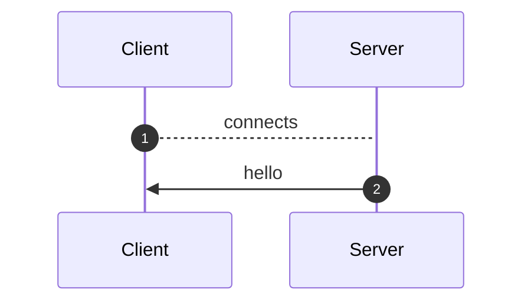
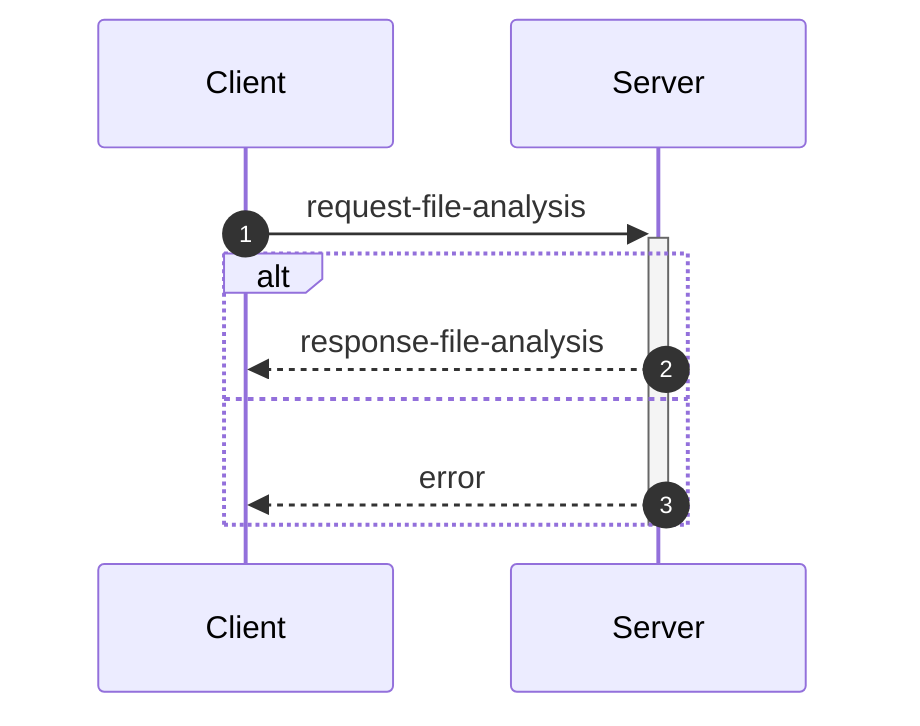
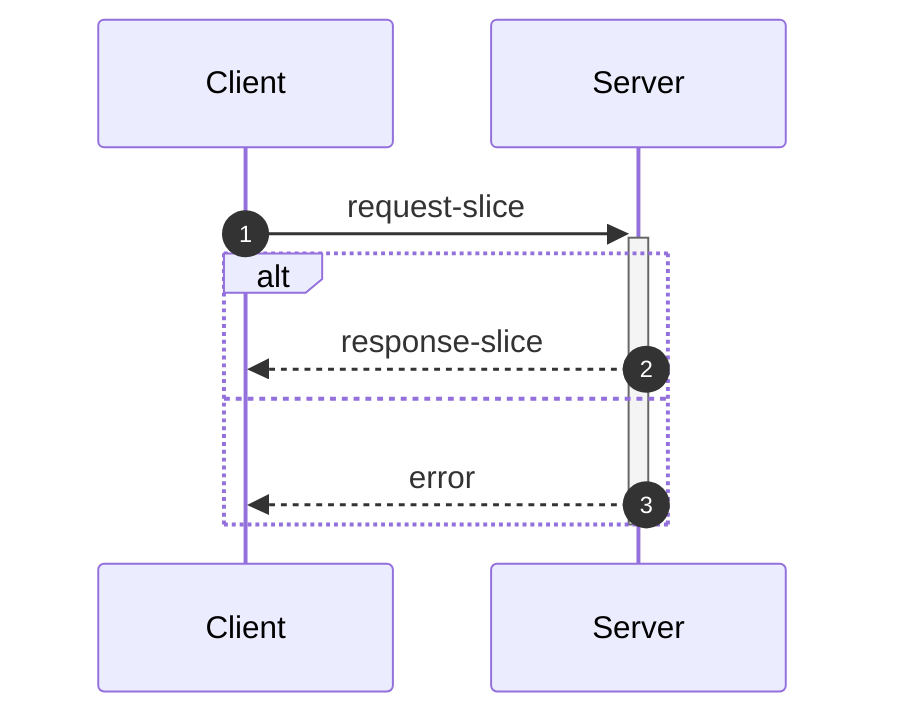
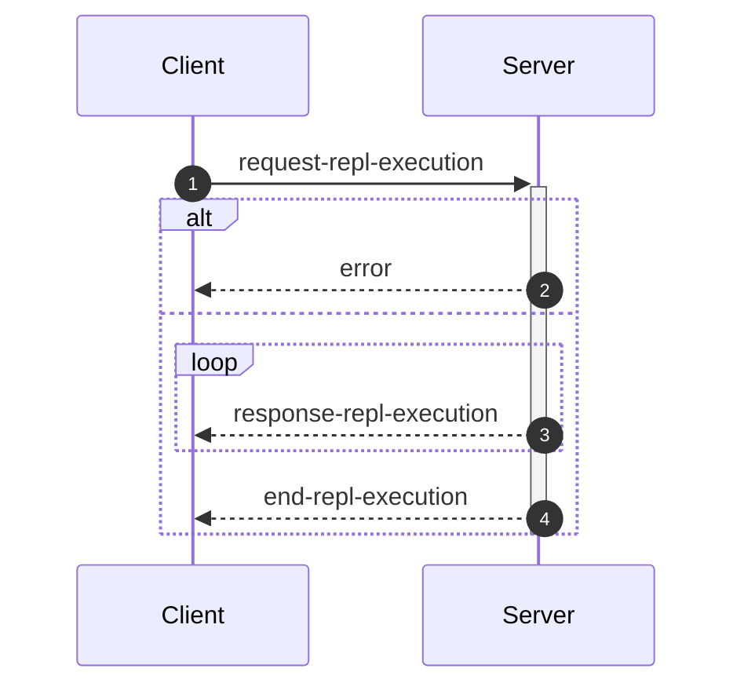

_<span title="an overview of flowR's interface">Generated</span> from '[wiki-interface.ts](https://github.com/flowr-analysis/flowr/tree/main/src/documentation/wiki-interface.ts "src/documentation/wiki-interface.ts")' on 2026-10-15, 15:20:14 UTC (v2.16.0, R v4.6.1), do not edit directly._

Although far from being as detailed as the in-depth explanation of [_flowR_](https://github.com/flowr-analysis/flowr/wiki/Core),
this wiki page explains how to interface with _flowR_ in more detail.
In general, command line arguments and other options provide short descriptions on hover over.

* [💻 Using the REPL](#using-the-repl)
* [⚙️ Configuring FlowR](#configuring-flowr)
* [⚒️ Writing Code](#writing-code)
* [💬 Communicating with the Server](#communicating-with-the-server)

<a id='using-the-repl'></a>
## 💻 Using the REPL

> [!NOTE]
> To execute arbitrary R commands with a repl request, _flowR_ has to be started explicitly with <span title="Description (Command Line Argument): Allow to access the underlying R session when using flowR (security warning: this allows the execution of arbitrary R code!)">`--r-session-access`</span>.
> Please be aware that this introduces a security risk and note that this relies on the [`r-shell` engine](https://github.com/flowr-analysis/flowr/wiki/Engines) .

Although primarily meant for users to explore,
there is nothing which forbids calling _flowR_ as a subprocess to use standard-in, -output, and -error
for communication (although you can access the REPL using the server as well,
with the [REPL Request](#message-request-repl-execution) message).

The read-eval-print loop&nbsp;(REPL) works relatively simple.
You can submit an expression (using <kbd>Enter</kbd>),
which is interpreted as an R&nbsp;expression by default but interpreted as a *command* if it starts with a colon (`:`).
The best command to get started with the REPL is <span title="Description (Repl Command): Show help information (aliases: :h, :?)">`:help`</span>.
Besides, you can leave the REPL either with the command <span title="Description (Repl Command): End the repl (aliases: :q, :exit)">`:quit`</span> or by pressing <kbd>Ctrl</kbd>+<kbd>C</kbd> twice.
When writing a *command*, you may press <kbd>Tab</kbd> to get a list of completions, if available.
Multiple commands can be entered in a single line by separating them with a semicolon (`;`), e.g. `:parse "x<-2"; :df*`.
If a command is given without R code, the REPL will re-use R code given in a previous command.
The prior example will hence return first the parsed AST of the program and then the dataflow graph for `"x <- 2"`.

> [!NOTE]
> If you develop flowR, you may want to launch the repl using the `npm run main-dev` command, this way, you get a non-minified version of flowR with debug information and hot-reloading of source files.

<details>
<summary>Available Commands</summary>

We currently offer the following commands (this with a `[*]` suffix are available with and without the star):

| Command | Description |
| ------- | ----------- |
| **<span title="Description (Repl Command): End the repl (aliases: :q, :exit)">:quit</span>** | End the repl (aliases: **:<span title="Alias of ':quit'. End the repl">q</span>**, **:<span title="Alias of ':quit'. End the repl">exit</span>**) |
| **<span title="Description (Repl Command): Execute the given code as R code. This requires the `--r-session-access` flag to be set and requires the r-shell engine. (aliases: :e, :r)">:execute</span>** | Execute the given code as R code. This requires the `--r-session-access` flag to be set and requires the r-shell engine. (aliases: **:<span title="Alias of ':execute'. Execute the given code as R code. This requires the `--r-session-access` flag to be set and requires the r-shell engine.">e</span>**, **:<span title="Alias of ':execute'. Execute the given code as R code. This requires the `--r-session-access` flag to be set and requires the r-shell engine.">r</span>**) |
| **<span title="Description (Repl Command): Get mermaid code for the control-flow graph of R code (aliases: :cfg, :cf)">:controlflow[*]</span>** | Get mermaid code for the control-flow graph of R code (star: Returns the URL to mermaid.live) (aliases: **:<span title="Alias of ':controlflow'. Get mermaid code for the control-flow graph of R code">cfg</span>**, **:<span title="Alias of ':controlflow'. Get mermaid code for the control-flow graph of R code">cf</span>**) |
| **<span title="Description (Repl Command): Get mermaid code for the control-flow graph with basic blocks (aliases: :cfgb, :cfb)">:controlflowbb[*]</span>** | Get mermaid code for the control-flow graph with basic blocks (star: Returns the URL to mermaid.live) (aliases: **:<span title="Alias of ':controlflowbb'. Get mermaid code for the control-flow graph with basic blocks">cfgb</span>**, **:<span title="Alias of ':controlflowbb'. Get mermaid code for the control-flow graph with basic blocks">cfb</span>**) |
| **<span title="Description (Repl Command): Get mermaid code for the dataflow graph (aliases: :d, :df)">:dataflow[*]</span>** | Get mermaid code for the dataflow graph (star: Returns the URL to mermaid.live) (aliases: **:<span title="Alias of ':dataflow'. Get mermaid code for the dataflow graph">d</span>**, **:<span title="Alias of ':dataflow'. Get mermaid code for the dataflow graph">df</span>**) |
| **<span title="Description (Repl Command): Get mermaid code for the normalized AST of R code (aliases: :n)">:normalize[*]</span>** | Get mermaid code for the normalized AST of R code (star: Returns the URL to mermaid.live) (alias: **:<span title="Alias of ':normalize'. Get mermaid code for the normalized AST of R code">n</span>**) |
| **<span title="Description (Repl Command): Get mermaid code for the simplified dataflow graph (aliases: :ds, :dfs)">:dataflowsimple[*]</span>** | Get mermaid code for the simplified dataflow graph (star: Returns the URL to mermaid.live) (aliases: **:<span title="Alias of ':dataflowsimple'. Get mermaid code for the simplified dataflow graph">ds</span>**, **:<span title="Alias of ':dataflowsimple'. Get mermaid code for the simplified dataflow graph">dfs</span>**) |
| **<span title="Description (Repl Command): Inspect and extend the signature database: `query` (identical to :query @signature), `info <name>` for where a function comes from (identical to :query @function-info), `add <path>` to mount another database/source, `download` to fetch the full-history database. (aliases: :sig)">:signature</span>** | Inspect and extend the signature database: `query` (identical to :query @signature), `info <name>` for where a function comes from (identical to :query @function-info), `add <path>` to mount another database/source, `download` to fetch the full-history database. (alias: **:<span title="Alias of ':signature'. Inspect and extend the signature database: `query` (identical to :query @signature), `info <name>` for where a function comes from (identical to :query @function-info), `add <path>` to mount another database/source, `download` to fetch the full-history database.">sig</span>**) |
| **<span title="Description (Repl Command): Just calculates the DFG, but only prints summary info (aliases: :d#, :df#)">:dataflowsilent</span>** | Just calculates the DFG, but only prints summary info (aliases: **:<span title="Alias of ':dataflowsilent'. Just calculates the DFG, but only prints summary info">d#</span>**, **:<span title="Alias of ':dataflowsilent'. Just calculates the DFG, but only prints summary info">df#</span>**) |
| **<span title="Description (Repl Command): Prints ASCII Art of the parsed, unmodified AST (aliases: :p)">:parse</span>** | Prints ASCII Art of the parsed, unmodified AST (alias: **:<span title="Alias of ':parse'. Prints ASCII Art of the parsed, unmodified AST">p</span>**) |
| **<span title="Description (Repl Command): Prints the version of flowR as well as the current version of R">:version</span>** | Prints the version of flowR as well as the current version of R
| **<span title="Description (Repl Command): Query the given R code (use 'help' for more information)">:query[*]</span>** | Query the given R code (use 'help' for more information) (star: Similar to query, but returns the output in json format.)
| **<span title="Description (Repl Command): Returns an ASCII representation of the dataflow graph (aliases: :df!)">:dataflowascii</span>** | Returns an ASCII representation of the dataflow graph (alias: **:<span title="Alias of ':dataflowascii'. Returns an ASCII representation of the dataflow graph">df!</span>**) |
| **<span title="Description (Repl Command): Returns summarization stats for the normalized AST (aliases: :n#)">:normalize#</span>** | Returns summarization stats for the normalized AST (alias: **:<span title="Alias of ':normalize#'. Returns summarization stats for the normalized AST">n#</span>**) |
| **<span title="Description (Repl Command): Show help information (aliases: :h, :?)">:help</span>** | Show help information (aliases: **:<span title="Alias of ':help'. Show help information">h</span>**, **:<span title="Alias of ':help'. Show help information">?</span>**) |

</details>

> [!TIP]
> 
> As indicated by the examples before, all REPL commands that operate on code keep track of the state.
> Hence, if you run a command like <span title="Description (Repl Command, starred version): Returns the URL to mermaid.live; Base Command: Get mermaid code for the dataflow graph (aliases: :d*, :df*)">`:dataflow*`</span> without providing R code,
> the REPL will re-use the R code provided in a previous command.
> Likewise, doing this will benefit from incrementality!
> If you request the dataflow graph with `:df* x <- 2 * y` and then want to see the parsed AST with `:parse`,
> the REPL will re-use previously obtained information and not re-parse the code again.
> 		

Generally, many commands offer shortcut versions in the REPL. Many queries, for example, offer a shortened format (see the example below).
Of special note, the [Config Query](https://github.com/flowr-analysis/flowr/wiki/%5BQuery%5D-Config)
can be used to also modify the currently active configuration of _flowR_ within the REPL (see the [wiki page](https://github.com/flowr-analysis/flowr/wiki/%5BQuery%5D-Config) for more information).

### Example: Retrieving the Dataflow Graph

To retrieve a URL to the [mermaid](https://mermaid.js.org/) diagram of the dataflow of a given expression,
use <span title="Description (Repl Command, starred version): Returns the URL to mermaid.live; Base Command: Get mermaid code for the dataflow graph (aliases: :d*, :df*)">`:dataflow*`</span> (or <span title="Description (Repl Command): Get mermaid code for the dataflow graph (aliases: :d, :df)">`:dataflow`</span> to get the mermaid code in the cli):

```shell
$ docker run -it --rm eagleoutice/flowr # or npm run flowr 
flowR repl v2.16.0, R grammar v14 (tree-sitter engine)
R> :dataflow* y <- 1 + x
```

<details>
<summary style='color:gray'>Output</summary>

```text
https://mermaid.live/view#base64:eyJjb2RlIjoiZmxvd2NoYXJ0IFREXG4gICAgMXt7XCJgKiM5MTtSTnVtYmVyIzkzOyogKioxKipcbiAgICAgICoxLjYqICgqKmlkOiAxKiopYFwifX1cbiAgICAyKFtcImAqIzkxO1JTeW1ib2wjOTM7KiAqKngqKlxuICAgICAgKjEuMTAqICgqKmlkOiAyKiopYFwiXSlcbiAgICAzW1tcImAqIzkxO1JCaW5hcnlPcCM5MzsqIGJhc2UjNTg7IzU4OyoqIzQzOyoqXG4gICAgICAqMS42LTEwKiAoKippZDogMyoqKVxuICAgIGFyZzogKDEsIDIpYFwiXV1cbiAgICBidWlsdC1pbjpfNDNfW1wiYEJ1aWx0LUluOlxuIzQzO2BcIl1cbiAgICBzdHlsZSBidWlsdC1pbjpfNDNfIHN0cm9rZTpncmF5LGZpbGw6Z3JheSxzdHJva2Utd2lkdGg6MnB4LG9wYWNpdHk6Ljg7XG4gICAgMFtcImAqIzkxO1JTeW1ib2wjOTM7KiAqKnkqKlxuICAgICAgKjEuMSogKCoqaWQ6IDAqKiwgdjogMylgXCJdXG4gICAgNFtbXCJgKiM5MTtSQmluYXJ5T3AjOTM7KiBiYXNlIzU4OyM1ODsqKiM2MDsjNDU7KipcbiAgICAgICoxLjEtMTAqICgqKmlkOiA0KiopXG4gICAgYXJnOiAoMCwgMylgXCJdXVxuICAgIGJ1aWx0LWluOl82MF8tW1wiYEJ1aWx0LUluOlxuIzYwOyM0NTtgXCJdXG4gICAgc3R5bGUgYnVpbHQtaW46XzYwXy0gc3Ryb2tlOmdyYXksZmlsbDpncmF5LHN0cm9rZS13aWR0aDoycHgsb3BhY2l0eTouODtcbiAgICAxIC0uLT58XCJmbG93XCJ8IDJcbiAgICBsaW5rU3R5bGUgMCBzdHJva2U6Z3JheSxjb2xvcjpncmF5O1xuICAgIDIgLS4tPnxcImZsb3dcInwgM1xuICAgIGxpbmtTdHlsZSAxIHN0cm9rZTpncmF5LGNvbG9yOmdyYXk7XG4gICAgMyAtLT58XCJyZWFkcywgYXJnXCJ8IDFcbiAgICAzIC0tPnxcInJlYWRzLCBhcmdcInwgMlxuICAgIDMgLS4tPnxcImZsb3dcInwgMFxuICAgIGxpbmtTdHlsZSA0IHN0cm9rZTpncmF5LGNvbG9yOmdyYXk7XG4gICAgMyAtLi0+fFwicmVhZHMsIGNhbGxzXCJ8IGJ1aWx0LWluOl80M19cbiAgICBsaW5rU3R5bGUgNSBzdHJva2U6Z3JheTtcbiAgICAwIC0tPnxcImRlZmluZWQtYnksIGZsb3dcInwgNFxuICAgIDAgLS0+fFwiZGVmaW5lZC1ieVwifCAzXG4gICAgNCAtLT58XCJyZWFkcywgYXJnXCJ8IDNcbiAgICA0IC0tPnxcInJldHVybnMsIGFyZ1wifCAwXG4gICAgNCAtLi0+fFwicmVhZHMsIGNhbGxzXCJ8IGJ1aWx0LWluOl82MF8tXG4gICAgbGlua1N0eWxlIDEwIHN0cm9rZTpncmF5OyIsIm1lcm1haWQiOnsiYXV0b1N5bmMiOnRydWV9fQ==
```

Retrieve the dataflow graph of the expression `y <- 1 + x`. It looks like this:


<details>

<summary style="color:gray">R Code of the Dataflow Graph</summary>

The analysis ran (including parse and normalize, using the [tree-sitter](https://github.com/flowr-analysis/flowr/wiki/Engines) engine) within the generation environment. No [signature database](https://github.com/flowr-analysis/flowr/wiki/Signature-Database) is mounted for these generated graphs, so `library()` calls attach no package exports; base-R names are still qualified via the generated base-package store (e.g. `acf` as `stats::acf`). 
We encountered no unknown side effects during the analysis.

```r
y <- 1 + x
```

</details>

</details>

For small graphs like this, <span title="Description (Repl Command): Returns an ASCII representation of the dataflow graph (aliases: :df!)">`:dataflowascii`</span> also provides an ASCII representation directly in the REPL:

```shell
$ docker run -it --rm eagleoutice/flowr # or npm run flowr 
flowR repl v2.16.0, R grammar v14 (tree-sitter engine)
R> :df! y <- 1 + x
```

<details open>
<summary style='color:gray'>Output</summary>

```text
                        v<0>v
 c<4>c──────────────────| y |
 |<- |     ┌────────────v---v
 c---c     │
    │   c<3>c   0<1>0
    └───| + |───| 1 |───u<2>u
        c---c   0---0   | x |
           └────────────u---u
Edges:
3 -> 1: reads, arg          3 -> 2: reads, arg
3 -> 0: flows-to            1 -> 2: flows-to
2 -> 3: flows-to            4 -> 3: reads, arg
4 -> 0: returns, arg        0 -> 4: defined-by, flows-to
0 -> 3: defined-by
```

Retrieve the dataflow graph of the expression `y <- 1 + x` as ASCII art.

</details>

For the slicing with <span title="Description (Repl Command): Static backwards executable slicer for R">`:slicer`</span>, you have access to the same [magic comments](#slice-magic-comments) as with the [slice request](#message-request-slice).
Pass `--inline` to splice resolvable `source()` calls into the reconstruction so the slice is a single self-contained R text (the same as the static slice query's `inlineSources` flag).
See `--help` for more flags!

### Example: Interfacing with the File System

Many commands that allow for an R-expression (like <span title="Description (Repl Command, starred version): Returns the URL to mermaid.live; Base Command: Get mermaid code for the dataflow graph (aliases: :d*, :df*)">`:dataflow*`</span>) allow for a file as well
if the argument starts with `file://`.
If you are working from the root directory of the _flowR_ repository, the following gives you the parsed AST of the example file using the <span title="Description (Repl Command): Prints ASCII Art of the parsed, unmodified AST (aliases: :p)">`:parse`</span> command:

> **Watch mode**: Replace `file://` with `watch://` to enter watch mode.
> flowR runs the command immediately and then re-runs it every time the file (or any file inside the folder) changes.
> Enter any other command to leave watch mode.
> For example: `:df watch://analysis.R`

```shell
$ docker run -it --rm eagleoutice/flowr # or npm run flowr 
flowR repl v2.16.0, R grammar v14 (tree-sitter engine)
R> :parse file://test/testfiles/example.R
```

<details>
<summary style='color:gray'>Output</summary>

```text
File: test/testfiles/example.R

program
├ binaryoperator
│ ├ identifier "sum" (1:1─4)
│ ├ <- "<-" (1:5─7)
│ ╰ float "0" (1:8─9)
├ binaryoperator
│ ├ identifier "product" (2:1─8)
│ ├ <- "<-" (2:9─11)
│ ╰ float "1" (2:12─13)
├ binaryoperator
│ ├ identifier "w" (3:1─2)
│ ├ <- "<-" (3:3─5)
│ ╰ float "7" (3:6─7)
├ binaryoperator
│ ├ identifier "N" (4:1─2)
│ ├ <- "<-" (4:3─5)
│ ╰ float "10" (4:6─8)
├ forstatement
│ ├ for "for" (6:1─4)
│ ├ ( "(" (6:5─6)
│ ├ identifier "i" (6:6─7)
│ ├ in "in" (6:8─10)
│ ├ binaryoperator
│ │ ├ float "1" (6:11─12)
│ │ ├ : ":" (6:12─13)
│ │ ╰ parenthesizedexpression
│ │   ├ ( "(" (6:13─14)
│ │   ├ binaryoperator
│ │   │ ├ identifier "N" (6:14─15)
│ │   │ ├ - "-" (6:15─16)
│ │   │ ╰ float "1" (6:16─17)
│ │   ╰ ) ")" (6:17─18)
│ ├ ) ")" (6:18─19)
│ ╰ bracedexpression
│   ├ { "{" (6:20─21)
│   ├ binaryoperator
│   │ ├ identifier "sum" (7:3─6)
│   │ ├ <- "<-" (7:7─9)
│   │ ╰ binaryoperator
│   │   ├ binaryoperator
│   │   │ ├ identifier "sum" (7:10─13)
│   │   │ ├ + "+" (7:14─15)
│   │   │ ╰ identifier "i" (7:16─17)
│   │   ├ + "+" (7:18─19)
│   │   ╰ identifier "w" (7:20─21)
│   ├ binaryoperator
│   │ ├ identifier "product" (8:3─10)
│   │ ├ <- "<-" (8:11─13)
│   │ ╰ binaryoperator
│   │   ├ identifier "product" (8:14─21)
│   │   ├  "" (8:22─23)
│   │   ╰ identifier "i" (8:24─25)
│   ╰ } "}" (9:1─2)
├ call
│ ├ identifier "cat" (11:1─4)
│ ╰ arguments
│   ├ ( "(" (11:4─5)
│   ├ argument
│   │ ╰ string
│   │   ├ " "\"" (11:5─6)
│   │   ├ stringcontent "Sum:" (11:6─10)
│   │   ╰ " "\"" (11:10─11)
│   ├ comma "," (11:11─12)
│   ├ argument
│   │ ╰ identifier "sum" (11:13─16)
│   ├ comma "," (11:16─17)
│   ├ argument
│   │ ╰ string
│   │   ├ " "\"" (11:18─19)
│   │   ├ stringcontent
│   │   │ ╰ escapesequence "\\n" (11:19─21)
│   │   ╰ " "\"" (11:21─22)
│   ╰ ) ")" (11:22─23)
╰ call
  ├ identifier "cat" (12:1─4)
  ╰ arguments
    ├ ( "(" (12:4─5)
    ├ argument
    │ ╰ string
    │   ├ " "\"" (12:5─6)
    │   ├ stringcontent "Product:" (12:6─14)
    │   ╰ " "\"" (12:14─15)
    ├ comma "," (12:15─16)
    ├ argument
    │ ╰ identifier "product" (12:17─24)
    ├ comma "," (12:24─25)
    ├ argument
    │ ╰ string
    │   ├ " "\"" (12:26─27)
    │   ├ stringcontent
    │   │ ╰ escapesequence "\\n" (12:27─29)
    │   ╰ " "\"" (12:29─30)
    ╰ ) ")" (12:30─31)
```

Retrieve the parsed AST of the example file.

<details>

<summary>File Content</summary>

```r
sum <- 0
product <- 1
w <- 7
N <- 10

for (i in 1:(N-1)) {
  sum <- sum + i + w
  product <- product * i
}

cat("Sum:", sum, "\n")
cat("Product:", product, "\n")
```

</details>

As _flowR_ directly transforms this AST the output focuses on being human-readable instead of being machine-readable.
		
</details>

### Example: Run a Query

You can run any query supported by _flowR_ using the <span title="Description (Repl Command): Query the given R code (use 'help' for more information)">`:query`</span> command.
For example, to obtain the shapes of all data frames in a given piece of code, you can run:

```shell
$ docker run -it --rm eagleoutice/flowr # or npm run flowr 
flowR repl v2.16.0, R grammar v14 (tree-sitter engine)
R> :query @absint df-shape "x <- data.frame(a = 1:10, b = 1:10)\ny <- x$a"
```

<details open>
<summary style='color:gray'>Output</summary>

```text
Query: absint (3 ms)
```

Retrieve the shapes of all data frames in the given code.

</details>

To run the linter on a file, you can use (in this example, we just issue the `dead-code` linter on a small piece of code):

```shell
$ docker run -it --rm eagleoutice/flowr # or npm run flowr 
flowR repl v2.16.0, R grammar v14 (tree-sitter engine)
R> :query @linter rules:dead-code "if(FALSE) x <- 2"
```

<details open>
<summary style='color:gray'>Output</summary>

```text
Query: linter (12 ms)
   ╰ Dead Code (dead-code):
       ╰ certain:
           ╰ Code at 1.11-16
```

Run the linter on the given code, with only the `dead-code` rule enabled.

</details>

For more information on the available queries, please check out the [Query API](https://github.com/flowr-analysis/flowr/wiki/Query-API).

<a id='configuring-flowr'></a>
## ⚙️ Configuring FlowR

When running _flowR_, you may want to specify some behaviors with a dedicated configuration file.
By default, flowR looks for a file named `flowr.json` in the current working directory (or any higher directory).
You can also specify a different file with <span title="Description (Command Line Argument): The name of the configuration file to use">`--config-file`</span> or pass the configuration inline using <span title="Description (Command Line Argument): The flowR configuration to use, as a JSON string">`--config-json`</span>.
A `flowr.json` found this way belongs to the analyzed project, so flowR ignores its options that decide what flowR executes or loads
(`engines.*.wasmPath`, `engines.*.treeSitterWasmPath`, `engines.*.rPath`, `solver.sigdb.additionalPaths`, `solver.sigdb.downloadRepo`, `solver.sigdb.installedLibrary.paths`),
unless you pass <span title="Description (Command Line Argument): Keep the security-sensitive options (e.g., the R executable) of the flowr.json found in the working directory or a parent. Only use this for projects you trust.">`--trust-config`</span>.
To analyze code you do not trust, use the secure mode (<span title="Description (Command Line Argument): Run in secure mode for analyzing untrusted code: flowR does not start R (or any other process), does not access the network, does not search for project configs, and ignores security-sensitive options in every config. Cannot be disabled once enabled. Can also be enabled with the environment variable {italic FLOWR_SECURE_MODE=1}.">`--secure`</span>, see the [security policy](https://github.com/flowr-analysis/flowr/blob/main/.github/SECURITY.md)).
To inspect the current configuration, you can run flowr with the <span title="Description (Command Line Argument): Run with verbose logging (will be passed to the corresponding script)">`--verbose`</span> flag, or use the `config` [Query](https://github.com/flowr-analysis/flowr/wiki/Query-API).
Within the REPL this works by running the following:

```shell
:query @config
```

To work with the <a href="https://github.com/flowr-analysis/flowr/tree/main/src/config.ts#L119"><code><span title="The configuration file format for flowR.">FlowrConfig</span></code></a> you can use the provided helper objects alongside its methods like
<a href="https://github.com/flowr-analysis/flowr/tree/main/src/config.ts#L905"><code><span title="Creates a new flowr config that has the updated values.">FlowrConfig::<b>amend</b></span></code></a>.
The schema below documents every option; the ones you most likely want are:

- <a href="https://github.com/flowr-analysis/flowr/wiki/Interface#configuring-flowr" title="Configuration Option (boolean): Whether source calls should be ignored, causing {@link processSourceCall}&#39;s behavior to be skipped.">ignoreSourceCalls</a>: ignore source calls when analyzing the code, i.e., ignore the inclusion of other files.
- <a href="https://github.com/flowr-analysis/flowr/wiki/Interface#configuring-flowr" title="Configuration Option (boolean): Whether load calls should be ignored, causing {@link processLoadCall}&#39;s behavior to be skipped.">ignoreLoadCalls</a>: ignore load calls when analyzing the code, i.e., ignore the loading of r-data files.
- <a href="https://github.com/flowr-analysis/flowr/wiki/Interface#configuring-flowr" title="Configuration Option (object): Do you want to overwrite (parts) of the builtin definition?">semantics.environment.overwriteBuiltIns</a>: overwrite _flowR_'s handling of built-in functions, or clear the preset definitions entirely.
  See [Configure BuiltIn Semantics](#configure-builtin-semantics) for more information.
- <a href="https://github.com/flowr-analysis/flowr/wiki/Interface#configuring-flowr" title="Configuration Option (string): How to resolve variables and their values. (one of &quot;disabled&quot;, &quot;alias&quot;, &quot;builtin&quot;)">solver.variables</a>: how to resolve variables and their values (`disabled`, `alias`, `builtin`).
- <a href="https://github.com/flowr-analysis/flowr/wiki/Interface#configuring-flowr" title="Configuration Option (array): The engine or set of engines to use for interacting with R code. An empty array means all available engines will be used.">engines</a> and <a href="https://github.com/flowr-analysis/flowr/wiki/Interface#configuring-flowr" title="Configuration Option (string): The default engine to use for interacting with R code. If this is undefined, an arbitrary engine from the specified list will be used. (one of &quot;tree-sitter&quot;, &quot;r-shell&quot;)">defaultEngine</a>: the engines used to interact with R code, see the [Engines wiki page](https://github.com/flowr-analysis/flowr/wiki/Engines).
- <a href="https://github.com/flowr-analysis/flowr/wiki/Interface#configuring-flowr" title="Configuration Option (array): Files a framework loads on its own, without any source() call (e.g. global.R in a shiny app), in the order they are loaded; flowR orders the matching project files accordingly and analyzes them as one program. Entries are case-insensitive globs matched against the file path, a plain name matches any file with that name, and entries matching no project file are warned about. Usually set per project kind via specializeConfig.">project.implicitSources</a>: the files a framework loads without any `source()` call, in the order in which they are
  loaded. Entries are globs (e.g. `R/*.R`) matched against the file path ignoring capitalization; one matching no file is reported.
- <a href="https://github.com/flowr-analysis/flowr/wiki/Interface#configuring-flowr" title="Configuration Option (object): Overwrite (parts of) the configuration depending on the project kind flowR detects, e.g. to give a shiny app its implicit sources.">specializeConfig</a>: overwrite (parts of) the configuration depending on the kind of project _flowR_ detects
  (e.g. `shiny-app`), which is how a shiny app gets its implicit sources by default. What you configure directly wins.
- <a href="https://github.com/flowr-analysis/flowr/wiki/Interface#configuring-flowr" title="Configuration Option (string): Overwrite the project kind flowR would otherwise infer from the analyzed files, e.g. when auto-detection guesses wrong. (one of &quot;package&quot;, &quot;script&quot;, &quot;shiny-app&quot;, &quot;notebook&quot;, &quot;project&quot;, &quot;unknown&quot;)">project.useProjectType</a>: skip that detection and force a project kind yourself, when auto-detection guesses wrong.
- <a href="https://github.com/flowr-analysis/flowr/wiki/Interface#configuring-flowr" title="Configuration Option (array): The default plugins to load when creating a new instance of FlowrAnalyzer">defaultPlugins</a> and <a href="https://github.com/flowr-analysis/flowr/wiki/Interface#configuring-flowr" title="Configuration Option (array): The plugins to load in REPL mode">repl.plugins</a>: the plugins to load for a new <a href="https://github.com/flowr-analysis/flowr/tree/main/src/project/flowr-analyzer.ts#L205"><code><span title="Central class for conducting analyses with FlowR. Use the FlowrAnalyzerBuilder to create a new instance. If you want the original pattern of creating a pipeline and running all steps, you can still do this with FlowrAnalyzer#runFull . To inspect the context of the analyzer, use FlowrAnalyzer#inspectContext (if you are a plugin and need to modify it, use FlowrAnalyzer#context instead).">FlowrAnalyzer</span></code></a> and in the REPL
  (use `flowr:default` to reference the former).

So you can configure _flowR_ by adding a file like the following:

<details>

<summary>Example Configuration File</summary>

```json
{
  "ignoreSourceCalls": true,
  "ignoreLoadCalls": true,
  "semantics": {
    "environment": {
      "overwriteBuiltIns": {
        "definitions": [
          {
            "type": "function",
            "names": [
              "foo"
            ],
            "processor": "builtin:assign",
            "config": {}
          }
        ]
      }
    }
  },
  "defaultPlugins": [
    "file:description",
    "versions:description"
  ],
  "repl": {
    "quickStats": false,
    "dfProcessorHeat": false,
    "hints": true,
    "plugins": [
      "flowr:default"
    ]
  },
  "project": {
    "resolveUnknownPathsOnDisk": true,
    "implicitSources": [
      "global.R",
      "app.R"
    ]
  },
  "linter": {
    "disabledRules": []
  },
  "specializeConfig": {
    "shiny-app": {
      "project": {
        "implicitSources": [
          "global.R",
          "ui.R",
          "server.R",
          "app.R"
        ]
      }
    }
  },
  "engines": [
    {
      "type": "r-shell"
    }
  ],
  "solver": {
    "variables": "alias",
    "evalStrings": true,
    "trackEnvironments": true,
    "sigdb": {
      "enabled": true,
      "loadProjectDependencies": true,
      "eagerlyLoad": false,
      "eagerlyLoadExports": false,
      "linkBaseR": false,
      "linkDescriptionDependencies": false
    },
    "resolveSource": {
      "dropPaths": "no",
      "ignoreCapitalization": true,
      "inferWorkingDirectory": "active-script",
      "searchPath": []
    },
    "instrument": {},
    "slicer": {
      "threshold": 50
    }
  },
  "abstractInterpretation": {
    "wideningThreshold": 4,
    "followCalls": true,
    "dataFrame": {
      "maxColNames": 20,
      "readLoadedData": {
        "readExternalFiles": true,
        "maxReadLines": 1000000
      }
    }
  },
  "incremental": {
    "alwaysIncremental": false,
    "parsing": {
      "activated": false,
      "heuristics": {
        "activated": true,
        "mtime": true,
        "linesFrom": 500,
        "bytesFrom": 50000,
        "alwaysWithEdits": false,
        "minFiles": 1
      }
    }
  },
  "gas": {
    "thresholds": {
      "memory": {
        "problematic": 0.7,
        "critical": 0.9
      },
      "timeMs": {
        "problematic": 100000,
        "critical": 120000
      }
    },
    "features": {}
  }
}
```

</details>

<details>
<a id='configure-builtin-semantics'></a>
<summary>Configure Built-In Semantics</summary>

`semantics/environment/overwriteBuiltins` accepts two keys:

- `loadDefaults` (boolean, initially `true`): If set to `true`, the default built-in definitions are loaded before applying the custom definitions. Setting this flag to `false` explicitly disables the loading of the default definitions.
- `definitions` (array, initially empty): Allows to overwrite or define new built-in elements. Each object within must have a `type` which is one of the below. Furthermore, they may define a string array of `names` which specifies the identifiers to bind the definitions to. You may use `assumePrimitive` to specify whether _flowR_ should assume that this is a primitive non-library definition (so you probably just do not want to specify the key).

  | Type            | Description                                                                                                                                                                                                                                                                                              | Example                                                                                                    |
  | --------------- | -------------------------------------------------------------------------------------------------------------------------------------------------------------------------------------------------------------------------------------------------------------------------------------------------------- | ---------------------------------------------------------------------------------------------------------- |
  | `constant`    | Additionally allows for a `value` this should resolve to.                                                                                                                                                                                                                                                | `{ type: 'constant', names: ['NULL', 'NA'],  value: null }`                                                |
  | `function`    | Is a rather flexible way to define and bind built-in functions. For the time, we do not have extensive documentation to cover all the cases, so please either consult the sources with the `default-builtin-config.ts` or open a [new issue](https://github.com/flowr-analysis/flowr/issues/new/choose). | `{ type: 'function', names: ['next'], processor: 'builtin:d', config: { cfg: ExitPointType.Next } }` |
  | `replacement` | A comfortable way to specify replacement functions like `$<-` or `names<-`. `suffixes` describes the... suffixes to attach automatically. | `{ type: 'replacement', suffixes: ['<-', '<<-'], names: ['[', '[['] }` |

</details>

<details>

<summary style='color:gray'>Full Configuration-File Schema</summary>

- _The configuration file format for flowR._ (object)
    - **logLevel** [optional] _flowR's global minimum log level, applied when the config is loaded._ (string)
        Only allows: 'silly', 'trace', 'debug', 'info', 'warn', 'error', 'fatal'
    - **ignoreSourceCalls** [optional] _Whether source calls should be ignored, causing {@link processSourceCall}'s behavior to be skipped._ (boolean)
    - **ignoreLoadCalls** [optional] _Whether load calls should be ignored, causing {@link processLoadCall}'s behavior to be skipped._ (boolean)
    - **semantics** _Configure language semantics and how flowR handles them._ (object)
        - **environment** [optional] _Semantics regarding how to handle the R environment._ (object)
            - **overwriteBuiltIns** [optional] _Do you want to overwrite (parts) of the builtin definition?_ (object)
                - **loadDefaults** [optional] _Should the default configuration still be loaded?_ (boolean)
                - **definitions** [optional] _The definitions to load/overwrite._ (array)
                Valid item types:
                    - (object)
    - **defaultPlugins** [optional] _The default plugins to load when creating a new instance of FlowrAnalyzer_ (array)
    Valid item types:
        - (alternatives)
            - (string)
            - (array)
    - **repl** _Configuration options for the REPL._ (object)
        - **quickStats** [optional] _Whether to show quick stats in the REPL after each evaluation._ (boolean)
        - **dfProcessorHeat** [optional] _This instruments the dataflow processors to count how often each processor is called._ (boolean)
        - **hints** [optional] _Whether to show dim inline hints on the empty prompt (automatically disabled on non-interactive terminals)._ (boolean)
        - **plugins** [optional] _The plugins to load in REPL mode_ (array)
        Valid item types:
            - (alternatives)
                - (string)
                - (array)
        - **autoUseFileProtocol** [optional] _Prepend the file protocol to a repl input that looks like a path, instead of only warning about it._ (boolean)
        - **queryStats** [optional] _Whether `:query` closes with the line stating how long the queries took (`:query*` never prints it)._ (boolean)
        - **showPlugins** [optional] _Whether `:version` grays out the plugins that did not activate during the last analysis._ (boolean)
    - **project** _Project specific configuration options._ (object)
        - **resolveUnknownPathsOnDisk** [optional] _Whether to resolve unknown paths loaded by the r project disk when trying to source/analyze files._ (boolean)
        - **failOnInaccessiblePath** [optional] _Whether a directory that cannot be traversed during file discovery (e.g. due to permissions) aborts the analysis; when false (the default) such paths are logged and skipped._ (boolean)
        - **basePackages** [optional] _The packages considered part of R itself (base and recommended); if unset, flowR uses its built-in list._ (array)
        Valid item types:
            - (string)
        - **implicitSources** [optional] _Files a framework loads on its own, without any source() call (e.g. global.R in a shiny app), in the order they are loaded; flowR orders the matching project files accordingly and analyzes them as one program. Entries are case-insensitive globs matched against the file path, a plain name matches any file with that name, and entries matching no project file are warned about. Usually set per project kind via specializeConfig._ (array)
        Valid item types:
            - (string)
        - **useProjectType** [optional] _Overwrite the project kind flowR would otherwise infer from the analyzed files, e.g. when auto-detection guesses wrong._ (string)
            Only allows: 'package', 'script', 'shiny-app', 'notebook', 'project', 'unknown'
        - **assumeImplicitEcho** [optional] _Whether the top level of the analyzed code is echoed, so that every visible result printed there is collected as an output by the dependencies query (default true, false for a package)._ (boolean)
        - **discovery** [optional] _Scoping options for the default project discovery._ (object)
            - **full** [optional] _Collect every file below the project root (greedy) instead of only the files the detected project kind needs (default false)._ (boolean)
            - **perKind** [optional] _Per-kind include/exclude glob overrides layered on the default scoping._ (object)
            - **ignore** [optional] _Case-insensitive globs that drop matching files from the intelligent discovery, regardless of kind (e.g. .Renviron to ignore environment files)._ (array)
            Valid item types:
                - (string)
        - **classification** [optional] _Overrides for the signals flowR uses to classify the project kind._ (object)
            - **shinyDescriptionTypes** [optional] _DESCRIPTION Type: values that mark a shiny app._ (array)
            Valid item types:
                - (string)
            - **shinyEntryFiles** [optional] _File names a shiny app is assembled from._ (array)
            Valid item types:
                - (string)
            - **shinyUsagePattern** [optional] _Regex source evidencing shiny usage in an entry file._ (string)
            - **notebookExtensions** [optional] _File extensions marking a notebook._ (array)
            Valid item types:
                - (string)
    - **linter** _Linter configuration options._ (object)
        - **disabledRules** _Linting rule names excluded from the default rule set (a rule requested explicitly via a linter query still runs). Usually set per project kind via specializeConfig._ (array)
        Valid item types:
            - (string)
    - **inputSources** [optional] _Further frameworks the input-sources analysis should know about; entries are added to flowR's defaults._ (object)
        - **pure** [optional] _Functions that only pass the constantness of their arguments on._ (array)
        Valid item types:
            - (string)
        - **param** [optional] _Functions whose result is a 'param' input._ (array)
        Valid item types:
            - (string)
        - **file** [optional] _Functions whose result is a 'file' input._ (array)
        Valid item types:
            - (string)
        - **tempfile** [optional] _Functions whose result is a 'tempfile' input._ (array)
        Valid item types:
            - (string)
        - **glob** [optional] _Functions whose result is a 'glob' input._ (array)
        Valid item types:
            - (string)
        - **net** [optional] _Functions whose result is a 'net' input._ (array)
        Valid item types:
            - (string)
        - **rand** [optional] _Functions whose result is a 'rand' input._ (array)
        Valid item types:
            - (string)
        - **system** [optional] _Functions whose result is a 'system' input._ (array)
        Valid item types:
            - (string)
        - **ffi** [optional] _Functions whose result is a 'ffi' input._ (array)
        Valid item types:
            - (string)
        - **lang** [optional] _Functions whose result is a 'lang' input._ (array)
        Valid item types:
            - (string)
        - **options** [optional] _Functions whose result is a 'options' input._ (array)
        Valid item types:
            - (string)
        - **cmdline** [optional] _Functions whose result is a 'cmdline' input._ (array)
        Valid item types:
            - (string)
        - **user** [optional] _Functions whose result is a 'user' input._ (array)
        Valid item types:
            - (string)
        - **const** [optional] _Functions whose result is a 'const' input._ (array)
        Valid item types:
            - (string)
        - **scope** [optional] _Functions whose result is a 'scope' input._ (array)
        Valid item types:
            - (string)
        - **dconst** [optional] _Functions whose result is a 'dconst' input._ (array)
        Valid item types:
            - (string)
        - **unknown** [optional] _Functions whose result is a 'unknown' input._ (array)
        Valid item types:
            - (string)
        - **linkedObjects** [optional] _Objects a framework provides without a definition in the code, e.g. shiny's input._ (array)
        Valid item types:
            - (object)
        - **linkedEntryPoints** [optional] _Calls that hand a function to a framework, which binds its objects to the parameters by position._ (array)
        Valid item types:
            - (object)
    - **specializeConfig** [optional] _Overwrite (parts of) the configuration depending on the project kind flowR detects, e.g. to give a shiny app its implicit sources._ (object)
    - **engines** _The engine or set of engines to use for interacting with R code. An empty array means all available engines will be used._ (array)
    Valid item types:
        - (alternatives)
            - _The configuration for the tree sitter engine._ (object)
                - **type** [required] _Use the tree sitter engine._ (string)
                    Only allows: 'tree-sitter'
                - **wasmPath** [optional] _The path to the tree-sitter-r WASM binary to use. If this is undefined, this uses the default path._ (string)
                - **treeSitterWasmPath** [optional] _The path to the tree-sitter WASM binary to use. If this is undefined, this uses the default path._ (string)
                - **lax** [optional] _Whether to use the lax parser for parsing R code (allowing for syntax errors). If this is undefined, the strict parser will be used._ (boolean)
            - _The configuration for the R shell engine._ (object)
                - **type** [required] _Use the R shell engine._ (string)
                    Only allows: 'r-shell'
                - **rPath** [optional] _The path to the R executable to use. If this is undefined, this uses the default path._ (string)
                - **pipeBind** [optional] _Whether to enable R's experimental pipe-bind operator "=>" by setting _R_USE_PIPEBIND_ for the R session (default false); R itself keeps this off by default, as it is experimental and has never shipped in a release version of R._ (boolean)
    - **defaultEngine** [optional] _The default engine to use for interacting with R code. If this is undefined, an arbitrary engine from the specified list will be used._ (string)
        Only allows: 'tree-sitter', 'r-shell'
    - **solver** _How to resolve constants, constraints, cells, ..._ (object)
        - **variables** _How to resolve variables and their values._ (string)
            Only allows: 'disabled', 'alias', 'builtin'
        - **evalStrings** _Should we include eval(parse(text="...")) calls in the dataflow graph?_ (boolean)
        - **trackEnvironments** [optional] _Track user-created environments (new.env, assign/get/local with envir=, dollar-assign, attach). When false, all envir-style calls fall through conservatively._ (boolean)
        - **sigdb** _Resolving library exports from a signature database._ (object)
            - **enabled** [optional] _Resolve library()/use() exports from a signature database (default true); when false no database is consulted._ (boolean)
            - **loadProjectDependencies** [optional] _Load the project's declared dependencies from its metadata files (DESCRIPTION Imports/Depends, rproject.toml, uvr.toml, renv.lock, rv.lock, uvr.lock) (default true); when false these files are not read for dependencies._ (boolean)
            - **eagerlyLoad** [optional] _Parse the database up front rather than on the first package load (default false, ignored if disabled)._ (boolean)
            - **eagerlyLoadExports** [optional] _Add a vertex for every export on load rather than on demand (default false); keeps the dataflow graph small._ (boolean)
            - **assumedRVersion** [optional] _R version assumed when resolving versioned (base-R) exports: a pin like "4.5" or "auto" to detect the installed R (default "auto")._ (string)
            - **linkBaseR** [optional] _Eagerly attach base-R namespaces so bare base calls resolve without library() (default false)._ (boolean)
            - **linkBaseRCalls** [optional] _Add a lightweight Reads edge from a bare base-R call to its signature-database function vertex (default false; base-R qualification is edge-free otherwise)._ (boolean)
            - **linkPackageCalls** [optional] _Add a lightweight Reads edge from a resolved package call to its signature-database function vertex (default false)._ (boolean)
            - **linkDescriptionDependencies** [optional] _Eagerly attach the namespaces of the project's declared DESCRIPTION dependencies (Imports/Depends) so their exports resolve without an explicit library() (default false)._ (boolean)
            - **warmInBackground** [optional] _Decompress the hot shards (base + most-downloaded) in a background task on startup so the first library() lookup is warm (default false; for long-running servers/REPLs)._ (boolean)
            - **additionalPaths** [optional] _Extra directories or bundle/manifest files searched for signature databases (alongside the shipped default and $FLOWR_SIGDB_DIR); a downloaded full-history bundle placed here is mounted automatically._ (array)
            Valid item types:
                - (string)
            - **downloadRepo** [optional] _GitHub owner/repo the full-history bundle is downloaded from via ":signature download" (default "flowr-analysis/flowr", release tag "sigdb-v<flowR-version>")._ (string)
            - **autoSync** [optional] _On startup, re-download shards whose committed sigdb.remote.json hash no longer matches the cache, in the background (default false; opt-in network sync after a git pull)._ (boolean)
            - **installedLibrary** [optional] _Recovering packages no signature database knows from the copy installed on this machine._ (object)
                - **enabled** [required] _Recover packages no signature database knows from their installed copy (default false)._ (boolean)
                - **paths** [optional] _Library directories to search; when empty they are discovered from the environment and the project._ (array)
                Valid item types:
                    - (string)
                - **useEnvironment** [optional] _Search the libraries R_LIBS_USER/R_LIBS/R_LIBS_SITE name (default true)._ (boolean)
                - **useProjectLibrary** [optional] _Search a project-local renv/packrat library (default true)._ (boolean)
                - **maxDepth** [optional] _How far to descend into the nested layout of a project-local library (default 3)._ (number)
                - **packages** [optional] _Only recover packages whose name matches one of these regular expressions; empty means any._ (array)
                Valid item types:
                    - (string)
            - **blobCacheBudgetMb** [optional] _How many MiB of decoded package blobs every open bundle may hold together (default 16)._ (number)
            - **versionSelection** [optional] _When a project constrains a dependency, resolve to the newest (default), oldest, or system-installed version satisfying it; system needs R and falls back to newest. Base-R packages always resolve against the assumed R version._ (string)
                Only allows: 'newest', 'oldest', 'system'
            - **versionOverrides** [optional] _Force an exact version for specific packages (name -> version), overriding both the project constraint and the versionSelection policy (default {})._ (object)
        - **versionManagement** _Policies for reasoning about dependency versions._ (object)
            - **linkedVersionGroups** [optional] _Groups of packages that must resolve to the same version; version guessing intersects each group so its members stay mutually compatible (default [])._ (array)
            Valid item types:
                - (array)
                Valid item types:
                    - (string)
        - **assumeAttachedPackages** [optional] _Packages to treat as attached without a `library()` call, so what the built-in configuration states about them applies to the analyzed code. The base packages R attaches on startup already resolve without it._ (array)
        Valid item types:
            - (string)
        - **transitiveSideEffectRounds** [optional] _How many rounds the transitive side-effect fixpoint may run before it is cut off (default 32); the propagation stops on its own as soon as a round adds nothing._ (number)
        - **maxOverlayDepth** [optional] _How many binding overlays may stack on one environment frame before a write flattens them (default 4); a pure performance knob, trading lookup cost against copy cost without changing any result._ (number)
        - **instrument** (object)
            - **dataflowExtractors** [optional] _These keys are only intended for use within code, allowing to instrument the dataflow analyzer!_ (any)
        - **resolveSource** [optional] _If lax source calls are active, flowR searches for sourced files much more freely, based on the configurations you give it. This option is only in effect if `ignoreSourceCalls` is set to false._ (object)
            - **dropPaths** _Allow to drop the first or all parts of the sourced path, if it is relative._ (string)
                Only allows: 'no', 'once', 'all'
            - **ignoreCapitalization** _Search for filenames matching in the lowercase._ (boolean)
            - **inferWorkingDirectory** _Try to infer the working directory from the main or any script to analyze._ (string)
                Only allows: 'no', 'main-script', 'active-script', 'any-script'
            - **searchPath** _Additionally search in these paths._ (array)
            Valid item types:
                - (string)
            - **repeatedSourceLimit** [optional] _How often the same file can be sourced within a single run? Please be aware: in case of cyclic sources this may not reach a fixpoint so give this a sensible limit._ (number)
            - **applyReplacements** _Provide name replacements for loaded files_ (array)
            Valid item types:
                - (object)
            - **assumeFilesExist** [optional] _Assume a sourced file is always there, making what it defines certain instead of conditional on the source call._ (boolean)
        - **slicer** [optional] _The configuration for the slicer._ (object)
            - **threshold** [optional] _The maximum number of iterations to perform on a single function call during slicing._ (number)
            - **autoExtend** [optional] _If set, the slicer will gain an additional post-pass._ (boolean)
    - **abstractInterpretation** _The configuration options for abstract interpretation._ (object)
        - **wideningThreshold** _The threshold for the number of visitations of a node at which widening should be performed to ensure the termination of the fixpoint iteration._ (number)
        - **followCalls** _Whether the abstract interpretation is interprocedural, i.e. whether it steps into the functions a call may dispatch to._ (boolean)
        - **dataFrame** _The configuration of the shape inference for data frames._ (object)
            - **maxColNames** _The maximum number of columns names to infer for data frames before over-approximating the column names to top._ (number)
            - **readLoadedData** _Configuration options for reading data frame shapes from loaded external data files, such as CSV files._ (object)
                - **readExternalFiles** _Whether data frame shapes should be extracted from loaded external files, such as CSV files._ (boolean)
                - **maxReadLines** _The maximum number of lines to read when extracting data frame shapes from loaded files, such as CSV files._ (number)
    - **incremental** (object)
        - **alwaysIncremental** _Always take the incremental path, regardless of heuristics._ (boolean)
        - **parsing** (object)
            - **activated** _If set, incremental parsing will be used._ (boolean)
            - **heuristics** (object)
                - **activated** [optional] _If set, the heuristics for incremental parsing will be used._ (boolean)
                - **mtime** [optional] _Skip reparsing entirely if the file's modification time is unchanged since the last parse._ (boolean)
                - **linesFrom** [optional] _Only consider incremental parsing for files with at least this many lines._ (number)
                - **bytesFrom** [optional] _Only consider incremental parsing for files with at least this many bytes._ (number)
                - **alwaysWithEdits** [optional] _Always take the incremental path whenever there is a computed edit region, regardless of the other thresholds._ (boolean)
                - **minFiles** [optional] _Only apply these heuristics once the project has at least this many files loaded._ (number)
    - **gas** [optional] _Resource-usage guard (gas) configuration. All feature factors default to 0 (disabled). See https://github.com/flowr-analysis/flowr/wiki/Core#gas-resource-guard._ (object)
        - **thresholds** [optional] _Thresholds for all gas checks (scaled by per-feature factor), boundable per feature._ (object)
            - **memory** [optional] _Heap-usage fraction thresholds (0-1), either shared or given per feature key (with `default` covering the rest)._ (object)
                - **problematic** [optional] _Heap fraction (0-1) above which Problematic is returned, for every feature without an entry of its own._ (number)
                - **critical** [optional] _Heap fraction (0-1) above which Critical is returned, for every feature without an entry of its own._ (number)
            - **timeMs** [optional] _Elapsed analysis time thresholds in milliseconds, either shared or given per feature key (with `default` covering the rest)._ (object)
                - **problematic** [optional] _Elapsed ms above which Problematic is returned, for every feature without an entry of its own._ (number)
                - **critical** [optional] _Elapsed ms above which Critical is returned, for every feature without an entry of its own._ (number)
            - **steps** [optional] _Processed-AST-node thresholds, counted rather than sampled; only a key that arms a budget (`dataflow`) reads them._ (object)
                - **problematic** [optional] _Processed AST nodes above which Problematic is returned, for every feature without an entry of its own._ (number)
                - **critical** [optional] _Processed AST nodes above which the extraction is cut short, for every feature without an entry of its own._ (number)
            - **vertices** [optional] _Created-dataflow-vertex thresholds, counted like `steps`._ (object)
                - **problematic** [optional] _Created dataflow vertices above which Problematic is returned, for every feature without an entry of its own._ (number)
                - **critical** [optional] _Created dataflow vertices above which the extraction is cut short, for every feature without an entry of its own._ (number)
        - **features** [optional] _Per-feature sensitivity factors. 0 or absent disables gas checking for that feature. A factor of 2 makes the feature twice as sensitive. Recognised keys: `source`, `side-effect-linking`, `linter`, `slicer`, `dataflow`._ (object)
        - **countedCheckEvery** [optional] _How many counted steps pass between two accountings of an armed check, be it a dataflow budget or the slicer's traversal (default 128); trades overshoot against the cost of the check._ (number)
        - **heapProvider** [optional] _Custom heap statistics source (programmatic configs only), overriding the built-in v8/performance.memory detection._ (function)

</details>

<a id='writing-code'></a>
## ⚒️ Writing Code

_flowR_ can be used as a [module](https://www.npmjs.com/package/@eagleoutice/flowr) and offers several main classes and interfaces that are interesting for extension writers 
(see the [Visual Studio Code extension](https://marketplace.visualstudio.com/items?itemName=code-inspect.vscode-flowr) or the [Core](https://github.com/flowr-analysis/flowr/wiki/Core) wiki page for more information).

### Creating Analyses with _flowR_

Nowadays, instances of the <a href="https://github.com/flowr-analysis/flowr/tree/main/src/project/flowr-analyzer.ts#L205"><code><span title="Central class for conducting analyses with FlowR. Use the FlowrAnalyzerBuilder to create a new instance. If you want the original pattern of creating a pipeline and running all steps, you can still do this with FlowrAnalyzer#runFull . To inspect the context of the analyzer, use FlowrAnalyzer#inspectContext (if you are a plugin and need to modify it, use FlowrAnalyzer#context instead).">FlowrAnalyzer</span></code></a> should be used as central frontend to get analysis results from _flowR_.
The entry points an analysis is written against are re-exported from the package root (`import { FlowrAnalyzerBuilder } from '@eagleoutice/flowr'`);
everything else stays reachable under its own path, as in `@eagleoutice/flowr/dataflow/graph/graph`.
For example, a program slice can be created like this:

```ts
const analyzer = await new FlowrAnalyzerBuilder()
    .setEngine('tree-sitter')
    .build();
analyzer.addRequest('x <- 1\ny <- x\nx');
const result = await analyzer.query([
    {
        type:     'static-slice',
        criteria: ['3@x']
    }
]);
```

For more information, please have a look at the [Analyzer](https://github.com/flowr-analysis/flowr/wiki/Analyzer) wiki page, which explains how to construct and use the <a href="https://github.com/flowr-analysis/flowr/tree/main/src/project/flowr-analyzer.ts#L205"><code><span title="Central class for conducting analyses with FlowR. Use the FlowrAnalyzerBuilder to create a new instance. If you want the original pattern of creating a pipeline and running all steps, you can still do this with FlowrAnalyzer#runFull . To inspect the context of the analyzer, use FlowrAnalyzer#inspectContext (if you are a plugin and need to modify it, use FlowrAnalyzer#context instead).">FlowrAnalyzer</span></code></a> in more detail.
To work with specific perspectives, you can also consult the respective pages like the [Dataflow Graph](https://github.com/flowr-analysis/flowr/wiki/Dataflow-Graph) or the [Abstract Interpretation](https://github.com/flowr-analysis/flowr/wiki/Abstract-Interpretation) wiki pages.
### The Pipeline Executor (Low-Level Interface)

Once, in the beginning, _flowR_ was meant to produce a dataflow graph merely to provide *program slices*. 
However, with continuous updates, the [Dataflow Graph](https://github.com/flowr-analysis/flowr/wiki/Dataflow-Graph) repeatedly proves to be the more interesting part.
With this, we restructured _flowR_'s originally *hardcoded* pipeline to be far more flexible. 
Now, it can be theoretically extended or replaced with arbitrary steps, optional steps, and what we call 'decorations' of these steps. 
In short, a slicing pipeline using the <a href="https://github.com/flowr-analysis/flowr/tree/main/src/core/pipeline-executor.ts#L97"><code><span title="**Please note:** The PipelineExecutor is now considered to be a rather low-level API for flowR. While it still works and is the basis for all other layers, we strongly recommend using the FlowrAnalyzer and its builder to create and use an analyzer instance that is pre-configured for your use-case. The pipeline executor allows to execute arbitrary pipelines in a step-by-step fashion. If you are not...">PipelineExecutor</span></code></a> looks like this:

```ts

const slicer = new PipelineExecutor(DEFAULT_SLICING_PIPELINE, {
  parser:    new RShell(),
  request:   requestFromInput('x <- 1\nx + 1'),
  criterion: ['2@x']
})
const slice = await slicer.allRemainingSteps()
// console.log(slice.reconstruct.code)
```

<details><summary>More Information</summary>

If you compare this, with what you would have done with the old (and removed) `SteppingSlicer`, 
this essentially just requires you to replace the `SteppingSlicer` with the <a href="https://github.com/flowr-analysis/flowr/tree/main/src/core/pipeline-executor.ts#L97"><code><span title="**Please note:** The PipelineExecutor is now considered to be a rather low-level API for flowR. While it still works and is the basis for all other layers, we strongly recommend using the FlowrAnalyzer and its builder to create and use an analyzer instance that is pre-configured for your use-case. The pipeline executor allows to execute arbitrary pipelines in a step-by-step fashion. If you are not...">PipelineExecutor</span></code></a>
and to pass the <a href="https://github.com/flowr-analysis/flowr/tree/main/src/core/steps/pipeline/default-pipelines.ts#L18"><code>DEFAULT_SLICING_PIPELINE</code></a> as the first argument.
The <a href="https://github.com/flowr-analysis/flowr/tree/main/src/core/pipeline-executor.ts#L97"><code><span title="**Please note:** The PipelineExecutor is now considered to be a rather low-level API for flowR. While it still works and is the basis for all other layers, we strongly recommend using the FlowrAnalyzer and its builder to create and use an analyzer instance that is pre-configured for your use-case. The pipeline executor allows to execute arbitrary pipelines in a step-by-step fashion. If you are not...">PipelineExecutor</span></code></a>...

1. Provides structures to investigate the results of all intermediate steps
2. Can be executed step-by-step
3. Can repeat steps (e.g., to calculate multiple slices on the same input)

See the in-code documentation for more information.

</details>

### Using the <a href="https://github.com/flowr-analysis/flowr/tree/main/src/r-bridge/shell.ts#L144"><code><span title="The RShell represents an interactive session with the R interpreter. You can configure it by RShellOptions . At the moment we are using a live R session (and not networking etc.) to communicate with R easily, which allows us to install packages etc. However, this might and probably will change in the future (leaving this as a legacy mode :D)">RShell</span></code></a> to Interact with R

The <a href="https://github.com/flowr-analysis/flowr/tree/main/src/r-bridge/shell.ts#L144"><code><span title="The RShell represents an interactive session with the R interpreter. You can configure it by RShellOptions . At the moment we are using a live R session (and not networking etc.) to communicate with R easily, which allows us to install packages etc. However, this might and probably will change in the future (leaving this as a legacy mode :D)">RShell</span></code></a> class allows interfacing with the `R`&nbsp;ecosystem installed on the host system.
Please have a look at [flowR's Engines](https://github.com/flowr-analysis/flowr/wiki/Engines) for more information on alternatives (for example, the <a href="https://github.com/flowr-analysis/flowr/tree/main/src/r-bridge/lang-4.x/tree-sitter/tree-sitter-executor.ts#L29"><code><span title="Synchronous and (way) faster alternative to the RShell using tree-sitter.">TreeSitterExecutor</span></code></a>).

> [!IMPORTANT]
> 
> Each <a href="https://github.com/flowr-analysis/flowr/tree/main/src/r-bridge/shell.ts#L144"><code><span title="The RShell represents an interactive session with the R interpreter. You can configure it by RShellOptions . At the moment we are using a live R session (and not networking etc.) to communicate with R easily, which allows us to install packages etc. However, this might and probably will change in the future (leaving this as a legacy mode :D)">RShell</span></code></a> controls a new instance of the R&nbsp;interpreter, 
> make sure to call <code><a href="https://github.com/flowr-analysis/flowr/tree/main/src/r-bridge/shell.ts#L354"><span title="Close the current R session, makes the object effectively invalid (can no longer be reopened etc.)">RShell::<i>close</i></span></a>()</code> when you are done.

You can start a new "session" by constructing a new object with <code>new <a href="https://github.com/flowr-analysis/flowr/tree/main/src/r-bridge/shell.ts#L144"><span title="The RShell represents an interactive session with the R interpreter. You can configure it by RShellOptions . At the moment we are using a live R session (and not networking etc.) to communicate with R easily, which allows us to install packages etc. However, this might and probably will change in the future (leaving this as a legacy mode :D)">RShell</span></a>()</code>.

However, there are several options that may be of interest 
(e.g., to automatically revive the shell in case of errors or to control the name location of the R process on the system).

With a shell object (let's call it `shell`), you can execute R code by using <a href="https://github.com/flowr-analysis/flowr/tree/main/src/r-bridge/shell.ts#L213"><code><span title="sends the given command directly to the current R session will not do anything to alter input markers!">RShell::<i>sendCommand</i></span></code></a>,
for example <code>shell.<a href="https://github.com/flowr-analysis/flowr/tree/main/src/r-bridge/shell.ts#L213"><span title="sends the given command directly to the current R session will not do anything to alter input markers!">sendCommand</span></a>("1 + 1")</code>.
However, this does not return anything, so if you want to collect the output of your command, use
<a href="https://github.com/flowr-analysis/flowr/tree/main/src/r-bridge/shell.ts#L296"><code><span title="Send a command and collect the output">RShell::<i>sendCommandWithOutput</i></span></code></a> instead.

<a id='communicating-with-the-server'></a>
## 💬 Communicating with the Server

As explained in the [Overview](https://github.com/flowr-analysis/flowr/wiki/Overview), you can run the [TCP](https://de.wikipedia.org/wiki/Transmission_Control_Protocol)&nbsp;server by adding the <span title="Description (Command Line Argument): Do not drop into a repl, but instead start a server on the given port (default: 1042) and listen for messages.">`--server`</span> flag (and, due to the interactive mode, exit with the conventional <kbd>CTRL</kbd>+<kbd>C</kbd>).
Currently, every connection is handled by the same underlying `RShell` - so the server is not designed to handle many clients at a time.
Additionally, the server is not well guarded against attacks (e.g., you can theoretically spawn an arbitrary number of&nbsp;RShell sessions on the target machine).

Every message has to be given in a single line (i.e., without a newline in-between) and end with a newline character. Nevertheless, we will pretty-print example given in the following segments for the ease of reading.

> [!NOTE]
> 
> The default <span title="Description (Command Line Argument): Do not drop into a repl, but instead start a server on the given port (default: 1042) and listen for messages.">`--server`</span> uses a simple [TCP](https://de.wikipedia.org/wiki/Transmission_Control_Protocol)
> connection. If you want _flowR_ to expose a [WebSocket](https://de.wikipedia.org/wiki/WebSocket) server instead, add the <span title="Description (Command Line Argument): If the server flag is set, use websocket for messaging">`--ws`</span> flag (i.e., <span title="Description (Command Line Argument): Do not drop into a repl, but instead start a server on the given port (default: 1042) and listen for messages.">`--server`</span> <span title="Description (Command Line Argument): If the server flag is set, use websocket for messaging">`--ws`</span>) when starting _flowR_ from the command line.

<ul><li>
<a id="message-hello"></a>
<b>Hello</b> Message (<code>hello</code>) 
<details>

<summary style="color:gray"> View Details. <i>The server informs the client about the successful connection and provides Meta-Information.</i> </summary>



After launching _flowR_, for example, with <code>docker run -it --rm eagleoutice/flowr <span title="Description (Command Line Argument): Do not drop into a repl, but instead start a server on the given port (default: 1042) and listen for messages.">-<span/>-server</span></code>&nbsp;(🐳️), connecting should present you with a `hello` message, that amongst others should reveal the versions of&nbsp;_flowR_ and&nbsp;R, using the [semver 2.0](https://semver.org/spec/v2.0.0.html) versioning scheme.
The message looks like this:

```json
{
  "type": "hello",
  "clientName": "client-0",
  "versions": {
    "flowr": "2.16.0",
    "r": "4.6.1",
    "engine": "r-shell"
  }
}
```

There are currently a few messages that you can send after the hello message.
If you want to _slice_ a piece of R code you first have to send an [analysis request](#message-request-file-analysis), so that you can send one or multiple slice requests afterward.
Requests for the [REPL](#message-request-repl-execution) are independent of that.
	
<hr>

<details>
<summary style="color:gray">Message schema (<code>hello</code>)</summary>

For the definition of the hello message, please see it's implementation at [`./src/cli/repl/server/messages/message-hello.ts`](https://github.com/flowr-analysis/flowr/tree/main/src/cli/repl/server/messages/message-hello.ts).

- [required] (object)
    - **type** [required] _The type of the hello message._ (string)
        Only allows: 'hello'
    - **id** [forbidden] _The id of the message is always undefined (as it is the initial message and not requested)._ (any)
    - **clientName** [required] _A unique name that is assigned to each client. It has no semantic meaning and is only used/useful for debugging._ (string)
    - **versions** [required] (object)
        - **flowr** [required] _The version of the flowr server running in semver format._ (string)
        - **r** [required] _The version of the underlying R shell running in semver format._ (string)
        - **engine** [required] _The parser backend that is used to parse the R code._ (string)

</details>

<hr>

</details>
	</li>

<li>
<a id="message-request-file-analysis"></a>
<b>Analysis</b> Message (<code>request-file-analysis</code>) 
<details>

<summary style="color:gray"> View Details. <i>The server builds the dataflow graph for a given input file (or a set of files).</i> </summary>



The request allows the server to analyze a file and prepare it for slicing.
The message can contain a `filetoken`, which is used to identify the file in later slice or query requests (if you do not add one, the request will not be stored and therefore, it is not available for subsequent requests).

> **Please note!**\
> If you want to send and process a lot of analysis requests, but do not want to slice them, please do not pass the `filetoken` field. This will save the server a lot of memory allocation.

Furthermore, the request must contain either a `content` field to directly pass the file's content or a `filepath` field which contains the path to the file (this path must be accessible for the server to be useful).
If you add the `id` field, the answer will use the same `id` so you can match requests and the corresponding answers.
See the implementation of the request-file-analysis message for more information.

You can drop one or more stored file tokens by adding the `invalidateToken` field (a single token or an array of tokens).
The server frees the corresponding analyses _after_ it has answered the request.

> **Tip!**\
> If you only want to drop tokens, you do not need a separate message: send a `request-file-analysis` that contains _just_ the `invalidateToken` field (and no `content` or `filepath`).
> Such a request behaves like an empty file analysis and the server replies with an empty `results` object.
> Because invalidation happens after the response, you may even pass the _current_ `filetoken` in `invalidateToken` to analyze a file once and have the server forget it right after you received the results.

<details>
<summary>Example of the <code>request-file-analysis</code> Message</summary>

_Note:_ even though we pretty-print these messages, they are sent as a single line, ending with a newline.

The following lists all messages that were sent and received in case you want to reproduce the scenario:

<ol>
<li> <code>hello</code> (response)
<details> 

<summary> Show Details </summary>

The first message is always a hello message.

```json
{"type":"hello","clientName":"client-0","versions":{"flowr":"2.16.0","r":"4.6.1","engine":"r-shell"}}
```

</details>
</li>

<li> <b><code>request-file-analysis</code> (request)</b>
<details open> 

<summary> Show Details </summary>

Let's suppose you simply want to analyze the following script:
 
```r
x <- 1
x + 1
```

 For this, you can send the following request:

```json
{"type":"request-file-analysis","id":"1","filetoken":"x","content":"x <- 1\nx + 1"}
```

</details>
</li>

<li> <code>response-file-analysis</code> (response)
<details> 

<summary> Show Details </summary>

The `results` field of the response effectively contains three keys of importance:

- `parse`: which contains 1:1 the parse result in CSV format that we received from the `RShell` (i.e., the AST produced by the parser of the R interpreter).
- `normalize`: which contains the normalized AST, including ids (see the `info` field and the [Normalized AST](https://github.com/flowr-analysis/flowr/wiki/Normalized-AST) wiki page).
- `dataflow`: especially important is the `graph` field which contains the dataflow graph as a set of root vertices (see the [Dataflow Graph](https://github.com/flowr-analysis/flowr/wiki/Dataflow-Graph) wiki page).
			
_As the code is pretty long, we inhibit pretty printing and syntax highlighting (JSON, hiding built-in):_

```text
{"type":"response-file-analysis","format":"json","id":"1","results":{"parse":{"files":[{"parsed":"[1,1,1,6,7,0,\"expr\",false,\"x <- 1\"],[1,1,1,1,1,3,\"SYMBOL\",true,\"x\"],[1,1,1,1,3,7,\"expr\",false,\"x\"],[1,3,1,4,2,7,\"LEFT_ASSIGN\",true,\"<-\"],[1,6,1,6,4,5,\"NUM_CONST\",true,\"1\"],[1,6,1,6,5,7,\"expr\",false,\"1\"],[2,1,2,5,16,0,\"expr\",false,\"x + 1\"],[2,1,2,1,10,12,\"SYMBOL\",true,\"x\"],[2,1,2,1,12,16,\"expr\",false,\"x\"],[2,3,2,3,11,16,\"'+'\",true,\"+\"],[2,5,2,5,13,14,\"NUM_CONST\",true,\"1\"],[2,5,2,5,14,16,\"expr\",false,\"1\"]","filePath":"/tmp/tmp-1655936-EoL8MLqdsRxr-.R"}],".meta":{}},"normalize":{"ast":{"type":"RProject","files":[{"root":{"type":"RExpressionList","children":[{"type":"RBinaryOp","location":[1,3,1,4],"lhs":{"type":"RSymbol","location":[1,1,1,1],"content":"x","lexeme":"x","info":{"fullRange":[1,1,1,1],"adToks":[],"id":0,"parent":2,"role":"bin-l","index":0,"nest":0,"file":"/tmp/tmp-1655936-EoL8MLqdsRxr-.R"}},"rhs":{"location":[1,6,1,6],"lexeme":"1","info":{"fullRange":[1,6,1,6],"adToks":[],"id":1,"parent":2,"role":"bin-r","index":1,"nest":0,"file":"/tmp/tmp-1655936-EoL8MLqdsRxr-.R"},"type":"RNumber","content":{"num":1,"complexNumber":false,"markedAsInt":false}},"operator":"<-","lexeme":"<-","info":{"fullRange":[1,1,1,6],"adToks":[],"id":2,"parent":6,"nest":0,"file":"/tmp/tmp-1655936-EoL8MLqdsRxr-.R","index":0,"role":"el-c"}},{"type":"RBinaryOp","location":[2,3,2,3],"lhs":{"type":"RSymbol","location":[2,1,2,1],"content":"x","lexeme":"x","info":{"fullRange":[2,1,2,1],"adToks":[],"id":3,"parent":5,"role":"bin-l","index":0,"nest":0,"file":"/tmp/tmp-1655936-EoL8MLqdsRxr-.R"}},"rhs":{"location":[2,5,2,5],"lexeme":"1","info":{"fullRange":[2,5,2,5],"adToks":[],"id":4,"parent":5,"role":"bin-r","index":1,"nest":0,"file":"/tmp/tmp-1655936-EoL8MLqdsRxr-.R"},"type":"RNumber","content":{"num":1,"complexNumber":false,"markedAsInt":false}},"operator":"+","lexeme":"+","info":{"fullRange":[2,1,2,5],"adToks":[],"id":5,"parent":6,"nest":0,"file":"/tmp/tmp-1655936-EoL8MLqdsRxr-.R","index":1,"role":"el-c"}}],"info":{"adToks":[],"id":6,"nest":0,"file":"/tmp/tmp-1655936-EoL8MLqdsRxr-.R","role":"root","index":0}},"filePath":"/tmp/tmp-1655936-EoL8MLqdsRxr-.R"}],"info":{"id":7}},".meta":{}},"dataflow":{"unknownReferences":[],"in":[{"nodeId":2,"name":"<-","type":2},{"nodeId":5,"name":"+","type":2}],"out":[{"nodeId":0,"name":"x","type":4,"definedAt":2,"value":[1]}],"environment":{"current":{"id":21,"parent":"<BuiltInEnvironment>","memory":[["x",[{"nodeId":0,"name":"x","type":4,"definedAt":2,"value":[1]}]]],"globalEnv":true},"level":0},"graph":{"rootVertices":[1,0,2,3,4,5],"vertexInformation":[[1,{"tag":"value","id":1}],[0,{"tag":"vdef","id":0,"source":[1]}],[2,{"tag":"fcall","id":2,"name":"<-","onlyBuiltin":true,"args":[{"nodeId":0,"type":32},{"nodeId":1,"type":32}],"origin":["builtin:assign"]}],[3,{"tag":"use","id":3}],[4,{"tag":"value","id":4}],[5,{"tag":"fcall","id":5,"name":"+","onlyBuiltin":true,"args":[{"nodeId":3,"type":32},{"nodeId":4,"type":32}],"origin":["builtin:d"]}]],"edgeInformation":[[2,[[1,{"types":65}],[0,{"types":72}],["built-in:<-",{"types":5}],[3,{"types":4096}]]],[1,[[0,{"types":4096}]]],[0,[[2,{"types":4098}],[1,{"types":2}]]],[5,[[3,{"types":65}],[4,{"types":65}],["built-in:+",{"types":5}]]],[3,[[0,{"types":1}],[4,{"types":4096}]]],[4,[[5,{"types":4096}]]]],"_unknownSideEffects":[]},"entryPoint":2,"cfgEntry":1,"exitPoints":[{"type":0,"nodeId":5}],"hooks":[],".meta":{}}}}
```

</details>
</li>
</ol>

The complete round-trip covers validating the messages as well as starting and stopping the internal mock server.

</details>

You receive an error if, for whatever reason, the analysis fails (e.g., the message or code you sent contained syntax errors).
It contains a human-readable description *why* the analysis failed (see the error message implementation for more details).

<details>
<summary>Example Error Message</summary>

_Note:_ even though we pretty-print these messages, they are sent as a single line, ending with a newline.

The following lists all messages that were sent and received in case you want to reproduce the scenario:

<ol>
<li> <code>hello</code> (response)
<details> 

<summary> Show Details </summary>

The first message is always a hello message.

```json
{"type":"hello","clientName":"client-0","versions":{"flowr":"2.16.0","r":"4.6.1","engine":"r-shell"}}
```

</details>
</li>

<li> <code>request-file-analysis</code> (request)
<details> 

<summary> Show Details </summary>

```json
{"type":"request-file-analysis","id":"1","filename":"sample.R","content":"x <-"}
```

</details>
</li>

<li> <b><code>error</code> (response)</b>
<details open> 

<summary> Show Details </summary>

```json
{
  "id": "1",
  "type": "error",
  "fatal": false,
  "reason": "Error while analyzing file sample.R: GuardError: unable to parse R code (see the log for more information) for request {\"request\":\"text\",\"content\":\"x <-\"}}\n Report a Bug: https://github.com/flowr-analysis/flowr/issues/new?body=%3C!%2D%2D%20Please%20describe%20your%20issue%20in%20more%20detail%20below!%20%2D%2D%3E%0A%0A%0A%3C!%2D%2D%20Automatically%20generated%20issue%20metadata%2C%20please%20do%20not%20edit%20or%20delete%20content%20below%20this%20line%20%2D%2D%3E%0A%2D%2D%2D%0A%0AflowR%20version%3A%202.16.0%0Anode%20version%3A%20v22.13.1%0Anode%20arch%3A%20x64%0Anode%20platform%3A%20linux%0Amessage%3A%20%60unable%20to%20parse%20R%20code%20%28see%20the%20log%20for%20more%20information%29%20for%20request%20%7B%22request%22%3A%22text%22%2C%22content%22%3A%22x%20%3C%2D%22%7D%7D%60%0Astack%20trace%3A%0A%60%60%60%0A%20%20%20%20at%20guard%20%28%3C%3E%2Fsrc%2Futil%2Fassert.ts%3A128%3A9%29%0A%20%20%20%20at%20guardRetrievedOutput%20%28%3C%3E%2Fsrc%2Fr%2Dbridge%2Fretriever.ts%3A167%3A7%29%0A%20%20%20%20at%20%2Fhome%2Fhappy%2Dfeet%2Fgit%2Fphd%2Fflowr%2Dfield%2Fflowr%2Fsrc%2Fr%2Dbridge%2Fretriever.ts%3A123%3A4%0A%20%20%20%20at%20processTicksAndRejections%20%28node%3Ainternal%2Fprocess%2Ftask_queues%3A105%3A5%29%0A%20%20%20%20at%20async%20Object.parseRequests%20%5Bas%20processor%5D%20%28%3C%3E%2Fsrc%2Fr%2Dbridge%2Fparser.ts%3A108%3A19%29%0A%20%20%20%20at%20async%20PipelineExecutor.nextStep%20%28%3C%3E%2Fsrc%2Fcore%2Fpipeline%2Dexecutor.ts%3A192%3A25%29%0A%20%20%20%20at%20async%20FlowrAnalyzerCache.stepTapeUntil%20%28%3C%3E%2Fsrc%2Fproject%2Fcache%2Fflowr%2Danalyzer%2Dcache.ts%3A117%3A4%29%0A%20%20%20%20at%20async%20FlowRServerConnection.sendFileAnalysisResponse%20%28%3C%3E%2Fsrc%2Fcli%2Frepl%2Fserver%2Fconnection.ts%3A216%3A53%29%0A%60%60%60%0A%0A%2D%2D%2D%0A%09"
}
```

</details>
</li>
</ol>

The complete round-trip covers validating the messages as well as starting and stopping the internal mock server.

</details>

&nbsp;

<a id="analysis-include-cfg"></a>
**Including the Control Flow Graph**

The control flow graph is a view on the dataflow graph: the dataflow analysis records the control flow while it walks
the program, and the graph projects those edges on demand. The server can expose that structure as well (please create
a [new issue](https://github.com/flowr-analysis/flowr/issues/new/choose) for any bug you may encounter).
For this, the analysis request may add `cfg: true` to its list of options.

<details>
<summary>Requesting a Control Flow Graph</summary>

_Note:_ even though we pretty-print these messages, they are sent as a single line, ending with a newline.

The following lists all messages that were sent and received in case you want to reproduce the scenario:

<ol>
<li> <code>hello</code> (response)
<details> 

<summary> Show Details </summary>

The first message is always a hello message.

```json
{"type":"hello","clientName":"client-0","versions":{"flowr":"2.16.0","r":"4.6.1","engine":"r-shell"}}
```

</details>
</li>

<li> <b><code>request-file-analysis</code> (request)</b>
<details open> 

<summary> Show Details </summary>

```json
{
  "type": "request-file-analysis",
  "id": "1",
  "filetoken": "x",
  "content": "if(unknown > 0) { x <- 2 } else { x <- 5 }\nfor(i in 1:x) { print(x); print(i) }",
  "cfg": true
}
```

</details>
</li>

<li> <code>response-file-analysis</code> (response)
<details> 

<summary> Show Details </summary>

The response looks basically the same as a response sent without the `cfg` flag. However, additionally it contains a `cfg` field. 
If you are interested in a visual representation of the control flow graph, see the 
[visualization with mermaid](https://mermaid.live/view#base64:eyJjb2RlIjoiZmxvd2NoYXJ0IFREXG4gICAgbjAoW1wiYFJTeW1ib2wgKDApXG4qKnVua25vd24qKmBcIl0pXG4gICAgbjEoW1wiYFJOdW1iZXIgKDEpXG4qKjAqKmBcIl0pXG4gICAgbjIoW1wiYFJCaW5hcnlPcCAoMilcbioqdW5rbm93biAjNjI7IDAqKmBcIl0pXG4gICAgbjYoW1wiYFJOdW1iZXIgKDYpXG4qKjIqKmBcIl0pXG4gICAgbjUoW1wiYFJTeW1ib2wgKDUpXG4qKngqKmBcIl0pXG4gICAgbjdbXCJgUkJpbmFyeU9wICg3KVxuKip4ICM2MDsjNDU7IDIqKmBcIl1cbiAgICBuOChbXCJgUkV4cHJlc3Npb25MaXN0ICg4KWBcIl0pXG4gICAgbjEyKFtcImBSTnVtYmVyICgxMilcbioqNSoqYFwiXSlcbiAgICBuMTEoW1wiYFJTeW1ib2wgKDExKVxuKip4KipgXCJdKVxuICAgIG4xM1tcImBSQmluYXJ5T3AgKDEzKVxuKip4ICM2MDsjNDU7IDUqKmBcIl1cbiAgICBuMTQoW1wiYFJFeHByZXNzaW9uTGlzdCAoMTQpYFwiXSlcbiAgICBuMTVbXCJgUklmVGhlbkVsc2UgKDE1KVxuKippZih1bmtub3duICM2MjsgMCkgIzEyMzsgeCAjNjA7IzQ1OyAyICMxMjU7IGVsc2UgIzEyMzsgeCAjNjA7IzQ1OyA1ICMxMjU7KipgXCJdXG4gICAgbjE2KFtcImBSU3ltYm9sICgxNilcbioqaSoqYFwiXSlcbiAgICBuMTcoW1wiYFJOdW1iZXIgKDE3KVxuKioxKipgXCJdKVxuICAgIG4xOChbXCJgUlN5bWJvbCAoMTgpXG4qKngqKmBcIl0pXG4gICAgbjE5KFtcImBSQmluYXJ5T3AgKDE5KVxuKioxIzU4O3gqKmBcIl0pXG4gICAgbjIzKFtcImBSU3ltYm9sICgyMylcbioqeCoqYFwiXSlcbiAgICBuMjVbXCJgUkZ1bmN0aW9uQ2FsbCAoMjUpXG4qKnByaW50KHgpKipgXCJdXG4gICAgbjI3KFtcImBSU3ltYm9sICgyNylcbioqaSoqYFwiXSlcbiAgICBuMjlbXCJgUkZ1bmN0aW9uQ2FsbCAoMjkpXG4qKnByaW50KGkpKipgXCJdXG4gICAgbjMwKFtcImBSRXhwcmVzc2lvbkxpc3QgKDMwKWBcIl0pXG4gICAgbjMxW1wiYFJGb3JMb29wICgzMSlcbioqZm9yKGkgaW4gMSM1ODt4KSAjMTIzOyBwcmludCh4KTsgcHJpbnQoaSkgIzEyNTsqKmBcIl1cbiAgICBuMiAtLi0+fFwiYnJhbmNoIG9uIHVua25vd24gIzYyOyAwICgyKSBpZiBUXCJ8IG42XG4gICAgbjIgLS4tPnxcImJyYW5jaCBvbiB1bmtub3duICM2MjsgMCAoMikgaWYgRlwifCBuMTJcbiAgICBuMCAtLT58XCJmbG93cyB0b1wifCBuMVxuICAgIG4xIC0tPnxcImZsb3dzIHRvXCJ8IG4yXG4gICAgbjcgLS0+fFwiZmxvd3MgdG9cInwgbjhcbiAgICBuNiAtLT58XCJmbG93cyB0b1wifCBuNVxuICAgIG41IC0tPnxcImZsb3dzIHRvXCJ8IG43XG4gICAgbjggLS0+fFwiZmxvd3MgdG9cInwgbjE1XG4gICAgbjE1IC0tPnxcImZsb3dzIHRvXCJ8IG4xN1xuICAgIG4xMyAtLT58XCJmbG93cyB0b1wifCBuMTRcbiAgICBuMTIgLS0+fFwiZmxvd3MgdG9cInwgbjExXG4gICAgbjExIC0tPnxcImZsb3dzIHRvXCJ8IG4xM1xuICAgIG4xNCAtLT58XCJmbG93cyB0b1wifCBuMTVcbiAgICBuMTkgLS0+fFwiZmxvd3MgdG9cInwgbjE2XG4gICAgbjE4IC0tPnxcImZsb3dzIHRvXCJ8IG4xOVxuICAgIG4xNyAtLT58XCJmbG93cyB0b1wifCBuMThcbiAgICBuMjUgLS0+fFwiZmxvd3MgdG9cInwgbjI3XG4gICAgbjIzIC0tPnxcImZsb3dzIHRvXCJ8IG4yNVxuICAgIG4yOSAtLT58XCJmbG93cyB0b1wifCBuMzBcbiAgICBuMjcgLS0+fFwiZmxvd3MgdG9cInwgbjI5XG4gICAgbjMwIC0tPnxcImZsb3dzIHRvXCJ8IG4xNlxuICAgIG4xNiAtLi0+fFwiYnJhbmNoIG9uIGkgKDE2KSBpZiBUXCJ8IG4yM1xuICAgIG4xNiAtLi0+fFwiYnJhbmNoIG9uIGkgKDE2KSBpZiBGXCJ8IG4zMVxuICAgIHN0eWxlIG4wIHN0cm9rZTpjeWFuLHN0cm9rZS13aWR0aDo2LjVweDsgICAgc3R5bGUgbjMxIHN0cm9rZTpncmVlbixzdHJva2Utd2lkdGg6Ni41cHg7IiwibWVybWFpZCI6eyJhdXRvU3luYyI6dHJ1ZX19).
			
_As the code is pretty long, we inhibit pretty printing and syntax highlighting (JSON, hiding built-in):_

```text
{"type":"response-file-analysis","format":"json","id":"1","cfg":{"graph":{"roots":[0,1,2,6,5,7,8,12,11,13,14,15,16,17,18,19,23,25,27,29,30,31],"vtxInfos":[[0,[2,0]],[1,[2,1]],[2,[2,2]],[6,[2,6]],[5,[2,5]],[7,[1,7]],[8,[2,8]],[12,[2,12]],[11,[2,11]],[13,[1,13]],[14,[2,14]],[15,[1,15]],[16,[2,16]],[17,[2,17]],[18,[2,18]],[19,[2,19]],[23,[2,23]],[25,[1,25]],[27,[2,27]],[29,[1,29]],[30,[2,30]],[31,[1,31]]],"bbChildren":[],"edgeInfos":[[2,[[6,{"id":15,"when":true}],[12,{"id":15,"when":false}]]],[0,[[1,0]]],[1,[[2,0]]],[7,[[8,0]]],[6,[[5,0]]],[5,[[7,0]]],[8,[[15,0]]],[15,[[17,0]]],[13,[[14,0]]],[12,[[11,0]]],[11,[[13,0]]],[14,[[15,0]]],[19,[[16,0]]],[18,[[19,0]]],[17,[[18,0]]],[25,[[27,0]]],[23,[[25,0]]],[29,[[30,0]]],[27,[[29,0]]],[30,[[16,0]]],[16,[[23,{"id":31,"when":true}],[31,{"id":31,"when":false}]]]],"mayHaveBasicBlocks":false},"entryPoints":[0],"exitPoints":[31],"returns":[],"breaks":[],"nexts":[]},"results":{"parse":{"files":[{"parsed":"[1,1,1,42,38,0,\"expr\",false,\"if(unknown > 0) { x <- 2 } else { x <- 5 }\"],[1,1,1,2,1,38,\"IF\",true,\"if\"],[1,3,1,3,2,38,\"'('\",true,\"(\"],[1,4,1,14,9,38,\"expr\",false,\"unknown > 0\"],[1,4,1,10,3,5,\"SYMBOL\",true,\"unknown\"],[1,4,1,10,5,9,\"expr\",false,\"unknown\"],[1,12,1,12,4,9,\"GT\",true,\">\"],[1,14,1,14,6,7,\"NUM_CONST\",true,\"0\"],[1,14,1,14,7,9,\"expr\",false,\"0\"],[1,15,1,15,8,38,\"')'\",true,\")\"],[1,17,1,26,22,38,\"expr\",false,\"{ x <- 2 }\"],[1,17,1,17,12,22,\"'{'\",true,\"{\"],[1,19,1,24,19,22,\"expr\",false,\"x <- 2\"],[1,19,1,19,13,15,\"SYMBOL\",true,\"x\"],[1,19,1,19,15,19,\"expr\",false,\"x\"],[1,21,1,22,14,19,\"LEFT_ASSIGN\",true,\"<-\"],[1,24,1,24,16,17,\"NUM_CONST\",true,\"2\"],[1,24,1,24,17,19,\"expr\",false,\"2\"],[1,26,1,26,18,22,\"'}'\",true,\"}\"],[1,28,1,31,23,38,\"ELSE\",true,\"else\"],[1,33,1,42,35,38,\"expr\",false,\"{ x <- 5 }\"],[1,33,1,33,25,35,\"'{'\",true,\"{\"],[1,35,1,40,32,35,\"expr\",false,\"x <- 5\"],[1,35,1,35,26,28,\"SYMBOL\",true,\"x\"],[1,35,1,35,28,32,\"expr\",false,\"x\"],[1,37,1,38,27,32,\"LEFT_ASSIGN\",true,\"<-\"],[1,40,1,40,29,30,\"NUM_CONST\",true,\"5\"],[1,40,1,40,30,32,\"expr\",false,\"5\"],[1,42,1,42,31,35,\"'}'\",true,\"}\"],[2,1,2,36,84,0,\"expr\",false,\"for(i in 1:x) { print(x); print(i) }\"],[2,1,2,3,41,84,\"FOR\",true,\"for\"],[2,4,2,13,53,84,\"forcond\",false,\"(i in 1:x)\"],[2,4,2,4,42,53,\"'('\",true,\"(\"],[2,5,2,5,43,53,\"SYMBOL\",true,\"i\"],[2,7,2,8,44,53,\"IN\",true,\"in\"],[2,10,2,12,51,53,\"expr\",false,\"1:x\"],[2,10,2,10,45,46,\"NUM_CONST\",true,\"1\"],[2,10,2,10,46,51,\"expr\",false,\"1\"],[2,11,2,11,47,51,\"':'\",true,\":\"],[2,12,2,12,48,50,\"SYMBOL\",true,\"x\"],[2,12,2,12,50,51,\"expr\",false,\"x\"],[2,13,2,13,49,53,\"')'\",true,\")\"],[2,15,2,36,81,84,\"expr\",false,\"{ print(x); print(i) }\"],[2,15,2,15,54,81,\"'{'\",true,\"{\"],[2,17,2,24,64,81,\"expr\",false,\"print(x)\"],[2,17,2,21,55,57,\"SYMBOL_FUNCTION_CALL\",true,\"print\"],[2,17,2,21,57,64,\"expr\",false,\"print\"],[2,22,2,22,56,64,\"'('\",true,\"(\"],[2,23,2,23,58,60,\"SYMBOL\",true,\"x\"],[2,23,2,23,60,64,\"expr\",false,\"x\"],[2,24,2,24,59,64,\"')'\",true,\")\"],[2,25,2,25,65,81,\"';'\",true,\";\"],[2,27,2,34,77,81,\"expr\",false,\"print(i)\"],[2,27,2,31,68,70,\"SYMBOL_FUNCTION_CALL\",true,\"print\"],[2,27,2,31,70,77,\"expr\",false,\"print\"],[2,32,2,32,69,77,\"'('\",true,\"(\"],[2,33,2,33,71,73,\"SYMBOL\",true,\"i\"],[2,33,2,33,73,77,\"expr\",false,\"i\"],[2,34,2,34,72,77,\"')'\",true,\")\"],[2,36,2,36,78,81,\"'}'\",true,\"}\"]","filePath":"/tmp/tmp-1655936-y5g8u3ueRO5t-.R"}],".meta":{}},"normalize":{"ast":{"type":"RProject","files":[{"root":{"type":"RExpressionList","children":[{"type":"RIfThenElse","condition":{"type":"RBinaryOp","location":[1,12,1,12],"lhs":{"type":"RSymbol","location":[1,4,1,10],"content":"unknown","lexeme":"unknown","info":{"fullRange":[1,4,1,10],"adToks":[],"id":0,"parent":2,"role":"bin-l","index":0,"nest":1,"file":"/tmp/tmp-1655936-y5g8u3ueRO5t-.R"}},"rhs":{"location":[1,14,1,14],"lexeme":"0","info":{"fullRange":[1,14,1,14],"adToks":[],"id":1,"parent":2,"role":"bin-r","index":1,"nest":1,"file":"/tmp/tmp-1655936-y5g8u3ueRO5t-.R"},"type":"RNumber","content":{"num":0,"complexNumber":false,"markedAsInt":false}},"operator":">","lexeme":">","info":{"fullRange":[1,4,1,14],"adToks":[],"id":2,"parent":15,"nest":1,"file":"/tmp/tmp-1655936-y5g8u3ueRO5t-.R","role":"if-c"}},"then":{"type":"RExpressionList","children":[{"type":"RBinaryOp","location":[1,21,1,22],"lhs":{"type":"RSymbol","location":[1,19,1,19],"content":"x","lexeme":"x","info":{"fullRange":[1,19,1,19],"adToks":[],"id":5,"parent":7,"role":"bin-l","index":0,"nest":1,"file":"/tmp/tmp-1655936-y5g8u3ueRO5t-.R"}},"rhs":{"location":[1,24,1,24],"lexeme":"2","info":{"fullRange":[1,24,1,24],"adToks":[],"id":6,"parent":7,"role":"bin-r","index":1,"nest":1,"file":"/tmp/tmp-1655936-y5g8u3ueRO5t-.R"},"type":"RNumber","content":{"num":2,"complexNumber":false,"markedAsInt":false}},"operator":"<-","lexeme":"<-","info":{"fullRange":[1,19,1,24],"adToks":[],"id":7,"parent":8,"nest":1,"file":"/tmp/tmp-1655936-y5g8u3ueRO5t-.R","index":0,"role":"el-c"}}],"grouping":[{"type":"RSymbol","location":[1,17,1,17],"content":"{","lexeme":"{","info":{"fullRange":[1,17,1,26],"adToks":[],"id":3,"role":"el-g","index":0,"nest":1,"file":"/tmp/tmp-1655936-y5g8u3ueRO5t-.R"}},{"type":"RSymbol","location":[1,26,1,26],"content":"}","lexeme":"}","info":{"fullRange":[1,17,1,26],"adToks":[],"id":4,"role":"el-g","index":0,"nest":1,"file":"/tmp/tmp-1655936-y5g8u3ueRO5t-.R"}}],"info":{"adToks":[],"id":8,"parent":15,"nest":1,"file":"/tmp/tmp-1655936-y5g8u3ueRO5t-.R","index":1,"role":"if-then"}},"location":[1,1,1,2],"lexeme":"if","info":{"fullRange":[1,1,1,42],"adToks":[],"id":15,"parent":32,"nest":1,"file":"/tmp/tmp-1655936-y5g8u3ueRO5t-.R","index":0,"role":"el-c"},"otherwise":{"type":"RExpressionList","children":[{"type":"RBinaryOp","location":[1,37,1,38],"lhs":{"type":"RSymbol","location":[1,35,1,35],"content":"x","lexeme":"x","info":{"fullRange":[1,35,1,35],"adToks":[],"id":11,"parent":13,"role":"bin-l","index":0,"nest":1,"file":"/tmp/tmp-1655936-y5g8u3ueRO5t-.R"}},"rhs":{"location":[1,40,1,40],"lexeme":"5","info":{"fullRange":[1,40,1,40],"adToks":[],"id":12,"parent":13,"role":"bin-r","index":1,"nest":1,"file":"/tmp/tmp-1655936-y5g8u3ueRO5t-.R"},"type":"RNumber","content":{"num":5,"complexNumber":false,"markedAsInt":false}},"operator":"<-","lexeme":"<-","info":{"fullRange":[1,35,1,40],"adToks":[],"id":13,"parent":14,"nest":1,"file":"/tmp/tmp-1655936-y5g8u3ueRO5t-.R","index":0,"role":"el-c"}}],"grouping":[{"type":"RSymbol","location":[1,33,1,33],"content":"{","lexeme":"{","info":{"fullRange":[1,33,1,42],"adToks":[],"id":9,"role":"el-g","index":0,"nest":1,"file":"/tmp/tmp-1655936-y5g8u3ueRO5t-.R"}},{"type":"RSymbol","location":[1,42,1,42],"content":"}","lexeme":"}","info":{"fullRange":[1,33,1,42],"adToks":[],"id":10,"role":"el-g","index":0,"nest":1,"file":"/tmp/tmp-1655936-y5g8u3ueRO5t-.R"}}],"info":{"adToks":[],"id":14,"parent":15,"nest":1,"file":"/tmp/tmp-1655936-y5g8u3ueRO5t-.R","index":2,"role":"if-other"}}},{"type":"RForLoop","variable":{"type":"RSymbol","location":[2,5,2,5],"content":"i","lexeme":"i","info":{"adToks":[],"id":16,"parent":31,"role":"for-var","index":0,"nest":1,"file":"/tmp/tmp-1655936-y5g8u3ueRO5t-.R"}},"vector":{"type":"RBinaryOp","location":[2,11,2,11],"lhs":{"location":[2,10,2,10],"lexeme":"1","info":{"fullRange":[2,10,2,10],"adToks":[],"id":17,"parent":19,"role":"bin-l","index":0,"nest":1,"file":"/tmp/tmp-1655936-y5g8u3ueRO5t-.R"},"type":"RNumber","content":{"num":1,"complexNumber":false,"markedAsInt":false}},"rhs":{"type":"RSymbol","location":[2,12,2,12],"content":"x","lexeme":"x","info":{"fullRange":[2,12,2,12],"adToks":[],"id":18,"parent":19,"role":"bin-r","index":1,"nest":1,"file":"/tmp/tmp-1655936-y5g8u3ueRO5t-.R"}},"operator":":","lexeme":":","info":{"fullRange":[2,10,2,12],"adToks":[],"id":19,"parent":31,"nest":1,"file":"/tmp/tmp-1655936-y5g8u3ueRO5t-.R","index":1,"role":"for-vec"}},"body":{"type":"RExpressionList","children":[{"type":"RFunctionCall","named":true,"location":[2,17,2,21],"lexeme":"print","functionName":{"type":"RSymbol","location":[2,17,2,21],"content":"print","lexeme":"print","info":{"fullRange":[2,17,2,24],"adToks":[],"id":22,"parent":25,"role":"call-name","index":0,"nest":1,"file":"/tmp/tmp-1655936-y5g8u3ueRO5t-.R"}},"arguments":[{"type":"RArgument","location":[2,23,2,23],"lexeme":"x","value":{"type":"RSymbol","location":[2,23,2,23],"content":"x","lexeme":"x","info":{"fullRange":[2,23,2,23],"adToks":[],"id":23,"parent":24,"role":"arg-v","index":0,"nest":1,"file":"/tmp/tmp-1655936-y5g8u3ueRO5t-.R"}},"info":{"fullRange":[2,23,2,23],"adToks":[],"id":24,"parent":25,"nest":1,"file":"/tmp/tmp-1655936-y5g8u3ueRO5t-.R","index":1,"role":"call-arg"}}],"info":{"fullRange":[2,17,2,24],"adToks":[],"id":25,"parent":30,"nest":1,"file":"/tmp/tmp-1655936-y5g8u3ueRO5t-.R","index":0,"role":"el-c"}},{"type":"RFunctionCall","named":true,"location":[2,27,2,31],"lexeme":"print","functionName":{"type":"RSymbol","location":[2,27,2,31],"content":"print","lexeme":"print","info":{"fullRange":[2,27,2,34],"adToks":[],"id":26,"parent":29,"role":"call-name","index":0,"nest":1,"file":"/tmp/tmp-1655936-y5g8u3ueRO5t-.R"}},"arguments":[{"type":"RArgument","location":[2,33,2,33],"lexeme":"i","value":{"type":"RSymbol","location":[2,33,2,33],"content":"i","lexeme":"i","info":{"fullRange":[2,33,2,33],"adToks":[],"id":27,"parent":28,"role":"arg-v","index":0,"nest":1,"file":"/tmp/tmp-1655936-y5g8u3ueRO5t-.R"}},"info":{"fullRange":[2,33,2,33],"adToks":[],"id":28,"parent":29,"nest":1,"file":"/tmp/tmp-1655936-y5g8u3ueRO5t-.R","index":1,"role":"call-arg"}}],"info":{"fullRange":[2,27,2,34],"adToks":[],"id":29,"parent":30,"nest":1,"file":"/tmp/tmp-1655936-y5g8u3ueRO5t-.R","index":1,"role":"el-c"}}],"grouping":[{"type":"RSymbol","location":[2,15,2,15],"content":"{","lexeme":"{","info":{"fullRange":[2,15,2,36],"adToks":[],"id":20,"role":"el-g","index":0,"nest":1,"file":"/tmp/tmp-1655936-y5g8u3ueRO5t-.R"}},{"type":"RSymbol","location":[2,36,2,36],"content":"}","lexeme":"}","info":{"fullRange":[2,15,2,36],"adToks":[],"id":21,"role":"el-g","index":0,"nest":1,"file":"/tmp/tmp-1655936-y5g8u3ueRO5t-.R"}}],"info":{"adToks":[],"id":30,"parent":31,"nest":1,"file":"/tmp/tmp-1655936-y5g8u3ueRO5t-.R","index":2,"role":"for-b"}},"lexeme":"for","info":{"fullRange":[2,1,2,36],"adToks":[],"id":31,"parent":32,"nest":1,"file":"/tmp/tmp-1655936-y5g8u3ueRO5t-.R","index":1,"role":"el-c"},"location":[2,1,2,3]}],"info":{"adToks":[],"id":32,"nest":0,"file":"/tmp/tmp-1655936-y5g8u3ueRO5t-.R","role":"root","index":0}},"filePath":"/tmp/tmp-1655936-y5g8u3ueRO5t-.R"}],"info":{"id":33}},".meta":{}},"dataflow":{"unknownReferences":[],"in":[{"nodeId":15,"name":"if","type":2},{"nodeId":0,"name":"unknown","type":1024},{"nodeId":2,"name":">","type":2},{"nodeId":7,"name":"<-","cds":[{"id":15,"when":true}],"type":2},{"nodeId":13,"name":"<-","cds":[{"id":15,"when":false}],"type":2},{"nodeId":8,"name":"{","cds":[{"id":15,"when":true}],"type":2},{"nodeId":14,"name":"{","cds":[{"id":15,"when":false}],"type":2},{"nodeId":31,"name":"for","type":2},{"nodeId":19,"name":":","type":2},{"nodeId":25,"name":"print","type":2},{"nodeId":29,"name":"print","type":2}],"out":[{"nodeId":5,"name":"x","type":4,"definedAt":7,"cds":[{"id":15,"when":true}],"value":[6]},{"nodeId":11,"name":"x","type":4,"definedAt":13,"cds":[{"id":15,"when":false}],"value":[12]},{"nodeId":16,"name":"i","type":1}],"environment":{"current":{"id":43,"parent":"<BuiltInEnvironment>","memory":[["x",[{"nodeId":5,"name":"x","type":4,"definedAt":7,"cds":[{"id":15,"when":true}],"value":[6]},{"nodeId":11,"name":"x","type":4,"definedAt":13,"cds":[{"id":15,"when":false}],"value":[12]}]],["i",[{"nodeId":16,"name":"i","type":1,"definedAt":31,"value":[19],"iterated":true}]]],"globalEnv":true},"level":0},"graph":{"rootVertices":[0,1,2,6,5,7,8,12,11,13,14,15,16,17,18,19,23,25,27,29,30,31],"vertexInformation":[[0,{"tag":"use","id":0}],[1,{"tag":"value","id":1}],[2,{"tag":"fcall","id":2,"name":">","onlyBuiltin":true,"args":[{"nodeId":0,"type":32},{"nodeId":1,"type":32}],"origin":["builtin:d"]}],[6,{"tag":"value","id":6}],[5,{"tag":"vdef","id":5,"cds":[{"id":15,"when":true}],"source":[6]}],[7,{"tag":"fcall","id":7,"name":"<-","onlyBuiltin":true,"cds":[{"id":15,"when":true}],"args":[{"nodeId":5,"type":32},{"nodeId":6,"type":32}],"origin":["builtin:assign"]}],[8,{"tag":"fcall","id":8,"name":"{","onlyBuiltin":true,"cds":[{"id":15,"when":true}],"args":[{"nodeId":7,"type":32}],"origin":["builtin:el"]}],[12,{"tag":"value","id":12}],[11,{"tag":"vdef","id":11,"cds":[{"id":15,"when":false}],"source":[12]}],[13,{"tag":"fcall","id":13,"name":"<-","onlyBuiltin":true,"cds":[{"id":15,"when":false}],"args":[{"nodeId":11,"type":32},{"nodeId":12,"type":32}],"origin":["builtin:assign"]}],[14,{"tag":"fcall","id":14,"name":"{","onlyBuiltin":true,"cds":[{"id":15,"when":false}],"args":[{"nodeId":13,"type":32}],"origin":["builtin:el"]}],[15,{"tag":"fcall","id":15,"name":"if","onlyBuiltin":true,"args":[{"nodeId":2,"type":32},{"nodeId":8,"type":32},{"nodeId":14,"type":32}],"origin":["builtin:ite"]}],[16,{"tag":"vdef","id":16,"source":[19]}],[17,{"tag":"value","id":17}],[18,{"tag":"use","id":18}],[19,{"tag":"fcall","id":19,"name":":","onlyBuiltin":true,"args":[{"nodeId":17,"type":32},{"nodeId":18,"type":32}],"origin":["builtin:d"]}],[23,{"tag":"use","id":23,"cds":[{"id":31,"when":true}]}],[25,{"tag":"fcall","id":25,"name":"print","onlyBuiltin":true,"cds":[{"id":31,"when":true}],"args":[{"nodeId":23,"type":32}],"origin":["builtin:d"]}],[27,{"tag":"use","id":27,"cds":[{"id":31,"when":true}]}],[29,{"tag":"fcall","id":29,"name":"print","onlyBuiltin":true,"cds":[{"id":31,"when":true}],"args":[{"nodeId":27,"type":32}],"origin":["builtin:d"]}],[30,{"tag":"fcall","id":30,"name":"{","onlyBuiltin":true,"cds":[{"id":31,"when":true}],"args":[{"nodeId":25,"type":32},{"nodeId":29,"type":32}],"origin":["builtin:el"]}],[31,{"tag":"fcall","id":31,"name":"for","onlyBuiltin":true,"args":[{"nodeId":16,"type":32},{"nodeId":19,"type":32},{"nodeId":30,"type":32}],"origin":["builtin:fl"]}]],"edgeInformation":[[2,[[0,{"types":65}],[1,{"types":65}],[6,{"types":8192,"cd":{"id":15,"when":true}}],[12,{"types":8192,"cd":{"id":15,"when":false}}],["built-in:>",{"types":5}]]],[0,[[1,{"types":4096}]]],[1,[[2,{"types":4096}]]],[7,[[6,{"types":65}],[5,{"types":72}],["built-in:<-",{"types":5}],[8,{"types":4096}]]],[6,[[5,{"types":4096}]]],[5,[[7,{"types":4098}],[6,{"types":2}]]],[8,[[7,{"types":72}],["built-in:{",{"types":5}],[15,{"types":4096}]]],[15,[[8,{"types":72}],[14,{"types":72}],[2,{"types":65}],["built-in:if",{"types":5}],[17,{"types":4096}]]],[13,[[12,{"types":65}],[11,{"types":72}],["built-in:<-",{"types":5}],[14,{"types":4096}]]],[12,[[11,{"types":4096}]]],[11,[[13,{"types":4098}],[12,{"types":2}]]],[14,[[13,{"types":72}],["built-in:{",{"types":5}],[15,{"types":4096}]]],[19,[[17,{"types":65}],[18,{"types":65}],[16,{"types":4096}],["built-in::",{"types":5}]]],[18,[[5,{"types":1}],[11,{"types":1}],[19,{"types":4096}]]],[17,[[18,{"types":4096}]]],[25,[[23,{"types":73}],["built-in:print",{"types":5}],[27,{"types":4096}]]],[23,[[5,{"types":1}],[11,{"types":1}],[25,{"types":4096}]]],[29,[[27,{"types":73}],["built-in:print",{"types":5}],[30,{"types":4096}]]],[27,[[16,{"types":1}],[29,{"types":4096}]]],[30,[[25,{"types":64}],[29,{"types":72}],["built-in:{",{"types":5}],[16,{"types":4096}]]],[16,[[19,{"types":2}],[23,{"types":8192,"cd":{"id":31,"when":true}}],[31,{"types":8192,"cd":{"id":31,"when":false}}]]],[31,[[16,{"types":64}],[19,{"types":65}],[30,{"types":320}],["built-in:for",{"types":5}]]]],"_unknownSideEffects":[{"id":25,"linkTo":{"type":"link-to-last-call","callName":{}}},{"id":29,"linkTo":{"type":"link-to-last-call","callName":{}}}]},"entryPoint":15,"cfgEntry":0,"exitPoints":[{"type":0,"nodeId":31}],"hooks":[],".meta":{}}}}
```

</details>
</li>
</ol>

The complete round-trip covers validating the messages as well as starting and stopping the internal mock server.

</details>

&nbsp;

<a id="analysis-format-n-quads"></a>
**Retrieve the Output as RDF N-Quads**

The default response is formatted as JSON.
However, by specifying `format: "n-quads"`, you can retrieve the individual results (e.g., the [Normalized AST](https://github.com/flowr-analysis/flowr/wiki/Normalized-AST)),
as [RDF N-Quads](https://www.w3.org/TR/n-quads/).
This works with and without the control flow graph as described [above](#analysis-include-cfg).

<details>
<summary>Requesting RDF N-Quads</summary>

_Note:_ even though we pretty-print these messages, they are sent as a single line, ending with a newline.

The following lists all messages that were sent and received in case you want to reproduce the scenario:

<ol>
<li> <code>hello</code> (response)
<details> 

<summary> Show Details </summary>

The first message is always a hello message.

```json
{"type":"hello","clientName":"client-0","versions":{"flowr":"2.16.0","r":"4.6.1","engine":"r-shell"}}
```

</details>
</li>

<li> <b><code>request-file-analysis</code> (request)</b>
<details open> 

<summary> Show Details </summary>

```json
{"type":"request-file-analysis","id":"1","filetoken":"x","content":"x <- 1\nx + 1","format":"n-quads","cfg":true}
```

</details>
</li>

<li> <code>response-file-analysis</code> (response)
<details> 

<summary> Show Details </summary>

The base message format is still JSON, only the individual results get converted.
While the context is derived from the `filename`, we currently offer no way to customize other parts of the quads 
(please open a [new issue](https://github.com/flowr-analysis/flowr/issues/new/choose) if you require this).

_As the code is pretty long, we inhibit pretty printing and syntax highlighting (JSON, hiding built-in):_

```text
{"type":"response-file-analysis","format":"n-quads","id":"1","cfg":"<https://uni-ulm.de/r-ast/unknown/0> <https://uni-ulm.de/r-ast/rootIds> \"1\"^^<http://www.w3.org/2001/XMLSchema#integer> <unknown> .\n<https://uni-ulm.de/r-ast/unknown/0> <https://uni-ulm.de/r-ast/rootIds> \"0\"^^<http://www.w3.org/2001/XMLSchema#integer> <unknown> .\n<https://uni-ulm.de/r-ast/unknown/0> <https://uni-ulm.de/r-ast/rootIds> \"2\"^^<http://www.w3.org/2001/XMLSchema#integer> <unknown> .\n<https://uni-ulm.de/r-ast/unknown/0> <https://uni-ulm.de/r-ast/rootIds> \"3\"^^<http://www.w3.org/2001/XMLSchema#integer> <unknown> .\n<https://uni-ulm.de/r-ast/unknown/0> <https://uni-ulm.de/r-ast/rootIds> \"4\"^^<http://www.w3.org/2001/XMLSchema#integer> <unknown> .\n<https://uni-ulm.de/r-ast/unknown/0> <https://uni-ulm.de/r-ast/rootIds> \"5\"^^<http://www.w3.org/2001/XMLSchema#integer> <unknown> .\n<https://uni-ulm.de/r-ast/unknown/0> <https://uni-ulm.de/r-ast/vertices> <https://uni-ulm.de/r-ast/unknown/1> <unknown> .\n<https://uni-ulm.de/r-ast/unknown/1> <https://uni-ulm.de/r-ast/next> <https://uni-ulm.de/r-ast/unknown/2> <unknown> .\n<https://uni-ulm.de/r-ast/unknown/1> <https://uni-ulm.de/r-ast/id> \"1\"^^<http://www.w3.org/2001/XMLSchema#integer> <unknown> .\n<https://uni-ulm.de/r-ast/unknown/0> <https://uni-ulm.de/r-ast/vertices> <https://uni-ulm.de/r-ast/unknown/2> <unknown> .\n<https://uni-ulm.de/r-ast/unknown/2> <https://uni-ulm.de/r-ast/next> <https://uni-ulm.de/r-ast/unknown/3> <unknown> .\n<https://uni-ulm.de/r-ast/unknown/2> <https://uni-ulm.de/r-ast/id> \"0\"^^<http://www.w3.org/2001/XMLSchema#integer> <unknown> .\n<https://uni-ulm.de/r-ast/unknown/0> <https://uni-ulm.de/r-ast/vertices> <https://uni-ulm.de/r-ast/unknown/3> <unknown> .\n<https://uni-ulm.de/r-ast/unknown/3> <https://uni-ulm.de/r-ast/next> <https://uni-ulm.de/r-ast/unknown/4> <unknown> .\n<https://uni-ulm.de/r-ast/unknown/3> <https://uni-ulm.de/r-ast/id> \"2\"^^<http://www.w3.org/2001/XMLSchema#integer> <unknown> .\n<https://uni-ulm.de/r-ast/unknown/0> <https://uni-ulm.de/r-ast/vertices> <https://uni-ulm.de/r-ast/unknown/4> <unknown> .\n<https://uni-ulm.de/r-ast/unknown/4> <https://uni-ulm.de/r-ast/next> <https://uni-ulm.de/r-ast/unknown/5> <unknown> .\n<https://uni-ulm.de/r-ast/unknown/4> <https://uni-ulm.de/r-ast/id> \"3\"^^<http://www.w3.org/2001/XMLSchema#integer> <unknown> .\n<https://uni-ulm.de/r-ast/unknown/0> <https://uni-ulm.de/r-ast/vertices> <https://uni-ulm.de/r-ast/unknown/5> <unknown> .\n<https://uni-ulm.de/r-ast/unknown/5> <https://uni-ulm.de/r-ast/next> <https://uni-ulm.de/r-ast/unknown/6> <unknown> .\n<https://uni-ulm.de/r-ast/unknown/5> <https://uni-ulm.de/r-ast/id> \"4\"^^<http://www.w3.org/2001/XMLSchema#integer> <unknown> .\n<https://uni-ulm.de/r-ast/unknown/0> <https://uni-ulm.de/r-ast/vertices> <https://uni-ulm.de/r-ast/unknown/6> <unknown> .\n<https://uni-ulm.de/r-ast/unknown/6> <https://uni-ulm.de/r-ast/id> \"5\"^^<http://www.w3.org/2001/XMLSchema#integer> <unknown> .\n<https://uni-ulm.de/r-ast/unknown/0> <https://uni-ulm.de/r-ast/edges> <https://uni-ulm.de/r-ast/unknown/7> <unknown> .\n<https://uni-ulm.de/r-ast/unknown/7> <https://uni-ulm.de/r-ast/next> <https://uni-ulm.de/r-ast/unknown/8> <unknown> .\n<https://uni-ulm.de/r-ast/unknown/7> <https://uni-ulm.de/r-ast/from> \"2\"^^<http://www.w3.org/2001/XMLSchema#integer> <unknown> .\n<https://uni-ulm.de/r-ast/unknown/7> <https://uni-ulm.de/r-ast/to> \"3\"^^<http://www.w3.org/2001/XMLSchema#integer> <unknown> .\n<https://uni-ulm.de/r-ast/unknown/7> <https://uni-ulm.de/r-ast/type> \"0\"^^<http://www.w3.org/2001/XMLSchema#integer> <unknown> .\n<https://uni-ulm.de/r-ast/unknown/0> <https://uni-ulm.de/r-ast/edges> <https://uni-ulm.de/r-ast/unknown/8> <unknown> .\n<https://uni-ulm.de/r-ast/unknown/8> <https://uni-ulm.de/r-ast/next> <https://uni-ulm.de/r-ast/unknown/9> <unknown> .\n<https://uni-ulm.de/r-ast/unknown/8> <https://uni-ulm.de/r-ast/from> \"1\"^^<http://www.w3.org/2001/XMLSchema#integer> <unknown> .\n<https://uni-ulm.de/r-ast/unknown/8> <https://uni-ulm.de/r-ast/to> \"0\"^^<http://www.w3.org/2001/XMLSchema#integer> <unknown> .\n<https://uni-ulm.de/r-ast/unknown/8> <https://uni-ulm.de/r-ast/type> \"0\"^^<http://www.w3.org/2001/XMLSchema#integer> <unknown> .\n<https://uni-ulm.de/r-ast/unknown/0> <https://uni-ulm.de/r-ast/edges> <https://uni-ulm.de/r-ast/unknown/9> <unknown> .\n<https://uni-ulm.de/r-ast/unknown/9> <https://uni-ulm.de/r-ast/next> <https://uni-ulm.de/r-ast/unknown/10> <unknown> .\n<https://uni-ulm.de/r-ast/unknown/9> <https://uni-ulm.de/r-ast/from> \"0\"^^<http://www.w3.org/2001/XMLSchema#integer> <unknown> .\n<https://uni-ulm.de/r-ast/unknown/9> <https://uni-ulm.de/r-ast/to> \"2\"^^<http://www.w3.org/2001/XMLSchema#integer> <unknown> .\n<https://uni-ulm.de/r-ast/unknown/9> <https://uni-ulm.de/r-ast/type> \"0\"^^<http://www.w3.org/2001/XMLSchema#integer> <unknown> .\n<https://uni-ulm.de/r-ast/unknown/0> <https://uni-ulm.de/r-ast/edges> <https://uni-ulm.de/r-ast/unknown/10> <unknown> .\n<https://uni-ulm.de/r-ast/unknown/10> <https://uni-ulm.de/r-ast/next> <https://uni-ulm.de/r-ast/unknown/11> <unknown> .\n<https://uni-ulm.de/r-ast/unknown/10> <https://uni-ulm.de/r-ast/from> \"3\"^^<http://www.w3.org/2001/XMLSchema#integer> <unknown> .\n<https://uni-ulm.de/r-ast/unknown/10> <https://uni-ulm.de/r-ast/to> \"4\"^^<http://www.w3.org/2001/XMLSchema#integer> <unknown> .\n<https://uni-ulm.de/r-ast/unknown/10> <https://uni-ulm.de/r-ast/type> \"0\"^^<http://www.w3.org/2001/XMLSchema#integer> <unknown> .\n<https://uni-ulm.de/r-ast/unknown/0> <https://uni-ulm.de/r-ast/edges> <https://uni-ulm.de/r-ast/unknown/11> <unknown> .\n<https://uni-ulm.de/r-ast/unknown/11> <https://uni-ulm.de/r-ast/from> \"4\"^^<http://www.w3.org/2001/XMLSchema#integer> <unknown> .\n<https://uni-ulm.de/r-ast/unknown/11> <https://uni-ulm.de/r-ast/to> \"5\"^^<http://www.w3.org/2001/XMLSchema#integer> <unknown> .\n<https://uni-ulm.de/r-ast/unknown/11> <https://uni-ulm.de/r-ast/type> \"0\"^^<http://www.w3.org/2001/XMLSchema#integer> <unknown> .\n<https://uni-ulm.de/r-ast/unknown/0> <https://uni-ulm.de/r-ast/entryPoints> \"1\"^^<http://www.w3.org/2001/XMLSchema#integer> <unknown> .\n<https://uni-ulm.de/r-ast/unknown/0> <https://uni-ulm.de/r-ast/exitPoints> \"5\"^^<http://www.w3.org/2001/XMLSchema#integer> <unknown> .\n","results":{"parse":"<https://uni-ulm.de/r-ast/unknown/0> <https://uni-ulm.de/r-ast/token> \"exprlist\" <unknown> .\n<https://uni-ulm.de/r-ast/unknown/0> <https://uni-ulm.de/r-ast/text> \"\" <unknown> .\n<https://uni-ulm.de/r-ast/unknown/0> <https://uni-ulm.de/r-ast/id> \"0\"^^<http://www.w3.org/2001/XMLSchema#integer> <unknown> .\n<https://uni-ulm.de/r-ast/unknown/0> <https://uni-ulm.de/r-ast/parent> \"0\"^^<http://www.w3.org/2001/XMLSchema#integer> <unknown> .\n<https://uni-ulm.de/r-ast/unknown/0> <https://uni-ulm.de/r-ast/line1> \"1\"^^<http://www.w3.org/2001/XMLSchema#integer> <unknown> .\n<https://uni-ulm.de/r-ast/unknown/0> <https://uni-ulm.de/r-ast/col1> \"1\"^^<http://www.w3.org/2001/XMLSchema#integer> <unknown> .\n<https://uni-ulm.de/r-ast/unknown/0> <https://uni-ulm.de/r-ast/line2> \"2\"^^<http://www.w3.org/2001/XMLSchema#integer> <unknown> .\n<https://uni-ulm.de/r-ast/unknown/0> <https://uni-ulm.de/r-ast/col2> \"5\"^^<http://www.w3.org/2001/XMLSchema#integer> <unknown> .\n<https://uni-ulm.de/r-ast/unknown/0> <https://uni-ulm.de/r-ast/children> <https://uni-ulm.de/r-ast/unknown/1> <unknown> .\n<https://uni-ulm.de/r-ast/unknown/1> <https://uni-ulm.de/r-ast/next> <https://uni-ulm.de/r-ast/unknown/2> <unknown> .\n<https://uni-ulm.de/r-ast/unknown/1> <https://uni-ulm.de/r-ast/line1> \"1\"^^<http://www.w3.org/2001/XMLSchema#integer> <unknown> .\n<https://uni-ulm.de/r-ast/unknown/1> <https://uni-ulm.de/r-ast/col1> \"1\"^^<http://www.w3.org/2001/XMLSchema#integer> <unknown> .\n<https://uni-ulm.de/r-ast/unknown/1> <https://uni-ulm.de/r-ast/line2> \"1\"^^<http://www.w3.org/2001/XMLSchema#integer> <unknown> .\n<https://uni-ulm.de/r-ast/unknown/1> <https://uni-ulm.de/r-ast/col2> \"6\"^^<http://www.w3.org/2001/XMLSchema#integer> <unknown> .\n<https://uni-ulm.de/r-ast/unknown/1> <https://uni-ulm.de/r-ast/id> \"7\"^^<http://www.w3.org/2001/XMLSchema#integer> <unknown> .\n<https://uni-ulm.de/r-ast/unknown/1> <https://uni-ulm.de/r-ast/parent> \"0\"^^<http://www.w3.org/2001/XMLSchema#integer> <unknown> .\n<https://uni-ulm.de/r-ast/unknown/1> <https://uni-ulm.de/r-ast/token> \"expr\" <unknown> .\n<https://uni-ulm.de/r-ast/unknown/1> <https://uni-ulm.de/r-ast/terminal> \"false\"^^<http://www.w3.org/2001/XMLSchema#boolean> <unknown> .\n<https://uni-ulm.de/r-ast/unknown/1> <https://uni-ulm.de/r-ast/text> \"x <- 1\" <unknown> .\n<https://uni-ulm.de/r-ast/unknown/1> <https://uni-ulm.de/r-ast/children> <https://uni-ulm.de/r-ast/unknown/3> <unknown> .\n<https://uni-ulm.de/r-ast/unknown/3> <https://uni-ulm.de/r-ast/next> <https://uni-ulm.de/r-ast/unknown/4> <unknown> .\n<https://uni-ulm.de/r-ast/unknown/3> <https://uni-ulm.de/r-ast/line1> \"1\"^^<http://www.w3.org/2001/XMLSchema#integer> <unknown> .\n<https://uni-ulm.de/r-ast/unknown/3> <https://uni-ulm.de/r-ast/col1> \"1\"^^<http://www.w3.org/2001/XMLSchema#integer> <unknown> .\n<https://uni-ulm.de/r-ast/unknown/3> <https://uni-ulm.de/r-ast/line2> \"1\"^^<http://www.w3.org/2001/XMLSchema#integer> <unknown> .\n<https://uni-ulm.de/r-ast/unknown/3> <https://uni-ulm.de/r-ast/col2> \"1\"^^<http://www.w3.org/2001/XMLSchema#integer> <unknown> .\n<https://uni-ulm.de/r-ast/unknown/3> <https://uni-ulm.de/r-ast/id> \"3\"^^<http://www.w3.org/2001/XMLSchema#integer> <unknown> .\n<https://uni-ulm.de/r-ast/unknown/3> <https://uni-ulm.de/r-ast/parent> \"7\"^^<http://www.w3.org/2001/XMLSchema#integer> <unknown> .\n<https://uni-ulm.de/r-ast/unknown/3> <https://uni-ulm.de/r-ast/token> \"expr\" <unknown> .\n<https://uni-ulm.de/r-ast/unknown/3> <https://uni-ulm.de/r-ast/terminal> \"false\"^^<http://www.w3.org/2001/XMLSchema#boolean> <unknown> .\n<https://uni-ulm.de/r-ast/unknown/3> <https://uni-ulm.de/r-ast/text> \"x\" <unknown> .\n<https://uni-ulm.de/r-ast/unknown/3> <https://uni-ulm.de/r-ast/children> <https://uni-ulm.de/r-ast/unknown/5> <unknown> .\n<https://uni-ulm.de/r-ast/unknown/5> <https://uni-ulm.de/r-ast/line1> \"1\"^^<http://www.w3.org/2001/XMLSchema#integer> <unknown> .\n<https://uni-ulm.de/r-ast/unknown/5> <https://uni-ulm.de/r-ast/col1> \"1\"^^<http://www.w3.org/2001/XMLSchema#integer> <unknown> .\n<https://uni-ulm.de/r-ast/unknown/5> <https://uni-ulm.de/r-ast/line2> \"1\"^^<http://www.w3.org/2001/XMLSchema#integer> <unknown> .\n<https://uni-ulm.de/r-ast/unknown/5> <https://uni-ulm.de/r-ast/col2> \"1\"^^<http://www.w3.org/2001/XMLSchema#integer> <unknown> .\n<https://uni-ulm.de/r-ast/unknown/5> <https://uni-ulm.de/r-ast/id> \"1\"^^<http://www.w3.org/2001/XMLSchema#integer> <unknown> .\n<https://uni-ulm.de/r-ast/unknown/5> <https://uni-ulm.de/r-ast/parent> \"3\"^^<http://www.w3.org/2001/XMLSchema#integer> <unknown> .\n<https://uni-ulm.de/r-ast/unknown/5> <https://uni-ulm.de/r-ast/token> \"SYMBOL\" <unknown> .\n<https://uni-ulm.de/r-ast/unknown/5> <https://uni-ulm.de/r-ast/terminal> \"true\"^^<http://www.w3.org/2001/XMLSchema#boolean> <unknown> .\n<https://uni-ulm.de/r-ast/unknown/5> <https://uni-ulm.de/r-ast/text> \"x\" <unknown> .\n<https://uni-ulm.de/r-ast/unknown/1> <https://uni-ulm.de/r-ast/children> <https://uni-ulm.de/r-ast/unknown/4> <unknown> .\n<https://uni-ulm.de/r-ast/unknown/4> <https://uni-ulm.de/r-ast/next> <https://uni-ulm.de/r-ast/unknown/6> <unknown> .\n<https://uni-ulm.de/r-ast/unknown/4> <https://uni-ulm.de/r-ast/line1> \"1\"^^<http://www.w3.org/2001/XMLSchema#integer> <unknown> .\n<https://uni-ulm.de/r-ast/unknown/4> <https://uni-ulm.de/r-ast/col1> \"3\"^^<http://www.w3.org/2001/XMLSchema#integer> <unknown> .\n<https://uni-ulm.de/r-ast/unknown/4> <https://uni-ulm.de/r-ast/line2> \"1\"^^<http://www.w3.org/2001/XMLSchema#integer> <unknown> .\n<https://uni-ulm.de/r-ast/unknown/4> <https://uni-ulm.de/r-ast/col2> \"4\"^^<http://www.w3.org/2001/XMLSchema#integer> <unknown> .\n<https://uni-ulm.de/r-ast/unknown/4> <https://uni-ulm.de/r-ast/id> \"2\"^^<http://www.w3.org/2001/XMLSchema#integer> <unknown> .\n<https://uni-ulm.de/r-ast/unknown/4> <https://uni-ulm.de/r-ast/parent> \"7\"^^<http://www.w3.org/2001/XMLSchema#integer> <unknown> .\n<https://uni-ulm.de/r-ast/unknown/4> <https://uni-ulm.de/r-ast/token> \"LEFT_ASSIGN\" <unknown> .\n<https://uni-ulm.de/r-ast/unknown/4> <https://uni-ulm.de/r-ast/terminal> \"true\"^^<http://www.w3.org/2001/XMLSchema#boolean> <unknown> .\n<https://uni-ulm.de/r-ast/unknown/4> <https://uni-ulm.de/r-ast/text> \"<-\" <unknown> .\n<https://uni-ulm.de/r-ast/unknown/1> <https://uni-ulm.de/r-ast/children> <https://uni-ulm.de/r-ast/unknown/6> <unknown> .\n<https://uni-ulm.de/r-ast/unknown/6> <https://uni-ulm.de/r-ast/line1> \"1\"^^<http://www.w3.org/2001/XMLSchema#integer> <unknown> .\n<https://uni-ulm.de/r-ast/unknown/6> <https://uni-ulm.de/r-ast/col1> \"6\"^^<http://www.w3.org/2001/XMLSchema#integer> <unknown> .\n<https://uni-ulm.de/r-ast/unknown/6> <https://uni-ulm.de/r-ast/line2> \"1\"^^<http://www.w3.org/2001/XMLSchema#integer> <unknown> .\n<https://uni-ulm.de/r-ast/unknown/6> <https://uni-ulm.de/r-ast/col2> \"6\"^^<http://www.w3.org/2001/XMLSchema#integer> <unknown> .\n<https://uni-ulm.de/r-ast/unknown/6> <https://uni-ulm.de/r-ast/id> \"5\"^^<http://www.w3.org/2001/XMLSchema#integer> <unknown> .\n<https://uni-ulm.de/r-ast/unknown/6> <https://uni-ulm.de/r-ast/parent> \"7\"^^<http://www.w3.org/2001/XMLSchema#integer> <unknown> .\n<https://uni-ulm.de/r-ast/unknown/6> <https://uni-ulm.de/r-ast/token> \"expr\" <unknown> .\n<https://uni-ulm.de/r-ast/unknown/6> <https://uni-ulm.de/r-ast/terminal> \"false\"^^<http://www.w3.org/2001/XMLSchema#boolean> <unknown> .\n<https://uni-ulm.de/r-ast/unknown/6> <https://uni-ulm.de/r-ast/text> \"1\" <unknown> .\n<https://uni-ulm.de/r-ast/unknown/6> <https://uni-ulm.de/r-ast/children> <https://uni-ulm.de/r-ast/unknown/7> <unknown> .\n<https://uni-ulm.de/r-ast/unknown/7> <https://uni-ulm.de/r-ast/line1> \"1\"^^<http://www.w3.org/2001/XMLSchema#integer> <unknown> .\n<https://uni-ulm.de/r-ast/unknown/7> <https://uni-ulm.de/r-ast/col1> \"6\"^^<http://www.w3.org/2001/XMLSchema#integer> <unknown> .\n<https://uni-ulm.de/r-ast/unknown/7> <https://uni-ulm.de/r-ast/line2> \"1\"^^<http://www.w3.org/2001/XMLSchema#integer> <unknown> .\n<https://uni-ulm.de/r-ast/unknown/7> <https://uni-ulm.de/r-ast/col2> \"6\"^^<http://www.w3.org/2001/XMLSchema#integer> <unknown> .\n<https://uni-ulm.de/r-ast/unknown/7> <https://uni-ulm.de/r-ast/id> \"4\"^^<http://www.w3.org/2001/XMLSchema#integer> <unknown> .\n<https://uni-ulm.de/r-ast/unknown/7> <https://uni-ulm.de/r-ast/parent> \"5\"^^<http://www.w3.org/2001/XMLSchema#integer> <unknown> .\n<https://uni-ulm.de/r-ast/unknown/7> <https://uni-ulm.de/r-ast/token> \"NUM_CONST\" <unknown> .\n<https://uni-ulm.de/r-ast/unknown/7> <https://uni-ulm.de/r-ast/terminal> \"true\"^^<http://www.w3.org/2001/XMLSchema#boolean> <unknown> .\n<https://uni-ulm.de/r-ast/unknown/7> <https://uni-ulm.de/r-ast/text> \"1\" <unknown> .\n<https://uni-ulm.de/r-ast/unknown/0> <https://uni-ulm.de/r-ast/children> <https://uni-ulm.de/r-ast/unknown/2> <unknown> .\n<https://uni-ulm.de/r-ast/unknown/2> <https://uni-ulm.de/r-ast/line1> \"2\"^^<http://www.w3.org/2001/XMLSchema#integer> <unknown> .\n<https://uni-ulm.de/r-ast/unknown/2> <https://uni-ulm.de/r-ast/col1> \"1\"^^<http://www.w3.org/2001/XMLSchema#integer> <unknown> .\n<https://uni-ulm.de/r-ast/unknown/2> <https://uni-ulm.de/r-ast/line2> \"2\"^^<http://www.w3.org/2001/XMLSchema#integer> <unknown> .\n<https://uni-ulm.de/r-ast/unknown/2> <https://uni-ulm.de/r-ast/col2> \"5\"^^<http://www.w3.org/2001/XMLSchema#integer> <unknown> .\n<https://uni-ulm.de/r-ast/unknown/2> <https://uni-ulm.de/r-ast/id> \"16\"^^<http://www.w3.org/2001/XMLSchema#integer> <unknown> .\n<https://uni-ulm.de/r-ast/unknown/2> <https://uni-ulm.de/r-ast/parent> \"0\"^^<http://www.w3.org/2001/XMLSchema#integer> <unknown> .\n<https://uni-ulm.de/r-ast/unknown/2> <https://uni-ulm.de/r-ast/token> \"expr\" <unknown> .\n<https://uni-ulm.de/r-ast/unknown/2> <https://uni-ulm.de/r-ast/terminal> \"false\"^^<http://www.w3.org/2001/XMLSchema#boolean> <unknown> .\n<https://uni-ulm.de/r-ast/unknown/2> <https://uni-ulm.de/r-ast/text> \"x + 1\" <unknown> .\n<https://uni-ulm.de/r-ast/unknown/2> <https://uni-ulm.de/r-ast/children> <https://uni-ulm.de/r-ast/unknown/8> <unknown> .\n<https://uni-ulm.de/r-ast/unknown/8> <https://uni-ulm.de/r-ast/next> <https://uni-ulm.de/r-ast/unknown/9> <unknown> .\n<https://uni-ulm.de/r-ast/unknown/8> <https://uni-ulm.de/r-ast/line1> \"2\"^^<http://www.w3.org/2001/XMLSchema#integer> <unknown> .\n<https://uni-ulm.de/r-ast/unknown/8> <https://uni-ulm.de/r-ast/col1> \"1\"^^<http://www.w3.org/2001/XMLSchema#integer> <unknown> .\n<https://uni-ulm.de/r-ast/unknown/8> <https://uni-ulm.de/r-ast/line2> \"2\"^^<http://www.w3.org/2001/XMLSchema#integer> <unknown> .\n<https://uni-ulm.de/r-ast/unknown/8> <https://uni-ulm.de/r-ast/col2> \"1\"^^<http://www.w3.org/2001/XMLSchema#integer> <unknown> .\n<https://uni-ulm.de/r-ast/unknown/8> <https://uni-ulm.de/r-ast/id> \"12\"^^<http://www.w3.org/2001/XMLSchema#integer> <unknown> .\n<https://uni-ulm.de/r-ast/unknown/8> <https://uni-ulm.de/r-ast/parent> \"16\"^^<http://www.w3.org/2001/XMLSchema#integer> <unknown> .\n<https://uni-ulm.de/r-ast/unknown/8> <https://uni-ulm.de/r-ast/token> \"expr\" <unknown> .\n<https://uni-ulm.de/r-ast/unknown/8> <https://uni-ulm.de/r-ast/terminal> \"false\"^^<http://www.w3.org/2001/XMLSchema#boolean> <unknown> .\n<https://uni-ulm.de/r-ast/unknown/8> <https://uni-ulm.de/r-ast/text> \"x\" <unknown> .\n<https://uni-ulm.de/r-ast/unknown/8> <https://uni-ulm.de/r-ast/children> <https://uni-ulm.de/r-ast/unknown/10> <unknown> .\n<https://uni-ulm.de/r-ast/unknown/10> <https://uni-ulm.de/r-ast/line1> \"2\"^^<http://www.w3.org/2001/XMLSchema#integer> <unknown> .\n<https://uni-ulm.de/r-ast/unknown/10> <https://uni-ulm.de/r-ast/col1> \"1\"^^<http://www.w3.org/2001/XMLSchema#integer> <unknown> .\n<https://uni-ulm.de/r-ast/unknown/10> <https://uni-ulm.de/r-ast/line2> \"2\"^^<http://www.w3.org/2001/XMLSchema#integer> <unknown> .\n<https://uni-ulm.de/r-ast/unknown/10> <https://uni-ulm.de/r-ast/col2> \"1\"^^<http://www.w3.org/2001/XMLSchema#integer> <unknown> .\n<https://uni-ulm.de/r-ast/unknown/10> <https://uni-ulm.de/r-ast/id> \"10\"^^<http://www.w3.org/2001/XMLSchema#integer> <unknown> .\n<https://uni-ulm.de/r-ast/unknown/10> <https://uni-ulm.de/r-ast/parent> \"12\"^^<http://www.w3.org/2001/XMLSchema#integer> <unknown> .\n<https://uni-ulm.de/r-ast/unknown/10> <https://uni-ulm.de/r-ast/token> \"SYMBOL\" <unknown> .\n<https://uni-ulm.de/r-ast/unknown/10> <https://uni-ulm.de/r-ast/terminal> \"true\"^^<http://www.w3.org/2001/XMLSchema#boolean> <unknown> .\n<https://uni-ulm.de/r-ast/unknown/10> <https://uni-ulm.de/r-ast/text> \"x\" <unknown> .\n<https://uni-ulm.de/r-ast/unknown/2> <https://uni-ulm.de/r-ast/children> <https://uni-ulm.de/r-ast/unknown/9> <unknown> .\n<https://uni-ulm.de/r-ast/unknown/9> <https://uni-ulm.de/r-ast/next> <https://uni-ulm.de/r-ast/unknown/11> <unknown> .\n<https://uni-ulm.de/r-ast/unknown/9> <https://uni-ulm.de/r-ast/line1> \"2\"^^<http://www.w3.org/2001/XMLSchema#integer> <unknown> .\n<https://uni-ulm.de/r-ast/unknown/9> <https://uni-ulm.de/r-ast/col1> \"3\"^^<http://www.w3.org/2001/XMLSchema#integer> <unknown> .\n<https://uni-ulm.de/r-ast/unknown/9> <https://uni-ulm.de/r-ast/line2> \"2\"^^<http://www.w3.org/2001/XMLSchema#integer> <unknown> .\n<https://uni-ulm.de/r-ast/unknown/9> <https://uni-ulm.de/r-ast/col2> \"3\"^^<http://www.w3.org/2001/XMLSchema#integer> <unknown> .\n<https://uni-ulm.de/r-ast/unknown/9> <https://uni-ulm.de/r-ast/id> \"11\"^^<http://www.w3.org/2001/XMLSchema#integer> <unknown> .\n<https://uni-ulm.de/r-ast/unknown/9> <https://uni-ulm.de/r-ast/parent> \"16\"^^<http://www.w3.org/2001/XMLSchema#integer> <unk
... [23500 more characters cut, run the example to see the whole response]
```

</details>
</li>
</ol>

The complete round-trip covers validating the messages as well as starting and stopping the internal mock server.

</details>

<a id="analysis-format-compact"></a>
**Retrieve the Output in a Compacted Form**

The default JSON response can get very big quickly.
By specifying `format: "compact"`, you can retrieve the results heavily compacted (using [lz-string](https://www.npmjs.com/package/lz-string)).
This works with and without the control flow graph as described [above](#analysis-include-cfg).

<details>
<summary>Requesting Compacted Results</summary>

_Note:_ even though we pretty-print these messages, they are sent as a single line, ending with a newline.

The following lists all messages that were sent and received in case you want to reproduce the scenario:

<ol>
<li> <code>hello</code> (response)
<details> 

<summary> Show Details </summary>

The first message is always a hello message.

```json
{"type":"hello","clientName":"client-0","versions":{"flowr":"2.16.0","r":"4.6.1","engine":"r-shell"}}
```

</details>
</li>

<li> <b><code>request-file-analysis</code> (request)</b>
<details open> 

<summary> Show Details </summary>

```json
{"type":"request-file-analysis","id":"1","filetoken":"x","content":"x <- 1\nx + 1","format":"compact","cfg":true}
```

</details>
</li>

<li> <code>response-file-analysis</code> (response)
<details> 

<summary> Show Details </summary>

The base message format is still JSON, only the individual results are printed as binary objects.
			
_As the code is pretty long, we inhibit pretty printing and syntax highlighting (JSON, hiding built-in):_

```text
{"type":"response-file-analysis","format":"compact","id":"1","cfg":"ᯡ࡙䂼ࢀܠ墠⹰ₛ⨢灓䤦栱䀭&℡ᤨ೨‶™堥樲Wؠ㰤䠧〬檧ᅎŢ尵礻ᬅᜲ╌⋈夥峴獊嗳䧊彬⢳ʰfጡ䊐ŌŒlဢ䲙獑җ㘱瞠傱▊祵ᄨ咸䕍ᖳ䮦嗵㢔ᤉ㛎άᜀג䀢㰠ተ噧0䨫րٔᓺ僪ö⅞ᐭ䬱怫熆㢀⃒*呋བ༲⻱拐挗笧䉬ᙇؠᗢϧ玑ᥙℋ⹌ṧܴ眱䋴  ","results":"ᯡࠣ䄬Ԁ朥ᢠ⹰ڀ■㚑䤦檲ⲐŒ≎ĸó⻀ᬵǸ吠拀ຨ㠠禥Ꮚᐰᨀ㢦瀠‣怫₱⧠ᝪ劭᫺⨡䲂ƴŔƄ¤Ȅ„Ƞ峀˙憮牲凃㮓✾㸢䉧溔㤦⫋㗈L⨠ጳ౬怪ဣࠠ吡稠䄽ຠበเβ嫹籡㉮唦㴵᱀૦ᗨˈ඲â፼仂⃎晀吮㥳䰚呕睎⽟аⱊᔁ甥⏈兕ਦᬧ䲛敔Ⲱͳ敫玱畖Դ㎿Ⲏ㔊瀍吮❔ٕ垤柺㹃㻲䒦椾†犍倅㦩嬻䛈声←厯⩔ⵖ䏁᭸崹䰸㥍憅䱩玭፿ᯄ偬ₔଠH₶\"晠ȉᘠ᛬φᥒ㋪勈¼䴽ͅ搠欶኶バ灈ʠǘ倠⎬䀣倠䩀7況ƅ穼ঀ䂰偅䚧勰=䀮㉠⡵ዉ⫀䂦䀾攧厤㐠؀䍀
ةㄊ)猡嵀㳔䪢洠ᖼ&ᮛ嚲㬧䊠懻㯾砛ǒṻভ堸ഫ㘺晔௴╧ᓬᢥǡۤ矰ധ狃ࣽȚ♐ࢱ䋺冪㽓⹁䅕ᑊ咁ᒼൟ⺆㩟㺰ĺ洸ދ娌஘஦䕵⌥斺嵯䐽伮õ䣼ᅈ楢浞䨦惠ㄒ䐤殖呎⫂قዖ彌㷢喈⤱΃䂈ϙ၈䈡䍌٠权⍀ឋ⒋࠾Ҡãⶢ匠Ἲ椦ⓩヶ❣奎⏫祡ⱊ䔩ⵉ敥⦋ⵈ੘絮淹电濸⪚ౘགྷ梠䀪ચඓ榛⽻澛൧拧稷朘㽏搙羊ࠥ⭣⪺䄐ᐹ⃣⍁‾Ⴄ佤ୄ傲瀙捬лᦌዩ奮ⷪ礡⑈䕑⥈攥ⳋⶔ惺爻୚䕲旛ė⢋峓ⶊ㝦▣㡗ሄ㓤ଓ氰उ⁞≢券রᓄԵ⢰ஊ͈ū浒ୃ瞎࢙Μ圦碫漉⼻枘ή滁䔋⬛彯枣⒰ᶊ࠿რ浴ᒦನ᧤䲳ᮧ烫ᑤ泲ᾄ⣭ᢤ೐Ὑ͘Ơ摈泉⵽⅚㣦泹⁶滻⶚᳙筼ؒ๭ౚ椑憺㛉歛来惦筜“昭渄勮ኛ眖ᐺ㺰ڛ䫴G⬁ᔖ溕惴┆忺嫤ශ撿፱朞刢咸ᵗ㔄᏶暬ၕチ庄࣋ᱦ泒ᄆ⣋☤⻰–ᣃ優ᙖᡴ㣎Ꮵ碪吭ӧ潭ڑᓵⓘ᠛䊘㼖ህᤧ₭᩵㒠巷甔ᒆユ⾭炫ᡧⲲជ䣧ᅬ峬昴杯ᠵ廴模級⍍ːȷ痯ᤶ㚋⬷挂ࢷዴ暴⧬婈犨刣㘢呵䡟㩵姠㕶㧰バ禨㟬媡㒢ᆮ引㫝ᚥ笃ឬ炢㩗喲㥖᳉㍖擑㧦ᜅ嫔罒吊᫩ᬽ统沽㈙㲮۬狎৑凎䧉嵧曒಺损墋☟溷排╪ᗳᘣ۵㑯䛭㙯ᔪ爽毄ࣣ匕⧋㕔濉൳≜⨂Ũ‴৸—࿃ㄭ὇㓯懏ᔀਪᗋᒀ䷁楻ⴍȹ䤟⠸㑀㍑ᕚ拚ࢦ婖䮉忯礱怛ᦰ㬠寅õ◔ᬪ䴘รၗ咍$纱ጋ∢ତᝠᑌ皪ⶉ抸ℌᖒᐪ卺㖇੔̬䍡唏⨠冦惀Ṩ䷊穀ᕣ䍤猁忩䅓䎁ᠲ憲噂൘兀㉆䔭⟄筧璘஠‾僬ೠ☺؀崠ყ牔Ӌ峢ᩂ㈨椰ᕧ呹Ѱ寃礻曔ᠸ籊ᝰ橈䢇Ᏸ၊冟ᰡ罨ᄱ఩ユᢉ♑援╱Ȫ䛄گⵋ囱歨↚ባ幈扬㝃䉥䒀┮‪㏑㰦৮ᬃ㴽͜【冯䘘副Ұ䥰ゼ䡦䷙䉪Ʋɇ恲ͤ䠥䔂൨̲⨞᪃⤺刴両橣⛄穮l仡沼䦝᭳⊨㉱佇層ش䉭礎䲹᪰ᥓᓝ⅒㋋ᡡچ䒍୫㔝๹劰ज़ᜠ筈䧨ⵅ嵈書磯癊䷹ఫ᥎ἡ祃拜㎪౪斴牡㲦䣉改ᦶ戵筒ዽआ璛⚔扯᳾䬥ḫᥗቒ捃䑡ㄶ浐⭂湨粥䣡᾵樟ᒫ尨଴ᮆᆅ፠С䙭䥰䡼楚ᑢ❈䰁⟇ሹヲ嵏唋䳑ᵮ䘖ᨫ哛ᒙ⸇暍䙌矮ᔖ⸵湽峜尪⩂ƒᇅ㒓ᗤ䝭ᳵ䥵㹻㥨ංᠡ牑㥶喕叜宬䫢⦵㾾㧚哋㊻ᅛפ〤䕨䍊㓤ڥᙿঌ宋࠱殽㡡嵾嗂燏壠淔ᝲฆ兊՚⮞ⴄͳ啦炌䣍䳉奤ノ᮱塆ŀᘘ捡敤䛍䌍⥑ⳳ䶙偺瀦᩠ᔵ満垄斏䁼棴系◕庻㇟્⦅絲㓖尣㜌Ǎჰ痹张䗑䫝㓖奭嘮攊眗⿍繱䨁峺䯎婍㐅╱♆睪༑棅䪸䤒䝱ㄭ⬮⺖絢瞔娈廰殔ᤱ嵯ᄛះ孍㹗瞑ᐤ簈朅౨⯲ⵑጫ珀穬⠯ړ瘴Ⰼǜ⬝⾳縌否䫞ᅲೠ琧眶呉廍⠽溾䎸㈛⯟⬍弱ど唱嘸⇽滕ࡐ৴㦚梘ސ琬綞෾䦯䑇浪箉␖Ꮷ῎䠛⮮ᣠಠ㉱⁶᪅癙喐怊劗䜰ჵ愄休ⴸዱᢃ䐤卪區䪃毵⹭䭡ಸ䆸樈ᡕņ匶㵇䊋☳㠖ွ䱩堣‹ᶽ፞Ϯ㼇䪓ↅʢ䉙傒ѣ慭ˈ!愄䘥撊㠆ຏ媼綵糲嗤≤⑸䞴ᴩ現彇旀Ᏺ獏㌒佈䩩CɄ⚤␠Ʉ⑄㑆※Ⴉ ⒩ፁठũठͩख़䒠Ƣቓ⤠ጤⓄ䑨1⑩઺梒竱⃨ǴᅀUᅀ•ᅀ-ᅃ桂†ⵯ䲙攴⭹㽖獗察⃎၉沵勊恫uᰤ㏷帇㟇☾樎䫧単概ቲׁ≯㍀ઉ嚺䤀䢳䌱ሒނና㗑≡㴍⑨动䥅䐣Ἇ儲ඦ峂⃞歫窪ᶉ亨癭㐎䕆ᴎ掾∟⽇堡ᐒჅᒶ⡀ڐ李⸁䊺⛦㫄ᚖ柿㧷瞨䨂ร娕倸㐢ቴ䐀≡ᝤ爡ᶊ糚笑◭䊣䠡桘Ϻ凓ೣ㮈⯆埃ᒿ汯ὓ歛஫屣㷽㯆矯洉⮍歄廨໔堿㸇Თ熵㍯ᡎ繥妥瑾江徫琣ᙉ㰀䰫ᜰཏଅֵ挣昊⇋䶡ᙙ嫷淮੤䊀ㆪᬭ䕧瘁瀻㩜᯷瓯眼㭑◙䴉潍摯ጟ嚛刂⪠Д禳䒫㟙捚㫾䛷䓰ᾚ䁃嫄ᐦᨸѪওn晡䈶ё翝ᑨij䑢呚ԩ礰䋐ⳟᆄ篠౑䀸獌⚤䗰䊍➳濕絯垕庵☠氬珠ⲁ懓₨༚眼㗯嵖耏獱㲿㰯䱶䀿ᆧ橞爔稴絘䍞ᤦࢿ䗰ଠȃ灆⠯泠㨗潎ƴ⨔渔曌内Ő渖傺䳟愞䵒▭Ჳ⡡‒⫕䈏̠珠㨻㱿槾ထᢵ̭͡筧䎨ŗࠞὢྨ糧挠ਗg傏ԡᐱ䡌ͳ毞䐫ᩒ̓ડ琭悈◐Ꭱ⨣悉綴⋡㘫傂Ⳏ暆´梍ϭ䓊ℂ㾮䠸᜞糓梂Ā◡琧羢З暈洱が䤄პ㠦煅⁈ˠ⪥ҼBŐ惑硥ᗴᰌ戭桸䷌ᅆᤧ傋綮⼎癱䒏㴌ᐈܨΐ䍼὞绦⢧䌢ḁ弬哟䌒ᰱ簨৖⒲ᆞሮ嶬⊵†⩸䙐㬍甼䣌䐰ྜྷ椺࠷ݺ෣夵息Ԥ⃂㤰࣏Ҵ㑃䴹⢨䔉廂䫃␦䑸㓭ᄻᢶ䟸㷂丹棬䟨⿃䔸ᣎ̬₂ℶ卅䑬⤭型ᣅ⠠཮㈑ଏ㎺⹙㇉൸亰㉛兹ୠ囤䙇ㅥघ䇥䩉犗๘痙ⱒ煪倠⤨ዎᜎᮯ㊸᎟抱督⑺拚ኡ眯璞⌜៑㑭ᑶⒾ〈ᴩᱵ䊁ᨩᩧʓ峽໾䚨ኑᎁ᫱⤬㡳揶጑䶭撗挪ᆩ冫⦨ዉឩ䁬䒇Ꮱ᝱暭ᢙᐆᐆ癵咘掌፩ѩ楃ቱ᷑瑯䩶ቋ湉炯抄≵ᓊ%犊∳瀍㮍❲▃刿Ⓞ└⸃䲿壶♊㑂ڽ攚᭙䃲䫀bໆ䥙纑ತ匤ɥ榦䢘燇ᘡ䧨丈䗅兊槿ੴ䧈絎槺㚓࿅ᕠœ嵬墄⌳ᾑ硬㱠㍭ᬑᲭ⊐⋣ῑ࣯壊㈡ᾉ癴♲哄ҹ֩槅㋳ᛱ置㱰㏭᮹侫㊏䌫ᶲ嫩ᙬ㏹⥹ӭ㩰召ᶑ⽬⁜㍽᧡ˣ䊝㌉ᦹණ䩫ኦᶉ㕓ຊ劙Ꮖᗨ噠犇ⱉ懮嶴䇧᥉⍩亃㋭Ꮉ祯暆።Ῑ嗭᚟嗏ᨩ媩ኀ牝៉ɬ㺏右ჹ␔⍉猗ՠ๥ұᰠ凹ᱯ㺔㐋撺ၯ㺈ክԙ淪ງ収戩塈纔爯歉庬素୊◈᧠䅟犞ᶩ收ↁ偩᷹ࡎ璩ఙኚ攴焻勬ጙ擩榽ੇᷡ修ẗ牐圑ᐣٜᵍᇁ⒐ᚈ≸啮⪪墇ঽᕹ兯窳印孩ສ暆捞䑅㕕䦘୨ᷲ奊⪠Ș剰䤟⬉⻒䶶㳨䃏䅳♺弰ᝈ僪•䅬Āጜ嘻匛孶ᣰᏯ⊽晁⫢堢㒗ᛑ⪓牸䓹ᆊᒝ奏縮ૺഘ〣ႈʥ㕱㾹稪ɐႪᘃ狗ឣ岪ᩲㅔ呯ॵ䐯呝ᕢ㿵祱惣昚㤓Ʋ૏憀䉊关૞ࠄ䅊ጤ䪴咺䓊㞳洂吵⥵䖮吪ⅠഡὬ粪♤㟋ອち嗩㩳㎼爨ʥ⨅慶ౚ囥⇪屰傺ͅ⫪罣^呭㠉≹ᤇ᦭㿋፳檽喻ᑰ栢娯ᑁ㘓⍾㬗ች㬋繵ᒬ晖⫊慽E坥▋ൽ䳟擕⮋㵱㪡坝ℊ檳厀㙝㐺ኃ䫺ჽㆫ喼獘㚃䳋汾䣮᜚຋啸嫨唝⇋煿竤坅㋄⨇y⇸娍ᨦ㩍哃⏊ᑽ䫷ᕲܠ東⚡ስ⒒僳㱉嗝㌺ὰ嫏嘃㻊煶媠㚍㑂峻ᾐ㗎⤊ཽ曶㞪ᩑᘫ䨤㒭㈺㭸嚼篃䴺桴烞㞃㐋㕿䚱㜹ⱻ⵿ㅾ嚋㥻植᛻敆勺䫻䩶㖒呴ુ朋嬕◻㓆盃᝭⺡竿ᬅଃ㦊Ӻᜂ㞻㭅Ỳᖏ㘇囻ᵿ㚽喛➴ኋ櫮挺ଋ䈮盋ۇ㛱槽汹礋お估ຼ㘫⑚⛴檭呧⨄㧷们矉⏺㭶京瑎ᖺ垨㐸扝ᕺ⊿劤盪ᷛᷲ屿㜓㉍࣯曀疷㣻⭺㜐産➊ϻ⚚㖅⁅㵰廧勓⌡䖨羘ᙃ㩪緹廩ط⿺◸㜏圫㪛ᗸک㕗⮚䯸滹‿㯱⳼₄ਁ℡巻崌甍☚砏䊷唾⌻⏻᫠瓵ⴛ㽸⛅᝕㱺檋檿痟⼚忻ᑘౡᖻ歇⥌矽㙰桗佃璯Ⲛ۰ᛃ㞿》ၕ⻙疀翅桐滤ྀ捩份䕋㉁К幹䇲⤓Ⱂ䁕䚰༧⪚⑐役睿㙰汝⇶౐摈⧳嬌吃墊㷴⫞畨綦ᱹ我皠桻恖່ཷ㥥㵰冱࿋㙰ਗ਼曜悺Ἢ㉙绬༸磰翻䆮က箧ᏼ↨တ獧摙㇟痧↺⯳嫗ీॵڤ媬ഉ忧ᅸ刔ᖐ瓚䑞冹瓘瑃䅟䝬坽乆ኁ滛卐漊䅙尢癮㘋纼ƨ䶠瑛兖⇸亄愧ᄲ䧶瓱╥犢ね姄榫事䠺䷴耛敶঵ഐ燦ᩜ⧕ᥔ盆敓卞亍䥵㤢梓স斧͖᧰䳫φ๕৫睠砂⃍᧝๔窆淽皵㑬絇㋿滍例㭆[ᦢ౯㉇՘姍ྍ㾆嫰᧝䴨ᜇ俼㺞瞅ऑ畔䜖⫠稆㱵睶促┇癞㦪申♆そ缏仜縚क़䇃熊؇捊望⁁ૐă妦亜枊䣜縠㨜睺㊾৳痈挆⃓樅佼欶⣗㦬⻪ʶ␡ጲ噳ぇ亀旜棬擲玹䋰ⶲ斷淅◎埲ᆶ繚昗丏㯅೜Ầ昦㌆孾ᘈ⾴疶䫅బʚᨌ棑稟⥊敶泘㽮ཪ瑃᫓j㧦䈻亀㖶㕴榋拖嗱Ⲹ勷䋛䗂璒渂ɖ卛⼒涇泆疤扊纐囓廕㚺矷盓ㆹ枔欚檉䧹Ⲙ禛ࠩඥ⵴毱㘣ಖ௟㫷㷹羄⍆櫑嫚᛹⃵夘ጭ䌅ୈブ坘䶻Ɔ樷凝㮒湶祆⻴昖⢗⑵嫟眅ຼ畧旱㺲ⳕ✪Ꭰ⋪䣯剋䥁ᢊ㚤幈嬂᷍óⓆⷑ瘟⭖牼༌Ⱬ๖懜⯗并溃㌚Ⱑࡁ憍⃱ۙ帙澓䎖⚡ᎊ⦯䒜比䵫漠❗⛴瞏؎欆矝㶧㊊ኰ၍ẳ⿒丗⚣㾟Ⴊ絖♋㽲唼淆䅻丌ڶ殊悗旒࠙ॴ࠺䘟⻨撒⢚淉〝ⓖѵ嫬Ჾ篅ᢜ嶺挡湧嵀㑲ᱚ濻墙壼ἡ㑃ᒐ䎪ᴺƼဤ᫔Ᾰ杭ຫ稰汉⧷䗓Ϝṑ綯䲒ㄾᱩ孈㕦⎱敩搸ዑ⫥ᑏ庮块Ꮚ漺晻Ở๥⻉ᔯỉ狽俒䩑㪕䏅ἔ╮孼㐘ᆩ恄嚔ṩᲹ景垅gά渋㒜叁᱑痷⺝ⷋә端䢔揇ᵸⰡ䆖珻ཡ散庖◐廑炮♇஺愥瑮↙࣐廅扎䩓粼ᶙ欆ᦟ媭᷻⢮ኔ唪⳾篅斐叠അ溮禕嫊巪杭斔喛愳䵗撒ㅖ嶎睷㦝ோ侕慎ō毜呢毼ᶒ᳸ⱠḶ潕䯐伞⋯ℵ᮹忉猍㿜⫑嵗䫇ဥ瑴溑犇㺉璍愕盏ẟ毪䯠ྈ㆔⋠ግ曯ࠣ尃彁椎瀢怪幅明澝⯝㜕滏果八廡瑃ྚ簛岣渎䫏౹≠ᷪ᎝㭈㳣捊粓篳徹潏ᕂ䁠㼩浬ऑ␬嘙牃㤛䫊䷐庱炖䮽᪳精玕ς䴶浱疟嘗፳悿ᔜ柄Ჳ編җߋڳ悮㔞明俳熎ᇕ某愂疿⛖ឨࡩ咾ኑ⟉㿲Ṿ̓᫚㵈ㆿ⌔埬幫棯湪⯮㵋繎㴙ࣙ㿥敾➲☁㲋沷✕⎽㲊潿Ⲛ毤睧㥚ଞ敯ℨ痾㻾㞯Ẓ悗ʟ母嚛楚㼟㟄梧篿Ṭ瞪ཬ剹䜓卯㻰瓮ʗ糋㴧瑂䨙⇸电繛嵅俘籩叿䷿众弭槛㧲溴紫絾ᨖ厂繷瓞䎘䀦緷㋇ⅉ瞰㕽Ⳟ⸐窭⃣㰏̖埌׷沷ḝ܎罗粟縝澸缈慟争矽༛泯仚ⶱ紣统ቑ˜侧罟少㸸罀澏窛㬔〚叿䠝、縧玞搝绷矘睟ṛ濄๟矦啒࿑൐憞Ἐ伏缑愧㿬䐔坽Ὓ粎猟䜴䋙圉厥缟祠ხ◩⒕翡幄ϕ㖰勾嬛䀱⼦偢獗殠牼啗敥›ᡰ੭ᢡ悓ሃ刦DŽᦠᶯ㝌校ၞ眪Ʉ憠Ự渊個庨มᇐᔠĐ吪╦彪䠰䊬ង嗻➅䂝ŗ㬐ၜἝₗげ❘ǽ⍀㯄⫠坠ၭǮᠧ惯⤜㞓⡞瞝ʵ⋞ഠ⥢⡮矟哦ڸᔫڢ䈮棥፦₉⎞娌㨧⼁⽅䆆Օ洆㮢―Ҹ䀻Í䃮宐㵙灠㏙缄࠘᧝̰瓔࿰₻紧䓖ᇡⰣ᰹ႋ䆍⡤ᠰ瑣ḯ㊯悠䋂ീኢἛ破~ᛑڠኰ嗭㈮㿦ᭇ畟燺岊Lj㤉恠㚟笍⃰稣㘩桛³⥝矈㊊⨙樲㪩灧窍抟ࡢ栗⫢ᾐⴁ㈙嚎ᬥ戴媥᫢寳榴ⵑ痳໣㽉ɋ擟䒁篛㘽ᢄᙥ磿⪾ઢ嶒᱈僖ᑪ೰㿾ᜤ܆㢎憗ӧ昕㒘㸔篩焙㤆ୈ⎁咧汪硧ӯࠔዮΰੁ䟧挷䏜㏾᫦抦ᶅ㡺绺ҫ澟ⳁ₨ɔࣅ⥉әᡁෂ䈱ᢗ⒈䛞໰屣炩巷ࢼⴌ儰ໜ᣻ऱጶ傱玸ᒺ㕂奐屚ࢮ䌩࣏ằ沑甦⒃䪱৒ᄎठ栣恄炠䡕ߪ伡ᖘ愾嫝἟怸漮㫣㠔汄檁␙ૃ䯰੠羋—Ნ䔫䓊⦣瞠牔レ⏦৕䁄ᵤᒠ嘬∂䗇湰围⚫橈䠵⍌ʹ㣎ጰ洰嘬㸯᭻☨䷬ẩ䑙䤋㱀྾䄆箥㴴皵✎䞌濗↽练ِ獦⏆嘔㝡ଓ⌿㮲ㅑ竲憨嗰墪ᩕ罔房㔘⹱澧㉩瞮ㄠ䔆ᓊ㤩爐䙌ᄎ䧫෬㌡⾥⺃ⲗ≺䁚Ṩ痸㖩徽ᣒ┭ༀㄠᠠ熀ႜㅽ߸䟸巃䶬㩏ὰḒૉ堺浢椽椬燷秬搫㞍㐪峡㤆簷எ䣰㐣༇ᱩ䓋殎ᯘ䬝䅰盳匥䵐ཁ䢤ᷦ圅㜳兾ᰗ⢘侣ᕅ畬硧抛熜⿜䍣⼸岉爓ᬲ櫘礭⾪繈磙Џਢ㰑嚋羬䂅ㇸ䠎ẕ⣂ȯ㵷礅挘㛘ⶑ硅清⢝穰❄洈Ό箨Ұ桜ጇ㝗䔚䈸ઌ֠৑ᬱ᥎㎜䑨㛦繉℘ਏ䘠♇丰ભ໋硪ᙻᬳ瞕ㅙ䓶帏憘⡩ᢤ⸅⊝㹂▄ᆟႳᄔ瘼ᣆ䏰瞧乩ᣤ㢾玷শ䖍⪜ⷀ⫲䥉ᩍባഩᘘ䰣ྈᒌ㚐̹ẛ⢲缕䉀壇䢬䳾勩嵇㩯㊆皴૸ǽⅣ湮㵱ԋᏘ䫺夰ཇᰀ੪桪劘Ͽᡲ噯⥋Ջ䱂䪒ⓤデ滫仐拆◇ⱑ㈂㘕卩ᔛ嵲䶦坚漨簆仞⦱⛇洴晳䚢ᕎᒠ䤪䢧䅖缓₰剷໮㇨╧∳寐幔ᆆ匘䯊≬伣椩烉䧝⚘⩤濼娭奇ᅾĚ俛傉峇䪷娪⦙➋䫴䣲桫ᕂ䂍㥠䱠჉盠濤㞬ॹ䜸抗ٲᵫᯣ㒣劝㕵侉Ủ㜪䚴ᇧ歍ᎄ嗭坯巩瓪Х೚㏎紨Ⴛ㩾٧◉䗈☲〫幑Ÿ匮෺⇉ϙ耆㞲槈硝᰿dz紪㯳罇刨䦏夹懄憷犆㺈撍᭪ⷁ曐矤಴㎯䆊㰉䣙嘌࿁ᦵⓗ戬仳ڧδ攃ಱ畆㭎必䦈晷⦔曫枬絓潩๺瓆㎃ਚ㲹絻㦼窈姏⚓ኬ翲˭⥌䳒䐜俜Ἶⱅⱍᚈᦲ暹ᨈᇀ㋩擥䴁㋗狶㼁Ά嬏晫慆暩ᛴ碲搓ᭊ䳼㊀ۄᗎ喅স皚᧌摠ᴌ乓⫪⪬ᡋ煛ྔ姁罳㶿㏑⤽ࠅ⺽ஃ犯墰Ჩ㶵䲨䩙嘥檸恫ऩ晰ᳬ缼⇯瞧㤄䌀癮⯉捡㼽ፂ⧀班Ỏྲ兯⿹∽桃仩൚泆珅⒜炱⨻઄狕柡惵Ჴ㵽䶄⇙㐀琈٤爚஗ᴿᕭ䫷硋ᑢ䎰⌠ಙ率溹䙿椳敯ᕬ䤓Ꮺཔሩ嘉ʪ叩絠㞳瑼ↇ掶ؾңᕃ潚碮楿䈼㭄㘇㞸幠欋栃ᥲ׈伅᥁糿䷁䴶儾琅Ṭ續渻▟ᔘ犩祲䀱糾㏎怡⛜堆䷎繵㥯አ尓۲お淴ሧ炛牡㪙಄䀢✴תჀ啬刪䫄搾๳ᐐⱚ㓺వ䚹ጧȻ┰哊Ơ㌑⍆䌞揻乎䚙琴㾼兝ؗ㯐哊㸌⣮烅沲୸⤠ឥ෇澄唳‥䅣䊬墫ڠ䣏䋿敨⫙䩥ᤴ㚸冒☳筽⪄垝幬デ⭔ଁ倱㍥篘౸喴㸵䞣ᤸ劉∓㝐ⳙ㐞叱㌥丨䱼窃䖥敷抬䦝痵䣖拆㗡捁㷥⦈掱筃㺹椕⶿⦪挪灃瓤Ƴ畡㑺㬵䡽ॵ᧩稅⼟ྜ堑䓔浘䫎㍩⪹Ⱉ㶳徯㻫箠尙♪孶⿣㓣ඊ䥑影೧㬹ॲᅊ竤市䂫畍ᵂࣟ琋⒖䱅ͤ≲Ჵ婚┴怕㬙濵䩄2䭢ᐉ⛺·᳡᥻ຶò攠ⳁ᫱矼㖙䬶⩗ޙ快粎⹭僷⦰勒緀歋ͪ㌖⨖⡹⦅ᤘ晴♦媽ᜰ垸斘ࡥ໦㭍紮⼔⛹殶ẁ㖶峩ę⁲埪㽏Ⓨ狘㒉ㅡe⫡䀭禕〦؜太僌㓐ᨣ䄐䰝䩭ੱ汰眿䒏牱剦௎᱂纨垥ଘ⭧൴㗑⬫煶䖂嚁䈺淯〫㴐募᪑㶎⯌㥤⁊ẻ▟ḻ⚨ឬ嵊㌔偣䫪Ⰹ⪶㞵⹴᡽ㆎ妗ᝒ怄惊泎᳟橫Ņ⿅⥴渣撸䖂䥶੊勄仓玔㋑㸡૵⿛坵ႵỤ四爝ᄰඪ䍪焯ૂⴳⰀ͕⎉疲䵳⢈ⓦԯ⪄珊ⓩ૓⫵捊ⓕ⵬㝷漇畭粺䃐ኬ䐙䇏ᫌ⬆䪣Ⲁ㠼叅⍴恣尴䀿᪄磴߫烉㢪ቷഺ㖙嚓烉ᒖᒩ唘娲ᇀम攩悡ੳ⩶⿙᠘⭶猭㕈撅歊盓䝒ノ掜䲩㓂⭕᱈獾纹ԭ囆凔律盩Ꮴ⩚歬䦖仕㓷Ⴑ䶊य▖弣㶫揈ᛉ挈‹ⶆ冈⋀劢䚏⬋坐令䛊Ó㛋嬹檒ᖢẾ∫汽嵶Û埽榚䜋໌咢嫠⊫仅㉂䟶拀線㘍嚆寱㰋娫ᘶ桋吳Ҩ֠傡癰⵳瘗㧞嶛ϓ瞦╅竤縞䭪₅䶫᥹⥉⦹穁寐昺䫂䄲恓煲Ȯ⨙ᷧ烴ງ䖻૮Ὧᣘ摍懄䜈狋⦭䚭ɕ✺भെƔ卲佫垅㇝⬆檔ⴶ䊭ᙔѽ掝滢㔁屦囸䫎瓉଎䢈梳➭䡘孿掖整㕼歆亲㿯ী攛玨槰᳐ᐢⰮ᧜෮ヱ密挢ڈ㋜䜍䭨盃❭㵗䳼澩䶖㜤䕳⎺暍䶨䛜᭬濳㚌㉔០ᎅ⓶㛉宆宺⊎כ暩ᢈ淨ՐἚ⋽ୠᘟ⠩嗕ⱻᔯ凋䜂᫂濝㥤捡䅻ɉ䧹㖋䃨泓㫬终竇කᆧ䅴䃕僽好⨖䎳ⷸߩ߮⢫ᑸၦ⽠჈䙶⚱䂞䎎խᏪ擗旊沛岦澏䌎ⵡ砳Z汛䔓ᚂ喃ₐ䷁椉嬜圡Ⓧ帹䫻ᶓ⵵䏕峲拺厉䷏䓝家樽⿢∃盻ޱ丌卶ౠ㧺䷈⧏䚢ⷨ䬝㤕䭤⼃〩Ɲְ嶖淺卫ᷘ盥̆䳛⁙ⶐ吊ࢸᕰ垍Ⴛᰠ劥䟥䔈㮁湊⏉碔橧抒ᵉ⃿佘⋔ⱬ揚愍௷䁀䜽㹆৺殶⠤ᔣ儿⥛栬柲仉絉沧嶢੠簈ッᵦ⠠䔤ྰ㏃Ľࢹvฌጼ磁紭⫈㦹昃䰘ᾴ㲖䏠㕭歺⃮⇱䑧〈䜹ᬑϾԸ῁ᎁ堥ᠤ慵ߪ䏔䛴䰧氫4捭ↈ瑳疬楁亴宏ဎ㉈ஔǰ䞉䦀呃庬塚嬂㯜勷㩱樕䄡ᒇҌ睤㘠֫Ⴀ䊊筶Ⳑカᨷ抻䫭»㐱⧒䶞䍧剒佌䂋DŽἜˣ涋䠱ឦ㏺䆆㻹瓻ᦾ俌ᠡ根伾絒㙏ⲾᏘ䖴⽩㷭禷剾埓ᅷែ瓙宀䠩ঊ✖⯺痃㵕畳Ỿ続┗丠恄λ湵㇉⍚߼ᾇ㵖硯嵡ᣒᠢ࿖㺦端䁿㖢ʶ⋂彭椾哃昮笛ᐎ㟩㔭窚倏ስᒇ䲼ቛ啥㓵樱ᨚ⠊卆绢͢∻⟞⠗拹墥ⷂ䅵巤琂秫嗈⍜䢺漠ᑰ囕亩⤣㒯ᚤ件瑢嶏䀧回寠ẜ㉤兢挦ᶶ橏畳ᔞ怼挀㍎纐篪棄ው涴狹浕痺ڻ巃ယ喣翑嚱䩺澠祤䠮㫲Ē䓽㜕否䨦ᵩ悙彏硄政Ꭳ㳗㡚罢紏瘠塡䅻䐾Ĵ䆺婈Ή䀝ᨭWℑႣ⥠㓡涴〽ゟ囋䶘ᣗΉ⴮堷㽂㙌⠈㶀⸧ᮈ掱㜍䫝Ӫᧅ⌮♺䭵䊤ସ㦡抌♯Ꮣ縻ޯ㘓㟂淣㠫ౝḲଘ㨲㋍⨃Ⴡ應㯵敚㷣珸濭ぞ㒻桂商䫋ᄴ⛶ᇔ⬤᭢⌎¤ɑ䞲䎬຤䭡䀦ⰻ䂂⃘ᲂ᳨焍堡䩝ࣧр璦嶀㡚㨈ၮ冺䛉䱭尽挷‬ワ嵂劔㠎䷝崽墊溷籽咐慖欣ᗁ獍⎜С劁堚ᗯ翄ᇑ䟆ᬀ熃ད㶱夸惟ᜩǑ䍦擒嘫ㆹ㨗潸晼╳狿夛ൽ䚑喁⧦㢢俆瞋䟖ὠ澃ᮭ噕多攮矌㻒潦稨粈狛ރ䨘疡ऐᒪ₋䏀㤢㦀઒尌⧔洴ȉ˨网㋻䅓ඔ善ूㅆ㍛ᘦ喥ಬ⛑ᬘ煑஖煑婮፥筏ᡦ桇䎕ኘ⫫竭ۇぐ剔熹⓵ᇽ嘴ᳩ䱣ℵ慩罟䚔愄緅ܪ攣擯㺜䰪㛩籸簇犕䧊㊥Ẅ潊‐冰䈾痜㕍歉乪ᐴ糘株檠澘絳˵ò垫巺乖寉篚ڻᘻ次篮ᰖㅃ䪛穽全娈珺Ṙ僦媎⢳㢅ϩᶭ彼浸䖲崣古咻樉䋋㡱࿁ᇑ簝∐疼丗⥓剈⌁乩ᰉ坂㪅䚎紅ਏ߷ᚑඅ洮⅞ᅊ᯺ᗝᗴ๴柳᧹括ᩅ⅓䘙୔⿋˰ǀ࿩佰䓪嚀㕺术叧⽆沲獕瑞㎡ȶ㌠㖆䶸༾᧑ᕂᛀ埓㻖㋷᤿ƿ㈖㌶䝧Ꮍປ᦮添᯴੐˭哢焤玺䇬坙厃▼ງ♕杌ּ柈ὸᙵ峸甧ᖎ㙈殆佄⺓姫ᷯᯌ擓ᛥ䭞Ὡ獧亦᧝ẓ⊢些য晰䖜秓⡮戳䴓㆙低㗹九㾺纂禡朮垅ᔘ㫅⃖糤̣⢰ई⇁徽᥇䕔Ű応ᰓ䯮Ựިଽ䶡㧄䨷䐣↏ָ៶珲ⲫ੍杔唿ზɯ䱀ط溼ㆅṞ⁸壜溁恌第⋪玄寑㳥䘡ᑻ๏榽ᢤ崂摫積⪉籋୍疆ᝅ眶ⶸᆑ称ᘤ姛䥫߭⣞咗⑺Ⲷº䖍ᒠ➾◱穁䢏Ƞ⍌䳜匀௨଑㟈㼷恻ዱ桋᜝Բ枓塌Ⳛ狴献玉ᱠ⦶↿ᦛ也ᜐ娂憓≍ᝑ勮Ł⽡㙅理ก䖉ת䢕ࡢK๗⓼瑭䃏䎳⎅咆䁿֏䗨嚼姛䕋᳏㓗଎珮㊵㐅焒楸岃ᘝբ奲绫畏૚撛䭯乵㻪✆䥼Ʀ怡㩺懰໌ᒆሯ櫼ž䈭㱕縶⵼㦋㕱嘦娺炵从㳔䵜氃⹭ㅆ㦂畼媔ᧄ棖巪羕樥⽘⌁⯗侬崠ݷູ䛿㗾噠͞ጠ䷣㠭嫣ਭ⹀ྕ䘡ེ㖖昃围嶺瑂矎㻛૧䯴⾔䀭淀佹䦃彯⚩亦糵᧍૜࿌᭚ⴣᄠ†⺊ᨻઇ坓਌㕨䲌໛捯歗䲱㨱⹗璤嶜☃ᩑ孆爻䪱మ۶ᯕᒮ❭䑖ྸ๕◂㛂奕ᦻ犏拔䵗᭔泚㹸⬲೼岄潁㚁濦缍䊌⋖㫤㜂洓㗵䛍狸஑⇛㌰幘㷳琡嗟糢卲濓㍍煖㤖ᘭࢽ㚶嫚績掏嗖ᳺஉ产兹伓烽䮙旴曓Ỽ禋ႏ䔂眖倩堔䉘С喡க痔ៗЖ恛䦏2㱨ؼ淕ト滃୦劬Ḓ垡已珻後Ꮮ䋪尔䅦ʤⱱǺ媃溌眯Ú籛ኧ◚㬁寮⸷㮽偗滹➈⣊瞫巚惐㠡侭༾㯛⹵护⮖湹ទ歒瘼塦瑂朏㯐囪殽泗㛽䫗ဠゾ瘘Ņ泪ᷛ⃍ँ,篥䎳⑉歗婏瞕嘜ᱷ媠᚛瘍䕓⼙寁㨏ゝ紖怡喏ᇓ盷怄熛猷៚廼筝Ⱑ㞵眖罿䖦縇睧外恄樏矛㻫箃借㺝塖⳸殁▾扠㷞氧⿍忟圙㮼濸䴣崗ぞᾂ䶴壟彆䴧寍䀠΁嘥䏿㽖怗硛ぃᷭ眠從炛磒䢘√ߜ洱正礮ٺ哴䡲₨㶏ㄠ㘽悘㬄㯵⭧㗕㜯瑜⮉ᩁྐ㩞滓卄㟚缏ݴᵛ㎗㒯綸喌㷤屄㦁潃␏撯猉琎䴪㗃伮Ӹ℀㸙๋揱笍‍毐篆䠆᳋㞌䐡溃أ䐝叉ₑ盰̽痘盥㯲Ә烢ᮯ䉙⤇䂿༼㥶礙⓷嵚৽洱淖櫺慍▏綟㳪欦᦭䉇ॐ⊗櫃ↆⱟ㊂ᩯ䬕ⷊ㬇嫖凩签ᑮ䇐䨚⟉ᶴ簷⦲㥚䍛⌈亞孜₺碽⻌杘⸻⓴焞䗽儈䋞哬侨㸌㯇羶❸ה疐㨬箞沊务甕䄎侤Lᨕ䠽橻ᨇギ☄牓䅮䤊䴎㏧ፆ㹨ᮇY⇺䜨㗰矂執⒊䝙㒄琄ᵌ䪱疇⡥姽䌛棆ࢅݩ䲠ࡧ催糐ऐ⏚悊淣䑄㉆᳟䯦Ԏḱⅇ嶘䂗ᘉ獤㿜䩣慙梐今䍪╰Ѡa⣲堽緂囫㻧縆㇡䉕傇挜痎棕䃚箴௃狥汍㋄桿ഫؖ敌䒺䘠⎳妌ᮣ珂⸢㢛䩃⪻䌨ఢ枝Ẑ緫䃨牰㴇撇佝䍲ḇ䁕Ჩ条៷䠜環巃罱ግ獒⾴✥爷傳⦛◮ᔹ穂礑㉏⣘盽௚哑㬠ܷₑ䴳秩祏㕊缝૎睸匛㋭⼁㿅绤ſ嗬旲䆠㒿㤱ᯎᆌ㈦ᜟ⽹涼ሇ吲㧶ᗻ枾府畠㓏ӛ䬗⧀⺬䄥枂㕾⦜儳垔幓毋燅站綈毬⿒䕕珓㔁燨☗痼⩆穫犎ໞ桝ᰍ⺤氭搼⠠妕痦ࠞ僮ဋ攥凌ᑋ寀濹檙汗垼▕෬㟒忦ࠫ拎ᗞ⬊宨⽳㤠ᛗᮧ⡥䷽቙廉㞻䲠⛛ᬘ尜⽫㻕犗孿➞嗵ជ疊烛筆㷜㜙寷燝㼄毗ᰓ䔫昀⭹ᴐᾛ像䇙଀㰊恃㶅橷佲⶗秸眪庌⎋䓠盙✑氃澽㳭緈㵼军䷴䜙徂瑻抦翱䬎ƭ專᯽搯Ͼ枟᷵儽ⓞ綈ߏⳞ弉咷漵㏾盰撡䀬
Ꭻḓᅧ唾㒝㼏寰澟㼭梗弻⎛縊ྐǦ繛倿ᢟ琻ࠐẁ㲣杷桟㎛Њ砐㿎灻朏䢚䋧䟒湐稒勗み⮕פ༹屆ኊ㞁㹜㈘โṻ㢁擤㵝䌠㏻䱬㿶喇䏍䋟眍䟡潃㴃撗翼ƘϢ粘巺篌ඎ媞桌ߚ渱㢳禗⥝冓Ꮶ睨㸂砛孎য়慫栞浔紳箅罞侟ଭ佦㵾竻劉咘᝛㝜㈽രⴠ〣扞䬞㭉㈅猠ž䖞㈄᯺懞㾃槯῿㺓揿ဎ㼔⨇以庘☆䯘⾲篣榗㇠垚௦្㹁瘥圎冞⨁⟌ί侫捷彟樋毹巠箵祷䄑榛㌗綧屶砺䫏մ剂䚗ě㻹眛綾疜㨛篏乖䊫族扽䴷௦ぞ㹅砇䚾続؀㞰弭㬫湯ࣜⶔ后矑㲕筗刎侘⸅矅廴摛纜䉝ᮔ珩ဌ剣炓䬺㮬㨰໚Ỳ梄ủ櫟徐琇眼㹕疗獾帀ྐྵ帾笋攗畜枝台Ἕ㿧ȗ䠬毟،㟉志㫕累᚟漓浼潀繳碛䉆䦎␓ဈ㽏㣻狧屔刖猵櫾ส㕏匭䞙㈖埋怊磛殯⛞掔⟬᎗㸣癯睟嶚☌သ㺈≎傏俟ܔ栎៟㴎绯筿┚琘࿝㾾竇恏延昛穚澐耚伆ᵈ䌪哫㘪Ț侔濿⇅⠵⡝怾䂽痢᧿㤘㘇ⱳ㾭㼛毧଑Д⑛徹㾔䲿勉睺༯ാ糓禞䬙ᄝ䐗㐄㽪羽祋沞ച縔㟄࿒⏯束憞或倖⠐ℇ緈噶簨惔撽≛箅呟偃ఓ琴䀂峧眧姞ਙ堉犎罌á⌗䜜䴜㒛㿳翲擀䕔ⷽⓅ㿎瞛穏扟䈞䰝࿪忲㶯絿䲗癇㴕䀘䵳羿焠㐞㠖夋灢ᣠ܉婟纗≁耕ˁॱ剏嶰滿簞瞓㾅㥌҅ᙜ窙☪㗶泂ၻ㊩ႀڦ◑⌎北䭤䆗Ͱḝ綢㧶考㯳⾩ὃ渠ȴᬠഩਠ㞑㵜ࠣ娩
⢄ਮžॳ滅ᕿ筎ㅽ੨䏿ኈ瀜瀚堶瘫槱篟✪广┹ટ烕渟匼ᠤ棈擰㒦尅埧㸽楁〣籰ܞ獠ᇏ䙏„䗼ᵨ堫煈偎翟䮂q䆈稒独⣠ⵠ摆É尥翅瀻翺㞹嵗幟㧤݀ນ浀ⷯㅞ䀜䮙⠯怃偊ણ䄕ƪ؏磀͞ǀⶠ朮䘣渦琩副偊ୁ䄁ƸЙ祀ࡷ楀㰇ᖡ祼㘧బᰏた族䄖⌖⢻秗喟械╠䐐䤱㹚堩ᘁ滶歚ᅬ䈔ᄸ⇩
ᚮᴱ⓾䠴盘ⴅᠴ慼悘⃫Ǽ璄ࠝⓈᏑᆎ㱡䊣夥ᰮအ桘偪䄞瓢䷾᧘ิ愋ᓀ田犢䘥Ԓ婆ࡆ垤⃋幱Ѓ㡮焨Ἣ䆮㱡红ኻᇖ寃灀⦾⩎㳉ᖖԹ┸ᅗ䘍␔䠢∤䰬㫦涮偬愇交緌҄嗞䱠ⴀ屡◙笤牵氹ެ棆ଫ⺥桴ㆪ皪䵪࢘—〝挦娓∊ᚡХ⼽庫楆۳痈ᵐ㬿᫞凼眦罀䈺寫嵈យŦ浙᥄烖抣૆㇀杠磙狴ሽ硃羧㙟䅒!ܰȤᏠ␰凡皝⢥ℯ∾沦偮噋䄨䈩篋癤―ᆰ慾桢ᢤ唥Ѡ⑒ឮ䌲↘䉸榪້⽵哏ᮎ䥢┧䤫劏硞硕჈Ⳡ䍿ʃ䐛惨㬠ᩁ∈ᢦ夬尿є矇Ⴤ⇱ͭ匒ੋ注⑂ቺ㥢ຉ攨⫃㑔擗;⅃ȵݶɴᠨ㕰流畢◙娗Ƚ呉䢎傶ℷʯ插੔ᖔᬏ፡䶩暧礯㙨ᑂ࿓傭剮䉐䄸ቂ⏿ଘഞᾣ⺦塄刼呆䡡䃚↺䌝٢ఄᦈ㘰孁䍣Ⲛᄭ㨊㑅࢟傲憡䋍ڤ❬ 啐䟡㹁墺ᠲ⎢瑄̥჊↙䌢ж૗摸❰椼㵣䆧࿠嘸埼ᢍ悺慜䌋ѺࢌᦨⲶ㨠盢哨在帤なN⶗✌ᄪ氘૬Ἀ╰兀ᑀ碋洡䎦ᡛ桶儂愫䍧Ԧରᓸ⮐翊䟢ᤉ⌧䔩䓠堪ࡡ瑙υ؄਀◸ฐ咪俣傧㬮啫汗ᡴᘳ憇惯ִ೜ᩍఖ⪘㇣瞤৵㸹吰Ѳ婎瑍ฟہजẤ▐₊⠡૱‡栥䉘垯烅盀㥥ȱโኤ㝻᪀Ϣ㦤㴮ḹ吪Ѽ⠸ᅟ緹篡ඬࢤ⒚ਘȩᑦ䔦儶籕ມࢡᅄ⍄焏换ᘘ⃅ұ᱂剤ฯ儷汋稦ᔹ恸吢ᦶ೘ᘮ䙨懀⁂ᡧ䩲椳剏Ґ社ď䏔䜁༜Ꮥ岨纤捃ቧ¬ᝡ၃箺䢏ڞი္๫䐕䰨挱皝ᣉ൳懯呄ᢛᎋᇒ⎠䒍ኒᎄ㶚ड़仡ඉ䝴䔻䝪া癩憷₣î༕䐕䥶Ṓ氠౥༯㐅悷ĥNₘ㱃ュບ⑴ㅶ౱ℸ䅥㯆䔾䩜咉䣙ᇄ╢恅ও毧䀯֞櫈楧怤ḱȻᑰ穨墙≴ᮙ焹⌋孄㭱竔ᕥ߂卂ᩆ咋䤔⚉ᄍ䥓喺ᤳ伶㱱焝愥᪩㘁☷礮⣵ҝ⋎㊿ůࢳ䕀摰׃㌐抭␣㰬ᑡむ曙͌䛦敚ẔⲈ欚䈙　咁ഹ橍扞噛儸N䙝ࢺᨔ㰈犆⺕⾡ଣ椫票౾䑨望䉠㇊ྂᩍஈ巎倔ᥣ伩ೊ滤↠̷瀰ᆯㆾ各ࡷ䷨㐡畂↤ከ㐺簽†梦愡㗖⢞p抬㒮࣪璃祲Ⲳ挳䙅⹑⍘懛෱ଣ੔扳彀塑ႂ⨥ᬧᤲ竦⡣Ĕ⌜搅գଔጬ㓺᱑㯢㱦ভ‸桛䢆抉ㆭ䍽カग़◬㕀氀冂⨥ᨣ仨ᡘ䁎壺ቀ⏒⍣಻泌㼸䔁ᗃ圧斮ጹు㹙壶ㇿൿȻ࠸梔㰟௑圣崤櫧䶯噞⡗壑ㇵ⥭䑬༂ᇣᑐ斁㦢૦木ਂ⟩㡳壏㈇ㇽ櫞ЖᎶཊグ剂ᙥᾖ怆乀ᱩ墩ㆳ㲍磞Ðᎌ㢠॑䖢爦ᶨ垬※Დ㹊燊䳡㨲焆ᖔⲨ暑ṝ෥㞀㔺勲ឿ澈ṕᅆ祙໹Ⳍ⯇ᗼ❴樹ੑ₇ᙛ䞷჈焫爛䘞卆ုۃ㵜䊬永构ᔀ湜ಝ湶焻捓稲甶ኬ䞯ἑ竃⁢ฬᘺ㚻撖ᖚ㴆扇䕶ຊᣌ↜㨑㡼໥垮幈㹝収磤㌕描࢛࿾ᡫ尘刑ῌ工ܫἲ則撅磥懷掭ݶࡸ᧑Ș䄑䗢ᗤ䵡爇繍籷碶汗灀ɋ♮ዤ䌤尠ⰳ曨㮩ἴř⒊䣳䅑所❮ાᴢ㼘䠩ంး䐭䜱⼧姆ԟㅼಐ▀佡ᖮ䑕ษ眃䟤㮄»瑔洪乪䡇ְ̾䫖ᇨ⊤䧁⨲椓缅ೀ硏懝Ҥৣ䗘⛐䫧⇢㲺㻀㧈劤㎯〳䅋̓備ᰢ禾䘐䳗恂㙠瓾䌃甥嚫嬶毱≼๝঺ጬ⚽႑ႂ㷅㞀⋜⧓Ŵ堦$ય嶛ຶŜ❀䜑ᰂ㣸叨縲悦ѯ⏢叶恪㍦☠ద䓈ㅨ没䚺㤩Ⓝᑇ礓ᷪⅆቧ偘䥃ᐲ⚤䉩ḡ䆤溾缳ń偡碰Ḯ䂁椗डፈᤤ䣉ẩ䣨ⳀḠ寱ᮩ梹懪༫Ⓩ‰搟戼ਨᔷˤ徱䮂ሥ঩ᜳㅍ煎ม↺Ⓔ▔伮⛘⚄眠嚳൅〠僮汋灪攟偙拢☇ছ⥒♸梑咲緢⎮䢱᥈✴擰䑰祖❗擙᥼Ѐ䫩㳡⺡᧲㒰祖ᑾ䂳ਙ䎀䙤䥰䙘⒄熑匂羐ⱪ⢻乞牫倻抧⋁烜乹ṭำ㻀洳˦缬䔤楆ઌ慒∂扞♫ࡻ䚒⡐濩⤣䝄㉩䢸՚㉪攄⦀勏祣慅ὫDŽ峆⩳翦㮭ᢴ⣷㹏㢷媄ౙ箂䩎ᥜ⩤繉匬ץŮ䃃╎ʣⒽ燿䒟䜪䩑ဢ㺴滆灭᎘奨᜸㥓䑒⣎⧓൹Ⓥ୅䏧厘慎咽әႁ㠲ᕛ㡖哟ǭ喬◂䱳摢⭵ⳉ焲憥剬犺毻䩽䔟噺匼ݗ戃濊㍴瘂煭珋⪒檼ᡊ䂱哠焲叅▄䶨Ꮂ⺳⹦擌ᬊ眲8幇㸮ᒻ爟፛⭤䨭ᾃ䑔䊦簣䍊ቪ䚼⥞打唁䅵ዏ箆亴敳᧴䴡崜嫇୪㴾ᕅ߉哏⨩劁ת䢬វ㵃ඉ玲檁୬䀄䡓䢨䝰㛅勻┪䯵፠⸭㐞䢩⷇䔢⇈慷檐ᒳ⦆ይ⟰䯍჊⛴勉ṳ俥筬䀆䩷᪇㔌份剧⚛ྕ᪃ᷳ⌡潳⣅絯⊿乆㩥唐爁䐆ي乵ᦺ㭄㼉६毇妓庿Ư偦簢呈旔ٍΝᨲ⛔恑౲旦٫ẵ᱈ᡅ甙槷厙❈䄝᧝΢Љ䷝ႇ㫄糏㿿媈᤟ᙨ㐄䜺䮂ኚⱤ䲉ः㛤᭯ᜃ๜ڏ瓗绋剙௰൰ⵠ▔眉埳璠ݬ栳汮٭್䥟吚⒀ர᝺␬䱡ᡣ҄ᣩᆼ䡊羯ചⲱ⤭ʖΐᨐ㷳㺞慓㚢䓬䉅恔磓ईሃ㵯䜞◼ᐺ∰䑆➢ㅢ㾅僂D≌匱䩣ᐧ䛲䍤⊀࿌ᩑἭ奣䄐<䡼炖೩॰ዏⓉ䲸᱀唨ෞߴ媄ǡ榽䋹ቺ籥䢦㍭ᢹ䡰沄⋬侾⭓唘ᆒⷤፄ♢₫⹐㍌㡩䪫ᄘ屰敨烠㮨緅᥂䭑瘵䔠唖⎟㤺睲Ա䠋ᒼ᠉曣娔紡ࠢǀㅶ=稄ⅿ֬ˠଆٹㄘ᫦ဤ㖲幢睞傋怴䄁➃㏉⇶㥶ሂ㭃䠦㧳斸Š݁ⴅ⇸划∛♚⽨Ꮜ刂ජ】猥䶿歝劯㌼⤖痽᧍䲁䔎傌櫱峒剓狫ය勨嚄沫㇜⋹䠠䛻ኮ喤竹侔৒⻭溸ᵇ☶油᧹㊦栍䧿䢖⧨ㇹ৒▄㪰㶺╝㩯Ġ㦲㦬ઘ໚ᦼ㷩⊒廼㌧ۨᶺ᭛癪䘳妟㍽ㆣ䭖朌ⴼ埒㭡娰᷶掾α䢮ⴏ乃㈪攝仯抮㞃ṙ璓粆⧪筊⛠劽Ჸ㤼瑞斿̛᫴㜔濹ᐝ㟄᧬㺆⍖欽᳏㊘ᶫ4吷Ᏺ⫘㯹⊓焄䧪⎱杔动峊㥠猰Šηᛑ垠⿪喓ഄ塦㎺杜㙹ᳮ㥯჋ϋ䨇ᜌⅉ׌捠Bᴠᓆ㝋⼶Ὥ㤲獞摃䮇῎♼塚⮒ᜅ巕玶潵溗嬫Ⱖ惕ϳ䫾Ύⓟ㢁抒䞇◭殺⥷溑㌥契塼瀧䬖ⷸ࣫㭼㷲ਅ䬧㱏㧼⹵漰禨牛㍃䯷ᄦ╜敀禑切ᴀូѢ欹も恧᰽桷䶂⠾㞟゙䦓∄珮㮺疦幥枂稞㣻晩昲ॖ㸔侙粒澅盫宲杁湮崂妙狠䐗侷ᤚ⪜埒䌒叨᷷侵䭆䥁ᳬ禭珓撠旯ᩲ䦜緆攽や矬䧡䀲些瓃稌ऋ晅ୀ־ㇼ䐹ᜓ㬺修桤㝟䚝糃ж妻凔侥᎔⮐斜冓溢埨㞿㝊⺓㴐禀瓿杯䶣ᨡ⯹㋹㵠皡䧲㶼猡桕炈ם琅竣䫷ᩞ㒼礙労倵⧓y㇡Ə䐼ո爹會伇ᯖ㔢焙涒ᠶ仫ψ㐻乧㳸狔ନᑺ暊╇ᴐ䏚ᘫ瞣伩⁴杂䆚ː禸ૡ梐⻞஡⠹Ⱐ㫅ⰶ┇✱罒ຍࣰŸ犣ſ䬿ᵡ㗶ኮ攍∵䝒䀮ݙ岟❭؇猁搠⪏᧞㜜庢悑琴瓥桵癧岺ࣼ槿╸⧐埘䀜㲥䰓氇⿫Ĭヂ幞箓ሮ੤ᚌ࿐廭ዢ䏶炌Չ䂓桶䃐ű䌀׎奢៛䮖ᨱ⍝⚩䑤濄㖱彍ᮩ㙸⋾Աொ冏䷯⢱㵂汥Ⱍ喺ᴢ⑲罜㬡Ɨ祝㉧ሒ݈冱⶜䆥ณ头㱉᪭⣏㻃粥㥍ଷ楴懤ஸወ篆溪䟓䚨ࡌ㼳⁈࡬⥊ਊ斍⠈垸ᲈ䛲⦫慦䉣沀籿籆穷‶䷄ᔈ⠹ӑ⧰⫥媪ោ٢潪ᐿ珒拰⦔ᥥ叟⃀ġ姊⡨服େ㳫ᶿ哫ㅪ拾牘䉿笺Ҙ劑➣㪪睭䚡㑰Ꮁ佂穵硃䗻੉掝东䡤⺐㔦ᔬ喣佳㗎暸冰攓妗ඞᣜⲨ䐑㉮Ⱕ㩓ᅈῩ祂张㉵ⴁयЊ晴䏡洖ࢲ乤ⲣዡ䥌༢㛤⺵ⳌԦժᙴ䘇⦔⟞㍅ῂ搴硊帀缧亭炶㓌䌸͌\"ّ⬂䍼幫瞑奈̵᰻捆做࡝磅៫囼෺Ƕ☌㪡埢澤ᨣ倷硍㐲ɪ棧Þ䃘ᇨЭṅப孳效㾫ᓙ弹効☉債⏪⫞ຉ㯔⦲㭫ⰳⵏ䀈摥⥺勁ᦺ䨰䋤Ǵ匸ི永ͪ䚵㹩੺ࢹ楣劵栻◣ᛚ⢳։ℓጀ䟓ᢴ䝃䙰㨵癭ሯ╗惝ᖊ⸔唜ῲ璨䃪绲ൊବᓝ㡉勡㨪䭳ᘣ侅抹⅒筪祪ᕄⵊ㩾ⳁ奲勢琹䯵រ⻴容◑げ˪゙ՋᴊⳌᦓ㊴࠶䫉䯶ⴼ厉⫆ᲅ㌠䉡㋗䧤泚⥡䵙敺ጄ取⫬吉⿲侅絪䣙┑ᙲ㓘㥲狹敆䈇ᕶ⳻捙▒䡐ӵᏨᏥ߃㳍ẃᆘၜlÀި֜੨泰㬰⾵彈睫☸Ń檗偀ȂǴĻ֜ᕔ倅࿪㮴䟂甫粸չ呞纲Ӵᇉ䅧斌Ṽ۲ᑋ㞷滢⚻㳍拖ધ攡⢿ថܜ弙㆚㹌⿫⾴䣍瘯糚竇ࡘᗸ焭ΡⳂ哤ਪ䜬ᡋ罰盥⡪म䕰怳䂨⫎㍊柜嶴伪曶慊⣫䡤ॴ㊰䖑૿斯⃨垀䚲嘘㪪侰⁊⁷棌ㅳዙ䕿㋶ᗂ桘嚀♱෥K敨㡋㊠因憨紡瀿્唂⭰埽曒妥㼌䒵څ≴ᶂ䥱⋃╿ぽᄒ⫼噉⤿%㞐㜵孈౷䍫䀡˔䕫૚Ⓝ௸噈≒嫅➪祹ඤ䡴⻨䥲棸╩ᴻᕤ斲嘷▒娵㙪怐⽊㥴ଢ⥸ˀᕸ଀唥⬛Υ⬼व㎂ܵ磊犨♍劃䋆泀䫷劮⯽ᦊӪ唨孊匵㻠祴㔠⥷糗敭વᗀ⪢嚋坊徹⯀ᆔ櫊ం櫌䡀櫏瓓䪰凉⫊に䕧撹㬌᫵㥉嵷峌悮⋜啱⫽惠煪垭⨊奕㩈㓄᧊涘☤᥷ᑱᕭ湍嗭磖嗁䔱Ӽ巳㱠埋犋崡浱糙ў⪾喧⫨̽⬺巘ʊ澅⧋᝷঑嵻拚囇્吿⮜⍜ⱚႭⷺ௵㉬瀷奠絺⍫ᕰ碇旾⭨嘝《徭⪪僵敋䃷哌䅵勂ᕴ᫘嗁ၐ၌⪛扑㑄థ◴烶䉂捷⍥८䰮㔲ㅩȃᇼ⯱⌺翈㺊禢沪畻䛈䖑᫆Ⴄ欀-⥆岈࿪偕㕊敵仏ͱ㫑焵欎ᓰ權嘞⏲嘤ᆺ仕ᚋ්ᑄए曘ᒓⲱ㔢欬䙀兀Żᯌ捖毐࿡簳Ὁዂ⵼嬉㘁函嘺Ц姤Ჺ䫕巊櫴樬歿⃻⵵晇㖖氎玧ⴙ憋ᑪ䏚杊㣵㒢筳ᘿ㕠᫲㖠⬝嚽⠮奵⠎ᬵᠲ㑆挡歿㌧⵹噀ᩴ䬨⌘䂸թⰖ㹘⩫㢐ᛍ沄嫙噡㜻ᗨ㣅楨Ⳉ嶖ᰳᲴ৸怢້ᠢհᵼ睯⃊䭓ᗿԌ厹㝲継⃠๩礡䠬嚦б溅偓煫ï䄽Jʸ㎥乀栤╎䎮᫨⻌崭⇵尠ᅝ㌎匲Ě糚暜䬈嗳⯌૚㴮崸㲅䈕楁ɗ⇍⡸બ⥳䳄滈ᔻ஭嵸ṿ疹緀ƞᇙ渳倦䞦䌈㷵篈ཿ哝㥸笌敻䫧ʓ冾坝㛰̕⽠䯶汌灪廑版搷畿䠨⒖愞廯圮ⲁᛳ⁔皖㖽♕撵⚖桝䰷៚㇁嫙⣪Э㔋ᘣ篍☭ǘ㶇勸ර䯛ᑀ渝撣㺚偦权䯶ʢ惱戧ͭℑ楯ᄨ㘂⥁崅坐⌭⪄ౕ⽎久䡏ᠧ唗♦䈈⏈歬怞ᦦ䋕巴汗介礷ନ匼䚻屺᮫͸⻤ᢔ㋦亭皵㐰巌憏㐥浣嚝ඞ⪬㘯⮬⚃㞈䮭㏫ᙚ᲏㓅哔棟傗戨⁢㠁⧄伃ユ吭⪋ỉ㐷ᣱ⼸፾偰䴻䗢㓄歏ឱ叐㮕ދ↓㊋⹹懔㵦勘ො᫇喰1劣⡦稭̈扖᭣㡸柼㿎擁᱆䬺䜂乆ẏ尌瓹磑祗ӣ戯*羵墈婝⥼⟞ᄹ傐㞄■䓁焢ഢ㐬廂呇㑫éǒ樨䊙ೋø฀佁┰悎ᓳ懒㵥糮ဵ᭰㜨棡徽̠ᬕಱ畕Ⱄᜂ⋸榔㔟䗠㏙梔淡岙ɺᣭ䛽䠙窋䀥㿱抛╙惜š㕟ᜦ桓㙢激঺協暋䳺䀡㍲暡咟䆴⇌決֠ࡠ䕐涻揷悋ᓰ㧈桌竡ණ歮㓏⧜ຓ≦戞礝䠙ࢎ㓷㧈㹮ಲ煯ᰕҳ㈥右㸆痭某兡〓糼׏⇏ࡶ牪爡㚍䫞ׄ䟙㝍㣕䪶ઈ癲⧏㎂یⷨ᪮㝴濥嚓㬦穰⇜ⓕᦊ㓲傥厀ഝ䷟剦筊溙庱Σ❍䜅˕圔㓹秊翍粝ⴢ对㔁嚠໫┹ᬆ᭺⌥䆉䀭᧖㎗᪙䷏愶㝌殥婒喼≍䶺⣔䖈湵泜⮟۩ⵘ嫰㘂洱偫㹶旭␝䫕䦍⫱◜䅵ᛍⶆ岕㕘ⅆ涋↶䝭፺ଅ涏擺䑡炉䥁㙀孱㖪毬凋ㄆ啭ࣻᡕ⎏ࣰ嗎ᾢམ淗ᭌ╆毸廳㇆媍➩ℳஉ⠌㗅䭢岾浒䵸ᄎቯᑍ㲡ᯁᇺՔ怡ེᗗ㎙㚩ⷷ情㕶椱卻⹶嶍᣺䫕䶗䛲ᓕ厄⃧䴽安㗉䜩婍⣜墶᳻泛ྌ仳疡⑒ѕ䔽殙熎ם啛⚖悍਋珔䎌⻶ෘ獭⛺涕᭧窎淜泻㞖犍᩺ᜤ䖱廾愷孧朞渌峘ႯᏁ䷗ʼ㫵⼢妩㊧暬緋䍮曀渏寞㩶淥勛㔆慍竻ᘚ掊滴ϝ⭿擰ᵽᮂ煁檣峋㴖曾㑛ᄈ糩皅㪦殒㕜㉋泃Ϻ殌倻㮦瘽Ừௗㆌ哿䏄玍✕瘟嬻㖱椬婹㠮宍橺ߕ䄎ⅹ揍䝶㛞涻Ï篨䖃巧㽖棦ᷝ䌸墰䵦 東䩲涓嬤璞渳嵋㫖愽棻ኔ厌dzᏍ⮆竭⵴㫾傕ቓ劇ㆶ朎ᡛᮛ᱖᧽棰া䒖ᶻ㏼惁ȃ唨䳮䂽㸻㢖䎉৾ව䞘享世㩚㞎涳內ⷆ䊽搝ᷗᘠ畆ீ嚰圌淞㭌㰆䘫寇㬛̨ફ㥗匃澃罔4⻗洶㮂皞澫帛㙶儽෺劖ᴏ湸䷓䦜产ᶀⲒ痰ا䭷⺮侽൚ଇ翐̼ל翀厌䷓㭬瘑櫣壷♎嗾㱚ক䔍绱Ꮨ䭷⺻䵮㮚盻䤣击㠾㳽丝儛℈䷾旦㞍罊䳼r᧧䁛澗㘄窅◚棖䪈囷௚枂⻍巩㪖琭治殧᧮緭⎳淗㌉䚄篌㝱㞂嵠攎琤Ꭿ࣋ᶤ✩ㇵगἍ璸痙殄ᜂ⃰孝㝷ሕ凓㤶塘埚旕ᬋⷹ篙㮆滕涟嬞盅潃匇ⴠ叭⚘≦∋ญߚ溻ц㷩ᔻ⢔㕩⊸௮漽槻ᢕ弎ۼ毊枙ế涴篖癊添倯㲶䮍㻚བ䈎櫱ୋ侓ও帔㭹瓟憞䋏㫻Հლ揔⤅毰旇炚Ẩⷎ嫁㟚榥勓㸶幝⑺乸ᬏ⋱篅坷溪㴽㩲癔歫启㊶罽ڛ䡶ฌᗾ受恆仟㶃䶖炂⥣司呞䘽⊺䌔焍Ᏼ矌⾛⻛ᷴ篽盳渧嗝㾖塝䚭ޣᨎ㋹㯏杦㱶̒ၳɲǰäൌ曹⌚咢䰏悌彟繝弗嵢㪷㚩漷嬏㥞楍唚弔ᘊ旴埀䅅㺲綅笓愵毯剷⿞疝䳒࢕瀪䨧埃㕵䉉⁳窭癥橇庇㖎碁痚涖⎈䯻篊⾟溵ⵛ婒瘎汷媻㑂ᴝ筻㺸ᤌ夂㿜垝禕㥯攭栓榝忧▎䙍㤳爗ᰌ⟾巍澛㼝嶒笮瞛湛嫙僼儝䄛㧖嗮㯦恧❼ⴭ㈤᱀ಶ橿崷㨞嬝᥺ᰖ導濳⟛罼从絛篲䐚ᜠ㾋⠡罭֒⫑㬤嫺౶箙瀬äLJ瞧沩⺘ᶤ㤣䨦గ嵋䁔翑澈廗編ڳ盀᥯庠羞函䴛䮥䠿丠悟潥漀Ќ嶈ຈ⨰㉠歆䪀奡尢䞉俾䮾㞜䇈緓尀໐᪏凗◞朣ۺ㰔㸈ᷴནï廸峪ࠅ搀ᬙ套㓡宸秛ز㫫䷻႖愒噵Ϗ娽癗欝咠疖䨣崦栬笉翸やྗ㻃緽ᨼ࿐⏐㛏㲎墣䙚㘮䈺㡜䎾㞁ѫᘵ氋⯤Პࢰ瘡䃝椛䔔堎佶⟝䄇䆽̈́㨠瘍渐ㆠ恁嘣Ꮫ㈬ሼ⁳俅灐绀㉓㫊౷⮨㥰笠㝲撦⴮㪴ⷱ䢍⃫Ǘύ㩜໹椟囿⧖伣㪚ᨔ簉ᡑ梍儗仈㶕ߍ桔ᶈ㞼喡Ӻ⫛⋻ứⱜ炑羋䇫ᶺ߷砄ᨸ㗠氞䥣带耗砾䡁墜ᄌ懨䍅㩖ച拀ㄮ㿇✀ࣚ䰯㨹㡐濇ㄛ䆻ᵩ㪩㘼ᤸ㲐沁戝仭堬⯢㱖叔⃡Ǹᶹ⃏睕倣⃄ᖁ毶䆒炬䨩᯲痁㠻园₶竝㑂濧垏㦡監ᆛ㬬ؾ籜⏈⺵有ḟ۳盙汳嵧Ⅷⱃ㦳昬ڋ剐ف擆厗♌䜊皢泙॓⧶槝㑧朔ㄹ揺姆潿团㷏ۖ࿜ᡄ㨐簎朝ᾧ帯㠸剙濌僻亦擁৹೴Ὗ听䵱攤捃Ԩ甿೵撜ஊᇫ惸箁㜃潹宏⮆幃०爕堺桞翊侏戒⎣䭝盖橐㵨緮忲㵦㌬娋䱒羿岖光⃧狛稦᭟Ὲ抰⇃䲚ཐԽᩔᒜ棨凁疂䞶砂᧔㡨氁俽奧ԯ☍濾䯀ऀ⇀⎧嫩㇯湟ᒎ⍱痚⋦栆ұ㉜ቪ壸㈎⌸竭疃棗塈竾岃ʚব ♝㒕㾎⇛⌼خ෪ᩘ㴈惡琝窛耕䠃慧儽⣦庸汙啇౛䖾Ჺ嚘䏍ͦ㲭ി≑痆ᣫㇿⶍ䠋眫楬㕈旾䅣剧⒗㬊๗炄㤘懀䏮ⲷ౒ᡷᜩ䝱䮴琕㻫噌焅䀩礒ᆵ搕䜙๖Ậ㖏㯶殃屧ব搉ᏽ沕羏㈝䌮䘧ผ᭜㩰絞恃䇛⪬㙥ᇋ㲝䮻爋婴䒗੆⻀㉙Ն溭䈜⢮⌹ᩗ粛ࣥ刟ⵠ⛒ీᨌ㟐炁搳䳦稬㰍㩔和㣭湼፰塰亍疂㑿ᆄ籃Ↄ稓㢸繞ಕ㤁৆掻䠟ྎᰢㇸ砩癣犺呭ि♒⒛ሣ⛡挠劓๲ᴼ㚐殁㼳䮦㺯⸹⎏抙ݜ灟⃦䁽⬈瑒㲄挝㾡Ɇත⌸湜⊘⣮燋⎛䝠仺Ể㱨珎紳冦橮⼺ɜ寡ṙ䧉揞䚃㈀琒㶍㢲憳䠴剛䊻揠኎夏ሃ⍂✌䰡᳔㹤禞攳ぇ⹯撿㥓炆ө懗⌺☹㥥ᰒ令狧びá兯ᄆ憃៵ྞ৯掑⟷ຂ᭔㹄祉撳੆ᨬ༾桟沎䔖⦵ፎ䠅畑Ὺ㲣勉皳崛㩯昼啖壻૛捓⫦箊䷎ 㮄欱綳े̖媻瑜矃唍ਃ捥څ瑆潜㇋㵩䓣澬曋ઽࡴ㕰᫚匽恜☱⟠Ú㒨监䒃歆䑮ᚺ╖⊅唊⧖吝۳೪ᡲ㴢䲱樃ệ䎯皾祐䊏䒍樚⌡穁น根௚䀸攔ⴕ彰抸㵝粆擣⧸捭❾䳍ᾚ㛔慞徃䷇੭纾ᑓ䪗ᤙ√籦栢亭ᦟ䜬朜㔀㧠撨䍱卟ᰣ䤕䁹叢➟ཝὦ㩈渉窣沆礬梼䯵ʉ棠᧝厴㮸乐䢆㝬篱䣳䢆▗䖸̷ῆ夐ㆺ揫䜤䶞ᾪ㛬燉乃曇ᣯ㦸籙窚⣷䇎吒䚩䶙ᾢ㋭ᤞ哀▆栗✾嶯ᚎ㣬㫽屰Ȑ⩐殮儌槹憩ᧆ⫭檿䵚䚋㤆妬㎹ۑ伋ὺ㾈羹懓敇᥆咼⩗ʏᣨᦦ痎曾㒽᳸጗ᇹ䣭⾄欀੷❟㪈┃榤同朝亓Ỷ㯰桙乓ࡇ⇭㚺晟傘ⴆ⺲㏛൓乫᷈ㅬ晜窓Ꭽ⚬冱揵井ⴝ⨆掂⠓俖ᱎ㲸秩檃綆䞯熹Ṙ⚈ⴌ৊⌣⟒⏗῎㩸昞๝᱕䄶涎⽜嚖ᓼ榿挫♕亱ᡎ〼杹擃㶇ޮ㪿ᝑ犁⤃ਈ獕暎爜潆㵌根㘓勃֚䯴潨婣羵䨄㍯⟗俦᷼㬿゙筳ᄆ尔ֿ絑ທ唏络厧♡ཟ᧞ㆀ瘮搫愕ࢯ䎶⛋埉䤂ᨌ琏枓亟ᢒ㊴羙缃䐆᭭䮽ཝ媛ᣨ؟̷枬೽机伢猼⊓櫴䡍᥮߆咅೘樦஋暱䷋᫾㚬矙砓၆㤯劻䥝窋ᓱ妩珙⠚侠嶮悙䎘烳܇㟯ⷲポ幈䂪缺䥉姷箪П∂㭖ᆴ丈㎣⚎᣷溏㳱㦣珡枑倀帚㙜枉梅⏺੎䩯⣛Ὸ䟁棓纪៓リㅱ㮈ড᳆ᘜ⹌൨⧇濿㑕䌍ண殌攦ĺᘛ峟⫞䠳㟧➨ኴ᳕⠷؉Ꮈ官⶝ᡖ㊜策朤ᣂ潧䶔嚵ᵈⳲ厇௎ᚌ⼹灷᚟䏥伦爜㓒屻旂⦈匀纏ஒዔⱵⰬ倲沠ၫ㲜ൢ嶉䢩㯮暘△䦒䐯ᝤ岒㐜枥䮳㸷ौࡺ晘ਵጆ⤞慞䉂✘ᨴᅲ睅昞֓朚䩹昋灥㿙畳ኇ緯⠫曉㧂濥绅᝚〣滔㛌ঊᯐ懡㌫灲㤮⣑㋂殅䋫௺歍殮㦲内Я䎅ோ絾⵴嬯毒滅哵ζ䝍䬡᳙揬狰׾䒷ᘯ᝼徙㒋⑿ߙ氜ᰘἿ䣒冏䀲䅗䭨国ᕦㇹ㰂栅瑰㾶㮨Ż搀ᆜᴈᖤ伆៙ハ略㯻㨵嶫㉷ة⪀!∏佪榦尠ⶑၗ墋䓱湧捨ਰ¬培㯲尭➦娑縍⒭䱥⥑㷵䆅䄖㬊ʢ䯡ѐ䒭⁊甽㳋繷猋∰㍉吹⬈嗇ִ䟙ៀⱌ尹㾢槹冉瀣∷叭䙈Ჾ㔧⁌⵭ⲙ䡉ီ㙰ᗋ㥷櫌ᕼ㫔唾⡎₌䄖噱䫚徕㶇ͼ䤫಑᪡㻮娥㖞၏ઇ瘚䏂憕ߵ㉶㑺ߋ獷ຠ䓕䛓㖝㚂㗍呾噝ⴀ厕㾊榙焠ԧ塭㣰䂩ৎ彿☍昌嚔䌬⸮屨ॼ㶪㧠㧌䓰ᛞ䓡亽ᨇശ噅俿瀎㼗㉵䔠狷䓙⭻჌杢⳱፦欠挈⎄ी恔䊲䆀ር䋗䕸㯿哆セ偷硠峋⼕࿪ᾑ⵬ऋ䘰収晈仔愸У呃⍈斅>庽㗬扵悅י䥀ఠ纬ʡ汀ʀԜतᇲ昖奷ₘ㍓來ᯭཻ䳼ⶲ笅瑵⃒䇓ɵ哮䔒ᙰဋ粰䟏᭥Ǘ綞ၛʼnᰰ㝲ž媒沎参⑸傩ῌよ浆䎌㛑㘠ᬿ瘋効᠝㐁圭接ὠㅌ瑸廟Κ竮籾рࠤᆠ⊝㣁丢⸨㠆㺢・䇐䎏竮෠੠㟟ⱱ嬣㵶ᠭ搻歡㊣⃻灋΀✏ෲ䑨㙸Á孳f瀭羪⹭亁擺ᇑጼ܁痼⚍圔⻮彝㎧ᐭ澱(煣潽iἾ䜟䍆ᭌ昻໑弳㻦桭朻斪沎罺য়掇䛭䷕⁂㙸ၙ屣ㆹᆠ㈻呗һ᫯ǐ甽朌෣毡㝘Х╃㡝㲭䈻絗和ύ凔⤬朓䢆ᰎ䃌泙岓㛈໭眻㕡ʍ唦㧓䮂⛰䷐孧‪濑姫吆穭樻拗瞓ӹ䇕呫六撐劭㝽啊懐¤᳊嬃絫㠂➷ぁ殎㍴⡀毬因ǚ䔽㐄ὲ䪬┥᧳娑岅倢၃™寇㒪ތ冞ऴ㘮Ʌ氕䶍濴㗞⏧፺懳ⱌ瑯⿖媒げ梙刓⪚ൌ⾹潸ᮐ⻂䦣痂璽笿ⲷⶖ♽ᢒ楫៷怦⯁溦綆崵曶ጐ摂㛨恦㼸縭瑓₦╫㝶㆔⊙㢨氧㟹⩓凟ဒ皍⊣染ऍ֔⍵掏⡂媛歁坆栂捆䢴ᑐក峡㥠ݥǪ䞈㉺ո䁻ㅩ˭䄨湮旃⩛㖭㕄֪૞ビ⡛Ыᐟ燴ࠏֲള➐➭絫礌怤Ꮥ㷷䃉撜䇬皩ǽ፡☡䞸ᝋ⫡ጌᗨ⯑枙ヵ䍺䚊瘽ㄫ夷㱮柸⊈הᬏ㧺․ᘮ瓂痓挾㩕溽ᙶ䳧✪໰佅׌紣慯籌䀬淁甾䐉揎䕖䍖朕礁䑫Ⲫ淺Ջ㞍撿偹䷦櫅䤍į㪺僚⏛埣伌Ṕ⤾瞔H偐恞悳洉ቁ͞ᅤ㐋斫ᡵ乎沇⁶疂䎌筫烬凎孅䶀ᡝ歕氄ᘏ෌栃᭵ࣾ砶夀␉搏௏㍞ǝ厛๧刌懡ᜠ磵乛ő怣㝽泊࡯㇔䀊៛䤤ࡶ䯹巤㦒䡝㶳₭盽洺摳㻪ڝ崛捠ఏ߸̵凃硎Ӵჼ竗⩨䇿ㄜձ⫝ݹ㾲▤″瞊櫘偃箛睯淺呟㼴ᤝ禦梭ᥢᠳ娫宕病䎗ᡈ_澊惍㝽⿢ᣠ某㫴無ᠯ仂〮嫴斵櫫ㅻ徟㑋㋽尛怖䍔峵沦惝榬灔ޒ⣕润Է㉮憔ন䰯ᝁ㡌ᯘ䀴вࣿ䑈惐ἆ櫠砃ཱ䚪⽧ײ䡛炣扔繗⠯䰌屾ⶮ㔠ʬ䞣枦厳挷⯁'愓㟈,㬌Ⴜ㚍䷝嬃✺死盖㵶㫼ٸ৚ۭ瀰䴄ㅤ̦ध㒚ₐ柩猲亇憈♸ୟ窱┖ᦘ占曙䡐瓿ᚸ熧ᚂ炓⑟磴٭䂤䏵娅䪼ᵠҰ翏㐮⮧笯ᬮ㬻泹ᖊ⎓഑䇡ϒ⒎床䄰᯽䗻䵻捅᭬籡ⓜᇪ悮勾ྼḑᙨ缁緅㊨ᒅ᤽垾┯䪪篂⠽3⧯㏈㽶奋೙~篋གྷ䠦ḹㇹ∲呗䑹࿒Მᬱќ௷ŧ⊯篢߾䉳䝣疂桟悽囤䯦侥楱禸ͧ發漱ᕠ\"∏䵑监湧㚮〢ਜ਼҃军処e㓝่ഈ崂≴䫭៘昑ᙱ塝䲞旺ㇲ吠\"Ἑ朽晝㒟䤑㇧⎵䟸šᾁ㓸瘃⡹ᷪ➑笽ќ岞旼燲呤”⥬䨜㻺劊廭䥧㠄粢䇤᭷夔₋Ϸ桨x劍琤簑瀳䩒㾮Ɒ燏䧖⎙傘Ꮸ߬櫁ᵯ嫈窩曃偒䉮㵱㑏㒵䱺๹縟呼ࠡ抔℄آ㖢㍩涬㫷У䳃ᮂ㆚淸➴佖穇ᕄ磔ੈ暭⠁㸡֐㕮琦䧹+暞䃿䉏䗴枈ಠ᳇᳛⋱㝑歵ᔄȓ᫄㤅㊡優㲋⢲孳筪欂禋ᕓⴍ⪲㛢灲姃夆汍嬪㕭ᐣ籧洤ڄR歉㪼͕᳛ᣵ揰ᩜ嫫⧈ఎ⇇䬠従ڑ᪘殜樌渙孄槩ᕍ忔簆ㇳ嵒杮ᨻἶₑӹȹ嗭۾书櫆㿛֔月残㪼ᛨ២㮯➤䥥句寒埔࣯䑸⼋঺煅ᬛ⣥痉䡅ó⨊凅筼殱倣࢞ᦹ獘宇᦬攳㐴᚛ᮘ姥綮籗䇫᷐ㇶ屁咮ⶇ瘥疽⺄皜澳娝汍琱Ļᗒ᡼癙⟩⡠厗嗅㠣媞漿䕪珅┻┿剎㪼回ó紭睯䚿㉥᪙组᧵吐杅倉灚㤹⼡煓俒᫔ㆾ纐梀㶽樚ଌ燁◘䱀專怙掱狛䀴〠団⺨ᾚ⻯歋柡书ᚦ㬥抍墅⷇࣮縸ำ皐絪᧳琗柔䭽ᶲ方ᓹ焈縷妴斣篂囘䆑嫉௮㬾ᱛメ㴶䷥⸫渇垐ᖛ傻皐㶼ۛ㩨ᬌ⺵揮㳠簾Չ㖥況缌؄〫慄̴ⴈ吥兘娸俠撆⍈撷嗫洛擟䧣囐ȍᨡ១烉䪈尲禳㋄ᖀ匤ృ淋淙疺ຨ䒋୘䭃Ⲗ朲獀५呌᥏⚸ⓝ劥ጚ悺ᅷ愮⽿щ㮞⤅熦䪷⅙痷㹗榝㆝溠Ⱆ䪖⽉®䕞⢅瘋⡷烎㗁擄壅?⻍犷䞲妑ᛉ㋒玅械⡷㥎幼䆧㐈穔㧾ᤸ߮㉣⚲⨠睁縚໕拴楂勐ᘣ䋁娝㹧塦㊂庖䋣◈೐㍷椊଴䳘ᦑ欒ᘏਜ䇡⾚巩Ⓠ䍺ᅋ暛絫煽䛚沞玵ᗪ䚔坙⾼彦Ԝඅ憋䯺೏ᄣ曍⧭權堰毣䚣⿋⃕㱪⬘ឋ糲揎ݼ摚䉂ᬓ娴毡疳⾤枭㵍〹ᶓ俶秏湾狜禖笂嘆毬劇⿻⋥㺏䔶⢋䟡∁儒囘瘲ܝ㗠庝䟉≼彍㣪祼挄簰傏὿ጲ⎑䬄ኪ儭丞Ⲍ忖䀉撈ጻ嘠沎୼㤼嵻ᬃ孉卷ᝋ⹱屃㦡䫡୰ᙗ撎乾ᗵᆻ㇎䷬簲¬滔❭桺狖ʼ⃕撗ޒ㻝玖აㆃֈ㟊ⱉ巣㵺獭癎བྷ㺏捦拯呗ᜄ⸇➆娫⼭捾຤ᕃ嵻紁ㆊ煥䧙éᜍ旳䯂ఙ㢕庋㣢ᣍ纁秗ᇢኁ䧃☳唊Ἐ᭚䀿ᆲ已↉ݕ橬䷺⪎⛼᪤㖟㌇淧䮨઀潊岗⛊繭ᛋ匘⮹盿ᰇ宑ⲩᅉ䥀࡬ဏĸ׿㖌ᱣ㯰Ư™勜坣囖⻲暌ⓥJኍ矪׉ߞȄ⡤Ⱖ变㼮伔常淧基႓岲揮翪ঠႧ燩ᮘ畃V梊ć↷⅃煕Ρ㠺䳩傚揀ৌ㡄桲嘯㶇⋦痩歛䈏シϔ熐㭛溕ⴤ競旻死洒姽珩せ丰ᣲ⦔罵缞ᾗᲄ䟑ᘿ狞̓㵞⩴䷊坌ɿ㸜ज़㖽ᨗ巷㜆拄ྜྷⳤ㸞勑瞭眵副㮠൝炚洗᠏ፗ⾄⾔宂䰹嘲磿䚀ȫ偏姤ؠ⡠揣塀៝+簣ౌᏆ䁡ങᖓ堋ᭅ㒬З傻ᷔ䓝୩䈋⬦毗ᥴ䆈⤋⯾ⴜأ壮㰎亣⿟䮡吲䐄壈㌬ỏ嵾檧♂᜻朮ࠑᤠ㤼䄝఺Ќࠌ縐ἰ㾦䅡睼ᴧ攧㍹屠ₚ渢廵䄴䟔࿩櫊ᶺ怨䅬ૐⸯ♁孲㪌㱬∊ⱶ߯ӥ櫐㼬⇶嗙䪲最兠⻵⥊ႋ㈅䚱᱊╔ῴ⵸竡碎Ửᕅ捂Ꮤଧ’⅟ট祻₂ᒑ⌎ᐒ磢㍰¯㢑溄慿焐ف縰絶ྐ界D笝䇊櫘㐗巴䖣护ဆ缁䐐簘೗⹳巇㹵䝽縈ℛ৕姧㻎ဣሐ巡㦎䑞໊㾉Њ僁☴ᗕ㝃睋〡ৗ熀ག߲䔇璾僈绉矕⫃嵯ᒶ⫐›₪刎▓ᢆ刴䂴ⴻ爥掩緌庒㦿⹞噺幍њ䐂ூ埪ျ⊰籕䏓翵炠梤慜䵧䔞獊ᐋ޸侺䁲㾒圁獽擇尠宿ˏ⬎㶹吡琇㒇佢屒㴎˩瞒଺ė㲿粨ઘ䶔⨃琉⟗ㄜお㺊ُ∖孨ᆗ就㥜索䴓ᛉⵦ梦俈Ầ㶰㶤盲෇矹↴仗洦甑䜷句ᢞ俀椦㳴礹縖㲷嗴塾㮊㢢➕䈂㐆᠍Ⴞ⪆㷵ᕹ爟ں仕妿㕇心᝺樓㏢௺༡Ὠ懸߹穵毇㇯‘❟ܷ㴖ჵ簷枯汷Ἦ䑟䜥甓指䊊磁⤢㯄⭯晞䱣眧䎼ᴽĊ篵眠÷堭㉣Ýߞ̟樫縔㰿睯Ἂ栠紥玘ᆃ䍯絪䁞睰⾕崅㨭ๆ瞻ࢀ㿣䏶凥皺慤滰㮽壛ᬙ䞂氜࠯܈⩀æ筠࿋繗李喷䫑╞㬬缝㿆㞤偙庹ⶋ䄻㧚绛哵哳䑤剜ཽ؈ఇ篠旿湇峚紴瘋枕俏倾ả῞㒴哀ᰊ簟㱍瀕⊹⏶媉珗篈窘⫑檶༐䤋ዂ梈礙幯录䣿͛筗杲૨╢Ꮪ➕ѻ圈偤僭⒈嚢籔ൽ煷帊槎⥼箝䉇渌悡㯊䝲 ₷㵎畳٠⪄卄࿝擄᳟㇢尚⏆᪩±㸴翽米捛孋ࢊٜ⭿林⛇৷ᘇ漪玿䀉䞬䤛緳Џ择ײ㞚䀭帎哎砓母泠Ϟ綞ਛ簗式Ͽ㗽ྛ㮖ᰰ揸ዶ瞁伟ᄿ㱎缧梳痚機⎑緫䪀ⶨ攲ྴᾙ擰絭⥌啩⑤朗ゎ岟ⱈ㽥氰琘ጔ冧Ợᶪ硏࿝䍴嵅◘䲞況㎕㿲Ẳ吠„╞㸐唛䥬喹栣毉嗆倅ʮݻڨ䬵䕛溸璿樂Ꭷ┄㈝䒕῭秴絊䀠Ї㐇弣侭ἰÔ糯㧙߇檍↿㹐ᒁ⃚ᓪ㐐Հ∶<䅌羄䚓糿᧯犿㕞⺝崝ʜ弝⒨㈶Ą㻞ᄤⓝ犊ᕯ䶿॑ຜ冶昐疳⠆㷨ដ╳牅繫盩൏綨峞᭪ᴟ娛Г懠⑛Ἠ㾎䨵玠੨ሇ堌ਧ⊣争+᤬㯾㥓7⃚ΐ尡⿷悝缸抵烱痉儬笿㬻Φ彔㹿燭紤䔉Ṓᰴ㫟ࠠ䅆⸖⊨絓⿶徽出罂挋狁ᷗ獲ᇞ㺜㑙ƘⰠ㠟౉弦Ť竇㧚୬猳曤ᇡ侂✟䍣ᰖ০澵怓㺃㆝绂䄡䴊癆䂞咿䣱ྡྷᅃ爁⊆❱㇁ầ஀盝ᲈ曾碟⫼䀧〠ဴ擊ᾷ漩㓡籜ࢧ織䄃᜘℮ᤜᗨ搖濬jᥴ榒⥳☽ⷛ⮱暈0Ἃ䗝柜枘笛嬇巈㼧໴恳纏䅯札᝟⠄崜ᶂ吒懆俤嫬ࡇ⮮焜䀷烯旗榏劮ᅴ䃰溞炽倊䴡㽟撙籆扐揘咒憦簐⥗㘚ᥤ᠀掅樃嫔纄㷰䘠䪏晸㓟⊢䴜ě䰐㼵倏爹寘缝㲻⤀每歿䠲曒ฺ㸟㓍č拁䏶㫂伳濆䌡特璀೘἗䜺珸ᲇं᧴㟵⎡罔常㷏㆖䶏䴛䲞冥ᤘ倩倫搓ᐏ圥䟇氽劕႖啟禀ᚗ⽟᳡俛⧱䢪ᄌ翙纠 硏瓇㕴䳺疃䰏給堜䠋嶤瞴㉝罷᲎耚䦛᰼ᕅ縱ݞⅫ剹攌䭟䀝柭㊇絨䠅ㄜԠⓏⒾ䰜堚ᥤሉ⬯倸ྱ竗坝⏑५碇獐ᘞੜᒢ⤕㶿縴栆侭᜴䀃㿥硾஗棇䦾壟妚خ䀯分᰷ᄝ༪Ơ䊹眬მ䬯⩯♘†砌㧵⭑〄㬟↕Ꮷသᣏ᰽㨟⇯ࠠ䰠环㛯ᣏᏇ⿮㥀੗ᣏ⪷ቚ■ᬟᘯ◯ဠ嫏ˏ㌟㸠䧦ႈྴᐞ×㭈ᖬ⪈Ԡ佼⿛ৈഠ䯈ᤅ຦㤠泅ᗍᇋ⏅ا⮨ğ‶ڱ⬆༠洟ޟኈ׈㬠坥⍀㿀ጇ᫿∀ᅾᓇ⮅ງ㈘㘚Ҡ岠撅㍹ಠ撠爇ℌ໴㟏Ҧᐣㄏ⣻㓚⦒⇚㏪ຠ瓚⨗㺠䦏㩚㛼ူʰ⾟㛗✨⾟ヲ̠爮ච孇Ⴀ率☮Π墠瘖Π紋⃆⮠䫼㴠䣽⾠娷Ⓠ`徠桲೟ʰᬕ⨚ᑠ斠ౠ厠瘚ᱠ䉠看ෟ〯ᬕƳ໴㋔ᶠ榳ᙠ宮⼠并㼠汼Ṓ㽆㹠箠懱ॅ⥠䔏┤ᣎ┠庋૒ⵠ偠崒ᵆ⪠炠睨ᗛ㞠䗼㦅ᾠ絓㴔⡠憔ᾠ戠Ⱈԧ㒢㝠桠槲ᣠ䉌ʌⓠ篌͒ೠ滆à䇢რ唟⣠彠緌Ӡ嫠潌ᇷ௯ᆷⵘៗᘼǗ㚧عゑ㼌⦧⸹ѫ㸹ⷎ೿࿷❕⇱ᑹᆜ㿗ቛ㵠儆⏠暟׫㕈ƕṦⅷᣏᏘ㎯‭൱㰶ẅ┟ᘛͷ᭷DZⅥ⯠絚ḍ▟ᰶෆ⶟㿴⎂şᝮᇮદ㏟౟ኬ㎠偕າ≟㏆᝚₀୚㯦㹀䡍Ꮯ㛦੩ࡀ攧ᡊᝃ࿿㎼ᛘᕀ暞㦀ᘳ㇏ᚂ㈒ḳ㯀⥑႒⑟᎟㹇㍐ୀ䐱▮ὀ悹‚ⶥ۫ᮮල㣕⊕ᓕǚ㗀㣟ࡵ⫕çመַࠬⴷ⧔ἒ୚㕔ఘץℌʹ㶪ఔダ䊻ޠ煴ᣀ猕ወௗ⛏≯੒ᧀ狏ⶾゟࡘ㖀Ᏼᤠⵏ㏴Ⱙ✰Ⱙჽ❤ą⛤Ꮐ勯㊨Ⱙ۷ᛴᗀ䗯㎜₀扯࣬ㆱ㋏⦲⹠㢀傀䷀糴⠠㟀朰㟀痀ீ䙰ЧՐᨀ⣀๛㵀☯Ṓካᄿ≄⟀䌘ኀ啅῀涕⾷ᗬᒀ侦㗀䛲▀牯ᛏ㜯㙠㷀䄜⸗⎀怆├Ⲁ弭↗඘ܷ⿕㜷㧈㰰…ܿ㿴㯧㫯⇯㙺ԒႿ▨㬟㈠棏⤟⼿ũ❏㽏⇯მޯᩣᤀ厀嗴ӵᣏዹ⌬㉰ȗ૚ⳕ㷷ᴯ↟㡯■⮀䏀䫏℠槍⛀㨀䱔ᴧ㒬㯆᧽ό᧌୏㒯ሟႀਟ㭞␠矷ⱬᬞ☀栠嘞෽␚⨱㸠宓࠰夯㐀獏ᐟ⭏㰀夠⠀僁㠰䇯䀀嬯▮᪑⠀瀰晆㮯␐㐚∰䰠ޯᱷᐰ悔ర栅ᕧ㰰寇⸰縰爰䱋ᨰ嘰䫫╨᪑ຠ㙭⼯ᚂ̰匰䄰磯㐰尀䤰爟⤠樦౏ᬰ唰懱⬰䪀ᱯ㙭㡷ଲᢰ炌▗ℰ堀㄰橏✰ᤰ孒⒰篌⚹⫏⧍㊰姆ᆊᠷ̨i゠㬟⦲ㆀ૸ະ噶៱⠰搰䜰儰地粰䠠⊰䖭㚰弢র笟⪰嘀䋙↰熰庰漰坷㲨⋔㺰弉∀ƘᎰ匧ರ涀੏د⼰䯚㞰尠Ꮀ戠䱋ᖀ⑰稰溷㘠⸰濪И⁰環䖰沰喰塰囌㜹ተ昰䐰䱰燙⩰枰細簗✯ท㟥ᥰ䄯㷛ᣇば撡⡰攧ⶰ䖘᪑㸗ጯĠ䀰拫ᕰ孰珜ᡂ㬰懌Ⰰ哯Ⱏᰰ漰棔῀仕㠀磺⡔ᵹဧ㓰屒㭰䨰䩖᜛㌰侂კܟᵰ琟᭏ⱇگጐ⣰䐧㤯ெ᦯ᠿ㘔㳰䱋კ㽋≰ቯװ嫰䙰䡰噏㖰伴⓹ᇞỦǥⰠ∟㓯ႀ㋔⡅⋎⢋㻰激ۇ⤀濰綯Ï࣏᫯㴯ᗰ现䝰筎Иװ怇⭩Ҁ怷᱐䲀憔Ꮐ寰緰矹ఀ朰惰汇὏㳯㗞࿀䨤䀐ጀ嘠禀擥့㗀慰嘞㸷៯⩂⟀㱐嫿☌㗀牐䜀咀⩐汇⣯ِ新噐攧๐掫Ṑ濰佐灐䛢᳏㙨͐䲀䕐䄍ⵐ綀䘰嵐唠翈᪑⍐呂੐栯Ჰ子穐竰焰僰簯⌀湐住̀䫯ᅐ妀悧ἰ嶀䗀䑐䋰痚㳐哐坮ᘠಀ೐珠寯ැ䧐橯Ჴዐ星ᷰ櫐䐯㫐地曐䅐坏໰䱆㹐䃐懯㘠弱⏐祐瑯ᄠ墐嗐䐹㾰瀗ႀ篦⑰䋐捂⯐牏㯐攧㭐埐坐憗႐䋯⋎ₐ盐嫯ა囷⊐壐䒐缹Ⲑ秀珐罋⾰嫿ㅰ䐰憔ƹ㘆⽯ᣫૌᐯ㜟⢯㧐㢯ሯۀ⭐捰椠澘㕂㊯㋐沯⸟⬚ՐᲨᆘð䰟ⱇᡊ㑅ༀ⇰⸨㶀㠟ᶠᠨ㚐䂰簨㌐尠ᇞȤ㋔ரᯰ瘟✰༐䪀Ԁ㩰Р栰仕ⴐ剰娟㑁⤟ᢀ⼐羌ᖯ⤐哏⻯⌯␗ᕅⵈ⣛⇯ய⃐滯㳗⤼ᕅ㰠೏⇯㫷ᕅຠ⚠ⅰ眀䂰政⨀瑰妐䋙ᶐ䇯㖐嘯⫅㽗㷐卲⸰䨨棗⍂⎐佯㹨✟ࢯ⼟ॏ㞐耗ㄐ䍰垀䉌ೀ堂ⅵ⤨甐攧Ԑ䡅⨐焀呇᮹㡰㐐巶ਠ烐瘆ب唨唼㣐呐眨糥╨ᒀ姙⼂⒀䃨᝹ᲴŎ㶮◟⳰㞭⋯ⵕᛴエ䒨玜ከ叼ᕬ⽗ᛔ⡉ྜڨ痔ᚨ冴ᒨ堠ನ䀰Შ翴Ƶ⼵ᛴຨ緀Ẩ啒▨䃴⏩ψ⢀⼐ⲏྜⳀ⎨籊એ㕳㟵ᯕᓀ壟ࡕ᳀嚕₅⫧⋔㢨ᱠ揀礠哛ే᥌⮨丒Õ✩ᕒ㑨厨䞨檻⯐઻∋੨圻ㄻឨ擀塕0Ⳁ塕㻅ၨ枨⇀⍟〯ᡨ洠䑨江ⲻ㩨綻㎜Ⳁ㕨灪ᕬࢩ㼷ಮ⼺㵮ಽ⡿⫭ϡ⚷⸔ோ㒀ࢭ⦲А㣀捂㟫᏿ғ݇㥀䷼⃨䬍۲ᓨ糔㓠純 ᳠䋨滵ګ♋ຫᘐᅭ㻚ᑺ⇀㻸⣀ⷀ̗➋⭟⃠磗〄◫✨䁜㝠灟۠攷ᒱ⋌⦚㘜অݨ䯆㏲೮㱠烌⸗㢰䛪㿴῀擂㱘ࡦ⛀⟨孥㼨寨因糨䵌㨶୩⠛㽷༢㦅℮⑈澧ᒳ㈏ـ剧♌ш淥⩧⩈升᥊ⵢ৷㯆⟀⻷⇻ᚻދဟ᜜ň樗ၗᕬᘐဪ᫿ᕈ䰒⌝ഋㅈ䬐濊㚱Ⱚ㍹ⵈ䈪ア̨Ⴌӭίɉ*㝈坃➨絽ㆋ℀瑰℩©ᢡⴉ㩩ጐዼᝈ梢⃈猢᳈佈沅㦅ᦀ㬘᳅⫈敀㫈坣⨋㚻ᓵ㣈䑩Ⓢ竍෡㓈愹㳅᫈洪㤅⛈竈䪁ക᪁スᙍɈ歳㣻㯩┉⇈泑㇈忻㳎ℹᘐ᷈沗ψ炥ᷩ㥔ᱰ䆘Ꮹ૩࢈屨暻ལỈ壈毈哫᭎ᇈ呧ᴉℹᑜ҈䎧㗚⪈䖐呉Ƭ㖀㣼⛖፩㲰ᵈ䯣⻈捈沈桛㵁Ʌᓈ痉ઈ䆈溈砒㍹⚈器ႈ祱ᠠ⺋ፀ侂ᑜᏣ൰烈䍈羧₅Lj䊈䟈劈槈光⣱⮈橗૩ឈ皈忈竩㥔Ὲ慈璈榈䖉ᯈ愈䇩⟈䝉㶹ೈ噁ᴈ揈痩፩᷈玈劉ଷⴈ䭘ᱩ̈寣ᾈ终岈塛㔔⊈等ⲉୱ⤈樈犉Ἀ䫩ለ綼ⷅ㦅㢀⋨篆㳅㠈䫨稈磃☈妈几丈繨ㄈ疈妅໴䀈嵱ᒅ᠈姵ⵒ㨧ⶐ漈怸徧㦍ˀ嚧ԉ㲈昹ᗠ恓ৈ痉✹㚨ૉ㒢ਸ歪₈疠瑀滠噾ᇑ↞㾞ᛋ‹㉫ᖢ໰㻚⫅ᶨㄠዧἐ⣈痀ጸ忀け⠀㰀ᩳ⃫ɫ㒍ŋ㐳ળᕅ᷀ຈ氀⒗ᴯだ䵣íጌ⍨璘ၩŲ㊸䡩ⴸ攓㝅⠽⏃ࡋ§ो෼⚏સ撫ᘞ↸䡊ธ♦≂㳈䨚ָ͒摁㍋ᔷ〢㕫ǫ̸抽ຸ礓〫≆ᱦ▸喀⸚ᨣ᾽ⶸ喸牟ᶸ疸曹⁸圞ᴸ咓㿋ᾨ㚸怫㮸摫㡋᭒ᡸ熸簨塸楱㕱へ䖟ᔸ玲ᥱٸ硸暸䮸白⠝ᢸ䞸於๸剸經ᘞ⓱⹸珼㥘㾠浸柫Ѹ稓ᑸ䫷⵸梸秫⽤ⳛɸ䊮㇯♹Ջᴞ⓽ླྀ媨恦㪷໰ሬ῀నŲࣸ家຋Ӹ仈击㨸悅ࣨ呻㕇╀ऀ喇☠吧㼿㴰㹐炿⍺ᕅ❩߫⇐沸媸ᚷ஀᣸泸睨漷⣸䳸䀨ઔ᭗ᄇ๗㇊ŗ❗グ݃⑻㻅ዸ䁧ͮ㲹⬱⊹ဩи月愹㹗㵗ࢶ⏸䳀粿⮰緸桘煗Ҹ᱈穈䩒᱘橦㋅㚲㞛ㅀ᪰㱈䍰ⷀ䷦⍯ⰰ咟⧥߀ㄠ ې汇Ⰰ์⍣⑏⾠ܕ㺺ⷐ㄰䈐䟀㕘穘㥘堠椛ፄ㛦㰐慘懯ਐ࿔㣨䣠䖘≘旚⇱㽘宸㐠Ç᫿℠⏗ʠ娪⁝᧗ᄠᡜࣘ忟᜔≹⭃᫿␔ዘ卓㘈瀉ᔫ㏈᫷㑳ⶉ࿛᧠壩ᮾℹ⫘䛞ȇ⋘搈澢ই۫㢟⚁㦈憡ℾ㛘抷⻘䢑ـ䇘竱ᛴ*⋈䔝Ņៀሬ╽⓸濘䀪㫘巘嵁ጠ付箴௘怬ᢑ္ᥣ␈櫃⋘傘癲ʘ翘栈仴ᢘ䩒㳅㪘砉୞⛘䪞⏘枷㍔9Ḉ喩㖓Ი媸⚘盘旅㦅ᢘ䲜ҍẠ僨并㈘㏷㠝⚜⊔㓨獹࢜ী浢ፇቋå♸呷㚠亀ᾘ孌੎୨೫ঠ儘瓥R⇀擢྘瑅ᔘ泜㽨篆Θ漮⏟᧛౛㨻㍹ṍಜ㕈泐洘堪㚪ᬘ噫㏪඘㦠厈瞘炏⏿ᗪ≂㣓㛌መ䥸殘丘淰ǀ懱⟜☘巰ښ⡴ᅒເ䫜㸘籸䃼ဘ乒ʹೆ㣘潈䷱Ȱ⠤帘桠ࣥ㎍዆␤䶑ᛘ㳘佲ᾨ硲ਤ愜੎㎘礘帷ᨤ帚ਤ䠤糘䂞᫿Ф䄤䤘䋟Ⱔ䖫⠤僲ᰪ∤儠㲯㔭㠺ᶘ紭̤䄽∘琤栰㇨悏И濝Է㖍⊏༤垘䅩⫈匘涐傤䧭⬤䰤煀ዠ䧨笘孒⢤䰘槍Ფ欢Ფ狰嵪㊤吤䒤䜤樏㝫ᦌ᪤圦᪤僌ເ䚪⿴ౢᇨ勠琌ㆅತ䷼㡴᠘啒㖤屯㦅⼰ᨷየ䕔འ瀘嬤岀ᦤ漌֤爘沤秴⮤痨掤哠愇↍Ṉ䢩ᑗᤤ䲽ߧ゜ᡤ乒ৡ⡲෨ᖙὥɤ滥˰⩈᝹ಠ⪉㹢⭁⭟ӻႇಟ‡⺟ఌҏ਷౲㉤玜⧇⩘㱤䬶᤟⨚෨⡗✨၇㥷ύ⭫㨋⤒⽻ʧ㽻㼸㗟Ơ䕘䚧℠㘨ˈ㢰叨௛඀≎⮠䢋⏨Ⓥؤ恧ᜠṤ孟Ǧ̷㤿⁺ⓥᵤ䵤囻㕤殠経㣸䂿Ṃ᳆㛤締秂㈻㤤睌㻤绠䶑⧤幂০H侀⋔Ͽ㴀ᒸቘ⿇⺈ⲏᷤ䘠Ϥ稢ᇤ䮘礰寨䯤磓㯤玜᪑㏤䞨毤篤檘泀᪑ᒠ弘睨⚘䲅⢲㎤㇤䷼ౄ担⭠䴘瑄疘䲅ᡄ嗩⌅⫩ខ∲㱄埤奌㳅ᗩᗈ仴⛩ᡄ媑㮸໠毶ቄ敄殌㹄嘤扄穄瞩₨ᖘ媘曀ⵄ嗤糋ᠰ坄秜㵄斤獰䣋᪇⋋ᕬ㳀঵‐爪ᣄ䫗ᵄ杤Ʉ䖘⣄烗̘玜㳄磄塄廀ᯬ㙄嫄僈䗡ὄ侤捄噠汉㷼㳅⛄䫈组䛀㏀㎖ۈ槄尠㧄䏽⽄䳄䅄廄罆ⱉහ窈䰜ᇄ珄䗄紿ᠤ暑ⱌᛄ忔ໄ圤睌㊨乪Ҩ殕កᏄ竄溮⸧҄忄寴„耘縼㒄燄玜Ȥᒀ಄巸䋈㟔ቨ䈛⚄秏㓄憀䊄嗊⺄玨䜂৊ᚄ媩㹁㯯ℱ⋄濇㳀㖄䘱ᔢ㒤滄䃄渠綄䳥㍹᪑ᶄ䫄甅㦅㺌⢨瀈澄炄掄朤憄禘愄域᭠䦨㳅ᾄ织⛀ᮀᛗ╰欭ก੤揀䂋ᭅ㺯΄㲄庸嗫⃺ᴄ猄䁄弄挔៚ᨶ㏐↤猘氡㋁㔗᱄緄䯱؄儐ర┃೗෼ᤡ☄怤團帄樄桴㕓⒝⽠䆝ᨹ㕴⪄満௺ఄ傒⋤冊ぇʦ⵺┦ៀန㞹㠚㙙㥔ఴ力ᕑଖᰴ嶢ᕉᨊ㖕ឩթ㡈䵱ᬢ㸴㜗౰㜂ǀ⯀❺⢗㚭㖭ሷ⬒ⱉᆸ矛⽘姯ސ䙈䆝㠄䚘ⴹᨨ筈༟⬴匹ᒤ⠐睱ᛜ⠴旇㤿ㆤ場磺ⰴ䖦■㉌ć⢴籼ổᇀش拻ቾ⨴䊦┼⼐⤴冇ȦԴ紊ℴ曄洴穀咘䩈圴庤條⚯ʌᩂࣀ曹ᦴ晨滀ĭ⸧ဴ癱㵀ᤴ簷׼▴搡㋌⡘㵜㷊൑દ⮖⩦ṩᒼఠૹ㊴䪘■㫸ʹℴ僱㘆ழ圦ழ丘▴升᯦ִ才㱴濥ᯩࠬ‴䇯ࡧׇ⑸⸷㞮ቴ䈀㉅᫏ᱴ繴擞Ͼᒮ㍿㜴䞱ሁҾ⼴焁൑ఘ࣪ᣎ⁹੬⇏᫻Ө榮㥴䪄祴䪡˓ᾰ氀ዓⷘ畴㼡ಠ₡⧗ཀ撒㩂ዓ⊑㕁ᷓᴩ┈堌ࢿށ㳴皲Ә油ࠬヴ棴斓ૠ抂፩䀊⋴糩㋴䢿㏜ὀẠ㘠ᑺᡂ৴姴湄戉ↂ┘¡㰠ႡⳄ睢┘⧴䰠㧴硘弹℣௴嗴泜˴崖ᅞᤊῴ祔۞⃴淴狷⛴叴綨Ỵ翴巡ᗗღၔ嫘濴䫴祔⟘坦㉔忘埵㖴竴巴䣴䏴壴绌ɔ橔岿⟴氽⅔泋⽂ᾰ㋪㖀๘䀄塔練曭⑔癨㌨ൔ煔䞉㭎㍔䳮⏐䐔ࡤ涐笊ಀ㝔䭨乯㙔硔幔各硯᝔塤屔䲌㰠Ӕ佨憉ᇀ൸㽂᪔ܸ瀭㪟˔勔溔૔䦒෴叨۴棔捔叨᚞⋔峮㇀ᛔ箉ోᇔ䛔槔巧⶛⇀㇔䶒஛ᷔ嗔眴廔䍔䏄䖘◔䧔秔懱⟔䶒㛃⍀ᅁ㭵ಠ摾⡔叨ژ㔐ذᛴ筴䧈㢔䣁㍹Ⲕ毂ᆱ⍀⩔玒ಠ兔梔䚤ಠ岎ᣴ直䲔媔碟ࡱ㺔矘犨⸠⬏㯆⦔䕤↔㠞㳧پ㺀垸ㇿ⨿㽛ᙰ㟐Ṱդ⧏Ꮿ㒘ǐᠠ汇㙧⛾֔䒸⦔妔嫿℔斔呂㖔痧ᰐⓋ୨⽿〯ᮀ័߂⍏ဨ㮔峘ប嫕ᬧ⾔浧㘏൤ᕬᨤᄔ呄䦨⼔椔捂㤔幧└榋㔔俯ʰᴔ癰̔䉏⸋㱰ଔ䰸ፈ攧ᣧᾔ羔絧औ侜⼔笏㈔穂ඔ娔怿㇄ؔ伏᎔純縧᜔屘኏ޔ忀⬔孫ྔ䜔偒㠔眔湇㮈ἔ笴䌌Ẉန䁴ਔ䮎ᶔ瀬掔嘔玔渔匔听搔瞔生㫠崟☬爬䁺☬娬箈摪╔Ь冴ฬ涔唔碡☔匄堬俐㌬䀤Д枔吔圐媸ᒌᔬ樬帏◘䃌㔬橪㻀ጬ刔瘬怔䔔圸冔㸬嬿⠬且砬宔椬䂬礬䷼ኚķʿಬ咬年↬墬䊗㢹ব瘠⼬喔䊬樔劬瓄બ洔儬砬䤬缬䰬悬泈撬䪰尪֬䰠Ь䏒Ӵ㐤▬妬嫿㸦ô澬岬䵄⬬䀬緟ⲸΔ檬愬眬殔搬殬氬䥈夜⏸ᡬ椅㺬愣♬疥㙬碬愌Ṭ硬猬䛒ㅬ䅬嘬呬䶬測第䍰✬瘔䮔挔暬橬箬桀噬䍉ߒl䕬䴬䪆♬紬皥✮⡬敬耘㑬嶬揤ά憭Ꭼ伬獬琬婬琔寒ས❬吠Ⅼ潬疠⥬幈彬烬俀⣬剈夀Ӭ媬捬煠஬泬歬䙬括䞘曬佬壯⇌㽬祇ᗲᘯ᛬節໬帬䜬䠬扬窬瓬䩬䧬京䐫а筊Ϭ嗬姌㫬嫿၌揬劀㕬嬬稔毬䄬圬䟬幰㇬夬嬔慱Ῥ團䏬䫬棪ኢ㽇ⷬ䰃ᚂᘠ⋔ࢠᡌ瀉䀔壬倬瑌䉬汌懬䉌皬剌奌Ṍ罇㙲♌䅌嗬嵌䅌癌歛㉔⍌澬慌珬浬籬掬剬卬埬扌尬浌杌䍌繌坌嗬埌Ѭ嬚Ḑᒬ䬬䑌䱬䵡㻬篬敌䳬烌穬庢Ⴙ┬攄定㛌樬哌绌斬孌䱀䂒ᇌ擌岴ཌ呌嵬寬䕌焬啌宬俬䧈㓌䆢㧌徬䄚ሙ㳌娆⟌䇌旌拌䥌篗᥌罌屌捏㫌界䣌琄傌ឬ簄俌偬坒Ⲍ䗌俚ᒌ燌摬䣬翌滬屬䴔擬䃌凬墌揌䵌撌䊌崚ጬ穌榠斠ৌ噸籲ᱠ睌窌䯬䷌䱌䍬焬庌峬催瘤婠國᪠疌嗬妌灌缔䁨ྌ䶌氀ㅌ䚌綔嚌䇬緌玌槬䷼ᦌ濺㮌伀㯌恦㞪֌毶᱔ℌ焠ㄌ嶌彌皌䢌帔弬矬䆌橴፪Wጌ獌匌猌瑈曲ᨌ檌盬涌潌夌櫌䔌僌碌曌戌澴㡀䋙⬌穌䥴㨌彈绀ᬌ䜌希絬哬牬縔缌䒌斑᠉㞬絀᠌怌倌砤氼瘌召渌痌圌礌玬攌双樞␼紏ȼ䑺Ƌ᰼暑උ῀䀌抬䤌䑠㿞㾞ြ二䏌䮌嵍ⶋκ㸼嗬儼澌稬䢠縼䤼涬夼䔼綌祌掌稼同續砼䧈ᄼ嶋຋̌䙜ᄋļ置㾋ೌ䋌儌椼嶔礼冞ᔼ伌䴼唌繆஋๬碣Ⓖ嗬䲼䬼䌬䤄Ẽ䜼䵬榋ኼ攼淌弼伬媼昼䧑ᄋ㊂Ⓖ穌擧ᒼ朮Ꮌ戼硌粼朼屿㶬傌県嫌䂼洼汇ᇧ⛾⮼䒸Ꮌ玼嚂᡼宼兌䊼慿⥌似炌敌疼䈌獐ၼ斮⑼䒸⧧㡼侂♼呼珬汼悌籼澼厌羼窼獐៧⛾๼䙼纼䃬嚂♼熼涔繼廬侼娼喼䘼牼傀㥼斮ᵼ溼柵ᢈ俜᭖ᷪी࿔Їႀ倡ᛅ㖹ெ̨ᬨ㋌Ť破橦ᾋ⽼䅥˙ჼ孹ℶ൦͒㜀ఓ᫴䀴䑛௺࿨䅩Ꮳᷞ\\㺔ᇼ䳚ᖀᲱᾴ䭷&⻼⎤㚢㨁˦㍦ᦥ፲⛼䒸 ƨ቉推ቋ湯㹛溇溗溍᪔Զ屙湷ⳉ7ᗏ湷溕ၵ䉘ẗ湨⑉∼䐢䐶䄺ўቕ䢏栾ч᰻⡘垨䡂眮簳z㐴䐭ᙫᙸ㗗他暖䤽箲͎ڊ䀻)桕⁊偁ࣗ䌣扥嗉઺ɕ6᩹L巗Х-ю;Kẇࡘ偁щ瀿瀰劣⟅B眪䀴⁏ẑၕ㚪暽ᱰф㮱䀩⑋๟䗇࢒ẓ䠦栨拊碀ቐ⩚庂ђだ橚㨩ⶾ巙㹇⤸庎V䁄幬㯗ц䀷ẘ⁄庛Ṫ暩簰‭⁄幪T年ьᎼќ庂幱侧倪庀ሼᠾЦ幷ཞሻ窮幱張䑡庖␱底缷㌮簩P䠣ẘ橌䪺ȴ⁓Ẉ◀〾晥倰 ẜё࿎幥㥓䰩⡄ᐠ漷ẙ庎㹱巐⿐溥ᐰ⁕:Ȯ㹫䠸瀽Ꮅ㹭਻*㺚㹻砥侷ṫẙ㹹όṪ䀭›ȹ㹣㺓␶㹪䁍幯㹾࠷Ẅ∰㡑㺜㠿㹹幪䁗ẛ㹡簭庒繥㹧ၓ㹰⁘›ɓ幯㹳㺌Ẋ偒…撂瑾曗瀥ᠮ瀮栿᪪ᵖះȪQ値䑙㶬塄ᑵ繲ᇌ悵桒ࡀቈ繼眪Ჟᠺ倫ߖ硎偎硑⏕庅倰  "}
```

</details>
</li>
</ol>

The complete round-trip covers validating the messages as well as starting and stopping the internal mock server.

</details>

<hr>

<details>
<summary style="color:gray">Message schema (<code>request-file-analysis</code>)</summary>

For the definition of the hello message, please see it's implementation at [`./src/cli/repl/server/messages/message-analysis.ts`](https://github.com/flowr-analysis/flowr/tree/main/src/cli/repl/server/messages/message-analysis.ts).

- (object)
    - **type** [required] _The type of the message._ (string)
        Only allows: 'request-file-analysis'
    - **id** [optional] _You may pass an id to link requests with responses (they get the same id)._ (string)
    - **filetoken** [optional] _A unique token to identify the file for subsequent requests. Only use this if you plan to send more queries!_ (string)
    - **filename** [optional] _A human-readable name of the file, only for debugging purposes._ (string)
    - **content** [optional] _The content of the file or an R expression (either give this or the filepath)._ (string)
    - **filepath** [optional] _The path to the file(s) on the local machine (either give this or the content)._ (alternatives)
        - (string)
        - (array)
        Valid item types:
            - (string)
    - **cfg** [optional] _If you want to extract the control flow information of the file._ (boolean)
    - **format** [optional] _The format of the results, if missing we assume json._ (string)
        Only allows: 'json', 'n-quads', 'compact'
    - **invalidateToken** [optional] _One or more file tokens to drop from the server store after this request has been answered._ (alternatives)
        - (string)
        - (array)
        Valid item types:
            - (string)

</details>

<details>
<summary style="color:gray">Message schema (<code>response-file-analysis</code>)</summary>

For the definition of the hello message, please see it's implementation at [`./src/cli/repl/server/messages/message-analysis.ts`](https://github.com/flowr-analysis/flowr/tree/main/src/cli/repl/server/messages/message-analysis.ts).

- [required] _The response to a file analysis request (based on the `format` field)._ (alternatives)
    - _The response in JSON format._ (object)
        - **type** [required] _The type of the message._ (string)
            Only allows: 'response-file-analysis'
        - **id** [optional] _The id of the message, if you passed one in the request._ (string)
        - **format** [required] _The format of the results in json format._ (string)
            Only allows: 'json'
        - **results** [required] _The results of the analysis (one field per step)._ (object)
        - **cfg** [optional] _The control flow information of the file, only present if requested._ (object)
    - _The response as n-quads._ (object)
        - **type** [required] _The type of the message._ (string)
            Only allows: 'response-file-analysis'
        - **id** [optional] _The id of the message, if you passed one in the request._ (string)
        - **format** [required] _The format of the results in n-quads format._ (string)
            Only allows: 'n-quads'
        - **results** [required] _The results of the analysis (one field per step). Quads are presented as string._ (object)
        - **cfg** [optional] _The control flow information of the file, only present if requested._ (string)
    - (object)
        - **type** [required] _The type of the message._ (string)
            Only allows: 'response-file-analysis'
        - **id** [optional] _The id of the message, if you passed one in the request._ (string)
        - **format** [required] _The format of the results in bson format._ (string)
            Only allows: 'bson'
        - **results** [required] _The results of the analysis (one field per step)._ (string)
        - **cfg** [optional] _The control flow information of the file, only present if requested._ (string)

</details>

<hr>

</details>
	</li>

<li>
<a id="message-request-slice"></a>
<b>Slice</b> Message (<code>request-slice</code>) 
<details>

<summary style="color:gray"> View Details. <i>(<a href="https://github.com/flowr-analysis/flowr/wiki/Query%20API">deprecated</a>) The server slices a file based on the given criteria.</i> </summary>



**We deprecated the slice request in favor of the `static-slice` [Query](https://github.com/flowr-analysis/flowr/wiki/Query-API).**

To slice, you have to send a file analysis request first. The `filetoken` you assign is of use here as you can re-use it to repeatedly slice the same file.
Besides that, you only need to add an array of slicing criteria, using one of the formats described on the [terminology wiki page](https://github.com/flowr-analysis/flowr/wiki/Terminology#slicing-criterion) 
(however, instead of using `;`, you can pass separate array elements).
See the implementation of the request-slice message for more information.

Additionally, you may pass `"noMagicComments": true` to disable the automatic selection of elements based on magic comments (see below).

<details>
<summary>Example of the <code>request-slice</code> Message</summary>

_Note:_ even though we pretty-print these messages, they are sent as a single line, ending with a newline.

The following lists all messages that were sent and received in case you want to reproduce the scenario:

<ol>
<li> <code>hello</code> (response)
<details> 

<summary> Show Details </summary>

The first message is always a hello message.

```json
{"type":"hello","clientName":"client-0","versions":{"flowr":"2.16.0","r":"4.6.1","engine":"r-shell"}}
```

</details>
</li>

<li> <code>request-file-analysis</code> (request)
<details> 

<summary> Show Details </summary>

Let's assume you want to slice the following script:

```r
x <- 1
x + 1
```

For this we first request the analysis, using a `filetoken` of `x` to slice the file in the next request.

```json
{"type":"request-file-analysis","id":"1","filetoken":"x","content":"x <- 1\nx + 1"}
```

</details>
</li>

<li> <code>response-file-analysis</code> (response)
<details> 

<summary> Show Details </summary>

See [above](#message-request-file-analysis) for the general structure of the response.
			
_As the code is pretty long, we inhibit pretty printing and syntax highlighting (JSON, hiding built-in):_

```text
{"type":"response-file-analysis","format":"json","id":"1","results":{"parse":{"files":[{"parsed":"[1,1,1,6,7,0,\"expr\",false,\"x <- 1\"],[1,1,1,1,1,3,\"SYMBOL\",true,\"x\"],[1,1,1,1,3,7,\"expr\",false,\"x\"],[1,3,1,4,2,7,\"LEFT_ASSIGN\",true,\"<-\"],[1,6,1,6,4,5,\"NUM_CONST\",true,\"1\"],[1,6,1,6,5,7,\"expr\",false,\"1\"],[2,1,2,5,16,0,\"expr\",false,\"x + 1\"],[2,1,2,1,10,12,\"SYMBOL\",true,\"x\"],[2,1,2,1,12,16,\"expr\",false,\"x\"],[2,3,2,3,11,16,\"'+'\",true,\"+\"],[2,5,2,5,13,14,\"NUM_CONST\",true,\"1\"],[2,5,2,5,14,16,\"expr\",false,\"1\"]","filePath":"/tmp/tmp-1655936-dF5kk6IV0hIH-.R"}],".meta":{}},"normalize":{"ast":{"type":"RProject","files":[{"root":{"type":"RExpressionList","children":[{"type":"RBinaryOp","location":[1,3,1,4],"lhs":{"type":"RSymbol","location":[1,1,1,1],"content":"x","lexeme":"x","info":{"fullRange":[1,1,1,1],"adToks":[],"id":0,"parent":2,"role":"bin-l","index":0,"nest":0,"file":"/tmp/tmp-1655936-dF5kk6IV0hIH-.R"}},"rhs":{"location":[1,6,1,6],"lexeme":"1","info":{"fullRange":[1,6,1,6],"adToks":[],"id":1,"parent":2,"role":"bin-r","index":1,"nest":0,"file":"/tmp/tmp-1655936-dF5kk6IV0hIH-.R"},"type":"RNumber","content":{"num":1,"complexNumber":false,"markedAsInt":false}},"operator":"<-","lexeme":"<-","info":{"fullRange":[1,1,1,6],"adToks":[],"id":2,"parent":6,"nest":0,"file":"/tmp/tmp-1655936-dF5kk6IV0hIH-.R","index":0,"role":"el-c"}},{"type":"RBinaryOp","location":[2,3,2,3],"lhs":{"type":"RSymbol","location":[2,1,2,1],"content":"x","lexeme":"x","info":{"fullRange":[2,1,2,1],"adToks":[],"id":3,"parent":5,"role":"bin-l","index":0,"nest":0,"file":"/tmp/tmp-1655936-dF5kk6IV0hIH-.R"}},"rhs":{"location":[2,5,2,5],"lexeme":"1","info":{"fullRange":[2,5,2,5],"adToks":[],"id":4,"parent":5,"role":"bin-r","index":1,"nest":0,"file":"/tmp/tmp-1655936-dF5kk6IV0hIH-.R"},"type":"RNumber","content":{"num":1,"complexNumber":false,"markedAsInt":false}},"operator":"+","lexeme":"+","info":{"fullRange":[2,1,2,5],"adToks":[],"id":5,"parent":6,"nest":0,"file":"/tmp/tmp-1655936-dF5kk6IV0hIH-.R","index":1,"role":"el-c"}}],"info":{"adToks":[],"id":6,"nest":0,"file":"/tmp/tmp-1655936-dF5kk6IV0hIH-.R","role":"root","index":0}},"filePath":"/tmp/tmp-1655936-dF5kk6IV0hIH-.R"}],"info":{"id":7}},".meta":{}},"dataflow":{"unknownReferences":[],"in":[{"nodeId":2,"name":"<-","type":2},{"nodeId":5,"name":"+","type":2}],"out":[{"nodeId":0,"name":"x","type":4,"definedAt":2,"value":[1]}],"environment":{"current":{"id":57,"parent":"<BuiltInEnvironment>","memory":[["x",[{"nodeId":0,"name":"x","type":4,"definedAt":2,"value":[1]}]]],"globalEnv":true},"level":0},"graph":{"rootVertices":[1,0,2,3,4,5],"vertexInformation":[[1,{"tag":"value","id":1}],[0,{"tag":"vdef","id":0,"source":[1]}],[2,{"tag":"fcall","id":2,"name":"<-","onlyBuiltin":true,"args":[{"nodeId":0,"type":32},{"nodeId":1,"type":32}],"origin":["builtin:assign"]}],[3,{"tag":"use","id":3}],[4,{"tag":"value","id":4}],[5,{"tag":"fcall","id":5,"name":"+","onlyBuiltin":true,"args":[{"nodeId":3,"type":32},{"nodeId":4,"type":32}],"origin":["builtin:d"]}]],"edgeInformation":[[2,[[1,{"types":65}],[0,{"types":72}],["built-in:<-",{"types":5}],[3,{"types":4096}]]],[1,[[0,{"types":4096}]]],[0,[[2,{"types":4098}],[1,{"types":2}]]],[5,[[3,{"types":65}],[4,{"types":65}],["built-in:+",{"types":5}]]],[3,[[0,{"types":1}],[4,{"types":4096}]]],[4,[[5,{"types":4096}]]]],"_unknownSideEffects":[]},"entryPoint":2,"cfgEntry":1,"exitPoints":[{"type":0,"nodeId":5}],"hooks":[],".meta":{}}}}
```

</details>
</li>

<li> <b><code>request-slice</code> (request)</b>
<details open> 

<summary> Show Details </summary>

The second slice criterion `2:1` is redundant for the input, as they refer to the same variable. It is only for demonstration purposes.

```json
{"type":"request-slice","id":"2","filetoken":"x","criterion":["2@x","2:1"]}
```

</details>
</li>

<li> <code>response-slice</code> (response)
<details> 

<summary> Show Details </summary>

The `results` field of the response contains two keys of importance:

- `slice`: which contains the result of the slicing (e.g., the ids included in the slice in `result`).
- `reconstruct`: contains the reconstructed code, as well as additional meta information. 
                   The automatically selected lines correspond to additional filters (e.g., magic comments) which force the unconditional inclusion of certain elements.

```json
{"type":"response-slice","id":"2","results":{}}
```

</details>
</li>
</ol>

The complete round-trip covers validating the messages as well as starting and stopping the internal mock server.

</details>

The semantics of the error message are similar. If, for example, the slicing criterion is invalid or the `filetoken` is unknown, _flowR_ will respond with an error.

&nbsp;

<a id="slice-magic-comments"></a>
**Magic Comments**

Within a document that is to be sliced, you can use magic comments to influence the slicing process:

- `# flowr@include_next_line` will cause the next line to be included, independent of if it is important for the slice.
- `# flowr@include_this_line` will cause the current line to be included, independent of if it is important for the slice.
- `# flowr@include_start` and `# flowr@include_end` will cause the lines between them to be included, independent of if they are important for the slice. These magic comments can be nested but should appear on a separate line.

<hr>

<details>
<summary style="color:gray">Message schema (<code>request-slice</code>)</summary>

For the definition of the hello message, please see it's implementation at [`./src/cli/repl/server/messages/message-slice.ts`](https://github.com/flowr-analysis/flowr/tree/main/src/cli/repl/server/messages/message-slice.ts).

- (object)
    - **type** [required] _The type of the message._ (string)
        Only allows: 'request-slice'
    - **id** [optional] _The id of the message, if you passed one in the request._ (string)
    - **filetoken** [required] _The filetoken of the file to slice must be the same as with the analysis request._ (string)
    - **criterion** [required] _The slicing criteria to use._ (array)
    Valid item types:
        - (string)
    - **direction** _The direction to slice in. Defaults to backward slicing if unset._ (string)
        Only allows: 'backward', 'forward'

</details>

<details>
<summary style="color:gray">Message schema (<code>response-slice</code>)</summary>

For the definition of the hello message, please see it's implementation at [`./src/cli/repl/server/messages/message-slice.ts`](https://github.com/flowr-analysis/flowr/tree/main/src/cli/repl/server/messages/message-slice.ts).

- _The response to a slice request._ (object)
    - **type** [required] _The type of the message._ (string)
        Only allows: 'response-slice'
    - **id** [optional] _The id of the message, if you passed one in the request._ (string)
    - **results** [required] _The results of the slice (one field per step slicing step)._ (object)

</details>

<hr>

</details>
	</li>

<li>
<a id="message-request-repl-execution"></a>
<b>REPL</b> Message (<code>request-repl-execution</code>) 
<details>

<summary style="color:gray"> View Details. <i>Access the read evaluate print loop of flowR.</i> </summary>



> [!WARNING]
> To execute arbitrary R commands with a request, the server has to be started explicitly with <span title="Description (Command Line Argument): Allow to access the underlying R session when using flowR (security warning: this allows the execution of arbitrary R code!)">`--r-session-access`</span>.
> Please be aware that this introduces a security risk.

The REPL execution message allows to send a REPL command to receive its output. 
For more on the REPL, see the [introduction](https://github.com/flowr-analysis/flowr/wiki/Overview#the-read-eval-print-loop-repl), or the [description below](#using-the-repl).
You only have to pass the command you want to execute in the `expression` field. 
Furthermore, you can set the `ansi` field to `true` if you are interested in output formatted using [ANSI escape codes](https://en.wikipedia.org/wiki/ANSI_escape_code).
We strongly recommend you to make use of the `id` field to link answers with requests as you can theoretically request the execution of multiple scripts at the same time, which then happens in parallel.

> [!WARNING]
> There is currently no automatic sandboxing or safeguarding against such requests. They execute the respective&nbsp;R code on your machine.
> Please be very careful (and do not use <span title="Description (Command Line Argument): Allow to access the underlying R session when using flowR (security warning: this allows the execution of arbitrary R code!)">`--r-session-access`</span> if you are unsure).

The answer on such a request is different from the other messages as the `response-repl-execution` message may be sent multiple times. 
This allows to better handle requests that require more time but already output intermediate results.
You can detect the end of the execution by receiving the `end-repl-execution` message.

The semantics of the error message are similar to that of the other messages.

<details>
<summary>Example of the <code>request-slice</code> Message</summary>

_Note:_ even though we pretty-print these messages, they are sent as a single line, ending with a newline.

The following lists all messages that were sent and received in case you want to reproduce the scenario:

<ol>
<li> <code>hello</code> (response)
<details> 

<summary> Show Details </summary>

The first message is always a hello message.

```json
{"type":"hello","clientName":"client-0","versions":{"flowr":"2.16.0","r":"4.6.1","engine":"r-shell"}}
```

</details>
</li>

<li> <b><code>request-repl-execution</code> (request)</b>
<details open> 

<summary> Show Details </summary>

```json
{"type":"request-repl-execution","id":"1","expression":":help"}
```

</details>
</li>

<li> <code>response-repl-execution</code> (response)
<details> 

<summary> Show Details </summary>

The `stream` field (either `stdout` or `stderr`) informs you of the output's origin: either the standard output or the standard error channel. After this message follows the end marker.

<details>
<summary>Pretty-Printed Result</summary>

```text

If enabled ('--r-session-access' and if using the 'r-shell' engine), you can just enter R expressions which get evaluated right away:
R> 1 + 1
[1] 2

Besides that, you can use the following commands. The scripts can accept further arguments. In general, those ending with [*] may be called with and without the star. 
There are the following basic commands:
  :controlflow[*]     Get mermaid code for the control-flow graph of R code (star: Returns the URL to mermaid.live) (aliases: :cfg, :cf)
     variants: :controlflowbb[*] (:cfgb, :cfb)
  :dataflow[*]        Get mermaid code for the dataflow graph (star: Returns the URL to mermaid.live) (aliases: :d, :df)
     variants: :dataflowascii (:df!), :dataflowsilent (:d#, :df#), :dataflowsimple[*] (:ds, :dfs)
  :execute            Execute the given code as R code. This requires the `--r-session-access` flag to be set and requires the r-shell engine. (aliases: :e, :r)
  :help               Show help information (aliases: :h, :?)
  :normalize[*]       Get mermaid code for the normalized AST of R code (star: Returns the URL to mermaid.live) (alias: :n)
     variants: :normalize# (:n#)
  :parse              Prints ASCII Art of the parsed, unmodified AST (alias: :p)
  :query[*]           Query the given R code (use 'help' for more information) (star: Similar to query, but returns the output in json format.)
  :quit               End the repl (aliases: :q, :exit)
  :signature          Inspect and extend the signature database: `query` (identical to :query @signature), `info <name>` for where a function comes from (identical to :query @function-info), `add <path>` to mount another database/source, `download` to fetch the full-history database. (alias: :sig)
  :version            Prints the version of flowR as well as the current version of R

Furthermore, you can directly call the following scripts which accept arguments. If you are unsure, try to add --help after the command.
  :benchmark          Benchmark the static backwards slicer
  :slicer             Static backwards executable slicer for R
  :summarizer         Summarize the results of the benchmark

You can combine commands by separating them with a semicolon ;.

Commands that accept a file path support two path prefixes:
  file://<path>   run the command once on the given file or folder
  watch://<path>  re-run the command whenever the file (or any file in the folder) changes
                     Press Ctrl+C or enter any other command to leave watch mode.

You are running flowR v2.16.0 (use :version for details). Check for newer releases and per-install upgrade steps (Docker, npm, source) at:
  https://github.com/flowr-analysis/flowr/releases
```

</details>
				
```json
{
  "type": "response-repl-execution",
  "id": "1",
  "result": "\nIf enabled ('--r-session-access' and if using the 'r-shell' engine), you can just enter R expressions which get evaluated right away:\nR> 1 + 1\n[1] 2\n\nBesides that, you can use the following commands. The scripts can accept further arguments. In general, those ending with [*] may be called with and without the star. \nThere are the following basic commands:\n  :controlflow[*]     Get mermaid code for the control-flow graph of R code (star: Returns the URL to mermaid.live) (aliases: :cfg, :cf)\n     variants: :controlflowbb[*] (:cfgb, :cfb)\n  :dataflow[*]        Get mermaid code for the dataflow graph (star: Returns the URL to mermaid.live) (aliases: :d, :df)\n     variants: :dataflowascii (:df!), :dataflowsilent (:d#, :df#), :dataflowsimple[*] (:ds, :dfs)\n  :execute            Execute the given code as R code. This requires the `--r-session-access` flag to be set and requires the r-shell engine. (aliases: :e, :r)\n  :help               Show help information (aliases: :h, :?)\n  :normalize[*]       Get mermaid code for the normalized AST of R code (star: Returns the URL to mermaid.live) (alias: :n)\n     variants: :normalize# (:n#)\n  :parse              Prints ASCII Art of the parsed, unmodified AST (alias: :p)\n  :query[*]           Query the given R code (use 'help' for more information) (star: Similar to query, but returns the output in json format.)\n  :quit               End the repl (aliases: :q, :exit)\n  :signature          Inspect and extend the signature database: `query` (identical to :query @signature), `info <name>` for where a function comes from (identical to :query @function-info), `add <path>` to mount another database/source, `download` to fetch the full-history database. (alias: :sig)\n  :version            Prints the version of flowR as well as the current version of R\n\nFurthermore, you can directly call the following scripts which accept arguments. If you are unsure, try to add --help after the command.\n  :benchmark          Benchmark the static backwards slicer\n  :slicer             Static backwards executable slicer for R\n  :summarizer         Summarize the results of the benchmark\n\nYou can combine commands by separating them with a semicolon ;.\n\nCommands that accept a file path support two path prefixes:\n  file://<path>   run the command once on the given file or folder\n  watch://<path>  re-run the command whenever the file (or any file in the folder) changes\n                     Press Ctrl+C or enter any other command to leave watch mode.\n\nYou are running flowR v2.16.0 (use :version for details). Check for newer releases and per-install upgrade steps (Docker, npm, source) at:\n  https://github.com/flowr-analysis/flowr/releases\n",
  "stream": "stdout"
}
```

</details>
</li>

<li> <code>end-repl-execution</code> (response)
<details> 

<summary> Show Details </summary>

```json
{"type":"end-repl-execution","id":"1"}
```

</details>
</li>
</ol>

The complete round-trip covers validating the messages as well as starting and stopping the internal mock server.

</details>

<hr>

<details>
<summary style="color:gray">Message schema (<code>request-repl-execution</code>)</summary>

For the definition of the hello message, please see it's implementation at [`./src/cli/repl/server/messages/message-repl.ts`](https://github.com/flowr-analysis/flowr/tree/main/src/cli/repl/server/messages/message-repl.ts).

- (object)
    - **type** [required] _The type of the message._ (string)
        Only allows: 'request-repl-execution'
    - **id** [optional] _The id of the message, will be the same for the request._ (string)
    - **ansi** [optional] _Should ansi formatting be enabled for the response? Is `false` by default._ (boolean)
    - **expression** [required] _The expression to execute._ (string)

</details>

<details>
<summary style="color:gray">Message schema (<code>response-repl-execution</code>)</summary>

For the definition of the hello message, please see it's implementation at [`./src/cli/repl/server/messages/message-repl.ts`](https://github.com/flowr-analysis/flowr/tree/main/src/cli/repl/server/messages/message-repl.ts).

- (object)
    - **type** [required] _The type of the message._ (string)
        Only allows: 'response-repl-execution'
    - **id** [optional] _The id of the message, will be the same for the request._ (string)
    - **stream** [required] _The stream the message is from._ (string)
        Only allows: 'stdout', 'stderr'
    - **result** [required] _The output of the execution._ (string)

</details>

<details>
<summary style="color:gray">Message schema (<code>end-repl-execution</code>)</summary>

For the definition of the hello message, please see it's implementation at [`./src/cli/repl/server/messages/message-repl.ts`](https://github.com/flowr-analysis/flowr/tree/main/src/cli/repl/server/messages/message-repl.ts).

- (object)
    - **type** [required] _The type of the message._ (string)
        Only allows: 'end-repl-execution'
    - **id** [optional] _The id of the message, will be the same for the request._ (string)

</details>

<hr>

</details>
	</li>

<li>
<a id="message-request-query"></a>
<b>Query</b> Message (<code>request-query</code>) 
<details>

<summary style="color:gray"> View Details. <i>Query an analysis result for specific information.</i> </summary>


To send queries, you have to send an [analysis request](#message-request-file-analysis) first. The `filetoken` you assign is of use here as you can re-use it to repeatedly query the same file.
This message provides direct access to _flowR_'s Query API. Please consult the [Query API documentation](https://github.com/flowr-analysis/flowr/wiki/Query-API) for more information.

<details>
<summary>Example of the <code>request-query</code> Message</summary>

_Note:_ even though we pretty-print these messages, they are sent as a single line, ending with a newline.

The following lists all messages that were sent and received in case you want to reproduce the scenario:

<ol>
<li> <code>hello</code> (response)
<details> 

<summary> Show Details </summary>

The first message is always a hello message.

```json
{"type":"hello","clientName":"client-0","versions":{"flowr":"2.16.0","r":"4.6.1","engine":"r-shell"}}
```

</details>
</li>

<li> <code>request-file-analysis</code> (request)
<details> 

<summary> Show Details </summary>

Let's assume you want to query the following script:

```r
library(ggplot)
library(dplyr)
library(readr)

# read data with read_csv
data <- read_csv('data.csv')
data2 <- read_csv('data2.csv')

m <- mean(data$x) 
print(m)

data %>%
	ggplot(aes(x = x, y = y)) +
	geom_point()
	
plot(data2$x, data2$y)
points(data2$x, data2$y)
	
print(mean(data2$k))
```
.

For this we first request the analysis, using a dummy `filetoken` of `x` to slice the file in the next request.

```json
{
  "type": "request-file-analysis",
  "id": "1",
  "filetoken": "x",
  "content": "library(ggplot)\nlibrary(dplyr)\nlibrary(readr)\n\n# read data with read_csv\ndata <- read_csv('data.csv')\ndata2 <- read_csv('data2.csv')\n\nm <- mean(data$x) \nprint(m)\n\ndata %>%\n\tggplot(aes(x = x, y = y)) +\n\tgeom_point()\n\t\nplot(data2$x, data2$y)\npoints(data2$x, data2$y)\n\t\nprint(mean(data2$k))"
}
```

</details>
</li>

<li> <code>response-file-analysis</code> (response)
<details> 

<summary> Show Details </summary>

See [above](#message-request-file-analysis) for the general structure of the response.
			
_As the code is pretty long, we inhibit pretty printing and syntax highlighting (JSON, hiding built-in):_

```text
{"type":"response-file-analysis","format":"json","id":"1","results":{"parse":{"files":[{"parsed":"[1,1,1,15,10,0,\"expr\",false,\"library(ggplot)\"],[1,1,1,7,1,3,\"SYMBOL_FUNCTION_CALL\",true,\"library\"],[1,1,1,7,3,10,\"expr\",false,\"library\"],[1,8,1,8,2,10,\"'('\",true,\"(\"],[1,9,1,14,4,6,\"SYMBOL\",true,\"ggplot\"],[1,9,1,14,6,10,\"expr\",false,\"ggplot\"],[1,15,1,15,5,10,\"')'\",true,\")\"],[2,1,2,14,23,0,\"expr\",false,\"library(dplyr)\"],[2,1,2,7,14,16,\"SYMBOL_FUNCTION_CALL\",true,\"library\"],[2,1,2,7,16,23,\"expr\",false,\"library\"],[2,8,2,8,15,23,\"'('\",true,\"(\"],[2,9,2,13,17,19,\"SYMBOL\",true,\"dplyr\"],[2,9,2,13,19,23,\"expr\",false,\"dplyr\"],[2,14,2,14,18,23,\"')'\",true,\")\"],[3,1,3,14,36,0,\"expr\",false,\"library(readr)\"],[3,1,3,7,27,29,\"SYMBOL_FUNCTION_CALL\",true,\"library\"],[3,1,3,7,29,36,\"expr\",false,\"library\"],[3,8,3,8,28,36,\"'('\",true,\"(\"],[3,9,3,13,30,32,\"SYMBOL\",true,\"readr\"],[3,9,3,13,32,36,\"expr\",false,\"readr\"],[3,14,3,14,31,36,\"')'\",true,\")\"],[5,1,5,25,42,-59,\"COMMENT\",true,\"# read data with read_csv\"],[6,1,6,28,59,0,\"expr\",false,\"data <- read_csv('data.csv')\"],[6,1,6,4,45,47,\"SYMBOL\",true,\"data\"],[6,1,6,4,47,59,\"expr\",false,\"data\"],[6,6,6,7,46,59,\"LEFT_ASSIGN\",true,\"<-\"],[6,9,6,28,57,59,\"expr\",false,\"read_csv('data.csv')\"],[6,9,6,16,48,50,\"SYMBOL_FUNCTION_CALL\",true,\"read_csv\"],[6,9,6,16,50,57,\"expr\",false,\"read_csv\"],[6,17,6,17,49,57,\"'('\",true,\"(\"],[6,18,6,27,51,53,\"STR_CONST\",true,\"'data.csv'\"],[6,18,6,27,53,57,\"expr\",false,\"'data.csv'\"],[6,28,6,28,52,57,\"')'\",true,\")\"],[7,1,7,30,76,0,\"expr\",false,\"data2 <- read_csv('data2.csv')\"],[7,1,7,5,62,64,\"SYMBOL\",true,\"data2\"],[7,1,7,5,64,76,\"expr\",false,\"data2\"],[7,7,7,8,63,76,\"LEFT_ASSIGN\",true,\"<-\"],[7,10,7,30,74,76,\"expr\",false,\"read_csv('data2.csv')\"],[7,10,7,17,65,67,\"SYMBOL_FUNCTION_CALL\",true,\"read_csv\"],[7,10,7,17,67,74,\"expr\",false,\"read_csv\"],[7,18,7,18,66,74,\"'('\",true,\"(\"],[7,19,7,29,68,70,\"STR_CONST\",true,\"'data2.csv'\"],[7,19,7,29,70,74,\"expr\",false,\"'data2.csv'\"],[7,30,7,30,69,74,\"')'\",true,\")\"],[9,1,9,17,98,0,\"expr\",false,\"m <- mean(data$x)\"],[9,1,9,1,81,83,\"SYMBOL\",true,\"m\"],[9,1,9,1,83,98,\"expr\",false,\"m\"],[9,3,9,4,82,98,\"LEFT_ASSIGN\",true,\"<-\"],[9,6,9,17,96,98,\"expr\",false,\"mean(data$x)\"],[9,6,9,9,84,86,\"SYMBOL_FUNCTION_CALL\",true,\"mean\"],[9,6,9,9,86,96,\"expr\",false,\"mean\"],[9,10,9,10,85,96,\"'('\",true,\"(\"],[9,11,9,16,91,96,\"expr\",false,\"data$x\"],[9,11,9,14,87,89,\"SYMBOL\",true,\"data\"],[9,11,9,14,89,91,\"expr\",false,\"data\"],[9,15,9,15,88,91,\"'$'\",true,\"$\"],[9,16,9,16,90,91,\"SYMBOL\",true,\"x\"],[9,17,9,17,92,96,\"')'\",true,\")\"],[10,1,10,8,110,0,\"expr\",false,\"print(m)\"],[10,1,10,5,101,103,\"SYMBOL_FUNCTION_CALL\",true,\"print\"],[10,1,10,5,103,110,\"expr\",false,\"print\"],[10,6,10,6,102,110,\"'('\",true,\"(\"],[10,7,10,7,104,106,\"SYMBOL\",true,\"m\"],[10,7,10,7,106,110,\"expr\",false,\"m\"],[10,8,10,8,105,110,\"')'\",true,\")\"],[12,1,14,20,158,0,\"expr\",false,\"data %>%\\n\\tggplot(aes(x = x, y = y)) +\\n\\tgeom_point()\"],[12,1,13,33,149,158,\"expr\",false,\"data %>%\\n\\tggplot(aes(x = x, y = y))\"],[12,1,12,4,116,118,\"SYMBOL\",true,\"data\"],[12,1,12,4,118,149,\"expr\",false,\"data\"],[12,6,12,8,117,149,\"SPECIAL\",true,\"%>%\"],[13,9,13,33,147,149,\"expr\",false,\"ggplot(aes(x = x, y = y))\"],[13,9,13,14,120,122,\"SYMBOL_FUNCTION_CALL\",true,\"ggplot\"],[13,9,13,14,122,147,\"expr\",false,\"ggplot\"],[13,15,13,15,121,147,\"'('\",true,\"(\"],[13,16,13,32,142,147,\"expr\",false,\"aes(x = x, y = y)\"],[13,16,13,18,123,125,\"SYMBOL_FUNCTION_CALL\",true,\"aes\"],[13,16,13,18,125,142,\"expr\",false,\"aes\"],[13,19,13,19,124,142,\"'('\",true,\"(\"],[13,20,13,20,126,142,\"SYMBOL_SUB\",true,\"x\"],[13,22,13,22,127,142,\"EQ_SUB\",true,\"=\"],[13,24,13,24,128,130,\"SYMBOL\",true,\"x\"],[13,24,13,24,130,142,\"expr\",false,\"x\"],[13,25,13,25,129,142,\"','\",true,\",\"],[13,27,13,27,134,142,\"SYMBOL_SUB\",true,\"y\"],[13,29,13,29,135,142,\"EQ_SUB\",true,\"=\"],[13,31,13,31,136,138,\"SYMBOL\",true,\"y\"],[13,31,13,31,138,142,\"expr\",false,\"y\"],[13,32,13,32,137,142,\"')'\",true,\")\"],[13,33,13,33,143,147,\"')'\",true,\")\"],[13,35,13,35,148,158,\"'+'\",true,\"+\"],[14,9,14,20,156,158,\"expr\",false,\"geom_point()\"],[14,9,14,18,151,153,\"SYMBOL_FUNCTION_CALL\",true,\"geom_point\"],[14,9,14,18,153,156,\"expr\",false,\"geom_point\"],[14,19,14,19,152,156,\"'('\",true,\"(\"],[14,20,14,20,154,156,\"')'\",true,\")\"],[16,1,16,22,184,0,\"expr\",false,\"plot(data2$x, data2$y)\"],[16,1,16,4,163,165,\"SYMBOL_FUNCTION_CALL\",true,\"plot\"],[16,1,16,4,165,184,\"expr\",false,\"plot\"],[16,5,16,5,164,184,\"'('\",true,\"(\"],[16,6,16,12,170,184,\"expr\",false,\"data2$x\"],[16,6,16,10,166,168,\"SYMBOL\",true,\"data2\"],[16,6,16,10,168,170,\"expr\",false,\"data2\"],[16,11,16,11,167,170,\"'$'\",true,\"$\"],[16,12,16,12,169,170,\"SYMBOL\",true,\"x\"],[16,13,16,13,171,184,\"','\",true,\",\"],[16,15,16,21,179,184,\"expr\",false,\"data2$y\"],[16,15,16,19,175,177,\"SYMBOL\",true,\"data2\"],[16,15,16,19,177,179,\"expr\",false,\"data2\"],[16,20,16,20,176,179,\"'$'\",true,\"$\"],[16,21,16,21,178,179,\"SYMBOL\",true,\"y\"],[16,22,16,22,180,184,\"')'\",true,\")\"],[17,1,17,24,209,0,\"expr\",false,\"points(data2$x, data2$y)\"],[17,1,17,6,188,190,\"SYMBOL_FUNCTION_CALL\",true,\"points\"],[17,1,17,6,190,209,\"expr\",false,\"points\"],[17,7,17,7,189,209,\"'('\",true,\"(\"],[17,8,17,14,195,209,\"expr\",false,\"data2$x\"],[17,8,17,12,191,193,\"SYMBOL\",true,\"data2\"],[17,8,17,12,193,195,\"expr\",false,\"data2\"],[17,13,17,13,192,195,\"'$'\",true,\"$\"],[17,14,17,14,194,195,\"SYMBOL\",true,\"x\"],[17,15,17,15,196,209,\"','\",true,\",\"],[17,17,17,23,204,209,\"expr\",false,\"data2$y\"],[17,17,17,21,200,202,\"SYMBOL\",true,\"data2\"],[17,17,17,21,202,204,\"expr\",false,\"data2\"],[17,22,17,22,201,204,\"'$'\",true,\"$\"],[17,23,17,23,203,204,\"SYMBOL\",true,\"y\"],[17,24,17,24,205,209,\"')'\",true,\")\"],[19,1,19,20,235,0,\"expr\",false,\"print(mean(data2$k))\"],[19,1,19,5,215,217,\"SYMBOL_FUNCTION_CALL\",true,\"print\"],[19,1,19,5,217,235,\"expr\",false,\"print\"],[19,6,19,6,216,235,\"'('\",true,\"(\"],[19,7,19,19,230,235,\"expr\",false,\"mean(data2$k)\"],[19,7,19,10,218,220,\"SYMBOL_FUNCTION_CALL\",true,\"mean\"],[19,7,19,10,220,230,\"expr\",false,\"mean\"],[19,11,19,11,219,230,\"'('\",true,\"(\"],[19,12,19,18,225,230,\"expr\",false,\"data2$k\"],[19,12,19,16,221,223,\"SYMBOL\",true,\"data2\"],[19,12,19,16,223,225,\"expr\",false,\"data2\"],[19,17,19,17,222,225,\"'$'\",true,\"$\"],[19,18,19,18,224,225,\"SYMBOL\",true,\"k\"],[19,19,19,19,226,230,\"')'\",true,\")\"],[19,20,19,20,231,235,\"')'\",true,\")\"]","filePath":"/tmp/tmp-1655936-C37Ur01dB3Yl-.R"}],".meta":{}},"normalize":{"ast":{"type":"RProject","files":[{"root":{"type":"RExpressionList","children":[{"type":"RFunctionCall","named":true,"location":[1,1,1,7],"lexeme":"library","functionName":{"type":"RSymbol","location":[1,1,1,7],"content":"library","lexeme":"library","info":{"fullRange":[1,1,1,15],"adToks":[],"id":0,"parent":3,"role":"call-name","index":0,"nest":0,"file":"/tmp/tmp-1655936-C37Ur01dB3Yl-.R"}},"arguments":[{"type":"RArgument","location":[1,9,1,14],"lexeme":"ggplot","value":{"type":"RSymbol","location":[1,9,1,14],"content":"ggplot","lexeme":"ggplot","info":{"fullRange":[1,9,1,14],"adToks":[],"id":1,"parent":2,"role":"arg-v","index":0,"nest":0,"file":"/tmp/tmp-1655936-C37Ur01dB3Yl-.R"}},"info":{"fullRange":[1,9,1,14],"adToks":[],"id":2,"parent":3,"nest":0,"file":"/tmp/tmp-1655936-C37Ur01dB3Yl-.R","index":1,"role":"call-arg"}}],"info":{"fullRange":[1,1,1,15],"adToks":[],"id":3,"parent":90,"nest":0,"file":"/tmp/tmp-1655936-C37Ur01dB3Yl-.R","index":0,"role":"el-c"}},{"type":"RFunctionCall","named":true,"location":[2,1,2,7],"lexeme":"library","functionName":{"type":"RSymbol","location":[2,1,2,7],"content":"library","lexeme":"library","info":{"fullRange":[2,1,2,14],"adToks":[],"id":4,"parent":7,"role":"call-name","index":0,"nest":0,"file":"/tmp/tmp-1655936-C37Ur01dB3Yl-.R"}},"arguments":[{"type":"RArgument","location":[2,9,2,13],"lexeme":"dplyr","value":{"type":"RSymbol","location":[2,9,2,13],"content":"dplyr","lexeme":"dplyr","info":{"fullRange":[2,9,2,13],"adToks":[],"id":5,"parent":6,"role":"arg-v","index":0,"nest":0,"file":"/tmp/tmp-1655936-C37Ur01dB3Yl-.R"}},"info":{"fullRange":[2,9,2,13],"adToks":[],"id":6,"parent":7,"nest":0,"file":"/tmp/tmp-1655936-C37Ur01dB3Yl-.R","index":1,"role":"call-arg"}}],"info":{"fullRange":[2,1,2,14],"adToks":[],"id":7,"parent":90,"nest":0,"file":"/tmp/tmp-1655936-C37Ur01dB3Yl-.R","index":1,"role":"el-c"}},{"type":"RFunctionCall","named":true,"location":[3,1,3,7],"lexeme":"library","functionName":{"type":"RSymbol","location":[3,1,3,7],"content":"library","lexeme":"library","info":{"fullRange":[3,1,3,14],"adToks":[],"id":8,"parent":11,"role":"call-name","index":0,"nest":0,"file":"/tmp/tmp-1655936-C37Ur01dB3Yl-.R"}},"arguments":[{"type":"RArgument","location":[3,9,3,13],"lexeme":"readr","value":{"type":"RSymbol","location":[3,9,3,13],"content":"readr","lexeme":"readr","info":{"fullRange":[3,9,3,13],"adToks":[],"id":9,"parent":10,"role":"arg-v","index":0,"nest":0,"file":"/tmp/tmp-1655936-C37Ur01dB3Yl-.R"}},"info":{"fullRange":[3,9,3,13],"adToks":[],"id":10,"parent":11,"nest":0,"file":"/tmp/tmp-1655936-C37Ur01dB3Yl-.R","index":1,"role":"call-arg"}}],"info":{"fullRange":[3,1,3,14],"adToks":[],"id":11,"parent":90,"nest":0,"file":"/tmp/tmp-1655936-C37Ur01dB3Yl-.R","index":2,"role":"el-c"}},{"type":"RBinaryOp","location":[6,6,6,7],"lhs":{"type":"RSymbol","location":[6,1,6,4],"content":"data","lexeme":"data","info":{"fullRange":[6,1,6,4],"adToks":[],"id":12,"parent":17,"role":"bin-l","index":0,"nest":0,"file":"/tmp/tmp-1655936-C37Ur01dB3Yl-.R"}},"rhs":{"type":"RFunctionCall","named":true,"location":[6,9,6,16],"lexeme":"read_csv","functionName":{"type":"RSymbol","location":[6,9,6,16],"content":"read_csv","lexeme":"read_csv","info":{"fullRange":[6,9,6,28],"adToks":[],"id":13,"parent":16,"role":"call-name","index":0,"nest":0,"file":"/tmp/tmp-1655936-C37Ur01dB3Yl-.R"}},"arguments":[{"type":"RArgument","location":[6,18,6,27],"lexeme":"'data.csv'","value":{"type":"RString","location":[6,18,6,27],"content":{"str":"data.csv","quotes":"'"},"lexeme":"'data.csv'","info":{"fullRange":[6,18,6,27],"adToks":[],"id":14,"parent":15,"role":"arg-v","index":0,"nest":0,"file":"/tmp/tmp-1655936-C37Ur01dB3Yl-.R"}},"info":{"fullRange":[6,18,6,27],"adToks":[],"id":15,"parent":16,"nest":0,"file":"/tmp/tmp-1655936-C37Ur01dB3Yl-.R","index":1,"role":"call-arg"}}],"info":{"fullRange":[6,9,6,28],"adToks":[],"id":16,"parent":17,"nest":0,"file":"/tmp/tmp-1655936-C37Ur01dB3Yl-.R","index":1,"role":"bin-r"}},"operator":"<-","lexeme":"<-","info":{"fullRange":[6,1,6,28],"adToks":[{"type":"RComment","location":[5,1,5,25],"lexeme":"# read data with read_csv","info":{"fullRange":[6,1,6,28],"adToks":[]}}],"id":17,"parent":90,"nest":0,"file":"/tmp/tmp-1655936-C37Ur01dB3Yl-.R","index":3,"role":"el-c"}},{"type":"RBinaryOp","location":[7,7,7,8],"lhs":{"type":"RSymbol","location":[7,1,7,5],"content":"data2","lexeme":"data2","info":{"fullRange":[7,1,7,5],"adToks":[],"id":18,"parent":23,"role":"bin-l","index":0,"nest":0,"file":"/tmp/tmp-1655936-C37Ur01dB3Yl-.R"}},"rhs":{"type":"RFunctionCall","named":true,"location":[7,10,7,17],"lexeme":"read_csv","functionName":{"type":"RSymbol","location":[7,10,7,17],"content":"read_csv","lexeme":"read_csv","info":{"fullRange":[7,10,7,30],"adToks":[],"id":19,"parent":22,"role":"call-name","index":0,"nest":0,"file":"/tmp/tmp-1655936-C37Ur01dB3Yl-.R"}},"arguments":[{"type":"RArgument","location":[7,19,7,29],"lexeme":"'data2.csv'","value":{"type":"RString","location":[7,19,7,29],"content":{"str":"data2.csv","quotes":"'"},"lexeme":"'data2.csv'","info":{"fullRange":[7,19,7,29],"adToks":[],"id":20,"parent":21,"role":"arg-v","index":0,"nest":0,"file":"/tmp/tmp-1655936-C37Ur01dB3Yl-.R"}},"info":{"fullRange":[7,19,7,29],"adToks":[],"id":21,"parent":22,"nest":0,"file":"/tmp/tmp-1655936-C37Ur01dB3Yl-.R","index":1,"role":"call-arg"}}],"info":{"fullRange":[7,10,7,30],"adToks":[],"id":22,"parent":23,"nest":0,"file":"/tmp/tmp-1655936-C37Ur01dB3Yl-.R","index":1,"role":"bin-r"}},"operator":"<-","lexeme":"<-","info":{"fullRange":[7,1,7,30],"adToks":[],"id":23,"parent":90,"nest":0,"file":"/tmp/tmp-1655936-C37Ur01dB3Yl-.R","index":4,"role":"el-c"}},{"type":"RBinaryOp","location":[9,3,9,4],"lhs":{"type":"RSymbol","location":[9,1,9,1],"content":"m","lexeme":"m","info":{"fullRange":[9,1,9,1],"adToks":[],"id":24,"parent":32,"role":"bin-l","index":0,"nest":0,"file":"/tmp/tmp-1655936-C37Ur01dB3Yl-.R"}},"rhs":{"type":"RFunctionCall","named":true,"location":[9,6,9,9],"lexeme":"mean","functionName":{"type":"RSymbol","location":[9,6,9,9],"content":"mean","lexeme":"mean","info":{"fullRange":[9,6,9,17],"adToks":[],"id":25,"parent":31,"role":"call-name","index":0,"nest":0,"file":"/tmp/tmp-1655936-C37Ur01dB3Yl-.R"}},"arguments":[{"type":"RArgument","location":[9,11,9,16],"lexeme":"data$x","value":{"type":"RAccess","location":[9,15,9,15],"lexeme":"$","accessed":{"type":"RSymbol","location":[9,11,9,14],"content":"data","lexeme":"data","info":{"fullRange":[9,11,9,14],"adToks":[],"id":26,"parent":29,"role":"acc","index":0,"nest":0,"file":"/tmp/tmp-1655936-C37Ur01dB3Yl-.R"}},"operator":"$","access":[{"type":"RArgument","location":[9,16,9,16],"lexeme":"x","value":{"type":"RSymbol","location":[9,16,9,16],"content":"x","lexeme":"x","info":{"fullRange":[9,16,9,16],"adToks":[],"id":27,"parent":28,"role":"arg-v","index":0,"nest":0,"file":"/tmp/tmp-1655936-C37Ur01dB3Yl-.R"}},"info":{"fullRange":[9,16,9,16],"adToks":[],"id":28,"parent":29,"nest":0,"file":"/tmp/tmp-1655936-C37Ur01dB3Yl-.R","index":1,"role":"idx-acc"}}],"info":{"fullRange":[9,11,9,16],"adToks":[],"id":29,"parent":30,"nest":0,"file":"/tmp/tmp-1655936-C37Ur01dB3Yl-.R","index":0,"role":"arg-v"}},"info":{"fullRange":[9,11,9,16],"adToks":[],"id":30,"parent":31,"nest":0,"file":"/tmp/tmp-1655936-C37Ur01dB3Yl-.R","index":1,"role":"call-arg"}}],"info":{"fullRange":[9,6,9,17],"adToks":[],"id":31,"parent":32,"nest":0,"file":"/tmp/tmp-1655936-C37Ur01dB3Yl-.R","index":1,"role":"bin-r"}},"operator":"<-","lexeme":"<-","info":{"fullRange":[9,1,9,17],"adToks":[],"id":32,"parent":90,"nest":0,"file":"/tmp/tmp-1655936-C37Ur01dB3Yl-.R","index":5,"role":"el-c"}},{"type":"RFunctionCall","named":true,"location":[10,1,10,5],"lexeme":"print","functionName":{"type":"RSymbol","location":[10,1,10,5],"content":"print","lexeme":"print","info":{"fullRange":[10,1,10,8],"adToks":[],"id":33,"parent":36,"role":"call-name","index":0,"nest":0,"file":"/tmp/tmp-1655936-C37Ur01dB3Yl-.R"}},"arguments":[{"type":"RArgument","location":[10,7,10,7],"lexeme":"m","value":{"type":"RSymbol","location":[10,7,10,7],"content":"m","lexeme":"m","info":{"fullRange":[10,7,10,7],"adToks":[],"id":34,"parent":35,"role":"arg-v","index":0,"nest":0,"file":"/tmp/tmp-1655936-C37Ur01dB3Yl-.R"}},"info":{"fullRange":[10,7,10,7],"adToks":[],"id":35,"parent":36,"nest":0,"file":"/tmp/tmp-1655936-C37Ur01dB3Yl-.R","index":1,"role":"call-arg"}}],"info":{"fullRange":[10,1,10,8],"adToks":[],"id":36,"parent":90,"nest":0,"file":"/tmp/tmp-1655936-C37Ur01dB3Yl-.R","index":6,"role":"el-c"}},{"type":"RBinaryOp","location":[13,35,13,35],"lhs":{"type":"RFunctionCall","named":true,"infixSpecial":true,"lexeme":"data %>%\n\tggplot(aes(x = x, y = y))","location":[12,6,12,8],"functionName":{"type":"RSymbol","location":[12,6,12,8],"lexeme":"%>%","content":"%>%","info":{"id":37,"parent":52,"role":"call-name","index":0,"nest":0,"file":"/tmp/tmp-1655936-C37Ur01dB3Yl-.R"}},"arguments":[{"type":"RArgument","location":[12,1,12,4],"value":{"type":"RSymbol","location":[12,1,12,4],"content":"data","lexeme":"data","info":{"fullRange":[12,1,12,4],"adToks":[],"id":38,"parent":39,"role":"arg-v","index":0,"nest":0,"file":"/tmp/tmp-1655936-C37Ur01dB3Yl-.R"}},"lexeme":"data","info":{"id":39,"parent":52,"nest":0,"file":"/tmp/tmp-1655936-C37Ur01dB3Yl-.R","index":1,"role":"call-arg"}},{"type":"RArgument","location":[13,9,13,14],"value":{"type":"RFunctionCall","named":true,"location":[13,9,13,14],"lexeme":"ggplot","functionName":{"type":"RSymbol","location":[13,9,13,14],"content":"ggplot","lexeme":"ggplot","info":{"fullRange":[13,9,13,33],"adToks":[],"id":40,"parent":50,"role":"call-name","index":0,"nest":0,"file":"/tmp/tmp-1655936-C37Ur01dB3Yl-.R"}},"arguments":[{"type":"RArgument","location":[13,16,13,32],"lexeme":"aes(x = x, y = y)","value":{"type":"RFunctionCall","named":true,"location":[13,16,13,18],"lexeme":"aes","functionName":{"type":"RSymbol","location":[13,16,13,18],"content":"aes","lexeme":"aes","info":{"fullRange":[13,16,13,32],"adToks":[],"id":41,"parent":48,"role":"call-name","index":0,"nest":0,"file":"/tmp/tmp-1655936-C37Ur01dB3Yl-.R"}},"arguments":[{"type":"RArgument","location":[13,20,13,20],"lexeme":"x","name":{"type":"RSymbol","location":[13,20,13,20],"content":"x","lexeme":"x","info":{"fullRange":[13,20,13,20],"adToks":[],"id":42,"parent":44,"role":"arg-n","index":0,"nest":0,"file":"/tmp/tmp-1655936-C37Ur01dB3Yl-.R"}},"value":{"type":"RSymbol","location":[13,24,13,24],"content":"x","lexeme":"x","info":{"fullRange":[13,24,13,24],"adToks":[],"id":43,"parent":44,"role":"arg-v","index":1,"nest":0,"file":"/tmp/tmp-1655936-C37Ur01dB3Yl-.R"}},"info":{"fullRange":[13,20,13,20],"adToks":[],"id":44,"parent":48,"nest":0,"file":"/tmp/tmp-1655936-C37Ur01dB3Yl-.R","index":1,"role":"call-arg"}},{"type":"RArgument","location":[13,27,13,27],"lexeme":"y","name":{"type":"RSymbol","location":[13,27,13,27],"content":"y","lexeme":"y","info":{"fullRange":[13,27,13,27],"adToks":[],"id":45,"parent":47,"role":"arg-n","index":0,"nest":0,"file":"/tmp/tmp-1655936-C37Ur01dB3Yl-.R"}},"value":{"type":"RSymbol","location":[13,31,13,31],"content":"y","lexeme":"y","info":{"fullRange":[13,31,13,31],"adToks":[],"id":46,"parent":47,"role":"arg-v","index":1,"nest":0,"file":"/tmp/tmp-1655936-C37Ur01dB3Yl-.R"}},"info":{"fullRange":[13,27,13,27],"adToks":[],"id":47,"parent":48,"nest":0,"file":"/tmp/tmp-1655936-C37Ur01dB3Yl-.R","index":2,"role":"call-arg"}}],"info":{"fullRange":[13,16,13,32],"adToks":[],"id":48,"parent":49,"nest":0,"file":"/tmp/tmp-1655936-C37Ur01dB3Yl-.R","index":0,"role":"arg-v"}},"info":{"fullRange":[13,16,13,32],"adToks":[],"id":49,"parent":50,"nest":0,"file":"/tmp/tmp-1655936-C37Ur01dB3Yl-.R","index":1,"role":"call-arg"}}],"info":{"fullRange":[13,9,13,33],"adToks":[],"id":50,"parent":51,"nest":0,"file":"/tmp/tmp-1655936-C37Ur01dB3Yl-.R","index":0,"role":"arg-v"}},"lexeme":"ggplot","info":{"id":51,"parent":52,"nest":0,"file":"/tmp/tmp-1655936-C37Ur01dB3Yl-.R","index":2,"role":"call-arg"}}],"info":{"adToks":[],"id":52,"parent":55,"nest":0,"file":"/tmp/tmp-1655936-C37Ur01dB3Yl-.R","role":"bin-l"}},"rhs":{"type":"RFunctionCall","named":true,"location":[14,9,14,18],"lexeme":"geom_point","functionName":{"type":"RSymbol","location":[14,9,14,18],"content":"geom_point","lexeme":"geom_point","info":{"fullRange":[14,9,14,20],"adToks":[],"id":53,"parent":54,"role":"call-name","index":0,"nest":0,"file":"/tmp/tmp-1655936-C37Ur01dB3Yl-.R"}},"arguments":[],"info":{"fullRange":[14,9,14,20],"adToks":[],"id":54,"parent":55,"nest":0,"file":"/tmp/tmp-1655936-C37Ur01dB3Yl-.R","index":1,"role":"bin-r"}},"operator":"+","lexeme":"+","info":{"fullRange":[12,1,14,20],"adToks":[],"id":55,"parent":90,"nest":0,"file":"/tmp/tmp-1655936-C37Ur01dB3Yl-.R","index":7,"role":"el-c"}},{"type":"RFunctionCall","named":true,"location":[16,1,16,4],"lexeme":"plot","functionName":{"type":"RSymbol","location":[16,1,16,4],"content":"plot","lexeme":"plot","info":{"fullRange":[16,1,16,22],"adToks":[],"id":56,"parent":67,"role":"call-name","index":0,"nest":0,"file":"/tmp/tmp-1655936-C37Ur01dB3Yl-.R"}},"arguments":[{"type":"RArgument","location":[16,6,16,12],"lexeme":"data2$x","value":{"type":"RAccess","location":[16,11,16,11],"lexeme":"$","accessed":{"t
... [739827 more characters cut, run the example to see the whole response]
```

</details>
</li>

<li> <b><code>request-query</code> (request)</b>
<details open> 

<summary> Show Details </summary>

```json
{
  "type": "request-query",
  "id": "2",
  "filetoken": "x",
  "query": [
    {
      "type": "compound",
      "query": "call-context",
      "commonArguments": {"kind":"visualize","subkind":"text","callTargets":"global"},
      "arguments": [{"callName":"^mean$"},{"callName":"^print$","callTargets":"local"}]
    }
  ]
}
```

</details>
</li>

<li> <code>response-query</code> (response)
<details> 

<summary> Show Details </summary>

```json
{
  "type": "response-query",
  "id": "2",
  "results": {
    "call-context": {".meta":{},"kinds":{"visualize":{"subkinds":{"text":[{"id":31,"name":"mean","calls":["built-in"]},{"id":87,"name":"mean","calls":["built-in"]}]}}}},
    ".meta": {}
  }
}
```

</details>
</li>
</ol>

The complete round-trip covers validating the messages as well as starting and stopping the internal mock server.

</details>

<hr>

<details>
<summary style="color:gray">Message schema (<code>request-query</code>)</summary>

For the definition of the hello message, please see it's implementation at [`./src/cli/repl/server/messages/message-query.ts`](https://github.com/flowr-analysis/flowr/tree/main/src/cli/repl/server/messages/message-query.ts).

- _Request a query to be run on the file analysis information._ (object)
    - **type** [required] _The type of the message._ (string)
        Only allows: 'request-query'
    - **id** [optional] _If you give the id, the response will be sent to the client with the same id._ (string)
    - **filetoken** [required] _The filetoken of the file/data retrieved from the analysis request._ (string)
    - **query** [required] _The query to run on the file analysis information._ (array)
    Valid item types:
        - _A virtual or an active query!_ (alternatives)
            - _Supported queries_ (alternatives)
                - _Call context query used to find calls in the dataflow graph_ (object)
                    - **type** [required] _The type of the query._ (string)
                        Only allows: 'call-context'
                    - **callName** [required] _Regex regarding the function name!_ (string)
                    - **callNameExact** [optional] _Should we automatically add the `^` and `$` anchors to the regex to make it an exact match?_ (boolean)
                    - **kind** [optional] _The kind of the call, this can be used to group calls together (e.g., linking `plot` to `visualize`). Defaults to `.`_ (string)
                    - **subkind** [optional] _The subkind of the call, this can be used to uniquely identify the respective call type when grouping the output (e.g., the normalized name, linking `ggplot` to `plot`). Defaults to `.`_ (string)
                    - **callTargets** [optional] _Call targets the function may have. This defaults to `any`. Request this specifically to gain all call targets we can resolve._ (string)
                        Only allows: 'global', 'must-include-global', 'local', 'must-include-local', 'any'
                    - **callTargetNamespace** [optional] _Only keep calls that resolve to (or are explicitly qualified with) this package (e.g. `bar` to find `bar::foo`)._ (string)
                    - **ignoreParameterValues** [optional] _Should we ignore default values for parameters in the results?_ (boolean)
                    - **includeAliases** [optional] _Consider a case like `f <- function_of_interest`, do you want uses of `f` to be included in the results?_ (boolean)
                    - **fileFilter** [optional] _Filter that, when set, a node's file attribute must match to be considered_ (object)
                        - **fileFilter** [required] _Regex that a node's file attribute must match to be considered_ (string)
                        - **includeUndefinedFiles** [optional] _If `fileFilter` is set, but a nodes `file` attribute is `undefined`, should we include it in the results? Defaults to `true`._ (boolean)
                    - **linkTo** [optional] _Links the current call to the last call of the given kind. This way, you can link a call like `points` to the latest graphics plot etc._ (alternatives)
                        - (alternatives)
                            - _Links the current call to the last call of the given kind. This way, you can link a call like `points` to the latest graphics plot etc._ (object)
                                - **type** [required] _The type of the linkTo sub-query._ (string)
                                    Only allows: 'link-to-last-call'
                                - **callName** [required] _Test regarding the function name of the last call. Similar to `callName`, strings are interpreted as a regular expression, and string arrays are checked for containment._ (alternatives)
                                    - (string)
                                    - (array)
                                    Valid item types:
                                        - (string)
                                - **ignoreIf** [optional] _Should we ignore this (source) call? Currently, there is no well working serialization for this._ (function)
                                - **cascadeIf** [optional] _Should we continue searching after the link was created? Currently, there is no well working serialization for this._ (function)
                                - **attachLinkInfo** [optional] _Additional information to attach to the link._ (object)
                            - _Allows to link nested calls to their parent calls. This way, you can link an `assert_equal` call to the parent `test_that` call etc._ (object)
                                - **type** [required] _The type of the linkTo sub-query._ (string)
                                    Only allows: 'link-to-nested-call'
                                - **callName** [required] _Test regarding the function name of the last call. Similar to `callName`, strings are interpreted as a regular expression, and string arrays are checked for containment._ (alternatives)
                                    - (string)
                                    - (array)
                                    Valid item types:
                                        - (string)
                                - **ignoreIf** [optional] _Should we ignore this (source) call? Currently, there is no well working serialization for this._ (function)
                                - **attachLinkInfo** [optional] _Additional information to attach to the link._ (object)
                        - (array)
                        Valid item types:
                            - (alternatives)
                                - _Links the current call to the last call of the given kind. This way, you can link a call like `points` to the latest graphics plot etc._ (object)
                                    - **type** [required] _The type of the linkTo sub-query._ (string)
                                        Only allows: 'link-to-last-call'
                                    - **callName** [required] _Test regarding the function name of the last call. Similar to `callName`, strings are interpreted as a regular expression, and string arrays are checked for containment._ (alternatives)
                                        - (string)
                                        - (array)
                                        Valid item types:
                                            - (string)
                                    - **ignoreIf** [optional] _Should we ignore this (source) call? Currently, there is no well working serialization for this._ (function)
                                    - **cascadeIf** [optional] _Should we continue searching after the link was created? Currently, there is no well working serialization for this._ (function)
                                    - **attachLinkInfo** [optional] _Additional information to attach to the link._ (object)
                                - _Allows to link nested calls to their parent calls. This way, you can link an `assert_equal` call to the parent `test_that` call etc._ (object)
                                    - **type** [required] _The type of the linkTo sub-query._ (string)
                                        Only allows: 'link-to-nested-call'
                                    - **callName** [required] _Test regarding the function name of the last call. Similar to `callName`, strings are interpreted as a regular expression, and string arrays are checked for containment._ (alternatives)
                                        - (string)
                                        - (array)
                                        Valid item types:
                                            - (string)
                                    - **ignoreIf** [optional] _Should we ignore this (source) call? Currently, there is no well working serialization for this._ (function)
                                    - **attachLinkInfo** [optional] _Additional information to attach to the link._ (object)
                - _The config query retrieves the current configuration of the flowR instance and optionally also updates it._ (object)
                    - **type** [required] _The type of the query._ (string)
                        Only allows: 'config'
                    - **update** [optional] _An optional partial configuration to update the current configuration with before returning it. Only the provided fields will be updated, all other fields will remain unchanged._ (object)
                    - **inspect** [optional] _An optional `.`-separated path (as a string array) to read a single configuration value instead of returning the whole configuration._ (array)
                    Valid item types:
                        - (string)
                    - **reset** [optional] _If true, discard every prior update and revert to the config the analyzer was created with, before returning it._ (boolean)
                - _The control flow query provides the control flow graph of the analysis, optionally simplified._ (object)
                    - **type** [required] _The type of the query._ (string)
                        Only allows: 'control-flow'
                    - **config** [optional] _Optional configuration for the control flow query._ (object)
                        - **simplificationPasses** _The simplification passes to apply to the control flow graph. If unset, the default simplification order will be used._ (array)
                        Valid item types:
                            - (string)
                                Only allows: 'unique-cf-sets', 'analyze-dead-code', 'remove-dead-code', 'to-basic-blocks'
                - _A query to compute the Call Graph of the analyzed project._ (object)
                    - **type** [required] _The type of the query._ (string)
                        Only allows: 'call-graph'
                    - **expandLibraryInternals** [optional] _Expand library/built-in leaf calls into their internal callees via the signature database (default false)._ (boolean)
                    - **reportUnreachable** [optional] _Also report the calls that top-level execution never reaches (default false)._ (boolean)
                - _The dataflow query simply returns the dataflow graph, there is no need to pass it multiple times!_ (object)
                    - **type** [required] _The type of the query._ (string)
                        Only allows: 'dataflow'
                    - **environments** [optional] _Whether to include the environments of the vertices and function definitions (default: true). They make up most of the answer, so leave them out if only the graph itself is of interest._ (boolean)
                - _Either returns all function definitions alongside whether they are recursive, or just those matching the filters._ (object)
                    - **type** [required] _The type of the query._ (string)
                        Only allows: 'does-call'
                    - **queryId** [optional] _An optional unique identifier for this query, to identify it in the output._ (string)
                    - **call** _The function from which calls are being made. This is a slicing criterion that resolves to a function definition node._ (string)
                    - **calls** [required] _The constraints on which functions are being called. This can be a combination of name-based or id-based constraints, combined with logical operators (and, or, one-of)._ (object)
                    - **expandLibraryInternals** [optional] _Expand a reached library/built-in leaf call into its internal callees via the signature database and match constraints against those too (default false)._ (boolean)
                - _The dataflow-lens query returns a simplified view on the dataflow graph_ (object)
                    - **type** [required] _The type of the query._ (string)
                        Only allows: 'dataflow-lens'
                - _The abstract interpretation query retrieves inferred abstract values_ (object)
                    - **type** [required] _The type of the query._ (string)
                        Only allows: 'absint'
                    - **inference** [required] _The type of abstract interpretation inference._ (string)
                        Only allows: 'df-shape'
                    - **criteria** [optional] _The slicing criteria of the nodes to get the inferred abstract values for._ (array)
                    Valid item types:
                        - (string)
                - _The file query finds files in the project based on their roles and path patterns._ (object)
                    - **type** [required] _The type of the query._ (string)
                        Only allows: 'files'
                    - **roles** [optional] _Optional roles of the files to query. If not provided, all roles are considered._ (array)
                    Valid item types:
                        - (string)
                            Only allows: 'description', 'namespace', 'news', 'vignette', 'test', 'install', 'data', 'documentation', 'license', 'virtual-env', 'manifest', 'startup', 'environment', 'source', 'other'
                    - **matchesPathRegex** [optional] _An optional regular expression to match the file paths against._ (string)
                - _The id map query retrieves the id map from the normalized AST._ (object)
                    - **type** [required] _The type of the query._ (string)
                        Only allows: 'id-map'
                - _The normalized AST query simply returns the normalized AST, there is no need to pass it multiple times!_ (object)
                    - **type** [required] _The type of the query._ (string)
                        Only allows: 'normalized-ast'
                - _The cluster query calculates and returns all clusters in the dataflow graph._ (object)
                    - **type** [required] _The type of the query._ (string)
                        Only allows: 'dataflow-cluster'
                - _Slice query used to slice the dataflow graph_ (object)
                    - **type** [required] _The type of the query._ (string)
                        Only allows: 'static-slice'
                    - **criteria** [required] _The slicing criteria to use._ (array)
                    Valid item types:
                        - (string)
                    - **direction** [optional] _The direction to slice in. Defaults to backward slicing if unset._ (string)
                        Only allows: 'backward', 'forward'
                    - **name** [optional] _What to call this slice: the results are keyed by it instead of by the serialized query._ (string)
                    - **noReconstruction** [optional] _Do not reconstruct the slice into readable code._ (boolean)
                    - **noMagicComments** [optional] _Should the magic comments (force-including lines within the slice) be ignored?_ (boolean)
                    - **inlineSources** [optional] _Inline resolvable source() calls into the reconstruction so the result is a single self-contained R text._ (boolean)
                    - **inlineFull** [optional] _Inline all files into the reconstruction, in flowR's loading order and independent of whether they are sourced explicitly; "banner" precedes every file with a banner comment naming it._ (alternatives)
                        - (boolean)
                        - (string)
                            Only allows: 'banner'
                    - **includeCallees** [optional] _If set (and slicing backward), continue the slice past a function-definition boundary, also including the definition's binding and call sites._ (boolean)
                    - **perFile** [optional] _Reconstruct the slice as the project's files, reported in `reconstruct.files` in loading order with their paths, instead of only the entry file._ (boolean)
                    - **reportPackages** [optional] _Also report the packages the slice calls into, i.e. what this selection needs installed rather than what the whole program loads._ (boolean)
                - _Provenance query definition_ (object)
                    - **type** [required] _The type of the query._ (string)
                        Only allows: 'provenance'
                    - **criterion** [required] _The slicing criterion to use._ (string)
                    - **restrictFdef** [required] _Whether to stop on fdef boundaries._ (boolean)
                - _Input Sources query definition_ (object)
                    - **type** [required] _The type of the query._ (string)
                        Only allows: 'input-sources'
                    - **criterion** [required] _The slicing criterion or array of criteria to use._ (alternatives)
                        - (string)
                        - (array)
                        Valid item types:
                            - (string)
                    - **config** [optional] (object)
                        - **pure** [optional] _Deterministic/pure functions: functions that preserve constantness of their inputs (e.g., arithmetic, parse)._ (array)
                        Valid item types:
                            - (string)
                        - **file** [optional] _Functions that read from the filesystem and produce data (e.g., read.csv, readRDS)._ (array)
                        Valid item types:
                            - (string)
                        - **tempfile** [optional] _Functions that produce a temporary file path, which on its own touches no file system (e.g., tempfile, tempdir)._ (array)
                        Valid item types:
                            - (string)
                        - **glob** [optional] _Functions that answer with the paths they match at run time (e.g., list.files, Sys.glob)._ (array)
                        Valid item types:
                            - (string)
                        - **net** [optional] _Functions that fetch data from the network (e.g., download.file, url connections)._ (array)
                        Valid item types:
                            - (string)
                        - **rand** [optional] _Functions that produce randomness (e.g., runif, rnorm)._ (array)
                        Valid item types:
                            - (string)
                        - **system** [optional] _Functions that execute system commands (e.g., system, system2, shell, pipe)._ (array)
                        Valid item types:
                            - (string)
                        - **ffi** [optional] _Functions that call native code via the R FFI (.C, .Call, .Fortran, .External, dyn.load)._ (array)
                        Valid item types:
                            - (string)
                        - **lang** [optional] _Functions that produce language objects (e.g., substitute, quote, bquote, expression)._ (array)
                        Valid item types:
                            - (string)
                        - **options** [optional] _Functions that access or set global options (e.g., options, getOption)._ (array)
                        Valid item types:
                            - (string)
                        - **cmdline** [optional] _Functions that hand back what the program was invoked with (e.g., commandArgs)._ (array)
                        Valid item types:
                            - (string)
                        - **user** [optional] _Functions that read interactive user input (e.g., file.choose, readline, menu, askYesNo)._ (array)
                        Valid item types:
                            - (string)
                        - **linkedObjects** [optional] _Objects a framework provides without a definition in the code, e.g. shiny's input._ (array)
                        Valid item types:
                            - (object)
                                - **name** [required] _Name of the object, e.g. input._ (string)
                                - **type** [required] _How reads of the object (or of its fields) are classified._ (string)
                                    Only allows: 'param', 'file', 'tempfile', 'glob', 'net', 'rand', 'system', 'ffi', 'lang', 'options', 'cmdline', 'user', 'const', 'scope', 'dconst', 'unknown'
                                - **withParams** [optional] _Only link the object if the function binding it declares all of these parameters as well._ (array)
                                Valid item types:
                                    - (string)
                        - **linkedEntryPoints** [optional] _Calls that hand a function to a framework, which binds its objects to the parameters by position._ (array)
                        Valid item types:
                            - (object)
                                - **call** [required] _The call taking the function, e.g. shiny::shinyApp._ (string)
                                - **argName** [required] _Name of the argument holding the function._ (string)
                                - **argIdx** [required] _Index of that argument when it is passed positionally._ (number)
                                - **params** [required] _Which linkedObject the framework binds to each parameter, by position._ (array)
                                Valid item types:
                                    - (string)
                                        Only allows: 'null'
                - _The dependencies query retrieves and returns the set of all dependencies in the dataflow graph, which includes libraries, sourced files, read data, and written data._ (object)
                    - **type** [required] _The type of the query._ (string)
                        Only allows: 'dependencies'
                    - **ignoreDefaultFunctions** [optional] _Should the set of functions that are detected by default be ignored/skipped? Defaults to false._ (boolean)
                    - **libraryFunctions** [optional] _The set of library functions to search for._ (array)
                    Valid item types:
                        - (object)
                            - **name** [required] _The name of the library function._ (string)
                            - **package** [optional] _The package name of the library function_ (string)
                            - **argIdx** [optional] _The index of the argument that contains the library name._ (number)
                            - **argName** [optional] _The name of the argument that contains the library name._ (string)
                    - **remoteFunctions** [optional] _The set of remote functions to search for._ (array)
                    Valid item types:
                        - (object)
                            - **name** [required] _The name of the library function._ (string)
                            - **package** [optional] _The package name of the library function_ (string)
                            - **argIdx** [optional] _The index of the argument that contains the library name._ (number)
                            - **argName** [optional] _The name of the argument that contains the library name._ (string)
                    - **sourceFunctions** [optional] _The set of source functions to search for._ (array)
                    Valid item types:
                        - (object)
                            - **name** [required] _The name of the library function._ (string)
                            - **package** [optional] _The package name of the library function_ (string)
                            - **argIdx** [optional] _The index of the argument that contains the library name._ (number)
                            - **argName** [optional] _The name of the argument that contains the library name._ (string)
                    - **readFunctions** [optional] _The set of read functions to search for._ (array)
                    Valid item types:
                        - (object)
                            - **name** [required] _The name of the library function._ (string)
                            - **package** [optional] _The package name of the library function_ (string)
                            - **argIdx** [optional] _The index of the argument that contains the library name._ (number)
                            - **argName** [optional] _The name of the argument that contains the library name._ (string)
                    - **writeFunctions** [optional] _The set of write functions to search for._ (array)
                    Valid item types:
                        - (object)
                            - **name** [required] _The name of the library function._ (string)
                            - **package** [optional] _The package name of the library function_ (string)
                            - **argIdx** [optional] _The index of the argument that contains the library name._ (number)
                            - **argName** [optional] _The name of the argument that contains the library name._ (string)
                    - **visualizeFunctions** [optional] _The set of visualize functions to search for._ (array)
                    Valid item types:
                        - (object)
                            - **name** [required] _The name of the library function._ (string)
                            - **package** [optional] _The package name of the library function_ (string)
                            - **argIdx** [optional] _The index of the argument that contains the library name._ (number)
                            - **argName** [optional] _The name of the argument that contains the library name._ (string)
                    - **testFunctions** [optional] _The set of test functions to search for._ (array)
                    Valid item types:
                        - (object)
                            - **name** [required] _The name of the library function._ (string)
                            - **package** [optional] _The package name of the library function_ (string)
                            - **argIdx** [optional] _The index of the argument that contains the library name._ (number)
                            - **argName** [optional] _The name of the argument that contains the library name._ (string)
                    - **statisticsFunctions** [optional] _The set of statistics functions to search for._ (array)
                    Valid item types:
                        - (object)
                            - **name** [required] _The name of the library function._ (string)
                            - **package** [optional] _The package name of the library function_ (string)
                            - **argIdx** [optional] _The index of the argument that contains the library name._ (number)
                            - **argName** [optional] _The name of the argument that contains the library name._ (string)
                    - **enabledCategories** [optional] _A set of flags that determines what types of dependencies are searched for. If unset, all dependency types are searched for._ (array)
                    Valid item types:
                        - (string)
                    - **assumedPackages** [optional] _Also report the base packages R attaches on startup (e.g. `stats` for a bare `sd()`) that the code uses but never asks for explicitly, as `library` entries marked `implicit`. `base` is reported too, additionally marked `alwaysAttached`. Defaults to false._ (boolean)
                    - **additionalCategories** [optional] _A set of additional, user-supplied dependency categories, whose results will be included in the query return value. Using the name of a built-in category extends it instead of replacing it._ (object)
                        Only allows: '[object Object]'
                - _The location map query retrieves the location of every id in the ast._ (object)
                    - **type** [required] _The type of the query._ (string)
                        Only allows: 'location-map'
                    - **ids** [optional] _Optional list of ids to filter the results by._ (array)
                    Valid item types:
                        - (string)
                    - **span** [optional] _How much of the source the reported range covers: the token itself (default), the whole subtree of the node, or the top-level statement it belongs to._ (string)
                        Only allows: 'token', 'full', 'statement'
                - _The search query searches the normalized AST and dataflow graph for nodes that match the given search query._ (object)
                    - **type** [required] _The type of the query._ (string)
                        Only allows: 'search'
                    - **search** [required] _The search query to execute._ (object)
                - _Happens-Before tracks whether a always happens before b._ (object)
                    - **type** [required] _The type of the query._ (string)
                        Only allows: 'happens-before'
                    - **a** [required] _The first slicing criterion._ (string)
                    - **b** [required] _The second slicing criterion._ (string)
                - _Query to inspect which functions throw exceptions._ (object)
                    - **type** [required] _The type of the query._ (string)
                        Only allows: 'inspect-exception'
                    - **filter** [optional] _If given, only function definitions that match one of the given slicing criteria are considered. Each criterion can be either `line:column`, `line@variable-name`, or `$id`, where the latter directly specifies the node id of the function definition to be considered._ (array)
                    Valid item types:
                        - [required] (string)
                - _Either returns all function definitions alongside whether they are higher-order functions, or just those matching the filters._ (object)
                    - **type** [required] _The type of the query._ (string)
                        Only allows: 'inspect-higher-order'
                    - **filter** [optional] _If given, only function definitions that match one of the given slicing criteria are considered. Each criterion can be either `line:column`, `line@variable-name`, or `$id`, where the latter directly specifies the node id of the function definition to be considered._ (array)
                    Valid item types:
                        - [required] (string)
                - _Either returns all function definitions alongside whether they are recursive, or just those matching the filters._ (object)
                    - **type** [required] _The type of the query._ (string)
                        Only allows: 'inspect-recursion'
                    - **filter** [optional] _If given, only function definitions that match one of the given slicing criteria are considered. Each criterion can be either `line:column`, `line@variable-name`, or `$id`, where the latter directly specifies the node id of the function definition to be considered._ (array)
                    Valid item types:
                        - [required] (string)
                - _Either returns all function definitions alongside what they and their formals do, or just those matching the filters._ (object)
                    - **type** [required] _The type of the query._ (string)
                        Only allows: 'inspect-fn-props'
                    - **filter** [optional] _If given, only function definitions that match one of the given slicing criteria are considered. Each criterion can be either `line:column`, `line@variable-name`, or `$id`, where the latter directly specifies the node id of the function definition to be considered._ (array)
                    Valid item types:
                        - [required] (string)
                    - **maxDepth** [optional] _How far a value is followed back through names and calls when deciding what a formal stands for (default 6)._ (number)
                    - **only** [optional] _Infer only what the formals do, or only what the function itself does; both are inferred when this is left out._ (string)
                        Only allows: 'arguments', 'function'
                    - **formals** [optional] _Keep only the formals written as one of these names._ (array)
                    Valid item types:
                        - (string)
                    - **props** [optional] _Keep only these properties, named as the ArgProp/CallProp/SemanticCallTag members they are._ (array)
                    Valid item types:
                        - (string)
                            Only allows: 'Forced', 'NoDefault', 'Alias', 'Value', 'Shape', 'Flag', 'Resource', 'Written', 'Nse', 'Callee', 'Presence', 'Bounds', 'Atomic', 'Handle', 'Lazy', 'Injectable', 'Pure', 'MayPure', 'Throws', 'Invisible', 'Generic', 'Method', 'Scope', 'NonDet', 'Ambient', 'Configures', 'Ffi', 'Lang', 'Strict', 'Concurrent', 'Primitive', 'Random', 'File', 'TempFile', 'Network', 'Process', 'User', 'CommandLine', 'Glob', 'Graphics', 'Database', 'Opens', 'Closes', 'Reads', 'Writes', 'Prints', 'Narrows', 'Statistics', 'Deprecated', 'Eval', 'Html', 'JavaScript', 'LoadsPackage', 'AttachesPackage', 'ChecksPackage'
                - _The resolve value query used to get definitions of an identifier_ (object)
                    - **type** [required] _The type of the query._ (string)
                        Only allows: 'resolve-value'
                    - **criteria** [required] _The slicing criteria to use._ (array)
                    Valid item types:
                        - (string)
                - _The project query provides information on the analyzed project._ (object)
                    - **type** [required] _The type of the query._ (string)
                        Only allows: 'project'
                    - **withDf** [optional] _Whether to include Dataflow information in the result._ (boolean)
                - _Inspects the loaded signature database(s): loaded databases, a package, a function, or wildcard matches (optionally filtered by parameter name or required-parameter count). Names no database records are answered from flowR's own built-in configuration instead and marked as such._ (object)
                    - **type** [required] _The type of the query._ (string)
                        Only allows: 'signature'
                    - **package** [optional] _The package to inspect (glob wildcards allowed); omit for a summary of the loaded databases._ (string)
                    - **function** [optional] _A function/symbol to inspect (glob wildcards allowed)._ (string)
                    - **version** [optional] _A version spec: an exact version, a glob (3.*), a semver range (>=3.0.0, 3.x), or a release-date bound (<=2026, >=2021.05 in YYYY.MM.DD)._ (string)
                    - **parameters** [optional] _Keep only functions that have a parameter matching every one of these names (glob wildcards allowed, position-independent)._ (array)
                    Valid item types:
                        - (string)
                    - **requiredParameters** [optional] _Keep only functions with exactly this many required (no-default) parameters, excluding `...`._ (number)
                    - **callGraph** [optional] _For a single function, also render its transitive call graph as a mermaid.live link (`--cg`)._ (boolean)
                    - **callGraphMaxNodes** [optional] _How many nodes the rendered call graph may hold before the expansion stops (default 300, `--cg-max <n>`)._ (number)
                - _The resolve value query used to get definitions of an identifier_ (object)
                    - **type** [required] _The type of the query._ (string)
                        Only allows: 'origin'
                    - **criterion** [required] _The slicing criteria to use_ (string)
                - _The linter query lints for the given set of rules and returns the result._ (object)
                    - **type** [required] _The type of the query._ (string)
                        Only allows: 'linter'
                    - **format** [optional] _Print the findings in a machine-readable format instead of the human-readable summary._ (string)
                        Only allows: 'text', 'sarif', 'github'
                    - **rules** _The rules to lint for. If unset, all rules will be included._ (array)
                    Valid item types:
                        - (string)
                            Only allows: 'deprecated-functions', 'file-path-validity', 'seeded-randomness', 'absolute-file-paths', 'unused-definitions', 'naming-convention', 'network-functions', 'dataframe-access-validation', 'dead-code', 'useless-loop', 'problematic-inputs', 'stop-call', 'roxygen-arguments', 'software-has-license', 'software-has-tests', 'no-leaked-credentials', 'undefined-symbol', 'unused-import', 'syntactically-valid', 'unclosed-connection', 'unescaped-arguments', 'namespace-access'
                        - (object)
                            - **name** [required] (string)
                                Only allows: 'deprecated-functions', 'file-path-validity', 'seeded-randomness', 'absolute-file-paths', 'unused-definitions', 'naming-convention', 'network-functions', 'dataframe-access-validation', 'dead-code', 'useless-loop', 'problematic-inputs', 'stop-call', 'roxygen-arguments', 'software-has-license', 'software-has-tests', 'no-leaked-credentials', 'undefined-symbol', 'unused-import', 'syntactically-valid', 'unclosed-connection', 'unescaped-arguments', 'namespace-access'
                            - **config** (object)
                - _Dice query: selects only paths from the given start nodes that reach the given end nodes._ (object)
                    - **type** [required] _The type of the query._ (string)
                        Only allows: 'dice'
                    - **from** [required] _Slicing criteria for the start of the dice (forward slice seeds)._ (array)
                    Valid item types:
                        - (string)
                    - **to** [required] _Slicing criteria for the end of the dice (backward slice seeds)._ (array)
                    Valid item types:
                        - (string)
                    - **name** [optional] _What to call this slice: the results are keyed by it instead of by the serialized query._ (string)
                    - **noReconstruction** [optional] _Do not reconstruct the slice into readable code._ (boolean)
                    - **noMagicComments** [optional] _Should the magic comments (force-including lines within the slice) be ignored?_ (boolean)
                    - **inlineSources** [optional] _Inline resolvable source() calls into the reconstruction so the result is a single self-contained R text._ (boolean)
                    - **inlineFull** [optional] _Inline all files into the reconstruction, in flowR's loading order and independent of whether they are sourced explicitly; "banner" precedes every file with a banner comment naming it._ (alternatives)
                        - (boolean)
                        - (string)
                            Only allows: 'banner'
                    - **includeCallees** [optional] _If set (and slicing backward), continue the slice past a function-definition boundary, also including the definition's binding and call sites._ (boolean)
                    - **perFile** [optional] _Reconstruct the slice as the project's files, reported in `reconstruct.files` in loading order with their paths, instead of only the entry file._ (boolean)
                    - **reportPackages** [optional] _Also report the packages the slice calls into, i.e. what this selection needs installed rather than what the whole program loads._ (boolean)
                - _Guesses the possible version range of every dependency from declared constraints and signature-database usage._ (object)
                    - **type** [required] _The type of the query._ (string)
                        Only allows: 'guess-dep-versions'
                    - **packages** [optional] _Restrict the guess to these packages; omit to guess for every declared and used dependency._ (array)
                    Valid item types:
                        - (string)
                    - **date** [optional] _Only consider versions released on or before this day, written YYYY.MM.DD (also YYYY or YYYY.MM)._ (string)
                    - **maxCandidates** [optional] _Cap the number of candidate versions listed per dependency._ (number)
                    - **maxIterations** [optional] _Bound both fixpoint loops (mutual transitive refinement and arc consistency)._ (number)
                    - **clean** [optional] _Ignore the project declared constraints (DESCRIPTION/lockfile/transitive); guess purely from code usage and the date/R bounds._ (boolean)
                    - **disabled** [optional] _Exclude these evidence sources from consideration entirely (repl: --disabled followed by their one-letter codes, e.g. --disabled ds for declared+signature)._ (array)
                    Valid item types:
                        - (string)
                            Only allows: 'declared', 'transitive', 'signature', 'date', 'base-r', 'available', 'indirect'
                    - **explode** [optional] _Also explode the guessed space into concrete per-dependency version assignments._ (object)
                        - **order** [optional] _Iterate each dependency newest-first (default) or oldest-first._ (string)
                            Only allows: 'newest', 'oldest'
                        - **prefer** [optional] _A version to prefer per dependency when it survives the constraints._ (object)
                        - **limit** [optional] _Cap the number of version combinations considered. Combinations whose versions cannot be loaded together are skipped, so fewer assignments may come out._ (number)
                - _Reports which packages export a function name, its signature/details in each, and whether flowR itself carries a built-in definition for it._ (object)
                    - **type** [required] _The type of the query._ (string)
                        Only allows: 'function-info'
                    - **name** [required] _The bare function/symbol name to look up._ (string)
                    - **packages** [optional] _Restrict the package list to these names; every exporting package is considered when omitted._ (array)
                    Valid item types:
                        - (string)
            - _Virtual queries (used for structure)_ (alternatives)
                - _Compound query used to combine queries of the same type_ (object)
                    - **type** [required] _The type of the query._ (string)
                        Only allows: 'compound'
                    - **query** [required] _The query to run on the file analysis information._ (string)
                    - **commonArguments** [required] _Common arguments for all queries._ (object)
                    - **arguments** [required] _Arguments for each query._ (array)
                    Valid item types:
                        - (object)

</details>

<details>
<summary style="color:gray">Message schema (<code>response-query</code>)</summary>

For the definition of the hello message, please see it's implementation at [`./src/cli/repl/server/messages/message-query.ts`](https://github.com/flowr-analysis/flowr/tree/main/src/cli/repl/server/messages/message-query.ts).

- _The response to a query request._ (object)
    - **type** [required] (string)
        Only allows: 'response-query'
    - **id** [optional] _The id of the message, will be the same for the request._ (string)
    - **results** [required] _The results of the query._ (object)

</details>

<hr>

</details>
	</li>

</ul>

### 📡 Ways of Connecting

If you are interested in clients that communicate with _flowR_, please check out the [R adapter](https://github.com/flowr-analysis/flowr-r-adapter)
as well as the [Visual Studio Code extension](https://github.com/flowr-analysis/vscode-flowr).

<ol>

<li>
<a id="using-netcat-without-websocket"></a>Using Netcat

<details>

<summary>Without Websocket</summary>

Suppose, you want to launch the server using a docker container. Then, start the server by (forwarding the internal default port):

```shell
docker run -p1042:1042 -it --rm eagleoutice/flowr --server
```

Now, using a tool like [_netcat_](https://linux.die.net/man/1/nc) to connect:

```shell
nc 127.0.0.1 1042
```

Within the started session, type the following message (as a single line) and press enter to see the response:

```json
{"type":"request-file-analysis","content":"x <- 1","id":"1"}
```

</details>
</li>

<li> Using Python
<details>
<summary>Without Websocket</summary>

In Python, a similar process would look like this. After starting the server as with using [netcat](#using-netcat-without-websocket), you can use the following script to connect:

```python

import socket

with socket.socket(socket.AF_INET, socket.SOCK_STREAM) as s:
    s.connect(('127.0.0.1', 1042))
    print(s.recv(4096))  # for the hello message

    s.send(b'{"type":"request-file-analysis","content":"x <- 1","id":"1"}\n')

    print(s.recv(65536))  # for the response (please use a more sophisticated mechanism)
```

</details>
</li>

</ol>
