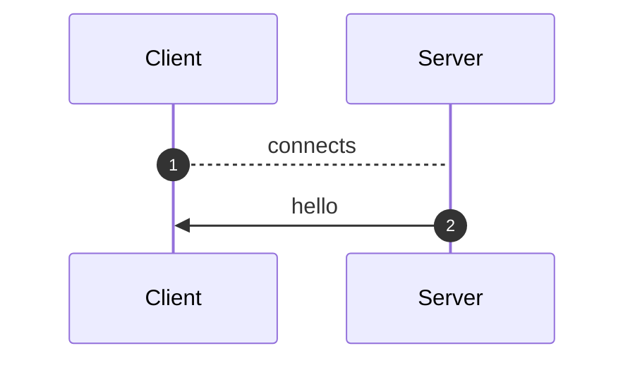
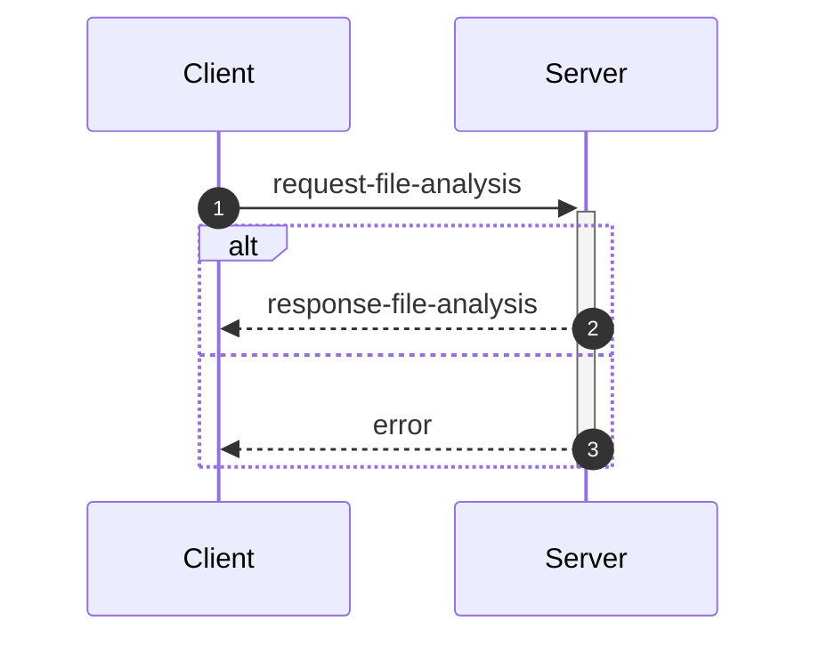
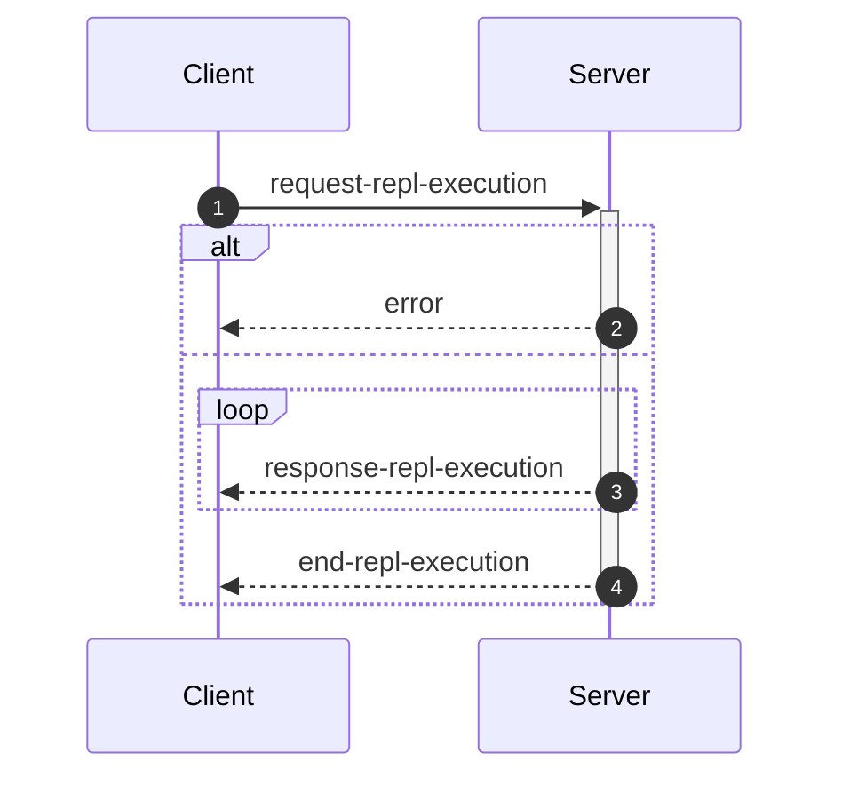
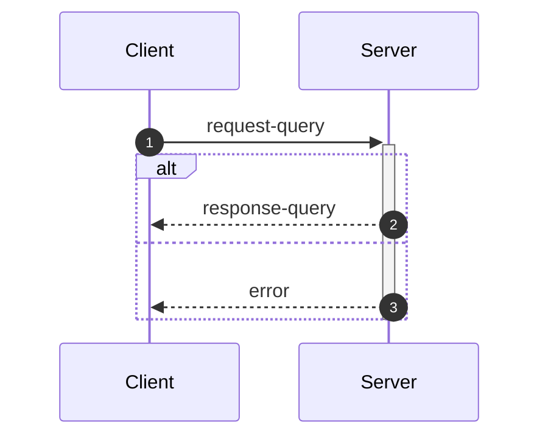

_<span title="an overview of flowR's interface">Generated</span> from '[wiki-interface.ts](https://github.com/flowr-analysis/flowr/tree/main/src/documentation/wiki-interface.ts "src/documentation/wiki-interface.ts")' on 2026-11-08, 17:40:25 UTC (v2.17.4, R v4.6.1), do not edit directly._

Although far from being as detailed as the in-depth explanation of [_flowR_](https://github.com/flowr-analysis/flowr/wiki/Core),
this wiki page explains how to interface with _flowR_ in more detail.
In general, command line arguments and other options provide short descriptions on hover over.

* [💻 Using the REPL](#using-the-repl)
* [⚙️ Configuring FlowR](#configuring-flowr)
* [⚒️ Writing Code](#writing-code)
* [💬 Communicating with the Server](#communicating-with-the-server)

<a id='using-the-repl'></a>
## 💻 Using the REPL

> [!NOTE]
> To execute arbitrary R commands with a repl request, _flowR_ has to be started explicitly with <span title="Description (Command Line Argument): Allow to access the underlying R session when using flowR (security warning: this allows the execution of arbitrary R code!)">`--r-session-access`</span>.
> Please be aware that this introduces a security risk and note that this relies on the [`r-shell` engine](https://github.com/flowr-analysis/flowr/wiki/Engines) .

Although primarily meant for users to explore,
there is nothing which forbids calling _flowR_ as a subprocess to use standard-in, -output, and -error
for communication (although you can access the REPL using the server as well,
with the [REPL Request](#message-request-repl-execution) message).

The read-eval-print loop&nbsp;(REPL) works relatively simple.
You can submit an expression (using <kbd>Enter</kbd>),
which is interpreted as an R&nbsp;expression by default but interpreted as a *command* if it starts with a colon (`:`).
The best command to get started with the REPL is <span title="Description (Repl Command): Show help information (aliases: :h, :?)">`:help`</span>.
Besides, you can leave the REPL either with the command <span title="Description (Repl Command): End the repl (aliases: :q, :exit)">`:quit`</span> or by pressing <kbd>Ctrl</kbd>+<kbd>C</kbd> twice.
When writing a *command*, you may press <kbd>Tab</kbd> to get a list of completions, if available.
Multiple commands can be entered in a single line by separating them with a semicolon (`;`), e.g. `:parse "x<-2"; :df*`.
If a command is given without R code, the REPL will re-use R code given in a previous command.
The prior example will hence return first the parsed AST of the program and then the dataflow graph for `"x <- 2"`.

> [!NOTE]
> If you develop flowR, you may want to launch the repl using the `npm run main-dev` command, this way, you get a non-minified version of flowR with debug information and hot-reloading of source files.

<details>
<summary>Available Commands</summary>

We currently offer the following commands (this with a `[*]` suffix are available with and without the star):

| Command | Description |
| ------- | ----------- |
| **<span title="Description (Repl Command): End the repl (aliases: :q, :exit)">:quit</span>** | End the repl (aliases: **:<span title="Alias of ':quit'. End the repl">q</span>**, **:<span title="Alias of ':quit'. End the repl">exit</span>**) |
| **<span title="Description (Repl Command): Execute the given code as R code. This requires the `--r-session-access` flag to be set and requires the r-shell engine. (aliases: :e, :r)">:execute</span>** | Execute the given code as R code. This requires the `--r-session-access` flag to be set and requires the r-shell engine. (aliases: **:<span title="Alias of ':execute'. Execute the given code as R code. This requires the `--r-session-access` flag to be set and requires the r-shell engine.">e</span>**, **:<span title="Alias of ':execute'. Execute the given code as R code. This requires the `--r-session-access` flag to be set and requires the r-shell engine.">r</span>**) |
| **<span title="Description (Repl Command): Get mermaid code for the control-flow graph of R code (aliases: :cfg, :cf)">:controlflow[*]</span>** | Get mermaid code for the control-flow graph of R code (star: Returns the URL to mermaid.live) (aliases: **:<span title="Alias of ':controlflow'. Get mermaid code for the control-flow graph of R code">cfg</span>**, **:<span title="Alias of ':controlflow'. Get mermaid code for the control-flow graph of R code">cf</span>**) |
| **<span title="Description (Repl Command): Get mermaid code for the control-flow graph with basic blocks (aliases: :cfgb, :cfb)">:controlflowbb[*]</span>** | Get mermaid code for the control-flow graph with basic blocks (star: Returns the URL to mermaid.live) (aliases: **:<span title="Alias of ':controlflowbb'. Get mermaid code for the control-flow graph with basic blocks">cfgb</span>**, **:<span title="Alias of ':controlflowbb'. Get mermaid code for the control-flow graph with basic blocks">cfb</span>**) |
| **<span title="Description (Repl Command): Get mermaid code for the dataflow graph (aliases: :d, :df)">:dataflow[*]</span>** | Get mermaid code for the dataflow graph (star: Returns the URL to mermaid.live) (aliases: **:<span title="Alias of ':dataflow'. Get mermaid code for the dataflow graph">d</span>**, **:<span title="Alias of ':dataflow'. Get mermaid code for the dataflow graph">df</span>**) |
| **<span title="Description (Repl Command): Get mermaid code for the normalized AST of R code (aliases: :n)">:normalize[*]</span>** | Get mermaid code for the normalized AST of R code (star: Returns the URL to mermaid.live) (alias: **:<span title="Alias of ':normalize'. Get mermaid code for the normalized AST of R code">n</span>**) |
| **<span title="Description (Repl Command): Get mermaid code for the simplified dataflow graph (aliases: :ds, :dfs)">:dataflowsimple[*]</span>** | Get mermaid code for the simplified dataflow graph (star: Returns the URL to mermaid.live) (aliases: **:<span title="Alias of ':dataflowsimple'. Get mermaid code for the simplified dataflow graph">ds</span>**, **:<span title="Alias of ':dataflowsimple'. Get mermaid code for the simplified dataflow graph">dfs</span>**) |
| **<span title="Description (Repl Command): Inspect and extend the signature database: `query` (identical to :query @signature), `info <name>` for where a function comes from (identical to :query @function-info), `add <path>` to mount another database/source, `download` to fetch the full-history database. (aliases: :sig)">:signature</span>** | Inspect and extend the signature database: `query` (identical to :query @signature), `info <name>` for where a function comes from (identical to :query @function-info), `add <path>` to mount another database/source, `download` to fetch the full-history database. (alias: **:<span title="Alias of ':signature'. Inspect and extend the signature database: `query` (identical to :query @signature), `info <name>` for where a function comes from (identical to :query @function-info), `add <path>` to mount another database/source, `download` to fetch the full-history database.">sig</span>**) |
| **<span title="Description (Repl Command): Just calculates the DFG, but only prints summary info (aliases: :d#, :df#)">:dataflowsilent</span>** | Just calculates the DFG, but only prints summary info (aliases: **:<span title="Alias of ':dataflowsilent'. Just calculates the DFG, but only prints summary info">d#</span>**, **:<span title="Alias of ':dataflowsilent'. Just calculates the DFG, but only prints summary info">df#</span>**) |
| **<span title="Description (Repl Command): Prints ASCII Art of the parsed, unmodified AST (aliases: :p)">:parse</span>** | Prints ASCII Art of the parsed, unmodified AST (alias: **:<span title="Alias of ':parse'. Prints ASCII Art of the parsed, unmodified AST">p</span>**) |
| **<span title="Description (Repl Command): Prints the version of flowR as well as the current version of R">:version</span>** | Prints the version of flowR as well as the current version of R
| **<span title="Description (Repl Command): Query the given R code (use 'help' for more information)">:query[*]</span>** | Query the given R code (use 'help' for more information) (star: Similar to query, but returns the output in json format.)
| **<span title="Description (Repl Command): Returns an ASCII representation of the dataflow graph (aliases: :df!)">:dataflowascii</span>** | Returns an ASCII representation of the dataflow graph (alias: **:<span title="Alias of ':dataflowascii'. Returns an ASCII representation of the dataflow graph">df!</span>**) |
| **<span title="Description (Repl Command): Returns summarization stats for the normalized AST (aliases: :n#)">:normalize#</span>** | Returns summarization stats for the normalized AST (alias: **:<span title="Alias of ':normalize#'. Returns summarization stats for the normalized AST">n#</span>**) |
| **<span title="Description (Repl Command): Show help information (aliases: :h, :?)">:help</span>** | Show help information (aliases: **:<span title="Alias of ':help'. Show help information">h</span>**, **:<span title="Alias of ':help'. Show help information">?</span>**) |

</details>

> [!TIP]
> 
> As indicated by the examples before, all REPL commands that operate on code keep track of the state.
> Hence, if you run a command like <span title="Description (Repl Command, starred version): Returns the URL to mermaid.live; Base Command: Get mermaid code for the dataflow graph (aliases: :d*, :df*)">`:dataflow*`</span> without providing R code,
> the REPL will re-use the R code provided in a previous command.
> Likewise, doing this will benefit from incrementality!
> If you request the dataflow graph with `:df* x <- 2 * y` and then want to see the parsed AST with `:parse`,
> the REPL will re-use previously obtained information and not re-parse the code again.
> 		

Generally, many commands offer shortcut versions in the REPL. Many queries, for example, offer a shortened format (see the example below).
Of special note, the [Config Query](https://github.com/flowr-analysis/flowr/wiki/%5BQuery%5D-Config)
can be used to also modify the currently active configuration of _flowR_ within the REPL (see the [wiki page](https://github.com/flowr-analysis/flowr/wiki/%5BQuery%5D-Config) for more information).

### Example: Retrieving the Dataflow Graph

To retrieve a URL to the [mermaid](https://mermaid.js.org/) diagram of the dataflow of a given expression,
use <span title="Description (Repl Command, starred version): Returns the URL to mermaid.live; Base Command: Get mermaid code for the dataflow graph (aliases: :d*, :df*)">`:dataflow*`</span> (or <span title="Description (Repl Command): Get mermaid code for the dataflow graph (aliases: :d, :df)">`:dataflow`</span> to get the mermaid code in the cli):

```shell
$ docker run -it --rm eagleoutice/flowr # or npm run flowr 
flowR repl v2.17.4, R grammar v14 (tree-sitter engine)
R> :dataflow* y <- 1 + x
```

<details>
<summary style='color:gray'>Output</summary>

```text
https://mermaid.live/view#base64:eyJjb2RlIjoiZmxvd2NoYXJ0IFREXG4gICAgMXt7XCJgKiM5MTtSTnVtYmVyIzkzOyogKioxKipcbiAgICAgICoxLjYqICgqKmlkOiAxKiopYFwifX1cbiAgICAyKFtcImAqIzkxO1JTeW1ib2wjOTM7KiAqKngqKlxuICAgICAgKjEuMTAqICgqKmlkOiAyKiopYFwiXSlcbiAgICAzW1tcImAqIzkxO1JCaW5hcnlPcCM5MzsqIGJhc2UjNTg7IzU4OyoqIzQzOyoqXG4gICAgICAqMS42LTEwKiAoKippZDogMyoqKVxuICAgIGFyZzogKDEsIDIpYFwiXV1cbiAgICBidWlsdC1pbjpfNDNfW1wiYEJ1aWx0LUluOlxuIzQzO2BcIl1cbiAgICBzdHlsZSBidWlsdC1pbjpfNDNfIHN0cm9rZTpncmF5LGZpbGw6Z3JheSxzdHJva2Utd2lkdGg6MnB4LG9wYWNpdHk6Ljg7XG4gICAgMFtcImAqIzkxO1JTeW1ib2wjOTM7KiAqKnkqKlxuICAgICAgKjEuMSogKCoqaWQ6IDAqKiwgdjogMylgXCJdXG4gICAgNFtbXCJgKiM5MTtSQmluYXJ5T3AjOTM7KiBiYXNlIzU4OyM1ODsqKiM2MDsjNDU7KipcbiAgICAgICoxLjEtMTAqICgqKmlkOiA0KiopXG4gICAgYXJnOiAoMCwgMylgXCJdXVxuICAgIGJ1aWx0LWluOl82MF8tW1wiYEJ1aWx0LUluOlxuIzYwOyM0NTtgXCJdXG4gICAgc3R5bGUgYnVpbHQtaW46XzYwXy0gc3Ryb2tlOmdyYXksZmlsbDpncmF5LHN0cm9rZS13aWR0aDoycHgsb3BhY2l0eTouODtcbiAgICAxIC0uLT58XCJmbG93XCJ8IDJcbiAgICBsaW5rU3R5bGUgMCBzdHJva2U6Z3JheSxjb2xvcjpncmF5O1xuICAgIDIgLS4tPnxcImZsb3dcInwgM1xuICAgIGxpbmtTdHlsZSAxIHN0cm9rZTpncmF5LGNvbG9yOmdyYXk7XG4gICAgMyAtLT58XCJyZWFkcywgYXJnXCJ8IDFcbiAgICAzIC0tPnxcInJlYWRzLCBhcmdcInwgMlxuICAgIDMgLS4tPnxcImZsb3dcInwgMFxuICAgIGxpbmtTdHlsZSA0IHN0cm9rZTpncmF5LGNvbG9yOmdyYXk7XG4gICAgMyAtLi0+fFwicmVhZHMsIGNhbGxzXCJ8IGJ1aWx0LWluOl80M19cbiAgICBsaW5rU3R5bGUgNSBzdHJva2U6Z3JheTtcbiAgICAwIC0tPnxcImRlZmluZWQtYnksIGZsb3dcInwgNFxuICAgIDAgLS0+fFwiZGVmaW5lZC1ieVwifCAzXG4gICAgNCAtLT58XCJyZWFkcywgYXJnXCJ8IDNcbiAgICA0IC0tPnxcInJldHVybnMsIGFyZ1wifCAwXG4gICAgNCAtLi0+fFwicmVhZHMsIGNhbGxzXCJ8IGJ1aWx0LWluOl82MF8tXG4gICAgbGlua1N0eWxlIDEwIHN0cm9rZTpncmF5OyIsIm1lcm1haWQiOnsiYXV0b1N5bmMiOnRydWV9fQ==
```

Retrieve the dataflow graph of the expression `y <- 1 + x`. It looks like this:


<details>

<summary style="color:gray">R Code of the Dataflow Graph</summary>

The analysis ran (parse and normalize with the [tree-sitter](https://github.com/flowr-analysis/flowr/wiki/Engines) engine) in the generation environment. No [signature database](https://github.com/flowr-analysis/flowr/wiki/Signature-Database) is mounted, so `library()` attaches no exports (base-R names are still qualified, e.g., `stats::acf`). 
We encountered no unknown side effects during the analysis.

```r
y <- 1 + x
```

</details>

</details>

For small graphs like this, <span title="Description (Repl Command): Returns an ASCII representation of the dataflow graph (aliases: :df!)">`:dataflowascii`</span> also provides an ASCII representation directly in the REPL:

```shell
$ docker run -it --rm eagleoutice/flowr # or npm run flowr 
flowR repl v2.17.4, R grammar v14 (tree-sitter engine)
R> :df! y <- 1 + x
```

<details open>
<summary style='color:gray'>Output</summary>

```text
                        v<0>v
 c<4>c──────────────────| y |
 |<- |     ┌────────────v---v
 c---c     │
    │   c<3>c   0<1>0
    └───| + |───| 1 |───u<2>u
        c---c   0---0   | x |
           └────────────u---u
Edges:
3 -> 1: reads, arg          3 -> 2: reads, arg
3 -> 0: flows-to            1 -> 2: flows-to
2 -> 3: flows-to            4 -> 3: reads, arg
4 -> 0: returns, arg        0 -> 4: defined-by, flows-to
0 -> 3: defined-by
```

Retrieve the dataflow graph of the expression `y <- 1 + x` as ASCII art.

</details>

For the slicing with <span title="Description (Repl Command): Static backwards executable slicer for R">`:slicer`</span>, you have access to the same [magic comments](#slice-magic-comments) as with the [slice request](#message-request-slice).
Pass `--inline` to splice resolvable `source()` calls into the reconstruction so the slice is a single self-contained R text (the same as the static slice query's `inlineSources` flag).
See `--help` for more flags!

### Example: Interfacing with the File System

Many commands that allow for an R-expression (like <span title="Description (Repl Command, starred version): Returns the URL to mermaid.live; Base Command: Get mermaid code for the dataflow graph (aliases: :d*, :df*)">`:dataflow*`</span>) allow for a file as well
if the argument starts with `file://`.
If you are working from the root directory of the _flowR_ repository, the following gives you the parsed AST of the example file using the <span title="Description (Repl Command): Prints ASCII Art of the parsed, unmodified AST (aliases: :p)">`:parse`</span> command:

> **Watch mode**: Replace `file://` with `watch://` to enter watch mode.
> flowR runs the command immediately and then re-runs it every time the file (or any file inside the folder) changes.
> Enter any other command to leave watch mode.
> For example: `:df watch://analysis.R`

```shell
$ docker run -it --rm eagleoutice/flowr # or npm run flowr 
flowR repl v2.17.4, R grammar v14 (tree-sitter engine)
R> :parse file://test/testfiles/example.R
```

<details>
<summary style='color:gray'>Output</summary>

```text
File: test/testfiles/example.R

program
├ binaryoperator
│ ├ identifier "sum" (1:1─4)
│ ├ <- "<-" (1:5─7)
│ ╰ float "0" (1:8─9)
├ binaryoperator
│ ├ identifier "product" (2:1─8)
│ ├ <- "<-" (2:9─11)
│ ╰ float "1" (2:12─13)
├ binaryoperator
│ ├ identifier "w" (3:1─2)
│ ├ <- "<-" (3:3─5)
│ ╰ float "7" (3:6─7)
├ binaryoperator
│ ├ identifier "N" (4:1─2)
│ ├ <- "<-" (4:3─5)
│ ╰ float "10" (4:6─8)
├ forstatement
│ ├ for "for" (6:1─4)
│ ├ ( "(" (6:5─6)
│ ├ identifier "i" (6:6─7)
│ ├ in "in" (6:8─10)
│ ├ binaryoperator
│ │ ├ float "1" (6:11─12)
│ │ ├ : ":" (6:12─13)
│ │ ╰ parenthesizedexpression
│ │   ├ ( "(" (6:13─14)
│ │   ├ binaryoperator
│ │   │ ├ identifier "N" (6:14─15)
│ │   │ ├ - "-" (6:15─16)
│ │   │ ╰ float "1" (6:16─17)
│ │   ╰ ) ")" (6:17─18)
│ ├ ) ")" (6:18─19)
│ ╰ bracedexpression
│   ├ { "{" (6:20─21)
│   ├ binaryoperator
│   │ ├ identifier "sum" (7:3─6)
│   │ ├ <- "<-" (7:7─9)
│   │ ╰ binaryoperator
│   │   ├ binaryoperator
│   │   │ ├ identifier "sum" (7:10─13)
│   │   │ ├ + "+" (7:14─15)
│   │   │ ╰ identifier "i" (7:16─17)
│   │   ├ + "+" (7:18─19)
│   │   ╰ identifier "w" (7:20─21)
│   ├ binaryoperator
│   │ ├ identifier "product" (8:3─10)
│   │ ├ <- "<-" (8:11─13)
│   │ ╰ binaryoperator
│   │   ├ identifier "product" (8:14─21)
│   │   ├  "" (8:22─23)
│   │   ╰ identifier "i" (8:24─25)
│   ╰ } "}" (9:1─2)
├ call
│ ├ identifier "cat" (11:1─4)
│ ╰ arguments
│   ├ ( "(" (11:4─5)
│   ├ argument
│   │ ╰ string
│   │   ├ stringopen "\"" (11:5─6)
│   │   ├ stringcontent "Sum:" (11:6─10)
│   │   ╰ stringclose "\"" (11:10─11)
│   ├ comma "," (11:11─12)
│   ├ argument
│   │ ╰ identifier "sum" (11:13─16)
│   ├ comma "," (11:16─17)
│   ├ argument
│   │ ╰ string
│   │   ├ stringopen "\"" (11:18─19)
│   │   ├ stringcontent
│   │   │ ╰ escapesequence "\\n" (11:19─21)
│   │   ╰ stringclose "\"" (11:21─22)
│   ╰ ) ")" (11:22─23)
╰ call
  ├ identifier "cat" (12:1─4)
  ╰ arguments
    ├ ( "(" (12:4─5)
    ├ argument
    │ ╰ string
    │   ├ stringopen "\"" (12:5─6)
    │   ├ stringcontent "Product:" (12:6─14)
    │   ╰ stringclose "\"" (12:14─15)
    ├ comma "," (12:15─16)
    ├ argument
    │ ╰ identifier "product" (12:17─24)
    ├ comma "," (12:24─25)
    ├ argument
    │ ╰ string
    │   ├ stringopen "\"" (12:26─27)
    │   ├ stringcontent
    │   │ ╰ escapesequence "\\n" (12:27─29)
    │   ╰ stringclose "\"" (12:29─30)
    ╰ ) ")" (12:30─31)
```

Retrieve the parsed AST of the example file.

<details>

<summary>File Content</summary>

```r
sum <- 0
product <- 1
w <- 7
N <- 10

for (i in 1:(N-1)) {
  sum <- sum + i + w
  product <- product * i
}

cat("Sum:", sum, "\n")
cat("Product:", product, "\n")
```

</details>

As _flowR_ directly transforms this AST the output focuses on being human-readable instead of being machine-readable.
		
</details>

### Example: Run a Query

You can run any query supported by _flowR_ using the <span title="Description (Repl Command): Query the given R code (use 'help' for more information)">`:query`</span> command.
For example, to obtain the shapes of all data frames in a given piece of code, you can run:

```shell
$ docker run -it --rm eagleoutice/flowr # or npm run flowr 
flowR repl v2.17.4, R grammar v14 (tree-sitter engine)
R> :query @absint df-shape "x <- data.frame(a = 1:10, b = 1:10)\ny <- x$a"
```

<details open>
<summary style='color:gray'>Output</summary>

```text
Query: absint (2 ms)
   ╰ $12: (colnames: [{"a", "b"}, {}], cols: [2, 2], rows: [10, 10])
   ╰ $0: (colnames: [{"a", "b"}, {}], cols: [2, 2], rows: [10, 10])
```

Retrieve the shapes of all data frames in the given code.

</details>

To run the linter on a file, you can use (in this example, we just issue the `dead-code` linter on a small piece of code):

```shell
$ docker run -it --rm eagleoutice/flowr # or npm run flowr 
flowR repl v2.17.4, R grammar v14 (tree-sitter engine)
R> :query @linter rules:dead-code "if(FALSE) x <- 2"
```

<details open>
<summary style='color:gray'>Output</summary>

```text
Query: linter (4 ms)
   ╰ Dead Code (dead-code):
       ╰ certain:
           ╰ Code at 1.11-16 (1 quick fix(es) available)
```

Run the linter on the given code, with only the `dead-code` rule enabled.

</details>

For more information on the available queries, please check out the [Query API](https://github.com/flowr-analysis/flowr/wiki/Query-API).

<a id='configuring-flowr'></a>
## ⚙️ Configuring FlowR

When running _flowR_, you may want to specify some behaviors with a dedicated configuration file.
By default, flowR looks for a file named `flowr.json` in the current working directory (or any higher directory).
You can also specify a different file with <span title="Description (Command Line Argument): The name of the configuration file to use">`--config-file`</span> or pass the configuration inline using <span title="Description (Command Line Argument): The flowR configuration to use, as a JSON string">`--config-json`</span>.
A `flowr.json` found this way belongs to the analyzed project, so flowR ignores its options that decide what flowR executes or loads
(`engines.*.wasmPath`, `engines.*.treeSitterWasmPath`, `engines.*.rPath`, `solver.sigdb.additionalPaths`, `solver.sigdb.downloadRepo`, `solver.sigdb.installedLibrary.paths`, `solver.sigdb.onDemand.enabled`, `solver.sigdb.onDemand.repositories`, `solver.sigdb.onDemand.cranMirror`, `solver.sigdb.onDemand.bioconductorMirror`, `solver.sigdb.onDemand.cacheDir`),
unless you pass <span title="Description (Command Line Argument): Keep the security-sensitive options (e.g., the R executable) of the flowr.json found in the working directory or a parent. Only use this for projects you trust.">`--trust-config`</span>.
To analyze code you do not trust, use the secure mode (<span title="Description (Command Line Argument): Run in secure mode for analyzing untrusted code: flowR does not start R (or any other process), does not access the network, does not search for project configs, and ignores security-sensitive options in every config. Cannot be disabled once enabled. Can also be enabled with the environment variable {italic FLOWR_SECURE_MODE=1}.">`--secure`</span>, see the [security policy](https://github.com/flowr-analysis/flowr/blob/main/.github/SECURITY.md)).
To inspect the current configuration, you can run flowr with the <span title="Description (Command Line Argument): Run with verbose logging (will be passed to the corresponding script)">`--verbose`</span> flag, or use the `config` [Query](https://github.com/flowr-analysis/flowr/wiki/Query-API).
Within the REPL this works by running the following:

```shell
:query @config
```

To work with the <a href="https://github.com/flowr-analysis/flowr/tree/main/src/config.ts#L125"><code><span title="The configuration file format for flowR.">FlowrConfig</span></code></a> you can use the provided helper objects alongside its methods like
<a href="https://github.com/flowr-analysis/flowr/tree/main/src/config.ts#L991"><code><span title="Creates a new flowr config that has the updated values.">FlowrConfig::<b>amend</b></span></code></a>.
The schema below documents every option; the ones you most likely want are:

- <a href="https://github.com/flowr-analysis/flowr/wiki/Interface#configuring-flowr" title="Configuration Option (boolean): Whether source calls should be ignored, causing {@link processSourceCall}&#39;s behavior to be skipped.">ignoreSourceCalls</a>: ignore source calls when analyzing the code, i.e., ignore the inclusion of other files.
- <a href="https://github.com/flowr-analysis/flowr/wiki/Interface#configuring-flowr" title="Configuration Option (boolean): Whether load calls should be ignored, causing {@link processLoadCall}&#39;s behavior to be skipped.">ignoreLoadCalls</a>: ignore load calls when analyzing the code, i.e., ignore the loading of r-data files.
- <a href="https://github.com/flowr-analysis/flowr/wiki/Interface#configuring-flowr" title="Configuration Option (object): Do you want to overwrite (parts) of the builtin definition?">semantics.environment.overwriteBuiltIns</a>: overwrite _flowR_'s handling of built-in functions, or clear the preset definitions entirely.
  See [Configure BuiltIn Semantics](#configure-builtin-semantics) for more information.
- <a href="https://github.com/flowr-analysis/flowr/wiki/Interface#configuring-flowr" title="Configuration Option (boolean): Whether calls drawing on a graphics device (e.g., `plot`) count as writing to it, which the ambient state queries then report.">semantics.ambient.drawingWritesDevice</a>: whether calls drawing on a graphics device (e.g., `plot`) count as writing the device in the ambient state queries.
- <a href="https://github.com/flowr-analysis/flowr/wiki/Interface#configuring-flowr" title="Configuration Option (string): How to resolve variables and their values. (one of &quot;disabled&quot;, &quot;alias&quot;, &quot;builtin&quot;)">solver.variables</a>: how to resolve variables and their values (`disabled`, `alias`, `builtin`).
- <a href="https://github.com/flowr-analysis/flowr/wiki/Interface#configuring-flowr" title="Configuration Option (array): The engine or set of engines to use for interacting with R code. An empty array means all available engines will be used.">engines</a> and <a href="https://github.com/flowr-analysis/flowr/wiki/Interface#configuring-flowr" title="Configuration Option (string): The default engine to use for interacting with R code. If this is undefined, an arbitrary engine from the specified list will be used. (one of &quot;tree-sitter&quot;, &quot;r-shell&quot;)">defaultEngine</a>: the engines used to interact with R code, see the [Engines wiki page](https://github.com/flowr-analysis/flowr/wiki/Engines).
- <a href="https://github.com/flowr-analysis/flowr/wiki/Interface#configuring-flowr" title="Configuration Option (array): Files a framework loads on its own, without any source() call (e.g. global.R in a shiny app), in the order they are loaded; flowR orders the matching project files accordingly and analyzes them as one program. Entries are case-insensitive globs matched against the file path, a plain name matches any file with that name, and entries matching no project file are warned about. Usually set per project kind via specializeConfig.">project.implicitSources</a>: the files a framework loads without any `source()` call, in the order in which they are
  loaded. Entries are globs (e.g. `R/*.R`) matched against the file path ignoring capitalization; one matching no file is reported.
- <a href="https://github.com/flowr-analysis/flowr/wiki/Interface#configuring-flowr" title="Configuration Option (object): Overwrite (parts of) the configuration depending on the project kind flowR detects, e.g. to give a shiny app its implicit sources.">specializeConfig</a>: overwrite (parts of) the configuration depending on the kind of project _flowR_ detects
  (e.g. `shiny-app`), which is how a shiny app gets its implicit sources by default. What you configure directly wins.
- <a href="https://github.com/flowr-analysis/flowr/wiki/Interface#configuring-flowr" title="Configuration Option (string): Overwrite the project kind flowR would otherwise infer from the analyzed files, e.g. when auto-detection guesses wrong. (one of &quot;package&quot;, &quot;script&quot;, &quot;shiny-app&quot;, &quot;notebook&quot;, &quot;project&quot;, &quot;unknown&quot;)">project.useProjectType</a>: skip that detection and force a project kind yourself, when auto-detection guesses wrong.
- <a href="https://github.com/flowr-analysis/flowr/wiki/Interface#configuring-flowr" title="Configuration Option (array): The default plugins to load when creating a new instance of FlowrAnalyzer">defaultPlugins</a> and <a href="https://github.com/flowr-analysis/flowr/wiki/Interface#configuring-flowr" title="Configuration Option (array): The plugins to load in REPL mode">repl.plugins</a>: the plugins to load for a new <a href="https://github.com/flowr-analysis/flowr/tree/main/src/project/flowr-analyzer.ts#L240"><code><span title="Central class for conducting analyses with FlowR. Use the FlowrAnalyzerBuilder to create a new instance. If you want the original pattern of creating a pipeline and running all steps, you can still do this with FlowrAnalyzer#runFull . To inspect the context of the analyzer, use FlowrAnalyzer#inspectContext (if you are a plugin and need to modify it, use FlowrAnalyzer#context instead).">FlowrAnalyzer</span></code></a> and in the REPL
  (use `flowr:default` to reference the former).

So you can configure _flowR_ by adding a file like the following:

<details>

<summary>Example Configuration File</summary>

```json
{
  "ignoreSourceCalls": true,
  "ignoreLoadCalls": true,
  "semantics": {
    "environment": {
      "overwriteBuiltIns": {
        "definitions": [
          {
            "type": "function",
            "names": [
              "foo"
            ],
            "processor": "builtin:assign",
            "config": {}
          }
        ]
      }
    }
  },
  "defaultPlugins": [
    "file:description",
    "versions:description"
  ],
  "repl": {
    "quickStats": false,
    "dfProcessorHeat": false,
    "hints": true,
    "plugins": [
      "flowr:default"
    ]
  },
  "project": {
    "resolveUnknownPathsOnDisk": true,
    "implicitSources": [
      "global.R",
      "app.R"
    ]
  },
  "linter": {
    "disabledRules": []
  },
  "specializeConfig": {
    "shiny-app": {
      "project": {
        "implicitSources": [
          "global.R",
          "ui.R",
          "server.R",
          "app.R"
        ]
      }
    }
  },
  "engines": [
    {
      "type": "r-shell"
    }
  ],
  "solver": {
    "variables": "alias",
    "evalStrings": true,
    "trackEnvironments": true,
    "sigdb": {
      "enabled": true,
      "loadProjectDependencies": true,
      "eagerlyLoad": false,
      "eagerlyLoadExports": false,
      "linkBaseR": false,
      "linkDescriptionDependencies": false
    },
    "resolveSource": {
      "dropPaths": "no",
      "ignoreCapitalization": true,
      "inferWorkingDirectory": "active-script",
      "searchPath": []
    },
    "instrument": {},
    "slicer": {
      "threshold": 50
    }
  },
  "abstractInterpretation": {
    "wideningThreshold": 4,
    "followCalls": true,
    "dataFrame": {
      "maxColNames": 20,
      "readLoadedData": {
        "readExternalFiles": true,
        "maxReadLines": 1000000
      }
    }
  },
  "incremental": {
    "alwaysIncremental": false,
    "parsing": {
      "activated": false,
      "heuristics": {
        "activated": true,
        "mtime": true,
        "linesFrom": 500,
        "bytesFrom": 50000,
        "alwaysWithEdits": false,
        "minFiles": 1
      }
    }
  },
  "gas": {
    "thresholds": {
      "memory": {
        "problematic": 0.7,
        "critical": 0.9
      },
      "timeMs": {
        "problematic": 100000,
        "critical": 120000
      }
    },
    "features": {}
  }
}
```

</details>

<details>
<a id='configure-builtin-semantics'></a>
<summary>Configure Built-In Semantics</summary>

`semantics/environment/overwriteBuiltins` accepts two keys:

- `loadDefaults` (boolean, initially `true`): If set to `true`, the default built-in definitions are loaded before applying the custom definitions. Setting this flag to `false` explicitly disables the loading of the default definitions.
- `definitions` (array, initially empty): Allows to overwrite or define new built-in elements. Each object within must have a `type` which is one of the below. Furthermore, they may define a string array of `names` which specifies the identifiers to bind the definitions to. You may use `assumePrimitive` to specify whether _flowR_ should assume that this is a primitive non-library definition (so you probably just do not want to specify the key).

  | Type            | Description                                                                                                                                                                                                                                                                                              | Example                                                                                                    |
  | --------------- | -------------------------------------------------------------------------------------------------------------------------------------------------------------------------------------------------------------------------------------------------------------------------------------------------------- | ---------------------------------------------------------------------------------------------------------- |
  | `constant`    | Additionally allows for a `value` this should resolve to.                                                                                                                                                                                                                                                | `{ type: 'constant', names: ['NULL', 'NA'],  value: null }`                                                |
  | `function`    | Is a rather flexible way to define and bind built-in functions. For the time, we do not have extensive documentation to cover all the cases, so please either consult the sources with the `default-builtin-config/` folder or open a [new issue](https://github.com/flowr-analysis/flowr/issues/new/choose). | `{ type: 'function', names: ['next'], processor: 'builtin:d', config: { cfg: ExitPointType.Next } }` |
  | `replacement` | A comfortable way to specify replacement functions like `$<-` or `names<-`. `suffixes` describes the... suffixes to attach automatically. | `{ type: 'replacement', suffixes: ['<-', '<<-'], names: ['[', '[['] }` |

</details>

<details>

<summary style='color:gray'>Full Configuration-File Schema</summary>

- _The configuration file format for flowR._ (object)
    - **logLevel** [optional] _flowR's global minimum log level, applied when the config is loaded._ (string)
        Only allows: 'silly', 'trace', 'debug', 'info', 'warn', 'error', 'fatal'
    - **ignoreSourceCalls** [optional] _Whether source calls should be ignored, causing {@link processSourceCall}'s behavior to be skipped._ (boolean)
    - **ignoreLoadCalls** [optional] _Whether load calls should be ignored, causing {@link processLoadCall}'s behavior to be skipped._ (boolean)
    - **semantics** _Configure language semantics and how flowR handles them._ (object)
        - **environment** [optional] _Semantics regarding how to handle the R environment._ (object)
            - **overwriteBuiltIns** [optional] _Do you want to overwrite (parts) of the builtin definition?_ (object)
                - **loadDefaults** [optional] _Should the default configuration still be loaded?_ (boolean)
                - **definitions** [optional] _The definitions to load/overwrite._ (array)
                Valid item types:
                    - (object)
        - **ambient** [optional] _Semantics regarding the global state (options, devices, files, ...) calls access._ (object)
            - **drawingWritesDevice** [optional] _Whether calls drawing on a graphics device (e.g., `plot`) count as writing to it, which the ambient state queries then report._ (boolean)
    - **defaultPlugins** [optional] _The default plugins to load when creating a new instance of FlowrAnalyzer_ (array)
    Valid item types:
        - (alternatives)
            - (string)
            - (array)
    - **repl** _Configuration options for the REPL._ (object)
        - **quickStats** [optional] _Whether to show quick stats in the REPL after each evaluation._ (boolean)
        - **dfProcessorHeat** [optional] _This instruments the dataflow processors to count how often each processor is called._ (boolean)
        - **hints** [optional] _Whether to show dim inline hints on the empty prompt (automatically disabled on non-interactive terminals)._ (boolean)
        - **plugins** [optional] _The plugins to load in REPL mode_ (array)
        Valid item types:
            - (alternatives)
                - (string)
                - (array)
        - **autoUseFileProtocol** [optional] _Prepend the file protocol to a repl input that looks like a path, instead of only warning about it._ (boolean)
        - **queryStats** [optional] _Whether `:query` closes with the line stating how long the queries took (`:query*` never prints it)._ (boolean)
        - **showPlugins** [optional] _Whether `:version` grays out the plugins that did not activate during the last analysis._ (boolean)
    - **project** _Project specific configuration options._ (object)
        - **resolveUnknownPathsOnDisk** [optional] _Whether to resolve unknown paths loaded by the r project disk when trying to source/analyze files._ (boolean)
        - **failOnInaccessiblePath** [optional] _Whether a directory that cannot be traversed during file discovery (e.g. due to permissions) aborts the analysis; when false (the default) such paths are logged and skipped._ (boolean)
        - **basePackages** [optional] _The packages considered part of R itself (base and recommended); if unset, flowR uses its built-in list._ (array)
        Valid item types:
            - (string)
        - **implicitSources** [optional] _Files a framework loads on its own, without any source() call (e.g. global.R in a shiny app), in the order they are loaded; flowR orders the matching project files accordingly and analyzes them as one program. Entries are case-insensitive globs matched against the file path, a plain name matches any file with that name, and entries matching no project file are warned about. Usually set per project kind via specializeConfig._ (array)
        Valid item types:
            - (string)
        - **useProjectType** [optional] _Overwrite the project kind flowR would otherwise infer from the analyzed files, e.g. when auto-detection guesses wrong._ (string)
            Only allows: 'package', 'script', 'shiny-app', 'notebook', 'project', 'unknown'
        - **assumeImplicitEcho** [optional] _Whether the top level of the analyzed code is echoed, so that every visible result printed there is collected as an output by the dependencies query (default true, false for a package)._ (boolean)
        - **discovery** [optional] _Scoping options for the default project discovery._ (object)
            - **full** [optional] _Collect every file below the project root (greedy) instead of only the files the detected project kind needs (default false)._ (boolean)
            - **perKind** [optional] _Per-kind include/exclude glob overrides layered on the default scoping._ (object)
            - **ignore** [optional] _Case-insensitive globs that drop matching files from the intelligent discovery, regardless of kind (e.g. .Renviron to ignore environment files)._ (array)
            Valid item types:
                - (string)
        - **classification** [optional] _Overrides for the signals flowR uses to classify the project kind._ (object)
            - **shinyDescriptionTypes** [optional] _DESCRIPTION Type: values that mark a shiny app._ (array)
            Valid item types:
                - (string)
            - **shinyEntryFiles** [optional] _File names a shiny app is assembled from._ (array)
            Valid item types:
                - (string)
            - **shinyUsagePattern** [optional] _Regex source evidencing shiny usage in an entry file._ (string)
            - **notebookExtensions** [optional] _File extensions marking a notebook._ (array)
            Valid item types:
                - (string)
    - **linter** _Linter configuration options._ (object)
        - **disabledRules** _Linting rule names excluded from the default rule set (a rule requested explicitly via a linter query still runs). Usually set per project kind via specializeConfig._ (array)
        Valid item types:
            - (string)
        - **disabledTags** [optional] _Linting rule tags whose rules are excluded from the default rule set (a rule requested explicitly via a linter query still runs). By default the cmd-check rules are disabled for everything but a package; a configured list replaces that default._ (array)
        Valid item types:
            - (string)
    - **inputSources** [optional] _Further frameworks the input-sources analysis should know about; entries are added to flowR's defaults._ (object)
        - **pure** [optional] _Functions that only pass the constantness of their arguments on._ (array)
        Valid item types:
            - (string)
        - **param** [optional] _Functions whose result is a 'param' input._ (array)
        Valid item types:
            - (string)
        - **file** [optional] _Functions whose result is a 'file' input._ (array)
        Valid item types:
            - (string)
        - **tempfile** [optional] _Functions whose result is a 'tempfile' input._ (array)
        Valid item types:
            - (string)
        - **glob** [optional] _Functions whose result is a 'glob' input._ (array)
        Valid item types:
            - (string)
        - **net** [optional] _Functions whose result is a 'net' input._ (array)
        Valid item types:
            - (string)
        - **rand** [optional] _Functions whose result is a 'rand' input._ (array)
        Valid item types:
            - (string)
        - **system** [optional] _Functions whose result is a 'system' input._ (array)
        Valid item types:
            - (string)
        - **ffi** [optional] _Functions whose result is a 'ffi' input._ (array)
        Valid item types:
            - (string)
        - **lang** [optional] _Functions whose result is a 'lang' input._ (array)
        Valid item types:
            - (string)
        - **options** [optional] _Functions whose result is a 'options' input._ (array)
        Valid item types:
            - (string)
        - **cmdline** [optional] _Functions whose result is a 'cmdline' input._ (array)
        Valid item types:
            - (string)
        - **user** [optional] _Functions whose result is a 'user' input._ (array)
        Valid item types:
            - (string)
        - **const** [optional] _Functions whose result is a 'const' input._ (array)
        Valid item types:
            - (string)
        - **scope** [optional] _Functions whose result is a 'scope' input._ (array)
        Valid item types:
            - (string)
        - **dconst** [optional] _Functions whose result is a 'dconst' input._ (array)
        Valid item types:
            - (string)
        - **unknown** [optional] _Functions whose result is a 'unknown' input._ (array)
        Valid item types:
            - (string)
        - **linkedObjects** [optional] _Objects a framework provides without a definition in the code, e.g. shiny's input._ (array)
        Valid item types:
            - (object)
        - **linkedEntryPoints** [optional] _Calls that hand a function to a framework, which binds its objects to the parameters by position._ (array)
        Valid item types:
            - (object)
    - **specializeConfig** [optional] _Overwrite (parts of) the configuration depending on the project kind flowR detects, e.g. to give a shiny app its implicit sources._ (object)
    - **engines** _The engine or set of engines to use for interacting with R code. An empty array means all available engines will be used._ (array)
    Valid item types:
        - (alternatives)
            - _The configuration for the tree sitter engine._ (object)
                - **type** [required] _Use the tree sitter engine._ (string)
                    Only allows: 'tree-sitter'
                - **wasmPath** [optional] _The path to the tree-sitter-r WASM binary to use. If this is undefined, this uses the default path._ (string)
                - **treeSitterWasmPath** [optional] _The path to the tree-sitter WASM binary to use. If this is undefined, this uses the default path._ (string)
                - **lax** [optional] _Whether to use the lax parser for parsing R code (allowing for syntax errors). If this is undefined, the strict parser will be used._ (boolean)
            - _The configuration for the R shell engine._ (object)
                - **type** [required] _Use the R shell engine._ (string)
                    Only allows: 'r-shell'
                - **rPath** [optional] _The path to the R executable to use. If this is undefined, this uses the default path._ (string)
                - **pipeBind** [optional] _Whether to enable R's experimental pipe-bind operator "=>" by setting _R_USE_PIPEBIND_ for the R session (default false); R itself keeps this off by default, as it is experimental and has never shipped in a release version of R._ (boolean)
    - **defaultEngine** [optional] _The default engine to use for interacting with R code. If this is undefined, an arbitrary engine from the specified list will be used._ (string)
        Only allows: 'tree-sitter', 'r-shell'
    - **solver** _How to resolve constants, constraints, cells, ..._ (object)
        - **variables** _How to resolve variables and their values._ (string)
            Only allows: 'disabled', 'alias', 'builtin'
        - **evalStrings** _Should we include eval(parse(text="...")) calls in the dataflow graph?_ (boolean)
        - **trackEnvironments** [optional] _Track user-created environments (new.env, assign/get/local with envir=, dollar-assign, attach). When false, all envir-style calls fall through conservatively._ (boolean)
        - **sigdb** _Resolving library exports from a signature database._ (object)
            - **enabled** [optional] _Resolve library()/use() exports from a signature database (default true); when false no database is consulted._ (boolean)
            - **loadProjectDependencies** [optional] _Load the project's declared dependencies from its metadata files (DESCRIPTION Imports/Depends, rproject.toml, uvr.toml, rig rproj.toml and script blocks, renv.lock, rv.lock, uvr.lock, rig lockfiles) (default true); when false these files are not read for dependencies._ (boolean)
            - **eagerlyLoad** [optional] _Parse the database up front rather than on the first package load (default false, ignored if disabled)._ (boolean)
            - **eagerlyLoadExports** [optional] _Add a vertex for every export on load rather than on demand (default false); keeps the dataflow graph small._ (boolean)
            - **assumedRVersion** [optional] _R version assumed when resolving versioned (base-R) exports: a pin like "4.5" or "auto" to detect the installed R (default "auto")._ (string)
            - **linkBaseR** [optional] _Eagerly attach base-R namespaces so bare base calls resolve without library() (default false)._ (boolean)
            - **linkBaseRCalls** [optional] _Add a lightweight Reads edge from a bare base-R call to its signature-database function vertex (default false; base-R qualification is edge-free otherwise)._ (boolean)
            - **linkPackageCalls** [optional] _Add a lightweight Reads edge from a resolved package call to its signature-database function vertex (default false)._ (boolean)
            - **linkDescriptionDependencies** [optional] _Eagerly attach the namespaces of the project's declared DESCRIPTION dependencies (Imports/Depends) so their exports resolve without an explicit library() (default false)._ (boolean)
            - **warmInBackground** [optional] _Decompress the hot shards (base + most-downloaded) in a background task on startup so the first library() lookup is warm (default false; for long-running servers/REPLs)._ (boolean)
            - **additionalPaths** [optional] _Extra directories or bundle/manifest files searched for signature databases (alongside the shipped default and $FLOWR_SIGDB_DIR); a downloaded full-history bundle placed here is mounted automatically._ (array)
            Valid item types:
                - (string)
            - **downloadRepo** [optional] _GitHub owner/repo the full-history bundle is downloaded from via ":signature download" (default "flowr-analysis/flowr"; the release tag comes from the committed sigdb.remote.json unless a version is given)._ (string)
            - **autoSync** [optional] _On startup, re-download shards whose committed sigdb.remote.json hash no longer matches the cache, in the background (default false; opt-in network sync after a git pull)._ (boolean)
            - **installedLibrary** [optional] _Recovering packages no signature database knows from the copy installed on this machine._ (object)
                - **enabled** [required] _Recover packages no signature database knows from their installed copy (default false)._ (boolean)
                - **paths** [optional] _Library directories to search; when empty they are discovered from the environment and the project._ (array)
                Valid item types:
                    - (string)
                - **useEnvironment** [optional] _Search the libraries R_LIBS_USER/R_LIBS/R_LIBS_SITE name (default true)._ (boolean)
                - **useProjectLibrary** [optional] _Search a project-local renv/packrat library (default true)._ (boolean)
                - **maxDepth** [optional] _How far to descend into the nested layout of a project-local library (default 3)._ (number)
                - **packages** [optional] _Only recover packages whose name matches one of these regular expressions; empty means any._ (array)
                Valid item types:
                    - (string)
            - **onDemand** [optional] _Recovering packages no signature database knows from their sources on CRAN, Bioconductor, or GitHub._ (object)
                - **enabled** [required] _Fetch and recover the sources of packages no signature database knows when the analyzed code uses them (default false, accesses the network)._ (boolean)
                - **sources** [optional] _Where to look, in order: github, cran, bioconductor, or a source a plugin adds (default ["github", "cran", "bioconductor"])._ (array)
                Valid item types:
                    - (string)
                - **repositories** [optional] _GitHub repositories (owner/repo[/subdir][@ref]) to fetch packages from, by package name. The analyzed project may name more (DESCRIPTION Remotes, install_github calls)._ (object)
                - **packages** [optional] _Only recover packages whose name matches one of these regular expressions, empty means any._ (array)
                Valid item types:
                    - (string)
                - **cranMirror** [optional] _The CRAN src/contrib/ to fetch from, over https (default https://cloud.r-project.org/src/contrib/). It may be on the local network._ (string)
                - **bioconductorMirror** [optional] _The Bioconductor host, over https (default https://bioconductor.org). It may be on the local network._ (string)
                - **bioconductorRelease** [optional] _The Bioconductor release to fetch from: release, devel, or a number like 3.20 (default release)._ (string)
                - **githubMirrors** [optional] _Use the GitHub mirrors of CRAN (cran/<pkg>) and Bioconductor (bioc/<pkg>) (default true)._ (boolean)
                - **maxPackages** [optional] _The most packages to fetch for one analysis (default 25)._ (number)
                - **maxArchiveMb** [optional] _The most MiB a package archive may have (default 32). It may unpack to three times that, at most 128 MiB._ (number)
                - **offline** [optional] _Only use what was fetched before, never the network (default false)._ (boolean)
                - **retryAfterHours** [optional] _How many hours to wait before asking again for a package no source had (default 24)._ (number)
                - **cacheDir** [optional] _Where to cache what was fetched (default the on-demand directory of the signature cache)._ (string)
            - **blobCacheBudgetMb** [optional] _How many MiB of decoded package blobs every open bundle may hold together (default 16)._ (number)
            - **versionSelection** [optional] _When a project constrains a dependency, resolve to the newest (default), oldest, or system-installed version satisfying it; system needs R and falls back to newest. Base-R packages always resolve against the assumed R version._ (string)
                Only allows: 'newest', 'oldest', 'system'
            - **versionOverrides** [optional] _Force an exact version for specific packages (name -> version), overriding both the project constraint and the versionSelection policy (default {})._ (object)
        - **versionManagement** _Policies for reasoning about dependency versions._ (object)
            - **linkedVersionGroups** [optional] _Groups of packages that must resolve to the same version; version guessing intersects each group so its members stay mutually compatible (default [])._ (array)
            Valid item types:
                - (array)
                Valid item types:
                    - (string)
        - **assumeAttachedPackages** [optional] _Packages to treat as attached without a `library()` call, so what the built-in configuration states about them applies to the analyzed code. The base packages R attaches on startup already resolve without it._ (array)
        Valid item types:
            - (string)
        - **transitiveSideEffectRounds** [optional] _How many rounds the transitive side-effect fixpoint may run before it is cut off (default 32); the propagation stops on its own as soon as a round adds nothing._ (number)
        - **maxOverlayDepth** [optional] _How many binding overlays may stack on one environment frame before a write flattens them (default 4); a pure performance knob, trading lookup cost against copy cost without changing any result._ (number)
        - **instrument** (object)
            - **dataflowExtractors** [optional] _These keys are only intended for use within code, allowing to instrument the dataflow analyzer!_ (any)
        - **resolveSource** [optional] _If lax source calls are active, flowR searches for sourced files much more freely, based on the configurations you give it. This option is only in effect if `ignoreSourceCalls` is set to false._ (object)
            - **dropPaths** _Allow to drop the first or all parts of the sourced path, if it is relative._ (string)
                Only allows: 'no', 'once', 'all'
            - **ignoreCapitalization** _Search for filenames matching in the lowercase._ (boolean)
            - **inferWorkingDirectory** _Try to infer the working directory from the main or any script to analyze._ (string)
                Only allows: 'no', 'main-script', 'active-script', 'any-script'
            - **searchPath** _Additionally search in these paths._ (array)
            Valid item types:
                - (string)
            - **repeatedSourceLimit** [optional] _How often the same file can be sourced within a single run? Please be aware: in case of cyclic sources this may not reach a fixpoint so give this a sensible limit._ (number)
            - **applyReplacements** _Provide name replacements for loaded files_ (array)
            Valid item types:
                - (object)
            - **assumeFilesExist** [optional] _Assume a sourced file is always there, making what it defines certain instead of conditional on the source call._ (boolean)
        - **slicer** [optional] _The configuration for the slicer._ (object)
            - **threshold** [optional] _The maximum number of iterations to perform on a single function call during slicing._ (number)
            - **autoExtend** [optional] _If set, the slicer will gain an additional post-pass._ (boolean)
    - **abstractInterpretation** _The configuration options for abstract interpretation._ (object)
        - **wideningThreshold** _The threshold for the number of visitations of a node at which widening should be performed to ensure the termination of the fixpoint iteration._ (number)
        - **followCalls** _Whether the abstract interpretation is interprocedural, i.e. whether it steps into the functions a call may dispatch to._ (boolean)
        - **dataFrame** _The configuration of the shape inference for data frames._ (object)
            - **maxColNames** _The maximum number of columns names to infer for data frames before over-approximating the column names to top._ (number)
            - **readLoadedData** _Configuration options for reading data frame shapes from loaded external data files, such as CSV files._ (object)
                - **readExternalFiles** _Whether data frame shapes should be extracted from loaded external files, such as CSV files._ (boolean)
                - **maxReadLines** _The maximum number of lines to read when extracting data frame shapes from loaded files, such as CSV files._ (number)
    - **incremental** (object)
        - **alwaysIncremental** _Always take the incremental path, regardless of heuristics._ (boolean)
        - **parsing** (object)
            - **activated** _If set, incremental parsing will be used._ (boolean)
            - **heuristics** (object)
                - **activated** [optional] _If set, the heuristics for incremental parsing will be used._ (boolean)
                - **mtime** [optional] _Skip reparsing entirely if the file's modification time is unchanged since the last parse._ (boolean)
                - **linesFrom** [optional] _Only consider incremental parsing for files with at least this many lines._ (number)
                - **bytesFrom** [optional] _Only consider incremental parsing for files with at least this many bytes._ (number)
                - **alwaysWithEdits** [optional] _Always take the incremental path whenever there is a computed edit region, regardless of the other thresholds._ (boolean)
                - **minFiles** [optional] _Only apply these heuristics once the project has at least this many files loaded._ (number)
    - **gas** [optional] _Resource-usage guard (gas) configuration. All feature factors default to 0 (disabled). See https://github.com/flowr-analysis/flowr/wiki/Core#gas-resource-guard._ (object)
        - **thresholds** [optional] _Thresholds for all gas checks (scaled by per-feature factor), boundable per feature._ (object)
            - **memory** [optional] _Heap-usage fraction thresholds (0-1), either shared or given per feature key (with `default` covering the rest)._ (object)
                - **problematic** [optional] _Heap fraction (0-1) above which Problematic is returned, for every feature without an entry of its own._ (number)
                - **critical** [optional] _Heap fraction (0-1) above which Critical is returned, for every feature without an entry of its own._ (number)
            - **timeMs** [optional] _Elapsed analysis time thresholds in milliseconds, either shared or given per feature key (with `default` covering the rest)._ (object)
                - **problematic** [optional] _Elapsed ms above which Problematic is returned, for every feature without an entry of its own._ (number)
                - **critical** [optional] _Elapsed ms above which Critical is returned, for every feature without an entry of its own._ (number)
            - **steps** [optional] _Processed-AST-node thresholds, counted rather than sampled; only a key that arms a budget (`dataflow`) reads them._ (object)
                - **problematic** [optional] _Processed AST nodes above which Problematic is returned, for every feature without an entry of its own._ (number)
                - **critical** [optional] _Processed AST nodes above which the extraction is cut short, for every feature without an entry of its own._ (number)
            - **vertices** [optional] _Created-dataflow-vertex thresholds, counted like `steps`._ (object)
                - **problematic** [optional] _Created dataflow vertices above which Problematic is returned, for every feature without an entry of its own._ (number)
                - **critical** [optional] _Created dataflow vertices above which the extraction is cut short, for every feature without an entry of its own._ (number)
        - **features** [optional] _Per-feature sensitivity factors. 0 or absent disables gas checking for that feature. A factor of 2 makes the feature twice as sensitive. Recognised keys: `source`, `side-effect-linking`, `linter`, `slicer`, `dataflow`._ (object)
        - **countedCheckEvery** [optional] _How many counted steps pass between two accountings of an armed check, be it a dataflow budget or the slicer's traversal (default 128); trades overshoot against the cost of the check._ (number)
        - **heapProvider** [optional] _Custom heap statistics source (programmatic configs only), overriding the built-in v8/performance.memory detection._ (function)

</details>

<a id='writing-code'></a>
## ⚒️ Writing Code

_flowR_ can be used as a [module](https://www.npmjs.com/package/@eagleoutice/flowr) and offers several main classes and interfaces that are interesting for extension writers 
(see the [Visual Studio Code extension](https://marketplace.visualstudio.com/items?itemName=code-inspect.vscode-flowr) or the [Core](https://github.com/flowr-analysis/flowr/wiki/Core) wiki page for more information).

### Creating Analyses with _flowR_

Nowadays, instances of the <a href="https://github.com/flowr-analysis/flowr/tree/main/src/project/flowr-analyzer.ts#L240"><code><span title="Central class for conducting analyses with FlowR. Use the FlowrAnalyzerBuilder to create a new instance. If you want the original pattern of creating a pipeline and running all steps, you can still do this with FlowrAnalyzer#runFull . To inspect the context of the analyzer, use FlowrAnalyzer#inspectContext (if you are a plugin and need to modify it, use FlowrAnalyzer#context instead).">FlowrAnalyzer</span></code></a> should be used as central frontend to get analysis results from _flowR_.
The entry points an analysis is written against are re-exported from the package root (`import { FlowrAnalyzerBuilder } from '@eagleoutice/flowr'`);
everything else stays reachable under its own path, as in `@eagleoutice/flowr/dataflow/graph/graph`.
For example, a program slice can be created like this:

```ts
const analyzer = await new FlowrAnalyzerBuilder()
    .setEngine('tree-sitter')
    .build();
analyzer.addRequest('x <- 1\ny <- x\nx');
const { slice, reconstruct } = await analyzer.query({
    type:     'static-slice',
    criteria: ['3@x']
});
```

For more information, please have a look at the [Analyzer](https://github.com/flowr-analysis/flowr/wiki/Analyzer) wiki page, which explains how to construct and use the <a href="https://github.com/flowr-analysis/flowr/tree/main/src/project/flowr-analyzer.ts#L240"><code><span title="Central class for conducting analyses with FlowR. Use the FlowrAnalyzerBuilder to create a new instance. If you want the original pattern of creating a pipeline and running all steps, you can still do this with FlowrAnalyzer#runFull . To inspect the context of the analyzer, use FlowrAnalyzer#inspectContext (if you are a plugin and need to modify it, use FlowrAnalyzer#context instead).">FlowrAnalyzer</span></code></a> in more detail.
To work with specific perspectives, you can also consult the respective pages like the [Dataflow Graph](https://github.com/flowr-analysis/flowr/wiki/Dataflow-Graph) or the [Abstract Interpretation](https://github.com/flowr-analysis/flowr/wiki/Abstract-Interpretation) wiki pages.
### The Pipeline Executor (Low-Level Interface)

Once, in the beginning, _flowR_ was meant to produce a dataflow graph merely to provide *program slices*. 
However, with continuous updates, the [Dataflow Graph](https://github.com/flowr-analysis/flowr/wiki/Dataflow-Graph) repeatedly proves to be the more interesting part.
With this, we restructured _flowR_'s originally *hardcoded* pipeline to be far more flexible. 
Now, it can be theoretically extended or replaced with arbitrary steps, optional steps, and what we call 'decorations' of these steps. 
In short, a slicing pipeline using the <a href="https://github.com/flowr-analysis/flowr/tree/main/src/core/pipeline-executor.ts#L97"><code><span title="**Please note:** The PipelineExecutor is now considered to be a rather low-level API for flowR. While it still works and is the basis for all other layers, we strongly recommend using the FlowrAnalyzer and its builder to create and use an analyzer instance that is pre-configured for your use-case. The pipeline executor allows to execute arbitrary pipelines in a step-by-step fashion. If you are not...">PipelineExecutor</span></code></a> looks like this:

```ts

const slicer = new PipelineExecutor(DEFAULT_SLICING_PIPELINE, {
  parser:    new RShell(),
  request:   requestFromInput('x <- 1\nx + 1'),
  criterion: ['2@x']
})
const slice = await slicer.allRemainingSteps()
// console.log(slice.reconstruct.code)
```

<details><summary>More Information</summary>

If you compare this, with what you would have done with the old (and removed) `SteppingSlicer`, 
this essentially just requires you to replace the `SteppingSlicer` with the <a href="https://github.com/flowr-analysis/flowr/tree/main/src/core/pipeline-executor.ts#L97"><code><span title="**Please note:** The PipelineExecutor is now considered to be a rather low-level API for flowR. While it still works and is the basis for all other layers, we strongly recommend using the FlowrAnalyzer and its builder to create and use an analyzer instance that is pre-configured for your use-case. The pipeline executor allows to execute arbitrary pipelines in a step-by-step fashion. If you are not...">PipelineExecutor</span></code></a>
and to pass the <a href="https://github.com/flowr-analysis/flowr/tree/main/src/core/steps/pipeline/default-pipelines.ts#L18"><code>DEFAULT_SLICING_PIPELINE</code></a> as the first argument.
The <a href="https://github.com/flowr-analysis/flowr/tree/main/src/core/pipeline-executor.ts#L97"><code><span title="**Please note:** The PipelineExecutor is now considered to be a rather low-level API for flowR. While it still works and is the basis for all other layers, we strongly recommend using the FlowrAnalyzer and its builder to create and use an analyzer instance that is pre-configured for your use-case. The pipeline executor allows to execute arbitrary pipelines in a step-by-step fashion. If you are not...">PipelineExecutor</span></code></a>...

1. Provides structures to investigate the results of all intermediate steps
2. Can be executed step-by-step
3. Can repeat steps (e.g., to calculate multiple slices on the same input)

See the in-code documentation for more information.

</details>

### Using the <a href="https://github.com/flowr-analysis/flowr/tree/main/src/r-bridge/shell.ts#L144"><code><span title="The RShell represents an interactive session with the R interpreter. You can configure it by RShellOptions . At the moment we are using a live R session (and not networking etc.) to communicate with R easily, which allows us to install packages etc. However, this might and probably will change in the future (leaving this as a legacy mode :D)">RShell</span></code></a> to Interact with R

The <a href="https://github.com/flowr-analysis/flowr/tree/main/src/r-bridge/shell.ts#L144"><code><span title="The RShell represents an interactive session with the R interpreter. You can configure it by RShellOptions . At the moment we are using a live R session (and not networking etc.) to communicate with R easily, which allows us to install packages etc. However, this might and probably will change in the future (leaving this as a legacy mode :D)">RShell</span></code></a> class allows interfacing with the `R`&nbsp;ecosystem installed on the host system.
Please have a look at [flowR's Engines](https://github.com/flowr-analysis/flowr/wiki/Engines) for more information on alternatives (for example, the <a href="https://github.com/flowr-analysis/flowr/tree/main/src/r-bridge/lang-4.x/tree-sitter/tree-sitter-executor.ts#L29"><code><span title="Synchronous and (way) faster alternative to the RShell using tree-sitter.">TreeSitterExecutor</span></code></a>).

> [!IMPORTANT]
> 
> Each <a href="https://github.com/flowr-analysis/flowr/tree/main/src/r-bridge/shell.ts#L144"><code><span title="The RShell represents an interactive session with the R interpreter. You can configure it by RShellOptions . At the moment we are using a live R session (and not networking etc.) to communicate with R easily, which allows us to install packages etc. However, this might and probably will change in the future (leaving this as a legacy mode :D)">RShell</span></code></a> controls a new instance of the R&nbsp;interpreter, 
> make sure to call <code><a href="https://github.com/flowr-analysis/flowr/tree/main/src/r-bridge/shell.ts#L350"><span title="Close the current R session, makes the object effectively invalid (can no longer be reopened etc.)">RShell::<i>close</i></span></a>()</code> when you are done.

You can start a new "session" by constructing a new object with <code>new <a href="https://github.com/flowr-analysis/flowr/tree/main/src/r-bridge/shell.ts#L144"><span title="The RShell represents an interactive session with the R interpreter. You can configure it by RShellOptions . At the moment we are using a live R session (and not networking etc.) to communicate with R easily, which allows us to install packages etc. However, this might and probably will change in the future (leaving this as a legacy mode :D)">RShell</span></a>()</code>.

However, there are several options that may be of interest 
(e.g., to automatically revive the shell in case of errors or to control the name location of the R process on the system).

With a shell object (let's call it `shell`), you can execute R code by using <a href="https://github.com/flowr-analysis/flowr/tree/main/src/r-bridge/shell.ts#L213"><code><span title="sends the given command directly to the current R session will not do anything to alter input markers!">RShell::<i>sendCommand</i></span></code></a>,
for example <code>shell.<a href="https://github.com/flowr-analysis/flowr/tree/main/src/r-bridge/shell.ts#L213"><span title="sends the given command directly to the current R session will not do anything to alter input markers!">sendCommand</span></a>("1 + 1")</code>.
However, this does not return anything, so if you want to collect the output of your command, use
<a href="https://github.com/flowr-analysis/flowr/tree/main/src/r-bridge/shell.ts#L296"><code><span title="Send a command and collect the output">RShell::<i>sendCommandWithOutput</i></span></code></a> instead.

<a id='communicating-with-the-server'></a>
## 💬 Communicating with the Server

As explained in the [Overview](https://github.com/flowr-analysis/flowr/wiki/Overview), you can run the [TCP](https://de.wikipedia.org/wiki/Transmission_Control_Protocol)&nbsp;server by adding the <span title="Description (Command Line Argument): Do not drop into a repl, but instead start a server on the given port (default: 1042) and listen for messages.">`--server`</span> flag (and, due to the interactive mode, exit with the conventional <kbd>CTRL</kbd>+<kbd>C</kbd>).
Currently, every connection is handled by the same underlying `RShell` - so the server is not designed to handle many clients at a time.
Additionally, the server is not well guarded against attacks (e.g., you can theoretically spawn an arbitrary number of&nbsp;RShell sessions on the target machine).

Every message has to be given in a single line (i.e., without a newline in-between) and end with a newline character. Nevertheless, we will pretty-print example given in the following segments for the ease of reading.

> [!NOTE]
> 
> The default <span title="Description (Command Line Argument): Do not drop into a repl, but instead start a server on the given port (default: 1042) and listen for messages.">`--server`</span> uses a simple [TCP](https://de.wikipedia.org/wiki/Transmission_Control_Protocol)
> connection. If you want _flowR_ to expose a [WebSocket](https://de.wikipedia.org/wiki/WebSocket) server instead, add the <span title="Description (Command Line Argument): If the server flag is set, use websocket for messaging">`--ws`</span> flag (i.e., <span title="Description (Command Line Argument): Do not drop into a repl, but instead start a server on the given port (default: 1042) and listen for messages.">`--server`</span> <span title="Description (Command Line Argument): If the server flag is set, use websocket for messaging">`--ws`</span>) when starting _flowR_ from the command line.

<ul><li>
<a id="message-hello"></a>
<b>Hello</b> Message (<code>hello</code>) 
<details>

<summary style="color:gray"> View Details. <i>The server informs the client about the successful connection and provides Meta-Information.</i> </summary>



After launching _flowR_, for example, with <code>docker run -it --rm eagleoutice/flowr <span title="Description (Command Line Argument): Do not drop into a repl, but instead start a server on the given port (default: 1042) and listen for messages.">-<span/>-server</span></code>&nbsp;(🐳️), connecting should present you with a `hello` message, that amongst others should reveal the versions of&nbsp;_flowR_ and&nbsp;R, using the [semver 2.0](https://semver.org/spec/v2.0.0.html) versioning scheme.
The message looks like this:

```json
{
  "type": "hello",
  "clientName": "client-0",
  "versions": {
    "flowr": "2.17.4",
    "r": "4.6.1",
    "engine": "r-shell"
  }
}
```

There are currently a few messages that you can send after the hello message.
If you want to _slice_ a piece of R code you first have to send an [analysis request](#message-request-file-analysis), so that you can send one or multiple slice requests afterward.
Requests for the [REPL](#message-request-repl-execution) are independent of that.
	
<hr>

<details>
<summary style="color:gray">Message schema (<code>hello</code>)</summary>

For the definition of the hello message, please see it's implementation at [`./src/cli/repl/server/messages/message-hello.ts`](https://github.com/flowr-analysis/flowr/tree/main/src/cli/repl/server/messages/message-hello.ts).

- [required] (object)
    - **type** [required] _The type of the hello message._ (string)
        Only allows: 'hello'
    - **id** [forbidden] _The id of the message is always undefined (as it is the initial message and not requested)._ (any)
    - **clientName** [required] _A unique name that is assigned to each client. It has no semantic meaning and is only used/useful for debugging._ (string)
    - **versions** [required] (object)
        - **flowr** [required] _The version of the flowr server running in semver format._ (string)
        - **r** [required] _The version of the underlying R shell running in semver format._ (string)
        - **engine** [required] _The parser backend that is used to parse the R code._ (string)

</details>

<hr>

</details>
	</li>

<li>
<a id="message-request-file-analysis"></a>
<b>Analysis</b> Message (<code>request-file-analysis</code>) 
<details>

<summary style="color:gray"> View Details. <i>The server builds the dataflow graph for a given input file (or a set of files).</i> </summary>



The request allows the server to analyze a file and prepare it for slicing.
The message can contain a `filetoken`, which is used to identify the file in later slice or query requests (if you do not add one, the request will not be stored and therefore, it is not available for subsequent requests).

> **Please note!**\
> If you want to send and process a lot of analysis requests, but do not want to slice them, please do not pass the `filetoken` field. This will save the server a lot of memory allocation.

Furthermore, the request must contain either a `content` field to directly pass the file's content or a `filepath` field which contains the path to the file (this path must be accessible for the server to be useful).
If you add the `id` field, the answer will use the same `id` so you can match requests and the corresponding answers.
See the implementation of the request-file-analysis message for more information.

You can drop one or more stored file tokens by adding the `invalidateToken` field (a single token or an array of tokens).
The server frees the corresponding analyses _after_ it has answered the request.

> **Tip!**\
> If you only want to drop tokens, you do not need a separate message: send a `request-file-analysis` that contains _just_ the `invalidateToken` field (and no `content` or `filepath`).
> Such a request behaves like an empty file analysis and the server replies with an empty `results` object.
> Because invalidation happens after the response, you may even pass the _current_ `filetoken` in `invalidateToken` to analyze a file once and have the server forget it right after you received the results.

<details>
<summary>Example of the <code>request-file-analysis</code> Message</summary>

_Note:_ even though we pretty-print these messages, they are sent as a single line, ending with a newline.

The following lists all messages that were sent and received in case you want to reproduce the scenario:

<ol>
<li> <code>hello</code> (response)
<details> 

<summary> Show Details </summary>

The first message is always a hello message.

```json
{"type":"hello","clientName":"client-0","versions":{"flowr":"2.17.4","r":"4.6.1","engine":"r-shell"}}
```

</details>
</li>

<li> <b><code>request-file-analysis</code> (request)</b>
<details open> 

<summary> Show Details </summary>

Let's suppose you simply want to analyze the following script:
 
```r
x <- 1
x + 1
```

 For this, you can send the following request:

```json
{"type":"request-file-analysis","id":"1","filetoken":"x","content":"x <- 1\nx + 1"}
```

</details>
</li>

<li> <code>response-file-analysis</code> (response)
<details> 

<summary> Show Details </summary>

The `results` field of the response effectively contains three keys of importance:

- `parse`: which contains 1:1 the parse result in CSV format that we received from the `RShell` (i.e., the AST produced by the parser of the R interpreter).
- `normalize`: which contains the normalized AST, including ids (see the `info` field and the [Normalized AST](https://github.com/flowr-analysis/flowr/wiki/Normalized-AST) wiki page).
- `dataflow`: especially important is the `graph` field which contains the dataflow graph as a set of root vertices (see the [Dataflow Graph](https://github.com/flowr-analysis/flowr/wiki/Dataflow-Graph) wiki page).
			
_As the code is pretty long, we inhibit pretty printing and syntax highlighting (JSON, hiding built-in):_

```text
{"type":"response-file-analysis","format":"json","id":"1","results":{"parse":{"files":[{"parsed":"[1,1,1,6,7,0,\"expr\",false,\"x <- 1\"],[1,1,1,1,1,3,\"SYMBOL\",true,\"x\"],[1,1,1,1,3,7,\"expr\",false,\"x\"],[1,3,1,4,2,7,\"LEFT_ASSIGN\",true,\"<-\"],[1,6,1,6,4,5,\"NUM_CONST\",true,\"1\"],[1,6,1,6,5,7,\"expr\",false,\"1\"],[2,1,2,5,16,0,\"expr\",false,\"x + 1\"],[2,1,2,1,10,12,\"SYMBOL\",true,\"x\"],[2,1,2,1,12,16,\"expr\",false,\"x\"],[2,3,2,3,11,16,\"'+'\",true,\"+\"],[2,5,2,5,13,14,\"NUM_CONST\",true,\"1\"],[2,5,2,5,14,16,\"expr\",false,\"1\"]","filePath":"/tmp/tmp-3879651-JJQ2OJwkoJL4-.R"}],".meta":{}},"normalize":{"ast":{"type":"RProject","files":[{"root":{"type":"RExpressionList","children":[{"type":"RBinaryOp","location":[1,3,1,4],"lhs":{"type":"RSymbol","location":[1,1,1,1],"content":"x","lexeme":"x","info":{"fullRange":[1,1,1,1],"adToks":[],"id":0,"parent":2,"role":"bin-l","index":0,"nest":0,"file":"/tmp/tmp-3879651-JJQ2OJwkoJL4-.R"}},"rhs":{"location":[1,6,1,6],"lexeme":"1","info":{"fullRange":[1,6,1,6],"adToks":[],"id":1,"parent":2,"role":"bin-r","index":1,"nest":0,"file":"/tmp/tmp-3879651-JJQ2OJwkoJL4-.R"},"type":"RNumber","content":{"num":1,"complexNumber":false,"markedAsInt":false}},"operator":"<-","lexeme":"<-","info":{"fullRange":[1,1,1,6],"adToks":[],"id":2,"parent":6,"nest":0,"file":"/tmp/tmp-3879651-JJQ2OJwkoJL4-.R","index":0,"role":"el-c"}},{"type":"RBinaryOp","location":[2,3,2,3],"lhs":{"type":"RSymbol","location":[2,1,2,1],"content":"x","lexeme":"x","info":{"fullRange":[2,1,2,1],"adToks":[],"id":3,"parent":5,"role":"bin-l","index":0,"nest":0,"file":"/tmp/tmp-3879651-JJQ2OJwkoJL4-.R"}},"rhs":{"location":[2,5,2,5],"lexeme":"1","info":{"fullRange":[2,5,2,5],"adToks":[],"id":4,"parent":5,"role":"bin-r","index":1,"nest":0,"file":"/tmp/tmp-3879651-JJQ2OJwkoJL4-.R"},"type":"RNumber","content":{"num":1,"complexNumber":false,"markedAsInt":false}},"operator":"+","lexeme":"+","info":{"fullRange":[2,1,2,5],"adToks":[],"id":5,"parent":6,"nest":0,"file":"/tmp/tmp-3879651-JJQ2OJwkoJL4-.R","index":1,"role":"el-c"}}],"info":{"adToks":[],"id":6,"nest":0,"file":"/tmp/tmp-3879651-JJQ2OJwkoJL4-.R","role":"root","index":0}},"filePath":"/tmp/tmp-3879651-JJQ2OJwkoJL4-.R"}],"info":{"id":7}},".meta":{}},"dataflow":{"unknownReferences":[],"in":[{"nodeId":2,"name":"<-","type":2},{"nodeId":5,"name":"+","type":2}],"out":[{"nodeId":0,"name":"x","type":4,"definedAt":2,"value":[1]}],"environment":{"current":{"id":2278,"parent":"<BuiltInEnvironment>","memory":[["x",[{"nodeId":0,"name":"x","type":4,"definedAt":2,"value":[1]}]]],"globalEnv":true},"level":0},"graph":{"rootVertices":[1,0,2,3,4,5],"vertexInformation":[[1,{"tag":"value","id":1}],[0,{"tag":"vdef","id":0,"source":[1]}],[2,{"tag":"fcall","id":2,"name":"<-","onlyBuiltin":true,"args":[{"nodeId":0,"type":32},{"nodeId":1,"type":32}],"origin":["builtin:assign"]}],[3,{"tag":"use","id":3}],[4,{"tag":"value","id":4}],[5,{"tag":"fcall","id":5,"name":"+","onlyBuiltin":true,"args":[{"nodeId":3,"type":32},{"nodeId":4,"type":32}],"origin":["builtin:d"]}]],"edgeInformation":[[2,[[1,{"types":65}],[0,{"types":72}],["built-in:<-",{"types":5}],[3,{"types":4096}]]],[1,[[0,{"types":4096}]]],[0,[[2,{"types":4098}],[1,{"types":2}]]],[5,[[3,{"types":65}],[4,{"types":65}],["built-in:+",{"types":5}]]],[3,[[0,{"types":1}],[4,{"types":4096}]]],[4,[[5,{"types":4096}]]]],"_unknownSideEffects":[],"_ambientAccess":[[5,{"reads":["#options"],"writes":[],"assumed":[],"local":[]}]]},"entryPoint":2,"cfgEntry":1,"exitPoints":[{"type":0,"nodeId":5}],"hooks":[],".meta":{}}}}
```

</details>
</li>
</ol>

The complete round-trip covers validating the messages as well as starting and stopping the internal mock server.

</details>

You receive an error if, for whatever reason, the analysis fails (e.g., the message or code you sent contained syntax errors).
It contains a human-readable description *why* the analysis failed (see the error message implementation for more details).

<details>
<summary>Example Error Message</summary>

_Note:_ even though we pretty-print these messages, they are sent as a single line, ending with a newline.

The following lists all messages that were sent and received in case you want to reproduce the scenario:

<ol>
<li> <code>hello</code> (response)
<details> 

<summary> Show Details </summary>

The first message is always a hello message.

```json
{"type":"hello","clientName":"client-0","versions":{"flowr":"2.17.4","r":"4.6.1","engine":"r-shell"}}
```

</details>
</li>

<li> <code>request-file-analysis</code> (request)
<details> 

<summary> Show Details </summary>

```json
{"type":"request-file-analysis","id":"1","filename":"sample.R","content":"x <-"}
```

</details>
</li>

<li> <b><code>error</code> (response)</b>
<details open> 

<summary> Show Details </summary>

```json
{"id":"1","type":"error","fatal":false,"reason":"Error while analyzing file sample.R: GuardError: unable to parse R code (see the log for more information) for request {\"request\":\"text\",\"content\":\"x <-\"}}\n Report a Bug: https://github.com/flowr-analysis/flowr/issues/new?body=%3C!%2D%2D%20Please%20describe%20your%20issue%20in%20more%20detail%20below!%20%2D%2D%3E%0A%0A%0A%3C!%2D%2D%20Automatically%20generated%20issue%20metadata%2C%20please%20do%20not%20edit%20or%20delete%20content%20below%20this%20line%20%2D%2D%3E%0A%2D%2D%2D%0A%0AflowR%20version%3A%202.17.4%0Anode%20version%3A%20v26.10.0%0Anode%20arch%3A%20x64%0Anode%20platform%3A%20linux%0Amessage%3A%20%60unable%20to%20parse%20R%20code%20%28see%20the%20log%20for%20more%20information%29%20for%20request%20%7B%22request%22%3A%22text%22%2C%22content%22%3A%22x%20%3C%2D%22%7D%7D%60%0Astack%20trace%3A%0A%60%60%60%0A%20%20%20%20at%20guard%20%28%3C%3E%2Fsrc%2Futil%2Fassert.ts%3A128%3A9%29%0A%20%20%20%20at%20guardRetrievedOutput%20%28%3C%3E%2Fsrc%2Fr%2Dbridge%2Fretriever.ts%3A155%3A7%29%0A%20%20%20%20at%20%2Fhome%2Fostwind%2Fgit%2Fphd%2Fflowr%2Dfield%2Fflowr%2Fsrc%2Fr%2Dbridge%2Fretriever.ts%3A122%3A4%0A%20%20%20%20at%20processTicksAndRejections%20%28node%3Ainternal%2Fprocess%2Ftask_queues%3A104%3A5%29%0A%20%20%20%20at%20async%20Object.parseRequests%20%5Bas%20processor%5D%20%28%3C%3E%2Fsrc%2Fr%2Dbridge%2Fparser.ts%3A115%3A19%29%0A%20%20%20%20at%20async%20PipelineExecutor.nextStep%20%28%3C%3E%2Fsrc%2Fcore%2Fpipeline%2Dexecutor.ts%3A192%3A25%29%0A%20%20%20%20at%20async%20FlowrAnalyzerCache.stepTapeUntil%20%28%3C%3E%2Fsrc%2Fproject%2Fcache%2Fflowr%2Danalyzer%2Dcache.ts%3A127%3A4%29%0A%60%60%60%0A%0A%2D%2D%2D%0A%09"}
```

</details>
</li>
</ol>

The complete round-trip covers validating the messages as well as starting and stopping the internal mock server.

</details>

&nbsp;

<a id="analysis-include-cfg"></a>
**Including the Control Flow Graph**

The control flow graph is a view on the dataflow graph: the dataflow analysis records the control flow while it walks
the program, and the graph projects those edges on demand. The server can expose that structure as well (please create
a [new issue](https://github.com/flowr-analysis/flowr/issues/new/choose) for any bug you may encounter).
For this, the analysis request may add `cfg: true` to its list of options.

<details>
<summary>Requesting a Control Flow Graph</summary>

_Note:_ even though we pretty-print these messages, they are sent as a single line, ending with a newline.

The following lists all messages that were sent and received in case you want to reproduce the scenario:

<ol>
<li> <code>hello</code> (response)
<details> 

<summary> Show Details </summary>

The first message is always a hello message.

```json
{"type":"hello","clientName":"client-0","versions":{"flowr":"2.17.4","r":"4.6.1","engine":"r-shell"}}
```

</details>
</li>

<li> <b><code>request-file-analysis</code> (request)</b>
<details open> 

<summary> Show Details </summary>

```json
{"type":"request-file-analysis","id":"1","filetoken":"x","content":"if(unknown > 0) { x <- 2 } else { x <- 5 }\nfor(i in 1:x) { print(x); print(i) }","cfg":true}
```

</details>
</li>

<li> <code>response-file-analysis</code> (response)
<details> 

<summary> Show Details </summary>

The response looks basically the same as a response sent without the `cfg` flag. However, additionally it contains a `cfg` field. 
If you are interested in a visual representation of the control flow graph, see the 
[visualization with mermaid](https://mermaid.live/view#base64:eyJjb2RlIjoiZmxvd2NoYXJ0IFREXG4gICAgbjAoW1wiYFJTeW1ib2wgKDApXG4qKnVua25vd24qKmBcIl0pXG4gICAgbjEoW1wiYFJOdW1iZXIgKDEpXG4qKjAqKmBcIl0pXG4gICAgbjIoW1wiYFJCaW5hcnlPcCAoMilcbioqdW5rbm93biAjNjI7IDAqKmBcIl0pXG4gICAgbjYoW1wiYFJOdW1iZXIgKDYpXG4qKjIqKmBcIl0pXG4gICAgbjUoW1wiYFJTeW1ib2wgKDUpXG4qKngqKmBcIl0pXG4gICAgbjdbXCJgUkJpbmFyeU9wICg3KVxuKip4ICM2MDsjNDU7IDIqKmBcIl1cbiAgICBuOChbXCJgUkV4cHJlc3Npb25MaXN0ICg4KWBcIl0pXG4gICAgbjEyKFtcImBSTnVtYmVyICgxMilcbioqNSoqYFwiXSlcbiAgICBuMTEoW1wiYFJTeW1ib2wgKDExKVxuKip4KipgXCJdKVxuICAgIG4xM1tcImBSQmluYXJ5T3AgKDEzKVxuKip4ICM2MDsjNDU7IDUqKmBcIl1cbiAgICBuMTQoW1wiYFJFeHByZXNzaW9uTGlzdCAoMTQpYFwiXSlcbiAgICBuMTVbXCJgUklmVGhlbkVsc2UgKDE1KVxuKippZih1bmtub3duICM2MjsgMCkgIzEyMzsgeCAjNjA7IzQ1OyAyICMxMjU7IGVsc2UgIzEyMzsgeCAjNjA7IzQ1OyA1ICMxMjU7KipgXCJdXG4gICAgbjE2KFtcImBSU3ltYm9sICgxNilcbioqaSoqYFwiXSlcbiAgICBuMTcoW1wiYFJOdW1iZXIgKDE3KVxuKioxKipgXCJdKVxuICAgIG4xOChbXCJgUlN5bWJvbCAoMTgpXG4qKngqKmBcIl0pXG4gICAgbjE5KFtcImBSQmluYXJ5T3AgKDE5KVxuKioxIzU4O3gqKmBcIl0pXG4gICAgbjIzKFtcImBSU3ltYm9sICgyMylcbioqeCoqYFwiXSlcbiAgICBuMjVbXCJgUkZ1bmN0aW9uQ2FsbCAoMjUpXG4qKnByaW50KHgpKipgXCJdXG4gICAgbjI3KFtcImBSU3ltYm9sICgyNylcbioqaSoqYFwiXSlcbiAgICBuMjlbXCJgUkZ1bmN0aW9uQ2FsbCAoMjkpXG4qKnByaW50KGkpKipgXCJdXG4gICAgbjMwKFtcImBSRXhwcmVzc2lvbkxpc3QgKDMwKWBcIl0pXG4gICAgbjMxW1wiYFJGb3JMb29wICgzMSlcbioqZm9yKGkgaW4gMSM1ODt4KSAjMTIzOyBwcmludCh4KTsgcHJpbnQoaSkgIzEyNTsqKmBcIl1cbiAgICBuMiAtLi0+fFwiYnJhbmNoIG9uIHVua25vd24gIzYyOyAwICgyKSBpZiBUXCJ8IG42XG4gICAgbjIgLS4tPnxcImJyYW5jaCBvbiB1bmtub3duICM2MjsgMCAoMikgaWYgRlwifCBuMTJcbiAgICBuMCAtLT58XCJmbG93cyB0b1wifCBuMVxuICAgIG4xIC0tPnxcImZsb3dzIHRvXCJ8IG4yXG4gICAgbjcgLS0+fFwiZmxvd3MgdG9cInwgbjhcbiAgICBuNiAtLT58XCJmbG93cyB0b1wifCBuNVxuICAgIG41IC0tPnxcImZsb3dzIHRvXCJ8IG43XG4gICAgbjggLS0+fFwiZmxvd3MgdG9cInwgbjE1XG4gICAgbjE1IC0tPnxcImZsb3dzIHRvXCJ8IG4xN1xuICAgIG4xMyAtLT58XCJmbG93cyB0b1wifCBuMTRcbiAgICBuMTIgLS0+fFwiZmxvd3MgdG9cInwgbjExXG4gICAgbjExIC0tPnxcImZsb3dzIHRvXCJ8IG4xM1xuICAgIG4xNCAtLT58XCJmbG93cyB0b1wifCBuMTVcbiAgICBuMTkgLS0+fFwiZmxvd3MgdG9cInwgbjE2XG4gICAgbjE4IC0tPnxcImZsb3dzIHRvXCJ8IG4xOVxuICAgIG4xNyAtLT58XCJmbG93cyB0b1wifCBuMThcbiAgICBuMjUgLS0+fFwiZmxvd3MgdG9cInwgbjI3XG4gICAgbjIzIC0tPnxcImZsb3dzIHRvXCJ8IG4yNVxuICAgIG4yOSAtLT58XCJmbG93cyB0b1wifCBuMzBcbiAgICBuMjcgLS0+fFwiZmxvd3MgdG9cInwgbjI5XG4gICAgbjMwIC0tPnxcImZsb3dzIHRvXCJ8IG4xNlxuICAgIG4xNiAtLi0+fFwiYnJhbmNoIG9uIGkgKDE2KSBpZiBUXCJ8IG4yM1xuICAgIG4xNiAtLi0+fFwiYnJhbmNoIG9uIGkgKDE2KSBpZiBGXCJ8IG4zMVxuICAgIHN0eWxlIG4wIHN0cm9rZTpjeWFuLHN0cm9rZS13aWR0aDo2LjVweDsgICAgc3R5bGUgbjMxIHN0cm9rZTpncmVlbixzdHJva2Utd2lkdGg6Ni41cHg7IiwibWVybWFpZCI6eyJhdXRvU3luYyI6dHJ1ZX19).
			
_As the code is pretty long, we inhibit pretty printing and syntax highlighting (JSON, hiding built-in):_

```text
{"type":"response-file-analysis","format":"json","id":"1","cfg":{"graph":{"roots":[0,1,2,6,5,7,8,12,11,13,14,15,16,17,18,19,23,25,27,29,30,31],"vtxInfos":[[0,[2,0]],[1,[2,1]],[2,[2,2]],[6,[2,6]],[5,[2,5]],[7,[1,7]],[8,[2,8]],[12,[2,12]],[11,[2,11]],[13,[1,13]],[14,[2,14]],[15,[1,15]],[16,[2,16]],[17,[2,17]],[18,[2,18]],[19,[2,19]],[23,[2,23]],[25,[1,25]],[27,[2,27]],[29,[1,29]],[30,[2,30]],[31,[1,31]]],"bbChildren":[],"edgeInfos":[[2,[[6,{"id":15,"when":true}],[12,{"id":15,"when":false}]]],[0,[[1,0]]],[1,[[2,0]]],[7,[[8,0]]],[6,[[5,0]]],[5,[[7,0]]],[8,[[15,0]]],[15,[[17,0]]],[13,[[14,0]]],[12,[[11,0]]],[11,[[13,0]]],[14,[[15,0]]],[19,[[16,0]]],[18,[[19,0]]],[17,[[18,0]]],[25,[[27,0]]],[23,[[25,0]]],[29,[[30,0]]],[27,[[29,0]]],[30,[[16,0]]],[16,[[23,{"id":31,"when":true}],[31,{"id":31,"when":false}]]]],"mayHaveBasicBlocks":false},"entryPoints":[0],"exitPoints":[31],"returns":[],"breaks":[],"nexts":[]},"results":{"parse":{"files":[{"parsed":"[1,1,1,42,38,0,\"expr\",false,\"if(unknown > 0) { x <- 2 } else { x <- 5 }\"],[1,1,1,2,1,38,\"IF\",true,\"if\"],[1,3,1,3,2,38,\"'('\",true,\"(\"],[1,4,1,14,9,38,\"expr\",false,\"unknown > 0\"],[1,4,1,10,3,5,\"SYMBOL\",true,\"unknown\"],[1,4,1,10,5,9,\"expr\",false,\"unknown\"],[1,12,1,12,4,9,\"GT\",true,\">\"],[1,14,1,14,6,7,\"NUM_CONST\",true,\"0\"],[1,14,1,14,7,9,\"expr\",false,\"0\"],[1,15,1,15,8,38,\"')'\",true,\")\"],[1,17,1,26,22,38,\"expr\",false,\"{ x <- 2 }\"],[1,17,1,17,12,22,\"'{'\",true,\"{\"],[1,19,1,24,19,22,\"expr\",false,\"x <- 2\"],[1,19,1,19,13,15,\"SYMBOL\",true,\"x\"],[1,19,1,19,15,19,\"expr\",false,\"x\"],[1,21,1,22,14,19,\"LEFT_ASSIGN\",true,\"<-\"],[1,24,1,24,16,17,\"NUM_CONST\",true,\"2\"],[1,24,1,24,17,19,\"expr\",false,\"2\"],[1,26,1,26,18,22,\"'}'\",true,\"}\"],[1,28,1,31,23,38,\"ELSE\",true,\"else\"],[1,33,1,42,35,38,\"expr\",false,\"{ x <- 5 }\"],[1,33,1,33,25,35,\"'{'\",true,\"{\"],[1,35,1,40,32,35,\"expr\",false,\"x <- 5\"],[1,35,1,35,26,28,\"SYMBOL\",true,\"x\"],[1,35,1,35,28,32,\"expr\",false,\"x\"],[1,37,1,38,27,32,\"LEFT_ASSIGN\",true,\"<-\"],[1,40,1,40,29,30,\"NUM_CONST\",true,\"5\"],[1,40,1,40,30,32,\"expr\",false,\"5\"],[1,42,1,42,31,35,\"'}'\",true,\"}\"],[2,1,2,36,84,0,\"expr\",false,\"for(i in 1:x) { print(x); print(i) }\"],[2,1,2,3,41,84,\"FOR\",true,\"for\"],[2,4,2,13,53,84,\"forcond\",false,\"(i in 1:x)\"],[2,4,2,4,42,53,\"'('\",true,\"(\"],[2,5,2,5,43,53,\"SYMBOL\",true,\"i\"],[2,7,2,8,44,53,\"IN\",true,\"in\"],[2,10,2,12,51,53,\"expr\",false,\"1:x\"],[2,10,2,10,45,46,\"NUM_CONST\",true,\"1\"],[2,10,2,10,46,51,\"expr\",false,\"1\"],[2,11,2,11,47,51,\"':'\",true,\":\"],[2,12,2,12,48,50,\"SYMBOL\",true,\"x\"],[2,12,2,12,50,51,\"expr\",false,\"x\"],[2,13,2,13,49,53,\"')'\",true,\")\"],[2,15,2,36,81,84,\"expr\",false,\"{ print(x); print(i) }\"],[2,15,2,15,54,81,\"'{'\",true,\"{\"],[2,17,2,24,64,81,\"expr\",false,\"print(x)\"],[2,17,2,21,55,57,\"SYMBOL_FUNCTION_CALL\",true,\"print\"],[2,17,2,21,57,64,\"expr\",false,\"print\"],[2,22,2,22,56,64,\"'('\",true,\"(\"],[2,23,2,23,58,60,\"SYMBOL\",true,\"x\"],[2,23,2,23,60,64,\"expr\",false,\"x\"],[2,24,2,24,59,64,\"')'\",true,\")\"],[2,25,2,25,65,81,\"';'\",true,\";\"],[2,27,2,34,77,81,\"expr\",false,\"print(i)\"],[2,27,2,31,68,70,\"SYMBOL_FUNCTION_CALL\",true,\"print\"],[2,27,2,31,70,77,\"expr\",false,\"print\"],[2,32,2,32,69,77,\"'('\",true,\"(\"],[2,33,2,33,71,73,\"SYMBOL\",true,\"i\"],[2,33,2,33,73,77,\"expr\",false,\"i\"],[2,34,2,34,72,77,\"')'\",true,\")\"],[2,36,2,36,78,81,\"'}'\",true,\"}\"]","filePath":"/tmp/tmp-3879651-mNtJf4f1qjqJ-.R"}],".meta":{}},"normalize":{"ast":{"type":"RProject","files":[{"root":{"type":"RExpressionList","children":[{"type":"RIfThenElse","condition":{"type":"RBinaryOp","location":[1,12,1,12],"lhs":{"type":"RSymbol","location":[1,4,1,10],"content":"unknown","lexeme":"unknown","info":{"fullRange":[1,4,1,10],"adToks":[],"id":0,"parent":2,"role":"bin-l","index":0,"nest":1,"file":"/tmp/tmp-3879651-mNtJf4f1qjqJ-.R"}},"rhs":{"location":[1,14,1,14],"lexeme":"0","info":{"fullRange":[1,14,1,14],"adToks":[],"id":1,"parent":2,"role":"bin-r","index":1,"nest":1,"file":"/tmp/tmp-3879651-mNtJf4f1qjqJ-.R"},"type":"RNumber","content":{"num":0,"complexNumber":false,"markedAsInt":false}},"operator":">","lexeme":">","info":{"fullRange":[1,4,1,14],"adToks":[],"id":2,"parent":15,"nest":1,"file":"/tmp/tmp-3879651-mNtJf4f1qjqJ-.R","role":"if-c"}},"then":{"type":"RExpressionList","children":[{"type":"RBinaryOp","location":[1,21,1,22],"lhs":{"type":"RSymbol","location":[1,19,1,19],"content":"x","lexeme":"x","info":{"fullRange":[1,19,1,19],"adToks":[],"id":5,"parent":7,"role":"bin-l","index":0,"nest":1,"file":"/tmp/tmp-3879651-mNtJf4f1qjqJ-.R"}},"rhs":{"location":[1,24,1,24],"lexeme":"2","info":{"fullRange":[1,24,1,24],"adToks":[],"id":6,"parent":7,"role":"bin-r","index":1,"nest":1,"file":"/tmp/tmp-3879651-mNtJf4f1qjqJ-.R"},"type":"RNumber","content":{"num":2,"complexNumber":false,"markedAsInt":false}},"operator":"<-","lexeme":"<-","info":{"fullRange":[1,19,1,24],"adToks":[],"id":7,"parent":8,"nest":1,"file":"/tmp/tmp-3879651-mNtJf4f1qjqJ-.R","index":0,"role":"el-c"}}],"grouping":[{"type":"RSymbol","location":[1,17,1,17],"content":"{","lexeme":"{","info":{"fullRange":[1,17,1,26],"adToks":[],"id":3,"parent":8,"role":"el-g","index":0,"nest":1,"file":"/tmp/tmp-3879651-mNtJf4f1qjqJ-.R"}},{"type":"RSymbol","location":[1,26,1,26],"content":"}","lexeme":"}","info":{"fullRange":[1,17,1,26],"adToks":[],"id":4,"parent":8,"role":"el-g","index":0,"nest":1,"file":"/tmp/tmp-3879651-mNtJf4f1qjqJ-.R"}}],"info":{"adToks":[],"id":8,"parent":15,"nest":1,"file":"/tmp/tmp-3879651-mNtJf4f1qjqJ-.R","index":1,"role":"if-then"}},"location":[1,1,1,2],"lexeme":"if","info":{"fullRange":[1,1,1,42],"adToks":[],"id":15,"parent":32,"nest":1,"file":"/tmp/tmp-3879651-mNtJf4f1qjqJ-.R","index":0,"role":"el-c"},"otherwise":{"type":"RExpressionList","children":[{"type":"RBinaryOp","location":[1,37,1,38],"lhs":{"type":"RSymbol","location":[1,35,1,35],"content":"x","lexeme":"x","info":{"fullRange":[1,35,1,35],"adToks":[],"id":11,"parent":13,"role":"bin-l","index":0,"nest":1,"file":"/tmp/tmp-3879651-mNtJf4f1qjqJ-.R"}},"rhs":{"location":[1,40,1,40],"lexeme":"5","info":{"fullRange":[1,40,1,40],"adToks":[],"id":12,"parent":13,"role":"bin-r","index":1,"nest":1,"file":"/tmp/tmp-3879651-mNtJf4f1qjqJ-.R"},"type":"RNumber","content":{"num":5,"complexNumber":false,"markedAsInt":false}},"operator":"<-","lexeme":"<-","info":{"fullRange":[1,35,1,40],"adToks":[],"id":13,"parent":14,"nest":1,"file":"/tmp/tmp-3879651-mNtJf4f1qjqJ-.R","index":0,"role":"el-c"}}],"grouping":[{"type":"RSymbol","location":[1,33,1,33],"content":"{","lexeme":"{","info":{"fullRange":[1,33,1,42],"adToks":[],"id":9,"parent":14,"role":"el-g","index":0,"nest":1,"file":"/tmp/tmp-3879651-mNtJf4f1qjqJ-.R"}},{"type":"RSymbol","location":[1,42,1,42],"content":"}","lexeme":"}","info":{"fullRange":[1,33,1,42],"adToks":[],"id":10,"parent":14,"role":"el-g","index":0,"nest":1,"file":"/tmp/tmp-3879651-mNtJf4f1qjqJ-.R"}}],"info":{"adToks":[],"id":14,"parent":15,"nest":1,"file":"/tmp/tmp-3879651-mNtJf4f1qjqJ-.R","index":2,"role":"if-other"}}},{"type":"RForLoop","variable":{"type":"RSymbol","location":[2,5,2,5],"content":"i","lexeme":"i","info":{"adToks":[],"id":16,"parent":31,"role":"for-var","index":0,"nest":1,"file":"/tmp/tmp-3879651-mNtJf4f1qjqJ-.R"}},"vector":{"type":"RBinaryOp","location":[2,11,2,11],"lhs":{"location":[2,10,2,10],"lexeme":"1","info":{"fullRange":[2,10,2,10],"adToks":[],"id":17,"parent":19,"role":"bin-l","index":0,"nest":1,"file":"/tmp/tmp-3879651-mNtJf4f1qjqJ-.R"},"type":"RNumber","content":{"num":1,"complexNumber":false,"markedAsInt":false}},"rhs":{"type":"RSymbol","location":[2,12,2,12],"content":"x","lexeme":"x","info":{"fullRange":[2,12,2,12],"adToks":[],"id":18,"parent":19,"role":"bin-r","index":1,"nest":1,"file":"/tmp/tmp-3879651-mNtJf4f1qjqJ-.R"}},"operator":":","lexeme":":","info":{"fullRange":[2,10,2,12],"adToks":[],"id":19,"parent":31,"nest":1,"file":"/tmp/tmp-3879651-mNtJf4f1qjqJ-.R","index":1,"role":"for-vec"}},"body":{"type":"RExpressionList","children":[{"type":"RFunctionCall","named":true,"location":[2,17,2,21],"lexeme":"print","functionName":{"type":"RSymbol","location":[2,17,2,21],"content":"print","lexeme":"print","info":{"fullRange":[2,17,2,24],"adToks":[],"id":22,"parent":25,"role":"call-name","index":0,"nest":1,"file":"/tmp/tmp-3879651-mNtJf4f1qjqJ-.R"}},"arguments":[{"type":"RArgument","location":[2,23,2,23],"lexeme":"x","value":{"type":"RSymbol","location":[2,23,2,23],"content":"x","lexeme":"x","info":{"fullRange":[2,23,2,23],"adToks":[],"id":23,"parent":24,"role":"arg-v","index":0,"nest":1,"file":"/tmp/tmp-3879651-mNtJf4f1qjqJ-.R"}},"info":{"fullRange":[2,23,2,23],"adToks":[],"id":24,"parent":25,"nest":1,"file":"/tmp/tmp-3879651-mNtJf4f1qjqJ-.R","index":1,"role":"call-arg"}}],"info":{"fullRange":[2,17,2,24],"adToks":[],"id":25,"parent":30,"nest":1,"file":"/tmp/tmp-3879651-mNtJf4f1qjqJ-.R","index":0,"role":"el-c"}},{"type":"RFunctionCall","named":true,"location":[2,27,2,31],"lexeme":"print","functionName":{"type":"RSymbol","location":[2,27,2,31],"content":"print","lexeme":"print","info":{"fullRange":[2,27,2,34],"adToks":[],"id":26,"parent":29,"role":"call-name","index":0,"nest":1,"file":"/tmp/tmp-3879651-mNtJf4f1qjqJ-.R"}},"arguments":[{"type":"RArgument","location":[2,33,2,33],"lexeme":"i","value":{"type":"RSymbol","location":[2,33,2,33],"content":"i","lexeme":"i","info":{"fullRange":[2,33,2,33],"adToks":[],"id":27,"parent":28,"role":"arg-v","index":0,"nest":1,"file":"/tmp/tmp-3879651-mNtJf4f1qjqJ-.R"}},"info":{"fullRange":[2,33,2,33],"adToks":[],"id":28,"parent":29,"nest":1,"file":"/tmp/tmp-3879651-mNtJf4f1qjqJ-.R","index":1,"role":"call-arg"}}],"info":{"fullRange":[2,27,2,34],"adToks":[],"id":29,"parent":30,"nest":1,"file":"/tmp/tmp-3879651-mNtJf4f1qjqJ-.R","index":1,"role":"el-c"}}],"grouping":[{"type":"RSymbol","location":[2,15,2,15],"content":"{","lexeme":"{","info":{"fullRange":[2,15,2,36],"adToks":[],"id":20,"parent":30,"role":"el-g","index":0,"nest":1,"file":"/tmp/tmp-3879651-mNtJf4f1qjqJ-.R"}},{"type":"RSymbol","location":[2,36,2,36],"content":"}","lexeme":"}","info":{"fullRange":[2,15,2,36],"adToks":[],"id":21,"parent":30,"role":"el-g","index":0,"nest":1,"file":"/tmp/tmp-3879651-mNtJf4f1qjqJ-.R"}}],"info":{"adToks":[],"id":30,"parent":31,"nest":1,"file":"/tmp/tmp-3879651-mNtJf4f1qjqJ-.R","index":2,"role":"for-b"}},"lexeme":"for","info":{"fullRange":[2,1,2,36],"adToks":[],"id":31,"parent":32,"nest":1,"file":"/tmp/tmp-3879651-mNtJf4f1qjqJ-.R","index":1,"role":"el-c"},"location":[2,1,2,3]}],"info":{"adToks":[],"id":32,"nest":0,"file":"/tmp/tmp-3879651-mNtJf4f1qjqJ-.R","role":"root","index":0}},"filePath":"/tmp/tmp-3879651-mNtJf4f1qjqJ-.R"}],"info":{"id":33}},".meta":{}},"dataflow":{"unknownReferences":[],"in":[{"nodeId":15,"name":"if","type":2},{"nodeId":0,"name":"unknown","type":1024},{"nodeId":2,"name":">","type":2},{"nodeId":7,"name":"<-","cds":[{"id":15,"when":true}],"type":2},{"nodeId":13,"name":"<-","cds":[{"id":15,"when":false}],"type":2},{"nodeId":8,"name":"{","cds":[{"id":15,"when":true}],"type":2},{"nodeId":14,"name":"{","cds":[{"id":15,"when":false}],"type":2},{"nodeId":31,"name":"for","type":2},{"nodeId":19,"name":":","type":2},{"nodeId":25,"name":"print","type":2},{"nodeId":29,"name":"print","type":2}],"out":[{"nodeId":5,"name":"x","type":4,"definedAt":7,"cds":[{"id":15,"when":true}],"value":[6]},{"nodeId":11,"name":"x","type":4,"definedAt":13,"cds":[{"id":15,"when":false}],"value":[12]},{"nodeId":16,"name":"i","type":1}],"environment":{"current":{"id":2313,"parent":"<BuiltInEnvironment>","memory":[["x",[{"nodeId":5,"name":"x","type":4,"definedAt":7,"cds":[{"id":15,"when":true}],"value":[6]},{"nodeId":11,"name":"x","type":4,"definedAt":13,"cds":[{"id":15,"when":false}],"value":[12]}]],["i",[{"nodeId":16,"name":"i","type":1,"definedAt":31,"value":[19],"iterated":true}]]],"globalEnv":true},"level":0},"graph":{"rootVertices":[0,1,2,6,5,7,8,12,11,13,14,15,16,17,18,19,23,25,27,29,30,31],"vertexInformation":[[0,{"tag":"use","id":0}],[1,{"tag":"value","id":1}],[2,{"tag":"fcall","id":2,"name":">","onlyBuiltin":true,"args":[{"nodeId":0,"type":32},{"nodeId":1,"type":32}],"origin":["builtin:d"]}],[6,{"tag":"value","id":6}],[5,{"tag":"vdef","id":5,"cds":[{"id":15,"when":true}],"source":[6]}],[7,{"tag":"fcall","id":7,"name":"<-","onlyBuiltin":true,"cds":[{"id":15,"when":true}],"args":[{"nodeId":5,"type":32},{"nodeId":6,"type":32}],"origin":["builtin:assign"]}],[8,{"tag":"fcall","id":8,"name":"{","onlyBuiltin":true,"cds":[{"id":15,"when":true}],"args":[{"nodeId":7,"type":32}],"origin":["builtin:el"]}],[12,{"tag":"value","id":12}],[11,{"tag":"vdef","id":11,"cds":[{"id":15,"when":false}],"source":[12]}],[13,{"tag":"fcall","id":13,"name":"<-","onlyBuiltin":true,"cds":[{"id":15,"when":false}],"args":[{"nodeId":11,"type":32},{"nodeId":12,"type":32}],"origin":["builtin:assign"]}],[14,{"tag":"fcall","id":14,"name":"{","onlyBuiltin":true,"cds":[{"id":15,"when":false}],"args":[{"nodeId":13,"type":32}],"origin":["builtin:el"]}],[15,{"tag":"fcall","id":15,"name":"if","onlyBuiltin":true,"args":[{"nodeId":2,"type":32},{"nodeId":8,"type":32},{"nodeId":14,"type":32}],"origin":["builtin:ite"]}],[16,{"tag":"vdef","id":16,"source":[19]}],[17,{"tag":"value","id":17}],[18,{"tag":"use","id":18}],[19,{"tag":"fcall","id":19,"name":":","onlyBuiltin":true,"args":[{"nodeId":17,"type":32},{"nodeId":18,"type":32}],"origin":["builtin:d"]}],[23,{"tag":"use","id":23,"cds":[{"id":31,"when":true}]}],[25,{"tag":"fcall","id":25,"name":"print","onlyBuiltin":true,"cds":[{"id":31,"when":true}],"args":[{"nodeId":23,"type":32}],"origin":["builtin:d"]}],[27,{"tag":"use","id":27,"cds":[{"id":31,"when":true}]}],[29,{"tag":"fcall","id":29,"name":"print","onlyBuiltin":true,"cds":[{"id":31,"when":true}],"args":[{"nodeId":27,"type":32}],"origin":["builtin:d"]}],[30,{"tag":"fcall","id":30,"name":"{","onlyBuiltin":true,"cds":[{"id":31,"when":true}],"args":[{"nodeId":25,"type":32},{"nodeId":29,"type":32}],"origin":["builtin:el"]}],[31,{"tag":"fcall","id":31,"name":"for","onlyBuiltin":true,"args":[{"nodeId":16,"type":32},{"nodeId":19,"type":32},{"nodeId":30,"type":32}],"origin":["builtin:fl"]}]],"edgeInformation":[[2,[[0,{"types":65}],[1,{"types":65}],[6,{"types":8192,"cd":{"id":15,"when":true}}],[12,{"types":8192,"cd":{"id":15,"when":false}}],["built-in:>",{"types":5}]]],[0,[[1,{"types":4096}]]],[1,[[2,{"types":4096}]]],[7,[[6,{"types":65}],[5,{"types":72}],["built-in:<-",{"types":5}],[8,{"types":4096}]]],[6,[[5,{"types":4096}]]],[5,[[7,{"types":4098}],[6,{"types":2}]]],[8,[[7,{"types":72}],["built-in:{",{"types":5}],[15,{"types":4096}]]],[15,[[8,{"types":72}],[14,{"types":72}],[2,{"types":65}],["built-in:if",{"types":5}],[17,{"types":4096}]]],[13,[[12,{"types":65}],[11,{"types":72}],["built-in:<-",{"types":5}],[14,{"types":4096}]]],[12,[[11,{"types":4096}]]],[11,[[13,{"types":4098}],[12,{"types":2}]]],[14,[[13,{"types":72}],["built-in:{",{"types":5}],[15,{"types":4096}]]],[19,[[17,{"types":65}],[18,{"types":65}],[16,{"types":4096}],["built-in::",{"types":5}]]],[18,[[5,{"types":1}],[11,{"types":1}],[19,{"types":4096}]]],[17,[[18,{"types":4096}]]],[25,[[23,{"types":73}],["built-in:print",{"types":5}],[27,{"types":4096}]]],[23,[[5,{"types":1}],[11,{"types":1}],[25,{"types":4096}]]],[29,[[27,{"types":73}],["built-in:print",{"types":5}],[30,{"types":4096}]]],[27,[[16,{"types":1}],[29,{"types":4096}]]],[30,[[25,{"types":64}],[29,{"types":72}],["built-in:{",{"types":5}],[16,{"types":4096}]]],[16,[[19,{"types":2}],[23,{"types":8192,"cd":{"id":31,"when":true}}],[31,{"types":8192,"cd":{"id":31,"when":false}}]]],[31,[[16,{"types":64}],[19,{"types":65}],[30,{"types":320}],["built-in:for",{"types":5}]]]],"_unknownSideEffects":[{"id":25,"linkTo":{"type":"link-to-last-call","callName":{}}},{"id":29,"linkTo":{"type":"link-to-last-call","callName":{}}}],"_ambientAccess":[[15,{"reads":["#options"],"writes":[],"assumed":[],"local":[]}],[25,{"reads":["#option:digits","#option:width","#option:max.print","#option:digits.secs","#option:useFancyQuotes","#option:*"],"writes":[],"assumed":[],"local":[]}],[29,{"reads":["#options"],"writes":[],"assumed":[],"local":[]}]]},"entryPoint":15,"cfgEntry":0,"exitPoints":[{"type":0,"nodeId":31}],"hooks":[],".meta":{}}}}
```

</details>
</li>
</ol>

The complete round-trip covers validating the messages as well as starting and stopping the internal mock server.

</details>

&nbsp;

<a id="analysis-format-n-quads"></a>
**Retrieve the Output as RDF N-Quads**

The default response is formatted as JSON.
However, by specifying `format: "n-quads"`, you can retrieve the individual results (e.g., the [Normalized AST](https://github.com/flowr-analysis/flowr/wiki/Normalized-AST)),
as [RDF N-Quads](https://www.w3.org/TR/n-quads/).
This works with and without the control flow graph as described [above](#analysis-include-cfg).

<details>
<summary>Requesting RDF N-Quads</summary>

_Note:_ even though we pretty-print these messages, they are sent as a single line, ending with a newline.

The following lists all messages that were sent and received in case you want to reproduce the scenario:

<ol>
<li> <code>hello</code> (response)
<details> 

<summary> Show Details </summary>

The first message is always a hello message.

```json
{"type":"hello","clientName":"client-0","versions":{"flowr":"2.17.4","r":"4.6.1","engine":"r-shell"}}
```

</details>
</li>

<li> <b><code>request-file-analysis</code> (request)</b>
<details open> 

<summary> Show Details </summary>

```json
{"type":"request-file-analysis","id":"1","filetoken":"x","content":"x <- 1\nx + 1","format":"n-quads","cfg":true}
```

</details>
</li>

<li> <code>response-file-analysis</code> (response)
<details> 

<summary> Show Details </summary>

The base message format is still JSON, only the individual results get converted.
While the context is derived from the `filename`, we currently offer no way to customize other parts of the quads 
(please open a [new issue](https://github.com/flowr-analysis/flowr/issues/new/choose) if you require this).

_As the code is pretty long, we inhibit pretty printing and syntax highlighting (JSON, hiding built-in):_

```text
{"type":"response-file-analysis","format":"n-quads","id":"1","cfg":"<https://uni-ulm.de/r-ast/unknown/0> <https://uni-ulm.de/r-ast/rootIds> \"1\"^^<http://www.w3.org/2001/XMLSchema#integer> <unknown> .\n<https://uni-ulm.de/r-ast/unknown/0> <https://uni-ulm.de/r-ast/rootIds> \"0\"^^<http://www.w3.org/2001/XMLSchema#integer> <unknown> .\n<https://uni-ulm.de/r-ast/unknown/0> <https://uni-ulm.de/r-ast/rootIds> \"2\"^^<http://www.w3.org/2001/XMLSchema#integer> <unknown> .\n<https://uni-ulm.de/r-ast/unknown/0> <https://uni-ulm.de/r-ast/rootIds> \"3\"^^<http://www.w3.org/2001/XMLSchema#integer> <unknown> .\n<https://uni-ulm.de/r-ast/unknown/0> <https://uni-ulm.de/r-ast/rootIds> \"4\"^^<http://www.w3.org/2001/XMLSchema#integer> <unknown> .\n<https://uni-ulm.de/r-ast/unknown/0> <https://uni-ulm.de/r-ast/rootIds> \"5\"^^<http://www.w3.org/2001/XMLSchema#integer> <unknown> .\n<https://uni-ulm.de/r-ast/unknown/0> <https://uni-ulm.de/r-ast/vertices> <https://uni-ulm.de/r-ast/unknown/1> <unknown> .\n<https://uni-ulm.de/r-ast/unknown/1> <https://uni-ulm.de/r-ast/next> <https://uni-ulm.de/r-ast/unknown/2> <unknown> .\n<https://uni-ulm.de/r-ast/unknown/1> <https://uni-ulm.de/r-ast/id> \"1\"^^<http://www.w3.org/2001/XMLSchema#integer> <unknown> .\n<https://uni-ulm.de/r-ast/unknown/0> <https://uni-ulm.de/r-ast/vertices> <https://uni-ulm.de/r-ast/unknown/2> <unknown> .\n<https://uni-ulm.de/r-ast/unknown/2> <https://uni-ulm.de/r-ast/next> <https://uni-ulm.de/r-ast/unknown/3> <unknown> .\n<https://uni-ulm.de/r-ast/unknown/2> <https://uni-ulm.de/r-ast/id> \"0\"^^<http://www.w3.org/2001/XMLSchema#integer> <unknown> .\n<https://uni-ulm.de/r-ast/unknown/0> <https://uni-ulm.de/r-ast/vertices> <https://uni-ulm.de/r-ast/unknown/3> <unknown> .\n<https://uni-ulm.de/r-ast/unknown/3> <https://uni-ulm.de/r-ast/next> <https://uni-ulm.de/r-ast/unknown/4> <unknown> .\n<https://uni-ulm.de/r-ast/unknown/3> <https://uni-ulm.de/r-ast/id> \"2\"^^<http://www.w3.org/2001/XMLSchema#integer> <unknown> .\n<https://uni-ulm.de/r-ast/unknown/0> <https://uni-ulm.de/r-ast/vertices> <https://uni-ulm.de/r-ast/unknown/4> <unknown> .\n<https://uni-ulm.de/r-ast/unknown/4> <https://uni-ulm.de/r-ast/next> <https://uni-ulm.de/r-ast/unknown/5> <unknown> .\n<https://uni-ulm.de/r-ast/unknown/4> <https://uni-ulm.de/r-ast/id> \"3\"^^<http://www.w3.org/2001/XMLSchema#integer> <unknown> .\n<https://uni-ulm.de/r-ast/unknown/0> <https://uni-ulm.de/r-ast/vertices> <https://uni-ulm.de/r-ast/unknown/5> <unknown> .\n<https://uni-ulm.de/r-ast/unknown/5> <https://uni-ulm.de/r-ast/next> <https://uni-ulm.de/r-ast/unknown/6> <unknown> .\n<https://uni-ulm.de/r-ast/unknown/5> <https://uni-ulm.de/r-ast/id> \"4\"^^<http://www.w3.org/2001/XMLSchema#integer> <unknown> .\n<https://uni-ulm.de/r-ast/unknown/0> <https://uni-ulm.de/r-ast/vertices> <https://uni-ulm.de/r-ast/unknown/6> <unknown> .\n<https://uni-ulm.de/r-ast/unknown/6> <https://uni-ulm.de/r-ast/id> \"5\"^^<http://www.w3.org/2001/XMLSchema#integer> <unknown> .\n<https://uni-ulm.de/r-ast/unknown/0> <https://uni-ulm.de/r-ast/edges> <https://uni-ulm.de/r-ast/unknown/7> <unknown> .\n<https://uni-ulm.de/r-ast/unknown/7> <https://uni-ulm.de/r-ast/next> <https://uni-ulm.de/r-ast/unknown/8> <unknown> .\n<https://uni-ulm.de/r-ast/unknown/7> <https://uni-ulm.de/r-ast/from> \"2\"^^<http://www.w3.org/2001/XMLSchema#integer> <unknown> .\n<https://uni-ulm.de/r-ast/unknown/7> <https://uni-ulm.de/r-ast/to> \"3\"^^<http://www.w3.org/2001/XMLSchema#integer> <unknown> .\n<https://uni-ulm.de/r-ast/unknown/7> <https://uni-ulm.de/r-ast/type> \"0\"^^<http://www.w3.org/2001/XMLSchema#integer> <unknown> .\n<https://uni-ulm.de/r-ast/unknown/0> <https://uni-ulm.de/r-ast/edges> <https://uni-ulm.de/r-ast/unknown/8> <unknown> .\n<https://uni-ulm.de/r-ast/unknown/8> <https://uni-ulm.de/r-ast/next> <https://uni-ulm.de/r-ast/unknown/9> <unknown> .\n<https://uni-ulm.de/r-ast/unknown/8> <https://uni-ulm.de/r-ast/from> \"1\"^^<http://www.w3.org/2001/XMLSchema#integer> <unknown> .\n<https://uni-ulm.de/r-ast/unknown/8> <https://uni-ulm.de/r-ast/to> \"0\"^^<http://www.w3.org/2001/XMLSchema#integer> <unknown> .\n<https://uni-ulm.de/r-ast/unknown/8> <https://uni-ulm.de/r-ast/type> \"0\"^^<http://www.w3.org/2001/XMLSchema#integer> <unknown> .\n<https://uni-ulm.de/r-ast/unknown/0> <https://uni-ulm.de/r-ast/edges> <https://uni-ulm.de/r-ast/unknown/9> <unknown> .\n<https://uni-ulm.de/r-ast/unknown/9> <https://uni-ulm.de/r-ast/next> <https://uni-ulm.de/r-ast/unknown/10> <unknown> .\n<https://uni-ulm.de/r-ast/unknown/9> <https://uni-ulm.de/r-ast/from> \"0\"^^<http://www.w3.org/2001/XMLSchema#integer> <unknown> .\n<https://uni-ulm.de/r-ast/unknown/9> <https://uni-ulm.de/r-ast/to> \"2\"^^<http://www.w3.org/2001/XMLSchema#integer> <unknown> .\n<https://uni-ulm.de/r-ast/unknown/9> <https://uni-ulm.de/r-ast/type> \"0\"^^<http://www.w3.org/2001/XMLSchema#integer> <unknown> .\n<https://uni-ulm.de/r-ast/unknown/0> <https://uni-ulm.de/r-ast/edges> <https://uni-ulm.de/r-ast/unknown/10> <unknown> .\n<https://uni-ulm.de/r-ast/unknown/10> <https://uni-ulm.de/r-ast/next> <https://uni-ulm.de/r-ast/unknown/11> <unknown> .\n<https://uni-ulm.de/r-ast/unknown/10> <https://uni-ulm.de/r-ast/from> \"3\"^^<http://www.w3.org/2001/XMLSchema#integer> <unknown> .\n<https://uni-ulm.de/r-ast/unknown/10> <https://uni-ulm.de/r-ast/to> \"4\"^^<http://www.w3.org/2001/XMLSchema#integer> <unknown> .\n<https://uni-ulm.de/r-ast/unknown/10> <https://uni-ulm.de/r-ast/type> \"0\"^^<http://www.w3.org/2001/XMLSchema#integer> <unknown> .\n<https://uni-ulm.de/r-ast/unknown/0> <https://uni-ulm.de/r-ast/edges> <https://uni-ulm.de/r-ast/unknown/11> <unknown> .\n<https://uni-ulm.de/r-ast/unknown/11> <https://uni-ulm.de/r-ast/from> \"4\"^^<http://www.w3.org/2001/XMLSchema#integer> <unknown> .\n<https://uni-ulm.de/r-ast/unknown/11> <https://uni-ulm.de/r-ast/to> \"5\"^^<http://www.w3.org/2001/XMLSchema#integer> <unknown> .\n<https://uni-ulm.de/r-ast/unknown/11> <https://uni-ulm.de/r-ast/type> \"0\"^^<http://www.w3.org/2001/XMLSchema#integer> <unknown> .\n<https://uni-ulm.de/r-ast/unknown/0> <https://uni-ulm.de/r-ast/entryPoints> \"1\"^^<http://www.w3.org/2001/XMLSchema#integer> <unknown> .\n<https://uni-ulm.de/r-ast/unknown/0> <https://uni-ulm.de/r-ast/exitPoints> \"5\"^^<http://www.w3.org/2001/XMLSchema#integer> <unknown> .\n","results":{"parse":"<https://uni-ulm.de/r-ast/unknown/0> <https://uni-ulm.de/r-ast/token> \"exprlist\" <unknown> .\n<https://uni-ulm.de/r-ast/unknown/0> <https://uni-ulm.de/r-ast/text> \"\" <unknown> .\n<https://uni-ulm.de/r-ast/unknown/0> <https://uni-ulm.de/r-ast/id> \"0\"^^<http://www.w3.org/2001/XMLSchema#integer> <unknown> .\n<https://uni-ulm.de/r-ast/unknown/0> <https://uni-ulm.de/r-ast/parent> \"0\"^^<http://www.w3.org/2001/XMLSchema#integer> <unknown> .\n<https://uni-ulm.de/r-ast/unknown/0> <https://uni-ulm.de/r-ast/line1> \"1\"^^<http://www.w3.org/2001/XMLSchema#integer> <unknown> .\n<https://uni-ulm.de/r-ast/unknown/0> <https://uni-ulm.de/r-ast/col1> \"1\"^^<http://www.w3.org/2001/XMLSchema#integer> <unknown> .\n<https://uni-ulm.de/r-ast/unknown/0> <https://uni-ulm.de/r-ast/line2> \"2\"^^<http://www.w3.org/2001/XMLSchema#integer> <unknown> .\n<https://uni-ulm.de/r-ast/unknown/0> <https://uni-ulm.de/r-ast/col2> \"5\"^^<http://www.w3.org/2001/XMLSchema#integer> <unknown> .\n<https://uni-ulm.de/r-ast/unknown/0> <https://uni-ulm.de/r-ast/children> <https://uni-ulm.de/r-ast/unknown/1> <unknown> .\n<https://uni-ulm.de/r-ast/unknown/1> <https://uni-ulm.de/r-ast/next> <https://uni-ulm.de/r-ast/unknown/2> <unknown> .\n<https://uni-ulm.de/r-ast/unknown/1> <https://uni-ulm.de/r-ast/line1> \"1\"^^<http://www.w3.org/2001/XMLSchema#integer> <unknown> .\n<https://uni-ulm.de/r-ast/unknown/1> <https://uni-ulm.de/r-ast/col1> \"1\"^^<http://www.w3.org/2001/XMLSchema#integer> <unknown> .\n<https://uni-ulm.de/r-ast/unknown/1> <https://uni-ulm.de/r-ast/line2> \"1\"^^<http://www.w3.org/2001/XMLSchema#integer> <unknown> .\n<https://uni-ulm.de/r-ast/unknown/1> <https://uni-ulm.de/r-ast/col2> \"6\"^^<http://www.w3.org/2001/XMLSchema#integer> <unknown> .\n<https://uni-ulm.de/r-ast/unknown/1> <https://uni-ulm.de/r-ast/id> \"7\"^^<http://www.w3.org/2001/XMLSchema#integer> <unknown> .\n<https://uni-ulm.de/r-ast/unknown/1> <https://uni-ulm.de/r-ast/parent> \"0\"^^<http://www.w3.org/2001/XMLSchema#integer> <unknown> .\n<https://uni-ulm.de/r-ast/unknown/1> <https://uni-ulm.de/r-ast/token> \"expr\" <unknown> .\n<https://uni-ulm.de/r-ast/unknown/1> <https://uni-ulm.de/r-ast/terminal> \"false\"^^<http://www.w3.org/2001/XMLSchema#boolean> <unknown> .\n<https://uni-ulm.de/r-ast/unknown/1> <https://uni-ulm.de/r-ast/text> \"x <- 1\" <unknown> .\n<https://uni-ulm.de/r-ast/unknown/1> <https://uni-ulm.de/r-ast/children> <https://uni-ulm.de/r-ast/unknown/3> <unknown> .\n<https://uni-ulm.de/r-ast/unknown/3> <https://uni-ulm.de/r-ast/next> <https://uni-ulm.de/r-ast/unknown/4> <unknown> .\n<https://uni-ulm.de/r-ast/unknown/3> <https://uni-ulm.de/r-ast/line1> \"1\"^^<http://www.w3.org/2001/XMLSchema#integer> <unknown> .\n<https://uni-ulm.de/r-ast/unknown/3> <https://uni-ulm.de/r-ast/col1> \"1\"^^<http://www.w3.org/2001/XMLSchema#integer> <unknown> .\n<https://uni-ulm.de/r-ast/unknown/3> <https://uni-ulm.de/r-ast/line2> \"1\"^^<http://www.w3.org/2001/XMLSchema#integer> <unknown> .\n<https://uni-ulm.de/r-ast/unknown/3> <https://uni-ulm.de/r-ast/col2> \"1\"^^<http://www.w3.org/2001/XMLSchema#integer> <unknown> .\n<https://uni-ulm.de/r-ast/unknown/3> <https://uni-ulm.de/r-ast/id> \"3\"^^<http://www.w3.org/2001/XMLSchema#integer> <unknown> .\n<https://uni-ulm.de/r-ast/unknown/3> <https://uni-ulm.de/r-ast/parent> \"7\"^^<http://www.w3.org/2001/XMLSchema#integer> <unknown> .\n<https://uni-ulm.de/r-ast/unknown/3> <https://uni-ulm.de/r-ast/token> \"expr\" <unknown> .\n<https://uni-ulm.de/r-ast/unknown/3> <https://uni-ulm.de/r-ast/terminal> \"false\"^^<http://www.w3.org/2001/XMLSchema#boolean> <unknown> .\n<https://uni-ulm.de/r-ast/unknown/3> <https://uni-ulm.de/r-ast/text> \"x\" <unknown> .\n<https://uni-ulm.de/r-ast/unknown/3> <https://uni-ulm.de/r-ast/children> <https://uni-ulm.de/r-ast/unknown/5> <unknown> .\n<https://uni-ulm.de/r-ast/unknown/5> <https://uni-ulm.de/r-ast/line1> \"1\"^^<http://www.w3.org/2001/XMLSchema#integer> <unknown> .\n<https://uni-ulm.de/r-ast/unknown/5> <https://uni-ulm.de/r-ast/col1> \"1\"^^<http://www.w3.org/2001/XMLSchema#integer> <unknown> .\n<https://uni-ulm.de/r-ast/unknown/5> <https://uni-ulm.de/r-ast/line2> \"1\"^^<http://www.w3.org/2001/XMLSchema#integer> <unknown> .\n<https://uni-ulm.de/r-ast/unknown/5> <https://uni-ulm.de/r-ast/col2> \"1\"^^<http://www.w3.org/2001/XMLSchema#integer> <unknown> .\n<https://uni-ulm.de/r-ast/unknown/5> <https://uni-ulm.de/r-ast/id> \"1\"^^<http://www.w3.org/2001/XMLSchema#integer> <unknown> .\n<https://uni-ulm.de/r-ast/unknown/5> <https://uni-ulm.de/r-ast/parent> \"3\"^^<http://www.w3.org/2001/XMLSchema#integer> <unknown> .\n<https://uni-ulm.de/r-ast/unknown/5> <https://uni-ulm.de/r-ast/token> \"SYMBOL\" <unknown> .\n<https://uni-ulm.de/r-ast/unknown/5> <https://uni-ulm.de/r-ast/terminal> \"true\"^^<http://www.w3.org/2001/XMLSchema#boolean> <unknown> .\n<https://uni-ulm.de/r-ast/unknown/5> <https://uni-ulm.de/r-ast/text> \"x\" <unknown> .\n<https://uni-ulm.de/r-ast/unknown/1> <https://uni-ulm.de/r-ast/children> <https://uni-ulm.de/r-ast/unknown/4> <unknown> .\n<https://uni-ulm.de/r-ast/unknown/4> <https://uni-ulm.de/r-ast/next> <https://uni-ulm.de/r-ast/unknown/6> <unknown> .\n<https://uni-ulm.de/r-ast/unknown/4> <https://uni-ulm.de/r-ast/line1> \"1\"^^<http://www.w3.org/2001/XMLSchema#integer> <unknown> .\n<https://uni-ulm.de/r-ast/unknown/4> <https://uni-ulm.de/r-ast/col1> \"3\"^^<http://www.w3.org/2001/XMLSchema#integer> <unknown> .\n<https://uni-ulm.de/r-ast/unknown/4> <https://uni-ulm.de/r-ast/line2> \"1\"^^<http://www.w3.org/2001/XMLSchema#integer> <unknown> .\n<https://uni-ulm.de/r-ast/unknown/4> <https://uni-ulm.de/r-ast/col2> \"4\"^^<http://www.w3.org/2001/XMLSchema#integer> <unknown> .\n<https://uni-ulm.de/r-ast/unknown/4> <https://uni-ulm.de/r-ast/id> \"2\"^^<http://www.w3.org/2001/XMLSchema#integer> <unknown> .\n<https://uni-ulm.de/r-ast/unknown/4> <https://uni-ulm.de/r-ast/parent> \"7\"^^<http://www.w3.org/2001/XMLSchema#integer> <unknown> .\n<https://uni-ulm.de/r-ast/unknown/4> <https://uni-ulm.de/r-ast/token> \"LEFT_ASSIGN\" <unknown> .\n<https://uni-ulm.de/r-ast/unknown/4> <https://uni-ulm.de/r-ast/terminal> \"true\"^^<http://www.w3.org/2001/XMLSchema#boolean> <unknown> .\n<https://uni-ulm.de/r-ast/unknown/4> <https://uni-ulm.de/r-ast/text> \"<-\" <unknown> .\n<https://uni-ulm.de/r-ast/unknown/1> <https://uni-ulm.de/r-ast/children> <https://uni-ulm.de/r-ast/unknown/6> <unknown> .\n<https://uni-ulm.de/r-ast/unknown/6> <https://uni-ulm.de/r-ast/line1> \"1\"^^<http://www.w3.org/2001/XMLSchema#integer> <unknown> .\n<https://uni-ulm.de/r-ast/unknown/6> <https://uni-ulm.de/r-ast/col1> \"6\"^^<http://www.w3.org/2001/XMLSchema#integer> <unknown> .\n<https://uni-ulm.de/r-ast/unknown/6> <https://uni-ulm.de/r-ast/line2> \"1\"^^<http://www.w3.org/2001/XMLSchema#integer> <unknown> .\n<https://uni-ulm.de/r-ast/unknown/6> <https://uni-ulm.de/r-ast/col2> \"6\"^^<http://www.w3.org/2001/XMLSchema#integer> <unknown> .\n<https://uni-ulm.de/r-ast/unknown/6> <https://uni-ulm.de/r-ast/id> \"5\"^^<http://www.w3.org/2001/XMLSchema#integer> <unknown> .\n<https://uni-ulm.de/r-ast/unknown/6> <https://uni-ulm.de/r-ast/parent> \"7\"^^<http://www.w3.org/2001/XMLSchema#integer> <unknown> .\n<https://uni-ulm.de/r-ast/unknown/6> <https://uni-ulm.de/r-ast/token> \"expr\" <unknown> .\n<https://uni-ulm.de/r-ast/unknown/6> <https://uni-ulm.de/r-ast/terminal> \"false\"^^<http://www.w3.org/2001/XMLSchema#boolean> <unknown> .\n<https://uni-ulm.de/r-ast/unknown/6> <https://uni-ulm.de/r-ast/text> \"1\" <unknown> .\n<https://uni-ulm.de/r-ast/unknown/6> <https://uni-ulm.de/r-ast/children> <https://uni-ulm.de/r-ast/unknown/7> <unknown> .\n<https://uni-ulm.de/r-ast/unknown/7> <https://uni-ulm.de/r-ast/line1> \"1\"^^<http://www.w3.org/2001/XMLSchema#integer> <unknown> .\n<https://uni-ulm.de/r-ast/unknown/7> <https://uni-ulm.de/r-ast/col1> \"6\"^^<http://www.w3.org/2001/XMLSchema#integer> <unknown> .\n<https://uni-ulm.de/r-ast/unknown/7> <https://uni-ulm.de/r-ast/line2> \"1\"^^<http://www.w3.org/2001/XMLSchema#integer> <unknown> .\n<https://uni-ulm.de/r-ast/unknown/7> <https://uni-ulm.de/r-ast/col2> \"6\"^^<http://www.w3.org/2001/XMLSchema#integer> <unknown> .\n<https://uni-ulm.de/r-ast/unknown/7> <https://uni-ulm.de/r-ast/id> \"4\"^^<http://www.w3.org/2001/XMLSchema#integer> <unknown> .\n<https://uni-ulm.de/r-ast/unknown/7> <https://uni-ulm.de/r-ast/parent> \"5\"^^<http://www.w3.org/2001/XMLSchema#integer> <unknown> .\n<https://uni-ulm.de/r-ast/unknown/7> <https://uni-ulm.de/r-ast/token> \"NUM_CONST\" <unknown> .\n<https://uni-ulm.de/r-ast/unknown/7> <https://uni-ulm.de/r-ast/terminal> \"true\"^^<http://www.w3.org/2001/XMLSchema#boolean> <unknown> .\n<https://uni-ulm.de/r-ast/unknown/7> <https://uni-ulm.de/r-ast/text> \"1\" <unknown> .\n<https://uni-ulm.de/r-ast/unknown/0> <https://uni-ulm.de/r-ast/children> <https://uni-ulm.de/r-ast/unknown/2> <unknown> .\n<https://uni-ulm.de/r-ast/unknown/2> <https://uni-ulm.de/r-ast/line1> \"2\"^^<http://www.w3.org/2001/XMLSchema#integer> <unknown> .\n<https://uni-ulm.de/r-ast/unknown/2> <https://uni-ulm.de/r-ast/col1> \"1\"^^<http://www.w3.org/2001/XMLSchema#integer> <unknown> .\n<https://uni-ulm.de/r-ast/unknown/2> <https://uni-ulm.de/r-ast/line2> \"2\"^^<http://www.w3.org/2001/XMLSchema#integer> <unknown> .\n<https://uni-ulm.de/r-ast/unknown/2> <https://uni-ulm.de/r-ast/col2> \"5\"^^<http://www.w3.org/2001/XMLSchema#integer> <unknown> .\n<https://uni-ulm.de/r-ast/unknown/2> <https://uni-ulm.de/r-ast/id> \"16\"^^<http://www.w3.org/2001/XMLSchema#integer> <unknown> .\n<https://uni-ulm.de/r-ast/unknown/2> <https://uni-ulm.de/r-ast/parent> \"0\"^^<http://www.w3.org/2001/XMLSchema#integer> <unknown> .\n<https://uni-ulm.de/r-ast/unknown/2> <https://uni-ulm.de/r-ast/token> \"expr\" <unknown> .\n<https://uni-ulm.de/r-ast/unknown/2> <https://uni-ulm.de/r-ast/terminal> \"false\"^^<http://www.w3.org/2001/XMLSchema#boolean> <unknown> .\n<https://uni-ulm.de/r-ast/unknown/2> <https://uni-ulm.de/r-ast/text> \"x + 1\" <unknown> .\n<https://uni-ulm.de/r-ast/unknown/2> <https://uni-ulm.de/r-ast/children> <https://uni-ulm.de/r-ast/unknown/8> <unknown> .\n<https://uni-ulm.de/r-ast/unknown/8> <https://uni-ulm.de/r-ast/next> <https://uni-ulm.de/r-ast/unknown/9> <unknown> .\n<https://uni-ulm.de/r-ast/unknown/8> <https://uni-ulm.de/r-ast/line1> \"2\"^^<http://www.w3.org/2001/XMLSchema#integer> <unknown> .\n<https://uni-ulm.de/r-ast/unknown/8> <https://uni-ulm.de/r-ast/col1> \"1\"^^<http://www.w3.org/2001/XMLSchema#integer> <unknown> .\n<https://uni-ulm.de/r-ast/unknown/8> <https://uni-ulm.de/r-ast/line2> \"2\"^^<http://www.w3.org/2001/XMLSchema#integer> <unknown> .\n<https://uni-ulm.de/r-ast/unknown/8> <https://uni-ulm.de/r-ast/col2> \"1\"^^<http://www.w3.org/2001/XMLSchema#integer> <unknown> .\n<https://uni-ulm.de/r-ast/unknown/8> <https://uni-ulm.de/r-ast/id> \"12\"^^<http://www.w3.org/2001/XMLSchema#integer> <unknown> .\n<https://uni-ulm.de/r-ast/unknown/8> <https://uni-ulm.de/r-ast/parent> \"16\"^^<http://www.w3.org/2001/XMLSchema#integer> <unknown> .\n<https://uni-ulm.de/r-ast/unknown/8> <https://uni-ulm.de/r-ast/token> \"expr\" <unknown> .\n<https://uni-ulm.de/r-ast/unknown/8> <https://uni-ulm.de/r-ast/terminal> \"false\"^^<http://www.w3.org/2001/XMLSchema#boolean> <unknown> .\n<https://uni-ulm.de/r-ast/unknown/8> <https://uni-ulm.de/r-ast/text> \"x\" <unknown> .\n<https://uni-ulm.de/r-ast/unknown/8> <https://uni-ulm.de/r-ast/children> <https://uni-ulm.de/r-ast/unknown/10> <unknown> .\n<https://uni-ulm.de/r-ast/unknown/10> <https://uni-ulm.de/r-ast/line1> \"2\"^^<http://www.w3.org/2001/XMLSchema#integer> <unknown> .\n<https://uni-ulm.de/r-ast/unknown/10> <https://uni-ulm.de/r-ast/col1> \"1\"^^<http://www.w3.org/2001/XMLSchema#integer> <unknown> .\n<https://uni-ulm.de/r-ast/unknown/10> <https://uni-ulm.de/r-ast/line2> \"2\"^^<http://www.w3.org/2001/XMLSchema#integer> <unknown> .\n<https://uni-ulm.de/r-ast/unknown/10> <https://uni-ulm.de/r-ast/col2> \"1\"^^<http://www.w3.org/2001/XMLSchema#integer> <unknown> .\n<https://uni-ulm.de/r-ast/unknown/10> <https://uni-ulm.de/r-ast/id> \"10\"^^<http://www.w3.org/2001/XMLSchema#integer> <unknown> .\n<https://uni-ulm.de/r-ast/unknown/10> <https://uni-ulm.de/r-ast/parent> \"12\"^^<http://www.w3.org/2001/XMLSchema#integer> <unknown> .\n<https://uni-ulm.de/r-ast/unknown/10> <https://uni-ulm.de/r-ast/token> \"SYMBOL\" <unknown> .\n<https://uni-ulm.de/r-ast/unknown/10> <https://uni-ulm.de/r-ast/terminal> \"true\"^^<http://www.w3.org/2001/XMLSchema#boolean> <unknown> .\n<https://uni-ulm.de/r-ast/unknown/10> <https://uni-ulm.de/r-ast/text> \"x\" <unknown> .\n<https://uni-ulm.de/r-ast/unknown/2> <https://uni-ulm.de/r-ast/children> <https://uni-ulm.de/r-ast/unknown/9> <unknown> .\n<https://uni-ulm.de/r-ast/unknown/9> <https://uni-ulm.de/r-ast/next> <https://uni-ulm.de/r-ast/unknown/11> <unknown> .\n<https://uni-ulm.de/r-ast/unknown/9> <https://uni-ulm.de/r-ast/line1> \"2\"^^<http://www.w3.org/2001/XMLSchema#integer> <unknown> .\n<https://uni-ulm.de/r-ast/unknown/9> <https://uni-ulm.de/r-ast/col1> \"3\"^^<http://www.w3.org/2001/XMLSchema#integer> <unknown> .\n<https://uni-ulm.de/r-ast/unknown/9> <https://uni-ulm.de/r-ast/line2> \"2\"^^<http://www.w3.org/2001/XMLSchema#integer> <unknown> .\n<https://uni-ulm.de/r-ast/unknown/9> <https://uni-ulm.de/r-ast/col2> \"3\"^^<http://www.w3.org/2001/XMLSchema#integer> <unknown> .\n<https://uni-ulm.de/r-ast/unknown/9> <https://uni-ulm.de/r-ast/id> \"11\"^^<http://www.w3.org/2001/XMLSchema#integer> <unknown> .\n<https://uni-ulm.de/r-ast/unknown/9> <https://uni-ulm.de/r-ast/parent> \"16\"^^<http://www.w3.org/2001/XMLSchema#integer> <unk
... [23500 more characters cut, run the example to see the whole response]
```

</details>
</li>
</ol>

The complete round-trip covers validating the messages as well as starting and stopping the internal mock server.

</details>

<a id="analysis-format-compact"></a>
**Retrieve the Output in a Compacted Form**

The default JSON response can get very big quickly.
By specifying `format: "compact"`, you can retrieve the results heavily compacted (using [lz-string](https://www.npmjs.com/package/lz-string)).
This works with and without the control flow graph as described [above](#analysis-include-cfg).

<details>
<summary>Requesting Compacted Results</summary>

_Note:_ even though we pretty-print these messages, they are sent as a single line, ending with a newline.

The following lists all messages that were sent and received in case you want to reproduce the scenario:

<ol>
<li> <code>hello</code> (response)
<details> 

<summary> Show Details </summary>

The first message is always a hello message.

```json
{"type":"hello","clientName":"client-0","versions":{"flowr":"2.17.4","r":"4.6.1","engine":"r-shell"}}
```

</details>
</li>

<li> <b><code>request-file-analysis</code> (request)</b>
<details open> 

<summary> Show Details </summary>

```json
{"type":"request-file-analysis","id":"1","filetoken":"x","content":"x <- 1\nx + 1","format":"compact","cfg":true}
```

</details>
</li>

<li> <code>response-file-analysis</code> (response)
<details> 

<summary> Show Details </summary>

The base message format is still JSON, only the individual results are printed as binary objects.
			
_As the code is pretty long, we inhibit pretty printing and syntax highlighting (JSON, hiding built-in):_

```text
{"type":"response-file-analysis","format":"compact","id":"1","cfg":"ᯡ࡙䂼ࢀܠ墠⹰ₛ⨢灓䤦栱䀭&℡ᤨ೨‶™堥樲Wؠ㰤䠧〬檧ᅎŢ尵礻ᬅᜲ╌⋈夥峴獊嗳䧊彬⢳ʰfጡ䊐ŌŒlဢ䲙獑җ㘱瞠傱▊祵ᄨ咸䕍ᖳ䮦嗵㢔ᤉ㛎άᜀג䀢㰠ተ噧0䨫րٔᓺ僪ö⅞ᐭ䬱怫熆㢀⃒*呋བ༲⻱拐挗笧䉬ᙇؠᗢϧ玑ᥙℋ⹌ṧܴ眱䋴  ","results":"ᯡࠣ䄬Ԁ朥ᢠ⹰ڀ■㚑䤦檲ⲐŒ≎ĸó⻀ᬵǸ吠拀ຨ㠠禥Ꮚᐰᨀ㢦瀠‣怫₱⧠ᝪ劭᫺⨡䲂ƴŔƄ¤Ȅ„Ƞ峀˙憮牲凃㮓✾㸢䉧溔㤦⫋㗈L⨠ጳ౬怪ဣࠠ吡稠䄽ຠበเβ嫹籡㉮唦㴵᱀૦ᗨˈ඲â፼仂⃎晀吮㥳䰚呕睎⽟аⱊᔁ甥⏈兕ਦᬧ䲛敔Ⲱͳ敫玱畖Դ㎿Ⲏ㔊瀍吮❔ٕ垤柺㹃㻲䒦椾†犍倅㦩嬻䛈声←厯⩔ⵖ䏁᭸崹䰸㥍憅䱩玭፿ᯄ偬ₔଠH₶\"晠ȉᘠ᛬φᥒ⚠Ą〠乚ુ⃨怬ᢠɊ㐠ំ†毲琠Ꮰɱ䠠㩙␠̛ᑀ⋞䮢ⰰሴӑ儔娠ϐǬ䠨啺啰″ ㊣槢ᨴ⡣၀Цӓ畀▦⬣嵀᳔䪣洠ᖼ&ᤛ㚲㬧䊠戛⟱砛ǒ๻ভ堸യ㒺晔᯴╧ᓬᢥǠ⛤濰ദ狃ᓽê♐ࢱ䏺冪㽓⹁䅕ᑁ咁ᒼൟ⺆㨹㺰Ļ洸ދ娌஘஦䃵⌥斺嵯䐽伮۵䣼ᅔ楣淞䨦惠を䐼澖呎ۂق጖䀺晝恕㑉ࢣ㄀ᨡ溶図ٸಡ仆䙠⻖哶ၜतņ嬥⚠㹕刬䦲懌䎶狜徴ੂ屲䫒䅶⪊䛱pᒕ窽寔ᩋ忐唔ᢐṧ儡4ᔑᬇ化廗弓᪯䖯瑏且绿堗维ࠪ噆啒䓴㺒ٰ⓱䡰ިⅇ儥䥈ⓐƑ匢۬嬩㌌䮱犜䁶ં剶䬒䥱⩴㵐㛙ۥ亐፭媻䅩ľ䓰票ᙬ溬䬦焎㏬榨ᘇ塀᧲䀿䒥⑐ፀ⥨ᙎ嫖廴ٰʴ㪄ᙧ滼ᄒ٥⸭焷䏲幗伐㻋嵣৖嘗㹿伦䧀⹯礬໵Ⅸ⣨䆼㓭᧘㋨ᅖ㢯妄⧪榨ヮ⦣⮠恒੔兴ð亼㇖㙰ᗗ㛖庮⺝圢粧፦໔㲐晻⪕伓冐㇝传ᴓΒ漞⾐Ḍ⡑ḵ⾮唢⻎৯㜇⻭≫㘝䏌⃺௏▨ۀⷊ㨭䅀ḫ䷨⿏䴸⢊慃⋯懶⢫姄㇨兹㪬巀ᄌ㇧∴ⲌⓈ煼➯緈်য庺ം㗊䦐䀗Ґ畔␀㤿⧾ⴹ᫺㡍嬚⴨െ⼹愤櫬ᇖ⒨㨄㧭嫎㍔䕓䯭ᜏ㸽¡㺵䭀ᑈੜú᭑㎅娩⥎၉ⵍ⚹⪩敾㽎䕀ᮆᗅⲠޟ⫏㏕㎹̫޿Μ緈୨ᄼჽ⹺搈㣬憬弻憊抉፺暈啒睫Ŋⲣ䃫㖎嫟勍積㉯䞈耑瘒翎ሹ眺杊束෤獾䴴㓜ⷩ噒䯥斠向岲効泫Ãタ⮳㒾殊䛛㍭椤〴歱檚䵒᫆䋰Ĵ碠到Ԥ瘠᷷棸፣硚Ⰴ槪㠥ƙ櫪ᡆ⢂囶ݡڄ翤剆䄡䳼唋ᬉⵚ槺㷇羟摦怼晁渣溪桕Ự汊㐀㐭䃖灡ῄ⒚梠䋡װԪ巂䫺#㬨ᶥ⹥ݴ孭Ⲵᚠ憤槕ᓹⶭ䅠㲵♰М䭩傺ϵ䧣䐘㺈札䊀▣╸䅔䨴䃨䜵媾䤽ٱ灎 #硬ᘬႳ䎄孢⇆䲵㮢⋄♢䵂Έ侰ᚔٞ倬盉Ԡ暦r䃡㴫妰ゥ⍜晞尡冊᫠䄾ᒀ⋘☤≈ۃ瀼匼斮擁ե兓粀آᵎ₠檴䢬є፨䃤DŽ窮ⱒ⼡㑱ხៀ‭␞㠠ư△ᘢ排㭧啐⒧⺬涝౑堌㈄ᝳ晒抰㟩沏卤堥䓚ԨᘫዞỂ尻䕊ʠ堵⌤尠䐩䔨䖼娔ᮈ䥗ᣲ㣆㢹䞄斯擜剄㰲⥨ṳ瀷凐⛇缨ļ䍨ೕ瘩ᤣ儻ⶕᵄ¬Ⲧ剉䟴捬ₗ䧑幆䄖Ḡ憬㎢䊅⚍僬羀棘޹ප奋ᛒ୍௖㈵㬾敠㩮㍇䥙ʾ㤧ᇂ⃑牊㜇⪍☼恌夗䦉ᔢ ա秨ᰴᄠ択㯅繠᠔湫㋰⸹ཪᨃᥓ卜ஆ㤷嚆柂泊拤䬬撺䨘傓ཞ厩ⴅ੧࢈僌劻䫉傻┺偋࠭䪹⍤楛ᘈ坊瓲॑㺽䥠嶋䋊⭥⨷䕼ᒠɏ磙䡵於旋ျᅉ⮑╇皁ᚊ湭᳢䯔㉲Î傋ᕎⶭ∅ṫ囜獈]෈瓛⨅ݻ榔嚋㧍橁ⱴ慤埢篋窹⳥䃴䔸媪孌᩵㉖㉴䖊岈崞愠㋼䷴嚺仙玒㝖⵨ ⥄瘆埨᛿䲕ዼ疶ᵛ䛬ੋ㏵⮗圚剉⋙⨭曷ᗸ寒ᇍ⫃⯔捩ᔊ搂亹淔殲䶗ኊᧅ㪇⊖❭ᇾ筫伎⡽拺㗫宲῎竍囧嵡ʎ溵䋩Ⱁ已ധ刻䟙⬑₶㮑晾盏䛽⪽俶⥴咊㡉㭧ㄣö㘊僎缗✙㿿祃吪ⳟ⪦㰬熔ᒷ࿍囘ᢍ祵捨㸻⫕٧㯖䦖౑帼᫴汃\\⏂ㅚ7䭇㏊䠇㞶᝴䴢粻⺱⢣ᢵ嵐㵊篍ਰ枭孪࿊先憾桭ൟ㸘ㅇ睎䝌⍬❠Ȱᓪ䊜劽纵”៻䧎㧇䲒嫀竗夌ယ场ᦶ洭ᶼ䏇偆䒈⟏Ⓡ糭侩吏✚ⰓՑᴠߨ厼嘆䗖䚨栵猙㒬搾ⰰ姽烕ற㒚⚎᛬穕牵疁下ᗡ桃筒⮶ិ㦍杈惏浯✵媻痗ᴣ痱⭚㰷寃䞊羕ᮂ๕缾㖫涋䱛洺Ꮇᎁ窧㉮紂̍夾ᒜ已敔Ⱌ堧ࠪ•掖曵⿭塿囚幻捓ஜㇻʂ枤朕漊⹞䵈旓⯛৵Ⴃ㈇䎐学笏ࣤ´䳽㇇寳䑸宦㼖冗䟻ⴕ僮⚍斾憤㰧ϓ氃㮲झ穹Ⱅ⇥渵汘㧀ệ䒑疯㝡沱ಊ砊㥐☤佞揳Ὕ瑐➟㉳Ꮩ乩篏ᾆⲱ獟㻳⇇๷❃㟫ഄ䘵斿㔒ᳶ塾琀䷴᧡ɴ࿯⮛瘲砍ዿ㙮䛜䯛ặ㍽㝆䜛ᅙ䭘巭ᘕྙ壺ᷗ㪻ⵒ搃ᇮ㬖㉰౐ⶤⲈ斠帯姥Ჟ୲㢷涄厝羍◨᳽朱㨓崗⯖埮㧎ȗ➣派纶ẻ湙綱㳗ി俖纶稔瘠Ά὎憾笎❗祸稺忍ࢥ⢔෦縀㸥槍؞Ủ棛目礠హ䁘ھ欙忡搵ܒ峣櫟㟻壅♑׽䊈䘮䁰⁇篐檄⣯幧ি濥砋㽢Ꮉ㪤きՐ㑽䟡㯧䬵瓞፹᜘偉㠼欄⩙ᣗ庼ᰎ❤ɭ䞝㺧弣礿䌠⠊⪘み僝䆃㽰嫬弝䅄缷穐ผ⟆孑禟䕅惋罄窑ኍ9後壛䍤刮⩵礇䷜ဿℍ禡䈴〣ぼ僅ࠜ栀兢䄙ἐ瀷ƒ窿忨⠴୊寀⮽慍䂺ࡀᘜ␈⃯笄尝␹ᾂ䆠䪢ⰼúҠ٠斈惶箠⤌ذ⼸ſȠ怣傔ॠᐙ⤭ᙤ䍠ᡩ栀჋ㄨㄜ∰䃑݀ⷢ䆈恅ჵ䜢਷䄆⦀⥢最併Ұ⳰搻涝ڕ季☿歝иャ㔄悳ӫ䵃昵惏ᄐ㒢簸䀴Ѹ⫢㘵憛٘㧢㪯惎䏘㾝ḺჄۘ⻃縸ࢥ嬤⊁ℱ冐䞷幝暈䁕ۤ⍢㤷㞔笱䝂ᏀRᓦ䁅⻊㉛೤௡ǂ䍱ㅥ屎o玴⤀=⥨櫥呼⥄Ữ㙤玢浫拠乡珓ᔢ⥒乣㉞΂況䬑䀬䄇࿔爨梲挋撱ᦒⱤ琠Ѐә䟏䆂㌄ԅ䑠ᖃܸ慍䜌㾂綫੫稧唃㠃椕䩼㬂Ł䔛䙜Ⰼᘎ㝤˜㸃ᐁ儨├㢕ᰁԉ䒢⚬焄չ䖗媸傶壄⛀┼梾䞎䖐ᄔⰧ䂨䐲⩂䒶碼劲␡ವ歑䗋嚃»Ⓩ㯲㋥䂴撰Ì㖳໮攈᪒㘍୍攀檂徲紾宁㬲㑳嘂E♪㻜咺㭩毺ᅽ㛆Ð⑛仲؉ხ⑪ʀ墲]ʚ⼲爄㔑秕完参璪☽䙽㚼瞀䩮审皿䵧┙䉓ㆺ瓪寚㟳䳃甃㨚␝ᘁὓⓦ␭⨅ᓭ砶㔍ᰳᲘ˦࣢ঽ眹㮶㋒؈熇૘䘡湃oઑᯤ漱䄹πᘡ⏩ᄆȚȠ⹂⦋Ͼء枤瑷䖿᝱㝃჊\\㦵ઢ岩䁜⁳紲歲ƺ㻒㔶೒㤽垒㺡ᶑ撺ናຮྊ柬ㅒ曊㴓敚ᇓ倡籇ࣘ䷤Ṃ⁏ࣾᯒേ沲捂㡈䎻呱昖伒县␹枿ẓ朶崀䣎ㅰぱ岠撼䱳ⁱ㳑ᤣ劲်䊧摮孱乀僋暢✒㞇䌀㍊⠫徧瑜冾Ⱚၷ᳈䩵亡ڴ₫㪜㹈幦⋫✜⳵⑰䀩梮⳰喦㐪‱⍃䘴璻堩⡪≰⼪ᖮ㪫瞾ʹˮ⽰౶枆ᓈ⫝̸汵ዘ̩㮐䒭琪⏯壒ဳ勝ᘑ⽢〠ᑔŶⱪ㖰哼䥹⌠㙻኱晱㬪䩲勻䬼⍫㦴ತ楙◫箿㜻娥㤓ᙻ呈悞๳㨉彣ᕥ㗫䁹༥ᛱ㥫ၶ勋笙ゲ禶挘坥㛱㐂ၲ㢥㢬祺㭛熵㷼ຽ㳺斺䋋ᅿ䫟㭑乪⁲䪫旱㕫羵͌唪❋䆿⪳穕ニ䙵㒨Э⅊Ꮕⰸɲૣ≱瞑ᜱ㢬即᪬掱ⷫ牱᳴喙ㄪⱵ匀杍㚊ٻ呫­㮪㞀㪬搑㊤獽⫂ᛵ㉫坸䬗ᗕ㪒楿⊾听⿊ুg埢夋❹䋃夝⋫䅁⬋᛹㺋癶坐㝙㒙倶䲕囕㎋浶竵ᒝ⮓繽䌸㔥⮫óឌ㞥▅㰯㲂Ɋၫ籅⬘擵⇫ࠩ瀲㖳⨠ᓴ檨⣕㥋䣺笍埃⎌彽䍚㝫ƺ䳴⳱唽侻⓾⛲n䌡ិ㌊㗋䩺⦸筽㉃⍥ٸ㒏⇀ੑ琅朁㤓✕狷竃᜵㲂䃏ᚩ榺ύѷⓕ㮻㱝䳴䝸䥋⥊㻌㬂戺፻ĭ因斍䅔㛴㫣㑏厝㻱ᴳℵ㊺㿋᛭碧✡䪶甁敛㕻⻱囍㚝忳㭻嚲䥧⿺❴㛕㪇⊔ʢ䰸坐⤌׷ܖܚڊ〧⢛牟Ӱ㨧籘ˤԠ濣౑拳䕳⚡簹ŧ䘨庠榎惾ᓑ幏஀sᖺ㽇䩋狜な嘾ⲗ㒊ی灱ᠪÛ唢ᄤᘰॡῩ淵ⱷ惨ښ性Ẽs£ᄹ竑⚷㴪⼩堠瑠㌚Ꮔ㐱擽⪺睳⛧皑㸺ګ廫ÅṀ⚤梏੾ᄣᘬ䢑㒴䄣ۣ㱃㎂勛嗰纛⅟Ớࡤ溶瞇⬈䆬猛玗㻱㷽琵删灢㞢ố睋⊚ဥἝ瘅ᄚ䧵ː奏㶐᥶Ვ睕ᚐ栭廅㭱ภ篰㻃痍ḝ␉匍旑㸚ਲ>೰漱瀫㻃墨甌玫恮恣㜊囹徙๿㲫忻缟瘠竉䁚Ǧ㠞ͤၑ⹌ʉئ座Ǻ畀燛䷽౔࿗㌦巳溤؀悛⣦爂೙ᒧᖮ∉異瞦௰定೏ㆧᚡ延࿐炥ᱝ戟೰攚伶㻍斪ⵧ੔⒑࿛㉦瀭ᆹ㣄烚Ꮙ惾፿௩橙㜙○䃇០䈂仄祳こ⺤෷⇚⡗㇖璐燧塛䈞琰緢䑐㥱疘槺㹑∔䲭㆛⮰懎坐珰ᅑ慈伏㽄⍗懳瘪㴚㮷㹪䵿᫇׻㑥亄筆曁⧂䵠Ἒ稾⦃䳴瓇ㅱÓ俈滺榩冸ȟ‧ϻ凯炠氦緌㇈ම檨畟Ǥൔ盧ⷻ瑈俔秦緿䇡瘰挡Ṙ盪ᔬ濧㏳⇠䷰粆⅙ᨐ䶏㚇᭭থ令緻煟䓭枓㥇倫㧽以ᾆ㞃㧴䱮峐羹㨂瓫庶旽ᬯ∜櫧Ú䇶亢珚ᵒ燎䵢柆プ榲ฬ犛ࣝ∙皒㡇⯴୉亏⶧壝㩼⹰椶ә眄ᖺ▶楟䘈癲擪䞃喩欙ੜ屄⻌䖺哷㘰⼮ⱔ竧䵜ؔධశ㡐ᗨ⿘碛⋐ᨘⱪ浶勚ᧀ䷂湷ႀ喹伐䎧獟痾า畛ɖᔋ⾺枆竝㻿Ų碭৙劜疙૪ᛑጂᬅ᝗㕑㈚䰢礦䃟㇖丒簷⹝榯ྚ渶╀䘈潂晷䇚৤Ʀ欶ᇗ᧎ข絷䟹喸桿❖ἱ▻瘺晽מ汼៺ؠအ嚲䳫㘚欂写湎曆睚[ⶶ曧峒ּ⻚珆ỔỾ䲑ῇ෗涆湌攷㍋ᖮ涖楶㷓䗈湌癖㦽䫑◎憖冮▴渌犖㱷ᶿ沼硅庨曐ƶᨠ䩒纵ౠ㰮栩ι啠ᖷ缃左侶羗仙扃濚淧⟒ᘓ涪矷㹒渉Ⲁⴽ矑䖶ྖ愖⫚綴濞恧㦶ᒤᵁ稯㫐ᷴ浨瀯ⅽつᵡ攮斶ƒॎ爺ᇿα᳁ᜇῲ”ᱚ拖㳘㸊淚户碝׸ⷧ⒯䍒䷻湱緗咝᧺ᾁ當濔ᷜ䫑橮帽姑သ惷䋷ⳋạ禵ဢ憈癒狶㞊珸˺擗网䏝泔溮ᡒ吃濉硷᪞Ἃ漉淗灱᧕皂樗䆖…ᶑ榯伹緓➙穛㚕掠᱙泵妗ᇤᱼ禖炔㭈ჩ糛泗珮⺁桎⚛䏕᷶毶䒓痆渚朗㆜庰滭列ᅒ緞涱炖⧱緾坄擎㚚圝Ɱ惏哙ᯢ㝒䘠冥ⲋ᳡籚⯗વ巠ඏ㺕⻲氥燷ᗛ旌೶灷Ỗ㸗⁾歮ᶚ⏎山濴咐䮺ᵅ擯⦐ළ䱄斆䥓崍弍惻姿䯓嚵』云兲癊Ԩ㟦໯ᡩ擛ਖ਼ߘͣ殖犛Ⱋⶒ懎๚௜᳕猏窬⏻崉殮窘箣Ề㮵ૐᰚᴭ泯⎜揬巑∾儙掯崣漻֐䠆㱮审Ų䉜湍⠴㴝㋞㼶羏纐双ᶃ甏⪛ⷁ⿶淏៑冈弳篏熔ପ㾦祏ᱮ箸澹桧䆴៬ຨ粖槛搂ᨻ磥➅౎ଝ⏯秔֋㵠᠊⤝ぎട㈇婒秴Ȉ搆䙑hຸ揻㚯Ꭼ㵚橾乓᠓就牏幙殸屝捤侞垷嵳桐㬗ঢ়㱆替䜗㏹弣懿娚㮂Æၯ殛߭屠㣟ᘪ⿝幸紿疖࿊潫汏㤘⏋尳欖爒垤纊ಿ䨔㏷崏⚿ಙ俓╷曟䧗䰛 攄☜䏥岈姱ᘦᐅප玜䰕⯖⶟ⷾ婜禥拜東穖ᅟ㰧稧㽖䟽洽楮⫔毹㱽淟礞毮緽繞捗ఔ⾳敟䫖倁緅璞汱忆癆礑杗ㄹ+擲攵ࡳӄݠك㜭爽帢穸䌠ᐢ咥䁂䢘΋灛䉾䲙ᰁྫ㺒竕滿ᐜ䬒矣眲㴳琏刬ඛഄᾬ⚟秳憷㣼㮵⁆Øʭ䒿喾樛娊ોȈٸঠ䔈$㤨ዟⰼ氐䁤⃭糰烟儎䕙㘁滓㹘稰ឯ㈠ḕ၅美糿爋䏖ᨦࠉා縿㯅梳ौ暲䡓㮉巘狩䳾⁳䰱⑓䌐࿯㷵䒄㡃煹ᱣ炏夎教ᐼ殪䄯秈በ夬䔗ၕ⼯縛瓇尞ᓚ఻埃ņԋⲳᎣᰭ热侐擭⎐㔌瀑㬦ၦ漅㣫䖰瀍ᯐ硖₼̻煛弡攧瀃࿘嚺ڤ᏿ኝ吪翹箊㸈੐䀞惨਷綴纙礐ᱦ❣㓓桼硎৯д݁猙父㔰慰¬ᱠ㒣䲄硐ᝒ䊜ࣈ⿡⪤ᮃ㯓繁Ф昰潽ⲃ桕ᾈ䍺ඨ㾦☦嚆抴慓֔ᗠ佢椩嶢焙憆࠸㡄࢛㠨ूŎԢ䌐恨⤐ⱊ缥Ώ犯䍮疥⌆ₖ戕հ᭖㻢儮毦Ⴌ紂༛員䚘ሊ硫ṉސᮐ䆍䢫⢿ᴤ㳠囜Ⴤ瞤槁޾ᄨঀṏ⢝帩忻ཱུ䏃瘤㙞媥䄽偺庭Я悐䱂䜫䉄焘䏧惞圱௫焺䑤䜈䐾╛ὂ亠ੇࢴ愵ŁȠ毡䰍ܤ慾㡃捈峂撫嗱リ≢瘐⼞婤ᘁ塦䅻ۖ渨簝㬫สआ䊟焄⍶硧ঀ䡶⻪䛟ୈ癩ʨ擸⢲啞࢔⡠啦┹ご凸ψ⌯˂ሯ䏪⢤႟捴㻞൧々呪慚䔢ៈ䡂ಪᩉ䤐䉹ನ⋱䎧箆桭全⬮澈梃纮౹Ⴡ⊎ऴ⎾˧䌿䧎偞㨦ᛞ⋃╶噇គ䋥睴、䛛⤷౤⺔䓴ᢈ礼⦭ᩉ“∴཯嫱⹤ᄷ㒎⪭䓚ፗ⧝‪ʰ政ᱭ㇪ᓎ煘Ⰴ㭆炓Ѣ䰐粣涮橐࣎戳࿄㟑䃺冂㒎䅭ܮᬨ椃䭕婇䣓⑗ਠ㝞姤栋䤣爖ݒ䚈サ屄䜶壬䘍瓑ᐑ栣⣁绕⻻墴ᅨ璂⻐癟㤙㶨౷塁䥺ᤴඹ煽⤮᜗ᘂ⎓๖磍ⷨጱ䰑恆䒂粂 ➞ὴ᧔暥擾⣚掣ষᐑ䩄⌹㾮爁簒捨粂灯橁ԁ嶈㏝䈱㶤⼾䉵冸⓾᮸䖼考兞栥ಌ牂㱩䥄᠇䊒游Ґᡨ痔⹇げⲆ挋璂㉾㰤墹沌য篡᳏ᵣ綯ṕ䤈⍬焿䝑㔈㑉籢䤢Ґ᝘䀳⩬⥋᭝՗܁ಁ⃥⺎岃儇᣹懄瘢ၯ籚ҳ泸䡒⎩⍅Ⴚ㱮䇈⠑ᝠ嚃䜮ग़擟秼䰒㒘≆劶ߘª᤿淙㊳ᰅ᝷ᒦጄ໲㳁嵄悴ₘ⦩䜾ᷤ纼⡬翬撬揹ࡪ㎱Ⓡ掇罁⦀᣸ᦂ❲ٕᶪ籊඲Վ差㋘梶㔠楶भᣃᎃ⏥壨拻ຂⴎ僄༾投⦨❆Ფ䱲൯♒磡፞牅䑩綛啡᩸sⓆηᄳ❯ᵛᵩ㕖჎Ꮹ橇㲳᜶÷⢀৘䖕恪硒Ҽᱢ伫彩䂦಺҆槱❒ᤨ屲د浘愑挏෢㘉߆㞄⊜ᨏ╜ᳪࢭત㵏磄Β❦␉᫛暵劎ƅ❍—敳è䕘ೞ拖䬦⾩䛅皲檕煿㮁ី渳㣬⍗僀⣹侜⍤卣怲㽍ᠸ擎᫟㏲曅獇永憛ж㿩姇㜺⪒戅Ⓧာ痽歪煂䃾縊䢨㍾ńᦴታᥧ▪♌幰የᘪ⳱煌൨ⳑᯒ඿暄她⟠ᘴ㛭祪慫搧㍰瞸Ⰹ⣧ʷ岂妄杋ᒘ䛲哭͕ᤐ㌉件⮩梇ᦺቻଖ曼溌寃䛴墦᳴㏡燪╤т悤癨ㅀᧇᘲ⣝ᩩᕈ䴙㉩䶏嫁浘β㱯ऺ旆ᗌ米懯㑝⩢劓䵦ࢩ䜆䉠尤璧䌺࿔⚒㌄睑ނ卪೴⨩澆䦺偿奝䞷᭴楜嗩ݗ㓐玉狢㽹䀑箱碱ो暽䘠㷁㳩ൕ㤚捞૾Ⅸᧅ㠅⊮績稏搣ᯬ䕬糿漳೯瘯䏹䗄璼⺟䇅昳楜嫒ഫ痱᝖≌䢀㆙擆ᨀ㺀ộ㭼ᴘ䝒㵪Ø絝ҭ燾㡹♹䵣ƌ䨯ᥜ揃㟝៭篥⤻珞㈯争紆޳窂䇑䑵ᙜ窣ᱯ巤擣ᴇ䷎↙㛄夆㓂ץ䛚᩸篃ᙄ⃄社È䫦␁䔄㡴䆉祈ᖛ汨࿜絮彔缿丏䡆⃙▥⤲ṩ㧽䖷ᫌ仢࿖罜撱掕䱚‥惫㜭恈磠ݸᤄ湩婋䥄₧‿ᘜ↊渶牢ㅺ਺ᰐ娏㼜桌ΰˏ䴣睑剥簵㶴Ⅿ奄ᔤᤴ䡓ᗮ浞⬵઺丞㭑耇媶拕䖆᝛⢍גⱊ壈⃳੍䠂僼䮛䱵ۆ紞礻柢䕁㰕⃈⌔੤⥟圙然灸ગ榾ᑋᩜ䁣揨⣜䌊㎣䷆⪥䢄疰㩼㚔ញ⪲䣜⁋≙䊤獴ጉ␺晳椤㆓䅔梬寢涫㥋Ὗ዁Ī⹟匥ㄴ灻ᚁ㥒ᖘ嵲氓ᬯ㽉⋸卣仁㋩炴㩼ತ敚ᝮᖀ窌䃁᳎ⓌƤ䚶ಅ㦊瓍ⰰ䛒㫛浒䂪่ᓉ拂䬶⥉㦅ࠅᢴ纄㻾ᓴ婢徫Ǩӆ䳓≁不䨹笇ャ㥳文ᗤ忲戠࣋峄礻ᒭ戎㜒䱶䒂禒ؖᑿᘒ䋪⹋彌匒≊ⷼ㶅㤶༱Ẃ䗦䘤嵼洢ⵋ坊撨䫔ⷥ⤵礅嗨㑅䀰␑ⷠㆁ睌擐⫃琝料㷾瞵ॾ秗旄嚴勒璪ㆪ哆䫕吝俅⊥᷄殲敭֚暈帕⣊峋瓍⸨-⿮庐ᥡ䴢屚▐祮溊旊搷拎挓爯熵⒵ⰶ屾㿛䕡╲峊䰓牋㽝⪦䨧ౠഩ綵羻Ⅳỡ䪏ᆠ׊囉瓄壐ੑ࿾♕筴㞾㖄S捺囘淊㇈曚䡉䭅ⱅ◵Ⰷ੽䅻䖘រ哔偊᭏立㋠檣中㑕浴๱ඓƠᜆ全㺋燊パ᫫㈫㝭㏕ฅ墌ᕽ竣吶垲悪獎ዐ挿䫫ⴕ⋕䩵⭰⁺懔嗴嬟ႋ♮㓆૶䩃䩾ㆾㇷ㭳ᱨō朮奕ᶬ⏊ᶪ堸悒ⱍ㧵䜶嵳ᵼ喟ᖚ壚恋䯍橕⫚Ⰺ⢍㎕⵷㝺斁斱呆䖚溪侮Ờ˼䡠歌坪㐒恾ၨ姁⣡变ᣋ䵰ዎ端䨿⼡巵㉴ᕴẏ槒ᘚ嫚䂋忈䋑勈⬖⺍㱕嵷奰લට昺寺籪䒳凖瓝Ҡ䡡中岥䚹዗м㓾党䟪双懔⋿䯫⽉㏹ίᾲ嶇疋喈ᇚ滪富෶૖⪮⼚垭⨈᣾Ͳ㕿珉唢堽厣临ᶌ⭢偓㺐ᑔ姆䎌既ᗚ哒墺ᓈ䧉㫪䉟⫊⵵ቕ檸斌禟啉叚届㟁䀴曰甯⽙㯉䝈˷厓ᑂބ喺弓ᙄ䗍኷㵌沽㫭䟷ヿᖟ斒旌尊璺⺊绝㪿樴欓◁ὔ哴Ζ಑㞔圼凋ᰇᗈ㊭ऒ䜔௨䲣ᴦ⋑䵫⨗⣶獺磍䵂⪡ᯅ⥍㚕ུ⑰嵣䶏啙嘴祒⫫㧚㲯᪺ⱋ㋱拖ö涞欍㕠Ӷ吕᪏棈䔚尀୻㠸䧈氡㑔ⷼ㕍ₖ缺㍊◞㊴完澽㱭䠇ঽ⵪啙㛩岄粻ᫎ㋟窽⩔⧃㬬嬢໴ஒᖊ猝媖ᝳⶊʫ咤媽⫓㌍ⱗ⻴ᮍ洠埽弚磻㕎ᇏᛲᬻ⺥㯭V孶㢐㌀瘈冒䀲絨亾⌫檒ゲⴍ⥷୼熊ⷯ圭垖冒ྌᇆ⛴㬄濫⸍紤㻲涕්㞁䩮挪䟌淂ۤũ楕姪漆䚰䍦㜂癳呺縋綊㻎曶戱沇⤽嗅Ỻ杫渌皋἖噛ᾏ㓔嚻棃Ʒ⁽惔౸䁑帝朁Ⅸ✓寫Ꮗ䔻㭀⶷㴭⅔ᗻ❲崫Ⓥ妶咻予䷕曔㯼沥ゑ䲕૽䝯ᶦ璴䇟Ꮫ✈ϝ㽧㬍滗⾵挲㣾ᢑ涷ᑲâ䑚潋䯃ۗ㮁潅㥽ೕᕳ瞒᷀噳ᅼ悚撎߂䛎㫈欛㞽ᯱ᠉佡ᵁ㙀Ӿ犛➀\"侎䷹帎⩩ᐱѿᄒސጠっҦ剡焗气⮈▊ⷝ⩞篭漏ⴕ䬡㡫罈ᶶᅶ˞吠ໍ䵊ᠴƯ䖲〡߶㽈絍৥΀㰠⥥ؿ४祗浿⢰措⟴ࣜ䈳ï壖湛櫇忛㼓䦥漟⛐ኖ矏䫚緙ხС䆙᠋䀺经嵋挠殦䛉矼㸲䡯痒²ⴛ‌ኼǶ笀ᢠᩊ愊♲ĂH⊼峉∦䠥䌥ǔٟ樛圩戯劼᝽χ㊠Җ哚䃆ゅ༴ۮᔦ⢐᷊㓋于਌റᨠԈᩁゞʻ奤᫯㩤榀㗍䀪⡚Б溈ٱ檶ᱺ嚈ᓓᙼ岆痫䴂㽊梟牨㑤䚨∽࢐䇟⠫⭪ᢠ夬孀儃ᩪ౛ྨ✭⥀怺疘䃸㐴Ო唯ứ䃚㊴ץ淁稦ⶅ梃⅓߭氕ʔ 䢛湃ቃ猬摜䥜䎪༿ʡᓵ玡㢍戟恄ᒂ䵣嶐籔佄ℝ玆⽯Ⴤ䄻羦ሓ㭂ᢽ ň䚡⛈癃䬯打-䍧掯励玦瀥㢂尬䜜ᒂ娝甭㵁㥞⏣焈㔸ầ㡫咜漊䙇①෼䈬晐⽁姠ᐏ曩൸怠縰皧硔␸扄໹扪䄙亇䣨ு満ᨷ䲕弙䟆᭘溃㎬刈夐䄃盌㻑沥䳆沘᫝䛈᧧◌䎯๒䥉捗റፑ暘稳‥:䝌ℤ糢ג粭岽找䬙̠⋀㢦㲃⊁Ɲ੤桄嶬乁礘㵢䣹⡤竈Ⴝ㟂ৠ◲ᗾⵝ䕪㫫Ꭸ亡䊲กᰡᒠ㱋撘禲Ʉࢂ䋢⺦擟綆’㻉൸⎦䝩㥚守䓈Ⴣ厤嫭┞Ꮼ怢⢱ホ効婹昼夃ጃ㖣ᗰᕒ̵Ꭸ㧠୩戤಼਩䨕⤂甔ق癭䜩擮僋瞒㪉竄㑥㙼੪⅌_ᜈ䍔Ṑ孟ፐ⭒䎉竩⊾片哭♔ᒽ൳怗㓴̀㌳兾ʈ㇒氌䯜∂᧣Წ爳ビ᱌犿牣焳⟠㡨唧⹫喗䟬煠ᥪ堀㑇഍ᡡ世吪ᆆ你亽䀡Ĩᫌ慓妱ፚ皦㌣焦䙐ڇ績傃㙜晨⃰囓圖歖ೡ⢂ນ欹愆᰽璓䢖䓢曁ᯨ㼒Փ甼bѬດஇ榼䐻榸㍌ⓞდ凭ࢵ᳉汵䈦Ũᡇႉ࡭漥㓏擰ʓ⵪孕做玱敠೼堛➺ẕ庣曯ᢽଘ狡ㅽഐ獠办ㆼಕ掼亖㊈⚑ጔ崳ᶯ䴅㹃珬搞㒎㧚災嗄䘸ሜ耑岰僖惑稓ᡸ㖁犦฿⯰і❯淪៸䋂ᥪ⣩㍬㚁㪖਷⡻ኅ⦬᝸၏ܫ㢭㾦擁௭⌺㉥俐刃笹䗊ሂፈ梩㩎ᥧ僅␔ⷠ尙斨ቺ憟湶ᘺᾂ散樥ࣝ拨緄⸑㹥嫀耀䲈䓹ᝮ悲牫硔捛⤓௪䡉㞥綧∧Ᏽ◾״市惈乀ӓ勵ୈ嘹㙅灨 ᩮ䥱攉Ṿẑវ怒涊䆸䑅㵨䫄̐㠅㟕䳢֏旷ᛵ枪翫৳樦〹䄇ぬ䎊姈楸斊䉷窨ᠲೲ峍⿈➎⑅⻅㪰♷䑇ኜ嗊堒废ᷞ拏櫛䛐㎨̄յ敷䤣୘⑈y᷌⭋泴狚䡗⮞⌕㿵䠡ᴳ⡙嗱埗ܺ瓋圔㫛ᬃ斝⺽䓕演ᠧ疕㹡嚂毊祀෌⛕ᬈ穓ⰽフ秛歺烳㗕噦廖᱈ⷎ槣嬍Ⰽ⳽㾈ᡰ㰤ᶀ嘃囸剺看矍仔≯每⳻෠୆嵼৿䳏ሎ婷ላ䙏Ờ䡘᭑䉣㑨ᇷɸ⚧瘄᱁嵺硊ᑷ凝Fᯀ済⺲⹡啾斆療㞱塊灈ᯣ૑Q᯸淋乭䔉દ搳墒䡐ֱṤnj櫛ܓᯌ漨ǭ䕗ൿ揬楾㠍Ά恻窎㟪᜘宒ኽ䣈ᆠᕅ↪敤х建箻ፎⱯᜂ嬹ፋ㨜ӗ፼綕ฌᣕ徠ॻ䠡痛ᜄ嬰ࢻ㜠᧖⫽䮉䶥㠀ն戋疏ⓛ䤭尚泃㉍受෴宕嗲杕帖恻৲ሧᐽ⃑³㑕䷸懸䞐ⷺ৶Ꮘ塒夎⏕㛱汉溽䢰ᒗ㭼‫ᶦ嘳奠奛翏׵令甑˄ڀມ⧻⮔丂᧫峎畛΍ו㋼⣡䯷㕽熖浿㞒᷒矓媚繀礏崦撻㮽渧㮲ĖᏃ┴ৎ㞋娥છ䈍ဥ⛦†䯯㚽䳙珸亦⁵皋庮抂嘍ᯐ仲箆䦏㯤⤖䲉ᾔਜ瓰Ў瘻ᅘ៓ق倴Œ䕰Ԇ㲤栳᧮⃙֦੕氍埘⯕笳凤ࢰ≡ㄣ䨧※癕巩ࠧွ䂟㻦䑍ⴸѨ፠䒠$⑨⎖Ͻ娻၂†²ሳ၂†ʲሠ‰ᅀ祹 恂℉夠Ӡ≢䤤␰偤䃊ஈ㠯㚣构Z䂩 ൨䠽䒩Ĕ困䳨䀠6媴ӳₚǻܡ浑奃氮睯奆墽皓嫠ᅧ᳙⛒䓹Ⓟ䄲у⢭叻ࣨ䡎殟夠᱐≢᫊䙍媄୧丠ᅁ஻Ġ攢ࢩǐ᤻≣ላ稨ÿڪใ籊㪧䁇ᝁ㒱丑杖叐呠剅Ⴊ䐛捘Я滻㟋㢐佂㮡搠䈿漤⑜ₐŤ箈㮩ዥ␵㧪เܘェ㰁࢝㰱჉ʽ嫣䢤䒡ᠺ竻→ߔᎻဠ傝౗䞭痤焳䴀ᥙ䤅૰仉މ橇姹䊙ߑ⑓漏㦒孯̸ᾆ窄伢䆌ᕇ璾氫ᨆ⟰ƶੳ弡ᠢሽ戢伏䔱僇᣶䪐㮅緃愈Ɂ㜀兢唆ᡑ㘼䯉笊㎾洤樉粦憸暉཯慘䴀ᐁ㩾㨹椐Ꮸ˖癣注爡⩣޴ᵲ佝भޜḔ婋泊㇃㵈礏ᷕ㶒疀暤曐䇌ǭӭⲓ㚐䋮ỐӚ㔼㳹⡏ὠ倠椠䟙冥簦⑼㆟׸篈噲絨ԉᘾ䭡䗨༒≔ᴓ⽲撣䘛ഴ᭘ⅾ帙䯱ጃ妽㗩㫝䶷䀌滨昉泥䆊Ũ⍕㽤ႚ⯅紅㾅棜ๆ熖యᜤ巋ᰔㅎ瞺ᵄ⮾㈱᩵洠眿⦔掂埒岺畋䉇曢礣ⴠ埅㷕熺ㆭ⥕䤗呼市篫慎㫜ଓ燒⾂姝ᇷ戗ᶖ㻪ᕡ币⾋巳棞ક௚⿬濖䘴䨔㶑嘋找徊灋桕瀢紁ᡍǮ䊥矊ͼ啇จ㜯ᝦ縶懏ᄐड殻⻋㰢涼⓾䢎嗧ธ庮⺻䴡㻙抓畢溣㨵䳷ー殘ả稨佽↓䈢桾捑‰⹧㳲滗௮兆嘗៉嶊秩࿎竛❻封漌㔼濗㖑➕帋䧡፪炭昢䎿→㮤➯㢒㗷竿果专㞉峎熻纎巘܄剃湑屦牸᷾㟮緾ᮿ彺磈➀暠歾燳湇㺵栯ၟ岋᪇А╖秋殏࿟㜍㯡౗㰣绰恜߂ⷯ眨乡疧儏ધᚊ檥⸱ᩃ枝搆愐帇埫嵯唛廜梛ማިׅ㲃悯擮㡱ㅻ竘㹖㭛䩅ࣣ弁ߞ⻡㷵稗ಊ得洤ཛྷ㶔篛眾■መ弻ĭ暞女ᙿ▐史佊嵡䃻叕炚⼑ߺᾰ紳翷䊒ΐ䔚倐⾞糧妿桀樀䞾嚴伽狥現ᔯ㐚䥐㼔㮛掏௙㜈⟂⹛㿏㨷煜⮚珳དྷᡂ㈷䄿㽿䬑柎ἵʫ獯㶯礕琕ယ㱎≇紾䆛⌢節㟢䔫晼⏼猘䈡ླ歶磈ॿ㲜✓枽῜碝惯瓞䦜ᘆ⿲徵絇举斟რߜ懭ܜ禷ᢿ▕氙婽㑱爇剿喙☗柵溬粋擯㟼ᅐᯥ俖㎻忷刑糋桤栭⸢彻愦ӝ愓⯭ྉ䀙炎䆏ᦚ渙ཫẮ敛甌࣯溦ϳ俷㽡籗拔咙✇栏⼈碋毺᧝筯㯾⾆儝窵峀☧焖瞺㖒Ч砿䱿㗬簝砛㿈㽷像ᾛ੬࿀㾞筆簿㗌娧䬁ϙʃ珗瑟ʛ㸐枬廞磱ܿ猢刜⌹Ἱⰱ睒䴎⒜ሟ䳱柏㪧息㵜✞篢ᾩ猦⋧捞応⸈䒾㽧㠣敪䉝犤㰨ὒ㽪ẜ⣟䍜䐁涜㻹籇縿㽿✐㙹俲级䭏秿禟Ⱇ⠹㿞㸤愳䝠Ⴅⰾ⥑㹫粏簑住㨉矶㽾箍祿份䔒⟶⾪䉻窏䕟ᳪᰊ3㹟ႅ棰㰰叵牫ឬ帧炷曄疜Ḍ㜷湽累杻侜习လ㿡毧煏撕⨛䰕⮣幰禪旿ㄟ䖜⌸㾂瞟䀵燚☘嘋⠙濓窻焿篤岏爟ῢ疷簑擴ൕ⠐䆭〓糯涬欟ਖᓇ㼹羋皊ğ媧᜔جȓ籀玐ਜ㐜栜忝粝痯䊉吚砈㾻塷繯扊嬠挥慒俉監㸧ච㰚嘯࿥瑰㲢尷疆↗濮狨䌿穃ᬞථ瀋㻄ᙃṣ厏䅛䐝吅૚㿻璧滏䳁疤怍無̧⭅曫䱔ℿ匠ᮻ䝟⁾㴝‘ఒʦ翺(➂怣㰢嬺ŀ䓁䋟≾耜Ⱓ埅䀼㯥濆Ĕƨ͌₰ঈ澳ࡈ᪞硙吧㰐牠敫᤭㽅绸ㅘዻ⒟潘䡈㺔ム朚笓Ἅऺ濃潋磹ు⢻䑿櫥੕༡ԝ㥀Э‵೯䁤瞃℄㸝折㕧ൖ䦠丞%⚣␫㟍做滔⼥Ů㶽Ϙ玿斿媹ᢡ亜ሤ፦ᠳ偆悄樿戽粟௰ࢯ擨䋠䫞嬜汰ࢱ栵灟ᴲ䂠嚀ĜԀक़䗡呠愡ᤜ៲ȭ㘇㺯悏䂳⬞ʌԤఈ樬䷠叞捜ᄥ戫ဳ၎恾䊗㸡ⶒل૏満ⱀ珞ㅩ礥∪ᶫ䡟䔩偗䌆絒⭴ଟ桰㥀煡㒢暳漦籁恋繝₦⸺糥稏瘯挳䑿⛞熝琦嘁爥⠴ၛ綗Ōʏ∬จᏀ㚀煨Ꮸ奉稪㵂无湜୳ŝ緉䦬ࢸᳰ㕿ᧄ疢ယᰐ⌌塊漺䡾Ų⳯㥦ݘḿ嬷၎៉ṳ勅వ⠼や惴䈛˸卼ྡྷπⰀ穊㴨倠温倹㵰࢓䃛䅮榡㫃⑅潣ހ寡Ü䐧簑ȱ桒ڭ愜甍㘜ׂࡈሰそោ砡筣秤᢬Ⱓ᪹く灈䱏㢞瓠Ⳡ⫠瘸䠠ඈ琩刿劵ࡣⴶĈ䊹є૤Ề✰敮☢ҧᗖ埯墲䔷偘弄䋩⥬ૄ᎚Ằ尠晣ᤦဠ䨼摌᧑䠬㊣咡ӫ䞬ࣈ⌷⛡尣థ㵁‫䑒யჂ∜䉪∪ೝ橲呰廴ӱ⪥獱根㑐㪩嘯ႌͫ篺ீᇈ◠罦塉捐别䈾࡞碳儖ǧʉ㭻朢䗠ⷩް夣䪥ⶅص၈ၨ䂲磙จ㊚ਜ਼済㐀撁ᠰ㼤匨䭢౞䠢⃉績′ڢଐ欸㌟㲁㶢ḧ̈́ط䱉ࡥ嵼憑̍ֆ໰Ḹ㶟⺁竣禥含̅璸墅ᄓ⇸㇫ݖೌᏸ‣ᬺ㉢翘侔ႌ㑘⡻佁ļ岰篖औቸ㪀凁⇢䛨侗ᐿ䡱㢆᭬䈨䷪窮೼ᇷ婐䆁繼䖦本瘾亯婀傶庵䋯ҕ痢䗣Ṡ旡䔢㞤ጒ๠岦㡼⸤懱籪ݜ炜ᵈ㭰੮羝䷰˔墏籇s烗↺ൿ׮଴ᓻг㺮䫣f⿔奨琣䞦▘Შ⌿ߡႤᷕ᪐灨с宑㴡㒃Lҕ羑Ž䌜櫁ິ᫊๩ᖀ二Ḛ㙃ℰ㏥硱࣫ń≪ⅱ༐᭤⊔Ḑ㐠䈨忤ႉ扛䑰漵Ƶㄡ㮢࢘ራ䷗ោ卡囡燒⨍ມ䑦䄂ᅇ䉔∑ট˘⻊ী⹃㑀ᦒ灬犡䐧爦懤ㆨΉण淘ၠ悱䟐⁤牔怉ቈු䣌Ò⏽ޡ๜᡻僨疴嵂䉒悪ᤶ牃㡬垞ᰦ̏ՙ琴᲋䓠䷞|塦ࢯ䤴扑⑱匿ᇪ巅إೕ折ᾪ⻞ࠡ笘嘪烃⚰⡢愁䄺䉌䞘㓟懋字㶱晰㥢榥Ȉᄡ撃࣓ⅱ⍒䔔૷瀈⦭൱㶜䌥ეਾ揠ᗋ⣉ṙ⋢䑢炪ᕴプݱ㿩⩦Ⓟ䨇ተ⡰জ伍∱ᮭ༘◴㺨䕱廃漦䬮絥ᩛ磛ℚ先哦䛍൛࿑ᘐv᷃♦ˢऽ橊羢棏ℿ䋸名ઑ梈࣊᥶䐡ᝥᘯⴏ剈੎偧刔Β䘶ல᜘⣃ኁⴴ௒冦ൣ亳㸫椖犚৕ɸㅩ攔㲠䤠㐠ქ庮ᴼĬ埘㲒刁⋞䖪ㆈဠ娸汑䬥㝥䆩䌰᱘቗छ惷⋲䚑獷࡬Ⅸ6㢂獤冨䄼扏婙ᤂㅹ校凕ゆᆼै䍞↝ყ≀猳ᷤゕᢾ凈抝ᩡ൜ᩧ垿ມ䅣㔘ણچᙋ䱣塮㆜掿߭శᇙ塸䚨䦂紙勥溆ᙝ䲛彝ᇻ䋽礛狗檟吨䃑媃啧㸕簎牝㒑唫ㅦ扇⍮〪愌✠燱໣ᨧ͂㬳ॻᵍ梧㈙ᡎܹㆩ挠Ĉ翮稜⛤亮⬹๪ᒀ㣆ㆠ搀炆ษࡈ⑏ⳑԂ捹⾑Ե᱁⾿羞ㆁ拭䠕༫押⍸䘴㛍䧥曒ᬮ晏߈ྜྷ㈅戾禹ะἋ奏௾嫝૤榪㤹䯵呦཈ἂ掐篗࿣桘㋗Ҏ㴭童ᶗ嬇屓䯝㢸㻉㵣䛛ࡲᮼ⿘巎ㆬឤ殗眽牜枩ᤄᅠ槌穉烸ᚼ㕷ᷞ䜃Ꮵ༫㬼婚⢭伥庺接檅फ़ዴ㭏᯶㽃绥侖ᨸ⯸ᒄ炽熃戩箩੶Ꮌ㗘瘑悍ᷥ挔㼽牞㟊磹盤वȠ䯂ᯜ㘿▱促ῤ帔ਸ਼Ŏᑼ漵幨ⴽ㠲ᗈᖇ䢇ⷡ㬂掘ᮬ䂷䩜Პ坆幖崃≶ॡဧ咤Ṇ勝摇瓁༻导㟁ᾜ਋崨☱畔Ţ㩰䬾ᘲದฑ㨆Խ⒕Ԛ㺇䁘␩ౚᖫ䬤倞㷜Ꮵ⁩䂶埻䉵Ӄ䆇拺孪瀱ᯢ㤤儩寢矧䄕⢹䅔㲖ԑ爌絮䙆ཚᷯ卤嬩䴳䇲䔠‸⃤桙䔗纸䎈─䢱អ⩤姄⬲ࠥڬ᠍ㅅž♁ɢ㦅䓠ܑ᠓䅗᳸団ὠᡭ∉䯯扯䓗ਓ䘜⚄჌仴⹄䴩㧂ⷦ恨⒵ो縼ⓐ暽䄧ᨰ㓉䓯官偩ⱃ䥅䕅撰⹆ᱱ氲䥶礀ʀߢᕟ䫄昬㿔⺤挨Ḻॗᾢ㙚䨘⋲⛞ញᓁ䔒ⶠ࣭㽙穩㬏䥁䂂壂䤧̦┈๤࿲⏙ቢ䈭ḡ㑬ᒸ㹗䴲Ⅾ䧔梼੫⃣憪ᔷ⛩ֲ䥅ᙫ正奚⡰ཕ䠻ይɌ䀪搧崄扩决筇䂀戅㥕㊅擙↶⠣ਰ㜬⮂⾄甑炲ƪ噬噇傳恝႙䢓᎘Ȣ䮄ᣒⰄ䯞s獂噪䊺㬲牤嵣Ŕ樁▢䴙ᤴプ㉉⎳睄极㲶充➠㤆慎䊲٘䬹᮵័痑㣈稥岳仪⿺䩧撻䤰刳㋲䵹᧘ಟ⻀屳簙嘭䌸║傑ᓻ䥀⦁䙶அᇘ㻐省ɳ䍇ȯʶ䕋籹ᔙ॔崐䠃຅ʞᚴ椁ᙲ⣇楪䪻ŕ⩼⣵⨜⢥╇௵ᴀ⢴䟱✳婰൨帴ᕟፉ傜檏ው◊䮔ቪ㡒᝾⻵ᖥᵪ寧ᶺ橺ҿዳ⤍♨䢕᳟巴信ò䬤䴠窸䕇䫝灎櫼叹זॕᰔ⑔擩ࣳ䋇捪✺畎䪝哞⧄䎍⑀䷕ῥִ梉罂ᥥ獩窻敁䪋⃂槺劣◑厅Ὰ㵤䁱櫳䗇൫窽䌼籒㓵䥍吉㰜ཡޒ噸墀㰀䇦ɩ಺๒懐འ㱍ጀࠗ猍ᖌ㙴区廲缥䄅ၨⓦ檌≢♍䎮䜮䧒侄⧔徺ײで䥯䇣嵎੦༫䥧収⚧࿻࿂㸐穑惨䂘琩庲㲾㠵♑溁务䑞䳹䅘⛘弾䥲給㌒䞤㦲㊋瓲熚࣭ㆠתఓ崤࠹唃俦Ⱆ䚲ॖᩢ㒀ᧀ㏅с䰣῎ᆺ㵀ൕ㋧礇↿෵丫ὲ೰扮僨c䓁帘獈翬⭘ࢨ梯系㡎嬥҃吁ެ䩔Ʀ㖄嘹ൔ┈⩤ಈ⃡稤杈榼䣍Ѿ会ᢂ⅔㜹㫃叄共র㟻ѫѮᦾ劅扸㛿⭏垬侜繓璄纨⚯ፍ玾瓃堺㌶؈↞5彬媉バ幘ӫ⌱硘᥁䳵䨚㍇奒灍ᛎ্Ή㽰⚆哪ঽ䌡暔傧ᤳ倬ˆබḆ㿔渹俲㸓ᳫ䆽䌯普䃐夳偿ဥ㊫ᒆ㚄べⷲ╀拭ⲵୂ㨳•惆ᶅ䗅䥔ƶヴ佉㒑熄㍩%䭇ᚅ㄂奷㶣㬯೑ᅶ⢄吹䵢粹榔唸婞㢗澊奚ʧ䕷Β⹘㓟᝹壒椁冖⌏䵥晵甅繝㎹▕䵙ᇼ㙸喑䝒䙐᫭ᦴᙎ䱱䚎燀㴾❍䤦ᢛ彘䏎䷓㶅絧疹䵨㚙䲤梩捶⑥珰䋜
昑᧒䗛⎔㖶㩘㚖ಓ姲䏮柸ວ䤀㤾ኹ竒㞇曩⬸孚䑎烵䥅㵍➕爡ᩓ夡ሩ掂憁盬඲୛㪐Ჽƀᐍ䠎璖ᒮ➌挜傱性ɢ䎻㭀抝治棳巗㦉䦷ྮ℗リ੠ۦᔡ༁䁌亃倪㧭ᶽ䔗杻殱忄矹ःי᠇Ꮉ❛碕᳈Ô牚柧೽槬㽸煙⯒笃ٷ⎳Aᙨ壾㧜户䝫䪶‐③㉠㑼Ÿདྷ⮰㢵ຌആ⡰狽禯冇ၢ◿⫙斓劦෨ᱢ㖬ᠪ⑐慳緭敹⊬᮶☬棙汨笆ᡩ㰂宮㬭岿᧬反曨ड़䬎⋼咁䈭嘑㷭宱答᱿᰸㦃䦝柛䪽᡼⚷ₙ㞓弅瑆瀭䥖♹呄稏厤╣犎ᤎℌ勱汐樄琯枰纯搱:个嶫柠lj惌㑜癙䯳އヤᭁ⽎ுᳱ㌅珯⢑ིᱧ䕜䷸乂燈㔮ᴶདྷ⹲䢮禄ोԗ䡵ውݰᰱÍᖱ⟯厵佃掭㳡᧘牪⃯亢Ἦ㊜嬙䔔ᒆࡒ⿡⍎湽䓽ਔᐕ押೟愈វ瑙㒅垚ᤥ夳䷧ẓ⳥簴䄗晶ཟᇜ䘜泑£ဆ⍯ઽ翣ᵘ䓝ॾ䤮ُ䭓ᮾ㱰尙喲 礪寬䎭繴羈ֿ牱①䢑ᲊ〠䨙㰓⫥ⶣ䁹Ú⢀丷礤㱋䍔╋澡⾢㵙䐫㺚玴爻భƏ洉⹤੠䂸䱤斠ྡྷ᜙碽乁⧫爱৵䅩˷熪糵䭘◨晸ங㉨炰Ⱒ䈢偵ੜ繧˟嫯獟晨⳨⛪⮄垙㺥爵⻫޶ࢨŢ洊凪ଂ䝈⥇⎅ଘΤ㾂磅侒䄩〿↗㔝祝礪↚⃩晁プথ㌫刅䩩擧僀憑⹳Ն¿◹䵱䟁⏢嗹⬪ห呉綵ਫ਼憏䌉⅁੩撈䟐先ᥜ琉殸稷≏➼๒垬ട׬傌ឧ䰍Ա₼墹㖐头≌㲧僇⁙〴¶Ñ穈⨥ཱྀ⣂䡆努縵᧬Ѻ杓ៅ⌂䕕ૢᘴ⺈嵯唆᭥檪ⱙ㣪瑲⣅䎥䊺壉૖᯴⿷ᅗᓢ啥纪㨥ᩎ瑶烊簽❄ᇠ፠ᨈ⡸孱⧼塩ឝ瘶噍㑺フㅹ娣昹旪ᔳ匐䂡㮢暑喬⹪翢穠睍ౌ≧ₐĂ祲䓃Ḡ௨ⰰ撂櫤䶓椾磆㹜CR䂈撃䰿ᮇԂ瓁䅈✵⬶䇣'ㄭ䨺楦ੇ㡎ᅚ䴩㵰砙⫝̸扅桭ᆾު塚]㡠䨱ᕢ⦤弮㫑≅ɪᷫ▧扲䗨熎⑇䬄䫟曵䢵ᆼ⾘撩◘㘣ᯂ嬎壕剹劊╨䮽❗䧛ש⒲䋙Ѳ帴⁀ẅ児嚈匃㦵Ḓぎ㜁ᣑ㐼掴ᥫ㳩䕍ᚻ䪱⦚⢒ᆊ䬄䥘㗗䥩⢲⩦Ⅎ䤶璦漢哑檞匘㦆䰘包ד᭺⍈嗅䟣ֆ曆䓁㱎楠獇⁏䲒⑾↜抯ᅭ⢚ዃ㶠猂┣ᐾ୘ᐭ槎ᴟ‚癐ᆬ団⤐痲❲䁮䘣䮲ǜₛ恱䂅ĪǐʸŐۀ䬭㲥䬡ᠧ氢㱖㎗凭቟䔢⬢䘉㋐禅䩂∲敉⮳ⳉ⦆ᄑ☕䯵ᐣ二坄幏ⳑ໪眆૪癷江粂㵸兛爲䕽䬒䪞⎏⨙樝㤸朡䨮᳛煼㽱练஽斞昼嗮㟨晢ⷂ䧤㝎癲㓍⚾⡕兙୒⦍੼↠ݠ㷁ᩲ➵佌㙳峛墜灳昀⤣⑾⿜嫿䬘ḅℝ⬤抐權糍䢘劤౿䮭朞⭜岙⃠ก㟫楥嗦倌˂㥗猋敦瘇ɡ⭜䄙㸪夞ർ䡴嗨⃪䋊祦咩楷恐吣佢別㔌ᕩ宴Ź࣏⮽峋ևጐ⢄⭋ڱ⼿ᰩ⡲䷅殈኶وⶡ䵾µ挀䡗୨ᏼⲘ厒ᨂ湰㞪ဦ⚐掼攻ॷ拁ᖰഞᐢ⺘媈ᬊྩ狂䂵䅈籩ⱉ╹㉥ỳ珴咜伾䁦㘂ㄹୠ櫩壊礡拃榷䉤Ӥ௎ᜄ㜂啸ឪ䊤澪ɴ䓈籲⨻㥗择ᘟઓ㡉ⱋṹḼ窵㎈并斩㢩勂憖䫫ڤ㌔嘲瑒吞彈榵Ἡᐶ㣌奷㣚斗ぞᖖ⭾ᑙ⾎ԅⵊ段楊Ṵ惉ᒠ૓厪䫏ᕴɋ፸ò創ㅂ䄉穫䅴㝪ᆸ䣨繲湂◙ෝʺ◐帲ㅯ㠼潋敵哏ᕳ⥗⦝㉚啺Ⱀ撥ⷲ坵⵹⣪䰝㾲拊殷溱㥦拶ᴍ⨦圜䡺宁䋰ᖂ堡想⟮堦઴煳娽ᗕ⩶埵⥶䇕⊊查杊䉷泎㱵䫝敾㝯ᕻ⮮圜䯚嬭೒㖠४潄廊爾⋛穫徐ᳬ⩽⟝⻥ᰲᓞ➥䙋ᰁlj浹⊯㕸⫀▀毐៯柨帧ੜ〖㟊⢑㞱வ᳉熋⬏嗶ı嘲⥦倣䅼炰ᯬ㑦্攅൉奩᫲䧗⊤兂㟸夒䢺滅なᓷ⃈其抱䶚፵䦌死ᦾ呆坮㢺䈀᫒ῇ቏፿曍䑯᫞㧂⭝ᙸ١歌⫒瓕俊䶇偍䭽㑒ⶒݫ□䇛⚮ࢣẁ⍰䏅ⶋึ溪塮囎ᱫ么⢪䄠៟䵖庍㺠慹冰更俯y㛔灣᝝撤ర䀤䠫ᰴ჌寕禢㔳犄刮䳓ᦔ紟㔹䯈❻ⷪ基᪊•儊⻇όݽ曜繮㞂㔩檐斋䞷浵㑊棵犋䧶䗎杴屸ർ዇Ἆ␲礖ⴼ涬㗝ᆕ◥呦界渠槧⶘㪭ࡕ毃䛽ಎ巯ü⠵劃ᰀ瑷篢仝䥁Ⳏ痉ያ垻堎噟岬汅๲ㅚ䟏ͻ罝ঁ⳩痲䍇咞㎾丳子滅刊㋙ᾬ୽̀繻磹畫毷唈୾嶰㡄∕ᅳ⯵矌䐴協䅮Տ喂䡯咯丄屦༚琺ℤ欇奯琶㷾+竃㥡⫮ᗆ甒僙嘚笙》✆Ⳁüဠ塁浗䦀᭛΀ਞ参➚綕秬⿷䂍䃲畚ͤ܇痳爷᧱ඐᆱ⊜嶮徳塗犃澭ὄ䎈⭪ᐸ⃠䈖懫䈂ᘂ␦➼㸒⢈倩倢䁓ܞ⓹䳑ᰑᕿોṐ◲ཁམ㽁㞉撩䍫ۖශ冑ᖰ渙ባⴕⰀ楤簉歍䣼‾⎙ڲ䢴ᮑ㌙瓁叨ᓒ䜭碰屖段烾㤿䍱壁ඬᨠ妈溎Ỉ৒抭攻⶷ⲏ䄼ा㌫硙ࡌᅛ曤ⳝ⟻০猨嘰ⱹ箅␣㰤绒එ竘㓧ʄ㎇২Ѣ庭ูᖲ櫉䥠ިᠠ‚ጨ獱婻密䓺嚴⍚⛒©ᨽ奠䠝₃⹸ᆭྜ♔⹌曎㇔沝Э℃棴㟬易濦Ⳇ皑揣縘㲊ア燞絡犱◭ᮼ㞘櫲ᣨ(梁Ἲ尉但焀⫣䖰஘ኊᨦ䨂㘓更┊凘窺ᶦ⊊䓩᧛㡏㊃ႜ᫂䈨楸欉䞯㛁㌻ව᪌壼≅愸剣ᇝ᪾栔澴᏷塲祩䪂⽊䢆笨㣦㕔墘ᛵᯈ㛘璆䀩⵹ᢂᗙ࢓ୗ琥大⎊ͥ䵘妶㗠չ垄ユ䛭翠孕䋦糱ί獶䚪䶥㋴㙶⮆េ೰⣀䨻иㆋ⣷㧉洣曷䑯ᮨÜ泆፳㸆哭䉼烖纊㴯种燇۰狼᭡㞢槭枈჆曭幬஁⦋ 䗕婂䫬ⶴ扴堒浻愀䡶䡙ᴌ㎢䖊㵢⤠䭬䁂ⵄ尀妲淔ਫ㟯ᝍṺ瓖璈㋾溩䮞⛶⵰尐孹㇋ો⚶才䎺⳷̀䫲䗁絥⋩ⷼ祅㛫ༀދ◾㷭疋Ӕ䧇䫺ᆱ⭨…ⶴ寐Ĝ漅岋‶䔚⁻᫔㢆櫶姒ୠ䜈ⴼ宁㜚澥倻㱦徕䝻ᖤᶈ愮潄暏࣋ॲ嬛⃪段埃咶寭╺ὕ㍌牤㗊櫂ᛠⷡᖋŌ橍峫㶆撍絺煢ඍ䛽◌宏ᛢ妗恬曌䤍媖ᴠἰᦊ₻ⲓ拹⊧᭻囜洪娫㖚橍勋㧖翍囻櫗΋佈旆孮圓ㄕ宪㚒榽囋⤶戭廻噚冋無扁禠⭎ࣵ掺博滌ଋ㨆愲ᵠ埢ᴤ㕦○玆眘涸丂⏖橝嵈┖妄⻠䥡◈ᘢ䈾᧏䔏浚䃒栞氙唋㼶䯍奻⏗乡廷㷈䠣目␬䴟Ꮆ樭嶩伌嶙剂关ċ绷ㆦ䮏擀ᷟ婭ʡ棌樣⧾ឰᬨ墕敉枏,䝴*ᵟ嫓㒈䄽喛☮榥㡚呖弥稄䏖ᠪ໪ܟ殈矱毼䡣䄽緭摐䄍懺燚獬屩琲㨠瞡渽大㝖慎ㆍᆠ檗戺䏜⦘亼Ḓ㭋۩槳屹䫑ʾ⩚佻㴦᧸揊㘳䍧梜㨴䛑擐ງ㲨綽琰媷洊礯仜㵧竷᷼၌矢㍎̛㾃ⶽ尜✚⧍㟆㏍枓櫫ڏ毿ᚙ沫吇⃐ᖽ潈ẙ儉掱ᱱ檝亹⥑犸榹泅῎ΥᲽ㾺ȅ猈᧷䏖✯勀怯ᯛ傐兺౷▐ၢ晛䓖ὡ喪叜竗ჭᶨ᪬Ⰵ毣塊⣎儽䥚瑴ẋ搾囓➴晊䶴揝㗋ᘒۙ࿜㝄ֺ⇗⮋抋ⷂᮑ䚸ⵀⳍ⧒ڻ婹㓶丕㍨Η┨෽ᓎP͞啛㠰ᰄ䤻婣ʆ唍䉽᎖ᝀ淼湘୪噐洰娪㘊潽嘶܎竽⪠㎔ྭ扲㯝㺁滳堯ᬟ䜕栣塡䠾澰扛㸇㿪庁扲睥ᚩ嶋㬎瞴梛吸਎䭍嗻䮗⎍ⷻ缳瞗滧ᅻ㨵圝伧卷ⷆ晽ᑵ䔔䈌᧶牳堿ૉ織稭ᘤ個亄䴾爔硅䜉枆急υ䝢Ẽ㴴řĩ⪾ᚋ㦟㵝ᾢ⌕䗰珼ߒུ⻐ᗀ氉癫氋嘟䘾好㈠ⴗ㓐煎柞E皦巷㫶瘓樲吠㰂惝淛ἥ昈䏰埛Ɖ庲㵝宿掚䦶厏㚲朕⚚⅊嘊儣⬣睾廜෤䈍睺༗幏⬝฀仛熖䰗号燃@㺤ᔵ緙⎯⃷姯㥮瑕ᄚȔ䨈㠎槝㢢㻐絩簗ᨖ扌࿄Ŧ焠洚ⳕލ⣿䷓䝮廿磬᭸㚈܄䲅⦮繴澫ᘲ⋎籱縦ɞࢼℿ䄰珙в彛㋖羀紻懔弋⻲寍อ漒綂᩾ᬄ㔜ڵ㻞瀘䜛垚⌌᷊濝彩✩㤤篰璠⦂ᖿ⏝Ⓟ埡稗჋盤氺⽧㪮䷏䈗瑹涙剿➾䓠幚䦔刌晈察徆ầڎ笇㞎樷吖侞䙽✫䐛怋兿ᦩ倭䒺ᇏ䄟瓀ॱ基ഞ焠彜㞕〉弍濛䍴㘵涌嫃㙟檤洟▞䩽㘚緂耉墻㇘䀰Ȝ䖮ᩰ㧐瀠㱠๰ģ君䘗䀼ጉ凐ᮅ̻緭┏眊栿喯ⴼᔣӻࡗ瀾䤇參掉Ʀ⻧ᮅ䜰؀デ⣞礍琛䉕皍⽨巗従溦̯稭㑍䆀㌟㣾炄縦䊖悮ᳱ糨孮纠囀孔ไধ婗㸫㟍ᣐ眉䛌䳇Ӫ檨绪綀㣙֚⋚崽Ū洣䧺஗怽㷸῏橘櫓΅筤㙸᩻䶀獗ᰠ⥋坶堽㿳㴻℆绵䧁ړ矈ᯤ抟㙸桍ᢧۅ琸巶ᯊ睺妆帊㬡坟梐㫏㼞六圦䲔朣⧵᫁嵪ǀ░ٟ盽ୈ㝥㐶渣⴦䗔樽桔刿℈䚑嶼䣲ഴ᪻টざ䒣僻䯕簎䡛䢉䃿呖䐜੪໯⯈㖠狐畣砝祓ǁၘ₏喌懲̭ߦ㝄ᾧ嫰惁䭽嶺䜀ⰿヷᯄஏ⇉̸稦ീᬫ౐皆䊤ᶦ䄮ᐸը境䃵圄˗۫ጣ⚿ᴐ祲₞㓀╃梀睢Ⱕ箂⇇㒐筞㛋挔䍓⮁䊤ᑛ崯有⳼炑䃩懰䅺犖㜤䞰㪠盜稣ᖉ⼮繮㱓ᢚ甫佮婏ߑ໨撯勐惡䩣儦獕㨺歄巉惿⇃䐌宁ཐᬰダ炾匨櫚繣棱湬ڧच涒ᄼ䞄㐛爇Ꮰᗺ㮕㘂犄塤⊊ᕸˁ㻰Єފ㕊ઠ㝛䘡撣璚ࠬᮋ熻ᒍ宂ܙᦂ䜥࿬ഴえ篰ᤞ啢㼹Ժⱳਡ⡱凒Ϣو෋៯潳❙⁅ૺอ怾剜咍瞌搻␛ᬍཏ歌嚈璃০楣ڮ紹㠆寳榓䩗⃳惧域⢽撲䗰ᢃ╣庵曳ဢ炦⁍盤偧憴僐䟽涨䎦汈啧箇࿍ᨣ%捞㖏䘔䄮㤌➃厵㡁䚔ყ⺡㕓䙙ⱚᤈ㇚捓怹㦠׷ᬍⷑ篕唋৙縸僺墚▄ᒃϧ≤㑷淸ㄨ羁啃䎦⺭爼殱磛ヷ䆣①䮆ଋ䵹᳘湩⡍媧ⱇ㰒䟴䢘䣥ᛃД㑑ៗ̈́㹀抱囍Φ䪬尼౓ൔ╣ሄ⍫牐璴䃼㽝⣖署⋺牗⟔ႊ׃礆伽搟ࠛ༶櫮ቘ汦䰀㏦㴮✼幓Җ⃳ዙ挷طർ᱇唴㰑劭已⨔旦⅟ᇂ㩘〻ᑃ䎕ខᱱ恾᥾朰↸᩠穯䅍⊸弥塖溻ప⣮熀༼╤Ḑ壡瑭ŏ慜屒塻঴ᥫ㢭Ђᐁ៵➩䈤儋▔ጾᅙẴ䔊欒ፄ楾婅潲䢣⽐⦃䅆ᥗ组翺ઠ⓬䨹䎏ⶋ᜘䤡Ό୩粃嶔⫐䢾濁ኃ䒥ਉᐞ㮲瓂῟ᐊݩ嘠㵆⻆沸㱴哃⓭堷䎏⴨䲩Ḩ⹄浾礔㍆呮㳌㥟ݐᔞ涕ᆿ䞕ᘔ䥽᱄惩傀⍆摮䲺䥟犍䄇झຣ櫖歅ῼ撲䕼晳敨䑭㲾ᥓ犔䌿䨋疨✫㮏凑⨌㦸䵎㋆㡳縫⤭ኇ婽⧻㑱❙椂斪㊄矩䉳拇ⰗⲸȺ㐾哥⦵፫⤺倎㗗Ⲉ繲戠掸寨篍敖檀哳婂占䭆䴪倧䥴暔棳䴛㍇䊿䲳䪓攌槀䈫⚻ᓌ䵪㠞庄擴慈妦偫㣳Ꮬ甓倯Ᏹ⛨ȍᲲ㵌ᳩ磅ᯆ燃ົ㖌焤ɍ槩咦愇ၕ᯾ޔ旉憳ㅇ祯皼畘媏甛樅፴櫁倎㜌ҟ劰ൡ⯇䐘ᆻᘣᩖ㒬槰㎑♚佝ᱪ㕸挡婓⒆䷶归፝䑿灹も悖ᱛ穳ᰑᐬ栙⏳磆磭㪻⁓檖䳡گ卵⟹倎㘲ུ揟⽓⛇ᣮ皾捞檐哤᧷厐Ț亓ᦽ၌羓ቓ䑒ḛ於䆿眫ങڏ᐀枹乍᩶㥌᩹䩊ᩁ疡瀸倃ㅣ徱娈䫭☹䲫ᮺ㥥ĉ嬣厇㛲疼χ㚟㧄ད卙氿ᯗ຺㱌浹塓⟇ᑬ妺奞䃝洐༼尮杗愧ᨵ⥕ũ乨㺇慭⎻畘ᚘ糊始焊枝䳝ᮀ㜼洜䥓玕披僦䥙᪤桐榾椥栃俳ὒ⣬眹忓䗇䗮㎹ⵘ᪈੖綁厳⢟捱≛劬紊㎓篡➖Ꮊ筜亇泳᧪琂䩛俿ˮ㗖䢙带羢⚖懔䒾㚌崅妭㌣書රᆦ㬙动塳㜆䭳璑佒ॼ峸姭㐂䩲住Ữ㾃⏳⛬㐠ቁↀ砊㺜紉皨⡩晳倗᭮ぬ滍ᘓ嫼ͭ⧉㽘᷿灵硬»䆏䐷⧆䔠ᰙ䘠怇◯㞻佚亟ക憿婠ᙠ⻷ᾞ㐜抽㼴㑒⥧撿㔼䆔ɸ垝Ꮰ暂侠增㤢擉殑琷⡍恽㟍1紦؄䪚࡟Ğࢯ塡媥䄵᷇睮䒾筓䚗㳢秇獀Ȉⵡ⥁㺎䮥䈵ᦲ簢猡勼Ր⋩Ɉ㷕㍰᪈آ栾啓⍭乪㦡䑽᏷⺒戮၁௕㨩坐䩸歸緮撃❜䉲㑹䙜嚙䙎⧁ᓎ棜䋌櫱㜈ୖᛄộ≶決ㇼ⃨ᕝ䇖嶱⊺㖺Q㓸摎皓嵈ṏ㑾πṁ䵠嬃ா✚⑸屑㣘厲Ჵ㧡䥵ӊ䵧岻煭⡮紶➜樅⾾ᾐ睄ᧀ熊疋ⵏ罘ݡᴆ竉ѝ₹௱ᾤ㠙֚஼婲╍ᅢ瓿ㆊⱞ戯䷱桢㎹暩⿕࿰娳戝ᑏɣ穴࿖ⲗ▨絸᚟䭤氉㫯㶲⌠斡`䲱ⓝ䷖㮟◪懣ᝮ慮λ揈তv䖷熷㜧箅庁⃔⛠斚⍝䔦Ź㮈ၒ歬儑剮㭆㢬ὡ␬䁂纁像掤樶॒灎嬴㖷ᖲ๽Ⲳ禙㋣孝ҋ᝛฼局搒挤ᯫⶶ⚐登䀣ᐯ㌆⛮ႏឮ⹾̯؂̅娘殷䨚湻ล⠢ဤ断橳ᙔ•壹ン勐之ᖶᏁ噸啩禊嶚秀⣤囯ኲ崡㷒杰ಠ嶶䉒ⅺ瀯盦କ⡘⮼ℨ„䙼ᐞʰ⼞ኰ➡⩧䠇洠⬁ᙛ䬱ᬸՔ媙㰹ኵ毫羍磍͌⨢▗ૢ斥⮵䤮䅼椦儡Ѕ彊◠寧㮺ミ᳡刣ᗌ琸ᦕ⺨斅㪠ᶵ岰⹶๨祹䀂⤷⒅啽倯↤ģ䈵ヽ⑪Ꮛ㔰᪠簠怮⤡ᕇࡓmòυ㐁䰳⏣⌴箶䩉ㅹ-喝⫼䓒㶊焃ⶺ奵㓒瓂傰ᬠ岯繽⫓听怦㗎⌣᠁䎐津㸪熵燴卶ϳ䵻˒㦊欜ፖ⧃愣ᖰ͐રᝀ㙠㪡⤣㈡瞃㐵፽ᘃ⮑ᯫ䃒廍㬪洅施競晙䅺㛒涍嫧㗎欺䇣⹇㉘䤦വ䙋ῴ㇏㕻曞㐳ᬇઙ⮉噗ⶺ˽㒥姰࠹㶽㋥ླྀਡ䚘糚ᢎFpϤϞ༹庈Ḩ᯶矌⍕匠৞న˜䂕ˆ㧿܂ᦹ☕䐋傺珙੸ⶥ綎䷏်ᐔ᧻ᦺౖ峙㤕缅䓶爋惻䊸㛄笊᝴ᬷ堝慾庝㾚磓ᬸ⟷㟎烽瘮綗㠸෇ๆ䄟⾎#㞦栭䩄ၖ憂ғ了⎈〩悙凰㜩盡忁↦眔眻箃岎斮催䎙⥖෢ᯏ嚾䐁壩Φ汭䆀ቖ搣᣹価⎄ᵧ⍂᭬ↈ湵矃㭒ᆭ灨晖ႏ㓾绘吻䎥㭘瘯ø滳ഃ㛥ၭ程ᴣᚍ皑䱔ᎍ犟෻䛲悘ũ墝㟄ቭ梻䣭㊎㢧䧛綉✕ฑᮊ㝛㇆⑼䟆簭欻烃沏㪽⡢͕䝃䶧Ꮸ㛵嗁巴夆癮ࢻÖ䱡`科䮄桗䷯毿埨湱平㵆濐ၻ䚧眧姄㰿⊤ᜄฑ䱌⚔᫥嶈ᑆ淔扻⁓粌ϭ◛᩽ᛪ䷞恹㟕˙宝オ搈⾻䕗翌竸䛗殽҈䣨↊攤㫵宫佶碨离心䶎խ燗傽戣ૼ䮻煖汌㚓㶚班帻摁妌竻旟凯書液嬳㝸捨尕൝坭摻㍗ඍ壅淝ᑗ㛤璇ᴮ㷩⹸䔛ㅵ⏰㝻⯗䆏嫠ො⎈㛧疱孥㚒潽媁䈶溓⚄♖֌壿䷐䊡圊礤棟㚔҃孎敂఍璽㍱⸻㉢ᣑԠ໣瘃尝㜮溣忽㑱ᢰⅻ罗掌᝼䳬ᇍ纤ⷐ⹱㝹䳥孧㶦½笳璷ࠣ㧺煑儵憦嫽╢砜昐䟻㈮榨ᥛ㠡ጎ狻ϛ尼眈淊ᰔ盪浓婧㜵㑍䟆㭭ㆡ⑾Ҧ㽞ƈⷮ懫㘳⊫姰᪎抔⥀㧸㙳ѽ橹㞏ᠸ໔嬲癉浫廝୎洍浛䯗Œ穔䷘懙仭৿傓䴹冺ߔ擙䚩绛Ⱚ洌μ౬箘᤽帋㮑啋ק嫇儃⯢ㆱㅺ佸๋⟜ᯓ䥕㻱䃋䴇ᯩỒ䊠၄⻛㤷Ḧ叽椶払撚䧝᥄¯篇嶦挜შ栐㷗婢旽悢㮄圛嶢呪瞪涛寈䍐努㮮า㉬滻⯐箕仦泀咡矕溧微ᩑ䏨⼳孊㑮௾㥬⾎㻱嶸笩傻濷姰Ꮮ旝綡筗慮㫼廔瞊໤丒㭙㟛汉岧㋎篽瀻疧ԯᅑ取峹䩓㽭㷕ᙨ⍚ጦǂƳ㑜状㵦᛺ㄼ㞇盜ⷾ㭴ᣌ澐ࢌ塡䶇அ奘䠈䣻ῄঢ়ᛊ斂穬痒殳ᅑ㑗ẅ凫⇷⋘䝩旭纘䀤㊳⩱䨻ᔜ䄬圹⋜抅砡䦴⍓♴厄㔮㊣∙䪰䃂嬩伤嘣埑⑝策朎゙罄䡯呟筤䃋᠛ᢜ㬬剠礧䫢尼䊕春䶗⦈羙汀▯䡀㾷㒡憽䆚侔䘋޶勌杼ᓟ㺑瑼ྜ篰搭只棊ҕ⍠㛣É⒠ⶑ⇡㘈✑皋Ʒ幙❁箕潛㬮箉瑂俻櫛眎⒏ߐᰀᴍ晟⛁沝ڧ秷ຊ墷⯎♩经ㆲ䡦ແެ敐穡઀ଙ䬮堠癆䀮剖Ο䎦䤥䁢啝ڐ為݃䈕䲯ᐧŖ㣷䰣⟌壹ᗥ䃯上怗ુ檽䤚傮䆍执珳愌污太䞕ำ⽈姦ⷱ盯⃢䝠⸌旎ಐ柃桃⏫䮶ǴỔ㤈硱第ᔄᆯ⭆ᙞ₰䈢䲟倧⺋ྙ⪁広॑甝୧簖⇦ⲭ䈾枊᳗Ὅ䝖⠰渔㲽憑掃攖Ìћ篲Ҙ䄀爋≴擈勊䖪⒘竒₧ᔡၒ危⅍ᒞ㐵洉从ӂᜡᾏ剞Ͻ⾃獧琕垺块泾羇ᯄ㸑ݘ┽▢㠤熱爳灇潋缾猢投䤔㤿搐⟶ິṇⰊ冩睐⥇⠉傿ṙҗԇ彚፤⠕綱Ẕ㭹䞩敄㕇慁䨖ჽ倱攕奋䎤惤両ᾲʪ䔝ţ㐼⸨岿䥝碔⒲䧪⑱✿䇥ᴲ⪴硉皳愚穮⺸廡庌攛繋ᐙ䞞㘅᳠Ѵ糉牳堠楮㲿⹜灯攄樐䠩❈㥵᳸㼄紦哢憥ཛ炴澋ௗ墅⭔⚴掍篭φᤣ⫂Ն䭊桦㈮ᮌ狲愫儭櫽䚃ᜈȡʈ㼧⸆埭⣮䰠滊䫛⍵樚糌杤嘵ⲙđ૒潓珀盨㓌䅻務䧟嬇࢘丙乫Ỻࠂᯔ᮲玽ቖ⅖ਧゕ̪᫯㹯⎂૥ጲ幌磵ޕ拋㻮⺿捋欼㯗棜]䯠嚛ⱔ䐎㲑ϓ䖓獇Ჰ❞湥璿槪珝㭁䜵ǎ㪊处殓矡癪ለ⏉樢ᴟⶈ⼃柫佮懪֍㝅⽐ᒽ䵶䞁⽞搣㴄坰妣⯱ᰒ䴼徢༰ᶵ憅吩䯌⁼ጉ℣啡珙竸ㄿ὞㡯㯮簫二ቛ䅂὞溛ᙞ؞珢歁ᗿỠ歼縙洅瀇推沣㤠Ɩ噡נ捭枤⻠猎㥂炉擄ሷ猫ᖥ⣞᭹ࣆɒ᧜㯴堸尯᜕⫱牥添㖂䕘䃘悃㴮㡑K䟗␘徳ᱤ㈸搳汖狫ƈʷ姆汽䘈⁉௢ᯘ徖㭔䥅狳深啎狻᳁丮ಜ◫ᝠẇ暔庉炣㈾䡐ᩭ狶⛍㊊榟搳媮⺚杒䄻ᲀ䚌碑ᗾ䋸暘噤⍖㾠䈣̕Ӫ掿๥妉㱒絈㽫皷᭏ᤫࠣ㸡焯㽟嗶獬⼚஥㪐仹ੋ惴噏ᓉ˾ᦛ瞅䛰䫱攣ඦ㭉㻲伵牋瞨棏拤૜▔⬙ᘔ勫Xḍo渑Ꮘ᫋海ᾤ⠽ᶃ▟㠧弣፯怢ㅏ窔⓪罞瀆澷䑇ⲓ櫙喟洗伅㈦堃杰晀‹ᵕ潙㱚ⱘ⠳㓊㾨◳禫獙會䥟䎙ʱ㣠ᆠ㎆⑱ˈ痸䐣嬏㘇偸悓䲄ᶈſ㲱绵曛⩓界ᑃ亀⍃㻬㖭埝ྎ䛝㱂嗳⃐ㄥ㦲彽塣側欅窤䶄䛴ᯟ᰼䅠䳴㫝⾳堀堢寅癧ᡍⳘ㍕搾箲Ⲇ㸆䠕碢䱉ಎ⁡᧗Ὃᙑ⠾ᯠ㠔璗ࢴ∩䇵䃠⪖൚䶲彅㙮粡牄檢ࢩ㑞⠳㧱䢿᲻撖ൡણ㌧ㅿ㣯婂傖㟗ဩ府ᠶ秭繀∱橉䋾删厘᜛䷱䬁‹ᄙ岫㷔˭朐͔⹙૽◘玜圖ⷢ䲬Š湞炋㺶篦7ⓨ㙠㇌嗝〈ⱂ淼嬽㝫ఢ妓㧱❍朙柲₏㉽屄⽠᜕垕᮶撍䡛Ꮧࠌ䣭爽₪殏۽㗜樫㜗䷻ᯭ㞢澰㪧㰶癍攮ӗ㤏᳼⏘怠圊ᷱ尅㞛稕弐普緍燻滗ᴎ㑓Ꮫ㚜◴渙寴睚Ƚ崓㽻᳙᩺愦↎獼擙᎞県且㯏㝯䡿ᄛ㯆癠ƻ滐⚏㺠䏘枖༚巳審㞹潕˧㸾缽类䩮㴏懼௚Ⲏ伓⠲審矾Ⴋ忛➾穝烛括ጎ䖷䯛⎓㴱帊擁㝬氳庾⟖纝扻厗䌔ඒ䧛僩眊万㰆撏䧻ረ瀖硔⟍㧺暏介⟙➘弒ᷪ簈瞼滇崠碾磈ଛ崗䀏秼毞⾟朘϶㰕矛激㱏㧎燝犪㰯⎏◾ᠠᾚ熄ⷄ߅ௗ≀㻯㯂川榛緗唎ᣁয়䶗㼕巣簖睯漲䆗㶞砍濛䨒洕梉ߛĒἒ巶篰ྸṧ尰缾珣性媗愾ㇽ႙⛥引Ḛࠑ࿦澂℀禀ڍ焛柣䨾嗽咝掙ሏᜣ㰌矛ᧈ㽗㡺督漖␗嘉廼墟㾖戋緵ᵰ|Ḥ㳫㴱睃歛掯䵠䉟⒝गȕ㷥对ྎỰ㽀缁痴擻劯玏㩟羁ᾒ਍᜾䉒࿢Ƅ䀃㦱矃穫渗ᛎ䙞⤁ᤑ听損ᯗ研滼犯ˑ玾囧枯帾⡝ך澚爈叺䟞ེḭ嶴紱縃瀛瘯尾繽壂䔗圏⏵寘侬㨞❍㶶᧑֌換掔㘠Ⴁ旜畤儸ᏤᅣẔ㇒≟⇭嗆兤䗏碇ᛛ⭎䓻㗮段䡕ᝏ碟LJ埈◥姁Ếへ潥洓偀珩嚗◵櫝ᑄ竰窡杣噺徕垓䜽穳ᦀ᥾υ㲴༨ᾦ⬍⤹⌋䔧ȯ熴㊁籱棥ᥣϬ早槯ౡᯍ帹栱扃Mᜬ⪉棻ऊ⣾熡搑๟䫮ො㽘璑孇侢ᖶ秸ㄦⲻ糶˗䦘弗暵汇テヰ㗴⼏᡼ⶣㆩúǍ絢␶ࢌ刏䳃捶ᙀӀ剠ⱙ狜㪸☇䦛◰哼徾嚺⎚媉Ծ൏据〻榚䞮灿㺲Aえෙ₊卐祥ᖝ掔幕ዡ崋撳ჸ妥ந疲弩ᚪ☉ᣥ缓䳘欠㬼Ⅴᮭ緜尭獴㱷媜獭㒄玙䍮䶽♂⛜僆㫔䍙櫡垠ഘ徕ᒺ笕瑫皉㧏ö税▥曻㘔Z域〱幤ὖǜۑᷘዦ字炿㲣䤱ᾞᰗ䑠䣒ᙋ㞹憕繒♰῏ṿ㲽໥笟Ã禬ዝ籧悐㪮橱櫝ⳗ瞨૾嗜篌ܝપ૵堟㲨⋍ᡘ㔭盽׫盇嗬⧞壽⎜瘍毻ੜ⾴䇫㾺Ӎ王浫殚凿揝䴤伐毑㣚ᛞ㚁笋㱮碍瀵峺ᣖ愠珜ឝᣭ᪎㠪ฮ濶ⳛ㼫㒀ᯆ炗姁᳿⳴垝漑帔঍矕瀓幗㴷䳁ਘᏢɅⷒ濝ኡ㼩縙⤭Ⲅ濺ᯖ㸭㭔䭅㸗瀏䛊汅摧Ț䈣䜵ㄼ偀䰽ɯᦅ泵⑮ਠ⑞চ㣙ᴵ⦘ᰔ㨺ፘ䁬Œᧉ捤絵䓠‮暦儜∕በᕄ埊Ὥ玙㱖ၣ级箹࿈嬨⌽幫㈞ᤜ⼟⟡佝㞦㷘ⅸ癍朐㛾ጺㄿ䫿繙㒇ᜡ柤㜠Ⳅⷒܘ婧稂璀٬極㡜⊅樗⻪猺拫ᾧ扚ᨻ䘹礁琳ᄑ㊝㥠⨛喍ᖒ倈碖⯃៉筊ᾧ沀ᶣ⏏㭼Ⴞ䗗哂兄卲ሎ㿭ᖙ翩䫊环甙㽞废Ӹ禐ᨏ弍ᢞᾕࢸₜ᪥㛓應⊇๚ᐮ慇岃ᐈ渼侹絾᮷偤ó垓纍㴣ᩧ࠭ട剚䰔柰䪶䷾»䔌᪲ࡏ湴䃞瘱廝׷Ⰰ缐ፗ烞=㫕簂帉₷߀偍ᱠ棭༮֌㠧䞔㵵⇀⇋涮䍶῏琛䇟倌ᴥ䡩汋㤗Ἦ弭㺶筍縧⌍↺傽䂮∳⚝カᨐ爒⌘ዲ㺰筌缄䧜凯櫯೟᠚㴾籵㕎毀ḡ城㸤ฃ兰㯮浡積ᵠ劧ㆌ縐⼪㐖᯿ҏຏ㪭炦僓攏县嵨歝㵁帔ዎ矣◔喔㺦஖䫀崗柺࿿偪㾞◅榓৪☘唔坕ㄦᦚ❛睞桔⑟礃⫿琔樞޲熛匵㒨⋞ᙡ㙂᳨瓶稵叟䷲ᕡ箈䠀Ṑ㵼纛圼⏧笅睋珢婳ᔟ᥺帕璽㷥Ὰጱ⪑疡揇紅↿匱⚞⛣v٦梍俱ক㾐卽偤Й㯉㶯⻟䶷拆䈥Яᘔᱹ⿬彈侠ᛐ凷眒笔淟㥷㴌ผዚٗ䃮粡ϻ㻠̍缚繁ď圕ๅ䞜കḙ㰕᧴‑㧗㾸繸ѧ给猜絫僫䰕ຊৼ㥠ℓ紗彤槕ྔ缴㏽䀝ఠ憻䷺䚊Д㰔࿰䀐㿧氎弳绉㹏焱峡䯏䅃∘涷ခ砚㏆ᅈ羶⒇禥ᖿ摇ಥ⒏⟏㰞熒䞯矷䚿㼠缷⻻瞹粷玲㌻淎沠Y犬宱્㿮懍缻樗籁竾䉢剗䦈柭犣㬚䗻䀂朴᝵媑ザ墥㺅玨㰠施ᒣⳘ持㖘䠵嗮⯺䇙⽽㰅㟺᳻዇义笳庴㿄敋☚༷⼃䋽硣凝⷏ⅈ僿緶桕ª氾ԠΌ淛ⱹ⡋Ḗⵌ峯䷏綈䀸ⅰဢሀ䥛Ř痌峥ᵘ偐࡯戙ҐϿ紺畸唦僙න汑᧬烔峥ე岗紤嵻榈Ά㣯⧘䑓ഋᑸɯ礸⵾熫⶛ⳡⵯ粄凯糘ㄌ჏縘敘ⴐᵍⱧⰿ綶ⲕ䶿籯祿糨ɟ簾䧟粒熟縈䅫 ȫĖ㤥ⰷᔄΐ̿⅀˨ǀɔϑऀП⠰ʹ⸂㓌崓⣀⡘㑆Қ䇧僐Ϡನȫ⸐Ωվრɟ刖Ⴢ僼Єɨˢ懼ȴ၈Ϩ紩痈˭჋Ǹɶ糖样᥄禕╂光č姸籲氤ࠨȲ˘緝ᵬ岘ͫⱌ尤͏籰ϧⲣᖧⳉ㷍ⴿ綍Ⲅʏ√ⲩ糚₭哄緘˜絤ㅄ䕜尾ᒬɺ㢟磕偬ˑ棬˯籠Lΰˌ˷䂜䇧ؓᔖ㡔ᵴ᧰ሌЍǐМ͹ᦲͼʼΡ䇍ഐ綥緃傐簰䇊˨粩儊ο氺͢粀ɓ㶉䑢ͭ│Ͳϥ䒆Ђʕ姭墰壢ς΍姮Ά岈䗢ή˾ඎ͟䂦˶ၰၭվρ泋⃦ͨ〼ϜΔ˴σßĆΜΆ⃆Ϳ洠ᵯඬ熀ದ煚ИϚ͌͢帏෍綒‮Ж僂ɓാͻᐾξʰ堼̾ϖ╿Ñ΄焣硎͞ɔᱞʠ˞΢慭結Ɇ̼ˆȬ咜ο済へ䴔紗儁Д僋ᴱˉÀ⣈˯䲈Љˑ͋ؑΑʛ㘀䄵СЛ㘙凡ϛ碧惹畜Ρ̹σⱴ㳅ಅιН౅ˆʫ攬僀ㅩ刜ˑ糯㠫ඕĕͅΨ̙絣ゞʽ冩ӜɡȲᳯࢃⶭϜ⁨íʉ᳎䔇懎Ჽͭȭɗ䢜Ϙ㢀崏ᷖ洏儝ȣδѓ撸ネ͈傍ʵια㰽͵ˉ綔Н΀Đ琡䖎䘜γΏᴈ嘜ʺ㦶焃㔣Ͻ᲼碓ʿ㗤ⴽ畃ȽⴵОΨЍʔࢃⶫ̓ɻ㓨ჳͻ樋̝㖳洵▭᥆䗾Ⓗ㘐兌Ʀ㔹兮єᶽ…ŋ㷎凜擋Û巧棪綧粟典ᒂ糎籕ᆌʰ礇ᢚ差履縐糶㸔※縎籎粭浛ͺؗ˻╛ύ梲䅲E䧎列甇瓉敯ϯМ฀䁚┎㖛Лʁ䑔碧В㥧̀ǧˀ᧚緾Ϝ₺᨜籔᷇О尴䃂昇̿棒ᧄံ戜槣愇ᢛ絳㴮ⳗ̗ϛή⦐ᣀᦏ͏ɚ◄ᒏ˩㴏ʄᢚ⓮摋䈒㦲䈗ͽ唨䍫ⰪႫࠧ粢ᷝ綠䈹Ც淪ሊ緧構ࡼᆿ̧ɰᆧɟ˟͇̠䐞綇ί䂭ᢟ愱᨝奦ɔ洫҈䲚嶇ᡶ₿悤䍙塅維ᢄ䍒糈ᓹᡮ㓨䎨䏛΀䕴䍽䆯͂㲔ŔĿ簹᣽ᶔⲉ儵Ɣ䐔䉝政ɸ䋨⳸䋼ᆽ²䅖㤭䅺ᦔ僬ⶍ㴆㶛Νğ”䇅洳෋ć䐪䶛ʺȋ秼䎨”䇼涹䇿泵痊紸䐞涢䍚䈂წ䉅僚偐ʛ熎⦜䎎峍䄢䋲䐂䉱沶涭ᢀ䃥ၬ䌔䊕,䋋嵬䊪䍳י喼䍪䋉œ斩啊䌪䏊䋝ᶸ䊕Ÿ䍿ϸ䍰䐌䏽a嶣䴜㢸䏊၃ぜ䉛涹䆎⡎⃜㈜䌢䏂䉢䉲䤢䍽琠䌘₂䊡洂䋪䈲䏰ː綦䎦㤇᧢䍒䊶䊉糥絳ᴰ䊔ᦒ䌖㷷痚䏨瘊䎪䍅ᑮ䌈瓮䏪䌔Ⴊ氢夎䎵Ⴊ涻ᷙᑌᡑ䆐Ზ綘䏉ɈX岳㲻ᦉ䐾䍂⢴沔Ԏ䉩栾䋘搡䎄炾䐅沉ᕾ䍜䊛洎䌮‡䌧粆㶝紡粎汤ᓭ綛㲇ᠪᥛС䏭㐡䍋҇a䍌倶和儡⳪嗵偷梤䶆䣁䊺ᴯ䡾䐖泻䂸ⁿᆁ䍍䆱䌖統䍧綱悞䐍㵷ᥳᡩ絙壍簶攑䈢兩䋉䉂Υ樚哩䍘║旬糆攅䋚綠凣㶅娇ͳᶣ㵍㷳ᢛ㷅ₕᱣ緪糙∖ȵ䏏␵䉥Ϭ絫㱉ᖅᵧ㴋ᣱ慧ᖸ㒐籀奓ᨆ䓹ɕჀ堩ᓭᅍ䐇吥ᘓ೉ů呍䊁ᓥ▯䧧偐䒾қ炍䍔č䊏᥄䏢䒽䊜冨䗽䉧㴝䋷簰堳䋎碱瀴䎅䓁烳䉱炊態刓⦇籤ↃƇ紓ý†桱ᅌ䵱ᶒ⁰䈝妣ၓ䋾ⰻ൳䉽綢⃗㳹夕綅᲻䍽ⲭ紉ᕿ㖨䔒傄č粝偷㶋䋾簧䋞ⰼࡊ⁻䎂届ᓧ䉛䈪ⳑ᧬炛䌛䌙棇䌑⶙氿※䊣ℹȝǧ䊭㳭ℯǙ㗡⷇䏣͊磫䉱ʩ်军䋋䈳↗䍗䌽簸粡⃏䐗䐄⇹䒠䊞屲氱ᦿ䈡崺⑸ǐ屠緔僿䍞䈰⒄䉱䏲䅱Ҙ⃳䊀ᶠ䀴䅓䏙▯䉔ᑏ偀⋱ᢏ䌫㳇㈀∴䍩ᒧ綈䋚嶞巰⋯惚嶒撀⊢ᓥᇿ䈴䆐⊈喘䈤惭⠱ᣃ惠⎕ᗮ糭嘍À≱ᘐ≃䑏儇ㄈ⍓䏄ᵸ⋈⋷䋉絠⍁巿摰⌘⌤౐ಁ屺㈁嶪⅏㲟䋃⠤⊋締ᗄ⎔昕怾㓩ⱇ䌳䤴≌瓑ᖁ崨敁屄⍼綮䧐慅㴧䎏䉴⏵唿䍌倵ⴘ⋾⓬⊄⎄煁屣⧨䱤⌁峔⋓㰳ʝ⅌⍤撰∮ㅼ⍄撶煜⊅ᶴ⍢楨禚қ和⌟෍丌⍔∱岼⌐㶊簢⌧磦岜⋧砼ί▖䗃׫Ё㱝㖳ᵩೡಘ᧹В‬綉പ紎泬㒘ᦱȶ攲␈⨉Ώ⑊⎂ȨϺ䕮ͫ᷇ḉ⶘˫⸁ɏ粤̒ΐᰪ˹ⱄ̑塪τ΂ᆙⶄ̎峝ᕊ̒ᣝ㕒ᶡ畏䁕凘᷺惤▦ն岝@ʴ淚ᤌťⷥ⅀䋢戆⎿浊·紦ᦇ糇瑆⊔䔡煅ⶠᴊ⍺ծ⋻┊⏻敥ͧ硎ί㑣傥˥̦͘ⵒ̘˙ЇᦒɤΏ絮Ⲫ̈́ʿ縚␍ⷞ祮函ⴍúɘ㘇ᷜㄗ䆆εȹ攺Ⳮ䕁⋛⨚刎⊩̾⋛㒱⎨Ʈν唂Ƞ䘁⍫ᷘʭⲺ⏒Ͼ⋺⍞⋤̏線⎚Ԟ⎠‡⋖ᦅ硦⌏䃪≐ᖧӜ䆖ɤ᳦ᱺΟ撯Ķ⍓ᓀϴˉ˒䆋䥙Ȳ㕺⋫Ē˰̇ᷥⳂ爁⍙痁␑綦㢐絊ʐ縉≊⎋糿涙≯ⵥ籶ᶾ尴䒑⋧炕⍷಑∹㨈⏴煽咭⌋ペ泯渉洠䁎涵洡汰ᆫIJȖ၂糙䌈沫籇粛煖⎓㣙ↇ糝㢘崢ᣗ氾敭⎛㦙涫焾ᕟ䶢ℊȀƠ吺䈢塃⍟ϖ䊒䷚絠r䉣㥘䆳⎧䑠Ʀ൘䆦൫嶁⁷ⶆ⃳⌔ᢈ䳮വ籈絔ƴ兙沏Ↄ⋃⏮䍶Ⓥ⏖䉁ᗅ䇀ƨǒœ䉣㦜⓹⓯䂝硻≰䃻≱炊㐳嶽Ǭᵺᶓ⋵沈䱰Ǜᠸㄇ䋫⎆ऌ瑩傻⏛⍲䈾唇⋛⍻⍃㤩塘⧋⊊䎕ᖒW␃≱焸ᡦ˽㤓⋱怫⏶Ϊ䓙糯⍁ˊ緇≋≪ₗ⊔⥗⍯ᷮ妗⏃⍲妔冂㗑秿⏉䎯䥮䥹䐆䁆約ഝ涉䒀ĸ„ƌ䋡㔋⶿碗ᣱ壟≅䋺増⏬兮戝ͧ㦋ఢ妰挘奰掵ᆟ⌹䐟⏾ᲊ悔氧㴇䍠揠批യ稅䖣ᇰ挽Ő捶╈挹冫䊹奣į䂐䐍崸掭Ƹ探系涽氫ᘁ䌉涍⋼ჺ᧎傄⅞䍳≷㷠䏀൱渒䍸揍涽烍峄掸抹姽䃧帑崴掕嵻汼泘拻䇍⋢索渘提ȕᒤ提≞䃻䍱䂽㲀渝⊯屴挍岢嵌搎ᣗ簹㈕絚䑱ᒀ擀渖˄稍紦䑥̻ᡇⁿ䆭⎕ᒜ拭⎯䣔崟僕᱁⧃䊲疺ⷃǚが敂抣⌬⎒∜拣⏜⍨秦涜⓬≲扱炢捪泼ᄏ䈜爓ᔊ㡭d㣜䈍Š䌄尴崏簮∅ͬ䳢⍾ᄼ⏽⊷喋Ψ䑂墥ㄽ⓲拎淨䕺搃ᡭㅫ禖Ⓓࢥ䊞斥昏࢞ӫဵⱭ䠥ධ簣䑦扭Õ೛ൔᴩ䢲㳱䍫䊃⸜梭磆拦搁敆揆扗ЩͿ䎩ʅ䦺峰ㄴ₃ⳝƥΙ涮拥ϻ撄斅ᴏ䂘攖捽屻屶⎼⏎拼⏎Ჾ拜⎾㲙斐䔘䶅ᵕ൞拲ˤ粩ය౩ප擵ฆ䕫泒౏ೡ㴬籃ᴜɡ揢䕫汪⊢ᖼ䕥ඞ投౞揟傰娉⍛儎⌼ㄵ痤紛ఱ㴠䰷ሊ㓏⣘ℓƞ偕⋹≵␖嵀Ǜⓡ揲ɵ瑁抶瓁抰禩揃ũ拰ǩ拧⍉捥絥冾岡ᕑ控䱟㑣僑掓ᳩӳ䤫᳥揬䏁甑护ഡ拶ඡ掙͚ഋ緣粈䵀ᦲ‹ᶋ璖᧡捡㲹搒⏁拡͢嶉㓥搰䁋紞㷵抧ᴷ簱戺ᑽ磶Ⳬǥ揅֍捉ǥ捎㐾ᑱ搛㔌䳽护⎀䷩㔡സ؊㗆倰〩᳁᱗氽ฉ捘䇒บക掾Ӡ焟沣抑ᵍ揝ౝ揱揍еѱ扽拪礯Ȋ㠻汹㥵Ӌt↽燮㴆戮拼ሂ紼ඝ抈ೣ拫拡㔒∪紀Í挗⦣ᆓ捓抄掙治搓抰壶ⷣr揓ⰱᣛ拺搔㴲㶫挊ᅫ扺ോ扃搒簻㘋挕⧐慛揲戧ᴛ捚挦ॳ抒䄭㲣ʎ㑝扷才ෲ≫甫㘅把懞⊵挠׃恝疪䔄喿൥籩扳͙扒ೠ…Õu抏挏掇ᆷ泛璒⌒緇ා೩⏣戊㓃愴䋚⳯捿೉捘ㄽ烩承拿汷搏扭抠቗ࢿ掂㘁排㑇ುල೏ഉഎ洁ⲟ洝Ư搙瘟拜䇯抈䵏捠፭技ፀዠᎪඏ担碜嵀姕㶀䴟䖏扳扗挈Ᏻ抑揽戾ᖸዝ掯෗挲糋扔㗰ኟ拐ኤ哓挠ⴠ቏拹拏捨፠懨኎粈䶨Ꮏ扣捰瓿抋扵സ㖘ᐖ㖟抈Ò粐ኤ፸⑤በ቙揤Ꭸዄጿ扈ቿ揖⁡㲰዇౰ሪ⋵䗰ᎇ糴ቯ抸琠Ꮤᐐ፤ጨᏀቀጬᏠᏨᎄሳ抃⵵Ӹ፱㔌䲑揳揀䎸ኒ␵Ѣዑ扠ෝ戲紨Ს搗扴ሴ⎷凐፯掐ᎤᎼ᎔Ꮟ捜ጏ扜የᎀፈ፿捋抽ౌዀ丕掸లኯ挟扲ዔᐒቬ呒ᐔᏼሿ拒Ꭼዕ⋬Ꮛ掰ቪᎤ㒌ጲኈƲሼ፲ኼታ洊ከሺዀ፥粄ጀወ᎜ᏢᏇȜ፻揆ᐉ¢኷挌丄䆦㣢ᎶᏋĴ斎掩崬㶧掗൘ᎂ጗挄෪ፃ战ሪኒ綏甴፽೪ᐊ䴘ጟ捬Ꮰ䷬ፀ䷡㶴ᐊ䶌፮ጹಔ⎪␵ѶᎦТሾᒞኰ夭ക吢墡ክ哗抳Თ揘ፈඬ䈆∌ቘቑ℅൫䈴ᏺᎾᐗ抁ፊᎀ䰱ኇ楺᏿捌፪ጪ⋐Ɓ᎚ᐁᎋψቘቂ㦡ፕ̌䴭唱⢡撂巗䍴䴥振粛瓂㗫ᷬ嵋ᷚ˚礐ᠰጾ甹抒ೃ捬㔆㖪⎞ಅ拲⊝挩挄ಪ≑㴽╂᎞⑥抒ն戮崒Եኑ儩⒁瑚嶻㶩Ǵ䃶掺䄳⏵䉆䌦䈮ⳙ嗡䈟Ć䍆䎐䥿¤ふঽࡻ壈䁏䅐࠭ሶ䏵∍ሼ䧍Ꮿ桉䂛恃䈪ᤵ◢嶊ⱽᏪ綉䓀ƅ㑦嵪ѵᐈ緼⊎慦抵በ⎉璈⏀Ś籣敷ⶼ⌨Ś緄ḃኰ姠灂0ᇐֱ哓ኤ䃎昏ザ揌ē፰㓦嶫Ꮣ፶哗禕簴ⳓ͖哀NjᏡ᱿ᵛ䌒旴֮⌺㳲瘋፴ⴴⶑ吻ሡᶀ嵪⶝਒㔗緝ƸⓄ൅ෂᏴ㓲ㅹ姢呡扌䶱ᎪᏣ᳇揞椕兽內ቹ㕜执ሬ㔙ఠ䓵䏧ቘቁዘኻ䊇፪㗈ා甪ᐔ籱዁抷ሻ检䓜Ⲩ䨄旕籧ᐄ攭ɇ㧸秅ࣼ燡ኂ዇ዥ妯ᐓ⤱ኯ䐇ኾዏዩዿᎿᎏ╷ዠ卥择凇ᎅ䓶ⲯዂᐗዟኖ㇇ኹ̵掉㔇Ꮿ጗兎ፒ䃩ጀ劀叾ⰵⲯᏹ䖜掅ᶭТ截⵰ᦉɅⷅኯ䗢熅昐炿䊋ኍ浨勿䊸卫̯䍛へĦ夾Ⳃ≚ॸ医ፀ崂挦መ匛Ᏼⴡ吨デ秨剘叞䐄峐紫Ꮌ⌈发㴠ㇹ䕎挜⎤叓㠲碙䊘叻ኯ䕔撤匥Ѧ䎛䗀䎽ᡳ╠␢楔厄創Θ劯䖬劎碯ˬ匎䆋山ᠩ㥗ᕧ႐Ӕ卑ⶼ⊝⋻␩㦽味Ꮣ戦Ѥᇳቌ勪揔卄⏴撢动嘜卞峡䎕ᗋA䋮瑑䋌劔叱尩䎙氲务䌜右ኡ▕ᕶʒ厦疲又勩ᐒ动ǁ⑔䐜变䆸ᕣ⌮ᖅ᱄ᘞ䦦╮ሃᴃĆ՛ㇶ⏱棩ᐊ叚㇄ᗸᐸ卬≏㡄匚吵ⰺ剄⸛懰䅺半拢卞ኗᆦ叚匂∦匲扵円劏ኼ禶把前̾悺另削揺卋梈卸ֶ匢桽⒮勧禑㣼卌◜剕ז剺刮ℶ⃆テ卮ᶔ⏪Ϝ刻ೝ㦜粍㧬⊦卞勌⌺勦厎剘䈎刾ⵜ双匮办厾掎䗶厘䄆ҹ塷။䇦拯㤀刁剱⒊㑰㡎䡢拱憅糩኱叟汯崁厽ঁ匠礆搻屷ბ摞╱叱剔ḑ緒䍡劯嵩匆攑助劎攩升禕ᔀ僛碴摉劧搑ቦᔭ淭屷ᅷ禙淹南磩粘祧҆㔅ʪ効঄Ⲯ扅剏Ӻ䑛䢿應丂劵匨䴕኱᡻㶒㡶⵵䏌ⳅ䄗爍䅪捥኱↫絝፷ᦶ㵪絩絛Դ糸冖㰨㒈啵匵参㸓䉨嗄䎽厢紊Ϧ㱾て㱠擦㴘籆㷵ᇹ䊇ʴ᎞␕᧔ω捅䂼Ზ∀⋡屘䃪沪劶峽⍭勖嵫糧疝≖怮㵙ᕽ吀⌮㳓劘₫炅Æ拪⍽含台禲⋾䑖Ⅴ䍻ሮ劆ѫ刹⎀䖋勊≞経Dzₐ䊽ᨇÇ姃懞綻力ǎ僻剐[匿խ屲叢叐恼ၻ匔ጛ刧叱緛卻刢栧勀剼თ䋷抅愀叉Ⲣғಋ棑椛ⴰˠ䉚⊋ⷩ⊍ⴚ⋉≿糡㠴氻ၠ͹ᦤ糏䆂W䎠ʆ␙ⱝ僕䐖厐匨勷刨刱ᤷ剧䎹⃶⳯ś厕ᒟ压䇷卆↧叆厾ⰵ⶟劔Р㈯㗞⵿厷灉傛择傕d烝ᶮၗ匾勃涾剪ⅷ匀㊿⊨䧐㎰㍏ᰬ浣Ȭ撨㉳ϸ匭ᖶð㉡卲劏℅Ũ㎋ᏅԈ㍓ЛᏑⰵⴭǥ砰㏸㌞挸僈㊳ᎉ勐㋸㊭Ā抉㣶Ⳙ㍳Ⳮ咤㍥+\"勯㥤㍄㏄㏣禘㉚勷ⴤ㏕Ä㏚⠧᳘㏴㊰姜፽喂㖼Ҵ㎿劃ⷜ፷ಋ涾঵⁄㉘㊈≌㋤㊠㎯⋋勩ኲ⅌㎤㊸梼㋤㊫攙䦏˖敜㏸戬㎠㎪匽Ϋ撍䡻护反䣜㋭傕ą@尯疥೭⁼Ⴢ㎨㉋祆又㉧劏∂㏂㊔ײ㎨㋀可磞拴勶ⶒ㏘㌚焖刼㉴㈱ᤪ㍀㈵ⱊ㉂㋓Ḝ啝Ḋ≘コഝᳳค敓෦粘㐜㏰㏫䋮ᵱ綊㉙嘊㏅ᕏ糐㒦㊾⍴⦁Ϲኗ卙ጤɥ⋍ғ⌬㍪㎼⎥∫㳍᷆㉛Ⓦ൏級̊屖㌭掹ሥ≆㏬ʶ㍥⍆な㊚䓻፲㉷敶㍖㌨㗖㌵搅֥涅ᵨ⃝᳐᱙Ж㋚Ђ㔮㎆㎮㍋卮㏋劫痬ᖻϭ椾㍒०↵⑲污㍝䰭ⳃㄥ⋒㑞㎍Ӟ㉠㊾勥჌Ⴡ₹␡㊨䦱㊒䇉⒊㋻*畖緆ᲆⰺ㋂コചⷺ㋹戆㊞㋩ቼ႑㋚瓾粕lj㋤叠቎䷅䅇͛ᕾ妽ƹ㉼匜㈳ᵨㅢ䇹㐒⇒⤃Ⱥ搘㌛↙㉩偹㎹⓹㋥㎜吚卮㠢簺樒⳯㒽倨႕璹㈵粖巙ᄶᨁ簲吾ᓬ疼瓕㍬⢕㋜瓖岤啌Ⴜⲁ籭ś಺唟沕斷灐℠Ρ琲璠ኴԯ䃽5籖斸⅊ᶪ縕悤㌕㍺瑋揮ገශ㋋ᱽ粶抣ᖅ㏺搅㎦搅㈴ᖅᶶ据㣈㴗Ꮅ㈱畵㍣淵㐃䑼厣簺吼璑ҭ㊺嗲疅絏敍㏶㵍奓㋈搷ゕ沤喽㎭Ž㍭把ᵝ㏤ዘ㎝㌽㳯ሣ㍵ィ㏚ɣ㌶㋣㌯È㱮參㋫ᅟ綊勴叆偬が璳㍙Ⴣȉõ㉶㲶焧㎒᥏䁧ᅌ喫旇瑭㏫㋲唏ᄴ䳲啫ෝǫല䅭掆畻㋁㍾㐁ϒ㑬⊶指㏨䔇㌝呬ュ඙唚唧㎏㊢ⴭᑢ⌂ᲾᇁᎪ縄紓㣿揻㍯㋷䇯㊏㉥問㈠牪䃒ⷠĝ᧿无珸ᐊ瘀姧㉣䉫χ瑪糚Ⲧ璴綇瑻瓮ዠ䵬ί㋾⎟㏏ጯᷡ煀珄ᴝᢄ㖩㓲⢨ೂ槸ᎈ㒄Ȉ㒋ʣ楋碸∻掠椛㇨獘ൿǒ⧳戤ᑙ瑡፳扚尳Ꮪ楨ㅈ珈猥㎈犓ᦼ⍵ј獳ጆቝ折狏䑟ĔǐĊ㥆䖄琄猧㔘犽値犈璈狮㍠㌘労犀4爪凎䕶䱖䗻ᄄ猔牏m㇄狷፶劉凤爾ᒕ㔗Ᏼ珀〱㉐㈳ㅌ犕㓱㊻磼珣㑌犊峓㠿፛ᕌ琜版珻ᄈ㑔犤狔猱㐏ढ狵䉜狺妌珿ᐒᗸ↼㥯ⷋƲ玢玡̤玼珚㍐㌛₲珽ʎ䗷絲珀桔␔希掃㐐ᒃŪ犆揧儼爸㓚㉯䊒片摪牅厂犉㨀ƺ狜拜ᵭp㢁䒠禺ᢓኋ㱭š珠㓭Ț玒ᰣ䐘牢狈狢狒爺玏嗚玚牐磦琒犬狵懟䲦猶獦猊啫㱖牦狔శ猖爰厊獔玞㌛⇶玦犏␬牝Ɋమ猏⒠斗䋑㒝㰾玎㕴珼冗䎹㑮珔⍂珃䦾獯䑃Ꭸ慮㣠ų㘎猹Ȝ猪畡玗፾狧ᇾ牐䇢狛瑾嶗䊢珚瑁琒ᖐ¬妷勭⃱猄妸恌墤ᔯ⍁ঌ太ሌ夒䅔墼塈妐䠬ᦥ棑獮惱珱猫ʉ冉珑牁↑狟䂢泹ĩ玂႘塩猼奔ᇩ琂ᅉ狺夹犉珉玅䘜⃠ↄ灹牻ᰶ挧࡙玈䋻<娘夙珵⁢᤬ᧉ玬ᣬ奬ᢥ珬夛㆐夑狹玅狙狨墼妠ሔᠥ犉㣥玔ᄕ沕変犬䎓凍犹玝Ņ珉Ϲ狘夌場䈅珙猵狵痋䎂⊤匣祍牾᧍犍珂瓃ಣ爽牝½琑猖࠭玩犭玙珝爳℥匝狣犫炳祧禣犅畋烳珐ǥ玆䥃琕獽犩珽牔墙牭狸切ᗷᎣ⏓犀#玾㸉ȝ牓猯痔旋独夛⊕狸壅玽⊅猫獙玃獩球犭墆׋犕ซ牳猎䣾䢋牷戕縎䡤Ɠ珐姻猴奛獰䢃玫爵狔大牉㡇玏⒇獇猁⒗牕珇片獻牅爷獌堫爤䊫琑㋷玭犵犜㣗犮☗王珎搦攻玂㊎惁攇琄奯猕猝籽牏玛獷獝珷琈⠹剥̉㢿牟獿牭ീ௣犳ǟ獹玟牷狏犠એ爳犜㣞放◠િ猹㣀௦䲐஀஑㆕爰௅牣⢰੝猃狫犴൐ⶀ䒭ǐஈஐઓ墐ୟ犑琀ષ犌墛猅牫琘奈௴旈ો琉$壋☘灄₈搸ા塐ह偤ઓ爨ఓ猝紦妨夛獫玏犏⁄૯䴡ⱕ緯䐤ॄ௴િ獴ૄઋ狤஁夔ઔஸஹ獸௉Є૴夠ੈઘ஻ⓔ૴ਧ෭▤੬ੜ夵ⓔବ੹㡄୬ଽ珬ૃ狧Ō૽现ੈழભӔ੮όƔ௼ੜં㣜௜੃玜ઢ氢୏珨ఛ玼央̏ፔੂિ珿淂૎؋礂଀୿¨૸ઢ悲ਠઢ୲੢੥㉒䎹☒୼਻嘒ஒੇ㢒ਪନਜ਼牌੗僌੊୫玌ભ梊ଛԺఊழ䂿䈍狰呦௳犄ਲ଄୚ଢੲ઴૰એ⁧祋犤劶஗玿ᐻ狇玅ᵶய猓狆੨૪୘௏爧獢˻砷ᘟᗦઓ珒ఇȝ獖૴剗硆જ㒪௺ଜર.ଭ獊ਸ਼਽ⷎ஝琞爽燞ਾயᑖ௯ᒡ௕犾ଷ牚੘௾ચ૊பಇ磮੅㌁୎દન⍌º઼硱୺஄ఖઆல૘஠ઍ吟䋑崬戴䂿牑૱ઉ僩୆ૡ૯珆ୁ଴௘ઁ஖䉙䉻ᕨ⎩ୱિ玤巩ஒᐸ嵑ଖ૛獛ㅸ㓐粛籷Ϳ楎嶮巤೚ଆ૝牗獒ᑸ峢ᒙદ୙૙୴゙ங௉ટ牨ੂĥ଴尫㉔ₚ岔籅ஆ଑୰અఈ尤巆ᕵદ୴嶵ੀᇍૉநƪ௉˕ૺ帗揘履થ壥஼籿Ņ஭ట慞ୠ೤嶵哽ᖇ狍૤尯爾㋣૵਽ா૪淕ସ㓽଄ၝਭ௝ભમ૲଻挣ఝൃદઍ料䣷䶧㋘ᵗ䲼掤㑦⤃үؕФᰥӷ؟㦑ᔫఁ攋ઑਚ㳪狴別»ொ牁⌤Ⳝ䒡ᕻઍ痣ᏎᲛମ㥮愓ⴱᣈ咂㉭ටஈ呌當ɂ塬䓤᰺猫㡇୧ઔԷந嗸⧧ჾ䶞㢕Ē䁗ਰ叇ୂ掇ડᗗǷ௞䶨▙沯ௗ੯੗䢗gᅏ௿族ગ௸጗૛ઍ嘏ஏ௠ᕿ੎䶝Δ̝࠻ȩ㐘⏟୫㓣ɹ偛ઇ੟ᇛજʟૻʉ㊤吜̀䰓̈哾䳲旭జ呯ર䭭㱡だ䰗ૠ䬪攰䬅ਖ਼啰䩸巍榡斍᲎ˌ㌊劤䃩œΐ⌗኿ୂ备੔ᓹ摈䬋ඔɨ⏼Ჸ䩨䯨⍂㷸ญ巘䮗௢壐䫂太摓捿Ćೋ巘䪹娇㇎兤䰑嵄䬯悶ിఘ䮿ର㕠┾ಢ嶄䭤䯏؉Ȕ峸揌獷ㄯǔ䰃簴䭛ଈ䪡ᖴ‬䮠⦿昔䮼傔䭮恭㸋僱㠱則㤌䮬䄀᳁狏ㄴ䩬䬪於䨼䭆▖䈌䪑岠播䢅泧௦䵾嵸ᴘ䮬䨯૜䪢䯢䩸撂䬈哢䪠䐣撂䪠䒬䭠䬤䯺瑲䭰䶞ଳ䣒䩗䢌絗ſ䂷爜Ъ䰍ª䫮㳼䪵灜䫂䬰㓴紪䩰ƪ䯅Ԋ䫪䨺䪯ᣊ؊㡽gቍ偲氽¿慷ᐕ僲䨤䰈䬱捻䖚䭚䮝ࠦ䩏Ӧ䫿፭净⣔䯰Ɲࢷ塎☆䪌克㤅煊䪙⅂䯐䬰㓅冸┶䭿䱥ɶ䰖䬶創ე䫏䀶䫶䪧㈹Ꭸ憖䯮䭶䪶䩂䯲䮦䯍抈ˮ䩎䨾䬾⓾䰎䫋㣭冖䯾䮋㧑㔞䯞䯶䩆狢壖䩒䩘ⲍ儖䭎䭒㊡䮮䪼匝_Ň㌬䉣犼祌±䫇㋇ொ䯖䩘ⷱ䮱䭆⑑䬈崱䭵֡䖞㡟i䬞䓑䯡䮾䫦ᐮש䨵թ䪰昉䬌䵩䩯ᆹ䨾ᓡ犝㷹䨲狉䪾䬯௙䪱狯ਥ䫃᳹䮖琣摟Ɩ甦䪴䮑䩅䮰牸斅䩠㘕悱䩥畐斵䭘猾䪦䰙䪃琩䯕䫹䭛ඔ䪡䑟ȕ䮙䭕䫜䪭䩐⁔਱㧭䭸梵䰆ラ䬍䩕䯅䫀ⶁ㡟=䰅䬍䯜推¦䦢匰峝䪂匽䭜䬰㔅ĝ䪝䫌摣䫂卲攅{⵽νᵒ擃䮒ƒ䨫瑖䮈䪊䩘Ⲻȃ䬳䭍䪉㧳䯃䪝ɇⅥİ烷ዥౖ崼䪼砫䫠«䩘⢷ѭ䪽䨨ⱽ秫䭋䪔⧋䯅л䭵Ӌ䰙䥓瑋䓖䶚㶳䯑䩁䮽䯷瑶摸爱䫯Վ奆䖤䮽就僡䬙䨽ᕗӧ䨠≖堠礷䯊ᴇ䪛䭡䰁ㄛ䪉䪷ᕠ絷䭍嶙涺磧䪹夾㌳䰍嶯䮅ʈ䭗䪡ᕔ⸕ɕɯ峯䮹ʹ夓⡯䰑岿䯯䮛䯉䫏䭿䮏䫍峟䨡Г倦玅᳠\"ᵿ᳘ϻ偊琰䆸 沙፱甙ፃ掶⊙剘ጦᨊ㒨ᴓඹ∖ᆇ洯ؑ瑛㈟᱉䢳ঞ㰡౅ዢ戃°Ⱆ㑰⩏斟沨呣浐⮆呙ᔹ熀㔤傺㥀⬠䱻䨐䎢⇣ģŀ㔐䱘⮑⋠⯵嘓ᢸ⩣ᵁ೺ሷኪ㘏嶬糱㦦㦰⫾㶒᧰⮣淺ൽ䗐⯱ⲡ䤐⪒瀨⩔㑼䭄⭨⯄⭏禄⫈⯀╸䷘⮳ㄸ⬐妎䗸⮔億ヮ㓘擮㖹Ꮨ㗠⭖ᆄᤤ⬰Ꭴ⪠匤㓤⪪籖Ꮵ磄⮨ᷨ⬄煈Ⰴ⪞瓚傐⭆楢㳴⯿㉜⫡೔⯜⪄⬜⫫఑田㒇nj⨸Ⰼ⪤ᒤ嶚㑑⢲䪝㳷敦㍐↘⯋Ș⨼⯺Ιን搙᐀⭒≨Ⱃೂ⪔⪂⯈⩔Դ⯙㎒椒焰勁ቲ緢⬯拈旔⫝ᆔⰜ⬂⮑䫒⮌熬⩲⭻椭ȟؒㅈ⅘⮃㋦⪘⩘ㄌ⨤⬪⪀⮪⬀⩑利፺⪭揺⭊⭚⯊Ⱄ⫥⊷Ⲵ⮐⪊䤵䇥Ᏼ⩄⭜⭂⭰⩈⩐⫖⬄䵆⪬⮲⮸⭅䍆⮮㱼㒦䦨ȓ௎䨽瀷ャƾ⪫కⵠ⯆⬘⩀⨪⯀⨹戶⩇拉卅Ꭾ⩂⩊⫮⮜⩎⭖甊⮴Ⱆ⪺⭧拱ቁ⫺⫝㑚⮢⃚⮂⪈⯧☏࡞ⰍÞ⮕〦⬎⬂琑⬩Ⱃ偾ⰜՉ⯒⪯籵ゆ⬡⪑ፎዼ⮶⫱⪠і⮁⫨摑⩌㘁⬖⭇䠮⮗掝扱⭁⬠чÊ⩙⫶⯁⪭甋䩏凉Ⱊ⮎⭶爪䥉⩈≮僻МԇふⰁ㓆⫂㈉⫀⬹⭏፼⮲㱹⭶⩙⃥⬄⮒ᣨ⯑⮊⬢⮖⮢⬺⭢⩺⭹⭥⯹⫭⭏硍⪊⭑呸␕൵⪎⪸⨵⬏凵⮟଄䧘Ʀ∍㑣⪌⮒⯴䀡⮕⨾Ꮌ⭁戭⬊Ⴅ⬽⭶冽⬔⫁⪜⨴⯍Ⰺ⮾桲ࢱ⬂Ꮱ⮥⭃悽⭑⭖⫳⭍⩝⫭ᆣ⫅₝⩬⭻楋⭋ሼࢌ傯Ⱒ塬ᒻ⪉⩹ᏕⰞ⮎⬼⪪⬾ጃ⭪⬥ራ⩭⩳⯺೽⫖⪙⮍⭹熓⬮ከ⫤౥⮳⮫⯥⯱⯶⭖瘂⬻⫌ႩⰅ⯎ᱻ⯷⫏失够三狵恤焗⫕⪑ゕ
... [4236 more characters cut, run the example to see the whole response]
```

</details>
</li>
</ol>

The complete round-trip covers validating the messages as well as starting and stopping the internal mock server.

</details>

<hr>

<details>
<summary style="color:gray">Message schema (<code>request-file-analysis</code>)</summary>

For the definition of the hello message, please see it's implementation at [`./src/cli/repl/server/messages/message-analysis.ts`](https://github.com/flowr-analysis/flowr/tree/main/src/cli/repl/server/messages/message-analysis.ts).

- (object)
    - **type** [required] _The type of the message._ (string)
        Only allows: 'request-file-analysis'
    - **id** [optional] _You may pass an id to link requests with responses (they get the same id)._ (string)
    - **filetoken** [optional] _A unique token to identify the file for subsequent requests. Only use this if you plan to send more queries!_ (string)
    - **filename** [optional] _A human-readable name of the file, only for debugging purposes._ (string)
    - **content** [optional] _The content of the file or an R expression (either give this or the filepath)._ (string)
    - **filepath** [optional] _The path to the file(s) on the local machine (either give this or the content)._ (alternatives)
        - (string)
        - (array)
        Valid item types:
            - (string)
    - **cfg** [optional] _If you want to extract the control flow information of the file._ (boolean)
    - **format** [optional] _The format of the results, if missing we assume json._ (string)
        Only allows: 'json', 'n-quads', 'compact'
    - **invalidateToken** [optional] _One or more file tokens to drop from the server store after this request has been answered._ (alternatives)
        - (string)
        - (array)
        Valid item types:
            - (string)

</details>

<details>
<summary style="color:gray">Message schema (<code>response-file-analysis</code>)</summary>

For the definition of the hello message, please see it's implementation at [`./src/cli/repl/server/messages/message-analysis.ts`](https://github.com/flowr-analysis/flowr/tree/main/src/cli/repl/server/messages/message-analysis.ts).

- [required] _The response to a file analysis request (based on the `format` field)._ (alternatives)
    - _The response in JSON format._ (object)
        - **type** [required] _The type of the message._ (string)
            Only allows: 'response-file-analysis'
        - **id** [optional] _The id of the message, if you passed one in the request._ (string)
        - **format** [required] _The format of the results in json format._ (string)
            Only allows: 'json'
        - **results** [required] _The results of the analysis (one field per step)._ (object)
        - **cfg** [optional] _The control flow information of the file, only present if requested._ (object)
    - _The response as n-quads._ (object)
        - **type** [required] _The type of the message._ (string)
            Only allows: 'response-file-analysis'
        - **id** [optional] _The id of the message, if you passed one in the request._ (string)
        - **format** [required] _The format of the results in n-quads format._ (string)
            Only allows: 'n-quads'
        - **results** [required] _The results of the analysis (one field per step). Quads are presented as string._ (object)
        - **cfg** [optional] _The control flow information of the file, only present if requested._ (string)
    - (object)
        - **type** [required] _The type of the message._ (string)
            Only allows: 'response-file-analysis'
        - **id** [optional] _The id of the message, if you passed one in the request._ (string)
        - **format** [required] _The format of the results in compact format._ (string)
            Only allows: 'compact'
        - **results** [required] _The results of the analysis (one field per step)._ (string)
        - **cfg** [optional] _The control flow information of the file, only present if requested._ (string)

</details>

<hr>

</details>
	</li>

<li>
<a id="message-request-slice"></a>
<b>Slice</b> Message (<code>request-slice</code>) 
<details>

<summary style="color:gray"> View Details. <i>(<a href="https://github.com/flowr-analysis/flowr/wiki/Query%20API">deprecated</a>) The server slices a file based on the given criteria.</i> </summary>


**We deprecated the slice request in favor of the `static-slice` [Query](https://github.com/flowr-analysis/flowr/wiki/Query-API).**

To slice, you have to send a file analysis request first. The `filetoken` you assign is of use here as you can re-use it to repeatedly slice the same file.
Besides that, you only need to add an array of slicing criteria, using one of the formats described on the [terminology wiki page](https://github.com/flowr-analysis/flowr/wiki/Terminology#slicing-criterion) 
(however, instead of using `;`, you can pass separate array elements).
See the implementation of the request-slice message for more information.

Additionally, you may pass `"noMagicComments": true` to disable the automatic selection of elements based on magic comments (see below).

<details>
<summary>Example of the <code>request-slice</code> Message</summary>

_Note:_ even though we pretty-print these messages, they are sent as a single line, ending with a newline.

The following lists all messages that were sent and received in case you want to reproduce the scenario:

<ol>
<li> <code>hello</code> (response)
<details> 

<summary> Show Details </summary>

The first message is always a hello message.

```json
{"type":"hello","clientName":"client-0","versions":{"flowr":"2.17.4","r":"4.6.1","engine":"r-shell"}}
```

</details>
</li>

<li> <code>request-file-analysis</code> (request)
<details> 

<summary> Show Details </summary>

Let's assume you want to slice the following script:

```r
x <- 1
x + 1
```

For this we first request the analysis, using a `filetoken` of `x` to slice the file in the next request.

```json
{"type":"request-file-analysis","id":"1","filetoken":"x","content":"x <- 1\nx + 1"}
```

</details>
</li>

<li> <code>response-file-analysis</code> (response)
<details> 

<summary> Show Details </summary>

See [above](#message-request-file-analysis) for the general structure of the response.
			
_As the code is pretty long, we inhibit pretty printing and syntax highlighting (JSON, hiding built-in):_

```text
{"type":"response-file-analysis","format":"json","id":"1","results":{"parse":{"files":[{"parsed":"[1,1,1,6,7,0,\"expr\",false,\"x <- 1\"],[1,1,1,1,1,3,\"SYMBOL\",true,\"x\"],[1,1,1,1,3,7,\"expr\",false,\"x\"],[1,3,1,4,2,7,\"LEFT_ASSIGN\",true,\"<-\"],[1,6,1,6,4,5,\"NUM_CONST\",true,\"1\"],[1,6,1,6,5,7,\"expr\",false,\"1\"],[2,1,2,5,16,0,\"expr\",false,\"x + 1\"],[2,1,2,1,10,12,\"SYMBOL\",true,\"x\"],[2,1,2,1,12,16,\"expr\",false,\"x\"],[2,3,2,3,11,16,\"'+'\",true,\"+\"],[2,5,2,5,13,14,\"NUM_CONST\",true,\"1\"],[2,5,2,5,14,16,\"expr\",false,\"1\"]","filePath":"/tmp/tmp-3879651-feP1QzuzboOE-.R"}],".meta":{}},"normalize":{"ast":{"type":"RProject","files":[{"root":{"type":"RExpressionList","children":[{"type":"RBinaryOp","location":[1,3,1,4],"lhs":{"type":"RSymbol","location":[1,1,1,1],"content":"x","lexeme":"x","info":{"fullRange":[1,1,1,1],"adToks":[],"id":0,"parent":2,"role":"bin-l","index":0,"nest":0,"file":"/tmp/tmp-3879651-feP1QzuzboOE-.R"}},"rhs":{"location":[1,6,1,6],"lexeme":"1","info":{"fullRange":[1,6,1,6],"adToks":[],"id":1,"parent":2,"role":"bin-r","index":1,"nest":0,"file":"/tmp/tmp-3879651-feP1QzuzboOE-.R"},"type":"RNumber","content":{"num":1,"complexNumber":false,"markedAsInt":false}},"operator":"<-","lexeme":"<-","info":{"fullRange":[1,1,1,6],"adToks":[],"id":2,"parent":6,"nest":0,"file":"/tmp/tmp-3879651-feP1QzuzboOE-.R","index":0,"role":"el-c"}},{"type":"RBinaryOp","location":[2,3,2,3],"lhs":{"type":"RSymbol","location":[2,1,2,1],"content":"x","lexeme":"x","info":{"fullRange":[2,1,2,1],"adToks":[],"id":3,"parent":5,"role":"bin-l","index":0,"nest":0,"file":"/tmp/tmp-3879651-feP1QzuzboOE-.R"}},"rhs":{"location":[2,5,2,5],"lexeme":"1","info":{"fullRange":[2,5,2,5],"adToks":[],"id":4,"parent":5,"role":"bin-r","index":1,"nest":0,"file":"/tmp/tmp-3879651-feP1QzuzboOE-.R"},"type":"RNumber","content":{"num":1,"complexNumber":false,"markedAsInt":false}},"operator":"+","lexeme":"+","info":{"fullRange":[2,1,2,5],"adToks":[],"id":5,"parent":6,"nest":0,"file":"/tmp/tmp-3879651-feP1QzuzboOE-.R","index":1,"role":"el-c"}}],"info":{"adToks":[],"id":6,"nest":0,"file":"/tmp/tmp-3879651-feP1QzuzboOE-.R","role":"root","index":0}},"filePath":"/tmp/tmp-3879651-feP1QzuzboOE-.R"}],"info":{"id":7}},".meta":{}},"dataflow":{"unknownReferences":[],"in":[{"nodeId":2,"name":"<-","type":2},{"nodeId":5,"name":"+","type":2}],"out":[{"nodeId":0,"name":"x","type":4,"definedAt":2,"value":[1]}],"environment":{"current":{"id":2342,"parent":"<BuiltInEnvironment>","memory":[["x",[{"nodeId":0,"name":"x","type":4,"definedAt":2,"value":[1]}]]],"globalEnv":true},"level":0},"graph":{"rootVertices":[1,0,2,3,4,5],"vertexInformation":[[1,{"tag":"value","id":1}],[0,{"tag":"vdef","id":0,"source":[1]}],[2,{"tag":"fcall","id":2,"name":"<-","onlyBuiltin":true,"args":[{"nodeId":0,"type":32},{"nodeId":1,"type":32}],"origin":["builtin:assign"]}],[3,{"tag":"use","id":3}],[4,{"tag":"value","id":4}],[5,{"tag":"fcall","id":5,"name":"+","onlyBuiltin":true,"args":[{"nodeId":3,"type":32},{"nodeId":4,"type":32}],"origin":["builtin:d"]}]],"edgeInformation":[[2,[[1,{"types":65}],[0,{"types":72}],["built-in:<-",{"types":5}],[3,{"types":4096}]]],[1,[[0,{"types":4096}]]],[0,[[2,{"types":4098}],[1,{"types":2}]]],[5,[[3,{"types":65}],[4,{"types":65}],["built-in:+",{"types":5}]]],[3,[[0,{"types":1}],[4,{"types":4096}]]],[4,[[5,{"types":4096}]]]],"_unknownSideEffects":[],"_ambientAccess":[[5,{"reads":["#options"],"writes":[],"assumed":[],"local":[]}]]},"entryPoint":2,"cfgEntry":1,"exitPoints":[{"type":0,"nodeId":5}],"hooks":[],".meta":{}}}}
```

</details>
</li>

<li> <b><code>request-slice</code> (request)</b>
<details open> 

<summary> Show Details </summary>

The second slice criterion `2:1` is redundant for the input, as they refer to the same variable. It is only for demonstration purposes.

```json
{"type":"request-slice","id":"2","filetoken":"x","criterion":["2@x","2:1"]}
```

</details>
</li>

<li> <code>response-slice</code> (response)
<details> 

<summary> Show Details </summary>

The `results` field of the response contains two keys of importance:

- `slice`: which contains the result of the slicing (e.g., the ids included in the slice in `result`).
- `reconstruct`: contains the reconstructed code, as well as additional meta information. 
                   The automatically selected lines correspond to additional filters (e.g., magic comments) which force the unconditional inclusion of certain elements.

```json
{"type":"response-slice","id":"2","results":{"slice":{"timesHitThreshold":0,"result":[3,0,2,1],"slicedFor":[3,3],"freeNames":[],".meta":{}},"reconstruct":{"code":"x <- 1\nx","files":[{"path":"/tmp/tmp-3879651-feP1QzuzboOE-.R","code":"x <- 1\nx"}],"linesWithAutoSelected":0,".meta":{}}}}
```

</details>
</li>
</ol>

The complete round-trip covers validating the messages as well as starting and stopping the internal mock server.

</details>

The semantics of the error message are similar. If, for example, the slicing criterion is invalid or the `filetoken` is unknown, _flowR_ will respond with an error.

&nbsp;

<a id="slice-magic-comments"></a>
**Magic Comments**

Within a document that is to be sliced, you can use magic comments to influence the slicing process:

- `# flowr@include_next_line` will cause the next line to be included, independent of if it is important for the slice.
- `# flowr@include_this_line` will cause the current line to be included, independent of if it is important for the slice.
- `# flowr@include_start` and `# flowr@include_end` will cause the lines between them to be included, independent of if they are important for the slice. These magic comments can be nested but should appear on a separate line.

<hr>

<details>
<summary style="color:gray">Message schema (<code>request-slice</code>)</summary>

For the definition of the hello message, please see it's implementation at [`./src/cli/repl/server/messages/message-slice.ts`](https://github.com/flowr-analysis/flowr/tree/main/src/cli/repl/server/messages/message-slice.ts).

- (object)
    - **type** [required] _The type of the message._ (string)
        Only allows: 'request-slice'
    - **id** [optional] _The id of the message, if you passed one in the request._ (string)
    - **filetoken** [required] _The filetoken of the file to slice must be the same as with the analysis request._ (string)
    - **criterion** [required] _The slicing criteria to use._ (array)
    Valid item types:
        - (string)
    - **direction** _The direction to slice in. Defaults to backward slicing if unset._ (string)
        Only allows: 'backward', 'forward'

</details>

<details>
<summary style="color:gray">Message schema (<code>response-slice</code>)</summary>

For the definition of the hello message, please see it's implementation at [`./src/cli/repl/server/messages/message-slice.ts`](https://github.com/flowr-analysis/flowr/tree/main/src/cli/repl/server/messages/message-slice.ts).

- _The response to a slice request._ (object)
    - **type** [required] _The type of the message._ (string)
        Only allows: 'response-slice'
    - **id** [optional] _The id of the message, if you passed one in the request._ (string)
    - **results** [required] _The results of the slice (one field per step slicing step)._ (object)

</details>

<hr>

</details>
	</li>

<li>
<a id="message-request-repl-execution"></a>
<b>REPL</b> Message (<code>request-repl-execution</code>) 
<details>

<summary style="color:gray"> View Details. <i>Access the read evaluate print loop of flowR.</i> </summary>



> [!WARNING]
> To execute arbitrary R commands with a request, the server has to be started explicitly with <span title="Description (Command Line Argument): Allow to access the underlying R session when using flowR (security warning: this allows the execution of arbitrary R code!)">`--r-session-access`</span>.
> Please be aware that this introduces a security risk.

The REPL execution message allows to send a REPL command to receive its output. 
For more on the REPL, see the [introduction](https://github.com/flowr-analysis/flowr/wiki/Overview#the-read-eval-print-loop-repl), or the [description below](#using-the-repl).
You only have to pass the command you want to execute in the `expression` field. 
Furthermore, you can set the `ansi` field to `true` if you are interested in output formatted using [ANSI escape codes](https://en.wikipedia.org/wiki/ANSI_escape_code).
We strongly recommend you to make use of the `id` field to link answers with requests as you can theoretically request the execution of multiple scripts at the same time, which then happens in parallel.

> [!WARNING]
> There is currently no automatic sandboxing or safeguarding against such requests. They execute the respective&nbsp;R code on your machine.
> Please be very careful (and do not use <span title="Description (Command Line Argument): Allow to access the underlying R session when using flowR (security warning: this allows the execution of arbitrary R code!)">`--r-session-access`</span> if you are unsure).

The answer on such a request is different from the other messages as the `response-repl-execution` message may be sent multiple times. 
This allows to better handle requests that require more time but already output intermediate results.
You can detect the end of the execution by receiving the `end-repl-execution` message.

The semantics of the error message are similar to that of the other messages.

<details>
<summary>Example of the <code>request-slice</code> Message</summary>

_Note:_ even though we pretty-print these messages, they are sent as a single line, ending with a newline.

The following lists all messages that were sent and received in case you want to reproduce the scenario:

<ol>
<li> <code>hello</code> (response)
<details> 

<summary> Show Details </summary>

The first message is always a hello message.

```json
{"type":"hello","clientName":"client-0","versions":{"flowr":"2.17.4","r":"4.6.1","engine":"r-shell"}}
```

</details>
</li>

<li> <b><code>request-repl-execution</code> (request)</b>
<details open> 

<summary> Show Details </summary>

```json
{"type":"request-repl-execution","id":"1","expression":":help"}
```

</details>
</li>

<li> <code>response-repl-execution</code> (response)
<details> 

<summary> Show Details </summary>

The `stream` field (either `stdout` or `stderr`) informs you of the output's origin: either the standard output or the standard error channel. After this message follows the end marker.

<details>
<summary>Pretty-Printed Result</summary>

```text

If enabled ('--r-session-access' and if using the 'r-shell' engine), you can just enter R expressions which get evaluated right away:
R> 1 + 1
[1] 2

Besides that, you can use the following commands. The scripts can accept further arguments. In general, those ending with [*] may be called with and without the star. 
There are the following basic commands:
  :controlflow[*]     Get mermaid code for the control-flow graph of R code (star: Returns the URL to mermaid.live) (aliases: :cfg, :cf)
     variants: :controlflowbb[*] (:cfgb, :cfb)
  :dataflow[*]        Get mermaid code for the dataflow graph (star: Returns the URL to mermaid.live) (aliases: :d, :df)
     variants: :dataflowascii (:df!), :dataflowsilent (:d#, :df#), :dataflowsimple[*] (:ds, :dfs)
  :execute            Execute the given code as R code. This requires the `--r-session-access` flag to be set and requires the r-shell engine. (aliases: :e, :r)
  :help               Show help information (aliases: :h, :?)
  :normalize[*]       Get mermaid code for the normalized AST of R code (star: Returns the URL to mermaid.live) (alias: :n)
     variants: :normalize# (:n#)
  :parse              Prints ASCII Art of the parsed, unmodified AST (alias: :p)
  :query[*]           Query the given R code (use 'help' for more information) (star: Similar to query, but returns the output in json format.)
  :quit               End the repl (aliases: :q, :exit)
  :signature          Inspect and extend the signature database: `query` (identical to :query @signature), `info <name>` for where a function comes from (identical to :query @function-info), `add <path>` to mount another database/source, `download` to fetch the full-history database. (alias: :sig)
  :version            Prints the version of flowR as well as the current version of R

Furthermore, you can directly call the following scripts which accept arguments. If you are unsure, try to add --help after the command.
  :benchmark          Benchmark the static backwards slicer
  :slicer             Static backwards executable slicer for R
  :summarizer         Summarize the results of the benchmark

You can combine commands by separating them with a semicolon ;.

Commands that accept a file path support two path prefixes:
  file://<path>   run the command once on the given file or folder
  watch://<path>  re-run the command whenever the file (or any file in the folder) changes
                     Press Ctrl+C or enter any other command to leave watch mode.

You are running flowR v2.17.4 (use :version for details). Check for newer releases and per-install upgrade steps (Docker, npm, source) at:
  https://github.com/flowr-analysis/flowr/releases
```

</details>
				
```json
{"type":"response-repl-execution","id":"1","result":"\nIf enabled ('--r-session-access' and if using the 'r-shell' engine), you can just enter R expressions which get evaluated right away:\nR> 1 + 1\n[1] 2\n\nBesides that, you can use the following commands. The scripts can accept further arguments. In general, those ending with [*] may be called with and without the star. \nThere are the following basic commands:\n  :controlflow[*]     Get mermaid code for the control-flow graph of R code (star: Returns the URL to mermaid.live) (aliases: :cfg, :cf)\n     variants: :controlflowbb[*] (:cfgb, :cfb)\n  :dataflow[*]        Get mermaid code for the dataflow graph (star: Returns the URL to mermaid.live) (aliases: :d, :df)\n     variants: :dataflowascii (:df!), :dataflowsilent (:d#, :df#), :dataflowsimple[*] (:ds, :dfs)\n  :execute            Execute the given code as R code. This requires the `--r-session-access` flag to be set and requires the r-shell engine. (aliases: :e, :r)\n  :help               Show help information (aliases: :h, :?)\n  :normalize[*]       Get mermaid code for the normalized AST of R code (star: Returns the URL to mermaid.live) (alias: :n)\n     variants: :normalize# (:n#)\n  :parse              Prints ASCII Art of the parsed, unmodified AST (alias: :p)\n  :query[*]           Query the given R code (use 'help' for more information) (star: Similar to query, but returns the output in json format.)\n  :quit               End the repl (aliases: :q, :exit)\n  :signature          Inspect and extend the signature database: `query` (identical to :query @signature), `info <name>` for where a function comes from (identical to :query @function-info), `add <path>` to mount another database/source, `download` to fetch the full-history database. (alias: :sig)\n  :version            Prints the version of flowR as well as the current version of R\n\nFurthermore, you can directly call the following scripts which accept arguments. If you are unsure, try to add --help after the command.\n  :benchmark          Benchmark the static backwards slicer\n  :slicer             Static backwards executable slicer for R\n  :summarizer         Summarize the results of the benchmark\n\nYou can combine commands by separating them with a semicolon ;.\n\nCommands that accept a file path support two path prefixes:\n  file://<path>   run the command once on the given file or folder\n  watch://<path>  re-run the command whenever the file (or any file in the folder) changes\n                     Press Ctrl+C or enter any other command to leave watch mode.\n\nYou are running flowR v2.17.4 (use :version for details). Check for newer releases and per-install upgrade steps (Docker, npm, source) at:\n  https://github.com/flowr-analysis/flowr/releases\n","stream":"stdout"}
```

</details>
</li>

<li> <code>end-repl-execution</code> (response)
<details> 

<summary> Show Details </summary>

```json
{"type":"end-repl-execution","id":"1"}
```

</details>
</li>
</ol>

The complete round-trip covers validating the messages as well as starting and stopping the internal mock server.

</details>

<hr>

<details>
<summary style="color:gray">Message schema (<code>request-repl-execution</code>)</summary>

For the definition of the hello message, please see it's implementation at [`./src/cli/repl/server/messages/message-repl.ts`](https://github.com/flowr-analysis/flowr/tree/main/src/cli/repl/server/messages/message-repl.ts).

- (object)
    - **type** [required] _The type of the message._ (string)
        Only allows: 'request-repl-execution'
    - **id** [optional] _The id of the message, will be the same for the request._ (string)
    - **ansi** [optional] _Should ansi formatting be enabled for the response? Is `false` by default._ (boolean)
    - **expression** [required] _The expression to execute._ (string)

</details>

<details>
<summary style="color:gray">Message schema (<code>response-repl-execution</code>)</summary>

For the definition of the hello message, please see it's implementation at [`./src/cli/repl/server/messages/message-repl.ts`](https://github.com/flowr-analysis/flowr/tree/main/src/cli/repl/server/messages/message-repl.ts).

- (object)
    - **type** [required] _The type of the message._ (string)
        Only allows: 'response-repl-execution'
    - **id** [optional] _The id of the message, will be the same for the request._ (string)
    - **stream** [required] _The stream the message is from._ (string)
        Only allows: 'stdout', 'stderr'
    - **result** [required] _The output of the execution._ (string)

</details>

<details>
<summary style="color:gray">Message schema (<code>end-repl-execution</code>)</summary>

For the definition of the hello message, please see it's implementation at [`./src/cli/repl/server/messages/message-repl.ts`](https://github.com/flowr-analysis/flowr/tree/main/src/cli/repl/server/messages/message-repl.ts).

- (object)
    - **type** [required] _The type of the message._ (string)
        Only allows: 'end-repl-execution'
    - **id** [optional] _The id of the message, will be the same for the request._ (string)

</details>

<hr>

</details>
	</li>

<li>
<a id="message-request-query"></a>
<b>Query</b> Message (<code>request-query</code>) 
<details>

<summary style="color:gray"> View Details. <i>Query an analysis result for specific information.</i> </summary>



To send queries, you have to send an [analysis request](#message-request-file-analysis) first. The `filetoken` you assign is of use here as you can re-use it to repeatedly query the same file.
This message provides direct access to _flowR_'s Query API. Please consult the [Query API documentation](https://github.com/flowr-analysis/flowr/wiki/Query-API) for more information.

<details>
<summary>Example of the <code>request-query</code> Message</summary>

_Note:_ even though we pretty-print these messages, they are sent as a single line, ending with a newline.

The following lists all messages that were sent and received in case you want to reproduce the scenario:

<ol>
<li> <code>hello</code> (response)
<details> 

<summary> Show Details </summary>

The first message is always a hello message.

```json
{"type":"hello","clientName":"client-0","versions":{"flowr":"2.17.4","r":"4.6.1","engine":"r-shell"}}
```

</details>
</li>

<li> <code>request-file-analysis</code> (request)
<details> 

<summary> Show Details </summary>

Let's assume you want to query the following script:

```r
library(ggplot)
library(dplyr)
library(readr)

# read data with read_csv
data <- read_csv('data.csv')
data2 <- read_csv('data2.csv')

m <- mean(data$x) 
print(m)

data %>%
	ggplot(aes(x = x, y = y)) +
	geom_point()
	
plot(data2$x, data2$y)
points(data2$x, data2$y)
	
print(mean(data2$k))
```
.

For this we first request the analysis, using a dummy `filetoken` of `x` to slice the file in the next request.

```json
{"type":"request-file-analysis","id":"1","filetoken":"x","content":"library(ggplot)\nlibrary(dplyr)\nlibrary(readr)\n\n# read data with read_csv\ndata <- read_csv('data.csv')\ndata2 <- read_csv('data2.csv')\n\nm <- mean(data$x) \nprint(m)\n\ndata %>%\n\tggplot(aes(x = x, y = y)) +\n\tgeom_point()\n\t\nplot(data2$x, data2$y)\npoints(data2$x, data2$y)\n\t\nprint(mean(data2$k))"}
```

</details>
</li>

<li> <code>response-file-analysis</code> (response)
<details> 

<summary> Show Details </summary>

See [above](#message-request-file-analysis) for the general structure of the response.
			
_As the code is pretty long, we inhibit pretty printing and syntax highlighting (JSON, hiding built-in):_

```text
{"type":"response-file-analysis","format":"json","id":"1","results":{"parse":{"files":[{"parsed":"[1,1,1,15,10,0,\"expr\",false,\"library(ggplot)\"],[1,1,1,7,1,3,\"SYMBOL_FUNCTION_CALL\",true,\"library\"],[1,1,1,7,3,10,\"expr\",false,\"library\"],[1,8,1,8,2,10,\"'('\",true,\"(\"],[1,9,1,14,4,6,\"SYMBOL\",true,\"ggplot\"],[1,9,1,14,6,10,\"expr\",false,\"ggplot\"],[1,15,1,15,5,10,\"')'\",true,\")\"],[2,1,2,14,23,0,\"expr\",false,\"library(dplyr)\"],[2,1,2,7,14,16,\"SYMBOL_FUNCTION_CALL\",true,\"library\"],[2,1,2,7,16,23,\"expr\",false,\"library\"],[2,8,2,8,15,23,\"'('\",true,\"(\"],[2,9,2,13,17,19,\"SYMBOL\",true,\"dplyr\"],[2,9,2,13,19,23,\"expr\",false,\"dplyr\"],[2,14,2,14,18,23,\"')'\",true,\")\"],[3,1,3,14,36,0,\"expr\",false,\"library(readr)\"],[3,1,3,7,27,29,\"SYMBOL_FUNCTION_CALL\",true,\"library\"],[3,1,3,7,29,36,\"expr\",false,\"library\"],[3,8,3,8,28,36,\"'('\",true,\"(\"],[3,9,3,13,30,32,\"SYMBOL\",true,\"readr\"],[3,9,3,13,32,36,\"expr\",false,\"readr\"],[3,14,3,14,31,36,\"')'\",true,\")\"],[5,1,5,25,42,-59,\"COMMENT\",true,\"# read data with read_csv\"],[6,1,6,28,59,0,\"expr\",false,\"data <- read_csv('data.csv')\"],[6,1,6,4,45,47,\"SYMBOL\",true,\"data\"],[6,1,6,4,47,59,\"expr\",false,\"data\"],[6,6,6,7,46,59,\"LEFT_ASSIGN\",true,\"<-\"],[6,9,6,28,57,59,\"expr\",false,\"read_csv('data.csv')\"],[6,9,6,16,48,50,\"SYMBOL_FUNCTION_CALL\",true,\"read_csv\"],[6,9,6,16,50,57,\"expr\",false,\"read_csv\"],[6,17,6,17,49,57,\"'('\",true,\"(\"],[6,18,6,27,51,53,\"STR_CONST\",true,\"'data.csv'\"],[6,18,6,27,53,57,\"expr\",false,\"'data.csv'\"],[6,28,6,28,52,57,\"')'\",true,\")\"],[7,1,7,30,76,0,\"expr\",false,\"data2 <- read_csv('data2.csv')\"],[7,1,7,5,62,64,\"SYMBOL\",true,\"data2\"],[7,1,7,5,64,76,\"expr\",false,\"data2\"],[7,7,7,8,63,76,\"LEFT_ASSIGN\",true,\"<-\"],[7,10,7,30,74,76,\"expr\",false,\"read_csv('data2.csv')\"],[7,10,7,17,65,67,\"SYMBOL_FUNCTION_CALL\",true,\"read_csv\"],[7,10,7,17,67,74,\"expr\",false,\"read_csv\"],[7,18,7,18,66,74,\"'('\",true,\"(\"],[7,19,7,29,68,70,\"STR_CONST\",true,\"'data2.csv'\"],[7,19,7,29,70,74,\"expr\",false,\"'data2.csv'\"],[7,30,7,30,69,74,\"')'\",true,\")\"],[9,1,9,17,98,0,\"expr\",false,\"m <- mean(data$x)\"],[9,1,9,1,81,83,\"SYMBOL\",true,\"m\"],[9,1,9,1,83,98,\"expr\",false,\"m\"],[9,3,9,4,82,98,\"LEFT_ASSIGN\",true,\"<-\"],[9,6,9,17,96,98,\"expr\",false,\"mean(data$x)\"],[9,6,9,9,84,86,\"SYMBOL_FUNCTION_CALL\",true,\"mean\"],[9,6,9,9,86,96,\"expr\",false,\"mean\"],[9,10,9,10,85,96,\"'('\",true,\"(\"],[9,11,9,16,91,96,\"expr\",false,\"data$x\"],[9,11,9,14,87,89,\"SYMBOL\",true,\"data\"],[9,11,9,14,89,91,\"expr\",false,\"data\"],[9,15,9,15,88,91,\"'$'\",true,\"$\"],[9,16,9,16,90,91,\"SYMBOL\",true,\"x\"],[9,17,9,17,92,96,\"')'\",true,\")\"],[10,1,10,8,110,0,\"expr\",false,\"print(m)\"],[10,1,10,5,101,103,\"SYMBOL_FUNCTION_CALL\",true,\"print\"],[10,1,10,5,103,110,\"expr\",false,\"print\"],[10,6,10,6,102,110,\"'('\",true,\"(\"],[10,7,10,7,104,106,\"SYMBOL\",true,\"m\"],[10,7,10,7,106,110,\"expr\",false,\"m\"],[10,8,10,8,105,110,\"')'\",true,\")\"],[12,1,14,20,158,0,\"expr\",false,\"data %>%\\n\\tggplot(aes(x = x, y = y)) +\\n\\tgeom_point()\"],[12,1,13,33,149,158,\"expr\",false,\"data %>%\\n\\tggplot(aes(x = x, y = y))\"],[12,1,12,4,116,118,\"SYMBOL\",true,\"data\"],[12,1,12,4,118,149,\"expr\",false,\"data\"],[12,6,12,8,117,149,\"SPECIAL\",true,\"%>%\"],[13,9,13,33,147,149,\"expr\",false,\"ggplot(aes(x = x, y = y))\"],[13,9,13,14,120,122,\"SYMBOL_FUNCTION_CALL\",true,\"ggplot\"],[13,9,13,14,122,147,\"expr\",false,\"ggplot\"],[13,15,13,15,121,147,\"'('\",true,\"(\"],[13,16,13,32,142,147,\"expr\",false,\"aes(x = x, y = y)\"],[13,16,13,18,123,125,\"SYMBOL_FUNCTION_CALL\",true,\"aes\"],[13,16,13,18,125,142,\"expr\",false,\"aes\"],[13,19,13,19,124,142,\"'('\",true,\"(\"],[13,20,13,20,126,142,\"SYMBOL_SUB\",true,\"x\"],[13,22,13,22,127,142,\"EQ_SUB\",true,\"=\"],[13,24,13,24,128,130,\"SYMBOL\",true,\"x\"],[13,24,13,24,130,142,\"expr\",false,\"x\"],[13,25,13,25,129,142,\"','\",true,\",\"],[13,27,13,27,134,142,\"SYMBOL_SUB\",true,\"y\"],[13,29,13,29,135,142,\"EQ_SUB\",true,\"=\"],[13,31,13,31,136,138,\"SYMBOL\",true,\"y\"],[13,31,13,31,138,142,\"expr\",false,\"y\"],[13,32,13,32,137,142,\"')'\",true,\")\"],[13,33,13,33,143,147,\"')'\",true,\")\"],[13,35,13,35,148,158,\"'+'\",true,\"+\"],[14,9,14,20,156,158,\"expr\",false,\"geom_point()\"],[14,9,14,18,151,153,\"SYMBOL_FUNCTION_CALL\",true,\"geom_point\"],[14,9,14,18,153,156,\"expr\",false,\"geom_point\"],[14,19,14,19,152,156,\"'('\",true,\"(\"],[14,20,14,20,154,156,\"')'\",true,\")\"],[16,1,16,22,184,0,\"expr\",false,\"plot(data2$x, data2$y)\"],[16,1,16,4,163,165,\"SYMBOL_FUNCTION_CALL\",true,\"plot\"],[16,1,16,4,165,184,\"expr\",false,\"plot\"],[16,5,16,5,164,184,\"'('\",true,\"(\"],[16,6,16,12,170,184,\"expr\",false,\"data2$x\"],[16,6,16,10,166,168,\"SYMBOL\",true,\"data2\"],[16,6,16,10,168,170,\"expr\",false,\"data2\"],[16,11,16,11,167,170,\"'$'\",true,\"$\"],[16,12,16,12,169,170,\"SYMBOL\",true,\"x\"],[16,13,16,13,171,184,\"','\",true,\",\"],[16,15,16,21,179,184,\"expr\",false,\"data2$y\"],[16,15,16,19,175,177,\"SYMBOL\",true,\"data2\"],[16,15,16,19,177,179,\"expr\",false,\"data2\"],[16,20,16,20,176,179,\"'$'\",true,\"$\"],[16,21,16,21,178,179,\"SYMBOL\",true,\"y\"],[16,22,16,22,180,184,\"')'\",true,\")\"],[17,1,17,24,209,0,\"expr\",false,\"points(data2$x, data2$y)\"],[17,1,17,6,188,190,\"SYMBOL_FUNCTION_CALL\",true,\"points\"],[17,1,17,6,190,209,\"expr\",false,\"points\"],[17,7,17,7,189,209,\"'('\",true,\"(\"],[17,8,17,14,195,209,\"expr\",false,\"data2$x\"],[17,8,17,12,191,193,\"SYMBOL\",true,\"data2\"],[17,8,17,12,193,195,\"expr\",false,\"data2\"],[17,13,17,13,192,195,\"'$'\",true,\"$\"],[17,14,17,14,194,195,\"SYMBOL\",true,\"x\"],[17,15,17,15,196,209,\"','\",true,\",\"],[17,17,17,23,204,209,\"expr\",false,\"data2$y\"],[17,17,17,21,200,202,\"SYMBOL\",true,\"data2\"],[17,17,17,21,202,204,\"expr\",false,\"data2\"],[17,22,17,22,201,204,\"'$'\",true,\"$\"],[17,23,17,23,203,204,\"SYMBOL\",true,\"y\"],[17,24,17,24,205,209,\"')'\",true,\")\"],[19,1,19,20,235,0,\"expr\",false,\"print(mean(data2$k))\"],[19,1,19,5,215,217,\"SYMBOL_FUNCTION_CALL\",true,\"print\"],[19,1,19,5,217,235,\"expr\",false,\"print\"],[19,6,19,6,216,235,\"'('\",true,\"(\"],[19,7,19,19,230,235,\"expr\",false,\"mean(data2$k)\"],[19,7,19,10,218,220,\"SYMBOL_FUNCTION_CALL\",true,\"mean\"],[19,7,19,10,220,230,\"expr\",false,\"mean\"],[19,11,19,11,219,230,\"'('\",true,\"(\"],[19,12,19,18,225,230,\"expr\",false,\"data2$k\"],[19,12,19,16,221,223,\"SYMBOL\",true,\"data2\"],[19,12,19,16,223,225,\"expr\",false,\"data2\"],[19,17,19,17,222,225,\"'$'\",true,\"$\"],[19,18,19,18,224,225,\"SYMBOL\",true,\"k\"],[19,19,19,19,226,230,\"')'\",true,\")\"],[19,20,19,20,231,235,\"')'\",true,\")\"]","filePath":"/tmp/tmp-3879651-t4Yzq032HX2I-.R"}],".meta":{}},"normalize":{"ast":{"type":"RProject","files":[{"root":{"type":"RExpressionList","children":[{"type":"RFunctionCall","named":true,"location":[1,1,1,7],"lexeme":"library","functionName":{"type":"RSymbol","location":[1,1,1,7],"content":"library","lexeme":"library","info":{"fullRange":[1,1,1,15],"adToks":[],"id":0,"parent":3,"role":"call-name","index":0,"nest":0,"file":"/tmp/tmp-3879651-t4Yzq032HX2I-.R"}},"arguments":[{"type":"RArgument","location":[1,9,1,14],"lexeme":"ggplot","value":{"type":"RSymbol","location":[1,9,1,14],"content":"ggplot","lexeme":"ggplot","info":{"fullRange":[1,9,1,14],"adToks":[],"id":1,"parent":2,"role":"arg-v","index":0,"nest":0,"file":"/tmp/tmp-3879651-t4Yzq032HX2I-.R"}},"info":{"fullRange":[1,9,1,14],"adToks":[],"id":2,"parent":3,"nest":0,"file":"/tmp/tmp-3879651-t4Yzq032HX2I-.R","index":1,"role":"call-arg"}}],"info":{"fullRange":[1,1,1,15],"adToks":[],"id":3,"parent":90,"nest":0,"file":"/tmp/tmp-3879651-t4Yzq032HX2I-.R","index":0,"role":"el-c"}},{"type":"RFunctionCall","named":true,"location":[2,1,2,7],"lexeme":"library","functionName":{"type":"RSymbol","location":[2,1,2,7],"content":"library","lexeme":"library","info":{"fullRange":[2,1,2,14],"adToks":[],"id":4,"parent":7,"role":"call-name","index":0,"nest":0,"file":"/tmp/tmp-3879651-t4Yzq032HX2I-.R"}},"arguments":[{"type":"RArgument","location":[2,9,2,13],"lexeme":"dplyr","value":{"type":"RSymbol","location":[2,9,2,13],"content":"dplyr","lexeme":"dplyr","info":{"fullRange":[2,9,2,13],"adToks":[],"id":5,"parent":6,"role":"arg-v","index":0,"nest":0,"file":"/tmp/tmp-3879651-t4Yzq032HX2I-.R"}},"info":{"fullRange":[2,9,2,13],"adToks":[],"id":6,"parent":7,"nest":0,"file":"/tmp/tmp-3879651-t4Yzq032HX2I-.R","index":1,"role":"call-arg"}}],"info":{"fullRange":[2,1,2,14],"adToks":[],"id":7,"parent":90,"nest":0,"file":"/tmp/tmp-3879651-t4Yzq032HX2I-.R","index":1,"role":"el-c"}},{"type":"RFunctionCall","named":true,"location":[3,1,3,7],"lexeme":"library","functionName":{"type":"RSymbol","location":[3,1,3,7],"content":"library","lexeme":"library","info":{"fullRange":[3,1,3,14],"adToks":[],"id":8,"parent":11,"role":"call-name","index":0,"nest":0,"file":"/tmp/tmp-3879651-t4Yzq032HX2I-.R"}},"arguments":[{"type":"RArgument","location":[3,9,3,13],"lexeme":"readr","value":{"type":"RSymbol","location":[3,9,3,13],"content":"readr","lexeme":"readr","info":{"fullRange":[3,9,3,13],"adToks":[],"id":9,"parent":10,"role":"arg-v","index":0,"nest":0,"file":"/tmp/tmp-3879651-t4Yzq032HX2I-.R"}},"info":{"fullRange":[3,9,3,13],"adToks":[],"id":10,"parent":11,"nest":0,"file":"/tmp/tmp-3879651-t4Yzq032HX2I-.R","index":1,"role":"call-arg"}}],"info":{"fullRange":[3,1,3,14],"adToks":[],"id":11,"parent":90,"nest":0,"file":"/tmp/tmp-3879651-t4Yzq032HX2I-.R","index":2,"role":"el-c"}},{"type":"RBinaryOp","location":[6,6,6,7],"lhs":{"type":"RSymbol","location":[6,1,6,4],"content":"data","lexeme":"data","info":{"fullRange":[6,1,6,4],"adToks":[],"id":12,"parent":17,"role":"bin-l","index":0,"nest":0,"file":"/tmp/tmp-3879651-t4Yzq032HX2I-.R"}},"rhs":{"type":"RFunctionCall","named":true,"location":[6,9,6,16],"lexeme":"read_csv","functionName":{"type":"RSymbol","location":[6,9,6,16],"content":"read_csv","lexeme":"read_csv","info":{"fullRange":[6,9,6,28],"adToks":[],"id":13,"parent":16,"role":"call-name","index":0,"nest":0,"file":"/tmp/tmp-3879651-t4Yzq032HX2I-.R"}},"arguments":[{"type":"RArgument","location":[6,18,6,27],"lexeme":"'data.csv'","value":{"type":"RString","location":[6,18,6,27],"content":{"str":"data.csv","quotes":"'"},"lexeme":"'data.csv'","info":{"fullRange":[6,18,6,27],"adToks":[],"id":14,"parent":15,"role":"arg-v","index":0,"nest":0,"file":"/tmp/tmp-3879651-t4Yzq032HX2I-.R"}},"info":{"fullRange":[6,18,6,27],"adToks":[],"id":15,"parent":16,"nest":0,"file":"/tmp/tmp-3879651-t4Yzq032HX2I-.R","index":1,"role":"call-arg"}}],"info":{"fullRange":[6,9,6,28],"adToks":[],"id":16,"parent":17,"nest":0,"file":"/tmp/tmp-3879651-t4Yzq032HX2I-.R","index":1,"role":"bin-r"}},"operator":"<-","lexeme":"<-","info":{"fullRange":[6,1,6,28],"adToks":[{"type":"RComment","location":[5,1,5,25],"lexeme":"# read data with read_csv","info":{"fullRange":[6,1,6,28],"adToks":[]}}],"id":17,"parent":90,"nest":0,"file":"/tmp/tmp-3879651-t4Yzq032HX2I-.R","index":3,"role":"el-c"}},{"type":"RBinaryOp","location":[7,7,7,8],"lhs":{"type":"RSymbol","location":[7,1,7,5],"content":"data2","lexeme":"data2","info":{"fullRange":[7,1,7,5],"adToks":[],"id":18,"parent":23,"role":"bin-l","index":0,"nest":0,"file":"/tmp/tmp-3879651-t4Yzq032HX2I-.R"}},"rhs":{"type":"RFunctionCall","named":true,"location":[7,10,7,17],"lexeme":"read_csv","functionName":{"type":"RSymbol","location":[7,10,7,17],"content":"read_csv","lexeme":"read_csv","info":{"fullRange":[7,10,7,30],"adToks":[],"id":19,"parent":22,"role":"call-name","index":0,"nest":0,"file":"/tmp/tmp-3879651-t4Yzq032HX2I-.R"}},"arguments":[{"type":"RArgument","location":[7,19,7,29],"lexeme":"'data2.csv'","value":{"type":"RString","location":[7,19,7,29],"content":{"str":"data2.csv","quotes":"'"},"lexeme":"'data2.csv'","info":{"fullRange":[7,19,7,29],"adToks":[],"id":20,"parent":21,"role":"arg-v","index":0,"nest":0,"file":"/tmp/tmp-3879651-t4Yzq032HX2I-.R"}},"info":{"fullRange":[7,19,7,29],"adToks":[],"id":21,"parent":22,"nest":0,"file":"/tmp/tmp-3879651-t4Yzq032HX2I-.R","index":1,"role":"call-arg"}}],"info":{"fullRange":[7,10,7,30],"adToks":[],"id":22,"parent":23,"nest":0,"file":"/tmp/tmp-3879651-t4Yzq032HX2I-.R","index":1,"role":"bin-r"}},"operator":"<-","lexeme":"<-","info":{"fullRange":[7,1,7,30],"adToks":[],"id":23,"parent":90,"nest":0,"file":"/tmp/tmp-3879651-t4Yzq032HX2I-.R","index":4,"role":"el-c"}},{"type":"RBinaryOp","location":[9,3,9,4],"lhs":{"type":"RSymbol","location":[9,1,9,1],"content":"m","lexeme":"m","info":{"fullRange":[9,1,9,1],"adToks":[],"id":24,"parent":32,"role":"bin-l","index":0,"nest":0,"file":"/tmp/tmp-3879651-t4Yzq032HX2I-.R"}},"rhs":{"type":"RFunctionCall","named":true,"location":[9,6,9,9],"lexeme":"mean","functionName":{"type":"RSymbol","location":[9,6,9,9],"content":"mean","lexeme":"mean","info":{"fullRange":[9,6,9,17],"adToks":[],"id":25,"parent":31,"role":"call-name","index":0,"nest":0,"file":"/tmp/tmp-3879651-t4Yzq032HX2I-.R"}},"arguments":[{"type":"RArgument","location":[9,11,9,16],"lexeme":"data$x","value":{"type":"RAccess","location":[9,15,9,15],"lexeme":"$","accessed":{"type":"RSymbol","location":[9,11,9,14],"content":"data","lexeme":"data","info":{"fullRange":[9,11,9,14],"adToks":[],"id":26,"parent":29,"role":"acc","index":0,"nest":0,"file":"/tmp/tmp-3879651-t4Yzq032HX2I-.R"}},"operator":"$","access":[{"type":"RArgument","location":[9,16,9,16],"lexeme":"x","value":{"type":"RSymbol","location":[9,16,9,16],"content":"x","lexeme":"x","info":{"fullRange":[9,16,9,16],"adToks":[],"id":27,"parent":28,"role":"arg-v","index":0,"nest":0,"file":"/tmp/tmp-3879651-t4Yzq032HX2I-.R"}},"info":{"fullRange":[9,16,9,16],"adToks":[],"id":28,"parent":29,"nest":0,"file":"/tmp/tmp-3879651-t4Yzq032HX2I-.R","index":1,"role":"idx-acc"}}],"info":{"fullRange":[9,11,9,16],"adToks":[],"id":29,"parent":30,"nest":0,"file":"/tmp/tmp-3879651-t4Yzq032HX2I-.R","index":0,"role":"arg-v"}},"info":{"fullRange":[9,11,9,16],"adToks":[],"id":30,"parent":31,"nest":0,"file":"/tmp/tmp-3879651-t4Yzq032HX2I-.R","index":1,"role":"call-arg"}}],"info":{"fullRange":[9,6,9,17],"adToks":[],"id":31,"parent":32,"nest":0,"file":"/tmp/tmp-3879651-t4Yzq032HX2I-.R","index":1,"role":"bin-r"}},"operator":"<-","lexeme":"<-","info":{"fullRange":[9,1,9,17],"adToks":[],"id":32,"parent":90,"nest":0,"file":"/tmp/tmp-3879651-t4Yzq032HX2I-.R","index":5,"role":"el-c"}},{"type":"RFunctionCall","named":true,"location":[10,1,10,5],"lexeme":"print","functionName":{"type":"RSymbol","location":[10,1,10,5],"content":"print","lexeme":"print","info":{"fullRange":[10,1,10,8],"adToks":[],"id":33,"parent":36,"role":"call-name","index":0,"nest":0,"file":"/tmp/tmp-3879651-t4Yzq032HX2I-.R"}},"arguments":[{"type":"RArgument","location":[10,7,10,7],"lexeme":"m","value":{"type":"RSymbol","location":[10,7,10,7],"content":"m","lexeme":"m","info":{"fullRange":[10,7,10,7],"adToks":[],"id":34,"parent":35,"role":"arg-v","index":0,"nest":0,"file":"/tmp/tmp-3879651-t4Yzq032HX2I-.R"}},"info":{"fullRange":[10,7,10,7],"adToks":[],"id":35,"parent":36,"nest":0,"file":"/tmp/tmp-3879651-t4Yzq032HX2I-.R","index":1,"role":"call-arg"}}],"info":{"fullRange":[10,1,10,8],"adToks":[],"id":36,"parent":90,"nest":0,"file":"/tmp/tmp-3879651-t4Yzq032HX2I-.R","index":6,"role":"el-c"}},{"type":"RBinaryOp","location":[13,35,13,35],"lhs":{"type":"RFunctionCall","named":true,"infixSpecial":true,"lexeme":"data %>%\n\tggplot(aes(x = x, y = y))","location":[12,6,12,8],"functionName":{"type":"RSymbol","location":[12,6,12,8],"lexeme":"%>%","content":"%>%","info":{"id":37,"parent":52,"role":"call-name","index":0,"nest":0,"file":"/tmp/tmp-3879651-t4Yzq032HX2I-.R"}},"arguments":[{"type":"RArgument","location":[12,1,12,4],"value":{"type":"RSymbol","location":[12,1,12,4],"content":"data","lexeme":"data","info":{"fullRange":[12,1,12,4],"adToks":[],"id":38,"parent":39,"role":"arg-v","index":0,"nest":0,"file":"/tmp/tmp-3879651-t4Yzq032HX2I-.R"}},"lexeme":"data","info":{"id":39,"parent":52,"nest":0,"file":"/tmp/tmp-3879651-t4Yzq032HX2I-.R","index":1,"role":"call-arg"}},{"type":"RArgument","location":[13,9,13,14],"value":{"type":"RFunctionCall","named":true,"location":[13,9,13,14],"lexeme":"ggplot","functionName":{"type":"RSymbol","location":[13,9,13,14],"content":"ggplot","lexeme":"ggplot","info":{"fullRange":[13,9,13,33],"adToks":[],"id":40,"parent":50,"role":"call-name","index":0,"nest":0,"file":"/tmp/tmp-3879651-t4Yzq032HX2I-.R"}},"arguments":[{"type":"RArgument","location":[13,16,13,32],"lexeme":"aes(x = x, y = y)","value":{"type":"RFunctionCall","named":true,"location":[13,16,13,18],"lexeme":"aes","functionName":{"type":"RSymbol","location":[13,16,13,18],"content":"aes","lexeme":"aes","info":{"fullRange":[13,16,13,32],"adToks":[],"id":41,"parent":48,"role":"call-name","index":0,"nest":0,"file":"/tmp/tmp-3879651-t4Yzq032HX2I-.R"}},"arguments":[{"type":"RArgument","location":[13,20,13,20],"lexeme":"x","name":{"type":"RSymbol","location":[13,20,13,20],"content":"x","lexeme":"x","info":{"fullRange":[13,20,13,20],"adToks":[],"id":42,"parent":44,"role":"arg-n","index":0,"nest":0,"file":"/tmp/tmp-3879651-t4Yzq032HX2I-.R"}},"value":{"type":"RSymbol","location":[13,24,13,24],"content":"x","lexeme":"x","info":{"fullRange":[13,24,13,24],"adToks":[],"id":43,"parent":44,"role":"arg-v","index":1,"nest":0,"file":"/tmp/tmp-3879651-t4Yzq032HX2I-.R"}},"info":{"fullRange":[13,20,13,20],"adToks":[],"id":44,"parent":48,"nest":0,"file":"/tmp/tmp-3879651-t4Yzq032HX2I-.R","index":1,"role":"call-arg"}},{"type":"RArgument","location":[13,27,13,27],"lexeme":"y","name":{"type":"RSymbol","location":[13,27,13,27],"content":"y","lexeme":"y","info":{"fullRange":[13,27,13,27],"adToks":[],"id":45,"parent":47,"role":"arg-n","index":0,"nest":0,"file":"/tmp/tmp-3879651-t4Yzq032HX2I-.R"}},"value":{"type":"RSymbol","location":[13,31,13,31],"content":"y","lexeme":"y","info":{"fullRange":[13,31,13,31],"adToks":[],"id":46,"parent":47,"role":"arg-v","index":1,"nest":0,"file":"/tmp/tmp-3879651-t4Yzq032HX2I-.R"}},"info":{"fullRange":[13,27,13,27],"adToks":[],"id":47,"parent":48,"nest":0,"file":"/tmp/tmp-3879651-t4Yzq032HX2I-.R","index":2,"role":"call-arg"}}],"info":{"fullRange":[13,16,13,32],"adToks":[],"id":48,"parent":49,"nest":0,"file":"/tmp/tmp-3879651-t4Yzq032HX2I-.R","index":0,"role":"arg-v"}},"info":{"fullRange":[13,16,13,32],"adToks":[],"id":49,"parent":50,"nest":0,"file":"/tmp/tmp-3879651-t4Yzq032HX2I-.R","index":1,"role":"call-arg"}}],"info":{"fullRange":[13,9,13,33],"adToks":[],"id":50,"parent":51,"nest":0,"file":"/tmp/tmp-3879651-t4Yzq032HX2I-.R","index":0,"role":"arg-v"}},"lexeme":"ggplot","info":{"id":51,"parent":52,"nest":0,"file":"/tmp/tmp-3879651-t4Yzq032HX2I-.R","index":2,"role":"call-arg"}}],"info":{"adToks":[],"id":52,"parent":55,"nest":0,"file":"/tmp/tmp-3879651-t4Yzq032HX2I-.R","role":"bin-l"}},"rhs":{"type":"RFunctionCall","named":true,"location":[14,9,14,18],"lexeme":"geom_point","functionName":{"type":"RSymbol","location":[14,9,14,18],"content":"geom_point","lexeme":"geom_point","info":{"fullRange":[14,9,14,20],"adToks":[],"id":53,"parent":54,"role":"call-name","index":0,"nest":0,"file":"/tmp/tmp-3879651-t4Yzq032HX2I-.R"}},"arguments":[],"info":{"fullRange":[14,9,14,20],"adToks":[],"id":54,"parent":55,"nest":0,"file":"/tmp/tmp-3879651-t4Yzq032HX2I-.R","index":1,"role":"bin-r"}},"operator":"+","lexeme":"+","info":{"fullRange":[12,1,14,20],"adToks":[],"id":55,"parent":90,"nest":0,"file":"/tmp/tmp-3879651-t4Yzq032HX2I-.R","index":7,"role":"el-c"}},{"type":"RFunctionCall","named":true,"location":[16,1,16,4],"lexeme":"plot","functionName":{"type":"RSymbol","location":[16,1,16,4],"content":"plot","lexeme":"plot","info":{"fullRange":[16,1,16,22],"adToks":[],"id":56,"parent":67,"role":"call-name","index":0,"nest":0,"file":"/tmp/tmp-3879651-t4Yzq032HX2I-.R"}},"arguments":[{"type":"RArgument","location":[16,6,16,12],"lexeme":"data2$x","value":{"type":"RAccess","location":[16,11,16,11],"lexeme":"$","accessed":{"t
... [889147 more characters cut, run the example to see the whole response]
```

</details>
</li>

<li> <b><code>request-query</code> (request)</b>
<details open> 

<summary> Show Details </summary>

```json
{"type":"request-query","id":"2","filetoken":"x","query":[{"type":"compound","query":"call-context","commonArguments":{"kind":"visualize","subkind":"text","callTargets":"global"},"arguments":[{"callName":"^mean$"},{"callName":"^print$","callTargets":"local"}]}]}
```

</details>
</li>

<li> <code>response-query</code> (response)
<details> 

<summary> Show Details </summary>

```json
{"type":"response-query","id":"2","results":{"call-context":{".meta":{},"kinds":{"visualize":{"subkinds":{"text":[{"id":31,"name":"mean","calls":["built-in"]},{"id":87,"name":"mean","calls":["built-in"]}]}}}},".meta":{}}}
```

</details>
</li>
</ol>

The complete round-trip covers validating the messages as well as starting and stopping the internal mock server.

</details>

<hr>

<details>
<summary style="color:gray">Message schema (<code>request-query</code>)</summary>

For the definition of the hello message, please see it's implementation at [`./src/cli/repl/server/messages/message-query.ts`](https://github.com/flowr-analysis/flowr/tree/main/src/cli/repl/server/messages/message-query.ts).

- _Request a query to be run on the file analysis information._ (object)
    - **type** [required] _The type of the message._ (string)
        Only allows: 'request-query'
    - **id** [optional] _If you give the id, the response will be sent to the client with the same id._ (string)
    - **filetoken** [required] _The filetoken of the file/data retrieved from the analysis request._ (string)
    - **query** [required] _The query to run on the file analysis information._ (array)
    Valid item types:
        - _A virtual or an active query!_ (alternatives)
            - _Supported queries_ (alternatives)
                - _Call context query used to find calls in the dataflow graph_ (object)
                    - **type** [required] _The type of the query._ (string)
                        Only allows: 'call-context'
                    - **callName** [required] _Regex regarding the function name!_ (string)
                    - **callNameExact** [optional] _Should we automatically add the `^` and `$` anchors to the regex to make it an exact match?_ (boolean)
                    - **kind** [optional] _The kind of the call, this can be used to group calls together (e.g., linking `plot` to `visualize`). Defaults to `.`_ (string)
                    - **subkind** [optional] _The subkind of the call, this can be used to uniquely identify the respective call type when grouping the output (e.g., the normalized name, linking `ggplot` to `plot`). Defaults to `.`_ (string)
                    - **callTargets** [optional] _Call targets the function may have. This defaults to `any`. Request this specifically to gain all call targets we can resolve._ (string)
                        Only allows: 'global', 'must-include-global', 'local', 'must-include-local', 'any'
                    - **callTargetNamespace** [optional] _Only keep calls that resolve to (or are explicitly qualified with) this package (e.g. `bar` to find `bar::foo`)._ (string)
                    - **ignoreParameterValues** [optional] _Should we ignore default values for parameters in the results?_ (boolean)
                    - **includeAliases** [optional] _Consider a case like `f <- function_of_interest`, do you want uses of `f` to be included in the results?_ (boolean)
                    - **fileFilter** [optional] _Filter that, when set, a node's file attribute must match to be considered_ (object)
                        - **fileFilter** [required] _Regex that a node's file attribute must match to be considered_ (string)
                        - **includeUndefinedFiles** [optional] _If `fileFilter` is set, but a nodes `file` attribute is `undefined`, should we include it in the results? Defaults to `true`._ (boolean)
                    - **linkTo** [optional] _Links the current call to the last call of the given kind. This way, you can link a call like `points` to the latest graphics plot etc._ (alternatives)
                        - (alternatives)
                            - _Links the current call to the last call of the given kind. This way, you can link a call like `points` to the latest graphics plot etc._ (object)
                                - **type** [required] _The type of the linkTo sub-query._ (string)
                                    Only allows: 'link-to-last-call'
                                - **callName** [required] _Test regarding the function name of the last call. Similar to `callName`, strings are interpreted as a regular expression, and string arrays are checked for containment._ (alternatives)
                                    - (string)
                                    - (array)
                                    Valid item types:
                                        - (string)
                                - **ignoreIf** [optional] _Should we ignore this (source) call? Currently, there is no well working serialization for this._ (function)
                                - **cascadeIf** [optional] _Should we continue searching after the link was created? Currently, there is no well working serialization for this._ (function)
                                - **attachLinkInfo** [optional] _Additional information to attach to the link._ (object)
                            - _Allows to link nested calls to their parent calls. This way, you can link an `assert_equal` call to the parent `test_that` call etc._ (object)
                                - **type** [required] _The type of the linkTo sub-query._ (string)
                                    Only allows: 'link-to-nested-call'
                                - **callName** [required] _Test regarding the function name of the last call. Similar to `callName`, strings are interpreted as a regular expression, and string arrays are checked for containment._ (alternatives)
                                    - (string)
                                    - (array)
                                    Valid item types:
                                        - (string)
                                - **ignoreIf** [optional] _Should we ignore this (source) call? Currently, there is no well working serialization for this._ (function)
                                - **attachLinkInfo** [optional] _Additional information to attach to the link._ (object)
                        - (array)
                        Valid item types:
                            - (alternatives)
                                - _Links the current call to the last call of the given kind. This way, you can link a call like `points` to the latest graphics plot etc._ (object)
                                    - **type** [required] _The type of the linkTo sub-query._ (string)
                                        Only allows: 'link-to-last-call'
                                    - **callName** [required] _Test regarding the function name of the last call. Similar to `callName`, strings are interpreted as a regular expression, and string arrays are checked for containment._ (alternatives)
                                        - (string)
                                        - (array)
                                        Valid item types:
                                            - (string)
                                    - **ignoreIf** [optional] _Should we ignore this (source) call? Currently, there is no well working serialization for this._ (function)
                                    - **cascadeIf** [optional] _Should we continue searching after the link was created? Currently, there is no well working serialization for this._ (function)
                                    - **attachLinkInfo** [optional] _Additional information to attach to the link._ (object)
                                - _Allows to link nested calls to their parent calls. This way, you can link an `assert_equal` call to the parent `test_that` call etc._ (object)
                                    - **type** [required] _The type of the linkTo sub-query._ (string)
                                        Only allows: 'link-to-nested-call'
                                    - **callName** [required] _Test regarding the function name of the last call. Similar to `callName`, strings are interpreted as a regular expression, and string arrays are checked for containment._ (alternatives)
                                        - (string)
                                        - (array)
                                        Valid item types:
                                            - (string)
                                    - **ignoreIf** [optional] _Should we ignore this (source) call? Currently, there is no well working serialization for this._ (function)
                                    - **attachLinkInfo** [optional] _Additional information to attach to the link._ (object)
                - _The config query retrieves the current configuration of the flowR instance and optionally also updates it._ (object)
                    - **type** [required] _The type of the query._ (string)
                        Only allows: 'config'
                    - **update** [optional] _An optional partial configuration to update the current configuration with before returning it. Only the provided fields will be updated, all other fields will remain unchanged._ (object)
                    - **inspect** [optional] _An optional `.`-separated path (as a string array) to read a single configuration value instead of returning the whole configuration._ (array)
                    Valid item types:
                        - (string)
                    - **reset** [optional] _If true, discard every prior update and revert to the config the analyzer was created with, before returning it._ (boolean)
                - _The control flow query provides the control flow graph of the analysis, optionally simplified._ (object)
                    - **type** [required] _The type of the query._ (string)
                        Only allows: 'control-flow'
                    - **config** [optional] _Optional configuration for the control flow query._ (object)
                        - **simplificationPasses** _The simplification passes to apply to the control flow graph. If unset, the default simplification order will be used._ (array)
                        Valid item types:
                            - (string)
                                Only allows: 'unique-cf-sets', 'analyze-dead-code', 'remove-dead-code', 'to-basic-blocks'
                - _A query to compute the Call Graph of the analyzed project._ (object)
                    - **type** [required] _The type of the query._ (string)
                        Only allows: 'call-graph'
                    - **expandLibraryInternals** [optional] _Expand library/built-in leaf calls into their internal callees via the signature database (default false)._ (boolean)
                    - **reportUnreachable** [optional] _Also report the calls that top-level execution never reaches (default false)._ (boolean)
                - _The dataflow query simply returns the dataflow graph, there is no need to pass it multiple times!_ (object)
                    - **type** [required] _The type of the query._ (string)
                        Only allows: 'dataflow'
                    - **environments** [optional] _Whether to include the environments of the vertices and function definitions (default: true). They make up most of the answer, so leave them out if only the graph itself is of interest._ (boolean)
                - _Either returns all function definitions alongside whether they are recursive, or just those matching the filters._ (object)
                    - **type** [required] _The type of the query._ (string)
                        Only allows: 'does-call'
                    - **queryId** [optional] _An optional unique identifier for this query, to identify it in the output._ (string)
                    - **call** _The function from which calls are being made. This is a slicing criterion that resolves to a function definition node._ (string)
                    - **calls** [required] _The constraints on which functions are being called. This can be a combination of name-based or id-based constraints, combined with logical operators (and, or, one-of)._ (object)
                    - **expandLibraryInternals** [optional] _Expand a reached library/built-in leaf call into its internal callees via the signature database and match constraints against those too (default false)._ (boolean)
                - _The dataflow-lens query returns a simplified view on the dataflow graph_ (object)
                    - **type** [required] _The type of the query._ (string)
                        Only allows: 'dataflow-lens'
                - _The abstract interpretation query retrieves inferred abstract values_ (object)
                    - **type** [required] _The type of the query._ (string)
                        Only allows: 'absint'
                    - **inference** [required] _The type of abstract interpretation inference._ (string)
                        Only allows: 'df-shape'
                    - **criteria** [optional] _The slicing criteria of the nodes to get the inferred abstract values for._ (array)
                    Valid item types:
                        - (string)
                - _The taint query conducts taint analyses and returns their results._ (object)
                    - **type** [required] _The type of the query._ (string)
                        Only allows: 'taint'
                    - **defs** _The taint analyses to run._ (array)
                - _The file query finds files in the project based on their roles and path patterns._ (object)
                    - **type** [required] _The type of the query._ (string)
                        Only allows: 'files'
                    - **roles** [optional] _Optional roles of the files to query. If not provided, all roles are considered._ (array)
                    Valid item types:
                        - (string)
                            Only allows: 'description', 'namespace', 'news', 'vignette', 'test', 'install', 'data', 'documentation', 'license', 'virtual-env', 'manifest', 'startup', 'environment', 'source', 'other'
                    - **matchesPathRegex** [optional] _An optional regular expression to match the file paths against._ (string)
                - _The id map query retrieves the id map from the normalized AST._ (object)
                    - **type** [required] _The type of the query._ (string)
                        Only allows: 'id-map'
                - _The normalized AST query simply returns the normalized AST, there is no need to pass it multiple times!_ (object)
                    - **type** [required] _The type of the query._ (string)
                        Only allows: 'normalized-ast'
                - _The cluster query calculates and returns all clusters in the dataflow graph._ (object)
                    - **type** [required] _The type of the query._ (string)
                        Only allows: 'dataflow-cluster'
                - _Slice query used to slice the dataflow graph_ (object)
                    - **type** [required] _The type of the query._ (string)
                        Only allows: 'static-slice'
                    - **criteria** [required] _The slicing criteria to use._ (array)
                    Valid item types:
                        - (string)
                    - **direction** [optional] _The direction to slice in. Defaults to backward slicing if unset._ (string)
                        Only allows: 'backward', 'forward'
                    - **removal** [optional] _Compute the removal slice instead: the code that only exists for the criteria, which can go while the rest keeps working. The result holds the removed statements, the reconstruction the program without them._ (boolean)
                    - **name** [optional] _What to call this slice: the results are keyed by it instead of by the serialized query._ (string)
                    - **noReconstruction** [optional] _Do not reconstruct the slice into readable code._ (boolean)
                    - **noMagicComments** [optional] _Should the magic comments (force-including lines within the slice) be ignored?_ (boolean)
                    - **inlineSources** [optional] _Inline resolvable source() calls into the reconstruction so the result is a single self-contained R text; "banner" marks where each spliced file begins and ends with a banner comment naming it._ (alternatives)
                        - (boolean)
                        - (string)
                            Only allows: 'banner'
                    - **inlineFull** [optional] _Inline all files into the reconstruction, in flowR's loading order and independent of whether they are sourced explicitly; "banner" precedes every file with a banner comment naming it._ (alternatives)
                        - (boolean)
                        - (string)
                            Only allows: 'banner'
                    - **includeCallees** [optional] _If set (and slicing backward), continue the slice past a function-definition boundary, also including the definition's binding and call sites._ (boolean)
                    - **perFile** [optional] _Reconstruct the slice as the project's files, reported in `reconstruct.files` in loading order with their paths, instead of only the entry file._ (boolean)
                    - **reportPackages** [optional] _Also report the packages the slice calls into, i.e. what this selection needs installed rather than what the whole program loads._ (boolean)
                - _Provenance query definition_ (object)
                    - **type** [required] _The type of the query._ (string)
                        Only allows: 'provenance'
                    - **criterion** [required] _The slicing criterion to use._ (string)
                    - **restrictFdef** [required] _Whether to stop on fdef boundaries._ (boolean)
                - _Input Sources query definition_ (object)
                    - **type** [required] _The type of the query._ (string)
                        Only allows: 'input-sources'
                    - **criterion** [required] _The slicing criterion or array of criteria to use._ (alternatives)
                        - (string)
                        - (array)
                        Valid item types:
                            - (string)
                    - **config** [optional] (object)
                        - **pure** [optional] _Deterministic/pure functions: functions that preserve constantness of their inputs (e.g., arithmetic, parse)._ (array)
                        Valid item types:
                            - (string)
                        - **file** [optional] _Functions that read from the filesystem and produce data (e.g., read.csv, readRDS)._ (array)
                        Valid item types:
                            - (string)
                        - **tempfile** [optional] _Functions that produce a temporary file path, which on its own touches no file system (e.g., tempfile, tempdir)._ (array)
                        Valid item types:
                            - (string)
                        - **glob** [optional] _Functions that answer with the paths they match at run time (e.g., list.files, Sys.glob)._ (array)
                        Valid item types:
                            - (string)
                        - **net** [optional] _Functions that fetch data from the network (e.g., download.file, url connections)._ (array)
                        Valid item types:
                            - (string)
                        - **rand** [optional] _Functions that produce randomness (e.g., runif, rnorm)._ (array)
                        Valid item types:
                            - (string)
                        - **system** [optional] _Functions that execute system commands (e.g., system, system2, shell, pipe)._ (array)
                        Valid item types:
                            - (string)
                        - **ffi** [optional] _Functions that call native code via the R FFI (.C, .Call, .Fortran, .External, dyn.load)._ (array)
                        Valid item types:
                            - (string)
                        - **lang** [optional] _Functions that produce language objects (e.g., substitute, quote, bquote, expression)._ (array)
                        Valid item types:
                            - (string)
                        - **options** [optional] _Functions that access or set global options (e.g., options, getOption)._ (array)
                        Valid item types:
                            - (string)
                        - **cmdline** [optional] _Functions that hand back what the program was invoked with (e.g., commandArgs)._ (array)
                        Valid item types:
                            - (string)
                        - **user** [optional] _Functions that read interactive user input (e.g., file.choose, readline, menu, askYesNo)._ (array)
                        Valid item types:
                            - (string)
                        - **sanitizers** [optional] _Functions whose result counts as a derived constant whatever flows in (e.g., an escaping function)._ (array)
                        Valid item types:
                            - (string)
                        - **evaluating** [optional] _Functions that evaluate code or look up names at run time, whose result is unknown (e.g., eval, do.call, exists)._ (array)
                        Valid item types:
                            - (string)
                        - **editing** [optional] _Functions that cut or replace parts of a string, undoing what a sanitizer escaped (e.g., gsub, substr)._ (array)
                        Valid item types:
                            - (string)
                        - **linkedObjects** [optional] _Objects a framework provides without a definition in the code, e.g. shiny's input._ (array)
                        Valid item types:
                            - (object)
                                - **name** [required] _Name of the object, e.g. input._ (string)
                                - **type** [required] _How reads of the object (or of its fields) are classified._ (string)
                                    Only allows: 'param', 'file', 'tempfile', 'glob', 'net', 'rand', 'system', 'ffi', 'lang', 'options', 'cmdline', 'user', 'const', 'scope', 'dconst', 'unknown'
                                - **withParams** [optional] _Only link the object if the function binding it declares all of these parameters as well._ (array)
                                Valid item types:
                                    - (string)
                        - **linkedEntryPoints** [optional] _Calls that hand a function to a framework, which binds its objects to the parameters by position._ (array)
                        Valid item types:
                            - (object)
                                - **call** [required] _The call taking the function, e.g. shiny::shinyApp._ (string)
                                - **argName** [required] _Name of the argument holding the function._ (string)
                                - **argIdx** [required] _Index of that argument when it is passed positionally._ (number)
                                - **params** [required] _Which linkedObject the framework binds to each parameter, by position._ (array)
                                Valid item types:
                                    - (string)
                                        Only allows: 'null'
                - _The dependencies query retrieves and returns the set of all dependencies in the dataflow graph, which includes libraries, sourced files, read data, and written data._ (object)
                    - **type** [required] _The type of the query._ (string)
                        Only allows: 'dependencies'
                    - **ignoreDefaultFunctions** [optional] _Should the set of functions that are detected by default be ignored/skipped? Defaults to false._ (boolean)
                    - **libraryFunctions** [optional] _The set of library functions to search for._ (array)
                    Valid item types:
                        - (object)
                            - **name** [required] _The name of the library function._ (string)
                            - **package** [optional] _The package name of the library function_ (string)
                            - **argIdx** [optional] _The index of the argument that contains the library name._ (number)
                            - **argName** [optional] _The name of the argument that contains the library name._ (string)
                    - **remoteFunctions** [optional] _The set of remote functions to search for._ (array)
                    Valid item types:
                        - (object)
                            - **name** [required] _The name of the library function._ (string)
                            - **package** [optional] _The package name of the library function_ (string)
                            - **argIdx** [optional] _The index of the argument that contains the library name._ (number)
                            - **argName** [optional] _The name of the argument that contains the library name._ (string)
                    - **sourceFunctions** [optional] _The set of source functions to search for._ (array)
                    Valid item types:
                        - (object)
                            - **name** [required] _The name of the library function._ (string)
                            - **package** [optional] _The package name of the library function_ (string)
                            - **argIdx** [optional] _The index of the argument that contains the library name._ (number)
                            - **argName** [optional] _The name of the argument that contains the library name._ (string)
                    - **readFunctions** [optional] _The set of read functions to search for._ (array)
                    Valid item types:
                        - (object)
                            - **name** [required] _The name of the library function._ (string)
                            - **package** [optional] _The package name of the library function_ (string)
                            - **argIdx** [optional] _The index of the argument that contains the library name._ (number)
                            - **argName** [optional] _The name of the argument that contains the library name._ (string)
                    - **writeFunctions** [optional] _The set of write functions to search for._ (array)
                    Valid item types:
                        - (object)
                            - **name** [required] _The name of the library function._ (string)
                            - **package** [optional] _The package name of the library function_ (string)
                            - **argIdx** [optional] _The index of the argument that contains the library name._ (number)
                            - **argName** [optional] _The name of the argument that contains the library name._ (string)
                    - **visualizeFunctions** [optional] _The set of visualize functions to search for._ (array)
                    Valid item types:
                        - (object)
                            - **name** [required] _The name of the library function._ (string)
                            - **package** [optional] _The package name of the library function_ (string)
                            - **argIdx** [optional] _The index of the argument that contains the library name._ (number)
                            - **argName** [optional] _The name of the argument that contains the library name._ (string)
                    - **transformFunctions** [optional] _The set of transform functions to search for._ (array)
                    Valid item types:
                        - (object)
                            - **name** [required] _The name of the library function._ (string)
                            - **package** [optional] _The package name of the library function_ (string)
                            - **argIdx** [optional] _The index of the argument that contains the library name._ (number)
                            - **argName** [optional] _The name of the argument that contains the library name._ (string)
                    - **testFunctions** [optional] _The set of test functions to search for._ (array)
                    Valid item types:
                        - (object)
                            - **name** [required] _The name of the library function._ (string)
                            - **package** [optional] _The package name of the library function_ (string)
                            - **argIdx** [optional] _The index of the argument that contains the library name._ (number)
                            - **argName** [optional] _The name of the argument that contains the library name._ (string)
                    - **statisticsFunctions** [optional] _The set of statistics functions to search for._ (array)
                    Valid item types:
                        - (object)
                            - **name** [required] _The name of the library function._ (string)
                            - **package** [optional] _The package name of the library function_ (string)
                            - **argIdx** [optional] _The index of the argument that contains the library name._ (number)
                            - **argName** [optional] _The name of the argument that contains the library name._ (string)
                    - **enabledCategories** [optional] _A set of flags that determines what types of dependencies are searched for. If unset, all dependency types are searched for._ (array)
                    Valid item types:
                        - (string)
                    - **focus** [optional] _Focus on the dependencies at these slicing criteria: the result names every node taking part in them in `.meta.focus`._ (array)
                    Valid item types:
                        - (string)
                    - **assumedPackages** [optional] _Also report the base packages R attaches on startup (e.g. `stats` for a bare `sd()`) that the code uses but never asks for explicitly, as `library` entries marked `implicit`. `base` is reported too, additionally marked `alwaysAttached`. Defaults to false._ (boolean)
                    - **additionalCategories** [optional] _A set of additional, user-supplied dependency categories, whose results will be included in the query return value. Using the name of a built-in category extends it instead of replacing it._ (object)
                        Only allows: '[object Object]'
                - _The location map query retrieves the location of every id in the ast._ (object)
                    - **type** [required] _The type of the query._ (string)
                        Only allows: 'location-map'
                    - **ids** [optional] _Optional list of ids to filter the results by._ (array)
                    Valid item types:
                        - (string)
                    - **span** [optional] _How much of the source the reported range covers: the token itself (default), the whole subtree of the node, or the top-level statement it belongs to._ (string)
                        Only allows: 'token', 'full', 'statement'
                - _The search query searches the normalized AST and dataflow graph for nodes that match the given search query._ (object)
                    - **type** [required] _The type of the query._ (string)
                        Only allows: 'search'
                    - **search** [required] _The search query to execute._ (object)
                - _Happens-Before tracks whether a always happens before b._ (object)
                    - **type** [required] _The type of the query._ (string)
                        Only allows: 'happens-before'
                    - **a** [required] _The first slicing criterion._ (string)
                    - **b** [required] _The second slicing criterion._ (string)
                - _Query to inspect which functions throw exceptions._ (object)
                    - **type** [required] _The type of the query._ (string)
                        Only allows: 'inspect-exception'
                    - **filter** [optional] _If given, only function definitions that match one of the given slicing criteria are considered. Each criterion can be either `line:column`, `line@variable-name`, or `$id`, where the latter directly specifies the node id of the function definition to be considered._ (array)
                    Valid item types:
                        - [required] (string)
                - _Either returns all function definitions alongside whether they are higher-order functions, or just those matching the filters._ (object)
                    - **type** [required] _The type of the query._ (string)
                        Only allows: 'inspect-higher-order'
                    - **filter** [optional] _If given, only function definitions that match one of the given slicing criteria are considered. Each criterion can be either `line:column`, `line@variable-name`, or `$id`, where the latter directly specifies the node id of the function definition to be considered._ (array)
                    Valid item types:
                        - [required] (string)
                - _Either returns all function definitions alongside whether they are recursive, or just those matching the filters._ (object)
                    - **type** [required] _The type of the query._ (string)
                        Only allows: 'inspect-recursion'
                    - **filter** [optional] _If given, only function definitions that match one of the given slicing criteria are considered. Each criterion can be either `line:column`, `line@variable-name`, or `$id`, where the latter directly specifies the node id of the function definition to be considered._ (array)
                    Valid item types:
                        - [required] (string)
                - _Either returns all function definitions alongside what they and their formals do, or just those matching the filters._ (object)
                    - **type** [required] _The type of the query._ (string)
                        Only allows: 'inspect-fn-props'
                    - **filter** [optional] _If given, only function definitions that match one of the given slicing criteria are considered. Each criterion can be either `line:column`, `line@variable-name`, or `$id`, where the latter directly specifies the node id of the function definition to be considered._ (array)
                    Valid item types:
                        - [required] (string)
                    - **maxDepth** [optional] _How far a value is followed back through names and calls when deciding what a formal stands for (default 6)._ (number)
                    - **only** [optional] _Infer only what the formals do, or only what the function itself does; both are inferred when this is left out._ (string)
                        Only allows: 'arguments', 'function'
                    - **formals** [optional] _Keep only the formals written as one of these names._ (array)
                    Valid item types:
                        - (string)
                    - **props** [optional] _Keep only these properties, named as the ArgProp/CallProp/SemanticCallTag members they are._ (array)
                    Valid item types:
                        - (string)
                            Only allows: 'Forced', 'NoDefault', 'Alias', 'Value', 'Shape', 'Flag', 'Resource', 'Written', 'Nse', 'Callee', 'Presence', 'Bounds', 'Atomic', 'Handle', 'Lazy', 'Injectable', 'Deparsed', 'Optional', 'Pure', 'MayPure', 'Throws', 'Invisible', 'Generic', 'Method', 'Scope', 'NonDet', 'Ambient', 'Configures', 'Ffi', 'Lang', 'Strict', 'Concurrent', 'Primitive', 'Random', 'File', 'TempFile', 'Network', 'Process', 'User', 'CommandLine', 'Glob', 'Graphics', 'Console', 'Database', 'Opens', 'Closes', 'Reads', 'Writes', 'Prints', 'Narrows', 'Edits', 'Statistics', 'Transforms', 'Deprecated', 'Eval', 'Html', 'JavaScript', 'LoadsPackage', 'AttachesPackage', 'ChecksPackage', 'DetachesPackage', 'Declares', 'Frames'
                - _What code reads and writes of the global state (options, environment variables, devices, ...)._ (object)
                    - **type** [required] _The type of the query._ (string)
                        Only allows: 'ambient-access'
                    - **criteria** [optional] _The code to ask for, each slicing criterion with all the code its node spans. Without, every file and the whole project._ (array)
                    Valid item types:
                        - (string)
                    - **functions** [optional] _Also answer for every function definition the code writes._ (boolean)
                    - **includeCallees** [optional] _Whether what the called functions access counts as well (default true)._ (boolean)
                - _The resolve value query used to get definitions of an identifier_ (object)
                    - **type** [required] _The type of the query._ (string)
                        Only allows: 'resolve-value'
                    - **criteria** [required] _The slicing criteria to use._ (array)
                    Valid item types:
                        - (string)
                - _The project query provides information on the analyzed project._ (object)
                    - **type** [required] _The type of the query._ (string)
                        Only allows: 'project'
                    - **withDf** [optional] _Whether to include Dataflow information in the result._ (boolean)
                    - **showFiles** [optional] _Whether to include the list of files in the result._ (boolean)
                - _Inspects the loaded signature database(s): loaded databases, a package, a function, or wildcard matches (optionally filtered by parameter name or required-parameter count). Names no database records are answered from flowR's own built-in configuration instead and marked as such._ (object)
                    - **type** [required] _The type of the query._ (string)
                        Only allows: 'signature'
                    - **package** [optional] _The package to inspect (glob wildcards allowed); omit for a summary of the loaded databases._ (string)
                    - **function** [optional] _A function/symbol to inspect (glob wildcards allowed)._ (string)
                    - **version** [optional] _A version spec: an exact version, a glob (3.*), a semver range (>=3.0.0, 3.x), or a release-date bound (<=2026, >=2021.05 in YYYY.MM.DD)._ (string)
                    - **parameters** [optional] _Keep only functions that have a parameter matching every one of these names (glob wildcards allowed, position-independent)._ (array)
                    Valid item types:
                        - (string)
                    - **requiredParameters** [optional] _Keep only functions with exactly this many required (no-default) parameters, excluding `...`._ (number)
                    - **flowr** [optional] _A spec over flowR's own built-in view: name(arg, [role], name[role], *) [prop], e.g. p*([alias]) [invisible]._ (string)
                    - **callGraph** [optional] _For a single function, also render its transitive call graph as a mermaid.live link (`--cg`)._ (boolean)
                    - **callGraphMaxNodes** [optional] _How many nodes the rendered call graph may hold before the expansion stops (default 300, `--cg-max <n>`)._ (number)
                - _The resolve value query used to get definitions of an identifier_ (object)
                    - **type** [required] _The type of the query._ (string)
                        Only allows: 'origin'
                    - **criterion** [required] _The slicing criteria to use_ (string)
                - _The linter query lints for the given set of rules and returns the result._ (object)
                    - **type** [required] _The type of the query._ (string)
                        Only allows: 'linter'
                    - **format** [optional] _Print the findings in a machine-readable format instead of the human-readable summary._ (string)
                        Only allows: 'text', 'sarif', 'github'
                    - **rules** _The rules to lint for. If unset, all rules will be included._ (array)
                    Valid item types:
                        - (string)
                            Only allows: 'deprecated-functions', 'file-path-validity', 'seeded-randomness', 'absolute-file-paths', 'unused-definitions', 'naming-convention', 'network-functions', 'dataframe-access-validation', 'dead-code', 'useless-loop', 'problematic-inputs', 'stop-call', 'roxygen-arguments', 'software-has-license', 'software-has-tests', 'no-leaked-credentials', 'undefined-symbol', 'unused-import', 'syntactically-valid', 'unclosed-connection', 'overwritten-file', 'unescaped-arguments', 'namespace-access', 'class-string-comparison', 'description-metadata', 'documentation-mismatch', 'non-ascii-code', 'true-false-abbreviation', 'bogus-return', 'package-hooks', 'global-environment-modification', 'namespace-tampering', 's3-method-consistency', 'foreign-function-calls', 'dependency-declaration', 'call-arguments', 'package-structure', 'compiled-code', 'package-metafiles', 'rd-files', 'package-data', 'package-runtime', 'secret-exfiltration', 'process-state-in-session', 'code-clones'
                        - (object)
                            - **name** [required] (string)
                                Only allows: 'deprecated-functions', 'file-path-validity', 'seeded-randomness', 'absolute-file-paths', 'unused-definitions', 'naming-convention', 'network-functions', 'dataframe-access-validation', 'dead-code', 'useless-loop', 'problematic-inputs', 'stop-call', 'roxygen-arguments', 'software-has-license', 'software-has-tests', 'no-leaked-credentials', 'undefined-symbol', 'unused-import', 'syntactically-valid', 'unclosed-connection', 'overwritten-file', 'unescaped-arguments', 'namespace-access', 'class-string-comparison', 'description-metadata', 'documentation-mismatch', 'non-ascii-code', 'true-false-abbreviation', 'bogus-return', 'package-hooks', 'global-environment-modification', 'namespace-tampering', 's3-method-consistency', 'foreign-function-calls', 'dependency-declaration', 'call-arguments', 'package-structure', 'compiled-code', 'package-metafiles', 'rd-files', 'package-data', 'package-runtime', 'secret-exfiltration', 'process-state-in-session', 'code-clones'
                            - **config** (object)
                    - **tags** [optional] _Lint for every rule carrying one of these tags, e.g. cmd-check for the R CMD check rules._ (array)
                    Valid item types:
                        - (string)
                            Only allows: 'bug', 'deprecated', 'documentation', 'experimental', 'performance', 'robustness', 'rver3', 'rver4', 'readability', 'reproducibility', 'security', 'shiny', 'smell', 'style', 'usability', 'cmd-check', 'quickfix'
                - _Dice query: selects only paths from the given start nodes that reach the given end nodes._ (object)
                    - **type** [required] _The type of the query._ (string)
                        Only allows: 'dice'
                    - **from** [required] _Slicing criteria for the start of the dice (forward slice seeds)._ (array)
                    Valid item types:
                        - (string)
                    - **to** [required] _Slicing criteria for the end of the dice (backward slice seeds)._ (array)
                    Valid item types:
                        - (string)
                    - **name** [optional] _What to call this slice: the results are keyed by it instead of by the serialized query._ (string)
                    - **noReconstruction** [optional] _Do not reconstruct the slice into readable code._ (boolean)
                    - **noMagicComments** [optional] _Should the magic comments (force-including lines within the slice) be ignored?_ (boolean)
                    - **inlineSources** [optional] _Inline resolvable source() calls into the reconstruction so the result is a single self-contained R text; "banner" marks where each spliced file begins and ends with a banner comment naming it._ (alternatives)
                        - (boolean)
                        - (string)
                            Only allows: 'banner'
                    - **inlineFull** [optional] _Inline all files into the reconstruction, in flowR's loading order and independent of whether they are sourced explicitly; "banner" precedes every file with a banner comment naming it._ (alternatives)
                        - (boolean)
                        - (string)
                            Only allows: 'banner'
                    - **includeCallees** [optional] _If set (and slicing backward), continue the slice past a function-definition boundary, also including the definition's binding and call sites._ (boolean)
                    - **perFile** [optional] _Reconstruct the slice as the project's files, reported in `reconstruct.files` in loading order with their paths, instead of only the entry file._ (boolean)
                    - **reportPackages** [optional] _Also report the packages the slice calls into, i.e. what this selection needs installed rather than what the whole program loads._ (boolean)
                - _Guesses the possible version range of every dependency from declared constraints and signature-database usage._ (object)
                    - **type** [required] _The type of the query._ (string)
                        Only allows: 'guess-dep-versions'
                    - **packages** [optional] _Restrict the guess to these packages; omit to guess for every declared and used dependency._ (array)
                    Valid item types:
                        - (string)
                    - **date** [optional] _Only consider versions released on or before this day, written YYYY.MM.DD (also YYYY or YYYY.MM)._ (string)
                    - **maxCandidates** [optional] _Cap the number of candidate versions listed per dependency._ (number)
                    - **maxIterations** [optional] _Bound both fixpoint loops (mutual transitive refinement and arc consistency)._ (number)
                    - **clean** [optional] _Ignore the project declared constraints (DESCRIPTION/lockfile/transitive); guess purely from code usage and the date/R bounds._ (boolean)
                    - **disabled** [optional] _Exclude these evidence sources from consideration entirely (repl: --disabled followed by their one-letter codes, e.g. --disabled ds for declared+signature)._ (array)
                    Valid item types:
                        - (string)
                            Only allows: 'declared', 'transitive', 'signature', 'date', 'base-r', 'available', 'indirect'
                    - **explode** [optional] _Also explode the guessed space into concrete per-dependency version assignments._ (object)
                        - **order** [optional] _Iterate each dependency newest-first (default) or oldest-first._ (string)
                            Only allows: 'newest', 'oldest'
                        - **prefer** [optional] _A version to prefer per dependency when it survives the constraints._ (object)
                        - **limit** [optional] _Cap the number of version combinations considered. Combinations whose versions cannot be loaded together are skipped, so fewer assignments may come out._ (number)
                - _Reports which packages export a function name, its signature/details in each, and whether flowR itself carries a built-in definition for it._ (object)
                    - **type** [required] _The type of the query._ (string)
                        Only allows: 'function-info'
                    - **name** [required] _The bare function/symbol name to look up._ (string)
                    - **packages** [optional] _Restrict the package list to these names; every exporting package is considered when omitted._ (array)
                    Valid item types:
                        - (string)
                - _Finds code clones with a configurable selection of algorithms (AST, token, and fingerprint based)._ (object)
                    - **type** [required] _The type of the query._ (string)
                        Only allows: 'code-clones'
                    - **algorithms** [optional] _The clone detection algorithms to run (default: gst)._ (array)
                    Valid item types:
                        - (string)
                            Only allows: 'baxter', 'gst', 'winnowing'
                    - **perspective** [optional] _How the code is presented to the algorithms: as written (syntax), with sugar and newer R features rewritten (canonical, default), or additionally with single-use temporaries inlined along the dataflow (dataflow)._ (string)
                        Only allows: 'syntax', 'canonical', 'dataflow'
                    - **config** [optional] _Thresholds and options of the algorithms, merged into the defaults._ (object)
                        - **scope** [optional] (string)
                            Only allows: 'all', 'cross-file'
                        - **maxPairs** [optional] (number)
                        - **gst** [optional] (object)
                            - **tokens** (string)
                                Only allows: 'normalized', 'exact'
                            - **minimumMatchLength** (number)
                            - **threshold** (number)
                            - **unit** (string)
                                Only allows: 'function', 'file'
                        - **winnowing** [optional] (object)
                            - **tokens** (string)
                                Only allows: 'normalized', 'exact'
                            - **k** (number)
                            - **t** (number)
                            - **threshold** (number)
                            - **maxDocumentFrequency** (number)
                            - **unit** (string)
                                Only allows: 'function', 'file'
                        - **baxter** [optional] (object)
                            - **massThreshold** (number)
                            - **similarityThreshold** (number)
                    - **exportIndex** [optional] _Also return the clone index of the analyzed files, to search against it later._ (boolean)
                    - **against** [optional] _Previously exported clone indices to search the analyzed files against. They must use the same perspective as the query._ (array)
                    Valid item types:
                        - (object)
                            - **format** [required] (string)
                                Only allows: 'flowr-clone-index'
                            - **version** [required] (number)
                                Only allows: '1'
                            - **perspective** [required] (string)
                                Only allows: 'syntax', 'canonical', 'dataflow'
                            - **files** [required] (array)
                            Valid item types:
                                - (object)
            - _Virtual queries (used for structure)_ (alternatives)
                - _Compound query used to combine queries of the same type_ (object)
                    - **type** [required] _The type of the query._ (string)
                        Only allows: 'compound'
                    - **query** [required] _The query to run on the file analysis information._ (string)
                    - **commonArguments** [required] _Common arguments for all queries._ (object)
                    - **arguments** [required] _Arguments for each query._ (array)
                    Valid item types:
                        - (object)

</details>

<details>
<summary style="color:gray">Message schema (<code>response-query</code>)</summary>

For the definition of the hello message, please see it's implementation at [`./src/cli/repl/server/messages/message-query.ts`](https://github.com/flowr-analysis/flowr/tree/main/src/cli/repl/server/messages/message-query.ts).

- _The response to a query request._ (object)
    - **type** [required] (string)
        Only allows: 'response-query'
    - **id** [optional] _The id of the message, will be the same for the request._ (string)
    - **results** [required] _The results of the query._ (object)

</details>

<hr>

</details>
	</li>

</ul>

### 📡 Ways of Connecting

If you are interested in clients that communicate with _flowR_, please check out the [R adapter](https://github.com/flowr-analysis/flowr-r-adapter)
as well as the [Visual Studio Code extension](https://github.com/flowr-analysis/vscode-flowr).

<ol>

<li>
<a id="using-netcat-without-websocket"></a>Using Netcat

<details>

<summary>Without Websocket</summary>

Suppose, you want to launch the server using a docker container. Then, start the server by (forwarding the internal default port):

```shell
docker run -p1042:1042 -it --rm eagleoutice/flowr --server
```

Now, using a tool like [_netcat_](https://linux.die.net/man/1/nc) to connect:

```shell
nc 127.0.0.1 1042
```

Within the started session, type the following message (as a single line) and press enter to see the response:

```json
{"type":"request-file-analysis","content":"x <- 1","id":"1"}
```

</details>
</li>

<li> Using Python
<details>
<summary>Without Websocket</summary>

In Python, a similar process would look like this. After starting the server as with using [netcat](#using-netcat-without-websocket), you can use the following script to connect:

```python

import socket

with socket.socket(socket.AF_INET, socket.SOCK_STREAM) as s:
    s.connect(('127.0.0.1', 1042))
    print(s.recv(4096))  # for the hello message

    s.send(b'{"type":"request-file-analysis","content":"x <- 1","id":"1"}\n')

    print(s.recv(65536))  # for the response (please use a more sophisticated mechanism)
```

</details>
</li>

</ol>
