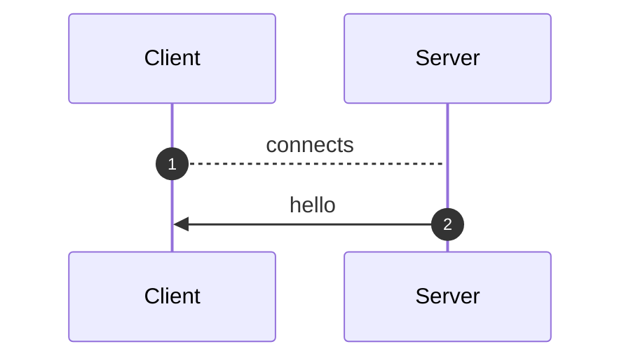
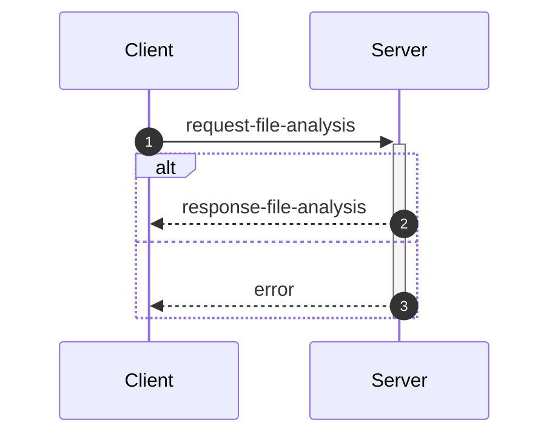
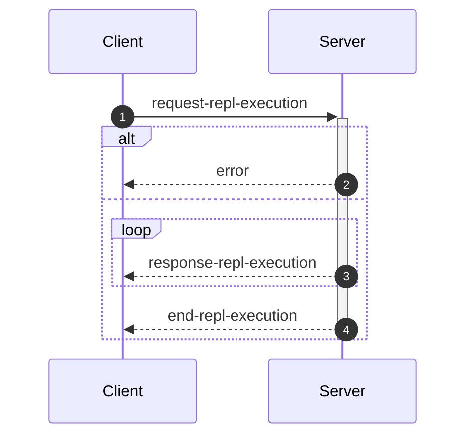
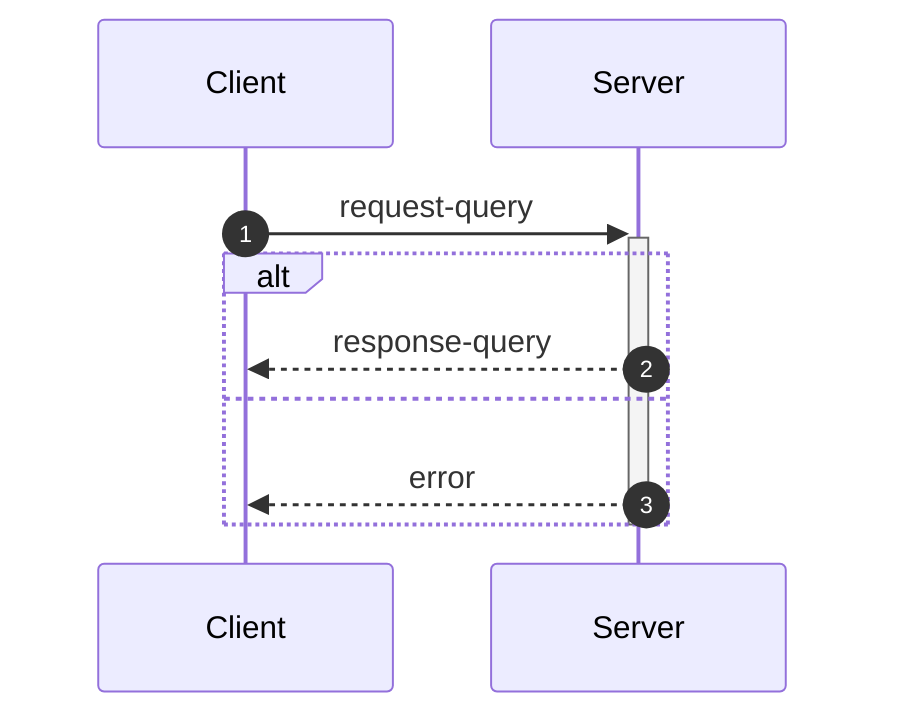

_<span title="an overview of flowR's interface">Generated</span> from '[wiki-interface.ts](https://github.com/flowr-analysis/flowr/tree/main/src/documentation/wiki-interface.ts "src/documentation/wiki-interface.ts")' on 2026-11-11, 11:32:55 UTC (v2.17.5, R v4.6.1), do not edit directly._

Although far from being as detailed as the in-depth explanation of [_flowR_](https://github.com/flowr-analysis/flowr/wiki/Core),
this wiki page explains how to interface with _flowR_ in more detail.
In general, command line arguments and other options provide short descriptions on hover over.

* [💻 Using the REPL](#using-the-repl)
* [⚙️ Configuring FlowR](#configuring-flowr)
* [⚒️ Writing Code](#writing-code)
* [💬 Communicating with the Server](#communicating-with-the-server)

<a id='using-the-repl'></a>
## 💻 Using the REPL

> [!NOTE]
> To execute arbitrary R commands with a repl request, _flowR_ has to be started explicitly with <span title="Description (Command Line Argument): Allow to access the underlying R session when using flowR (security warning: this allows the execution of arbitrary R code!)">`--r-session-access`</span>.
> Please be aware that this introduces a security risk and note that this relies on the [`r-shell` engine](https://github.com/flowr-analysis/flowr/wiki/Engines) .

Although primarily meant for users to explore,
there is nothing which forbids calling _flowR_ as a subprocess to use standard-in, -output, and -error
for communication (although you can access the REPL using the server as well,
with the [REPL Request](#message-request-repl-execution) message).

The read-eval-print loop&nbsp;(REPL) works relatively simple.
You can submit an expression (using <kbd>Enter</kbd>),
which is interpreted as an R&nbsp;expression by default but interpreted as a *command* if it starts with a colon (`:`).
The best command to get started with the REPL is <span title="Description (Repl Command): Show help information (aliases: :h, :?)">`:help`</span>.
Besides, you can leave the REPL either with the command <span title="Description (Repl Command): End the repl (aliases: :q, :exit)">`:quit`</span> or by pressing <kbd>Ctrl</kbd>+<kbd>C</kbd> twice.
When writing a *command*, you may press <kbd>Tab</kbd> to get a list of completions, if available.
Multiple commands can be entered in a single line by separating them with a semicolon (`;`), e.g. `:parse "x<-2"; :df*`.
If a command is given without R code, the REPL will re-use R code given in a previous command.
The prior example will hence return first the parsed AST of the program and then the dataflow graph for `"x <- 2"`.

> [!NOTE]
> If you develop flowR, you may want to launch the repl using the `npm run main-dev` command, this way, you get a non-minified version of flowR with debug information and hot-reloading of source files.

<details>
<summary>Available Commands</summary>

We currently offer the following commands (this with a `[*]` suffix are available with and without the star):

| Command | Description |
| ------- | ----------- |
| **<span title="Description (Repl Command): End the repl (aliases: :q, :exit)">:quit</span>** | End the repl (aliases: **:<span title="Alias of ':quit'. End the repl">q</span>**, **:<span title="Alias of ':quit'. End the repl">exit</span>**) |
| **<span title="Description (Repl Command): Execute the given code as R code. This requires the `--r-session-access` flag to be set and requires the r-shell engine. (aliases: :e, :r)">:execute</span>** | Execute the given code as R code. This requires the `--r-session-access` flag to be set and requires the r-shell engine. (aliases: **:<span title="Alias of ':execute'. Execute the given code as R code. This requires the `--r-session-access` flag to be set and requires the r-shell engine.">e</span>**, **:<span title="Alias of ':execute'. Execute the given code as R code. This requires the `--r-session-access` flag to be set and requires the r-shell engine.">r</span>**) |
| **<span title="Description (Repl Command): Get mermaid code for the control-flow graph of R code (aliases: :cfg, :cf)">:controlflow[*]</span>** | Get mermaid code for the control-flow graph of R code (star: Returns the URL to mermaid.live) (aliases: **:<span title="Alias of ':controlflow'. Get mermaid code for the control-flow graph of R code">cfg</span>**, **:<span title="Alias of ':controlflow'. Get mermaid code for the control-flow graph of R code">cf</span>**) |
| **<span title="Description (Repl Command): Get mermaid code for the control-flow graph with basic blocks (aliases: :cfgb, :cfb)">:controlflowbb[*]</span>** | Get mermaid code for the control-flow graph with basic blocks (star: Returns the URL to mermaid.live) (aliases: **:<span title="Alias of ':controlflowbb'. Get mermaid code for the control-flow graph with basic blocks">cfgb</span>**, **:<span title="Alias of ':controlflowbb'. Get mermaid code for the control-flow graph with basic blocks">cfb</span>**) |
| **<span title="Description (Repl Command): Get mermaid code for the dataflow graph (aliases: :d, :df)">:dataflow[*]</span>** | Get mermaid code for the dataflow graph (star: Returns the URL to mermaid.live) (aliases: **:<span title="Alias of ':dataflow'. Get mermaid code for the dataflow graph">d</span>**, **:<span title="Alias of ':dataflow'. Get mermaid code for the dataflow graph">df</span>**) |
| **<span title="Description (Repl Command): Get mermaid code for the normalized AST of R code (aliases: :n)">:normalize[*]</span>** | Get mermaid code for the normalized AST of R code (star: Returns the URL to mermaid.live) (alias: **:<span title="Alias of ':normalize'. Get mermaid code for the normalized AST of R code">n</span>**) |
| **<span title="Description (Repl Command): Get mermaid code for the simplified dataflow graph (aliases: :ds, :dfs)">:dataflowsimple[*]</span>** | Get mermaid code for the simplified dataflow graph (star: Returns the URL to mermaid.live) (aliases: **:<span title="Alias of ':dataflowsimple'. Get mermaid code for the simplified dataflow graph">ds</span>**, **:<span title="Alias of ':dataflowsimple'. Get mermaid code for the simplified dataflow graph">dfs</span>**) |
| **<span title="Description (Repl Command): Inspect and extend the signature database: `query` (identical to :query @signature), `info <name>` for where a function comes from (identical to :query @function-info), `add <path>` to mount another database/source, `download` to fetch the full-history database. (aliases: :sig)">:signature</span>** | Inspect and extend the signature database: `query` (identical to :query @signature), `info <name>` for where a function comes from (identical to :query @function-info), `add <path>` to mount another database/source, `download` to fetch the full-history database. (alias: **:<span title="Alias of ':signature'. Inspect and extend the signature database: `query` (identical to :query @signature), `info <name>` for where a function comes from (identical to :query @function-info), `add <path>` to mount another database/source, `download` to fetch the full-history database.">sig</span>**) |
| **<span title="Description (Repl Command): Just calculates the DFG, but only prints summary info (aliases: :d#, :df#)">:dataflowsilent</span>** | Just calculates the DFG, but only prints summary info (aliases: **:<span title="Alias of ':dataflowsilent'. Just calculates the DFG, but only prints summary info">d#</span>**, **:<span title="Alias of ':dataflowsilent'. Just calculates the DFG, but only prints summary info">df#</span>**) |
| **<span title="Description (Repl Command): Prints ASCII Art of the parsed, unmodified AST (aliases: :p)">:parse</span>** | Prints ASCII Art of the parsed, unmodified AST (alias: **:<span title="Alias of ':parse'. Prints ASCII Art of the parsed, unmodified AST">p</span>**) |
| **<span title="Description (Repl Command): Prints the version of flowR as well as the current version of R">:version</span>** | Prints the version of flowR as well as the current version of R
| **<span title="Description (Repl Command): Query the given R code (use 'help' for more information)">:query[*]</span>** | Query the given R code (use 'help' for more information) (star: Similar to query, but returns the output in json format.)
| **<span title="Description (Repl Command): Returns an ASCII representation of the dataflow graph (aliases: :df!)">:dataflowascii</span>** | Returns an ASCII representation of the dataflow graph (alias: **:<span title="Alias of ':dataflowascii'. Returns an ASCII representation of the dataflow graph">df!</span>**) |
| **<span title="Description (Repl Command): Returns summarization stats for the normalized AST (aliases: :n#)">:normalize#</span>** | Returns summarization stats for the normalized AST (alias: **:<span title="Alias of ':normalize#'. Returns summarization stats for the normalized AST">n#</span>**) |
| **<span title="Description (Repl Command): Show help information (aliases: :h, :?)">:help</span>** | Show help information (aliases: **:<span title="Alias of ':help'. Show help information">h</span>**, **:<span title="Alias of ':help'. Show help information">?</span>**) |

</details>

> [!TIP]
> 
> As indicated by the examples before, all REPL commands that operate on code keep track of the state.
> Hence, if you run a command like <span title="Description (Repl Command, starred version): Returns the URL to mermaid.live; Base Command: Get mermaid code for the dataflow graph (aliases: :d*, :df*)">`:dataflow*`</span> without providing R code,
> the REPL will re-use the R code provided in a previous command.
> Likewise, doing this will benefit from incrementality!
> If you request the dataflow graph with `:df* x <- 2 * y` and then want to see the parsed AST with `:parse`,
> the REPL will re-use previously obtained information and not re-parse the code again.
> 		

Generally, many commands offer shortcut versions in the REPL. Many queries, for example, offer a shortened format (see the example below).
Of special note, the [Config Query](https://github.com/flowr-analysis/flowr/wiki/%5BQuery%5D-Config)
can be used to also modify the currently active configuration of _flowR_ within the REPL (see the [wiki page](https://github.com/flowr-analysis/flowr/wiki/%5BQuery%5D-Config) for more information).

### Example: Retrieving the Dataflow Graph

To retrieve a URL to the [mermaid](https://mermaid.js.org/) diagram of the dataflow of a given expression,
use <span title="Description (Repl Command, starred version): Returns the URL to mermaid.live; Base Command: Get mermaid code for the dataflow graph (aliases: :d*, :df*)">`:dataflow*`</span> (or <span title="Description (Repl Command): Get mermaid code for the dataflow graph (aliases: :d, :df)">`:dataflow`</span> to get the mermaid code in the cli):

```shell
$ docker run -it --rm eagleoutice/flowr # or npm run flowr 
flowR repl v2.17.5, R grammar v14 (tree-sitter engine)
R> :dataflow* y <- 1 + x
```

<details>
<summary style='color:gray'>Output</summary>

```text
https://mermaid.live/view#base64:eyJjb2RlIjoiZmxvd2NoYXJ0IFREXG4gICAgMXt7XCJgKiM5MTtSTnVtYmVyIzkzOyogKioxKipcbiAgICAgICoxLjYqICgqKmlkOiAxKiopYFwifX1cbiAgICAyKFtcImAqIzkxO1JTeW1ib2wjOTM7KiAqKngqKlxuICAgICAgKjEuMTAqICgqKmlkOiAyKiopYFwiXSlcbiAgICAzW1tcImAqIzkxO1JCaW5hcnlPcCM5MzsqIGJhc2UjNTg7IzU4OyoqIzQzOyoqXG4gICAgICAqMS42LTEwKiAoKippZDogMyoqKVxuICAgIGFyZzogKDEsIDIpYFwiXV1cbiAgICBidWlsdC1pbjpfNDNfW1wiYEJ1aWx0LUluOlxuIzQzO2BcIl1cbiAgICBzdHlsZSBidWlsdC1pbjpfNDNfIHN0cm9rZTpncmF5LGZpbGw6Z3JheSxzdHJva2Utd2lkdGg6MnB4LG9wYWNpdHk6Ljg7XG4gICAgMFtcImAqIzkxO1JTeW1ib2wjOTM7KiAqKnkqKlxuICAgICAgKjEuMSogKCoqaWQ6IDAqKiwgdjogMylgXCJdXG4gICAgNFtbXCJgKiM5MTtSQmluYXJ5T3AjOTM7KiBiYXNlIzU4OyM1ODsqKiM2MDsjNDU7KipcbiAgICAgICoxLjEtMTAqICgqKmlkOiA0KiopXG4gICAgYXJnOiAoMCwgMylgXCJdXVxuICAgIGJ1aWx0LWluOl82MF8tW1wiYEJ1aWx0LUluOlxuIzYwOyM0NTtgXCJdXG4gICAgc3R5bGUgYnVpbHQtaW46XzYwXy0gc3Ryb2tlOmdyYXksZmlsbDpncmF5LHN0cm9rZS13aWR0aDoycHgsb3BhY2l0eTouODtcbiAgICAxIC0uLT58XCJmbG93XCJ8IDJcbiAgICBsaW5rU3R5bGUgMCBzdHJva2U6Z3JheSxjb2xvcjpncmF5O1xuICAgIDIgLS4tPnxcImZsb3dcInwgM1xuICAgIGxpbmtTdHlsZSAxIHN0cm9rZTpncmF5LGNvbG9yOmdyYXk7XG4gICAgMyAtLT58XCJyZWFkcywgYXJnXCJ8IDFcbiAgICAzIC0tPnxcInJlYWRzLCBhcmdcInwgMlxuICAgIDMgLS4tPnxcImZsb3dcInwgMFxuICAgIGxpbmtTdHlsZSA0IHN0cm9rZTpncmF5LGNvbG9yOmdyYXk7XG4gICAgMyAtLi0+fFwicmVhZHMsIGNhbGxzXCJ8IGJ1aWx0LWluOl80M19cbiAgICBsaW5rU3R5bGUgNSBzdHJva2U6Z3JheTtcbiAgICAwIC0tPnxcImRlZmluZWQtYnksIGZsb3dcInwgNFxuICAgIDAgLS0+fFwiZGVmaW5lZC1ieVwifCAzXG4gICAgNCAtLT58XCJyZWFkcywgYXJnXCJ8IDNcbiAgICA0IC0tPnxcInJldHVybnMsIGFyZ1wifCAwXG4gICAgNCAtLi0+fFwicmVhZHMsIGNhbGxzXCJ8IGJ1aWx0LWluOl82MF8tXG4gICAgbGlua1N0eWxlIDEwIHN0cm9rZTpncmF5OyIsIm1lcm1haWQiOnsiYXV0b1N5bmMiOnRydWV9fQ==
```

Retrieve the dataflow graph of the expression `y <- 1 + x`. It looks like this:


<details>

<summary style="color:gray">R Code of the Dataflow Graph</summary>

The analysis ran (parse and normalize with the [tree-sitter](https://github.com/flowr-analysis/flowr/wiki/Engines) engine) in the generation environment. No [signature database](https://github.com/flowr-analysis/flowr/wiki/Signature-Database) is mounted, so `library()` attaches no exports (base-R names are still qualified, e.g., `stats::acf`). 
We encountered no unknown side effects during the analysis.

```r
y <- 1 + x
```

</details>

</details>

For small graphs like this, <span title="Description (Repl Command): Returns an ASCII representation of the dataflow graph (aliases: :df!)">`:dataflowascii`</span> also provides an ASCII representation directly in the REPL:

```shell
$ docker run -it --rm eagleoutice/flowr # or npm run flowr 
flowR repl v2.17.5, R grammar v14 (tree-sitter engine)
R> :df! y <- 1 + x
```

<details open>
<summary style='color:gray'>Output</summary>

```text
                        v<0>v
 c<4>c──────────────────| y |
 |<- |     ┌────────────v---v
 c---c     │
    │   c<3>c   0<1>0
    └───| + |───| 1 |───u<2>u
        c---c   0---0   | x |
           └────────────u---u
Edges:
3 -> 1: reads, arg          3 -> 2: reads, arg
3 -> 0: flows-to            1 -> 2: flows-to
2 -> 3: flows-to            4 -> 3: reads, arg
4 -> 0: returns, arg        0 -> 4: defined-by, flows-to
0 -> 3: defined-by
```

Retrieve the dataflow graph of the expression `y <- 1 + x` as ASCII art.

</details>

For the slicing with <span title="Description (Repl Command): Static backwards executable slicer for R">`:slicer`</span>, you have access to the same [magic comments](#slice-magic-comments) as with the [slice request](#message-request-slice).
Pass `--inline` to splice resolvable `source()` calls into the reconstruction so the slice is a single self-contained R text (the same as the static slice query's `inlineSources` flag).
See `--help` for more flags!

### Example: Interfacing with the File System

Many commands that allow for an R-expression (like <span title="Description (Repl Command, starred version): Returns the URL to mermaid.live; Base Command: Get mermaid code for the dataflow graph (aliases: :d*, :df*)">`:dataflow*`</span>) allow for a file as well
if the argument starts with `file://`.
If you are working from the root directory of the _flowR_ repository, the following gives you the parsed AST of the example file using the <span title="Description (Repl Command): Prints ASCII Art of the parsed, unmodified AST (aliases: :p)">`:parse`</span> command:

> **Watch mode**: Replace `file://` with `watch://` to enter watch mode.
> flowR runs the command immediately and then re-runs it every time the file (or any file inside the folder) changes.
> Enter any other command to leave watch mode.
> For example: `:df watch://analysis.R`

```shell
$ docker run -it --rm eagleoutice/flowr # or npm run flowr 
flowR repl v2.17.5, R grammar v14 (tree-sitter engine)
R> :parse file://test/testfiles/example.R
```

<details>
<summary style='color:gray'>Output</summary>

```text
File: test/testfiles/example.R

program
├ binaryoperator
│ ├ identifier "sum" (1:1─4)
│ ├ <- "<-" (1:5─7)
│ ╰ float "0" (1:8─9)
├ binaryoperator
│ ├ identifier "product" (2:1─8)
│ ├ <- "<-" (2:9─11)
│ ╰ float "1" (2:12─13)
├ binaryoperator
│ ├ identifier "w" (3:1─2)
│ ├ <- "<-" (3:3─5)
│ ╰ float "7" (3:6─7)
├ binaryoperator
│ ├ identifier "N" (4:1─2)
│ ├ <- "<-" (4:3─5)
│ ╰ float "10" (4:6─8)
├ forstatement
│ ├ for "for" (6:1─4)
│ ├ ( "(" (6:5─6)
│ ├ identifier "i" (6:6─7)
│ ├ in "in" (6:8─10)
│ ├ binaryoperator
│ │ ├ float "1" (6:11─12)
│ │ ├ : ":" (6:12─13)
│ │ ╰ parenthesizedexpression
│ │   ├ ( "(" (6:13─14)
│ │   ├ binaryoperator
│ │   │ ├ identifier "N" (6:14─15)
│ │   │ ├ - "-" (6:15─16)
│ │   │ ╰ float "1" (6:16─17)
│ │   ╰ ) ")" (6:17─18)
│ ├ ) ")" (6:18─19)
│ ╰ bracedexpression
│   ├ { "{" (6:20─21)
│   ├ binaryoperator
│   │ ├ identifier "sum" (7:3─6)
│   │ ├ <- "<-" (7:7─9)
│   │ ╰ binaryoperator
│   │   ├ binaryoperator
│   │   │ ├ identifier "sum" (7:10─13)
│   │   │ ├ + "+" (7:14─15)
│   │   │ ╰ identifier "i" (7:16─17)
│   │   ├ + "+" (7:18─19)
│   │   ╰ identifier "w" (7:20─21)
│   ├ binaryoperator
│   │ ├ identifier "product" (8:3─10)
│   │ ├ <- "<-" (8:11─13)
│   │ ╰ binaryoperator
│   │   ├ identifier "product" (8:14─21)
│   │   ├  "" (8:22─23)
│   │   ╰ identifier "i" (8:24─25)
│   ╰ } "}" (9:1─2)
├ call
│ ├ identifier "cat" (11:1─4)
│ ╰ arguments
│   ├ ( "(" (11:4─5)
│   ├ argument
│   │ ╰ string
│   │   ├ stringopen "\"" (11:5─6)
│   │   ├ stringcontent "Sum:" (11:6─10)
│   │   ╰ stringclose "\"" (11:10─11)
│   ├ comma "," (11:11─12)
│   ├ argument
│   │ ╰ identifier "sum" (11:13─16)
│   ├ comma "," (11:16─17)
│   ├ argument
│   │ ╰ string
│   │   ├ stringopen "\"" (11:18─19)
│   │   ├ stringcontent
│   │   │ ╰ escapesequence "\\n" (11:19─21)
│   │   ╰ stringclose "\"" (11:21─22)
│   ╰ ) ")" (11:22─23)
╰ call
  ├ identifier "cat" (12:1─4)
  ╰ arguments
    ├ ( "(" (12:4─5)
    ├ argument
    │ ╰ string
    │   ├ stringopen "\"" (12:5─6)
    │   ├ stringcontent "Product:" (12:6─14)
    │   ╰ stringclose "\"" (12:14─15)
    ├ comma "," (12:15─16)
    ├ argument
    │ ╰ identifier "product" (12:17─24)
    ├ comma "," (12:24─25)
    ├ argument
    │ ╰ string
    │   ├ stringopen "\"" (12:26─27)
    │   ├ stringcontent
    │   │ ╰ escapesequence "\\n" (12:27─29)
    │   ╰ stringclose "\"" (12:29─30)
    ╰ ) ")" (12:30─31)
```

Retrieve the parsed AST of the example file.

<details>

<summary>File Content</summary>

```r
sum <- 0
product <- 1
w <- 7
N <- 10

for (i in 1:(N-1)) {
  sum <- sum + i + w
  product <- product * i
}

cat("Sum:", sum, "\n")
cat("Product:", product, "\n")
```

</details>

As _flowR_ directly transforms this AST the output focuses on being human-readable instead of being machine-readable.
		
</details>

### Example: Run a Query

You can run any query supported by _flowR_ using the <span title="Description (Repl Command): Query the given R code (use 'help' for more information)">`:query`</span> command.
For example, to obtain the shapes of all data frames in a given piece of code, you can run:

```shell
$ docker run -it --rm eagleoutice/flowr # or npm run flowr 
flowR repl v2.17.5, R grammar v14 (tree-sitter engine)
R> :query @absint df-shape "x <- data.frame(a = 1:10, b = 1:10)\ny <- x$a"
```

<details open>
<summary style='color:gray'>Output</summary>

```text
Query: absint (1 ms)
   ╰ $12: (colnames: [{"a", "b"}, {}], cols: [2, 2], rows: [10, 10])
   ╰ $0: (colnames: [{"a", "b"}, {}], cols: [2, 2], rows: [10, 10])
```

Retrieve the shapes of all data frames in the given code.

</details>

To run the linter on a file, you can use (in this example, we just issue the `dead-code` linter on a small piece of code):

```shell
$ docker run -it --rm eagleoutice/flowr # or npm run flowr 
flowR repl v2.17.5, R grammar v14 (tree-sitter engine)
R> :query @linter rules:dead-code "if(FALSE) x <- 2"
```

<details open>
<summary style='color:gray'>Output</summary>

```text
Query: linter (2 ms)
   ╰ Dead Code (dead-code):
       ╰ certain:
           ╰ Code at 1.11-16 (1 quick fix(es) available)
```

Run the linter on the given code, with only the `dead-code` rule enabled.

</details>

For more information on the available queries, please check out the [Query API](https://github.com/flowr-analysis/flowr/wiki/Query-API).

<a id='configuring-flowr'></a>
## ⚙️ Configuring FlowR

When running _flowR_, you may want to specify some behaviors with a dedicated configuration file.
By default, flowR looks for a file named `flowr.json` in the current working directory (or any higher directory).
You can also specify a different file with <span title="Description (Command Line Argument): The name of the configuration file to use">`--config-file`</span> or pass the configuration inline using <span title="Description (Command Line Argument): The flowR configuration to use, as a JSON string">`--config-json`</span>.
A `flowr.json` found this way belongs to the analyzed project, so flowR ignores its options that decide what flowR executes or loads
(`engines.*.wasmPath`, `engines.*.treeSitterWasmPath`, `engines.*.rPath`, `solver.sigdb.additionalPaths`, `solver.sigdb.downloadRepo`, `solver.sigdb.installedLibrary.paths`, `solver.sigdb.onDemand.enabled`, `solver.sigdb.onDemand.repositories`, `solver.sigdb.onDemand.cranMirror`, `solver.sigdb.onDemand.bioconductorMirror`, `solver.sigdb.onDemand.cacheDir`),
unless you pass <span title="Description (Command Line Argument): Keep the security-sensitive options (e.g., the R executable) of the flowr.json found in the working directory or a parent. Only use this for projects you trust.">`--trust-config`</span>.
To analyze code you do not trust, use the secure mode (<span title="Description (Command Line Argument): Run in secure mode for analyzing untrusted code: flowR does not start R (or any other process), does not access the network, does not search for project configs, and ignores security-sensitive options in every config. Cannot be disabled once enabled. Can also be enabled with the environment variable {italic FLOWR_SECURE_MODE=1}.">`--secure`</span>, see the [security policy](https://github.com/flowr-analysis/flowr/blob/main/.github/SECURITY.md)).
To inspect the current configuration, you can run flowr with the <span title="Description (Command Line Argument): Run with verbose logging (will be passed to the corresponding script)">`--verbose`</span> flag, or use the `config` [Query](https://github.com/flowr-analysis/flowr/wiki/Query-API).
Within the REPL this works by running the following:

```shell
:query @config
```

To work with the <a href="https://github.com/flowr-analysis/flowr/tree/main/src/config.ts#L125"><code><span title="The configuration file format for flowR.">FlowrConfig</span></code></a> you can use the provided helper objects alongside its methods like
<a href="https://github.com/flowr-analysis/flowr/tree/main/src/config.ts#L991"><code><span title="Creates a new flowr config that has the updated values.">FlowrConfig::<b>amend</b></span></code></a>.
The schema below documents every option; the ones you most likely want are:

- <a href="https://github.com/flowr-analysis/flowr/wiki/Interface#configuring-flowr" title="Configuration Option (boolean): Whether source calls should be ignored, causing {@link processSourceCall}&#39;s behavior to be skipped.">ignoreSourceCalls</a>: ignore source calls when analyzing the code, i.e., ignore the inclusion of other files.
- <a href="https://github.com/flowr-analysis/flowr/wiki/Interface#configuring-flowr" title="Configuration Option (boolean): Whether load calls should be ignored, causing {@link processLoadCall}&#39;s behavior to be skipped.">ignoreLoadCalls</a>: ignore load calls when analyzing the code, i.e., ignore the loading of r-data files.
- <a href="https://github.com/flowr-analysis/flowr/wiki/Interface#configuring-flowr" title="Configuration Option (object): Do you want to overwrite (parts) of the builtin definition?">semantics.environment.overwriteBuiltIns</a>: overwrite _flowR_'s handling of built-in functions, or clear the preset definitions entirely.
  See [Configure BuiltIn Semantics](#configure-builtin-semantics) for more information.
- <a href="https://github.com/flowr-analysis/flowr/wiki/Interface#configuring-flowr" title="Configuration Option (boolean): Whether calls drawing on a graphics device (e.g., `plot`) count as writing to it, which the ambient state queries then report.">semantics.ambient.drawingWritesDevice</a>: whether calls drawing on a graphics device (e.g., `plot`) count as writing the device in the ambient state queries.
- <a href="https://github.com/flowr-analysis/flowr/wiki/Interface#configuring-flowr" title="Configuration Option (string): How to resolve variables and their values. (one of &quot;disabled&quot;, &quot;alias&quot;, &quot;builtin&quot;)">solver.variables</a>: how to resolve variables and their values (`disabled`, `alias`, `builtin`).
- <a href="https://github.com/flowr-analysis/flowr/wiki/Interface#configuring-flowr" title="Configuration Option (array): The engine or set of engines to use for interacting with R code. An empty array means all available engines will be used.">engines</a> and <a href="https://github.com/flowr-analysis/flowr/wiki/Interface#configuring-flowr" title="Configuration Option (string): The default engine to use for interacting with R code. If this is undefined, an arbitrary engine from the specified list will be used. (one of &quot;tree-sitter&quot;, &quot;r-shell&quot;)">defaultEngine</a>: the engines used to interact with R code, see the [Engines wiki page](https://github.com/flowr-analysis/flowr/wiki/Engines).
- <a href="https://github.com/flowr-analysis/flowr/wiki/Interface#configuring-flowr" title="Configuration Option (array): Files a framework loads on its own, without any source() call (e.g. global.R in a shiny app), in the order they are loaded; flowR orders the matching project files accordingly and analyzes them as one program. Entries are case-insensitive globs matched against the file path, a plain name matches any file with that name, and entries matching no project file are warned about. Usually set per project kind via specializeConfig.">project.implicitSources</a>: the files a framework loads without any `source()` call, in the order in which they are
  loaded. Entries are globs (e.g. `R/*.R`) matched against the file path ignoring capitalization; one matching no file is reported.
- <a href="https://github.com/flowr-analysis/flowr/wiki/Interface#configuring-flowr" title="Configuration Option (object): Overwrite (parts of) the configuration depending on the project kind flowR detects, e.g. to give a shiny app its implicit sources.">specializeConfig</a>: overwrite (parts of) the configuration depending on the kind of project _flowR_ detects
  (e.g. `shiny-app`), which is how a shiny app gets its implicit sources by default. What you configure directly wins.
- <a href="https://github.com/flowr-analysis/flowr/wiki/Interface#configuring-flowr" title="Configuration Option (string): Overwrite the project kind flowR would otherwise infer from the analyzed files, e.g. when auto-detection guesses wrong. (one of &quot;package&quot;, &quot;script&quot;, &quot;shiny-app&quot;, &quot;notebook&quot;, &quot;project&quot;, &quot;unknown&quot;)">project.useProjectType</a>: skip that detection and force a project kind yourself, when auto-detection guesses wrong.
- <a href="https://github.com/flowr-analysis/flowr/wiki/Interface#configuring-flowr" title="Configuration Option (array): The default plugins to load when creating a new instance of FlowrAnalyzer">defaultPlugins</a> and <a href="https://github.com/flowr-analysis/flowr/wiki/Interface#configuring-flowr" title="Configuration Option (array): The plugins to load in REPL mode">repl.plugins</a>: the plugins to load for a new <a href="https://github.com/flowr-analysis/flowr/tree/main/src/project/flowr-analyzer.ts#L240"><code><span title="Central class for conducting analyses with FlowR. Use the FlowrAnalyzerBuilder to create a new instance. If you want the original pattern of creating a pipeline and running all steps, you can still do this with FlowrAnalyzer#runFull . To inspect the context of the analyzer, use FlowrAnalyzer#inspectContext (if you are a plugin and need to modify it, use FlowrAnalyzer#context instead).">FlowrAnalyzer</span></code></a> and in the REPL
  (use `flowr:default` to reference the former).

So you can configure _flowR_ by adding a file like the following:

<details>

<summary>Example Configuration File</summary>

```json
{
  "ignoreSourceCalls": true,
  "ignoreLoadCalls": true,
  "semantics": {
    "environment": {
      "overwriteBuiltIns": {
        "definitions": [
          {
            "type": "function",
            "names": [
              "foo"
            ],
            "processor": "builtin:assign",
            "config": {}
          }
        ]
      }
    }
  },
  "defaultPlugins": [
    "file:description",
    "versions:description"
  ],
  "repl": {
    "quickStats": false,
    "dfProcessorHeat": false,
    "hints": true,
    "plugins": [
      "flowr:default"
    ]
  },
  "project": {
    "resolveUnknownPathsOnDisk": true,
    "implicitSources": [
      "global.R",
      "app.R"
    ]
  },
  "linter": {
    "disabledRules": []
  },
  "specializeConfig": {
    "shiny-app": {
      "project": {
        "implicitSources": [
          "global.R",
          "ui.R",
          "server.R",
          "app.R"
        ]
      }
    }
  },
  "engines": [
    {
      "type": "r-shell"
    }
  ],
  "solver": {
    "variables": "alias",
    "evalStrings": true,
    "trackEnvironments": true,
    "sigdb": {
      "enabled": true,
      "loadProjectDependencies": true,
      "eagerlyLoad": false,
      "eagerlyLoadExports": false,
      "linkBaseR": false,
      "linkDescriptionDependencies": false
    },
    "resolveSource": {
      "dropPaths": "no",
      "ignoreCapitalization": true,
      "inferWorkingDirectory": "active-script",
      "searchPath": []
    },
    "instrument": {},
    "slicer": {
      "threshold": 50
    }
  },
  "abstractInterpretation": {
    "wideningThreshold": 4,
    "followCalls": true,
    "dataFrame": {
      "maxColNames": 20,
      "readLoadedData": {
        "readExternalFiles": true,
        "maxReadLines": 1000000
      }
    }
  },
  "incremental": {
    "alwaysIncremental": false,
    "parsing": {
      "activated": false,
      "heuristics": {
        "activated": true,
        "mtime": true,
        "linesFrom": 500,
        "bytesFrom": 50000,
        "alwaysWithEdits": false,
        "minFiles": 1
      }
    }
  },
  "gas": {
    "thresholds": {
      "memory": {
        "problematic": 0.7,
        "critical": 0.9
      },
      "timeMs": {
        "problematic": 100000,
        "critical": 120000
      }
    },
    "features": {}
  }
}
```

</details>

<details>
<a id='configure-builtin-semantics'></a>
<summary>Configure Built-In Semantics</summary>

`semantics/environment/overwriteBuiltins` accepts two keys:

- `loadDefaults` (boolean, initially `true`): If set to `true`, the default built-in definitions are loaded before applying the custom definitions. Setting this flag to `false` explicitly disables the loading of the default definitions.
- `definitions` (array, initially empty): Allows to overwrite or define new built-in elements. Each object within must have a `type` which is one of the below. Furthermore, they may define a string array of `names` which specifies the identifiers to bind the definitions to. You may use `assumePrimitive` to specify whether _flowR_ should assume that this is a primitive non-library definition (so you probably just do not want to specify the key).

  | Type            | Description                                                                                                                                                                                                                                                                                              | Example                                                                                                    |
  | --------------- | -------------------------------------------------------------------------------------------------------------------------------------------------------------------------------------------------------------------------------------------------------------------------------------------------------- | ---------------------------------------------------------------------------------------------------------- |
  | `constant`    | Additionally allows for a `value` this should resolve to.                                                                                                                                                                                                                                                | `{ type: 'constant', names: ['NULL', 'NA'],  value: null }`                                                |
  | `function`    | Is a rather flexible way to define and bind built-in functions. For the time, we do not have extensive documentation to cover all the cases, so please either consult the sources with the `default-builtin-config/` folder or open a [new issue](https://github.com/flowr-analysis/flowr/issues/new/choose). | `{ type: 'function', names: ['next'], processor: 'builtin:d', config: { cfg: ExitPointType.Next } }` |
  | `replacement` | A comfortable way to specify replacement functions like `$<-` or `names<-`. `suffixes` describes the... suffixes to attach automatically. | `{ type: 'replacement', suffixes: ['<-', '<<-'], names: ['[', '[['] }` |

</details>

<details>

<summary style='color:gray'>Full Configuration-File Schema</summary>

- _The configuration file format for flowR._ (object)
    - **logLevel** [optional] _flowR's global minimum log level, applied when the config is loaded._ (string)
        Only allows: 'silly', 'trace', 'debug', 'info', 'warn', 'error', 'fatal'
    - **ignoreSourceCalls** [optional] _Whether source calls should be ignored, causing {@link processSourceCall}'s behavior to be skipped._ (boolean)
    - **ignoreLoadCalls** [optional] _Whether load calls should be ignored, causing {@link processLoadCall}'s behavior to be skipped._ (boolean)
    - **semantics** _Configure language semantics and how flowR handles them._ (object)
        - **environment** [optional] _Semantics regarding how to handle the R environment._ (object)
            - **overwriteBuiltIns** [optional] _Do you want to overwrite (parts) of the builtin definition?_ (object)
                - **loadDefaults** [optional] _Should the default configuration still be loaded?_ (boolean)
                - **definitions** [optional] _The definitions to load/overwrite._ (array)
                Valid item types:
                    - (object)
        - **ambient** [optional] _Semantics regarding the global state (options, devices, files, ...) calls access._ (object)
            - **drawingWritesDevice** [optional] _Whether calls drawing on a graphics device (e.g., `plot`) count as writing to it, which the ambient state queries then report._ (boolean)
    - **defaultPlugins** [optional] _The default plugins to load when creating a new instance of FlowrAnalyzer_ (array)
    Valid item types:
        - (alternatives)
            - (string)
            - (array)
    - **repl** _Configuration options for the REPL._ (object)
        - **quickStats** [optional] _Whether to show quick stats in the REPL after each evaluation._ (boolean)
        - **dfProcessorHeat** [optional] _This instruments the dataflow processors to count how often each processor is called._ (boolean)
        - **hints** [optional] _Whether to show dim inline hints on the empty prompt (automatically disabled on non-interactive terminals)._ (boolean)
        - **plugins** [optional] _The plugins to load in REPL mode_ (array)
        Valid item types:
            - (alternatives)
                - (string)
                - (array)
        - **autoUseFileProtocol** [optional] _Prepend the file protocol to a repl input that looks like a path, instead of only warning about it._ (boolean)
        - **queryStats** [optional] _Whether `:query` closes with the line stating how long the queries took (`:query*` never prints it)._ (boolean)
        - **showPlugins** [optional] _Whether `:version` grays out the plugins that did not activate during the last analysis._ (boolean)
    - **project** _Project specific configuration options._ (object)
        - **resolveUnknownPathsOnDisk** [optional] _Whether to resolve unknown paths loaded by the r project disk when trying to source/analyze files._ (boolean)
        - **failOnInaccessiblePath** [optional] _Whether a directory that cannot be traversed during file discovery (e.g. due to permissions) aborts the analysis; when false (the default) such paths are logged and skipped._ (boolean)
        - **basePackages** [optional] _The packages considered part of R itself (base and recommended); if unset, flowR uses its built-in list._ (array)
        Valid item types:
            - (string)
        - **implicitSources** [optional] _Files a framework loads on its own, without any source() call (e.g. global.R in a shiny app), in the order they are loaded; flowR orders the matching project files accordingly and analyzes them as one program. Entries are case-insensitive globs matched against the file path, a plain name matches any file with that name, and entries matching no project file are warned about. Usually set per project kind via specializeConfig._ (array)
        Valid item types:
            - (string)
        - **useProjectType** [optional] _Overwrite the project kind flowR would otherwise infer from the analyzed files, e.g. when auto-detection guesses wrong._ (string)
            Only allows: 'package', 'script', 'shiny-app', 'notebook', 'project', 'unknown'
        - **assumeImplicitEcho** [optional] _Whether the top level of the analyzed code is echoed, so that every visible result printed there is collected as an output by the dependencies query (default true, false for a package)._ (boolean)
        - **discovery** [optional] _Scoping options for the default project discovery._ (object)
            - **full** [optional] _Collect every file below the project root (greedy) instead of only the files the detected project kind needs (default false)._ (boolean)
            - **perKind** [optional] _Per-kind include/exclude glob overrides layered on the default scoping._ (object)
            - **ignore** [optional] _Case-insensitive globs that drop matching files from the intelligent discovery, regardless of kind (e.g. .Renviron to ignore environment files)._ (array)
            Valid item types:
                - (string)
        - **classification** [optional] _Overrides for the signals flowR uses to classify the project kind._ (object)
            - **shinyDescriptionTypes** [optional] _DESCRIPTION Type: values that mark a shiny app._ (array)
            Valid item types:
                - (string)
            - **shinyEntryFiles** [optional] _File names a shiny app is assembled from._ (array)
            Valid item types:
                - (string)
            - **shinyUsagePattern** [optional] _Regex source evidencing shiny usage in an entry file._ (string)
            - **notebookExtensions** [optional] _File extensions marking a notebook._ (array)
            Valid item types:
                - (string)
    - **linter** _Linter configuration options._ (object)
        - **disabledRules** _Linting rule names excluded from the default rule set (a rule requested explicitly via a linter query still runs). Usually set per project kind via specializeConfig._ (array)
        Valid item types:
            - (string)
        - **disabledTags** [optional] _Linting rule tags whose rules are excluded from the default rule set (a rule requested explicitly via a linter query still runs). By default the cmd-check rules are disabled for everything but a package; a configured list replaces that default._ (array)
        Valid item types:
            - (string)
    - **inputSources** [optional] _Further frameworks the input-sources analysis should know about; entries are added to flowR's defaults._ (object)
        - **pure** [optional] _Functions that only pass the constantness of their arguments on._ (array)
        Valid item types:
            - (string)
        - **param** [optional] _Functions whose result is a 'param' input._ (array)
        Valid item types:
            - (string)
        - **file** [optional] _Functions whose result is a 'file' input._ (array)
        Valid item types:
            - (string)
        - **tempfile** [optional] _Functions whose result is a 'tempfile' input._ (array)
        Valid item types:
            - (string)
        - **glob** [optional] _Functions whose result is a 'glob' input._ (array)
        Valid item types:
            - (string)
        - **net** [optional] _Functions whose result is a 'net' input._ (array)
        Valid item types:
            - (string)
        - **rand** [optional] _Functions whose result is a 'rand' input._ (array)
        Valid item types:
            - (string)
        - **system** [optional] _Functions whose result is a 'system' input._ (array)
        Valid item types:
            - (string)
        - **ffi** [optional] _Functions whose result is a 'ffi' input._ (array)
        Valid item types:
            - (string)
        - **lang** [optional] _Functions whose result is a 'lang' input._ (array)
        Valid item types:
            - (string)
        - **options** [optional] _Functions whose result is a 'options' input._ (array)
        Valid item types:
            - (string)
        - **cmdline** [optional] _Functions whose result is a 'cmdline' input._ (array)
        Valid item types:
            - (string)
        - **user** [optional] _Functions whose result is a 'user' input._ (array)
        Valid item types:
            - (string)
        - **const** [optional] _Functions whose result is a 'const' input._ (array)
        Valid item types:
            - (string)
        - **scope** [optional] _Functions whose result is a 'scope' input._ (array)
        Valid item types:
            - (string)
        - **dconst** [optional] _Functions whose result is a 'dconst' input._ (array)
        Valid item types:
            - (string)
        - **unknown** [optional] _Functions whose result is a 'unknown' input._ (array)
        Valid item types:
            - (string)
        - **linkedObjects** [optional] _Objects a framework provides without a definition in the code, e.g. shiny's input._ (array)
        Valid item types:
            - (object)
        - **linkedEntryPoints** [optional] _Calls that hand a function to a framework, which binds its objects to the parameters by position._ (array)
        Valid item types:
            - (object)
    - **specializeConfig** [optional] _Overwrite (parts of) the configuration depending on the project kind flowR detects, e.g. to give a shiny app its implicit sources._ (object)
    - **engines** _The engine or set of engines to use for interacting with R code. An empty array means all available engines will be used._ (array)
    Valid item types:
        - (alternatives)
            - _The configuration for the tree sitter engine._ (object)
                - **type** [required] _Use the tree sitter engine._ (string)
                    Only allows: 'tree-sitter'
                - **wasmPath** [optional] _The path to the tree-sitter-r WASM binary to use. If this is undefined, this uses the default path._ (string)
                - **treeSitterWasmPath** [optional] _The path to the tree-sitter WASM binary to use. If this is undefined, this uses the default path._ (string)
                - **lax** [optional] _Whether to use the lax parser for parsing R code (allowing for syntax errors). If this is undefined, the strict parser will be used._ (boolean)
            - _The configuration for the R shell engine._ (object)
                - **type** [required] _Use the R shell engine._ (string)
                    Only allows: 'r-shell'
                - **rPath** [optional] _The path to the R executable to use. If this is undefined, this uses the default path._ (string)
                - **pipeBind** [optional] _Whether to enable R's experimental pipe-bind operator "=>" by setting _R_USE_PIPEBIND_ for the R session (default false); R itself keeps this off by default, as it is experimental and has never shipped in a release version of R._ (boolean)
    - **defaultEngine** [optional] _The default engine to use for interacting with R code. If this is undefined, an arbitrary engine from the specified list will be used._ (string)
        Only allows: 'tree-sitter', 'r-shell'
    - **solver** _How to resolve constants, constraints, cells, ..._ (object)
        - **variables** _How to resolve variables and their values._ (string)
            Only allows: 'disabled', 'alias', 'builtin'
        - **evalStrings** _Should we include eval(parse(text="...")) calls in the dataflow graph?_ (boolean)
        - **trackEnvironments** [optional] _Track user-created environments (new.env, assign/get/local with envir=, dollar-assign, attach). When false, all envir-style calls fall through conservatively._ (boolean)
        - **sigdb** _Resolving library exports from a signature database._ (object)
            - **enabled** [optional] _Resolve library()/use() exports from a signature database (default true); when false no database is consulted._ (boolean)
            - **loadProjectDependencies** [optional] _Load the project's declared dependencies from its metadata files (DESCRIPTION Imports/Depends, rproject.toml, uvr.toml, rig rproj.toml and script blocks, renv.lock, rv.lock, uvr.lock, rig lockfiles) (default true); when false these files are not read for dependencies._ (boolean)
            - **eagerlyLoad** [optional] _Parse the database up front rather than on the first package load (default false, ignored if disabled)._ (boolean)
            - **eagerlyLoadExports** [optional] _Add a vertex for every export on load rather than on demand (default false); keeps the dataflow graph small._ (boolean)
            - **assumedRVersion** [optional] _R version assumed when resolving versioned (base-R) exports: a pin like "4.5" or "auto" to detect the installed R (default "auto")._ (string)
            - **linkBaseR** [optional] _Eagerly attach base-R namespaces so bare base calls resolve without library() (default false)._ (boolean)
            - **linkBaseRCalls** [optional] _Add a lightweight Reads edge from a bare base-R call to its signature-database function vertex (default false; base-R qualification is edge-free otherwise)._ (boolean)
            - **linkPackageCalls** [optional] _Add a lightweight Reads edge from a resolved package call to its signature-database function vertex (default false)._ (boolean)
            - **linkDescriptionDependencies** [optional] _Eagerly attach the namespaces of the project's declared DESCRIPTION dependencies (Imports/Depends) so their exports resolve without an explicit library() (default false)._ (boolean)
            - **warmInBackground** [optional] _Decompress the hot shards (base + most-downloaded) in a background task on startup so the first library() lookup is warm (default false; for long-running servers/REPLs)._ (boolean)
            - **additionalPaths** [optional] _Extra directories or bundle/manifest files searched for signature databases (alongside the shipped default and $FLOWR_SIGDB_DIR); a downloaded full-history bundle placed here is mounted automatically._ (array)
            Valid item types:
                - (string)
            - **downloadRepo** [optional] _GitHub owner/repo the full-history bundle is downloaded from via ":signature download" (default "flowr-analysis/flowr"; the release tag comes from the committed sigdb.remote.json unless a version is given)._ (string)
            - **autoSync** [optional] _On startup, re-download shards whose committed sigdb.remote.json hash no longer matches the cache, in the background (default false; opt-in network sync after a git pull)._ (boolean)
            - **installedLibrary** [optional] _Recovering packages no signature database knows from the copy installed on this machine._ (object)
                - **enabled** [required] _Recover packages no signature database knows from their installed copy (default false)._ (boolean)
                - **paths** [optional] _Library directories to search; when empty they are discovered from the environment and the project._ (array)
                Valid item types:
                    - (string)
                - **useEnvironment** [optional] _Search the libraries R_LIBS_USER/R_LIBS/R_LIBS_SITE name (default true)._ (boolean)
                - **useProjectLibrary** [optional] _Search a project-local renv/packrat library (default true)._ (boolean)
                - **maxDepth** [optional] _How far to descend into the nested layout of a project-local library (default 3)._ (number)
                - **packages** [optional] _Only recover packages whose name matches one of these regular expressions; empty means any._ (array)
                Valid item types:
                    - (string)
            - **onDemand** [optional] _Recovering packages no signature database knows from their sources on CRAN, Bioconductor, or GitHub._ (object)
                - **enabled** [required] _Fetch and recover the sources of packages no signature database knows when the analyzed code uses them (default false, accesses the network)._ (boolean)
                - **sources** [optional] _Where to look, in order: github, cran, bioconductor, or a source a plugin adds (default ["github", "cran", "bioconductor"])._ (array)
                Valid item types:
                    - (string)
                - **repositories** [optional] _GitHub repositories (owner/repo[/subdir][@ref]) to fetch packages from, by package name. The analyzed project may name more (DESCRIPTION Remotes, install_github calls)._ (object)
                - **packages** [optional] _Only recover packages whose name matches one of these regular expressions, empty means any._ (array)
                Valid item types:
                    - (string)
                - **cranMirror** [optional] _The CRAN src/contrib/ to fetch from, over https (default https://cloud.r-project.org/src/contrib/). It may be on the local network._ (string)
                - **bioconductorMirror** [optional] _The Bioconductor host, over https (default https://bioconductor.org). It may be on the local network._ (string)
                - **bioconductorRelease** [optional] _The Bioconductor release to fetch from: release, devel, or a number like 3.20 (default release)._ (string)
                - **githubMirrors** [optional] _Use the GitHub mirrors of CRAN (cran/<pkg>) and Bioconductor (bioc/<pkg>) (default true)._ (boolean)
                - **maxPackages** [optional] _The most packages to fetch for one analysis (default 25)._ (number)
                - **maxArchiveMb** [optional] _The most MiB a package archive may have (default 32). It may unpack to three times that, at most 128 MiB._ (number)
                - **offline** [optional] _Only use what was fetched before, never the network (default false)._ (boolean)
                - **retryAfterHours** [optional] _How many hours to wait before asking again for a package no source had (default 24)._ (number)
                - **cacheDir** [optional] _Where to cache what was fetched (default the on-demand directory of the signature cache)._ (string)
            - **blobCacheBudgetMb** [optional] _How many MiB of decoded package blobs every open bundle may hold together (default 16)._ (number)
            - **versionSelection** [optional] _When a project constrains a dependency, resolve to the newest (default), oldest, or system-installed version satisfying it; system needs R and falls back to newest. Base-R packages always resolve against the assumed R version._ (string)
                Only allows: 'newest', 'oldest', 'system'
            - **versionOverrides** [optional] _Force an exact version for specific packages (name -> version), overriding both the project constraint and the versionSelection policy (default {})._ (object)
        - **versionManagement** _Policies for reasoning about dependency versions._ (object)
            - **linkedVersionGroups** [optional] _Groups of packages that must resolve to the same version; version guessing intersects each group so its members stay mutually compatible (default [])._ (array)
            Valid item types:
                - (array)
                Valid item types:
                    - (string)
        - **assumeAttachedPackages** [optional] _Packages to treat as attached without a `library()` call, so what the built-in configuration states about them applies to the analyzed code. The base packages R attaches on startup already resolve without it._ (array)
        Valid item types:
            - (string)
        - **transitiveSideEffectRounds** [optional] _How many rounds the transitive side-effect fixpoint may run before it is cut off (default 32); the propagation stops on its own as soon as a round adds nothing._ (number)
        - **maxOverlayDepth** [optional] _How many binding overlays may stack on one environment frame before a write flattens them (default 4); a pure performance knob, trading lookup cost against copy cost without changing any result._ (number)
        - **instrument** (object)
            - **dataflowExtractors** [optional] _These keys are only intended for use within code, allowing to instrument the dataflow analyzer!_ (any)
        - **resolveSource** [optional] _If lax source calls are active, flowR searches for sourced files much more freely, based on the configurations you give it. This option is only in effect if `ignoreSourceCalls` is set to false._ (object)
            - **dropPaths** _Allow to drop the first or all parts of the sourced path, if it is relative._ (string)
                Only allows: 'no', 'once', 'all'
            - **ignoreCapitalization** _Search for filenames matching in the lowercase._ (boolean)
            - **inferWorkingDirectory** _Try to infer the working directory from the main or any script to analyze._ (string)
                Only allows: 'no', 'main-script', 'active-script', 'any-script'
            - **searchPath** _Additionally search in these paths._ (array)
            Valid item types:
                - (string)
            - **repeatedSourceLimit** [optional] _How often the same file can be sourced within a single run? Please be aware: in case of cyclic sources this may not reach a fixpoint so give this a sensible limit._ (number)
            - **applyReplacements** _Provide name replacements for loaded files_ (array)
            Valid item types:
                - (object)
            - **assumeFilesExist** [optional] _Assume a sourced file is always there, making what it defines certain instead of conditional on the source call._ (boolean)
        - **slicer** [optional] _The configuration for the slicer._ (object)
            - **threshold** [optional] _The maximum number of iterations to perform on a single function call during slicing._ (number)
            - **autoExtend** [optional] _If set, the slicer will gain an additional post-pass._ (boolean)
    - **abstractInterpretation** _The configuration options for abstract interpretation._ (object)
        - **wideningThreshold** _The threshold for the number of visitations of a node at which widening should be performed to ensure the termination of the fixpoint iteration._ (number)
        - **followCalls** _Whether the abstract interpretation is interprocedural, i.e. whether it steps into the functions a call may dispatch to._ (boolean)
        - **dataFrame** _The configuration of the shape inference for data frames._ (object)
            - **maxColNames** _The maximum number of columns names to infer for data frames before over-approximating the column names to top._ (number)
            - **readLoadedData** _Configuration options for reading data frame shapes from loaded external data files, such as CSV files._ (object)
                - **readExternalFiles** _Whether data frame shapes should be extracted from loaded external files, such as CSV files._ (boolean)
                - **maxReadLines** _The maximum number of lines to read when extracting data frame shapes from loaded files, such as CSV files._ (number)
    - **incremental** (object)
        - **alwaysIncremental** _Always take the incremental path, regardless of heuristics._ (boolean)
        - **parsing** (object)
            - **activated** _If set, incremental parsing will be used._ (boolean)
            - **heuristics** (object)
                - **activated** [optional] _If set, the heuristics for incremental parsing will be used._ (boolean)
                - **mtime** [optional] _Skip reparsing entirely if the file's modification time is unchanged since the last parse._ (boolean)
                - **linesFrom** [optional] _Only consider incremental parsing for files with at least this many lines._ (number)
                - **bytesFrom** [optional] _Only consider incremental parsing for files with at least this many bytes._ (number)
                - **alwaysWithEdits** [optional] _Always take the incremental path whenever there is a computed edit region, regardless of the other thresholds._ (boolean)
                - **minFiles** [optional] _Only apply these heuristics once the project has at least this many files loaded._ (number)
    - **gas** [optional] _Resource-usage guard (gas) configuration. All feature factors default to 0 (disabled). See https://github.com/flowr-analysis/flowr/wiki/Core#gas-resource-guard._ (object)
        - **thresholds** [optional] _Thresholds for all gas checks (scaled by per-feature factor), boundable per feature._ (object)
            - **memory** [optional] _Heap-usage fraction thresholds (0-1), either shared or given per feature key (with `default` covering the rest)._ (object)
                - **problematic** [optional] _Heap fraction (0-1) above which Problematic is returned, for every feature without an entry of its own._ (number)
                - **critical** [optional] _Heap fraction (0-1) above which Critical is returned, for every feature without an entry of its own._ (number)
            - **timeMs** [optional] _Elapsed analysis time thresholds in milliseconds, either shared or given per feature key (with `default` covering the rest)._ (object)
                - **problematic** [optional] _Elapsed ms above which Problematic is returned, for every feature without an entry of its own._ (number)
                - **critical** [optional] _Elapsed ms above which Critical is returned, for every feature without an entry of its own._ (number)
            - **steps** [optional] _Processed-AST-node thresholds, counted rather than sampled; only a key that arms a budget (`dataflow`) reads them._ (object)
                - **problematic** [optional] _Processed AST nodes above which Problematic is returned, for every feature without an entry of its own._ (number)
                - **critical** [optional] _Processed AST nodes above which the extraction is cut short, for every feature without an entry of its own._ (number)
            - **vertices** [optional] _Created-dataflow-vertex thresholds, counted like `steps`._ (object)
                - **problematic** [optional] _Created dataflow vertices above which Problematic is returned, for every feature without an entry of its own._ (number)
                - **critical** [optional] _Created dataflow vertices above which the extraction is cut short, for every feature without an entry of its own._ (number)
        - **features** [optional] _Per-feature sensitivity factors. 0 or absent disables gas checking for that feature. A factor of 2 makes the feature twice as sensitive. Recognised keys: `source`, `side-effect-linking`, `linter`, `slicer`, `dataflow`._ (object)
        - **countedCheckEvery** [optional] _How many counted steps pass between two accountings of an armed check, be it a dataflow budget or the slicer's traversal (default 128); trades overshoot against the cost of the check._ (number)
        - **heapProvider** [optional] _Custom heap statistics source (programmatic configs only), overriding the built-in v8/performance.memory detection._ (function)

</details>

<a id='writing-code'></a>
## ⚒️ Writing Code

_flowR_ can be used as a [module](https://www.npmjs.com/package/@eagleoutice/flowr) and offers several main classes and interfaces that are interesting for extension writers 
(see the [Visual Studio Code extension](https://marketplace.visualstudio.com/items?itemName=code-inspect.vscode-flowr) or the [Core](https://github.com/flowr-analysis/flowr/wiki/Core) wiki page for more information).

### Creating Analyses with _flowR_

Nowadays, instances of the <a href="https://github.com/flowr-analysis/flowr/tree/main/src/project/flowr-analyzer.ts#L240"><code><span title="Central class for conducting analyses with FlowR. Use the FlowrAnalyzerBuilder to create a new instance. If you want the original pattern of creating a pipeline and running all steps, you can still do this with FlowrAnalyzer#runFull . To inspect the context of the analyzer, use FlowrAnalyzer#inspectContext (if you are a plugin and need to modify it, use FlowrAnalyzer#context instead).">FlowrAnalyzer</span></code></a> should be used as central frontend to get analysis results from _flowR_.
The entry points an analysis is written against are re-exported from the package root (`import { FlowrAnalyzerBuilder } from '@eagleoutice/flowr'`);
everything else stays reachable under its own path, as in `@eagleoutice/flowr/dataflow/graph/graph`.
For example, a program slice can be created like this:

```ts
const analyzer = await new FlowrAnalyzerBuilder()
    .setEngine('tree-sitter')
    .build();
analyzer.addRequest('x <- 1\ny <- x\nx');
const { slice, reconstruct } = await analyzer.query({
    type:     'static-slice',
    criteria: ['3@x']
});
```

For more information, please have a look at the [Analyzer](https://github.com/flowr-analysis/flowr/wiki/Analyzer) wiki page, which explains how to construct and use the <a href="https://github.com/flowr-analysis/flowr/tree/main/src/project/flowr-analyzer.ts#L240"><code><span title="Central class for conducting analyses with FlowR. Use the FlowrAnalyzerBuilder to create a new instance. If you want the original pattern of creating a pipeline and running all steps, you can still do this with FlowrAnalyzer#runFull . To inspect the context of the analyzer, use FlowrAnalyzer#inspectContext (if you are a plugin and need to modify it, use FlowrAnalyzer#context instead).">FlowrAnalyzer</span></code></a> in more detail.
To work with specific perspectives, you can also consult the respective pages like the [Dataflow Graph](https://github.com/flowr-analysis/flowr/wiki/Dataflow-Graph) or the [Abstract Interpretation](https://github.com/flowr-analysis/flowr/wiki/Abstract-Interpretation) wiki pages.
### The Pipeline Executor (Low-Level Interface)

Once, in the beginning, _flowR_ was meant to produce a dataflow graph merely to provide *program slices*. 
However, with continuous updates, the [Dataflow Graph](https://github.com/flowr-analysis/flowr/wiki/Dataflow-Graph) repeatedly proves to be the more interesting part.
With this, we restructured _flowR_'s originally *hardcoded* pipeline to be far more flexible. 
Now, it can be theoretically extended or replaced with arbitrary steps, optional steps, and what we call 'decorations' of these steps. 
In short, a slicing pipeline using the <a href="https://github.com/flowr-analysis/flowr/tree/main/src/core/pipeline-executor.ts#L97"><code><span title="**Please note:** The PipelineExecutor is now considered to be a rather low-level API for flowR. While it still works and is the basis for all other layers, we strongly recommend using the FlowrAnalyzer and its builder to create and use an analyzer instance that is pre-configured for your use-case. The pipeline executor allows to execute arbitrary pipelines in a step-by-step fashion. If you are not...">PipelineExecutor</span></code></a> looks like this:

```ts

const slicer = new PipelineExecutor(DEFAULT_SLICING_PIPELINE, {
  parser:    new RShell(),
  request:   requestFromInput('x <- 1\nx + 1'),
  criterion: ['2@x']
})
const slice = await slicer.allRemainingSteps()
// console.log(slice.reconstruct.code)
```

<details><summary>More Information</summary>

If you compare this, with what you would have done with the old (and removed) `SteppingSlicer`, 
this essentially just requires you to replace the `SteppingSlicer` with the <a href="https://github.com/flowr-analysis/flowr/tree/main/src/core/pipeline-executor.ts#L97"><code><span title="**Please note:** The PipelineExecutor is now considered to be a rather low-level API for flowR. While it still works and is the basis for all other layers, we strongly recommend using the FlowrAnalyzer and its builder to create and use an analyzer instance that is pre-configured for your use-case. The pipeline executor allows to execute arbitrary pipelines in a step-by-step fashion. If you are not...">PipelineExecutor</span></code></a>
and to pass the <a href="https://github.com/flowr-analysis/flowr/tree/main/src/core/steps/pipeline/default-pipelines.ts#L18"><code>DEFAULT_SLICING_PIPELINE</code></a> as the first argument.
The <a href="https://github.com/flowr-analysis/flowr/tree/main/src/core/pipeline-executor.ts#L97"><code><span title="**Please note:** The PipelineExecutor is now considered to be a rather low-level API for flowR. While it still works and is the basis for all other layers, we strongly recommend using the FlowrAnalyzer and its builder to create and use an analyzer instance that is pre-configured for your use-case. The pipeline executor allows to execute arbitrary pipelines in a step-by-step fashion. If you are not...">PipelineExecutor</span></code></a>...

1. Provides structures to investigate the results of all intermediate steps
2. Can be executed step-by-step
3. Can repeat steps (e.g., to calculate multiple slices on the same input)

See the in-code documentation for more information.

</details>

### Using the <a href="https://github.com/flowr-analysis/flowr/tree/main/src/r-bridge/shell.ts#L144"><code><span title="The RShell represents an interactive session with the R interpreter. You can configure it by RShellOptions . At the moment we are using a live R session (and not networking etc.) to communicate with R easily, which allows us to install packages etc. However, this might and probably will change in the future (leaving this as a legacy mode :D)">RShell</span></code></a> to Interact with R

The <a href="https://github.com/flowr-analysis/flowr/tree/main/src/r-bridge/shell.ts#L144"><code><span title="The RShell represents an interactive session with the R interpreter. You can configure it by RShellOptions . At the moment we are using a live R session (and not networking etc.) to communicate with R easily, which allows us to install packages etc. However, this might and probably will change in the future (leaving this as a legacy mode :D)">RShell</span></code></a> class allows interfacing with the `R`&nbsp;ecosystem installed on the host system.
Please have a look at [flowR's Engines](https://github.com/flowr-analysis/flowr/wiki/Engines) for more information on alternatives (for example, the <a href="https://github.com/flowr-analysis/flowr/tree/main/src/r-bridge/lang-4.x/tree-sitter/tree-sitter-executor.ts#L29"><code><span title="Synchronous and (way) faster alternative to the RShell using tree-sitter.">TreeSitterExecutor</span></code></a>).

> [!IMPORTANT]
> 
> Each <a href="https://github.com/flowr-analysis/flowr/tree/main/src/r-bridge/shell.ts#L144"><code><span title="The RShell represents an interactive session with the R interpreter. You can configure it by RShellOptions . At the moment we are using a live R session (and not networking etc.) to communicate with R easily, which allows us to install packages etc. However, this might and probably will change in the future (leaving this as a legacy mode :D)">RShell</span></code></a> controls a new instance of the R&nbsp;interpreter, 
> make sure to call <code><a href="https://github.com/flowr-analysis/flowr/tree/main/src/r-bridge/shell.ts#L350"><span title="Close the current R session, makes the object effectively invalid (can no longer be reopened etc.)">RShell::<i>close</i></span></a>()</code> when you are done.

You can start a new "session" by constructing a new object with <code>new <a href="https://github.com/flowr-analysis/flowr/tree/main/src/r-bridge/shell.ts#L144"><span title="The RShell represents an interactive session with the R interpreter. You can configure it by RShellOptions . At the moment we are using a live R session (and not networking etc.) to communicate with R easily, which allows us to install packages etc. However, this might and probably will change in the future (leaving this as a legacy mode :D)">RShell</span></a>()</code>.

However, there are several options that may be of interest 
(e.g., to automatically revive the shell in case of errors or to control the name location of the R process on the system).

With a shell object (let's call it `shell`), you can execute R code by using <a href="https://github.com/flowr-analysis/flowr/tree/main/src/r-bridge/shell.ts#L213"><code><span title="sends the given command directly to the current R session will not do anything to alter input markers!">RShell::<i>sendCommand</i></span></code></a>,
for example <code>shell.<a href="https://github.com/flowr-analysis/flowr/tree/main/src/r-bridge/shell.ts#L213"><span title="sends the given command directly to the current R session will not do anything to alter input markers!">sendCommand</span></a>("1 + 1")</code>.
However, this does not return anything, so if you want to collect the output of your command, use
<a href="https://github.com/flowr-analysis/flowr/tree/main/src/r-bridge/shell.ts#L296"><code><span title="Send a command and collect the output">RShell::<i>sendCommandWithOutput</i></span></code></a> instead.

<a id='communicating-with-the-server'></a>
## 💬 Communicating with the Server

As explained in the [Overview](https://github.com/flowr-analysis/flowr/wiki/Overview), you can run the [TCP](https://de.wikipedia.org/wiki/Transmission_Control_Protocol)&nbsp;server by adding the <span title="Description (Command Line Argument): Do not drop into a repl, but instead start a server on the given port (default: 1042) and listen for messages.">`--server`</span> flag (and, due to the interactive mode, exit with the conventional <kbd>CTRL</kbd>+<kbd>C</kbd>).
Currently, every connection is handled by the same underlying `RShell` - so the server is not designed to handle many clients at a time.
Additionally, the server is not well guarded against attacks (e.g., you can theoretically spawn an arbitrary number of&nbsp;RShell sessions on the target machine).

Every message has to be given in a single line (i.e., without a newline in-between) and end with a newline character. Nevertheless, we will pretty-print example given in the following segments for the ease of reading.

> [!NOTE]
> 
> The default <span title="Description (Command Line Argument): Do not drop into a repl, but instead start a server on the given port (default: 1042) and listen for messages.">`--server`</span> uses a simple [TCP](https://de.wikipedia.org/wiki/Transmission_Control_Protocol)
> connection. If you want _flowR_ to expose a [WebSocket](https://de.wikipedia.org/wiki/WebSocket) server instead, add the <span title="Description (Command Line Argument): If the server flag is set, use websocket for messaging">`--ws`</span> flag (i.e., <span title="Description (Command Line Argument): Do not drop into a repl, but instead start a server on the given port (default: 1042) and listen for messages.">`--server`</span> <span title="Description (Command Line Argument): If the server flag is set, use websocket for messaging">`--ws`</span>) when starting _flowR_ from the command line.

<ul><li>
<a id="message-hello"></a>
<b>Hello</b> Message (<code>hello</code>) 
<details>

<summary style="color:gray"> View Details. <i>The server informs the client about the successful connection and provides Meta-Information.</i> </summary>



After launching _flowR_, for example, with <code>docker run -it --rm eagleoutice/flowr <span title="Description (Command Line Argument): Do not drop into a repl, but instead start a server on the given port (default: 1042) and listen for messages.">-<span/>-server</span></code>&nbsp;(🐳️), connecting should present you with a `hello` message, that amongst others should reveal the versions of&nbsp;_flowR_ and&nbsp;R, using the [semver 2.0](https://semver.org/spec/v2.0.0.html) versioning scheme.
The message looks like this:

```json
{
  "type": "hello",
  "clientName": "client-0",
  "versions": {
    "flowr": "2.17.5",
    "r": "4.6.1",
    "engine": "r-shell"
  }
}
```

There are currently a few messages that you can send after the hello message.
If you want to _slice_ a piece of R code you first have to send an [analysis request](#message-request-file-analysis), so that you can send one or multiple slice requests afterward.
Requests for the [REPL](#message-request-repl-execution) are independent of that.
	
<hr>

<details>
<summary style="color:gray">Message schema (<code>hello</code>)</summary>

For the definition of the hello message, please see it's implementation at [`./src/cli/repl/server/messages/message-hello.ts`](https://github.com/flowr-analysis/flowr/tree/main/src/cli/repl/server/messages/message-hello.ts).

- [required] (object)
    - **type** [required] _The type of the hello message._ (string)
        Only allows: 'hello'
    - **id** [forbidden] _The id of the message is always undefined (as it is the initial message and not requested)._ (any)
    - **clientName** [required] _A unique name that is assigned to each client. It has no semantic meaning and is only used/useful for debugging._ (string)
    - **versions** [required] (object)
        - **flowr** [required] _The version of the flowr server running in semver format._ (string)
        - **r** [required] _The version of the underlying R shell running in semver format._ (string)
        - **engine** [required] _The parser backend that is used to parse the R code._ (string)

</details>

<hr>

</details>
	</li>

<li>
<a id="message-request-file-analysis"></a>
<b>Analysis</b> Message (<code>request-file-analysis</code>) 
<details>

<summary style="color:gray"> View Details. <i>The server builds the dataflow graph for a given input file (or a set of files).</i> </summary>



The request allows the server to analyze a file and prepare it for slicing.
The message can contain a `filetoken`, which is used to identify the file in later slice or query requests (if you do not add one, the request will not be stored and therefore, it is not available for subsequent requests).

> **Please note!**\
> If you want to send and process a lot of analysis requests, but do not want to slice them, please do not pass the `filetoken` field. This will save the server a lot of memory allocation.

Furthermore, the request must contain either a `content` field to directly pass the file's content or a `filepath` field which contains the path to the file (this path must be accessible for the server to be useful).
If you add the `id` field, the answer will use the same `id` so you can match requests and the corresponding answers.
See the implementation of the request-file-analysis message for more information.

You can drop one or more stored file tokens by adding the `invalidateToken` field (a single token or an array of tokens).
The server frees the corresponding analyses _after_ it has answered the request.

> **Tip!**\
> If you only want to drop tokens, you do not need a separate message: send a `request-file-analysis` that contains _just_ the `invalidateToken` field (and no `content` or `filepath`).
> Such a request behaves like an empty file analysis and the server replies with an empty `results` object.
> Because invalidation happens after the response, you may even pass the _current_ `filetoken` in `invalidateToken` to analyze a file once and have the server forget it right after you received the results.

<details>
<summary>Example of the <code>request-file-analysis</code> Message</summary>

_Note:_ even though we pretty-print these messages, they are sent as a single line, ending with a newline.

The following lists all messages that were sent and received in case you want to reproduce the scenario:

<ol>
<li> <code>hello</code> (response)
<details> 

<summary> Show Details </summary>

The first message is always a hello message.

```json
{"type":"hello","clientName":"client-0","versions":{"flowr":"2.17.5","r":"4.6.1","engine":"r-shell"}}
```

</details>
</li>

<li> <b><code>request-file-analysis</code> (request)</b>
<details open> 

<summary> Show Details </summary>

Let's suppose you simply want to analyze the following script:
 
```r
x <- 1
x + 1
```

 For this, you can send the following request:

```json
{"type":"request-file-analysis","id":"1","filetoken":"x","content":"x <- 1\nx + 1"}
```

</details>
</li>

<li> <code>response-file-analysis</code> (response)
<details> 

<summary> Show Details </summary>

The `results` field of the response effectively contains three keys of importance:

- `parse`: which contains 1:1 the parse result in CSV format that we received from the `RShell` (i.e., the AST produced by the parser of the R interpreter).
- `normalize`: which contains the normalized AST, including ids (see the `info` field and the [Normalized AST](https://github.com/flowr-analysis/flowr/wiki/Normalized-AST) wiki page).
- `dataflow`: especially important is the `graph` field which contains the dataflow graph as a set of root vertices (see the [Dataflow Graph](https://github.com/flowr-analysis/flowr/wiki/Dataflow-Graph) wiki page).
			
_As the code is pretty long, we inhibit pretty printing and syntax highlighting (JSON, hiding built-in):_

```text
{"type":"response-file-analysis","format":"json","id":"1","results":{"parse":{"files":[{"parsed":"[1,1,1,6,7,0,\"expr\",false,\"x <- 1\"],[1,1,1,1,1,3,\"SYMBOL\",true,\"x\"],[1,1,1,1,3,7,\"expr\",false,\"x\"],[1,3,1,4,2,7,\"LEFT_ASSIGN\",true,\"<-\"],[1,6,1,6,4,5,\"NUM_CONST\",true,\"1\"],[1,6,1,6,5,7,\"expr\",false,\"1\"],[2,1,2,5,16,0,\"expr\",false,\"x + 1\"],[2,1,2,1,10,12,\"SYMBOL\",true,\"x\"],[2,1,2,1,12,16,\"expr\",false,\"x\"],[2,3,2,3,11,16,\"'+'\",true,\"+\"],[2,5,2,5,13,14,\"NUM_CONST\",true,\"1\"],[2,5,2,5,14,16,\"expr\",false,\"1\"]","filePath":"/tmp/tmp-1181679-lBBE4lpwnubu-.R"}],".meta":{}},"normalize":{"ast":{"type":"RProject","files":[{"root":{"type":"RExpressionList","children":[{"type":"RBinaryOp","location":[1,3,1,4],"lhs":{"type":"RSymbol","location":[1,1,1,1],"content":"x","lexeme":"x","info":{"fullRange":[1,1,1,1],"adToks":[],"id":0,"parent":2,"role":"bin-l","index":0,"nest":0,"file":"/tmp/tmp-1181679-lBBE4lpwnubu-.R"}},"rhs":{"location":[1,6,1,6],"lexeme":"1","info":{"fullRange":[1,6,1,6],"adToks":[],"id":1,"parent":2,"role":"bin-r","index":1,"nest":0,"file":"/tmp/tmp-1181679-lBBE4lpwnubu-.R"},"type":"RNumber","content":{"num":1,"complexNumber":false,"markedAsInt":false}},"operator":"<-","lexeme":"<-","info":{"fullRange":[1,1,1,6],"adToks":[],"id":2,"parent":6,"nest":0,"file":"/tmp/tmp-1181679-lBBE4lpwnubu-.R","index":0,"role":"el-c"}},{"type":"RBinaryOp","location":[2,3,2,3],"lhs":{"type":"RSymbol","location":[2,1,2,1],"content":"x","lexeme":"x","info":{"fullRange":[2,1,2,1],"adToks":[],"id":3,"parent":5,"role":"bin-l","index":0,"nest":0,"file":"/tmp/tmp-1181679-lBBE4lpwnubu-.R"}},"rhs":{"location":[2,5,2,5],"lexeme":"1","info":{"fullRange":[2,5,2,5],"adToks":[],"id":4,"parent":5,"role":"bin-r","index":1,"nest":0,"file":"/tmp/tmp-1181679-lBBE4lpwnubu-.R"},"type":"RNumber","content":{"num":1,"complexNumber":false,"markedAsInt":false}},"operator":"+","lexeme":"+","info":{"fullRange":[2,1,2,5],"adToks":[],"id":5,"parent":6,"nest":0,"file":"/tmp/tmp-1181679-lBBE4lpwnubu-.R","index":1,"role":"el-c"}}],"info":{"adToks":[],"id":6,"nest":0,"file":"/tmp/tmp-1181679-lBBE4lpwnubu-.R","role":"root","index":0}},"filePath":"/tmp/tmp-1181679-lBBE4lpwnubu-.R"}],"info":{"id":7}},".meta":{}},"dataflow":{"unknownReferences":[],"in":[{"nodeId":2,"name":"<-","type":2},{"nodeId":5,"name":"+","type":2}],"out":[{"nodeId":0,"name":"x","type":4,"definedAt":2,"value":[1]}],"environment":{"level":0,"current":{"id":3351,"parent":"<BuiltInEnvironment>","memory":[["x",[{"nodeId":0,"name":"x","type":4,"definedAt":2,"value":[1]}]],["#sink:output",[{"nodeId":5,"name":"#sink:output","type":4,"definedAt":5,"cds":[]}]]],"globalEnv":true}},"graph":{"rootVertices":[1,0,2,3,4,5],"vertexInformation":[[1,{"tag":"value","id":1}],[0,{"tag":"vdef","id":0,"source":[1]}],[2,{"tag":"fcall","id":2,"name":"<-","onlyBuiltin":true,"args":[{"nodeId":0,"type":32},{"nodeId":1,"type":32}],"origin":["builtin:assign"]}],[3,{"tag":"use","id":3}],[4,{"tag":"value","id":4}],[5,{"tag":"fcall","id":5,"name":"+","onlyBuiltin":true,"args":[{"nodeId":3,"type":32},{"nodeId":4,"type":32}],"origin":["builtin:d"]}]],"edgeInformation":[[2,[[1,{"types":65}],[0,{"types":72}],["built-in:<-",{"types":5}],[3,{"types":4096}]]],[1,[[0,{"types":4096}]]],[0,[[2,{"types":4098}],[1,{"types":2}]]],[5,[[3,{"types":65}],[4,{"types":65}],["built-in:+",{"types":5}]]],[3,[[0,{"types":1}],[4,{"types":4096}]]],[4,[[5,{"types":4096}]]]],"_unknownSideEffects":[],"_ambientAccess":[[5,{"reads":["#options","#sink"],"writes":["#sink:output"],"assumed":[],"local":[],"kills":[]}]]},"entryPoint":2,"cfgEntry":1,"exitPoints":[{"type":0,"nodeId":5}],"hooks":[],".meta":{}}}}
```

</details>
</li>
</ol>

The complete round-trip covers validating the messages as well as starting and stopping the internal mock server.

</details>

You receive an error if, for whatever reason, the analysis fails (e.g., the message or code you sent contained syntax errors).
It contains a human-readable description *why* the analysis failed (see the error message implementation for more details).

<details>
<summary>Example Error Message</summary>

_Note:_ even though we pretty-print these messages, they are sent as a single line, ending with a newline.

The following lists all messages that were sent and received in case you want to reproduce the scenario:

<ol>
<li> <code>hello</code> (response)
<details> 

<summary> Show Details </summary>

The first message is always a hello message.

```json
{"type":"hello","clientName":"client-0","versions":{"flowr":"2.17.5","r":"4.6.1","engine":"r-shell"}}
```

</details>
</li>

<li> <code>request-file-analysis</code> (request)
<details> 

<summary> Show Details </summary>

```json
{"type":"request-file-analysis","id":"1","filename":"sample.R","content":"x <-"}
```

</details>
</li>

<li> <b><code>error</code> (response)</b>
<details open> 

<summary> Show Details </summary>

```json
{"id":"1","type":"error","fatal":false,"reason":"Error while analyzing file sample.R: GuardError: unable to parse R code (see the log for more information) for request {\"request\":\"text\",\"content\":\"x <-\"}}\n Report a Bug: https://github.com/flowr-analysis/flowr/issues/new?body=%3C!%2D%2D%20Please%20describe%20your%20issue%20in%20more%20detail%20below!%20%2D%2D%3E%0A%0A%0A%3C!%2D%2D%20Automatically%20generated%20issue%20metadata%2C%20please%20do%20not%20edit%20or%20delete%20content%20below%20this%20line%20%2D%2D%3E%0A%2D%2D%2D%0A%0AflowR%20version%3A%202.17.5%0Anode%20version%3A%20v26.10.0%0Anode%20arch%3A%20x64%0Anode%20platform%3A%20linux%0Amessage%3A%20%60unable%20to%20parse%20R%20code%20%28see%20the%20log%20for%20more%20information%29%20for%20request%20%7B%22request%22%3A%22text%22%2C%22content%22%3A%22x%20%3C%2D%22%7D%7D%60%0Astack%20trace%3A%0A%60%60%60%0A%20%20%20%20at%20guard%20%28%3C%3E%2Fsrc%2Futil%2Fassert.ts%3A128%3A9%29%0A%20%20%20%20at%20guardRetrievedOutput%20%28%3C%3E%2Fsrc%2Fr%2Dbridge%2Fretriever.ts%3A155%3A7%29%0A%20%20%20%20at%20%2Fhome%2Fostwind%2Fgit%2Fphd%2Fflowr%2Dfield%2Fflowr%2Fsrc%2Fr%2Dbridge%2Fretriever.ts%3A122%3A4%0A%20%20%20%20at%20processTicksAndRejections%20%28node%3Ainternal%2Fprocess%2Ftask_queues%3A104%3A5%29%0A%20%20%20%20at%20async%20Object.parseRequests%20%5Bas%20processor%5D%20%28%3C%3E%2Fsrc%2Fr%2Dbridge%2Fparser.ts%3A115%3A19%29%0A%20%20%20%20at%20async%20PipelineExecutor.nextStep%20%28%3C%3E%2Fsrc%2Fcore%2Fpipeline%2Dexecutor.ts%3A192%3A25%29%0A%20%20%20%20at%20async%20FlowrAnalyzerCache.stepTapeUntil%20%28%3C%3E%2Fsrc%2Fproject%2Fcache%2Fflowr%2Danalyzer%2Dcache.ts%3A127%3A4%29%0A%60%60%60%0A%0A%2D%2D%2D%0A%09"}
```

</details>
</li>
</ol>

The complete round-trip covers validating the messages as well as starting and stopping the internal mock server.

</details>

&nbsp;

<a id="analysis-include-cfg"></a>
**Including the Control Flow Graph**

The control flow graph is a view on the dataflow graph: the dataflow analysis records the control flow while it walks
the program, and the graph projects those edges on demand. The server can expose that structure as well (please create
a [new issue](https://github.com/flowr-analysis/flowr/issues/new/choose) for any bug you may encounter).
For this, the analysis request may add `cfg: true` to its list of options.

<details>
<summary>Requesting a Control Flow Graph</summary>

_Note:_ even though we pretty-print these messages, they are sent as a single line, ending with a newline.

The following lists all messages that were sent and received in case you want to reproduce the scenario:

<ol>
<li> <code>hello</code> (response)
<details> 

<summary> Show Details </summary>

The first message is always a hello message.

```json
{"type":"hello","clientName":"client-0","versions":{"flowr":"2.17.5","r":"4.6.1","engine":"r-shell"}}
```

</details>
</li>

<li> <b><code>request-file-analysis</code> (request)</b>
<details open> 

<summary> Show Details </summary>

```json
{"type":"request-file-analysis","id":"1","filetoken":"x","content":"if(unknown > 0) { x <- 2 } else { x <- 5 }\nfor(i in 1:x) { print(x); print(i) }","cfg":true}
```

</details>
</li>

<li> <code>response-file-analysis</code> (response)
<details> 

<summary> Show Details </summary>

The response looks basically the same as a response sent without the `cfg` flag. However, additionally it contains a `cfg` field. 
If you are interested in a visual representation of the control flow graph, see the 
[visualization with mermaid](https://mermaid.live/view#base64:eyJjb2RlIjoiZmxvd2NoYXJ0IFREXG4gICAgbjAoW1wiYFJTeW1ib2wgKDApXG4qKnVua25vd24qKmBcIl0pXG4gICAgbjEoW1wiYFJOdW1iZXIgKDEpXG4qKjAqKmBcIl0pXG4gICAgbjIoW1wiYFJCaW5hcnlPcCAoMilcbioqdW5rbm93biAjNjI7IDAqKmBcIl0pXG4gICAgbjYoW1wiYFJOdW1iZXIgKDYpXG4qKjIqKmBcIl0pXG4gICAgbjUoW1wiYFJTeW1ib2wgKDUpXG4qKngqKmBcIl0pXG4gICAgbjdbXCJgUkJpbmFyeU9wICg3KVxuKip4ICM2MDsjNDU7IDIqKmBcIl1cbiAgICBuOChbXCJgUkV4cHJlc3Npb25MaXN0ICg4KWBcIl0pXG4gICAgbjEyKFtcImBSTnVtYmVyICgxMilcbioqNSoqYFwiXSlcbiAgICBuMTEoW1wiYFJTeW1ib2wgKDExKVxuKip4KipgXCJdKVxuICAgIG4xM1tcImBSQmluYXJ5T3AgKDEzKVxuKip4ICM2MDsjNDU7IDUqKmBcIl1cbiAgICBuMTQoW1wiYFJFeHByZXNzaW9uTGlzdCAoMTQpYFwiXSlcbiAgICBuMTVbXCJgUklmVGhlbkVsc2UgKDE1KVxuKippZih1bmtub3duICM2MjsgMCkgIzEyMzsgeCAjNjA7IzQ1OyAyICMxMjU7IGVsc2UgIzEyMzsgeCAjNjA7IzQ1OyA1ICMxMjU7KipgXCJdXG4gICAgbjE2KFtcImBSU3ltYm9sICgxNilcbioqaSoqYFwiXSlcbiAgICBuMTcoW1wiYFJOdW1iZXIgKDE3KVxuKioxKipgXCJdKVxuICAgIG4xOChbXCJgUlN5bWJvbCAoMTgpXG4qKngqKmBcIl0pXG4gICAgbjE5KFtcImBSQmluYXJ5T3AgKDE5KVxuKioxIzU4O3gqKmBcIl0pXG4gICAgbjIzKFtcImBSU3ltYm9sICgyMylcbioqeCoqYFwiXSlcbiAgICBuMjVbXCJgUkZ1bmN0aW9uQ2FsbCAoMjUpXG4qKnByaW50KHgpKipgXCJdXG4gICAgbjI3KFtcImBSU3ltYm9sICgyNylcbioqaSoqYFwiXSlcbiAgICBuMjlbXCJgUkZ1bmN0aW9uQ2FsbCAoMjkpXG4qKnByaW50KGkpKipgXCJdXG4gICAgbjMwKFtcImBSRXhwcmVzc2lvbkxpc3QgKDMwKWBcIl0pXG4gICAgbjMxW1wiYFJGb3JMb29wICgzMSlcbioqZm9yKGkgaW4gMSM1ODt4KSAjMTIzOyBwcmludCh4KTsgcHJpbnQoaSkgIzEyNTsqKmBcIl1cbiAgICBuMiAtLi0+fFwiYnJhbmNoIG9uIHVua25vd24gIzYyOyAwICgyKSBpZiBUXCJ8IG42XG4gICAgbjIgLS4tPnxcImJyYW5jaCBvbiB1bmtub3duICM2MjsgMCAoMikgaWYgRlwifCBuMTJcbiAgICBuMCAtLT58XCJmbG93cyB0b1wifCBuMVxuICAgIG4xIC0tPnxcImZsb3dzIHRvXCJ8IG4yXG4gICAgbjcgLS0+fFwiZmxvd3MgdG9cInwgbjhcbiAgICBuNiAtLT58XCJmbG93cyB0b1wifCBuNVxuICAgIG41IC0tPnxcImZsb3dzIHRvXCJ8IG43XG4gICAgbjggLS0+fFwiZmxvd3MgdG9cInwgbjE1XG4gICAgbjE1IC0tPnxcImZsb3dzIHRvXCJ8IG4xN1xuICAgIG4xMyAtLT58XCJmbG93cyB0b1wifCBuMTRcbiAgICBuMTIgLS0+fFwiZmxvd3MgdG9cInwgbjExXG4gICAgbjExIC0tPnxcImZsb3dzIHRvXCJ8IG4xM1xuICAgIG4xNCAtLT58XCJmbG93cyB0b1wifCBuMTVcbiAgICBuMTkgLS0+fFwiZmxvd3MgdG9cInwgbjE2XG4gICAgbjE4IC0tPnxcImZsb3dzIHRvXCJ8IG4xOVxuICAgIG4xNyAtLT58XCJmbG93cyB0b1wifCBuMThcbiAgICBuMjUgLS0+fFwiZmxvd3MgdG9cInwgbjI3XG4gICAgbjIzIC0tPnxcImZsb3dzIHRvXCJ8IG4yNVxuICAgIG4yOSAtLT58XCJmbG93cyB0b1wifCBuMzBcbiAgICBuMjcgLS0+fFwiZmxvd3MgdG9cInwgbjI5XG4gICAgbjMwIC0tPnxcImZsb3dzIHRvXCJ8IG4xNlxuICAgIG4xNiAtLi0+fFwiYnJhbmNoIG9uIGkgKDE2KSBpZiBUXCJ8IG4yM1xuICAgIG4xNiAtLi0+fFwiYnJhbmNoIG9uIGkgKDE2KSBpZiBGXCJ8IG4zMVxuICAgIHN0eWxlIG4wIHN0cm9rZTpjeWFuLHN0cm9rZS13aWR0aDo2LjVweDsgICAgc3R5bGUgbjMxIHN0cm9rZTpncmVlbixzdHJva2Utd2lkdGg6Ni41cHg7IiwibWVybWFpZCI6eyJhdXRvU3luYyI6dHJ1ZX19).
			
_As the code is pretty long, we inhibit pretty printing and syntax highlighting (JSON, hiding built-in):_

```text
{"type":"response-file-analysis","format":"json","id":"1","cfg":{"graph":{"roots":[0,1,2,6,5,7,8,12,11,13,14,15,16,17,18,19,23,25,27,29,30,31],"vtxInfos":[[0,[2,0]],[1,[2,1]],[2,[2,2]],[6,[2,6]],[5,[2,5]],[7,[1,7]],[8,[2,8]],[12,[2,12]],[11,[2,11]],[13,[1,13]],[14,[2,14]],[15,[1,15]],[16,[2,16]],[17,[2,17]],[18,[2,18]],[19,[2,19]],[23,[2,23]],[25,[1,25]],[27,[2,27]],[29,[1,29]],[30,[2,30]],[31,[1,31]]],"bbChildren":[],"edgeInfos":[[2,[[6,{"id":15,"when":true}],[12,{"id":15,"when":false}]]],[0,[[1,0]]],[1,[[2,0]]],[7,[[8,0]]],[6,[[5,0]]],[5,[[7,0]]],[8,[[15,0]]],[15,[[17,0]]],[13,[[14,0]]],[12,[[11,0]]],[11,[[13,0]]],[14,[[15,0]]],[19,[[16,0]]],[18,[[19,0]]],[17,[[18,0]]],[25,[[27,0]]],[23,[[25,0]]],[29,[[30,0]]],[27,[[29,0]]],[30,[[16,0]]],[16,[[23,{"id":31,"when":true}],[31,{"id":31,"when":false}]]]],"mayHaveBasicBlocks":false},"entryPoints":[0],"exitPoints":[31],"returns":[],"breaks":[],"nexts":[]},"results":{"parse":{"files":[{"parsed":"[1,1,1,42,38,0,\"expr\",false,\"if(unknown > 0) { x <- 2 } else { x <- 5 }\"],[1,1,1,2,1,38,\"IF\",true,\"if\"],[1,3,1,3,2,38,\"'('\",true,\"(\"],[1,4,1,14,9,38,\"expr\",false,\"unknown > 0\"],[1,4,1,10,3,5,\"SYMBOL\",true,\"unknown\"],[1,4,1,10,5,9,\"expr\",false,\"unknown\"],[1,12,1,12,4,9,\"GT\",true,\">\"],[1,14,1,14,6,7,\"NUM_CONST\",true,\"0\"],[1,14,1,14,7,9,\"expr\",false,\"0\"],[1,15,1,15,8,38,\"')'\",true,\")\"],[1,17,1,26,22,38,\"expr\",false,\"{ x <- 2 }\"],[1,17,1,17,12,22,\"'{'\",true,\"{\"],[1,19,1,24,19,22,\"expr\",false,\"x <- 2\"],[1,19,1,19,13,15,\"SYMBOL\",true,\"x\"],[1,19,1,19,15,19,\"expr\",false,\"x\"],[1,21,1,22,14,19,\"LEFT_ASSIGN\",true,\"<-\"],[1,24,1,24,16,17,\"NUM_CONST\",true,\"2\"],[1,24,1,24,17,19,\"expr\",false,\"2\"],[1,26,1,26,18,22,\"'}'\",true,\"}\"],[1,28,1,31,23,38,\"ELSE\",true,\"else\"],[1,33,1,42,35,38,\"expr\",false,\"{ x <- 5 }\"],[1,33,1,33,25,35,\"'{'\",true,\"{\"],[1,35,1,40,32,35,\"expr\",false,\"x <- 5\"],[1,35,1,35,26,28,\"SYMBOL\",true,\"x\"],[1,35,1,35,28,32,\"expr\",false,\"x\"],[1,37,1,38,27,32,\"LEFT_ASSIGN\",true,\"<-\"],[1,40,1,40,29,30,\"NUM_CONST\",true,\"5\"],[1,40,1,40,30,32,\"expr\",false,\"5\"],[1,42,1,42,31,35,\"'}'\",true,\"}\"],[2,1,2,36,84,0,\"expr\",false,\"for(i in 1:x) { print(x); print(i) }\"],[2,1,2,3,41,84,\"FOR\",true,\"for\"],[2,4,2,13,53,84,\"forcond\",false,\"(i in 1:x)\"],[2,4,2,4,42,53,\"'('\",true,\"(\"],[2,5,2,5,43,53,\"SYMBOL\",true,\"i\"],[2,7,2,8,44,53,\"IN\",true,\"in\"],[2,10,2,12,51,53,\"expr\",false,\"1:x\"],[2,10,2,10,45,46,\"NUM_CONST\",true,\"1\"],[2,10,2,10,46,51,\"expr\",false,\"1\"],[2,11,2,11,47,51,\"':'\",true,\":\"],[2,12,2,12,48,50,\"SYMBOL\",true,\"x\"],[2,12,2,12,50,51,\"expr\",false,\"x\"],[2,13,2,13,49,53,\"')'\",true,\")\"],[2,15,2,36,81,84,\"expr\",false,\"{ print(x); print(i) }\"],[2,15,2,15,54,81,\"'{'\",true,\"{\"],[2,17,2,24,64,81,\"expr\",false,\"print(x)\"],[2,17,2,21,55,57,\"SYMBOL_FUNCTION_CALL\",true,\"print\"],[2,17,2,21,57,64,\"expr\",false,\"print\"],[2,22,2,22,56,64,\"'('\",true,\"(\"],[2,23,2,23,58,60,\"SYMBOL\",true,\"x\"],[2,23,2,23,60,64,\"expr\",false,\"x\"],[2,24,2,24,59,64,\"')'\",true,\")\"],[2,25,2,25,65,81,\"';'\",true,\";\"],[2,27,2,34,77,81,\"expr\",false,\"print(i)\"],[2,27,2,31,68,70,\"SYMBOL_FUNCTION_CALL\",true,\"print\"],[2,27,2,31,70,77,\"expr\",false,\"print\"],[2,32,2,32,69,77,\"'('\",true,\"(\"],[2,33,2,33,71,73,\"SYMBOL\",true,\"i\"],[2,33,2,33,73,77,\"expr\",false,\"i\"],[2,34,2,34,72,77,\"')'\",true,\")\"],[2,36,2,36,78,81,\"'}'\",true,\"}\"]","filePath":"/tmp/tmp-1181679-vV7tIiDZN5vB-.R"}],".meta":{}},"normalize":{"ast":{"type":"RProject","files":[{"root":{"type":"RExpressionList","children":[{"type":"RIfThenElse","condition":{"type":"RBinaryOp","location":[1,12,1,12],"lhs":{"type":"RSymbol","location":[1,4,1,10],"content":"unknown","lexeme":"unknown","info":{"fullRange":[1,4,1,10],"adToks":[],"id":0,"parent":2,"role":"bin-l","index":0,"nest":1,"file":"/tmp/tmp-1181679-vV7tIiDZN5vB-.R"}},"rhs":{"location":[1,14,1,14],"lexeme":"0","info":{"fullRange":[1,14,1,14],"adToks":[],"id":1,"parent":2,"role":"bin-r","index":1,"nest":1,"file":"/tmp/tmp-1181679-vV7tIiDZN5vB-.R"},"type":"RNumber","content":{"num":0,"complexNumber":false,"markedAsInt":false}},"operator":">","lexeme":">","info":{"fullRange":[1,4,1,14],"adToks":[],"id":2,"parent":15,"nest":1,"file":"/tmp/tmp-1181679-vV7tIiDZN5vB-.R","role":"if-c"}},"then":{"type":"RExpressionList","children":[{"type":"RBinaryOp","location":[1,21,1,22],"lhs":{"type":"RSymbol","location":[1,19,1,19],"content":"x","lexeme":"x","info":{"fullRange":[1,19,1,19],"adToks":[],"id":5,"parent":7,"role":"bin-l","index":0,"nest":1,"file":"/tmp/tmp-1181679-vV7tIiDZN5vB-.R"}},"rhs":{"location":[1,24,1,24],"lexeme":"2","info":{"fullRange":[1,24,1,24],"adToks":[],"id":6,"parent":7,"role":"bin-r","index":1,"nest":1,"file":"/tmp/tmp-1181679-vV7tIiDZN5vB-.R"},"type":"RNumber","content":{"num":2,"complexNumber":false,"markedAsInt":false}},"operator":"<-","lexeme":"<-","info":{"fullRange":[1,19,1,24],"adToks":[],"id":7,"parent":8,"nest":1,"file":"/tmp/tmp-1181679-vV7tIiDZN5vB-.R","index":0,"role":"el-c"}}],"grouping":[{"type":"RSymbol","location":[1,17,1,17],"content":"{","lexeme":"{","info":{"fullRange":[1,17,1,26],"adToks":[],"id":3,"parent":8,"role":"el-g","index":0,"nest":1,"file":"/tmp/tmp-1181679-vV7tIiDZN5vB-.R"}},{"type":"RSymbol","location":[1,26,1,26],"content":"}","lexeme":"}","info":{"fullRange":[1,17,1,26],"adToks":[],"id":4,"parent":8,"role":"el-g","index":0,"nest":1,"file":"/tmp/tmp-1181679-vV7tIiDZN5vB-.R"}}],"info":{"adToks":[],"id":8,"parent":15,"nest":1,"file":"/tmp/tmp-1181679-vV7tIiDZN5vB-.R","index":1,"role":"if-then"}},"location":[1,1,1,2],"lexeme":"if","info":{"fullRange":[1,1,1,42],"adToks":[],"id":15,"parent":32,"nest":1,"file":"/tmp/tmp-1181679-vV7tIiDZN5vB-.R","index":0,"role":"el-c"},"otherwise":{"type":"RExpressionList","children":[{"type":"RBinaryOp","location":[1,37,1,38],"lhs":{"type":"RSymbol","location":[1,35,1,35],"content":"x","lexeme":"x","info":{"fullRange":[1,35,1,35],"adToks":[],"id":11,"parent":13,"role":"bin-l","index":0,"nest":1,"file":"/tmp/tmp-1181679-vV7tIiDZN5vB-.R"}},"rhs":{"location":[1,40,1,40],"lexeme":"5","info":{"fullRange":[1,40,1,40],"adToks":[],"id":12,"parent":13,"role":"bin-r","index":1,"nest":1,"file":"/tmp/tmp-1181679-vV7tIiDZN5vB-.R"},"type":"RNumber","content":{"num":5,"complexNumber":false,"markedAsInt":false}},"operator":"<-","lexeme":"<-","info":{"fullRange":[1,35,1,40],"adToks":[],"id":13,"parent":14,"nest":1,"file":"/tmp/tmp-1181679-vV7tIiDZN5vB-.R","index":0,"role":"el-c"}}],"grouping":[{"type":"RSymbol","location":[1,33,1,33],"content":"{","lexeme":"{","info":{"fullRange":[1,33,1,42],"adToks":[],"id":9,"parent":14,"role":"el-g","index":0,"nest":1,"file":"/tmp/tmp-1181679-vV7tIiDZN5vB-.R"}},{"type":"RSymbol","location":[1,42,1,42],"content":"}","lexeme":"}","info":{"fullRange":[1,33,1,42],"adToks":[],"id":10,"parent":14,"role":"el-g","index":0,"nest":1,"file":"/tmp/tmp-1181679-vV7tIiDZN5vB-.R"}}],"info":{"adToks":[],"id":14,"parent":15,"nest":1,"file":"/tmp/tmp-1181679-vV7tIiDZN5vB-.R","index":2,"role":"if-other"}}},{"type":"RForLoop","variable":{"type":"RSymbol","location":[2,5,2,5],"content":"i","lexeme":"i","info":{"adToks":[],"id":16,"parent":31,"role":"for-var","index":0,"nest":1,"file":"/tmp/tmp-1181679-vV7tIiDZN5vB-.R"}},"vector":{"type":"RBinaryOp","location":[2,11,2,11],"lhs":{"location":[2,10,2,10],"lexeme":"1","info":{"fullRange":[2,10,2,10],"adToks":[],"id":17,"parent":19,"role":"bin-l","index":0,"nest":1,"file":"/tmp/tmp-1181679-vV7tIiDZN5vB-.R"},"type":"RNumber","content":{"num":1,"complexNumber":false,"markedAsInt":false}},"rhs":{"type":"RSymbol","location":[2,12,2,12],"content":"x","lexeme":"x","info":{"fullRange":[2,12,2,12],"adToks":[],"id":18,"parent":19,"role":"bin-r","index":1,"nest":1,"file":"/tmp/tmp-1181679-vV7tIiDZN5vB-.R"}},"operator":":","lexeme":":","info":{"fullRange":[2,10,2,12],"adToks":[],"id":19,"parent":31,"nest":1,"file":"/tmp/tmp-1181679-vV7tIiDZN5vB-.R","index":1,"role":"for-vec"}},"body":{"type":"RExpressionList","children":[{"type":"RFunctionCall","named":true,"location":[2,17,2,21],"lexeme":"print","functionName":{"type":"RSymbol","location":[2,17,2,21],"content":"print","lexeme":"print","info":{"fullRange":[2,17,2,24],"adToks":[],"id":22,"parent":25,"role":"call-name","index":0,"nest":1,"file":"/tmp/tmp-1181679-vV7tIiDZN5vB-.R"}},"arguments":[{"type":"RArgument","location":[2,23,2,23],"lexeme":"x","value":{"type":"RSymbol","location":[2,23,2,23],"content":"x","lexeme":"x","info":{"fullRange":[2,23,2,23],"adToks":[],"id":23,"parent":24,"role":"arg-v","index":0,"nest":1,"file":"/tmp/tmp-1181679-vV7tIiDZN5vB-.R"}},"info":{"fullRange":[2,23,2,23],"adToks":[],"id":24,"parent":25,"nest":1,"file":"/tmp/tmp-1181679-vV7tIiDZN5vB-.R","index":1,"role":"call-arg"}}],"info":{"fullRange":[2,17,2,24],"adToks":[],"id":25,"parent":30,"nest":1,"file":"/tmp/tmp-1181679-vV7tIiDZN5vB-.R","index":0,"role":"el-c"}},{"type":"RFunctionCall","named":true,"location":[2,27,2,31],"lexeme":"print","functionName":{"type":"RSymbol","location":[2,27,2,31],"content":"print","lexeme":"print","info":{"fullRange":[2,27,2,34],"adToks":[],"id":26,"parent":29,"role":"call-name","index":0,"nest":1,"file":"/tmp/tmp-1181679-vV7tIiDZN5vB-.R"}},"arguments":[{"type":"RArgument","location":[2,33,2,33],"lexeme":"i","value":{"type":"RSymbol","location":[2,33,2,33],"content":"i","lexeme":"i","info":{"fullRange":[2,33,2,33],"adToks":[],"id":27,"parent":28,"role":"arg-v","index":0,"nest":1,"file":"/tmp/tmp-1181679-vV7tIiDZN5vB-.R"}},"info":{"fullRange":[2,33,2,33],"adToks":[],"id":28,"parent":29,"nest":1,"file":"/tmp/tmp-1181679-vV7tIiDZN5vB-.R","index":1,"role":"call-arg"}}],"info":{"fullRange":[2,27,2,34],"adToks":[],"id":29,"parent":30,"nest":1,"file":"/tmp/tmp-1181679-vV7tIiDZN5vB-.R","index":1,"role":"el-c"}}],"grouping":[{"type":"RSymbol","location":[2,15,2,15],"content":"{","lexeme":"{","info":{"fullRange":[2,15,2,36],"adToks":[],"id":20,"parent":30,"role":"el-g","index":0,"nest":1,"file":"/tmp/tmp-1181679-vV7tIiDZN5vB-.R"}},{"type":"RSymbol","location":[2,36,2,36],"content":"}","lexeme":"}","info":{"fullRange":[2,15,2,36],"adToks":[],"id":21,"parent":30,"role":"el-g","index":0,"nest":1,"file":"/tmp/tmp-1181679-vV7tIiDZN5vB-.R"}}],"info":{"adToks":[],"id":30,"parent":31,"nest":1,"file":"/tmp/tmp-1181679-vV7tIiDZN5vB-.R","index":2,"role":"for-b"}},"lexeme":"for","info":{"fullRange":[2,1,2,36],"adToks":[],"id":31,"parent":32,"nest":1,"file":"/tmp/tmp-1181679-vV7tIiDZN5vB-.R","index":1,"role":"el-c"},"location":[2,1,2,3]}],"info":{"adToks":[],"id":32,"nest":0,"file":"/tmp/tmp-1181679-vV7tIiDZN5vB-.R","role":"root","index":0}},"filePath":"/tmp/tmp-1181679-vV7tIiDZN5vB-.R"}],"info":{"id":33}},".meta":{}},"dataflow":{"unknownReferences":[],"in":[{"nodeId":15,"name":"if","type":2},{"nodeId":0,"name":"unknown","type":1024},{"nodeId":2,"name":">","type":2},{"nodeId":7,"name":"<-","cds":[{"id":15,"when":true}],"type":2},{"nodeId":13,"name":"<-","cds":[{"id":15,"when":false}],"type":2},{"nodeId":8,"name":"{","cds":[{"id":15,"when":true}],"type":2},{"nodeId":14,"name":"{","cds":[{"id":15,"when":false}],"type":2},{"nodeId":31,"name":"for","type":2},{"nodeId":19,"name":":","type":2},{"nodeId":25,"name":"print","type":2},{"nodeId":29,"name":"print","type":2}],"out":[{"nodeId":5,"name":"x","type":4,"definedAt":7,"cds":[{"id":15,"when":true}],"value":[6]},{"nodeId":11,"name":"x","type":4,"definedAt":13,"cds":[{"id":15,"when":false}],"value":[12]},{"nodeId":16,"name":"i","type":1}],"environment":{"level":0,"current":{"id":3392,"parent":"<BuiltInEnvironment>","memory":[["x",[{"nodeId":5,"name":"x","type":4,"definedAt":7,"cds":[{"id":15,"when":true}],"value":[6]},{"nodeId":11,"name":"x","type":4,"definedAt":13,"cds":[{"id":15,"when":false}],"value":[12]}]],["#sink:output",[{"nodeId":15,"name":"#sink:output","type":4,"definedAt":15,"cds":[]},{"nodeId":25,"name":"#sink:output","type":4,"definedAt":25,"cds":[]},{"nodeId":29,"name":"#sink:output","type":4,"definedAt":29,"cds":[]}]],["i",[{"nodeId":16,"name":"i","type":1,"definedAt":31,"value":[19],"iterated":true}]]],"globalEnv":true}},"graph":{"rootVertices":[0,1,2,6,5,7,8,12,11,13,14,15,16,17,18,19,23,25,27,29,30,31],"vertexInformation":[[0,{"tag":"use","id":0}],[1,{"tag":"value","id":1}],[2,{"tag":"fcall","id":2,"name":">","onlyBuiltin":true,"args":[{"nodeId":0,"type":32},{"nodeId":1,"type":32}],"origin":["builtin:d"]}],[6,{"tag":"value","id":6}],[5,{"tag":"vdef","id":5,"cds":[{"id":15,"when":true}],"source":[6]}],[7,{"tag":"fcall","id":7,"name":"<-","onlyBuiltin":true,"cds":[{"id":15,"when":true}],"args":[{"nodeId":5,"type":32},{"nodeId":6,"type":32}],"origin":["builtin:assign"]}],[8,{"tag":"fcall","id":8,"name":"{","onlyBuiltin":true,"cds":[{"id":15,"when":true}],"args":[{"nodeId":7,"type":32}],"origin":["builtin:el"]}],[12,{"tag":"value","id":12}],[11,{"tag":"vdef","id":11,"cds":[{"id":15,"when":false}],"source":[12]}],[13,{"tag":"fcall","id":13,"name":"<-","onlyBuiltin":true,"cds":[{"id":15,"when":false}],"args":[{"nodeId":11,"type":32},{"nodeId":12,"type":32}],"origin":["builtin:assign"]}],[14,{"tag":"fcall","id":14,"name":"{","onlyBuiltin":true,"cds":[{"id":15,"when":false}],"args":[{"nodeId":13,"type":32}],"origin":["builtin:el"]}],[15,{"tag":"fcall","id":15,"name":"if","onlyBuiltin":true,"args":[{"nodeId":2,"type":32},{"nodeId":8,"type":32},{"nodeId":14,"type":32}],"origin":["builtin:ite"]}],[16,{"tag":"vdef","id":16,"source":[19]}],[17,{"tag":"value","id":17}],[18,{"tag":"use","id":18}],[19,{"tag":"fcall","id":19,"name":":","onlyBuiltin":true,"args":[{"nodeId":17,"type":32},{"nodeId":18,"type":32}],"origin":["builtin:d"]}],[23,{"tag":"use","id":23,"cds":[{"id":31,"when":true}]}],[25,{"tag":"fcall","id":25,"name":"print","onlyBuiltin":true,"cds":[{"id":31,"when":true}],"args":[{"nodeId":23,"type":32}],"origin":["builtin:d"]}],[27,{"tag":"use","id":27,"cds":[{"id":31,"when":true}]}],[29,{"tag":"fcall","id":29,"name":"print","onlyBuiltin":true,"cds":[{"id":31,"when":true}],"args":[{"nodeId":27,"type":32}],"origin":["builtin:d"]}],[30,{"tag":"fcall","id":30,"name":"{","onlyBuiltin":true,"cds":[{"id":31,"when":true}],"args":[{"nodeId":25,"type":32},{"nodeId":29,"type":32}],"origin":["builtin:el"]}],[31,{"tag":"fcall","id":31,"name":"for","onlyBuiltin":true,"args":[{"nodeId":16,"type":32},{"nodeId":19,"type":32},{"nodeId":30,"type":32}],"origin":["builtin:fl"]}]],"edgeInformation":[[2,[[0,{"types":65}],[1,{"types":65}],[6,{"types":8192,"cd":{"id":15,"when":true}}],[12,{"types":8192,"cd":{"id":15,"when":false}}],["built-in:>",{"types":5}]]],[0,[[1,{"types":4096}]]],[1,[[2,{"types":4096}]]],[7,[[6,{"types":65}],[5,{"types":72}],["built-in:<-",{"types":5}],[8,{"types":4096}]]],[6,[[5,{"types":4096}]]],[5,[[7,{"types":4098}],[6,{"types":2}]]],[8,[[7,{"types":72}],["built-in:{",{"types":5}],[15,{"types":4096}]]],[15,[[8,{"types":72}],[14,{"types":72}],[2,{"types":65}],["built-in:if",{"types":5}],[17,{"types":4096}]]],[13,[[12,{"types":65}],[11,{"types":72}],["built-in:<-",{"types":5}],[14,{"types":4096}]]],[12,[[11,{"types":4096}]]],[11,[[13,{"types":4098}],[12,{"types":2}]]],[14,[[13,{"types":72}],["built-in:{",{"types":5}],[15,{"types":4096}]]],[19,[[17,{"types":65}],[18,{"types":65}],[16,{"types":4096}],["built-in::",{"types":5}]]],[18,[[5,{"types":1}],[11,{"types":1}],[19,{"types":4096}]]],[17,[[18,{"types":4096}]]],[25,[[23,{"types":73}],["built-in:print",{"types":5}],[27,{"types":4096}]]],[23,[[5,{"types":1}],[11,{"types":1}],[25,{"types":4096}]]],[29,[[27,{"types":73}],["built-in:print",{"types":5}],[30,{"types":4096}]]],[27,[[16,{"types":1}],[29,{"types":4096}]]],[30,[[25,{"types":64}],[29,{"types":72}],["built-in:{",{"types":5}],[16,{"types":4096}]]],[16,[[19,{"types":2}],[23,{"types":8192,"cd":{"id":31,"when":true}}],[31,{"types":8192,"cd":{"id":31,"when":false}}]]],[31,[[16,{"types":64}],[19,{"types":65}],[30,{"types":320}],["built-in:for",{"types":5}]]]],"_unknownSideEffects":[],"_ambientAccess":[[15,{"reads":["#options","#sink"],"writes":["#sink:output"],"assumed":[],"local":[],"kills":[]}],[25,{"reads":["#option:digits","#option:width","#option:max.print","#option:digits.secs","#option:useFancyQuotes","#option:scipen","#option:OutDec","#option:*","#sink"],"writes":["#sink:output"],"assumed":[],"local":[],"kills":[]}],[29,{"reads":["#options","#sink"],"writes":["#sink:output"],"assumed":[],"local":[],"kills":[]}]]},"entryPoint":15,"cfgEntry":0,"exitPoints":[{"type":0,"nodeId":31}],"hooks":[],".meta":{}}}}
```

</details>
</li>
</ol>

The complete round-trip covers validating the messages as well as starting and stopping the internal mock server.

</details>

&nbsp;

<a id="analysis-format-n-quads"></a>
**Retrieve the Output as RDF N-Quads**

The default response is formatted as JSON.
However, by specifying `format: "n-quads"`, you can retrieve the individual results (e.g., the [Normalized AST](https://github.com/flowr-analysis/flowr/wiki/Normalized-AST)),
as [RDF N-Quads](https://www.w3.org/TR/n-quads/).
This works with and without the control flow graph as described [above](#analysis-include-cfg).

<details>
<summary>Requesting RDF N-Quads</summary>

_Note:_ even though we pretty-print these messages, they are sent as a single line, ending with a newline.

The following lists all messages that were sent and received in case you want to reproduce the scenario:

<ol>
<li> <code>hello</code> (response)
<details> 

<summary> Show Details </summary>

The first message is always a hello message.

```json
{"type":"hello","clientName":"client-0","versions":{"flowr":"2.17.5","r":"4.6.1","engine":"r-shell"}}
```

</details>
</li>

<li> <b><code>request-file-analysis</code> (request)</b>
<details open> 

<summary> Show Details </summary>

```json
{"type":"request-file-analysis","id":"1","filetoken":"x","content":"x <- 1\nx + 1","format":"n-quads","cfg":true}
```

</details>
</li>

<li> <code>response-file-analysis</code> (response)
<details> 

<summary> Show Details </summary>

The base message format is still JSON, only the individual results get converted.
While the context is derived from the `filename`, we currently offer no way to customize other parts of the quads 
(please open a [new issue](https://github.com/flowr-analysis/flowr/issues/new/choose) if you require this).

_As the code is pretty long, we inhibit pretty printing and syntax highlighting (JSON, hiding built-in):_

```text
{"type":"response-file-analysis","format":"n-quads","id":"1","cfg":"<https://uni-ulm.de/r-ast/unknown/0> <https://uni-ulm.de/r-ast/rootIds> \"1\"^^<http://www.w3.org/2001/XMLSchema#integer> <unknown> .\n<https://uni-ulm.de/r-ast/unknown/0> <https://uni-ulm.de/r-ast/rootIds> \"0\"^^<http://www.w3.org/2001/XMLSchema#integer> <unknown> .\n<https://uni-ulm.de/r-ast/unknown/0> <https://uni-ulm.de/r-ast/rootIds> \"2\"^^<http://www.w3.org/2001/XMLSchema#integer> <unknown> .\n<https://uni-ulm.de/r-ast/unknown/0> <https://uni-ulm.de/r-ast/rootIds> \"3\"^^<http://www.w3.org/2001/XMLSchema#integer> <unknown> .\n<https://uni-ulm.de/r-ast/unknown/0> <https://uni-ulm.de/r-ast/rootIds> \"4\"^^<http://www.w3.org/2001/XMLSchema#integer> <unknown> .\n<https://uni-ulm.de/r-ast/unknown/0> <https://uni-ulm.de/r-ast/rootIds> \"5\"^^<http://www.w3.org/2001/XMLSchema#integer> <unknown> .\n<https://uni-ulm.de/r-ast/unknown/0> <https://uni-ulm.de/r-ast/vertices> <https://uni-ulm.de/r-ast/unknown/1> <unknown> .\n<https://uni-ulm.de/r-ast/unknown/1> <https://uni-ulm.de/r-ast/next> <https://uni-ulm.de/r-ast/unknown/2> <unknown> .\n<https://uni-ulm.de/r-ast/unknown/1> <https://uni-ulm.de/r-ast/id> \"1\"^^<http://www.w3.org/2001/XMLSchema#integer> <unknown> .\n<https://uni-ulm.de/r-ast/unknown/0> <https://uni-ulm.de/r-ast/vertices> <https://uni-ulm.de/r-ast/unknown/2> <unknown> .\n<https://uni-ulm.de/r-ast/unknown/2> <https://uni-ulm.de/r-ast/next> <https://uni-ulm.de/r-ast/unknown/3> <unknown> .\n<https://uni-ulm.de/r-ast/unknown/2> <https://uni-ulm.de/r-ast/id> \"0\"^^<http://www.w3.org/2001/XMLSchema#integer> <unknown> .\n<https://uni-ulm.de/r-ast/unknown/0> <https://uni-ulm.de/r-ast/vertices> <https://uni-ulm.de/r-ast/unknown/3> <unknown> .\n<https://uni-ulm.de/r-ast/unknown/3> <https://uni-ulm.de/r-ast/next> <https://uni-ulm.de/r-ast/unknown/4> <unknown> .\n<https://uni-ulm.de/r-ast/unknown/3> <https://uni-ulm.de/r-ast/id> \"2\"^^<http://www.w3.org/2001/XMLSchema#integer> <unknown> .\n<https://uni-ulm.de/r-ast/unknown/0> <https://uni-ulm.de/r-ast/vertices> <https://uni-ulm.de/r-ast/unknown/4> <unknown> .\n<https://uni-ulm.de/r-ast/unknown/4> <https://uni-ulm.de/r-ast/next> <https://uni-ulm.de/r-ast/unknown/5> <unknown> .\n<https://uni-ulm.de/r-ast/unknown/4> <https://uni-ulm.de/r-ast/id> \"3\"^^<http://www.w3.org/2001/XMLSchema#integer> <unknown> .\n<https://uni-ulm.de/r-ast/unknown/0> <https://uni-ulm.de/r-ast/vertices> <https://uni-ulm.de/r-ast/unknown/5> <unknown> .\n<https://uni-ulm.de/r-ast/unknown/5> <https://uni-ulm.de/r-ast/next> <https://uni-ulm.de/r-ast/unknown/6> <unknown> .\n<https://uni-ulm.de/r-ast/unknown/5> <https://uni-ulm.de/r-ast/id> \"4\"^^<http://www.w3.org/2001/XMLSchema#integer> <unknown> .\n<https://uni-ulm.de/r-ast/unknown/0> <https://uni-ulm.de/r-ast/vertices> <https://uni-ulm.de/r-ast/unknown/6> <unknown> .\n<https://uni-ulm.de/r-ast/unknown/6> <https://uni-ulm.de/r-ast/id> \"5\"^^<http://www.w3.org/2001/XMLSchema#integer> <unknown> .\n<https://uni-ulm.de/r-ast/unknown/0> <https://uni-ulm.de/r-ast/edges> <https://uni-ulm.de/r-ast/unknown/7> <unknown> .\n<https://uni-ulm.de/r-ast/unknown/7> <https://uni-ulm.de/r-ast/next> <https://uni-ulm.de/r-ast/unknown/8> <unknown> .\n<https://uni-ulm.de/r-ast/unknown/7> <https://uni-ulm.de/r-ast/from> \"2\"^^<http://www.w3.org/2001/XMLSchema#integer> <unknown> .\n<https://uni-ulm.de/r-ast/unknown/7> <https://uni-ulm.de/r-ast/to> \"3\"^^<http://www.w3.org/2001/XMLSchema#integer> <unknown> .\n<https://uni-ulm.de/r-ast/unknown/7> <https://uni-ulm.de/r-ast/type> \"0\"^^<http://www.w3.org/2001/XMLSchema#integer> <unknown> .\n<https://uni-ulm.de/r-ast/unknown/0> <https://uni-ulm.de/r-ast/edges> <https://uni-ulm.de/r-ast/unknown/8> <unknown> .\n<https://uni-ulm.de/r-ast/unknown/8> <https://uni-ulm.de/r-ast/next> <https://uni-ulm.de/r-ast/unknown/9> <unknown> .\n<https://uni-ulm.de/r-ast/unknown/8> <https://uni-ulm.de/r-ast/from> \"1\"^^<http://www.w3.org/2001/XMLSchema#integer> <unknown> .\n<https://uni-ulm.de/r-ast/unknown/8> <https://uni-ulm.de/r-ast/to> \"0\"^^<http://www.w3.org/2001/XMLSchema#integer> <unknown> .\n<https://uni-ulm.de/r-ast/unknown/8> <https://uni-ulm.de/r-ast/type> \"0\"^^<http://www.w3.org/2001/XMLSchema#integer> <unknown> .\n<https://uni-ulm.de/r-ast/unknown/0> <https://uni-ulm.de/r-ast/edges> <https://uni-ulm.de/r-ast/unknown/9> <unknown> .\n<https://uni-ulm.de/r-ast/unknown/9> <https://uni-ulm.de/r-ast/next> <https://uni-ulm.de/r-ast/unknown/10> <unknown> .\n<https://uni-ulm.de/r-ast/unknown/9> <https://uni-ulm.de/r-ast/from> \"0\"^^<http://www.w3.org/2001/XMLSchema#integer> <unknown> .\n<https://uni-ulm.de/r-ast/unknown/9> <https://uni-ulm.de/r-ast/to> \"2\"^^<http://www.w3.org/2001/XMLSchema#integer> <unknown> .\n<https://uni-ulm.de/r-ast/unknown/9> <https://uni-ulm.de/r-ast/type> \"0\"^^<http://www.w3.org/2001/XMLSchema#integer> <unknown> .\n<https://uni-ulm.de/r-ast/unknown/0> <https://uni-ulm.de/r-ast/edges> <https://uni-ulm.de/r-ast/unknown/10> <unknown> .\n<https://uni-ulm.de/r-ast/unknown/10> <https://uni-ulm.de/r-ast/next> <https://uni-ulm.de/r-ast/unknown/11> <unknown> .\n<https://uni-ulm.de/r-ast/unknown/10> <https://uni-ulm.de/r-ast/from> \"3\"^^<http://www.w3.org/2001/XMLSchema#integer> <unknown> .\n<https://uni-ulm.de/r-ast/unknown/10> <https://uni-ulm.de/r-ast/to> \"4\"^^<http://www.w3.org/2001/XMLSchema#integer> <unknown> .\n<https://uni-ulm.de/r-ast/unknown/10> <https://uni-ulm.de/r-ast/type> \"0\"^^<http://www.w3.org/2001/XMLSchema#integer> <unknown> .\n<https://uni-ulm.de/r-ast/unknown/0> <https://uni-ulm.de/r-ast/edges> <https://uni-ulm.de/r-ast/unknown/11> <unknown> .\n<https://uni-ulm.de/r-ast/unknown/11> <https://uni-ulm.de/r-ast/from> \"4\"^^<http://www.w3.org/2001/XMLSchema#integer> <unknown> .\n<https://uni-ulm.de/r-ast/unknown/11> <https://uni-ulm.de/r-ast/to> \"5\"^^<http://www.w3.org/2001/XMLSchema#integer> <unknown> .\n<https://uni-ulm.de/r-ast/unknown/11> <https://uni-ulm.de/r-ast/type> \"0\"^^<http://www.w3.org/2001/XMLSchema#integer> <unknown> .\n<https://uni-ulm.de/r-ast/unknown/0> <https://uni-ulm.de/r-ast/entryPoints> \"1\"^^<http://www.w3.org/2001/XMLSchema#integer> <unknown> .\n<https://uni-ulm.de/r-ast/unknown/0> <https://uni-ulm.de/r-ast/exitPoints> \"5\"^^<http://www.w3.org/2001/XMLSchema#integer> <unknown> .\n","results":{"parse":"<https://uni-ulm.de/r-ast/unknown/0> <https://uni-ulm.de/r-ast/token> \"exprlist\" <unknown> .\n<https://uni-ulm.de/r-ast/unknown/0> <https://uni-ulm.de/r-ast/text> \"\" <unknown> .\n<https://uni-ulm.de/r-ast/unknown/0> <https://uni-ulm.de/r-ast/id> \"0\"^^<http://www.w3.org/2001/XMLSchema#integer> <unknown> .\n<https://uni-ulm.de/r-ast/unknown/0> <https://uni-ulm.de/r-ast/parent> \"0\"^^<http://www.w3.org/2001/XMLSchema#integer> <unknown> .\n<https://uni-ulm.de/r-ast/unknown/0> <https://uni-ulm.de/r-ast/line1> \"1\"^^<http://www.w3.org/2001/XMLSchema#integer> <unknown> .\n<https://uni-ulm.de/r-ast/unknown/0> <https://uni-ulm.de/r-ast/col1> \"1\"^^<http://www.w3.org/2001/XMLSchema#integer> <unknown> .\n<https://uni-ulm.de/r-ast/unknown/0> <https://uni-ulm.de/r-ast/line2> \"2\"^^<http://www.w3.org/2001/XMLSchema#integer> <unknown> .\n<https://uni-ulm.de/r-ast/unknown/0> <https://uni-ulm.de/r-ast/col2> \"5\"^^<http://www.w3.org/2001/XMLSchema#integer> <unknown> .\n<https://uni-ulm.de/r-ast/unknown/0> <https://uni-ulm.de/r-ast/children> <https://uni-ulm.de/r-ast/unknown/1> <unknown> .\n<https://uni-ulm.de/r-ast/unknown/1> <https://uni-ulm.de/r-ast/next> <https://uni-ulm.de/r-ast/unknown/2> <unknown> .\n<https://uni-ulm.de/r-ast/unknown/1> <https://uni-ulm.de/r-ast/line1> \"1\"^^<http://www.w3.org/2001/XMLSchema#integer> <unknown> .\n<https://uni-ulm.de/r-ast/unknown/1> <https://uni-ulm.de/r-ast/col1> \"1\"^^<http://www.w3.org/2001/XMLSchema#integer> <unknown> .\n<https://uni-ulm.de/r-ast/unknown/1> <https://uni-ulm.de/r-ast/line2> \"1\"^^<http://www.w3.org/2001/XMLSchema#integer> <unknown> .\n<https://uni-ulm.de/r-ast/unknown/1> <https://uni-ulm.de/r-ast/col2> \"6\"^^<http://www.w3.org/2001/XMLSchema#integer> <unknown> .\n<https://uni-ulm.de/r-ast/unknown/1> <https://uni-ulm.de/r-ast/id> \"7\"^^<http://www.w3.org/2001/XMLSchema#integer> <unknown> .\n<https://uni-ulm.de/r-ast/unknown/1> <https://uni-ulm.de/r-ast/parent> \"0\"^^<http://www.w3.org/2001/XMLSchema#integer> <unknown> .\n<https://uni-ulm.de/r-ast/unknown/1> <https://uni-ulm.de/r-ast/token> \"expr\" <unknown> .\n<https://uni-ulm.de/r-ast/unknown/1> <https://uni-ulm.de/r-ast/terminal> \"false\"^^<http://www.w3.org/2001/XMLSchema#boolean> <unknown> .\n<https://uni-ulm.de/r-ast/unknown/1> <https://uni-ulm.de/r-ast/text> \"x <- 1\" <unknown> .\n<https://uni-ulm.de/r-ast/unknown/1> <https://uni-ulm.de/r-ast/children> <https://uni-ulm.de/r-ast/unknown/3> <unknown> .\n<https://uni-ulm.de/r-ast/unknown/3> <https://uni-ulm.de/r-ast/next> <https://uni-ulm.de/r-ast/unknown/4> <unknown> .\n<https://uni-ulm.de/r-ast/unknown/3> <https://uni-ulm.de/r-ast/line1> \"1\"^^<http://www.w3.org/2001/XMLSchema#integer> <unknown> .\n<https://uni-ulm.de/r-ast/unknown/3> <https://uni-ulm.de/r-ast/col1> \"1\"^^<http://www.w3.org/2001/XMLSchema#integer> <unknown> .\n<https://uni-ulm.de/r-ast/unknown/3> <https://uni-ulm.de/r-ast/line2> \"1\"^^<http://www.w3.org/2001/XMLSchema#integer> <unknown> .\n<https://uni-ulm.de/r-ast/unknown/3> <https://uni-ulm.de/r-ast/col2> \"1\"^^<http://www.w3.org/2001/XMLSchema#integer> <unknown> .\n<https://uni-ulm.de/r-ast/unknown/3> <https://uni-ulm.de/r-ast/id> \"3\"^^<http://www.w3.org/2001/XMLSchema#integer> <unknown> .\n<https://uni-ulm.de/r-ast/unknown/3> <https://uni-ulm.de/r-ast/parent> \"7\"^^<http://www.w3.org/2001/XMLSchema#integer> <unknown> .\n<https://uni-ulm.de/r-ast/unknown/3> <https://uni-ulm.de/r-ast/token> \"expr\" <unknown> .\n<https://uni-ulm.de/r-ast/unknown/3> <https://uni-ulm.de/r-ast/terminal> \"false\"^^<http://www.w3.org/2001/XMLSchema#boolean> <unknown> .\n<https://uni-ulm.de/r-ast/unknown/3> <https://uni-ulm.de/r-ast/text> \"x\" <unknown> .\n<https://uni-ulm.de/r-ast/unknown/3> <https://uni-ulm.de/r-ast/children> <https://uni-ulm.de/r-ast/unknown/5> <unknown> .\n<https://uni-ulm.de/r-ast/unknown/5> <https://uni-ulm.de/r-ast/line1> \"1\"^^<http://www.w3.org/2001/XMLSchema#integer> <unknown> .\n<https://uni-ulm.de/r-ast/unknown/5> <https://uni-ulm.de/r-ast/col1> \"1\"^^<http://www.w3.org/2001/XMLSchema#integer> <unknown> .\n<https://uni-ulm.de/r-ast/unknown/5> <https://uni-ulm.de/r-ast/line2> \"1\"^^<http://www.w3.org/2001/XMLSchema#integer> <unknown> .\n<https://uni-ulm.de/r-ast/unknown/5> <https://uni-ulm.de/r-ast/col2> \"1\"^^<http://www.w3.org/2001/XMLSchema#integer> <unknown> .\n<https://uni-ulm.de/r-ast/unknown/5> <https://uni-ulm.de/r-ast/id> \"1\"^^<http://www.w3.org/2001/XMLSchema#integer> <unknown> .\n<https://uni-ulm.de/r-ast/unknown/5> <https://uni-ulm.de/r-ast/parent> \"3\"^^<http://www.w3.org/2001/XMLSchema#integer> <unknown> .\n<https://uni-ulm.de/r-ast/unknown/5> <https://uni-ulm.de/r-ast/token> \"SYMBOL\" <unknown> .\n<https://uni-ulm.de/r-ast/unknown/5> <https://uni-ulm.de/r-ast/terminal> \"true\"^^<http://www.w3.org/2001/XMLSchema#boolean> <unknown> .\n<https://uni-ulm.de/r-ast/unknown/5> <https://uni-ulm.de/r-ast/text> \"x\" <unknown> .\n<https://uni-ulm.de/r-ast/unknown/1> <https://uni-ulm.de/r-ast/children> <https://uni-ulm.de/r-ast/unknown/4> <unknown> .\n<https://uni-ulm.de/r-ast/unknown/4> <https://uni-ulm.de/r-ast/next> <https://uni-ulm.de/r-ast/unknown/6> <unknown> .\n<https://uni-ulm.de/r-ast/unknown/4> <https://uni-ulm.de/r-ast/line1> \"1\"^^<http://www.w3.org/2001/XMLSchema#integer> <unknown> .\n<https://uni-ulm.de/r-ast/unknown/4> <https://uni-ulm.de/r-ast/col1> \"3\"^^<http://www.w3.org/2001/XMLSchema#integer> <unknown> .\n<https://uni-ulm.de/r-ast/unknown/4> <https://uni-ulm.de/r-ast/line2> \"1\"^^<http://www.w3.org/2001/XMLSchema#integer> <unknown> .\n<https://uni-ulm.de/r-ast/unknown/4> <https://uni-ulm.de/r-ast/col2> \"4\"^^<http://www.w3.org/2001/XMLSchema#integer> <unknown> .\n<https://uni-ulm.de/r-ast/unknown/4> <https://uni-ulm.de/r-ast/id> \"2\"^^<http://www.w3.org/2001/XMLSchema#integer> <unknown> .\n<https://uni-ulm.de/r-ast/unknown/4> <https://uni-ulm.de/r-ast/parent> \"7\"^^<http://www.w3.org/2001/XMLSchema#integer> <unknown> .\n<https://uni-ulm.de/r-ast/unknown/4> <https://uni-ulm.de/r-ast/token> \"LEFT_ASSIGN\" <unknown> .\n<https://uni-ulm.de/r-ast/unknown/4> <https://uni-ulm.de/r-ast/terminal> \"true\"^^<http://www.w3.org/2001/XMLSchema#boolean> <unknown> .\n<https://uni-ulm.de/r-ast/unknown/4> <https://uni-ulm.de/r-ast/text> \"<-\" <unknown> .\n<https://uni-ulm.de/r-ast/unknown/1> <https://uni-ulm.de/r-ast/children> <https://uni-ulm.de/r-ast/unknown/6> <unknown> .\n<https://uni-ulm.de/r-ast/unknown/6> <https://uni-ulm.de/r-ast/line1> \"1\"^^<http://www.w3.org/2001/XMLSchema#integer> <unknown> .\n<https://uni-ulm.de/r-ast/unknown/6> <https://uni-ulm.de/r-ast/col1> \"6\"^^<http://www.w3.org/2001/XMLSchema#integer> <unknown> .\n<https://uni-ulm.de/r-ast/unknown/6> <https://uni-ulm.de/r-ast/line2> \"1\"^^<http://www.w3.org/2001/XMLSchema#integer> <unknown> .\n<https://uni-ulm.de/r-ast/unknown/6> <https://uni-ulm.de/r-ast/col2> \"6\"^^<http://www.w3.org/2001/XMLSchema#integer> <unknown> .\n<https://uni-ulm.de/r-ast/unknown/6> <https://uni-ulm.de/r-ast/id> \"5\"^^<http://www.w3.org/2001/XMLSchema#integer> <unknown> .\n<https://uni-ulm.de/r-ast/unknown/6> <https://uni-ulm.de/r-ast/parent> \"7\"^^<http://www.w3.org/2001/XMLSchema#integer> <unknown> .\n<https://uni-ulm.de/r-ast/unknown/6> <https://uni-ulm.de/r-ast/token> \"expr\" <unknown> .\n<https://uni-ulm.de/r-ast/unknown/6> <https://uni-ulm.de/r-ast/terminal> \"false\"^^<http://www.w3.org/2001/XMLSchema#boolean> <unknown> .\n<https://uni-ulm.de/r-ast/unknown/6> <https://uni-ulm.de/r-ast/text> \"1\" <unknown> .\n<https://uni-ulm.de/r-ast/unknown/6> <https://uni-ulm.de/r-ast/children> <https://uni-ulm.de/r-ast/unknown/7> <unknown> .\n<https://uni-ulm.de/r-ast/unknown/7> <https://uni-ulm.de/r-ast/line1> \"1\"^^<http://www.w3.org/2001/XMLSchema#integer> <unknown> .\n<https://uni-ulm.de/r-ast/unknown/7> <https://uni-ulm.de/r-ast/col1> \"6\"^^<http://www.w3.org/2001/XMLSchema#integer> <unknown> .\n<https://uni-ulm.de/r-ast/unknown/7> <https://uni-ulm.de/r-ast/line2> \"1\"^^<http://www.w3.org/2001/XMLSchema#integer> <unknown> .\n<https://uni-ulm.de/r-ast/unknown/7> <https://uni-ulm.de/r-ast/col2> \"6\"^^<http://www.w3.org/2001/XMLSchema#integer> <unknown> .\n<https://uni-ulm.de/r-ast/unknown/7> <https://uni-ulm.de/r-ast/id> \"4\"^^<http://www.w3.org/2001/XMLSchema#integer> <unknown> .\n<https://uni-ulm.de/r-ast/unknown/7> <https://uni-ulm.de/r-ast/parent> \"5\"^^<http://www.w3.org/2001/XMLSchema#integer> <unknown> .\n<https://uni-ulm.de/r-ast/unknown/7> <https://uni-ulm.de/r-ast/token> \"NUM_CONST\" <unknown> .\n<https://uni-ulm.de/r-ast/unknown/7> <https://uni-ulm.de/r-ast/terminal> \"true\"^^<http://www.w3.org/2001/XMLSchema#boolean> <unknown> .\n<https://uni-ulm.de/r-ast/unknown/7> <https://uni-ulm.de/r-ast/text> \"1\" <unknown> .\n<https://uni-ulm.de/r-ast/unknown/0> <https://uni-ulm.de/r-ast/children> <https://uni-ulm.de/r-ast/unknown/2> <unknown> .\n<https://uni-ulm.de/r-ast/unknown/2> <https://uni-ulm.de/r-ast/line1> \"2\"^^<http://www.w3.org/2001/XMLSchema#integer> <unknown> .\n<https://uni-ulm.de/r-ast/unknown/2> <https://uni-ulm.de/r-ast/col1> \"1\"^^<http://www.w3.org/2001/XMLSchema#integer> <unknown> .\n<https://uni-ulm.de/r-ast/unknown/2> <https://uni-ulm.de/r-ast/line2> \"2\"^^<http://www.w3.org/2001/XMLSchema#integer> <unknown> .\n<https://uni-ulm.de/r-ast/unknown/2> <https://uni-ulm.de/r-ast/col2> \"5\"^^<http://www.w3.org/2001/XMLSchema#integer> <unknown> .\n<https://uni-ulm.de/r-ast/unknown/2> <https://uni-ulm.de/r-ast/id> \"16\"^^<http://www.w3.org/2001/XMLSchema#integer> <unknown> .\n<https://uni-ulm.de/r-ast/unknown/2> <https://uni-ulm.de/r-ast/parent> \"0\"^^<http://www.w3.org/2001/XMLSchema#integer> <unknown> .\n<https://uni-ulm.de/r-ast/unknown/2> <https://uni-ulm.de/r-ast/token> \"expr\" <unknown> .\n<https://uni-ulm.de/r-ast/unknown/2> <https://uni-ulm.de/r-ast/terminal> \"false\"^^<http://www.w3.org/2001/XMLSchema#boolean> <unknown> .\n<https://uni-ulm.de/r-ast/unknown/2> <https://uni-ulm.de/r-ast/text> \"x + 1\" <unknown> .\n<https://uni-ulm.de/r-ast/unknown/2> <https://uni-ulm.de/r-ast/children> <https://uni-ulm.de/r-ast/unknown/8> <unknown> .\n<https://uni-ulm.de/r-ast/unknown/8> <https://uni-ulm.de/r-ast/next> <https://uni-ulm.de/r-ast/unknown/9> <unknown> .\n<https://uni-ulm.de/r-ast/unknown/8> <https://uni-ulm.de/r-ast/line1> \"2\"^^<http://www.w3.org/2001/XMLSchema#integer> <unknown> .\n<https://uni-ulm.de/r-ast/unknown/8> <https://uni-ulm.de/r-ast/col1> \"1\"^^<http://www.w3.org/2001/XMLSchema#integer> <unknown> .\n<https://uni-ulm.de/r-ast/unknown/8> <https://uni-ulm.de/r-ast/line2> \"2\"^^<http://www.w3.org/2001/XMLSchema#integer> <unknown> .\n<https://uni-ulm.de/r-ast/unknown/8> <https://uni-ulm.de/r-ast/col2> \"1\"^^<http://www.w3.org/2001/XMLSchema#integer> <unknown> .\n<https://uni-ulm.de/r-ast/unknown/8> <https://uni-ulm.de/r-ast/id> \"12\"^^<http://www.w3.org/2001/XMLSchema#integer> <unknown> .\n<https://uni-ulm.de/r-ast/unknown/8> <https://uni-ulm.de/r-ast/parent> \"16\"^^<http://www.w3.org/2001/XMLSchema#integer> <unknown> .\n<https://uni-ulm.de/r-ast/unknown/8> <https://uni-ulm.de/r-ast/token> \"expr\" <unknown> .\n<https://uni-ulm.de/r-ast/unknown/8> <https://uni-ulm.de/r-ast/terminal> \"false\"^^<http://www.w3.org/2001/XMLSchema#boolean> <unknown> .\n<https://uni-ulm.de/r-ast/unknown/8> <https://uni-ulm.de/r-ast/text> \"x\" <unknown> .\n<https://uni-ulm.de/r-ast/unknown/8> <https://uni-ulm.de/r-ast/children> <https://uni-ulm.de/r-ast/unknown/10> <unknown> .\n<https://uni-ulm.de/r-ast/unknown/10> <https://uni-ulm.de/r-ast/line1> \"2\"^^<http://www.w3.org/2001/XMLSchema#integer> <unknown> .\n<https://uni-ulm.de/r-ast/unknown/10> <https://uni-ulm.de/r-ast/col1> \"1\"^^<http://www.w3.org/2001/XMLSchema#integer> <unknown> .\n<https://uni-ulm.de/r-ast/unknown/10> <https://uni-ulm.de/r-ast/line2> \"2\"^^<http://www.w3.org/2001/XMLSchema#integer> <unknown> .\n<https://uni-ulm.de/r-ast/unknown/10> <https://uni-ulm.de/r-ast/col2> \"1\"^^<http://www.w3.org/2001/XMLSchema#integer> <unknown> .\n<https://uni-ulm.de/r-ast/unknown/10> <https://uni-ulm.de/r-ast/id> \"10\"^^<http://www.w3.org/2001/XMLSchema#integer> <unknown> .\n<https://uni-ulm.de/r-ast/unknown/10> <https://uni-ulm.de/r-ast/parent> \"12\"^^<http://www.w3.org/2001/XMLSchema#integer> <unknown> .\n<https://uni-ulm.de/r-ast/unknown/10> <https://uni-ulm.de/r-ast/token> \"SYMBOL\" <unknown> .\n<https://uni-ulm.de/r-ast/unknown/10> <https://uni-ulm.de/r-ast/terminal> \"true\"^^<http://www.w3.org/2001/XMLSchema#boolean> <unknown> .\n<https://uni-ulm.de/r-ast/unknown/10> <https://uni-ulm.de/r-ast/text> \"x\" <unknown> .\n<https://uni-ulm.de/r-ast/unknown/2> <https://uni-ulm.de/r-ast/children> <https://uni-ulm.de/r-ast/unknown/9> <unknown> .\n<https://uni-ulm.de/r-ast/unknown/9> <https://uni-ulm.de/r-ast/next> <https://uni-ulm.de/r-ast/unknown/11> <unknown> .\n<https://uni-ulm.de/r-ast/unknown/9> <https://uni-ulm.de/r-ast/line1> \"2\"^^<http://www.w3.org/2001/XMLSchema#integer> <unknown> .\n<https://uni-ulm.de/r-ast/unknown/9> <https://uni-ulm.de/r-ast/col1> \"3\"^^<http://www.w3.org/2001/XMLSchema#integer> <unknown> .\n<https://uni-ulm.de/r-ast/unknown/9> <https://uni-ulm.de/r-ast/line2> \"2\"^^<http://www.w3.org/2001/XMLSchema#integer> <unknown> .\n<https://uni-ulm.de/r-ast/unknown/9> <https://uni-ulm.de/r-ast/col2> \"3\"^^<http://www.w3.org/2001/XMLSchema#integer> <unknown> .\n<https://uni-ulm.de/r-ast/unknown/9> <https://uni-ulm.de/r-ast/id> \"11\"^^<http://www.w3.org/2001/XMLSchema#integer> <unknown> .\n<https://uni-ulm.de/r-ast/unknown/9> <https://uni-ulm.de/r-ast/parent> \"16\"^^<http://www.w3.org/2001/XMLSchema#integer> <unk
... [23500 more characters cut, run the example to see the whole response]
```

</details>
</li>
</ol>

The complete round-trip covers validating the messages as well as starting and stopping the internal mock server.

</details>

<a id="analysis-format-compact"></a>
**Retrieve the Output in a Compacted Form**

The default JSON response can get very big quickly.
By specifying `format: "compact"`, you can retrieve the results heavily compacted (using [lz-string](https://www.npmjs.com/package/lz-string)).
This works with and without the control flow graph as described [above](#analysis-include-cfg).

<details>
<summary>Requesting Compacted Results</summary>

_Note:_ even though we pretty-print these messages, they are sent as a single line, ending with a newline.

The following lists all messages that were sent and received in case you want to reproduce the scenario:

<ol>
<li> <code>hello</code> (response)
<details> 

<summary> Show Details </summary>

The first message is always a hello message.

```json
{"type":"hello","clientName":"client-0","versions":{"flowr":"2.17.5","r":"4.6.1","engine":"r-shell"}}
```

</details>
</li>

<li> <b><code>request-file-analysis</code> (request)</b>
<details open> 

<summary> Show Details </summary>

```json
{"type":"request-file-analysis","id":"1","filetoken":"x","content":"x <- 1\nx + 1","format":"compact","cfg":true}
```

</details>
</li>

<li> <code>response-file-analysis</code> (response)
<details> 

<summary> Show Details </summary>

The base message format is still JSON, only the individual results are printed as binary objects.
			
_As the code is pretty long, we inhibit pretty printing and syntax highlighting (JSON, hiding built-in):_

```text
{"type":"response-file-analysis","format":"compact","id":"1","cfg":"ᯡ࡙䂼ࢀܠ墠⹰ₛ⨢灓䤦栱䀭&℡ᤨ೨‶™堥樲Wؠ㰤䠧〬檧ᅎŢ尵礻ᬅᜲ╌⋈夥峴獊嗳䧊彬⢳ʰfጡ䊐ŌŒlဢ䲙獑җ㘱瞠傱▊祵ᄨ咸䕍ᖳ䮦嗵㢔ᤉ㛎άᜀג䀢㰠ተ噧0䨫րٔᓺ僪ö⅞ᐭ䬱怫熆㢀⃒*呋བ༲⻱拐挗笧䉬ᙇؠᗢϧ玑ᥙℋ⹌ṧܴ眱䋴  ","results":"ᯡࠣ䄬Ԁ朥ᢠ⹰ڀ■㚑䤦檲ⲐŒ≎ĸó⻀ᬵǸ吠拀ຨ㠠禥Ꮚᐰᨀ㢦瀠‣怫₱⧠ᝪ劭᫺⨡䲂ƴŔƄ¤Ȅ„Ƞ峀˙憮牲凃㮓✾㸢䉧溔㤦⫋㗈L⨠ጳ౬怪ဣࠠ吡稠䄽ຠበเβ嫹籡㉮唦㴵᱀૦ᗨˈ඲â፼仂⃎晀吮㥳䰚呕睎⽟аⱊᔁ甥⏈兕ਦᬧ䲛敔Ⲱͳ敫玱畖Դ㎿Ⲏ㔊瀍吮❔ٕ垤柺㹃㻲䒦椾†犍倅㦩嬻䛈声←厯⩔ⵖ䏁᭸崹䰸㥍憅䱩玭፿ᯄ偬ₔଠH₶\"晠ȉᘠ᛬φᥒԢ䀠㦶䘠ৣအố㙠ɖ撌䙜⎃兔(䙠ǰjဠఌ傠猚⸩だ䡰ዦ䏲栠໠ݒⅢ斒啡­]䨯✨栠௡٠䀰ల旴䂶ὌΔ䀪楊הv㠠಍睺┌༪ʧ㜏㷷琦搥㙆ᮀごᛴ㖸桏⢹๳ᢂਧĺ৿㿸ొ䚃㨧撸恂⌫㙦ᓜ竘䌤橰䵱䉲㡴滑䴈級⡻㒁淮篟一⸺൹ဇᙊ敞Ꮦ㱘፶⎐䔃┫㔚⠻̡䁊ၳⷺ僘檨ᢨ䫺‹⤗͵僄∭䜣⁍撡∰ਹげыഹݛⶃⱠ硄မඌʻ罘歨᥆⦦央◪礡ⱊ䖑⥈料Ⓤⶋ┠䜿⇹㮝ⓙ笪佡ݝ悚ူţགྷ⪛佫涚漳⾙ᤞ䔘得樛㽿浠ê撈匰ᘦͨᒈ摈ק惃梣┄ᱹ罸榢Ά▤奖⧩栾⿪Ա♈╉⭊ᔵⶉ厚殰沉朡唋⻙擀Ἁൗᒣ┕棩ゎଇ峕ᢢ庛Ȣᵈܘ䡴䌢㉙ᒣ⊪ሢ洠攠⦛♢摽淣睠恶愎᚛崫斘潛泛吱ᶋί戙灩ᰧⵢఄᠻ⊦ᄝḧ壃ᒄ烓ᆄऋᱥ泒Ễოᨦ杠朠〹स啋⟋䞖ჹᭈ˹宋⭦᝾殡㹣䧁ފᙛ卍奛❹潙梾枠ນ䛘㝿Ꮨ໶ᠹདྷ另⫞፶ԇ宒坦噄嫞曶ႍ͆粺佔ڰೇ₹姅ჾ块僡妧۳ឦⳢᎄ䤛ṥ⵰ᦖ䁣彧ຨ⣐壂囤㣎‖偠ぇ潚㑒䔆兆惿渱懴墠ᇥᄥ⃯ሡ惹巆㇔ႄユ➮焓ᾥⳂᮆ䢧ṯᲬ渵ԯቻ弁㨣級⠵㳻∴碝㢍⋭䶉护屡ኴ劻匒㖴㳼头䂍䡷૒ဍ纪囯⪮㈬ᚎ㸮秶忭ဤ㧷؎叆儞墆爌ᾮ嗢ㅖ㗲㚬ⷤ㣗ᛵ妋㾒吉ᬑ᜽◿抽昔磏೐ɔ਑凌䨉奤ᛒҸ捉㒈㓤ᆵ排╫ᰅ㩕嗂㥕㘒ᅾ姚璢ᠬ凉㔽⪸ඃ⚉缬屠⤨ʠ㬠༃璌ᇆ納ਔ㐵ᰢ䁜喉ฃᑖ⪋᷏͒。ʭФ杪涆崨䝺᭫㒿氘ࣷ粹塚{匠嫅娻Ŭ簪Ȁ៴㚯粞䢲痂ȫ㰷₄ᆖ祍㐠܌႖೙ਵ⧍ૐ䡺ʦᇄ樳ㄠⰢⅫ⺣ᆦ惀ᙨ午Ğሤ桰䃀昤ᛜ᳜獨⢌ጢⰪ⫤ᇁჄ٤ᣉ唔侈粯ƐР?䊀偮Ҽ㭆媜๔䓍岲ᵂ㈸椰ݦ⷗ী⼕G㕨⠢㑐Ҵس榽䲣Ьࢠ⺅潼ӱ町恡଴恝䍂ᅡ唿ƅ⤆Ɑބ䆂㑖ഡ䐴㥠ݧ嵅㉸ᜪ᪔䶡凪ࡌ෨琲桒䙇ᾬà㷅摬ࢢ⤱䄚䒉࠸䅴䝳ⴴ߾㚪ቁ└Ц吿朠忾剌⫤璊劤炓棭偑⌿㹆ᑢ⍑卌㧄悗䯀ίp挠㢷⁥ᵅ繃⋘Ꭺ⨥ÐᕥӘ¨তሇᔳ嚹፲㽇緛劘繫䁮ᐌ䓧 अᆵ侳㞽⋞⩺䝈ᗪ᧐祔͎⨧憀呸犣塭ᨷу䧢夠⌀匠僆䗀冪〢ଘ䕱⢃夆ЦΖᏔᕉհപሺƲ⦦Ⱔ䉸ⷀ䢅ᚌथ癙⫫ዸ䂫ሢⱉミኩê搙稲绀Ъ㖨娑サ⼱ዺਣ႞⽖ူ扼ඓ嚲䦇ൄ紼埑ɏ祥⻔敺唦䛕ツÑ〩䠠̓浲哊征ナ慔ਆ哌吉᫊玽⼡嶉劚禗፭⋉牸౴動禴砽ȡԶϲ眨䁞⇠⌰ᔴ䱋⎴⯍㱷繴咚ᇆʴ௔ㄸ㘀劋㹜毸䵵⶚ᔺ䅊癥⣵廥啤䯊ᠿ⯽᳗൱ᖺ䯉z棂倫痺删᷋嫉巴⟛२Ꮚ㤪僀懳㕶槵祾㭒䗶㑶Ħ畂竰瓪囷瘝债㯃欗⑖䦘㑲愈ᨸ°戦旅允ຨ⭉ֶ⤼hᨊ剎⥠⹴ᐱ䴸䒿䪀ၵ㎂䘴㔫㚰⯭䥸ե孋烀䪉㨶煯㐲剉⋙愡౗ᑸ厫㢙ص✬䦌⦲上䛴Წ⓸敻䋪泃䮖䮷㊯墡䚋㺱⪣峻稙傧䗞婋⿖㝥埊痍窳伽㵿䦘㥻细孍㦖涅ず䜎圍溽㷰嵞咛ኝ✣㴖Ʌ瞱瘌䜜暭狇ഩ嘛倧ᕳ㶭䄆㚞皎爏䢵u⺨㈫◀殨湬佢俊儿䫆槣煛名嵇㺞Ⱌ摮˽㘾夠糨崍粳練䭚ᯛ櫔䥮坽嚅粸槽済彠㴲㡶ژ᭵ᑔ⤀㇊縌㺩ڝ基ⰿ嘛榏稠栬߈ྡ玼䇛ۋ䮈摨ᗧΚ梄૘恄᪠㉽䇾ᾣ佐᎘僻ӓ⦉☶Ӣᖁ厏∂ᡃьோ㝆䎄暀ɕ䠵ෙᑉ冦⻛㥀搌叔粥䟝垴᳿ⶭ尣થ夓垵獈ᭇ䊚宏ⱬ䝱疮䔉䧟ḧǴᵀ᳇Ʊ橊経䬖⾣剻༝ᵧ⨺㮁店ᒜ柶㻲ᵕ䵆嶻⛻沓乒球㜆粉㟿奓⌑滣梸◜ᴫ屺ᵉ㥚⮈❭⹎䇢ⴓ今䘗╧˝卙ギ禅⛅湍ଁ倎亼掴㳳⍗䟕㩆ඉ箳ؕ᳻⾞暼痻␣⣣欼ㄧ࠴⫵࿷望䰶䳉ˀ㽻㑔㰀受⣃潑㖖क唣王ሜ㣛䩾㏴㭧瞙䭹⨎翓ྒ嬿✊㻗᳿➫䀗䮐ị⸾ᔘⵅ撺䎶㠷洞柙㣩禄Ʊ恍ᘇ坫䙟ㆄ廏䫑㵺窇ឈ亃Ⓙ掂㛹䪌叾媓⿓箮翦䴌媁灼䈜ᰧ绹礎㢫㆚䭥篻ᐇẢ潜ᯡ㾫唎ᖥ㻫◻᠅罏䔭⛗㧝凹ⱏ拟ῼ㸯涘௚瓷笅埿⪳嫩彊坸宯尿媝箄㖪凓翙ᠠեᬹ嬼䛐炇箉⠣䮌⢍㬭娍年弆஘ࠁ俽ރἸ夲嗜Ԇ㎊⩀⺴瞄敧契䘌਎筄窝堢㲂ὦ㣛䊜☏ଶ構农紅侙ᬫ䳜毎扊筿䜼瘈䬦禃䴜㤌㌰稳䕩䔅㌾筆廭吻缡宝亢ഁ佑筏䄣Ⰺ⼿㩖亝ⰲჾ㭣䜣娲患ז嶢榁坝穎䞢ᘇᶕ㬵䕽溪ᜡҋ圜㖆漧硞佽䳂罃㢕吜服欿磳奣傏㜴ୠ⧼瀿松槛厌焹䍻⍂垍㨱䄋ㄾᵂ➇㽏ڠ傢हིӧ岣⾃敜剈ⱂ㜊獰ጝ䙃ᨄ惎Ԯ䎝္ロұ䧃ઈ㽾ٷ唝⟎烁޵䧝户䃰簄⋭㇊❙ѳ呂⨃⤈䚯寭䴍浦䐥宣椵枓ٗ䩬䰂墳ݐ㶂ⴽ壢硫嫢⠍䅻ޔ㻢紺畡ڵ啽ᰈ焅㡨㼝℈羆娻丝䜋嵳㮻堭ᔷᣡ堠㖔䀾ऋ⃲ᰣ潉祈䗴ㆃăܤ䝀㖍⠴䔐⠽䭃堺杀窘㼣渀⢻头㺬┼筒䙇䪼㐶Ӕ磠ピി壮䖣塢ᘳ墮ی⡽吊d㫉䨃㘏㢷ѣ宲⸋䣼▧婣ḋႻᯨ㿜圏殊䗳囃琾僅䞯亲款擄䠁形䜹ލ篊㙌吅棍┸⚨朰焉㠿嫵Ჰ垌㠬㞳瘄攋╘☂礿⬿՟俣Ἱ綏䞾堂ℰҹ⛻䚥址睕۠㚳ⴈ䔔䓂⎃ᠱ䔔Ԅ✲挵㭢䒰⢳ಂ⓪Ѵ㲲䨻ᒵղ㻂䢂哖✇仳䜳哮ۊ⃲Ჷᝄ㣼⛜媋㓦➌⇳伺ᣉѬ⯜攋漥ֆ⫃⨏ᒰ擲⍢笵䒣䗊㎽᪲ⳍ笌⹒洆ッ䕮⾽ጎ㣓◸㤝⚶烇ج⬝䶵⭁▬◳ඁ磗栤␝翌ए稚⢝䂲᭭拰␠'咤俁曦प䴬䆇䍆盈任੧・禭冬耄㩕夤রҘ十盤䮯Ԧ壪䅝䰤溇筝Ἇ䲀憇畁䧎क़䴆䱐煵䩟඄Ղ縯࿔墧屉槢伸䲥♂⥓೜津獎৆晸瘶䝒娊䳸懅婘㧥矄䣛祋䕛瑓ඦʵ㥅◌丙㝍䄻䦌弄潠秞ࡗ㈅㹐ᆇ䰘旛᏿楰㏗ႆ彀㧮瞤两⍓া瘜婧೗溹ਢ粅⽢䕩䡄䐷⏭᧰ⵄ尴߷娓ඤ䌤ೄ㧜⫸䌇ే攵使Ḵ穟䅛俌穚᭏⛄Ⲕ䠵煝娂佇ᾚ晓▒䡸垵ᣙ⦡⩌灷壂㥱⩔眴埵䗙⨸獅ⱗ㻫丄秄䋚熤⺐攇櫜䘛䯝⯅ཕ囪ⵜ堛繞׉〟㥒V禀䤠\"䡦唙睡㹣੒寉∬⑾ೃẅL妖⎐ᭅ偏ū䓃晡瓭䆆㋼傥戓榌⏫Ꮅ稒䥶ஆ厥㕬媏␊奅䌮౹ଂ剉ӎ兲⯛႕㻊ᶒଧᓉ皫橺籙歞更熙⨡孙屌㚖叇ẞ慉䮥友Ớ篈㚋䏢姎痉殻⮿戉砑籰⋴劵⯬ٴ͜壉潊঱䯰ᣕ琯≵䫶傹㛬浽ീ唅买晿ᗅᑞ唭綞䩸尅秬ᖟ᪢傶寋լ⮵愕嚮䦎猹娥⩎瞭ல坥䩪↕ጙ娢ⳉ煨宷⹙傌㕠䫎創㹏枰嬁啵縕঒᪾姙咎湤宅厅ᛏ剛抑哅佩⦗⯴兩᳭᷀毙婕ᩧඋ旆攩劋㹿橉弱⿬䚉䯝擕ಮ抶Й匕熮㎖櫀廭㷌獦䯙嵕犎୹櫖ጭᙫⅰᫍ埡煋岄⫱儍䅫䮜⨵姹䥪᎝૵徹翊ᕶ䎭寍ႋₔ᫭媕瑉ᮃ毡媑䫏⺅嫎ᛙ⬉婭㰘卍笊㭼䭺墙㞈畧嫚庙Ị綑᪀毅庉ᵢኃ傽᪏ㆀ୶嶩昈浼欩᫭夒杻渖嗭㜏╡㪭偍΋ཱྀ㮧兽㯉宄嬍媍<㭹洳ᇾ䭗㵷㋅ᮽ堋፪੫⳥ဉ武搒噵䯊ྙ㬜嚍◬侅挱徥殌⽱ଙᰣ戸碕竑囝睯㭾ᯝၭ彭畵爦利⇍箙╣ॲ檲䁍Ⓓ亂䚲壋⒒䑨亰ڬ֚⼠ዔ೐旸俣䬡Ⳃȝ䅒ᔡD汴ǔ毅䳀瘆⡢咣ᢣ☄㖂㔹⺽䕖⌲ᶴԾ摸’笲᳃㶎→ᔾả䠎∠䞲䀿᱾ⵊ儎㺔ᐓ傣᧪厚勯姮ఈ➕䫠㓭專㥮殼凭圍⭻稢㲣⌋ͦݹᰝ樈ᅨق妞⥏⍥݂㽍ㅪ䃫㩵對ẏ⮌⊜旽ຩ⃢㩘剹ገ֖媫屽᰹᩶⸐㭵ᨉ⎜簒㝽ಈ㞗䏈㣅ซ儏琸㆙☾–䯣岕レ卩築圽缍Ӫ毢ロ䨽㶚㮪᛭礖杢♊䀃䤉羙㬥墍䰹桡ݢ孝宏甃抒㑓涼兩✵刕ᠹ筿㊲㪓䶈䎕櫸埍缏⃹㉒㖣ா羙嬐㉅Ⲻს⛅哹䆼ᔄ䌊櫝Տ碇Ⱁ嫅䘽澌晸㎙Č䶨㩀ᕕ県ㆌ檢フ喺Ž᭏婦憻➔⛖埓ࠈᳳ窓嘓཈䝦嫎㋡㒽˹㯎㏳沿ტᝤ῱壌掋檻嵑斉䴂⠀㰓᪻ᳰ園忍Ȍ峸᝵㦥ᵭ惷⚁㎓㫊㳣⩕㹣曉⽫寑卣熺窄柑㵓屿Ѽ枣ᢝ䖾䝲΃媱礍卸♳啋䙾⚓ᝳ᫫ᡏ㋱柞㣋Ṻ櫿ᛟ庳䅻亐囙᲋Ѿ䕤嚄僫⣱䫲孞匝վ猕⚰㯫⢊̙款㤫⋻⩨ខ埋நᬂ㛍ᒫᓺ㖊㰄圉ㆽ㿆竑㘍烺榞ᛠ਩હ8Ω㘽᝺哻嘰ᥫ扑Ԟ涝㈝唋奦洏夅ჹ㦓简㞻ָ纋➟快墈囻૥垓䀸㳩૳㨣ᑼ㝻枻孥祾᳹ᚆ峋ᒼ擣⛰ポ㣾敫皺ㇳਏ櫢ᰋ㕵硺Ĉ稪㺋呼嬈晑㧻稿嫮箓㰍杸ᾘ矗㼋瞕ᾕៃᇓ㽸朘㲹㋭ᗽᒜ⟪ㄻ糸份❲㬻ż缘ᘠ繍珽攑଱㽧枺ᓵ着㼓根盺⭃ほⶎᖏ䭰㻋⫽ផ࿕㖞䯉囪玁・晙᫹⭠狻㑻㛴ๆ㼚⦻䇦瘰矻ǹ暨Aቛ弿䴋噰祛斾Ӧฺ㝛丨⼎༣㾧墼㾙≙㶹ቚ漊୤猻卸绮皈狚䈼坿✒㈧⑻ǻཆᇧ㊻弋侬秽ᕸ⛺垡㼛⩙秸乎寋亽土眜珱痪ȉ瞯⚋䕘䈚ទ宋㕝䈗婼病ኋ໧㫃媇ཿ⇷囶㭛ⱟ伟圷㱡⃿征༮㱧⹻㨝⿨篛䩟演㛁咛䃜㈊㞎ᴕ໘䄘⺏㝋䝿廯晕唛Ͻ敩㟐㧋磺䎐乊呅எ甖⺭㩋恞䭢倝㫻盈眊亝ᄋ硝寖仸㯇䟨ᨄ欜ㄛ砍㮹仉㳷᩺娃⊌義◹䔆㫹㔇⹜ⅺ溯埗暮缎湜煗⒈ؒ㙎灷⯙戈司瓗᳼樔⾰笷柽稖漗㉇ᓟ䗮埋ㆷ⥜ᬏ⟱羷煽丄嘹㎗瘋巹⸾燇乺ɭ⺰睷䂻縔癌琋㛞娜潡痷筘䐈㛁翷湝ᇩ侦纓凘吟ည㭧揹犞⺆睹ᙜ弔埏㭋粝珬ẘ糖ෟ෸猛婻榎秦建ㄫढ़吕⬟宷䛸揾序樷ᆹᘍۙ织䫟㥰ቾ瀽㇈䶌泞笯㉞冰ઇ㈶ₛ剨Ỡ垧ഏ泼廩዗䊜௩Ὣ湯ᚼ㯷睮粞㩙㏩皢皛猘弋捓㲏泼糵⼵硗䳏糯㬤碷㓛ผỸ嵯䗭㯴簉癅⧝ᄐ⾄簏㞪嬛㙯ᗻ渎ࠁ欰犓⣼ᦐ幰ᩏ琏ఐὅ窿㭟⠊皨男Ǚ䗰漡徿㖜᠗㨤瑟⓿Ḏ徻㷟⳸純ẞ呯䐻爅罕炷㮝ᚗ㾱祻煟◷筬岊兏增䚚Ⰴ揕㹫櫑栏㊽▔筮㾇総᠍嘎湒ό໗䙄孧憏㋜爔端祬Ჳ喬巎沘砏㋗⸤㬍☻˝朒⯽杪㷘၏䷞Ⱉ㘂ῂấ㡟潿ᐜ㐩㿷Ὃ㲛狻图皹ሀ悟繽簗搠嵜篶❑⸏率䥮寘栃ϗ㙜ُ渗㉭㾔㗥㌠㴨ဗᬮឺ㬋㬥Į㩣斿ᏼ䠕㿮ᝦϯ皀㐞䧛䀽ᯜ䆦э懹ঢ়ฑ߶䂶紞㗉唞磙䨋わ䆰榨ᙻ௝ራ㯺❠ᵝ珟壶ਛ娍㗇Ḩس⛀墝䀰烳堼悊⏉ᙦ̺҆椨䛹ڈ䲃ҭ絀璼ሹන䁑䅦䧓ᒉ儸̊᫠䠴ѡن棠䉳ࢶ⑑姄窤䲁夯儆ᬌ俒㗁݃瘳⊛೮⒑咁浰岆呛䚾ᩧ椡⵽擒桍ܽȨ೓厞攛㠋姐㛝㭰ᢟ㎝䠖塁ཏᶲ牏埮ܦ瀁“Ἒ筂歿⮣ॴ燧䃪䴘్嫾䁹д恰℠媵Ⓑ൝愬࿺ℍ㰸甿䫞ᮥ戸偧Ừ׺櫀绣耇珩㽘㵟ᛰ㳮崧嘴₝᩷棠ျ㤢㌐柭㮇ᵜ฀⦁㞤ダ绂ؾ檯䀕ᜪ㡖Ⴔ紿璘㘱≦ᾊ硠䇠梥䜛᤬༐翩潠䌤冽ᤎ㫺䀷הℰޛ扑㗼Ⴈ⑊ऒ岁໯埖懐倸◜懄壧殠峵爗⿽㎔⌉㙅ᒡ涤笅ₜ幬䝜ᱨ孃䈯ᛤ䣱㓉୏䜁㤥椹悎Ἆݟ檈䭃瀑⯵⬠䉮ངⴁ哚䟆ࡱ滰妅殕ಢ倩ჽ䃌㱾㞨㪞䱸吸䁺䈐䒈ᰓ㋣獱௵࣑㲕೹匱䎛ㄶީ䇒簂ገ䉃㈖ј夢呤ด㹎஥猆ᒓ䅸䗷攈䎜䖪♝㝶⌟瞘⎱⅙䤾垯ᇥ砽沉㿢➑وऐ揫ऀⅡ拙怰ྲ⅘塸ᨿ⋂㪓⁘㭬ͧ〷䳱⑤嘲䑺愹䠈በ䮢化ᡗझ級煔㣑畧㸽翓⚖ܒ᱈婜㒩ɓ༰帉଀ㆱ祤ีは䅧Җ᫖⍭庩癃棊㶞ࢰけ㿸䀼ᱻdž婦ᖨ璂⪔ߢ坄̳୴㺡呚匶忚ㄻ窆ႀ綃㚑扏㽽䎭ஜ⯡䎥琉珟ㅿߗ涟Ḃ㖭剜㤝拾傫圖䉇᤾统ȍ䘨᧸枝ℭ᱗壿᳨倄⍌䅧̵⒈㆖䖛杸亂は䁋㶄䊹๠㆑燑甂咖Ɣҿ懈縢晱湙ᵝ提䡜㦖匦㐊犼煤⒞᧗☃ϲ婏絻≄僧嬁ᾛἸ沗LJ䓖ᯧ㘃䘒穏弫簠俻䠩䏘Դ౸ৢ⒮ᝇ̔偨䥊⢸揀皤㹑奆Ⴓ䂒भ㪎‗㜂ᡭ湂⾝⋳熅弩猤ਉゎ㻆┍榈秃ᄪ奚嵺戽ീ↱䣙ᢺ瑫঍䑲Ụ倃Ც煇梾ጝ࿗倡၇>瞰⥭宵ᔸ硳ど乑眼吇໫幩ᔨὄ剱乆✿Ⲩ割ᩩ╋ⓔ匈䡔㊡㢸伽⩹爑▙Ა䞳⹯᱆梾劌伲⼁Ლᜌ瑳慻◟濔柂Ἧせ䢽厛爒ₑ仅␻㱴⇒ܽ៴琲ͪ䥖㼹ኸ佰⤩啅➆䊒⧺䛅ᗟ㩳㰔效椌勭皂㍡େḍ抃槙⭶ᩈ䴳Ⅽᵞ䓜㱜ౚ䛉撺墿⪛ᆭ▖ᗨ橒縮祂䳟䍾䢨㊩࿅䌼੹۸杚Ⱄ甃剭乄㔞吷ൠⅩघ㼅࿔榙⛭ᢴ媃惭㗳ԍና੐⽩ˤဉ媓䥅䑾ᆈ䏲哩嵰璨ᎋ圿廩珅ᬹ㩲奣䦞ჴ婄䵪㉭Ⳳ択༰㟩Ň粽橶奁╞᥈攂䨭䙊ᒠ㊬䢨䝪⯅؇᪘夫④ᓔ呒⭨敇ヘ㌬伆ㄹ擧ᆷ摩ै簙浨甲ྯ੎㜪剿૊㏹䊅ᖇ⪅㇥姽ᙘ䗒⫨ᕀᣟ፠俖㇡攄亶晫妰䗛ᭈ瑳í⑘㔱咣劺ㆁᧈ匹咚ড朰᳔亲搫晈磌剃䡦⭙昙墶㉥㇍╶᧌䖒ᆪ㭍Ყ፿೮⟹俥掳㞧঳昵ᅜ猈筯཮䲠⏾䤲㫩⚙⮱⋄䤼栝ᗬ䉒䃫䕄೵綱ዴ㉹䢆㘽ڎ৐柍័拓䃮᭛羟ᒎ䦾⅙ዅ柆⪍ਝ晵ᣤ䬓ۮ᏿ᒮ紟佒⣉ᒆ榺⹷⦱ܿᩴ噒௯畆崉⌋伇庞濉撷暗洉֐新弭㤮㒨⎖䡐⎂ແằ穥ᇙ⇟䉴ᩒᝣ䓅Ңद䐔⚈⺄㚦ᙣ䡻֨Ɛ台涭溧瑒捡䌜⌱い嚨岄熴戃ۘ歐珨淫⹃峱㍰䲞㯙栅κ繨㥐斧᨜䄲偉罝㳒挗丞㋩⏆侽穬娗ڴ椢撒揩㥜䒶˟當㊹䮄䟎㙧⥈ᗝḤ崓ၪ惇璼ੂ俛䡞ч矊庇㨊➚棔澓䇯睕㔝ጫࡖ⳥糅ၿ粚妴䔠厂栫Ⳮ奡抦Ꮆ畑⼙圙屹翛䧽䚙Ꮂ嗓䵮ş挚㌡࢖▹Ⴕ䊶ঀ榼札᎜厓ϒዥ㣣᷻䨛卥⼄▸侦慞⣇抲糒᭫ᓅⓋ୞૑㣉粶ᤋ㉤冫昋ᤄ砓敋⽖˷淩倔⯥⌅ᙵֹ㦈ᛌ儘竫⧮惕浼ୂ俎⏹䤆澰奥ᘯ撹⏂䓪勫睞拽Ꮱ珤ⅹ禷㰹䦌㨛ᛐᐲ粽浉捂˲䮼⵾㢹崄㞶⚇਍ⓕᚬ侪䀔㓖洓䨹佡␥䰴疼白昁ᗡᝈ柒䑈ݹ㢯ₜ㔛塹痥ᚇ癸ᤡ月墲纫䥍ݐ椃ఁ䪏壩ᆇ䴺㥸ᘏ✠従ᗢ柯ì瓗Е䪒⳥ѷ➷了禾ᗂ坲䙊垯潉勣猢⿜㺙䉴✼╷╷攔只埒瓈棅㽦⯔⼹⠑┙♵塧ᖋ♙淪慂⹎⭇嵌䮊⼑㫥嚵䮈⦘嗘摽ᵊ滫㋏⋗崥⫽⠡㪹ڴ涴↦喡▚妗ᑋ嗫櫏瓘抾⸉㞹ċ甈ᦍᗣᕃᚊ壒䳏䓇岬␉け㸙⌴ᵲṱ嗮垾ᬊ緳䝈兜્⮢⧵⺩ᡶ丅⶜ᕙ旪咪槓ݍ磉⪯⬵⫥㩕⇦捱փ奍嚤咺昒⧎彈檷䮡ⴹ⹅ᛙ㹲繭喏是ឤ碓毕ཆኸ爫俍㷥ಆ㺳ࡸןᘚ啊仫⽊ۙ⪰殱⾡⪙惷ஷ熖ᗈᜂ妒堔㻈嫺㪻Ⲧ䨇底㺵弆兾疙喈划旊梶嫇䖉䬍⵩〵㡷⁺剪夢呹ዒ岋ྫྷ仜竖民会嫕ᠶ僰㥪ᔥ㨷ჺ怂减䍠ᒤ猑⤵ⶅㅷ㽵῞嗓嘺塨䌋䑭䓉在ᩌ圙⥅珴晰ռ攨㒄忚弳晏⍖㳆歁ⳣ㨵甅ᱻ嶂വᝌ塦䐋審ፗ㲺䩾併㒕⩔㽶ᱷ瘀㤞墰睫翉㇐۔ȥ䫭⡹᳷⎺͸旬囎埂笋◌滃粪檗⤍㹭兕㞲⍱瘂㕇᷊卒ᐐ㙋㌅猤氭⯕⟵ᓴᶛ啇ᗶ岢氊ŋໂ⚩樢橋䃭ᥧ灵঄≀㒎ᘦ倅Ὂ嫒㌈ᮍⱑ㎵坔र⚖ⷊ㖦奲七䟊㍗哓毄橾⍙僗⽾஍疐᝞做䱺ߋ䗄㫁⍕Ⱃ㝭ӷ侾暏畦㐰峣㪊瞱㝃Ċ⫐ॕ⒅᭗᝸߁⸜㣡剶緊昬囉櫪嬱⣑㨉᫗ఇ⮈䧖ᙕ垱ၻዎ泈ଂ኏ⰽ㉍ᑖၻஐ甴㞷ᒶ䃬劌⛁䜄毽䮽▭壆幾掊憖㐵左孋㲍䇖㋏犎榺㾵側ࣸ浰液㓅夈灺ⶋ䧆⬖導淆䳹䱷⋺⍨䶲㭔咜亻䤋ɕᜏ媇⸛㦭ؚ䳸ᭉֹԐ涰欪ɒ僟Ⴎ䤪౲㫰እᡶ䅀䗫ᅸ䄩ⵣ፮烆㉾୺ࡹས຤ᒈ糍䓝ި巒ã噒ె⋱䉮➱㊁᮱ᑳᡪ␾᫈塌䋣橊⷇᛻ᬫ⦅㣕㵥᳽ា畼唍其䞺⃋ᇜ᪭㌒⽣㬅嚚孳ᎌᔸ疥弈䝺ྎ㷟༗ୌ⭙⸕ᚷ䝱筪ᷚ噳幖䇋䚈⿠໥殶椃␽䡕囹㾦涅嚵巖宻㮈㯘✕᪮桚㗽ग㵲ᮏ嗸㝖᦮忛夈磚囥ᮃ䩇♕浗僲乧嵳哧墆岛ᎋ拺㜁否⾻㖑㷔ኻ䮒⌙㗇嘮掻泌淎ڡ᪝氧⃝殇᷻䦍暎痱屳㍻㊏㧚弅穭䳥᜽啴᯴睺嘑㜳塖晒坏⿊䎟㶃檃㹝䈶᏶捲畉疻徆歊合䏆㻈㩬ⶋ⥝ḇ毹率嗅矦娖兪ወ㱝།箝淿㒹廵ࣿ繱㶍☃准樛三旴伛㕠ẖ䵍㰶≲䡿㶣奲園ც䜍曄溵嬔࢓⣍෷ⷲ獮㸅㜁属炋ྉ潍܀ِ檯㏽丗㷵ûⵕ甕嵲匛࠼ň∞ᐚ樲◝瘯巾䷍施矅垡䱳兏柙ἀ㭿洧ⶕ樭ⷸ㱭嶅㕷寒揚⊌ૄ皳爪⽏ⷒ䬗剽Đ䐒埾嗶癫㘌Ꮐ㽍ᯰᶏ⬝堦嶰祦⸘තᱢ祑᧌࿄䇆ܐট▕甭⡞宑⵹疍傄溛眊ৎ༃窯湐挥䰕汴歺ᵻ瘇叞疦㷏濏嬂ᬯⴟ䑝✗᱖㮲ᷩ㞳呪岧㠿䅁ᣅࠂὀ摃嗖⟹儔統໯崮瀚倈⒐憤㪥⣠淅Ⱟ䱕瞛㕹൸㒞悧ᇉ䂍⚺㉾氲㊭ᜯ塖潬䌽癡搖揪羍叀䇀ᨭ浴㽣栖呚ࣤ紺౤㍡皦琹䒁䇜疴‟そ榭塞筸纼ྠ剑主圾撂㈜牣氵㣃✬۸䮙⎱癴㴾嫦唈沆产簊Ὸ散ⷦ叵捩挹癤㴆禋琻梁㺾䜫橨短ఖ㽶ユ紹ഐ㙑弧眸ߗ圛ښ沐炑羮⑘磨ϯಔ厡枦਼㝛㇓ᬆ湀筕刯⳸椁揭ూ㰥ቇ㐹⊒燔✟櫋⼃Წ埱⽐唵竱嚱䗻䕋捔⧻嫑栰氃䏕࿻磵ጲ์㭩䜧䂽䢔৻築濟⾚Ⳕ湐斞㔶嗢㳕୧✺梎ⴞ᭚᾿ⱳ緖䤻ᣰ㸖ނ㊚榦䌿把皰婽ᥴ羣剖♚䖙ጤ皂㨾䉺㒼ʌ廟⟏檼㣳灮䵛潯䐁竗ᯑ犳⺹࿔滃䠁Ἠ焳㎮ᵜ㲓叜ആ㳡䓆墹៏⨉ڋ灴簣䜶ॗघ掠ຕ勡檺冉ₜ↥䛪᧤秕穮幁㺒㍾่㺉䍧ᚽ࿑ੇ狿棗㍝摯㏲ᔅ䐈仼㙩柇㖎窞囑ᐅᬠ挕毕㩑籽涊亦弮叺殾皕皫䭼᧼笣檭ᥛ⤌䦔環幬թ഍烩⑪੺➇㚥⺲旼䙃ԣፐ嵎喩ྶூά㭔㜷㣤崻璄ᆘூᖸ棎撫䬎䣀ቕ㫕毙ťౌ⹣坳摞䆘怱杆䄻⥉凪߿消琝皯㿸畫㍋侪㢱宆೩䪇⽱⪏Ḹ箣冮棝灱珁俊㩁挶喾䚌纠⠛Ỷん⿕ൕ潽絝畚椞汚㲽䊍∃䜫ᠴ磓羶䭓罰㐒⿱㯱娇䤿拒峖᠝ᢠ獃⹏͒⓮ḙీ㧉咆┾劗⧘有ᡔ疃ᰕⓒ㓬䭺㫒ツ䄚᲼始䨑獇ᯬ澳ᕌ⊉⋢珱හ债崶溺秐冭暋Გ罳㭆凰ഄͤ侑㫉漶➸ㆇ熭⚤孠濓Ὥ敞㮈涽៌㩙恒牻狁☙労塌粫筭婞૧⎺⾶㷱欇㩽ら䖡䠃ἲ瞓ଭ⋑䫨㐎ᖦ㲡擇畏ڜ䜙䛾汪禃竮䫘擤┯䳒㺹帄䐹勏昂ᝡ仔滋孯祚૮ᦜ㒉㍥挦ᚹ䖋娑埍ࡪ瑫યዙ妊⯆⺽㈑䂶瘌গᘞᜌ姴烋ⷭ价厂㌾്㙪珪啿勅Ӏ囨宼灳环ՙ૵电仾倡冧ᮽᷗ槞噋涘祳䏮㋒᫿୳๽㍑幖戼庝笋晪巜牫礯ᛞ╳玞༡嚕溆ᐻ≟㗍䲺娴熓墌懽⫮䮙ⵃ㶕具⤻᎝䖢❘媚痓䅶䛘㽫歺䰿ᩱ䍝㖻㢒㼪㚊ᨦ朙ႎ䵳⬟姛⹇Ⳮ皃ݼ䏉槶埲徊箻ཬⳟ椉ᮟⴻ懥實灖ኟถ杯ᬊ燝㾭㻗ᜌ欪漮㜅䪆Ṿ㷫斩叾烓ヽ⷏幷䮇ඛⲥ㋭塶泸䖞ۍᛙ彚揓珌Ṙ䫽㏰ց冭猆䍻ᮂⶤઽ墂琋廭巓㫰᎗⸺㬅敖⫿仍⸃㬢岆獩ۍ୐甚䯣曤㩍瑷巈ᷔ減㟚壖漳ヘỜ泻㭹澗㦅簧㧼皀Ƣ皆幎矋杌ᥗ㴀ᬭ杳㠍祑暌ᆓ㘚㛶愮沝ㄏ㗑༎嬭䰯ᴽ䭶❿㲚ম嚙專罫ᩔי㜋曶溃㌐烶啍掟媨枣毪檛⯭⑑相浾汵㹪疖搽垔䗆㠗奍㖻梏姛໻⯺ⱇ㤍䔗उ侉旲百ᢞ獛獌䟚笙獸Ṳ㍍綷役⎀䫔㠈橶缓䬌䳲引僓㗳ㅙ塖痸ⓒ෕᠓ࡖ甛宏懑疂㬽涩埭俷ⱼ஘旆晥孞滻侯㋝磿⏲溉偣冗糿秎㷁期壎榛悍⅞滶簆垡厉弖෽⦉嶶ྮ寗⢛掏悓䈕㏋界ネ旺♼྄␁盤㷐焻䤾泒省㮀؊㝕媗ਜ਼ᖌঠ྾⧆憽⪳䡱純䒙ܨ懮崫⍷ൻ亠ᛪఇ▽亦အྸ்摡㜈ᚭ偿㑟令予㮷ⱥȡვ刵䙖ᧁ㝂努塽Ხ牼᜕濢皧琌䂛擤ᯚ䟮㲝甶䙛处搎ྂ弋㒭氎敛㻿㭶漫㎍服ᡘ㤎Ȏ俿婈琛圿⟗ᇠ猪ᱩ㹽狖⩝⮍⎮࿖嫱死婹㌱Ǵ㭰᳧㝞氯燺甎戕枮湦擣戾᚟櫦㮣ⶬ猕棷噺䮅損⛼㤴㺇㊖傟ỹޫ滆倦唯⩓唝␀䜺㬡睧ώ࿔㫫㭷࿐秳斆㥺徒玴䠄㼙絃ȏҗ׶ᯯ泾Ꮍ搋缌ঋ網㚟婒耋嬇䢚姵㰋ῢ稫抷禿ނ௨眕嬟㖧皽㆒㧢ួ⹀纍斯ⓚഃற佶猶濃➿䟔伄篓ᾟ㈃瀖㹙ນ䨅睶帺嶋ו⳰ଝ߀ῷ㓣纮䏮滖௱伀㵙殧ࣕ႙稍欻ᖐ㱓搗擑熇ฑཏ孜橧吮旞燪㭒幍㩪敏美匀殭ໍ᫹纷ᴽ㖙ǩ㍐嵺绍䧗ӹ㶏厶៎㭥焛Ǎ懐稘寏涭㎅垖䓾䶊Ⱇ㜙㱶禇੿纙∂垣尘㰅傗᯽化喠準㫢㾇ჾ疖෭㯆ᱨ矅牎ٽ⌜比ཌྷ㣡笷洌厙᜛歧ᘕ屭碛狹朓清ห㡯㯷๼⮙囵㝰㙕㭻玗痞眆㯮ะ㼵擷㸾掑渚㰈ῼ珻嘯⋟持懷倐㶖旷搾″㨙ᮙ帜科愪㓾娠ḕ盫㯁憻ൾᢜ槴ᮕ廻嫽䝮㻘⎍痄⾘㩁悇ӯ禓㈆᠚嵟㯻巏籸།緉圍䫭欗唌ญ爛垟唛㵷㔏⃸缌௭⿟㺁杷㿽疔ᗨ᠋嶸画殎㟽抂ࠛ盛㡝瘯⏼厜稂࿉怅㴋䟯寜ᦀ⏒『⿝戳⧕஛厺篅希㥧曯⇾椚尉㎹㫂疷翿妟䐇᠖帇㴻灃淙峓审⸻㩆㬻᠏愘ᷴ杗䙚珹峯㲞樝庿伏㤕犗䡯䝟⨚垤㶞篓旛䇞⼌䠝Ῑ᢭犋㎎㔚ᱷ柛忂甧惎㨖嬐柼⻸笵甇㎼⽙丑៲嶮瓃䫮ນਟ洹孓ᰮ牯඿㟝ᴘ縕⴦瓛䆯⇝⼕⟀ἱ㦍琯⮿䄒∀䝅ᝡ照綯ཛ眖᠃〓岵楏坼匛ᘟ簒廈甇咿禘⟬ᇦⸯ巼稷ᗿᤑ⯵ོ庎珫牿粜䈈␐徒䲫朷㝄挒㷥ᎇ彨熛伾悟刞垡ṩ⻣椡¼彙憻珬痨昳䴫≕㪷ᐟ杄㐢繇㤸ᒃ∐嵀௴ᵒ␶⴬攀⊤临㈛棸匹稸⨐䑊皴癐昷ᬌ唇׋幒਩榽ਸ਼䊖枘❟䰦䨯䱯⾛䔈㈶ਫ਼竑ᐿ憕⯧簚❰ⴈ斳灞噇災㊜他▩ᤫኽ沎垙⠐罬ᄒ⻚紆⎫᧥寅⑵Ἥ祰⼤㑔は⍎䐺洩瑇昩䩕初㙳࣐糠␠%ᇴ\"⡄Ɍɠ〢津⤺„理Ơ௹㇇劵䩣↎戾ᰔ⋣⏧ⰺ瀏䗎粦瀿喘夔㰅弸篳糏㝥愘燳徙澹籛䥚氍瘋ީ孒漖◑䆟⺻⦨徂絎ŏ硺匘ザ⾩簵绉ࣰᖟ嘙堝瑚縋炏净䜘䠤濼凭翅ዿణ⸒敍彞㷊碋䜎熙瞗䯗㿌㵻竟圷䚗䣸筛㹦㺻圾㉜弔毡䙮羐粷⅞協疳着 ࡤ甿Ὴ幧烆竄㈙匡ᙩ䀄⚷熤⁀吗ᝂ怉罋絟䛞嬙栗ᡜ縫穏泿戩䰑〓䢖缒字揞喘樖䠞俌祸澗♞᎘㸛㾚ఄ㿻玮ὺ瘄㮯⽗㼃峲硞獔渿䶎㴞㶵䒁᠗ంĵ㾽ф纻絳勇牷柟廴Ȟ洝㬛န⚨㟸濝偳㹶恏笰˗昈ዟ€ᰜ凨氓⨃濷䶫後湭紵ᰚ償拧䰟ۄ⭍涘খ刄◰u睯ุ㲶㥆㠋敭忧⁎ 糠崔兠ਭ⬠⹟㰡Ԝ氙ိ┯࿽梬I恓䂐揨ྔ⧑Ԡ眞㔜⬙䐬怽埻ž彼ș縐ՠрቿ圐ड猜搧〕㠂畳紣美⺡㶹䥜㇝摍䏿೾⾝ⲛഒ∆㛿濂⽾ģ籜צ灺惝廯ᠡ妸䁘㴦䠾୶ₕ〵ȍळ磫癠ᶊࡕ᪡㯁ᨤ㈯׃偞⾾䃔Ʀ˓笸෯暀㔟ġ挝䐦䠩封⁑恭㖇ȓ㸋禎牛汖䆯㎞䛝ᐥ烲䠆恗碳₮庘Ḗ篜熳䖇䷀儞峼䈤➖䐾ῼ缼廹䶙古ྔ⢰▟ʡ䐢椧ᐪ栾梫ၦ䃵䇺Дገ੟ϟ䃠䘡ኢ䠚䰪级䁐必ℓ縶綌տ狏樏凗⶞ᜢங尯婈恑姇ℚ䅢紓娂煳⃗䡀䨾滜梙嶔䐾㯮冰潉Ɠ䆞ޢ䅸Ჰ㛆⩡ฝᬦ爭⠾偞琢ჱ皒簹㋀෿晀㔀戞ጢ⠘Ⱚ堽⡎悍℘息Π㥖犬杠㩳ྲྀᐼ↛掓崂恃㟗弩休㶐㨍犕柿儏⵾揝ḧ瓷Ⱥ࿻懆⾁呲ńٌতᏰ㆟ؐ夜䤥㘬∸偃゗偬∊䢖҂౴ᖨ⮟ᇡ紣䬙␢ᠾ㡘䢕惫ŵ̎Ӵཀᥨ⟠珡ᨢ⚛亖៏⁔࡮㜮䅪䳉އᓻ橯ාឞဍ耙应娊桌◀僳庬㗼妧砇朰㩰䌞㱑炥㔯⩤䑙ῌボᠺ䊒զਰ⢐゠㇡絣ڥयᐲ⑌梉㾛䈖̾ݺໄጐ㿀圡瞣宺㸫溈೸玻ჟŞ緈碑皙揠た⎞㰌‧玖䰹狴➺ħӓ縜奌ྈ䌸㔰䩡散䢦唬☼⌹᡾愖䔙ʑش෿杚᭐奡䮣昤䴭ሾ㑜䢅僎䇤⸏策璟捷䔷ˮ炣棻瞕㈻灗偡絮LJ嶝޾瘸ᣬ䁐姎ᵝ㚚☭<Ꮶၾཊ灣䏃秪๿曈⼬㲁璣⦧敡丰ɍᡡ⃽ↈηּ৬ᛘ⋀槁客֤⴨㠶瑚䂅⾒懕畋ھ叞挈㦠杖竢垤㠮稽᧧忋ㄓ竁̹Ӟೣ汈㯝׾ᘍś㢇㺁桾瞡Ⅸ伜࢙槝灇氥姄㉘憕吚瑠棡⟠ྵὀ㹤綺
௩梥䦿ᅮ⤵䌪摵䐁ᡢ慇ὗ೼縒⌓瞸Ḹ⺜ⱁѰ⎤䂭ⶤɓやࢬ憚䍓稲ർᗪᶐ娞∢室ḫ吶䉑ࢿ伢䙝Ნ椾஍折⦰淮珢Ѧ⼭㘏灙撉佞打ᴝہ瓂ᒵ叨渎㟢嶤㼭䦅籕爯焔Қ⏀ߪ䑒ᥘ㣨琠䳢晥〨夵㡚撕䃫繥䐌䒶ณ捨㚠䠾䝢慧砭屌摛摡獶ƞ⌻ځ෻晤†宁◜ᶦ化䔶ῧ塸僡氢∧Տ恪ᭈ㑿䀁⧢⥧䜨☾䩖䨾儝绐⊒䕹৘ᎄ㤨省呃䕧傫与叵恳缸溕㲣Ӎ眘ᄄ㋾ᑾⷝ繦耐㬌ਫ਼碟儞ℾ⏈䘨ࠦ攰♈䈼墣婤攮䘷籎ˆ烅∋ɇނঙ䮨╿⳱獂㠧悫昴䉆恪ं愷䊍ҁහṴ㺰澖皢䰦⽱礻⩣梍榟ሌ㴟穦睂ቅ勈塁徼ཧ㪭箋汁⒤䂡儱絃݅ൻҴ℠笞ӣὧ偃Ķᩖ懚ガ冚䎪ԣࣘᦄℨ朁旂癥⴪䌺ⱖ桠⃌໸␘㬁੦Ῑ乛ℱۂᲥඒ瀴чન⃱䆡䍯ڰ珓愨ⲓС䣸䍥庩റ穟⒘ᑴ凓䎊ㅓࢆሂ喸瓱⊢⮧Ʈ猺ى㒘ᢵ冰扱䔫দᙴ㧿㱑監͛帓؃硕瑨垍帠䎺ސඊᅤ╸昦熣ᶦ䠑戊᩷咎亜↲䏵匋ঠἔ⹠科䁂፧ª匾Ԭ沁墮统⋑ఝ๷澨⛸坑峃୧犬ᘱ⑗㢙㜭儨㴁䚷悄Ḵ㜈垱砜⻧崯㈿乂疺㝛℩㶡݋જች䉈竑⣃凥䌫倉♆₊㢥∉推挻༢ᨤ㴰䪁洂左ⶬ昲⹎㒍夒熨∽䐵໎᠌ㆅᶞໜ拤瞑㜶㱍屽⢹㇩屑䓾ຊᶬ㑘湑焃Й皨䰿㩓ⱪ歘熝䌳䕛䙮ᱏ媘䧑琩珧ᦩ朴幀ɥ壉冹䈭ڏ୎ე➘斑ࢂ䕦֩ᔶⱓ㑻愍兺㲎䓹甫拿儈凒如巧断帻湄纥佰兯拢ܯ਴ၬ㸘怮㣂̚➨␿繁㱡䣬煈䌓䐲䗮ዜ㰟⚡࠲窥猼㑏ᑹᄞㅕ揿㬫ഃ杨㇘䉑熢硧ᆬ弻牚粃⣸㈇≺䒥तឬ㡟ⴱ楍瑤䦨䵏汓⑤磜চ搅֠䣮Ḕ㺸笩㥡᱅ͷ丷穑㡪弸ᄢ᎓Ҏ࿬ᤌ⑤䈑䀭ф竱Ἳ婍Ᵽ⽷↋⋻簀企ᥓ廰刦䦌㣦捒㨼S呸磨⇺揙㌟ໆᓢ㠤䉈″㏦ឮ携ㅂѢ烈ᅫ䈩ޅ૾ᬢ㞸宩䋂˧宯ⴿ屙⊁炪刄ወ䖀䧊ᆜ㩸䊩Ă㟤䢫ᨍ摔䊚䓚䧷崜✦ཊ恗䵕⺩㊰ᵣ⼑␌扛Ꮛࢨ乽ᅄ䓝畈⪢ᮨ癮Ըɧװ䠶䧩储䤞ੲ璶╸䍹Ⴅ䈿ಱ斠牦嗳ᔇ߹⒖嵎㺘ⷽ‰ඝ殷䩰冩ᔃ童厬墴ŗ䉺Ì凅ʪ┓එៜ➐䞩̭⡇Ω碲翾㗙礏Ũ፻ৃတ☈⡘䃡ூ䌥⺮Ḻ噒䊟⓿ຣዉ㥢࿙Ꮔ₴൑㖢瓧ါ㲻忣牱儇ॢᎌ䖴䴱ᴇ䔤篑᪳ủ媮笻ᅊⱽザ䦇䶯㫢䡶᧲ ᢑ䈃㏹穮ဈᏰ䱬㢾㋣ᏍЕࡑᡘ↤狡ᒲ᥄塯ᢰ╗ቩ䣔Ơ挪ⓠ伙ᘬ㠄櫱ࡳ๦䪮Ⴞ㇮䩰©ㅿȢ▊䩚ᔪ⛣᳑徝峚ᖫ߆橀檗壈熢叧䑪䢙᠜⨄䴑ឳⱅ动⪶晉⩡⓯䧊名䟠䪖ᢢ⋄盉橳ᇚ⑩ૠ恐橭ピ嚆ⵟ笤侀᧿嶴儩罜⑅㥬㼳敞劋缺ᇴብٞ㜰Ḝ〴ቩ㡣勄㵫䪶態䉵䓰৬቙׏྆᩼つ䖑愲ᓇ繬⿋商䞻䣚Ẹና♔伥ᨺ㓴枑Ⴓ巤库帰䕌䉶㔆焭ቂ؆䯂ἲ⭨䦉嵂旅⭯Ⓓㅚ找₣䆤刬ٖ䵅ᳺ㲴缑尳孩嶨䚰湊᩿Ëາ掋Իねᣂ⋴厁Ⲃ槄㎗眻㕜窆䓹槺፥ې怮䂼㲸搡䥳䎧᝭匴偒㡬咰ॹᎋ⛏૽ᱼ⿴䥉ႂ⹇啪圷祐穲ൺ櫏ʡ⟀䨫洘㪔塉徃䢆ⱪ瀿硛曉ࢮ榱ሼ孤䤊៷䪀揱è瑄〈㪼䥍檖┑儵剠旎䧍᪲㢔綉⊢ゅ悫嬿͗㲂೭⤣刺ԋ⊑戌⩤埑䒂䛇炯䢺䙈㩲㔅ᩤ㉚⛈䳚ᅚ㬈灾㐂⏥徯暱繋穽爩⇟劕䠞东ᣦ∬䅈嗲嗇坯氼洫䙲炽榐㋩☓ඍឦ㏤旉㐲巇‑皺Ջ悎ೠ䦣刻׾䡜ᖊ㸴佁Ϝ⌦❯∍⩆㩦墽᧔ፑ╇๓ᢴ〬幉恒䲆团妷᱓㪗哋㆖㏀╖䮡ዺ℔徹ᅒᒓ潯শ㵃⊕イ滢㏑⒕玅ᓆ⡈䪹燳嵆❪唾Ѳ䚛烂ㄪ䑥➼⑓ᢲㅌ烱ጲ暅攠妹䡝䚈೨᧹㍀┑侺ᛊ䈩犳㊆嶫圱浒ᩭ繛⥲㎃♝〣潴㜔䄩㝓䇧⵩䚆⍌ᒄⴖ奁紇▋ࡽၖ㣤棱৓暆㵫▶͗ゐ泻থ搌⠊঻ᘒご慹⑓䖅ཀྵⶸ絓媍⓶夷叄旨争ᝆ⁌绹㋒缚㥮в絒噥ಫ夿别✬䲂ᰳ䖨䙞ߝᴉ癬焿䟢僘䣤2Ͷ⟮䝇懒⾥ⓚ塌᩠̋✵ቀ牥䙹ᅈ⸄䟁で榒ᅥᕮ䮲㕛⹫䰻㥁ぢⴚᧅ卬撑䤻ᤖ❰拉≲径ͯ熴൝扫䲠⨕揪柍佃ც㌔岉挼㟆婪⢸坎๸瓰夯䏈檙乥ᧆ⪤䱹䯓ᕺ棩㴹ㅗછ具䥳㍬䕫俫ቲ⍴珑◓䡇䑬挴坊䓋瓊奌䊊栛අᠼ⇌漲碓俇㥯⦱ๅ籣咺ূʚ斪䰇ᶖぼ匉憓瞆䗩ㆰ⹇ᢱ㤅⨞劽攜䰳ᬎ㈼狹⪲㬅㚨禳婄੷䝞槞㉭╇丮ᡦ⹋⍹ቒ࿥≭ᶿ䙌溊Ძ㨑㊟䓽䲙ᑖ⑼巙㬲祄Ƭ㮻嵀嚞瓟奕爡朷䥝ᘎㅙ࿙ᣳ喅巬䊿ፏ傕─奭㐕時侒ᇆ㬬嚹ምໆ㽨ዧ㲬䲘員兝獽☗䵯ᩖ㱍ٹ媸澆㏨綱晅⪎㲤ᤫ㍉♱皿ቌ⽴䒹垜అ緪⾴ॏ㚐瓏৽粻旈䠾ᄾ⢘䧙呲狘䐫ⴅ潘媙粦ᦷ珫⠂䳍ᙖ㰬䣙簓⼱ப㾳佔㺓崜祁删ᕘളᒜ⋐䘹眣姇㳯碳ፐ幧㤈㧠௨ᛆ䴃橦ェ␥干⣇祫ḋୖẇ磲㇜牄簓伏᭾⹰ෙ㇣樇ۭ徽呖晩愛ᦜ㌼暴䩋ᥞ┬捡䁳䟦⡈簷罖咝̅禬਴撮䤃愲㧜䧹Ẳ构⧷㺺౞㪁䓺娂૞䗀ⶃᦆ㲌斩氪礲灉ྰ獏㩳䴅؞猯䛣䵏ሮ⎢甥䬓ⷧ筩ၺჀ䙰㲦祁牗斔䢠咪㉜彉堃簄揪ಿ惏≱㔏慨થ擀⥽ᙎ⑼璥瀳眇₯䡽幐䅻糖椸䱫柙䰨傱⨢漙娪ᄇᥪ䎴≈䚹棽㦀୴擕䨨啚㟔瑹刂ࠅ⻩塰ཙŽ泴׉㋄᝘⫍ᬁ⊪ᆑ縳倄ࡋ枱⣞⺛㓀㦋㏝敃䵷Ḯ⦴瘉巒嬆˫⾸єṲ壤㥝ዺ摸⾏ᖁⴼ穥犁穄Ꮾ౽㝙ᚍ崜䗉猪ឍ新娖㓂煩▫䇆᛭桶൜⊛⊠䘚創暍䱿‑㿬步傳Ĥ䋫䑺㣂ᙻ㲡䗉ੑ⑄交ᩁ⻢怩ឪ沆き➳ᣌㄼ抯Ԫ૜ᕈ⢿ᰁ㗬羥᪪₶㙋ɿ罂।⋺笕㏂ᕀㆌኁ㶢嵥丫倷㡉ؽ盧≭抬㧈籢㫓匜榯刏⚨㪒獆秴ⲳ⟶乳咁㨲䏶▉Ӈ旒㪼扮祫筄ᗴ᲼⧺࿋ᾌᜌ玕᝴爇桁⎋ᰎ⍓梵Ṉ䡰烃Ṯʯ姤厘斴⨘坎䀌檥㈪梄㑋ឱ䅘湣⌞盵狩ᓺ牓淎㖌䐉Ã䢘乏޾擔ࢲ⌈秜ఀᛂ⫥ቑ❂壥㲫ሴ㹍婻ᭇ皘糁ᨁે曁䪊᯳卢喁洪䵇ᩈᨆ㕗ᆳʪ▧㎮ᓺ䬬州ㅂ圥撪ˇᅌᜃ㣔⩱劵⻮厌ឺ⿐兑␂皙塒䒵䟮硺Ⓥᦓ勲奡㍉ᔟ䣻ፂ⵼盹ᕜⳅ縩䊼ཛྷቯ癎䘑஋៴Ⰸ头㭬秙㣓ㆴ׬癲作ㅪ僋▎ਫ਼昖⯔帑㘜濥砒ᱚ㿨䢺㵙⺕ጉ旻૏⟦䯸堾ⷄ䪉㰂䄅塍䤆㣑খ犮礪屻ᒠşᾑ⏒粅攓㤵îṹᣇ५䋌妣牅枎䯫ᣑ⬒揅ᔪ縷䝏↾瓓٦犺׾䪐╚⿣ჩ㆒卅ᄭᴷ᫫⹽浓榆狝禭䯃ᓂⱯ႙㨪䩹塊Ե♉墸䋝癰紂煿ଆ曫亓ᱥ㲲溅坃㔷坈牵瓟㒑哿◧⍝ڞ⩼入⠒歅㿫℅彬屳擐繲冃禍䪧桳୔墙⥒旅㡊⾅ぎ煰罗䕦磇াଧᒲⳬ坩㭒媥檪㡷䓉兵䍎䖃⊽䖏䫏䠌⦧ᶥ⸴廙㡪㖵峏慲࣋㥪⋦ᕾ尰ᖄ⡒嫥㨂犅垫ᱴ㝩妵͊敢抻ᘅ௏ᙴ⣞捪㠲攅稒嬵㛭备᳅冂㓵秙⪮ᛤ⣭ዾ䀒窵⑫ᅵ㙑疰㍔纞䪶ᖩ䪀唝॒姈㜲禵歫㱷晏恱䫁楰䫬ᕂ⯴ᑰⷢ啡㟂䄵楊琷ୈふӐ慰㌃؀ఁᔔ⽐啱勢暵↪ၶṌᥱ櫂扳䌘ᗳச嚾《忥㵒儅筋獶⩩晸㣅敵ዺ嗞犔ᓽⰠ尅㳒梵打䩶囎մ㝎妇ኦ敜ગᘐ⯳Ṉ㝪恦囋ၴ煪癹䓁ᖖዳᕝ⩲圴⿩ᆕ♼濹毋㬵瀓嵼狍榋䫟嗁⨤ڤ⨔剙⒪爆ê怆䝬兹彍⚘㌉喁Ⰸ唣⨢塗侒䢥㛊ۥ೉癸䫘畷ૄ㕨⪝Ⓝⵢ呕㴪䣵㉪଄柭势䫉祫磦⧏䩕柞⡼僅㲪䒊濋⮵囍卾㣓㕦䫟ຉୡ埐执晢䁲噙慪㤆⊓⩿䝁㊁᳊䉶၅ת⭇ᑄ⊼䓚ᡌ㱦ဧ⹯⟺⒃᳃䧬牮♉௴囮⃲窱炊䑺⇋海ૂ楯㋈ᧉ䯞旃⣬偾㘊椥㇫捵ク晻竰喘ዘ瘔䫩吼⧦凪お畵匪ࢵ櫌ŵ㣓幫᫤ב⯺嗑ⴊ効ゲ緅憊㸴䧋൱⫁疄嫇喥䫢ᑙ⪦坶⩂䮱⿋ⰴ哏砊滞檌ⓡ䗚㊯札➯ᑁ㦪枕౪熧牊䆾㳍ᦔ㫋嗑歑垦燵ᅭ㶂崙圓交李ᕳϧ敧猒㗡䪁ᜇ⡧ᰕ㳜垹窋✇櫎ͳೊ㵨㪪瘑⮬圖⧎妙㺌噵ᖪ唷䗋敱⭐㵭኷嗋歪唠⡐噆⏂䫕⩊櫴ⓎѸ⛜ᕣૻ甠岚斡Ⲿ儑⫔䴕㌳俵㧈⍰䋗䵯଄ᖜ⬥吮⳪冥㑺櫥搋⋧Ꮟ଺他䦚㫺妱୮䛿ഠ六㠒䄕̊ㅄ㫪甴ᕘ檪ۉ爛⭋嘽⣠喣┊中୊硕灏登⻝綑ڦ疂櫶ᑞ⣸堝㨒兵⛜ᆛ李猈擇嶒䴛煟⭓└⣶利䭺穉曫㫷掬ݱ廯窙㬖㔧⫓䐨漊嶣➤牕㤪є⒌ॿ⻃嵶૤痾ቈ㜵㎎屭ⷦ喉㨺䟵Ō啵⛈ᕮ䛺㔻Ⱄ㓿⪆垝㮦挩帺俶㧏䍻㇈⎝䛞㕙㌼㝹ⱁ展㗦䴭凪⎐⭍捸竍▓櫂斠ᩫᓏ䷧⨎Ⱖ徕洺㕷઎⎵兘嶐ଃൿ挚旂⮆崒⎺笵䰻䥔种⓻䇟䵣䓴㖪੽朰Ⱁ千Ⲧ砙怋ⱔ粊ᅺ᫏榔⾚ญጻ敐瀎埨㱆䀵࣋灕⋍ᝳૃ厛哎䵵檚㝏ఉ劙㚂䟹Nj払忉㣼᳜㎉ۊ䵟欿ᑈ溶寝㥦竾唺஛和Գ࣋⎊嬓甾䰞啩Ⱖ巩㭺䈭၊眷ႍ浺䇆ඌ竘㕧⬤㚼漷ᡓ㐂厭殻棴城祶廜ᩦ站ൻ櫬ᖣ䩱厙⥗㯵်ބˉӷ仍䥴ۚ㕐ᨹ咢汑啛婊籱沪偶Ήݽ槉፩朄嘝ᩤ㝂沑ẵ⭆嶕宻㥗岊㝸⧅嶝⛊ഠ᭑㔠楅幵㰚灭瀻哷㩏⭹姎Δ⛐ⵍᰉ氋⧛暯䡲甪㙂嵃均᭽ᆰ侵嬆䠮࣠墠⚩湮ㅲ曩⪓仴䛆嫶߾⺡❭◧፪㬝܄ਲᡄ㟍羊㺡ᶏ㊌㓓⑟䬠◓尫⯮煺個Ƃ፸㧈㒣兄⥫┻䀭ၖࣱ䅊Ѱቅ姎㹴Ⰸ⓺㹋ɤ䋤൧᭺L䑠ා披矚ա㽖纸⍡↡侢䖳䍔卞๪Ɗ䆶憨伭叕剖仂棻ゲ授⑯ෆ᥂㜂浉婍揆檍参㩂　䴱㽠䀧⢦稬㵾嫱䧨粸䛽甜悋㪄䂈䃺౉爐孶㗎ד囐ᛦ䂍㟻⯕奮⧺仩暰⍲ྉ㫰柢⊶䢍╃՞䎚楱䷈᫬Ӡ㽺崅秤廴㐮㛚⋪ၺ䆒␄䂐ᢠ࠘㊀岡⤣䉁ಸ柠浤撤乳ዑ祝狝宯庄槍䝺埗׷ㄠ哃Ꮘ䤍䧲䬰潴國⏺哀癠࣠姮ሪ఼氻ᴇ涇䄝咞濩໤ýਠਜ਼憥ᝇ੹㚥猬♯砽へ̂䎍剥嗯ᆊඩᒣ†䀭ర汚≤ˉ棠瓲׉ரᦖㅈ榐岺夋ᝁ揄悷ຳ㡜㫈֦瀃坫塋⺮勠⊕䔋⤡Ꮠ䴴仴䁒㩀ǩ梒䈇堖浤Ჰ倡牡稤τ瀹␽⸃ቷ㟃癖墋⁔㸽፺䁻例懱慥⍄罡ᆭѯ㙛⻇摮⑎絙൪䒔㶊Ძ稥⑪䔿⁁㨭梦浾⻔㩯༖奜௘ॡ攦㸨㘦㞞ӹへˇ♔٢᳟ड炙採㓏േ緞枃介偏愈Εץ䊀ᗔ঍繪ゕ漖掽珕橔⺩╼⍍唨儫屎䀠㽈⺾ଖ嫯㜁梻匷㐠᤽䜐ᄡ⨣倫盙㞊滒ᣏ䷼瘊檉؇㶖毈㧚‡ၤ怣䀨㞎皺㦨F痪⭱䮋⬮狅枊A巉稥氨栱䁘—懑⊩湊ౌ।⌍㣚⮗澍䣋稢၈␪崴ႸŤ䎓峛➎喨佡繃⬧淼⠸挪ຠ崥Ⅹ穭欷ⵗ㉎种䐠ᯁἏ㨢篍睧溬㮅礆␛偐䀾樶Ӛጠ䈉⣦߁$ử嶃Ꮑ瘪ⷻ圯㻤ɝ硛ᘀ䒇移䏖⦝摭ࡲŪ䋽橴儋㔾揽ᣰഘ怡堭䨩ᑜỒ㷟㪍⋾ɇ圠ᐎ琐䖛Ԡ⨌䣅⟌䞐Ự㸄ᄹ癐ҧ壛㨮䞽Ⅺᴔ䴢珸篸倠д㷘㮥瓴ᐷ嫃඄棝Ⲛ扤爉䠧奟ར溳瀰àĈѡԠᨘ⩠∁ठᥢ樬傫搪弗嶊穩璋渒ӏ㜖挠၀撔ᨈ䰬㟅⍞弆㵫孑晬争এ㫾獚⾛㴗弔篲❙潷廷㷧嬎瞫淣啿㬖曨ᦚ猕瘒对埋倿䑟㴡窣璧欯儿═ዝ䊛㈗嘎緰Ή⾃ὦ㥉笡皈䝯儯⭞浝᎚傖疋㏻ߕ影㻆〭稩枽汩惿㡽 ㉝紸簞窾滧呂䄞掝ᩀဣᴦʤ城%⺥⁃䀠ϊ㽥瘤俒࿑໲ᵇጲ眴䊝吲܄ㅨ癡䩉咩種㿝桎び⁸ď䃫沉Կ⻮䀽❚嘛Ċౄ洺P橲漉㭗媭炉朇崢Ⓗ罹斕ᴡ့砻䀿恫↺緳笰ᢰŸ≠ὀ㾡㲖ᖂ侂禯瀧ⲛ⡭ㅨ༺°໘Ϩ⒀ỡྃᠽⳬ埢䀺彚͊略稦Ԩ݈፠᳀䵚ⷕ㒨ɵ䂅枮ȕ⒘ع〰᳋兀ကⴣ㈦ᰮ⠾偛₈䠩砷絞倧⍮漄⢰Űᵠ墠歡⎴さ䑹䃩屶ͦ䇸࿇猀㰿㞡䲘縧䶒оࡔ␼ē硒2ۄ഑滔ࢀ櫐ㆣ䏡㆛䰼塝゗ื⼓㷛㪀èƼ࿔Ḯ暨琚䢖╎෱㯜羐崠^岦䠗ҩ῱矈⋞↫紲烏瓿漿垟㡠Нᠡ倕䈿嬯䐢㾎搤䢿筝㠟漄ట⚖杣䀧绗崣ᑖ‡㱄Ȍ·䃧璗滩༠槎椀唚⠮⊥槮䂎⃹ล̤㲴ก䅰㌓ൡ倀ദ␯㐸偙ဿჭǚ͖ކ㥐ᦀ㛠粡朣孡尯尻㊩炛ٗ䆱ϲᓤతᲰ㵀慮佣啽爬材残᳤杨≒帒ᄨಈ᫰㴄ጁ攣䎧稬䈺ᡒ炤愌⾘䃉ìĈː㉒┆ⶣ᳥瘬繄㡜炊热懅㸾ݰቜḐ㲈ῡ笰䂧漯ℼ㑒ᴮࣴ礤⍨䙱ದ䒣嗗㖾凕䒧䤭笌梦⢃ჹ漇㖅ࠗ瘴ᢖ堯䜮兙䐛玔塤呖䨡氫∆㻳筮⚇椇暒᣾罣倡ࠕ媉匃叒宾什ᔙ㮪竜Ⓚ䏸ἔ‰䇋ї⣢倭紵㌷ᑫĩ婑哪橏ᶭげ洙晌Ô৏図獎㎌䫲旿䓓呚ỉ動〆塭橺ᅕ䯒䓴槙䵲戕≹㨪笏㎳枦ݱ焾ឹ窯猤ᩙⰸ棹⋳␆䞺牺᫘㦱ᡶ奭瞓䟆撌㩔湏⍥垖畂尜㚱ⱶ凃▆䵭罦畖璋⫸曔ᣮ嬙淚㠪්ᰣ懈溗ᛃ璨熯崕❨䲏ሲ㑏桷᪙䟆ᵠ䖸竱䙍㦊壵᳉穘秞⍬曉ⷅᮍ్⭊嶘㦆俭喻㕗珏⵸沞䭼ˆᕿ٫੦᥸㠻埑䐠˛綯綄๜䲄㣥狑掓⣭౮ᡀᕘ沆禃঺པ❎䳰沇㵫猕㥛㈯呋⩞嘘狒啵㐊Ƭ䋌䥱狆Ɛ䂪ອ⬙ᕣ毯嬧㧄ᭃⳀᲬ䀥੘ᯋ㾓嫣継إྥ樴㋉Ⅶţㅦ┗「䩜梖箇媶㸯宁篪Ὑዠॱ崽ဧᤷ↪癑෇壢㩞捕崕໡⁔㱘畑煩燦ᚮ弸໳㒆㣶ᛠ┬᫤唴毼㠘炶䞩ֺ❦ʉ䥛滏棤ܟ䶘⩈␣⪬巓ㆶ滭癇➬績⦋凧䔜作䓗䜤亮᥄ቄ獑墳᳦ቮº䥐Ⲟ祱㈉ॏᰟ໮⿾刓⻜瞕澻䲴坌楙ʟඔহ嗠娦☾ᩑ嫸洡㮃ᛊ粗಼ᘀ旻⤅燽⎶⠘䵆Ồㄘ盩吃೧墂✿ढ़Კ攛৛敡ᮻ唞᣹僄浚広㴫୴䁉稱◂ԝ㇪厌ᩱ杖ᩜ㨻┑䣾ፆ䖘⼺幛抝ᓻ氡፦䚌䲎௒㾴懩儢峧⮮滋乘Ⲃⵥ⨊ⵅ䞔笘潌㳄繪䠳㕇ᩕᖍӼ檉㔞燨吐✿㡑੢㢍㽞戠㑆⤮䕉*⊛Ӯ盾⍡㭔₭◔қⱎ涝᧚䔇Ế䔀⏚⣽眊㴯娠‰徍ҧ倸೮㻓㵐箚砍檚㌔殖爽㺛Ὦ憻ƍ怵瓴漂䏢䚑璭Ⅶ㹰炮屨奦䃭⠦瑚ڐ䴂缆⏨⚚瘍浨㩕ᬹ睃᱆ƕㆿ൬ᝦ⽰傘Q䃽矃Ṃ㖂ᦹ歓ᲇㅣ‣㸬焵扛䑯ࡄǜⅾɨ㒢٠㨠堠ϣ⢹ࢭ吵戠㒋×䂀ɬ⑨゜᭰ॸ㶚ጢ9⣧ᐿⳮ姲㍌篩从棢㷬牞浓篆Ɨ䶽⨼矙⳾⑩䐤⟾亿棛後畹䥘庆乀屣㢣#扔汱㐌ₜᾱ䵌磐㛝ⵁ狯䥤縫琧ᐣ妲㤊术䆋ᥙᲰ͹筨嶇ᩃ疻䨨㚜ഒ练㗄ǁ䳧᥶㤌狹緝⊒滮ᶾ௎嬸ె໑㴿⚑畷ᲇ吔慹璓猇燬搥❒⬺䔗⢍㍁ၴ㌤䆀ਲፙ䓠Ȇ㧯㜉⿵ڊ䳣㧘㎹ߗ瑈抾㱎岴ী䫠⚠⤤㏾暂ᝩ↫嶫枷仏Ḇ㳼楹沓瞆ຠᎼ歝ऽ羌凿倣朕䰻ᤩੜ斱秳㗺哯㞻䀢库㡏䈍₶Ů痳ᷣ崜瘙䈠⚇媢⌣㸤皖峫姤乾䅤眠嬴㿜痴⮓搇淮ᎻὙ哂紐秡獗晧亽Ἃ嫛㰓㗳࠶䁍दᷲဦ㴓嫜௠ឥ桿Ձ㈢緾䙓ℴᑎz䃔溊᳡秂玍晛䵀婃劢矙䚓琶䛮琋ᵒ䊒䴕槚ரᘨ《Ɂ㏨恎炫簶䳯ㅣ…暆很׭琀ងⰯȗ專থ氫䐆櫬ၽ὞຋࡟槀㷈ᙴナ䌁㡚ᮄᆫ渶姮澼惟ࢎގֵ௳晄⼁欣๿囹桨q䊗匡坝↓䴓␯ఞ笻䷈妡㧂ล䯔ᴶ㪡唣ᇱ溔拹ѽ偛恌ⲠŁĪጤ᪈Ⰶ⅌ഡ呙爭ዽ㡸䬩᚟˄崩࿈౔ɫૡ桮䱿犩Ⱔ抉䘄၇愅˶湩㱲瓥簠緁奌屻䣚䆎糩姯ᶯ柎倘嬑㠂Й堓⮇㢕穿罜矂;ъ଼枽呬尩㕏㎄に䌆燯恻ベ憛ደ秳఑Ċ̄ĉ㎂爹悫井㍏徸判ᦔ峮ể䰄ᜒ⁘弑㵒牥嗫圶篬㑹ӕ冕䌂׹⏓篒Ⲹ廩㩲旅漫ࢇ揬๼䔁↚狽槓䯔᠎⿔帷⨀۠峀☇籀湸潓ↂ瞔ᗁ烐垉␇ᲁ㣌獥䬫ᖶ潌౼壐䦀T噀Ⱡ剠犠䰣吨䠮⡊⁤䄆ڔD嬔୪ᓰ࿓碡⊖祠ᓙ榟䋥ᦾ䮼瑱⼰ͥ㼪琵䉓Ლ糌սာᝣE༕獤➽噪帆㵤槨ᏫƷ嶡㴦䊤ᦌ䞄扫愍ᇞ⹇᪉㎀ֹ䗓沶⟡性墩␳糢◿炒䃹ⵝՑ㧈રᠨҷ⩃悡䄭䦒糯嚤䭟გ⺤䜠㲲Ҿ吠㥡澠ቾ礬嚋校▵೪偰ēᵑ㇒挥槝崆࿬灼珇ᖈダ昂ଡ㬅⼫兔಺穵瘽強ࠡ㍼凳突⬚䗌⮺၀《յ㤸ᵵ䧩䵶└ቺࠨ㐨澩◽⭦噭Ⲻ͕㘺法绋⣷奎⵾嫔尩化偈Q䇒ⲏ¡㱚燵䶠燶⏎䉠䛓涔ቐ㗐Ⴎ埢⃚崩ފ睴㺓坶ॏ箾竓師⬟嗠毆᜷⺚ݕ㴺枥杋ⰷ嵎፼䔀⶘猙嗇୤玏⼫埯暺ݕ緽Ú⿏敼䐈喔嬒喪氚䃋ⵇᵉ歺筵桨梷ⵍݹ仒冱㬝桳௢mϺα㥨ኮ癫文縭畸᫕Γ≑嗳⯇垛Ⱡ˕㕲筅友ࢱ奎侤ᬪ㆖⾖⠤䭑圞⿦報㏪片⠋ᓶ❍卽懹綘⻖ᒆ㠨嚅Ⱕ欃㫂纅喐槠栢粡₠涓Pᒐ=䀧䊩欁䟼ᬠᛀᰠ⁃䓺㛞戰䀱ၹ᭙䈄潞ɳ㶊խ撻䠠堢Ⱓ㽘樲ᠼ世Ⴕ䂔沜ᱹㅸ጑扣☇缕䬤Ǚঋ罤怪Ď囡䀲嵼໢暁䗀㣶揭玸慟掚㳾႘/嚑眥帷⤸ᢠほṗ㧏᷎䗛இ瓿硨Ⴢ㝰ȟ³㙠्暻⪱犎妽槞䮑嫡䷴φ㟬滴⋓㳆捍檻@䚌䳸稦㎋⛥䷘5㛝⅊巓㊜ử买〠亏⭸瑙玝⠭稗᭞㞠䈙婿倶戙䘳䓗劍ठ㧝殍⫫恭䄁㚤⥭庇౎䃰׸㣗濎焏ⷝ⺉崅䷫i∂ĺʈහ㵍琐䬡䤡慼仾ᒀ氵灣やひ沩帶ن櫍䆻槗▎᫸稬‿⩅ᇾ惈i眏̛㹊狍养ⳗ澏櫻ᗐԱ⛡؜纭㠞澲䜑ถ慌㺻Ⳗ▌⇼緙㎟⨨ᷬ宊㞤Ɗϋ㎶水♛╗ⶎ罿㗙殑朜涷ᮝ㟼潿᫑㑖籙䑠凖擭㥽᭐⺇㜃㧹孝㘶漘ɻ㆗⎽揳撁㚢砧㷖綎影Ჹ恂矘渍庋ゖ映ᇻᏗ̙仺権㮝ଉ璘桫⃐lj›㱆浍煀埖意◼Ꮨ䞇盨p䎟㞩#套㲮惽媻炗䜍᫿旓ދNⷪ偶眣䵃幽ʮ眽擐ޗ斍ㇻ槛㞆圞ᷦ玞瞩潹宋㾷⊽峻杗ᱎ槺秐林瓳ᷝ䬠噑⽽Ჷ㒶殽系僖瀡秼━侚㛳ᦫ烧憍̺媠ଶ汽嶓ℴ㌗㢧ᇞ⾜໺䗧定矝浩婗ヶ痽浤➗夏⫿⧑箃弘㸎篥㞊溧徏㑮种噛劗凯䧹䠥侖἞ᗯ儑瘦濳嶑䮛㥝羻簆಍䶾ៗ⾓ỷ⸎㭙眓汈懏㉾泝摻枚斡䎼埖Ɓ⌥綡ᰀ絾⌋庛㡶朽殛ᥗ␍狾䏘ᾕ༏帗筭㙊渧崧㮮碝䚻怗缌䧹绕ᾊỬ緝筴眃淀广㱖砮獛掇ⴏ㩸慛㾆㛬Ϡᬧ矟䴳䣠甶掐ႝ⦷࣍獾۔ℌ⣳㷇簚眠ở夠礮慭秋〖㼍桘揞ᾀ圕η箦㙣泐䀏㛡扝奛⠯㐎竹叿殃㌂㷵篨༘⹾念奖炣在䰯ᔏぞ䔨㾊戹Й޼㙜䆡䙀篦眮癰⴮ᐾ῾€羇弝巰ݰ眸ᰠ㴀皮汝弧☯䈏೹࿟℅囤Π棳皤ᴡ夰磞汣䬛䊼氍䛸濝斈ᜆ䎴䐎ຐἬ婇េ淐▓嶜ဣⅠ埐冇挓嫵इ㄂᱗尳ㄞ畍唧᜗妍䱘ゞ愛ሕ䏼䠟瞬ᴯ开矾沝玧ዷွ泾䂘儘⇣盿偾༦洘㦲᠁施璧巚樎㧶⒛ऒᡎ線䝜盢漀㿎㌱畃櫻枛್倣 ㏂㬆渑㭘筆Ὤ㸳孑祍憧᫡夾䱟傕澒懯㷢䝮ร沴㵧㰡糃皻ਖ⸾嵣㢕䄞刁䗱߭༰ᷔ㥠燱灦᧓欠匼晘༪ङ∐搊篏ຶὠΑ㋃బন碮潮ᑺ⋜冘৺␛篲僶Ტ䃸盾殃栛ᶯ䖌翿沟䤈ỷΧݜ๊ᶼ㫈笁灣嗧༮ഽ峿䂒┞爄䐟䮡㘫䴢㹢࿱晝媈⾯愼ᙛ)Ԝ㈈⑨Ĕᅿⱄ㷙㯁癃氠庇ᐽౘ炒㄁਋Ѝ䞧ྸ᲼㰟ゑ硳楧Ɱ劽䁟炝⤃圍␚❤于ᵔ㡠磮抳紻䂮׬㥟犐礰䧸⏐⬷㨭Ჳ崩तг婓ሯ仵ⵚ䊚痃桌Ꮇ孔ຒṂ㣐煉晨㙇厯梾嵛揟ᔝ༏Ϫ䝖㘩ᰬ㻇㨁璳瞻浮⨍⥚卟㔚⼙㖦➫㟞ᱽ澬瀩法撀䫠爗㣺忔冈缆㏘ù伏湚㰴绑挳曧ㅮ䢾㵝矘ഇਏ友ߧྋᴚ㩴義曃箧烯䒾湚檔侇⨘淭篴丫ᴶ㯝㒹瞽䪇瀷ν俼媝:樆Ế✲矇ᱚ㢇涀ᙽ懻揗➏痿ᷚ垟䉍戭㮗㟕澳Ռ眩糓棇༗侢䷿ᯞ㰽滰ᶻ㯎之ἐ㪗㶈̘௛粱䟠ᇸ篜ޙਗ縏⟲個Ἄ㲌玁硓撛㛯Ҽ㭝䣉紷۩Ꮪ㮄促῏嬉㍁惙潨笗匎㹞⚔攈⋂௩杊ᨘ汢䎠ڜ຃喛㍯劌烛憚夓ᇰ吘➏矽἞㥤縙煳嶧䱮ԍ੝抒ഘ׸㏠㶨࿹æ㢻㿉梫䵫Ԯ檼䵞૔ᅻ׿ఁ㩄䃐В孰稄ᝓ硇Թ扼䠠恧ሼ䈉ே射⾯ṱ㳌爉癳堇ծЎ㽚–⤉姯玶朷ལ᷊㴢畛㈫思绗亡ⳟ࠮⿲䞂緞‮⼌彚ƒ翶疤ደ㓱ఎ懻イ↟圚瀮愞嘸幓汿㠵滫瘷絡ᘣ䂧痝䌂1⢏េဲ䈒δԵ晋挛擎囌ዛ妙䬆㠧䘪᮫睝Ѝѿ㷠ṋ扷㼆敽泙᏾⬓≜⯪↫皸皀䎴ଶ獳琷忇᱾惝₟̊䴜䯩ធཅ䃁㴼皥挎潷䕏ⳃ呞㯽怭匒ࢍࠑ㘢畭㶱㍕惣夷㋯㞼佛࿞ᔛ☄參ប〔忸㲂皩擫暨䮮汿柼㒑玑㻬oு⾇Ⱖg壞狐ᠠ㤰㾎៿㗗㌏ᘜ࡯ႁ⾀滕㪬绵殫羇⪆୿䰒ⶖ熸樃Ᏻ➩ᶡ岸䐷㶥搭泷ⷖᄽࣟ䎜嬕☊毮ޗ乖嵶㫺瘉睫涧㷎ⅾ棘࿙ᾕ姪吖柒䟜Ბ㠦矉檹屗ነ嫏磟濑܈☁ఄ悂ఉ巶媫㗢ኅ縷気⨿㧛䳝Ԇᳪ琙㮋亵沎㥷㖖絽添ⶖ䚂᪦㪝ⴓ෩巪㠷份淞㻜瘎絫兗㲯伍懼寞圌秭珋߈佸ἴ㧦硭漻怷įⱿ䳝䩓䐮旳໋ゖ⿝␕忚稲჻罻嶁綏㠥࣭眄佰偛៮〃ⅵ㥨䞅箠㮷忏戾ઐ疟焎؇⏩嬢漹徇庆癿㦍抗憕࿁彧粐䜞ㇰ䕬砏ล᱋㽖瓍燽癗ʮ⛽͙䪐⤟秳ఐޘ佬峻㼇ㆅ憝桨美幽泚⽘䄢损ⶳ⃱᜷淮壖㡵棰ᯗⴛ煼挠㖓䨳⡓Ⱇ宫皱⇹㺞ຕ欫斠籐ࡢ拝ᘡ漉㈛毓‡⾇t⑿㊈။弗圏߽㻝Ү༒機⃦ⷧ䃣怛㰮箝毓孷寺ㇿ婝壕ⅣԞ㰅䜿࿡廁㲦烃Л皗䬆ᒠ杞Ώ㔀ឋ瑄孡᠖滎㱷㌨㥽䗻⦎㮼旟巐㴈工௺ជ乵峢ᾧ㠮烻曗㗎᩿潞䏘紖་希࿶眐㼻㻶皍竛憷O䱽Û᎒̎ǿ㨇㝕㮇帚ˊ犜Ὑ洗⫡屟奟⾓弆и⯵瞫皥Ώ㥊羝槫撯㐎ᇼ綍䤒冮㷣簞嬾漷淐䊠͘ቦῷ⠏哽姼佔Ȝༀ毁䟣⼲㮠籏ㅑ畤㊀䩠㨡梤渭ጛ䨈ࠇଶỉ͸磄ஃ烛䫷⏯硟㗜涞⼊䏵㮬⠞丮庻㿁綍熧槷ἆ乽泚ᨬ刽痭䂳灟䁇䈨精籵瑄ඍᶝ䚢佸㶕吪扲栫㡖圷溏㠪牃憕俷䊶⽍捦》ଗ⿅䁲⃲㘠j洤ốመḟⷀ眡漝屿㪱秳洛敷嚿㵞⏙㒘杙縃揷睍ჭ䵘竑玃抭塗Ưɾ变巳\"㏫䞧ߦ㮽甜䈙ణ棁䎯⊓歜₟⒓ԃ揫厬㠋⹟涉㸑禍翧忇ᬏݿ⃡㆖ਖ淹毠眱⺨忔尖狳橧篯䣯彿㢤⊧㿂቗枴v埝也㺮珃洣䆓嶿愎፜ಛ侌㧢䙨⾌乴ㄪ؀ν悫纛ᑿ⣿᯺殗䜇揠➪瞕侑⃰砬督滛巯椖䷾攽妚眙ᠠ䟥簑ᾨɄ統素ặ捏姶䡀䇙嶒冴婉けՙⅶ䂙㴮翶搋䅷癯倠櫟ᇴ欅嘈⑽⣔冽Žեೃ碛嶷ᔿ滿䟞竛唶匇⒑⾰ư䂀̰姩海嘷寠䭢ᅡỗ㌒丘㨁佲ས㶔㲩沫摃砗⇏㿽Ⱨ嬘ណ྇ね侢䜆崟ᨩ柱熓曨䏮䝜䕘ᄕ䜌現៟࿴⺮Ự緎璕泥掗堯ཞқ妘猽܂緋睃滇㝨簎㵃檻杷➮濼ி㬗瘙؃埃࿮師眚糢秂ᔐᜨ叡᷂㶜ᅝ瘈乭㟈•庂瀚稳㢓煻䧯匎懝絟挜洞䘀⟧ߡὩ㱐罅炻扇䥯⃏珼捥紗猙ᰅ䁞ཊᤂ䍂䃭砂ሠ⪏㗷ㄿ垟刨眏׺㞴ā⻔㺢篭王挩䮏㛾璽᧙羒朑Ꮕ矝⡵彿淪܀ల٫庋汏⿟岛⎙爘珨㟳侱忖岲籅瀳笇椏壾❼ẛ毼ऱ㻷客俔彻岐穭瑋籧䌋抾੝㢟ᬗ㤒毸᠎執❟䀆汑笫磧䊬ɟヽࣟ悡,ㄊ៞㟭ᇐ幱练禫歃癏᷏显ĝ掚搟ต㐁漱幀綹㣅碻片柗㘾㉟㪞朖ᐛ㩀培眦䇕⇆秽粻罵丗便姟ᔝ喔嘙␖Ⱎ宭⻇嵪穕篋罷䳓࣏䛝疞喘㘖嘞䎲坋曠ƅ㮵૳櫯䶿煾ᛟ绛἟妖毷⒚‗惈糠ᩔ筓敛哅⒎泼ᤙ䁙掂䠖n㵔㼓ᵸ䄓缯㰗噏⼾㣝䯟ܑ㨝䟥寮ὶ澵ᱮ箿㕛斧嚿ఀ白篚紗ሂ⠝䯵ὓ嫓㺈䝭糋窌ᢗ㈏䫞㔙ᖐΊ˴㮹ᅶ彉ᾑ㷆稷晏便Ŏ纝㈼┍జ០ב⼱㾄嶓ᨽ㥮ᇝ樯ᙞ㘾熟眛搈㯸࿪瞃形㺅绘禅睏槈䯎䷂㦜梣䨿䨴痊埛俥㽳T㔳盖呯揾㱟垜斛∧ᗼ4垍瀜岅㿛猛氠㌏䳿䖟᳞ᘜ㸪㈉埻専忺洄祔Ӫᱷ恷₞℞枛欞ᶔဌ灤⡆ᇥ㷵㼵緇渠㔗湖犟⿟痜暉⠛➯佘绰繏㻽ধ揫刿ዎ澝泛䔬嘉༌⮹瞥㾓㻧㬊缽窳磿┎䨾澟䴞ƙ信Φ濮杂罔䝼ߓ桻悏滿翞箙☗夜ߢ瀈潗ṩ屗㿙灇捵䝗皱⽾畿澖䀭䈱偙‬篕㼹篒筻☿䘠㝁ຖ㈘欛֍⿸∄‐㿉Ī纠݈౧癟㰏▟㦼暕ᤓᐛ尐睧㻂㷙Vઝ籕媯ኚ⥝㐏䤔नῲ綰⽍㾐繓竆㿯惧榏扟旞ဦ䠘䘓∦⠏ㄒ䍱翨崤碱恎䪟㹾㓣吝䘜搞᠇࿹徴ᾲ粡站畏承䳟描粞➚翶Ⴭ䫱簇涜幱紨ͭ吏瞏瘠ᶜ祀眞ሧ䰘⟷䖾ྡྷ₧䍛㦏砗耇桨琠䕣弙ᘗ䠅⟼耀翥㼺⃡纽焵愯嚝㊞Ṽ徽尚䐁␖翁⁄绯幕秋締೯䟀竟㔜焙㨚侃Ӯ䀞欺纲潢箹耇朾帟㔞俞沙ԣ䴞揮䏒猾⃟缶㡓焫笷㤖窗婅秭禷穫笲磦竼箮竊㯫碼䢱夨禡壋穼䉈ह笮姀̨Ǵ妥磯竸̏碤尟箪窈答磓ᡛ禰ٿ㯩稨竅㰟窐簒媟穣礄祵㨚Őҙ㦐竐ޝ㨊碙䄴砳箠Ϗ窈䆣穌竒硈磐Ԩջ穽㤊祸䯲̨޹祕窤䅮嫗穗簚媙㥝箚塬秿㬵笉筜夂寲Þ禁箖㮈筿竦㭽᪟穟竆孟稕硈抸ָ篒㫺„禒㪇秮㡥姸שm簌笫㡲͠篎㧗穫㧋婀窋孀篫㦖碠ҫ礣妫砮笹㥠Ԥ祍稑篦禅站奈筕穓䡜㭺站礥壘ھ壬礕秓磟笩㢄Ѻ㡈篣碭稆墒秘ԫ㭎㪘ګ㣠箾Ɲ毠稘ގ䌎㫫㤋嬤׀硊㢀箷窷秅穼硖㩷磤۠Ӎ篠׷磳婿礖㡧筜㠷᪴ӓ碮㦶秾硈扬ܫ劎ʿ笴ݛ⩌ؠь奠祴ޘ۴֎㭽婝祔Ӏ磔ݭ窠㯔Ԯ硤܍㮑積砲簔҅稬ߤܬա㢾竔㬖㠤㬈碸ԐƟ㬙礄ٸո䋌ث富秺Z͌Х氜қ᭠墌ы妌ڎ㡀硔Հ簎㤤Ԟ礦秝媠Ҽг㮫稔ۂټخ筷秦秫礬Լ䃏硜Մܙ妬ж祳ᢢآӑ媾嬕端᥸䎲ߊ䍛殁㯤礯ʷ夢܈㤱㥒ٞ䂱㩠碫㡢ޫ㤘״ގ㣢Фע՚㨼Է稛壂ޑ禼؉㡼ܔռނ١础ښ梧禝穙㫗㥩篛㡹碬ظ߳簆禬礑㧓㢒Ӓޕ磾祚竬ե篒סÒяᡆ䃣㬓㬓穀Η䇺ӫ婴ܒ۠硫㠪܌ٔؤڪтܫ節箝室߭碂תւ޼㣷秤׍碚ϝ㧹㮨ڣ欋磟᫮篿ǹ㡿ɸ¸堬秳磟㧄ض竺ڣ㤱磈㠷欆֬姎嬜ߺڭ答䍨ߜ؏ᮢ֫㯚ࠒԌݫ㬪׫㬚ץ稞砦ޔ܌㭪֑箻㤑穠ъ۷秼Լ䊶ٽ㤞̗碒秹㩀䇘筈禿筞ƦĹ笰ǮԐ٣硛㢎Ј֧礬碲ࠊٯ᪶քںӬߓ积ᬜѪ壟ᬐ竒Գ䦀̯碂宒ۚ۶Ӵբߴӽ奖ݔؚҤߖԦ٠Ҧݠݫ箦Ԃۍ篊㯍礩礯窾։窀̀ݡ媴祂篺ʝ㭐вس磯稴礯㦆嬗篡Ȅ䇨嫡݃ȿ祂砰ԫ宐ɂ䄳窨笫婂䊁ڈ䉫墀↡ڈ䆠͏㧻祎ۥ㭏㡏㡥㭏㢀Ёֿ㦦Ů妿稒ˑ֧ᢵ㧪ć禊ؗᤑԙˠ'竵㡎ݛ㯜תÒ秦ݞ殩ٽ稴宩ھ˅ɿ㢙ͷ᫡磗筜秃竄竩ӈ惪磚͛㧨寅㪤䌺Ŧ媳磯秅㣃禉߄孥㣃竮؉չӏ㬐ֹߓ㩉ٽ㮏礎䏎ڮ˕笊㫜Ն墾ү確݇㦜Ӳݔ䁾ھьࠉ׏᤟祖礃榹ݶԒ۾ٵΌݢٞ؎㭖ܠ۔ԍ㩪Ԗ֖ݰ窡窦٤ࠖ٦ࠞؓᢃ穽㩉秜硏禵窵箮ࠕ婮Ҫ稲ج碙ڎי祋ᮥլӢ砶ӻ䋕яᮐ˹篞磬夕ִٚ㡴׫姚׾ܘت݅ࠌߢۖܦ秞Ҕږܦ۪֞շ礞ي؂ў欆ϡ͊禿穝箪笿碙㧺д笋灮ڭ䂗笲ˎܳ篁Ցӯ筽ۅ㭢䃕{筮秽Ԡ宪笩檩ۥ㣹ԗ㰛桙秎ٜҎԸߕ筽ᯥ㫹笎Хֺоۣ栭ۣ㫮ȒA塃樕ؑ壣ףۥӾݴх߾ѭ،ԚׅԼֵ媅޼禔֫窂ࠅۍЮզܐ߁Ӂ܆̱ض䅁ߝ㥡׵Шѡގ䃳ޘ㬸媡ҸΝ嫤ϋ篙Հʙؖ㣳㰁祃Ю媣ۓ箣܄ֺ㬫Մࡒӣت䅻硃܈㫫ѲŻ磚ҭߥנ硖࠘ӅݞӭՂڤࠃՅ稳߭ת㭤ߪڳصݗ㡳߳ࠅ㦽ѹӐ䃳۸9ߵچҬ箆۳㥋ل窫ݬק箺ױ碛ݲʑ墩妾ѥ大֢ץ׃ҋՅփҪԃުܼئܻԉ㤻դҮ稔е܂خږ㫯㢛簕墰ȩΪ稍秀=砥㫱ǞϤ碰عԺǨ奺塠ᭁնͳ߁ЩśՓޱԫ壻ӡ޳祰҆տ笊޾簊㪧֛ߕע祥礧ܫ剴墇磺㬟礃殯Ӄ׋ѧҚڋԪދмӞ߅ѪчڼٍԖܳױ㯇؞ٻրÀϑӮ̹奛㮛㫲䏖寑ے䌩ވ拁ӳ՗ܗ移ܪ禽ݏ称ܝԲؓՕҁᣯ࠙֫ࠎѫل烯Փᣟᡣ禶؆寠̣禎ȭՎ㣶߯߶էޚӧխ秧؃ҏۂޅҖһۇֻ߷㡦҇޳ܤᥙ㨰䖿㢼䅙㪰䛏穽ןلѕڟУأ㬀墠䕠䗕Ѹԥѽᩐ䛘ך箐䊷塘ٯեԨ勹䎐䛯֘ؒمўݧۅ݀䗖ה׀䕪֏Բ窻֦܀䜞ۼа䘧㬰䖇殰䘗᪈䠋扊秳ԏ㦍ٝҨսݑݛԗֆӿ稶禐䒕子䝲Ӭ奸䐴ֶ奏ऐ䛮㮌硌㥘䔨䚌Ҩ䒃֚ۢѨ䖪ը䒅Ө䖅ר䜅ݍׇ޻ࠀ䔵ջХ㯰䉦Û孆稜䈡7ѻ䁟ܰݓ窛㪞䁚ŻƊʈ㯳ի嫛磈悲ᰕ䍈祳硕㮁ݱڰްڗҵک秊ީ秴䑇声䙀ГӜޢ祳ᭆੳ䐆ܯہᯘ䜫双筵ыԌ礜䍵ۋܨ䗶ڨ䚃ـ䘘䛏܃ڝ堻Ѡ݇ڞш䒳Ո䗍ڇۨ剳ؿ̐ڡ䋜㩨䉴破窦pُ夜䇡箊ھ笗כݽᰔ䝚՟竸䜢ܬ䓣㦯Ҿ墙ʄɚͷᨬ䝯ݜ䕠˜䒍媬䚘䞬䞘䙖ݏݭط砤䟏ڀ䕇ܡ磇߭稏ӈ䔵Ы娛㯿݆̿ƻ熧㡿ֺ娧㭿݊竷׹㤇礋炳梹宗ݙ硼䑸䕳ᤅƚÜ䗜䚓嫧碕޲䛸礜䜣ƯӸΏ㢜䔨吀Ҙ䚭߃ޭԘ䕞ӏ܋ػ尋Ԥ䐳բ䕌䞀䙈䖲秢䙻؉ӝӚ̗窍֮Ҹ䓗׹㡪䈯㦼䞧称䘫ړ叒䜟ޛ۲䝒䘫奫㦠䝛⨺䘜䚒䙧֨䕬䔋ڢ䛭ݨ䑢䔡磠ڪ䓢䑤䠏۪᤺̐ف䈸䓓ܸ䓯硍䅂䎪祷שƸŠӛۄڲ䝽ᢺ䖔䒱祸䅫㬫剫嬧߁㬫墒䟋яр䜘䕺䗉㣀䗬䔪䘻Ҫ䕍݌䜏ݚ䙪䛪ᨸ᭢䅩֚䟟Ք䓔䗧㮬צ㩆䔊䔯զ䝔䇦䕥宷琍˒䑽槤䕬㥆䗠䑬䔒䜢䓖ݺ䘋׭ڏҞ؆䖪䓌䑪䞳㦽㮈䞨˩礚森䘒Ǯ䒦䗕篰䚓劖䑚窜ޫޜؓ竖䘫宠簄ߦ䑽氎䟸ޖ䙢ޒ䔢䕭Ю䒆䖢䟧׺䒑笆䞏؅ж䛌䖳դ䕜砯禮ӳݽ׏禶䓎䋗ՙ礊޸䜸ޔ㤠砾䟶䓐䕄㪡䒾䘠筥㤴Ժ䖠硲ɬ֧ۃ־䚚Ѿ䞃٨䓺䘤䗾䓶㡞䟨䞮䝞䙮䕐稩硽㨴墩礸䕰䙻筎ݰ䝎䖙ה䝽᫞䅁䘯ѡ䑁䛡䔉ȫ孋爾䙄犑䖪ᡅNj樫ᥧ䂸ŀ䋠ᦗ᧔᪐夁パᯚʑ䗅櫕Ş㏵楬ᢚp፸ᢊ䞙Փđ䙖䙀ʑ䖯ࠞ桙榑䑈扬ᬉ䖪ᩦÀ̏ͩȑ䖠)䕒䄩䞬ᣥHՅ¦Ȑ夻⠹䖓檩䒱毜娻桬Ƀ烉䟱䝓卙䚷栠䠉䔉䝫ٺ㩹奠寖䠇媥䜓᧹䓠Y䐻⤻⤪ɥ䖙¹䟕̝ᯤ䉄䆟ك桅䝕塐寧禅䑠ư孛歁Ōߡ䟑奶Թ䝅䓣Ȉ嬱歜ݶ䚲ӻ椵䐯ϧ硕䘫媠µ䔳䫕䔶察榩䟯墌娮~媬硤䎓梕䟧窠̫劈䇕䔃殭䛋ӅВ䉴䅅Ĉ˜㪺ɱ᪨˅䖊⩆箔ᢌ娔ᩩ䚠ʈ䃩䛤楪䯤毒椼檒榼榬⇯投䆢᪇ᢴ୞䃻ᣞ棥㭼⦊歞㎙䑻榹娕殰Й䞎䛚䆭䞭䞥䑈拨十䓨䄯͢䎀ϭ䙍䜏ͥȞ歴䂀ǐ䏤©媖䂩䟟毥檖㢍䓿ᦍ䛉ॼ䤍䜍䘧む᮸氌楝䡂䅓ࣾᧉ⁽䗶hŽ䖋烽䞖尃婋⌒⩝䕒᫛Т嫩姝䠝䒉䛨匫倠±瓥Ɫ㧤Ǥ曧Ǥ綸ᛥ᥺瞡ᘈŢ朠懥懦缡怋嶉㷉竻㨺緛圉8㇤䀢㧥盦㪸ᨨ䁡ⷫ啂⩹㡢猢♸䗨挩⡣綃姧焰䨩㘸䠪ᳪ压奺槤抻㖋ủ娊廦ለ秤㓦㧧װ ә掺⇽掙抡挆技ĥ搂ⷩ畛泥挀Ɓ抶䅅揧畼揺౤ᴅ挊⅂v电揙敠ǽ戩甉挂ถⲹ挱瓝扔揽揰瑐疞拌™瓥ಓ綟䂁с搇泠ÿǗ崉畔∅抺⋲把戹糌ℒ₄ƭ洱甫扔挢疓挓捂䌱岑甐瘐瓴ⶫ捱℣拨瑋拋捲㶃扡田ḋ捗λ捻揙瘛扞捸⌷拶汬⸓掺⃰lⲞ䳨痜䈓䲪⃚౪㴒⁦擦7瑴ㆤƷ帍嶏䳊戲₲↠ෛ⁽℣妗扸瓮ჸ疌ᅴ瘌烕秴璞ᅽţȈృ凱ൾპᆗ挄⶘ඤ瘏⁚惤؄Ʃ౾೩അBǾೃ䢏⢕R䂓भĕ祭D9瑄Ţ౳ೂං‰ĉන಺愫Ḁ䁑ⴜ෤ഀሰᏚѓ㥿掠䁥斟䅮抏⃰ኝⵐጭ痐ፒ⋟ℐረጱನᎰ䁨ť䶨㳤⵾฀ኄർ甍拌℄ⴻ䲍畗抷掽咄ጒ෋甼ͼ⍪ෝ痼ɹᰣƊ㳞瑇⁜䂀疲T泷瓬Ŏ䃫掼挬፧ë拨疧ó⇳䱉䃳ℚ揖抎䳠唰䷤ገ糆᳄Ꮉ榒ഖ☃籜ጥ汶ц护⦜Ꮧ扮␹⇩։瘃押は挃拱捼戻挕ɰǻ䶳̱琢ᐃ縁ֽ痸$Ƿ挰ò᎙䳨疢Ꮝ祢፶痢ጘŢጚൗ̂ᐐ⃾拒Ꮪ⍒ፘä届ၒᎃ⃟ⵕᕔǙų瑮▒ⵂᏝ⶞⁆Ǯ䄪፜䃇搌ሺር榒⵿䄜⃚ᐖ戠攮換ᑙ㘁㖚㗙㔸ጣí扭ֵ硕硛Ò䁄ȀĞ₿䃦ⳤቩ⊭喯䃾戺ዊሺᏔ戣I]挰ľ嶅洺ከ疺፺ኁ硂Ꮾ䈚搖ⳀƜ₍畎ዮዊ᏾Ᏻ᳭泫‚屒ቫ␎拴ⵤ扺ᎅಿ捊Ÿ畎⁂ᐚᏱ挳択ስ䀭梿拌榴瓚䧿揖兟搟⁚悟拯nഝѾ゠ᐓș₉䁄àዙ煀ፄ懨Ꭴወቮグው⃑সኗ䅸ር糟ₐፘቌฐጨᎂƨᐘየቩైቤጟ揜঱Ꮕ憠ⅳ搸ቇ爉ቐዐቹቄØ቙ዙ፨ኁ沤ᎀᐙᏊ戉捣⊭呯䅾Ꮉ校ዄ᎝䌰•ጥ淹扥璛掓屎璭Ꭼヴⵑ洙捊↶抂䂿帟Ʋ痽ǭᐆ࢑捭ᔑ拚咙㔕ඩ损慎搕䷎搕憎抉扲ࡒ䄫瓌挮ㆇ₊ऽ掄ሢ疽቙挽痮ክፅ璥峍ኝ承䃫損ᐌᎽ፵拯摌㕚㒌㕝ፌ䷝ᐟ↝ጅȝᎹ℣፿㖣ሯ᳷瓣ዣㆇ⃱瓃ዊጳኽ畢ⅽ掭ኴ዇䊤⣻ቍᏼɳᎆ拳ዅ౓ኁጙ惓Ꮡ搏嗁㕆ጹ䗸撩揚恩戣é挝቉戣ዉ掬沣ጿᡣኋ዗Żċ኱甼䇙瓓搃緛ጥ泻ᏻ᎘⎛招ᐃዥഛᐙ掍ፍ㰽ጏ捠ŧ፿㥽ᐚ斓ሮ㘓ᐆየǮ抝፩揩搏ⅉ捐洎挻䴻䡗ስ瓗Ꮳᎍ畃ᐗᏃ᎐瑯ቻቴ〠,⍱⼂⍰ࡳ朲䡲⡲桳偌涌欕ᕍ⯭␠伳⨍埍Ơᡳ⡲ひ䔅⑲桳䌉甠映映Ѭ筀丢䉈㑲瑳⑀ẃࠡᗀ׭䱳์唲屳味悔઴౳䨲ប悔䒡樕䠡擡坬≲◬窲≲米䤠⨝ɠ倠稲ɲ础籃䉳⤡牲㹡ੳ䩳ौ汳䀠ታᴈ悕ᩳᮡ婳屲᪂䙲ੲṠ稲牳ᚌᠡ䩳㛕ɳᶳ橳䤡㙲㩲扳穳ᱲᩳ⹲晳爜䙳干牳梱癳䟕๲橳क़䙳ų≲穲ٳᅙ慲ㆰ㩲纔უ䵁ㅳᤱ噳伕慳䬼泌噳瑳⩳枳乲㌽ᥲ䩳ᅲ䲳㪡兲嵁楳ڕ㙝煳ㅙ晲ᩳ祲䚕⥳⅁㊕女౳䉳ᚔ䕲ᑁ汲籡ᱲ浳剳ॳࠠ䵳䌈犡夠ᶡ㵀ᠠ牀ੀ⩲⵳क़䍲⍳䈡捳浲溠Ṳ哬㍲最獳牀㹲窲⭳⍳獳Ͳ䘠絁澸⧜瀡獳፲䉳卲筳瀠ݳᯜ䝳歳ⱳ䕳扲׬犡杲瀡ᝲ徕䝲䋌絳ཱི筲⥌坲㭳伕έ瀡䝲๲㥳⚲杲絀潳湳╲ǁ罳坲፳潲Ƃ噁僳㽳⅀砳䵳❲੐⣳㝲ᵲ䬕坬ᣲ烳ᾂ⣳䌉ड⣲乳क़䓳ᣲ溡壳ᴈ擲磳ⱂ䓳䌈Ჳ䓳ⅲ੐ೳ擳㞲哬Ⳳ㓳仴ೳ瓳ೳ㥳ख़焠୲泳坬˳㵳烳䵀˳䌈⥠氃䅳䃲棜੐勳˳ᵲ垠׬૳⋳ᾂ૳䌈㈡⫲䃲即唩⫳㩲睲ᱲ哬嫳屠᭲絲⛲⫁ǣ㳲⃳⒜校૲刬ᐠ䉀唠ⴲ琠唡ᨠ唡没岠㲡メ碜盲櫳ⱂⲽ̌無㓍ㄠડ瓌❲⓲ੑ䇳ड⇳懲۲ᵳᩁ籲†䘠䒠䴠䒡加䒠嘭嚠⋲‡夠䒠畜䒡ᤠ䒠 剤䂤噤䁌⥀&d䁛ᛶ䁆d䃄䁤䀠ª≠╠歠㤉檉㪠≠ 㕂⁧終•㌰‚㌰ Mᒬ❚㒔沔委壔戠└墔惛ㄛ⇇໔婔喨⌔敘ᢴ海ཨঀ࠸ᅀ⎓᜘眗㤈㈀ᅀ⌀䠠̫⾨↋᝝ഽ㠠ᅀ࿨ᅀⓐ╘Đච⢴䆣ᅀ㔍㺍⶷èྰ䫯╘ɴ䴔嬔弈䜀╀ᗋჀ㭯㌔撔喨⪨Ჰာ粈㭯㲔坨㆔渀ᅀ㱠ᰠⰬ䞨ⓐ⩠ᅤ痀ި㺍㆔羟ࠠ⸬澨⩠㻈箔嫝ᅀঠུ⹠ⷀⱔ瓀ᒀ㤔摮␬啀〬氬瀔柸䌬琬䠬䀬听䍫Ѱ塽ࡴ彔崓‬眬拔暨Ȭ羰㎀ሬ䨬涠㢬嘬琠¯ࠠج浈⾨㘬䦔䘐⎓Ĭ纍ᄬ牨ᢓࠠຠ᫝✀Ѱ᤬媍㟟ඔ唬缀ㆬ痀ബ䛝ㆬ栔紬悬濗❔堯ᶬ嵨ˠ秤嫠䍙ᱨ⒓》⡫ਓѫ✫῍፰焴勓㔔柸矤䶍㇀䙤塬址媤砋ከ岘ở஘灏ᓈ䴠㌳Ḍㇷؗ㖲⏄槐㧿㯀⛀⟀ᜨఐවἰ൘䒴硷๬獻ೝῸⅬ嘀ㅬ痀⹠ˀঠ㾔奬幬敬俋㠰㥐⹠ୠᴴ卬䕬䅬歬耓᪘儴䣅❚⑬灬欨䣬琋㈏Ѭ爏❸懩က屬眨䉬拓ቬ炨⮬ૼᩬ憋ᷤ♬䷀㙬推㥬繬塈█൬䷀⥬滬獬䅬懬氍㭬絬捬槬佬塈Ὤ弄䝬禠࿀⹬巬夠Ϭ嫄䬈睋毈㦍⾨ବ壬硷㔴痬秤嵬䍬痤幓ⱬ䂨䫇͈㥐宻੬嫬烘៰ⷔ᛬䣬睬绬旸ᅬ旬䝨৬礸᧬䇬噌孬浬䡌穌䭬烣䀓⵬杬䯬廬奌么柬崸绍࿬暨ᡌ羔翔珕ୌ惛Ꮼ䬴䙤坌䑌冐⋫㳬䱌扬岛Ɍ簼㫬漀ੌ䐄盬䭀楌秬慌䕌燬緰Ⳍ䅌畬癌䠠݌狌篬祌揬啌曌笰߬䃬库ፌ竌啌孌䁽⽌爀煸ᾤ䗽⩘ᣃនᒪÌ瑌扣ⱌ專牬䊘䯺ⷬ䙌绌盌祐ⶈઘ䷘䱰㎸怽∣␨⠽㠽ₘ笀⪀氣᭽ݽⵄ䉈ᆍ⚰Ůठੈᰓ㯀ὀఐ≨⡠㝰ᱨ屝ठⰀհ⚠Ѡ⌠㦰㥐ԍˆሀᤸᡖ˚㊌崰⋴䴍ఐ㷠ᒻ㲿Ҍ畷㰠ᢰƌ册䦌怍⏘㗻֌経䃐瘫წ摮ⷌ䎬渽⩘ڗؗ٤消᷌托䨶⏌綨括屌富狃᱔⟌浌嵐濌旈㿌皵Ⱓႌ䈣ᵡ࣐ᥢ■ࢴ䒌戨࿽㤝ಌ䑣ٰ㲌䕀⺍㖌泸漓᪌䚌桠ᚌ垰⮌庌捯¨➌欐㞌纈⾌玀喌劌䐌檌栠㪌屨࠰⟽㘗஌溌箌堌熌倌箔䀌汣㎤恋ᝨ㔌椌兙ᄈ㏝ฌ毧⿰٤丼溍ഌ瓘環㴌籬䯌独䩬囬擘ᬌ潬俌窈㧐㜌嵽ᰣνれ䈌梌爌碌愝ᨌ䶸崴㭽ᘌ祐ļ熍ўඌ搌格琌氌䷈㰌氼䱐㠌榌嵤ሼ䂼溆㸌䪌嶌堼卢ݰढ़ᐼ愝ᒼ續尼垌戼禌曘l儌坨₼甍L岤䅈ʌ惛ᡖ㗌扮ⶼ䳬屽ᴌ勋⃌珌烌悿┼哌甼幌寬矌嵌紼珽⏸粸䬼缌䰐㬼䨌圼和悘昌笰঍ⰰᖼ渌傼犼涌俀᪼獨䰌皌亼栌䲼簼岼侌憼斌劼值䪼橼䎌䐼暼氝㤝ຌ啨ࠌ䞌湼瀌擈ʼ懌䊋়䂈μ䖼皟͖㏝㩸㎨䠯㠬灰暸㐨篕ዚ़䮼双挌毌䫬䪬ʠ眬媈⚠⏤熼䧕ᝨོ棬泋⃼䶼䠜㸼佂၄坸宸呌䌌礼䣌篌瑘ݤ㉼梼綌摌传ᭋヴᦌ毈ᾌ籼曟ऍ⑰ㅼ䩼同䞰䙼䚼玌棈⊼縸ٴ冽ゼ瀼檼䰐↌䴨⥷〸ℌⷼ斷ⅼ咃⻸᧼䠼䗼䩸嗼硜溼⑜伀㑜䫡ᱜ停椀ᕠ⎌剜似狝⫌䃰ੜ粼䅼俼䡤晜楼椀ธ桜痼䑜䥜巼䀼䅈␈㻋ð௼秼婼䭢Ṝ䷼絜呜俼斴珼囨ࢼ籜婼惐᝜笰᳁ᒼ弄橜緼榳\\䥼导斬൜牜娢㓜捜嵫⩳՜䋜戠₴壜煜繼䍜瑜䏬的戺㿌ᡃ✠Ὤ朠Ҡؐǀኔፈठ◣̐Ṽ怌楜獼䌻㇌揜ݼ盻≆↰授ῼ唀囼濼䕴瓯໼卤廼椼䋬懼䞼燼澸⧼孜烜䎌勜䶸叜捼楜䏼旘幰⛜墼篼䒼搼敼絚ϼ嵴宯⚜䉜䲼抜睜络潜䏼䩄㆜婼䠰⻜䫜作婜俼䙜岜噜䊐⹜塜繜桸൘嵜䖜厜喜幤䶜灜扨ᦜ澜珜䇜俼獜氍ᄜ䞰検廜礜斜硈㽜峜毼嚜秀⤜函⣞ⓜ犜斀ʼ䆜怴ജ拜棠ⵜ紜䪜䔜䏼仃∜盜棜果禜䌜羜云㛌燜灒⧜楘秜祌旜痜痐ᷜ䤡ܣ⏜䍼漜䯜拼渟⿜傜擐⟜兙♈῜碽㘼白ˏœ䩄ᄼ䷤墜壼䇼箼䑯➼勘缼ᘜ環㶜䊲⫝̸瑜窜䃜张ნ宜穼亜䕼䐽Ɯ琢焢漜糜嬜榜爜狜縢掜䳜䲾ㄘ殜敜扜渜夜娜挜歍Ᏸᘜ乜嶜伢愝ྨྜ樜怢稜柘ℜ朢囜畜匢劜䀢䂓㼢卜戨㔜岢䌢杜梢䎜徜嬢䅈㌜嘜东浜朜畼完哜欢嫜嵔ย睰Ḣ䓲Ģ俼昜暢䦜仜亢䬢庢嫜凜处爃Ⲹ幄尜珣ሰ栜喐砜圀㷜怜䞾΢毜矬歼毈㬢翬畴粟ᱢ䛼墥䀑ᶼ䊬¢䣐䢜爢䉐㢜僌勬凼䬌瘢玢婼渢客綢斢愢叼䬜筜碼睰⺜唢婄ഢ畢粜啜䢢䨜溢縜红䱜䜢惜恜圢刣⊢帜弢䐜䙢䗛ढ形囜炢崜啼碢甜撢䪢䣢昸Ⲣ潢索䦜䊢嶢伜䋢坢唜歜䫢欜䦜皢筢箢杢嫜憢煢䰐ㆢ硜榢眜犢弜泜䶢瓢燢烢坢厢廢䵢椀⮢凢祢䞢懜吜瞢嫘呐͌᧜䁢嘠ၢ䷜嘠လ䏜䑢䕢羌歨捌䱢犟㑕⌹᧌埜䩢榹Ⱒ屟☛ৄ峔䒤勢皬噢正ਢ瀋⮼䓼䔼璜䫤Ⲝ寢䭢冐ۢ淢檜硈ᄢ獢夢暌嵢攢第㔢堢卂罢䡜惢漢咢檢睢節磢櫢涜揢矢䧢穜耑Ⴂ䞜埢璝⅜䕔䝢珢嫜祜秢啜䤜潂糢巢䉈໢嶌烂绢䝜壂曢囂䆢嚴巐⫂笜潂痢䰼䖢俢俼疢秂兮⇂嵂璢䉈⯢廂篢删⟢猢磂勂濢么琜帒Ⱌ約簜涐塂䡢侰〜窞䀜䆼䔜呢愌勼孼幂䄐Т氟ኂ牢仂秤盂窢恄瑬梜乢樢夼稢䉠䫬慢昜ย参䲂䃂捂嘜䭂柼嚼吸᷂卢嘜佂浂斂拢惂坂囜孢矂凂終棢枂䌢哢䛂䳢糂僢罂箂䫂啂夢竢奢澂䯂媢䭜滂崢绂䚌䖂䎢䏼姢唂罢既眀Ӝ痂崂䃂緂圂囜纫⮂笂硈ᯂ猂䟂瘜嬂䱂䏼垢琄碃⁂徢炂䡂尠ᢂ淜桢撂䒠㒂摢瀢筛̂斄䘼檂峀ڂ嫻ূ䦴䔻œ猜刢慂纂煂磼撜䘢祂屈╂篂畂忳ᨂ市䍂啢䶂䟼厌綂纜换杂玂瞂劢宂坢疜䏂夲夂团嫜䮜爂愂䳂矂峂翗ᅜ拂礂攲狢稲甂竂嘲淂䏼䚂䶂渂䂲匜槂洢椢眂䜜异䵼磋㏂戂䈜䏂樂洂粲箂昂撲囜埂礲稂䅘忢搂侢琂噂あ䗜䠠ᗜ灢栂䒂呂槸 䨼挻⦼䐲䨀砢䉢廄䉈㌜砲悎ᩢ湂䞲掼尲峬戲冂䵛☢汄兢挲䦜楢埢䈂箂疂䏂涂䄲府䤪݂溟ᧂ桲婼䮂䪲䔲狂界ᘜ䴲彂崲擂挹㓂乲墢椂湲燂時墨༲睂弲穲亲怲滢敲囜懢侂檲坢朂䍲䌢伂夠ಲ禢摲坢刂筲塲涢䵲瘲毂䛜䏂嚲洲奲䐂拣Ʋ堀၂羢䦲妲硂椝ᡢ咂瑂淂岂嘋ɂ泜䩂搢牳㮲仃➲䜘幽⩳ⰲ斬㝸湢宼繢咜概娲嘂䘲硲獲䙲敢箟Ă䇢縲絢筂焲割䒲䓢䌢婲䑲䭲晲䁜㙲䢲䓂玜哂䏂儂嶢欲䒢䜲干奜眲緲漲杲楲徂嵲匂䚲嚢塒濂彜碲寲䣜璲圜缂偒瑜署牒罢犲恒珲探売䩲獽⩒曂穒喩Ẳ䳲䁂峲䰂堈ࢂ恢榲堜䖲最㠂瀂䱂曲籂䊂汢䧲䤷ં傪⣲䅽ق䏬凲戠⺲么姲兮ײ䆂䒜䁲枧ၲ䭄ᷲ噒塲乒朲嫜瑲絒皜歂埼䎂扲䅴䅒灜兲籒奲唲䧒眢畒浲婂䦩ⅲ壂汒峢巒獒攂䃲橲畲珒䣲䙒痒洜焂叢懒瑜孲䕒囜橒嗂沲䷂硒缜斴Ϣ墒係䒒浒娐ᘜ䓲婒紂䭒翂翢嗲ႂ坒専䠂䑂堂喲夸඲滤䭼壒扂庒庨瀲瓒䜩࿌䙂捂䋒䉈ᮒ侲秲兂璓ू刲熂䌳ऻݫ㶤䡲忒䊜檒潲凒渲䱲䟲孂矼旒翼椲䇒䉒喜噲甲猒奲䌲夒癜猲垜波笲碒䬒䲢溰ς䴂悒梲嚂挂䢒彐䜒獒咒廒慒旂睲棓┒奒抲插揂䔒楒䚒瘒丂堒䵒縂歒炍ᐂ䝒冲䋲䠜潒禲妒斲硢疲烒耂啓ޒ啢滲䠲捂箲実ᔤœ䘪暄ł罌竒幢匌䦂䤒义አ瀒惐ᦢ䂓㴒硈⪓⽏㙢ኲ磚Ԫ碘儲䉈͐咢䏂礪擜廕Ȫ痳⺱⤪䨪厒䎟⯲箲䴪牟⚂卜成⴪䈀૒棼䈲娢痲爲淲瘪濲䣂䗢尌痂埲盂䒪梪丢䌪未唪䬪䷐䂓㬪媪粒圪液篜碪盀⒪掓ᓒ罛▪䄻⢪箲欪䂤䂜玪嘀溂䟕ᾲ岪愪盒䧼努太䦪禢䚪綪疪瀒嚬〉䍢䆪柷ᆪ䠒䜪窪矼䣒杧֪䂋↪䙋ⶪ綼䅈᮪惛᫈ᛏ㧤乪䩫Ὄ卙ⴳۇ⾪俀㹪煫⌼焪ぼ捽Ⴑ㠼着⼼沌䙰⹪敪埸㕪欼灜汐౼伀໤倸䶒簗ǀ⹪缪䗽㥪粀㐋Ū䋒惪垒兪䅢綤䣪繨ⶽἌ瓣።㵪䳬Ἴ汼浄獪䡴ጼ拪浪䂨❪䰔᫪睪求浸樼䂈⓪穪䊬⹪䮈屝㧤妢慪婸咘嚐楪䅝⮌恼䂌孪桼止奢ᇀⱠ⍀ܯᦪ疒寜盲巪僪扮ᷪ夐榛⃪䙤涍⓪渪忳㈲䪬␈᳀᜴榫ढ唟⻫㦪盲䱊磪排䗽㙊煫ħؠᑊ療洿ʟⴀⱊ䞪摌䉊燷ⷀ㉊嵠ⴴ䉫ᩊ傼疫♊涒怈秪玲彴恷ᗪ䓧㉀㒀㹬秤捋ච㽊䪸㒪䕗㓀⻋੘喫㾬歊䯧ⶠ࣊䶪杊䴔僊䋊惛⣞㋧㧤竊婛᱊䴳ឪ憂粪䄒夸垫㝣ྨ⦛ᒴ糼剷ↇᠠ㧊揤綤囊䃜毬埌圠㐪斠㦐罬眪烬䳧⫼䠋៊斓ᆀ࿋㧤䓄䈔今䠝Მଠ፛ਲ汰㿊䂘䋽㥌吣㔿ₘ仪䅨੸䰠᳣Ⱓ⦈Ѽ䎂扪嶫㝧㒊勸桊崓Ẋ姀ᆛᓋॊ䏀䳝↋ࢊ剘沪۫ಘ嵫┽㰍㄄繨֊糢ᄓⳲ濒῎ቢ卮㘃⪣၃㪣ῠ㎰⤣⠘㖽⵽⾦⌍　ₖᮊ筒䞊唆ᨃಃ༺⯤⋤䄊嶀ᄊ耈ऊ䏸䂌梈ᐼ攊䇓㮊寪⚮ដ䍬።粃ᙂጊ愊杸㬊
... [45491 more characters cut, run the example to see the whole response]
```

</details>
</li>
</ol>

The complete round-trip covers validating the messages as well as starting and stopping the internal mock server.

</details>

<hr>

<details>
<summary style="color:gray">Message schema (<code>request-file-analysis</code>)</summary>

For the definition of the hello message, please see it's implementation at [`./src/cli/repl/server/messages/message-analysis.ts`](https://github.com/flowr-analysis/flowr/tree/main/src/cli/repl/server/messages/message-analysis.ts).

- (object)
    - **type** [required] _The type of the message._ (string)
        Only allows: 'request-file-analysis'
    - **id** [optional] _You may pass an id to link requests with responses (they get the same id)._ (string)
    - **filetoken** [optional] _A unique token to identify the file for subsequent requests. Only use this if you plan to send more queries!_ (string)
    - **filename** [optional] _A human-readable name of the file, only for debugging purposes._ (string)
    - **content** [optional] _The content of the file or an R expression (either give this or the filepath)._ (string)
    - **filepath** [optional] _The path to the file(s) on the local machine (either give this or the content)._ (alternatives)
        - (string)
        - (array)
        Valid item types:
            - (string)
    - **cfg** [optional] _If you want to extract the control flow information of the file._ (boolean)
    - **format** [optional] _The format of the results, if missing we assume json._ (string)
        Only allows: 'json', 'n-quads', 'compact'
    - **invalidateToken** [optional] _One or more file tokens to drop from the server store after this request has been answered._ (alternatives)
        - (string)
        - (array)
        Valid item types:
            - (string)

</details>

<details>
<summary style="color:gray">Message schema (<code>response-file-analysis</code>)</summary>

For the definition of the hello message, please see it's implementation at [`./src/cli/repl/server/messages/message-analysis.ts`](https://github.com/flowr-analysis/flowr/tree/main/src/cli/repl/server/messages/message-analysis.ts).

- [required] _The response to a file analysis request (based on the `format` field)._ (alternatives)
    - _The response in JSON format._ (object)
        - **type** [required] _The type of the message._ (string)
            Only allows: 'response-file-analysis'
        - **id** [optional] _The id of the message, if you passed one in the request._ (string)
        - **format** [required] _The format of the results in json format._ (string)
            Only allows: 'json'
        - **results** [required] _The results of the analysis (one field per step)._ (object)
        - **cfg** [optional] _The control flow information of the file, only present if requested._ (object)
    - _The response as n-quads._ (object)
        - **type** [required] _The type of the message._ (string)
            Only allows: 'response-file-analysis'
        - **id** [optional] _The id of the message, if you passed one in the request._ (string)
        - **format** [required] _The format of the results in n-quads format._ (string)
            Only allows: 'n-quads'
        - **results** [required] _The results of the analysis (one field per step). Quads are presented as string._ (object)
        - **cfg** [optional] _The control flow information of the file, only present if requested._ (string)
    - (object)
        - **type** [required] _The type of the message._ (string)
            Only allows: 'response-file-analysis'
        - **id** [optional] _The id of the message, if you passed one in the request._ (string)
        - **format** [required] _The format of the results in compact format._ (string)
            Only allows: 'compact'
        - **results** [required] _The results of the analysis (one field per step)._ (string)
        - **cfg** [optional] _The control flow information of the file, only present if requested._ (string)

</details>

<hr>

</details>
	</li>

<li>
<a id="message-request-slice"></a>
<b>Slice</b> Message (<code>request-slice</code>) 
<details>

<summary style="color:gray"> View Details. <i>(<a href="https://github.com/flowr-analysis/flowr/wiki/Query%20API">deprecated</a>) The server slices a file based on the given criteria.</i> </summary>


**We deprecated the slice request in favor of the `static-slice` [Query](https://github.com/flowr-analysis/flowr/wiki/Query-API).**

To slice, you have to send a file analysis request first. The `filetoken` you assign is of use here as you can re-use it to repeatedly slice the same file.
Besides that, you only need to add an array of slicing criteria, using one of the formats described on the [terminology wiki page](https://github.com/flowr-analysis/flowr/wiki/Terminology#slicing-criterion) 
(however, instead of using `;`, you can pass separate array elements).
See the implementation of the request-slice message for more information.

Additionally, you may pass `"noMagicComments": true` to disable the automatic selection of elements based on magic comments (see below).

<details>
<summary>Example of the <code>request-slice</code> Message</summary>

_Note:_ even though we pretty-print these messages, they are sent as a single line, ending with a newline.

The following lists all messages that were sent and received in case you want to reproduce the scenario:

<ol>
<li> <code>hello</code> (response)
<details> 

<summary> Show Details </summary>

The first message is always a hello message.

```json
{"type":"hello","clientName":"client-0","versions":{"flowr":"2.17.5","r":"4.6.1","engine":"r-shell"}}
```

</details>
</li>

<li> <code>request-file-analysis</code> (request)
<details> 

<summary> Show Details </summary>

Let's assume you want to slice the following script:

```r
x <- 1
x + 1
```

For this we first request the analysis, using a `filetoken` of `x` to slice the file in the next request.

```json
{"type":"request-file-analysis","id":"1","filetoken":"x","content":"x <- 1\nx + 1"}
```

</details>
</li>

<li> <code>response-file-analysis</code> (response)
<details> 

<summary> Show Details </summary>

See [above](#message-request-file-analysis) for the general structure of the response.
			
_As the code is pretty long, we inhibit pretty printing and syntax highlighting (JSON, hiding built-in):_

```text
{"type":"response-file-analysis","format":"json","id":"1","results":{"parse":{"files":[{"parsed":"[1,1,1,6,7,0,\"expr\",false,\"x <- 1\"],[1,1,1,1,1,3,\"SYMBOL\",true,\"x\"],[1,1,1,1,3,7,\"expr\",false,\"x\"],[1,3,1,4,2,7,\"LEFT_ASSIGN\",true,\"<-\"],[1,6,1,6,4,5,\"NUM_CONST\",true,\"1\"],[1,6,1,6,5,7,\"expr\",false,\"1\"],[2,1,2,5,16,0,\"expr\",false,\"x + 1\"],[2,1,2,1,10,12,\"SYMBOL\",true,\"x\"],[2,1,2,1,12,16,\"expr\",false,\"x\"],[2,3,2,3,11,16,\"'+'\",true,\"+\"],[2,5,2,5,13,14,\"NUM_CONST\",true,\"1\"],[2,5,2,5,14,16,\"expr\",false,\"1\"]","filePath":"/tmp/tmp-1181679-Rr08PUNN4GMm-.R"}],".meta":{}},"normalize":{"ast":{"type":"RProject","files":[{"root":{"type":"RExpressionList","children":[{"type":"RBinaryOp","location":[1,3,1,4],"lhs":{"type":"RSymbol","location":[1,1,1,1],"content":"x","lexeme":"x","info":{"fullRange":[1,1,1,1],"adToks":[],"id":0,"parent":2,"role":"bin-l","index":0,"nest":0,"file":"/tmp/tmp-1181679-Rr08PUNN4GMm-.R"}},"rhs":{"location":[1,6,1,6],"lexeme":"1","info":{"fullRange":[1,6,1,6],"adToks":[],"id":1,"parent":2,"role":"bin-r","index":1,"nest":0,"file":"/tmp/tmp-1181679-Rr08PUNN4GMm-.R"},"type":"RNumber","content":{"num":1,"complexNumber":false,"markedAsInt":false}},"operator":"<-","lexeme":"<-","info":{"fullRange":[1,1,1,6],"adToks":[],"id":2,"parent":6,"nest":0,"file":"/tmp/tmp-1181679-Rr08PUNN4GMm-.R","index":0,"role":"el-c"}},{"type":"RBinaryOp","location":[2,3,2,3],"lhs":{"type":"RSymbol","location":[2,1,2,1],"content":"x","lexeme":"x","info":{"fullRange":[2,1,2,1],"adToks":[],"id":3,"parent":5,"role":"bin-l","index":0,"nest":0,"file":"/tmp/tmp-1181679-Rr08PUNN4GMm-.R"}},"rhs":{"location":[2,5,2,5],"lexeme":"1","info":{"fullRange":[2,5,2,5],"adToks":[],"id":4,"parent":5,"role":"bin-r","index":1,"nest":0,"file":"/tmp/tmp-1181679-Rr08PUNN4GMm-.R"},"type":"RNumber","content":{"num":1,"complexNumber":false,"markedAsInt":false}},"operator":"+","lexeme":"+","info":{"fullRange":[2,1,2,5],"adToks":[],"id":5,"parent":6,"nest":0,"file":"/tmp/tmp-1181679-Rr08PUNN4GMm-.R","index":1,"role":"el-c"}}],"info":{"adToks":[],"id":6,"nest":0,"file":"/tmp/tmp-1181679-Rr08PUNN4GMm-.R","role":"root","index":0}},"filePath":"/tmp/tmp-1181679-Rr08PUNN4GMm-.R"}],"info":{"id":7}},".meta":{}},"dataflow":{"unknownReferences":[],"in":[{"nodeId":2,"name":"<-","type":2},{"nodeId":5,"name":"+","type":2}],"out":[{"nodeId":0,"name":"x","type":4,"definedAt":2,"value":[1]}],"environment":{"level":0,"current":{"id":3424,"parent":"<BuiltInEnvironment>","memory":[["x",[{"nodeId":0,"name":"x","type":4,"definedAt":2,"value":[1]}]],["#sink:output",[{"nodeId":5,"name":"#sink:output","type":4,"definedAt":5,"cds":[]}]]],"globalEnv":true}},"graph":{"rootVertices":[1,0,2,3,4,5],"vertexInformation":[[1,{"tag":"value","id":1}],[0,{"tag":"vdef","id":0,"source":[1]}],[2,{"tag":"fcall","id":2,"name":"<-","onlyBuiltin":true,"args":[{"nodeId":0,"type":32},{"nodeId":1,"type":32}],"origin":["builtin:assign"]}],[3,{"tag":"use","id":3}],[4,{"tag":"value","id":4}],[5,{"tag":"fcall","id":5,"name":"+","onlyBuiltin":true,"args":[{"nodeId":3,"type":32},{"nodeId":4,"type":32}],"origin":["builtin:d"]}]],"edgeInformation":[[2,[[1,{"types":65}],[0,{"types":72}],["built-in:<-",{"types":5}],[3,{"types":4096}]]],[1,[[0,{"types":4096}]]],[0,[[2,{"types":4098}],[1,{"types":2}]]],[5,[[3,{"types":65}],[4,{"types":65}],["built-in:+",{"types":5}]]],[3,[[0,{"types":1}],[4,{"types":4096}]]],[4,[[5,{"types":4096}]]]],"_unknownSideEffects":[],"_ambientAccess":[[5,{"reads":["#options","#sink"],"writes":["#sink:output"],"assumed":[],"local":[],"kills":[]}]]},"entryPoint":2,"cfgEntry":1,"exitPoints":[{"type":0,"nodeId":5}],"hooks":[],".meta":{}}}}
```

</details>
</li>

<li> <b><code>request-slice</code> (request)</b>
<details open> 

<summary> Show Details </summary>

The second slice criterion `2:1` is redundant for the input, as they refer to the same variable. It is only for demonstration purposes.

```json
{"type":"request-slice","id":"2","filetoken":"x","criterion":["2@x","2:1"]}
```

</details>
</li>

<li> <code>response-slice</code> (response)
<details> 

<summary> Show Details </summary>

The `results` field of the response contains two keys of importance:

- `slice`: which contains the result of the slicing (e.g., the ids included in the slice in `result`).
- `reconstruct`: contains the reconstructed code, as well as additional meta information. 
                   The automatically selected lines correspond to additional filters (e.g., magic comments) which force the unconditional inclusion of certain elements.

```json
{"type":"response-slice","id":"2","results":{"slice":{"timesHitThreshold":0,"result":[3,0,2,1],"slicedFor":[3,3],"freeNames":[],".meta":{}},"reconstruct":{"code":"x <- 1\nx","files":[{"path":"/tmp/tmp-1181679-Rr08PUNN4GMm-.R","code":"x <- 1\nx"}],"linesWithAutoSelected":0,".meta":{}}}}
```

</details>
</li>
</ol>

The complete round-trip covers validating the messages as well as starting and stopping the internal mock server.

</details>

The semantics of the error message are similar. If, for example, the slicing criterion is invalid or the `filetoken` is unknown, _flowR_ will respond with an error.

&nbsp;

<a id="slice-magic-comments"></a>
**Magic Comments**

Within a document that is to be sliced, you can use magic comments to influence the slicing process:

- `# flowr@include_next_line` will cause the next line to be included, independent of if it is important for the slice.
- `# flowr@include_this_line` will cause the current line to be included, independent of if it is important for the slice.
- `# flowr@include_start` and `# flowr@include_end` will cause the lines between them to be included, independent of if they are important for the slice. These magic comments can be nested but should appear on a separate line.

<hr>

<details>
<summary style="color:gray">Message schema (<code>request-slice</code>)</summary>

For the definition of the hello message, please see it's implementation at [`./src/cli/repl/server/messages/message-slice.ts`](https://github.com/flowr-analysis/flowr/tree/main/src/cli/repl/server/messages/message-slice.ts).

- (object)
    - **type** [required] _The type of the message._ (string)
        Only allows: 'request-slice'
    - **id** [optional] _The id of the message, if you passed one in the request._ (string)
    - **filetoken** [required] _The filetoken of the file to slice must be the same as with the analysis request._ (string)
    - **criterion** [required] _The slicing criteria to use._ (array)
    Valid item types:
        - (string)
    - **direction** _The direction to slice in. Defaults to backward slicing if unset._ (string)
        Only allows: 'backward', 'forward'

</details>

<details>
<summary style="color:gray">Message schema (<code>response-slice</code>)</summary>

For the definition of the hello message, please see it's implementation at [`./src/cli/repl/server/messages/message-slice.ts`](https://github.com/flowr-analysis/flowr/tree/main/src/cli/repl/server/messages/message-slice.ts).

- _The response to a slice request._ (object)
    - **type** [required] _The type of the message._ (string)
        Only allows: 'response-slice'
    - **id** [optional] _The id of the message, if you passed one in the request._ (string)
    - **results** [required] _The results of the slice (one field per step slicing step)._ (object)

</details>

<hr>

</details>
	</li>

<li>
<a id="message-request-repl-execution"></a>
<b>REPL</b> Message (<code>request-repl-execution</code>) 
<details>

<summary style="color:gray"> View Details. <i>Access the read evaluate print loop of flowR.</i> </summary>



> [!WARNING]
> To execute arbitrary R commands with a request, the server has to be started explicitly with <span title="Description (Command Line Argument): Allow to access the underlying R session when using flowR (security warning: this allows the execution of arbitrary R code!)">`--r-session-access`</span>.
> Please be aware that this introduces a security risk.

The REPL execution message allows to send a REPL command to receive its output. 
For more on the REPL, see the [introduction](https://github.com/flowr-analysis/flowr/wiki/Overview#the-read-eval-print-loop-repl), or the [description below](#using-the-repl).
You only have to pass the command you want to execute in the `expression` field. 
Furthermore, you can set the `ansi` field to `true` if you are interested in output formatted using [ANSI escape codes](https://en.wikipedia.org/wiki/ANSI_escape_code).
We strongly recommend you to make use of the `id` field to link answers with requests as you can theoretically request the execution of multiple scripts at the same time, which then happens in parallel.

> [!WARNING]
> There is currently no automatic sandboxing or safeguarding against such requests. They execute the respective&nbsp;R code on your machine.
> Please be very careful (and do not use <span title="Description (Command Line Argument): Allow to access the underlying R session when using flowR (security warning: this allows the execution of arbitrary R code!)">`--r-session-access`</span> if you are unsure).

The answer on such a request is different from the other messages as the `response-repl-execution` message may be sent multiple times. 
This allows to better handle requests that require more time but already output intermediate results.
You can detect the end of the execution by receiving the `end-repl-execution` message.

The semantics of the error message are similar to that of the other messages.

<details>
<summary>Example of the <code>request-slice</code> Message</summary>

_Note:_ even though we pretty-print these messages, they are sent as a single line, ending with a newline.

The following lists all messages that were sent and received in case you want to reproduce the scenario:

<ol>
<li> <code>hello</code> (response)
<details> 

<summary> Show Details </summary>

The first message is always a hello message.

```json
{"type":"hello","clientName":"client-0","versions":{"flowr":"2.17.5","r":"4.6.1","engine":"r-shell"}}
```

</details>
</li>

<li> <b><code>request-repl-execution</code> (request)</b>
<details open> 

<summary> Show Details </summary>

```json
{"type":"request-repl-execution","id":"1","expression":":help"}
```

</details>
</li>

<li> <code>response-repl-execution</code> (response)
<details> 

<summary> Show Details </summary>

The `stream` field (either `stdout` or `stderr`) informs you of the output's origin: either the standard output or the standard error channel. After this message follows the end marker.

<details>
<summary>Pretty-Printed Result</summary>

```text

If enabled ('--r-session-access' and if using the 'r-shell' engine), you can just enter R expressions which get evaluated right away:
R> 1 + 1
[1] 2

Besides that, you can use the following commands. The scripts can accept further arguments. In general, those ending with [*] may be called with and without the star. 
There are the following basic commands:
  :controlflow[*]     Get mermaid code for the control-flow graph of R code (star: Returns the URL to mermaid.live) (aliases: :cfg, :cf)
     variants: :controlflowbb[*] (:cfgb, :cfb)
  :dataflow[*]        Get mermaid code for the dataflow graph (star: Returns the URL to mermaid.live) (aliases: :d, :df)
     variants: :dataflowascii (:df!), :dataflowsilent (:d#, :df#), :dataflowsimple[*] (:ds, :dfs)
  :execute            Execute the given code as R code. This requires the `--r-session-access` flag to be set and requires the r-shell engine. (aliases: :e, :r)
  :help               Show help information (aliases: :h, :?)
  :normalize[*]       Get mermaid code for the normalized AST of R code (star: Returns the URL to mermaid.live) (alias: :n)
     variants: :normalize# (:n#)
  :parse              Prints ASCII Art of the parsed, unmodified AST (alias: :p)
  :query[*]           Query the given R code (use 'help' for more information) (star: Similar to query, but returns the output in json format.)
  :quit               End the repl (aliases: :q, :exit)
  :signature          Inspect and extend the signature database: `query` (identical to :query @signature), `info <name>` for where a function comes from (identical to :query @function-info), `add <path>` to mount another database/source, `download` to fetch the full-history database. (alias: :sig)
  :version            Prints the version of flowR as well as the current version of R

Furthermore, you can directly call the following scripts which accept arguments. If you are unsure, try to add --help after the command.
  :benchmark          Benchmark the static backwards slicer
  :slicer             Static backwards executable slicer for R
  :summarizer         Summarize the results of the benchmark

You can combine commands by separating them with a semicolon ;.

Commands that accept a file path support two path prefixes:
  file://<path>   run the command once on the given file or folder
  watch://<path>  re-run the command whenever the file (or any file in the folder) changes
                     Press Ctrl+C or enter any other command to leave watch mode.

You are running flowR v2.17.5 (use :version for details). Check for newer releases and per-install upgrade steps (Docker, npm, source) at:
  https://github.com/flowr-analysis/flowr/releases
```

</details>
				
```json
{"type":"response-repl-execution","id":"1","result":"\nIf enabled ('--r-session-access' and if using the 'r-shell' engine), you can just enter R expressions which get evaluated right away:\nR> 1 + 1\n[1] 2\n\nBesides that, you can use the following commands. The scripts can accept further arguments. In general, those ending with [*] may be called with and without the star. \nThere are the following basic commands:\n  :controlflow[*]     Get mermaid code for the control-flow graph of R code (star: Returns the URL to mermaid.live) (aliases: :cfg, :cf)\n     variants: :controlflowbb[*] (:cfgb, :cfb)\n  :dataflow[*]        Get mermaid code for the dataflow graph (star: Returns the URL to mermaid.live) (aliases: :d, :df)\n     variants: :dataflowascii (:df!), :dataflowsilent (:d#, :df#), :dataflowsimple[*] (:ds, :dfs)\n  :execute            Execute the given code as R code. This requires the `--r-session-access` flag to be set and requires the r-shell engine. (aliases: :e, :r)\n  :help               Show help information (aliases: :h, :?)\n  :normalize[*]       Get mermaid code for the normalized AST of R code (star: Returns the URL to mermaid.live) (alias: :n)\n     variants: :normalize# (:n#)\n  :parse              Prints ASCII Art of the parsed, unmodified AST (alias: :p)\n  :query[*]           Query the given R code (use 'help' for more information) (star: Similar to query, but returns the output in json format.)\n  :quit               End the repl (aliases: :q, :exit)\n  :signature          Inspect and extend the signature database: `query` (identical to :query @signature), `info <name>` for where a function comes from (identical to :query @function-info), `add <path>` to mount another database/source, `download` to fetch the full-history database. (alias: :sig)\n  :version            Prints the version of flowR as well as the current version of R\n\nFurthermore, you can directly call the following scripts which accept arguments. If you are unsure, try to add --help after the command.\n  :benchmark          Benchmark the static backwards slicer\n  :slicer             Static backwards executable slicer for R\n  :summarizer         Summarize the results of the benchmark\n\nYou can combine commands by separating them with a semicolon ;.\n\nCommands that accept a file path support two path prefixes:\n  file://<path>   run the command once on the given file or folder\n  watch://<path>  re-run the command whenever the file (or any file in the folder) changes\n                     Press Ctrl+C or enter any other command to leave watch mode.\n\nYou are running flowR v2.17.5 (use :version for details). Check for newer releases and per-install upgrade steps (Docker, npm, source) at:\n  https://github.com/flowr-analysis/flowr/releases\n","stream":"stdout"}
```

</details>
</li>

<li> <code>end-repl-execution</code> (response)
<details> 

<summary> Show Details </summary>

```json
{"type":"end-repl-execution","id":"1"}
```

</details>
</li>
</ol>

The complete round-trip covers validating the messages as well as starting and stopping the internal mock server.

</details>

<hr>

<details>
<summary style="color:gray">Message schema (<code>request-repl-execution</code>)</summary>

For the definition of the hello message, please see it's implementation at [`./src/cli/repl/server/messages/message-repl.ts`](https://github.com/flowr-analysis/flowr/tree/main/src/cli/repl/server/messages/message-repl.ts).

- (object)
    - **type** [required] _The type of the message._ (string)
        Only allows: 'request-repl-execution'
    - **id** [optional] _The id of the message, will be the same for the request._ (string)
    - **ansi** [optional] _Should ansi formatting be enabled for the response? Is `false` by default._ (boolean)
    - **expression** [required] _The expression to execute._ (string)

</details>

<details>
<summary style="color:gray">Message schema (<code>response-repl-execution</code>)</summary>

For the definition of the hello message, please see it's implementation at [`./src/cli/repl/server/messages/message-repl.ts`](https://github.com/flowr-analysis/flowr/tree/main/src/cli/repl/server/messages/message-repl.ts).

- (object)
    - **type** [required] _The type of the message._ (string)
        Only allows: 'response-repl-execution'
    - **id** [optional] _The id of the message, will be the same for the request._ (string)
    - **stream** [required] _The stream the message is from._ (string)
        Only allows: 'stdout', 'stderr'
    - **result** [required] _The output of the execution._ (string)

</details>

<details>
<summary style="color:gray">Message schema (<code>end-repl-execution</code>)</summary>

For the definition of the hello message, please see it's implementation at [`./src/cli/repl/server/messages/message-repl.ts`](https://github.com/flowr-analysis/flowr/tree/main/src/cli/repl/server/messages/message-repl.ts).

- (object)
    - **type** [required] _The type of the message._ (string)
        Only allows: 'end-repl-execution'
    - **id** [optional] _The id of the message, will be the same for the request._ (string)

</details>

<hr>

</details>
	</li>

<li>
<a id="message-request-query"></a>
<b>Query</b> Message (<code>request-query</code>) 
<details>

<summary style="color:gray"> View Details. <i>Query an analysis result for specific information.</i> </summary>



To send queries, you have to send an [analysis request](#message-request-file-analysis) first. The `filetoken` you assign is of use here as you can re-use it to repeatedly query the same file.
This message provides direct access to _flowR_'s Query API. Please consult the [Query API documentation](https://github.com/flowr-analysis/flowr/wiki/Query-API) for more information.

<details>
<summary>Example of the <code>request-query</code> Message</summary>

_Note:_ even though we pretty-print these messages, they are sent as a single line, ending with a newline.

The following lists all messages that were sent and received in case you want to reproduce the scenario:

<ol>
<li> <code>hello</code> (response)
<details> 

<summary> Show Details </summary>

The first message is always a hello message.

```json
{"type":"hello","clientName":"client-0","versions":{"flowr":"2.17.5","r":"4.6.1","engine":"r-shell"}}
```

</details>
</li>

<li> <code>request-file-analysis</code> (request)
<details> 

<summary> Show Details </summary>

Let's assume you want to query the following script:

```r
library(ggplot)
library(dplyr)
library(readr)

# read data with read_csv
data <- read_csv('data.csv')
data2 <- read_csv('data2.csv')

m <- mean(data$x) 
print(m)

data %>%
	ggplot(aes(x = x, y = y)) +
	geom_point()
	
plot(data2$x, data2$y)
points(data2$x, data2$y)
	
print(mean(data2$k))
```
.

For this we first request the analysis, using a dummy `filetoken` of `x` to slice the file in the next request.

```json
{"type":"request-file-analysis","id":"1","filetoken":"x","content":"library(ggplot)\nlibrary(dplyr)\nlibrary(readr)\n\n# read data with read_csv\ndata <- read_csv('data.csv')\ndata2 <- read_csv('data2.csv')\n\nm <- mean(data$x) \nprint(m)\n\ndata %>%\n\tggplot(aes(x = x, y = y)) +\n\tgeom_point()\n\t\nplot(data2$x, data2$y)\npoints(data2$x, data2$y)\n\t\nprint(mean(data2$k))"}
```

</details>
</li>

<li> <code>response-file-analysis</code> (response)
<details> 

<summary> Show Details </summary>

See [above](#message-request-file-analysis) for the general structure of the response.
			
_As the code is pretty long, we inhibit pretty printing and syntax highlighting (JSON, hiding built-in):_

```text
{"type":"response-file-analysis","format":"json","id":"1","results":{"parse":{"files":[{"parsed":"[1,1,1,15,10,0,\"expr\",false,\"library(ggplot)\"],[1,1,1,7,1,3,\"SYMBOL_FUNCTION_CALL\",true,\"library\"],[1,1,1,7,3,10,\"expr\",false,\"library\"],[1,8,1,8,2,10,\"'('\",true,\"(\"],[1,9,1,14,4,6,\"SYMBOL\",true,\"ggplot\"],[1,9,1,14,6,10,\"expr\",false,\"ggplot\"],[1,15,1,15,5,10,\"')'\",true,\")\"],[2,1,2,14,23,0,\"expr\",false,\"library(dplyr)\"],[2,1,2,7,14,16,\"SYMBOL_FUNCTION_CALL\",true,\"library\"],[2,1,2,7,16,23,\"expr\",false,\"library\"],[2,8,2,8,15,23,\"'('\",true,\"(\"],[2,9,2,13,17,19,\"SYMBOL\",true,\"dplyr\"],[2,9,2,13,19,23,\"expr\",false,\"dplyr\"],[2,14,2,14,18,23,\"')'\",true,\")\"],[3,1,3,14,36,0,\"expr\",false,\"library(readr)\"],[3,1,3,7,27,29,\"SYMBOL_FUNCTION_CALL\",true,\"library\"],[3,1,3,7,29,36,\"expr\",false,\"library\"],[3,8,3,8,28,36,\"'('\",true,\"(\"],[3,9,3,13,30,32,\"SYMBOL\",true,\"readr\"],[3,9,3,13,32,36,\"expr\",false,\"readr\"],[3,14,3,14,31,36,\"')'\",true,\")\"],[5,1,5,25,42,-59,\"COMMENT\",true,\"# read data with read_csv\"],[6,1,6,28,59,0,\"expr\",false,\"data <- read_csv('data.csv')\"],[6,1,6,4,45,47,\"SYMBOL\",true,\"data\"],[6,1,6,4,47,59,\"expr\",false,\"data\"],[6,6,6,7,46,59,\"LEFT_ASSIGN\",true,\"<-\"],[6,9,6,28,57,59,\"expr\",false,\"read_csv('data.csv')\"],[6,9,6,16,48,50,\"SYMBOL_FUNCTION_CALL\",true,\"read_csv\"],[6,9,6,16,50,57,\"expr\",false,\"read_csv\"],[6,17,6,17,49,57,\"'('\",true,\"(\"],[6,18,6,27,51,53,\"STR_CONST\",true,\"'data.csv'\"],[6,18,6,27,53,57,\"expr\",false,\"'data.csv'\"],[6,28,6,28,52,57,\"')'\",true,\")\"],[7,1,7,30,76,0,\"expr\",false,\"data2 <- read_csv('data2.csv')\"],[7,1,7,5,62,64,\"SYMBOL\",true,\"data2\"],[7,1,7,5,64,76,\"expr\",false,\"data2\"],[7,7,7,8,63,76,\"LEFT_ASSIGN\",true,\"<-\"],[7,10,7,30,74,76,\"expr\",false,\"read_csv('data2.csv')\"],[7,10,7,17,65,67,\"SYMBOL_FUNCTION_CALL\",true,\"read_csv\"],[7,10,7,17,67,74,\"expr\",false,\"read_csv\"],[7,18,7,18,66,74,\"'('\",true,\"(\"],[7,19,7,29,68,70,\"STR_CONST\",true,\"'data2.csv'\"],[7,19,7,29,70,74,\"expr\",false,\"'data2.csv'\"],[7,30,7,30,69,74,\"')'\",true,\")\"],[9,1,9,17,98,0,\"expr\",false,\"m <- mean(data$x)\"],[9,1,9,1,81,83,\"SYMBOL\",true,\"m\"],[9,1,9,1,83,98,\"expr\",false,\"m\"],[9,3,9,4,82,98,\"LEFT_ASSIGN\",true,\"<-\"],[9,6,9,17,96,98,\"expr\",false,\"mean(data$x)\"],[9,6,9,9,84,86,\"SYMBOL_FUNCTION_CALL\",true,\"mean\"],[9,6,9,9,86,96,\"expr\",false,\"mean\"],[9,10,9,10,85,96,\"'('\",true,\"(\"],[9,11,9,16,91,96,\"expr\",false,\"data$x\"],[9,11,9,14,87,89,\"SYMBOL\",true,\"data\"],[9,11,9,14,89,91,\"expr\",false,\"data\"],[9,15,9,15,88,91,\"'$'\",true,\"$\"],[9,16,9,16,90,91,\"SYMBOL\",true,\"x\"],[9,17,9,17,92,96,\"')'\",true,\")\"],[10,1,10,8,110,0,\"expr\",false,\"print(m)\"],[10,1,10,5,101,103,\"SYMBOL_FUNCTION_CALL\",true,\"print\"],[10,1,10,5,103,110,\"expr\",false,\"print\"],[10,6,10,6,102,110,\"'('\",true,\"(\"],[10,7,10,7,104,106,\"SYMBOL\",true,\"m\"],[10,7,10,7,106,110,\"expr\",false,\"m\"],[10,8,10,8,105,110,\"')'\",true,\")\"],[12,1,14,20,158,0,\"expr\",false,\"data %>%\\n\\tggplot(aes(x = x, y = y)) +\\n\\tgeom_point()\"],[12,1,13,33,149,158,\"expr\",false,\"data %>%\\n\\tggplot(aes(x = x, y = y))\"],[12,1,12,4,116,118,\"SYMBOL\",true,\"data\"],[12,1,12,4,118,149,\"expr\",false,\"data\"],[12,6,12,8,117,149,\"SPECIAL\",true,\"%>%\"],[13,9,13,33,147,149,\"expr\",false,\"ggplot(aes(x = x, y = y))\"],[13,9,13,14,120,122,\"SYMBOL_FUNCTION_CALL\",true,\"ggplot\"],[13,9,13,14,122,147,\"expr\",false,\"ggplot\"],[13,15,13,15,121,147,\"'('\",true,\"(\"],[13,16,13,32,142,147,\"expr\",false,\"aes(x = x, y = y)\"],[13,16,13,18,123,125,\"SYMBOL_FUNCTION_CALL\",true,\"aes\"],[13,16,13,18,125,142,\"expr\",false,\"aes\"],[13,19,13,19,124,142,\"'('\",true,\"(\"],[13,20,13,20,126,142,\"SYMBOL_SUB\",true,\"x\"],[13,22,13,22,127,142,\"EQ_SUB\",true,\"=\"],[13,24,13,24,128,130,\"SYMBOL\",true,\"x\"],[13,24,13,24,130,142,\"expr\",false,\"x\"],[13,25,13,25,129,142,\"','\",true,\",\"],[13,27,13,27,134,142,\"SYMBOL_SUB\",true,\"y\"],[13,29,13,29,135,142,\"EQ_SUB\",true,\"=\"],[13,31,13,31,136,138,\"SYMBOL\",true,\"y\"],[13,31,13,31,138,142,\"expr\",false,\"y\"],[13,32,13,32,137,142,\"')'\",true,\")\"],[13,33,13,33,143,147,\"')'\",true,\")\"],[13,35,13,35,148,158,\"'+'\",true,\"+\"],[14,9,14,20,156,158,\"expr\",false,\"geom_point()\"],[14,9,14,18,151,153,\"SYMBOL_FUNCTION_CALL\",true,\"geom_point\"],[14,9,14,18,153,156,\"expr\",false,\"geom_point\"],[14,19,14,19,152,156,\"'('\",true,\"(\"],[14,20,14,20,154,156,\"')'\",true,\")\"],[16,1,16,22,184,0,\"expr\",false,\"plot(data2$x, data2$y)\"],[16,1,16,4,163,165,\"SYMBOL_FUNCTION_CALL\",true,\"plot\"],[16,1,16,4,165,184,\"expr\",false,\"plot\"],[16,5,16,5,164,184,\"'('\",true,\"(\"],[16,6,16,12,170,184,\"expr\",false,\"data2$x\"],[16,6,16,10,166,168,\"SYMBOL\",true,\"data2\"],[16,6,16,10,168,170,\"expr\",false,\"data2\"],[16,11,16,11,167,170,\"'$'\",true,\"$\"],[16,12,16,12,169,170,\"SYMBOL\",true,\"x\"],[16,13,16,13,171,184,\"','\",true,\",\"],[16,15,16,21,179,184,\"expr\",false,\"data2$y\"],[16,15,16,19,175,177,\"SYMBOL\",true,\"data2\"],[16,15,16,19,177,179,\"expr\",false,\"data2\"],[16,20,16,20,176,179,\"'$'\",true,\"$\"],[16,21,16,21,178,179,\"SYMBOL\",true,\"y\"],[16,22,16,22,180,184,\"')'\",true,\")\"],[17,1,17,24,209,0,\"expr\",false,\"points(data2$x, data2$y)\"],[17,1,17,6,188,190,\"SYMBOL_FUNCTION_CALL\",true,\"points\"],[17,1,17,6,190,209,\"expr\",false,\"points\"],[17,7,17,7,189,209,\"'('\",true,\"(\"],[17,8,17,14,195,209,\"expr\",false,\"data2$x\"],[17,8,17,12,191,193,\"SYMBOL\",true,\"data2\"],[17,8,17,12,193,195,\"expr\",false,\"data2\"],[17,13,17,13,192,195,\"'$'\",true,\"$\"],[17,14,17,14,194,195,\"SYMBOL\",true,\"x\"],[17,15,17,15,196,209,\"','\",true,\",\"],[17,17,17,23,204,209,\"expr\",false,\"data2$y\"],[17,17,17,21,200,202,\"SYMBOL\",true,\"data2\"],[17,17,17,21,202,204,\"expr\",false,\"data2\"],[17,22,17,22,201,204,\"'$'\",true,\"$\"],[17,23,17,23,203,204,\"SYMBOL\",true,\"y\"],[17,24,17,24,205,209,\"')'\",true,\")\"],[19,1,19,20,235,0,\"expr\",false,\"print(mean(data2$k))\"],[19,1,19,5,215,217,\"SYMBOL_FUNCTION_CALL\",true,\"print\"],[19,1,19,5,217,235,\"expr\",false,\"print\"],[19,6,19,6,216,235,\"'('\",true,\"(\"],[19,7,19,19,230,235,\"expr\",false,\"mean(data2$k)\"],[19,7,19,10,218,220,\"SYMBOL_FUNCTION_CALL\",true,\"mean\"],[19,7,19,10,220,230,\"expr\",false,\"mean\"],[19,11,19,11,219,230,\"'('\",true,\"(\"],[19,12,19,18,225,230,\"expr\",false,\"data2$k\"],[19,12,19,16,221,223,\"SYMBOL\",true,\"data2\"],[19,12,19,16,223,225,\"expr\",false,\"data2\"],[19,17,19,17,222,225,\"'$'\",true,\"$\"],[19,18,19,18,224,225,\"SYMBOL\",true,\"k\"],[19,19,19,19,226,230,\"')'\",true,\")\"],[19,20,19,20,231,235,\"')'\",true,\")\"]","filePath":"/tmp/tmp-1181679-fX8YsZ15JQOG-.R"}],".meta":{}},"normalize":{"ast":{"type":"RProject","files":[{"root":{"type":"RExpressionList","children":[{"type":"RFunctionCall","named":true,"location":[1,1,1,7],"lexeme":"library","functionName":{"type":"RSymbol","location":[1,1,1,7],"content":"library","lexeme":"library","info":{"fullRange":[1,1,1,15],"adToks":[],"id":0,"parent":3,"role":"call-name","index":0,"nest":0,"file":"/tmp/tmp-1181679-fX8YsZ15JQOG-.R"}},"arguments":[{"type":"RArgument","location":[1,9,1,14],"lexeme":"ggplot","value":{"type":"RSymbol","location":[1,9,1,14],"content":"ggplot","lexeme":"ggplot","info":{"fullRange":[1,9,1,14],"adToks":[],"id":1,"parent":2,"role":"arg-v","index":0,"nest":0,"file":"/tmp/tmp-1181679-fX8YsZ15JQOG-.R"}},"info":{"fullRange":[1,9,1,14],"adToks":[],"id":2,"parent":3,"nest":0,"file":"/tmp/tmp-1181679-fX8YsZ15JQOG-.R","index":1,"role":"call-arg"}}],"info":{"fullRange":[1,1,1,15],"adToks":[],"id":3,"parent":90,"nest":0,"file":"/tmp/tmp-1181679-fX8YsZ15JQOG-.R","index":0,"role":"el-c"}},{"type":"RFunctionCall","named":true,"location":[2,1,2,7],"lexeme":"library","functionName":{"type":"RSymbol","location":[2,1,2,7],"content":"library","lexeme":"library","info":{"fullRange":[2,1,2,14],"adToks":[],"id":4,"parent":7,"role":"call-name","index":0,"nest":0,"file":"/tmp/tmp-1181679-fX8YsZ15JQOG-.R"}},"arguments":[{"type":"RArgument","location":[2,9,2,13],"lexeme":"dplyr","value":{"type":"RSymbol","location":[2,9,2,13],"content":"dplyr","lexeme":"dplyr","info":{"fullRange":[2,9,2,13],"adToks":[],"id":5,"parent":6,"role":"arg-v","index":0,"nest":0,"file":"/tmp/tmp-1181679-fX8YsZ15JQOG-.R"}},"info":{"fullRange":[2,9,2,13],"adToks":[],"id":6,"parent":7,"nest":0,"file":"/tmp/tmp-1181679-fX8YsZ15JQOG-.R","index":1,"role":"call-arg"}}],"info":{"fullRange":[2,1,2,14],"adToks":[],"id":7,"parent":90,"nest":0,"file":"/tmp/tmp-1181679-fX8YsZ15JQOG-.R","index":1,"role":"el-c"}},{"type":"RFunctionCall","named":true,"location":[3,1,3,7],"lexeme":"library","functionName":{"type":"RSymbol","location":[3,1,3,7],"content":"library","lexeme":"library","info":{"fullRange":[3,1,3,14],"adToks":[],"id":8,"parent":11,"role":"call-name","index":0,"nest":0,"file":"/tmp/tmp-1181679-fX8YsZ15JQOG-.R"}},"arguments":[{"type":"RArgument","location":[3,9,3,13],"lexeme":"readr","value":{"type":"RSymbol","location":[3,9,3,13],"content":"readr","lexeme":"readr","info":{"fullRange":[3,9,3,13],"adToks":[],"id":9,"parent":10,"role":"arg-v","index":0,"nest":0,"file":"/tmp/tmp-1181679-fX8YsZ15JQOG-.R"}},"info":{"fullRange":[3,9,3,13],"adToks":[],"id":10,"parent":11,"nest":0,"file":"/tmp/tmp-1181679-fX8YsZ15JQOG-.R","index":1,"role":"call-arg"}}],"info":{"fullRange":[3,1,3,14],"adToks":[],"id":11,"parent":90,"nest":0,"file":"/tmp/tmp-1181679-fX8YsZ15JQOG-.R","index":2,"role":"el-c"}},{"type":"RBinaryOp","location":[6,6,6,7],"lhs":{"type":"RSymbol","location":[6,1,6,4],"content":"data","lexeme":"data","info":{"fullRange":[6,1,6,4],"adToks":[],"id":12,"parent":17,"role":"bin-l","index":0,"nest":0,"file":"/tmp/tmp-1181679-fX8YsZ15JQOG-.R"}},"rhs":{"type":"RFunctionCall","named":true,"location":[6,9,6,16],"lexeme":"read_csv","functionName":{"type":"RSymbol","location":[6,9,6,16],"content":"read_csv","lexeme":"read_csv","info":{"fullRange":[6,9,6,28],"adToks":[],"id":13,"parent":16,"role":"call-name","index":0,"nest":0,"file":"/tmp/tmp-1181679-fX8YsZ15JQOG-.R"}},"arguments":[{"type":"RArgument","location":[6,18,6,27],"lexeme":"'data.csv'","value":{"type":"RString","location":[6,18,6,27],"content":{"str":"data.csv","quotes":"'"},"lexeme":"'data.csv'","info":{"fullRange":[6,18,6,27],"adToks":[],"id":14,"parent":15,"role":"arg-v","index":0,"nest":0,"file":"/tmp/tmp-1181679-fX8YsZ15JQOG-.R"}},"info":{"fullRange":[6,18,6,27],"adToks":[],"id":15,"parent":16,"nest":0,"file":"/tmp/tmp-1181679-fX8YsZ15JQOG-.R","index":1,"role":"call-arg"}}],"info":{"fullRange":[6,9,6,28],"adToks":[],"id":16,"parent":17,"nest":0,"file":"/tmp/tmp-1181679-fX8YsZ15JQOG-.R","index":1,"role":"bin-r"}},"operator":"<-","lexeme":"<-","info":{"fullRange":[6,1,6,28],"adToks":[{"type":"RComment","location":[5,1,5,25],"lexeme":"# read data with read_csv","info":{"fullRange":[6,1,6,28],"adToks":[]}}],"id":17,"parent":90,"nest":0,"file":"/tmp/tmp-1181679-fX8YsZ15JQOG-.R","index":3,"role":"el-c"}},{"type":"RBinaryOp","location":[7,7,7,8],"lhs":{"type":"RSymbol","location":[7,1,7,5],"content":"data2","lexeme":"data2","info":{"fullRange":[7,1,7,5],"adToks":[],"id":18,"parent":23,"role":"bin-l","index":0,"nest":0,"file":"/tmp/tmp-1181679-fX8YsZ15JQOG-.R"}},"rhs":{"type":"RFunctionCall","named":true,"location":[7,10,7,17],"lexeme":"read_csv","functionName":{"type":"RSymbol","location":[7,10,7,17],"content":"read_csv","lexeme":"read_csv","info":{"fullRange":[7,10,7,30],"adToks":[],"id":19,"parent":22,"role":"call-name","index":0,"nest":0,"file":"/tmp/tmp-1181679-fX8YsZ15JQOG-.R"}},"arguments":[{"type":"RArgument","location":[7,19,7,29],"lexeme":"'data2.csv'","value":{"type":"RString","location":[7,19,7,29],"content":{"str":"data2.csv","quotes":"'"},"lexeme":"'data2.csv'","info":{"fullRange":[7,19,7,29],"adToks":[],"id":20,"parent":21,"role":"arg-v","index":0,"nest":0,"file":"/tmp/tmp-1181679-fX8YsZ15JQOG-.R"}},"info":{"fullRange":[7,19,7,29],"adToks":[],"id":21,"parent":22,"nest":0,"file":"/tmp/tmp-1181679-fX8YsZ15JQOG-.R","index":1,"role":"call-arg"}}],"info":{"fullRange":[7,10,7,30],"adToks":[],"id":22,"parent":23,"nest":0,"file":"/tmp/tmp-1181679-fX8YsZ15JQOG-.R","index":1,"role":"bin-r"}},"operator":"<-","lexeme":"<-","info":{"fullRange":[7,1,7,30],"adToks":[],"id":23,"parent":90,"nest":0,"file":"/tmp/tmp-1181679-fX8YsZ15JQOG-.R","index":4,"role":"el-c"}},{"type":"RBinaryOp","location":[9,3,9,4],"lhs":{"type":"RSymbol","location":[9,1,9,1],"content":"m","lexeme":"m","info":{"fullRange":[9,1,9,1],"adToks":[],"id":24,"parent":32,"role":"bin-l","index":0,"nest":0,"file":"/tmp/tmp-1181679-fX8YsZ15JQOG-.R"}},"rhs":{"type":"RFunctionCall","named":true,"location":[9,6,9,9],"lexeme":"mean","functionName":{"type":"RSymbol","location":[9,6,9,9],"content":"mean","lexeme":"mean","info":{"fullRange":[9,6,9,17],"adToks":[],"id":25,"parent":31,"role":"call-name","index":0,"nest":0,"file":"/tmp/tmp-1181679-fX8YsZ15JQOG-.R"}},"arguments":[{"type":"RArgument","location":[9,11,9,16],"lexeme":"data$x","value":{"type":"RAccess","location":[9,15,9,15],"lexeme":"$","accessed":{"type":"RSymbol","location":[9,11,9,14],"content":"data","lexeme":"data","info":{"fullRange":[9,11,9,14],"adToks":[],"id":26,"parent":29,"role":"acc","index":0,"nest":0,"file":"/tmp/tmp-1181679-fX8YsZ15JQOG-.R"}},"operator":"$","access":[{"type":"RArgument","location":[9,16,9,16],"lexeme":"x","value":{"type":"RSymbol","location":[9,16,9,16],"content":"x","lexeme":"x","info":{"fullRange":[9,16,9,16],"adToks":[],"id":27,"parent":28,"role":"arg-v","index":0,"nest":0,"file":"/tmp/tmp-1181679-fX8YsZ15JQOG-.R"}},"info":{"fullRange":[9,16,9,16],"adToks":[],"id":28,"parent":29,"nest":0,"file":"/tmp/tmp-1181679-fX8YsZ15JQOG-.R","index":1,"role":"idx-acc"}}],"info":{"fullRange":[9,11,9,16],"adToks":[],"id":29,"parent":30,"nest":0,"file":"/tmp/tmp-1181679-fX8YsZ15JQOG-.R","index":0,"role":"arg-v"}},"info":{"fullRange":[9,11,9,16],"adToks":[],"id":30,"parent":31,"nest":0,"file":"/tmp/tmp-1181679-fX8YsZ15JQOG-.R","index":1,"role":"call-arg"}}],"info":{"fullRange":[9,6,9,17],"adToks":[],"id":31,"parent":32,"nest":0,"file":"/tmp/tmp-1181679-fX8YsZ15JQOG-.R","index":1,"role":"bin-r"}},"operator":"<-","lexeme":"<-","info":{"fullRange":[9,1,9,17],"adToks":[],"id":32,"parent":90,"nest":0,"file":"/tmp/tmp-1181679-fX8YsZ15JQOG-.R","index":5,"role":"el-c"}},{"type":"RFunctionCall","named":true,"location":[10,1,10,5],"lexeme":"print","functionName":{"type":"RSymbol","location":[10,1,10,5],"content":"print","lexeme":"print","info":{"fullRange":[10,1,10,8],"adToks":[],"id":33,"parent":36,"role":"call-name","index":0,"nest":0,"file":"/tmp/tmp-1181679-fX8YsZ15JQOG-.R"}},"arguments":[{"type":"RArgument","location":[10,7,10,7],"lexeme":"m","value":{"type":"RSymbol","location":[10,7,10,7],"content":"m","lexeme":"m","info":{"fullRange":[10,7,10,7],"adToks":[],"id":34,"parent":35,"role":"arg-v","index":0,"nest":0,"file":"/tmp/tmp-1181679-fX8YsZ15JQOG-.R"}},"info":{"fullRange":[10,7,10,7],"adToks":[],"id":35,"parent":36,"nest":0,"file":"/tmp/tmp-1181679-fX8YsZ15JQOG-.R","index":1,"role":"call-arg"}}],"info":{"fullRange":[10,1,10,8],"adToks":[],"id":36,"parent":90,"nest":0,"file":"/tmp/tmp-1181679-fX8YsZ15JQOG-.R","index":6,"role":"el-c"}},{"type":"RBinaryOp","location":[13,35,13,35],"lhs":{"type":"RFunctionCall","named":true,"infixSpecial":true,"lexeme":"data %>%\n\tggplot(aes(x = x, y = y))","location":[12,6,12,8],"functionName":{"type":"RSymbol","location":[12,6,12,8],"lexeme":"%>%","content":"%>%","info":{"id":37,"parent":52,"role":"call-name","index":0,"nest":0,"file":"/tmp/tmp-1181679-fX8YsZ15JQOG-.R"}},"arguments":[{"type":"RArgument","location":[12,1,12,4],"value":{"type":"RSymbol","location":[12,1,12,4],"content":"data","lexeme":"data","info":{"fullRange":[12,1,12,4],"adToks":[],"id":38,"parent":39,"role":"arg-v","index":0,"nest":0,"file":"/tmp/tmp-1181679-fX8YsZ15JQOG-.R"}},"lexeme":"data","info":{"id":39,"parent":52,"nest":0,"file":"/tmp/tmp-1181679-fX8YsZ15JQOG-.R","index":1,"role":"call-arg"}},{"type":"RArgument","location":[13,9,13,14],"value":{"type":"RFunctionCall","named":true,"location":[13,9,13,14],"lexeme":"ggplot","functionName":{"type":"RSymbol","location":[13,9,13,14],"content":"ggplot","lexeme":"ggplot","info":{"fullRange":[13,9,13,33],"adToks":[],"id":40,"parent":50,"role":"call-name","index":0,"nest":0,"file":"/tmp/tmp-1181679-fX8YsZ15JQOG-.R"}},"arguments":[{"type":"RArgument","location":[13,16,13,32],"lexeme":"aes(x = x, y = y)","value":{"type":"RFunctionCall","named":true,"location":[13,16,13,18],"lexeme":"aes","functionName":{"type":"RSymbol","location":[13,16,13,18],"content":"aes","lexeme":"aes","info":{"fullRange":[13,16,13,32],"adToks":[],"id":41,"parent":48,"role":"call-name","index":0,"nest":0,"file":"/tmp/tmp-1181679-fX8YsZ15JQOG-.R"}},"arguments":[{"type":"RArgument","location":[13,20,13,20],"lexeme":"x","name":{"type":"RSymbol","location":[13,20,13,20],"content":"x","lexeme":"x","info":{"fullRange":[13,20,13,20],"adToks":[],"id":42,"parent":44,"role":"arg-n","index":0,"nest":0,"file":"/tmp/tmp-1181679-fX8YsZ15JQOG-.R"}},"value":{"type":"RSymbol","location":[13,24,13,24],"content":"x","lexeme":"x","info":{"fullRange":[13,24,13,24],"adToks":[],"id":43,"parent":44,"role":"arg-v","index":1,"nest":0,"file":"/tmp/tmp-1181679-fX8YsZ15JQOG-.R"}},"info":{"fullRange":[13,20,13,20],"adToks":[],"id":44,"parent":48,"nest":0,"file":"/tmp/tmp-1181679-fX8YsZ15JQOG-.R","index":1,"role":"call-arg"}},{"type":"RArgument","location":[13,27,13,27],"lexeme":"y","name":{"type":"RSymbol","location":[13,27,13,27],"content":"y","lexeme":"y","info":{"fullRange":[13,27,13,27],"adToks":[],"id":45,"parent":47,"role":"arg-n","index":0,"nest":0,"file":"/tmp/tmp-1181679-fX8YsZ15JQOG-.R"}},"value":{"type":"RSymbol","location":[13,31,13,31],"content":"y","lexeme":"y","info":{"fullRange":[13,31,13,31],"adToks":[],"id":46,"parent":47,"role":"arg-v","index":1,"nest":0,"file":"/tmp/tmp-1181679-fX8YsZ15JQOG-.R"}},"info":{"fullRange":[13,27,13,27],"adToks":[],"id":47,"parent":48,"nest":0,"file":"/tmp/tmp-1181679-fX8YsZ15JQOG-.R","index":2,"role":"call-arg"}}],"info":{"fullRange":[13,16,13,32],"adToks":[],"id":48,"parent":49,"nest":0,"file":"/tmp/tmp-1181679-fX8YsZ15JQOG-.R","index":0,"role":"arg-v"}},"info":{"fullRange":[13,16,13,32],"adToks":[],"id":49,"parent":50,"nest":0,"file":"/tmp/tmp-1181679-fX8YsZ15JQOG-.R","index":1,"role":"call-arg"}}],"info":{"fullRange":[13,9,13,33],"adToks":[],"id":50,"parent":51,"nest":0,"file":"/tmp/tmp-1181679-fX8YsZ15JQOG-.R","index":0,"role":"arg-v"}},"lexeme":"ggplot","info":{"id":51,"parent":52,"nest":0,"file":"/tmp/tmp-1181679-fX8YsZ15JQOG-.R","index":2,"role":"call-arg"}}],"info":{"adToks":[],"id":52,"parent":55,"nest":0,"file":"/tmp/tmp-1181679-fX8YsZ15JQOG-.R","role":"bin-l"}},"rhs":{"type":"RFunctionCall","named":true,"location":[14,9,14,18],"lexeme":"geom_point","functionName":{"type":"RSymbol","location":[14,9,14,18],"content":"geom_point","lexeme":"geom_point","info":{"fullRange":[14,9,14,20],"adToks":[],"id":53,"parent":54,"role":"call-name","index":0,"nest":0,"file":"/tmp/tmp-1181679-fX8YsZ15JQOG-.R"}},"arguments":[],"info":{"fullRange":[14,9,14,20],"adToks":[],"id":54,"parent":55,"nest":0,"file":"/tmp/tmp-1181679-fX8YsZ15JQOG-.R","index":1,"role":"bin-r"}},"operator":"+","lexeme":"+","info":{"fullRange":[12,1,14,20],"adToks":[],"id":55,"parent":90,"nest":0,"file":"/tmp/tmp-1181679-fX8YsZ15JQOG-.R","index":7,"role":"el-c"}},{"type":"RFunctionCall","named":true,"location":[16,1,16,4],"lexeme":"plot","functionName":{"type":"RSymbol","location":[16,1,16,4],"content":"plot","lexeme":"plot","info":{"fullRange":[16,1,16,22],"adToks":[],"id":56,"parent":67,"role":"call-name","index":0,"nest":0,"file":"/tmp/tmp-1181679-fX8YsZ15JQOG-.R"}},"arguments":[{"type":"RArgument","location":[16,6,16,12],"lexeme":"data2$x","value":{"type":"RAccess","location":[16,11,16,11],"lexeme":"$","accessed":{"t
... [1003916 more characters cut, run the example to see the whole response]
```

</details>
</li>

<li> <b><code>request-query</code> (request)</b>
<details open> 

<summary> Show Details </summary>

```json
{"type":"request-query","id":"2","filetoken":"x","query":[{"type":"compound","query":"call-context","commonArguments":{"kind":"visualize","subkind":"text","callTargets":"global"},"arguments":[{"callName":"^mean$"},{"callName":"^print$","callTargets":"local"}]}]}
```

</details>
</li>

<li> <code>response-query</code> (response)
<details> 

<summary> Show Details </summary>

```json
{"type":"response-query","id":"2","results":{"call-context":{".meta":{},"kinds":{"visualize":{"subkinds":{"text":[{"id":31,"name":"mean","calls":["built-in"]},{"id":87,"name":"mean","calls":["built-in"]}]}}}},".meta":{}}}
```

</details>
</li>
</ol>

The complete round-trip covers validating the messages as well as starting and stopping the internal mock server.

</details>

<hr>

<details>
<summary style="color:gray">Message schema (<code>request-query</code>)</summary>

For the definition of the hello message, please see it's implementation at [`./src/cli/repl/server/messages/message-query.ts`](https://github.com/flowr-analysis/flowr/tree/main/src/cli/repl/server/messages/message-query.ts).

- _Request a query to be run on the file analysis information._ (object)
    - **type** [required] _The type of the message._ (string)
        Only allows: 'request-query'
    - **id** [optional] _If you give the id, the response will be sent to the client with the same id._ (string)
    - **filetoken** [required] _The filetoken of the file/data retrieved from the analysis request._ (string)
    - **query** [required] _The query to run on the file analysis information._ (array)
    Valid item types:
        - _A virtual or an active query!_ (alternatives)
            - _Supported queries_ (alternatives)
                - _Call context query used to find calls in the dataflow graph_ (object)
                    - **type** [required] _The type of the query._ (string)
                        Only allows: 'call-context'
                    - **callName** [required] _Regex regarding the function name!_ (string)
                    - **callNameExact** [optional] _Should we automatically add the `^` and `$` anchors to the regex to make it an exact match?_ (boolean)
                    - **kind** [optional] _The kind of the call, this can be used to group calls together (e.g., linking `plot` to `visualize`). Defaults to `.`_ (string)
                    - **subkind** [optional] _The subkind of the call, this can be used to uniquely identify the respective call type when grouping the output (e.g., the normalized name, linking `ggplot` to `plot`). Defaults to `.`_ (string)
                    - **callTargets** [optional] _Call targets the function may have. This defaults to `any`. Request this specifically to gain all call targets we can resolve._ (string)
                        Only allows: 'global', 'must-include-global', 'local', 'must-include-local', 'any'
                    - **callTargetNamespace** [optional] _Only keep calls that resolve to (or are explicitly qualified with) this package (e.g. `bar` to find `bar::foo`)._ (string)
                    - **ignoreParameterValues** [optional] _Should we ignore default values for parameters in the results?_ (boolean)
                    - **includeAliases** [optional] _Consider a case like `f <- function_of_interest`, do you want uses of `f` to be included in the results?_ (boolean)
                    - **fileFilter** [optional] _Filter that, when set, a node's file attribute must match to be considered_ (object)
                        - **fileFilter** [required] _Regex that a node's file attribute must match to be considered_ (string)
                        - **includeUndefinedFiles** [optional] _If `fileFilter` is set, but a nodes `file` attribute is `undefined`, should we include it in the results? Defaults to `true`._ (boolean)
                    - **linkTo** [optional] _Links the current call to the last call of the given kind. This way, you can link a call like `points` to the latest graphics plot etc._ (alternatives)
                        - (alternatives)
                            - _Links the current call to the last call of the given kind. This way, you can link a call like `points` to the latest graphics plot etc._ (object)
                                - **type** [required] _The type of the linkTo sub-query._ (string)
                                    Only allows: 'link-to-last-call'
                                - **callName** [required] _Test regarding the function name of the last call. Similar to `callName`, strings are interpreted as a regular expression, and string arrays are checked for containment._ (alternatives)
                                    - (string)
                                    - (array)
                                    Valid item types:
                                        - (string)
                                - **ignoreIf** [optional] _Should we ignore this (source) call? Currently, there is no well working serialization for this._ (function)
                                - **cascadeIf** [optional] _Should we continue searching after the link was created? Currently, there is no well working serialization for this._ (function)
                                - **attachLinkInfo** [optional] _Additional information to attach to the link._ (object)
                            - _Allows to link nested calls to their parent calls. This way, you can link an `assert_equal` call to the parent `test_that` call etc._ (object)
                                - **type** [required] _The type of the linkTo sub-query._ (string)
                                    Only allows: 'link-to-nested-call'
                                - **callName** [required] _Test regarding the function name of the last call. Similar to `callName`, strings are interpreted as a regular expression, and string arrays are checked for containment._ (alternatives)
                                    - (string)
                                    - (array)
                                    Valid item types:
                                        - (string)
                                - **ignoreIf** [optional] _Should we ignore this (source) call? Currently, there is no well working serialization for this._ (function)
                                - **attachLinkInfo** [optional] _Additional information to attach to the link._ (object)
                        - (array)
                        Valid item types:
                            - (alternatives)
                                - _Links the current call to the last call of the given kind. This way, you can link a call like `points` to the latest graphics plot etc._ (object)
                                    - **type** [required] _The type of the linkTo sub-query._ (string)
                                        Only allows: 'link-to-last-call'
                                    - **callName** [required] _Test regarding the function name of the last call. Similar to `callName`, strings are interpreted as a regular expression, and string arrays are checked for containment._ (alternatives)
                                        - (string)
                                        - (array)
                                        Valid item types:
                                            - (string)
                                    - **ignoreIf** [optional] _Should we ignore this (source) call? Currently, there is no well working serialization for this._ (function)
                                    - **cascadeIf** [optional] _Should we continue searching after the link was created? Currently, there is no well working serialization for this._ (function)
                                    - **attachLinkInfo** [optional] _Additional information to attach to the link._ (object)
                                - _Allows to link nested calls to their parent calls. This way, you can link an `assert_equal` call to the parent `test_that` call etc._ (object)
                                    - **type** [required] _The type of the linkTo sub-query._ (string)
                                        Only allows: 'link-to-nested-call'
                                    - **callName** [required] _Test regarding the function name of the last call. Similar to `callName`, strings are interpreted as a regular expression, and string arrays are checked for containment._ (alternatives)
                                        - (string)
                                        - (array)
                                        Valid item types:
                                            - (string)
                                    - **ignoreIf** [optional] _Should we ignore this (source) call? Currently, there is no well working serialization for this._ (function)
                                    - **attachLinkInfo** [optional] _Additional information to attach to the link._ (object)
                - _The config query retrieves the current configuration of the flowR instance and optionally also updates it._ (object)
                    - **type** [required] _The type of the query._ (string)
                        Only allows: 'config'
                    - **update** [optional] _An optional partial configuration to update the current configuration with before returning it. Only the provided fields will be updated, all other fields will remain unchanged._ (object)
                    - **inspect** [optional] _An optional `.`-separated path (as a string array) to read a single configuration value instead of returning the whole configuration._ (array)
                    Valid item types:
                        - (string)
                    - **reset** [optional] _If true, discard every prior update and revert to the config the analyzer was created with, before returning it._ (boolean)
                - _The control flow query provides the control flow graph of the analysis, optionally simplified._ (object)
                    - **type** [required] _The type of the query._ (string)
                        Only allows: 'control-flow'
                    - **config** [optional] _Optional configuration for the control flow query._ (object)
                        - **simplificationPasses** _The simplification passes to apply to the control flow graph. If unset, the default simplification order will be used._ (array)
                        Valid item types:
                            - (string)
                                Only allows: 'unique-cf-sets', 'analyze-dead-code', 'remove-dead-code', 'to-basic-blocks'
                - _A query to compute the Call Graph of the analyzed project._ (object)
                    - **type** [required] _The type of the query._ (string)
                        Only allows: 'call-graph'
                    - **expandLibraryInternals** [optional] _Expand library/built-in leaf calls into their internal callees via the signature database (default false)._ (boolean)
                    - **reportUnreachable** [optional] _Also report the calls that top-level execution never reaches (default false)._ (boolean)
                - _The dataflow query simply returns the dataflow graph, there is no need to pass it multiple times!_ (object)
                    - **type** [required] _The type of the query._ (string)
                        Only allows: 'dataflow'
                    - **environments** [optional] _Whether to include the environments of the vertices and function definitions (default: true). They make up most of the answer, so leave them out if only the graph itself is of interest._ (boolean)
                - _Either returns all function definitions alongside whether they are recursive, or just those matching the filters._ (object)
                    - **type** [required] _The type of the query._ (string)
                        Only allows: 'does-call'
                    - **queryId** [optional] _An optional unique identifier for this query, to identify it in the output._ (string)
                    - **call** _The function from which calls are being made. This is a slicing criterion that resolves to a function definition node._ (string)
                    - **calls** [required] _The constraints on which functions are being called. This can be a combination of name-based or id-based constraints, combined with logical operators (and, or, one-of)._ (object)
                    - **expandLibraryInternals** [optional] _Expand a reached library/built-in leaf call into its internal callees via the signature database and match constraints against those too (default false)._ (boolean)
                - _The dataflow-lens query returns a simplified view on the dataflow graph_ (object)
                    - **type** [required] _The type of the query._ (string)
                        Only allows: 'dataflow-lens'
                - _The abstract interpretation query retrieves inferred abstract values_ (object)
                    - **type** [required] _The type of the query._ (string)
                        Only allows: 'absint'
                    - **inference** [required] _The type of abstract interpretation inference._ (string)
                        Only allows: 'df-shape'
                    - **criteria** [optional] _The slicing criteria of the nodes to get the inferred abstract values for._ (array)
                    Valid item types:
                        - (string)
                - _The taint query conducts taint analyses and returns their results._ (object)
                    - **type** [required] _The type of the query._ (string)
                        Only allows: 'taint'
                    - **defs** _The taint analyses to run._ (array)
                - _The file query finds files in the project based on their roles and path patterns._ (object)
                    - **type** [required] _The type of the query._ (string)
                        Only allows: 'files'
                    - **roles** [optional] _Optional roles of the files to query. If not provided, all roles are considered._ (array)
                    Valid item types:
                        - (string)
                            Only allows: 'description', 'namespace', 'news', 'vignette', 'test', 'install', 'data', 'documentation', 'license', 'virtual-env', 'manifest', 'startup', 'environment', 'source', 'other'
                    - **matchesPathRegex** [optional] _An optional regular expression to match the file paths against._ (string)
                - _The id map query retrieves the id map from the normalized AST._ (object)
                    - **type** [required] _The type of the query._ (string)
                        Only allows: 'id-map'
                - _The normalized AST query simply returns the normalized AST, there is no need to pass it multiple times!_ (object)
                    - **type** [required] _The type of the query._ (string)
                        Only allows: 'normalized-ast'
                - _The cluster query calculates and returns all clusters in the dataflow graph._ (object)
                    - **type** [required] _The type of the query._ (string)
                        Only allows: 'dataflow-cluster'
                - _Slice query used to slice the dataflow graph_ (object)
                    - **type** [required] _The type of the query._ (string)
                        Only allows: 'static-slice'
                    - **criteria** [required] _The slicing criteria to use._ (array)
                    Valid item types:
                        - (string)
                    - **direction** [optional] _The direction to slice in. Defaults to backward slicing if unset._ (string)
                        Only allows: 'backward', 'forward'
                    - **removal** [optional] _Compute the removal slice instead: the code that only exists for the criteria, which can go while the rest keeps working. The result holds the removed statements, the reconstruction the program without them._ (boolean)
                    - **name** [optional] _What to call this slice: the results are keyed by it instead of by the serialized query._ (string)
                    - **noReconstruction** [optional] _Do not reconstruct the slice into readable code._ (boolean)
                    - **noMagicComments** [optional] _Should the magic comments (force-including lines within the slice) be ignored?_ (boolean)
                    - **inlineSources** [optional] _Inline resolvable source() calls into the reconstruction so the result is a single self-contained R text; "banner" marks where each spliced file begins and ends with a banner comment naming it._ (alternatives)
                        - (boolean)
                        - (string)
                            Only allows: 'banner'
                    - **inlineFull** [optional] _Inline all files into the reconstruction, in flowR's loading order and independent of whether they are sourced explicitly; "banner" precedes every file with a banner comment naming it._ (alternatives)
                        - (boolean)
                        - (string)
                            Only allows: 'banner'
                    - **includeCallees** [optional] _If set (and slicing backward), continue the slice past a function-definition boundary, also including the definition's binding and call sites._ (boolean)
                    - **perFile** [optional] _Reconstruct the slice as the project's files, reported in `reconstruct.files` in loading order with their paths, instead of only the entry file._ (boolean)
                    - **reportPackages** [optional] _Also report the packages the slice calls into, i.e. what this selection needs installed rather than what the whole program loads._ (boolean)
                - _Provenance query definition_ (object)
                    - **type** [required] _The type of the query._ (string)
                        Only allows: 'provenance'
                    - **criterion** [required] _The slicing criterion to use._ (string)
                    - **restrictFdef** [required] _Whether to stop on fdef boundaries._ (boolean)
                - _Input Sources query definition_ (object)
                    - **type** [required] _The type of the query._ (string)
                        Only allows: 'input-sources'
                    - **criterion** [required] _The slicing criterion or array of criteria to use._ (alternatives)
                        - (string)
                        - (array)
                        Valid item types:
                            - (string)
                    - **config** [optional] (object)
                        - **pure** [optional] _Deterministic/pure functions: functions that preserve constantness of their inputs (e.g., arithmetic, parse)._ (array)
                        Valid item types:
                            - (string)
                        - **file** [optional] _Functions that read from the filesystem and produce data (e.g., read.csv, readRDS)._ (array)
                        Valid item types:
                            - (string)
                        - **tempfile** [optional] _Functions that produce a temporary file path, which on its own touches no file system (e.g., tempfile, tempdir)._ (array)
                        Valid item types:
                            - (string)
                        - **glob** [optional] _Functions that answer with the paths they match at run time (e.g., list.files, Sys.glob)._ (array)
                        Valid item types:
                            - (string)
                        - **net** [optional] _Functions that fetch data from the network (e.g., download.file, url connections)._ (array)
                        Valid item types:
                            - (string)
                        - **rand** [optional] _Functions that produce randomness (e.g., runif, rnorm)._ (array)
                        Valid item types:
                            - (string)
                        - **system** [optional] _Functions that execute system commands (e.g., system, system2, shell, pipe)._ (array)
                        Valid item types:
                            - (string)
                        - **ffi** [optional] _Functions that call native code via the R FFI (.C, .Call, .Fortran, .External, dyn.load)._ (array)
                        Valid item types:
                            - (string)
                        - **lang** [optional] _Functions that produce language objects (e.g., substitute, quote, bquote, expression)._ (array)
                        Valid item types:
                            - (string)
                        - **options** [optional] _Functions that access or set global options (e.g., options, getOption)._ (array)
                        Valid item types:
                            - (string)
                        - **cmdline** [optional] _Functions that hand back what the program was invoked with (e.g., commandArgs)._ (array)
                        Valid item types:
                            - (string)
                        - **user** [optional] _Functions that read interactive user input (e.g., file.choose, readline, menu, askYesNo)._ (array)
                        Valid item types:
                            - (string)
                        - **sanitizers** [optional] _Functions whose result counts as a derived constant whatever flows in (e.g., an escaping function)._ (array)
                        Valid item types:
                            - (string)
                        - **evaluating** [optional] _Functions that evaluate code or look up names at run time, whose result is unknown (e.g., eval, do.call, exists)._ (array)
                        Valid item types:
                            - (string)
                        - **editing** [optional] _Functions that cut or replace parts of a string, undoing what a sanitizer escaped (e.g., gsub, substr)._ (array)
                        Valid item types:
                            - (string)
                        - **linkedObjects** [optional] _Objects a framework provides without a definition in the code, e.g. shiny's input._ (array)
                        Valid item types:
                            - (object)
                                - **name** [required] _Name of the object, e.g. input._ (string)
                                - **type** [required] _How reads of the object (or of its fields) are classified._ (string)
                                    Only allows: 'param', 'file', 'tempfile', 'glob', 'net', 'rand', 'system', 'ffi', 'lang', 'options', 'cmdline', 'user', 'const', 'scope', 'dconst', 'unknown'
                                - **withParams** [optional] _Only link the object if the function binding it declares all of these parameters as well._ (array)
                                Valid item types:
                                    - (string)
                        - **linkedEntryPoints** [optional] _Calls that hand a function to a framework, which binds its objects to the parameters by position._ (array)
                        Valid item types:
                            - (object)
                                - **call** [required] _The call taking the function, e.g. shiny::shinyApp._ (string)
                                - **argName** [required] _Name of the argument holding the function._ (string)
                                - **argIdx** [required] _Index of that argument when it is passed positionally._ (number)
                                - **params** [required] _Which linkedObject the framework binds to each parameter, by position._ (array)
                                Valid item types:
                                    - (string)
                                        Only allows: 'null'
                - _The dependencies query retrieves and returns the set of all dependencies in the dataflow graph, which includes libraries, sourced files, read data, and written data._ (object)
                    - **type** [required] _The type of the query._ (string)
                        Only allows: 'dependencies'
                    - **ignoreDefaultFunctions** [optional] _Should the set of functions that are detected by default be ignored/skipped? Defaults to false._ (boolean)
                    - **libraryFunctions** [optional] _The set of library functions to search for._ (array)
                    Valid item types:
                        - (object)
                            - **name** [required] _The name of the library function._ (string)
                            - **package** [optional] _The package name of the library function_ (string)
                            - **argIdx** [optional] _The index of the argument that contains the library name._ (number)
                            - **argName** [optional] _The name of the argument that contains the library name._ (string)
                    - **remoteFunctions** [optional] _The set of remote functions to search for._ (array)
                    Valid item types:
                        - (object)
                            - **name** [required] _The name of the library function._ (string)
                            - **package** [optional] _The package name of the library function_ (string)
                            - **argIdx** [optional] _The index of the argument that contains the library name._ (number)
                            - **argName** [optional] _The name of the argument that contains the library name._ (string)
                    - **sourceFunctions** [optional] _The set of source functions to search for._ (array)
                    Valid item types:
                        - (object)
                            - **name** [required] _The name of the library function._ (string)
                            - **package** [optional] _The package name of the library function_ (string)
                            - **argIdx** [optional] _The index of the argument that contains the library name._ (number)
                            - **argName** [optional] _The name of the argument that contains the library name._ (string)
                    - **readFunctions** [optional] _The set of read functions to search for._ (array)
                    Valid item types:
                        - (object)
                            - **name** [required] _The name of the library function._ (string)
                            - **package** [optional] _The package name of the library function_ (string)
                            - **argIdx** [optional] _The index of the argument that contains the library name._ (number)
                            - **argName** [optional] _The name of the argument that contains the library name._ (string)
                    - **writeFunctions** [optional] _The set of write functions to search for._ (array)
                    Valid item types:
                        - (object)
                            - **name** [required] _The name of the library function._ (string)
                            - **package** [optional] _The package name of the library function_ (string)
                            - **argIdx** [optional] _The index of the argument that contains the library name._ (number)
                            - **argName** [optional] _The name of the argument that contains the library name._ (string)
                    - **visualizeFunctions** [optional] _The set of visualize functions to search for._ (array)
                    Valid item types:
                        - (object)
                            - **name** [required] _The name of the library function._ (string)
                            - **package** [optional] _The package name of the library function_ (string)
                            - **argIdx** [optional] _The index of the argument that contains the library name._ (number)
                            - **argName** [optional] _The name of the argument that contains the library name._ (string)
                    - **transformFunctions** [optional] _The set of transform functions to search for._ (array)
                    Valid item types:
                        - (object)
                            - **name** [required] _The name of the library function._ (string)
                            - **package** [optional] _The package name of the library function_ (string)
                            - **argIdx** [optional] _The index of the argument that contains the library name._ (number)
                            - **argName** [optional] _The name of the argument that contains the library name._ (string)
                    - **testFunctions** [optional] _The set of test functions to search for._ (array)
                    Valid item types:
                        - (object)
                            - **name** [required] _The name of the library function._ (string)
                            - **package** [optional] _The package name of the library function_ (string)
                            - **argIdx** [optional] _The index of the argument that contains the library name._ (number)
                            - **argName** [optional] _The name of the argument that contains the library name._ (string)
                    - **statisticsFunctions** [optional] _The set of statistics functions to search for._ (array)
                    Valid item types:
                        - (object)
                            - **name** [required] _The name of the library function._ (string)
                            - **package** [optional] _The package name of the library function_ (string)
                            - **argIdx** [optional] _The index of the argument that contains the library name._ (number)
                            - **argName** [optional] _The name of the argument that contains the library name._ (string)
                    - **interactiveFunctions** [optional] _The set of interactive functions to search for._ (array)
                    Valid item types:
                        - (object)
                            - **name** [required] _The name of the library function._ (string)
                            - **package** [optional] _The package name of the library function_ (string)
                            - **argIdx** [optional] _The index of the argument that contains the library name._ (number)
                            - **argName** [optional] _The name of the argument that contains the library name._ (string)
                    - **enabledCategories** [optional] _A set of flags that determines what types of dependencies are searched for. If unset, all dependency types are searched for._ (array)
                    Valid item types:
                        - (string)
                    - **focus** [optional] _Focus on the dependencies at these slicing criteria: the result names every node taking part in them in `.meta.focus`._ (array)
                    Valid item types:
                        - (string)
                    - **assumedPackages** [optional] _Also report the base packages R attaches on startup (e.g. `stats` for a bare `sd()`) that the code uses but never asks for explicitly, as `library` entries marked `implicit`. `base` is reported too, additionally marked `alwaysAttached`. Defaults to false._ (boolean)
                    - **additionalCategories** [optional] _A set of additional, user-supplied dependency categories, whose results will be included in the query return value. Using the name of a built-in category extends it instead of replacing it._ (object)
                        Only allows: '[object Object]'
                - _The location map query retrieves the location of every id in the ast._ (object)
                    - **type** [required] _The type of the query._ (string)
                        Only allows: 'location-map'
                    - **ids** [optional] _Optional list of ids to filter the results by._ (array)
                    Valid item types:
                        - (string)
                    - **span** [optional] _How much of the source the reported range covers: the token itself (default), the whole subtree of the node, or the top-level statement it belongs to._ (string)
                        Only allows: 'token', 'full', 'statement'
                - _The search query searches the normalized AST and dataflow graph for nodes that match the given search query._ (object)
                    - **type** [required] _The type of the query._ (string)
                        Only allows: 'search'
                    - **search** [required] _The search query to execute._ (object)
                - _Happens-Before tracks whether a always happens before b._ (object)
                    - **type** [required] _The type of the query._ (string)
                        Only allows: 'happens-before'
                    - **a** [required] _The first slicing criterion._ (string)
                    - **b** [required] _The second slicing criterion._ (string)
                - _Query to inspect which functions throw exceptions._ (object)
                    - **type** [required] _The type of the query._ (string)
                        Only allows: 'inspect-exception'
                    - **filter** [optional] _If given, only function definitions that match one of the given slicing criteria are considered. Each criterion can be either `line:column`, `line@variable-name`, or `$id`, where the latter directly specifies the node id of the function definition to be considered._ (array)
                    Valid item types:
                        - [required] (string)
                - _Either returns all function definitions alongside whether they are higher-order functions, or just those matching the filters._ (object)
                    - **type** [required] _The type of the query._ (string)
                        Only allows: 'inspect-higher-order'
                    - **filter** [optional] _If given, only function definitions that match one of the given slicing criteria are considered. Each criterion can be either `line:column`, `line@variable-name`, or `$id`, where the latter directly specifies the node id of the function definition to be considered._ (array)
                    Valid item types:
                        - [required] (string)
                - _Either returns all function definitions alongside whether they are recursive, or just those matching the filters._ (object)
                    - **type** [required] _The type of the query._ (string)
                        Only allows: 'inspect-recursion'
                    - **filter** [optional] _If given, only function definitions that match one of the given slicing criteria are considered. Each criterion can be either `line:column`, `line@variable-name`, or `$id`, where the latter directly specifies the node id of the function definition to be considered._ (array)
                    Valid item types:
                        - [required] (string)
                - _Either returns all function definitions alongside what they and their formals do, or just those matching the filters._ (object)
                    - **type** [required] _The type of the query._ (string)
                        Only allows: 'inspect-fn-props'
                    - **filter** [optional] _If given, only function definitions that match one of the given slicing criteria are considered. Each criterion can be either `line:column`, `line@variable-name`, or `$id`, where the latter directly specifies the node id of the function definition to be considered._ (array)
                    Valid item types:
                        - [required] (string)
                    - **maxDepth** [optional] _How far a value is followed back through names and calls when deciding what a formal stands for (default 6)._ (number)
                    - **only** [optional] _Infer only what the formals do, or only what the function itself does; both are inferred when this is left out._ (string)
                        Only allows: 'arguments', 'function'
                    - **formals** [optional] _Keep only the formals written as one of these names._ (array)
                    Valid item types:
                        - (string)
                    - **props** [optional] _Keep only these properties, named as the ArgProp/CallProp/SemanticCallTag members they are._ (array)
                    Valid item types:
                        - (string)
                            Only allows: 'Forced', 'NoDefault', 'Alias', 'Value', 'Shape', 'Flag', 'Resource', 'Written', 'Nse', 'Callee', 'Presence', 'Bounds', 'Atomic', 'Handle', 'Lazy', 'Injectable', 'Deparsed', 'Optional', 'Required', 'Guarded', 'Pure', 'MayPure', 'Throws', 'Invisible', 'Generic', 'Method', 'Scope', 'NonDet', 'Ambient', 'Configures', 'Ffi', 'Lang', 'Strict', 'Concurrent', 'Primitive', 'Random', 'File', 'TempFile', 'Network', 'Process', 'User', 'Interactive', 'CommandLine', 'Glob', 'Graphics', 'Console', 'Database', 'Opens', 'Closes', 'Reads', 'Writes', 'Prints', 'Narrows', 'Edits', 'Statistics', 'Transforms', 'Deprecated', 'Eval', 'Html', 'JavaScript', 'LoadsPackage', 'AttachesPackage', 'ChecksPackage', 'DetachesPackage', 'Declares', 'Frames'
                - _Returns what function definitions ask of the calls they return from, for all of them or just those matching the filter._ (object)
                    - **type** [required] _The type of the query._ (string)
                        Only allows: 'inspect-fn-guards'
                    - **filter** [optional] _If given, only function definitions that match one of the given slicing criteria are considered. Each criterion can be either `line:column`, `line@variable-name`, or `$id`, where the latter directly specifies the node id of the function definition to be considered._ (array)
                    Valid item types:
                        - [required] (string)
                    - **kind** [optional] _Keep only the conditions the function checks itself, or only those R checks for it._ (string)
                        Only allows: 'explicit', 'implicit'
                    - **onlyPure** [optional] _Keep only the conditions failing before any side effect._ (boolean)
                    - **formals** [optional] _Keep only what is said about the formals written as one of these names._ (array)
                    Valid item types:
                        - (string)
                    - **builtIns** [optional] _Also state what these functions of R ask for, written `name` or `pkg::name`._ (array)
                    Valid item types:
                        - (string)
                - _What code reads and writes of the global state (options, environment variables, devices, ...)._ (object)
                    - **type** [required] _The type of the query._ (string)
                        Only allows: 'ambient-access'
                    - **criteria** [optional] _The code to ask for, each slicing criterion with all the code its node spans. Without, every file and the whole project._ (array)
                    Valid item types:
                        - (string)
                    - **functions** [optional] _Also answer for every function definition the code writes._ (boolean)
                    - **includeCallees** [optional] _Whether what the called functions access counts as well (default true)._ (boolean)
                - _The resolve value query used to get definitions of an identifier_ (object)
                    - **type** [required] _The type of the query._ (string)
                        Only allows: 'resolve-value'
                    - **criteria** [required] _The slicing criteria to use._ (array)
                    Valid item types:
                        - (string)
                - _The project query provides information on the analyzed project._ (object)
                    - **type** [required] _The type of the query._ (string)
                        Only allows: 'project'
                    - **withDf** [optional] _Whether to include Dataflow information in the result._ (boolean)
                    - **showFiles** [optional] _Whether to include the list of files in the result._ (boolean)
                - _Inspects the loaded signature database(s): loaded databases, a package, a function, or wildcard matches (optionally filtered by parameter name or required-parameter count). Names no database records are answered from flowR's own built-in configuration instead and marked as such._ (object)
                    - **type** [required] _The type of the query._ (string)
                        Only allows: 'signature'
                    - **package** [optional] _The package to inspect (glob wildcards allowed); omit for a summary of the loaded databases._ (string)
                    - **function** [optional] _A function/symbol to inspect (glob wildcards allowed)._ (string)
                    - **version** [optional] _A version spec: an exact version, a glob (3.*), a semver range (>=3.0.0, 3.x), or a release-date bound (<=2026, >=2021.05 in YYYY.MM.DD)._ (string)
                    - **parameters** [optional] _Keep only functions that have a parameter matching every one of these names (glob wildcards allowed, position-independent)._ (array)
                    Valid item types:
                        - (string)
                    - **requiredParameters** [optional] _Keep only functions with exactly this many required (no-default) parameters, excluding `...`._ (number)
                    - **flowr** [optional] _A spec over flowR's own built-in view: name(arg, [role], name[role], *) [prop], e.g. p*([alias]) [invisible]._ (string)
                    - **callGraph** [optional] _For a single function, also render its transitive call graph as a mermaid.live link (`--cg`)._ (boolean)
                    - **callGraphMaxNodes** [optional] _How many nodes the rendered call graph may hold before the expansion stops (default 300, `--cg-max <n>`)._ (number)
                - _The resolve value query used to get definitions of an identifier_ (object)
                    - **type** [required] _The type of the query._ (string)
                        Only allows: 'origin'
                    - **criterion** [required] _The slicing criteria to use_ (string)
                - _The linter query lints for the given set of rules and returns the result._ (object)
                    - **type** [required] _The type of the query._ (string)
                        Only allows: 'linter'
                    - **format** [optional] _Print the findings in a machine-readable format instead of the human-readable summary._ (string)
                        Only allows: 'text', 'sarif', 'github'
                    - **rules** _The rules to lint for. If unset, all rules will be included._ (array)
                    Valid item types:
                        - (string)
                            Only allows: 'deprecated-functions', 'file-path-validity', 'seeded-randomness', 'absolute-file-paths', 'unused-definitions', 'naming-convention', 'network-functions', 'dataframe-access-validation', 'dead-code', 'useless-loop', 'problematic-inputs', 'stop-call', 'roxygen-arguments', 'software-has-license', 'software-has-tests', 'no-leaked-credentials', 'undefined-symbol', 'unused-import', 'syntactically-valid', 'unclosed-connection', 'overwritten-file', 'unescaped-arguments', 'namespace-access', 'class-string-comparison', 'description-metadata', 'documentation-mismatch', 'non-ascii-code', 'true-false-abbreviation', 'bogus-return', 'package-hooks', 'global-environment-modification', 'namespace-tampering', 's3-method-consistency', 'foreign-function-calls', 'dependency-declaration', 'call-arguments', 'package-structure', 'compiled-code', 'package-metafiles', 'rd-files', 'package-data', 'package-runtime', 'secret-exfiltration', 'process-state-in-session', 'code-clones', 'call-contracts', 'interactive-functions'
                        - (object)
                            - **name** [required] (string)
                                Only allows: 'deprecated-functions', 'file-path-validity', 'seeded-randomness', 'absolute-file-paths', 'unused-definitions', 'naming-convention', 'network-functions', 'dataframe-access-validation', 'dead-code', 'useless-loop', 'problematic-inputs', 'stop-call', 'roxygen-arguments', 'software-has-license', 'software-has-tests', 'no-leaked-credentials', 'undefined-symbol', 'unused-import', 'syntactically-valid', 'unclosed-connection', 'overwritten-file', 'unescaped-arguments', 'namespace-access', 'class-string-comparison', 'description-metadata', 'documentation-mismatch', 'non-ascii-code', 'true-false-abbreviation', 'bogus-return', 'package-hooks', 'global-environment-modification', 'namespace-tampering', 's3-method-consistency', 'foreign-function-calls', 'dependency-declaration', 'call-arguments', 'package-structure', 'compiled-code', 'package-metafiles', 'rd-files', 'package-data', 'package-runtime', 'secret-exfiltration', 'process-state-in-session', 'code-clones', 'call-contracts', 'interactive-functions'
                            - **config** (object)
                    - **tags** [optional] _Lint for every rule carrying one of these tags, e.g. cmd-check for the R CMD check rules._ (array)
                    Valid item types:
                        - (string)
                            Only allows: 'bug', 'deprecated', 'documentation', 'experimental', 'performance', 'robustness', 'rver3', 'rver4', 'readability', 'reproducibility', 'security', 'shiny', 'smell', 'style', 'usability', 'cmd-check', 'quickfix'
                - _Dice query: selects only paths from the given start nodes that reach the given end nodes._ (object)
                    - **type** [required] _The type of the query._ (string)
                        Only allows: 'dice'
                    - **from** [required] _Slicing criteria for the start of the dice (forward slice seeds)._ (array)
                    Valid item types:
                        - (string)
                    - **to** [required] _Slicing criteria for the end of the dice (backward slice seeds)._ (array)
                    Valid item types:
                        - (string)
                    - **name** [optional] _What to call this slice: the results are keyed by it instead of by the serialized query._ (string)
                    - **noReconstruction** [optional] _Do not reconstruct the slice into readable code._ (boolean)
                    - **noMagicComments** [optional] _Should the magic comments (force-including lines within the slice) be ignored?_ (boolean)
                    - **inlineSources** [optional] _Inline resolvable source() calls into the reconstruction so the result is a single self-contained R text; "banner" marks where each spliced file begins and ends with a banner comment naming it._ (alternatives)
                        - (boolean)
                        - (string)
                            Only allows: 'banner'
                    - **inlineFull** [optional] _Inline all files into the reconstruction, in flowR's loading order and independent of whether they are sourced explicitly; "banner" precedes every file with a banner comment naming it._ (alternatives)
                        - (boolean)
                        - (string)
                            Only allows: 'banner'
                    - **includeCallees** [optional] _If set (and slicing backward), continue the slice past a function-definition boundary, also including the definition's binding and call sites._ (boolean)
                    - **perFile** [optional] _Reconstruct the slice as the project's files, reported in `reconstruct.files` in loading order with their paths, instead of only the entry file._ (boolean)
                    - **reportPackages** [optional] _Also report the packages the slice calls into, i.e. what this selection needs installed rather than what the whole program loads._ (boolean)
                - _Guesses the possible version range of every dependency from declared constraints and signature-database usage._ (object)
                    - **type** [required] _The type of the query._ (string)
                        Only allows: 'guess-dep-versions'
                    - **packages** [optional] _Restrict the guess to these packages; omit to guess for every declared and used dependency._ (array)
                    Valid item types:
                        - (string)
                    - **date** [optional] _Only consider versions released on or before this day, written YYYY.MM.DD (also YYYY or YYYY.MM)._ (string)
                    - **maxCandidates** [optional] _Cap the number of candidate versions listed per dependency._ (number)
                    - **maxIterations** [optional] _Bound both fixpoint loops (mutual transitive refinement and arc consistency)._ (number)
                    - **clean** [optional] _Ignore the project declared constraints (DESCRIPTION/lockfile/transitive); guess purely from code usage and the date/R bounds._ (boolean)
                    - **disabled** [optional] _Exclude these evidence sources from consideration entirely (repl: --disabled followed by their one-letter codes, e.g. --disabled ds for declared+signature)._ (array)
                    Valid item types:
                        - (string)
                            Only allows: 'declared', 'transitive', 'signature', 'date', 'base-r', 'available', 'indirect'
                    - **explode** [optional] _Also explode the guessed space into concrete per-dependency version assignments._ (object)
                        - **order** [optional] _Iterate each dependency newest-first (default) or oldest-first._ (string)
                            Only allows: 'newest', 'oldest'
                        - **prefer** [optional] _A version to prefer per dependency when it survives the constraints._ (object)
                        - **limit** [optional] _Cap the number of version combinations considered. Combinations whose versions cannot be loaded together are skipped, so fewer assignments may come out._ (number)
                - _Reports which packages export a function name, its signature/details in each, and whether flowR itself carries a built-in definition for it._ (object)
                    - **type** [required] _The type of the query._ (string)
                        Only allows: 'function-info'
                    - **name** [required] _The bare function/symbol name to look up._ (string)
                    - **packages** [optional] _Restrict the package list to these names; every exporting package is considered when omitted._ (array)
                    Valid item types:
                        - (string)
                - _Finds code clones with a configurable selection of algorithms (AST, token, and fingerprint based)._ (object)
                    - **type** [required] _The type of the query._ (string)
                        Only allows: 'code-clones'
                    - **algorithms** [optional] _The clone detection algorithms to run (default: gst)._ (array)
                    Valid item types:
                        - (string)
                            Only allows: 'baxter', 'gst', 'winnowing'
                    - **perspective** [optional] _How the code is presented to the algorithms: as written (syntax), with sugar and newer R features rewritten (canonical, default), or additionally with single-use temporaries inlined along the dataflow (dataflow)._ (string)
                        Only allows: 'syntax', 'canonical', 'dataflow'
                    - **config** [optional] _Thresholds and options of the algorithms, merged into the defaults._ (object)
                        - **scope** [optional] (string)
                            Only allows: 'all', 'cross-file'
                        - **maxPairs** [optional] (number)
                        - **gst** [optional] (object)
                            - **tokens** (string)
                                Only allows: 'normalized', 'exact'
                            - **minimumMatchLength** (number)
                            - **threshold** (number)
                            - **unit** (string)
                                Only allows: 'function', 'file'
                        - **winnowing** [optional] (object)
                            - **tokens** (string)
                                Only allows: 'normalized', 'exact'
                            - **k** (number)
                            - **t** (number)
                            - **threshold** (number)
                            - **maxDocumentFrequency** (number)
                            - **unit** (string)
                                Only allows: 'function', 'file'
                        - **baxter** [optional] (object)
                            - **massThreshold** (number)
                            - **similarityThreshold** (number)
                    - **exportIndex** [optional] _Also return the clone index of the analyzed files, to search against it later._ (boolean)
                    - **against** [optional] _Previously exported clone indices to search the analyzed files against. They must use the same perspective as the query._ (array)
                    Valid item types:
                        - (object)
                            - **format** [required] (string)
                                Only allows: 'flowr-clone-index'
                            - **version** [required] (number)
                                Only allows: '1'
                            - **perspective** [required] (string)
                                Only allows: 'syntax', 'canonical', 'dataflow'
                            - **files** [required] (array)
                            Valid item types:
                                - (object)
                - _The data columns query returns the columns of a data frame that can be written at a position, after `df$` or within the arguments a call evaluates within its data._ (object)
                    - **type** [required] _The type of the query._ (string)
                        Only allows: 'data-columns'
                    - **positions** [required] _The positions to ask about, as `line:column` of the cursor._ (array)
                    Valid item types:
                        - (string)
                    - **file** [optional] _The file the positions are in, if the analysis holds more than one._ (string)
            - _Virtual queries (used for structure)_ (alternatives)
                - _Compound query used to combine queries of the same type_ (object)
                    - **type** [required] _The type of the query._ (string)
                        Only allows: 'compound'
                    - **query** [required] _The query to run on the file analysis information._ (string)
                    - **commonArguments** [required] _Common arguments for all queries._ (object)
                    - **arguments** [required] _Arguments for each query._ (array)
                    Valid item types:
                        - (object)

</details>

<details>
<summary style="color:gray">Message schema (<code>response-query</code>)</summary>

For the definition of the hello message, please see it's implementation at [`./src/cli/repl/server/messages/message-query.ts`](https://github.com/flowr-analysis/flowr/tree/main/src/cli/repl/server/messages/message-query.ts).

- _The response to a query request._ (object)
    - **type** [required] (string)
        Only allows: 'response-query'
    - **id** [optional] _The id of the message, will be the same for the request._ (string)
    - **results** [required] _The results of the query._ (object)

</details>

<hr>

</details>
	</li>

</ul>

### 📡 Ways of Connecting

If you are interested in clients that communicate with _flowR_, please check out the [R adapter](https://github.com/flowr-analysis/flowr-r-adapter)
as well as the [Visual Studio Code extension](https://github.com/flowr-analysis/vscode-flowr).

<ol>

<li>
<a id="using-netcat-without-websocket"></a>Using Netcat

<details>

<summary>Without Websocket</summary>

Suppose, you want to launch the server using a docker container. Then, start the server by (forwarding the internal default port):

```shell
docker run -p1042:1042 -it --rm eagleoutice/flowr --server
```

Now, using a tool like [_netcat_](https://linux.die.net/man/1/nc) to connect:

```shell
nc 127.0.0.1 1042
```

Within the started session, type the following message (as a single line) and press enter to see the response:

```json
{"type":"request-file-analysis","content":"x <- 1","id":"1"}
```

</details>
</li>

<li> Using Python
<details>
<summary>Without Websocket</summary>

In Python, a similar process would look like this. After starting the server as with using [netcat](#using-netcat-without-websocket), you can use the following script to connect:

```python

import socket

with socket.socket(socket.AF_INET, socket.SOCK_STREAM) as s:
    s.connect(('127.0.0.1', 1042))
    print(s.recv(4096))  # for the hello message

    s.send(b'{"type":"request-file-analysis","content":"x <- 1","id":"1"}\n')

    print(s.recv(65536))  # for the response (please use a more sophisticated mechanism)
```

</details>
</li>

</ol>
