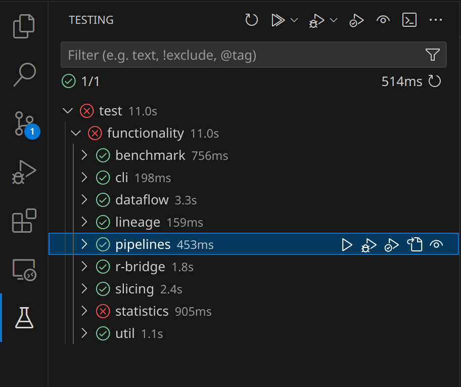
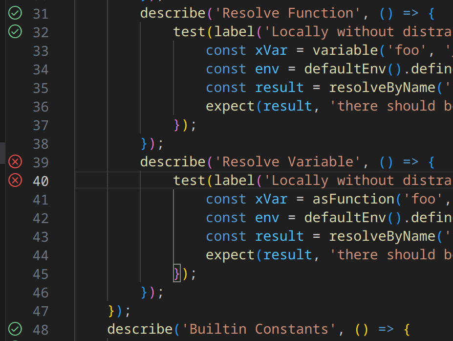
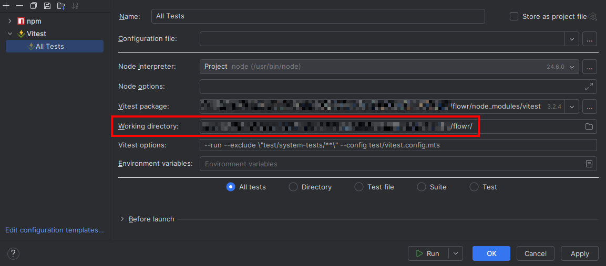

_<span title="an overview of flowR's linting and testing definitions">Generated</span> from '[wiki-linting-and-testing.ts](https://github.com/flowr-analysis/flowr/tree/main/src/documentation/wiki-linting-and-testing.ts "src/documentation/wiki-linting-and-testing.ts")' on 2026-10-27, 11:16:11 UTC (v2.16.6, R v4.6.1), do not edit directly._

For the latest code coverage information, see [codecov.io](https://app.codecov.io/gh/flowr-analysis/flowr), 
for the latest benchmark results, see the [benchmark results](https://flowr-analysis.github.io/flowr/wiki/stats/benchmark) wiki page.

- [🏨 Testing Suites](#testing-suites)
  - [🧪 Functionality Tests](#functionality-tests)
    - [🏗️ Test Structure](#test-structure)
    - [🏷️ Test Labels](#test-labels)
    - [🖋️ Writing a Test](#writing-a-test)
    - [🤏 Running Only Some Tests](#running-only-some-tests)
  - [💽 System Tests](#system-tests)
  - [🧬 Mutation Tests](#mutation-tests)
  - [💃 Performance Tests](#performance-tests)
  - [📝 Testing Within Your IDE](#testing-within-your-ide)
    - [VS Code](#vs-code)
    - [Webstorm](#webstorm)
- [🪈 CI Pipeline](#ci-pipeline)
- [🧹 Linting](#linting)
  - [Oh no, the linter fails](#oh-no-the-linter-fails)
  - [flowR-Specific Rules](#flowr-specific-rules)
    - [Pointing at a Helper with `@useInstead`](#pointing-at-a-helper-with-useinstead)
    - [Replacement Patterns](#replacement-patterns)
    - [Suppressing a Rule](#suppressing-a-rule)
    - [A Part of unicorn](#a-part-of-unicorn)
  - [License Checker](#license-checker)
- [🐛 Debugging](#debugging)
  - [VS Code](#vs-code-1)
  - [Logging](#logging)

<a id='testing-suites'></a>
## 🏨 Testing Suites

Currently, flowR contains four testing suites: one for [functionality](#functionality-tests),
one for [system tests](#system-tests), one for [mutation tests](#mutation-tests), and one for [performance](#performance-tests).
In addition to running those tests, you can use the more generalized `npm run checkup`.
This command includes the construction of the docker image, the generation of the wiki and landing pages, and the linter.
It runs these jobs concurrently but caps the test workers so the combined run fits the machine (it splits the
available cores across the parallel `vitest` jobs via `--maxWorkers` instead of letting each grab every core).
The landing pages wait for the functionality and mutation tests, which record their test labels, so the capabilities page always shows their full results.
Pass job ids to run a subset (e.g. `npm run checkup -- lint tests`) or `--no-docker` to skip the image build.

<a id='functionality-tests'></a>
### 🧪 Functionality Tests

The functionality tests represent conventional unit (and depending on your terminology component/api) tests.
We use [vitest](https://vitest.dev/) as our testing framework.
You can run the tests by issuing (some quick benchmarks may be available with `npm run test:bench`):

```shell
npm run test
```

Within the commandline,
this should automatically drop you into a watch mode which will automatically re-run (potentially) affected tests if you change the code.
If, at any time there are too many errors for you to comprehend, you can use `--bail=<value>` to stop the tests after a certain number of errors.
For example:

```shell
npm run test -- --bail=1
```

If you want to run the tests without the watch mode, you can use:

```shell
npm run test -- --no-watch
```

To run all tests, including a coverage report and label summary, run:

```shell
npm run test:full
```

However, depending on your local version of&nbsp;R, your network connection, and other factors (each test may have a set of criteria), 
some tests may be skipped automatically as they do not apply to your current system setup (or cannot be tested with the current prerequisites). 
Each test can specify such requirements as part of the `TestConfiguration`, which is then used in the `test.skipIf` function of _vitest_.
It is up to the [ci](#ci-pipeline) to run the tests on different systems to ensure that those tests run.

<a id='test-structure'></a>
#### 🏗️ Test Structure

All functionality tests are to be located under [test/functionality](https://github.com/flowr-analysis/flowr/tree/main/test/functionality).

This folder contains three special and important elements:

- `test-setup.ts` which is the entry point if *all* tests are run. It should automatically disable logging statements and configure global variables (e.g., if installation tests should run).
- `_helper/` folder which contains helper functions to be used by other tests.
- `test-summary.ts` which may produce a summary of the covered capabilities.

> [!WARNING]
> 
> We name all test files using the `.test.ts` suffix and try to run them in parallel.
> Whenever this is impossible (e.g., when using <a href="https://github.com/flowr-analysis/flowr/tree/main/test/functionality/_helper/shell.ts#L85"><code><span title="Produces a shell session for you, can be used within a describe block. Pass { concurrent: false } to the describe, the RShell does not fare well with parallelization.">withShell</span></code></a>), pass `{ concurrent: false }` to the
> `describe` to disable parallel execution for the respective test (otherwise, such tests are flaky):
> 
> 
> ```typescript
> describe('my suite', { concurrent: false }, withShell(shell => { /* ... */ }));
> ```
> 
> 
> Vitest deprecated the `describe.sequential` form in favour of that option, so please do not reintroduce it.
> 

<a id='test-labels'></a>
#### 🏷️ Test Labels

Generally, tests are [labeled](https://github.com/flowr-analysis/flowr/tree/main/test/functionality/_helper/label.ts) according to the *flowR* capabilities they test. 

The set of currently supported capabilities and their IDs can be found in [`./src/r-bridge/data/data.ts`](https://github.com/flowr-analysis/flowr/tree/main/src/r-bridge/data/data.ts). 

The resulting labels are used in the test report that is generated as part of the test output. 
They group tests by the capabilities they test and allow the report to display how many tests ensure that any given capability is properly supported.
The report can be found on flowR's [capabilities page](https://flowr-analysis.github.io/flowr/wiki/capabilities/).

To add new labels, add them to the relevant section in [`./src/r-bridge/data/data.ts`](https://github.com/flowr-analysis/flowr/tree/main/src/r-bridge/data/data.ts) as part of a pull request.

<a id='writing-a-test'></a>
#### 🖋️ Writing a Test

Currently, this is heavily dependent on what you want to test (normalization, dataflow, quad-export, …) 
and it is probably best to have a look at existing tests in that area to get an idea of what comfort functionality is available.

Various helper functions are available to ease in writing tests with common behaviors, like testing for dataflow, slicing or query results. 
These can be found in [the `_helper` subdirectory](https://github.com/flowr-analysis/flowr/tree/main/test/functionality/_helper).

For example, an [existing test](https://github.com/flowr-analysis/flowr/tree/main/test/functionality/dataflow/main/atomic/dataflow-atomic.test.ts) that tests the dataflow graph of a simple variable looks like this:

```typescript

assertDataflow(label('simple variable', ['name-normal']), shell,
	'x', emptyGraph().use('0', 'x')
);
```

Have a look at <a href="https://github.com/flowr-analysis/flowr/tree/main/test/functionality/_helper/shell.ts#L391"><code><span title="Your best friend whenever you want to test whether the dataflow graph produced by flowR is as expected. See DataflowTestConfiguration for what you can configure; context: 'call-graph' tests the call graph as a view of the dataflow graph.">assertDataflow</span></code></a>, <a href="https://github.com/flowr-analysis/flowr/tree/main/src/documentation/doc-capabilities.ts#L470"><code>label</code></a>, and <a href="https://github.com/flowr-analysis/flowr/tree/main/src/dataflow/graph/dataflowgraph-builder.ts#L39"><code><span title="Creates an empty dataflow graph. Should only be used in tests and documentation.">emptyGraph</span></code></a> for more information.

When writing dataflow tests, additional settings can be used to reduce the amount of graph data that needs to be pre-written. Notably:

- <a href="https://github.com/flowr-analysis/flowr/tree/main/test/functionality/_helper/shell.ts#L364"><code><span title="Specify just a subset of what the dataflow graph will actually be.">expectIsSubgraph</span></code></a> indicates that the expected graph is a subgraph, rather than the full graph that the test should generate. 
  The test will then only check if the supplied graph is contained in the result graph, rather than an exact match.
- <a href="https://github.com/flowr-analysis/flowr/tree/main/test/functionality/_helper/shell.ts#L369"><code><span title="Before comparing, resolve every NodeId in the expected graph as if it were a slicing criterion (e.g. 12@a). Still a work in progress.">resolveIdsAsCriterion</span></code></a> indicates that the ids given in the expected (sub)graph should be resolved as [slicing criteria](https://github.com/flowr-analysis/flowr/wiki/Terminology#slicing-criterion) rather than actual ids. 
  For example, passing `12@a` as an id in the expected (sub)graph will cause it to be resolved as the corresponding id.

The following example shows both in use:

```typescript

assertDataflow(label('without distractors', [...OperatorDatabase['<-'].capabilities, 'numbers', 'name-normal', 'newlines', 'name-escaped']),
	shell, '`a` <- 2\na',
	emptyGraph()
		.use('2@a')
		.reads('2@a', '1@`a`'),
	{
		expectIsSubgraph:      true,
		resolveIdsAsCriterion: true
	}
);
```

<a id='running-only-some-tests'></a>
#### 🤏 Running Only Some Tests

To run only some tests, vitest allows you to [filter](https://vitest.dev/guide/filtering.html) tests. 
Besides, you can use the watch mode (with `npm run test`) to only run tests that are affected by your changes.

<a id='system-tests'></a>
### 💽 System Tests

In contrast to the [functionality tests](#functionality-tests), the system tests use runners like the `npm` scripts
to test the behavior of the whole system, for example, by running the CLI or the server.
They are slower and hence not part of `npm run test` but can be run using:

```shell
npm run test:system
```

To work, they require you to set up your system correctly (e.g., have `npm` available on your path).
The CI environment will make sure of that. At the moment, these tests are not labeled and only intended
to check basic availability of *flowR*'s core features (as we test the functionality of these features dedicately 
with the [functionality tests](#functionality-tests)).

Have a look at the [test/system-tests](https://github.com/flowr-analysis/flowr/tree/main/test/system-tests) folder for more information.

<a id='mutation-tests'></a>
### 🧬 Mutation Tests

A metamorphic mutation rewrites an R program without changing what it means, so flowR's answer must not
change either: the same dependencies are found, the same slice comes out. This finds bugs without a
hand-written expectation for every program, checking a rewrite of a program the suite already knows the
answer for rather than the program itself.

Run the suite with:

```shell
npm run test:mutations
```

It lives in its own set ([test/mutations](https://github.com/flowr-analysis/flowr/tree/main/test/mutations), with its own `vitest.config.mts`) and is
deliberately excluded from `npm run test`, the same arrangement as the [system tests](#system-tests), so
the default suite stays fast. It is wired into CI (see [🪈 CI Pipeline](#ci-pipeline)) and into `npm run
checkup`, where `npm run checkup -- mutations` runs just this job.

The suite has three pieces:

- the 40 passes, <a href="https://github.com/flowr-analysis/flowr/tree/main/test/functionality/_helper/mutation/mutation-passes.ts#L653"><code><span title="every pass a mutant is generated for; add to this list to check another rewrite">MutationPasses</span></code></a> in [test/functionality/_helper/mutation](https://github.com/flowr-analysis/flowr/tree/main/test/functionality/_helper/mutation).
- the corpus of programs and the invariant checks run against their mutants, in [test/mutations/counterexample-checks.ts](https://github.com/flowr-analysis/flowr/tree/main/test/mutations/counterexample-checks.ts).
- pass-level unit tests, in [test/mutations/r-mutations.test.ts](https://github.com/flowr-analysis/flowr/tree/main/test/mutations/r-mutations.test.ts), checking each pass on its own rather than against the corpus.

Every program in the corpus is a counterexample flowR once sliced wrongly (a function called through a list, a
value read back through an environment, a closure over a super-assignment, and so on), or a representative program
of what the functionality tests cover. Each is run in R once for what it prints and once more for what its slice
prints. Every pass is then tried on it: a pass with nothing to rewrite skips the program, and every mutant it does
produce is checked the same way, and must leave the results of the queries unchanged.

Every program and every mutant also goes through the [REPL](https://github.com/flowr-analysis/flowr/wiki/Interface#using-the-repl):
<span title="Description (Repl Command): Query the given R code (use 'help' for more information)">`:query`</span> with the [Static Slice Query](https://github.com/flowr-analysis/flowr/wiki/%5BQuery%5D-Static-Slice) has to print a slice that prints what the program prints,
the [Dependencies Query](https://github.com/flowr-analysis/flowr/wiki/%5BQuery%5D-Dependencies) and the [Linter Query](https://github.com/flowr-analysis/flowr/wiki/%5BQuery%5D-Linter) have to give the same answer for the
mutant as for the program (a pass that adds code may only add linter findings), and for a pass that only renames
or moves code, [Resolve Value Query](https://github.com/flowr-analysis/flowr/wiki/%5BQuery%5D-Resolve-Value), <span title="Description (Repl Command): Get mermaid code for the dataflow graph (aliases: :d, :df)">`:dataflow`</span>, <span title="Description (Repl Command): Get mermaid code for the normalized AST of R code (aliases: :n)">`:normalize`</span> and
<span title="Description (Repl Command): Get mermaid code for the control-flow graph of R code (aliases: :cfg, :cf)">`:controlflow`</span> have to print the same, up to the positions and names the pass changed.

The passes fall into 9 categories: `formatting and noise`, `assignment spelling`, `naming`, `literals and layout`, `control flow`, `dead code`, `structure and braces`, `function forms`, `changed value`.

<details><summary>formatting and noise (4)</summary>

- `leading noise`: two bindings nothing reads are put before the program, `mut_a <- 1` and `mut_b <- mut_a + 1`
- `trailing noise`: a binding nothing reads, `mut_c <- 2`, is put after a program that ends in a call printing nothing of its own
- `interleaved comments`: a comment `# mut_note` is put before every line
- `trailing comments`: a comment `# mut_note` is appended to every line

</details>

<details><summary>assignment spelling (6)</summary>

- `right assignment`: `x <- 1` becomes `1 -> x`
- `grouped right hand side`: `x <- 1` becomes `x <- (1)`
- `braced right hand side`: `x <- 1` becomes `x <- { 1 }`
- `assign call`: `x <- 1` becomes `assign("x", 1)`, except on the line of the criterion, which has to keep naming the variable
- `equals assignment`: `x <- 1` becomes `x = 1`
- `top level super assignment`: `x <- 1` becomes `x <<- 1`, except for a name an attached base package exports, as a `<<-` would try to change that binding

</details>

<details><summary>naming (4)</summary>

- `renamed criterion variable`: the variable the criterion points at is renamed to `mut_v`
- `non-syntactic criterion name`: the variable the criterion points at is renamed to a name only valid in backticks, `` `mut_non syntactic` ``
- `every variable renamed`: every variable the program binds is renamed consistently, to `mut_r1`, `mut_r2`, ..., unless the program may read a name as data
- `every variable renamed to a non-syntactic name`: every variable the program binds is renamed consistently to a name in backticks, `` `mut_r 1` ``

</details>

<details><summary>literals and layout (8)</summary>

- `split string literal`: a string literal is split apart, `"vvv"` becomes `paste0("v", "vv")`
- `string literal hoisted into a variable`: a string literal is bound to a variable first, `mut_s <- "a"`, which is used in its place
- `string literal formatted by sprintf`: a string literal is formatted, `"a"` becomes `sprintf("%s", "a")`
- `path literal built by file.path`: a path literal is built from its parts, `"a/b.txt"` becomes `file.path("a", "b.txt")`
- `string literals in single quotes`: `"a"` becomes `'a'`
- `numbers in scientific notation`: every whole number is written with an exponent, `3` becomes `3e0`
- `assignment continued on the next line`: an assignment before the criterion is continued on the next line, `x <-` and `  1`
- `irregular whitespace around assignments`: `x <- 1` becomes `x\t<-   1`

</details>

<details><summary>control flow (5)</summary>

- `every statement guarded by if(TRUE)`: every statement on a line of its own that is no control construct is guarded, `if(TRUE) x <- 1`
- `independent statements swapped`: two adjacent assignments before the criterion trade places, where both compute a value and nothing else and neither reads what the other binds
- `if and else swapped under a negated condition`: the branches of an `if`/`else` trade places under the negated condition, where the condition is a single logical
- `while loop as a repeat loop`: `while(c) b` becomes `repeat { if(!(c)) break; b }`, where the condition is a single logical
- `for loop as a while loop`: `for(i in 1:3) b` becomes a `while` loop over the indices of the range, for a range of two whole numbers, which is never empty

</details>

<details><summary>dead code (1)</summary>

- `dead assignment to the criterion variable`: an assignment to the variable of the criterion is put right before it under `if(FALSE)`

</details>

<details><summary>structure and braces (5)</summary>

- `every statement in a block`: every statement on a line of its own is wrapped in a block, `{ x <- 1 }`
- `whole program in a block`: the whole program is wrapped in a `{ ... }` block, where no statement but the last would print
- `semicolon-separated statements`: the lines before and after the line of the criterion are each joined into one with `;`
- `braces added to a construct body`: the body of an `if` (both arms of an `if`/`else`), `for`, `while`, or `function` written without braces gets them
- `whole program in local`: the whole program is wrapped in `local({ ... })`, where no statement but the last would print and none depends on the frame it runs in

</details>

<details><summary>function forms (6)</summary>

- `lambda shorthand`: `function(x)` becomes `\(x)`
- `nested call rewritten as a pipe`: a call nested in another one becomes a native pipe, `r <- f(g(x))` becomes `r <- x |> g() |> f()`
- `call made by do.call`: `r <- f(1, b = 2)` becomes `r <- do.call(f, list(1, b = 2))`, where `f` only uses the values of its arguments and each argument computes a value and nothing else, as the list evaluates them first
- `argument passed through identity`: the first argument that is a plain name is passed through `identity`, `sum(v, 1)` becomes `sum(identity(v), 1)`, where the callee only uses the values of its arguments
- `function result made an explicit return`: the body of a function written without braces is returned explicitly, `function(x) x * 3` becomes `function(x) return(x * 3)`
- `pipe rewritten as a nested call`: a native pipe becomes the call it stands for, `x |> f(y)` becomes `f(x, y)`

</details>

<details><summary>changed value (1)</summary>

- `criterion value shifted by one`: the one value the program prints is changed, `x <- 5` becomes `x <- (5) + 1`, and the expected output with it, so the corpus also checks that a slice tracks a value and not just a name

</details>

Besides, every mutant and every chain of a pass and the 4 passes after it is analyzed in full and asked
every query on tree-sitter, without R, in [test/mutations/robustness.ts](https://github.com/flowr-analysis/flowr/tree/main/test/mutations/robustness.ts): none of these
tens of thousands of programs may make flowR fail, overflow the stack, or hang.

A pass is a <a href="https://github.com/flowr-analysis/flowr/tree/main/test/functionality/_helper/mutation/mutation-passes.ts#L38"><code><span title="one rewrite, applied to every counterexample it fits">MutationPass</span></code></a> and sees the program as a <a href="https://github.com/flowr-analysis/flowr/tree/main/test/functionality/_helper/mutation/mutation-program.ts#L75"><code><span title="A program to mutate, as flowR sees it: the statements of its normalized AST, the dataflow graph, and what the built-in configuration states about the calls it makes. Passes ask this instead of reading the code as text.">MutationProgram</span></code></a>: its normalized
AST and dataflow graph, and what the built-in configuration states about each call. It edits the code through
a <a href="https://github.com/flowr-analysis/flowr/tree/main/test/functionality/_helper/mutation/mutation-program.ts#L374"><code><span title="Text edits to a MutationProgram , applied all at once so each names its place in the original code. The criterion moves along with the lines edits add or remove before it.">Rewrite</span></code></a>, which moves the criterion along with the lines the edits add or remove.

A complete run writes how many passes, counterexamples and mutants it checked, and
[scripts/test-label-counts.ts](https://github.com/flowr-analysis/flowr/tree/main/scripts/test-label-counts.ts) adds these numbers to the
[benchmark page](https://flowr-analysis.github.io/flowr/wiki/stats/benchmark).

<a id='performance-tests'></a>
### 💃 Performance Tests

The performance test suite of *flowR* uses several suites to check for variations in the required times for certain steps.
Although we measure wall time in the CI (which is subject to rather large variations), it should give a rough idea *flowR*'s performance.
Furthermore, the respective scripts can be used locally as well.
To run them, issue:

```shell
npm run test:performance
```

See [test/performance](https://github.com/flowr-analysis/flowr/tree/main/test/performance) for more information on the suites, how to run them, and their results. If you are interested in the results of the benchmarks, see [here](https://flowr-analysis.github.io/flowr/wiki/stats/benchmark).

<a id='testing-within-your-ide'></a>
### 📝 Testing Within Your IDE

#### VS Code

Using the vitest Extension for Visual Studio Code, you can start tests directly from the definition and explore your suite in the Testing tab.
To get started, install the [vitest Extension](https://marketplace.visualstudio.com/items?itemName=vitest.explorer).

|               Testing Tab               | In Code                               |
|:---------------------------------------:|:-------------------------------------:|
|  |  |

- Left-clicking the  or  Icon next to the code will rerun the test. Right-clicking will open a context menu, allowing you to debug the test.
- In the Testing tab, you can run (and debug) all tests, individual suites or individual tests.

#### Webstorm

Please follow the official guide [here](https://www.jetbrains.com/help/webstorm/vitest.html).
Note that the working directory has to be set to the project root directory, not the test subdirectory!
Otherwise, the tests will not be instantiated.



<a id='ci-pipeline'></a>
## 🪈 CI Pipeline

We have several workflows defined in [.github/workflows](https://github.com/flowr-analysis/flowr/tree/main/.github/workflows).
The most important ones:

- [.github/workflows/qa.yaml](https://github.com/flowr-analysis/flowr/tree/main/.github/workflows/qa.yaml) is the main workflow that will run different steps depending on several factors. It is responsible for:
  - running the [functionality](#functionality-tests), [system](#system-tests), [mutation](#mutation-tests), and [performance tests](#performance-tests)
    - uploading the results to the [benchmark page](https://flowr-analysis.github.io/flowr/wiki/stats/benchmark) for releases
    - running the [functionality tests](#functionality-tests) on different operating systems (Windows, macOS, Linux) and with different versions of R
    - reporting code coverage
  - running the [linter](#linting) and reporting its results
  - deploying the documentation to [GitHub Pages](https://flowr-analysis.github.io/flowr/doc/)
- [.github/workflows/release.yaml](https://github.com/flowr-analysis/flowr/tree/main/.github/workflows/release.yaml) is responsible for creating a new release, only to be run by repository owners. Furthermore, it adds the new docker image to [docker hub](https://hub.docker.com/r/eagleoutice/flowr).
- [.github/workflows/broken-links-and-wiki.yaml](https://github.com/flowr-analysis/flowr/tree/main/.github/workflows/broken-links-and-wiki.yaml) repeatedly tests that all links are not dead!
 
<a id='linting'></a>
## 🧹 Linting

There are two linting scripts.
The main one:

```shell
npm run lint
```

And a weaker version of the first (allowing for *todo* comments) which is run automatically in the [pre-push githook](https://github.com/flowr-analysis/flowr/tree/main/.githooks/pre-push) as explained in the [CONTRIBUTING.md](https://github.com/flowr-analysis/flowr/tree/main/.github/CONTRIBUTING.md):

```shell
npm run lint-local
```

Besides checking coding style (as defined in the [package.json](https://github.com/flowr-analysis/flowr/tree/main/package.json)), the *full* linter runs the [license checker](#license-checker).

In case you are unaware,
eslint can automatically fix several linting problems[](https://eslint.org/docs/latest/use/command-line-interface#fix-problems).
So you may be fine by just running:

```shell
npm run lint-local -- --fix
```

<a id='oh-no-the-linter-fails'></a>
### 💥 Oh no, the linter fails

By now, the rules should be rather stable and so, if the linter fails,
it is usually best if you (when necessary) read the respective description and fix the respective problem.
Rules in this project cover general JavaScript issues [using regular ESLint](https://eslint.org/docs/latest/rules), TypeScript-specific issues [using typescript-eslint](https://typescript-eslint.io/rules/), and code formatting [with ESLint Stylistic](https://eslint.style/packages/default#rules).

However, in case you think that the linter is wrong, please do not hesitate to open a [new issue](https://github.com/flowr-analysis/flowr/issues/new/choose).

<a id='flowr-specific-rules'></a>
### 🧭 flowR-Specific Rules

flowR groups its functions in helper objects (<a href="https://github.com/flowr-analysis/flowr/tree/main/src/dataflow/graph/edge.ts#L9"><code><span title="An edge consist of only of the type (source and target are encoded with the Dataflow Graph). Multiple edges are encoded by joining the respective type bits.">DfEdge</span></code></a>, <a href="https://github.com/flowr-analysis/flowr/tree/main/src/dataflow/environments/resolve-helper.ts#L38"><code><span title="The helper object for resolution: from a name to the definitions it may refer to, and from a node to the value(s) it may hold. Resolve.info and Resolve.infoOf state *where* to resolve, which everything below takes; from an analyzer that is one call, with no need to assemble the graph, the id map and the context by hand. Take the narrowest entry point that answers your question, they differ a lot i...">Resolve</span></code></a>, <a href="https://github.com/flowr-analysis/flowr/tree/main/src/r-bridge/lang-4.x/ast/model/processing/node-id.ts#L33"><code><span title="What a NodeId is: the identity of a node within one analysis, plus the built-in and pkg::fn names encoded as one, and the ways to read a name back out of it.">NodeId</span></code></a>, and
friends) so that there is one obvious entry point per topic. Two rules of the
[`flowr` plugin](https://github.com/flowr-analysis/flowr-lint) keep the code on those entry points, both part of `npm run lint`.
Each is fixed on the spot where the replacement is already imported, and offered as an editor suggestion otherwise.

<a id='pointing-at-a-helper-with-useinstead'></a>
#### Pointing at a Helper with `@useInstead`

A function that only exists to be wired into a helper object names its replacement, and every reference outside its own
file is then reported:

```ts
/**
 * Every definition the identifier may refer to.
 * @useInstead {@link Resolve.byName}
 */
export function resolveByNameAnyType(/* ... */) { /* ... */ }
```

Never reported are the references that make the replacement exist: the wiring in an object literal
(<a href="https://github.com/flowr-analysis/flowr/tree/main/src/dataflow/environments/resolve-helper.ts#L59"><code><span title="Every definition the identifier may refer to, whatever its type.">Resolve::<b>byName</b></span></code></a> pointing at `resolveByNameAnyType`), re-exports, and files declaring the helper itself.

<a id='replacement-patterns'></a>
#### Replacement Patterns

Some replacements are a shape of code rather than a renamed function, such as `edge.types === EdgeType.Reads`, which
reads like "has this type" (<a href="https://github.com/flowr-analysis/flowr/tree/main/src/dataflow/graph/edge.ts#L159"><code><span title="Check if the given-edge type has any of the given types. As types are bitmasks, you can combine multiple types with a bitwise OR (|).">DfEdge::<b>includesType</b></span></code></a>) but holds only if it is the *only* type
(<a href="https://github.com/flowr-analysis/flowr/tree/main/src/dataflow/graph/edge.ts#L200"><code><span title="Check whether the edge carries the given types and nothing else. Strict counterpart of DfEdge#includesType , which already holds if one of the bits is set.">DfEdge::<b>isOnlyType</b></span></code></a>). These are matched with [esquery](https://github.com/estools/esquery) selectors,
the language `no-restricted-syntax` uses.

The [flowr-lint README](https://github.com/flowr-analysis/flowr-lint#flowrreplacement-pattern) documents the fields of a pattern,
and `npx eslint` names the id of whichever one fires.
To propose a new pattern or a change to any of them, open an issue with the replacement pattern template in
[that repository](https://github.com/flowr-analysis/flowr-lint/issues/new/choose).

<a id='suppressing-a-rule'></a>
#### Suppressing a Rule

A tag on a declaration covers everything below it, a header comment above the imports covers the whole file.

| | silences |
| :-- | :-- |
| `// eslint-disable-next-line` | the next line, as usual |
| `@lintIgnore <ids>` | the named rules or pattern ids, all of them when given none |

Put the reason in the prose above the tag, a hot path that has to keep the raw form is as good a reason as any.

<a id='a-part-of-unicorn'></a>
#### A Part of unicorn

The configuration also enables a hand-picked part of [unicorn](https://github.com/sindresorhus/eslint-plugin-unicorn):
the rules naming a shape with a clearer equivalent (`prefer-includes`, `prefer-string-slice`, and friends), not its
opinions on naming or style. Three are left out on purpose:

- `prefer-array-flat` rewrites `.flatMap(f => f)` on an iterator, which has no `.flat()`.
- `prefer-structured-clone` does not know that a `JSON` round-trip is sometimes the point.
- `prefer-node-protocol` is inverted, `no-restricted-imports` forbids the `node:` prefix instead: flowR is bundled for
  the browser as well (the web build of the [VS Code extension](https://marketplace.visualstudio.com/items?itemName=code-inspect.vscode-flowr)), where the core modules
  are swapped for polyfills by their bare name, and a `node:` specifier matches none of those bundler keys.

<a id='license-checker'></a>
### 🪪 License Checker

*flowR* is licensed under the [GPLv3 License](https://github.com/flowr-analysis/flowr/blob/main/LICENSE) requiring us to only rely on [compatible licenses](https://www.gnu.org/licenses/license-list.en.html). For now, this list is hardcoded as part of the npm [`license-compat`](https://github.com/flowr-analysis/flowr/tree/main/package.json) script so it can very well be that a new dependency you add causes the checker to fail &mdash; *even though it is compatible*. In that case, please either open a [new issue](https://github.com/flowr-analysis/flowr/issues/new/choose) or directly add the license to the list (including a reference to why it is compatible).

<a id='debugging'></a>
## 🐛 Debugging
### VS Code
When working with VS Code, you can attach a debugger to the REPL. This works automatically by running the `Start Debugging` command (`F5` by default).
You can also set the `Auto Attach Filter` setting to automatically attach the debugger, when running `npm run flowr`.

### Logging

*flowR* uses a wrapper around [tslog](https://www.npmjs.com/package/tslog) using a class named
<a href="https://github.com/flowr-analysis/flowr/tree/main/src/util/log.ts#L22"><code>FlowrLogger</code></a>. They obey to, for example, the <span title="Description (Command Line Argument): Run with verbose logging (will be passed to the corresponding script)">`--verbose`</span>
option. Throughout *flowR*, we use the `log` object (or subloggers of it) for logging.
To create your own logger, you can use <a href="https://github.com/flowr-analysis/flowr/tree/main/src/util/log.ts#L26"><code>FlowrLogger::<i>getSubLogger</i></code></a>.
For example, check out the <a href="https://github.com/flowr-analysis/flowr/tree/main/src/slicing/static/static-slicer.ts#L25"><code>slicerLogger</code></a> for the static slicer.
