_<span title="an overview of flowR's query API">Generated</span> from '[wiki-query.ts](https://github.com/flowr-analysis/flowr/tree/main/src/documentation/wiki-query.ts "src/documentation/wiki-query.ts")' on 2026-11-07, 22:50:29 UTC (v2.17.3), do not edit directly._
<h2 id="Ambient Access Query">Ambient Access Query&emsp;<sup>[<a href="https://github.com/flowr-analysis/flowr/wiki/Query-API">overview</a>]</sup></h2>

What code reads and writes of the global state\
_This query is requested with the type `ambient-access`._\
Run in the REPL: `:query @ambient-access [(<crit>;...)] <code | file://path>`

This query reports what code reads and writes of the global state, such as options, environment variables,
the working directory, open devices, or the search path, as the pseudo variables of <a href="https://github.com/flowr-analysis/flowr/tree/main/src/dataflow/environments/ambient-state-name.ts#L42"><code><span title="Graphics parameters, options and other global state, tracked as global pseudo variables (#...) so readers link to the calls that set them. Accumulating states only grow: par(mar = ...) keeps an earlier par(mfrow = ...). The pseudo variables a function may leave changed are what Dataflow.sideEffects.ambientWrites reports.">AmbientStateName</span></code></a>
(`#option:digits`, `#env:A`, ...). A call counts with what the functions it calls access, so `f()` above writes `digits`.
It also names the global variables the code binds (`x <<- 1`) and the drawing calls it makes.
The same is available in code as `Dataflow.sideEffects.ambientAccess`.

Without criteria, the query answers for every file and for the whole project (`<project>`):

```json
[ { "type": "ambient-access" } ]
```

(This can be shortened to `@ambient-access` when used with the REPL command <span title="Description (Repl Command): Query the given R code (use 'help' for more information)">`:query`</span>).

_Results (prettified and summarized):_

Query: **ambient-access** (26 ms)\
&nbsp;&nbsp;&nbsp;╰ **<file 1>**: reads: #option:*, #option:digits, #options writes: #env, #env:A, #option:digits, #options\
&nbsp;&nbsp;&nbsp;╰ **<project>**: reads: #option:*, #option:digits, #options writes: #env, #env:A, #option:digits, #options

<details> <summary style="color:gray">Show Detailed Results as Json</summary>

The analysis ran (including parsing and normalization and the query) within the generation environment.

The JSON contains the ids of the nodes in question (see the [Interface](https://github.com/flowr-analysis/flowr/wiki/Interface) wiki page).

```json
{
  "ambient-access": {
    ".meta": {},
    "results": {
      "<file 1>": {"reads":["#option:*","#option:digits","#options"],"writes":["#env","#env:A","#option:digits","#options"],"assumed":[],"variables":[],"draws":[]},
      "<project>": {"reads":["#option:*","#option:digits","#options"],"writes":["#env","#env:A","#option:digits","#options"],"assumed":[],"variables":[],"draws":[]}
    }
  },
  ".meta": {}
}
```

</details>

<details> <summary style="color:gray">Original Code</summary>

```r
f <- function() options(digits = 3)
f()
Sys.setenv(A = "1")
```

<details>

<summary style="color:gray">Dataflow Graph of the R Code</summary>

The analysis ran (parse and normalize with the [r-shell](https://github.com/flowr-analysis/flowr/wiki/Engines) engine) in the generation environment. No [signature database](https://github.com/flowr-analysis/flowr/wiki/Signature-Database) is mounted, so `library()` attaches no exports (base-R names are still qualified, e.g., `stats::acf`). 
We encountered no unknown side effects during the analysis.

```mermaid
flowchart LR
    %% Environment of 7 [level: 0]:
    %% Built-in
    %% 1----------------------------------------
    %%   #option:digits: {**#option:digits** (id: 5, type: Variable, def. @5)}
    %%   #options:       {**#options** (id: 5, type: Variable, cds: {}, def. @5)}
    7["`*#91;RFunctionDefinition#93;* **function**
      *1.6-35* (**id: 7**)`"]

subgraph "flow-7" [function 7]
    3{{"`*#91;RNumber#93;* **3**
      *1.34* (**id: 3**)`"}}
    4(["`*#91;RArgument#93;* **digits**
      *1.25-30* (**id: 4**)`"])
    5[["`*#91;RFunctionCall#93;* base#58;#58;**options**
      *1.17-35* (**id: 5**)
    arg: (digits (4))`"]]
    built-in:options["`Built-In:
options`"]
    style built-in:options stroke:gray,fill:gray,stroke-width:2px,opacity:.8;
    style 5 stroke:purple,stroke-width:4px; 
end
    0["`*#91;RSymbol#93;* **f**
      *1.1* (**id: 0**, v: 7)`"]
    8[["`*#91;RBinaryOp#93;* base#58;#58;**#60;#45;**
      *1.1-35* (**id: 8**)
    arg: (0, 7)`"]]
    built-in:_60_-["`Built-In:
#60;#45;`"]
    style built-in:_60_- stroke:gray,fill:gray,stroke-width:2px,opacity:.8;
    %% Environment of 10 [level: 0]:
    %% Built-in
    %% 1----------------------------------------
    %%   f: {**f** (id: 0, type: Function, def. @8)}
    10[["`*#91;RFunctionCall#93;* **f**
      *2.1-3* (**id: 10**)`"]]
    13{{"`*#91;RString#93;* **#34;1#34;**
      *3.16-18* (**id: 13**)`"}}
    14(["`*#91;RArgument#93;* **A**
      *3.12* (**id: 14**)`"])
    15[["`*#91;RFunctionCall#93;* base#58;#58;**Sys.setenv**
      *3.1-19* (**id: 15**)
    arg: (A (14))`"]]
    built-in:Sys.setenv["`Built-In:
Sys.setenv`"]
    style built-in:Sys.setenv stroke:gray,fill:gray,stroke-width:2px,opacity:.8;
    3 -.->|"flow"| 4
    linkStyle 0 stroke:gray,color:gray;
    4 -->|"reads"| 3
    4 -.->|"flow"| 5
    linkStyle 2 stroke:gray,color:gray;
    5 -->|"arg"| 4
    5 -.->|"reads, calls"| built-in:options
    linkStyle 4 stroke:gray;
    5 -->|"side-effect-on-call"| 10
7 -.-|function| flow-7

    7 -.->|"flow"| 0
    linkStyle 7 stroke:gray,color:gray;
    0 -->|"defined-by, flow"| 8
    0 -->|"defined-by"| 7
    8 -->|"reads, arg"| 7
    8 -->|"returns, arg"| 0
    8 -.->|"reads, calls"| built-in:_60_-
    linkStyle 12 stroke:gray;
    8 -.->|"flow"| 10
    linkStyle 13 stroke:gray,color:gray;
    10 -->|"reads"| 0
    10 -->|"returns"| 5
    10 -->|"calls"| 7
    10 -.->|"flow"| 13
    linkStyle 17 stroke:gray,color:gray;
    13 -.->|"flow"| 14
    linkStyle 18 stroke:gray,color:gray;
    14 -->|"reads"| 13
    14 -.->|"flow"| 15
    linkStyle 20 stroke:gray,color:gray;
    15 -->|"arg"| 14
    15 -.->|"reads, calls"| built-in:Sys.setenv
    linkStyle 22 stroke:gray;
```



</details>

</details>
	
With slicing criteria, it answers for each criterion with all the code its node spans, so `3^` asks for the statement on line 3.
Set `functions` to also learn what calling each function accesses:

```json
[
  {
    "type": "ambient-access",
    "criteria": [
      "2^"
    ],
    "functions": true
  }
]
```

(This can be shortened to `@ambient-access (2^) "f <- function() options(digits = 3)\nf()\nSys.setenv(A = "1")"` when used with the REPL command <span title="Description (Repl Command): Query the given R code (use 'help' for more information)">`:query`</span>).

_Results (prettified and summarized):_

Query: **ambient-access** (12 ms)\
&nbsp;&nbsp;&nbsp;╰ **2^**: reads: #option:*, #option:digits, #options writes: #option:digits, #options\
&nbsp;&nbsp;&nbsp;╰ **function 7**: reads: #option:*, #option:digits writes: #option:digits, #options

<details> <summary style="color:gray">Show Detailed Results as Json</summary>

The analysis ran (including parsing and normalization and the query) within the generation environment.

The JSON contains the ids of the nodes in question (see the [Interface](https://github.com/flowr-analysis/flowr/wiki/Interface) wiki page).

```json
{
  "ambient-access": {
    ".meta": {},
    "results": {"2^":{"reads":["#option:*","#option:digits","#options"],"writes":["#option:digits","#options"],"assumed":[],"variables":[],"draws":[]}},
    "functions": {"7":{"reads":["#option:*","#option:digits"],"writes":["#option:digits","#options"],"assumed":[],"variables":[],"draws":[]}}
  },
  ".meta": {}
}
```

</details>

<details>

<summary style="color:gray">Implementation Details</summary>

The Ambient Access Query is executed by <a href="https://github.com/flowr-analysis/flowr/tree/main/src/queries/catalog/ambient-access-query/ambient-access-query-executor.ts#L18"><code><span title="Executes AmbientAccessQuery s, sharing one pass over the call graph between all scopes they ask for.">executeAmbientAccessQuery</span></code></a>.

</details>