_<span title="an overview of flowR's query API">Generated</span> from '[wiki-query.ts](https://github.com/flowr-analysis/flowr/tree/main/src/documentation/wiki-query.ts "src/documentation/wiki-query.ts")' on 2026-11-07, 14:38:02 UTC (v2.17.3), do not edit directly._
<h2 id="Code Clones Query">Code Clones Query&emsp;<sup>[<a href="https://github.com/flowr-analysis/flowr/wiki/Query-API">overview</a>]</sup></h2>

Finds code clones in all analyzed files with a configurable selection of AST, token, fingerprint, and dependence-graph based algorithms.\
_This query is requested with the type `code-clones`._\
Run in the REPL: `:query @code-clones [baxter|gst|winnowing|similar ...] [<code>]`

This query reports pairs of code fragments that are clones of each other, that is, code that was copied and possibly
adapted. It runs over all files of the analysis, for example a whole folder or package, and offers four published
algorithms. Each follows its paper and, where available, its reference implementation, and the sources state every
place where they deviate:

| algorithm | compares | after |
|-----------|----------|-------|
| `baxter` | all AST subtrees above a mass threshold, hashed by structure (ignoring identifiers and constants) and compared with `2S / (2S + L + R)` | Baxter et al., [Clone Detection Using Abstract Syntax Trees](https://doi.org/10.1109/ICSM.1998.738528), ICSM 1998 |
| `gst` | the token strings of functions or files with Greedy String Tiling, by default with the token set of JPlag's R module | a port of [JPlag](https://github.com/jplag/JPlag), see Prechelt et al., [Finding Plagiarisms among a Set of Programs with JPlag](https://doi.org/10.3217/jucs-008-11-1016), 2002 |
| `winnowing` | k-gram fingerprints selected by robust winnowing, reported with the matched passages | Schleimer et al., [Winnowing: Local Algorithms for Document Fingerprinting](https://doi.org/10.1145/872757.872770), SIGMOD 2003, the algorithm behind MOSS |
| `similar` | the program dependence graphs of functions with SimilaR's importance-weighted Weisfeiler-Lehman relabeling | Bartoszuk and Gagolewski, [SimilaR: R Code Clone and Plagiarism Detection](https://doi.org/10.32614/RJ-2020-017), The R Journal 2020 |

Before the detection, the query presents the code in one of three `perspective`s:

- `syntax` shows the code as written. Use it to reproduce JPlag's token strings, which follow JPlag's own R grammar.
- `canonical` (the default) rewrites syntactic sugar and newer R features into one core form. Pipes become calls, `\(x)` becomes `function(x)`, right and equal assignments become `<-`, `(e)` and `{e}` become `e`, `x[["a"]]` becomes `x$a`, `T` and `F` become `TRUE` and `FALSE`, and a tail `return(e)` becomes `e`. Every rewritten node keeps the id of the node it stems from, so all findings point to the original source.
- `dataflow` additionally inlines temporaries that are used exactly once along the [dataflow graph](https://github.com/flowr-analysis/flowr/wiki/Dataflow-Graph), so `t <- f(x)` followed by `g(t)` looks like `g(f(x))`. It only inlines where this cannot change what the code computes.

The query is meant for large inputs. The candidate filters of `gst` and `similar` never drop a pair that could reach the threshold, and only `similar` needs the dataflow analysis.
With `exportIndex`, the query also returns the clone index of the analyzed files (the flattened ASTs and the dependence graphs).
A later query can pass such indices as `against` to search new code in a corpus of pre-analyzed projects without analyzing them again.
Use `config` to tune the thresholds of each algorithm, and `maxPairs` to limit the number of reported pairs, as `n` copies of the same function already form `n(n-1)/2` pairs.

```json
[
  {
    "type": "code-clones",
    "algorithms": [
      "gst",
      "similar"
    ]
  }
]
```

 <details> <summary style="color:gray">Show Results</summary>

_Results (prettified and summarized):_

Query: **code-clones** (9 ms)\
&nbsp;&nbsp;&nbsp;╰ 2 clone pairs in 1 file\
&nbsp;&nbsp;&nbsp;&nbsp;&nbsp;&nbsp;╰ [gst 1.00] **normalize** _<input 0>:1.14-4.1_ ~ **scale_it** _<input 0>:5.13-8.1_\
&nbsp;&nbsp;&nbsp;&nbsp;&nbsp;&nbsp;╰ [similar 1.00] **normalize** _<input 0>:1.14-4.1_ ~ **scale_it** _<input 0>:5.13-8.1_

<details> <summary style="color:gray">Show Detailed Results as Json</summary>

The analysis ran (including parsing and normalization and the query) within the generation environment.

The JSON contains the ids of the nodes in question (see the [Interface](https://github.com/flowr-analysis/flowr/wiki/Interface) wiki page).

```json
{
  "code-clones": {
    ".meta": {},
    "pairs": [
      {
        "algorithm": "gst",
        "similarity": 1,
        "containment": [1,1],
        "a": {"file":"<input 0>","id":23,"loc":[1,14,4,1,"<input 0>"],"name":"normalize"},
        "b": {"file":"<input 0>","id":48,"loc":[5,13,8,1,"<input 0>"],"name":"scale_it"},
        "matches": [{"a":[1,14,4,1],"b":[5,13,8,1]}]
      },
      {
        "algorithm": "similar",
        "similarity": 1,
        "containment": [1,1],
        "a": {"file":"<input 0>","id":23,"loc":[1,14,4,1,"<input 0>"],"name":"normalize"},
        "b": {"file":"<input 0>","id":48,"loc":[5,13,8,1,"<input 0>"],"name":"scale_it"}
      }
    ],
    "stats": {"files":1,"units":{"gst":2,"similar":2},"comparisons":{"gst":1,"similar":1}}
  },
  ".meta": {}
}
```

</details>

<details> <summary style="color:gray">Original Code</summary>

```r
normalize <- function(v) {
  m <- mean(v)
  (v - m) / sd(v)
}
scale_it <- function(values) {
  mu <- mean(values)
  (values - mu) / sd(values)
}
```

<details>

<summary style="color:gray">Dataflow Graph of the R Code</summary>

The analysis ran (parse and normalize with the [r-shell](https://github.com/flowr-analysis/flowr/wiki/Engines) engine) in the generation environment. No [signature database](https://github.com/flowr-analysis/flowr/wiki/Signature-Database) is mounted, so `library()` attaches no exports (base-R names are still qualified, e.g., `stats::acf`). 
We encountered no unknown side effects during the analysis.

```mermaid
flowchart LR
    23["`*#91;RFunctionDefinition#93;* **function**
      *1.14-4.1* (**id: 23**)`"]

subgraph "flow-23" [function 23]
    1["`*#91;RSymbol#93;* **v**
      *1.23* (**id: 1**, v: )`"]
    7(["`*#91;RSymbol#93;* **v**
      *2.13* (**id: 7**)`"])
    9[["`*#91;RFunctionCall#93;* base#58;#58;**mean**
      *2.8-14* (**id: 9**)
    arg: (7)`"]]
    built-in:mean["`Built-In:
mean`"]
    style built-in:mean stroke:gray,fill:gray,stroke-width:2px,opacity:.8;
    5["`*#91;RSymbol#93;* **m**
      *2.3* (**id: 5**, v: 9)`"]
    10[["`*#91;RBinaryOp#93;* base#58;#58;**#60;#45;**
      *2.3-14* (**id: 10**)
    arg: (5, 9)`"]]
    built-in:_60_-["`Built-In:
#60;#45;`"]
    style built-in:_60_- stroke:gray,fill:gray,stroke-width:2px,opacity:.8;
    13(["`*#91;RSymbol#93;* **v**
      *3.4* (**id: 13**)`"])
    14(["`*#91;RSymbol#93;* **m**
      *3.8* (**id: 14**)`"])
    15[["`*#91;RBinaryOp#93;* base#58;#58;**#45;**
      *3.4-8* (**id: 15**)
    arg: (13, 14)`"]]
    built-in:-["`Built-In:
#45;`"]
    style built-in:- stroke:gray,fill:gray,stroke-width:2px,opacity:.8;
    16[["`*#91;RExpressionList#93;* base#58;#58;**(**
      *3.3* (**id: 16**)
    arg: (15)`"]]
    built-in:_40_["`Built-In:
(`"]
    style built-in:_40_ stroke:gray,fill:gray,stroke-width:2px,opacity:.8;
    18(["`*#91;RSymbol#93;* **v**
      *3.16* (**id: 18**)`"])
    20[["`*#91;RFunctionCall#93;* stats#58;#58;**sd**
      *3.13-17* (**id: 20**)
    arg: (18)`"]]
    built-in:sd["`Built-In:
sd`"]
    style built-in:sd stroke:gray,fill:gray,stroke-width:2px,opacity:.8;
    21[["`*#91;RBinaryOp#93;* base#58;#58;**/**
      *3.3-17* (**id: 21**)
    arg: (16, 20)`"]]
    built-in:/["`Built-In:
/`"]
    style built-in:/ stroke:gray,fill:gray,stroke-width:2px,opacity:.8;
    22[["`*#91;RExpressionList#93;* base#58;#58;**#123;**
      *1.26* (**id: 22**)
    arg: (10, 21)`"]]
    built-in:_123_["`Built-In:
#123;`"]
    style built-in:_123_ stroke:gray,fill:gray,stroke-width:2px,opacity:.8;
    style 10 stroke:purple,stroke-width:4px; 
    style 9 stroke:purple,stroke-width:4px; 
    style 15 stroke:purple,stroke-width:4px; 
    style 16 stroke:purple,stroke-width:4px; 
    style 20 stroke:purple,stroke-width:4px; 
    style 21 stroke:purple,stroke-width:4px; 
    style 22 stroke:purple,stroke-width:4px; 
end
    0["`*#91;RSymbol#93;* **normalize**
      *1.1-9* (**id: 0**, v: 23)`"]
    24[["`*#91;RBinaryOp#93;* base#58;#58;**#60;#45;**
      *1.1-4.1* (**id: 24**)
    arg: (0, 23)`"]]
    built-in:_60_-["`Built-In:
#60;#45;`"]
    style built-in:_60_- stroke:gray,fill:gray,stroke-width:2px,opacity:.8;
    48["`*#91;RFunctionDefinition#93;* **function**
      *5.13-8.1* (**id: 48**)`"]

subgraph "flow-48" [function 48]
    26["`*#91;RSymbol#93;* **values**
      *5.22-27* (**id: 26**, v: )`"]
    32(["`*#91;RSymbol#93;* **values**
      *6.14-19* (**id: 32**)`"])
    34[["`*#91;RFunctionCall#93;* base#58;#58;**mean**
      *6.9-20* (**id: 34**)
    arg: (32)`"]]
    built-in:mean["`Built-In:
mean`"]
    style built-in:mean stroke:gray,fill:gray,stroke-width:2px,opacity:.8;
    30["`*#91;RSymbol#93;* **mu**
      *6.3-4* (**id: 30**, v: 34)`"]
    35[["`*#91;RBinaryOp#93;* base#58;#58;**#60;#45;**
      *6.3-20* (**id: 35**)
    arg: (30, 34)`"]]
    built-in:_60_-["`Built-In:
#60;#45;`"]
    style built-in:_60_- stroke:gray,fill:gray,stroke-width:2px,opacity:.8;
    38(["`*#91;RSymbol#93;* **values**
      *7.4-9* (**id: 38**)`"])
    39(["`*#91;RSymbol#93;* **mu**
      *7.13-14* (**id: 39**)`"])
    40[["`*#91;RBinaryOp#93;* base#58;#58;**#45;**
      *7.4-14* (**id: 40**)
    arg: (38, 39)`"]]
    built-in:-["`Built-In:
#45;`"]
    style built-in:- stroke:gray,fill:gray,stroke-width:2px,opacity:.8;
    41[["`*#91;RExpressionList#93;* base#58;#58;**(**
      *7.3* (**id: 41**)
    arg: (40)`"]]
    built-in:_40_["`Built-In:
(`"]
    style built-in:_40_ stroke:gray,fill:gray,stroke-width:2px,opacity:.8;
    43(["`*#91;RSymbol#93;* **values**
      *7.22-27* (**id: 43**)`"])
    45[["`*#91;RFunctionCall#93;* stats#58;#58;**sd**
      *7.19-28* (**id: 45**)
    arg: (43)`"]]
    built-in:sd["`Built-In:
sd`"]
    style built-in:sd stroke:gray,fill:gray,stroke-width:2px,opacity:.8;
    46[["`*#91;RBinaryOp#93;* base#58;#58;**/**
      *7.3-28* (**id: 46**)
    arg: (41, 45)`"]]
    built-in:/["`Built-In:
/`"]
    style built-in:/ stroke:gray,fill:gray,stroke-width:2px,opacity:.8;
    47[["`*#91;RExpressionList#93;* base#58;#58;**#123;**
      *5.30* (**id: 47**)
    arg: (35, 46)`"]]
    built-in:_123_["`Built-In:
#123;`"]
    style built-in:_123_ stroke:gray,fill:gray,stroke-width:2px,opacity:.8;
    style 35 stroke:purple,stroke-width:4px; 
    style 34 stroke:purple,stroke-width:4px; 
    style 40 stroke:purple,stroke-width:4px; 
    style 41 stroke:purple,stroke-width:4px; 
    style 45 stroke:purple,stroke-width:4px; 
    style 46 stroke:purple,stroke-width:4px; 
    style 47 stroke:purple,stroke-width:4px; 
end
    25["`*#91;RSymbol#93;* **scale#95;it**
      *5.1-8* (**id: 25**, v: 48)`"]
    49[["`*#91;RBinaryOp#93;* base#58;#58;**#60;#45;**
      *5.1-8.1* (**id: 49**)
    arg: (25, 48)`"]]
    1 -.->|"flow"| 7
    linkStyle 0 stroke:gray,color:gray;
    7 -->|"reads"| 1
    7 -.->|"flow"| 9
    linkStyle 2 stroke:gray,color:gray;
    9 -->|"reads, arg"| 7
    9 -.->|"flow"| 5
    linkStyle 4 stroke:gray,color:gray;
    9 -.->|"reads, calls"| built-in:mean
    linkStyle 5 stroke:gray;
    5 -->|"defined-by, flow"| 10
    5 -->|"defined-by"| 9
    10 -->|"reads, arg"| 9
    10 -->|"returns, arg"| 5
    10 -.->|"reads, calls"| built-in:_60_-
    linkStyle 10 stroke:gray;
    10 -.->|"flow"| 13
    linkStyle 11 stroke:gray,color:gray;
    13 -->|"reads"| 1
    13 -.->|"flow"| 14
    linkStyle 13 stroke:gray,color:gray;
    14 -->|"reads"| 5
    14 -.->|"flow"| 15
    linkStyle 15 stroke:gray,color:gray;
    15 -->|"reads, arg"| 13
    15 -->|"reads, arg"| 14
    15 -.->|"reads, calls"| built-in:-
    linkStyle 18 stroke:gray;
    15 -.->|"flow"| 16
    linkStyle 19 stroke:gray,color:gray;
    16 -->|"reads, returns, arg"| 15
    16 -.->|"reads, calls"| built-in:_40_
    linkStyle 21 stroke:gray;
    16 -.->|"flow"| 18
    linkStyle 22 stroke:gray,color:gray;
    18 -->|"reads"| 1
    18 -.->|"flow"| 20
    linkStyle 24 stroke:gray,color:gray;
    20 -->|"reads, arg"| 18
    20 -.->|"reads, calls"| built-in:sd
    linkStyle 26 stroke:gray;
    20 -.->|"flow"| 21
    linkStyle 27 stroke:gray,color:gray;
    21 -->|"reads, arg"| 16
    21 -->|"reads, arg"| 20
    21 -.->|"reads, calls"| built-in:/
    linkStyle 30 stroke:gray;
    21 -.->|"flow"| 22
    linkStyle 31 stroke:gray,color:gray;
    22 -->|"arg"| 10
    22 -->|"returns, arg"| 21
    22 -.->|"reads, calls"| built-in:_123_
    linkStyle 34 stroke:gray;
23 -.-|function| flow-23

    23 -.->|"flow"| 0
    linkStyle 36 stroke:gray,color:gray;
    0 -->|"defined-by, flow"| 24
    0 -->|"defined-by"| 23
    24 -->|"reads, arg"| 23
    24 -->|"returns, arg"| 0
    24 -.->|"reads, calls"| built-in:_60_-
    linkStyle 41 stroke:gray;
    24 -.->|"flow"| 48
    linkStyle 42 stroke:gray,color:gray;
    26 -.->|"flow"| 32
    linkStyle 0 stroke:gray,color:gray;
    32 -->|"reads"| 26
    32 -.->|"flow"| 34
    linkStyle 2 stroke:gray,color:gray;
    34 -->|"reads, arg"| 32
    34 -.->|"flow"| 30
    linkStyle 4 stroke:gray,color:gray;
    34 -.->|"reads, calls"| built-in:mean
    linkStyle 5 stroke:gray;
    30 -->|"defined-by, flow"| 35
    30 -->|"defined-by"| 34
    35 -->|"reads, arg"| 34
    35 -->|"returns, arg"| 30
    35 -.->|"reads, calls"| built-in:_60_-
    linkStyle 10 stroke:gray;
    35 -.->|"flow"| 38
    linkStyle 11 stroke:gray,color:gray;
    38 -->|"reads"| 26
    38 -.->|"flow"| 39
    linkStyle 13 stroke:gray,color:gray;
    39 -->|"reads"| 30
    39 -.->|"flow"| 40
    linkStyle 15 stroke:gray,color:gray;
    40 -->|"reads, arg"| 38
    40 -->|"reads, arg"| 39
    40 -.->|"reads, calls"| built-in:-
    linkStyle 18 stroke:gray;
    40 -.->|"flow"| 41
    linkStyle 19 stroke:gray,color:gray;
    41 -->|"reads, returns, arg"| 40
    41 -.->|"reads, calls"| built-in:_40_
    linkStyle 21 stroke:gray;
    41 -.->|"flow"| 43
    linkStyle 22 stroke:gray,color:gray;
    43 -->|"reads"| 26
    43 -.->|"flow"| 45
    linkStyle 24 stroke:gray,color:gray;
    45 -->|"reads, arg"| 43
    45 -.->|"reads, calls"| built-in:sd
    linkStyle 26 stroke:gray;
    45 -.->|"flow"| 46
    linkStyle 27 stroke:gray,color:gray;
    46 -->|"reads, arg"| 41
    46 -->|"reads, arg"| 45
    46 -.->|"reads, calls"| built-in:/
    linkStyle 30 stroke:gray;
    46 -.->|"flow"| 47
    linkStyle 31 stroke:gray,color:gray;
    47 -->|"arg"| 35
    47 -->|"returns, arg"| 46
    47 -.->|"reads, calls"| built-in:_123_
    linkStyle 34 stroke:gray;
48 -.-|function| flow-48

    48 -.->|"flow"| 25
    linkStyle 79 stroke:gray,color:gray;
    25 -->|"defined-by, flow"| 49
    25 -->|"defined-by"| 48
    49 -->|"reads, arg"| 48
    49 -->|"returns, arg"| 25
    49 -.->|"reads, calls"| built-in:_60_-
    linkStyle 84 stroke:gray;
```



</details>

</details>
	
</details>

In code, passing the query on its own to <a href="https://github.com/flowr-analysis/flowr/tree/main/src/project/flowr-analyzer.ts#L376"><code>FlowrAnalyzer::<b>query</b></code></a> returns its result directly:

```typescript
const { pairs } = await analyzer.query({ type: 'code-clones', algorithms: ['gst', 'similar'] });
for(const { algorithm, similarity, a, b } of pairs) {
	console.log(`${algorithm} (${similarity.toFixed(2)}): ${a.name ?? a.file} ~ ${b.name ?? b.file}`);
}
```

> [!NOTE]
> The [linter](https://github.com/flowr-analysis/flowr/wiki/Linter) offers the same detection as its `code-clones` rule, which is not active by default. In the REPL, `:query @code-clones gst similar <code>` runs the query with the given algorithms.

<details>

<summary style="color:gray">Implementation Details</summary>

The Code Clones Query is executed by <a href="https://github.com/flowr-analysis/flowr/tree/main/src/queries/catalog/code-clones-query/code-clones-query-executor.ts#L13"><code><span title="Builds the clone index of the analyzed files and runs the requested clone detectors on it.">executeCodeClonesQuery</span></code></a>.

</details>