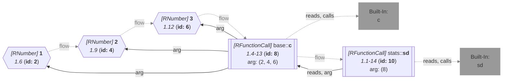

_<span title="an overview of flowR's query API">Generated</span> from '[wiki-query.ts](https://github.com/flowr-analysis/flowr/tree/main/src/documentation/wiki-query.ts "src/documentation/wiki-query.ts")' on 2026-10-24, 20:38:50 UTC (v2.16.6), do not edit directly._
<h2 id="Dependencies Query">Dependencies Query&emsp;<sup>[<a href="https://github.com/flowr-analysis/flowr/wiki/Query-API">overview</a>]</sup></h2>

Returns all direct dependencies (in- and outputs) of a given R script\
_This query is requested with the type `dependencies`._

This query extracts all dependencies from an R script, using a combination of a [Call-Context Query](https://github.com/flowr-analysis/flowr/wiki/%5BQuery%5D-Call-Context)
and more advanced tracking in the [Dataflow Graph](https://github.com/flowr-analysis/flowr/wiki/Dataflow-Graph).
Loaded libraries are resolved against the [signature database](https://github.com/flowr-analysis/flowr/wiki/Signature-Database).

For a script reading `library(x)`, the following query returns the loaded library:

```json
[ { "type": "dependencies" } ]
```

(This can be shortened to `@dependencies` when used with the REPL command <span title="Description (Repl Command): Query the given R code (use 'help' for more information)">`:query`</span>).

_Results (prettified and summarized):_

Query: **dependencies** (4 ms)\
&nbsp;&nbsp;&nbsp;**Libraries** _(1)_\
&nbsp;&nbsp;&nbsp;&nbsp;&nbsp;**x** _via library (node 3)_

<details> <summary style="color:gray">Show Detailed Results as Json</summary>

The analysis ran (including parsing and normalization and the query) within the generation environment.

The JSON contains the ids of the nodes in question (see the [Interface](https://github.com/flowr-analysis/flowr/wiki/Interface) wiki page).

```json
{
  "dependencies": {
    ".meta": {},
    "library": [{"nodeId":3,"functionName":"library","value":"x"}],
    "remote": [],
    "source": [],
    "read": [],
    "write": [],
    "visualize": [],
    "transform": [],
    "test": [],
    "statistics": []
  },
  ".meta": {}
}
```

</details>

The query also handles more complicated scripts and offers information on the loaded _libraries_, _sourced_ files, data which is _read_ and data which is _written_.
For example, consider the following script:

```r

source("sample.R")
foo <- loadNamespace("bar")

data <- read.csv("data.csv")

#' @importFrom ggplot2 ggplot geom_point aes
ggplot(data, aes(x=x, y=y)) + geom_point()

better::write.csv(data, "data2.csv")
print("hello world!")
```

The following query returns the dependencies of the script.

```json
[ { "type": "dependencies" } ]
```

(This can be shortened to `@dependencies` when used with the REPL command <span title="Description (Repl Command): Query the given R code (use 'help' for more information)">`:query`</span>).

 <details> <summary style="color:gray">Show Results</summary>

_Results (prettified and summarized):_

Query: **dependencies** (7 ms)\
&nbsp;&nbsp;&nbsp;**Libraries** _(2)_\
&nbsp;&nbsp;&nbsp;&nbsp;&nbsp;**bar** _via loadNamespace (node 8)_\
&nbsp;&nbsp;&nbsp;&nbsp;&nbsp;**better** _via :: (node 32)_\
&nbsp;&nbsp;&nbsp;**Sourced Files** _(1)_\
&nbsp;&nbsp;&nbsp;&nbsp;&nbsp;**sample.R** _via source (node 3)_\
&nbsp;&nbsp;&nbsp;**Read Data** _(1)_\
&nbsp;&nbsp;&nbsp;&nbsp;&nbsp;**data.csv** _via read.csv (node 14)_\
&nbsp;&nbsp;&nbsp;**Outputs** _(1)_\
&nbsp;&nbsp;&nbsp;&nbsp;&nbsp;**stdout** _via print (node 41)_\
&nbsp;&nbsp;&nbsp;**Visualizations** _(2)_\
&nbsp;&nbsp;&nbsp;&nbsp;&nbsp;_<unresolved>_ _via ggplot (node 28)_\
&nbsp;&nbsp;&nbsp;&nbsp;&nbsp;_<unresolved>_ _via geom_point (node 30, linked 28)_

<details> <summary style="color:gray">Show Detailed Results as Json</summary>

The analysis ran (including parsing and normalization and the query) within the generation environment.

The JSON contains the ids of the nodes in question (see the [Interface](https://github.com/flowr-analysis/flowr/wiki/Interface) wiki page).

```json
{
  "dependencies": {
    ".meta": {},
    "library": [{"nodeId":8,"functionName":"loadNamespace","value":"bar"},{"nodeId":32,"functionName":"::","value":"better"}],
    "remote": [],
    "source": [{"nodeId":3,"functionName":"source","value":"sample.R"}],
    "read": [{"nodeId":14,"functionName":"read.csv","assignedTo":"data","value":"data.csv"}],
    "write": [{"nodeId":41,"functionName":"print","value":"stdout"}],
    "visualize": [
      {"nodeId":28,"functionName":"ggplot","inputVariables":["data","x","y"],"parts":[30]},
      {"nodeId":30,"functionName":"geom_point","linkedIds":[28],"inputVariables":["data","x","y"]}
    ],
    "transform": [],
    "test": [],
    "statistics": []
  },
  ".meta": {}
}
```

</details>

</details>

Currently, the dependency extraction may fail as it is essentially a set of heuristics guessing the dependencies.
We welcome any feedback on this (consider opening a [new issue](https://github.com/flowr-analysis/flowr/issues/new/choose)).

In the meantime we offer several properties to overwrite the default behavior (e.g., function names that should be collected)

```json
[
  {
    "type": "dependencies",
    "ignoreDefaultFunctions": true,
    "enabledCategories": [
      "library"
    ],
    "libraryFunctions": [
      {
        "package": "base",
        "name": "print",
        "argIdx": 0,
        "argName": "library",
        "resolveValue": true
      }
    ]
  }
]
```

 <details> <summary style="color:gray">Show Results</summary>

_Results (prettified and summarized):_

Query: **dependencies** (3 ms)\
&nbsp;&nbsp;&nbsp;**Libraries** _(1)_\
&nbsp;&nbsp;&nbsp;&nbsp;&nbsp;**hello world!** _via print (node 41)_

<details> <summary style="color:gray">Show Detailed Results as Json</summary>

The analysis ran (including parsing and normalization and the query) within the generation environment.

The JSON contains the ids of the nodes in question (see the [Interface](https://github.com/flowr-analysis/flowr/wiki/Interface) wiki page).

```json
{
  "dependencies": {
    ".meta": {},
    "library": [{"nodeId":41,"functionName":"print","value":"hello world!"}],
    "remote": [],
    "source": [],
    "read": [],
    "write": [],
    "visualize": [],
    "transform": [],
    "test": [],
    "statistics": []
  },
  ".meta": {}
}
```

</details>

</details>

Here, `resolveValue` tells the dependency query to resolve the value of this argument in case it is not a constant.

By default the query reports only the dependencies the code names itself. Yet R attaches a handful of base packages
to the search path on startup, so a bare `sd(x)` genuinely depends on `stats` without any `library` call saying so.
Set `assumedPackages` to have those reported as well, as `library` entries marked `implicit` and carrying no
`nodeId` (no single call stands for "R attached this"), with the calls that pulled the package in listed as
`linkedIds`:

```json
[
  {
    "type": "dependencies",
    "assumedPackages": true,
    "enabledCategories": [
      "library"
    ]
  }
]
```

_Results (prettified and summarized):_

Query: **dependencies** (1 ms)\
&nbsp;&nbsp;&nbsp;**Libraries** _(2)_\
&nbsp;&nbsp;&nbsp;&nbsp;&nbsp;**base** _always attached by R, used at 8_\
&nbsp;&nbsp;&nbsp;&nbsp;&nbsp;**stats** _attached by R at startup, used at 10_

<details> <summary style="color:gray">Show Detailed Results as Json</summary>

The analysis ran (including parsing and normalization and the query) within the generation environment.

The JSON contains the ids of the nodes in question (see the [Interface](https://github.com/flowr-analysis/flowr/wiki/Interface) wiki page).

```json
{
  "dependencies": {
    ".meta": {},
    "library": [
      {"functionName":"<attached>","value":"base","implicit":true,"alwaysAttached":true,"linkedIds":[8]},
      {"functionName":"<attached>","value":"stats","implicit":true,"linkedIds":[10]}
    ],
    "remote": [],
    "source": [],
    "read": [],
    "write": [],
    "visualize": [],
    "transform": [],
    "test": [],
    "statistics": []
  },
  ".meta": {}
}
```

</details>

<details> <summary style="color:gray">Original Code</summary>

```r
sd(c(1, 2, 3))
```

<details>

<summary style="color:gray">Dataflow Graph of the R Code</summary>

The analysis ran (parse and normalize with the [r-shell](https://github.com/flowr-analysis/flowr/wiki/Engines) engine) in the generation environment. No [signature database](https://github.com/flowr-analysis/flowr/wiki/Signature-Database) is mounted, so `library()` attaches no exports (base-R names are still qualified, e.g., `stats::acf`). 
We encountered no unknown side effects during the analysis.



</details>

</details>
	
`base` is reported alongside the others but additionally marked `alwaysAttached`. The other six are attached by
convention and `R_DEFAULT_PACKAGES` (or `options(defaultPackages=)`) can drop any of them, whereas `base` is always
there and cannot be detached -- so it is never something the script could have asked for, and never something to
suggest a `library` call for.

Beyond libraries, files and outputs, the query knows the `visualize` category (plots) and the `transform` category
(`Data Transformations`): the calls that reshape, filter, join or aggregate data, like `dplyr::filter`, `tidyr::pivot_longer`,
`merge`, `aggregate` or `data.table::setDT`. The category is read from the built-in configuration: every built-in labeled
`SemanticCallTag.Transforms` belongs to it. Every such built-in names its package, so `filter` is only a transformation when it
resolves to `dplyr` and never for the time-series `stats::filter`.

The `read`, `write`, `visualize`, and `transform` entries additionally state how data flows through the call,
resolved with the [dataflow graph](https://github.com/flowr-analysis/flowr/wiki/Dataflow-Graph) instead of the syntax:
* `inputVariables` (for `write`, `visualize`, and `transform`) are the variables the result is computed from, through every call
  in between. What an argument's role in the signature excludes (a file, a flag, a callee) is no input, nor is what a call quotes or
  looks up in a data mask: `df` for `df |> filter(x > 1)`, both `a` and `b` for `left_join(a, b)`. An addon to a plot draws its data.
* `assignedTo` (for `read`, `visualize`, and `transform`) is the variable the result is stored in, following every call that hands
  it on (a pipe into a call, parentheses, a `+` adding to a plot) up to `<-`, `=` or `->`: `small` for `small <- filter(df, x > 1)`, and
  nothing for `f(filter(df, x > 1))`.
* Every plot additionally carries its `title` (from `ggtitle`, `labs(title = )` or `main =`) and the file it is written to as `savedTo`
  (by `ggsave`, which names its `plot` or saves `last_plot()`, or by the graphics device open when it is drawn).

```json
[ { "type": "dependencies",   "enabledCategories": [ "transform",    "visualize" ] } ]
```

_Results (prettified and summarized):_

Query: **dependencies** (5 ms)\
&nbsp;&nbsp;&nbsp;**Visualizations** _(3)_\
&nbsp;&nbsp;&nbsp;&nbsp;&nbsp;_<unresolved>_ _via ggplot (node 38)_\
&nbsp;&nbsp;&nbsp;&nbsp;&nbsp;_<unresolved>_ _via geom_point (node 40, linked 38)_\
&nbsp;&nbsp;&nbsp;&nbsp;&nbsp;_<unresolved>_ _via ggtitle (node 45, linked 38)_\
&nbsp;&nbsp;&nbsp;**Data Transformations** _(2)_\
&nbsp;&nbsp;&nbsp;&nbsp;&nbsp;_<unresolved>_ _via filter (node 16)_\
&nbsp;&nbsp;&nbsp;&nbsp;&nbsp;_<unresolved>_ _via select (node 24)_

<details> <summary style="color:gray">Show Detailed Results as Json</summary>

The analysis ran (including parsing and normalization and the query) within the generation environment.

The JSON contains the ids of the nodes in question (see the [Interface](https://github.com/flowr-analysis/flowr/wiki/Interface) wiki page).

```json
{
  "dependencies": {
    ".meta": {},
    "library": [],
    "remote": [],
    "source": [],
    "read": [],
    "write": [],
    "visualize": [
      {"nodeId":38,"functionName":["ggplot","ggplot2",false],"inputVariables":["small"],"assignedTo":"p","parts":[40,45],"title":"Small"},
      {"nodeId":40,"functionName":["geom_point","ggplot2",false],"linkedIds":[38],"assignedTo":"p","inputVariables":["small"]},
      {"nodeId":45,"functionName":["ggtitle","ggplot2",false],"linkedIds":[38],"assignedTo":"p","inputVariables":["small"]}
    ],
    "transform": [
      {"nodeId":16,"functionName":["filter","dplyr",false],"inputVariables":["measurements"]},
      {"nodeId":24,"functionName":["select","dplyr",false],"inputVariables":["measurements"],"assignedTo":"small"}
    ],
    "test": [],
    "statistics": []
  },
  ".meta": {}
}
```

</details>

<details> <summary style="color:gray">Original Code</summary>

```r

library(dplyr)
library(ggplot2)
small <- measurements |> filter(x > 1) |> select(x, y)
p <- ggplot(small, aes(x, y)) + geom_point() + ggtitle("Small")
ggsave("small.png", plot = p)
```

<details>

<summary style="color:gray">Dataflow Graph of the R Code</summary>

The analysis ran (parse and normalize with the [r-shell](https://github.com/flowr-analysis/flowr/wiki/Engines) engine) in the generation environment. No [signature database](https://github.com/flowr-analysis/flowr/wiki/Signature-Database) is mounted, so `library()` attaches no exports (base-R names are still qualified, e.g., `stats::acf`). 
We encountered unknown side effects (with ids: 38 (linked)) during the analysis.

```mermaid
flowchart LR
    1{{"`*#91;RSymbol#93;* **dplyr**
      *2.9-13* (**id: 1**)`"}}
    3[["`*#91;RFunctionCall#93;* base#58;#58;**library**
      *2.1-14* (**id: 3**)
    arg: (1)`"]]
    built-in:library["`Built-In:
library`"]
    style built-in:library stroke:gray,fill:gray,stroke-width:2px,opacity:.8;
    5{{"`*#91;RSymbol#93;* **ggplot2**
      *3.9-15* (**id: 5**)`"}}
    7[["`*#91;RFunctionCall#93;* base#58;#58;**library**
      *3.1-16* (**id: 7**)
    arg: (5)`"]]
    9(["`*#91;RSymbol#93;* **measurements**
      *4.10-21* (**id: 9**)`"])
    12(["`*#91;RSymbol#93;* **x**
      *4.33* (**id: 12**)`"])
    13{{"`*#91;RNumber#93;* **1**
      *4.37* (**id: 13**)`"}}
    14[["`*#91;RBinaryOp#93;* base#58;#58;**#62;**
      *4.33-37* (**id: 14**)
    arg: (12, 13)`"]]
    built-in:_62_["`Built-In:
#62;`"]
    style built-in:_62_ stroke:gray,fill:gray,stroke-width:2px,opacity:.8;
    16[["`*#91;RFunctionCall#93;* stats#58;#58;**filter**
      *4.26-38* (**id: 16**)
    arg: (9, 14)`"]]
    built-in:filter["`Built-In:
filter`"]
    style built-in:filter stroke:gray,fill:gray,stroke-width:2px,opacity:.8;
    17[["`*#91;RPipe#93;* **|#62;**
      *4.10-38* (**id: 17**)
    arg: (9, 16)`"]]
    built-in:_124__62_["`Built-In:
|#62;`"]
    style built-in:_124__62_ stroke:gray,fill:gray,stroke-width:2px,opacity:.8;
    20(["`*#91;RSymbol#93;* **x**
      *4.50* (**id: 20**)`"])
    22(["`*#91;RSymbol#93;* **y**
      *4.53* (**id: 22**)`"])
    24[["`*#91;RFunctionCall#93;* **select**
      *4.43-54* (**id: 24**)
    arg: (17, 20, 22)`"]]
    built-in:select["`Built-In:
select`"]
    style built-in:select stroke:gray,fill:gray,stroke-width:2px,opacity:.8;
    25[["`*#91;RPipe#93;* **|#62;**
      *4.10-54* (**id: 25**)
    arg: (17, 24)`"]]
    8["`*#91;RSymbol#93;* **small**
      *4.1-5* (**id: 8**, v: 25)`"]
    26[["`*#91;RBinaryOp#93;* base#58;#58;**#60;#45;**
      *4.1-54* (**id: 26**)
    arg: (8, 25)`"]]
    built-in:_60_-["`Built-In:
#60;#45;`"]
    style built-in:_60_- stroke:gray,fill:gray,stroke-width:2px,opacity:.8;
    29(["`*#91;RSymbol#93;* **small**
      *5.13-17* (**id: 29**)`"])
    32(["`*#91;RSymbol#93;* **x**
      *5.24* (**id: 32**)`"])
    34(["`*#91;RSymbol#93;* **y**
      *5.27* (**id: 34**)`"])
    36[["`*#91;RFunctionCall#93;* **aes**
      *5.20-28* (**id: 36**)
    arg: (32, 34)`"]]
    built-in:aes["`Built-In:
aes`"]
    style built-in:aes stroke:gray,fill:gray,stroke-width:2px,opacity:.8;
    38[["`*#91;RFunctionCall#93;* **ggplot**
      *5.6-29* (**id: 38**)
    arg: (29, 36)`"]]
    built-in:ggplot["`Built-In:
ggplot`"]
    style built-in:ggplot stroke:gray,fill:gray,stroke-width:2px,opacity:.8;
    40[["`*#91;RFunctionCall#93;* **geom#95;point**
      *5.33-44* (**id: 40**)`"]]
    built-in:geom_point["`Built-In:
geom#95;point`"]
    style built-in:geom_point stroke:gray,fill:gray,stroke-width:2px,opacity:.8;
    41[["`*#91;RBinaryOp#93;* base#58;#58;**#43;**
      *5.6-44* (**id: 41**)
    arg: (38, 40)`"]]
    built-in:_43_["`Built-In:
#43;`"]
    style built-in:_43_ stroke:gray,fill:gray,stroke-width:2px,opacity:.8;
    43{{"`*#91;RString#93;* **#34;Small#34;**
      *5.56-62* (**id: 43**)`"}}
    45[["`*#91;RFunctionCall#93;* **ggtitle**
      *5.48-63* (**id: 45**)
    arg: (43)`"]]
    built-in:ggtitle["`Built-In:
ggtitle`"]
    style built-in:ggtitle stroke:gray,fill:gray,stroke-width:2px,opacity:.8;
    46[["`*#91;RBinaryOp#93;* base#58;#58;**#43;**
      *5.6-63* (**id: 46**)
    arg: (41, 45)`"]]
    27["`*#91;RSymbol#93;* **p**
      *5.1* (**id: 27**, v: 46)`"]
    47[["`*#91;RBinaryOp#93;* base#58;#58;**#60;#45;**
      *5.1-63* (**id: 47**)
    arg: (27, 46)`"]]
    49{{"`*#91;RString#93;* **#34;small.png#34;**
      *6.8-18* (**id: 49**)`"}}
    52(["`*#91;RSymbol#93;* **p**
      *6.28* (**id: 52**)`"])
    53(["`*#91;RArgument#93;* **plot**
      *6.21-24* (**id: 53**)`"])
    %% Environment of 54 [level: 0]:
    %% Built-in
    %% 1----------------------------------------
    %%   filter:             {**dplyr::filter** (id: built-in:filter, type: BuiltInFunction, def. @built-in:filter)}
    %%   filter_out:         {**dplyr::filter_out** (id: built-in:filter_out, type: BuiltInFunction, def. @built-in:filter_out)}
    %%   mutate:             {**dplyr::mutate** (id: built-in:mutate, type: BuiltInFunction, def. @built-in:mutate)}
    %%   transmute:          {**dplyr::transmute** (id: built-in:transmute, type: BuiltInFunction, def. @built-in:transmute)}
    %%   summarise:          {**dplyr::summarise** (id: built-in:summarise, type: BuiltInFunction, def. @built-in:summarise)}
    %%   summarize:          {**dplyr::summarize** (id: built-in:summarize, type: BuiltInFunction, def. @built-in:summarize)}
    %%   arrange:            {**dplyr::arrange** (id: built-in:arrange, type: BuiltInFunction, def. @built-in:arrange)}
    %%   group_by:           {**dplyr::group_by** (id: built-in:group_by, type: BuiltInFunction, def. @built-in:group_by)}
    %%   distinct:           {**dplyr::distinct** (id: built-in:distinct, type: BuiltInFunction, def. @built-in:distinct)}
    %%   count:              {**dplyr::count** (id: built-in:count, type: BuiltInFunction, def. @built-in:count)}
    %%   tally:              {**dplyr::tally** (id: built-in:tally, type: BuiltInFunction, def. @built-in:tally)}
    %%   reframe:            {**dplyr::reframe** (id: built-in:reframe, type: BuiltInFunction, def. @built-in:reframe)}
    %%   slice:              {**dplyr::slice** (id: built-in:slice, type: BuiltInFunction, def. @built-in:slice)}
    %%   slice_head:         {**dplyr::slice_head** (id: built-in:slice_head, type: BuiltInFunction, def. @built-in:slice_head)}
    %%   slice_tail:         {**dplyr::slice_tail** (id: built-in:slice_tail, type: BuiltInFunction, def. @built-in:slice_tail)}
    %%   slice_min:          {**dplyr::slice_min** (id: built-in:slice_min, type: BuiltInFunction, def. @built-in:slice_min)}
    %%   slice_max:          {**dplyr::slice_max** (id: built-in:slice_max, type: BuiltInFunction, def. @built-in:slice_max)}
    %%   slice_sample:       {**dplyr::slice_sample** (id: built-in:slice_sample, type: BuiltInFunction, def. @built-in:slice_sample)}
    %%   pull:               {**dplyr::pull** (id: built-in:pull, type: BuiltInFunction, def. @built-in:pull)}
    %%   rename:             {**dplyr::rename** (id: built-in:rename, type: BuiltInFunction, def. @built-in:rename)}
    %%   relocate:           {**dplyr::relocate** (id: built-in:relocate, type: BuiltInFunction, def. @built-in:relocate)}
    %%   select:             {**dplyr::select** (id: built-in:select, type: BuiltInFunction, def. @built-in:select)}
    %%   group_split:        {**dplyr::group_split** (id: built-in:group_split, type: BuiltInFunction, def. @built-in:group_split)}
    %%   add_count:          {**dplyr::add_count** (id: built-in:add_count, type: BuiltInFunction, def. @built-in:add_count)}
    %%   add_tally:          {**dplyr::add_tally** (id: built-in:add_tally, type: BuiltInFunction, def. @built-in:add_tally)}
    %%   nest_by:            {**dplyr::nest_by** (id: built-in:nest_by, type: BuiltInFunction, def. @built-in:nest_by)}
    %%   rowwise:            {**dplyr::rowwise** (id: built-in:rowwise, type: BuiltInFunction, def. @built-in:rowwise)}
    %%   with_groups:        {**dplyr::with_groups** (id: built-in:with_groups, type: BuiltInFunction, def. @built-in:with_groups)}
    %%   ungroup:            {**dplyr::ungroup** (id: built-in:ungroup, type: BuiltInFunction, def. @built-in:ungroup)}
    %%   left_join:          {**dplyr::left_join** (id: built-in:left_join, type: BuiltInFunction, def. @built-in:left_join)}
    %%   right_join:         {**dplyr::right_join** (id: built-in:right_join, type: BuiltInFunction, def. @built-in:right_join)}
    %%   inner_join:         {**dplyr::inner_join** (id: built-in:inner_join, type: BuiltInFunction, def. @built-in:inner_join)}
    %%   full_join:          {**dplyr::full_join** (id: built-in:full_join, type: BuiltInFunction, def. @built-in:full_join)}
    %%   semi_join:          {**dplyr::semi_join** (id: built-in:semi_join, type: BuiltInFunction, def. @built-in:semi_join)}
    %%   anti_join:          {**dplyr::anti_join** (id: built-in:anti_join, type: BuiltInFunction, def. @built-in:anti_join)}
    %%   nest_join:          {**dplyr::nest_join** (id: built-in:nest_join, type: BuiltInFunction, def. @built-in:nest_join)}
    %%   cross_join:         {**dplyr::cross_join** (id: built-in:cross_join, type: BuiltInFunction, def. @built-in:cross_join)}
    %%   bind_rows:          {**dplyr::bind_rows** (id: built-in:bind_rows, type: BuiltInFunction, def. @built-in:bind_rows)}
    %%   bind_cols:          {**dplyr::bind_cols** (id: built-in:bind_cols, type: BuiltInFunction, def. @built-in:bind_cols)}
    %%   mutate_all:         {**dplyr::mutate_all** (id: built-in:mutate_all, type: BuiltInFunction, def. @built-in:mutate_all)}
    %%   mutate_at:          {**dplyr::mutate_at** (id: built-in:mutate_at, type: BuiltInFunction, def. @built-in:mutate_at)}
    %%   mutate_if:          {**dplyr::mutate_if** (id: built-in:mutate_if, type: BuiltInFunction, def. @built-in:mutate_if)}
    %%   transmute_all:      {**dplyr::transmute_all** (id: built-in:transmute_all, type: BuiltInFunction, def. @built-in:transmute_all)}
    %%   transmute_at:       {**dplyr::transmute_at** (id: built-in:transmute_at, type: BuiltInFunction, def. @built-in:transmute_at)}
    %%   transmute_if:       {**dplyr::transmute_if** (id: built-in:transmute_if, type: BuiltInFunction, def. @built-in:transmute_if)}
    %%   filter_all:         {**dplyr::filter_all** (id: built-in:filter_all, type: BuiltInFunction, def. @built-in:filter_all)}
    %%   filter_at:          {**dplyr::filter_at** (id: built-in:filter_at, type: BuiltInFunction, def. @built-in:filter_at)}
    %%   filter_if:          {**dplyr::filter_if** (id: built-in:filter_if, type: BuiltInFunction, def. @built-in:filter_if)}
    %%   select_all:         {**dplyr::select_all** (id: built-in:select_all, type: BuiltInFunction, def. @built-in:select_all)}
    %%   select_at:          {**dplyr::select_at** (id: built-in:select_at, type: BuiltInFunction, def. @built-in:select_at)}
    %%   select_if:          {**dplyr::select_if** (id: built-in:select_if, type: BuiltInFunction, def. @built-in:select_if)}
    %%   rename_all:         {**dplyr::rename_all** (id: built-in:rename_all, type: BuiltInFunction, def. @built-in:rename_all)}
    %%   rename_at:          {**dplyr::rename_at** (id: built-in:rename_at, type: BuiltInFunction, def. @built-in:rename_at)}
    %%   rename_if:          {**dplyr::rename_if** (id: built-in:rename_if, type: BuiltInFunction, def. @built-in:rename_if)}
    %%   arrange_all:        {**dplyr::arrange_all** (id: built-in:arrange_all, type: BuiltInFunction, def. @built-in:arrange_all)}
    %%   arrange_at:         {**dplyr::arrange_at** (id: built-in:arrange_at, type: BuiltInFunction, def. @built-in:arrange_at)}
    %%   arrange_if:         {**dplyr::arrange_if** (id: built-in:arrange_if, type: BuiltInFunction, def. @built-in:arrange_if)}
    %%   summarise_all:      {**dplyr::summarise_all** (id: built-in:summarise_all, type: BuiltInFunction, def. @built-in:summarise_all)}
    %%   summarise_at:       {**dplyr::summarise_at** (id: built-in:summarise_at, type: BuiltInFunction, def. @built-in:summarise_at)}
    %%   summarise_if:       {**dplyr::summarise_if** (id: built-in:summarise_if, type: BuiltInFunction, def. @built-in:summarise_if)}
    %%   summarize_all:      {**dplyr::summarize_all** (id: built-in:summarize_all, type: BuiltInFunction, def. @built-in:summarize_all)}
    %%   summarize_at:       {**dplyr::summarize_at** (id: built-in:summarize_at, type: BuiltInFunction, def. @built-in:summarize_at)}
    %%   summarize_if:       {**dplyr::summarize_if** (id: built-in:summarize_if, type: BuiltInFunction, def. @built-in:summarize_if)}
    %%   group_by_all:       {**dplyr::group_by_all** (id: built-in:group_by_all, type: BuiltInFunction, def. @built-in:group_by_all)}
    %%   group_by_at:        {**dplyr::group_by_at** (id: built-in:group_by_at, type: BuiltInFunction, def. @built-in:group_by_at)}
    %%   group_by_if:        {**dplyr::group_by_if** (id: built-in:group_by_if, type: BuiltInFunction, def. @built-in:group_by_if)}
    %%   distinct_all:       {**dplyr::distinct_all** (id: built-in:distinct_all, type: BuiltInFunction, def. @built-in:distinct_all)}
    %%   distinct_at:        {**dplyr::distinct_at** (id: built-in:distinct_at, type: BuiltInFunction, def. @built-in:distinct_at)}
    %%   distinct_if:        {**dplyr::distinct_if** (id: built-in:distinct_if, type: BuiltInFunction, def. @built-in:distinct_if)}
    %%   join_by:            {**dplyr::join_by** (id: built-in:join_by, type: BuiltInFunction, def. @built-in:join_by)}
    %%   tibble:             {**dplyr::tibble** (id: built-in:tibble, type: BuiltInFunction, def. @built-in:tibble)}
    %%   tribble:            {**dplyr::tribble** (id: built-in:tribble, type: BuiltInFunction, def. @built-in:tribble)}
    %%   copy_to:            {**dplyr::copy_to** (id: built-in:copy_to, type: BuiltInFunction, def. @built-in:copy_to)}
    %%   if_else:            {**dplyr::if_else** (id: built-in:if_else, type: BuiltInFunction, def. @built-in:if_else)}
    %%   %>%:                {**dplyr::%>%** (id: built-in:%>%, type: BuiltInFunction, def. @built-in:%>%)}
    %%   across:             {**dplyr::across** (id: built-in:across, type: BuiltInFunction, def. @built-in:across)}
    %%   rename_with:        {**dplyr::rename_with** (id: built-in:rename_with, type: BuiltInFunction, def. @built-in:rename_with)}
    %%   quo:                {**dplyr::quo** (id: built-in:quo, type: BuiltInFunction, def. @built-in:quo)}
    %%   quos:               {**dplyr::quos** (id: built-in:quos, type: BuiltInFunction, def. @built-in:quos)}
    %%   expr:               {**dplyr::expr** (id: built-in:expr, type: BuiltInFunction, def. @built-in:expr)}
    %%   enexpr:             {**dplyr::enexpr** (id: built-in:enexpr, type: BuiltInFunction, def. @built-in:enexpr)}
    %%   enexprs:            {**dplyr::enexprs** (id: built-in:enexprs, type: BuiltInFunction, def. @built-in:enexprs)}
    %%   enquo:              {**dplyr::enquo** (id: built-in:enquo, type: BuiltInFunction, def. @built-in:enquo)}
    %%   enquos:             {**dplyr::enquos** (id: built-in:enquos, type: BuiltInFunction, def. @built-in:enquos)}
    %%   ensym:              {**dplyr::ensym** (id: built-in:ensym, type: BuiltInFunction, def. @built-in:ensym)}
    %%   ensyms:             {**dplyr::ensyms** (id: built-in:ensyms, type: BuiltInFunction, def. @built-in:ensyms)}
    %%   sym:                {**dplyr::sym** (id: built-in:sym, type: BuiltInFunction, def. @built-in:sym)}
    %%   syms:               {**dplyr::syms** (id: built-in:syms, type: BuiltInFunction, def. @built-in:syms)}
    %%   quo_name:           {**dplyr::quo_name** (id: built-in:quo_name, type: BuiltInFunction, def. @built-in:quo_name)}
    %%   as_label:           {**dplyr::as_label** (id: built-in:as_label, type: BuiltInFunction, def. @built-in:as_label)}
    %%   sql:                {**dplyr::sql** (id: built-in:sql, type: BuiltInFunction, def. @built-in:sql)}
    %%   id:                 {**dplyr::id** (id: built-in:id, type: BuiltInFunction, def. @built-in:id)}
    %%   progress_estimated: {**dplyr::progress_estimated** (id: built-in:progress_estimated, type: BuiltInFunction, def. @built-in:progress_estimated)}
    %%   add_rownames:       {**dplyr::add_rownames** (id: built-in:add_rownames, type: BuiltInFunction, def. @built-in:add_rownames)}
    %%   tbl_df:             {**dplyr::tbl_df** (id: built-in:tbl_df, type: BuiltInFunction, def. @built-in:tbl_df)}
    %%   src_local:          {**dplyr::src_local** (id: built-in:src_local, type: BuiltInFunction, def. @built-in:src_local)}
    %%   summarise_each:     {**dplyr::summarise_each** (id: built-in:summarise_each, type: BuiltInFunction, def. @built-in:summarise_each)}
    %%   summarize_:         {**dplyr::summarize_** (id: built-in:summarize_, type: BuiltInFunction, def. @built-in:summarize_)}
    %%   summarise_:         {**dplyr::summarise_** (id: built-in:summarise_, type: BuiltInFunction, def. @built-in:summarise_)}
    %%   slice_:             {**dplyr::slice_** (id: built-in:slice_, type: BuiltInFunction, def. @built-in:slice_)}
    %%   select_vars_:       {**dplyr::select_vars_** (id: built-in:select_vars_, type: BuiltInFunction, def. @built-in:select_vars_)}
    %%   select_:            {**dplyr::select_** (id: built-in:select_, type: BuiltInFunction, def. @built-in:select_)}
    %%   rename_vars_:       {**dplyr::rename_vars_** (id: built-in:rename_vars_, type: BuiltInFunction, def. @built-in:rename_vars_)}
    %%   rename_:            {**dplyr::rename_** (id: built-in:rename_, type: BuiltInFunction, def. @built-in:rename_)}
    %%   transmute_:         {**dplyr::transmute_** (id: built-in:transmute_, type: BuiltInFunction, def. @built-in:transmute_)}
    %%   tally_:             {**dplyr::tally_** (id: built-in:tally_, type: BuiltInFunction, def. @built-in:tally_)}
    %%   mutate_:            {**dplyr::mutate_** (id: built-in:mutate_, type: BuiltInFunction, def. @built-in:mutate_)}
    %%   group_indices_:     {**dplyr::group_indices_** (id: built-in:group_indices_, type: BuiltInFunction, def. @built-in:group_indices_)}
    %%   group_by_:          {**dplyr::group_by_** (id: built-in:group_by_, type: BuiltInFunction, def. @built-in:group_by_)}
    %%   funs_:              {**dplyr::funs_** (id: built-in:funs_, type: BuiltInFunction, def. @built-in:funs_)}
    %%   filter_:            {**dplyr::filter_** (id: built-in:filter_, type: BuiltInFunction, def. @built-in:filter_)}
    %%   do_:                {**dplyr::do_** (id: built-in:do_, type: BuiltInFunction, def. @built-in:do_)}
    %%   distinct_:          {**dplyr::distinct_** (id: built-in:distinct_, type: BuiltInFunction, def. @built-in:distinct_)}
    %%   count_:             {**dplyr::count_** (id: built-in:count_, type: BuiltInFunction, def. @built-in:count_)}
    %%   arrange_:           {**dplyr::arrange_** (id: built-in:arrange_, type: BuiltInFunction, def. @built-in:arrange_)}
    %%   add_tally_:         {**dplyr::add_tally_** (id: built-in:add_tally_, type: BuiltInFunction, def. @built-in:add_tally_)}
    %%   add_count_:         {**dplyr::add_count_** (id: built-in:add_count_, type: BuiltInFunction, def. @built-in:add_count_)}
    %%   funs:               {**dplyr::funs** (id: built-in:funs, type: BuiltInFunction, def. @built-in:funs)}
    %%   combine:            {**dplyr::combine** (id: built-in:combine, type: BuiltInFunction, def. @built-in:combine)}
    %%   changes:            {**dplyr::changes** (id: built-in:changes, type: BuiltInFunction, def. @built-in:changes)}
    %%   location:           {**dplyr::location** (id: built-in:location, type: BuiltInFunction, def. @built-in:location)}
    %%   eval_tbls2:         {**dplyr::eval_tbls2** (id: built-in:eval_tbls2, type: BuiltInFunction, def. @built-in:eval_tbls2)}
    %%   eval_tbls:          {**dplyr::eval_tbls** (id: built-in:eval_tbls, type: BuiltInFunction, def. @built-in:eval_tbls)}
    %%   compare_tbls2:      {**dplyr::compare_tbls2** (id: built-in:compare_tbls2, type: BuiltInFunction, def. @built-in:compare_tbls2)}
    %%   compare_tbls:       {**dplyr::compare_tbls** (id: built-in:compare_tbls, type: BuiltInFunction, def. @built-in:compare_tbls)}
    %%   bench_tbls:         {**dplyr::bench_tbls** (id: built-in:bench_tbls, type: BuiltInFunction, def. @built-in:bench_tbls)}
    %%   current_vars:       {**dplyr::current_vars** (id: built-in:current_vars, type: BuiltInFunction, def. @built-in:current_vars)}
    %%   select_var:         {**dplyr::select_var** (id: built-in:select_var, type: BuiltInFunction, def. @built-in:select_var)}
    %%   rename_vars:        {**dplyr::rename_vars** (id: built-in:rename_vars, type: BuiltInFunction, def. @built-in:rename_vars)}
    %%   select_vars:        {**dplyr::select_vars** (id: built-in:select_vars, type: BuiltInFunction, def. @built-in:select_vars)}
    %%   failwith:           {**dplyr::failwith** (id: built-in:failwith, type: BuiltInFunction, def. @built-in:failwith)}
    %%   all_equal:          {**dplyr::all_equal** (id: built-in:all_equal, type: BuiltInFunction, def. @built-in:all_equal)}
    %%   top_n:              {**dplyr::top_n** (id: built-in:top_n, type: BuiltInFunction, def. @built-in:top_n)}
    %%   sample_n:           {**dplyr::sample_n** (id: built-in:sample_n, type: BuiltInFunction, def. @built-in:sample_n)}
    %%   recode:             {**dplyr::recode** (id: built-in:recode, type: BuiltInFunction, def. @built-in:recode)}
    %%   group_nest:         {**dplyr::group_nest** (id: built-in:group_nest, type: BuiltInFunction, def. @built-in:group_nest)}
    %%   do:                 {**dplyr::do** (id: built-in:do, type: BuiltInFunction, def. @built-in:do)}
    %%   all_vars:           {**dplyr::all_vars** (id: built-in:all_vars, type: BuiltInFunction, def. @built-in:all_vars)}
    %%   vars:               {**dplyr::vars** (id: built-in:vars, type: BuiltInFunction, def. @built-in:vars)}
    %%   sample_frac:        {**dplyr::sample_frac** (id: built-in:sample_frac, type: BuiltInFunction, def. @built-in:sample_frac)}
    %%    library-load:      {**dplyr:: library-load** (id: 3, type: Function, def. @3)}
    %% 2----------------------------------------
    %%   aes:                        {**ggplot2::aes** (id: built-in:aes, type: BuiltInFunction, def. @built-in:aes)}
    %%   vars:                       {**ggplot2::vars** (id: built-in:vars, type: BuiltInFunction, def. @built-in:vars)}
    %%   ggsave:                     {**ggplot2::ggsave** (id: built-in:ggsave, type: BuiltInFunction, def. @built-in:ggsave)}
    %%   ggplot:                     {**ggplot2::ggplot** (id: built-in:ggplot, type: BuiltInFunction, def. @built-in:ggplot)}
    %%   qplot:                      {**ggplot2::qplot** (id: built-in:qplot, type: BuiltInFunction, def. @built-in:qplot)}
    %%   quickplot:                  {**ggplot2::quickplot** (id: built-in:quickplot, type: BuiltInFunction, def. @built-in:quickplot)}
    %%   autoplot:                   {**ggplot2::autoplot** (id: built-in:autoplot, type: BuiltInFunction, def. @built-in:autoplot)}
    %%   geom_count:                 {**ggplot2::geom_count** (id: built-in:geom_count, type: BuiltInFunction, def. @built-in:geom_count)}
    %%   geom_bin_2d:                {**ggplot2::geom_bin_2d** (id: built-in:geom_bin_2d, type: BuiltInFunction, def. @built-in:geom_bin_2d)}
    %%   geom_spoke:                 {**ggplot2::geom_spoke** (id: built-in:geom_spoke, type: BuiltInFunction, def. @built-in:geom_spoke)}
    %%   geom_tile:                  {**ggplot2::geom_tile** (id: built-in:geom_tile, type: BuiltInFunction, def. @built-in:geom_tile)}
    %%   geom_rect:                  {**ggplot2::geom_rect** (id: built-in:geom_rect, type: BuiltInFunction, def. @built-in:geom_rect)}
    %%   geom_function:              {**ggplot2::geom_function** (id: built-in:geom_function, type: BuiltInFunction, def. @built-in:geom_function)}
    %%   geom_crossbar:              {**ggplot2::geom_crossbar** (id: built-in:geom_crossbar, type: BuiltInFunction, def. @built-in:geom_crossbar)}
    %%   geom_density2d:             {**ggplot2::geom_density2d** (id: built-in:geom_density2d, type: BuiltInFunction, def. @built-in:geom_density2d)}
    %%   geom_abline:                {**ggplot2::geom_abline** (id: built-in:geom_abline, type: BuiltInFunction, def. @built-in:geom_abline)}
    %%   geom_errorbar:              {**ggplot2::geom_errorbar** (id: built-in:geom_errorbar, type: BuiltInFunction, def. @built-in:geom_errorbar)}
    %%   geom_errorbarh:             {**ggplot2::geom_errorbarh** (id: built-in:geom_errorbarh, type: BuiltInFunction, def. @built-in:geom_errorbarh)}
    %%   geom_jitter:                {**ggplot2::geom_jitter** (id: built-in:geom_jitter, type: BuiltInFunction, def. @built-in:geom_jitter)}
    %%   geom_line:                  {**ggplot2::geom_line** (id: built-in:geom_line, type: BuiltInFunction, def. @built-in:geom_line)}
    %%   geom_density:               {**ggplot2::geom_density** (id: built-in:geom_density, type: BuiltInFunction, def. @built-in:geom_density)}
    %%   geom_quantile:              {**ggplot2::geom_quantile** (id: built-in:geom_quantile, type: BuiltInFunction, def. @built-in:geom_quantile)}
    %%   geom_qq:                    {**ggplot2::geom_qq** (id: built-in:geom_qq, type: BuiltInFunction, def. @built-in:geom_qq)}
    %%   geom_qq_line:               {**ggplot2::geom_qq_line** (id: built-in:geom_qq_line, type: BuiltInFunction, def. @built-in:geom_qq_line)}
    %%   geom_segment:               {**ggplot2::geom_segment** (id: built-in:geom_segment, type: BuiltInFunction, def. @built-in:geom_segment)}
    %%   geom_label:                 {**ggplot2::geom_label** (id: built-in:geom_label, type: BuiltInFunction, def. @built-in:geom_label)}
    %%   geom_density_2d:            {**ggplot2::geom_density_2d** (id: built-in:geom_density_2d, type: BuiltInFunction, def. @built-in:geom_density_2d)}
    %%   geom_violin:                {**ggplot2::geom_violin** (id: built-in:geom_violin, type: BuiltInFunction, def. @built-in:geom_violin)}
    %%   geom_contour:               {**ggplot2::geom_contour** (id: built-in:geom_contour, type: BuiltInFunction, def. @built-in:geom_contour)}
    %%   geom_boxplot:               {**ggplot2::geom_boxplot** (id: built-in:geom_boxplot, type: BuiltInFunction, def. @built-in:geom_boxplot)}
    %%   geom_col:                   {**ggplot2::geom_col** (id: built-in:geom_col, type: BuiltInFunction, def. @built-in:geom_col)}
    %%   geom_blank:                 {**ggplot2::geom_blank** (id: built-in:geom_blank, type: BuiltInFunction, def. @built-in:geom_blank)}
    %%   geom_histogram:             {**ggplot2::geom_histogram** (id: built-in:geom_histogram, type: BuiltInFunction, def. @built-in:geom_histogram)}
    %%   geom_hline:                 {**ggplot2::geom_hline** (id: built-in:geom_hline, type: BuiltInFunction, def. @built-in:geom_hline)}
    %%   geom_area:                  {**ggplot2::geom_area** (id: built-in:geom_area, type: BuiltInFunction, def. @built-in:geom_area)}
    %%   geom_sf_text:               {**ggplot2::geom_sf_text** (id: built-in:geom_sf_text, type: BuiltInFunction, def. @built-in:geom_sf_text)}
    %%   geom_smooth:                {**ggplot2::geom_smooth** (id: built-in:geom_smooth, type: BuiltInFunction, def. @built-in:geom_smooth)}
    %%   geom_text:                  {**ggplot2::geom_text** (id: built-in:geom_text, type: BuiltInFunction, def. @built-in:geom_text)}
    %%   geom_density2d_filled:      {**ggplot2::geom_density2d_filled** (id: built-in:geom_density2d_filled, type: BuiltInFunction, def. @built-in:geom_density2d_filled)}
    %%   geom_ribbon:                {**ggplot2::geom_ribbon** (id: built-in:geom_ribbon, type: BuiltInFunction, def. @built-in:geom_ribbon)}
    %%   geom_sf:                    {**ggplot2::geom_sf** (id: built-in:geom_sf, type: BuiltInFunction, def. @built-in:geom_sf)}
    %%   geom_dotplot:               {**ggplot2::geom_dotplot** (id: built-in:geom_dotplot, type: BuiltInFunction, def. @built-in:geom_dotplot)}
    %%   geom_freqpoly:              {**ggplot2::geom_freqpoly** (id: built-in:geom_freqpoly, type: BuiltInFunction, def. @built-in:geom_freqpoly)}
    %%   geom_step:                  {**ggplot2::geom_step** (id: built-in:geom_step, type: BuiltInFunction, def. @built-in:geom_step)}
    %%   geom_map:                   {**ggplot2::geom_map** (id: built-in:geom_map, type: BuiltInFunction, def. @built-in:geom_map)}
    %%   geom_bin2d:                 {**ggplot2::geom_bin2d** (id: built-in:geom_bin2d, type: BuiltInFunction, def. @built-in:geom_bin2d)}
    %%   geom_rug:                   {**ggplot2::geom_rug** (id: built-in:geom_rug, type: BuiltInFunction, def. @built-in:geom_rug)}
    %%   geom_raster:                {**ggplot2::geom_raster** (id: built-in:geom_raster, type: BuiltInFunction, def. @built-in:geom_raster)}
    %%   geom_pointrange:            {**ggplot2::geom_pointrange** (id: built-in:geom_pointrange, type: BuiltInFunction, def. @built-in:geom_pointrange)}
    %%   geom_point:                 {**ggplot2::geom_point** (id: built-in:geom_point, type: BuiltInFunction, def. @built-in:geom_point)}
    %%   geom_hex:                   {**ggplot2::geom_hex** (id: built-in:geom_hex, type: BuiltInFunction, def. @built-in:geom_hex)}
    %%   geom_contour_filled:        {**ggplot2::geom_contour_filled** (id: built-in:geom_contour_filled, type: BuiltInFunction, def. @built-in:geom_contour_filled)}
    %%   geom_bar:                   {**ggplot2::geom_bar** (id: built-in:geom_bar, type: BuiltInFunction, def. @built-in:geom_bar)}
    %%   geom_vline:                 {**ggplot2::geom_vline** (id: built-in:geom_vline, type: BuiltInFunction, def. @built-in:geom_vline)}
    %%   geom_linerange:             {**ggplot2::geom_linerange** (id: built-in:geom_linerange, type: BuiltInFunction, def. @built-in:geom_linerange)}
    %%   geom_curve:                 {**ggplot2::geom_curve** (id: built-in:geom_curve, type: BuiltInFunction, def. @built-in:geom_curve)}
    %%   geom_path:                  {**ggplot2::geom_path** (id: built-in:geom_path, type: BuiltInFunction, def. @built-in:geom_path)}
    %%   geom_polygon:               {**ggplot2::geom_polygon** (id: built-in:geom_polygon, type: BuiltInFunction, def. @built-in:geom_polygon)}
    %%   geom_sf_label:              {**ggplot2::geom_sf_label** (id: built-in:geom_sf_label, type: BuiltInFunction, def. @built-in:geom_sf_label)}
    %%   geom_density_2d_filled:     {**ggplot2::geom_density_2d_filled** (id: built-in:geom_density_2d_filled, type: BuiltInFunction, def. @built-in:geom_density_2d_filled)}
    %%   stat_count:                 {**ggplot2::stat_count** (id: built-in:stat_count, type: BuiltInFunction, def. @built-in:stat_count)}
    %%   stat_density:               {**ggplot2::stat_density** (id: built-in:stat_density, type: BuiltInFunction, def. @built-in:stat_density)}
    %%   stat_bin_hex:               {**ggplot2::stat_bin_hex** (id: built-in:stat_bin_hex, type: BuiltInFunction, def. @built-in:stat_bin_hex)}
    %%   stat_bin_2d:                {**ggplot2::stat_bin_2d** (id: built-in:stat_bin_2d, type: BuiltInFunction, def. @built-in:stat_bin_2d)}
    %%   stat_summary_bin:           {**ggplot2::stat_summary_bin** (id: built-in:stat_summary_bin, type: BuiltInFunction, def. @built-in:stat_summary_bin)}
    %%   stat_identity:              {**ggplot2::stat_identity** (id: built-in:stat_identity, type: BuiltInFunction, def. @built-in:stat_identity)}
    %%   stat_qq:                    {**ggplot2::stat_qq** (id: built-in:stat_qq, type: BuiltInFunction, def. @built-in:stat_qq)}
    %%   stat_binhex:                {**ggplot2::stat_binhex** (id: built-in:stat_binhex, type: BuiltInFunction, def. @built-in:stat_binhex)}
    %%   stat_boxplot:               {**ggplot2::stat_boxplot** (id: built-in:stat_boxplot, type: BuiltInFunction, def. @built-in:stat_boxplot)}
    %%   stat_function:              {**ggplot2::stat_function** (id: built-in:stat_function, type: BuiltInFunction, def. @built-in:stat_function)}
    %%   stat_align:                 {**ggplot2::stat_align** (id: built-in:stat_align, type: BuiltInFunction, def. @built-in:stat_align)}
    %%   stat_contour_filled:        {**ggplot2::stat_contour_filled** (id: built-in:stat_contour_filled, type: BuiltInFunction, def. @built-in:stat_contour_filled)}
    %%   stat_summary_2d:            {**ggplot2::stat_summary_2d** (id: built-in:stat_summary_2d, type: BuiltInFunction, def. @built-in:stat_summary_2d)}
    %%   stat_qq_line:               {**ggplot2::stat_qq_line** (id: built-in:stat_qq_line, type: BuiltInFunction, def. @built-in:stat_qq_line)}
    %%   stat_contour:               {**ggplot2::stat_contour** (id: built-in:stat_contour, type: BuiltInFunction, def. @built-in:stat_contour)}
    %%   stat_ydensity:              {**ggplot2::stat_ydensity** (id: built-in:stat_ydensity, type: BuiltInFunction, def. @built-in:stat_ydensity)}
    %%   stat_summary_hex:           {**ggplot2::stat_summary_hex** (id: built-in:stat_summary_hex, type: BuiltInFunction, def. @built-in:stat_summary_hex)}
    %%   stat_summary2d:             {**ggplot2::stat_summary2d** (id: built-in:stat_summary2d, type: BuiltInFunction, def. @built-in:stat_summary2d)}
    %%   stat_sf_coordinates:        {**ggplot2::stat_sf_coordinates** (id: built-in:stat_sf_coordinates, type: BuiltInFunction, def. @built-in:stat_sf_coordinates)}
    %%   stat_density_2d_filled:     {**ggplot2::stat_density_2d_filled** (id: built-in:stat_density_2d_filled, type: BuiltInFunction, def. @built-in:stat_density_2d_filled)}
    %%   stat_smooth:                {**ggplot2::stat_smooth** (id: built-in:stat_smooth, type: BuiltInFunction, def. @built-in:stat_smooth)}
    %%   stat_density2d:             {**ggplot2::stat_density2d** (id: built-in:stat_density2d, type: BuiltInFunction, def. @built-in:stat_density2d)}
    %%   stat_ecdf:                  {**ggplot2::stat_ecdf** (id: built-in:stat_ecdf, type: BuiltInFunction, def. @built-in:stat_ecdf)}
    %%   stat_sf:                    {**ggplot2::stat_sf** (id: built-in:stat_sf, type: BuiltInFunction, def. @built-in:stat_sf)}
    %%   stat_quantile:              {**ggplot2::stat_quantile** (id: built-in:stat_quantile, type: BuiltInFunction, def. @built-in:stat_quantile)}
    %%   stat_unique:                {**ggplot2::stat_unique** (id: built-in:stat_unique, type: BuiltInFunction, def. @built-in:stat_unique)}
    %%   stat_density_2d:            {**ggplot2::stat_density_2d** (id: built-in:stat_density_2d, type: BuiltInFunction, def. @built-in:stat_density_2d)}
    %%   stat_ellipse:               {**ggplot2::stat_ellipse** (id: built-in:stat_ellipse, type: BuiltInFunction, def. @built-in:stat_ellipse)}
    %%   stat_summary:               {**ggplot2::stat_summary** (id: built-in:stat_summary, type: BuiltInFunction, def. @built-in:stat_summary)}
    %%   stat_density2d_filled:      {**ggplot2::stat_density2d_filled** (id: built-in:stat_density2d_filled, type: BuiltInFunction, def. @built-in:stat_density2d_filled)}
    %%   stat_bin:                   {**ggplot2::stat_bin** (id: built-in:stat_bin, type: BuiltInFunction, def. @built-in:stat_bin)}
    %%   stat_sum:                   {**ggplot2::stat_sum** (id: built-in:stat_sum, type: BuiltInFunction, def. @built-in:stat_sum)}
    %%   stat_spoke:                 {**ggplot2::stat_spoke** (id: built-in:stat_spoke, type: BuiltInFunction, def. @built-in:stat_spoke)}
    %%   stat_bin2d:                 {**ggplot2::stat_bin2d** (id: built-in:stat_bin2d, type: BuiltInFunction, def. @built-in:stat_bin2d)}
    %%   stat_connect:               {**ggplot2::stat_connect** (id: built-in:stat_connect, type: BuiltInFunction, def. @built-in:stat_connect)}
    %%   stat_manual:                {**ggplot2::stat_manual** (id: built-in:stat_manual, type: BuiltInFunction, def. @built-in:stat_manual)}
    %%   labs:                       {**ggplot2::labs** (id: built-in:labs, type: BuiltInFunction, def. @built-in:labs)}
    %%   theme_void:                 {**ggplot2::theme_void** (id: built-in:theme_void, type: BuiltInFunction, def. @built-in:theme_void)}
    %%   theme_test:                 {**ggplot2::theme_test** (id: built-in:theme_test, type: BuiltInFunction, def. @built-in:theme_test)}
    %%   theme_minimal:              {**ggplot2::theme_minimal** (id: built-in:theme_minimal, type: BuiltInFunction, def. @built-in:theme_minimal)}
    %%   theme_light:                {**ggplot2::theme_light** (id: built-in:theme_light, type: BuiltInFunction, def. @built-in:theme_light)}
    %%   theme:                      {**ggplot2::theme** (id: built-in:theme, type: BuiltInFunction, def. @built-in:theme)}
    %%   theme_get:                  {**ggplot2::theme_get** (id: built-in:theme_get, type: BuiltInFunction, def. @built-in:theme_get)}
    %%   theme_gray:                 {**ggplot2::theme_gray** (id: built-in:theme_gray, type: BuiltInFunction, def. @built-in:theme_gray)}
    %%   theme_dark:                 {**ggplot2::theme_dark** (id: built-in:theme_dark, type: BuiltInFunction, def. @built-in:theme_dark)}
    %%   theme_classic:              {**ggplot2::theme_classic** (id: built-in:theme_classic, type: BuiltInFunction, def. @built-in:theme_classic)}
    %%   theme_linedraw:             {**ggplot2::theme_linedraw** (id: built-in:theme_linedraw, type: BuiltInFunction, def. @built-in:theme_linedraw)}
    %%   theme_update:               {**ggplot2::theme_update** (id: built-in:theme_update, type: BuiltInFunction, def. @built-in:theme_update)}
    %%   theme_replace:              {**ggplot2::theme_replace** (id: built-in:theme_replace, type: BuiltInFunction, def. @built-in:theme_replace)}
    %%   theme_grey:                 {**ggplot2::theme_grey** (id: built-in:theme_grey, type: BuiltInFunction, def. @built-in:theme_grey)}
    %%   theme_bw:                   {**ggplot2::theme_bw** (id: built-in:theme_bw, type: BuiltInFunction, def. @built-in:theme_bw)}
    %%   theme_sub_axis:             {**ggplot2::theme_sub_axis** (id: built-in:theme_sub_axis, type: BuiltInFunction, def. @built-in:theme_sub_axis)}
    %%   theme_sub_axis_bottom:      {**ggplot2::theme_sub_axis_bottom** (id: built-in:theme_sub_axis_bottom, type: BuiltInFunction, def. @built-in:theme_sub_axis_bottom)}
    %%   theme_sub_axis_left:        {**ggplot2::theme_sub_axis_left** (id: built-in:theme_sub_axis_left, type: BuiltInFunction, def. @built-in:theme_sub_axis_left)}
    %%   theme_sub_axis_right:       {**ggplot2::theme_sub_axis_right** (id: built-in:theme_sub_axis_right, type: BuiltInFunction, def. @built-in:theme_sub_axis_right)}
    %%   theme_sub_axis_top:         {**ggplot2::theme_sub_axis_top** (id: built-in:theme_sub_axis_top, type: BuiltInFunction, def. @built-in:theme_sub_axis_top)}
    %%   theme_sub_axis_x:           {**ggplot2::theme_sub_axis_x** (id: built-in:theme_sub_axis_x, type: BuiltInFunction, def. @built-in:theme_sub_axis_x)}
    %%   theme_sub_axis_y:           {**ggplot2::theme_sub_axis_y** (id: built-in:theme_sub_axis_y, type: BuiltInFunction, def. @built-in:theme_sub_axis_y)}
    %%   theme_sub_legend:           {**ggplot2::theme_sub_legend** (id: built-in:theme_sub_legend, type: BuiltInFunction, def. @built-in:theme_sub_legend)}
    %%   theme_sub_panel:            {**ggplot2::theme_sub_panel** (id: built-in:theme_sub_panel, type: BuiltInFunction, def. @built-in:theme_sub_panel)}
    %%   theme_sub_plot:             {**ggplot2::theme_sub_plot** (id: built-in:theme_sub_plot, type: BuiltInFunction, def. @built-in:theme_sub_plot)}
    %%   theme_sub_strip:            {**ggplot2::theme_sub_strip** (id: built-in:theme_sub_strip, type: BuiltInFunction, def. @built-in:theme_sub_strip)}
    %%   facet_null:                 {**ggplot2::facet_null** (id: built-in:facet_null, type: BuiltInFunction, def. @built-in:facet_null)}
    %%   facet_grid:                 {**ggplot2::facet_grid** (id: built-in:facet_grid, type: BuiltInFunction, def. @built-in:facet_grid)}
    %%   facet_wrap:                 {**ggplot2::facet_wrap** (id: built-in:facet_wrap, type: BuiltInFunction, def. @built-in:facet_wrap)}
    %%   xlab:                       {**ggplot2::xlab** (id: built-in:xlab, type: BuiltInFunction, def. @built-in:xlab)}
    %%   xlim:                       {**ggplot2::xlim** (id: built-in:xlim, type: BuiltInFunction, def. @built-in:xlim)}
    %%   ylab:                       {**ggplot2::ylab** (id: built-in:ylab, type: BuiltInFunction, def. @built-in:ylab)}
    %%   ylim:                       {**ggplot2::ylim** (id: built-in:ylim, type: BuiltInFunction, def. @built-in:ylim)}
    %%   lims:                       {**ggplot2::lims** (id: built-in:lims, type: BuiltInFunction, def. @built-in:lims)}
    %%   scale_linewidth_ordinal:    {**ggplot2::scale_linewidth_ordinal** (id: built-in:scale_linewidth_ordinal, type: BuiltInFunction, def. @built-in:scale_linewidth_ordinal)}
    %%   scale_fill_steps:           {**ggplot2::scale_fill_steps** (id: built-in:scale_fill_steps, type: BuiltInFunction, def. @built-in:scale_fill_steps)}
    %%   scale_color_gradient2:      {**ggplot2::scale_color_gradient2** (id: built-in:scale_color_gradient2, type: BuiltInFunction, def. @built-in:scale_color_gradient2)}
    %%   scale_size_manual:          {**ggplot2::scale_size_manual** (id: built-in:scale_size_manual, type: BuiltInFunction, def. @built-in:scale_size_manual)}
    %%   scale_colour_discrete:      {**ggplot2::scale_colour_discrete** (id: built-in:scale_colour_discrete, type: BuiltInFunction, def. @built-in:scale_colour_discrete)}
    %%   scale_color_identity:       {**ggplot2::scale_color_identity** (id: built-in:scale_color_identity, type: BuiltInFunction, def. @built-in:scale_color_identity)}
    %%   scale_fill_fermenter:       {**ggplot2::scale_fill_fermenter** (id: built-in:scale_fill_fermenter, type: BuiltInFunction, def. @built-in:scale_fill_fermenter)}
    %%   scale_alpha_manual:         {**ggplot2::scale_alpha_manual** (id: built-in:scale_alpha_manual, type: BuiltInFunction, def. @built-in:scale_alpha_manual)}
    %%   scale_fill_gradient:        {**ggplot2::scale_fill_gradient** (id: built-in:scale_fill_gradient, type: BuiltInFunction, def. @built-in:scale_fill_gradient)}
    %%   scale_size_date:            {**ggplot2::scale_size_date** (id: built-in:scale_size_date, type: BuiltInFunction, def. @built-in:scale_size_date)}
    %%   scale_fill_viridis_b:       {**ggplot2::scale_fill_viridis_b** (id: built-in:scale_fill_viridis_b, type: BuiltInFunction, def. @built-in:scale_fill_viridis_b)}
    %%   scale_x_time:               {**ggplot2::scale_x_time** (id: built-in:scale_x_time, type: BuiltInFunction, def. @built-in:scale_x_time)}
    %%   scale_linetype_manual:      {**ggplot2::scale_linetype_manual** (id: built-in:scale_linetype_manual, type: BuiltInFunction, def. @built-in:scale_linetype_manual)}
    %%   scale_alpha_binned:         {**ggplot2::scale_alpha_binned** (id: built-in:scale_alpha_binned, type: BuiltInFunction, def. @built-in:scale_alpha_binned)}
    %%   scale_color_grey:           {**ggplot2::scale_color_grey** (id: built-in:scale_color_grey, type: BuiltInFunction, def. @built-in:scale_color_grey)}
    %%   scale_colour_gradient:      {**ggplot2::scale_colour_gradient** (id: built-in:scale_colour_gradient, type: BuiltInFunction, def. @built-in:scale_colour_gradient)}
    %%   scale_linewidth_date:       {**ggplot2::scale_linewidth_date** (id: built-in:scale_linewidth_date, type: BuiltInFunction, def. @built-in:scale_linewidth_date)}
    %%   scale_color_steps2:         {**ggplot2::scale_color_steps2** (id: built-in:scale_color_steps2, type: BuiltInFunction, def. @built-in:scale_color_steps2)}
    %%   scale_color_viridis_b:      {**ggplot2::scale_color_viridis_b** (id: built-in:scale_color_viridis_b, type: BuiltInFunction, def. @built-in:scale_color_viridis_b)}
    %%   scale_size_binned:          {**ggplot2::scale_size_binned** (id: built-in:scale_size_binned, type: BuiltInFunction, def. @built-in:scale_size_binned)}
    %%   scale_colour_gradientn:     {**ggplot2::scale_colour_gradientn** (id: built-in:scale_colour_gradientn, type: BuiltInFunction, def. @built-in:scale_colour_gradientn)}
    %%   scale_linewidth_manual:     {**ggplot2::scale_linewidth_manual** (id: built-in:scale_linewidth_manual, type: BuiltInFunction, def. @built-in:scale_linewidth_manual)}
    %%   scale_fill_viridis_c:       {**ggplot2::scale_fill_viridis_c** (id: built-in:scale_fill_viridis_c, type: BuiltInFunction, def. @built-in:scale_fill_viridis_c)}
    %%   scale_fill_manual:          {**ggplot2::scale_fill_manual** (id: built-in:scale_fill_manual, type: BuiltInFunction, def. @built-in:scale_fill_manual)}
    %%   scale_color_viridis_c:      {**ggplot2::scale_color_viridis_c** (id: built-in:scale_color_viridis_c, type: BuiltInFunction, def. @built-in:scale_color_viridis_c)}
    %%   scale_fill_discrete:        {**ggplot2::scale_fill_discrete** (id: built-in:scale_fill_discrete, type: BuiltInFunction, def. @built-in:scale_fill_discrete)}
    %%   scale_size_discrete:        {**ggplot2::scale_size_discrete** (id: built-in:scale_size_discrete, type: BuiltInFunction, def. @built-in:scale_size_discrete)}
    %%   scale_fill_binned:          {**ggplot2::scale_fill_binned** (id: built-in:scale_fill_binned, type: BuiltInFunction, def. @built-in:scale_fill_binned)}
    %%   scale_fill_viridis_d:       {**ggplot2::scale_fill_viridis_d** (id: built-in:scale_fill_viridis_d, type: BuiltInFunction, def. @built-in:scale_fill_viridis_d)}
    %%   scale_colour_fermenter:     {**ggplot2::scale_colour_fermenter** (id: built-in:scale_colour_fermenter, type: BuiltInFunction, def. @built-in:scale_colour_fermenter)}
    %%   scale_color_viridis_d:      {**ggplot2::scale_color_viridis_d** (id: built-in:scale_color_viridis_d, type: BuiltInFunction, def. @built-in:scale_color_viridis_d)}
    %%   scale_x_datetime:           {**ggplot2::scale_x_datetime** (id: built-in:scale_x_datetime, type: BuiltInFunction, def. @built-in:scale_x_datetime)}
    %%   scale_size_identity:        {**ggplot2::scale_size_identity** (id: built-in:scale_size_identity, type: BuiltInFunction, def. @built-in:scale_size_identity)}
    %%   scale_linewidth_identity:   {**ggplot2::scale_linewidth_identity** (id: built-in:scale_linewidth_identity, type: BuiltInFunction, def. @built-in:scale_linewidth_identity)}
    %%   scale_shape_ordinal:        {**ggplot2::scale_shape_ordinal** (id: built-in:scale_shape_ordinal, type: BuiltInFunction, def. @built-in:scale_shape_ordinal)}
    %%   scale_linewidth_discrete:   {**ggplot2::scale_linewidth_discrete** (id: built-in:scale_linewidth_discrete, type: BuiltInFunction, def. @built-in:scale_linewidth_discrete)}
    %%   scale_fill_ordinal:         {**ggplot2::scale_fill_ordinal** (id: built-in:scale_fill_ordinal, type: BuiltInFunction, def. @built-in:scale_fill_ordinal)}
    %%   scale_y_time:               {**ggplot2::scale_y_time** (id: built-in:scale_y_time, type: BuiltInFunction, def. @built-in:scale_y_time)}
    %%   scale_color_ordinal:        {**ggplot2::scale_color_ordinal** (id: built-in:scale_color_ordinal, type: BuiltInFunction, def. @built-in:scale_color_ordinal)}
    %%   scale_size_ordinal:         {**ggplot2::scale_size_ordinal** (id: built-in:scale_size_ordinal, type: BuiltInFunction, def. @built-in:scale_size_ordinal)}
    %%   scale_colour_distiller:     {**ggplot2::scale_colour_distiller** (id: built-in:scale_colour_distiller, type: BuiltInFunction, def. @built-in:scale_colour_distiller)}
    %%   scale_linewidth_datetime:   {**ggplot2::scale_linewidth_datetime** (id: built-in:scale_linewidth_datetime, type: BuiltInFunction, def. @built-in:scale_linewidth_datetime)}
    %%   scale_alpha_identity:       {**ggplot2::scale_alpha_identity** (id: built-in:scale_alpha_identity, type: BuiltInFunction, def. @built-in:scale_alpha_identity)}
    %%   scale_color_steps:          {**ggplot2::scale_color_steps** (id: built-in:scale_color_steps, type: BuiltInFunction, def. @built-in:scale_color_steps)}
    %%   scale_alpha_discrete:       {**ggplot2::scale_alpha_discrete** (id: built-in:scale_alpha_discrete, type: BuiltInFunction, def. @built-in:scale_alpha_discrete)}
    %%   scale_fill_date:            {**ggplot2::scale_fill_date** (id: built-in:scale_fill_date, type: BuiltInFunction, def. @built-in:scale_fill_date)}
    %%   scale_x_reverse:            {**ggplot2::scale_x_reverse** (id: built-in:scale_x_reverse, type: BuiltInFunction, def. @built-in:scale_x_reverse)}
    %%   scale_fill_gradientn:       {**ggplot2::scale_fill_gradientn** (id: built-in:scale_fill_gradientn, type: BuiltInFunction, def. @built-in:scale_fill_gradientn)}
    %%   scale_size_datetime:        {**ggplot2::scale_size_datetime** (id: built-in:scale_size_datetime, type: BuiltInFunction, def. @built-in:scale_size_datetime)}
    %%   scale_y_continuous:         {**ggplot2::scale_y_continuous** (id: built-in:scale_y_continuous, type: BuiltInFunction, def. @built-in:scale_y_continuous)}
    %%   scale_colour_steps:         {**ggplot2::scale_colour_steps** (id: built-in:scale_colour_steps, type: BuiltInFunction, def. @built-in:scale_colour_steps)}
    %%   scale_color_distiller:      {**ggplot2::scale_color_distiller** (id: built-in:scale_color_distiller, type: BuiltInFunction, def. @built-in:scale_color_distiller)}
    %%   scale_colour_ordinal:       {**ggplot2::scale_colour_ordinal** (id: built-in:scale_colour_ordinal, type: BuiltInFunction, def. @built-in:scale_colour_ordinal)}
    %%   scale_y_datetime:           {**ggplot2::scale_y_datetime** (id: built-in:scale_y_datetime, type: BuiltInFunction, def. @built-in:scale_y_datetime)}
    %%   scale_linetype_discrete:    {**ggplot2::scale_linetype_discrete** (id: built-in:scale_linetype_discrete, type: BuiltInFunction, def. @built-in:scale_linetype_discrete)}
    %%   scale_colour_viridis_b:     {**ggplot2::scale_colour_viridis_b** (id: built-in:scale_colour_viridis_b, type: BuiltInFunction, def. @built-in:scale_colour_viridis_b)}
    %%   scale_alpha_datetime:       {**ggplot2::scale_alpha_datetime** (id: built-in:scale_alpha_datetime, type: BuiltInFunction, def. @built-in:scale_alpha_datetime)}
    %%   scale_continuous_identity:  {**ggplot2::scale_continuous_identity** (id: built-in:scale_continuous_identity, type: BuiltInFunction, def. @built-in:scale_continuous_identity)}
    %%   scale_fill_brewer:          {**ggplot2::scale_fill_brewer** (id: built-in:scale_fill_brewer, type: BuiltInFunction, def. @built-in:scale_fill_brewer)}
    %%   scale_shape_identity:       {**ggplot2::scale_shape_identity** (id: built-in:scale_shape_identity, type: BuiltInFunction, def. @built-in:scale_shape_identity)}
    %%   scale_color_discrete:       {**ggplot2::scale_color_discrete** (id: built-in:scale_color_discrete, type: BuiltInFunction, def. @built-in:scale_color_discrete)}
    %%   scale_colour_viridis_c:     {**ggplot2::scale_colour_viridis_c** (id: built-in:scale_colour_viridis_c, type: BuiltInFunction, def. @built-in:scale_colour_viridis_c)}
    %%   scale_linetype_identity:    {**ggplot2::scale_linetype_identity** (id: built-in:scale_linetype_identity, type: BuiltInFunction, def. @built-in:scale_linetype_identity)}
    %%   scale_colour_hue:           {**ggplot2::scale_colour_hue** (id: built-in:scale_colour_hue, type: BuiltInFunction, def. @built-in:scale_colour_hue)}
    %%   scale_linewidth_binned:     {**ggplot2::scale_linewidth_binned** (id: built-in:scale_linewidth_binned, type: BuiltInFunction, def. @built-in:scale_linewidth_binned)}
    %%   scale_color_hue:            {**ggplot2::scale_color_hue** (id: built-in:scale_color_hue, type: BuiltInFunction, def. @built-in:scale_color_hue)}
    %%   scale_shape_continuous:     {**ggplot2::scale_shape_continuous** (id: built-in:scale_shape_continuous, type: BuiltInFunction, def. @built-in:scale_shape_continuous)}
    %%   scale_colour_viridis_d:     {**ggplot2::scale_colour_viridis_d** (id: built-in:scale_colour_viridis_d, type: BuiltInFunction, def. @built-in:scale_colour_viridis_d)}
    %%   scale_size_continuous:      {**ggplot2::scale_size_continuous** (id: built-in:scale_size_continuous, type: BuiltInFunction, def. @built-in:scale_size_continuous)}
    %%   scale_color_manual:         {**ggplot2::scale_color_manual** (id: built-in:scale_color_manual, type: BuiltInFunction, def. @built-in:scale_color_manual)}
    %%   scale_alpha_date:           {**ggplot2::scale_alpha_date** (id: built-in:scale_alpha_date, type: BuiltInFunction, def. @built-in:scale_alpha_date)}
    %%   scale_y_sqrt:               {**ggplot2::scale_y_sqrt** (id: built-in:scale_y_sqrt, type: BuiltInFunction, def. @built-in:scale_y_sqrt)}
    %%   scale_shape_binned:         {**ggplot2::scale_shape_binned** (id: built-in:scale_shape_binned, type: BuiltInFunction, def. @built-in:scale_shape_binned)}
    %%   scale_size:                 {**ggplot2::scale_size** (id: built-in:scale_size, type: BuiltInFunction, def. @built-in:scale_size)}
    %%   scale_color_fermenter:      {**ggplot2::scale_color_fermenter** (id: built-in:scale_color_fermenter, type: BuiltInFunction, def. @built-in:scale_color_fermenter)}
    %%   scale_color_stepsn:         {**ggplot2::scale_color_stepsn** (id: built-in:scale_color_stepsn, type: BuiltInFunction, def. @built-in:scale_color_stepsn)}
    %%   scale_size_area:            {**ggplot2::scale_size_area** (id: built-in:scale_size_area, type: BuiltInFunction, def. @built-in:scale_size_area)}
    %%   scale_y_binned:             {**ggplot2::scale_y_binned** (id: built-in:scale_y_binned, type: BuiltInFunction, def. @built-in:scale_y_binned)}
    %%   scale_y_discrete:           {**ggplot2::scale_y_discrete** (id: built-in:scale_y_discrete, type: BuiltInFunction, def. @built-in:scale_y_discrete)}
    %%   scale_alpha_continuous:     {**ggplot2::scale_alpha_continuous** (id: built-in:scale_alpha_continuous, type: BuiltInFunction, def. @built-in:scale_alpha_continuous)}
    %%   scale_fill_continuous:      {**ggplot2::scale_fill_continuous** (id: built-in:scale_fill_continuous, type: BuiltInFunction, def. @built-in:scale_fill_continuous)}
    %%   scale_linetype_continuous:  {**ggplot2::scale_linetype_continuous** (id: built-in:scale_linetype_continuous, type: BuiltInFunction, def. @built-in:scale_linetype_continuous)}
    %%   scale_colour_steps2:        {**ggplot2::scale_colour_steps2** (id: built-in:scale_colour_steps2, type: BuiltInFunction, def. @built-in:scale_colour_steps2)}
    %%   scale_colour_datetime:      {**ggplot2::scale_colour_datetime** (id: built-in:scale_colour_datetime, type: BuiltInFunction, def. @built-in:scale_colour_datetime)}
    %%   scale_colour_grey:          {**ggplot2::scale_colour_grey** (id: built-in:scale_colour_grey, type: BuiltInFunction, def. @built-in:scale_colour_grey)}
    %%   scale_x_log10:              {**ggplot2::scale_x_log10** (id: built-in:scale_x_log10, type: BuiltInFunction, def. @built-in:scale_x_log10)}
    %%   scale_x_discrete:           {**ggplot2::scale_x_discrete** (id: built-in:scale_x_discrete, type: BuiltInFunction, def. @built-in:scale_x_discrete)}
    %%   scale_color_continuous:     {**ggplot2::scale_color_continuous** (id: built-in:scale_color_continuous, type: BuiltInFunction, def. @built-in:scale_color_continuous)}
    %%   scale_type:                 {**ggplot2::scale_type** (id: built-in:scale_type, type: BuiltInFunction, def. @built-in:scale_type)}
    %%   scale_y_reverse:            {**ggplot2::scale_y_reverse** (id: built-in:scale_y_reverse, type: BuiltInFunction, def. @built-in:scale_y_reverse)}
    %%   scale_colour_gradient2:     {**ggplot2::scale_colour_gradient2** (id: built-in:scale_colour_gradient2, type: BuiltInFunction, def. @built-in:scale_colour_gradient2)}
    %%   scale_color_datetime:       {**ggplot2::scale_color_datetime** (id: built-in:scale_color_datetime, type: BuiltInFunction, def. @built-in:scale_color_datetime)}
    %%   scale_color_date:           {**ggplot2::scale_color_date** (id: built-in:scale_color_date, type: BuiltInFunction, def. @built-in:scale_color_date)}
    %%   scale_x_continuous:         {**ggplot2::scale_x_continuous** (id: built-in:scale_x_continuous, type: BuiltInFunction, def. @built-in:scale_x_continuous)}
    %%   scale_colour_manual:        {**ggplot2::scale_colour_manual** (id: built-in:scale_colour_manual, type: BuiltInFunction, def. @built-in:scale_colour_manual)}
    %%   scale_fill_gradient2:       {**ggplot2::scale_fill_gradient2** (id: built-in:scale_fill_gradient2, type: BuiltInFunction, def. @built-in:scale_fill_gradient2)}
    %%   scale_fill_grey:            {**ggplot2::scale_fill_grey** (id: built-in:scale_fill_grey, type: BuiltInFunction, def. @built-in:scale_fill_grey)}
    %%   scale_colour_stepsn:        {**ggplot2::scale_colour_stepsn** (id: built-in:scale_colour_stepsn, type: BuiltInFunction, def. @built-in:scale_colour_stepsn)}
    %%   scale_colour_binned:        {**ggplot2::scale_colour_binned** (id: built-in:scale_colour_binned, type: BuiltInFunction, def. @built-in:scale_colour_binned)}
    %%   scale_color_binned:         {**ggplot2::scale_color_binned** (id: built-in:scale_color_binned, type: BuiltInFunction, def. @built-in:scale_color_binned)}
    %%   scale_color_gradientn:      {**ggplot2::scale_color_gradientn** (id: built-in:scale_color_gradientn, type: BuiltInFunction, def. @built-in:scale_color_gradientn)}
    %%   scale_colour_date:          {**ggplot2::scale_colour_date** (id: built-in:scale_colour_date, type: BuiltInFunction, def. @built-in:scale_colour_date)}
    %%   scale_fill_distiller:       {**ggplot2::scale_fill_distiller** (id: built-in:scale_fill_distiller, type: BuiltInFunction, def. @built-in:scale_fill_distiller)}
    %%   scale_color_gradient:       {**ggplot2::scale_color_gradient** (id: built-in:scale_color_gradient, type: BuiltInFunction, def. @built-in:scale_color_gradient)}
    %%   scale_linewidth_continuous: {**ggplot2::scale_linewidth_continuous** (id: built-in:scale_linewidth_continuous, type: BuiltInFunction, def. @built-in:scale_linewidth_continuous)}
    %%   scale_shape:                {**ggplot2::scale_shape** (id: built-in:scale_shape, type: BuiltInFunction, def. @built-in:scale_shape)}
    %%   scale_fill_hue:             {**ggplot2::scale_fill_hue** (id: built-in:scale_fill_hue, type: BuiltInFunction, def. @built-in:scale_fill_hue)}
    %%   scale_linetype:             {**ggplot2::scale_linetype** (id: built-in:scale_linetype, type: BuiltInFunction, def. @built-in:scale_linetype)}
    %%   scale_colour_identity:      {**ggplot2::scale_colour_identity** (id: built-in:scale_colour_identity, type: BuiltInFunction, def. @built-in:scale_colour_identity)}
    %%   scale_discrete_manual:      {**ggplot2::scale_discrete_manual** (id: built-in:scale_discrete_manual, type: BuiltInFunction, def. @built-in:scale_discrete_manual)}
    %%   scale_fill_identity:        {**ggplot2::scale_fill_identity** (id: built-in:scale_fill_identity, type: BuiltInFunction, def. @built-in:scale_fill_identity)}
    %%   scale_y_log10:              {**ggplot2::scale_y_log10** (id: built-in:scale_y_log10, type: BuiltInFunction, def. @built-in:scale_y_log10)}
    %%   scale_linetype_binned:      {**ggplot2::scale_linetype_binned** (id: built-in:scale_linetype_binned, type: BuiltInFunction, def. @built-in:scale_linetype_binned)}
    %%   scale_size_binned_area:     {**ggplot2::scale_size_binned_area** (id: built-in:scale_size_binned_area, type: BuiltInFunction, def. @built-in:scale_size_binned_area)}
    %%   scale_y_date:               {**ggplot2::scale_y_date** (id: built-in:scale_y_date, type: BuiltInFunction, def. @built-in:scale_y_date)}
    %%   scale_x_binned:             {**ggplot2::scale_x_binned** (id: built-in:scale_x_binned, type: BuiltInFunction, def. @built-in:scale_x_binned)}
    %%   scale_shape_discrete:       {**ggplot2::scale_shape_discrete** (id: built-in:scale_shape_discrete, type: BuiltInFunction, def. @built-in:scale_shape_discrete)}
    %%   scale_colour_brewer:        {**ggplot2::scale_colour_brewer** (id: built-in:scale_colour_brewer, type: BuiltInFunction, def. @built-in:scale_colour_brewer)}
    %%   scale_x_date:               {**ggplot2::scale_x_date** (id: built-in:scale_x_date, type: BuiltInFunction, def. @built-in:scale_x_date)}
    %%   scale_discrete_identity:    {**ggplot2::scale_discrete_identity** (id: built-in:scale_discrete_identity, type: BuiltInFunction, def. @built-in:scale_discrete_identity)}
    %%   scale_alpha:                {**ggplot2::scale_alpha** (id: built-in:scale_alpha, type: BuiltInFunction, def. @built-in:scale_alpha)}
    %%   scale_fill_steps2:          {**ggplot2::scale_fill_steps2** (id: built-in:scale_fill_steps2, type: BuiltInFunction, def. @built-in:scale_fill_steps2)}
    %%   scale_color_brewer:         {**ggplot2::scale_color_brewer** (id: built-in:scale_color_brewer, type: BuiltInFunction, def. @built-in:scale_color_brewer)}
    %%   scale_fill_datetime:        {**ggplot2::scale_fill_datetime** (id: built-in:scale_fill_datetime, type: BuiltInFunction, def. @built-in:scale_fill_datetime)}
    %%   scale_shape_manual:         {**ggplot2::scale_shape_manual** (id: built-in:scale_shape_manual, type: BuiltInFunction, def. @built-in:scale_shape_manual)}
    %%   scale_colour_continuous:    {**ggplot2::scale_colour_continuous** (id: built-in:scale_colour_continuous, type: BuiltInFunction, def. @built-in:scale_colour_continuous)}
    %%   scale_alpha_ordinal:        {**ggplot2::scale_alpha_ordinal** (id: built-in:scale_alpha_ordinal, type: BuiltInFunction, def. @built-in:scale_alpha_ordinal)}
    %%   scale_linewidth:            {**ggplot2::scale_linewidth** (id: built-in:scale_linewidth, type: BuiltInFunction, def. @built-in:scale_linewidth)}
    %%   scale_x_sqrt:               {**ggplot2::scale_x_sqrt** (id: built-in:scale_x_sqrt, type: BuiltInFunction, def. @built-in:scale_x_sqrt)}
    %%   scale_fill_stepsn:          {**ggplot2::scale_fill_stepsn** (id: built-in:scale_fill_stepsn, type: BuiltInFunction, def. @built-in:scale_fill_stepsn)}
    %%   scale_radius:               {**ggplot2::scale_radius** (id: built-in:scale_radius, type: BuiltInFunction, def. @built-in:scale_radius)}
    %%   coord_trans:                {**ggplot2::coord_trans** (id: built-in:coord_trans, type: BuiltInFunction, def. @built-in:coord_trans)}
    %%   coord_transform:            {**ggplot2::coord_transform** (id: built-in:coord_transform, type: BuiltInFunction, def. @built-in:coord_transform)}
    %%   coord_sf:                   {**ggplot2::coord_sf** (id: built-in:coord_sf, type: BuiltInFunction, def. @built-in:coord_sf)}
    %%   coord_cartesian:            {**ggplot2::coord_cartesian** (id: built-in:coord_cartesian, type: BuiltInFunction, def. @built-in:coord_cartesian)}
    %%   coord_fixed:                {**ggplot2::coord_fixed** (id: built-in:coord_fixed, type: BuiltInFunction, def. @built-in:coord_fixed)}
    %%   coord_flip:                 {**ggplot2::coord_flip** (id: built-in:coord_flip, type: BuiltInFunction, def. @built-in:coord_flip)}
    %%   coord_quickmap:             {**ggplot2::coord_quickmap** (id: built-in:coord_quickmap, type: BuiltInFunction, def. @built-in:coord_quickmap)}
    %%   coord_equal:                {**ggplot2::coord_equal** (id: built-in:coord_equal, type: BuiltInFunction, def. @built-in:coord_equal)}
    %%   coord_map:                  {**ggplot2::coord_map** (id: built-in:coord_map, type: BuiltInFunction, def. @built-in:coord_map)}
    %%   coord_polar:                {**ggplot2::coord_polar** (id: built-in:coord_polar, type: BuiltInFunction, def. @built-in:coord_polar)}
    %%   coord_munch:                {**ggplot2::coord_munch** (id: built-in:coord_munch, type: BuiltInFunction, def. @built-in:coord_munch)}
    %%   coord_radial:               {**ggplot2::coord_radial** (id: built-in:coord_radial, type: BuiltInFunction, def. @built-in:coord_radial)}
    %%   annotate:                   {**ggplot2::annotate** (id: built-in:annotate, type: BuiltInFunction, def. @built-in:annotate)}
    %%   annotation_custom:          {**ggplot2::annotation_custom** (id: built-in:annotation_custom, type: BuiltInFunction, def. @built-in:annotation_custom)}
    %%   annotation_raster:          {**ggplot2::annotation_raster** (id: built-in:annotation_raster, type: BuiltInFunction, def. @built-in:annotation_raster)}
    %%   annotation_map:             {**ggplot2::annotation_map** (id: built-in:annotation_map, type: BuiltInFunction, def. @built-in:annotation_map)}
    %%   annotation_logticks:        {**ggplot2::annotation_logticks** (id: built-in:annotation_logticks, type: BuiltInFunction, def. @built-in:annotation_logticks)}
    %%   borders:                    {**ggplot2::borders** (id: built-in:borders, type: BuiltInFunction, def. @built-in:borders)}
    %%   annotation_borders:         {**ggplot2::annotation_borders** (id: built-in:annotation_borders, type: BuiltInFunction, def. @built-in:annotation_borders)}
    %%   ggtitle:                    {**ggplot2::ggtitle** (id: built-in:ggtitle, type: BuiltInFunction, def. @built-in:ggtitle)}
    %%   expansion:                  {**ggplot2::expansion** (id: built-in:expansion, type: BuiltInFunction, def. @built-in:expansion)}
    %%   expand_limits:              {**ggplot2::expand_limits** (id: built-in:expand_limits, type: BuiltInFunction, def. @built-in:expand_limits)}
    %%   expand_scale:               {**ggplot2::expand_scale** (id: built-in:expand_scale, type: BuiltInFunction, def. @built-in:expand_scale)}
    %%   guides:                     {**ggplot2::guides** (id: built-in:guides, type: BuiltInFunction, def. @built-in:guides)}
    %%   last_plot:                  {**ggplot2::last_plot** (id: built-in:last_plot, type: BuiltInFunction, def. @built-in:last_plot)}
    %%   quo:                        {**ggplot2::quo** (id: built-in:quo, type: BuiltInFunction, def. @built-in:quo)}
    %%   quos:                       {**ggplot2::quos** (id: built-in:quos, type: BuiltInFunction, def. @built-in:quos)}
    %%   expr:                       {**ggplot2::expr** (id: built-in:expr, type: BuiltInFunction, def. @built-in:expr)}
    %%   make_constructor:           {**ggplot2::make_constructor** (id: built-in:make_constructor, type: BuiltInFunction, def. @built-in:make_constructor)}
    %%   theme_set:                  {**ggplot2::theme_set** (id: built-in:theme_set, type: BuiltInFunction, def. @built-in:theme_set)}
    %%   enexpr:                     {**ggplot2::enexpr** (id: built-in:enexpr, type: BuiltInFunction, def. @built-in:enexpr)}
    %%   enexprs:                    {**ggplot2::enexprs** (id: built-in:enexprs, type: BuiltInFunction, def. @built-in:enexprs)}
    %%   enquo:                      {**ggplot2::enquo** (id: built-in:enquo, type: BuiltInFunction, def. @built-in:enquo)}
    %%   enquos:                     {**ggplot2::enquos** (id: built-in:enquos, type: BuiltInFunction, def. @built-in:enquos)}
    %%   ensym:                      {**ggplot2::ensym** (id: built-in:ensym, type: BuiltInFunction, def. @built-in:ensym)}
    %%   ensyms:                     {**ggplot2::ensyms** (id: built-in:ensyms, type: BuiltInFunction, def. @built-in:ensyms)}
    %%   sym:                        {**ggplot2::sym** (id: built-in:sym, type: BuiltInFunction, def. @built-in:sym)}
    %%   syms:                       {**ggplot2::syms** (id: built-in:syms, type: BuiltInFunction, def. @built-in:syms)}
    %%   quo_name:                   {**ggplot2::quo_name** (id: built-in:quo_name, type: BuiltInFunction, def. @built-in:quo_name)}
    %%   as_label:                   {**ggplot2::as_label** (id: built-in:as_label, type: BuiltInFunction, def. @built-in:as_label)}
    %%   gg_dep:                     {**ggplot2::gg_dep** (id: built-in:gg_dep, type: BuiltInFunction, def. @built-in:gg_dep)}
    %%   is.ggplot:                  {**ggplot2::is.ggplot** (id: built-in:is.ggplot, type: BuiltInFunction, def. @built-in:is.ggplot)}
    %%   guide_train:                {**ggplot2::guide_train** (id: built-in:guide_train, type: BuiltInFunction, def. @built-in:guide_train)}
    %%   aes_auto:                   {**ggplot2::aes_auto** (id: built-in:aes_auto, type: BuiltInFunction, def. @built-in:aes_auto)}
    %%   aes_:                       {**ggplot2::aes_** (id: built-in:aes_, type: BuiltInFunction, def. @built-in:aes_)}
    %%   element_line:               {**ggplot2::element_line** (id: built-in:element_line, type: BuiltInFunction, def. @built-in:element_line)}
    %%   element_rect:               {**ggplot2::element_rect** (id: built-in:element_rect, type: BuiltInFunction, def. @built-in:element_rect)}
    %%    library-load:              {**ggplot2:: library-load** (id: 7, type: Function, def. @7)}
    %% 3----------------------------------------
    %%   small: {**small** (id: 8, type: Unknown, def. @26)}
    %%   p:     {**p** (id: 27, type: Unknown, def. @47)}
    54[["`*#91;RFunctionCall#93;* **ggsave**
      *6.1-29* (**id: 54**)
    arg: (49, plot (53))`"]]
    built-in:ggsave["`Built-In:
ggsave`"]
    style built-in:ggsave stroke:gray,fill:gray,stroke-width:2px,opacity:.8;
    1 -.->|"flow"| 3
    linkStyle 0 stroke:gray,color:gray;
    3 -->|"arg"| 1
    3 -.->|"reads, calls"| built-in:library
    linkStyle 2 stroke:gray;
    3 -.->|"flow"| 5
    linkStyle 3 stroke:gray,color:gray;
    5 -.->|"flow"| 7
    linkStyle 4 stroke:gray,color:gray;
    7 -->|"arg"| 5
    7 -.->|"reads, calls"| built-in:library
    linkStyle 6 stroke:gray;
    7 -.->|"flow"| 9
    linkStyle 7 stroke:gray,color:gray;
    9 -.->|"flow"| 12
    linkStyle 8 stroke:gray,color:gray;
    12 -.->|"flow"| 13
    linkStyle 9 stroke:gray,color:gray;
    12 -->|"reads"| 9
    13 -.->|"flow"| 14
    linkStyle 11 stroke:gray,color:gray;
    14 -->|"reads, arg"| 12
    14 -->|"reads, arg"| 13
    14 -.->|"flow"| 16
    linkStyle 14 stroke:gray,color:gray;
    14 -.->|"reads, calls"| built-in:_62_
    linkStyle 15 stroke:gray;
    16 -->|"reads, arg"| 14
    16 -->|"non-standard-evaluation"| 12
    16 -->|"reads"| 3
    16 -.->|"flow"| 17
    linkStyle 19 stroke:gray,color:gray;
    16 -->|"reads, arg"| 9
    16 -.->|"reads, calls"| built-in:filter
    linkStyle 21 stroke:gray;
    17 -->|"arg"| 9
    17 -->|"returns, arg"| 16
    17 -.->|"flow"| 20
    linkStyle 24 stroke:gray,color:gray;
    17 -.->|"reads, calls"| built-in:_124__62_
    linkStyle 25 stroke:gray;
    20 -.->|"flow"| 22
    linkStyle 26 stroke:gray,color:gray;
    20 -->|"reads"| 17
    22 -.->|"flow"| 24
    linkStyle 28 stroke:gray,color:gray;
    22 -->|"reads"| 17
    24 -->|"reads, arg, non-standard-evaluation"| 20
    24 -->|"reads, arg, non-standard-evaluation"| 22
    24 -->|"reads"| 3
    24 -.->|"flow"| 25
    linkStyle 33 stroke:gray,color:gray;
    24 -->|"reads, arg"| 17
    24 -.->|"reads, calls"| built-in:select
    linkStyle 35 stroke:gray;
    25 -->|"arg"| 17
    25 -->|"returns, arg"| 24
    25 -.->|"flow"| 8
    linkStyle 38 stroke:gray,color:gray;
    25 -.->|"reads, calls"| built-in:_124__62_
    linkStyle 39 stroke:gray;
    8 -->|"defined-by, flow"| 26
    8 -->|"defined-by"| 25
    26 -->|"reads, arg"| 25
    26 -->|"returns, arg"| 8
    26 -.->|"reads, calls"| built-in:_60_-
    linkStyle 44 stroke:gray;
    26 -.->|"flow"| 29
    linkStyle 45 stroke:gray,color:gray;
    29 -->|"reads"| 8
    29 -.->|"flow"| 32
    linkStyle 47 stroke:gray,color:gray;
    32 -.->|"flow"| 34
    linkStyle 48 stroke:gray,color:gray;
    34 -.->|"flow"| 36
    linkStyle 49 stroke:gray,color:gray;
    36 -->|"reads, arg, non-standard-evaluation"| 32
    36 -->|"reads, arg, non-standard-evaluation"| 34
    36 -->|"reads"| 7
    36 -.->|"reads, calls"| built-in:aes
    linkStyle 53 stroke:gray;
    36 -.->|"flow"| 38
    linkStyle 54 stroke:gray,color:gray;
    38 -->|"reads, arg"| 29
    38 -->|"reads, arg"| 36
    38 -->|"reads"| 7
    38 -.->|"reads, calls"| built-in:ggplot
    linkStyle 58 stroke:gray;
    38 -.->|"flow"| 40
    linkStyle 59 stroke:gray,color:gray;
    40 -->|"reads"| 7
    40 -.->|"reads, calls"| built-in:geom_point
    linkStyle 61 stroke:gray;
    40 -.->|"flow"| 41
    linkStyle 62 stroke:gray,color:gray;
    40 -->|"reads"| 38
    41 -->|"reads, arg"| 38
    41 -->|"reads, arg"| 40
    41 -.->|"reads, calls"| built-in:_43_
    linkStyle 66 stroke:gray;
    41 -.->|"flow"| 43
    linkStyle 67 stroke:gray,color:gray;
    43 -.->|"flow"| 45
    linkStyle 68 stroke:gray,color:gray;
    45 -->|"arg"| 43
    45 -->|"reads"| 7
    45 -.->|"reads, calls"| built-in:ggtitle
    linkStyle 71 stroke:gray;
    45 -.->|"flow"| 46
    linkStyle 72 stroke:gray,color:gray;
    45 -->|"reads"| 40
    46 -->|"reads, arg"| 41
    46 -->|"reads, arg"| 45
    46 -.->|"flow"| 27
    linkStyle 76 stroke:gray,color:gray;
    46 -.->|"reads, calls"| built-in:_43_
    linkStyle 77 stroke:gray;
    27 -->|"defined-by, flow"| 47
    27 -->|"defined-by"| 46
    47 -->|"reads, arg"| 46
    47 -->|"returns, arg"| 27
    47 -.->|"reads, calls"| built-in:_60_-
    linkStyle 82 stroke:gray;
    47 -.->|"flow"| 49
    linkStyle 83 stroke:gray,color:gray;
    49 -.->|"flow"| 52
    linkStyle 84 stroke:gray,color:gray;
    52 -.->|"flow"| 53
    linkStyle 85 stroke:gray,color:gray;
    52 -->|"reads"| 27
    53 -->|"reads"| 52
    53 -.->|"flow"| 54
    linkStyle 88 stroke:gray,color:gray;
    54 -->|"reads, arg"| 49
    54 -->|"reads"| 52
    54 -->|"reads, arg"| 53
    54 -->|"reads"| 7
    54 -.->|"reads, calls"| built-in:ggsave
    linkStyle 93 stroke:gray;
    54 -->|"reads"| 45
```

</details>

</details>
	
<details>

<summary style="color:gray">Implementation Details</summary>

The Dependencies Query is executed by <a href="https://github.com/flowr-analysis/flowr/tree/main/src/queries/catalog/dependencies-query/dependencies-query-executor.ts#L38"><code><span title="Executes a dependencies query.">executeDependenciesQuery</span></code></a>.

</details>