_<span title="an overview of flowR's query API">Generated</span> from '[wiki-query.ts](https://github.com/flowr-analysis/flowr/tree/main/src/documentation/wiki-query.ts "src/documentation/wiki-query.ts")' on 2026-11-08, 08:41:45 UTC (v2.17.4), do not edit directly._
<h2 id="Taint Analysis Query">Taint Analysis Query&emsp;<sup>[<a href="https://github.com/flowr-analysis/flowr/wiki/Query-API">overview</a>]</sup></h2>

Returns the taint values inferred for every expression.\
_This query is requested with the type `taint`._

This query infers all taints for one or multiple analysis definitions within the code using taint analysis. 
For example, you can use the following query to get the results of the normalization analysis:

```json
[ { "type": "taint",   "defs": [ "normalization-constant" ] } ]
```

_Results (prettified and summarized):_

Query: **taint** (32 ms)\
&nbsp;&nbsp;&nbsp;╰ **normalization-constant**:\
&nbsp;&nbsp;&nbsp;&nbsp;&nbsp;&nbsp;&nbsp;&nbsp;&nbsp;&nbsp;╰ mean calculated on normalized data yields a known result [6.30-36] \
&nbsp;&nbsp;&nbsp;&nbsp;&nbsp;&nbsp;&nbsp;&nbsp;&nbsp;&nbsp;╰ Known summary statistic calculated on normalized data [6.25] \
&nbsp;&nbsp;&nbsp;&nbsp;&nbsp;&nbsp;╰ 12: ⊤\
&nbsp;&nbsp;&nbsp;&nbsp;&nbsp;&nbsp;╰ 0: ⊤\
&nbsp;&nbsp;&nbsp;&nbsp;&nbsp;&nbsp;╰ 18: z-Score\
&nbsp;&nbsp;&nbsp;&nbsp;&nbsp;&nbsp;╰ 14: z-Score\
&nbsp;&nbsp;&nbsp;&nbsp;&nbsp;&nbsp;╰ 24: ⊥\
&nbsp;&nbsp;&nbsp;&nbsp;&nbsp;&nbsp;╰ 20: ⊥

<details> <summary style="color:gray">Show Detailed Results as Json</summary>

The analysis ran (including parsing and normalization and the query) within the generation environment.

The JSON contains the ids of the nodes in question (see the [Interface](https://github.com/flowr-analysis/flowr/wiki/Interface) wiki page).

```json
{"taint":{"results":[["normalization-constant",{"domains":{"0":"top","12":"top","14":"z-Score","18":"z-Score","20":"bottom","24":"bottom"},"findings":[{"nodeId":24,"loc":[6,30,6,36],"msg":"mean calculated on normalized data yields a known result [6.30-36]"},{"nodeId":20,"loc":[6,25,6,25],"msg":"Known summary statistic calculated on normalized data [6.25]"}]}]],".meta":{}},".meta":{}}
```

</details>

<details> <summary style="color:gray">Original Code</summary>

```r

			x <- c(1 , 2 , 3 , 4 , 5)

			y <- scale(x)

			z <- mean(y)
```

<details>

<summary style="color:gray">Dataflow Graph of the R Code</summary>

The analysis ran (parse and normalize with the [r-shell](https://github.com/flowr-analysis/flowr/wiki/Engines) engine) in the generation environment. No [signature database](https://github.com/flowr-analysis/flowr/wiki/Signature-Database) is mounted, so `library()` attaches no exports (base-R names are still qualified, e.g., `stats::acf`). 
We encountered no unknown side effects during the analysis.

```mermaid
flowchart LR
    2{{"`*#91;RNumber#93;* **1**
      *2.32* (**id: 2**)`"}}
    4{{"`*#91;RNumber#93;* **2**
      *2.36* (**id: 4**)`"}}
    6{{"`*#91;RNumber#93;* **3**
      *2.40* (**id: 6**)`"}}
    8{{"`*#91;RNumber#93;* **4**
      *2.44* (**id: 8**)`"}}
    10{{"`*#91;RNumber#93;* **5**
      *2.48* (**id: 10**)`"}}
    12[["`*#91;RFunctionCall#93;* base#58;#58;**c**
      *2.30-49* (**id: 12**)
    arg: (2, 4, 6, 8, 10)`"]]
    built-in:c["`Built-In:
c`"]
    style built-in:c stroke:gray,fill:gray,stroke-width:2px,opacity:.8;
    0["`*#91;RSymbol#93;* **x**
      *2.25* (**id: 0**, v: 12)`"]
    13[["`*#91;RBinaryOp#93;* base#58;#58;**#60;#45;**
      *2.25-49* (**id: 13**)
    arg: (0, 12)`"]]
    built-in:_60_-["`Built-In:
#60;#45;`"]
    style built-in:_60_- stroke:gray,fill:gray,stroke-width:2px,opacity:.8;
    16(["`*#91;RSymbol#93;* **x**
      *4.36* (**id: 16**, 18+)`"])
    %% Environment of 18 [level: 0]:
    %% Built-in
    %% 1----------------------------------------
    %%   x: {**x** (id: 0, type: Unknown, def. @13)}
    18[["`*#91;RFunctionCall#93;* base#58;#58;**scale**
      *4.30-37* (**id: 18**)
    arg: (16)`"]]
    14["`*#91;RSymbol#93;* **y**
      *4.25* (**id: 14**, v: 18)`"]
    19[["`*#91;RBinaryOp#93;* base#58;#58;**#60;#45;**
      *4.25-37* (**id: 19**)
    arg: (14, 18)`"]]
    22(["`*#91;RSymbol#93;* **y**
      *6.35* (**id: 22**)`"])
    24[["`*#91;RFunctionCall#93;* base#58;#58;**mean**
      *6.30-36* (**id: 24**)
    arg: (22)`"]]
    built-in:mean["`Built-In:
mean`"]
    style built-in:mean stroke:gray,fill:gray,stroke-width:2px,opacity:.8;
    20["`*#91;RSymbol#93;* **z**
      *6.25* (**id: 20**, v: 24)`"]
    25[["`*#91;RBinaryOp#93;* base#58;#58;**#60;#45;**
      *6.25-36* (**id: 25**)
    arg: (20, 24)`"]]
    2 -.->|"flow"| 4
    linkStyle 0 stroke:gray,color:gray;
    4 -.->|"flow"| 6
    linkStyle 1 stroke:gray,color:gray;
    6 -.->|"flow"| 8
    linkStyle 2 stroke:gray,color:gray;
    8 -.->|"flow"| 10
    linkStyle 3 stroke:gray,color:gray;
    10 -.->|"flow"| 12
    linkStyle 4 stroke:gray,color:gray;
    12 -->|"arg"| 2
    12 -->|"arg"| 4
    12 -->|"arg"| 6
    12 -->|"arg"| 8
    12 -->|"arg"| 10
    12 -.->|"flow"| 0
    linkStyle 10 stroke:gray,color:gray;
    12 -.->|"reads, calls"| built-in:c
    linkStyle 11 stroke:gray;
    0 -->|"defined-by, flow"| 13
    0 -->|"defined-by"| 12
    13 -->|"reads, arg"| 12
    13 -->|"returns, arg"| 0
    13 -.->|"reads, calls"| built-in:_60_-
    linkStyle 16 stroke:gray;
    13 -.->|"flow"| 16
    linkStyle 17 stroke:gray,color:gray;
    16 -->|"reads"| 0
    16 -.->|"flow"| 18
    linkStyle 19 stroke:gray,color:gray;
    18 -->|"reads, arg"| 16
    18 -.->|"flow"| 14
    linkStyle 21 stroke:gray,color:gray;
    14 -->|"defined-by, flow"| 19
    14 -->|"defined-by"| 18
    19 -->|"reads, arg"| 18
    19 -->|"returns, arg"| 14
    19 -.->|"reads, calls"| built-in:_60_-
    linkStyle 26 stroke:gray;
    19 -.->|"flow"| 22
    linkStyle 27 stroke:gray,color:gray;
    22 -->|"reads"| 14
    22 -.->|"flow"| 24
    linkStyle 29 stroke:gray,color:gray;
    24 -->|"reads, arg"| 22
    24 -.->|"flow"| 20
    linkStyle 31 stroke:gray,color:gray;
    24 -.->|"reads, calls"| built-in:mean
    linkStyle 32 stroke:gray;
    20 -->|"defined-by, flow"| 25
    20 -->|"defined-by"| 24
    25 -->|"reads, arg"| 24
    25 -->|"returns, arg"| 20
    25 -.->|"reads, calls"| built-in:_60_-
    linkStyle 37 stroke:gray;
```



</details>

</details>
	
<details>

<summary style="color:gray">Implementation Details</summary>

The Taint Analysis Query is executed by <a href="https://github.com/flowr-analysis/flowr/tree/main/src/queries/catalog/taint-query/taint-query-executor.ts#L11"><code><span title="Executes the given taint queries using the provided analyzer.">executeTaintQuery</span></code></a>.

</details>